# Isekai3D SDG: A Platform for Diverse Synthetic Gameplay Visual Data

Rafał Karp, Gene Liu, Shih-Hsin Li, Eric Courtemanche, Shengze Wang, Josef Spjut, David Pankratz, Mischa Kolbe, Michael Stengel, Sven Elflein, Adam Grygielski, Liwen Wu, Anjul Patney   
NVIDIA

## Abstract:

We present Isekai3D Synthetic Data Generation (SDG), a platform for simulating and capturing synthetic 3D gameplay for research in vision and world models, neural graphics, gameplay agents, and other applications. The platform combines reusable environment and character assets with Unreal Engine [1] plugins in a two-stage workflow. First, world simulation generates gameplay while recording the world state, character movements, actions, and camera tracks needed for replay. Second, the recorded simulation is replayed to capture selected outputs, such as rendered video, images, and depth maps, at a specified resolution and frame rate under selected rendering and camera configurations. Separating simulation from capture allows the same recorded gameplay to produce multiple output variants without repeating the original simulation. Visual outputs are accompanied by frame-aligned camera, character, and action metadata. The platform uploads generated data directly in a training-friendly format, reducing intermediate storage, preparation time, and manual processing. This report describes the design of our overall system, including the platform’s assets, plugins, and their functionality, explaining how they work together to generate diverse synthetic gameplay data.

## 1. Introduction

Interactive 3D gameplay provides a setting for studying how visual worlds evolve and how actions influence them. For vision/world models and gameplay agents, useful training data can include both rendered observations and the actions, camera motion, and scene state associated with those observations. A shared data platform must therefore support variation across environments, characters, behaviors, and viewpoints while maintaining a consistent relationship between visual sequences and their accompanying metadata.

Isekai3D SDG addresses this need by providing a platform for building large and diverse synthetic datasets of high-quality 3D gameplay. The platform combines reusable environment and character assets with Unreal Engine plugins for gameplay behavior, recording, and capture. This organization allows users to configure data generation around a common asset collection and workflow, and to extend individual components as their application requirements change.

The workflow separates recording scene activity from capturing its visual outputs. A recorded sequence can be replayed with diferent camera and rendering configurations, allowing multiple observations to be generated from the same underlying activity. This enables diverse applications and use cases, as well as paired data generation for training purposes. Capture produces video or images together with frame-aligned metadata and optional rendering passes such as depth. Configuration files control asset selection, recording behavior, and capture variants, supporting automated runs in both editor and packaged-game workflows.

The workflow builds a downloadable application with selected levels and the SDG plugins, enabling data generation without installing the Unreal Engine editor or build tools. Researchers can also implement custom functionality through multiple extension mechanisms, including their own plugins or DLL-based extensions.

Figure 1 summarizes the platform from asset selection to training.

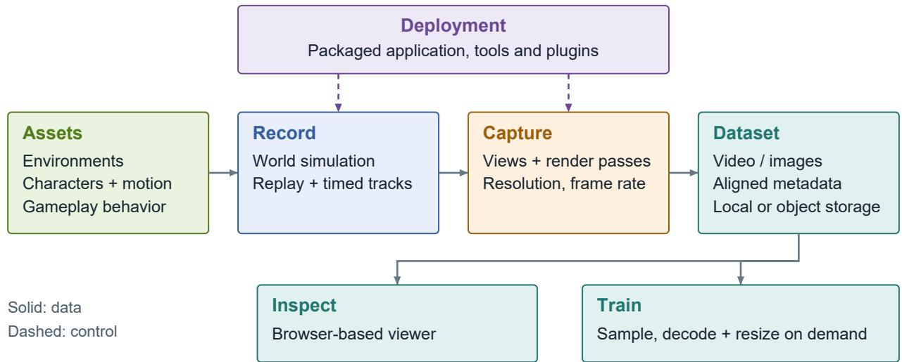  
Figure 1: Isekai3D SDG workflow. Recorded gameplay supports multiple capture variants, producing aligned visual data and metadata for inspection and training.

## 2. Approach

## 2.1. Assets and Environments

The Isekai3D SDG platform can support varying gameplay and environment categories. In this report, we describe how we generate third-person (3P) gameplay data. We first describe the two key components of 3P gameplay: characters and environments.

Characters. The character collection contains 500+ generated humanoids based on SMPL-X [2] and Grounded-Exo2Ego [3]. We integrate these assets into Unreal Engine through IsekaiCharacters, our custom plugin that packages character content as a reusable module. Each character includes a skeletal mesh, materials, and a skeleton using the same 55-joint SMPL-X layout, with an additional non-deforming root bone for integration into Unreal Engine. The joint layout covers the body, hands, jaw, and eyes. A shared animation retargeting setup transfers motion from Unreal Engine’s Manny skeleton to the character skeletons, allowing the animation library to be reused across the collection. Characters support a shared library of locomotion and gameplay animations for varied movement and actions.

Environments. Isekai3D provides 245+ environments sourced from Fab [4] and acquired under the applicable asset licenses. These environments span residential interiors, urban streets, natural landscapes, and stylized settings, providing variation in scene geometry, materials, lighting, and background clutter. This diversity supports synthetic data generation across diferent visual contexts and evaluation of model robustness to changes in the surrounding environment. Figure 2 shows six representative examples.

## 2.2. World Simulation and Recording

World simulation generates gameplay in a selected environment using configured characters and behaviors. Our custom IsekaiSceneReplay plugin records the simulation using Unreal Engine’s replay system, supplemented with timestamped player actions and camera trajectories, while IsekaiGameplay supplies configurable gameplay actions and interactions. Automated recording uses a fixed simulation timestep and can run without rendering through Unreal Engine’s NullRHI mode, avoiding image-generation work until capture. The recording stage produces an Unreal replay file containing replicated world state and a companion JSON file containing timestamped character positions, orientations, and velocities; camera poses and fields of view; and simulated input events, including action presses, releases, and axis values. These files retain the simulated activity for subsequent capture.

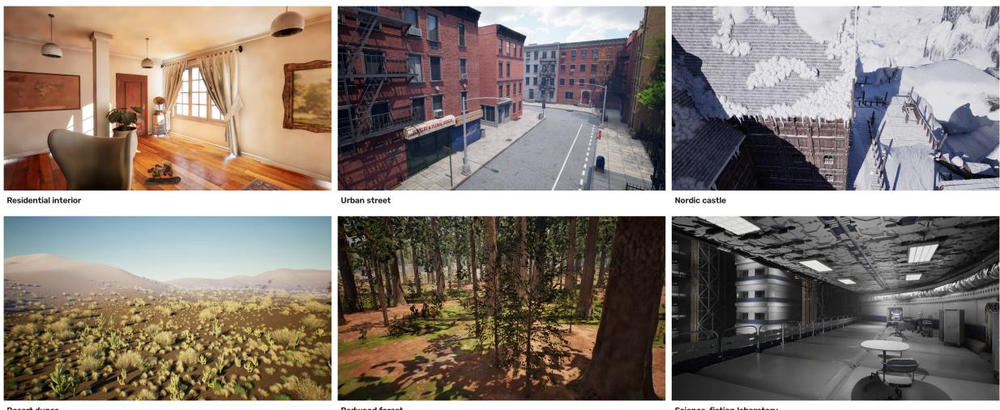  
Figure 2: Representative Isekai3D environments. Top row: residential interior, urban street, and Nordic castle. Bottom row: desert dunes, redwood forest, and science-fiction laboratory.

An optional phantom simulation mode improves data generation performance by recording multiple independent character trajectories in a shared world simulation. Characters collide with the environment but do not collide with or otherwise afect one another; each capture renders only the selected character. Sharing the recording stage across trajectories reduces repeated simulation work, with observed end-to-end throughput improvements of approximately 1.3–2×, depending on the machine and workload. The benefit is greater when recording accounts for a substantial fraction of generation time; per-character behavior, animation, and capture still incur computation.

## 2.3. Capture and Data Outputs

Capture uses the saved replay and timestamped tracks rather than rerunning the autonomous behavior decisions. At each capture timestep, the system restores the recorded character trajectory, samples the selected camera track, and reconstructs the corresponding input and action state. This provides deterministic sampling of the recorded camera, character, and input timelines across capture runs using the same settings. The same recording can therefore support diferent output resolutions and rendering passes, while camera variants can be selected explicitly without repeating the original world simulation.

Figure 3 illustrates nine capture outputs from the same recorded frame and camera viewpoint, including RGB, depth, material properties, world-space normals, irradiance, and instance IDs.

Camera and projection settings allow the same recorded gameplay to provide complementary observations without repeating the world simulation. Third-person and first-person perspective views capture character-level activity and the scene from the character’s viewpoint, while top-down and isometric orthographic views emphasize spatial layout and movement through the environment (Figure 4). Additional projection modes include 360-degree equirectangular panoramas for capturing the surrounding environment and 180-degree overhead fisheye views for wide-angle coverage around the character (Figure 5). Together, these options support datasets with varied viewpoints and image geometries, including paired observations of the same recorded activity with frame-aligned camera, character, and action metadata.

Standard captures use hardware-encoded H.264 video with variable bitrate (15 Mb/s target, 18 Mb/s configured maximum), packaged as MP4 without re-encoding. Path-traced captures use H.264 at CRF 6 with 8-bit 4:2:0 pixels (yuv420p). For perspective and orthographic views, supported radiance passes can instead be stored losslessly as scene-linear EXR frames, bypassing tonemapping and video compression. Standard browsers and video libraries can inspect the MP4 files directly. A thin file-I/O adapter maps reads to object-store range requests, allowing training to read selected clips without first copying the full dataset locally.

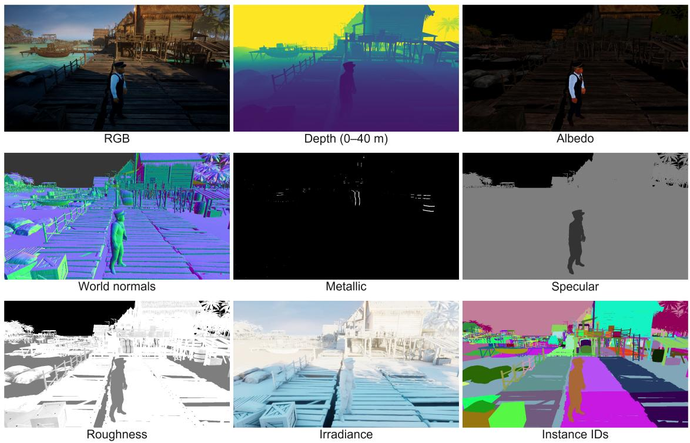

Figure 3: Capture outputs for a single gameplay frame. From left to right and top to bottom: RGB, depth, albedo, world-space normals, metallic, specular, roughness, irradiance, and instance IDs. Depth is color-mapped from 0 to 40 m, with purple indicating nearer surfaces and yellow indicating distances of 40 m or greater.  
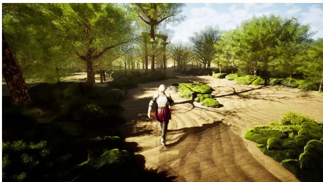  
(a) Third-person perspective

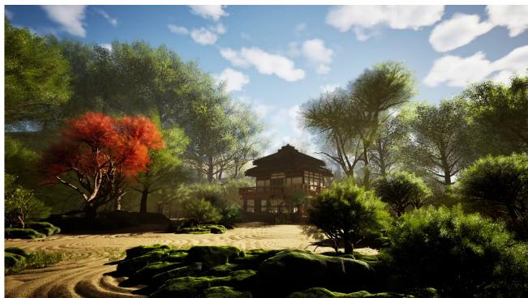  
(b) First-person perspective

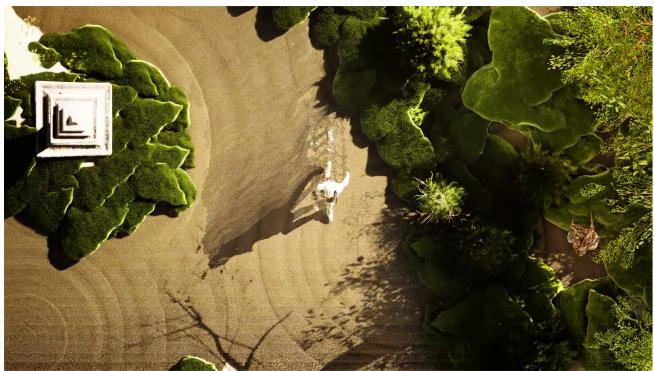  
(c) Top-down orthographic

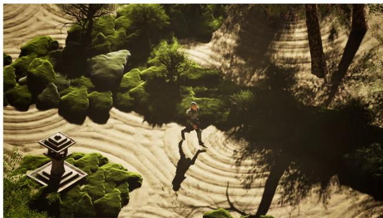  
(d) Isometric orthographic

Figure 4: Camera configurations applied to the same recorded gameplay moment. Top row: third-person and first-person perspective views. Bottom row: top-down and isometric orthographic views.

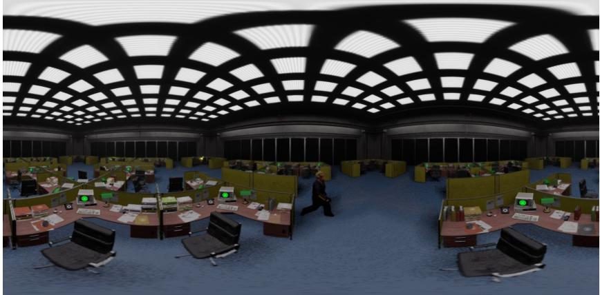  
(a) 360-degree equirectangular panorama

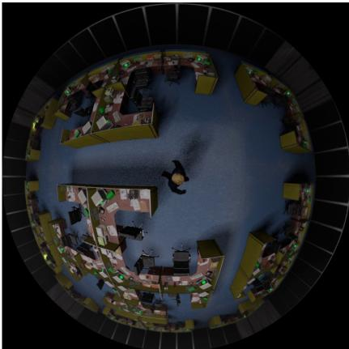  
(b) 180-degree overhead fisheye

Figure 5: Projection modes applied to the same recorded gameplay moment in an ofice environment. Left: a 360-degree equirectangular panorama, horizontally re-centered for display. Right: a 180-degree fisheye view from above the character.

## 2.4. Dataset Format and Training

Preparing fixed training clips in advance incurs transcoding and storage costs and ties the dataset to chosen resolutions, frame rates, and clip lengths. Changing these choices can require another preparation pass. Custom file formats can also make samples harder to inspect.

Isekai3D supports lazy datasets over stored videos and metadata. Researchers select resolution, frame rate, clip duration, and filtering criteria when launching training; clips are read and transformed on demand. In our measured workflow, constructing a lazy dataset from 10,000 hours of video took 3 minutes using Python. Copying the same amount of footage without processing took 16 hours with a tuned copying utility. Reading and transforming samples still incur cost during training.

In another example, users were able to work with more than 30 lazy datasets, often combining several in a training run. If each required a full copy at the measured rate, 30 copies would take 480 aggregate hours, compared with 1.5 hours for 30 three-minute dataset constructions. This comparison estimates preparation time under the full-copy assumption. Reusing the stored videos also avoided hundreds of terabytes of duplicate storage.

## 2.5. Deployment and Extensibility

The full Unreal Engine development setup, including the project, assets, and supporting tools, requires approximately 1 TB of disk space and substantial setup efort. To make data generation accessible without this development environment, we provide a packaged game that includes our Unreal Engine plugins and assets, providing the full SDG functionality. Levels are packaged separately, allowing researchers to download the base application and only the environments needed for their experiments. Automated recording and capture run directly against this packaged game, without requiring an Unreal Engine installation or local compilation. Runtime configuration and automation interfaces allow researchers to programmatically steer data generation and distribute varied experiments across multiple machines using the same packaged build.

Agent-assisted generation. A coding assistant can use the command-line tools and configuration files to select environments and characters, download the required content, set recording and capture options, and run generation (Figure 6). It can then inspect the outputs and adjust the configuration. SPEAR [5] also demonstrates coding-assistant use with programmable simulators.

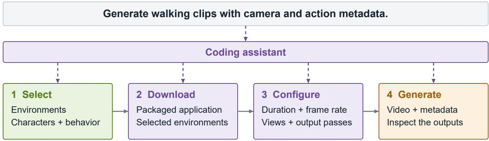  
Figure 6: Example workflow: a coding assistant selects content, configures generation, and checks the outputs.

The game uses a modular build in which components are distributed as dynamic-link libraries (DLLs). Researchers can use a smaller Unreal Engine project to compile modified versions of these components with compatible engine and build tools, then use the resulting DLLs with the packaged application. This supports custom functionality without requiring the full environment collection and development project for each change.

We also provide an automated integration workflow for custom Unreal Engine plugins. Researchers can add their own plugins to extend the SDG system or reuse the platform’s assets in their own workflows. For example, the external IsekaiGFMUI plugin adds configurable waypoint markers, compass indicators, minimaps, and objective panels to captured gameplay. Figure 7 illustrates these elements together, showing how an external plugin can enrich rendered observations with navigation and task information. Together, these deployment and extension options support both users who need a ready-to-run data generator and developers who want to adapt individual components independently.

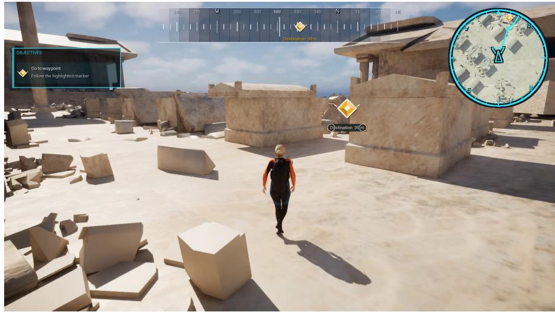  
Figure 7: Navigation UI rendered by the external IsekaiGFMUI plugin, including a waypoint marker, compass, minimap with route guidance, and an example objective panel.

## 3. Conclusion

Isekai3D SDG presents a modular and extensible platform for synthetic data generation of game and game-like scenes. It builds on reusable assets and Unreal Engine plugins in a shared environment for achieving flexibility and scale. Separating world simulation and recording from capture allows the same gameplay to be reused across camera configurations, resolutions, and output types while retaining aligned metadata. The packaged application makes data generation accessible without installing the Unreal Engine editor, while custom plugins or DLL-based extensions allow researchers to adapt functionality independently. Together, these capabilities provide a foundation for creating datasets tailored to research in world models, gameplay agents, and other applications.

## 4. Acknowledgements

We thank Christian Laforte for his support of the synthetic data efort.

## References

[1] Epic Games. Unreal Engine. https://www.unrealengine.com/. Accessed October 15, 2026.

[2] Georgios Pavlakos, Vasileios Choutas, Nima Ghorbani, Timo Bolkart, Ahmed A. A. Osman, Dimitrios Tzionas, and Michael J. Black. Expressive Body Capture: 3D Hands, Face, and Body From a Single Image. In Proceedings of the IEEE/CVF Conference on Computer Vision and Pattern Recognition (CVPR), 2019.

[3] Shengze Wang, Michael Stengel, Tianye Li, Seonwook Park, Amrita Mazumdar, Koki Nagano, Alex Trevithick, and Shalini De Mello. Grounded-Exo2Ego: Structured Semantic Grounding for Robust Exocentric-to-Egocentric Video Generation. In Advances in Neural Information Processing Systems (NeurIPS), 2026.

[4] Epic Games. Fab. https://www.fab.com/. Accessed October 19, 2026.

[5] Mike Roberts et al. SPEAR: A Simulator for Photorealistic Embodied AI Research. In European Conference on Computer Vision (ECCV), 2026. https://arxiv.org/abs/2607.06701.