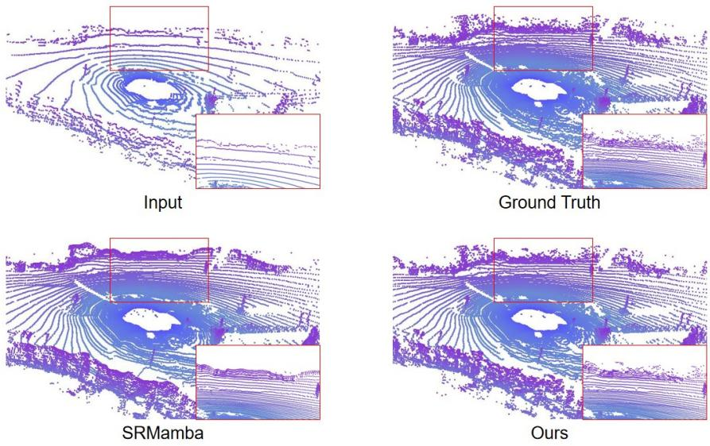
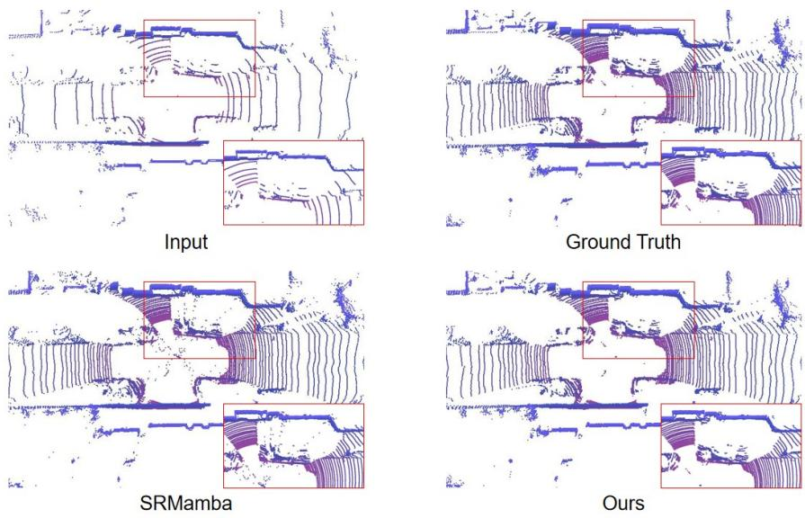
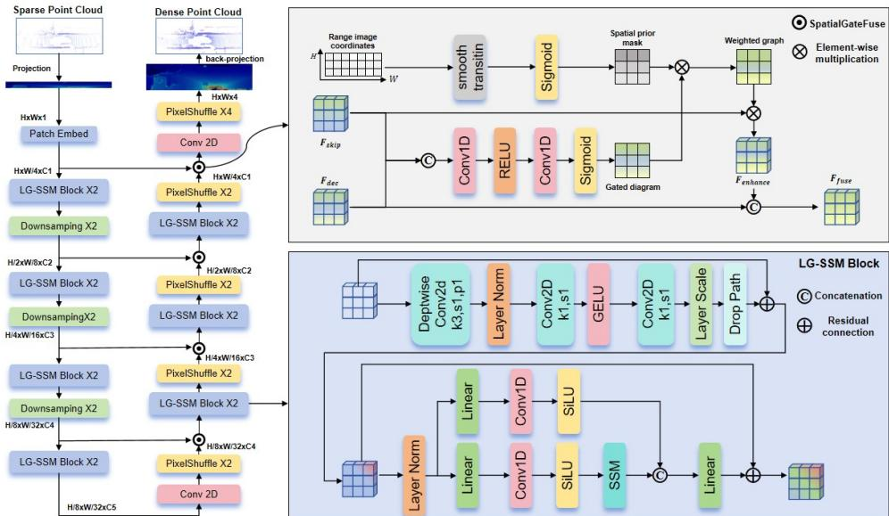
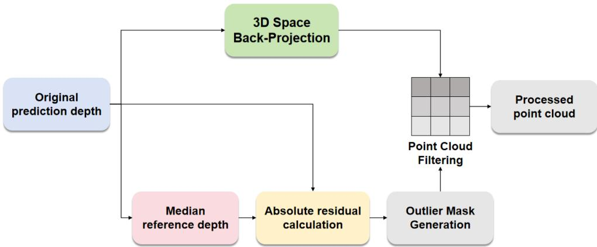
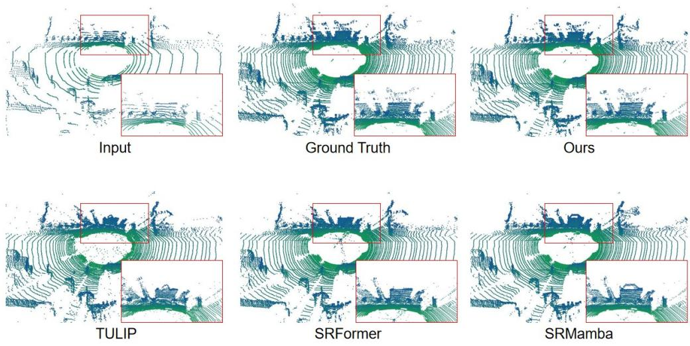
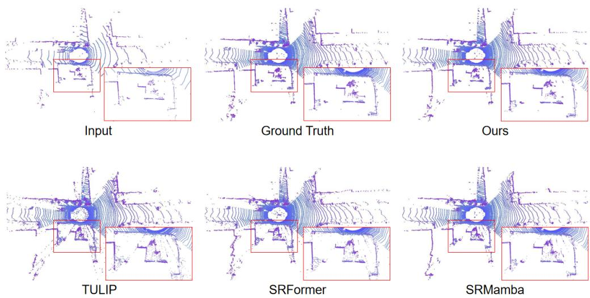

# Local–Global Joint Modeling for Point Cloud Super-Resolution Guided by Multi-Scale Spatial Priors

WANG YANG,1 WENYI GE,1,\*

1College of Computer Science, Chengdu University of Information Technology, Chengdu 610225, China gewenyi15@cuit.edu.cn

## Abstract:

Range-image-based point cloud super-resolution provides an efective way to reconstruct sparse outdoor point clouds by projecting low-resolution LiDAR scans into a regular 2D representation. However, current methods still face three challenges. First, range images exhibit pronounced vertical nonuniformity, with sparse observations in distant regions and denser observations in nearby regions. Some cross-scale fusion mechanisms do not account for the varying reliability of features at diferent vertical positions, allowing invalid values and noise from distant sparse regions to propagate into the decoder. Second, a single convolutional or sequence-modeling architecture often struggles to preserve both local high-frequency geometric details and global long-range dependencies, resulting in over-smoothed reconstructions. Third, smooth transition depths near foreground-background boundaries can produce spike artifacts when the 2D range image is back-projected into 3D. To address these issues, we propose a point cloud super-resolution method based on multi-scale spatial priors and joint local-global modeling. The design comprises a spatially gated fusion module, a multi-granularity local-global cooperative perception module, and 2D median-residual denoising. Experiments on KITTI-360 and nuScenes demonstrate efective reconstruction, with IoU scores of 0.4703 and 0.3593, respectively, supporting the feasibility of the proposed method for range-image super-resolution.

## 1. Introduction

LiDAR actively captures the positions, distances, and geometric contours of objects in 3D scenes, providing reliable spatial data for environmental perception. It is therefore widely used in autonomous driving, robot navigation, scene reconstruction, and localization [1–6]. However, due to the scanning mechanism and operating principles of LiDAR, point density decreases with increasing range. Distant regions are consequently sparse and often lack essential geometric details, making it dificult to meet the completeness and boundary-clarity requirements of highprecision perception. Point cloud super-resolution aims to recover denser representations from low-beam or otherwise sparse inputs. The challenge is to reconstruct missing spatial structures without introducing erroneous smoothing or artifacts around boundaries, depth discontinuities, and distant regions. Existing research has mainly followed two paradigms: processing point clouds directly in 3D space and modeling them through range images.

Methods that process point clouds directly in 3D include point-based, voxel-based, and graph-convolution approaches [3, 7–15]. Point-based methods extract features and increase the number of points directly from unordered 3D coordinates, but local neighborhoods must be constructed explicitly, making it dificult to preserve global structural consistency at long range. Voxel-based methods discretize point clouds into regular 3D grids for feature aggregation, but quantization constrains output detail to the voxel resolution, while the many empty voxels limit the representation of fine geometry. Graph-convolution methods model relationships between points through graph structures; in large outdoor scenes, however, dynamic graph topologies are susceptible to noise and sparse sampling, which can blur boundaries or omit distant structures.

Range-image-based point cloud super-resolution first projects an unstructured point cloud onto a regular 2D range image according to the spherical scanning geometry of the LiDAR [1, 2, 4–6, 16–22]. Features are then extracted on the 2D grid, the resolution is increased, and depth values are predicted. Finally, the high-resolution range image is back-projected into a dense 3D point cloud. By transforming reconstruction of an irregular point set into a structured 2D image-reconstruction problem, this paradigm makes it easier to exploit 2D neighborhood continuity and established image super-resolution architectures. It has consequently become a major approach to outdoor LiDAR point cloud super-resolution.

  
Fig. 1. Illustration of the point cloud over-smoothing problem

Despite this structured representation, range-image methods may still face three reconstruction challenges related to the properties of range images. First, their vertical distribution is strongly nonuniform: distant regions often contain fewer valid observations than nearby regions, producing a sparse-upper, dense-lower pattern. When cross-layer fusion does not explicitly model feature reliability at diferent vertical positions, invalid values and noise from distant sparse regions can persist across multiple scales and hinder structural recovery. Second, feature extractors based only on local convolutions or sequence modeling often struggle to preserve both local highfrequency geometry and global long-range dependencies across diferent data distributions. Purely convolutional networks have limited receptive fields, whereas global modeling without boundary constraints may weaken geometric discontinuities [24–27] and over-smooth the reconstruction, as illustrated in Fig. 1. Third, transition depths near foreground-background boundaries can become floating points or elongated artifacts after back-projection, compromising 3D surface consistency, as shown in Fig. 2.

To address these issues, we propose a point cloud super-resolution method based on multi-scale spatial priors and joint local-global modeling. The method targets three key challenges in range images: sparse distant regions, local boundaries that are prone to smoothing, and spike artifacts introduced during back-projection. It introduces corresponding constraints at the feature-fusion, feature-modeling, and post-processing stages. Specifically, the spatially gated fusion module uses vertical spatial priors to regulate skip-feature transfer and provide targeted compensation in distant sparse regions. The multi-granularity local-global cooperative perception module combines local convolution with selective state-space modeling [23–26, 28–33], preserving edge details while establishing long-range dependencies. The 2D median-residual denoising step identifies anomalous residuals using neighborhood continuity in the image domain before back-projection, suppressing spike artifacts at their source. The main contributions are as follows:

  
Fig. 2. Illustration of spike artifacts in the point cloud

(1) We propose SpatialGateFuse, a spatially gated fusion module for the nonuniform, sparseupper and dense-lower distribution of range images. It introduces vertical spatial priors and content-aware gating to adaptively enhance shallow features in skip connections, mitigating insuficient feature transfer in distant sparse regions.

(2) We propose the multi-granularity local-global cooperative perception module (LG-SSM Block). It complements the local edge-extraction capability of depthwise separable convolutions with the long-range dependency modeling of a selective state-space model, addressing the dificulty of preserving both local geometric detail and global continuity with a single convolutional or sequence-modeling architecture.

(3) We propose a 2D median-residual denoising method. To handle transition depths near foreground-background boundaries, it computes residuals between predicted depths and local median references in the range-image domain, then filters anomalous pixels before back-projection. This suppresses 3D spike artifacts while preserving genuine geometric edges.

## 2. Related Work

## 2.1. Point Cloud Super-Resolution

Point cloud super-resolution reconstructs dense, high-quality 3D point clouds from sparse, low-beam LiDAR scans [34–47]. Direct 3D methods face inherent challenges arising from irregular representations and topology construction. Point-based methods extract features from unordered coordinates, but require frequent neighborhood searches to construct local topology, making global consistency dificult to maintain. Voxel-based methods discretize point clouds into 3D grids; as resolution increases, voxel counts grow cubically, limiting output accuracy to computationally feasible grid sizes, while empty voxels provide little information about fine geometry. Graph-convolution methods model point relationships with dynamic graphs, but frequent topology updates in large outdoor scenes make long-range information propagation vulnerable to noise and can degrade boundary reconstruction.

Range-image methods project unstructured 3D point clouds onto regular 2D grids using spherical projection [1, 2, 4–6, 16–22], avoiding the irregular representations and topologyconstruction challenges of direct 3D processing. They have become a mainstream approach to point cloud super-resolution. Early range-image methods used simple convolutional networks to demonstrate the feasibility of this paradigm. However, several reconstruction challenges remain unresolved.

Some range-image methods adopt the direct channel-concatenation strategy of standard U-Net architectures [23], passing encoder features at diferent levels to the decoder without assessing their reliability. LiDAR projection and scene distributions make vertical sampling nonuniform: in some fields of view, distant regions in the upper image are sparse while nearby regions in the lower image are denser. Because distant sparse regions contain fewer valid observations, invalid responses make up a larger proportion of their features and are more likely to interfere with structural completion. The limited receptive field of purely convolutional architectures [32] can also constrain modeling of panoramic horizontal continuity. Although global attention or sequence modules expand the receptive field, without boundary-aware designs they may smooth high-frequency geometric discontinuities. Implausible depth transitions at foregroundbackground boundaries can produce floating points or elongated artifacts after back-projection; 3D clustering in post-processing does not directly exploit 2D neighborhood continuity in the range image.

In contrast, this work improves range-image super-resolution at three levels. SpatialGateFuse introduces spatial-prior-guided adaptive skip fusion to address feature transfer under nonuniform distributions. LG-SSM Block couples depthwise separable convolutions with a selective statespace model to preserve local high-frequency detail and global long-range dependencies. Finally, 2D median-residual denoising exploits edge-preserving behavior in the image domain to remove back-projection artifacts.

## 2.2. State-Space Models in Vision

State-space models (SSMs) have shown strong potential for sequence modeling. By introducing input-dependent selective scanning, Mamba achieves performance comparable to Transformers on language-modeling tasks while retaining linear time complexity [24]. Inspired by this result, a series of studies have introduced Mamba to computer vision. VMamba proposes a Cross-Scan Module that unfolds 2D feature maps into 1D sequences along four directions and uses selective scanning to establish global contextual dependencies [25]. MambaVision further proposes a hybrid architecture: convolutional blocks extract local features in the first two stages, while hybrid modules combining Mamba SSMs and self-attention capture local details and global semantics in the later stages [26, 27].

In point cloud processing, PointMamba, Point Cloud Mamba, Mamba3D, and 3DMambaIPF have begun to explore SSMs for 3D data modeling, primarily for classification, segmentation, or point cloud filtering [28–31]. To the best of our knowledge, SSM designs for range-image point cloud super-resolution that jointly model local edges and global dependencies warrant further study. We therefore design LG-SSM Block to couple the local feature-extraction capability of depthwise separable convolutions with the global modeling capability of a selective state-space model within a single processing block.

## 2.3. Point Cloud Denoising and Post-Processing

Post-processing denoising is important for improving the quality of super-resolved point clouds. Traditional point cloud denoising methods mainly use filtering or learning-based approaches [48–50]. Radius Outlier Removal and Statistical Outlier Removal are widely used classical filters: the former removes points with too few neighbors within a specified radius, while the latter rejects outliers based on the statistical distribution of distances to neighboring points. However, these 3D clustering methods operate directly on unstructured point clouds and cannot readily use range-image neighborhood continuity to distinguish genuine sparse details from projection artifacts.

  
Fig. 3. Overall network architecture

Recent learning-based methods, such as PointCleanNet and TotalDenoising, denoise point clouds by learning point-wise displacement vectors [49, 50]. They typically require additional supervision and may alter genuine local geometric edges while correcting outliers. Other approaches directly refine predicted range images during post-processing, for example by using morphological operations or guided filtering to smooth anomalous regions. Our 2D medianresidual denoising method belongs to this latter category. It exploits the edge-preserving property of median filtering by computing each pixel’s residual relative to its local median in the rangeimage domain and removing pixels with anomalous residuals. This suppresses back-projection artifacts without complex 3D clustering while retaining genuine geometric edges.

## 3. Method

We propose a point cloud super-resolution method based on multi-scale spatial priors and joint local-global modeling. Given a low-resolution point cloud as input, the method ultimately produces a high-resolution point cloud obtained by inverse projection from a high-resolution distance image. The network is built from multiple LG-SSM Blocks that jointly extract multiscale features using local convolutions and selective state-space modeling [24–26, 28–31]. SpatialGateFuse performs spatial-prior-guided skip-feature fusion between the encoder and decoder. Before back-projection, 2D median-residual denoising [48–50] suppresses anomalous depth residuals. The overall architecture is shown in Fig. 3.

## 3.1. Overall Network Framework

The proposed method takes a low-resolution point cloud as input and obtains an initial 2D feature representation through shallow feature embedding. The encoder then progressively reduces spatial resolution and increases the channel dimension to extract multi-scale semantic features, from local edges to global structures. Unlike networks that rely solely on stacked convolutions,

LG-SSM Blocks are introduced at the main encoder and decoder stages so that feature extraction captures both local geometric discontinuities and long-range continuity in range images.

During decoding, upsampling progressively restores the range-image resolution. Without reliability-aware fusion, invalid responses in shallow features from distant sparse regions can pass to subsequent decoding layers together with valid edges. We therefore insert SpatialGateFuse between shallow encoder features and deep decoder features. The module uses the vertical spatial distribution of the range image, together with the current decoder semantics, to generate content-aware gates that adaptively regulate the contribution of skip features and provide targeted structural compensation in distant sparse regions.

The high-resolution point cloud generated by backprojecting the high-resolution distance map predicted by the network output. During training, the ground-truth high-resolution range image supervises consistency between predicted and true depths. During inference and evaluation, the prediction is first denoised using 2D median-residual filtering; valid pixels are then back-projected into a 3D point cloud. Reconstruction quality is evaluated using both 2D range errors and 3D spatial-occupancy consistency. Thus, the overall framework integrates feature extraction, spatial-prior fusion, and denoising into a complete point cloud super-resolution pipeline.

## 3.2. Multi-Granularity Local-Global Cooperative Perception Module

LG-SSM Block is the core computational unit of the encoder-decoder network and extracts deep features at each encoder downsampling and decoder upsampling stage. To address the conflict between losing local high-frequency details and lacking a global long-range receptive field, each block couples local feature extraction with global reasoning in a single processing cycle.

Given an input feature map $X \in \mathbb { R } ^ { B \times C \times \mathbf { \breve { H } } \times W }$ , where � is the batch size, � is the number of channels, and � and � are the spatial dimensions, the block performs the following operations.

The local extraction layer focuses on high-frequency spatial discontinuities in LiDAR range images, such as vehicle edges and small-obstacle contours. To accommodate the smaller feature maps and wider channels in deeper network layers, it uses depthwise separable convolutions with an inverted-bottleneck architecture to capture clear edge transitions and fine geometric textures within local neighborhoods. First, a depthwise convolution $( \mathrm { D W C o n v } _ { 3 \times 3 } )$ aggregates geometric features independently within each channel, providing an initial high-frequency edge prior: $X _ { \mathrm { d w } } = \mathrm { D W C o n v } _ { 3 \times 3 } ( X )$ . Layer normalization then stabilizes the feature distribution, and two pointwise $( 1 \times 1 )$ convolutions with GELU activations provide eficient nonlinear interactions in a higher-dimensional feature space. Specifically, the channel dimension is expanded by a factor of $r \left( \mathrm { s e t } \mathrm { t o } r = 4 \right)$ , passed through GELU for smooth nonlinear mapping, and then reduced to its original size. This inverted bottleneck, with narrow ends and a wider middle, helps avoid hard gradient truncation and information loss:

$$
X _ { \mathrm { l o c a l } } = \mathrm { P W C o n v } _ { 2 } ( \mathbf { G E L U ( P W C o n v } _ { 1 } ( \mathrm { L a y e r N o r m } ( X _ { \mathrm { d w } } ) ) ) )
$$

The high-frequency local features extracted by the inverted bottleneck are finally added to the original input through a residual connection to produce the intermediate feature $X _ { \mathrm { m i d } } = X _ { \mathrm { l o c a l } } + X$ This representation has clearer geometric boundaries and local contour priors and serves as the input to the subsequent global reasoning layer.

After local processing, the block uses a selective state-space model to establish global dependencies across the elongated range image. It first flattens the 2D feature map with local geometric priors into a 1D sequence $\bar { { x } ^ { \mathrm { ~ } } } \in \mathbb { R } ^ { B \times L \times C }$ of length $L = H \times W$ . A continuous-time state-space model maps input $x ( t )$ to output �(�) through a hidden state $h ( t )$ , with the following ordinary diferential equations:

$$
h ^ { \prime } ( t ) = A h ( t ) + B x ( t )
$$

$$
y ( t ) = C h ( t ) + D x ( t )
$$

To handle discrete image-feature sequences, a time-step scale parameter Δ is introduced. The zero-order hold (ZOH) rule discretizes the system to obtain the transition matrix $\bar { A }$ and input projection matrix �¯:

$$
\bar { A } = \exp ( \Delta A )
$$

$$
\bar { B } = ( \Delta A ) ^ { - 1 } ( \exp ( \Delta A ) - I ) \Delta B
$$

The hidden-state update and output at the current time step are then given by:

$$
h _ { t } = \bar { A } h _ { t - 1 } + \bar { B } x _ { t }
$$

$$
y _ { t } = C h _ { t } + D x _ { t }
$$

Importantly, the matrices � and � and the time step Δ are not fixed; they are dynamically generated from the current input token. This input-dependent selection enables the model to maintain linear time complexity $O ( L )$ while adaptively bridging large sparse areas in the range image and establishing globally contextualized topological structures.

Finally, the globally processed sequence is folded back into a 2D spatial representation and combined with the backbone residual to produce the LG-SSM Block output:

$$
X _ { \mathrm { o u t } } = \mathrm { F o l d } ( \mathrm { S S M } ( \mathrm { F l a t t e n } ( X _ { \mathrm { m i d } } ) ) ) + X _ { \mathrm { m i d } }
$$

## 3.3. Spatially Gated Fusion Module

When multi-scale features are passed from the encoder to the decoder, simply concatenating shallow and deep features along the channel dimension provides no assessment of feature reliability. Consequently, valid edges in shallow features are passed to subsequent convolutions together with invalid values and noise. SpatialGateFuse introduces content-aware gating and a vertical spatial prior to adaptively modulate skip-connection features through a residual adjustment, as described below.

Content-aware gate generation: the encoder skip feature $X _ { \mathrm { s k i p } }$ and the current upsampled decoder feature $X _ { \mathrm { d e c } }$ are concatenated along the channel dimension. Successive convolution and activation layers then generate a 2D spatial attention map $G \in \mathbb { R } ^ { 1 \times H \times W }$

$$
G = \sigma ( \mathrm { C o n v } _ { 1 \times 1 } ( \mathrm { R e L U } ( \mathrm { C o n v } _ { 1 \times 1 } ( [ X _ { \mathrm { s k i p } } ; X _ { \mathrm { d e c } } ] ) ) ) )
$$

Here, $\sigma$ denotes the sigmoid function, and $[ \cdot ; \cdot ]$ denotes concatenation along the channel dimension.

Spatial-prior mask generation: using the vertical coordinates of the range image, we construct a smoothly varying spatial mask $M \in \mathbb { R } ^ { 1 \times H \times 1 }$ whose values approach 1 in the upper (distant) region and 0 in the lower (nearby) region:

$$
M ( h ) = \sigma \left( { \frac { h - \alpha H } { \beta H } } \right)
$$

Here, $h \in [ 0 , H - 1 ]$ is the row index, � is the transition-center ratio (default 0.5), and $\beta$ controls the transition-band width (default 0.08).

Adaptive feature enhancement and fusion: a learnable gain parameter $\gamma ,$ initialized to zero, defines the feature amplification factor used to enhance the shallow feature:

$$
X _ { \mathrm { e n h a n c e d } } = X _ { \mathrm { s k i p } } \odot ( 1 . 0 + \gamma G \odot M )
$$

The adjusted feature is then fused with the decoder feature and passed to the next layer. Zeroinitializing the gain keeps the module equivalent to baseline fusion early in training, avoiding disruption of the original feature distribution before reliable gating patterns have been learned. As training proceeds, the content gate is predicted jointly from shallow and current decoder features to assess whether local responses agree with the current semantics. The vertical spatial prior concentrates additional modulation in distant sparse regions. Low gate responses therefore do not give invalid features the same enhancement as valid structures, while high responses increase the relative weight of structures consistent with decoder semantics.

## 3.4. 2D Median-Residual Denoising

After the decoder’s LG-SSM Blocks and PixelShufle upsampling operations [33], the network produces a predicted high-resolution range image. To remove 3D point artifacts caused by interpolation-induced smoothing, we apply a 2D post-processing denoising step before backprojecting the range image, as illustrated in Fig. 4.

  
Fig. 4. Illustration of 2D median-residual denoising

First, we estimate the locally dominant surface. A 2D median filter of size $k \times k$ (with $k = 5$ in this work) is applied to the high-resolution range image to obtain a reference depth for each pixel from its neighborhood:

$$
D _ { \mathrm { m e d } } ( i , j ) = \mathrm { M e d i a n } \{ D _ { \mathrm { p r e d } } ( i + m , j + n ) ~ | ~ m , n \in [ - \lfloor k / 2 \rfloor , \lfloor k / 2 \rfloor ] \}
$$

Residual-based rejection and 3D projection: the absolute residual between the predicted depth and the median reference is $R ( i , j ) = | D _ { \mathrm { p r e d } } ( i , j ) - D _ { \mathrm { m e d } } ( i , j ) |$ . A dynamic outlier threshold � is used. When each high-resolution pixel is back-projected using the camera intrinsics to form a dense 3D point cloud, pixels with $R ( i , j ) > \tau$ are treated as interpolation artifacts and excluded; all other pixels are projected normally.

Median filtering is efective at suppressing noise while preserving edges. At boundaries between foreground objects and distant backgrounds, incorrectly smoothed transition depths may have large residuals and are removed by this rule. The method suppresses floating outliers and fragmented artifacts through residual checks in the 2D image domain, without expensive clustering in high-dimensional 3D space.

## 4. Experiments

## 4.1. Experimental Setup

Datasets. We evaluate the method on two widely used autonomous-driving LiDAR datasets [51, 52].

KITTI-360 [51]: captured using a 64-beam Velodyne HDL-64E LiDAR, this dataset contains approximately 20,000 training samples and 2,500 validation samples. The low-resolution input is obtained by downsampling from 64 to 16 beams, and the target is the original 64-beam resolution.

nuScenes [52]: captured using a 32-beam Velodyne HDL-32E LiDAR, this dataset is processed from an 8-beam input to a 32-beam target resolution.

Evaluation metrics. We evaluate reconstruction quality using metrics at both the 2D and 3D levels:

2D metric: mean absolute error (MAE), which measures the per-pixel absolute diference between the predicted and ground-truth range images.

Chamfer Distance (CD) [53]: the symmetric nearest-neighbor distance between the predicted and ground-truth point clouds, reflecting overall 3D reconstruction accuracy.

Voxel-based metric: intersection over union (IoU), calculated on a voxel grid with a resolution of 0.1 m, to measure spatial-occupancy agreement between point clouds.

## 4.2. Comparative Experiments

## 4.2.1. Qualitative Results

To visually assess recovery of scene structure and local detail, Figs. 5 and 6 compare sparse inputs, ground-truth high-resolution point clouds, our method, TULIP, SRFormer, and SRMamba. The qualitative evaluation focuses on two issues in range-image super-resolution: excessive smoothing around depth transitions, which can merge neighboring objects or object-background contours and distort the original discrete point distribution; and isolated spike artifacts caused by depth prediction errors after back-projection. Red boxes and insets highlight structural preservation around depth discontinuities.

As shown in Fig. 5, sparse inputs lack continuous depth observations around point cloud contours and their boundaries with the background. If neighboring depths are over-smoothed during super-resolution, depth layers that should remain separate can merge into thick bands, causing local detail loss and contour adhesion. In the red-boxed regions, some competing methods increase point density but over-smooth the original discrete structure, leading to misinterpretation of point cloud features. By contrast, our reconstruction is closer to the ground truth overall: it recovers the main structures and their upper contours while maintaining separation between road scan lines and foreground objects. This indicates that our method supplements sparse regions while constraining feature propagation near boundaries, preserving depth discontinuities and reducing structural mixing caused by smoothing.

Figure 6 further compares detail recovery and outlier suppression in complex sparse scenes. Although the competing methods reconstruct the main scene contours, spike artifacts and local adhesion remain visible around vehicles, along vertical object boundaries, and at depth discontinuities. The point clouds generated by our method show greater consistency with the ground truth in their main structures, boundary trajectories, and local point distributions. After 2D median-residual post-processing, outliers floating beyond the main surfaces are further suppressed, while valid structures such as vehicles and road edges are preserved. Thus, our method not only increases point-cloud density but also improves spatial continuity and boundary

  
Fig. 5. Comparison of point cloud over-smoothing across methods

delineation in the reconstruction.  
  
Fig. 6. Detail recovery and outlier suppression in complex sparse scenes

## 4.2.2. Quantitative Results

Our method achieves an IoU of 0.4703 on KITTI-360 and 0.3593 on nuScenes. These results show that the proposed pipeline performs range-image-based point cloud super-resolution across datasets with diferent beam configurations. The specific test indicators are provided in Tables 1 and 2.

Table 1. Quantitative comparison on the KITTI-360 dataset
<table><tr><td>Methods</td><td>Dataset</td><td>MAE</td><td>CD</td><td>IoU</td></tr><tr><td>VIT</td><td>KITTI-360</td><td>0.0056</td><td>0.1192</td><td>0.4011</td></tr><tr><td>ConvNext</td><td>KITTI-360</td><td>0.0051</td><td>0.1215</td><td>0.4041</td></tr><tr><td>SRFormer</td><td>KITTI-360</td><td>0.0065</td><td>0.1374</td><td>0.4110</td></tr><tr><td>TULIP</td><td>KITTI-360</td><td>0.0051</td><td>0.1241</td><td>0.4152</td></tr><tr><td>EchoSR</td><td>KITTI-360</td><td>0.0102</td><td>0.1260</td><td>0.4343</td></tr><tr><td>SRMamba</td><td>KITTI-360</td><td>0.0044</td><td>0.1031</td><td>0.4389</td></tr><tr><td>Ours</td><td>KITTI-360</td><td>0.0043</td><td>0.0563</td><td>0.4703</td></tr></table>

Table 2. Quantitative comparison on the nuScenes dataset
<table><tr><td>Methods</td><td>Dataset</td><td>MAE</td><td>CD</td><td>IoU</td></tr><tr><td>SRFormer</td><td>nuScenes</td><td>0.0297</td><td>1.3405</td><td>0.2906</td></tr><tr><td>TULIP</td><td>nuScenes</td><td>0.0293</td><td>1.0502</td><td>0.3048</td></tr><tr><td>SRMamba</td><td>nuScenes</td><td>0.0287</td><td>1.0196</td><td>0.317</td></tr><tr><td>Ours</td><td>nuScenes</td><td>0.0302</td><td>1.0065</td><td>0.3593</td></tr></table>

## 4.3. Ablation Study

To evaluate the efectiveness of the proposed components, we progressively introduce and combine LG-SSM Block, SpatialGateFuse (SGF), and 2D median-residual post-processing on KITTI-360.

Table 3. Ablation results for the core modules
<table><tr><td>Basic [2, 2, 2, 2]</td><td>LG</td><td>SGF</td><td>Post-processing</td><td>MAE</td><td>CD</td><td>IoU</td></tr><tr><td>√</td><td></td><td></td><td></td><td>0.0044</td><td>0.1031</td><td>0.4389</td></tr><tr><td>√</td><td>√</td><td></td><td></td><td>0.0045</td><td>0.0879</td><td>0.4430</td></tr><tr><td>√</td><td></td><td>√</td><td></td><td>0.0044</td><td>0.0877</td><td>0.4454</td></tr><tr><td>√</td><td>√</td><td>√</td><td>√</td><td>0.0043</td><td>0.0563</td><td>0.4703</td></tr></table>

## 5. Conclusion

We addressed three challenges in range-image-based point cloud super-resolution: inadequate feature transfer under nonuniform sampling, dificulty balancing local details with global dependencies, and artifacts introduced during 2D-to-3D back-projection. We proposed a method based on multi-scale spatial priors and joint local-global modeling. SpatialGateFuse enhances useful features in distant sparse regions through spatial gating. LG-SSM Block combines local convolution with selective state-space modeling to preserve high-frequency edges and long-range structural dependencies. 2D median-residual denoising uses an edge-preserving residual test in the range-image domain to suppress spike artifacts. Experiments on KITTI-360 and nuScenes demonstrate consistent improvements, showing that the three modules work together to enhance point cloud super-resolution quality.

## References

1. WU B, WAN A, YUE X, et al. SqueezeSeg: Convolutional Neural Nets with Recurrent CRF for Real-Time Road-Object Segmentation from 3D LiDAR Point Cloud[C]. 2018 IEEE International Conference on Robotics and Automation (ICRA), 2018: 1887-1893. DOI: 10.1109/icra.2018.8462926.

2. MILIOTO A, VIZZO I, BEHLEY J, et al. RangeNet ++: Fast and Accurate LiDAR Semantic Segmentation[C]. 2019 IEEE/RSJ International Conference on Intelligent Robots and Systems (IROS), 2019: 4213-4220. DOI: 10.1109/iros40897.2019.8967762.

3. BEHLEY J, GARBADE M, MILIOTO A, et al. SemanticKITTI: A Dataset for Semantic Scene Understanding of LiDAR Sequences[C]. 2019 IEEE/CVF International Conference on Computer Vision (ICCV), 2019: 9296-9306. DOI: 10.1109/iccv.2019.00939.

4. CORTINHAL T, TZELEPIS G, ERDAL AKSOY E. SalsaNext: Fast, Uncertainty-Aware Semantic Segmentation of LiDAR Point Clouds[C]. Lecture Notes in Computer Science, 2020: 207-222. DOI: 10.1007/978-3-030-64559-5\_16.

5. ZHANG Y, ZHOU Z, DAVID P, et al. PolarNet: An Improved Grid Representation for Online LiDAR Point Clouds Semantic Segmentation[C]. 2020 IEEE/CVF Conference on Computer Vision and Pattern Recognition (CVPR), 2020: 9598-9607. DOI: 10.1109/cvpr42600.2020.00962.

6. MEYER GP, LADDHA A, KEE E, et al. LaserNet: An Eficient Probabilistic 3D Object Detector for Autonomous Driving[C]. 2019 IEEE/CVF Conference on Computer Vision and Pattern Recognition (CVPR), 2019: 12669-12678. DOI: 10.1109/cvpr.2019.01296.

7. CHARLES RQ, SU H, KAICHUN M, et al. PointNet: Deep Learning on Point Sets for 3D Classification and Segmentation[C]. 2017 IEEE Conference on Computer Vision and Pattern Recognition (CVPR), 2017: 77-85. DOI: 10.1109/cvpr.2017.16.

8. WANG Y, SUN Y, LIU Z, et al. Dynamic Graph CNN for Learning on Point Clouds[J]. ACM Transactions on Graphics, 2019, 38(5): 1-12. DOI: 10.1145/3326362.

9. ZHAO H, JIANG L, JIA J, et al. Point Transformer[C]. 2021 IEEE/CVF International Conference on Computer Vision (ICCV), 2021: 16239-16248. DOI: 10.1109/iccv48922.2021.01595.

10. QI CR, YI L, SU H, et al. PointNet++: Deep Hierarchical Feature Learning on Point Sets in a Metric Space[EB/OL]. arXiv:1706.02413, 2017[2026-08-16]. https://arxiv.org/pdf/1706.02413.

11. HU Q, YANG B, XIE L, et al. RandLA-Net: Eficient Semantic Segmentation of Large-Scale Point Clouds[C]. 2020 IEEE/CVF Conference on Computer Vision and Pattern Recognition (CVPR), 2020: 11105-11114. DOI: 10.1109/cvpr42600.2020.01112.

12. WU B, ZHOU X, ZHAO S, et al. SqueezeSegV2: Improved Model Structure and Unsupervised Domain Adaptation for Road-Object Segmentation from a LiDAR Point Cloud[C]. 2019 International Conference on Robotics and Automation (ICRA), 2019: 4376-4382. DOI: 10.1109/icra.2019.8793495.

13. YANG Y, FENG C, SHEN Y, et al. FoldingNet: Point Cloud Auto-Encoder via Deep Grid Deformation[C]. 2018 IEEE/CVF Conference on Computer Vision and Pattern Recognition, 2018: 206-215. DOI: 10.1109/cvpr.2018.00029.

14. WU W, QI Z, FUXIN L. PointConv: Deep Convolutional Networks on 3D Point Clouds[C]. 2019 IEEE/CVF Conference on Computer Vision and Pattern Recognition (CVPR), 2019: 9613-9622. DOI: 10.1109/cvpr.2019.00985.

15. THOMAS H, QI CR, DESCHAUD JE, et al. KPConv: Flexible and Deformable Convolution for Point Clouds[C]. 2019 IEEE/CVF International Conference on Computer Vision (ICCV), 2019: 6410-6419. DOI: 10.1109/iccv.2019.00651.

16. YANG B, PFREUNDSCHUH P, SIEGWART R, et al. TULIP: Transformer for Upsampling of LiDAR Point Clouds[C]. 2024 IEEE/CVF Conference on Computer Vision and Pattern Recognition (CVPR), 2024: 15354-15364. DOI: 10.1109/cvpr52733.2024.01454.

17. KWON Y, SUNG M, YOON SE. Implicit LiDAR Network: LiDAR Super-Resolution via Interpolation Weight Prediction[C]. 2022 International Conference on Robotics and Automation (ICRA), 2022: 8424-8430. DOI: 10.1109/icra46639.2022.9811992.

18. PARK M, SON H, KIM E. Implicit Point Function for LiDAR Super-Resolution in Autonomous Driving[J]. IEEE Robotics and Automation Letters, 2023, 8(11): 7003-7009. DOI: 10.1109/lra.2023.3313925.

19. CHEN TY, HSIAO CC, HUANG CC. Density-Imbalance-Eased LiDAR Point Cloud Upsampling via Feature Consis tency Learning[J]. IEEE Transactions on Intelligent Vehicles, 2023, 8(4): 2875-2887. DOI: 10.1109/tiv.2022.3162672.

20. SHAN T, WANG J, CHEN F, et al. Simulation-based lidar super-resolution for ground vehicles[J]. Robotics and Autonomous Systems, 2020, 134: 103647. DOI: 10.1016/j.robot.2020.103647.

21. CHEN C, JIN A, WANG Z, et al. SGSR-Net: Structure Semantics Guided LiDAR Super-Resolution Network for Indoor LiDAR SLAM[J]. IEEE Transactions on Multimedia, 2024, 26: 1842-1854. DOI: 10.1109/tmm.2023.3289752.

22. CHEN K, LIU C, OU Y. Channel Attention based Network for LiDAR Super-resolution[C]. 2021 China Automation Congress (CAC), 2021: 5458-5463. DOI: 10.1109/cac53003.2021.9727846.

23. RONNEBERGER O, FISCHER P, BROX T. U-Net: Convolutional Networks for Biomedical Image Segmentation[C]. Lecture Notes in Computer Science, 2015: 234-241. DOI: 10.1007/978-3-319-24574-4\_28.

24. GU A, DAO T. Mamba: Linear-Time Sequence Modeling with Selective State Spaces[EB/OL]. arXiv:2312.00752, 2023[2026-08-16]. https://arxiv.org/pdf/2312.00752.

25. LIU Y, TIAN Y, ZHAO Y, et al. VMamba: Visual State Space Model[EB/OL]. arXiv:2401.10166, 2024[2026-08-16]. https://arxiv.org/pdf/2401.10166.

26. HATAMIZADEH A, KAUTZ J. MambaVision: A Hybrid Mamba-Transformer Vision Backbone[C]. 2025 IEEE/CVF Conference on Computer Vision and Pattern Recognition (CVPR), 2025: 25261-25270. DOI: 10.1109/cvpr52734.2025.02352.

27. ZHU L, LIAO B, ZHANG Q, et al. Vision Mamba: Eficient Visual Representation Learning with Bidirectional State Space Model[EB/OL]. arXiv:2401.09417, 2024[2026-08-16]. https://arxiv.org/pdf/2401.09417.

28. LIANG D, ZHOU X, XU W, et al. PointMamba: A Simple State Space Model for Point Cloud Analysis[C]. Advances in Neural Information Processing Systems 37, 2024: 32653-32677. DOI: 10.52202/079017-1026.

29. ZHANG T, YUAN H, QI L, et al. Point Cloud Mamba: Point Cloud Learning via State Space Model[C]. Proceedings of the AAAI Conference on Artificial Intelligence, 2025: 10121-10130. DOI: 10.1609/aaai.v39i10.33098.

30. ZHOU Q, YANG W, FEI B, et al. 3DMambaIPF: A State Space Model for Iterative Point Cloud Filtering via Diferentiable Rendering[C]. Proceedings of the AAAI Conference on Artificial Intelligence, 2025: 10843-10851. DOI: 10.1609/aaai.v39i10.33178.

31. HAN X, TANG Y, WANG Z, et al. Mamba3D: Enhancing Local Features for 3D Point Cloud Analysis via State Space Model[C]. Proceedings of the 32nd ACM International Conference on Multimedia, 2024: 4995-5004. DOI: 10.1145/3664647.3681173.

32. SANDLER M, HOWARD A, ZHU M, et al. MobileNetV2: Inverted Residuals and Linear Bottlenecks[C]. 2018 IEEE/CVF Conference on Computer Vision and Pattern Recognition, 2018: 4510-4520. DOI: 10.1109/cvpr.2018.00474.

33. SHI W, CABALLERO J, HUSZAR F, et al. Real-Time Single Image and Video Super-Resolution Using an Eficient Sub-Pixel Convolutional Neural Network[C]. 2016 IEEE Conference on Computer Vision and Pattern Recognition (CVPR), 2016: 1874-1883. DOI: 10.1109/cvpr.2016.207.

34. YU L, LI X, FU CW, et al. PU-Net: Point Cloud Upsampling Network[C]. 2018 IEEE/CVF Conference on Computer Vision and Pattern Recognition, 2018: 2790-2799. DOI: 10.1109/cvpr.2018.00295.

35. LI R, LI X, FU CW, et al. PU-GAN: A Point Cloud Upsampling Adversarial Network[C]. 2019 IEEE/CVF International Conference on Computer Vision (ICCV), 2019: 7202-7211. DOI: 10.1109/iccv.2019.00730.

36. QIAN G, ABUALSHOUR A, LI G, et al. PU-GCN: Point Cloud Upsampling using Graph Convolutional Networks[C]. 2021 IEEE/CVF Conference on Computer Vision and Pattern Recognition (CVPR), 2021: 11678-11687. DOI: 10.1109/cvpr46437.2021.01151.

37. LI R, LI X, HENG PA, et al. Point Cloud Upsampling via Disentangled Refinement[C]. 2021 IEEE/CVF Conference on Computer Vision and Pattern Recognition (CVPR), 2021: 344-353. DOI: 10.1109/cvpr46437.2021.00041.

38. QIU S, ANWAR S, BARNES N. PU-Transformer: Point Cloud Upsampling Transformer[C]. Lecture Notes in Computer Science, 2023: 326-343. DOI: 10.1007/978-3-031-26319-4\_20.

39. YE S, CHEN D, HAN S, et al. Meta-PU: An Arbitrary-Scale Upsampling Network for Point Cloud[J]. IEEE Transactions on Visualization and Computer Graphics, 2022, 28(9): 3206-3218. DOI: 10.1109/tvcg.2021.3058311.

40. QIAN Y, HOU J, KWONG S, et al. PUGeo-Net: A Geometry-Centric Network for 3D Point Cloud Upsampling[C]. Lecture Notes in Computer Science, 2020: 752-769. DOI: 10.1007/978-3-030-58529-7\_44.

41. LONG C, ZHANG W, LI R, et al. PC2-PU: Patch Correlation and Point Correlation for Efective Point Cloud Upsampling[C]. Proceedings of the 30th ACM International Conference on Multimedia, 2022: 2191-2201. DOI: 10.1145/3503161.3547777.

42. LIU H, YUAN H, HOU J, et al. PUFA-GAN: A Frequency-Aware Generative Adversarial Network for 3D Point Cloud Upsampling[J]. IEEE Transactions on Image Processing, 2022, 31: 7389-7402. DOI: 10.1109/tip.2022.3222918.

43. LIU X, LIU X, LIU YS, et al. SPU-Net: Self-Supervised Point Cloud Upsampling by Coarse-to-Fine Reconstruction With Self-Projection Optimization[J]. IEEE Transactions on Image Processing, 2022, 31: 4213-4226. DOI: 10.1109/tip.2022.3182266.

44. KIM D, SHIN M, PAIK J. PU-Edgeformer: Edge Transformer for Dense Prediction in Point Cloud Upsampling[C]. ICASSP 2023 - 2023 IEEE International Conference on Acoustics, Speech and Signal Processing (ICASSP), 2023: 1-5. DOI: 10.1109/icassp49357.2023.10095541.

45. LIU H, YUAN H, HAMZAOUI R, et al. PU-Mask: 3D Point Cloud Upsampling via an Implicit Virtual Mask[J]. IEEE Transactions on Circuits and Systems for Video Technology, 2024, 34(7): 6489-6502. DOI: 10.1109/tcsvt.2024.3370001.

46. GUO MH, CAI JX, LIU ZN, et al. PCT: Point cloud transformer[J]. Computational Visual Media, 2021, 7(2): 187-199. DOI: 10.1007/s41095-021-0229-5.

47. ZHANG Y, ZHAO W, SUN B, et al. Point Cloud Upsampling Algorithm: A Systematic Review[J]. Algorithms, 2022, 15(4): 124. DOI: 10.3390/a15040124.

48. HUANG T, YANG G, TANG G. A fast two-dimensional median filtering algorithm[J]. IEEE Transactions on Acoustics, Speech, and Signal Processing, 1979, 27(1): 13-18. DOI: 10.1109/tassp.1979.1163188.

49. RAKOTOSAONA MJ, LA BARBERA V, GUERRERO P, et al. PointCleanNet: Learning to Denoise and Remove Outliers from Dense Point Clouds[J]. Computer Graphics Forum, 2020, 39(1): 185-203. DOI: 10.1111/cgf.13753.

50. CASAJUS PH, RITSCHEL T, ROPINSKI T. Total Denoising: Unsupervised Learning of 3D Point Cloud Cleaning[C].

2019 IEEE/CVF International Conference on Computer Vision (ICCV), 2019: 52-60. DOI: 10.1109/iccv.2019.00014.

51. LIAO Y, XIE J, GEIGER A. KITTI-360: A Novel Dataset and Benchmarks for Urban Scene Understanding in 2D and 3D[J]. IEEE Transactions on Pattern Analysis and Machine Intelligence, 2023, 45(3): 3292-3310. DOI: 10.1109/tpami.2022.3179507.

52. CAESAR H, BANKITI V, LANG AH, et al. nuScenes: A Multimodal Dataset for Autonomous Driving[C]. 2020 IEEE/CVF Conference on Computer Vision and Pattern Recognition (CVPR), 2020: 11618-11628. DOI: 10.1109/cvpr42600.2020.01164.

53. FAN H, SU H, GUIBAS L. A Point Set Generation Network for 3D Object Reconstruction from a Single Image[C]. 2017 IEEE Conference on Computer Vision and Pattern Recognition (CVPR), 2017: 2463-2471. DOI: 10.1109/cvpr.2017.264.

54. LOSHCHILOV I, HUTTER F. Decoupled Weight Decay Regularization[EB/OL]. arXiv:1711.05101, 2017[2026-08- 16]. https://arxiv.org/pdf/1711.05101.

55. LOSHCHILOV I, HUTTER F. SGDR: Stochastic Gradient Descent with Warm Restarts[EB/OL]. arXiv:1608.03983, 2016[2026-08-16]. https://arxiv.org/pdf/1608.03983.