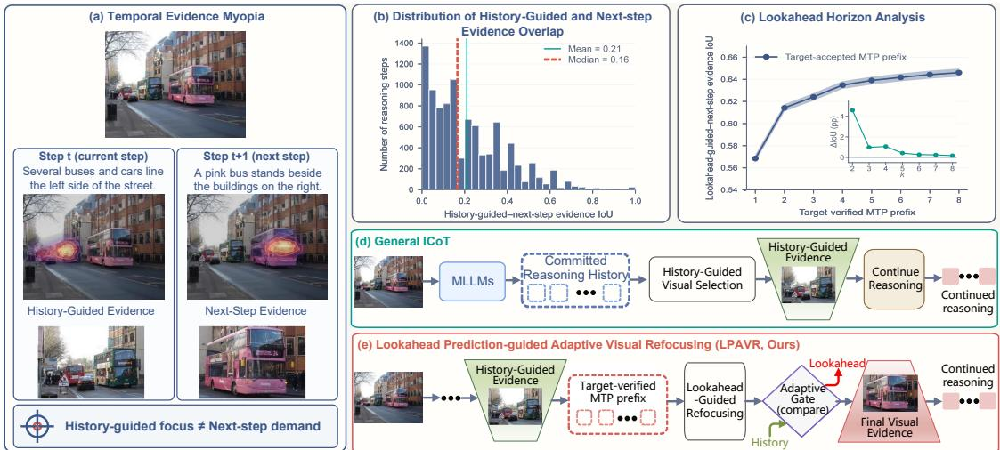
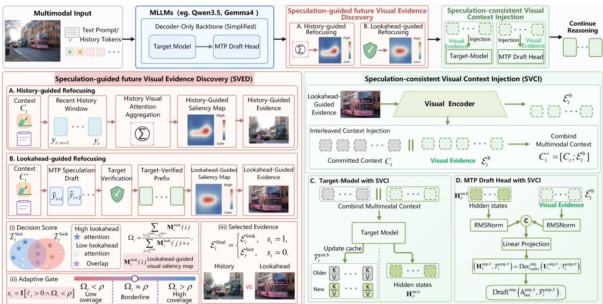
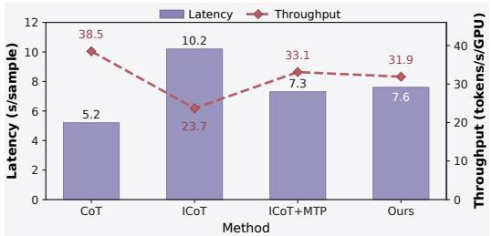
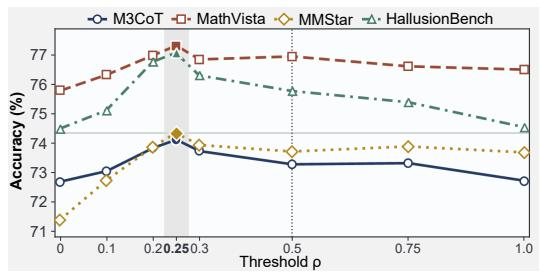
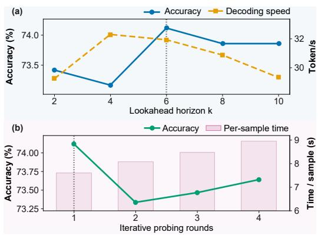
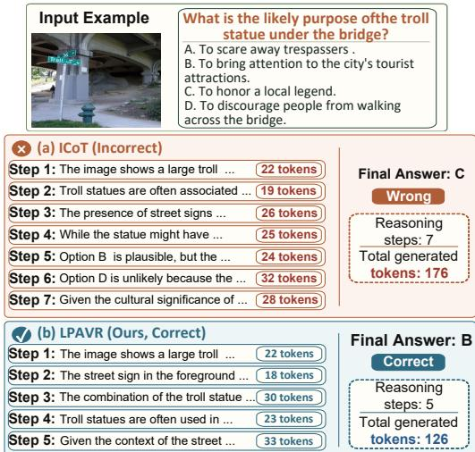

# Lookahead Prediction-Guided Adaptive Visual Refocusing for Interleaved Multimodal Reasoning

Mengzhao Wang1, Yanli Ji1,2∗, Peng Ye3,4

1Sun Yat-sen University

2Shenzhen Loop Area Institute

3Shanghai Artificial Intelligence Laboratory

4The Chinese University of Hong Kong

## Abstract

Interleaved multimodal chain-of-thought reasoning improves the visual reasoning capabilities of multimodal large language models by dynamically incorporating visual evidence during reasoning. However, existing methods primarily select evidence from historical context. When the reasoning focus shifts, history-guided evidence may remain focused on prior regions and fail to cover the visual information required by the next step. We refer to this lag between visual evidence and subsequent reasoning demands as Temporal Evidence Myopia. To address this issue, we propose Lookahead Prediction-guided Adaptive Visual Refocusing (LPAVR), a training-free testtime framework. LPAVR transforms Multi-Token Prediction (MTP) from a decoding acceleration mechanism into a lookahead signal for anticipating upcoming reasoning intent. During MTP decoding, the draft head generates multiple future tokens, while the target model verifies them in parallel and retains the longest prefix consistent with its decoding trajectory. This target-verified prefix contains near-future semantics, which LPAVR uses to construct lookahead-guided visual evidence and assess whether history-guided evidence covers the indicated regions. If the coverage is suficient, the historyguided evidence is retained; otherwise, LPAVR switches to the lookahead-guided evidence. This better aligns the visual context with upcoming reasoning and improves consistency between draft predictions and target-model decoding. Experiments on multiple multimodal reasoning benchmarks show that LPAVR improves both reasoning accuracy and the acceptance rates of MTP speculative tokens, jointly enhancing visual reasoning and speculative decoding eficiency.

## 1 Introduction

Multimodal large language models (MLLMs) have demonstrated strong capabilities in complex visual understanding and reasoning (Bai et al. 2025; Li et al. 2024). However, standard MLLMs often conduct long-form reasoning predominantly in the textual space after processing the visual input, making it dificult to continuously satisfy the evolving fine-grained visual demands of long-horizon, multi-step reasoning (Zheng et al. 2025; Ghosal et al. 2026). Interleaved multimodal reasoning addresses this limitation by dynamically selecting and reinserting visual evidence at intermediate steps, allowing models to refocus on relevant image regions as reasoning progresses (Gao et al. 2025; Chen et al. 2026). Existing methods can be broadly divided into trainingbased and training-free paradigms. The former typically rely on supervised fine-tuning, reinforcement learning, or visual grounding data, resulting in substantial training and adaptation costs (Chen et al. 2026; Zheng et al. 2025; Wu et al. 2025), whereas the latter operate directly on frozen MLLMs and dynamically retrieve visual evidence according to the current reasoning state, ofering greater plug-and-play applicability (Gao et al. 2025; Zhang et al. 2026). Therefore, this work focuses on training-free test-time interleaved multimodal reasoning.

Despite improving visual evidence utilization during reasoning, existing training-free methods still select evidence primarily from the committed reasoning history, historical attention distributions, or the existing reasoning trajectory (Gao et al. 2025; Liu et al. 2026b; Ghosal et al. 2026; Wang et al. 2026), as illustrated in Figure 1(d). These methods are therefore inherently reactive: they can identify visual regions supported by the historical reasoning state but cannot anticipate the demands of subsequent steps. During longhorizon reasoning, the semantic focus may shift substantially between consecutive steps. As shown in Figure 1(a), historyguided evidence may remain focused on regions relevant to the preceding context, while the next step requires different visual evidence. Consequently, the selected evidence may lag behind subsequent reasoning demands. We term this phenomenon Temporal Evidence Myopia. This observation suggests that efective visual refocusing should not merely react to the committed reasoning history, but should also anticipate upcoming reasoning intent and determine whether history-guided visual evidence remains adequate.

To quantify this issue, we adopt the representative trainingfree ICoT method (Gao et al. 2025) and extract the visual evidence selected at the current reasoning step and the visual evidence required by the subsequent reasoning step on M3CoT (Chen et al. 2024b). We then compute the Intersection-over-Union (IoU) between the two evidence sets. As shown in Figure 1(b), their overlap is generally low, with a median IoU of only 0.16. This result indicates that visual evidence selected solely from the current context or historical attention often fails to cover the critical regions required by the next reasoning step, further confirming Temporal Evidence Myopia as an important limitation of existing training-free visual refocusing methods.

Mitigating Temporal Evidence Myopia requires extracting reliable lookahead semantics from the model’s near-future reasoning trajectory before it is formally committed, and using them to determine whether history-guided visual evidence can satisfy the upcoming demand. Motivated by this idea, we investigate whether target-verified prefixes produced by Multi-Token Prediction (MTP) can serve as lookahead signals for predicting the visual needs of the next reasoning step. At each step, the MTP draft head predicts multiple future tokens, while the target model verifies them in parallel and retains the longest prefix consistent with its decoding trajectory (Gloeckle et al. 2024; Leviathan, Kalman, and Matias 2023). We extract visual attention during prefix verification to construct lookahead-guided evidence and compute its IoU with the next-step evidence retrospectively derived from the complete reasoning trajectory. As shown in Figure 1(c), increasing the lookahead horizon k captures richer future semantics and progressively improves evidence alignment, with gains largely saturating beyond k = 6. These results show that target-verified MTP prefixes not only support speculative decoding, but also provide reliable signals for lookahead-guided visual refocusing.

  
Figure 1: Motivation and overview ofLPAVR. (a) Temporal Evidence Myopia. (b) History-guided and next-step visual evidence often have low overlap. (c) Lookahead-guided evidence improves alignment with next-step evidence. (d) General ICoT performs reactive, history-guided visual selection. (e) LPAVR performs lookahead-guided adaptive visual refocusing.

Based on these observations, we propose Lookahead Prediction-guided Adaptive Visual Refocusing (LPAVR), a training-free test-time framework consisting of two core components. First, Speculation-guided future Visual Evidence Discovery (SVED) treats history-guided visual evidence as a provisional anchor and uses the target-verified MTP prefix to construct lookahead-guided evidence. It then computes a lookahead-attention-weighted coverage score to determine whether the model should retain the historyguided evidence or switch to the lookahead-guided evidence. Second, Speculation-consistent Visual Context Injection (SVCI) synchronizes the visual evidence used during provisional probing and finalized decoding across the caches of both the target model and the MTP draft head. This ensures that draft generation and target verification operate under a consistent multimodal context while avoiding recomputation of the committed reasoning history. As illustrated in Figure 2, SVED and SVCI jointly form a complete reasoning pipeline from history-guided probing and lookahead-guided refocusing to speculative generation and target-model verification.

Our main contributions are summarized as follows:

• We identify and quantify Temporal Evidence Myopia, and propose LPAVR to bridge the gap between historical visual evidence and upcoming reasoning demands.

• We design SVED to construct lookahead-guided evidence from target-verified MTP prefixes and adaptively select between history-guided and lookahead-guided visual evidence.

• We develop SVCI to incrementally synchronize visual context across the target model and MTP draft head during both provisional probing and finalized decoding, ensuring consistent speculation and verification.

• Experiments on multiple multimodal reasoning benchmarks show that LPAVR improves reasoning accuracy and increases the acceptance rates of MTP speculative tokens.

## 2 Related Work

## 2.1 Training-Based Interleaved Multimodal Reasoning

Recent training-based methods enable MLLMs to incorporate visual evidence during intermediate reasoning. MINT-CoT inserts region-aligned visual tokens (Chen et al. 2026); DeepEyes promotes “thinking with images” through reinforcement learning (Zheng et al. 2025); VTool-R1 integrates visual tool use with textual reasoning (Wu et al. 2025); and GRIT, VGR, and Argus introduce grounding signals to align reasoning with key image regions (Fan et al. 2026; Wang et al. 2025; Man et al. 2025). However, these methods often require additional training data, reinforcement learning, tools, or grounding annotations, limiting their adaptability. Moreover, removing intermediate images from some methods causes little performance loss, suggesting that the inserted visual content may not be fully utilized (Yang, Zhu, and Huang 2026). This motivates training-free methods that better align visual evidence with evolving reasoning demands.

  
Figure 2: Overview of the LPAVR framework. (a) SVED performs provisional probing with history-guided visual evidence and estimates upcoming visual demands through target-verified MTP tokens, then a coverage-based gate selects either history-guided or lookahead-guided visual evidence. (b) SVCI keeps the target model and the MTP draft head synchronized during probing and finalized decoding.

## 2.2 Training-Free Interleaved Multimodal Reasoning

To reduce the cost of additional training, recent studies have explored training-free interleaved multimodal reasoning. ICoT selects and inserts attention-relevant image regions into the reasoning chain (Gao et al. 2025), while DaP-ICoT dynamically integrates visual thoughts to reduce redundancy and semantic discontinuity (Liu et al. 2026b). Latent-CoT retrieves visual features into latent think tokens (Liu et al. 2026a), and AIM-CoT combines visual probing with dynamic triggering for active evidence selection (Li and Ma 2026). VisRef reinjects context-relevant visual tokens to counter the shift toward textual priors (Ghosal et al. 2026), whereas PRCR supports eficient visual revisiting through position rebinding and cache reuse (Wang et al. 2026).

Other methods enrich visual evidence from complementary perspectives. IVG-CoT maintains a visual-evidence pool with a visual decider (Zhang et al. 2026); ClueTracer localizes relevant regions by tracing question-to-output-to-vision clues (Xi et al. 2026); and ChainMPQ constructs interleaved reasoning chains using multi-perspective questions and accumulated multimodal memories (Wu, Wang, and Cai 2026). Although these methods improve test-time visual evidence utilization, their selection is generally driven by the current context, historical attention, or the existing reasoning trajectory, without explicitly anticipating subsequent visual demands. In contrast, LPAVR uses target-verified MTP prefixes as lookahead signals to estimate near-future visual needs and adaptively refocus visual evidence.

## 3 Method

## 3.1 Preliminaries

Interleaved Multimodal Chain-of-Thought. Let x denote the multimodal input representation after feature encoding. It consists of the visual embedding sequence x = $[ x _ { V , 1 } , x _ { V , 2 } , \ldots , x _ { V , N _ { V } } ] ^ { \top } \in \mathbb { R } ^ { N _ { V } \times d }$ and the textual prompt embedding sequence $x _ { T } ~ = ~ [ x _ { T , 1 } , x _ { T , 2 } , \ldots , x _ { T , N _ { T } } ] ^ { \top } ~ \in \quad$ $\mathbb { R } ^ { N _ { T } \times d }$ . Here, $N _ { V }$ and $N _ { T }$ denote the numbers of visual and textual tokens, respectively, and d is the dimension of hidden embeddings in the LLM. The complete multimodal input is represented as $\boldsymbol { x } = \left[ \boldsymbol { x } _ { V } ; \boldsymbol { x } _ { T } \right]$ . Conditioned on x, the ICoT module autoregressively generates the reasoning token sequence y.

At decoding step t, the committed reasoning context is:

$$
\begin{array} { r } { \mathcal { C } _ { t } = [ { \boldsymbol { x } } , { \boldsymbol { y } } _ { \perp } ] , } \end{array}\tag{1}
$$

where $y { \le } t$ denotes the reasoning tokens committed so far. Following the training-free ICoT paradigm (Gao et al. 2025), the model invokes the Attention-Driven Selection (ADS) module. Conditioned on $\mathcal { C } _ { t } ,$ ADS ranks the visual embeddings in $x _ { V }$ according to their relevance to the current decoding context using historical attention and selects an index set $\mathcal { T } _ { t } ~ \subseteq ~ \{ 1 , 2 , \dots . . . , N _ { V } \}$ , where $n _ { t } ^ { \mathrm { v i s } } ~ = ~ | \mathcal { T } _ { t } |$ denotes the number of visual tokens selected at decoding step t. The corresponding visual evidence is:

$$
\mathcal { E } _ { t } = \{ x _ { V , j } \mid j \in \mathcal { I } _ { t } \} .\tag{2}
$$

The selected evidence $\mathcal { E } _ { t }$ is appended to the committed context, yielding the augmented context $\mathcal { C } _ { t } ^ { + } ~ = ~ [ \mathcal { C } _ { t } ; \mathcal { E } _ { t } ]$ . The model then continues autoregressive prediction conditioned on $\mathcal { C } _ { t } ^ { + }$

Multi-Token Prediction (MTP). In MTP-equipped MLLMs (Qwen Team 2026; Gemma Team et al. 2026), decoding involves a target model and an MTP draft head. The target model produces the main autoregressive distribution and verifies candidate tokens, while the MTP draft head predicts multiple future tokens from the current context. At decoding state $\mathcal { C } _ { t }$ , the draft head predicts the unverified draft sequence $\left[ \tilde { y } _ { t + 1 } , \tilde { y } _ { t + 2 } , \dots , \tilde { y } _ { t + k } \right]$ . The target model verifies these draft tokens in parallel and accepts the longest prefix consistent with its decoding trajectory, while discarding the remaining tokens. We denote the accepted prefix length at step t by $\ell _ { t }$ . The accepted tokens are then committed to the reasoning sequence and represented by y.

## 3.2 Problem Formulation

Traditional training-free visual refocusing methods typically select visual evidence from the local reasoning history. Formally, at decoding step t, we define a history window ${ \mathcal W } _ { t } ^ { \mathrm { h i s t } } \bar { = } \{ y _ { t - w + 1 } , \dots , y _ { t } \}$ containing the w most recently committed reasoning tokens. Based on this window, the ADS module identifies a history-guided visual token index set $\mathcal { T } _ { t } ^ { \mathrm { h i s t } } \subseteq \{ 1 , 2 , \dotsc , N _ { V } \}$ and constructs the history-guided visual evidence as $\mathcal { E } _ { t } ^ { \mathrm { h i s t } } = \{ x _ { V , j } ~ | ~ j \in \mathcal { I } _ { t } ^ { \mathrm { h i s t } } \}$ . This evidence is then inserted into the reasoning context to guide subsequent decoding.

However, because the evidence is derived solely from the committed reasoning history, semantic shifts during longhorizon multimodal reasoning may cause it to remain aligned with an outdated visual focus and fail to cover the regions required by subsequent steps. We refer to this lag between history-guided visual evidence and evolving reasoning demands as Temporal Evidence Myopia. LPAVR addresses this issue through two coupled components. SVED determines whether to retain the history-guided evidence or switch to lookahead-guided evidence, while SVCI consistently injects the selected evidence into the target model and the MTP draft head during both provisional probing and finalized decoding.

## 3.3 Speculation-Guided Future Visual Evidence Discovery (SVED)

To capture short-term reasoning intent and potential shifts in visual focus during inference, SVED combines historyguided and lookahead-guided refocusing strategies, extracting visual evidence from the committed reasoning history and target-verified MTP predictions, respectively. A coverage-based gate then adaptively determines whether to retain the history-guided evidence or switch to the lookaheadguided evidence.

History-Guided Refocusing. At decoding step $t ,$ we estimate the visual focus supported by the committed reasoning history. By averaging the target model’s visual attention weights over the w most recently committed reasoning tokens, we obtain the history-guided visual saliency map:

$$
\mathbf { M } _ { t } ^ { \mathrm { h i s t } } = \frac { 1 } { w } \sum _ { q = t - w + 1 } ^ { t } \mathbf { A } _ { q } ^ { \mathrm { t a r } } ,\tag{3}
$$

where $\mathbf { A } _ { q } ^ { \mathrm { t a r } }$ denotes the target model’s visual attention vector for reasoning token $y _ { q }$ , aggregated across attention layers

and heads. We then select the history-guided visual token set using ratio-based selection:

$$
\boldsymbol { \mathcal { T } } _ { t } ^ { \mathrm { h i s t } } = \mathrm { T o p R a t i o } \left( \mathbf { M } _ { t } ^ { \mathrm { h i s t } } , r _ { \mathrm { h i s t } } \right) ,\tag{4}
$$

where $r _ { \mathrm { h i s t } }$ is the history-guided selection-ratio hyperparameter. The resulting history-guided visual evidence is represented as $\mathcal { E } _ { t } ^ { \mathrm { h i s t } } \ \stackrel { \smile } { = } \ \{ x _ { V , j } \ \stackrel {  } { | } \ \stackrel { } { j } \ \in \ \mathcal { T } _ { t } ^ { \mathrm { h i s t } } \}$ . Rather than being immediately committed as the final visual evidence, $\mathcal { E } _ { t } ^ { \mathrm { h i s t } }$ serves as a provisional visual anchor for MTP probing.

Lookahead-Guided Refocusing. To obtain a lookahead signal, the history-guided evidence $\mathcal { E } _ { t } ^ { \mathrm { h i s t } }$ is first provisionally injected into both the target model and the MTP draft head through SVCI. Conditioned on the resulting provisional context $[ \mathcal { C } _ { t } ; \mathcal { E } _ { t } ^ { \mathrm { h i s t } } ]$ , the MTP module drafts k unverified future tokens $\left[ \tilde { y } _ { t + 1 } , \tilde { y } _ { t + 2 } , \dots , \tilde { y } _ { t + k } \right]$ . The target model verifies these draft tokens in parallel and obtains the longest provisionally accepted prefix $[ \hat { y } _ { t + 1 } , \hat { y } _ { t + 2 } , \dots , \hat { y } _ { t + \hat { \ell } _ { t } } ]$ , where $\hat { \ell } _ { t }$ denotes its length. Here, the hat denotes tokens verified by the target model but not yet committed because the visual context remains provisional. If $\hat { \ell } _ { t } = 0$ , no target-verified lookahead prefix is available. LPAVR therefore skips lookahead-guided refocusing and directly adopts the history-guided visual evidence $\mathcal { E } _ { t } ^ { \mathrm { h i s t } }$

When $\hat { \ell } _ { t } > 0 .$ , we estimate upcoming visual demands from the target model’s attention during verification of the provisionally accepted prefix. For each provisionally accepted token $\hat { y } _ { t + i } ,$ where $1 \leq i \leq \hat { \ell } _ { t }$ , we aggregate the target model’s visual attention weights across layers and heads to obtain $\mathbf { A } _ { t + i } ^ { \mathrm { t a r } }$ . The lookahead-guided visual saliency map is then defined as:

$$
\mathbf { M } _ { t } ^ { \mathrm { l o o k } } = \frac { 1 } { \hat { \ell } _ { t } } \sum _ { i = 1 } ^ { \hat { \ell } _ { t } } \mathbf { A } _ { t + i } ^ { \mathrm { t a r } } .\tag{5}
$$

The lookahead-guided visual token set is selected as:

$$
\mathcal { T } _ { t } ^ { \mathrm { l o o k } } = \mathrm { T o p R a t i o } \left( \mathbf { M } _ { t } ^ { \mathrm { l o o k } } , r _ { \mathrm { l o o k } } \right) ,\tag{6}
$$

where $r _ { \mathrm { l o o k } }$ is the lookahead-guided selection-ratio hyperparameter. This yields the lookahead-guided visual evidence $\mathbf { \dot { \mathcal { E } } } _ { t } ^ { \mathrm { l o o k } } = \{ x _ { V , j } \ \vert \mathbf { \dot { \mathcal { j } } } \in \mathcal { T } _ { t } ^ { \mathrm { l o o k } } \}$

To determine whether the history-guided evidence suficiently covers the visual demand indicated by the lookahead signal, we compute an attention-weighted coverage score:

$$
\Omega _ { t } = \frac { \sum _ { i \in \mathcal { T } _ { t } ^ { \mathrm { l o o k } } \cap \mathcal { T } _ { t } ^ { \mathrm { h i s t } } } \mathbf { M } _ { t } ^ { \mathrm { l o o k } } ( i ) } { \sum _ { j \in \mathcal { T } _ { t } ^ { \mathrm { l o o k } } } \mathbf { M } _ { t } ^ { \mathrm { l o o k } } ( j ) + \epsilon } ,\tag{7}
$$

where ϵ is a small constant for numerical stability. A smaller $\Omega _ { t }$ indicates that a larger portion of the lookahead-guided attention mass is not covered by the history-guided evidence, suggesting potential Temporal Evidence Myopia.

Based on this score, we define the speculation-guided override gate:

$$
s _ { t } = 1 \left[ \widehat { \ell } _ { t } > 0 \land \Omega _ { t } < \rho \right] ,\tag{8}
$$

where $\rho$ is the attention-weighted coverage threshold. The final visual evidence is selected as:

$$
\mathcal { E } _ { t } ^ { \mathrm { f i n a l } } = \left\{ \begin{array} { l l } { \mathcal { E } _ { t } ^ { \mathrm { l o o k } } , } & { s _ { t } = 1 , } \\ { \mathcal { E } _ { t } ^ { \mathrm { h i s t } } , } & { s _ { t } = 0 . } \end{array} \right.\tag{9}
$$

When $s _ { t } ~ = ~ 0$ , the history-guided provisional caches and provisionally accepted prefix are directly reused and committed. When $s _ { t } ~ = ~ 1$ , these provisional states and tokens are discarded, and speculation and verification are rerun after the lookahead-guided evidence $\mathcal { E } _ { t } ^ { \mathrm { l o o k } }$ is injected, yielding the final accepted-prefix length $\ell _ { t }$

## 3.4 Speculation-Consistent Visual Context Injection (SVCI)

To ensure that the target model and the MTP draft head use consistent visual evidence during speculative generation and verification, we introduce Speculation-Consistent Visual Context Injection (SVCI). During provisional probing, SVCI incrementally synchronizes the history-guided evidence across both branches. When the coverage-based gate triggers a switch, the pre-probing cache states are restored and the lookahead-guided evidence is reinjected. In this way, SVCI avoids recomputing the committed reasoning history while ensuring that draft generation and target-model verification always operate under a consistent multimodal context.

For a unified description, let $b \in \{ \mathrm { h i s t } , \mathrm { l o o k } \}$ denote the evidence branch used in an SVCI invocation, and define $\mathcal { E } _ { t } ^ { b } =$ $\{ x _ { V , j } \mid j \in \mathcal { T } _ { t } ^ { b } \}$ . The history-guided branch is used for provisional probing, whereas the lookahead-guided branch is used only when the override gate is activated.

Target Model with SVCI. Let $\mathcal { P } _ { t } ^ { \mathrm { t a r , 0 } }$ denote the targetmodel cache associated with the committed reasoning context $\mathcal { C } _ { t }$ before provisional probing. Given visual evidence $\mathcal { E } _ { t } ^ { b }$ the target model performs an incremental forward pass over only the newly inserted visual tokens:

$$
\left( \mathbf H _ { V } ^ { \mathrm { t a r } , b } , \mathcal P _ { t } ^ { \mathrm { t a r } , b } \right) = \mathrm { D e c } _ { \mathrm { c a c h e } } ^ { \mathrm { t a r } } \left( \mathcal E _ { t } ^ { b } ; \mathcal P _ { t } ^ { \mathrm { t a r } , 0 } \right) ,\tag{10}
$$

where $\mathrm { D e c } _ { \mathrm { c a c h e } } ^ { \mathrm { t a r } } ( \cdot )$ denotes the incremental decoding function of the target model, and $\mathcal { P } _ { t } ^ { \mathrm { t a r } , b }$ denotes the cache after injecting evidence branch b. The corresponding target hidden states are denoted by ${ \bf H } _ { V } ^ { \mathrm { t a r } , b } = \{ h _ { i } ^ { \mathrm { t a r } , b } \ | \ j \in \bar { \mathcal { T } } _ { t } ^ { b } \}$ . These position-aligned target hidden states are subsequently used to update the MTP draft head.

MTP Draft Head with SVCI. The MTP draft head is updated using the same evidence branch b as the target model. Unlike approaches using an independent draft model, LPAVR preserves the native MTP-head architecture of the adopted backbone. In the standard MTP design, the input embedding and its corresponding target hidden state are separately normalized, concatenated, projected into the MTP decoder space, and processed by the MTP decoder layer.

For each injected visual embedding $x _ { V , j }$ , where $j \in \mathcal { I } _ { t } ^ { b }$ SVCI replaces the ordinary text-token embedding with the selected visual embedding and constructs the MTP input representation as:

$$
u _ { j } ^ { \mathrm { m t p } , b } = { \mathbf { W } } _ { \mathrm { f c } } \left[ \mathrm { R M S N o r m } ( x _ { V , j } ) ; \mathrm { R M S N o r m } ( h _ { j } ^ { \mathrm { t a r } , b } ) \right]\tag{11}
$$

where $h _ { j } ^ { \mathrm { t a r } , b }$ is the position-aligned target hidden state obtained from Eq. (10), $\mathrm { R M S N o r m } ( \cdot )$ denotes the MTPspecific normalization operation, and $\dot { \mathbf { W } } _ { \mathrm { f c } }$ projects the con-

catenated representation into the MTP decoder space. The resulting fused sequence is denoted by $\mathbf { U } _ { t } ^ { \mathrm { m t p } , b } = \lbrack \dot { u } _ { j } ^ { \mathrm { m t p } , b } \rbrack _ { j \in \mathcal { T } _ { t } ^ { b } }$

Let $\mathcal { P } _ { t } ^ { \mathrm { m t p , 0 } }$ denote the MTP cache before provisional probing. The fused representations are incrementally processed to obtain the branch-specific MTP cache:

$$
\left( \mathbf H _ { V } ^ { \mathrm { m t p } , b } , \mathcal P _ { t } ^ { \mathrm { m t p } , b } \right) = \mathrm { D e c } _ { \mathrm { c a c h e } } ^ { \mathrm { m t p } } \left( \mathbf U _ { t } ^ { \mathrm { m t p } , b } ; \mathcal P _ { t } ^ { \mathrm { m t p } , 0 } \right) .\tag{12}
$$

where $\mathrm { D e c } _ { \mathrm { c a c h e } } ^ { \mathrm { m t p } } ( \cdot )$ denotes the incremental decoding function of the MTP draft head.

The draft head then generates speculative tokens from the updated MTP state:

$$
\left[ \widetilde { y } _ { t + 1 } , \widetilde { y } _ { t + 2 } , \dotsc , \widetilde { y } _ { t + k } \right] = \mathrm { D r a f t } ^ { \mathrm { m t p } } \left( h _ { \mathrm { l a s t } } ^ { \mathrm { m t p } , b } , \mathcal { P } _ { t } ^ { \mathrm { m t p } , b } \right) .\tag{13}
$$

The target model verifies these draft tokens using the corresponding cache $\mathcal { P } _ { t } ^ { \mathrm { t a r } , b }$

During provisional probing, SVCI is invoked with $b =$ hist. If $s _ { t } = 0 ,$ , the resulting target-model cache, MTP cache, and provisionally accepted prefix are directly committed. If $s _ { t } ~ = ~ 1$ , these temporary states and tokens are discarded, both branches are restored to their pre-probing caches, and SVCI is reinvoked with b = look before speculation and verification are rerun. Consequently, only caches and tokens produced under the selected visual evidence are committed to subsequent decoding.

## 4 Experiments

## 4.1 Experimental Settings

We evaluate LPAVR on two MLLM backbones, Qwen3.5- 9B (Qwen Team 2026) and Gemma-4-12B (Gemma Team et al. 2026), across four multimodal reasoning benchmarks: $\mathbf { M } ^ { 3 } \mathbf { C o T }$ (Chen et al. 2024b), MMStar (Chen et al. 2024a), MathVista (Lu et al. 2024), and HallusionBench (Guan et al. 2024). These benchmarks evaluate multimodal reasoning, general visual understanding, mathematical reasoning, and visual hallucination, respectively. Detailed benchmark descriptions and implementation settings are provided in the Appendix.

All experiments are implemented using the vLLM inference framework (Kwon et al. 2023). For a fair comparison, ICoT (Gao et al. 2025) and LPAVR share the same inference pipeline, model backbones, decoding settings, MTP configuration, and visual evidence injection mechanism. In ICoT, MTP is used only for speculative decoding, while visual evidence is selected from the historical reasoning context. LPAVR additionally uses target-verified MTP prefixes to adaptively retain history-guided visual evidence or switch to lookahead-guided evidence.

## 4.2 Main Results

We evaluate LPAVR from two complementary perspectives: downstream multimodal reasoning accuracy and positionwise acceptance rates of MTP lookahead predictions.

<table><tr><td rowspan="2">Model</td><td rowspan="2">#Params Method</td><td colspan="4">M³CoT</td><td rowspan="2"></td><td rowspan="2">MMStar MathVista</td><td rowspan="2">Hallusior Bench</td></tr><tr><td>CS</td><td>MM</td><td>SC</td><td>ALL</td></tr><tr><td colspan="3">Training-Based Methods</td><td></td><td></td><td></td><td></td><td></td><td></td></tr><tr><td>Qwen2-VL</td><td>7B</td><td>MINT-CoT (Chen et al. 2026)</td><td>80.07</td><td>33.61</td><td>58.38</td><td>60.09</td><td>58.13</td><td>75.80</td><td>64.67</td></tr><tr><td>Qwen2.5-VL</td><td>7B</td><td>R1-Onevision (Yang et al. 2025)</td><td>75.38</td><td>33.61</td><td>62.21</td><td>61.82</td><td>56.60</td><td>63.40</td><td>65.40</td></tr><tr><td>Llama-3.2</td><td>11B</td><td>LLaVA-CoT (Xu et al. 2025)</td><td>79.78</td><td>35.68</td><td>55.24</td><td>58.02</td><td>57.00</td><td>51.40</td><td>63.72</td></tr><tr><td>Qwen2.5-VL</td><td>7B</td><td>DeepEyesV2 (Hong et al. 2Ó26)</td><td>78.68</td><td>67.88</td><td>54.36</td><td>68.59</td><td>62.00</td><td>70.90</td><td>49.32</td></tr><tr><td>Qwen3-VL</td><td>8B</td><td>OneThinker (Feng et al. 2026)</td><td>82.20</td><td>42.74</td><td>70.53</td><td>69.93</td><td>69.67</td><td>76.50</td><td>72.66</td></tr><tr><td colspan="3">Training-Free Methods</td><td></td><td></td><td></td><td></td><td></td><td></td><td></td></tr><tr><td rowspan="7">Gemma-4</td><td></td><td>No CoT</td><td>79.34</td><td>54.77</td><td>60.17</td><td>63.37</td><td>66.27</td><td>59.10</td><td>74.13</td></tr><tr><td></td><td>CoT (Kojima et al. 2022)</td><td>84.62</td><td>62.24</td><td>75.83</td><td>76.14</td><td>72.20</td><td>74.80</td><td>75.39</td></tr><tr><td></td><td>ICoT (Gão et al. 2025)</td><td>84.40</td><td>62.66</td><td>77.50</td><td>77.30</td><td>73.13</td><td>75.60</td><td>76.45</td></tr><tr><td>12B</td><td>Latent-CoT (Liu et al. 2026a)</td><td>85.05</td><td>72.61</td><td>79.28</td><td>79.72</td><td>76.33</td><td>75.50</td><td>76.55</td></tr><tr><td></td><td>IVG-CoT (Zhang et al. 2026)</td><td>82.64</td><td>77.18</td><td>75.77</td><td>77.26</td><td>70.66</td><td>71.90</td><td>77.81</td></tr><tr><td>LPAVR (Ours)</td><td></td><td>86.15</td><td>78.84</td><td></td><td></td><td></td><td></td><td></td></tr><tr><td>∆ (vs ICoT)</td><td></td><td>+1.75</td><td>+16.18</td><td>80.76 +3.26</td><td>81.62 +4.32</td><td>76.81 +3.68</td><td>77.20 +1.60</td><td>78.36 +1.91</td></tr><tr><td rowspan="7">Qwen3.5</td><td></td><td></td><td>80.22</td><td>29.46</td><td></td><td></td><td>65.87</td><td>62.80</td><td>72.56</td></tr><tr><td></td><td>No CoT CoT (Kojima et al. 2022)</td><td>82.64</td><td>31.54</td><td>62.02 71.52</td><td>62.21 69.54</td><td>70.20</td><td>74.70</td><td>73.19</td></tr><tr><td>ICoT (Gão et al. 2025)</td><td></td><td>83.96</td><td>36.93</td><td>74.85</td><td>72.69</td><td>71.40</td><td>75.80</td><td>74.50</td></tr><tr><td>9B</td><td>Latent-CoT (Liu et al. 2026a)</td><td>84.74</td><td>33.61</td><td>72.75</td><td>71.05</td><td>72.13</td><td>74.10</td><td>71.54</td></tr><tr><td></td><td>IVG-CoT (Zhang et al. 2026)</td><td>85.27</td><td>35.68</td><td>74.17</td><td>72.35</td><td>70.33</td><td>75.70</td><td>75.28</td></tr><tr><td>LPAVR (Ours)</td><td></td><td>86.37</td><td>38.59</td><td>75.96</td><td>74.12</td><td>74.33</td><td>77.30</td><td>77.08</td></tr><tr><td>∆ (vs ICoT)</td><td></td><td>+2.41</td><td>+1.66</td><td>+1.11</td><td>+1.43</td><td>+2.93</td><td>+1.50</td><td>+2.58</td></tr></table>

Table 1: Multimodal reasoning accuracy across benchmarks. We compare training-based and training-free methods on M3CoT, MMStar, MathVista, and HallusionBench to evaluate their multimodal understanding and reasoning performance. The best and second-best results within each comparable model group are marked in bold and underlined, respectively. For M3CoT, CS, MM, and SC denote Common Sense, Mathematics, and Science.
<table><tr><td>Dataset</td><td>Method</td><td>P2</td><td>P3</td><td>P4</td><td>P5</td><td>P6</td></tr><tr><td>M³CoT</td><td>ICoT LPAVR ∆ (vs ICoT)</td><td>74.35 +0.55</td><td>43.40 +4.62</td><td>32.02 74.90 48.02 36.24 28.45 24.22 +4.22</td><td>25.2021.20 +3.25 +3.02</td><td></td></tr><tr><td>MMStar</td><td>ICoT LPAVR ∆ (vs ICoT)</td><td>68.49 42.50 26.09</td><td></td><td>69.83 43.01 27.39 20.46 16.25 +1.34+0.51+1.30+2.79+2.24</td><td>17.6714.01</td><td></td></tr><tr><td>MathVista LPAVR</td><td>ICoT ∆ (vs ICoT)</td><td>+0.36+5.43+4.59 +4.59+3.75</td><td></td><td>72.99 48.85 34.20 27.67 23.30 73.35 54.28 38.79 32.26 27.05</td><td></td><td></td></tr><tr><td>Hallusion Bench</td><td>ICoT LPAVR ∆ (vs ICoT) +3.52 +4.39 +4.28 +2.69 +1.91</td><td></td><td></td><td>75.02 53.23 40.57 31.22 27.49 78.5457.6244.8533.91 29.40</td><td></td><td></td></tr></table>

Table 2: Position-wise acceptance rates ofMTP lookahead predictions. We compare ICoT and LPAVR on Qwen3.5-9B at speculative positions P2–P6.

Multimodal Reasoning Performance. As shown in Table 1, LPAVR consistently outperforms ICoT across all four benchmarks on both model backbones. On Gemma-4-12B, LPAVR improves over ICoT by 4.32, 3.68, 1.60, and 1.91 percentage points on M3CoT, MMStar, MathVista, and HallusionBench, respectively. On Qwen3.5-9B, the corresponding improvements are 1.43, 2.93, 1.50, and 2.58 percentage points. These results demonstrate that lookahead-guided visual refocusing consistently improves multimodal reasoning performance across diferent tasks and model backbones.

<table><tr><td colspan="2">Method M³CoT MMStar MathVista</td></tr><tr><td>No Refocusing</td><td>69.54 70.20 74.70</td></tr><tr><td>History-Guided Refocusing 72.69</td><td>71.40 75.80</td></tr><tr><td>Lookahead-Guided Refocusing 72.72</td><td>73.67 76.50</td></tr><tr><td>Adaptive Refocusing (LPAVR)</td><td>74.12 74.33 77.30</td></tr></table>

Table 3: Ablation study of visual refocusing strategies. We compare diferent visual refocusing variants on Qwen3.5- 9B and report their overall accuracy on three multimodal reasoning benchmarks.
<table><tr><td>Method</td><td>FLOPs (TFLOPs) Latency (s/sample)</td><td></td></tr><tr><td>Ours w/o SVCI</td><td>6.6</td><td>8.9</td></tr><tr><td>Ours (with SVCI)</td><td>5.2</td><td>7.6</td></tr></table>

Table 4: Ablation study of SVCI. We compare LPAVR with and without SVCI under identical settings. Without SVCI, full recomputation is performed after evidence switching.

MTP Lookahead Prediction Acceptance Rates. As shown in Table 2, LPAVR achieves higher MTP token acceptance rates than ICoT at all speculative positions from P2– P6, with average improvements of 3.13, 1.64, 3.74, and 3.36 percentage points on M3CoT, MMStar, MathVista, and HallusionBench, respectively. This demonstrates that visual refocusing based on target-verified MTP prefixes better aligns draft predictions with the target model’s subsequent decoding trajectory.

Figure 3: End-to-end eficiency comparison. Latency and throughput of CoT, ICoT, ICoT+MTP, and LPAVR under identical hardware and decoding settings.  
  
Figure 4: Efect of the speculation-guided override gate threshold ρ on LPAVR reasoning performance. The threshold controls when LPAVR switches from historyguided to lookahead-guided visual evidence.

End-to-End Eficiency Comparison. To evaluate the computational overhead of LPAVR, we compare CoT, ICoT, ICoT+MTP, and LPAVR under identical hardware and decoding settings. As shown in Figure 3, LPAVR reduces latency from 10.2 to 7.6 s/sample and increases throughput from 23.7 to 31.9 tokens/s/GPU compared with ICoT. Relative to ICoT+MTP, LPAVR incurs only a modest latency increase (7.3 to 7.6 s/sample) while maintaining comparable throughput (33.1 vs. 31.9 tokens/s/GPU), indicating that adaptive visual refocusing introduces limited additional overhead.

## 4.3 Ablation Study

Efect of Visual Refocusing Strategies. As shown in Table 3, removing visual refocusing yields the lowest performance, demonstrating the importance of reinserting visual evidence during reasoning. Both history-guided and lookahead-guided refocusing improve performance, but the former cannot anticipate upcoming visual demands, while the latter may overlook information still relevant to the committed reasoning history. By adaptively selecting between these two strategies based on the coverage score, LPAVR balances historical and upcoming visual demands, achieving the best results across all three benchmarks.

Efect of SVCI on Computational Eficiency. To evaluate the contribution of SVCI, we compare LPAVR with a variant that performs full recomputation after evidence switching under identical settings. As shown in Table 4, removing SVCI increases FLOPs from 5.2 to 6.6 TFLOPs and end-to-end latency from 7.6 to 8.9 s/sample. These results demonstrate that SVCI efectively reduces redundant computation by reusing cached historical states and incrementally synchronizing visual context, thereby lowering inference overhead.

  
Figure 5: Analysis of lookahead configurations. (a) Accuracy and decoding speed under diferent lookahead horizons. (b) Accuracy and per-sample inference time under diferent numbers of iterative probing rounds.

  
Figure 6: Qualitative comparison between ICoT and LPAVR. Compared with ICoT, LPAVR adaptively refocuses visual evidence and reaches the correct answer with fewer reasoning steps and generated tokens.

## 4.4 Parameter Selection and Analysis

Sensitivity to the Coverage Threshold $\rho _ { \bullet }$ We study the effect of the attention-weighted coverage threshold $\rho .$ The gate selects lookahead-guided evidence when $\Omega _ { t } < \rho ,$ and otherwise retains history-guided evidence; thus, $\rho = 0$ gives the history-guided limit, while $\rho = 1$ approaches the lookaheadguided limit. Figure 4 shows that all four benchmarks peak at $\rho ~ = ~ 0 . 2 5$ . Smaller thresholds are overly conservative and may miss useful lookahead-guided evidence, whereas larger thresholds trigger unnecessary refocusing. Therefore, $\rho = 0 . 2 5$ provides the best balance and is used as the default setting.

Efects of Lookahead Configurations. As shown in Figure 5(a), increasing the lookahead horizon provides richer near-future semantics, with accuracy peaking at 74.12% when $k = 6 ;$ ; further increasing k introduces additional drafting and verification overhead without improving accuracy and gradually reduces decoding speed. Although $k \ = \ 4$ achieves slightly higher throughput, $k \ = \ 6$ ofers a better balance between accuracy and eficiency. Figure 5(b) shows that single-round probing achieves the highest accuracy, while additional probing rounds provide no consistent performance gain and continuously increase per-sample inference time, indicating that repeated probing introduces redundant computation without yielding more reliable visua evidence. Therefore, we adopt single-round probing with the lookahead horizon $k = 6$ as the default configuration.

## 4.5 Qualitative Comparison

Figure 6 presents a qualitative comparison between ICoT and LPAVR. ICoT remains focused on misleading historyguided visual evidence, resulting in a longer reasoning trajectory and an incorrect answer. Specifically, after each reasoning step, ICoT selects and reinserts visual evidence solely from the committed reasoning history, whereas LPAVR uses target-verified MTP prefixes to determine whether to retain the history-guided evidence or switch to lookahead-guided evidence. Through this adaptive visual refocusing, LPAVR reaches the correct answer with fewer reasoning steps and generated tokens.

## 5 Conclusion

In this paper, we proposed LPAVR, a training-free visual refocusing framework for interleaved multimodal reasoning. Using target-verified MTP tokens as lookahead signals, LPAVR determines whether history-guided visual evidence suficiently covers upcoming visual demands and switches to lookahead-guided evidence when necessary. We further introduced a speculation-consistent visual context injection mechanism that synchronizes the target model and MTP draft head during both provisional probing and finalized decoding. Experiments on multiple benchmarks demonstrate that LPAVR improves reasoning performance while preserving eficient speculative decoding.

## References

Bai, S.; Chen, K.; Liu, X.; Wang, J.; Ge, W.; Song, S.; Dang, K.; Wang, P.; Wang, S.; Tang, J.; Zhong, H.; Zhu, Y.; Yang, M.; Li, Z.; Wan, J.; Wang, P.; Ding, W.; Fu, Z.; Xu, Y.; Ye, J.; Zhang, X.; Xie, T.; Cheng, Z.; Zhang, H.; Yang, Z.; Xu, H.; and Lin, J. 2025. Qwen2.5-VL Technical Report. arXiv preprint arXiv:2502.13923.

Chen, L.; Li, J.; Dong, X.; Zhang, P.; Zang, Y.; Chen, Z.; Duan, H.; Wang, J.; Qiao, Y.; Lin, D.; and Zhao, F. 2024a. Are We on the Right Way for Evaluating Large Vision-Language Models? In Advances in Neural Information Processing Systems, volume 37, 27056–27087.

Chen, Q.; Qin, L.; Zhang, J.; Chen, Z.; Xu, X.; and Che, W. 2024b. M3CoT: A Novel Benchmark for Multi-Domain Multi-step Multi-modal Chain-of-Thought. In Proceedings of the 62nd Annual Meeting of the Association for Computational Linguistics (Volume 1: Long Papers), 8199–8221.

Chen, X.; Zhang, R.; Jiang, D.; Zhou, A.; Yan, S.; Lin, W.; and Li, H. 2026. MINT-CoT: Enabling interleaved visual tokens in mathematical chain-of-thought reasoning. Advances in neural information processing systems, 38: 69110–69139.

Fan, Y.; He, X.; Yang, D.; Zheng, K.; Kuo, C.-C.; Zheng, Y.; Guan, X.; and Wang, X. 2026. Grit: Teaching mllms to think with images. Advances in Neural Information Processing Systems, 38: 116522–116543.

Feng, K.; Zhang, M.; Li, H.; Fan, K.; Chen, S.; Jiang, Y.; Zheng, D.; Sun, P.; Zhang, Y.; Sun, H.; Feng, Y.; Pei, P.; Cai, X.; and Yue, X. 2026. OneThinker: All-in-one Reasoning Model for Image and Video. In Proceedings ofthe IEEE/CVF Conference on Computer Vision and Pattern Recognition, 5432–5443.

Gao, J.; Li, Y.; Cao, Z.; and Li, W. 2025. Interleaved-Modal Chain-of-Thought. In Proceedings ofthe IEEE/CVF Conference on Computer Vision and Pattern Recognition.

Gemma Team; El Abd, S.; Aggarwal, V.; Algayres, R.; Andreev, A.; Bachem, O.; et al. 2026. Gemma 4 Technical Report. arXiv preprint arXiv:2607.02770.

Ghosal, S. S.; Kim, Y.; Li, Z.; Chaudhry, R.; Xu, L.; Zhang, H.; Zablocki, J.; Xing, Y.; and Zhang, Q. 2026. VisRef: Visual Refocusing while Thinking Improves Test-Time Scaling in Multi-Modal Large Reasoning Models. In Proceedings of the IEEE/CVF Conference on Computer Vision and Pattern Recognition.

Gloeckle, F.; Youbi Idrissi, B.; Roziere, B.; Lopez-Paz, D.; and Synnaeve, G. 2024. Better & Faster Large Language Models via Multi-token Prediction. In Proceedings of the 41st International Conference on Machine Learning, volume 235, 15706–15734.

Guan, T.; Liu, F.; Wu, X.; Xian, R.; Li, Z.; Liu, X.; Wang, X.; Chen, L.; Huang, F.; Yacoob, Y.; Manocha, D.; and Zhou, T. 2024. HallusionBench: An Advanced Diagnostic Suite for Entangled Language Hallucination and Visual Illusion in Large Vision-Language Models. In Proceedings of the IEEE/CVF Conference on Computer Vision and Pattern Recognition, 14375–14385.

Hong, J.; Zhao, C.; Zhu, C.; Lu, W.; Xu, G.; and Yu, X. 2026. DeepEyesV2: Toward Agentic Multimodal Model. In The Fourteenth International Conference on Learning Representations.

Kojima, T.; Gu, S. S.; Reid, M.; Matsuo, Y.; and Iwasawa, Y. 2022. Large language models are zero-shot reasoners. Advances in neural informationprocessing systems, 35: 22199– 22213.

Kwon, W.; Li, Z.; Zhuang, S.; Sheng, Y.; Zheng, L.; Yu, C. H.; Gonzalez, J.; Zhang, H.; and Stoica, I. 2023. Eficient memory management for large language model serving with pagedattention. In Proceedings of the 29th symposium on operating systems principles, 611–626.

Leviathan, Y.; Kalman, M.; and Matias, Y. 2023. Fast Inference from Transformers via Speculative Decoding. In Proceedings of the 40th International Conference on Machine Learning, volume 202 of Proceedings of Machine Learning Research, 19274–19286.

Li, B.; Zhang, Y.; Guo, D.; Zhang, R.; Li, F.; Zhang, H.; Zhang, K.; Zhang, P.; Li, Y.; Liu, Z.; and Li, C. 2024. LLaVA-OneVision: Easy Visual Task Transfer. arXiv preprint arXiv:2408.03326.

Li, X.; and Ma, J. 2026. AIM-CoT: Active Informationdriven Multimodal Chain-of-Thought for Vision-Language Reasoning. In Proceedings of the 64th Annual Meeting of the Association for Computational Linguistics (Volume 1: Long Papers), 26656–26681. San Diego, California, United States: Association for Computational Linguistics.

Liu, C.; Yang, Y.; Fan, Y.; Wei, Q.; Liu, S.; and Wang, X. E. 2026a. Reasoning within the mind: Dynamic multimodal interleaving in latent space. In Proceedings ofthe IEEE/CVF Conference on Computer Vision and Pattern Recognition, 9225–9236.

Liu, X.; Zhang, Y.; Chen, Q.; Li, Y.; Wang, S.; and Qin, L. 2026b. Let’s Think with Images Eficiently! An Interleaved-Modal Chain-of-Thought Reasoning Framework with Dynamic and Precise Visual Thoughts. In Proceedings of the AAAI Conference on Artificial Intelligence, volume 40, 32213–32221.

Lu, P.; Bansal, H.; Xia, T.; Liu, J.; Li, C.; Hajishirzi, H.; Cheng, H.; Chang, K.-W.; Galley, M.; and Gao, J. 2024. MathVista: Evaluating Mathematical Reasoning of Foundation Models in Visual Contexts. In International Conference on Learning Representations.

Man, Y.; Huang, D.-A.; Liu, G.; Sheng, S.; Liu, S.; Gui, L.-Y.; Kautz, J.; Wang, Y.-X.; and Yu, Z. 2025. Argus: Vision-Centric Reasoning with Grounded Chain-of-Thought. In Proceedings ofthe IEEE/CVF Conference on Computer Vision and Pattern Recognition.

Qwen Team. 2026. Qwen3.5: Towards Native Multimodal Agents. Qwen Blog. Published February 15, 2026.

Wang, J.; Kang, Z.; Wang, H.; Jiang, H.; Li, J.; Wu, B.; Wang, Y.; Ran, J.; Liang, X.; Feng, C.; and Xiao, J. 2025. VGR: Visual Grounded Reasoning. arXiv preprint arXiv:2506.11991.

Wang, M.; Ji, Y.; Zuo, W.; Ye, P.; and Tu, C. 2026. Position Rebinding Cache Reuse: Replay-Free Visual Revisiting for Interleaved Multimodal Reasoning. arXiv preprint arXiv:2606.26631.

Wu, M.; Yang, J.; Jiang, J.; Li, M.; Yan, K.; Yu, H.; Zhang, M.; Zhai, C.; and Nahrstedt, K. 2025. VTool-R1: VLMs Learn to Think with Images via Reinforcement Learning on Multimodal Tool Use. arXiv preprint arXiv:2505.19255.

Wu, Y.; Wang, Y.; and Cai, Y. 2026. ChainMPQ: Interleaved Text-Image Reasoning Chains for Mitigating Relation Hallucinations. In International Conference on Learning Representations.

Xi, G.; Wang, K.; Gao, Z.; Yi, H.; Lu, H.; Tian, Y.; and Wang, W. 2026. ClueTracer: Question-to-Vision Clue Tracing for Training-Free Hallucination Suppression in Multimodal Reasoning. arXiv preprint arXiv:2602.02004.

Xu, G.; Jin, P.; Wu, Z.; Li, H.; Song, Y.; Sun, L.; and Yuan, L. 2025. LLaVA-CoT: Let Vision Language Models Reason Step-by-Step. In Proceedings of the IEEE/CVF International Conference on Computer Vision, 2087–2098.

Yang, W.; Zhu, S.; and Huang, Z. 2026. Position: Your VLM May Not Be Thinking with Interleaved Images. In International Conference on Machine Learning.

Yang, Y.; He, X.; Pan, H.; Jiang, X.; Deng, Y.; Yang, X.; Lu, H.; Yin, D.; Rao, F.; Zhu, M.; Zhang, B.; and Chen, W. 2025. R1-Onevision: Advancing Generalized Multimodal Reasoning through Cross-Modal Formalization. In Proceedings of the IEEE/CVF International Conference on Computer Vision, 2376–2385.

Zhang, Y.; Ma, O.; Liu, T.; Zhou, G.; and Chen, Y. 2026. See It, Say It, Sorted: An Iterative Training-Free Framework for Visually-Grounded Multimodal Reasoning in LVLMs. In Proceedings of the IEEE/CVF Conference on Computer Vision and Pattern Recognition.

Zheng, Z.; Yang, M.; Hong, J.; Zhao, C.; Xu, G.; Yang, L.; Shen, C.; and Yu, X. 2025. DeepEyes: Incentivizing “Thinking with Images” via Reinforcement Learning. arXiv preprint arXiv:2505.14362.