# MedHEB: Benchmarking Medical Embeddings Across Heterogeneous Clinical Evidence

Yingshu Li∗   
The University of Sydney   
Sydney, Australia   
yingshu.li@sydney.edu.au   
Yunyi Liu   
The University of Sydney   
Sydney, Australia   
yunyi.liu1@sydney.edu.au

Lingqiao Liu Adelaide University Adelaide, Australia lingqiao.liu@adelaide.edu.au

Shaoyang Zhou∗   
The University of Sydney Sydney, Australia   
szho0189@uni.sydney.edu.au   
Xinyu Liang   
College of Medical Imaging   
Shandong Medical and   
Pharmaceutical University   
Yantai, China   
xinyu.liang@sdmpu.edu.cn   
Lei Wang   
University of Wollongong   
Wollongong, Australia   
leiw@uow.edu.au   
Zhanyu Wang   
The University of Sydney   
Sydney, Australia   
zhanyu.wang@sydney.edu.au

Xi Zhang University of Glasgow Glasgow, UK x.zhang.6@research.gla.ac.uk

Luping Zhou†   
The University of Sydney   
Sydney, Australia   
luping.zhou@sydney.edu.au

## Abstract

Clinical evidence is inherently relational: medical images are interpreted with prior studies, cross-modal examinations, reports, and localized findings, and retrieving relevant evidence is therefore central to clinical interpretation. Recent foundation models increasingly encode these heterogeneous sources into shared embedding spaces, yet existing embedding evaluation often focuses on isolated matches, leaving unclear whether current models retrieve relevant evidence across changes in modality, appearance, and granularity. We introduce MedHEB, a unified benchmark with 107 retrieval tasks from 54 datasets, including both in-distribution and held-out-source evaluation, across three axes: evidence form (2D images, 3D volumes, text), pairing type (image–image, image–text, text–text, and modalitybridging visual matching), and relevance granularity (global, question-conditioned, region-level). Under a single ranking protocol, MedHEB varies clinically relevant evidence definitions to test whether embedding proximity remains meaningful across heterogeneous evidence, including modality-bridging visual retrieval and region-level text-to-region retrieval. Across representative models, performance is uneven across retrieval families: models strong on conventional image–text or text–text retrieval are less reliable on modality-bridging and region-level tasks. Current embedding spaces capture some clinical relationships well but do not yet provide balanced retrieval across heterogeneous evidence. We further provide MedEmb, an MLLM-based reference embedding model trained on the MedHEB ID split, as a reproducible baseline for unified 2D–3D–text medical retrieval. We release MedHEB with preprocessing scripts, evaluation code, access manifests, and MedEmb to support research on clinically meaningful medical embeddings.

## 1 Introduction

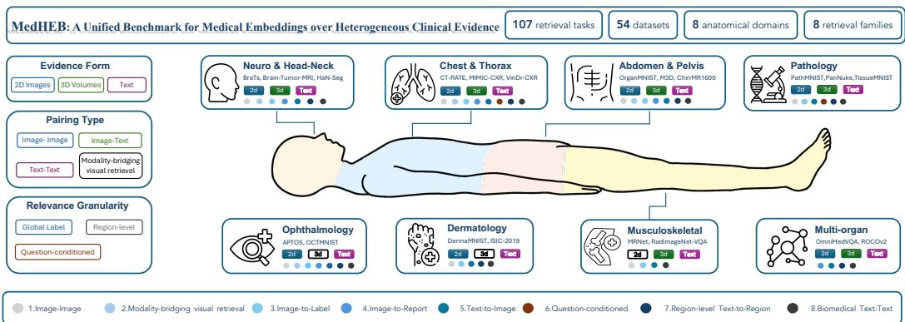  
Figure 1: MedHEB design across clinical evidence axes and anatomical domains. The schematic organizes 54 datasets and 107 tasks by evidence form, pairing type, and relevance granularity.

Radiologic interpretation is inherently comparative. In practice, radiologists interpret a current examination relative to prior studies, complementary modalities (e.g., CT or MRI), and morphologically similar cases, improving diagnostic confidence and accuracy [1, 2]. As foundation models enter radiology [3, 4], this process can be framed as retrieval over clinical evidence: the current study serves as the query, while prior exams, cross-modal data, reports, or localized findings form candidate evidence ranked by relevance. Shared embedding spaces make this formulation operational; however, “closeness” lacks a single clinical definition. Clinical similarity extends beyond visual resemblance: the same disease may manifest differently across modalities, and similar findings across patients may vary substantially in appearance [5, 6]. Relevant evidence also spans multiple forms, from cross-modal matches to report-level descriptions and region-level correspondences [7, 8, 9]. We therefore treat clinical similarity as task-conditioned, where relevance depends on the required relation and granularity. This reframes evaluation as whether a single embedding space preserves such similarity across changes in evidence form, pairing type, and relevance granularity.

Answering this question requires more than adding isolated retrieval tasks: it requires varying what “relevance” means in a controlled way. We organize clinical relatedness along three axes that a unified medical embedding space should support: evidence form (2D images, 3D volumes, and clinical text) [10, 11], pairing type (image–image, image–text, text–text, and modality-bridging visual matching) [12, 13], and relevance granularity (global-label, question-conditioned, and localizedregion) [14]. Together, these axes specify what enters the embedding space, what relation defines a positive match, and at what scale relevance is judged. A benchmark confined to a single retrieval family can measure task-specific alignment, but cannot tell whether one embedding function forms a reusable clinical evidence space across changes in form, relation, and granularity.

Existing medical retrieval benchmarks standardize important but separate regimes: biomedical text retrieval in NFCorpus [15], BioASQ [16], and R2MED [17]; image–text and text–text retrieval in M3Retrieve [18]; and volumetric retrieval in 3D-MIR [19] and BIMCV-R [20]. However, they do not evaluate whether a single embedding function preserves clinically meaningful rankings as evidence form, pairing type, and relevance granularity change. This leaves clinically important relations underexplored, especially modality-bridging visual retrieval [21] and region-level retrieval [22].

To close this gap, we introduce MedHEB, a unified benchmark for evaluating medical embeddings over heterogeneous clinical evidence (Figure 1). Rather than aggregating isolated retrieval tasks, MedHEB defines 107 retrieval tasks from 54 sources under a shared embedding-based ranking protocol. This design enables controlled evaluation across three axes (evidence form, pairing type, and relevance granularity), so models can be compared as clinically meaningful relations change within a single ranking protocol. MedHEB spans eight anatomical domains and integrates 2D images, 3D volumes, and clinical text, covering diverse retrieval families that instantiate these axes in concrete settings. By varying tasks while fixing the protocol, MedHEB directly tests whether a single embedding space preserves clinically meaningful rankings across heterogeneous evidence, rather than treating performance in isolated regimes such as image–text or text–text retrieval as a proxy for generalization. This formulation reveals structured differences across retrieval families: which relations are reliably captured, which remain weakly organized, and whether retrieval ability is balanced across families. We further provide MedEmb, a reference model for unified 2D–3D–text medical retrieval, as a baseline for the benchmark’s target capability.

Table 1: Coverage of representative medical retrieval benchmarks. I–T, T–T, I–I, and MB-VR denote image–text, text–text, image–image, and modality-bridging visual retrieval.
<table><tr><td>Benchmark</td><td>Year</td><td colspan="3">Evidence Form</td><td colspan="5">Retrieval Setting</td></tr><tr><td></td><td></td><td>2D 3D</td><td></td><td>Text</td><td>I-T</td><td>T-T</td><td>I-I</td><td>MB-VR</td><td>Region</td></tr><tr><td>BioASQ [16]</td><td>2015</td><td></td><td></td><td>√</td><td></td><td></td><td></td><td></td><td></td></tr><tr><td>NFCorpus [15]</td><td>2016</td><td></td><td></td><td>√</td><td></td><td></td><td></td><td></td><td></td></tr><tr><td>3D-MIR [19]</td><td>2023</td><td></td><td>√</td><td></td><td></td><td></td><td></td><td></td><td></td></tr><tr><td>BIMCV-R [20]</td><td>2024</td><td></td><td>√</td><td>√</td><td>1</td><td></td><td></td><td></td><td></td></tr><tr><td>M3Retrieve [18]</td><td>2025</td><td></td><td></td><td>√</td><td>√</td><td>√</td><td></td><td></td><td></td></tr><tr><td>R2MED [17]</td><td>2025</td><td></td><td></td><td>√</td><td></td><td>√</td><td></td><td></td><td></td></tr><tr><td>MedHEB (ours)</td><td>2026</td><td></td><td></td><td>V</td><td></td><td></td><td>2</td><td></td><td></td></tr></table>

Our main contributions are as follows:

(1) We introduce MedHEB, a unified benchmark for medical embeddings over heterogeneous clinical evidence. MedHEB defines 107 retrieval tasks from 54 datasets across 2D images, 3D volumes, and clinical text, organized by evidence form, pairing type, and relevance granularity under a single embedding-based ranking protocol. Unlike prior benchmarks that evaluate isolated retrieval settings, MedHEB is designed as a controlled evaluation space over heterogeneous clinical relations.

(2) MedHEB extends medical embedding evaluation beyond conventional image–text and text–text alignment to underexplored relationships, notably modality-bridging visual retrieval and regionlevel text-to-region retrieval. Its analysis quantifies cross-family balance, showing which clinical relations current embeddings preserve reliably and which remain weakly captured.

(3) We release MedHEB with task indices, preprocessing scripts, evaluation code, and access manifests, and provide MedEmb as a reference MLLM-based baseline to anchor reproducible evaluation of unified 2D–3D–text medical retrieval.

## 2 Related Work

Medical Retrieval Benchmarks. Existing medical retrieval benchmarks have standardized evaluation within important but separate regimes: biomedical text retrieval and question answering in NF-Corpus [15], BioASQ [16], and R2MED [17]; image–text and text–text retrieval in M3Retrieve [18]; 3D image retrieval in 3D-MIR [19]; and CT–report retrieval in BIMCV-R [20]. What remains under-evaluated is whether a single embedding function preserves clinically meaningful rankings as evidence form, pairing type, and relevance granularity change under one protocol, especially for modality-bridging visual retrieval and region-level text-to-region retrieval. MedHEB addresses this gap by evaluating heterogeneous 2D image, 3D volume, and biomedical text under a common ranking protocol, with cross-regime placement quality and cross-family balance as primary evaluation targets.

Multimodal Embedding Models. Multimodal embedding models differ in how they compose heterogeneous evidence. Dual-tower models such as SigLIP [23] and BLIP-2 [24], along with biomedical variants MedSigLIP [25] and MedImageInsight [26], encode images and text separately, making them effective for global image–text matching but less direct for image–question prompts, report-conditioned retrieval, multi-slice volumes, or region-level grounding. MLLM-based embedding models, including VLM2Vec [27], RzenEmbed [28], and Qwen3-VL-Embedding [29], use a joint multimodal sequence encoder and can serialize mixed visual–textual evidence in one interface.

## 3 The MedHEB Benchmark

MedHEB defines a controlled retrieval evaluation space over 54 curated source datasets. Each of its 107 tasks specifies a query, a candidate pool, and a clinically meaningful positive relation under one embedding-based ranking protocol: a model encodes both sides, ranks candidates by embedding similarity, and is evaluated by the placement of clinically relevant targets. The tasks span 2D images, 3D volumes, and biomedical text, organized into eight retrieval families that operationalize the three axes from Section 1. MedHEB separates source familiarity from cross-dataset generalization through task-level ID/held-out-source splits. The benchmark contains 96 in-distribution (ID) tasks and 11 held-out-source tasks from six held-out datasets with non-overlapping sources. ID tasks follow standard train/test splits, while the held-out-source split introduces different anatomies, modalities, or reporting conventions, allowing assessment of transfer beyond the MedHEB training sources.

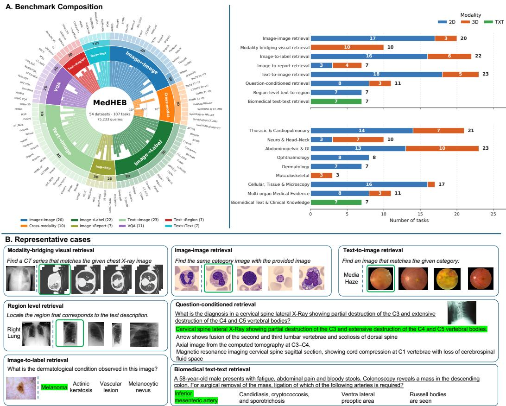  
Figure 2: MedHEB task composition and representative retrieval examples. A: Hierarchical distribution of 107 tasks and 75,233 queries by evidence form, retrieval family, and source task, with side bars for family–modality and anatomy–modality counts. B: Query–candidate examples across modality-bridging, region-level, image–text, VQA, and biomedical text retrieval.

Table 2: Composition of MedHEB retrieval tasks by evidence form and split.
<table><tr><td>Evidence Form</td><td>ID Tasks</td><td>Held-out-source Tasks</td><td>Total Tasks</td></tr><tr><td>2D images</td><td>60</td><td>9</td><td>69</td></tr><tr><td>3D volumes</td><td>30</td><td>1</td><td>31</td></tr><tr><td>Biomedical text</td><td>6</td><td>1</td><td>7</td></tr><tr><td>Total</td><td>96</td><td>11</td><td>107</td></tr></table>

## 3.1 Constructing Heterogeneous Retrieval Tasks

MedHEB defines each task by a query form, candidate pool, and clinically meaningful positive relation under a shared ranking protocol, followed by common standardization, split construction, and quality control. The resulting 107 tasks contain 75,233 retrieval queries, whose distribution by evidence form, retrieval family, and anatomical coverage is summarized in Figure 2.

## 3.1.1 Unified Ranking Formulation

All MedHEB tasks use the same retrieval protocol: given a query and a task-specific candidate pool, the evaluated model encodes both sides and ranks candidates by cosine similarity. Each query has one designated positive 3. For label-retrieval tasks, we filter multi-label samples to avoid false negatives. Retrieval families. The families are defined by the clinical relation that makes a candidate relevant. The eight retrieval families instantiate complementary clinical relations, spanning visual similarity, cross-modal visual matching, image–text alignment, question-conditioned evidence, localized grounding, and biomedical semantics. Table 3 summarizes the query form, candidate pool, relevance definition, and representative sources for each family; per-task instruction templates and the full per-family dataset listings, and qualitative case studies are provided in Appendices A.6, A.2, and A.12.

Table 3: MedHEB retrieval families. Each family follows the same ranking protocol but differs in query form, candidate pool. Full per-family dataset listings are provided in Appendix A.2.
<table><tr><td>Family</td><td>Query</td><td>Candidates &amp; positive criterion</td><td>Representative sources</td></tr><tr><td>Image-image (20 tasks)</td><td>ume</td><td>2D image or 3D vol- Same-source studies; positive if sharing the query&#x27;s class, diagnosis, or anatomy label.</td><td>e.g., Kvasir, LC25000, RFMiD [30, 31, 32]</td></tr><tr><td>Modality-bridging visual (10 tasks)</td><td>Image or volume from one modality</td><td>Different-modality studies paired across MRI T1↔T2, CT↔MRI, or X-ray↔CT. Identifiers define positives only; not given to the model.</td><td>e.g., BraTS, SynthRAD2023, HaN-Seg, CT-RATE [33, 34, 35,36,37]</td></tr><tr><td>Image-to-label (22 tasks)</td><td>Image or volume</td><td>Textual class labels; positive if matching the source label.</td><td>e.g., CheXpert-Plus, MedM- NIST [38, 39]</td></tr><tr><td>Image-to-report (7 tasks)</td><td>Image or volume</td><td>Reports or captions; positive is the source-paired report.</td><td>e.g., MIMIC-CXR, M3D, RadGen-CT [40, 38, 41, 42, 43, 37, 44, 45, 46]</td></tr><tr><td>Text-to-image (23 tasks)</td><td>clinical description</td><td>Class label or short Same-source images matching the queried label or de- Reuses image-to-label and scription.</td><td>image-to-report image sources.</td></tr><tr><td>Question-conditioned (11 tasks)</td><td>Image-question pair</td><td>Dataset-specific answer set; positive if matching the ground-truth answer.</td><td>e.g., MIMIC-CXR-VQA, Omn- iMedVQA, Path-VQA [47, 48, 49, 50, 51, 52, 53, 54]</td></tr><tr><td>Region-level retrieval (7 tasks)</td><td>region-level text de- tion.</td><td>Full image with a Source-provided region crops matching the text descrip- e.g., Chest-ImaGenome, Pan-</td><td>Nuke, VinDr-CXR [55, 56, 57, 58, 59, 60, 61, 62, 63]</td></tr><tr><td>Biomedical text-text (7 tasks)</td><td>scription sage</td><td>Biomedical text pas- Same-source passages: QA, findings→impression, or e.g., MedMCQA, PubMedQA, diagnosis→treatment.</td><td>MIMIC-CXR [64, 65, 66, 40, 38]</td></tr></table>

## 3.1.2 Dataset Selection and Clinical Coverage

We select source datasets to support controlled variation along the MedHEB axes. Included sources must contribute at least one benchmark role (evidence-form diversity, clinically meaningful pairing relations, target-granularity variation, anatomical breadth, or dataset-level held-out-source evaluation) and be reproducible through direct redistribution or an official access route. For restricted datasets, we release manifests and preprocessing scripts so authorized users can reconstruct the benchmark under their own credentials. MedHEB covers more than 25 anatomical sites across eight clinical groups: neuro/head-neck (e.g., BraTS, HaN-Seg) [33, 36, 46], chest/thorax (e.g., CT-RATE, MIMIC-CXR) [37, 40, 67, 62], abdomen/pelvis (e.g., OrganMNIST, M3D) [39, 42, 34], musculoskeletal [68], dermatology [69], ophthalmology [70, 39], pathology [39, 57], and multi-region resources [49, 52]. This breadth reduces single-domain bias and supports evaluation across heterogeneous clinical evidence. Full source, access, and dataset-to-task mappings are provided in the Appendix A.2.

## 3.1.3 Standardization, Splits, and Quality Control

Input standardization. We standardize inputs only where needed for comparable retrieval while preserving source evidence. 3D CT/MRI studies are represented by 64 uniformly sampled frames; CT↔X-ray tasks in CT-RATE use DeepDRR-synthesized radiographs from paired CT volumes [71]; and region candidates are cropped from source-provided bounding boxes.

Pairing and false-negative control. MB-VR positives are constructed only from within-dataset patient or study identifiers, with no cross-dataset patient linking. Identifiers define high-confidence evaluation pairs and are never provided to models, so MB-VR evaluates image-based cross-modal visual matching rather than identifier lookup. For image-to-label retrieval, we retain only singlepositive samples to ensure non-target labels are valid negatives. These rules reduce false-negative bias while keeping tasks reconstructable from public annotations.

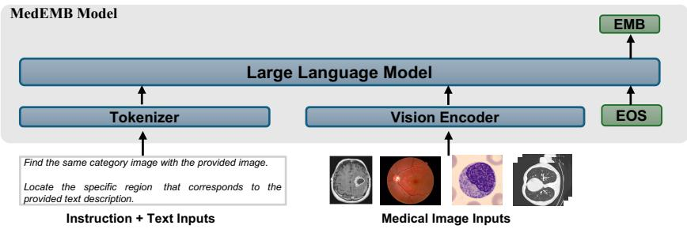  
Figure 3: MedEmb reference model. Text, 2D images, 3D volumes, and mixed image–text inputs are serialized into one MLLM, and the final-token hidden state is used as the retrieval embedding.

Splits and held-out-source evaluation. We follow official train/validation/test partitions when available and otherwise use a 7:3 train–test split. Held-out-source tasks are drawn from held-out sources not used in ID construction, including CheXpert-Plus, RFMiD, LC25000, OmniMedVQA, and BraTS-MEN. Held-out sources are excluded from MedHEB training and may differ from ID sources in image characteristics, label distributions, or reporting conventions. Results on these sources therefore measure cross-dataset transfer.

## 4 MedEmb Reference Baseline

MedEmb is designed as a reproducible reference baseline for MedHEB (Figure 3), illustrating one implementation of unified 2D–3D–text embedding under the benchmark’s retrieval formulation. It adapts Qwen3-VL-Embedding [29] with a single sequence interface: inputs are formatted by the model-specific chat template into a tokenized sequence x˜ containing text prompts, role markers, image placeholders, and special tokens. The MLLM $f _ { \theta }$ encodes x˜, and the retrieval embedding is read from the last-layer hidden state at the final <|endoftext|> token, $\mathbf { h } _ { x } = f _ { \theta } ( \tilde { x } ) \in \mathbb { R } ^ { d } [ 7 2 , \bar { 2 } 9 ]$ This interface supports text, 2D images, sampled 3D volumes, and interleaved image–text inputs without task-specific fusion modules. MedEmb-2B/8B are initialized from Qwen3-VL-Embed-2B/8B and fine-tuned on the MedHEB ID training split for one epoch using LoRA adapters $( r = 8 , \alpha = 3 2 )$ , AdamW with cosine decay and warmup, peak learning rate $1 \mathrm { e } { - 4 }$ , contrastive temperature $\tau = 0 . 0 1$ false-negative margin $\delta = 0 . 1$ , token-budgeted dynamic batching, and 8 NVIDIA H100 GPUs.

Instruction-conditioned contrastive objective. Each training instance is an instruction-prefixed query–target pair $( \mathbf { q } _ { i } , \mathbf { t } _ { i } ^ { + } )$ ). Both sides are encoded by the same backbone, $\mathbf { h } _ { q _ { i } } = f _ { \theta } ( \mathbf { q } _ { i } )$ and ${ \bf h } _ { t _ { i } ^ { + } } =$ $f _ { \theta } ( \mathbf { t } _ { j } ^ { + } )$ ), and matched by temperature-scaled cosine similarity, $\begin{array} { r } { \phi ( \mathbf { h } _ { q } , \mathbf { h } _ { t } ) = \exp \left( \frac { 1 } { \tau } \cos ( \mathbf { h } _ { q } , \mathbf { h } _ { t } ) \right) } \end{array}$ . For a batch of size B, other targets in the batch serve as negatives for $\mathbf { q } _ { i }$ under the standard InfoNCE loss

$$
\mathcal { L } _ { \mathrm { I n f o N C E } } = - \frac { 1 } { B } \sum _ { i = 1 } ^ { B } \log \frac { \phi ( \mathbf { h } _ { q _ { i } } , \mathbf { h } _ { t _ { i } ^ { + } } ) } { \sum _ { j = 1 } ^ { B } \phi ( \mathbf { h } _ { q _ { i } } , \mathbf { h } _ { t _ { i } ^ { + } } ) } .\tag{1}
$$

False-negative masking. Medical retrieval batches may contain candidates clinically equivalent to the anchor, such as another normal chest X-ray. Pushing such samples away would penalize meaningful similarity, especially when they score above the annotated positive. We therefore mask in-batch candidates whose similarity exceeds the ground-truth positive by margin δ before computing InfoNCE, yielding $\mathcal { L } _ { \mathrm { M e d E m b } } ;$ the full objective is in Appendix A.1.

Token-budgeted dynamic batching. MedHEB inputs vary from short labels to long reports, volumetric studies, and multi-image sequences, making fixed-size batching padding-inefficient. We use token-budgeted dynamic batching, where batch size varies while padded token cost is bounded by $T = 2 B _ { \mathrm { n o m } } L _ { \mathrm { m a x } } ,$ , matching the static-batching budget at nominal batch size $B _ { \mathrm { n o m } }$ and maximum length $L _ { \mathrm { m a x } }$ . The formal batch constraint and online best-fit packing are in Appendix A.1.

## 5 Benchmark Experiments

## 5.1 Evaluation Protocol, Metrics, and Models

All models are evaluated under the same MedHEB ranking protocol: for each task, a model embeds the query and task-specific candidate pool, ranks candidates by cosine similarity, and is scored by the placement of clinically relevant targets. We report Hit@1 and MRR@5 as primary metrics, with Hit@5 in Appendix A.4. Hit@1 measures whether the top-ranked candidate is clinically relevant, while MRR@5 averages the reciprocal rank of the first relevant candidate within the top five, crediting near-misses that Hit@1 ignores. To assess whether retrieval ability is balanced across clinical relations, we also report cross-family consistency using the coefficient of variation (CV) of family-level Hit@1, where lower CV indicates more even performance across retrieval families.

Table 4: Main MedHEB retrieval results. Entries are Hit@1 with MRR@5 in parentheses (%). Family columns average retrieval families; summary columns average ID, held-out-source, and all tasks. Abbreviations: I = image, T = text, MB = modality-bridging, VR = visual retrieval, Lab = label, Rep = report, VQA = question-conditioned retrieval, VG = region-level text-to-region.
<table><tr><td>Model</td><td colspan="9">Retrieval Families</td></tr><tr><td></td><td colspan="9"></td></tr><tr><td></td><td>I-I</td><td>MB-VR I-Lab</td><td>I-Rep</td><td>T-I</td><td>VQA</td><td>VG</td><td>T-T</td><td>ID</td><td>source</td><td>All</td></tr><tr><td># of Tasks →</td><td>20</td><td>10</td><td>22</td><td>23</td><td>11</td><td>7</td><td>7</td><td>96</td><td>11</td><td>107</td></tr><tr><td>SigLIP [23]</td><td>31.39 (48.13)</td><td>6.78 (11.19)</td><td>12.19 (22.66)</td><td>5.00 20.91 (8.05) (36.13)</td><td>2.64 (4.86)</td><td>2.65 (4.15)</td><td>9.45 (13.88)</td><td>14.53 (24.09)</td><td>18.01 (29.78)</td><td>14.89 (24.67) 11.85</td></tr><tr><td>BLIP-2 [24]</td><td>29.68 (46.88)</td><td>7.23 (12.02)</td><td>7.05 (16.51)</td><td>5.65 12.85 (11.41) (27.70)</td><td>3.38 (5.46)</td><td>2.70 (4.16)</td><td>7.91 (11.75)</td><td>11.27 (20.73)</td><td>16.91 (29.04)</td><td>(21.58) 21.83</td></tr><tr><td>MedImageInsight [26]</td><td>44.74 (59.48)</td><td>10.71 (18.51)</td><td>14.25 (25.55)</td><td>9.90 26.13 (16.71) (41.11)</td><td>10.22 (13.88) 6.58</td><td>7.05 (9.14) 0.46</td><td>26.84 (34.57)</td><td>21.28 (31.47)</td><td>26.57 (39.77) 16.53</td><td>(32.32) 13.78</td></tr><tr><td>MedSigLIP [25]</td><td>19.73 (37.22) 31.04</td><td>3.71 (7.34) 8.62</td><td>13.50 (23.35) 13.86</td><td>4.86 (9.63) 7.99</td><td>24.18 (39.72) (9.62) 17.25 4.76</td><td>(1.05) 7.96</td><td>11.42 (17.24)</td><td>13.47 (23.04)</td><td>(30.36) 21.30</td><td>(23.80) 18.52</td></tr><tr><td>RzenEmbed [28]</td><td>(47.88) 26.27</td><td>(14.77) 6.18</td><td>(24.73) 14.33</td><td>(15.68) 7.22</td><td>(31.95) (7.85) 15.60 17.57</td><td>(10.12) 3.84</td><td>58.47 (64.01) 39.71</td><td>18.21 (28.46) 16.67</td><td>(33.37) 19.08</td><td>(28.97) 16.91</td></tr><tr><td>VLM2Vec-V2.0 [27]</td><td>(43.17) 33.04</td><td>(12.27) 10.60</td><td>(27.25) 18.90</td><td>(14.40) 9.83</td><td>(30.50) (22.84) 21.46 21.04</td><td>(5.45) 4.10</td><td>(46.73) 57.32</td><td>(27.69) 22.16</td><td>(31.50) 25.33</td><td>(28.08) 22.49</td></tr><tr><td>Qwen3-VL-Embed-2B [29]</td><td>(49.73) 34.69</td><td>(17.77) 8.99</td><td>(32.65) 20.70</td><td>(17.70) 11.52</td><td>(36.41) 20.08</td><td>(28.16) (5.47) 24.58 18.71</td><td>(62.24) 64.72</td><td>(33.55) 24.32</td><td>(37.75) 27.41</td><td>(33.98) 24.64</td></tr><tr><td>Qwen3-VL-Embed-8B [29]</td><td>(51.31) 52.03</td><td>(15.67) 14.49</td><td>(34.35) 56.43</td><td>(18.83) 25.76</td><td>(35.22) 52.75</td><td>(32.76) (22.05) 33.47 33.47</td><td>(70.01) 65.81</td><td>(35.84) 45.63</td><td>(40.41) 45.77</td><td>(36.31) 45.64</td></tr><tr><td>MedEmb-2B</td><td>(65.41) 54.35</td><td>(25.24) 20.30</td><td>(71.03) 58.83</td><td>(35.46) 28.97</td><td>(63.74) 55.70</td><td>(42.97) (39.49) 44.17</td><td>(72.45) 70.64</td><td>(57.16) 49.91</td><td>(55.17) 44.22</td><td>(56.95) 49.32</td></tr><tr><td>MedEmb-8B</td><td>(67.47)</td><td>(30.70)</td><td>(72.51)</td><td>(41.12)</td><td>(66.53)</td><td>36.88 (46.97)</td><td>(50.31)</td><td>(76.96) (61.22)</td><td>(54.59)</td><td>(60.53)</td></tr></table>

We evaluate eight publicly available embedding models from two architectural families. Dual-tower encoders include SigLIP [23], BLIP-2 [24], MedSigLIP [25], and MedImageInsight [26]. Because they encode images and text separately, mixed-evidence inputs are embedded field-wise, mean-pooled, and ℓ -normalized; volumetric or multi-image inputs use at most K=64 uniformly sampled slices or frames before pooling. MLLM-based models include VLM2Vec-V2.0 [27], RzenEmbed [28], and Qwen3-VL-Embed-2B/8B [29]. These models serialize text, role markers, image placeholders, and sampled volumetric slices through model-specific chat templates into one multimodal token stream, using the final-token hidden state as the embedding.

## 5.2 Main Results

Table 4 reveals substantial cross-family imbalance in current medical embedding spaces. Across public baselines, strong performance in one retrieval family does not imply uniformly strong performance across clinical relations. For example, Qwen3-VL-Embed-8B achieves high biomedical text–text retrieval performance, but scores much lower on modality-bridging visual retrieval and region-level text-to-region retrieval. The same pattern appears under both Hit@1 and MRR@5.

The family-wise and ID/held-out-source breakdowns further show why aggregate averages are insufficient for evaluating medical embeddings. Established families such as image–image, image-tolabel, text-to-image, and text–text retrieval are comparatively tractable, whereas modality-bridging visual retrieval, and region-level localization remain less consistently captured. The ID/held-outsource split adds an orthogonal dimension by separating retrieval within source distributions from transfer to held-out sources with different images, labels, anatomies, or reporting conventions. Together, these views show that current embedding spaces are uneven across relation type, target granularity, and distribution shift, rather than uniformly capable under a single aggregate score. MedEmb also leads an instruction-free comparison on 49 tasks (Appendix A.11.2).

## 5.3 Analysis

Since all MedHEB tasks are evaluated in a shared embedding space, we interpret the following analyses as measurements of how each model organizes clinically relevant evidence around the query.

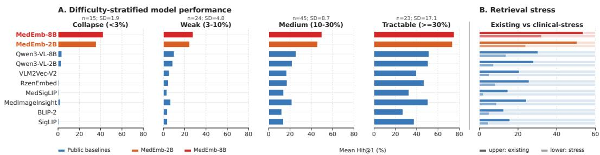  
Figure 4: Benchmark difficulty and cross-relation evaluation. A: Tasks are grouped by public-baseline mean Hit@1 into Collapse, Weak, Medium, and Tractable regimes. B: Paired model scores compare established families (I-I, I-Lab, I-Rep, T-I, T-T) with underexplored relation families (MB-VR, VG).

Task separability and benchmark discriminativeness. Figure 4A stratifies the 107 MedHEB tasks by mean public-baseline Hit@1 into four buckets: Collapse $( < 3 \% , n = 1 5 )$ , Weak (3–10%, $n = 2 4 )$ , Medium $( 1 0 - 3 0 \% , n = 4 5 )$ , and Tractable $( \geq 3 0 \% , n = 2 3 )$ . Because this stratification uses public baselines, it reflects the benchmark’s difficulty structure rather than any proposed model. MedHEB is neither saturated nor uniformly unsolved: Collapse and Weak tasks mark low-signal settings where current embeddings rarely place the correct target near the query, while Medium and Tractable tasks provide increasing model separation. The between-baseline standard deviation rises from 1.9 to 4.8, 8.6, and 17.1 across buckets, showing that MedHEB contains both underdeveloped clinical retrieval settings and higher-signal tasks that meaningfully distinguish embedding models.

Transfer across retrieval relations. To quantify cross-relation transfer, we compare established families covered by prior benchmarks (image–image, image-to-label, image-to-report, text-to-image, biomedical text–text) with underexplored clinical-relation families (modality-bridging visual retrieval and region-level text-to-region retrieval). Figure 4B shows a consistent 7.7–26.6 Hit@1 drop from established to underexplored relations across all models. Thus, conventional image–text, text–text, or image–image neighborhoods do not necessarily preserve cross-modal visual matches or localized evidence, and MedHEB measures this cross-relation gap beyond aggregate retrieval accuracy.

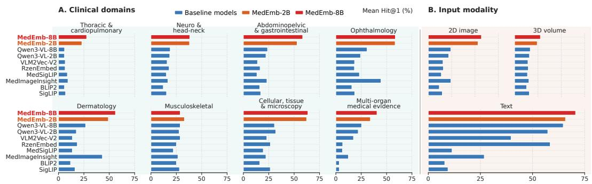  
Figure 5: Retrieval difficulty across anatomical domains and evidence forms.

Domain- and modality-dependent embedding behavior. Figure 5 shows that retrieval difficulty tracks domain-specific invariances. Standardized or morphology-driven settings (e.g., ophthalmology, dermatology, abdominal imaging, and tissue microscopy) are more tractable because relevant candidates cluster around repeatable visual patterns, anatomical priors, or localized texture [73, 74, 75]. By contrast, thoracic/cardio, musculoskeletal, neuro/head-neck, and multi-organ tasks often require embeddings to capture subtle findings, sparse abnormalities, cross-sectional anatomy, cross-modal shifts, or report-level semantics [76]. The modality breakdown highlights 3D retrieval as a bottleneck: unlike many 2D tasks with standardized global views, volumes require spatial continuity, small cross-slice findings, acquisition-specific contrast, and cross-modal anatomical structure [77]. The 2D–3D gap therefore reflects weaker organization of volumetric evidence, not merely longer inputs.

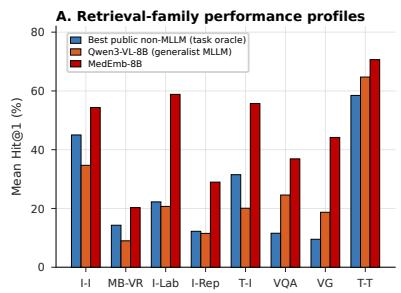

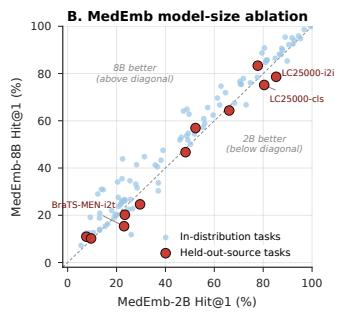

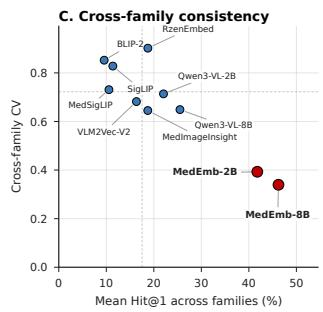  
Figure 6: Capability, model-size ablation, and consistency profiles. A: Family-level Hit@1 for a strong non-MLLM baseline, Qwen3-VL-8B, and MedEmb. B: Per-task MedEmb-2B vs MedEmb-8B scores for ID and held-out-source tasks. C: Mean family Hit@1 vs cross-family CV for accuracy–balance trade-off.

Embedding capability and model-size ablation. Figure 6A separates relations that current embeddings organize well from those that remain weakly represented. Image–image and biomedical text–text retrieval are comparatively strong, while larger gaps appear when embeddings must connect visual evidence to clinical terminology, report phrasing, disease hierarchy, or localized findings, as in image-to-label, image-to-report, text-to-image, question-conditioned, and region-level retrieval. The MedEmb-2B/8B comparison provides a model-size ablation: the 8B model improves many ID tasks but less consistently improves held-out-source tasks (Figure 6B), suggesting that larger model size helps alignment within familiar sources but does not guarantee robust retrieval under shifts in label ontology, anatomy, staining style, or reporting convention. These results motivate training signals that bind clinical relations across datasets, modalities, and granularities. On a fixed training subset, mixed-task training achieves higher overall Hit@1 than training on individual task groups (Appendix A.11.1).

Cross-family consistency of embedding geometry. A unified clinical embedding should not concentrate performance in a few retrieval families. We measure this balance using the coefficient of variation of family-level Hit@1, $\begin{array} { r } { \mathrm { C V } ( m ) = \frac { \operatorname { s t d } _ { k } \left( h _ { m , k } \right) } { \operatorname { m e a n } _ { k } \left( h _ { m , k } \right) + \epsilon } , } \end{array}$ , where $h _ { m , k }$ is model m’s task-macro Hit@1 on family k, lower CV indicates more even performance. Since CV measures dispersion rather than accuracy, Figure 6C plots it against mean family Hit@1. Public embeddings show high variability (CV 0.65–0.90), meaning aggregate scores are concentrated in a subset of families. MedEmb serves as a reference point with lower CV (0.34–0.40) and higher mean Hit@1, indicating more balanced family-level retrieval; per-model statistics are in Appendix A.3.

## 5.4 Graded-Relevance Evaluation

To evaluate retrieval beyond a single annotated positive, we extend 12 MedHEB datasets with graded relevance covering severity, laterality, diagnosis, and cell/tissue hierarchy. Relevance is derived from source annotations and published clinical hierarchies, with partial credit for clinically related candidates. Detailed grading rules and weights are provided in Appendix A.9. Both MedEmb variants outperform the baselines across all four relation types (Table 5), supporting the benchmark conclusions beyond single-positive matching.

Table 5: Graded-relevance retrieval performance (NDCG@5, %).
<table><tr><td>Model</td><td>Severity</td><td>Laterality</td><td>Diagnosis</td><td>Cell/tissue</td><td>All</td></tr><tr><td>BLIP-2</td><td>67.31</td><td>32.02</td><td>48.85</td><td>32.61</td><td>47.47</td></tr><tr><td>MedSigLIP</td><td>70.06</td><td>29.78</td><td>51.40</td><td>40.49</td><td>50.72</td></tr><tr><td>SigLIP</td><td>69.63</td><td>34.82</td><td>52.37</td><td>40.21</td><td>51.55</td></tr><tr><td>RzenEmbed</td><td>67.62</td><td>31.66</td><td>51.97</td><td>45.92</td><td>51.85</td></tr><tr><td>VLM2Vec-V2.0</td><td>71.29</td><td>30.40</td><td>52.04</td><td>44.45</td><td>52.23</td></tr><tr><td>MedImageInsight</td><td>70.61</td><td>36.56</td><td>61.76</td><td>43.64</td><td>56.90</td></tr><tr><td>Qwen3-VL-Embed-2B</td><td>79.75</td><td>41.41</td><td>59.53</td><td>46.64</td><td>59.14</td></tr><tr><td>Qwen3-VL-Embed-8B</td><td>82.44</td><td>41.46</td><td>60.56</td><td>43.45</td><td>59.50</td></tr><tr><td>MedEmb-2B</td><td>86.74</td><td>89.07</td><td>77.57</td><td>85.39</td><td>82.62</td></tr><tr><td>MedEmb-8B</td><td>86.96</td><td>92.03</td><td>77.56</td><td>86.95</td><td>83.34</td></tr></table>

## 5.5 Cross-Source Graded Retrieval

To complement MedHEB’s single-positive protocol, we introduce a graded held-out-source retrieval setting where relevance is defined softly by shared clinical attributes, with queries and candidate pools drawn from different datasets. Specifically, we construct a graded image-to-image retrieval task with queries from MIMIC-CXR and candidates from CheXpert-Plus, two chest X-ray datasets differing in source, acquisition protocol, and post-processing; MedEmb does not see CheXpert-Plus during MedHEB training. Both queries and candidates are mapped to the shared 14-label CheXpert vocabulary, and relevance is defined by the Jaccard overlap of their multi-label annotations, yielding scores in [0, 1]. We report NDCG@K and Hit@K. As shown in Table 6, MedEmb consistently outperforms the strongest Qwen3-VL-Embed baselines across all metrics without further training, indicating that the learned embedding space transfers across data sources under distribution shift.

Table 6: Results of cross-source graded retrieval.
<table><tr><td>Model</td><td>NDCG@5</td><td>NDCG@10</td><td>Hit@1</td><td>Hit@5</td></tr><tr><td>Qwen3-VL-Embed-2B</td><td>0.484</td><td>0.652</td><td>0.547</td><td>0.897</td></tr><tr><td>Qwen3-VL-Embed-8B</td><td>0.460</td><td>0.633</td><td>0.467</td><td>0.897</td></tr><tr><td>MedEmb-2B</td><td>0.543</td><td>0.689</td><td>0.627</td><td>0.937</td></tr><tr><td>MedEmb-8B</td><td>0.566</td><td>0.694</td><td>0.637</td><td>0.940</td></tr></table>

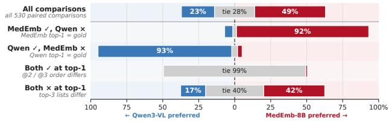  
Figure 7: Human evaluation of MedEmb versus Qwen3- VL-Embed top-3 lists, stratified by top-1 correctness.

## 5.6 Human Evaluation

Automatic metrics based on exact matches do not fully capture clinical retrieval utility: clinicians inspect top-ranked neighbors for differential diagnosis and prior-case comparison, where plausible alternatives matter even when the annotated gold is not retrieved. We therefore run a single-blind head-to-head study in which a board-certified clinician compares the top-3 lists from MedEmb-8B and Qwen3-VL-Embed-8B on 530 queries stratified across all 107 MedHEB tasks, with model identity, gold answer, and stratum hidden (Appendix A.10). MedEmb-8B is preferred in 49.1% of comparisons versus 23.0% for Qwen3-VL-Embed-8B, with 27.9% ties (Figure 7). When both models miss the gold at top-1, MedEmb-8B is still preferred in 42.3% of cases versus 17.3% for Qwen, suggesting that ranked neighborhoods contain clinically meaningful signal beyond exact top-1 accuracy. This supports MedHEB’s use of ranked retrieval as an evaluation signal for clinical evidence retrieval.

## 6 Conclusion

We introduced MedHEB, a unified benchmark that shifts medical embedding evaluation from isolated retrieval scores to the organization of clinical relatedness in a shared space. By fixing the ranking protocol while varying evidence form, pairing type, and relevance granularity, MedHEB tests whether one embedding function preserves clinically meaningful neighborhoods across heterogeneous evidence, including modality-bridging visual and region-level text-to-region retrieval. Experiments show that current embeddings remain uneven across retrieval families, motivating evaluation of family-level placement quality and cross-family balance rather than a single aggregate score. We release MedHEB with task indices, preprocessing and evaluation code, and access manifests, together with MedEmb as a reference baseline, to support reproducible work on unified clinical embeddings.

## References

[1] A. A. Roelofs, N. Karssemeijer, N. Wedekind, C. Beck, S. van Woudenberg, P. R. Snoeren, J. H. Hendriks, M. Rosselli del Turco, N. Bjurstam, H. Junkermann et al., “Importance of comparison of current and prior mammograms in breast cancer screening,” Radiology, vol. 242, no. 1, pp. 70–77, 2007.

[2] J. H. Hayward, K. M. Ray, D. J. Wisner, J. Kornak, W. Lin, B. N. Joe, and E. A. Sickles, “Improving screening mammography outcomes through comparison with multiple prior mammograms,” American Journal ofRoentgenology, vol. 207, no. 4, pp. 918–924, 2016.

[3] K. Zhang, R. Zhou, E. Adhikarla, Z. Yan, Y. Liu, J. Yu, Z. Liu, X. Chen, B. D. Davison, H. Ren et al., “A generalist vision–language foundation model for diverse biomedical tasks,” Nature medicine, vol. 30, no. 11, pp. 3129–3141, 2024.

[4] Z. Chen, M. Varma, J. Xu, M. Paschali, D. Van Veen, A. Johnston, A. Youssef, L. Blankemeier, C. Blueth gen, S. Altmayer et al., “A vision-language foundation model to enhance efficiency of chest x-ray interpretation,” arXiv preprint arXiv:2401.12208, 2024.

[5] L. A. Aaron and D. Buchwald, “A review of the evidence for overlap among unexplained clinical conditions,” Annals ofinternal medicine, vol. 134, no. 9\_Part\_2, pp. 868–881, 2001.

[6] C. Muramatsu, “Overview on subjective similarity of images for content-based medical image retrieval,” Radiological physics and technology, vol. 11, no. 2, pp. 109–124, 2018.

[7] P. Sloan, P. Clatworthy, E. Simpson, and M. Mirmehdi, “Automated radiology report generation: A review of recent advances,” IEEE Reviews in Biomedical Engineering, vol. 18, pp. 368–387, 2024.

[8] X. Wang, G. Figueredo, R. Li, W. E. Zhang, W. Chen, and X. Chen, “A survey of deep learning-based radiology report generation using multimodal data,” arXiv preprint arXiv:2405.12833, 2024.

[9] T. Wang, F. Li, L. Zhu, J. Li, Z. Zhang, and H. T. Shen, “Cross-modal retrieval: a systematic review of methods and future directions,” Proceedings of the IEEE, vol. 112, no. 11, pp. 1716–1754, 2025.

[10] M. Moor, O. Banerjee, Z. S. H. Abad, H. M. Krumholz, J. Leskovec, E. J. Topol, and P. Rajpurkar, “Foundation models for generalist medical artificial intelligence,” Nature, vol. 616, no. 7956, pp. 259–265, 2023.

[11] J. N. Acosta, G. J. Falcone, P. Rajpurkar, and E. J. Topol, “Multimodal biomedical ai,” Nature medicine, vol. 28, no. 9, pp. 1773–1784, 2022.

[12] J. Choe, H. J. Hwang, J. B. Seo, S. M. Lee, J. Yun, M.-J. Kim, J. Jeong, Y. Lee, K. Jin, R. Park et al., “Content-based image retrieval by using deep learning for interstitial lung disease diagnosis with chest ct,” Radiology, vol. 302, no. 1, pp. 187–197, 2022.

[13] J. Chen, Y. Liu, S. Wei, Z. Bian, S. Subramanian, A. Carass, J. L. Prince, and Y. Du, “A survey on deep learning in medical image registration: New technologies, uncertainty, evaluation metrics, and beyond,” Medical Image Analysis, vol. 100, p. 103385, 2025.

[14] W. Fan, Y. Yang, J. Qi, Q. Zhang, C. Liao, L. Wen et al., “A deep-learning-based framework for identifying and localizing multiple abnormalities and assessing cardiomegaly in chest x-ray,” Nature Communications, vol. 15, no. 1, p. 1347, 2024.

[15] V. Boteva, D. Gholipour, A. Sokolov, and S. Riezler, “A full-text learning to rank dataset for medical information retrieval,” in European Conference on Information Retrieval. Springer, 2016, pp. 716–722.

[16] A. Krithara, A. Nentidis, K. Bougiatiotis, and G. Paliouras, “Bioasq-qa: A manually curated corpus for biomedical question answering,” Scientific data, vol. 10, no. 1, p. 170, 2023.

[17] X. Zhang, L. Li, X. Zhou, and Z. Liu, “R2med: A benchmark for reasoning-driven medical retrieval,” arXiv preprint arXiv:2505.14558, 2025.

[18] A. Acharya, A. Ghosh, P. Verma, K. Pasupa, S. Saha, and P. Singh, “M3retrieve: Benchmarking multimodal retrieval for medicine,” in Proceedings ofthe 2025 Conference on Empirical Methods in Natural Language Processing, 2025, pp. 15 263–15 276.

[19] A. B. Abacha, A. Santamaria-Pang, H. H. Lee, J. Merkow, Q. Cai, S. T. Devarakonda, A. Islam, J. Gong, M. P. Lungren, T. Lin et al., “3d-mir: A benchmark and empirical study on 3d medical image retrieval in radiology,” arXiv preprint arXiv:2311.13752, 2023.

[20] Y. Chen, C. Liu, X. Liu, R. Arcucci, and Z. Xiong, “Bimcv-r: A landmark dataset for 3d ct text-image retrieval,” in International conference on medical image computing and computer-assisted intervention. Springer, 2024, pp. 124–134.

[21] C. Liu, Z. Jiang, C. Fang, H. Guo, Y.-J. Zhou, J. Qu, L. Lu, and M. Xu, “M3Ret: Unleashing zero-shot multimodal medical image retrieval via self-supervision,” arXiv preprint arXiv:2509.01360, 2025.

[22] H. H. Lee, A. Santamaria-Pang, J. Merkow, O. Oktay, F. Pérez-García, J. Alvarez-Valle, and I. Tarapov, “Region-based contrastive pretraining for medical image retrieval with anatomic query,” arXiv preprint arXiv:2305.05598, 2023.

[23] X. Zhai, B. Mustafa, A. Kolesnikov, and L. Beyer, “Sigmoid loss for language image pre-training,” in Proceedings ofthe IEEE/CVF international conference on computer vision, 2023, pp. 11 975–11 986.

[24] J. Li, D. Li, S. Savarese, and S. Hoi, “Blip-2: Bootstrapping language-image pre-training with frozen image encoders and large language models,” in International conference on machine learning. PMLR, 2023, pp. 19 730–19 742.

[25] A. Sellergren, S. Kazemzadeh, T. Jaroensri, A. Kiraly, M. Traverse, T. Kohlberger, S. Xu, F. Jamil, C. Hughes, C. Lau et al., “Medgemma technical report,” arXiv preprint arXiv:2507.05201, 2025.

[26] N. C. Codella, Y. Jin, S. Jain, Y. Gu, H. H. Lee, A. B. Abacha, A. Santamaria-Pang, W. Guyman, N. Sangani, S. Zhang et al., “Medimageinsight: An open-source embedding model for general domain medical imaging,” arXiv preprint arXiv:2410.06542, 2024.

[27] R. Meng, Z. Jiang, Y. Liu, M. Su, X. Yang, Y. Fu, C. Qin, Z. Chen, R. Xu, C. Xiong et al., “Vlm2vecv2: Advancing multimodal embedding for videos, images, and visual documents,” arXiv preprint arXiv:2507.04590, 2025.

[28] W. Jian, Y. Zhang, D. Liang, C. Xie, Y. He, D. Leng, and Y. Yin, “Rzenembed: Towards comprehensive multimodal retrieval,” arXiv preprint arXiv:2510.27350, 2025.

[29] M. Li, Y. Zhang, D. Long, K. Chen, S. Song, S. Bai, Z. Yang, P. Xie, A. Yang, D. Liu et al., “Qwen3- vl-embedding and qwen3-vl-reranker: A unified framework for state-of-the-art multimodal retrieval and ranking,” arXiv preprint arXiv:2601.04720, 2026.

[30] K. Pogorelov, K. R. Randel, C. Griwodz, S. L. Eskeland, T. de Lange, D. Johansen, C. Spampinato, D.-T. Dang-Nguyen, M. Lux, P. T. Schmidt et al., “Kvasir: A multi-class image dataset for computer aided gastrointestinal disease detection,” in Proceedings of the 8th ACM on Multimedia Systems Conference, 2017, pp. 164–169.

[31] A. A. Borkowski, M. M. Bui, L. B. Thomas, C. P. Wilson, L. A. DeLand, and S. M. Mastorides, “Lung and colon cancer histopathological image dataset (lc25000),” arXiv preprint arXiv:1912.12142, 2019.

[32] S. Pachade, P. Porwal, D. Thulkar, M. Kokare, G. Deshmukh, V. Sahasrabuddhe, L. Giancardo, G. Quellec, and F. Mériaudeau, “Retinal fundus multi-disease image dataset (rfmid): A dataset for multi-disease detection research,” Data, vol. 6, no. 2, p. 14, 2021.

[33] A. F. Kazerooni, N. Khalili, X. Liu, D. Haldar, Z. Jiang, S. M. Anwar, J. Albrecht, M. Adewole, U. Anazodo, H. Anderson et al., “The brain tumor segmentation (brats) challenge 2023: focus on pediatrics (cbtnconnect-dipgr-asnr-miccai brats-peds),” arXiv preprint arXiv:2305.17033v7, 2024.

[34] D. Jha, O. K. Susladkar, V. Gorade, E. Keles, M. Antalek, D. Seyithanoglu, T. Cebeci, H. E. Aktas, G. D. Kartal, S. Kaymakoglu et al., “Large scale mri collection and segmentation of cirrhotic liver,” Scientific Data, vol. 12, no. 1, p. 896, 2025.

[35] A. Thummerer, E. Van der Bijl, A. Galapon Jr, J. J. Verhoeff, J. A. Langendijk, S. Both, C. N. A. van den Berg, and M. Maspero, “Synthrad2023 grand challenge dataset: Generating synthetic ct for radiotherapy,” Medical physics, vol. 50, no. 7, pp. 4664–4674, 2023.

[36] G. Podobnik, P. Strojan, P. Peterlin, B. Ibragimov, and T. Vrtovec, “Han-seg: The head and neck organ-atrisk ct and mr segmentation dataset,” Medical physics, vol. 50, no. 3, pp. 1917–1927, 2023.

[37] I. E. Hamamci, S. Er, C. Wang, F. Almas, A. G. Simsek, S. N. Esirgun, I. Dogan, O. F. Durugol, B. Hou, S. Shit et al., “Generalist foundation models from a multimodal dataset for 3d computed tomography,” Nature Biomedical Engineering, vol. 10, no. 8, pp. 1610–1628, 2026.

[38] P. Chambon, J.-B. Delbrouck, T. Sounack, S.-C. Huang, Z. Chen, M. Varma, S. Q. Truong, C. T. Chuong, and C. P. Langlotz, “Chexpert plus: Augmenting a large chest x-ray dataset with text radiology reports, patient demographics and additional image formats,” arXiv preprint arXiv:2405.19538, 2024.

[39] J. Yang, R. Shi, D. Wei, Z. Liu, L. Zhao, B. Ke, H. Pfister, and B. Ni, “Medmnist v2-a large-scale lightweight benchmark for 2d and 3d biomedical image classification,” Scientific data, vol. 10, no. 1, p. 41, 2023.

[40] A. E. Johnson, T. J. Pollard, S. J. Berkowitz, N. R. Greenbaum, M. P. Lungren, C.-y. Deng, R. G. Mark, and S. Horng, “Mimic-cxr, a de-identified publicly available database of chest radiographs with free-text reports,” Scientific data, vol. 6, no. 1, p. 317, 2019.

[41] J. Li, T. Su, B. Zhao, F. Lv, Q. Wang, N. Navab, Y. Hu, and Z. Jiang, “Ultrasound report generation with cross-modality feature alignment via unsupervised guidance,” IEEE Transactions on Medical Imaging, vol. 44, no. 1, pp. 19–30, 2024.

[42] F. Bai, Y. Du, T. Huang, M. Q.-H. Meng, and B. Zhao, “M3d: Advancing 3d medical image analysis with multi-modal large language models,” arXiv preprint arXiv:2404.00578, 2024.

[43] X. Zhang, C. Wu, Z. Zhao, J. Lei, Y. Zhang, Y. Wang, and W. Xie, “Radgenome-chest ct: A grounded vision-language dataset for chest ct analysis,” arXiv preprint arXiv:2404.16754, 2024.

[44] D. LaBella, M. Adewole, M. Alonso-Basanta, T. Altes, S. M. Anwar, U. Baid, T. Bergquist, R. Bhalerao, S. Chen, V. Chung et al., “The asnr-miccai brain tumor segmentation (brats) challenge 2023: Intracranial meningioma,” arXiv preprint arXiv:2305.07642, 2023.

[45] J. Lei, X. Zhang, C. Wu, L. Dai, Y. Zhang, Y. Zhang, Y. Wang, W. Xie, and Y. Li, “Autorg-brain: Grounded report generation for brain mri,” arXiv preprint arXiv:2407.16684, 2024.

[46] C. Wang, Y. Zhang, C. Wu, J. Liu, X. Huang, L. Wu, Y. Wang, X. Feng, Y. Lu, and Y. Wang, “Mmdental-a multimodal dataset of tooth cbct images with expert medical records,” Scientific Data, vol. 12, no. 1, p. 1172, 2025.

[47] X. Hu, L. Gu, K. Kobayashi, l. liu, M. Zhang, T. Harada, R. Summers, and Y. Zhu, “Medical-CXR-VQA dataset: A Large-Scale LLM-Enhanced Medical Dataset for Visual Question Answering on Chest X-Ray Images,” PhysioNet, Jan. 2025, version 1.0.0. [Online]. Available: https://doi.org/10.13026/1pm5-hy02

[48] I. Siragusa, S. Contino, M. L. Ciura, R. Alicata, and R. Pirrone, “Medpix 2.0: a comprehensive multimodal biomedical data set for advanced ai applications with retrieval augmented generation and knowledge graphs,” Data Science and Engineering, vol. 11, no. 2, pp. 395–411, 2026.

[49] Y. Hu, T. Li, Q. Lu, W. Shao, J. He, Y. Qiao, and P. Luo, “Omnimedvqa: A new large-scale comprehensive evaluation benchmark for medical lvlm,” in Proceedings ofthe IEEE/CVF Conference on Computer Vision and Pattern Recognition, 2024, pp. 22 170–22 183.

[50] X. Zhang, C. Wu, Z. Zhao, W. Lin, Y. Zhang, Y. Wang, and W. Xie, “Pmc-vqa: Visual instruction tuning for medical visual question answering,” arXiv preprint arXiv:2305.10415, 2023.

[51] X. He, Y. Zhang, L. Mou, E. Xing, and P. Xie, “Pathvqa: 30000+ questions for medical visual question answering,” arXiv preprint arXiv:2003.10286, 2020.

[52] O. Pelka, S. Koitka, J. Rückert, F. Nensa, and C. Friedrich, Radiology Objects in COntext (ROCO): A Multimodal Image Dataset, 09 2018, pp. 180–189.

[53] L. Butsanets, C. Corbière, J. Khlaut, P. Manceron, and C. Dancette, “Radimagenet-vqa: A large-scale ct and mri dataset for radiologic visual question answering,” arXiv preprint arXiv:2512.17396, 2025.

[54] J. J. Lau, S. Gayen, A. Ben Abacha, and D. Demner-Fushman, “A dataset of clinically generated visual questions and answers about radiology images,” Scientific data, vol. 5, no. 1, p. 180251, 2018.

[55] J. Wu, N. Agu, I. Lourentzou, A. Sharma, J. Paguio, J. S. Yao, E. C. Dee, W. Mitchell, S. Kashyap, A. Giovannini, L. A. Celi, T. Syeda-Mahmood, and M. Moradi, “Chest ImaGenome Dataset,” PhysioNet, Jul. 2021, version 1.0.0. [Online]. Available: https://doi.org/10.13026/wv01-y230

[56] D. Jha, P. H. Smedsrud, M. A. Riegler, P. Halvorsen, T. De Lange, D. Johansen, and H. D. Johansen, “Kvasir-seg: A segmented polyp dataset,” in International conference on multimedia modeling. Springer, 2019, pp. 451–462.

[57] J. Gamper, N. Alemi Koohbanani, K. Benet, A. Khuram, and N. Rajpoot, “Pannuke: an open pan-cancer histology dataset for nuclei instance segmentation and classification,” in European congress on digital pathology. Springer, 2019, pp. 11–19.

[58] Z. Ku¸s and M. Aydin, “Medsegbench: A comprehensive benchmark for medical image segmentation in diverse data modalities,” Scientific Data, vol. 11, no. 1, p. 1283, 2024.

[59] N. Codella, V. Rotemberg, P. Tschandl, M. E. Celebi, S. Dusza, D. Gutman, B. Helba, A. Kalloo, K. Liopyris, M. Marchetti et al., “Skin lesion analysis toward melanoma detection 2018: A challenge hosted by the international skin imaging collaboration (isic),” arXiv preprint arXiv:1902.03368, 2019.

[60] P. Tschandl, C. Rosendahl, and H. Kittler, “The ham10000 dataset, a large collection of multi-source dermatoscopic images of common pigmented skin lesions,” Scientific data, vol. 5, no. 1, p. 180161, 2018.

[61] A. Montoya, D. Sterling, Hasnin, kaggle446, shirzad, W. Cukierski, and yffud, “Ultrasound nerve segmentation,” https://kaggle.com/competitions/ultrasound-nerve-segmentation, 2016, kaggle.

[62] H. Q. Nguyen, H. H. Pham, l. tuan linh, M. Dao, and l. khanh, “VinDr-CXR: An open dataset of chest X-rays with radiologist annotations,” PhysioNet, Jun. 2021, version 1.0.0. [Online]. Available: https://doi.org/10.13026/3akn-b287

[63] H. H. Pham, H. Nguyen Trung, and H. Q. Nguyen, “VinDr-Mammo: A large-scale benchmark dataset for computer-aided detection and diagnosis in full-field digital mammography,” PhysioNet, Mar. 2022, version 1.0.0. [Online]. Available: https://doi.org/10.13026/br2v-7517

[64] A. Pal, L. K. Umapathi, and M. Sankarasubbu, “Medmcqa: A large-scale multi-subject multi-choice dataset for medical domain question answering,” in Conference on health, inference, and learning. PMLR, 2022, pp. 248–260.

[65] Q. Jin, B. Dhingra, Z. Liu, W. Cohen, and X. Lu, “Pubmedqa: A dataset for biomedical research question answering,” in Proceedings of the 2019 conference on empirical methods in natural language processing and the 9th internationaljoint conference on natural language processing (EMNLP-IJCNLP), 2019, pp. 2567–2577.

[66] A. Ben Abacha and D. Demner-Fushman, “A question-entailment approach to question answering,” BMC bioinformatics, vol. 20, no. 1, p. 511, 2019.

[67] G. Holste, S. Wang, Z. Jiang, T. C. Shen, G. Shih, R. M. Summers, Y. Peng, and Z. Wang, “Long-tailed classification of thorax diseases on chest x-ray: A new benchmark study,” in MICCAI Workshop on Data Augmentation, Labelling, and Imperfections. Springer, 2022, pp. 22–32.

[68] N. Bien, P. Rajpurkar, R. L. Ball, J. Irvin, A. Park, E. Jones, M. Bereket, B. N. Patel, K. W. Yeom, K. Shpanskaya et al., “Deep-learning-assisted diagnosis for knee magnetic resonance imaging: development and retrospective validation of MRNet,” PLOS Medicine, vol. 15, no. 11, p. e1002699, 2018.

[69] C. Hernández-Pérez, M. Combalia, S. Podlipnik, N. C. Codella, V. Rotemberg, A. C. Halpern, O. Reiter, C. Carrera, A. Barreiro, B. Helba et al., “Bcn20000: Dermoscopic lesions in the wild,” Scientific data, vol. 11, no. 1, p. 641, 2024.

[70] Karthik, Maggie, and S. Dane, “Aptos 2019 blindness detection,” https://kaggle.com/competitions/ aptos2019-blindness-detection, 2019, kaggle.

[71] M. Unberath, J.-N. Zaech, S. C. Lee, B. Bier, J. Fotouhi, M. Armand, and N. Navab, “Deepdrr–a catalyst for machine learning in fluoroscopy-guided procedures,” in International conference on medical image computing and computer-assisted intervention. Springer, 2018, pp. 98–106.

[72] Z. Jiang, R. Meng, X. Yang, S. Yavuz, Y. Zhou, and W. Chen, “Vlm2vec: Training vision-language models for massive multimodal embedding tasks,” in The Thirteenth International Conference on Learning Representations.

[73] J. Sahlsten, J. Jaskari, J. Kivinen, L. Turunen, E. Jaanio, K. Hietala, and K. Kaski, “Deep learning fundus image analysis for diabetic retinopathy and macular edema grading,” Scientific reports, vol. 9, no. 1, p. 10750, 2019.

[74] S. Reddy, A. Shaheed, and R. Patel, “Artificial intelligence in dermoscopy: enhancing diagnosis to distinguish benign and malignant skin lesions,” Cureus, vol. 16, no. 2, 2024.

[75] R. S. Dogan and B. Yılmaz, “Histopathology image classification: highlighting the gap between manual ˘ analysis and ai automation,” Frontiers in Oncology, vol. 13, p. 1325271, 2024.

[76] H. K. Ahmad, M. R. Milne, Q. D. Buchlak, N. Ektas, G. Sanderson, H. Chamtie, S. Karunasena, J. Chiang, X. Holt, C. H. Tang et al., “Machine learning augmented interpretation of chest x-rays: a systematic review,” Diagnostics, vol. 13, no. 4, p. 743, 2023.

[77] Y. Zhang, Y. Mao, X. Lu, X. Zou, H. Huang, X. Li, J. Li, and H. Zhang, “From single to universal: tiny lesion detection in medical imaging,” Artificial Intelligence Review, vol. 57, no. 8, p. 192, 2024.

[78] N. C. Codella, D. Gutman, M. E. Celebi, B. Helba, M. A. Marchetti, S. W. Dusza, A. Kalloo, K. Liopyris, N. Mishra, H. Kittler et al., “Skin lesion analysis toward melanoma detection: A challenge at the 2017 international symposium on biomedical imaging (isbi), hosted by the international skin imaging collaboration (isic),” in 2018 IEEE 15th international symposium on biomedical imaging (ISBI 2018). IEEE, 2018, pp. 168–172.

## A Supplementary Material

## A.1 MedEmb Training Details

False-negative mask. We define the mask factor $m _ { i j }$ with margin δ as

$$
m _ { i j } = \left\{ \begin{array} { l l } { { 0 , } } & { { \phi ( \mathbf { h } _ { q _ { i } } , \mathbf { h } _ { t _ { j } ^ { + } } ) > \phi ( \mathbf { h } _ { q _ { i } } , \mathbf { h } _ { t _ { i } ^ { + } } ) + \delta \mathrm { ~ o r ~ } j = i , } } \\ { { 1 , } } & { { \mathrm { o t h e r w i s e , } } } \end{array} \right.\tag{2}
$$

which yields the masked objective

$$
{ \mathcal { L } } _ { \mathrm { M e d E m b } } = - { \frac { 1 } { B } } \sum _ { i = 1 } ^ { B } \log { \frac { \phi ( \mathbf { h } _ { q _ { i } } , \mathbf { h } _ { t _ { i } ^ { + } } ) } { \phi ( \mathbf { h } _ { q _ { i } } , \mathbf { h } _ { t _ { i } ^ { + } } ) + \sum _ { j = 1 } ^ { B } m _ { i j } \phi ( \mathbf { h } _ { q _ { i } } , \mathbf { h } _ { t _ { j } ^ { + } } ) } } .\tag{3}
$$

Setting $m _ { i j } = 0$ on candidates that exceed the ground-truth positive by margin $\delta$ removes likely false negatives from the denominator while keeping all genuine negatives.

Dynamic batching constraint. Let $\ell _ { i } ^ { \star } = \operatorname* { m a x } ( | \mathbf { q } _ { i } | , | \mathbf { t } _ { i } ^ { + } | )$ be the effective padded length of pair i. A batch B is accepted only if

$$
2 | B | \cdot \operatorname* { m a x } _ { i \in \mathcal { B } } \ell _ { i } ^ { \star } \leq T , \qquad | B | \leq S _ { \mathrm { m a x } } ,\tag{4}
$$

where the factor of 2 accounts for query and target sequences and $T = 2 B _ { \mathrm { n o m } } L _ { \mathrm { m a x } }$ matches the token budget of static batching at nominal batch size $B _ { \mathrm { n o m } }$ and maximum sequence length $L _ { \mathrm { m a x } }$ . Batches are formed online by greedy best-fit packing.

## A.2 Family-level Dataset Details

This section expands the family-level summaries in Section 3.1.1 with the full set of source datasets per retrieval family. Counts in parentheses give the total number of tasks and the modality breakdown (2D, 3D, TXT). The canonical dataset-to-task mapping is given in Appendix A.7.

Image–image retrieval (20 tasks). A 2D image or 3D volume query is ranked against studies from the same source, where a candidate is treated as positive if it shares the query’s sourceprovided class, diagnosis, or anatomical label. The 2D subset draws from Kvasir [30], LC25000 [31], RFMiD [32], APTOS [70], MIMIC-CXR-LT [67], ISIC-2019 [78, 60, 69], Brain-Tumor-MRI, PanNuke [57], and the MedMNIST 2D collection (BloodMNIST, ChestMNIST, DermaMNIST, OCTMNIST, OrganAMNIST, OrganCMNIST, OrganSMNIST, PathMNIST, TissueMNIST) [39]. The 3D subset uses CirrMRI600, MRNet [68], and Organ3dMNIST [39].

Modality-bridging visual retrieval (10 tasks). A query from one imaging modality is ranked against candidates from another, with positives defined by paired cross-modal visual matches. Pairs are constructed from same-patient or same-study annotations and cover three settings: MRI T1↔T2 sequence pairs from BraTS [33] and CirrMRI600 [34]; MRI↔CT pairs from HaN-Seg [36] and SynthRAD2023 brain and pelvis [35]; and 2D X-ray↔3D CT pairs derived from CT-RATE [37]. Identifiers are used only to construct positives and are never provided to the model, so this family evaluates cross-modal visual matching rather than identifier lookup.

Image-to-label retrieval (22 tasks). An image or volume query is ranked against textual class labels. The 2D subset reuses most Image–image 2D sources (APTOS, BloodMNIST, Brain-Tumor-MRI, ChestMNIST, DermaMNIST, ISIC-2019, Kvasir, LC25000, MIMIC-CXR-LT, OCTMNIST, OrganAMNIST/C/S, PathMNIST, TissueMNIST) and adds CheXpert-Plus [38]. The 3D subset uses CT-RATE [37], CirrMRI600, MRNet [68], NoduleMNIST, Organ3dMNIST, and SynapseM-NIST [39].

Image-to-report retrieval (7 tasks). An image or volume query is ranked against free-form reports or captions. Sources span chest X-ray (MIMIC-CXR-report [40], CheXpert-Plus reports [38]), ultrasound (USData [41]), 3D CT (M3D [42], RadGen-CT [43]), 3D MRI (BraTS-MEN report annotations [44, 45]), and dental imaging (MMDental [46]).

Text-to-image retrieval (23 tasks). A class label or short clinical description is ranked against image candidates from the same dataset, evaluating the reverse direction of image–text alignment. Tasks reuse the image-side sources from Image-to-label and Image-to-report (APTOS, BloodMNIST, Brain-Tumor-MRI, ChestMNIST, CheXpert-Plus, DermaMNIST, ISIC-2019, Kvasir, LC25000, MIMIC-CXR-LT, OCTMNIST, OrganAMNIST/C/S, PanNuke, PathMNIST, Retinal/RFMiD, TissueMNIST), together with the volumetric sources CT-RATE, CirrMRI600, M3D, MRNet, and Organ3dMNIST.

Question-conditioned retrieval (11 tasks). Medical VQA is recast as answer retrieval, where an image–question pair queries the dataset’s unique answer set. The 2D subset spans MIMIC-CXR-VQA [47], MedPIX [48], OmniMedVQA [49], PMC-VQA [50], Path-VQA [51], ROCO-VQA [52], RadImageNet-VQA [53], and VQA-RAD [54]. The 3D subset adds CT-RATE-VQA [37], M3D-3DQA [42], and RadGen-CT VQA [43].

Region-level text-to-region retrieval (7 tasks). Visual grounding is reformulated as ranking source-provided region crops against a query composed of the full image and a region-level text description. Sources cover chest X-ray (Chest-ImaGenome [55], VinDr-CXR [62]), endoscopy (Kvasir-SEG [56]), pathology (PanNuke region annotations [57]), dermatology (ISIC-2018 [59, 60]), ultrasound (ultrasound nerve segmentation [61]), and mammography (VinDr-Mammo [63]); region crops are standardized through MedSegBench [58].

Biomedical text–text retrieval (7 tasks). Query and candidates are biomedical text passages from the same source, covering medical QA, radiology findings-to-impression retrieval, and clinical knowledge retrieval. Sources are MedMCQA [64], PubMedQA [65], MedicalQARetrieval, PublicHealthQA, MIMIC-CXR findings-to-impression [40], CheXpert-Plus findings-to-impression [38], and MMDental text–text [46].

## A.3 Cross-Family Consistency

To quantify whether a model is balanced across retrieval families rather than only achieving a high average, we report the coefficient of variation

$$
\mathrm { C V } ( m ) = \frac { \sigma _ { m } } { \mu _ { m } + \epsilon } ,
$$

where $\mu _ { m }$ and $\sigma _ { m }$ are the mean and standard deviation of model m’s Hit@1 scores across the eight retrieval families (I–I, SP–CM, I–Lab, I–Rep, T–I, VQA, VG, T–T). Lower CV indicates a more consistent model. Table 7 reports $\mu , \sigma , \mathrm { C V } ,$ and the per-family Hit@1 scores used to compute them.

Table 7: Cross-family consistency statistics. $\mu$ and σ are computed from family-level Hit@1 across the eight retrieval families; lower $\mathrm { C V } = \sigma / \mu$ indicates more balanced performance.
<table><tr><td>Model</td><td>µ</td><td>σ</td><td>CV</td><td>I-I</td><td>MB-VR</td><td>I-Lab</td><td>I-Rep</td><td>T-I</td><td>VQA</td><td>VG</td><td>T-T</td></tr><tr><td colspan="10">Baseline Models</td></tr><tr><td>siglip-so400m-patch14-384</td><td>11.34</td><td>9.45</td><td>0.833</td><td>31.38</td><td>6.78</td><td>12.19</td><td>5.01</td><td>20.91</td><td>2.36</td><td>2.65</td><td>9.45</td></tr><tr><td>blip2-itm-vit-g</td><td>9.54</td><td>8.16</td><td>0.855</td><td>29.67</td><td>7.23</td><td>7.05</td><td>5.65</td><td>12.85</td><td>3.24</td><td>2.70</td><td>7.91</td></tr><tr><td>MedImageInsight</td><td>18.68</td><td>12.12</td><td>0.649</td><td>44.74</td><td>10.71</td><td>14.25</td><td>9.90</td><td>26.13</td><td>9.81</td><td>7.05</td><td>26.84</td></tr><tr><td>MedSigLIP-448</td><td>10.55</td><td>7.72</td><td>0.732</td><td>19.73</td><td>3.72</td><td>13.51</td><td>4.86</td><td>24.18</td><td>6.49</td><td>0.46</td><td>11.41</td></tr><tr><td>RzenEmbed</td><td>18.71</td><td>16.93</td><td>0.905</td><td>31.04</td><td>8.62</td><td>13.86</td><td>7.99</td><td>17.25</td><td>4.49</td><td>7.96</td><td>58.47</td></tr><tr><td>VLM2Vec-V2.0</td><td>16.24</td><td>11.14 15.74</td><td>0.686</td><td>26.27</td><td>6.18</td><td>14.33</td><td>7.22</td><td>15.60</td><td>16.80</td><td>3.84</td><td>39.71</td></tr><tr><td>Qwen3-VL-Embed-2B Qwen3-VL-Embed-8B</td><td>21.91 25.31</td><td>16.56</td><td>0.718 0.654</td><td>33.04</td><td>10.60</td><td>18.90</td><td>9.82</td><td>21.45</td><td>20.08</td><td>4.10</td><td>57.32</td></tr><tr><td></td><td></td><td></td><td></td><td>34.69</td><td>8.99</td><td>20.69</td><td>11.53</td><td>20.09</td><td>23.07</td><td>18.71</td><td>64.72</td></tr><tr><td colspan="10">MedEmb</td></tr><tr><td>MedEmb-2B MedEmb-8B</td><td>41.63</td><td>16.50</td><td>0.396</td><td>52.03</td><td>14.49</td><td>56.43</td><td>25.76</td><td>52.75</td><td>32.28</td><td>33.47</td><td>65.81</td></tr><tr><td></td><td>46.06</td><td>15.81</td><td>0.343</td><td>54.36</td><td>20.30</td><td>58.83</td><td>28.97</td><td>55.70</td><td>35.47</td><td>44.17</td><td>70.64</td></tr></table>

## A.4 Hit@5 Results

For completeness we report Hit@5 per retrieval family and across the ID, held-out-source, and All splits in Table 8. The trends mirror the Hit@1 / MRR@5 results in Table 4: MedEmb-8B is the strongest model on every family and on every split.

Table 8: Task-macro Hit@5 (%) on MedHEB. Family and summary columns follow Table 4, providing a top-5 complement to Hit@1 and MRR@5.
<table><tr><td rowspan="2">Model</td><td colspan="8">Retrieval Families</td><td colspan="3">Summary</td></tr><tr><td>I-I</td><td>MB-VR</td><td>I-Lab</td><td>I-Rep</td><td>T-I</td><td>VQA</td><td>VG</td><td>T-T</td><td>ID</td><td>Held-out- source</td><td>All</td></tr><tr><td># of Tasks →</td><td>20</td><td>10</td><td>22</td><td>7</td><td>23</td><td>11</td><td>7</td><td>7</td><td>96</td><td>11</td><td>107</td></tr><tr><td colspan="10">Baseline Models</td><td></td></tr><tr><td>SigLIP [23]</td><td>77.43</td><td>20.22</td><td>42.01</td><td>14.10</td><td>64.23</td><td>9.23</td><td>7.00</td><td>21.74</td><td>41.61</td><td>50.83</td><td>42.56</td></tr><tr><td>BLIP2 [24]</td><td>77.53</td><td>21.65</td><td>33.17</td><td>22.59</td><td>57.28</td><td>9.22</td><td>6.76</td><td>18.29</td><td>38.33</td><td>51.75</td><td>39.71</td></tr><tr><td>MedImageInsight [26]</td><td>84.23</td><td>33.63</td><td>42.95</td><td>31.03</td><td>67.58</td><td>20.51</td><td>12.58</td><td>47.39</td><td>48.68</td><td>64.48</td><td>50.31</td></tr><tr><td>MedSigLIP [25]</td><td>70.11</td><td>14.78</td><td>41.66</td><td>18.89</td><td>66.98</td><td>15.08</td><td>2.27</td><td>27.19</td><td>40.59</td><td>55.84</td><td>42.16</td></tr><tr><td>RzenEmbed [28]</td><td>77.64</td><td>25.72</td><td>43.14</td><td>30.44</td><td>60.11</td><td>14.01</td><td>13.99</td><td>72.62</td><td>46.77</td><td>56.83</td><td>47.80</td></tr><tr><td>VLM2Vec-V2.0 [27]</td><td>73.88</td><td>25.52</td><td>49.09</td><td>27.89</td><td>59.66</td><td>31.78</td><td>8.45</td><td>58.39</td><td>47.85</td><td>54.94</td><td>48.58</td></tr><tr><td>Qwen3-VL-Embed-2B [29]</td><td>78.73</td><td>30.91</td><td>54.75</td><td>33.52</td><td>63.00</td><td>40.43</td><td>8.00</td><td>70.26</td><td>53.32</td><td>58.69</td><td>53.87</td></tr><tr><td>Qwen3-VL-Embed-8B [29]</td><td>79.62</td><td>30.08</td><td>56.59</td><td>32.69</td><td>62.67</td><td>46.70</td><td>28.07</td><td>78.05</td><td>56.10</td><td>61.76</td><td>56.68</td></tr><tr><td colspan="10">MedEmb</td><td></td></tr><tr><td>MedEmb-2B MedEmb-8B</td><td>86.72</td><td>44.98</td><td>91.91</td><td>53.96</td><td>81.18</td><td>59.33</td><td>49.79</td><td>82.35</td><td>75.38</td><td>71.99</td><td>75.03</td></tr><tr><td></td><td>87.92</td><td>50.52</td><td>92.48</td><td>62.00</td><td>83.75</td><td>64.04</td><td>60.89</td><td>87.14</td><td>79.16</td><td>72.74</td><td>78.50</td></tr></table>

## A.5 Text Granularity and Embedding Compositionality

Target format exposes another embedding bottleneck: the ability to align visual evidence with increasingly compositional clinical language. We stratify text-conditioned tasks into short labels, question-conditioned answers, and long-text targets (Figure 8). Short labels usually encode one dominant clinical concept, making nearest-neighbor alignment relatively direct. Question-conditioned answers add attributes but constrain relevance through the question. Long-text targets, such as reports or descriptions, bundle multiple clinical concepts at once, including anatomy, morphology, severity, laterality, uncertainty, and co-occurring findings. As target length and specificity increase, task-level Hit@1 decreases and becomes more variable across models. This pattern suggests that difficulty grows not merely because the target text is longer, but because the embedding must compress several clinically relevant attributes into a single vector while preserving their correspondence to the same visual evidence. Long-text retrieval therefore highlights a remaining bottleneck for medical embeddings: compositional alignment between rare, localized, and subtle visual findings and precise clinical language.

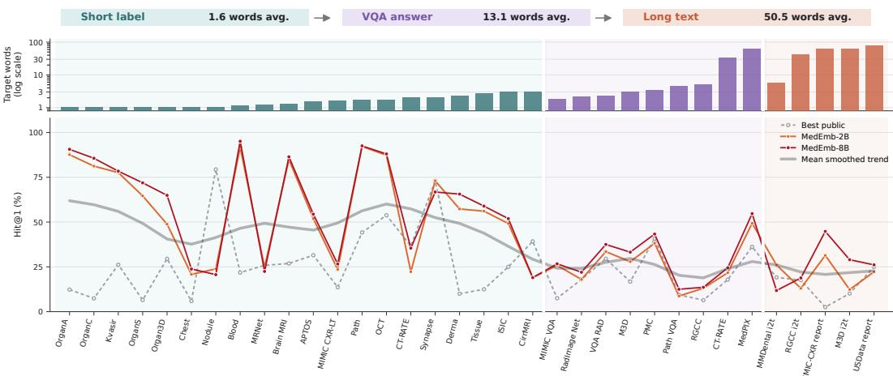  
Figure 8: Target granularity effects in text-conditioned retrieval. Tasks are ordered by average target length and grouped into short labels, VQA answers, and long-text targets; lower panels compare Hit@1 trajectories for the best public baseline, MedEmb-2B, and MedEmb-8B.

## A.6 Per-task Instruction Templates

Each MedHEB task is encoded with two strings: qry\_inst, the instruction prepended to the query, and qry\_text, the per-task or per-row content. Within each retrieval family, instructions are largely

shared; we list the shared 2D instructions below and tabulate the per-task overrides for image classification, 3D volume tasks, and biomedical text–text tasks in Tables 9, 10, and 11.

Image–image (same-category) — MIMIC-CXR-LT, ISIC-2019, Brain-Tumor-MRI, the medical-MNIST family, Kvasir, PanNuke, APTOS, RFMiD, LC25000: qry\_inst = “Find the same category image with the provided image:”, qry\_text = <image> (the image itself serves as the query content).

Text-to-image (all 2D T2I tasks): qry\_inst = “Find an image that matches the given category:”, qry\_text = category label.

Image classification (image-to-label): qry\_inst = “Represent the given image with thefollowing question:”, with the task-specific qry\_text listed in Table 9.

Visual question answering — Path-VQA, PMC-VQA, ROCO-VQA, MedPIX, RadImageNet-VQA, VQA-RAD, MIMIC-CXR-VQA, OmniMedVQA: qry\_inst = “Represent the given image with the following question:”, qry\_text = per-row question.

Visual grounding — PanNuke-VG, UltrasoundNerve, Chest-ImaGenome, Gastrointestinal, SkinLesion, VinDr-CXR, VinDr-Mammo: qry\_inst = “Locate the specific region that corresponds to the provided text description.”, qry\_text = category or anatomical descriptor.

Image-to-report — MIMIC-CXR-report and CheXpert-Plus i2t share “Represent the given chest X-ray imagefor radiology report retrieval:”; USData uses “Represent the given ultrasound image list for radiology report retrieval:”.

Cross-source graded retrieval (MIMIC-CXR → CheXpert-Plus, §5.5): qry\_inst = “Find chest X-ray images that share the most disease findings with the given image:”, qry\_text = <image> (the image itself serves as the query content).

Table 9: 2D image-to-label query texts. All rows share qry\_inst = “Represent the given image with the following question:”; the table lists task-specific qry\_text prompts.
<table><tr><td>Task(s)</td><td>qry_text</td></tr><tr><td>MIMIC-CXR-LT, ChestMNIST, CheXpert-Plus</td><td>What is the radiological abnormal findings observed in this chest X-ray?</td></tr><tr><td>ISIC-2019</td><td>What is the dermatological condition observed in this image?</td></tr><tr><td>Brain-Tumor-MRI</td><td>What is the brain tumor diagnostic category observed in this MRI</td></tr><tr><td>BloodMNIST</td><td>scan? What is the blood cell category observed in this image?</td></tr><tr><td>DermaMNIST</td><td>What is the dermatological diagnostic category observed in this image?</td></tr><tr><td>OCTMNIST</td><td>What is the retinal diagnostic category observed in this image?</td></tr><tr><td>OrganAMNIST / OrganCMNIST / OrganSMNIST</td><td>What is the anatomical structure observed in this image?</td></tr><tr><td>PathMNIST</td><td>What is the histopathological tissue category observed in this image?</td></tr><tr><td>TissueMNIST</td><td>What is the renal cellular category observed in this image?</td></tr><tr><td>Kvasir APTOS</td><td>What is the endoscopic finding observed in this image?</td></tr><tr><td></td><td>What is the diabetic retinopathy severity level observed in this retinal image?</td></tr><tr><td>LC25000</td><td>What is the diagnostic category observed in this histopathological image?</td></tr></table>

Table 10: 3D instruction templates by retrieval family. “per row” denotes instance-specific question or report text; <image> denotes the sampled 3D volume or image sequence used as query content.
<table><tr><td>Task(s)</td><td>qry_inst</td><td>qry_text</td></tr><tr><td colspan="3">Volume classification</td></tr><tr><td>CT-RATE-cls</td><td>Represent the given list of images with the following question:</td><td>What is the pathological finding represented in this list</td></tr><tr><td>CirrMRI600-cls</td><td>Represent the given MRI series with the following question:</td><td>of images? What is the degree of liver cirrhosis shown in the picture?</td></tr><tr><td>MRNet-cls</td><td>Represent the given MRI series with the following question:</td><td>What type of knee disease is shown in this image?</td></tr><tr><td>NoduleMNIST-cls</td><td>Represent the given CT series with the following question: What is the nature of</td><td>the tumor in the chest?</td></tr><tr><td>Organ3dMNIST-cls</td><td>Represent the given CT series with the following question: What anatomical</td><td>structure is shown in this image?</td></tr><tr><td>SynapseMNIST-cls</td><td>Represent the given Electron Microscope with the following question:</td><td>What type of synapse is this?</td></tr><tr><td colspan="3">Volume question answering CT-RATE-vqa, Represent the given CT series with the following question: per row</td></tr><tr><td>RGCC-vqa, M3D-3dqa</td><td></td><td></td></tr><tr><td colspan="3">Volume-to-report</td></tr><tr><td>RGCC-i2t, M3D-i2t</td><td>Find a detailed report summarizing the given CT series:</td><td>&lt;image&gt;</td></tr><tr><td>MMDental-i2t</td><td>Find a detailed diagnosis summarizing the given CBCT series:</td><td>&lt;image&gt;</td></tr><tr><td>BraTS-MEN-i2t</td><td>Find a detailed report summarizing the given Brain MRI series:</td><td>&lt;image&gt;</td></tr><tr><td colspan="3">Text-to-volume</td></tr><tr><td>CT-RATE-t2i, M3D-t2i</td><td>Find a CT series that matches the given report:</td><td>per row</td></tr><tr><td>CirrMRI600-t2i, MRNet-t2i</td><td>Find an MRI series that matches the given category:</td><td>category</td></tr><tr><td>Organ3dMNIST-t2i</td><td>Find an CT series that matches the given category:</td><td>category</td></tr><tr><td colspan="3">Volume—volume</td></tr><tr><td>CT-RATE-i2i</td><td>Find a CT series that matches the given chest X-ray image: &lt;image&gt;</td><td></td></tr><tr><td>CirrMRI600-i2i, MRNet-i2i</td><td>Find the same category MRI series with the provided MRI &lt;image&gt; series:</td><td></td></tr><tr><td>Organ3dMNIST-i2i</td><td>Find the same category CT series with the provided CT series:</td><td>&lt;image&gt;</td></tr><tr><td>BraTS-t1→t2, CirrMRI600-t1→t2</td><td>Find a T2-weighted MRI series that matches the given T1-weighted MRI series:</td><td>&lt;image&gt;</td></tr><tr><td>BraTS-t2→t1, CirrMRI600-t2→t1</td><td>Find a T1-weighted MRI series that matches the given T2-weighted MRI series:</td><td>&lt;image&gt;</td></tr><tr><td>HaN-Seg mri→ct,</td><td>Find a CT series that matches the given MRI series:</td><td>&lt;image&gt;</td></tr><tr><td>SynthRAD mri2ct SynthRAD ct2mri</td><td>Find an MRI series that matches the given CT series:</td><td>&lt;image&gt;</td></tr></table>

Table 11: Biomedical text–text instruction templates. Rows list the shared qry\_inst for each source; qry\_text is populated per instance with the corresponding question, finding, context, or diagnosis.
<table><tr><td>Task(s)</td><td>qry_inst</td></tr><tr><td>MedMCQA, MedicalQA, Pub- licHealthQA</td><td>Find the answer of the given question:</td></tr><tr><td>MIMIC findings-to-impression, CheXpert-Plus f2i</td><td>Identifying impressions based on given radiology findings.</td></tr><tr><td>PubMedQA</td><td>Summarize the content of the given context:</td></tr><tr><td>MMDental</td><td>Find the treatment plan of the given diagnosis:</td></tr></table>

## A.7 Dataset Details

This section lists the source datasets that compose MedHEB, including the dataset name, evidence form (2D, 3D, or text), modality, and a publicly accessible URL. MedHEB is built from 54 source datasets spanning 2D images, 3D volumes, and biomedical text. Figure 9 summarizes the composition of MedHEB.

Table 12: Source datasets composing MedHEB. Datasets are grouped by evidence form; modality, license / use terms, and official access URL specify the reconstruction manifest used for benchmark release. Where the licensing terms are in conflict across sources or otherwise unclear, the entry is marked N/A and the access URL remains authoritative.
<table><tr><td>Dataset</td><td>Modality</td><td></td><td>License / use terms</td><td></td><td>Link</td></tr><tr><td colspan="6">2D images</td></tr><tr><td>APTOS-2019</td><td>Fundus photography</td><td>Competition Commercial Research</td><td>Use &amp;</td><td>and Non- Academic</td><td>https://www.kaggle.com/ competitions/aptos2019- blindness- detection/overview</td></tr><tr><td>BloodMNIST</td><td>Blood croscopy</td><td>cell mi-</td><td>CC BY 4.0</td><td></td><td>https://zenodo.org/records/ 10519652</td></tr><tr><td>Brain-Tumor-MRI</td><td>Brain MRI</td><td></td><td>CC BY 4.0</td><td></td><td>https://www.kaggle.com/ datasets/masoudnickparvar/ brain-tumor-mri-dataset</td></tr><tr><td>Chest-ImaGenome</td><td>Chest X-ray</td><td>Data License 1.5.0</td><td>PhysioNet Credentialed Health</td><td></td><td>https://physionet.org/ content/chest- imagenome/1.0.0/</td></tr><tr><td>ChestMNIST</td><td>Chest X-ray</td><td></td><td>CC BY 4.0</td><td></td><td>https://zenodo.org/records/ 10519652</td></tr><tr><td>CheXpert-Plus</td><td>Chest X-ray</td><td></td><td>Stanford Dataset Research Use Agreement</td><td></td><td>https://stanfordaimi. azurewebsites.net/datasets/ 5158c524-d3ab-4e02-96e9-</td></tr><tr><td>DermaMNIST</td><td>Skin disease image</td><td></td><td>CC BY-NC 4.0</td><td></td><td>6ee9efc110a1 https://zenodo.org/records/ 10519652</td></tr><tr><td>ISIC-2019</td><td>Skin disease image</td><td>CC BY-NC 4.0</td><td></td><td></td><td>https://challenge.isic-</td></tr><tr><td>Isic2018MSBench</td><td>Skin image</td><td>CC BY-NC 4.0</td><td></td><td></td><td>archive.com/data/ https://github.com/zekikus/ MedSegBench</td></tr><tr><td>Kvasir</td><td>GI tract endoscopy</td><td>tional; commercial use requires</td><td>Simula custom (research / educa-</td><td></td><td>https://datasets.simula.no/ kvasir/</td></tr><tr><td>Kvasir-SEG</td><td>GI tract endoscopy</td><td>written permission) tional; commercial use requires</td><td>Simula custom (research / educa-</td><td></td><td>https://datasets.simula.no/ kvasir-seg/</td></tr><tr><td>LC25000</td><td>Pathology</td><td>N/A</td><td>written permission)</td><td></td><td>https: //www.kaggle.com/datasets/</td></tr><tr><td>MedPIX-VQA</td><td>Multi-modality VQA</td><td>Apache 2.0</td><td></td><td></td><td>javaidahmadwani/1c25000 https://huggingface.co/ datasets/adishourya/MEDPIX-</td></tr><tr><td>MIMIC-CXR</td><td>Chest X-ray</td><td></td><td>PhysioNet Credentialed Health</td><td></td><td>ClinQA https://physionet.org/</td></tr><tr><td>MIMIC-CXR-LT</td><td>Chest X-ray</td><td></td><td>Data License 1.5.0 PhysioNet Credentialed Health</td><td></td><td>content/mimic-cxr/2.1.0/ https://physionet.org/</td></tr><tr><td>MIMIC-CXR-VQA</td><td>Chest X-ray VQA</td><td></td><td>Data License 1.5.0 PhysioNet Credentialed Health Data License 1.5.0 (per underly-</td><td></td><td>content/mimic-cxr/2.1.0/ https://physionet.org/ content/medical-cxr-vqa-</td></tr><tr><td>OCTMNIST</td><td>Optical coherence to- mography</td><td>CC BY 4.0</td><td>ing MIMIC-CXR)</td><td></td><td>dataset/1.0.0/ https://zenodo.org/records/ 10519652</td></tr></table>

(continued on next page)

(continued from previous page)
<table><tr><td>Dataset</td><td>Modality</td><td>License / use terms</td><td>Link</td></tr><tr><td>OmniMedVQA</td><td>Multi-modality VQA</td><td>Per source datasets (no single li- cense)</td><td>https: //huggingface.co/datasets/ foreverbeliever/OmniMedVQA</td></tr><tr><td>OrganAMNIST (LiTS)</td><td>Abdominal CT (ax- ial)</td><td>CC BY 4.0</td><td>https://zenodo.org/records/ 10519652</td></tr><tr><td>OrganCMNIST (LiTS)</td><td>Abdominal CT (coro- nal)</td><td>CC BY 4.0</td><td>https://zenodo.org/records/ 10519652</td></tr><tr><td>OrganSMNIST (LiTS)</td><td>Abdominal CT (sagit- tal)</td><td>CC BY 4.0</td><td>https://zenodo.org/records/ 10519652</td></tr><tr><td>PanNuke</td><td>Pathology</td><td>CC BY-NC-SA 4.0</td><td>https://huggingface.co/ datasets/RationAI/PanNuke</td></tr><tr><td>Path-VQA</td><td>Pathology VQA</td><td>MIT</td><td>https: //huggingface.co/datasets/ flaviagiammarino/path-vqa</td></tr><tr><td>PathMNIST</td><td>Colon pathology</td><td>CC BY 4.0</td><td>https://zenodo.org/records/ 10519652</td></tr><tr><td>PMC-VQA</td><td>Multi-modality VQA</td><td>CC BY-SA</td><td>https://huggingface.co/ datasets/RadGenome/PMC-VQA</td></tr><tr><td>PolypGenMSBench</td><td>GI tract endoscopy</td><td>CC BY-NC 4.0</td><td>https://github.com/zekikus/ MedSegBench</td></tr><tr><td>RadImageNet-VQA</td><td>Multi-modality VQA</td><td>Apache-2.0</td><td>https: //huggingface.co/datasets/</td></tr><tr><td>RFMiD</td><td>Fundus photography</td><td>Other</td><td>raidium/RadImageNet-VQA https://www.kaggle.com/ datasets/andrewmvd/retinal-</td></tr><tr><td>ROCO-VQA</td><td>Multi-modality VQA</td><td>Apache 2.0</td><td>disease-classification https://huggingface.co/</td></tr><tr><td>TissueMNIST</td><td>Kidney cortex mi-</td><td>CC BY 4.0</td><td>datasets/adishourya/ROCO-QA https://zenodo.org/records/</td></tr><tr><td>UltrasoundNerveMSBenchUltrasound</td><td>croscopy</td><td>CC BY-NC 4.0</td><td>10519652 https://github.com/zekikus/</td></tr><tr><td>USData</td><td>Ultrasound</td><td>N/A</td><td>MedSegBench https://github.com/ LijunRio/Ultrasound-Report-</td></tr><tr><td>USforKidneyMSBench</td><td>Ultrasound</td><td>CC BY-NC 4.0</td><td>Generation https://github.com/zekikus/</td></tr><tr><td>UWSkinCancerMSBench Skin image</td><td></td><td>CC BY-NC 4.0</td><td>MedSegBench https://github.com/zekikus/</td></tr><tr><td>VinDr-CXR</td><td>Chest X-ray</td><td>PhysioNet Credentialed Health</td><td>MedSegBench https://physionet.org/</td></tr><tr><td>VinDr-Mammo</td><td>Breast mammogra-</td><td>Data License 1.5.0 PhysioNet Credentialed Health Data License 1.5.0</td><td>content/vindr-cxr/1.0.0/ https://physionet.org/ content/vindr-mammo/1.0.0/</td></tr><tr><td>VQA-RAD</td><td>phy Multi-modality VQA</td><td>CC0 1.0</td><td>https: //huggingface.co/datasets/</td></tr><tr><td>3D volumes</td><td></td><td></td><td>flaviagiammarino/vqa-rad</td></tr><tr><td>BraTS-MEN</td><td>Brain MRI</td><td>CC BY-NC</td><td>https://www.synapse.org/ Synapse:syn51514106</td></tr><tr><td>BraTS-PED</td><td>Brain MRI</td><td>CC-BY-NC</td><td>https://www.synapse.org/ Synapse:syn51514108</td></tr><tr><td>CirrMRI600</td><td>Liver MRI</td><td>Other</td><td>https: //osf.io/cuk24/overview</td></tr><tr><td>CT-RATE</td><td>Chest CT</td><td>CC BY-NC-SA 4.0 (gated; no commercial; no redistribution)</td><td>https://huggingface.co/ datasets/ibrahimhamamci/CT-</td></tr><tr><td>HaN-Seg</td><td>Head &amp; neck</td><td>CC BY-NC-ND 4.0</td><td>RATE https://zenodo.org/records/</td></tr></table>

(continued on next page)

(continued from previous page)
<table><tr><td>Dataset</td><td>Modality</td><td>License / use terms</td><td>Link</td></tr><tr><td>M3D</td><td>Multi-modality 3D</td><td>Apache License 2.0</td><td>https://www.modelscope.cn/ datasets/GoodBaiBai88/M3D-</td></tr><tr><td>MMDental</td><td>Dental CBCT</td><td>CC BY 4.0</td><td>Cap https://springernature. figshare.com/articles/ dataset/28505276</td></tr><tr><td>MRNet</td><td>Knee MRI</td><td>Stanford Research Use Agree- ment (non-commercial research; no redistribution)</td><td>https://aimi.stanford.edu/ datasets/mrnet-knee-mris</td></tr><tr><td>NoduleMNIST</td><td>Chest CT</td><td>CC BY 4.0</td><td>https://zenodo.org/records/ 10519652</td></tr><tr><td>OrganMNIST3D (LiTS)</td><td>Abdominal CT</td><td>CC BY 4.0</td><td>https://zenodo.org/records/ 10519652</td></tr><tr><td>RadGenome-Chest-CT</td><td>Chest CT</td><td>CC BY 4.0</td><td>https: //huggingface.co/datasets/</td></tr><tr><td>SynapseMNIST (MitoEM)</td><td>Pathology (electron microscopy)</td><td>CC BY 4.0</td><td>RadGenome/RadGenome-ChestCT https://zenodo.org/records/ 10519652</td></tr><tr><td>SynthRAD2023</td><td>Brain &amp; pelvis MRI/CT</td><td>CC BY-NC 4.0</td><td>https://zenodo.org/records/ 7260705</td></tr><tr><td colspan="4">Biomedical text</td></tr><tr><td>MedicalQA</td><td>Biomedical text</td><td>CCO 1.0</td><td>https://huggingface.co/ datasets/mteb/medical_qa</td></tr><tr><td>MedMCQA</td><td>Biomedical text</td><td>Apache 2.0</td><td>https: //huggingface.co/datasets/</td></tr><tr><td>PubMedQA</td><td>Biomedical text</td><td>MIT</td><td>openlifescienceai/medmcqa https://huggingface.co/ datasets/qiaojin/PubMedQA</td></tr><tr><td>PublicHealthQA</td><td>Biomedical text</td><td>CC BY 3.0 (CDC) / CC BY-NC- SA 3.0 (WHO)</td><td>https: //huggingface.co/datasets/ xhluca/publichealth-qa</td></tr></table>

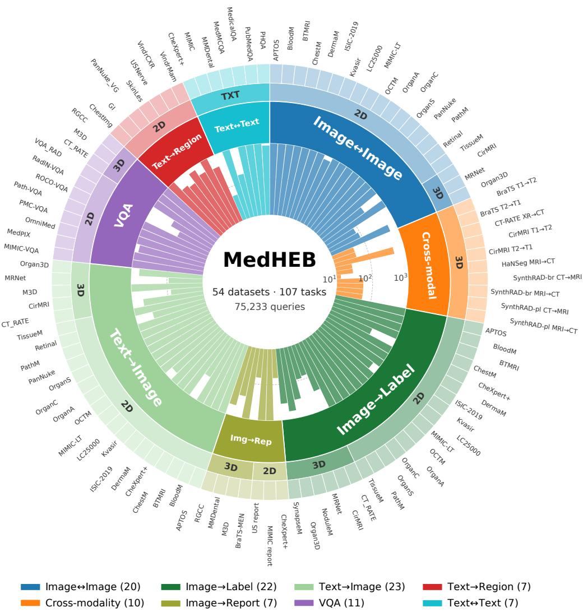  
Figure 9: MedHEB benchmark composition.

## A.8 Reproducibility, Release Scope, and Ethics

Reproducibility and artifact scope. Sections 3.1, 4, 5.1, and 5.2 specify the task construction protocol, train/validation/test split design, evaluated models, metrics, and MedEmb training recipe. The accompanying MedHEB artifact provides task indices, preprocessing scripts, evaluation code, and source-specific access manifests; because many component datasets are distributed under their own licenses, data-use agreements, or credentialing requirements, the benchmark release does not re-host restricted raw images, volumes, or reports.

Compute and statistical reporting. MedEmb-2B and MedEmb-8B are each trained for one epoch on the MedHEB ID split using LoRA adapters, AdamW with cosine decay and warmup, tokenbudgeted dynamic batching, and 8 NVIDIA H100 GPUs (Section 4). Main benchmark metrics are deterministic evaluations over fixed query/candidate pools; for the clinician preference study in Section 5.6, MedEmb-8B wins 260 of 382 non-tied comparisons, corresponding to a two-sided exact binomial test with $p < 1 0 ^ { - 1 1 }$

Limitations, broader impacts, and safeguards. The benchmark improves coverage of heterogeneous clinical retrieval, but it remains limited by the quality, ontology design, demographic composition, and modality mix of its source datasets, and by the fact that clinically acceptable evidence can be broader than a single annotated positive. Positive impacts include more reproducible evaluation of multimodal medical embeddings and clearer diagnosis of where current retrieval models fail; negative impacts may arise if benchmark scores are interpreted as evidence of clinical readiness, if source-data biases are overlooked, or if retrieved neighbors are used without appropriate expert review. MedHEB therefore releases metadata and access manifests rather than restricted source data, and any downstream use should remain subject to the original asset terms and human clinical oversight.

## A.9 Graded-Relevance Protocol

The graded-relevance evaluation in Section 5.4 uses the following annotation-based relevance weights.

Severity. Relevance is 1 for the same severity stage, 0.5 for a one-stage difference, 0.25 for a two-stage difference, and 0 for larger differences.

Laterality. Relevance is 1 for the same side, 0.5 for the contralateral side of the same organ, and 0 for a different organ.

Diagnosis. Relevance is 1 for the same diagnosis, 0.5 for a different diagnosis within the same source-defined category, and 0 for unrelated diagnoses.

Cell/tissue hierarchy. Relevance is 1 for an exact label match, 0.5 for labels sharing the same published hierarchy, and 0 otherwise.

## A.10 Human Evaluation Protocol

The clinician preference study in Section 5.6 uses 530 stratified queries sampled across the 107 MedHEB tasks. For each query, MedEmb-8B and Qwen3-VL-Embed-8B each produce a top-3 retrieval list. The two lists are presented side by side as “List $\mathbf { A } ^ { \prime \prime }$ and “List $\mathbf { B } ^ { \ast }$ in a per-query randomized order, and model identity, gold answer, and task stratum are hidden from the evaluator. The evaluator selects “List A is better”, “List B is better”, or “Tie”, and may add an optional free-text comment.

Interface. The evaluator uses a custom blind-comparison web interface (Figures 10 and 11). The left pane lists all 107 tasks with per-task progress indicators and a filter box; the main pane shows the system prompt, the query (image, 3D volume rendered as a slice player, or text), and the two candidate lists side by side, followed by the three preference buttons and the optional comment field. The same interface is used for 2D and 3D queries; volumes are presented as scrubbable slice players so the evaluator can browse the full volume.

Instructions to the evaluator. The evaluator is instructed to select the list that better supports clinical interpretation of the query, considering anatomy, modality, and clinically meaningful similarity. The instructions emphasize that plausibility of returned candidates may matter even when neither list contains the exact gold match, and that ties are permitted when the two lists are judged clinically equivalent.

Evaluator and compensation. A single board-certified clinician completed all 530 comparisons. The clinician participated as a research collaborator on this project; no crowdsourcing platform was used. Compensation arrangements will be disclosed in the final non-anonymous release together with institutional review or exemption status if applicable.

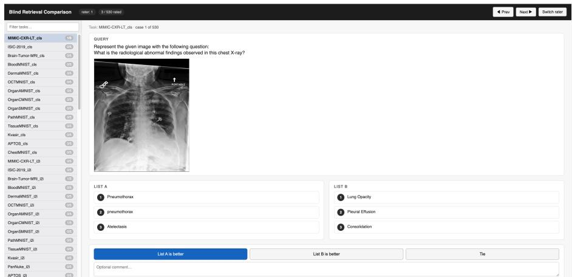  
Figure 10: Blind-comparison interface for 2D queries. The evaluator sees the system prompt, the query image, two top-3 candidate lists shown in randomized A/B order, and three preference buttons (“List A is better”, “List B is better”, “Tie”) with an optional comment field. Model identity, gold answer, and task stratum are hidden.

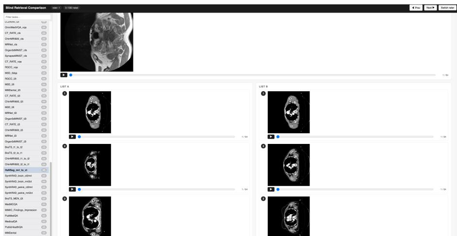  
Figure 11: Blind-comparison interface for 3D queries. Volumes are presented as scrubbable slice players; layout, randomization, and preference controls otherwise mirror the 2D interface in Figure 10.

## A.11 Additional Ablations

## A.11.1 Training Task-Group Ablation

Using Qwen3-VL-Embed-2B as the common initialization, we compare mixed-task training with training on only 2D, only 3D, or only text tasks on a fixed randomly sampled subset. Optimization settings and per-task exposure are held constant, with one epoch per included task; total training exposure varies with the task groups included. Table 13 reports this subset-based ablation. Mixed-task training achieves the highest overall, 2D, and 3D scores, while text-only training is slightly higher on text tasks.

Table 13: Training task-group ablation on a fixed sampled subset. Scores are Hit@1 (%).
<table><tr><td>Training configuration</td><td>2D tasks</td><td>3D tasks</td><td>Text tasks</td><td>Overall</td></tr><tr><td>Pretrained initialization</td><td>21.27</td><td>16.32</td><td>58.54</td><td>22.05</td></tr><tr><td>2D tasks only</td><td>32.54</td><td>16.54</td><td>56.48</td><td>29.04</td></tr><tr><td>3D tasks only</td><td>24.21</td><td>17.19</td><td>57.02</td><td>24.07</td></tr><tr><td>Text tasks only</td><td>20.35</td><td>15.19</td><td>60.92</td><td>21.27</td></tr><tr><td>Mixed tasks</td><td>34.28</td><td>18.62</td><td>59.97</td><td>30.99</td></tr></table>

## A.11.2 Instruction-Free Evaluation

We evaluate 49 tasks whose relevance is defined by the original inputs: 20 image–image, 22 imageto-label, and 7 image-to-report tasks. For every model, task instructions are removed at evaluation time while the original image and text inputs are retained. Both MedEmb variants outperform the public baselines in all three families (Table 14).

Table 14: Instruction-free retrieval on 49 tasks. Scores are task-macro Hit@1 (%).
<table><tr><td>Model</td><td>I-I (20)</td><td>I-Lab (22)</td><td>I–Rep (7)</td><td>All (49)</td></tr><tr><td>SigLIP</td><td>37.03</td><td>19.12</td><td>7.30</td><td>24.74</td></tr><tr><td>BLIP-2</td><td>33.30</td><td>10.67</td><td>5.54</td><td>19.18</td></tr><tr><td>MedImageInsight</td><td>47.50</td><td>23.57</td><td>25.10</td><td>33.55</td></tr><tr><td>MedSigLIP</td><td>40.81</td><td>20.58</td><td>16.36</td><td>28.23</td></tr><tr><td>RzenEmbed</td><td>31.49</td><td>13.17</td><td>7.50</td><td>19.83</td></tr><tr><td>VLM2Vec-V2.0</td><td>30.97</td><td>11.40</td><td>9.22</td><td>19.07</td></tr><tr><td>Qwen3-VL-Embed-2B</td><td>38.15</td><td>17.41</td><td>8.41</td><td>24.59</td></tr><tr><td>Qwen3-VL-Embed-8B</td><td>36.50</td><td>17.89</td><td>8.28</td><td>24.11</td></tr><tr><td>MedEmb-2B</td><td>52.24</td><td>34.82</td><td>25.76</td><td>40.64</td></tr><tr><td>MedEmb-8B</td><td>54.42</td><td>33.39</td><td>28.97</td><td>41.34</td></tr></table>

## A.12 Qualitative Case Studies

Figures 12–15 show MedEmb retrieval examples that together cover all eight MedHEB retrieval families. Each block displays the system prompt, the query, and the candidate pool; the gold positive is highlighted in green. The cases span both established families (image–image, imageto-label, image-to-report, text-to-image, biomedical text–text) and underexplored clinical-relation families (modality-bridging visual retrieval, question-conditioned retrieval, region-level text-to-region retrieval), and across modalities including chest X-ray, brain/abdominal/knee/chest CT, brain/pelvis MRI, ultrasound, fundus photography, OCT, dermatology, pathology, and GI endoscopy.

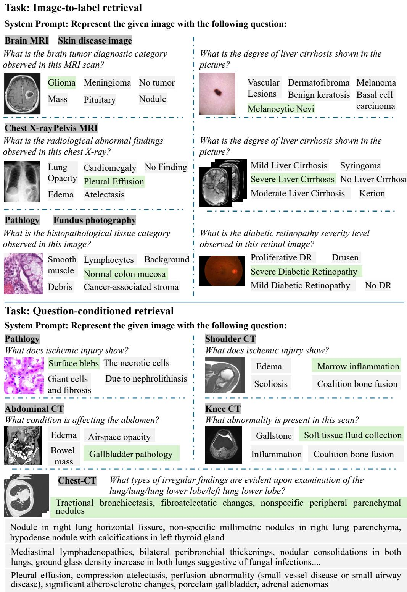  
Figure 12: Case study 1.

## Task: Image-to-report retrieval

## System Prompt: Represent the given chest X-ray image for radiology report retrieval:

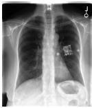

Cardiomediastinal contours are normal. The lungs are clear. There is no pneumothorax or pleural effusion. The osseous structures are unremarkable surgical clips project in the left upper quadrant of the abdomen. External device obscures partially the left hilum

The chest x ray includes the upper abdomen and shows satisfactory position of the nasogastric tube within the stomach.

In comparison with earlier study of this date, the nasogastric tube extends well into the stomach with the tip beyond the lower limit of the image. The Dobbhoff tube has been removed.

Multifocal pneumonia including dense right lower lobe consolidation with abscess has not really changed much since . A pigtail catheter in the right lower lobe abscess is unchanged in position and presumably within the abscess cavity. Residual stent is present. Tracheostomy tube is in standard position.

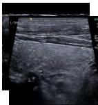

Thyroid gland is normal in size and shape. An anechoic nodule is visible in the midportion of the right lobe, measuring approximately \_2DS\_. Its borders are relatively welldefined, and its shape is relatively regular. CDFI shows no detectable blood flow signal. The remaining glandular parenchyma shows homogeneous echogenicity, and CDFI shows no abnormal blood flow signal within the gland. No significantly enlarged lymph nodes are seen in the bilateral neck."

Post bilateral mastectomy, no obvious occupying lesion seen in the original region. Glandular tissue-like structures visible in both axillae.

Bilateral axillae demonstrate mammary gland-like structures. Right side measures approximately \_SCM in thickness, left side measures approximately \_SCM\_ in thickness.

Status post bilateral mastectomy, no obvious space-occupying lesion was identified in the bilateral mastectomy beds.

## Task: Biomedical text-to-text-retrieval

## System Prompt:Identifying impressions based on given radiology findings.

Findings: The lungs are well expanded with little vascular engorgement. The heart size is normal. The minimal bibasilar atelectasis is unchanged. There is suggestion of a new 16 mm left upper lobe nodule. Additionally, the aortopulmonary window is bulging, new since . There is no apical pneumothorax or large pleural effusion.

There is no pulmonary edema and little vascular engorgement. Bulging of the aortopulmonary window, new since , and a newly identified 16 mm left upper lobe nodule can be initially better evaluated with routine PA and lateral chest radiographs, and an additional lordotic view. was informed at on by Dr. .

ET tube and NG tube are in appropriate position. Mild pulmonary edema.

Stable moderate cardiomegaly and a likely small left pleural effusion. Hemodialysis catheter terminating in the right atrium.

No focal consolidation to suggest pneumonia. Stable bilateral upper lung zone fibrosis consistent with history of sarcoidosis.

Figure 13: Case study 2.

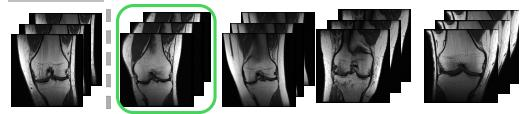

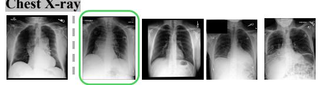

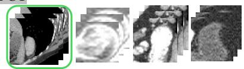

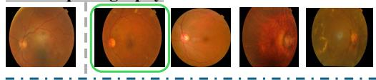

## Task: Modality-bridging visual retrieval

System Prompt: Find a MRI series that matches the given CT series:

## Brain MRI&CT

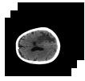

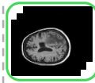

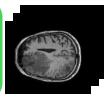

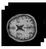

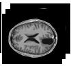  
System Prompt: Find a CT series that matches the given MRI series: Pelvis MRI&CT

System Prompt: Find a T2-weighted MRI series that matches the given T1-weighted MRI series:

## Brain MRI

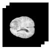

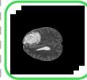

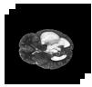

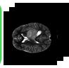

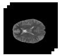

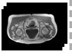

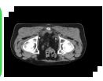

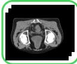

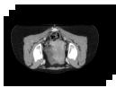  
System Prompt: Find a CT series that matches the given chest X-ray image:

## Chest CT

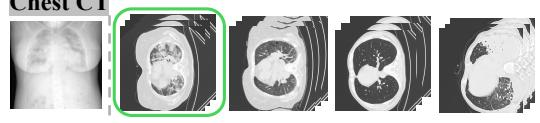

## Task: Image-image retrieval

System Prompt: Find the same category image with the provided image:

## Fundus photography

## Knee CT

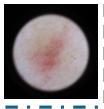

## Skin disease image

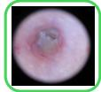

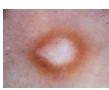

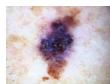

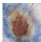

## Abdominal CT

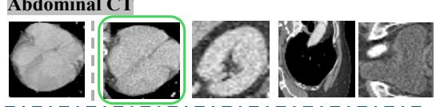

## Pathlogy

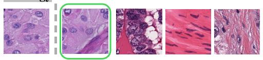

## Task:Text-to-image retrieval

System Prompt: Find an image that matches the given category:

## Pathlogy

Eosinophil

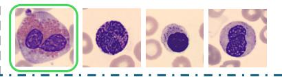

## Optical coherence to-mography

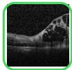

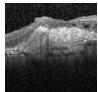

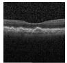

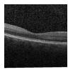

## Chest X-ray

## Abdominal CT

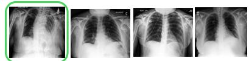

## System Prompt: Find an image that matches the given category:

Trachea, both main bronchi are open.There are millimetric lymph nodes at both hilar levels.When examined in the lung parenchyma window; Scattered and peripherally located ground-glass-like density increases are observed in both lungs, and they are consolidated in places. In the first place, it suggests Covid pneumonia. Clinical laboratory correlation is recommended.Pleura effusion-pneumothorax was not detected.

Figure 14: Case study 3.  
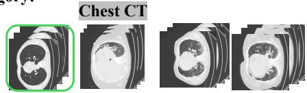

Task: Region level retrieval

System Prompt: Locate the specific region that corresponds to the provided text description

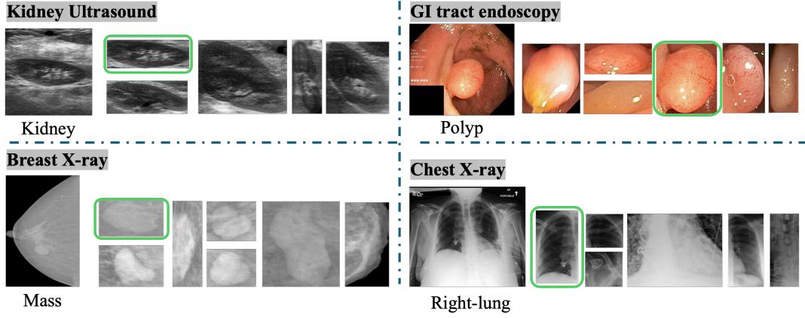  
Figure 15: Case study 4.

## NeurIPS Paper Checklist

## 1. Claims

Question: Do the main claims made in the abstract and introduction accurately reflect the paper’s contributions and scope?

Answer: [Yes]

Justification: The abstract and introduction state the benchmark scope, MedEmb reference baseline, and the main empirical conclusion that current medical embeddings are uneven across retrieval families; these claims are substantiated in Sections 1, 5.2, and 5.3

Guidelines:

• The answer [N/A] means that the abstract and introduction do not include the claims made in the paper.

• The abstract and/or introduction should clearly state the claims made, including the contributions made in the paper and important assumptions and limitations. A [No] or [N/A] answer to this question will not be perceived well by the reviewers.

• The claims made should match theoretical and experimental results, and reflect how much the results can be expected to generalize to other settings.

• It is fine to include aspirational goals as motivation as long as it is clear that these goals are not attained by the paper.

## 2. Limitations

Question: Does the paper discuss the limitations of the work performed by the authors?

Answer: [Yes]

Justification: Appendix A.8 explicitly discusses dataset noise, modality imbalance, access restrictions, the single-positive ranking formulation, and the scope of MedEmb as a reference baseline rather than a deployment-ready system.

Guidelines:

• The answer [N/A] means that the paper has no limitation while the answer [No] means that the paper has limitations, but those are not discussed in the paper.

• The authors are encouraged to create a separate “Limitations” section in their paper.

• The paper should point out any strong assumptions and how robust the results are to violations of these assumptions (e.g., independence assumptions, noiseless settings, model well-specification, asymptotic approximations only holding locally). The authors should reflect on how these assumptions might be violated in practice and what the implications would be.

• The authors should reflect on the scope of the claims made, e.g., if the approach was only tested on a few datasets or with a few runs. In general, empirical results often depend on implicit assumptions, which should be articulated.

• The authors should reflect on the factors that influence the performance of the approach. For example, a facial recognition algorithm may perform poorly when image resolution is low or images are taken in low lighting. Or a speech-to-text system might not be used reliably to provide closed captions for online lectures because it fails to handle technical jargon.

• The authors should discuss the computational efficiency of the proposed algorithms and how they scale with dataset size.

• If applicable, the authors should discuss possible limitations of their approach to address problems of privacy and fairness.

• While the authors might fear that complete honesty about limitations might be used by reviewers as grounds for rejection, a worse outcome might be that reviewers discover limitations that aren’t acknowledged in the paper. The authors should use their best judgment and recognize that individual actions in favor of transparency play an important role in developing norms that preserve the integrity of the community. Reviewers will be specifically instructed to not penalize honesty concerning limitations.

## 3. Theory assumptions and proofs

Question: For each theoretical result, does the paper provide the full set of assumptions and a complete (and correct) proof?

Answer: [N/A]

Justification: The paper is empirical and benchmark-oriented and does not present theorems, formal propositions, or proofs requiring a theory appendix.

Guidelines:

• The answer [N/A] means that the paper does not include theoretical results.

• All the theorems, formulas, and proofs in the paper should be numbered and crossreferenced.

• All assumptions should be clearly stated or referenced in the statement of any theorems.

• The proofs can either appear in the main paper or the supplemental material, but if they appear in the supplemental material, the authors are encouraged to provide a short proof sketch to provide intuition.

• Inversely, any informal proof provided in the core of the paper should be complemented by formal proofs provided in appendix or supplemental material.

• Theorems and Lemmas that the proof relies upon should be properly referenced.

## 4. Experimental result reproducibility

Question: Does the paper fully disclose all the information needed to reproduce the main experimental results of the paper to the extent that it affects the main claims and/or conclusions of the paper (regardless of whether the code and data are provided or not)?

Answer: [Yes]

Justification: The paper specifies task construction, split design, model interfaces, metrics, hyperparameters, and MedEmb training details in Sections 3.1, 4, 5.1, and Appendix A.1, which are the ingredients needed to reproduce the reported benchmark results.

Guidelines:

• The answer [N/A] means that the paper does not include experiments.

• If the paper includes experiments, a [No] answer to this question will not be perceived well by the reviewers: Making the paper reproducible is important, regardless of whether the code and data are provided or not.

• If the contribution is a dataset and/or model, the authors should describe the steps taken to make their results reproducible or verifiable.

• Depending on the contribution, reproducibility can be accomplished in various ways. For example, if the contribution is a novel architecture, describing the architecture fully might suffice, or if the contribution is a specific model and empirical evaluation, it may be necessary to either make it possible for others to replicate the model with the same dataset, or provide access to the model. In general. releasing code and data is often one good way to accomplish this, but reproducibility can also be provided via detailed instructions for how to replicate the results, access to a hosted model (e.g., in the case of a large language model), releasing of a model checkpoint, or other means that are appropriate to the research performed.

• While NeurIPS does not require releasing code, the conference does require all submissions to provide some reasonable avenue for reproducibility, which may depend on the nature of the contribution. For example

(a) If the contribution is primarily a new algorithm, the paper should make it clear how to reproduce that algorithm.

(b) If the contribution is primarily a new model architecture, the paper should describe the architecture clearly and fully.

(c) If the contribution is a new model (e.g., a large language model), then there should either be a way to access this model for reproducing the results or a way to reproduce the model (e.g., with an open-source dataset or instructions for how to construct the dataset).

(d) We recognize that reproducibility may be tricky in some cases, in which case authors are welcome to describe the particular way they provide for reproducibility. In the case of closed-source models, it may be that access to the model is limited in some way (e.g., to registered users), but it should be possible for other researchers to have some path to reproducing or verifying the results.

## 5. Open access to data and code

Question: Does the paper provide open access to the data and code, with sufficient instructions to faithfully reproduce the main experimental results, as described in supplemental material?

Answer: [Yes]

Justification: Appendices A.8 and A.7 describe the released artifact (task indices, preprocessing scripts, evaluation code, and source-specific access manifests) and list the official access routes for the underlying datasets.

Guidelines:

• The answer [N/A] means that paper does not include experiments requiring code.

• Please see the NeurIPS code and data submission guidelines (https://neurips.cc/ public/guides/CodeSubmissionPolicy) for more details.

• While we encourage the release of code and data, we understand that this might not be possible, so [No] is an acceptable answer. Papers cannot be rejected simply for not including code, unless this is central to the contribution (e.g., for a new open-source benchmark).

• The instructions should contain the exact command and environment needed to run to reproduce the results. See the NeurIPS code and data submission guidelines (https: //neurips.cc/public/guides/CodeSubmissionPolicy) for more details.

• The authors should provide instructions on data access and preparation, including how to access the raw data, preprocessed data, intermediate data, and generated data, etc.

• The authors should provide scripts to reproduce all experimental results for the new proposed method and baselines. If only a subset of experiments are reproducible, they should state which ones are omitted from the script and why.

• At submission time, to preserve anonymity, the authors should release anonymized versions (if applicable).

• Providing as much information as possible in supplemental material (appended to the paper) is recommended, but including URLs to data and code is permitted.

## 6. Experimental setting/details

Question: Does the paper specify all the training and test details (e.g., data splits, hyperparameters, how they were chosen, type of optimizer) necessary to understand the results?

Answer: [Yes]

Justification: Sections 4 and 5.1 report the optimizer, learning-rate schedule, LoRA configuration, training duration, batching strategy, model families, metrics, and evaluation protocol, with additional objective details in Appendix A.1.

Guidelines:

• The answer [N/A] means that the paper does not include experiments.

• The experimental setting should be presented in the core of the paper to a level of detail that is necessary to appreciate the results and make sense of them.

• The full details can be provided either with the code, in appendix, or as supplemental material.

## 7. Experiment statistical significance

Question: Does the paper report error bars suitably and correctly defined or other appropriate information about the statistical significance of the experiments?

Answer: [Yes]

Justification: Main benchmark metrics are computed deterministically over fixed query/candidate pools, and Appendix A.8 clarifies this evaluation regime; for the clinician preference study, Section 5.6 and Appendix A.8 report an exact binomial comparison of non-tied wins (260/382, $p < 1 0 ^ { - 1 1 } )$ ).

Guidelines:

• The answer [N/A] means that the paper does not include experiments.

• The authors should answer [Yes] if the results are accompanied by error bars, confidence intervals, or statistical significance tests, at least for the experiments that support the main claims of the paper.

• The factors of variability that the error bars are capturing should be clearly stated (for example, train/test split, initialization, random drawing of some parameter, or overall run with given experimental conditions).

• The method for calculating the error bars should be explained (closed form formula, call to a library function, bootstrap, etc.)

• The assumptions made should be given (e.g., Normally distributed errors).

• It should be clear whether the error bar is the standard deviation or the standard error of the mean.

• It is OK to report 1-sigma error bars, but one should state it. The authors should preferably report a 2-sigma error bar than state that they have a 96% CI, if the hypothesis of Normality of errors is not verified.

• For asymmetric distributions, the authors should be careful not to show in tables or figures symmetric error bars that would yield results that are out of range (e.g., negative error rates).

• If error bars are reported in tables or plots, the authors should explain in the text how they were calculated and reference the corresponding figures or tables in the text.

## 8. Experiments compute resources

Question: For each experiment, does the paper provide sufficient information on the computer resources (type of compute workers, memory, time of execution) needed to reproduce the experiments?

Answer: [Yes]

Justification: We report the compute resources used for training the reference model. The benchmark evaluation is lightweight: all MedHEB test experiments can be executed on a single GPU, with peak memory usage below 24GB.

Guidelines:

• The answer [N/A] means that the paper does not include experiments.

• The paper should indicate the type of compute workers CPU or GPU, internal cluster, or cloud provider, including relevant memory and storage.

• The paper should provide the amount of compute required for each of the individual experimental runs as well as estimate the total compute.

• The paper should disclose whether the full research project required more compute than the experiments reported in the paper (e.g., preliminary or failed experiments that didn’t make it into the paper).

## 9. Code of ethics

Question: Does the research conducted in the paper conform, in every respect, with the NeurIPS Code of Ethics https://neurips.cc/public/EthicsGuidelines?

Answer: [Yes]

Justification: The work is a benchmark and reference-model study over previously released medical datasets, does not claim autonomous clinical deployment, and explicitly discusses release scope, access restrictions, and the need for human oversight in Appendix A.8.

Guidelines:

• The answer [N/A] means that the authors have not reviewed the NeurIPS Code of Ethics.

• If the authors answer [No], they should explain the special circumstances that require a deviation from the Code of Ethics.

• The authors should make sure to preserve anonymity (e.g., if there is a special consideration due to laws or regulations in their jurisdiction).

## 10. Broader impacts

Question: Does the paper discuss both potential positive societal impacts and negative societal impacts of the work performed?

## Answer: [Yes]

Justification: Appendix A.8 discusses positive impacts (more reproducible evaluation and clearer failure analysis) as well as risks such as overinterpreting benchmark scores, propagating source-data bias, and misusing retrieved neighbors as unsupported clinical decision aids.

Guidelines:

• The answer [N/A] means that there is no societal impact of the work performed.

• If the authors answer [N/A] or [No], they should explain why their work has no societal impact or why the paper does not address societal impact.

• Examples of negative societal impacts include potential malicious or unintended uses (e.g., disinformation, generating fake profiles, surveillance), fairness considerations (e.g., deployment of technologies that could make decisions that unfairly impact specific groups), privacy considerations, and security considerations.

• The conference expects that many papers will be foundational research and not tied to particular applications, let alone deployments. However, if there is a direct path to any negative applications, the authors should point it out. For example, it is legitimate to point out that an improvement in the quality of generative models could be used to generate Deepfakes for disinformation. On the other hand, it is not needed to point out that a generic algorithm for optimizing neural networks could enable people to train models that generate Deepfakes faster.

• The authors should consider possible harms that could arise when the technology is being used as intended and functioning correctly, harms that could arise when the technology is being used as intended but gives incorrect results, and harms following from (intentional or unintentional) misuse of the technology.

• If there are negative societal impacts, the authors could also discuss possible mitigation strategies (e.g., gated release of models, providing defenses in addition to attacks, mechanisms for monitoring misuse, mechanisms to monitor how a system learns from feedback over time, improving the efficiency and accessibility of ML).

## 11. Safeguards

Question: Does the paper describe safeguards that have been put in place for responsible release of data or models that have a high risk for misuse (e.g., pre-trained language models, image generators, or scraped datasets)?

Answer: [Yes]

Justification: Appendix A.8 describes a release scope that excludes restricted raw medical data and instead distributes task indices, code, and source-specific access manifests, so downstream users must still obtain the assets under the original access terms and clinical governance.

## Guidelines:

• The answer [N/A] means that the paper poses no such risks.

• Released models that have a high risk for misuse or dual-use should be released with necessary safeguards to allow for controlled use of the model, for example by requiring that users adhere to usage guidelines or restrictions to access the model or implementing safety filters.

• Datasets that have been scraped from the Internet could pose safety risks. The authors should describe how they avoided releasing unsafe images.

• We recognize that providing effective safeguards is challenging, and many papers do not require this, but we encourage authors to take this into account and make a best faith effort.

## 12. Licenses for existing assets

Question: Are the creators or original owners of assets (e.g., code, data, models), used in the paper, properly credited and are the license and terms of use explicitly mentioned and properly respected?

## Answer: [Yes]

Justification: The paper credits source datasets and official access URLs throughout the paper and Appendix A.7, but it does not enumerate every underlying license or term-of-use in the manuscript itself; those asset-level license details should accompany the final artifact release.

## Guidelines:

• The answer [N/A] means that the paper does not use existing assets.

• The authors should cite the original paper that produced the code package or dataset.

• The authors should state which version of the asset is used and, if possible, include a URL.

• The name of the license (e.g., CC-BY 4.0) should be included for each asset.

• For scraped data from a particular source (e.g., website), the copyright and terms of service of that source should be provided.

• If assets are released, the license, copyright information, and terms of use in the package should be provided. For popular datasets, paperswithcode.com/datasets has curated licenses for some datasets. Their licensing guide can help determine the license of a dataset.

• For existing datasets that are re-packaged, both the original license and the license of the derived asset (if it has changed) should be provided.

• If this information is not available online, the authors are encouraged to reach out to the asset’s creators.

## 13. New assets

Question: Are new assets introduced in the paper well documented and is the documentation provided alongside the assets?

Answer: [Yes]

Justification: The paper documents the new benchmark, task construction protocol, release scope, and MedEmb training recipe in Sections 3.1–5.2 and Appendices A.1 and A.8.

Guidelines:

• The answer [N/A] means that the paper does not release new assets.

• Researchers should communicate the details of the dataset/code/model as part of their submissions via structured templates. This includes details about training, license, limitations, etc.

• The paper should discuss whether and how consent was obtained from people whose asset is used.

• At submission time, remember to anonymize your assets (if applicable). You can either create an anonymized URL or include an anonymized zip file.

## 14. Crowdsourcing and research with human subjects

Question: For crowdsourcing experiments and research with human subjects, does the paper include the full text of instructions given to participants and screenshots, if applicable, as well as details about compensation (if any)?

Answer: [Yes]

Justification: The clinician preference study (Section 5.6) is documented in Appendix A.10, which describes the sampling procedure (530 queries stratified across 107 tasks), perquery A/B randomization, the full text of the rater instructions, and screenshots of the blind-comparison interface for 2D and 3D queries (Figures 10 and 11). No crowdsourcing platform was used; the rater is a single board-certified clinician collaborator. Compensation arrangements will be disclosed in the final non-anonymous release.

Guidelines:

• The answer [N/A] means that the paper does not involve crowdsourcing nor research with human subjects.

• Including this information in the supplemental material is fine, but if the main contribution of the paper involves human subjects, then as much detail as possible should be included in the main paper.

• According to the NeurIPS Code of Ethics, workers involved in data collection, curation, or other labor should be paid at least the minimum wage in the country of the data collector.

## 15. Institutional review board (IRB) approvals or equivalent for research with human subjects

Question: Does the paper describe potential risks incurred by study participants, whether such risks were disclosed to the subjects, and whether Institutional Review Board (IRB) approvals (or an equivalent approval/review based on the requirements of your country or institution) were obtained?

Answer: [N/A]

Justification: The clinician preference study involved a single expert collaborator evaluating model outputs without collection of personal, behavioral, or sensitive participant data. No patient interaction or identifiable patient information was involved.

Guidelines:

• The answer [N/A] means that the paper does not involve crowdsourcing nor research with human subjects.

• Depending on the country in which research is conducted, IRB approval (or equivalent) may be required for any human subjects research. If you obtained IRB approval, you should clearly state this in the paper.

• We recognize that the procedures for this may vary significantly between institutions and locations, and we expect authors to adhere to the NeurIPS Code of Ethics and the guidelines for their institution.

• For initial submissions, do not include any information that would break anonymity (if applicable), such as the institution conducting the review.

## 16. Declaration of LLM usage

Question: Does the paper describe the usage of LLMs if it is an important, original, or non-standard component of the core methods in this research? Note that if the LLM is used only for writing, editing, or formatting purposes and does not impact the core methodology, scientific rigor, or originality of the research, declaration is not required.

Answer: [N/A]

Justification: LLMs were used only for routine writing assistance, including grammar checking and language consistency checks. Their use did not affect the core method development, experimental design, data analysis, results, or scientific claims of this work.

Guidelines:

• The answer [N/A] means that the core method development in this research does not involve LLMs as any important, original, or non-standard components.

• Please refer to our LLM policy in the NeurIPS handbook for what should or should not be described.