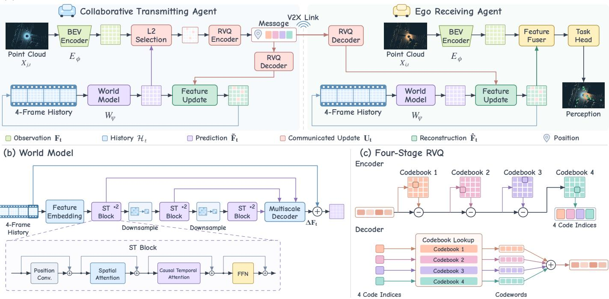
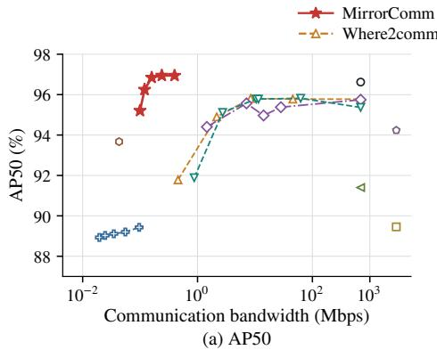
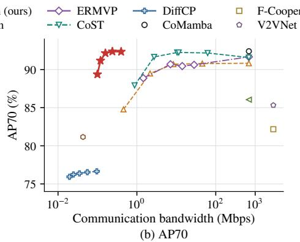
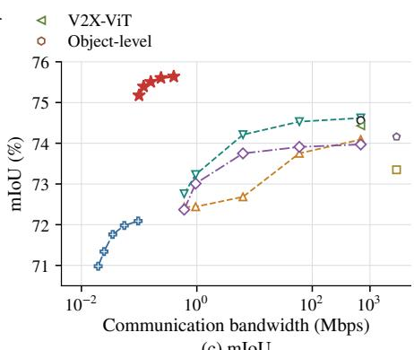

# MirrorComm: A Communication-Efficient Cooperative Perception Framework via Mirrored World Models

Shenghan Luo1, Yin Xu1, Cixiao Zhang1, Yang Wang1, Yujie Cao1, Zhuoran Xiao2, Wenjun Zhang1

1Cooperative Medianet Innovation Center (CMIC), Shanghai Jiao Tong University, Shanghai, China

2Unisoc (Shanghai) Technologies Co., Ltd., Shanghai, China

Corresponding author: Yin Xu (e-mail: xuyin@sjtu.edu.cn)

Abstract—Cooperative perception (CP) requires substantial communication bandwidth to exchange sensing information among connected agents. A variety of compression techniques have been proposed to reduce transmission costs while retaining task-relevant information. However, most existing methods follow a frame-wise compression paradigm, overlooking temporal predictability and repeatedly transmitting information that could be inferred from historical context. To address these limitations, we propose MirrorComm, the first world model-based communication-efficient CP framework. Specifically, mirrored world models at the transmitter and receiver predict the transmitter’s current observation from a shared history of its reconstructed observations. The transmitter compares this prediction with its current observation and selectively transmits observation updates to correct prediction errors, reducing repeated transmission of predictable information. Experiments on the OPV2V dataset across two downstream tasks including object detection and semantic segmentation show that MirrorComm reduces communication bandwidth requirements by up to approximately 66× while maintaining comparable performance to a state-ofthe-art (SOTA) method. Ablation studies further demonstrate the effectiveness of the individual components.

Index Terms—Cooperative perception, communication compression, world models, object detection, semantic segmentation.

## I. INTRODUCTION

Accurate and reliable environmental perception is essential for autonomous agents to make informed decisions. However, single-agent perception is constrained by limited sensing range and occlusions. Cooperative perception (CP) mitigates these limitations by enabling agents to exchange sensing information over wireless channels. This paradigm has been widely applied in vehicular networks, where shared observations reveal objects and regions hidden from an agent’s own sensors or beyond its sensing range, enabling more complete and reliable environmental perception [1]–[3].

However, exchanging sensing information places substantial demands on limited communication bandwidth. Depending on the information exchanged, CP architectures can be categorized into raw-level, object-level, and feature-level approaches [4]. Raw-level methods, such as Cooper [5], preserve detailed sensor measurements but incur high communication costs. Object-level methods, such as OptiMatch [6], substantially reduce these costs by transmitting compact detection results, but their performance remains constrained by individual agents’ local detection capabilities. Featurelevel methods, including F-Cooper [7], V2VNet [3], and V2X-ViT [8], balance these considerations by exchanging intermediate representations. More recent methods, including DiffCP [9], ERMVP [10], Where2comm [11], and CoST [12], further reduce bandwidth requirements through compact feature reconstruction or selective transmission. However, most existing compression methods follow a frame-wise paradigm, repeatedly transmitting predictable information that could be reconstructed from historical context.

Recent advances in world models offer a promising avenue for exploiting this temporal predictability. By maintaining internal environmental representations and learning state transitions, world models predict subsequent scene states from historical observations [13]–[15]. World4V2X [16] demonstrates their potential for CP through scene evolution modeling and consistency-guided reconstruction, improving robustness to occlusions and degraded observations. World models have also been explored in semantic communication to predict video frames at the receiver and reduce frame-by-frame transmission [17]. This framework uses textual prompts to guide prediction and relies on depth-map feedback to determine when updates are needed, requiring a feedback link for transmission decisions. For communication-efficient CP, a key challenge is to enable the transmitter to identify receiver-side prediction errors and selectively transmit observation updates without prediction-quality feedback.

To address this challenge, we propose MirrorComm, a communication-efficient CP framework based on mirrored world models. At the ego receiving agent, a world model predicts the collaborative transmitting agent’s current observation from reconstructed historical observations. The model combines spatial context at multiple scales with causal temporal attention to capture both local details and scene dynamics for prediction. The transmitter maintains an identical model and synchronized history, allowing it to reproduce the receiver’s prediction and identify discrepancies from its current observation without receiver feedback. It selectively transmits RVQ-encoded observation features within the communication budget, which both ends use to update the corresponding spatial locations. The receiver then fuses the reconstructed collaborative observation with its own observation for downstream perception. This design not only avoids repeated transmission of predictable information but also allows agents to continue predicting scene evolution during communication interruptions, mitigating perception degradation caused by outdated collaborative information.

We summarize the contributions of this work as follows:

• We propose MirrorComm, to our knowledge, the first world model-based communication-efficient CP framework, which replaces part of the communication with prediction to reduce repeated transmissions. Moreover, it can be integrated into any existing mainstream collaborative algorithm to support diverse downstream tasks.

• We develop a world model that predicts current observations from historical context through multiscale causal spatiotemporal modeling. To preserve reconstruction fidelity with smaller codebooks, we encode the required observation updates using residual vector quantization (RVQ), which combines codewords across stages.

• Experiments on OPV2V for object detection and semantic segmentation show that MirrorComm reduces communication bandwidth requirements by up to approximately 66× while maintaining comparable performance to a state-of-the-art (SOTA) method. Additional experiments demonstrate its advantage over the frame-wise paradigm under intermittent communication. Ablation studies further confirm the effectiveness of the proposed modules.

## II. PROBLEM FORMULATION

We consider a CP system with N agents that exchange information to support individual local perception. Each agent can act as a transmitter when sharing information and as a receiver when incorporating messages from its collaborators. For agent $i ,$ let $X _ { i }$ denote its current sensory observation (e.g., from LiDAR or cameras) and $Y _ { i }$ denote the groundtruth annotations used to evaluate its perception output. We use $M _ { j  i }$ to denote the message sent from agent $j$ to agent i. Our goal is to maximize aggregate perception performance under a total communication budget C. Specifically, the optimization problem can be formulated as follows:

$$
\begin{array} { r l } { \underset { \theta , \{ M _ { j \to i } \} } { \operatorname* { m a x } } } & { \displaystyle \sum _ { i = 1 } ^ { N } h ( \Phi _ { \theta } ( X _ { i } , \{ M _ { j \to i } \} _ { j \neq i } ) , Y _ { i } ) , } \\ { \mathrm { s . t . } } & { \displaystyle \sum _ { i = 1 } ^ { N } \sum _ { j = 1 } ^ { N } c ( M _ { j \to i } ) \leq C , } \end{array}\tag{1}
$$

where $\Phi _ { \theta }$ is the perception model with parameters $\theta , h ( \cdot , \cdot )$ measures task performance, and c(·) quantifies the communication cost of the messages. The challenge is to design messages $M _ { j  i }$ that both preserve task-relevant information and satisfy the communication budget.

## III. METHODOLOGY

## A. Overview of MirrorComm Architecture

MirrorComm reduces communication by allowing the receiver to predict the transmitter’s current observation and receive selected updates to correct prediction errors. As illustrated in Fig. 1, each agent first encodes its observation into bird’s-eye view (BEV) features, and the receiver predicts the transmitter’s current features from four previous reconstructions. The transmitter maintains an identical world model and synchronized history, enabling it to reproduce this prediction and compare it with its current observation features. Within the communication budget, it selects the spatial locations with the largest discrepancies and transmits their RVQ-encoded features together with their positions. Both ends perform the same feature update by replacing the predictions at the selected positions with the decoded observation features and retaining the predictions elsewhere. Only these reconstructed transmitter features enter the shared histories for subsequent predictions. The receiver fuses the updated features with its own current features for downstream perception.

By reconstructing predictable information locally, Mirror-Comm avoids repeatedly transmitting it and concentrates the available bandwidth on observations that are not accurately predicted. The same predictive mechanism also allows the receiver to continue updating collaborative features during temporary communication outages, mitigating perception degradation caused by outdated collaborative information. Moreover, MirrorComm naturally supports multi-agent collaboration, with each agent reusing the same world model for receiver-side prediction and transmitter-side replication while maintaining a separate historical context for each communication link. We next describe MirrorComm using vehicular CP with LiDAR point clouds as an example.

## B. BEV Feature Encoder

As a widely adopted representation for CP, BEV preserves the spatial structure of observations and facilitates feature alignment and fusion across agents. MirrorComm reconstructs the transmitter’s observations in this feature space, allowing the reconstructed features to be used by existing BEV-based CP fusion modules. Specifically, the LiDAR point cloud $X _ { i , t }$ observed by agent i at time t is aligned to the receiver’s coordinate frame using relative poses, cropped to the region of interest, and discretized into a spatial grid. The encoder aggregates local point geometry within each grid cell and applies convolutional layers to extract spatial context, yielding the mapping from point clouds to BEV features

$$
\mathbf { F } _ { i , t } = E _ { \phi } ( X _ { i , t } ) \in \mathbb { R } ^ { H \times W \times D } ,\tag{2}
$$

where $E _ { \phi }$ denotes the encoder with parameters $\phi ,$ including preprocessing, and H, W, and D denote the BEV feature height, width, and channel dimension, respectively.

## C. World-Model-Based Predictive Communication

1) Mirrored World Model: A world model learns how an environment evolves over time, enabling it to predict future states from historical observations. In MirrorComm, we use this capability to predict the transmitter’s current BEV features from the reconstructed features of the preceding four frames, expressed as

$$
\widetilde { \mathbf { F } } _ { t } = W _ { \psi } ( \mathcal { H } _ { t } ) ,\tag{3}
$$

  
Fig. 1. Overview of MirrorComm, showing (a) the overall framework, (b) the world model architecture, and (c) four-stage RVQ-based message encoding.

where $W _ { \psi }$ denotes the world model with learnable parameters $\psi , \ \mathcal { H } _ { t }$ is the shared four-frame historical context, and $\widetilde { \mathbf { F } } _ { t }$ denotes the predicted BEV features at time t. To capture spatial relationships and temporal evolution jointly, we implement $W _ { \psi }$ using a multiscale causal spatiotemporal attention mechanism, as illustrated in Fig. 1(b).

For a single communication link, we omit agent indices for brevity and denote observed and reconstructed BEV features by $\mathbf { F } _ { t }$ and $\widehat { \mathbf { F } } _ { t } ,$ respectively. To compensate for changes in the reference frame over time, we apply pose-based alignment $A _ { \tau  t }$ to each historical reconstruction $\widehat { \mathbf { F } } _ { \tau }$ , where $\tau \in$ $\{ t - 4 , \ldots , t - 1 \}$ , bringing all four frames into the current coordinate system. The aligned features, together with their spatial validity masks and elapsed times, form the historical context $\mathcal { H } _ { t }$ in chronological order. The masks indicate where the aligned historical features remain spatially valid, while the elapsed times specify the interval between each historical frame and the current frame.

The predictor first embeds the aligned BEV features of each historical frame together with its validity mask and elapsed time into a hidden representation. The resulting four-frame sequence then passes through three successive stages, each containing two spatiotemporal (ST) blocks. Between stages, the spatial resolution is halved while all four time steps are retained, yielding outputs $\mathbf { Z } ^ { ( 1 ) } , \mathbf { Z } ^ { ( 2 ) }$ , and $\mathbf { Z } ^ { ( 3 ) }$ at resolutions $H \times W , H / 2 \times W / 2$ , and $H / 4 \times W / 4$ , respectively. Fineresolution features preserve local detail, while coarser features provide broader spatial context for predicting scene evolution.

Within each ST block, spatial and temporal dependencies are modeled sequentially through spatial attention (SA) and causal temporal attention (TA), followed by a feed-forward network (FFN). For an input feature sequence $\mathbf { Z } _ { \mathrm { i n } }$ , positional information is first introduced through a depthwise convolution, and the subsequent transformations are applied with separate residual connections as

$$
\begin{array} { r l } & { \mathbf { Z } _ { \mathrm { P E } } = \mathbf { Z } _ { \mathrm { i n } } + \mathrm { P E } ( \mathbf { Z } _ { \mathrm { i n } } ) , } \\ & { \mathbf { Z } _ { \mathrm { S A } } = \mathbf { Z } _ { \mathrm { P E } } + \mathrm { S A } ( \mathrm { L N } ( \mathbf { Z } _ { \mathrm { P E } } ) ) , } \\ & { \mathbf { Z } _ { \mathrm { T A } } = \mathbf { Z } _ { \mathrm { S A } } + \mathrm { T A } ( \mathrm { L N } ( \mathbf { Z } _ { \mathrm { S A } } ) ; \mathbf { B } ) , } \\ & { \mathbf { Z } _ { \mathrm { o u t } } = \mathbf { Z } _ { \mathrm { T A } } + \mathrm { F F N } ( \mathrm { L N } ( \mathbf { Z } _ { \mathrm { T A } } ) ) , } \end{array}\tag{4}
$$

where PE denotes the depthwise positional convolution, LN denotes layer normalization, $\mathbf { Z _ { \mathrm { o u t } } }$ is the block output, and subscripts PE, SA, and TA identify the corresponding intermediate stages. SA aggregates spatial information within each historical frame, using local windows at the two finer scales and global attention at the coarsest scale. TA then processes the spatially updated sequence along the time dimension at each aligned spatial location, with a causal mask B added to the attention scores before softmax, defined by

$$
B _ { a b } = \left\{ \begin{array} { l l } { 0 , } & { b \le a , } \\ { - \infty , } & { b > a , } \end{array} \right. \quad a , b \in \{ 1 , 2 , 3 , 4 \} ,\tag{5}
$$

where a and b index the query and key time steps in chronological order, respectively, so that each historical step attends only to itself and earlier steps.

After spatiotemporal modeling, the decoder $f _ { \mathrm { d } }$ takes the last temporal output from each scale, denoted $\mathbf { Z } _ { 4 } ^ { ( 1 ) } , \mathbf { Z } _ { 4 } ^ { ( 2 ) }$ , and $\mathbf { Z } _ { 4 } ^ { ( 3 ) }$ where the subscript 4 corresponds to time t−1. It progressively upsamples coarser features and combines them with finer features through skip connections to predict a feature residual $\Delta \mathbf { F } _ { t } .$ . Adding this residual to the aligned reconstruction of the preceding frame produces the current prediction, expressed as

$$
\begin{array} { r l } & { \Delta \mathbf { F } _ { t } = f _ { \mathrm { d } } ( \mathbf { Z } _ { 4 } ^ { ( 1 ) } , \mathbf { Z } _ { 4 } ^ { ( 2 ) } , \mathbf { Z } _ { 4 } ^ { ( 3 ) } ) , } \\ & { \quad \widetilde { \mathbf { F } } _ { t } = \mathcal { A } _ { t - 1  t } ( \widehat { \mathbf { F } } _ { t - 1 } ) + \Delta \mathbf { F } _ { t } . } \end{array}\tag{6}
$$

Together, the history embedding, three ST stages, and residual decoding constitute $W _ { \psi }$ , which predicts scene changes relative to the preceding reconstruction.

2) Prediction-Guided Communication and Feature Update: During initialization, the transmitter sends RVQ-encoded features at all spatial locations for four consecutive frames, after which both ends begin prediction from this shared history.

To correct prediction errors within the communication budget, the transmitter compares the predicted features with those extracted from its current observation and assigns each spatial position $p$ an L2 discrepancy score,

$$
\epsilon _ { t } ( p ) = \frac { 1 } { D } \left\| \mathbf { F } _ { t } [ p ] - \widetilde { \mathbf { F } } _ { t } [ p ] \right\| _ { 2 } ^ { 2 } ,\tag{7}
$$

where $[ p ]$ extracts the feature vector at position $p$ and $\| \cdot \| _ { 2 }$ denotes the Euclidean norm. After accounting for packet metadata, the transmitter selects the positions with the largest positive scores that fit the link budget, forming $S _ { t }$ , and transmits their positions and RVQ-encoded observation features as described in Section III-D. The budgets allocated to individual links sum to at most the total budget C. Both ends decode these features into $\mathbf { U } _ { t } ~ \in ~ \mathbb { R } ^ { H \times \check { W } \times D }$ , which contains the recovered features at $S _ { t }$ and zeros elsewhere. Feature Update replaces predictions at selected positions with recovered features and retains predictions elsewhere, yielding

$$
\widehat { \mathbf { F } } _ { t } = \mathbf { U } _ { t } + \left( 1 - \mathbf { m } _ { t } \right) \odot \widetilde { \mathbf { F } } _ { t } ,\tag{8}
$$

where $\mathbf { m } _ { t } ~ \in ~ \{ 0 , 1 \} ^ { H \times W }$ marks the selected positions and $\odot$ denotes element-wise multiplication with channel broadcasting. This deterministic operation introduces no learnable parameters. By applying the same feature update, both ends obtain identical reconstructed features $\widehat { \mathbf { F } } _ { t } .$ , which are appended to their shared histories while the oldest frame is discarded, preserving a common four-frame context for subsequent predictions. When no update is transmitted, both ends use $\widehat { \mathbf { F } } _ { t } =$ $\widetilde { \mathbf { F } } _ { t }$ to advance their histories through prediction alone. The receiver fuses $\widehat { \mathbf { F } } _ { t }$ with its current local features for downstream perception, while retaining only the reconstructed transmitter features in the shared history.

3) Closed-Loop Training: We first train the perception backbone, then train the RVQ codec and adapt the receiver to quantized features as described in Section III-D. With the encoder and codebooks frozen, we jointly optimize the predictor, fusion module, and task head by unrolling the prediction– communication–update loop. Reconstructed features are fed back as history, exposing the predictor to errors accumulated during deployment. The feature-learning objective ${ \mathcal { L } } _ { \mathrm { W M } }$ combines three losses,

$$
\begin{array} { r } { \mathcal { L } _ { \mathrm { W M } } = \lambda _ { \mathrm { p } } \mathcal { L } _ { \mathrm { p r e d } } + \lambda _ { \mathrm { r } } \mathcal { L } _ { \mathrm { r e c } } + \lambda _ { \mathrm { u } } \mathcal { L } _ { \mathrm { u n r e c v } } , } \end{array}\tag{9}
$$

where $\lambda _ { \mathrm { p } } , \lambda _ { \mathrm { r } } .$ , and $\lambda _ { \mathrm { u } }$ are nonnegative weights. The three terms use the current observation features $\mathbf { F } _ { t }$ as supervision and are defined as

$$
\begin{array} { r l } & { \mathcal { L } _ { \mathrm { p r e d } } = \mathrm { M S E } ( \widetilde { \mathbf { F } } _ { t } , \mathbf { F } _ { t } ) , } \\ & { \quad \mathcal { L } _ { \mathrm { r e c } } = \mathrm { S m o o t h L 1 } ( \widehat { \mathbf { F } } _ { t } , \mathbf { F } _ { t } ) , } \\ & { \quad \mathcal { L } _ { \mathrm { u n r e c v } } = \mathrm { M S E } _ { 1 - \mathbf { m } _ { t } } ( \widehat { \mathbf { F } } _ { t } , \mathbf { F } _ { t } ) , } \end{array}\tag{10}
$$

where MSE and SmoothL1 denote the mean squared error and smooth $L _ { 1 }$ loss averaged over feature elements, respectively. The latter uses a transition threshold of one. The mask subscript restricts the average to untransmitted positions, with the loss set to zero when none remain. These terms supervise prediction before communication, reconstruction after feature updates, and prediction at untransmitted positions, respectively. The joint objective adds the downstream task loss on the final perception output to ${ \mathcal { L } } _ { \mathrm { W M } }$ . The feature-learning term supervises the predictor, while the task loss trains both the predictor and receiver through reconstructed features.

## D. RVQ-Based Message Encoding

To communicate observation updates efficiently, we seek a compact encoding that preserves reconstruction fidelity with smaller codebooks. MirrorComm therefore uses four-stage RVQ, which combines codewords across stages by successively quantizing the remaining residual and transmits their indices (Fig. 1(c)). Each stage $\ell \in \{ 1 , 2 , 3 , 4 \}$ uses a codebook $\mathcal { C } _ { \ell } = \{ \mathbf { c } _ { \ell , k } \} _ { k = 1 } ^ { K } \subset \mathbb { R } ^ { D }$ , where K is the number of codewords and $\mathbf { c } _ { \ell , k }$ is the kth codeword. The four codebooks provide up to $K ^ { 4 }$ index combinations with only 4K stored codewords.

For each selected position $p \in S _ { t }$ , the transmitter initializes $\mathbf { r } _ { 0 } = \mathbf { F } _ { t } [ p ]$ and recursively quantizes the residual as

$$
\begin{array} { r l } & { k _ { \ell } = \arg \operatorname* { m i n } _ { { \bf \phi } } \| { \bf r } _ { \ell - 1 } - { \bf c } _ { \ell , k } \| _ { 2 } ^ { 2 } , } \\ & { ~ { \bf \phi } _ { { \bf r } _ { \ell } } = { \bf r } _ { \ell - 1 } - { \bf c } _ { \ell , k _ { \ell } } , \qquad \ell = 1 , 2 , 3 , 4 , } \end{array}\tag{11}
$$

where $k _ { \ell }$ is the selected index and $\mathbf { r } _ { \ell }$ the remaining residual, with time and position indices omitted for brevity. The transmitter sends the four codeword indices, which both ends decode using identical preinstalled codebooks as

$$
{ \bf U } _ { t } [ p ] = \sum _ { \ell = 1 } ^ { 4 } { \bf c } _ { \ell , k _ { \ell } } , \qquad p \in { \cal S } _ { t } .\tag{12}
$$

Unselected positions are set to zero to form $\mathbf { U } _ { t }$ for the feature update in (8). For a link budget $C _ { \mathrm { l i n k } } ,$ the packet satisfies $b _ { \mathrm { h } } + b _ { \mathrm { r } } | S _ { t } | \le C _ { \mathrm { l i n k } }$ , where $b _ { \mathrm { h } }$ and $b _ { \mathrm { r } }$ denote the metadata bytes and bytes per selected position, respectively.

The codec is trained using standard codebook-fitting and commitment losses [18], together with feature reconstruction and downstream task losses. Codewords are detached when forming subsequent residuals, while a straight-through estimator propagates gradients through quantization to the encoder.

## IV. EXPERIMENTAL RESULTS

## A. Experimental Setup

We conduct experiments on OPV2V [1], a simulated CP dataset generated with CARLA and OpenCDA. Our processed splits contain 6,374 training frames, 1,980 validation frames, and 2,170 test frames. We use its LiDAR sequences with a perception frequency of $f = 1 0$ Hz and process frames within each scene in chronological order. The shared histories are reset when switching to a new scene. The communication bandwidth is measured in Mbps as

  
(c) mIoU  
Fig. 2. Trade-off between perception performance and communication bandwidth on OPV2V. Panels (a) and (b) show object detection AP at IoU thresholds of 0.5 and 0.7, respectively, while panel (c) shows mIoU for BEV semantic segmentation.

$$
B _ { \mathrm { c o m m } } = \frac { 8 f B _ { \mathrm { t o t a l } } } { 1 0 ^ { 6 } N _ { \mathrm { f } } } ,\tag{13}
$$

where $B _ { \mathrm { t o t a l } }$ is the total number of transmitted bytes, including metadata, over $N _ { \mathrm { f } }$ evaluated frames. For MirrorComm, this total also includes the cold-start transmissions used to initialize the shared history at the beginning of each scene.

Two downstream tasks are evaluated on this dataset, including object detection and BEV semantic segmentation. These tasks assess complementary aspects of reconstruction quality, as object detection requires accurate object locations and geometry, whereas semantic segmentation requires spatially dense semantic details. For object detection, we report BEV average precision (AP) at intersection-over-union (IoU) thresholds of 0.5 and 0.7, denoted AP50 and AP70, respectively. For semantic segmentation, we report mean IoU (mIoU) over the vehicle, road, and lane classes, excluding background.

We implement MirrorComm with the feature fusion module from CoMamba [19]. We evaluate per-link update budgets of 256, 512, 1,024, 2,048, and 4,096 bytes. We use AdamW with an initial learning rate of $1 0 ^ { - 4 }$ and weight decay of $1 0 ^ { - 4 }$ , and apply truncated backpropagation through time over 20 steps of the closed-loop sequence. All implementations use PyTorch and run on NVIDIA RTX 4090 GPUs with 24 GB memory.

## B. Trade-off between Performance and Bandwidth

We compare with representative feature-level information fusion methods for CP, including V2VNet [3], F-Cooper [7], V2X-ViT [8], and CoMamba [19], which fuse intermediate features from multiple agents. We also include methods targeting communication efficiency, namely DiffCP [9], ER-MVP [10], Where2comm [11], and CoST [12]. For object detection, we additionally consider an object-level baseline that transmits local detection results without a bandwidth cap.

Fig. 2 shows that MirrorComm substantially reduces communication bandwidth while preserving perception performance across both downstream tasks. At an update budget of 1,024 bytes, MirrorComm requires only 0.159 Mbps and achieves 96.84% AP50 and 92.15% AP70. Compared with the state-of-the-art method CoST, which achieves 95.78% AP50 and 92.24% AP70 at 10.497 Mbps, MirrorComm delivers higher AP50 and comparable AP70 while requiring approximately 66× less bandwidth. This advantage extends to semantic segmentation, where MirrorComm achieves 75.51% mIoU at the same bandwidth, surpassing CoST’s best evaluated mIoU of 74.62% while operating below its lowest evaluated bandwidth of 0.603 Mbps. MirrorComm also exceeds framewise CoMamba’s mIoU of 74.56%, which may stem from its use of historical context to complement current observations. Although DiffCP operates at lower bandwidths than Mirror-Comm, its perception performance is substantially lower on both tasks. Likewise, the object-level baseline requires only 0.043 Mbps but achieves an AP70 of 81.15%, revealing a substantial accuracy gap under the stricter localization criterion. Moreover, unlike most existing methods that operate with fixed data rates, MirrorComm can adapt to different communication budgets at inference time by varying the number of spatial positions selected for transmission, without retraining.

## C. Ablation Studies

We conduct ablation studies by comparing four component configurations at a fixed communication update budget of 1,024 bytes, reporting AP50, AP70, and mIoU in Table I. The configurations enable or disable RVQ and the worldmodel predictor (WM). Disabling RVQ replaces it with singlestage VQ. Disabling WM replaces prediction with the posealigned previous state, while retaining the same feature update at transmitted locations. Enabling both components gives the complete MirrorComm framework. Within each task and quantizer pair, both WM settings use the same receiver weights and communication budget. VQ uses one 1,024-entry codebook, whereas RVQ uses four 256-entry codebooks, keeping total codeword counts equal and accounting for index lengths in the communication cost.

TABLE I  
ABLATION STUDY RESULTS OF THE WORLD MODEL AND RVQ.
<table><tr><td colspan="2">Component</td><td colspan="3">Performance (%)</td></tr><tr><td>RVQ</td><td>WM</td><td>AP50</td><td>AP70</td><td>mIoU</td></tr><tr><td>X</td><td>X</td><td>95.12</td><td>87.01</td><td>71.09</td></tr><tr><td>X</td><td>√</td><td>96.18</td><td>89.11</td><td>72.30</td></tr><tr><td>√</td><td>X</td><td>96.19</td><td>90.12</td><td>72.43</td></tr><tr><td>√</td><td>√</td><td>97.14</td><td>92.15</td><td>75.51</td></tr></table>

TABLE II  
AP70 (%) UNDER INTERMITTENT COMMUNICATION.
<table><tr><td>Update interval (frames)</td><td>CoMamba</td><td>MirrorComm</td></tr><tr><td>2</td><td>83.78</td><td>84.79</td></tr><tr><td>3</td><td>80.69</td><td>83.93</td></tr><tr><td>4</td><td>79.11</td><td>83.12</td></tr><tr><td>5</td><td>78.67</td><td>82.17</td></tr><tr><td>Random 2–5</td><td>78.01</td><td>83.54</td></tr></table>

WM improves both downstream tasks with either quantizer, increasing mIoU by 3.08 percentage points with RVQ. With WM enabled, replacing VQ with RVQ further improves all three metrics, including a 3.21-point mIoU gain. These results confirm that both components contribute to perception accuracy under the same communication budget.

## D. Robustness to Intermittent Communication

To evaluate MirrorComm’s ability to mitigate information staleness relative to frame-wise perception, we test communication updates at fixed intervals of 2–5 frames and random intervals within this range. We choose CoMamba as the baseline because MirrorComm adopts its feature fusion architecture. CoMamba transmits complete collaborative features at each update and holds them between updates. Under the same schedule, MirrorComm sends 1,024-byte observation updates and predicts collaborative features between transmissions. Both methods are evaluated on object detection using AP70.

As shown in Table II, MirrorComm outperforms frame-wise CoMamba under every update schedule. As the fixed interval increases from 2 to 5 frames, its AP70 decreases by 2.62 percentage points, compared with 5.11 points for frame-wise CoMamba. Under random intervals, MirrorComm achieves 83.54% AP70, exceeding the baseline by 5.53 percentage points. These results show that predicting scene evolution mitigates degradation from stale collaborative information, even though frame-wise CoMamba receives complete collaborative features at every update.

## V. CONCLUSION

This paper presented MirrorComm, a world-model-based communication-efficient CP framework. By maintaining mirrored world models at the transmitter and receiver, Mirror-Comm reconstructs predictable information locally and communicates compact observation updates to correct prediction errors. Experiments on OPV2V demonstrated substantial bandwidth savings while maintaining competitive object detection and semantic segmentation performance, with additional benefits under intermittent communication. These findings highlight the potential of shared predictive models to shift cooperative perception from transmitting observations frame by frame toward communicating only the information needed to update a shared reconstruction.

## REFERENCES

[1] R. Xu, H. Xiang, X. Xia, X. Han, J. Li, and J. Ma, “OPV2V: An open benchmark dataset and fusion pipeline for perception with vehicle-tovehicle communication,” in International Conference on Robotics and Automation (ICRA), 2022.

[2] Y. Zhou, L. Quang, C. Nieto-Granda, and G. Loianno, “CoPeD– advancing multi-robot collaborative perception: A comprehensive dataset in real-world environments,” IEEE Robotics and Automation Letters, vol. 9, no. 7, pp. 6416–6423, 2024.

[3] T.-H. Wang, S. Manivasagam, M. Liang, B. Yang, W. Zeng, and R. Urtasun, “V2VNet: Vehicle-to-vehicle communication for joint perception and prediction,” in European Conference on Computer Vision (ECCV), 2020.

[4] S. Zhou, Y. Jia, R. Mao, Z. Nan, Y. Sun, and Z. Niu, “Task-oriented wireless communications for collaborative perception in intelligent unmanned systems,” IEEE Network, 2024.

[5] Q. Chen, S. Tang, Q. Yang, and S. Fu, “Cooper: Cooperative perception for connected autonomous vehicles based on 3D point clouds,” in IEEE 39th International Conference on Distributed Computing Systems (ICDCS), 2019, pp. 514–524.

[6] Z. Song, F. Wen, H. Zhang, and J. Li, “A cooperative perception system robust to localization errors,” in IEEE Intelligent Vehicles Symposium (IV), 2023, pp. 1–6.

[7] Q. Chen, X. Ma, S. Tang, J. Guo, Q. Yang, and S. Fu, “F-Cooper: Feature based cooperative perception for autonomous vehicle edge computing system using 3D point clouds,” in 4th ACM/IEEE Symposium on Edge Computing (SEC), 2019, pp. 88–100.

[8] R. Xu, H. Xiang, Z. Tu, X. Xia, M.-H. Yang, and J. Ma, “V2X-ViT: Vehicle-to-everything cooperative perception with vision transformer,” in European Conference on Computer Vision (ECCV), 2022.

[9] R. Mao et al., “DiffCP: Ultra-low bit collaborative perception via diffusion model,” arXiv:2409.19592, 2024.

[10] J. Zhang, K. Yang, Y. Wang, H. Wang, P. Sun, and L. Song, “ERMVP: Communication-efficient and collaboration-robust multi-vehicle perception in challenging environments,” in Proceedings of the IEEE/CVF Conference on Computer Vision and Pattern Recognition, 2024, pp. 12 575–12 584.

[11] Y. Hu, S. Fang, Z. Lei, Y. Zhong, and S. Chen, “Where2comm: Communication-efficient collaborative perception via spatial confidence maps,” in Advances in Neural Information Processing Systems, vol. 35, 2022.

[12] Z. Tang et al., “CoST: Efficient collaborative perception from unified spatiotemporal perspective,” in Proceedings of the IEEE/CVF International Conference on Computer Vision, 2025.

[13] F. Baldassarre et al., “Back to the features: DINO as a foundation for video world models,” arXiv:2507.19468, 2025.

[14] M. Assran et al., “V-JEPA 2: Self-supervised video models enable understanding, prediction and planning,” arXiv:2506.09985, 2025.

[15] D. Hafner, J. Pasukonis, J. Ba, and T. Lillicrap, “Mastering diverse control tasks through world models,” Nature, vol. 640, no. 8059, pp. 647–653, 2025.

[16] R. Wang, S. Wang, X. Qin, Z. Yu, and X. Tan, “World4V2X: A consistency-driven world model for robust V2X cooperative perception,” in Proceedings of the Thirty-Fifth International Joint Conference on Artificial Intelligence, 2026, pp. 1749–1757.

[17] P. Jiang, J. Guo, C.-K. Wen, S. Jin, and J. Zhang, “Semantic communications with world models,” IEEE Transactions on Communications, vol. 74, pp. 11 613–11 627, 2026.

[18] A. van den Oord, O. Vinyals, and K. Kavukcuoglu, “Neural discrete representation learning,” in Advances in Neural Information Processing Systems, vol. 30, 2017.

[19] J. Li et al., “CoMamba: Real-time cooperative perception unlocked with state-space models,” in IEEE/RSJ International Conference on Intelligent Robots and Systems (IROS), 2025.