# OMNIOPD: STABLE ON-POLICY DISTILLATION FOR JOINT AUDIO-VIDEO GENERATION

Zihao Fan∗, Xin Lu∗, Jie Huang‡, Hexin Zhang, Xueyang FuB, Zheng-Jun Zha University of Science and Technology of China

Project Page Code Model

## ABSTRACT

Reinforcement learning (RL) elevates joint audio-video generation, but optimizing heterogeneous, modality-specific audio and video rewards often introduces cross-modal interference. On-policy distillation (OPD) alleviates this issue by transferring the capabilities of specialized audio and video RL teachers into a single student model. However, a significant imbalance in cross-modal token counts leaves audio with sparse supervision, causing unstable distillation. We observe that naively increasing the audio loss weight fails to solve this problem since audio learning relies heavily on visual context, indicating richer visual cues are crucial to offset sparse audio signals. To address this, we propose OmniOPD, a modality-wise on-policy distillation framework designed for balanced and stable audio-video generation. First, we construct privileged visual information using asymmetric noise scheduling, allowing the audio teacher to generate more informative targets from cleaner video context. Second, we introduce grouped multi-noise sampling to expand audio supervision coverage and stabilize training. Third, we introduce timestep-wise importance weighting based on teacher-student transition divergence, preserving reliable supervision while down-weighting unreliable learning signals, to stabilize fluctuations in audio learning. Evaluated on JavisBench and VBench demonstrate OmniOPD preserves audio quality while significantly enhancing video generation, achieving effective joint distillation.

## 1 INTRODUCTION

Joint audio-video generation has made substantial progress through unified models and crossattention mechanisms (Liu et al., 2026a). Reinforcement learning (RL) provides an effective posttraining approach for further improving audio or video quality by optimizing a single reward signal for a specific task (Zheng et al., 2026; Liu et al., 2025a). However, jointly optimizing multiple modalities and rewards introduces conflicting objectives and imbalanced gradients across modalities, leading to cross-modal interference and hindering improvements in overall performance Liu et al. (2026c); Zhang et al. (2026a).

On-policy distillation (OPD) (Lu & Lab, 2025) offers an alternative by decoupling specialist optimization from joint capability integration Li et al. (2026). Modality-specialized teachers are first optimized independently using their respective rewards, and their capabilities are then transferred to a unified student through dense supervision along the student’s own generation trajectories. However, strong teachers alone do not guarantee balanced capability transfer. In joint audio-video generation, audio typically occupies substantially fewer tokens than video, leaving it with comparatively sparse supervision, as illustrated in Fig. 1(a). This imbalance can destabilize audio distillation, making the coordination of heterogeneous supervision a central challenge for effective joint learning.

We conduct a comprehensive analysis of the coupling between audio and video in joint learning (see Sec. 3 for details). First, audio learning exhibits substantial fluctuations under comparatively sparse supervision, and audio-only RL leads to unstable training dynamics (Fig. 1). Second, the instability during audio learning also degrades video quality (Fig. 1(b)), revealing the coupling between the two modalities within a shared model. Third, optimizing video quality before audio leads to more stable audio learning than optimizing audio alone, as illustrated in Fig. 2. This suggests that stronger video capability supports audio learning and motivates using visual information to strengthen audio supervision. Together, these observations point to the need for more informative and reliable audio supervision to support balanced joint learning.

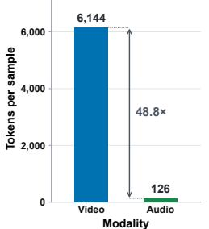  
(a) Modality Token Imbalance

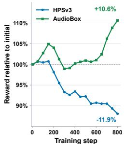  
(b) Cross-modal Conflict

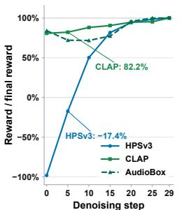  
(c) Early Emergence of Audio

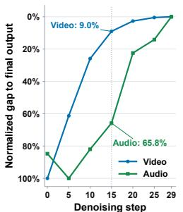  
(d) Unstable Audio Refinement  
Figure 1: Motivation analysis of audio-video joint learning. (a) Audio and video exhibit a sub stantial token imbalance, leading to training instability. (b) Optimization guided solely by audio rewards is unstable and can degrade video quality. (c)(d) Audio performance improves early during denoising, but audio refinement remains less stable than video refinement.

Motivated by these observations, we propose OmniOPD, a modality-wise on-policy distillation framework that improves the stability and balance of audio-video learning (see Fig, 3). First, privileged visual guidance constructs asymmetric noise conditions, allowing the audio teacher to produce more informative targets from cleaner video context while sharing the same audio input with the student. Second, grouped multi-noise sampling collects diverse and complementary audio supervision, broadening coverage of the audio state distribution and stabilizing audio distillation. Third, timestep-wise importance weighting uses local teacher–student transition divergence to assess supervision reliability, retaining full supervision within a trust region and smoothly down-weighting high-mismatch supervision beyond it. The resulting audio objective is jointly optimized with video distillation to integrate modality-specialized capabilities into a unified student.

## Our contributions are summarized as follows:

• We comprehensively analyze audio-video coupling phenomena, identifying sparse and unstable audio supervision as a key challenge in joint audio-video distillation and highlighting the role of visual context in supporting audio learning.

• We propose OmniOPD, which combines privileged visual guidance, grouped multi-noise sampling, and importance weighting to stabilize joint audio-video on-policy distillation.

• Extensive experiments demonstrate that OmniOPD stabilizes joint distillation and achieves balanced gains in audio quality, video quality, and audio-video synchronization.

## 2 RELATED WORK

## 2.1 JOINT AUDIO-VIDEO GENERATION

Joint audio-video generation (Liu et al., 2026b; Low et al., 2025; Chefer et al., 2026) models the two modalities together to produce synchronized audiovisual content. Early work, MM-Diffusion (Ruan et al., 2023), couples audio and video denoisers through cross-modal attention. Subsequent approaches advance joint synthesis through diffusion transformers and the integration of pretrained modality experts. JavisDiT (Liu et al., 2026a) introduces hierarchical spatio-temporal priors to improve synchronization, while UniVerse-1 (Wang et al., 2025) combines pretrained audio and video experts through block-level stitching. LTX-2 (HaCohen et al., 2026) adopts an asymmetric dualstream transformer with bidirectional cross-attention, supporting modality-specific generation and cross-modal interaction within a unified model. These methods establish joint synthesis architectures and cross-modal communication mechanisms. Our work studies how a joint model can absorb improvements from modality-specialized teachers through stable distillation.

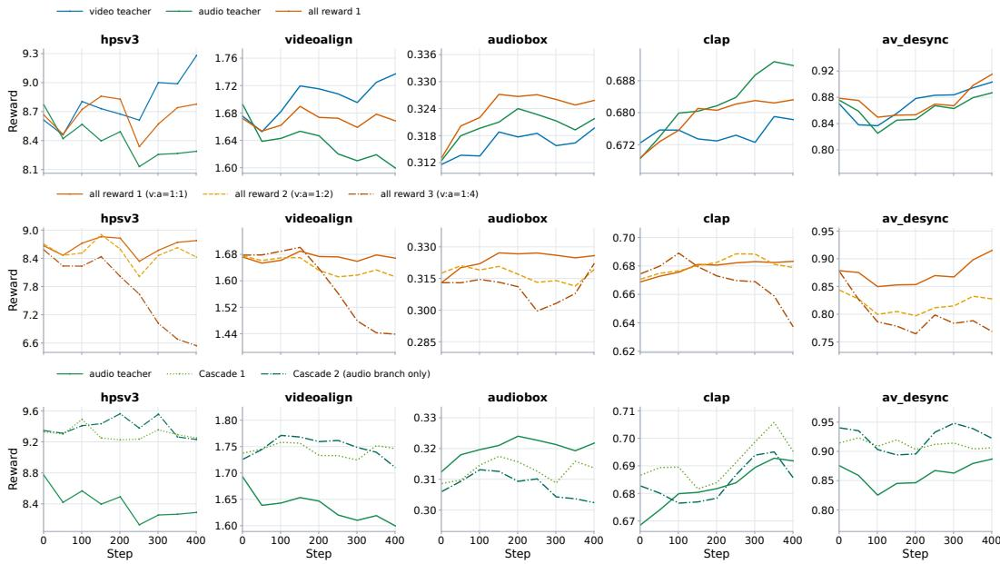  
Figure 2: A comprehensive analysis of audio-video coupling during optimization. The top row compares optimization with video-only, audio-only, and joint rewards. The middle row compares three joint-reward configurations, including increased audio reward weights. The bottom row compares audio-only optimization with two Cascade variants that optimize video first and then audio. (1) Audio-only reward optimization is unstable and can degrade video quality; increasing audio reward weights fails to resolve these conflicts and can further destabilize training.(2) Joint-reward optimization yields limited gains due to conflicts among reward objectives across modalities. (3) Sequential video-to-audio optimization stabilizes training, suggesting that cleaner and more stable video context is important for audio learning.

## 2.2 REINFORCEMENT LEARNING FOR GENERATIVE MODELS

Reinforcement learning provides a post-training approach for aligning generative models with taskspecific rewards and human preferences. Early methods such as DDPO (Black et al., 2024), DPOK (Fan et al., 2023), and ReFL (Xu et al., 2023) improve diffusion models through rewarddriven fine-tuning. Diffusion-DPO (Wallace et al., 2024) further enables alignment through direct optimization on pairwise preference data. GRPO (Shao et al., 2024) has subsequently been adapted to visual generation: Flow-GRPO (Liu et al., 2025a) and DanceGRPO (Xue et al., 2025) employ stochastic generation trajectories and group-relative rewards to optimize flow-based models. For multi-reward optimization, GDPO (Liu et al., 2026c) normalizes individual rewards separately to preserve their distinct contributions and improve training stability. DiffusionNFT (Zheng et al., 2026) introduces a forward-process formulation that incorporates reward feedback through an implicit policy-improvement objective. Building on this formulation, OmniNFT (Zhang et al., 2026a) extends this framework to joint audio-video generation with modality-aware optimization.

## 2.3 ON-POLICY DISTILLATION

On-policy distillation (Lu & Lab, 2025) learns from teacher feedback on student-generated states, with language-model studies examining divergence objectives and sample reuse (Agarwal et al., 2024; Gu et al., 2024; Ko et al., 2024). MOPD (Ma et al., 2026) integrates independently trained specialists, while Open-MOPD (ang Gao et al., 2026) studies imbalanced supervision budgets. TrOPD (Xing et al., 2026) addresses unreliable token supervision under distribution mismatch. For continuous generation, Flow-OPD (Fang et al., 2026) consolidates specialist teachers along student rollouts, and DiffusionOPD (Li et al., 2026) derives closed-form stochastic transition losses and deterministic mean-matching surrogates. Recent extensions address heterogeneous teachers, output and representation targets, and reward-guided self-distillation (Wei et al., 2026; Zhou et al., 2026). OmniOPD builds on vanilla OPD to stabilize joint audio-video distillation.

## 3 MOTIVATION

We independently train a video teacher and an audio teacher using only video-related and audiorelated rewards, respectively, while the All reward variants are trained with a mixture of both.

Audio instability affects both modalities. As shown in Fig. 2(top), audio-only reward optimization exhibits unstable training dynamics, with deteriorating audio quality accompanied by declining video quality even when optimization targets audio. This observation reveals the coupling between the two modalities within a shared model and highlights the importance of stabilizing audio learning for joint generation.

Increasing audio reward weights does not resolve the imbalance. As shown in Fig. 2(middle), joint-reward optimization yields limited gains, and increasing audio reward weights can further degrade both modalities. Simply upweighting audio rewards does not address the underlying imbalance in supervision; instead, it amplifies the influence of unstable audio learning signals, potentially undermining joint optimization.

Video-first optimization stabilizes audio learning. As shown in Fig. 2(bottom), optimizing video first and subsequently training audio substantially alleviates the instability observed in audio-only optimization. This finding suggests that stronger video capability provides a more favorable context for audio learning, motivating the use of cleaner and more stable visual information to strengthen audio supervision.

Together, these findings highlight sparse and unstable audio supervision as a key bottleneck in joint audio-video learning and suggest that cleaner visual context can help alleviate it. They motivate OmniOPD’s three complementary components: privileged visual guidance to provide more informative audio targets, grouped sampling to broaden supervision coverage, and timestep-wise importance weighting to reduce the influence of unreliable learning signals.

## 4 PRELIMINARIES

## 4.1 JOINT AUDIO-VIDEO FLOW MATCHING

We consider a joint audio-video flow matching (Lipman et al., 2023) model with audio and video latents $x _ { 0 } ^ { a }$ and $x _ { 0 } ^ { v } .$ . Following standard joint audio-video flow matching (HaCohen et al., 2026), each modality is independently perturbed by a Gaussian endpoint $x _ { 1 } ^ { m } \sim \mathcal { N } ( 0 , I ) , m \in \{ a , v \}$ , while sharing the same flow timestep $t \in [ 0 , \dot { 1 } ]$

$$
x _ { t } ^ { m } = ( 1 - t ) x _ { 0 } ^ { m } + t x _ { 1 } ^ { m } , \qquad m \in \{ a , v \} .\tag{1}
$$

The audio and video velocity fields are jointly predicted as $v _ { \theta } ^ { m } ( x _ { t } ^ { a } , x _ { t } ^ { v } , t , c )$ , where each modality is conditioned on the complete audio-video state. The joint flow-matching objective is

$$
\mathcal { L } _ { \mathrm { F M } } = \mathbb { E } \left[ \sum _ { m \in \{ a , v \} } \Vert v _ { m } ( x _ { t } ^ { a } , x _ { t } ^ { v } , t , c ; \theta ) - ( x _ { 1 } ^ { m } - x _ { 0 } ^ { m } ) \Vert _ { 2 } ^ { 2 } \right] .\tag{2}
$$

## 4.2 ON-POLICY DISTILLATION

On-policy distillation (Lu & Lab, 2025) lets the student autoregressively generate a full sequence from its own policy, and then trains the student to match the teacher on the prefixes that the student itself visits. Concretely, let $\tau = ( x _ { t _ { 0 } } , \ldots , x _ { t _ { N } } ) \sim P _ { \theta }$ be a state trajectory generated by the student with parameters θ. Let $p _ { S } ( \cdot \mid x _ { t _ { k } } )$ and $p _ { T } ( \cdot \mid x _ { t _ { k } } )$ denote the student and frozen teacher one-step transition kernels, respectively. Following DiffusionOPD (Li et al., 2026), we match these kernels along student trajectories on $1 = t _ { 0 } > \cdot \cdot \cdot > t _ { N } = 0 .$ . With $\mathcal { T } = \{ 0 , \ldots , N - 1 \}$ , the objective is

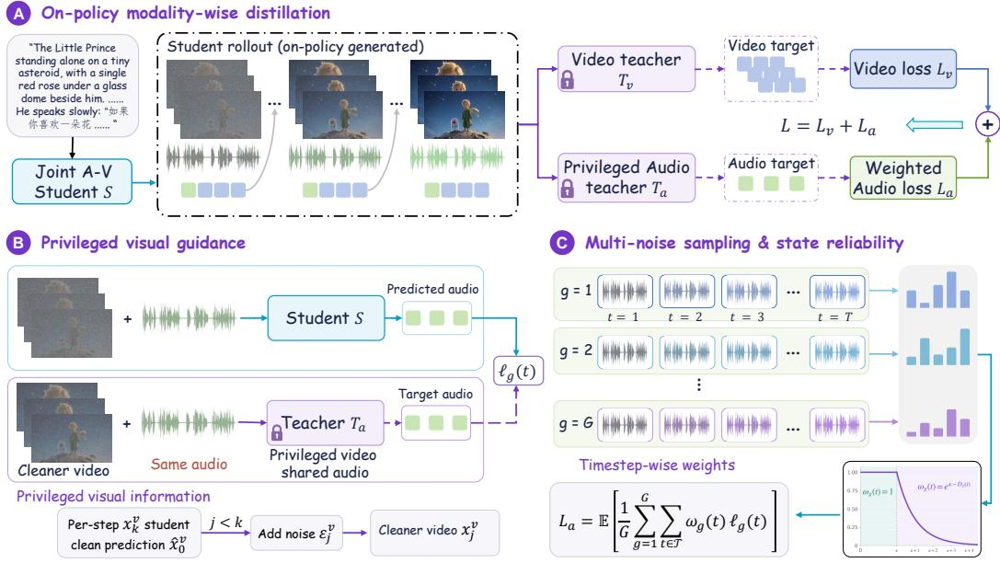  
Figure 3: Overview of OmniOPD. (A) On-policy modality-wise distillation transfers knowledge from frozen video and audio teachers to a joint audio-video student using student-generated rollouts. (B) Privileged visual guidance provides the audio teacher with cleaner video context while sharing the same audio state with the student, yielding more informative audio supervision. (C) Multinoise sampling expands audio supervision across noise realizations and denoising steps, while statereliability weighting controls the contribution of unreliable learning signals.

$$
\mathcal { L } _ { \mathrm { O P D } } ( \boldsymbol { \theta } ) = \mathbb { E } _ { \boldsymbol { \tau } \sim P _ { \boldsymbol { \theta } } } \left[ \sum _ { \boldsymbol { k } \in \mathcal { T } } D _ { \mathrm { K L } } ( p _ { S } ( \cdot \mid \boldsymbol { x } _ { t _ { k } } ) \| p _ { T } ( \cdot \mid \boldsymbol { x } _ { t _ { k } } ) ) \right] .\tag{3}
$$

For per-step Gaussian transitions $p _ { \smash { \mathcal { M } } } ( \cdot  { \mathcal { \vert } } x _ { t _ { k } } ) = \mathcal { N } ( \mu _ { M } ( x _ { t _ { k } } ) , \bar { \sigma } _ { k } ^ { 2 } I ) , M \in \{ S , T \}$ , the means $\mu _ { M } ( \boldsymbol { x } _ { t _ { k } } )$ differ while the variance $\bar { \sigma } _ { k } ^ { 2 }$ is shared. The local Kullback-Leibler divergence is

$$
D _ { \mathrm { K L } } ( p _ { S } ( \cdot  { | } x _ { t _ { k } } ) | | p _ { T } ( \cdot  { | } x _ { t _ { k } } ) ) = \frac { | | \mu _ { S } ( x _ { t _ { k } } ; \theta ) - \mu _ { T } ( x _ { t _ { k } } ) | | _ { 2 } ^ { 2 } } { 2 \bar { \sigma } _ { k } ^ { 2 } } .\tag{4}
$$

For the stochastic flow transitions in Flow-OPD (Fang et al., 2026), let w(t) represents the timeadaptive scaling factor. The local divergence becomes

$$
D _ { \mathrm { K L } } = w ( t ) \left\| v _ { S } ( x _ { t _ { k } } ; \theta ) - v _ { T } ( x _ { t _ { k } } ) \right\| _ { 2 } ^ { 2 } ,\tag{5}
$$

where $v _ { S } ( x _ { t _ { k } } ; \theta )$ and $v _ { T } ( x _ { t _ { k } } )$ are the student and teacher velocity predictions.

## 5 OMNIOPD

Motivated by the above observations and analysis in Sec. 3, we propose OmniOPD in Fig. 3, a modality-wise OPD framework designed for balanced and stable audio-video training, which introduces asymmetric noise for privileged visual guidance in Sec. 5.1, grouped sampling to expand audio supervision coverage in Sec. 5.2, and importance weighting to stabilize audio learning in Sec. 5.3.

## 5.1 MODALITY-WISE OPD WITH PRIVILEGED VISUAL GUIDANCE

We adopt modality-wise on-policy distillation to integrate audio and video teachers into a unified student. Let S denote the student and $T _ { a } , T _ { \nu }$ the frozen modality-specialized teachers. Along studentgenerated joint trajectories $\tau \sim P _ { \theta } ,$ , each teacher supervises its respective modality at the joint state

$\mathbf { x } _ { t } = \left( x _ { t } ^ { a } , x _ { t } ^ { v } \right)$ for each noise level $t \in \tau$ . We formulate the distillation objective in $\mathbf { x } _ { 0 } .$ -space to supervise each modality $m \in \{ a , v \}$

$$
\mathcal { L } _ { m } ( \theta ) = \mathbb { E } _ { \tau \sim P _ { \theta } } \left[ \sum _ { { t } \in \mathcal { T } } \left\| \hat { x } _ { 0 } ^ { S } - \hat { x } _ { 0 } ^ { T _ { m } } \right\| _ { 2 } ^ { 2 } \right] ,\tag{6}
$$

where $\hat { x } _ { 0 } ^ { S }$ and $\hat { x } _ { 0 } ^ { T _ { m } }$ are the student and teacher clean predictions at state $\mathbf { x } _ { t }$ . The relationship to transition divergence is derived in Appendix A.1.

To strengthen audio supervision, we introduce privileged visual guidance based on our observation that informative video context supports audio learning. We choose a lower teacher-video noise level $q ( t )$ satisfying $0 < q ( t ) < t .$ . Using the rollout student’s clean video prediction $\hat { x } _ { t } ^ { S }$ , we construct

$$
\widetilde { x } _ { q ( t ) } ^ { v } = ( 1 - q ( t ) ) z _ { v } ^ { t } + q ( t ) \epsilon _ { v } , \qquad \epsilon _ { v } \sim \mathcal { N } ( 0 , I ) .\tag{7}
$$

The student and audio teacher receive

$$
\mathbf { x } _ { t } ^ { S } = ( x _ { t } ^ { a } , x _ { t } ^ { v } ) , \qquad \mathbf { x } _ { t } ^ { T } = ( x _ { t } ^ { a } , \widetilde { x } _ { q ( t ) } ^ { v } ) .\tag{8}
$$

Both models share the same audio state, while the teacher receives a cleaner video condition. This asymmetry provides privileged visual information that helps the teacher produce more informative audio targets. Let $\widetilde { x } _ { 0 } ^ { T _ { a } }$ denote the audio target predicted by $T _ { a }$ using privileged visual context. The audio objective is

$$
\mathcal { L } _ { a } ^ { \mathrm { P V G } } ( \theta ) = \mathbb { E } _ { \tau \sim P _ { \theta } } \left[ \sum _ { { t } \in \mathcal { T } } \left\| \hat { x } _ { 0 } ^ { S } - \widetilde { x } _ { 0 } ^ { T _ { a } } \right\| _ { 2 } ^ { 2 } \right] .\tag{9}
$$

## 5.2 MULTI-NOISE AUDIO DISTILLATION

A straightforward way to increase audio supervision is to sample more trajectories for each prompt. We independently sample $G$ joint audio-video trajectories $\tau _ { g } \sim P _ { \theta } ( \cdot \mid c )$ for each prompt $c .$ This directly increases the number of supervised audio tokens per prompt and broadens supervision coverage across diverse joint states. We apply privileged visual guidance within each trajectory to obtain the corresponding audio teacher targets. For each sampled trajectory, we compute the audio distillation loss at each timestep:

$$
\ell _ { g } ( t ) = \left\| \boldsymbol { \hat { x } } _ { 0 , g } ^ { S } - \widetilde { \boldsymbol { x } } _ { 0 , g } ^ { T _ { a } } \right\| _ { 2 } ^ { 2 } ,\tag{10}
$$

where $\hat { x } _ { 0 , g } ^ { S }$ and $\widetilde { x } _ { 0 , g } ^ { T _ { a } }$ denote the student prediction and teacher target of trajectory $g .$ The grouped objective is

$$
\mathcal { L } _ { a } ^ { \mathrm { G } } ( \theta ) = \mathbb { E } \left[ \frac { 1 } { G } \sum _ { g = 1 } ^ { G } \sum _ { t \in \mathcal { T } } \ell _ { g } ( t ) \right] ,\tag{11}
$$

where the expectation is over the sampled trajectories and privileged visual conditions. Grouped sampling increases supervision diversity and broadens distribution coverage, reducing the sampling variance of the estimated audio objective.

## 5.3 TIMESTEP-WISE IMPORTANCE WEIGHTING

The reliability of audio supervision varies across trajectories and timesteps. We quantify the local teacher-student mismatch using the audio transition divergence:

$$
D _ { g } ( t ) = D _ { \mathrm { K L } } ( p _ { S } ( \cdot  { | } \mathbf { x } _ { t } )  { | } | p _ { T _ { a } } ( \cdot  { | } \mathbf { x } _ { t } ) ) = w ( t ) \left\| v _ { S } ( \mathbf { x } _ { t } ^ { S } ; \theta ) - v _ { T _ { a } } ( \mathbf { x } _ { t } ^ { T } ) \right\| _ { 2 } ^ { 2 } ,\tag{12}
$$

where $p _ { S }$ and $p _ { T _ { a } }$ are the audio transition kernels under the student and teacher’s respective visual conditions, with a common transition parameterization and shared covariance. Here, $v _ { S }$ and $v _ { T _ { a } }$ denote their audio velocity predictions, and $w ( t )$ is the schedule-dependent coefficient defined in Sec. 4.2. We assign each supervision term a importance weight:

$$
\omega _ { g } ( t ) = \mathrm { s g } \left[ \operatorname* { m i n } \left( 1 , e ^ { \kappa - D _ { g } ( t ) } \right) \right] ,\tag{13}
$$

where $\kappa \geq 0$ defines the trust-region boundary. Steps within this region retain full supervision, while those with larger transition mismatch are smoothly down-weighted.

Table 1: Quantitative comparison on JavisBench. Higher is better for ↑ metrics, and lower is better for ↓ metrics. Best results are in bold, and second-best results are underlined
<table><tr><td rowspan="2">Model</td><td colspan="2">AV-Quality</td><td colspan="4">Text-Consistency</td><td colspan="2">AV-Consistency</td><td colspan="2">AV-Synchrony</td></tr><tr><td>VQ↑</td><td>AQ↑</td><td>TV-IB↑</td><td>TA-IB↑</td><td>CLIP↑</td><td>CLAP↑</td><td>AV-IB↑</td><td>AVHScore↑</td><td>JavisScore↑</td><td>DeSync↓</td></tr><tr><td>-T2A+A2V</td><td></td><td></td><td></td><td></td><td></td><td></td><td></td><td></td><td></td><td></td></tr><tr><td>TempoTkn (Yariv et al., 2024)</td><td></td><td>一</td><td>0.084</td><td>1</td><td>0.205</td><td>一</td><td>0.139</td><td>0.122</td><td>0.103</td><td>1.532</td></tr><tr><td>TPoS (Jeong et al., 2023)</td><td></td><td>1</td><td>0.201</td><td></td><td>0.229</td><td></td><td>0.124</td><td>0.129</td><td>0.095</td><td>1.493</td></tr><tr><td>-T2V+V2A</td><td></td><td></td><td></td><td></td><td></td><td></td><td></td><td></td><td></td><td></td></tr><tr><td>ReWaS (Jeong et al., 2025)</td><td></td><td>一</td><td>1</td><td>0.123</td><td></td><td>0.280</td><td>0.110</td><td>0.104</td><td>0.079</td><td>1.071</td></tr><tr><td>See&amp;Hear (Xing et al., 2024)</td><td></td><td>一</td><td></td><td>0.129</td><td></td><td>0.263</td><td>0.160</td><td>0.143</td><td>0.112</td><td>1.099</td></tr><tr><td>FoleyCrafter (Zhang et al., 2026b)</td><td></td><td>=</td><td>1</td><td>0.149</td><td></td><td>0.383</td><td>0.193</td><td>0.186</td><td>0.151</td><td>0.952</td></tr><tr><td>MMAudio (Cheng et al., 2025)</td><td></td><td>一</td><td>1</td><td>0.160</td><td></td><td>0.407</td><td>0.198</td><td>0.182</td><td>0.150</td><td>0.849</td></tr><tr><td>- T2AV</td><td></td><td></td><td></td><td></td><td></td><td></td><td></td><td></td><td></td><td></td></tr><tr><td>JavisDiT (Liu et al., 2026a)</td><td>1.291</td><td>4.478</td><td>0.263</td><td>0.143</td><td>0.302</td><td>0.391</td><td>0.197</td><td>0.179</td><td>0.154</td><td>1.039</td></tr><tr><td>UniVerse-1 (Wang et al., 2025)</td><td>1.357</td><td>4.839</td><td>0.272</td><td>0.111</td><td>0.309</td><td>0.245</td><td>0.104</td><td>0.098</td><td>0.077</td><td>0.929</td></tr><tr><td>JavisDiT++ (Liu et al., 2026b)</td><td>1.462</td><td>5.049</td><td>0.282</td><td>0.164</td><td>0.316</td><td>0.424</td><td>0.198</td><td>0.184</td><td>0.159</td><td>0.832</td></tr><tr><td>LTX-2.3 (HaCohen et al., 2026)</td><td>2.714</td><td>5.252</td><td>0.279</td><td>0.178</td><td>0.308</td><td>0.429</td><td>0.256</td><td>0.251</td><td>0.222</td><td>0.584</td></tr><tr><td>LTX-2.3+OmniNFT (Zhang et al., 2026a)</td><td>3.216</td><td>5.564</td><td>0.274</td><td>0.183</td><td>0.309</td><td>0.442</td><td>0.268</td><td>0.261</td><td>0.236</td><td>0.547</td></tr><tr><td>Video-Teacher</td><td>3.121</td><td>5.216</td><td>0.276</td><td>0.182</td><td>0.304</td><td>0.446</td><td>0.275</td><td>0.269</td><td>0.238</td><td>0.465</td></tr><tr><td>Audio-Teacher</td><td>2.929</td><td>5.576</td><td>0.276</td><td>0.184</td><td>0.307</td><td>0.470</td><td>0.282</td><td>0.279</td><td>0.251</td><td>0.448</td></tr><tr><td>Ours OmniOPD</td><td>3.347</td><td>5.449</td><td>0.275</td><td>0.192</td><td>0.310</td><td>0.447</td><td>0.262</td><td>0.258</td><td>0.232</td><td>0.457</td></tr></table>

## 5.4 OVERALL OBJECTIVE

OmniOPD combines privileged visual guidance, grouped sampling, and timestep-wise importance weighting to strengthen audio supervision during joint distillation. Privileged visual context helps the audio teacher produce more informative targets, while sampling multiple joint trajectories for each prompt increases the number and diversity of supervised audio tokens. Importance weighting further adjusts the contribution of each supervision term according to its local teacher-student transition mismatch. The final objective combines the stabilized audio loss with video distillation:

$$
\mathcal { L } _ { O m n i O P D } ( \boldsymbol { \theta } ) = L _ { v } ( \boldsymbol { \theta } ) + \mathbb { E } \left[ \frac { 1 } { G } \sum _ { g = 1 } ^ { G } \sum _ { t \in \mathcal { T } } \omega _ { g } ( t ) \ell _ { g } ( t ) \right] .\tag{14}
$$

## 6 EXPERIMENTS

We evaluate OmniOPD on joint audio-video generation, focusing on whether modality-specialized teacher capabilities can be effectively integrated into a single student. We first describe the reward models, teacher configurations, and evaluation benchmarks, followed by the main results and ablation studies.

## 6.1 EXPERIMENTAL SETUP

Reward models and base model. Following OmniNFT (Zhang et al., 2026a), we adopt five complementary rewards. HPSv3 (Ma et al., 2025) and VideoAlign (Liu et al., 2025b) evaluate visual quality, while Audiobox Aesthetics (Tjandra et al., 2025) evaluates audio quality. CLAP (Wu et al., 2023) measures audio-text alignment, and a reward derived from DeSync (Iashin et al., 2024) measures audio-video synchronization. We use LTX-2 (22B) (HaCohen et al., 2026), a dual-stream joint audio-video DiT, as both the student initialization and the base model for teacher training.

Teacher training and RL variants. We independently train a video teacher and an audio teacher using DiffusionNFT (Zheng et al., 2026) with LoRA (Hu et al., 2022) fine-tuning. The video teacher is optimized with HPSv3, VideoAlign, and the synchronization reward, while the audio teacher is optimized with Audiobox Aesthetics, CLAP, and the synchronization reward. Both teachers remain frozen during distillation and supervise their respective modalities. To examine alternative strategies for improving both modalities, we additionally consider joint and sequential RL variants. All reward jointly optimizes all five rewards. All reward 1, All reward 2, and All reward 3 use weight ratios of 1:1:1:1:1, 1:1:2:2:2, and 1:1:4:4:4, respectively, in the order HPSv3, VideoAlign, Audiobox, CLAP, and synchronization reward. These configurations progressively increase the weights of audio and synchronization rewards to examine whether greater emphasis on these objectives alleviates

A fixed close-up shows two domestic cats sitting opposite each other on a windowsill in soft afternoon light. One is an orange tabby and the other is a gray British Shorthair. The camera remains perfectly still while both cats maintain......

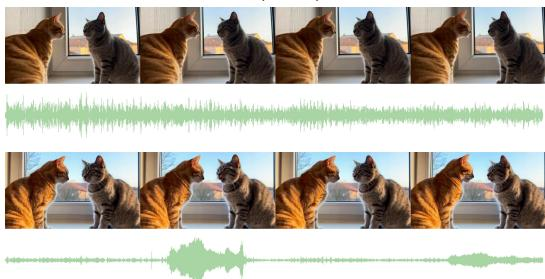  
At night beside a mountain lake, four friends sit around a small campfire beneath a clear sky filled with stars. One person holds an acoustic guitar while the others sit on logs wrapped in blankets. ......  
Amidst twisted metal and rubble under a hazy, sunlit sky, five figures stand arranged in a loose semi-circle. Strong backlighting from the upper right casts dramatic golden highlights across their forms, while a slightly low camera angle......

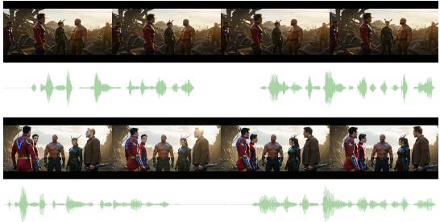  
SpongeBob and Patrick are sitting on a rock underwater, talking deeply. Patrick looks at Patrick and says clearly: "Knowledge cannot replace friendship, SpongeBob!" with an emotional expression. SpongeBob smiles warmly and responds: ......

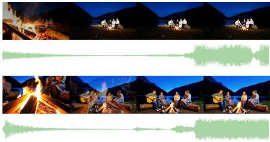

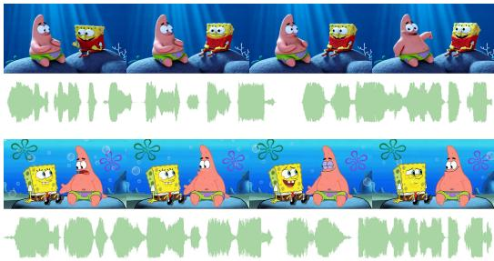  
Figure 4: Qualitative examples of joint audio-video generation by OmniOPD. These examples demonstrate improvements in audio diversity, voice–character alignment in multi-character scenes, visual aesthetics, and audio fidelity.

Table 2: Quantitative comparison on JavisBench under different experimental settings.
<table><tr><td></td><td colspan="2">AV-Quality</td><td colspan="4">Text-Consistency</td><td colspan="2">AV-Consistency</td><td colspan="2">AV-Synchrony</td></tr><tr><td>Model</td><td>VQ↑</td><td>AQ↑</td><td>TV-IB↑</td><td>TA-IB↑</td><td>CLIP↑</td><td>CLAP↑</td><td>AV-IB↑</td><td>AVHScore↑</td><td>JavisScore↑</td><td>DeSync↓</td></tr><tr><td>LTX-2.3</td><td>2.714</td><td>5.252</td><td>0.279</td><td>0.178</td><td>0.308</td><td>0.429</td><td>0.256</td><td>0.251</td><td>0.222</td><td>0.584</td></tr><tr><td>LTX-2.3+GDPO</td><td>2.713</td><td>5.577</td><td>0.280</td><td>0.181</td><td>0.313</td><td>0.439</td><td>0.251</td><td>0.249</td><td>0.221</td><td>0.563</td></tr><tr><td>Cascade</td><td>3.131</td><td>5.235</td><td>0.273</td><td>0.179</td><td>0.306</td><td>0.463</td><td>0.274</td><td>0.269</td><td>0.241</td><td>0.432</td></tr><tr><td>Vanilla OPD</td><td>3.174</td><td>5.342</td><td>0.275</td><td>0.180</td><td>0.309</td><td>0.433</td><td>0.256</td><td>0.250</td><td>0.226</td><td>0.583</td></tr><tr><td>Ours OmniOPD</td><td>3.347</td><td>5.449</td><td>0.275</td><td>0.192</td><td>0.310</td><td>0.447</td><td>0.262</td><td>0.258</td><td>0.232</td><td>0.457</td></tr></table>

the imbalance in joint optimization. Cascade first optimizes video and then audio: both variants are initialized from the video teacher and subsequently fine-tuned using audio rewards. Cascade 1 updates both modality branches, whereas Cascade 2 updates only the audio-branch parameters while keeping the video branch frozen. This comparison examines how restricting second-stage updates affects audio improvement and the retention of previously learned video capabilities.

Evaluation benchmarks. We evaluate on JavisBench (Liu et al., 2026a) and VBench (Huang et al., 2024). Following the evaluation organization of OmniNFT, we report four complementary aspects on JavisBench: audio-video quality, text consistency, audio-video semantic consistency, and temporal synchronization. The reported metrics include VQ and AQ; TV-IB, TA-IB, CLIP, and CLAP; AV-IB and AVHScore; and JavisScore and DeSync. Lower DeSync indicates better synchronization. VBench provides additional evaluation of video generation across dimensions such as imaging quality, aesthetic quality, subject consistency.

## 6.2 MAIN RESULTS

Benchmark performance. Table 1 and Fig. 5 report the results on JavisBench and VBench, respectively. As illustrated in Fig. 4, OmniOPD generates high-fidelity, diverse audio, strengthening capabilities that are underdeveloped in the base model. Privileged visual guidance further improves voice-character alignment in multi-character scenes. OmniOPD achieves the best audio-video balance among the compared methods, substantially improving video quality while maintaining strong audio performance (Table 2). These results suggest that stabilizing audio learning also facilitates greater gains in video quality.

<table><tr><td colspan="4">Setting VQ↑ AQ↑ TV-IB↑ TA-IB↑ JavisScore↑</td></tr><tr><td colspan="4">(a) Asymmetric-noise shift</td></tr><tr><td>s = 0</td><td>3.174 5.342</td><td>0.275</td><td>0.180 0.226</td></tr><tr><td>s = 1.5 3.332</td><td>5.376 0.275 0.274</td><td>0.189 0.183</td><td>0.232 0.229</td></tr><tr><td colspan="4">s = 2.0 3.354 5.353</td></tr><tr><td colspan="4">(b) Number of rollout groups</td></tr><tr><td>G = 1 3.174</td><td>5.342 0.275</td><td>0.180</td><td>0.226</td></tr><tr><td>G = 2 3.334 G = 3 3.315</td><td>5.223 0.275 5.393 0.276</td><td>0.186 0.188</td><td>0.217 0.233</td></tr><tr><td colspan="4"></td></tr><tr><td colspan="4">(c) Trust-region soft ratio</td></tr><tr><td> $p = 0 . 7 5$  3.322</td><td>5.381 0.276 0.273</td><td>0.189 0.184</td><td>0.236</td></tr><tr><td>p = 0.5 3.321</td><td>5.407 0.275</td><td>0.180</td><td>0.235 0.226</td></tr><tr><td colspan="4">w/o weighting 3.174 5.342</td></tr></table>

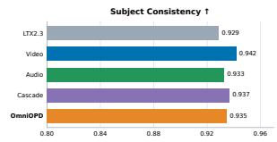

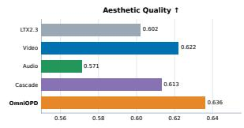

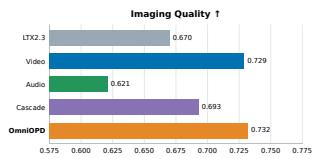  
Table 3: Ablation studies on the asymmetric-noise shift, trust-region soft ratio, and number of rollout groups.  
Figure 5: Quantitative comparison on VBench.

## 6.3 ABLATION STUDIES

Privileged visual guidance. We examine how the noise level of the video input to the teacher affects audio distillation. Alongside the matched-noise baseline $q ( t ) = t ,$ we evaluate timestepshifting strategies that provide cleaner visual context. Specifically, the shift strategy selects the teacher-video timestep as

$$
q ( t ) = \frac { t } { t + e ^ { s } ( 1 - t ) } , \qquad s > 0 ,\tag{15}
$$

where larger s produces a lower teacher-video noise level. The results show that providing cleaner visual context substantially improves audio quality while also yielding gains in video quality in Table 3(a), highlighting the benefits of visual guidance for joint optimization.

Audio supervision coverage. We vary the number of branches G used to aggregate audio supervision, with G = 1 corresponding to a single branch. This comparison evaluates how additional supervision samples affect audio performance and training stability. As shown in Table 3(b), increasing audio supervision improves audio performance, while more stable audio learning also benefits video quality. Fig. 4 further illustrates that multi-group sampling broadens the diversity of supervision, helping strengthen capabilities that are underdeveloped in the base model.

Reliability weighting. We compare uniform audio supervision with the proposed Timestep-Wise Importance Weighting and vary the parameter controlling its weighting strength. As shown in Table 3(c), timestep-wise weighting of audio supervision stabilizes audio learning, helping mitigate the lasting degradation in video quality associated with unstable audio learning.

## 7 CONCLUSION

We presented OmniOPD, motivated by a comprehensive analysis of audio-video coupling that reveals cross-modal interference and sparse, stochastic audio supervision. OmniOPD combines asymmetric supervision, privileged visual guidance, and reliability-aware multi-branch learning for joint distillation. Experiments on JavisBench and VBench show improved video generation alongside strong audio performance, demonstrating more balanced audio-video distillation.

## REFERENCES

Rishabh Agarwal, Nino Vieillard, Yongchao Zhou, Piotr Stanczyk, Sabela Ramos Garea, Matthieu Geist, and Olivier Bachem. On-policy distillation of language models: Learning from selfgenerated mistakes. In B. Kim, Y. Yue, S. Chaudhuri, K. Fragkiadaki, M. Khan, and Y. Sun (eds.), International Conference on Learning Representations, volume 2024, pp. 21246–21263, 2024. URL https://proceedings.iclr.cc/paper\_files/paper/2024/file/ 5be69a584901a26c521c2b51e40a4c20-Paper-Conference.pdf.

Huan ang Gao, Haohan Chi, Yong Yan, Shiyuan Feng, Hanlin Wu, Zheng Jiang, Bingxiang He, Wei-Ying Ma, Ya-Qin Zhang, and Hao Zhou. Open-mopd: Diagnosing and fixing capability imbalance in multi-teacher on-policy distillation, 2026. URL https://arxiv.org/abs/ 2608.19098.

Kevin Black, Michael Janner, Yilun Du, Ilya Kostrikov, and Sergey Levine. Training diffusion models with reinforcement learning. In B. Kim, Y. Yue, S. Chaudhuri, K. Fragkiadaki, M. Khan, and Y. Sun (eds.), International Conference on Learning Representations, volume 2024, pp. 4965– 4987, 2024. URL https://proceedings.iclr.cc/paper\_files/paper/2024/ file/14f75513f0f1ca01de1e826b52e6b840-Paper-Conference.pdf.

Hila Chefer, Patrick Esser, Dominik Lorenz, Dustin Podell, Vikash Raja, Vinh Tong, Antonio Torralba, and Robin Rombach. Self-supervised flow matching for scalable multi-modal synthesis. In Forty-third International Conference on Machine Learning, 2026. URL https: //openreview.net/forum?id=HoThWhfxiK.

Ho Kei Cheng, Masato Ishii, Akio Hayakawa, Takashi Shibuya, Alexander Schwing, and Yuki Mitsufuji. Mmaudio: Taming multimodal joint training for high-quality video-to-audio synthesis. In Proceedings of the Computer Vision and Pattern Recognition Conference, pp. 28901–28911, 2025.

Ying Fan, Olivia Watkins, Yuqing Du, Hao Liu, Moonkyung Ryu, Craig Boutilier, Pieter Abbeel, Mohammad Ghavamzadeh, Kangwook Lee, and Kimin Lee. Dpok: Reinforcement learning for fine-tuning text-to-image diffusion models. In A. Oh, T. Naumann, A. Globerson, K. Saenko, M. Hardt, and S. Levine (eds.), Advances in Neural Information Processing Systems, volume 36, pp. 79858–79885. Curran Associates, Inc., 2023. doi: 10.52202/ 075280-3497. URL https://proceedings.neurips.cc/paper\_files/paper/ 2023/file/fc65fab891d83433bd3c8d966edde311-Paper-Conference.pdf.

Zhen Fang, Wenxuan Huang, Yu Zeng, Yiming Zhao, Shuang Chen, Kaituo Feng, Yunlong Lin, Lin Chen, Zehui Chen, Shaosheng Cao, and Feng Zhao. Flow-OPD: On-policy distillation for flow matching models. arXiv preprint arXiv:2605.08063, 2026. URL https://arxiv.org/ abs/2605.08063.

Yuxian Gu, Li Dong, Furu Wei, and Minlie Huang. MiniLLM: Knowledge distillation of large language models. In The Twelfth International Conference on Learning Representations, 2024. URL https://openreview.net/forum?id=5h0qf7IBZZ.

Yoav HaCohen, Benny Brazowski, Nisan Chiprut, Yaki Bitterman, Andrew Kvochko, Avishai Berkowitz, Daniel Shalem, Daphna Lifschitz, Dudu Moshe, Eitan Porat, Eitan Richardson, Guy Shiran, Itay Chachy, Jonathan Chetboun, Michael Finkelson, Michael Kupchick, Nir Zabari, Nitzan Guetta, Noa Kotler, Ofir Bibi, Ori Gordon, Poriya Panet, Roi Benita, Shahar Armon, Victor Kulikov, Yaron Inger, Yonatan Shiftan, Zeev Melumian, and Zeev Farbman. Ltx-2: Efficient joint audio-visual foundation model, 2026. URL https://arxiv.org/abs/2601.03233.

Edward J Hu, yelong shen, Phillip Wallis, Zeyuan Allen-Zhu, Yuanzhi Li, Shean Wang, Lu Wang, and Weizhu Chen. LoRA: Low-rank adaptation of large language models. In International Conference on Learning Representations, 2022. URL https://openreview.net/forum? id=nZeVKeeFYf9.

Ziqi Huang, Yinan He, Jiashuo Yu, Fan Zhang, Chenyang Si, Yuming Jiang, Yuanhan Zhang, Tianxing Wu, Qingyang Jin, Nattapol Chanpaisit, Yaohui Wang, Xinyuan Chen, Limin Wang, Dahua Lin, Yu Qiao, and Ziwei Liu. Vbench: Comprehensive benchmark suite for video generative

models. In 2024 IEEE/CVF Conference on Computer Vision and Pattern Recognition (CVPR), pp. 21807–21818, 2024. doi: 10.1109/CVPR52733.2024.02060.

Vladimir Iashin, Weidi Xie, Esa Rahtu, and Andrew Zisserman. Synchformer: Efficient synchronization from sparse cues. In ICASSP 2024 - 2024 IEEE International Conference on Acoustics, Speech and Signal Processing (ICASSP), pp. 5325–5329, 2024. doi: 10.1109/ICASSP48485. 2024.10448489.

Yujin Jeong, Wonjeong Ryoo, Seunghyun Lee, Dabin Seo, Wonmin Byeon, Sangpil Kim, and Jinkyu Kim. The power of sound (tpos): Audio reactive video generation with stable diffusion. In Proceedings of the IEEE/CVF international conference on computer vision, pp. 7822–7832, 2023.

Yujin Jeong, Yunji Kim, Sanghyuk Chun, and Jiyoung Lee. Read, watch and scream! sound generation from text and video. In Proceedings of the AAAI Conference on Artificial Intelligence, volume 39, pp. 17590–17598, 2025.

Jongwoo Ko, Sungnyun Kim, Tianyi Chen, and Se-Young Yun. DistiLLM: Towards streamlined distillation for large language models. In Ruslan Salakhutdinov, Zico Kolter, Katherine Heller, Adrian Weller, Nuria Oliver, Jonathan Scarlett, and Felix Berkenkamp (eds.), Proceedings of the 41st International Conference on Machine Learning, volume 235 of Proceedings of Machine Learning Research, pp. 24872–24895. PMLR, 21–27 Jul 2024. URL https: //proceedings.mlr.press/v235/ko24c.html.

Quanhao Li, Junqiu Yu, Kaixun Jiang, Yujie Wei, Zhen Xing, Pandeng Li, Ruihang Chu, Shiwei Zhang, Yu Liu, and Zuxuan Wu. DiffusionOPD: A unified perspective of on-policy distillation in diffusion models. arXiv preprint arXiv:2605.15055, 2026. URL https://arxiv.org/ abs/2605.15055.

Yaron Lipman, Ricky T. Q. Chen, Heli Ben-Hamu, Maximilian Nickel, and Matthew Le. Flow matching for generative modeling. In The Eleventh International Conference on Learning Repre sentations, 2023. URL https://openreview.net/forum?id=PqvMRDCJT9t.

Jie Liu, Gongye Liu, Jiajun Liang, Yangguang Li, Jiaheng Liu, Xintao Wang, Pengfei Wan, Di ZHANG, and Wanli Ouyang. Flow-grpo: Training flow matching models via online rl. In D. Belgrave, C. Zhang, H. Lin, R. Pascanu, P. Koniusz, M. Ghassemi, and N. Chen (eds.), Advances in Neural Information Processing Systems, volume 38, Main Conference, pp. 40783–40818. Curran Associates, Inc., 2025a. doi: 10.52202/ 085713-1362. URL https://proceedings.neurips.cc/paper\_files/paper/ 2025/file/3a10c46572628d58cb44fb705f25cbbf-Paper-Conference.pdf.

Jie Liu, Gongye Liu, Jiajun Liang, Ziyang Yuan, Xiaokun Liu, Mingwu Zheng, Xiele Wu, Qiulin Wang, Menghan Xia, Xintao Wang, Xiaohong Liu, Fei Yang, Pengfei Wan, Di ZHANG, Kun Gai, Yujiu Yang, and Wanli Ouyang. Improving video generation with human feedback. In The Thirty-ninth Annual Conference on Neural Information Processing Systems, 2025b. URL https://openreview.net/forum?id=nHkg4yc7SP.

Kai Liu, Wei Li, Lai Chen, Shengqiong Wu, Yanhao Zheng, Jiayi Ji, Fan Zhou, Jiebo Luo, Ziwei Liu, Hao Fei, and Tat-Seng Chua. Javisdit: Joint audio-video diffusion transformer with hierarchical spatio-temporal prior synchronization. In The Fourteenth International Conference on Learning Representations, 2026a. URL https://openreview.net/forum?id=y7HV7KT3Bd.

Kai Liu, Yanhao Zheng, Kai Wang, Shengqiong Wu, Rongjunchen Zhang, Jiebo Luo, Dimitrios Hatzinakos, Ziwei Liu, Hao Fei, and Tat-Seng Chua. Javisdit++: Unified modeling and optimization for joint audio-video generation, 2026b. URL https://arxiv.org/abs/2602. 19163.

Shih-Yang Liu, Xin Dong, Ximing Lu, Shizhe Diao, Peter Belcak, Mingjie Liu, Min-Hung Chen, Hongxu Yin, Yu-Chiang Frank Wang, Kwang-Ting Cheng, Yejin Choi, Jan Kautz, and Pavlo Molchanov. GDPO: Group reward-decoupled normalization policy optimization for multi-reward RL optimization. In Forty-third International Conference on Machine Learning, 2026c. URL https://openreview.net/forum?id=Y1rHxA58If.

Chetwin Low, Weimin Wang, and Calder Katyal. Ovi: Twin backbone cross-modal fusion for audiovideo generation, 2025. URL https://arxiv.org/abs/2510.01284.

Kevin Lu and Thinking Machines Lab. On-policy distillation. Thinking Machines Lab: Connectionism, 2025. doi: 10.64434/tml.20251026. https://thinkingmachines.ai/blog/on-policy-distillation.

Wenhan Ma, Jianyu Wei, Liang Zhao, Hailin Zhang, Bangjun Xiao, Lei Li, Qibin Yang, Bofei Gao, Yudong Wang, Rang Li, Jinhao Dong, Zhifang Sui, and Fuli Luo. Mopd: Multi-teacher on-policy distillation for capability integration in llm post-training, 2026. URL https://arxiv.org/ abs/2606.30406.

Yuhang Ma, Xiaoshi Wu, Keqiang Sun, and Hongsheng Li. Hpsv3: Towards wide-spectrum human preference score. In 2025 IEEE/CVF International Conference on Computer Vision (ICCV), pp. 15086–15095, 2025. doi: 10.1109/ICCV51701.2025.01400.

Ludan Ruan, Yiyang Ma, Huan Yang, Huiguo He, Bei Liu, Jianlong Fu, Nicholas Jing Yuan, Qin Jin, and Baining Guo. Mm-diffusion: Learning multi-modal diffusion models for joint audio and video generation. In Proceedings of the IEEE/CVF Conference on Computer Vision and Pattern Recognition (CVPR), pp. 10219–10228, June 2023.

Zhihong Shao, Peiyi Wang, Qihao Zhu, Runxin Xu, Junxiao Song, Xiao Bi, Haowei Zhang, Mingchuan Zhang, Y. K. Li, Y. Wu, and Daya Guo. Deepseekmath: Pushing the limits of mathematical reasoning in open language models, 2024. URL https://arxiv.org/abs/2402. 03300.

Andros Tjandra, Yi-Chiao Wu, Baishan Guo, John Hoffman, Brian Ellis, Apoorv Vyas, Bowen Shi, Sanyuan Chen, Matt Le, Nick Zacharov, Carleigh Wood, Ann Lee, and Wei-Ning Hsu. Meta audiobox aesthetics: Unified automatic assessment for speech, music and sound. In 2025 IEEE Automatic Speech Recognition and Understanding Workshop (ASRU), pp. 1–8, 2025. doi: 10. 1109/ASRU65441.2025.11434623.

Bram Wallace, Meihua Dang, Rafael Rafailov, Linqi Zhou, Aaron Lou, Senthil Purushwalkam, Stefano Ermon, Caiming Xiong, Shafiq Joty, and Nikhil Naik. Diffusion model alignment using direct preference optimization. In Proceedings of the IEEE/CVF Conference on Computer Vision and Pattern Recognition (CVPR), pp. 8228–8238, June 2024.

Duomin Wang, Wei Zuo, Aojie Li, Ling-Hao Chen, Xinyao Liao, Deyu Zhou, Zixin Yin, Xili Dai, Daxin Jiang, and Gang Yu. Universe-1: Unified audio-video generation via stitching of experts. arXiv preprint arXiv:2509.06155, 2025.

Qingyan Wei, Guangzhao Li, Xiaobing Tu, Yinggui Wang, Xiantao Zhang, Jinkui Ren, Xiaohong Liu, and Linfeng Zhang. Step-opd: Rethinking output targets and internal dynamics in on-policy distillation for diffusion models, 2026. URL https://arxiv.org/abs/2608.04887.

Yusong Wu, Ke Chen, Tianyu Zhang, Yuchen Hui, Taylor Berg-Kirkpatrick, and Shlomo Dubnov. Large-scale contrastive language-audio pretraining with feature fusion and keyword-to-caption augmentation. In ICASSP 2023 - 2023 IEEE International Conference on Acoustics, Speech and Signal Processing (ICASSP), pp. 1–5, 2023. doi: 10.1109/ICASSP49357.2023.10095969.

Xingrun Xing, Haoqing Wang, Boyan Gao, Ziheng Li, and Yehui Tang. Trust region on-policy distillation, 2026. URL https://arxiv.org/abs/2606.01249.

Yazhou Xing, Yingqing He, Zeyue Tian, Xintao Wang, and Qifeng Chen. Seeing and hearing: Opendomain visual-audio generation with diffusion latent aligners. In Proceedings of the IEEE/CVF Conference on Computer Vision and Pattern Recognition, pp. 7151–7161, 2024.

Jiazheng Xu, Xiao Liu, Yuchen Wu, Yuxuan Tong, Qinkai Li, Ming Ding, Jie Tang, and Yuxiao Dong. Imagereward: learning and evaluating human preferences for text-to-image generation. In Proceedings of the 37th International Conference on Neural Information Processing Systems, pp. 15903–15935, 2023.

Zeyue Xue, Jie Wu, Yu Gao, Fangyuan Kong, Lingting Zhu, Mengzhao Chen, Zhiheng Liu, Wei Liu, Qiushan Guo, Weilin Huang, et al. Dancegrpo: Unleashing grpo on visual generation. arXiv preprint arXiv:2505.07818, 2025.

Guy Yariv, Itai Gat, Sagie Benaim, Lior Wolf, Idan Schwartz, and Yossi Adi. Diverse and aligned audio-to-video generation via text-to-video model adaptation. In Proceedings of the AAAI Conference on Artificial Intelligence, volume 38, pp. 6639–6647, 2024.

Guohui Zhang, XiaoXiao Ma, Jie Huang, Hang Xu, Hu Yu, Siming Fu, Yuming Li, Zeyue Xue, Lin Song, Haoyang Huang, Nan Duan, and Feng Zhao. OmniNFT: Modality-wise omni diffusion reinforcement for joint audio-video generation. arXiv preprint arXiv:2605.12480, 2026a. URL https://arxiv.org/abs/2605.12480.

Yiming Zhang, Yicheng Gu, Yanhong Zeng, Zhening Xing, Yuancheng Wang, Zhizheng Wu, Bin Liu, and Kai Chen. Foleycrafter: Bring silent videos to life with lifelike and synchronized sounds. International Journal ofComputer Vision, 134(1):46, 2026b.

Kaiwen Zheng, Huayu Chen, Haotian Ye, Haoxiang Wang, Qinsheng Zhang, Kai Jiang, Hang Su, Stefano Ermon, Jun Zhu, and Ming-Yu Liu. Diffusionnft: Online diffusion reinforcement with forward process. In C. Vondrick, B. Hariharan, C. Raffel, L. Pinto, D. Yang, and A. Faust (eds.), International Conference on Learning Representations, volume 2026, pp. 134129–134150, 2026. URL https://proceedings.iclr.cc/paper\_files/paper/2026/file/ d8e68ddfe22520b45b8fb8d5cbde5a21-Paper-Conference.pdf.

Wei Zhou, Xiongwei Zhu, Lingdong Kong, Bo Chen, Lei Zhang, Yongyuan Liang, Xiaoxia Hou, Ye Tian, Xian Sun, Yingshuo Wang, Linfeng Li, Shengqiong Wu, Leigang Qu, Feng Li, Wei Liu, Julian McAuley, and Tat-Seng Chua. On-policy self-distillation in diffusion models, 2026. URL https://arxiv.org/abs/2608.24646.

## A APPENDIX

## A.1 FROM TRANSITION DIVERGENCE TO CLEAN-PREDICTION REGRESSION

We derive the relationship between transition divergence and clean-prediction regression, omitting modality indices for clarity. At a shared noisy state $x _ { t }$ and noise level $t > 0 .$ , the clean prediction of model $\ c { M } \in \{ S , T \}$ is

$$
\hat { x } _ { M } = x _ { t } - t v _ { M } ,\tag{16}
$$

where $v _ { M }$ denotes its velocity prediction. Since the student and teacher share the same noisy state, subtraction gives

$$
\hat { x } _ { S } - \hat { x } _ { T } = - t ( v _ { S } - v _ { T } ) , \qquad \lVert v _ { S } - v _ { T } \rVert _ { 2 } ^ { 2 } = \frac { 1 } { t ^ { 2 } } \lVert \hat { x } _ { S } - \hat { x } _ { T } \rVert _ { 2 } ^ { 2 } .\tag{17}
$$

Substituting this identity into Eq. equation 5 yields

$$
D _ { \mathrm { K L } } = \frac { w ( t ) } { t ^ { 2 } } \| \hat { x } _ { S } - \hat { x } _ { T } \| _ { 2 } ^ { 2 } = \bar { w } ( t ) \| \hat { x } _ { S } - \hat { x } _ { T } \| _ { 2 } ^ { 2 } , \qquad \bar { w } ( t ) = \frac { w ( t ) } { t ^ { 2 } } .\tag{18}
$$

Thus, transition divergence corresponds to clean-prediction regression with a schedule-dependent coefficient. We omit $\bar { w } ( t )$ in the regression objective, which changes the relative weighting across timesteps and therefore defines a distillation surrogate rather than an identical KL objective. This conversion also holds under different visual conditions, provided that the student and teacher share the same audio state and velocity-to-clean conversion coefficient.

## A.2 LIMITATIONS

Although our work provides a comprehensive analysis of audio-video coupling and introduces effective strategies for joint optimization through OmniOPD, two related limitations remain. First, the teachers operate on student-generated states during on-policy distillation, which may differ from the input distributions encountered during teacher training. This input distribution shift can reduce the reliability of teacher predictions. Second, when student-generated states deviate substantially from the teachers’ supported distributions, teacher predictions may become unreliable or misleading, rendering the distillation supervision ineffective.

## A.3 MORE QUALITATIVE EXAMPLES

Additional qualitative examples of joint audio-video generation by OmniOPD in Fig. 6 and Fig. 7. These examples demonstrate improvements in audio diversity, voice-character alignment, visual aesthetics, and audio fidelity. Specific improvements include more legible text on characters’ clothing, correct speaker attribution and lip synchronization in two-person conversations, improved audio generation for long-tail scenarios, and greater visual consistency without abrupt changes or disap pearing elements.

In a medium shot with cool, muted tones, two men lean against a rough, textured stone wall under diffused daylight. The man on the right, who is Black with short gray hair, wears a light blue shirt with the number tag “302” and dark blue......

A medium close-up frames two men facing each other in profile, standing nose-tonose in a tense, cinematic confrontation within a dimly lit bank. The man on the left, who is older with white hair, a balding head, and glasses, stands rigidly......

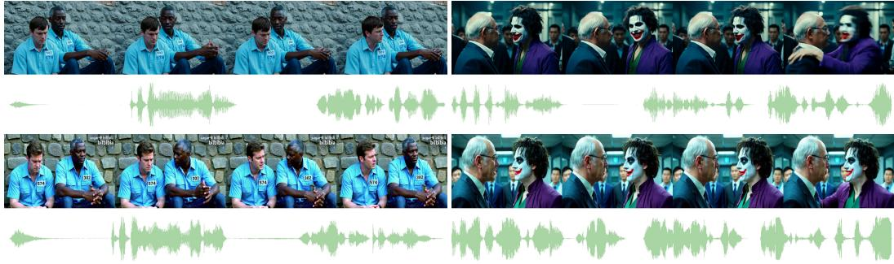

In a softly lit bedroom at night, a young child sits under a blanket while their father sits on the edge of the bed holding a picture book. Small glowing stars decorate the walls, and warm light from a bedside lamp creates a calm......

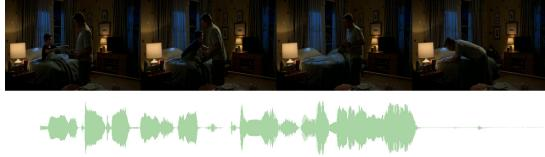

A stable medium close-up frames two dogs sitting calmly beside each other in a quiet indoor room. A small corgi sits on the left and a black Labrador sits on the right. Both remain in fixed positions while the camera stays completely still.......

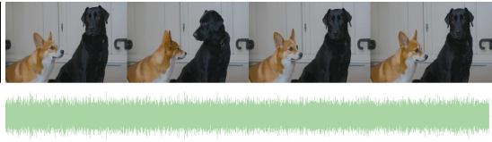

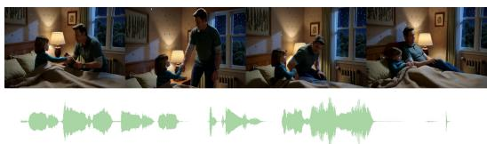

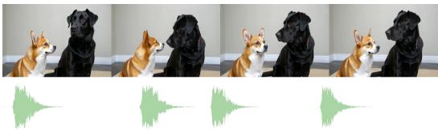  
Figure 6: Qualitative examples of joint audio-video generation by OmniOPD. These examples demonstrate improvements in audio diversity, voice–character alignment in multi-character scenes, visual aesthetics, and audio fidelity.

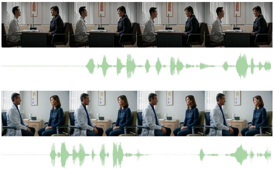  
From a slightly low-angle extreme close-up, a female anime character with shoulder-length white hair streaked with blue holds a dark, round object near he mouth. In the dim, atmospheric lighting of what appears to be a library......

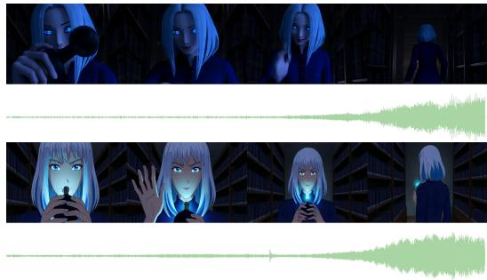

In a medium close-up with a cool, cinematic tone, an East Asian man with short spiky hair and a dark suit jacket over a white shirt stands in side profile, his gaze directed downward. Slightly behind him and to the right, a second man......

"In a bright classic cartoon living room, Mickey Mouse and Donald Duck sit opposite each other in two armchairs. The camera remains fixed in a centered medium two-shot. Both characters stay seated throughout the scene with......

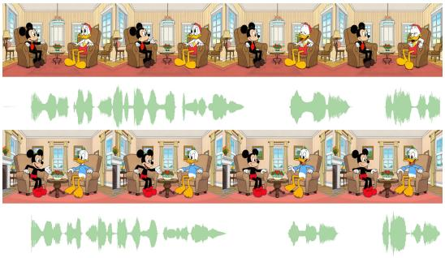  
A static medium shot frames a doctor and a patient sitting across from each other in a clean consultation room. The camera does not move. The doctor maintains a calm posture and says, \"Your test results look much better......

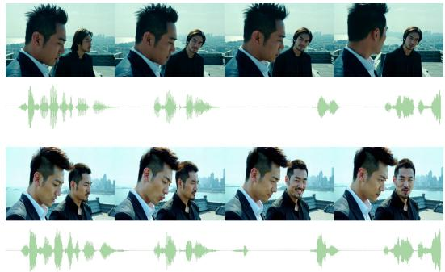  
Figure 7: Qualitative examples of joint audio-video generation by OmniOPD. These examples demonstrate improvements in audio diversity, voice–character alignment in multi-character scenes, visual aesthetics, and audio fidelity.

Table 4: Prompts used for evaluation in Fig. 4.
<table><tr><td>No. Prompt</td><td></td></tr><tr><td>1</td><td>&quot;A fixed close-up shows two domestic cats sitting opposite each other on a windowsill in soft afternoon light. One is an orange tabby and the other is a gray British Shorthair. The camera remains perfectly still while both cats maintain stable seated postures. The orange cat looks toward the gray cat and produces a gentle meow. After a brief pause, the gray cat slowly blinks and answers with a shorter, lower-pitched meow. Only subtle head, ear, and whisker movements occur. The audio contains the two clearly separated cat vocalizations with almost no other environmental sound.&quot;</td></tr><tr><td>2</td><td>&quot;Amidst twisted metal and rubble under a hazy, sunlit sky, five figures stand arranged in a loose semi-circle. Strong backlighting from the upper right casts dramatic golden highlights across their forms, while a slightly low camera angle looks up at the group, em- phasizing their presence. On the far left, a man in a red-and-gold suit with glowing blue accents stands next to a younger man in a red-and-blue suit. To their right, a muscular, bald man with reddish-brown skin and tattoos faces a woman in black leather armor with antennae-like headgear, while on the far right, a man in a brown jacket holds a futuristic weapon at his side. The man in the red-and-gold suit turns his body slightly to look di- rectly at the resolute-looking, muscular man opposite him and says quietly, “I can&#x27;t shake the feeling that this isn&#x27;t over yet.&quot; In response, a faint smile appears on the muscular man&#x27;s face, and he replies in a calm, steady voice, “As long as we&#x27;re still standing together, we can get through anything.&quot; The other three figures remain standing, their gazes shifting subtly as they listen in silence to the exchange. The audio shows a quiet background am- bience featuring the sound of soft wind moving through the ruins, punctuated by the faint, intermittent clinking of metal debris. The dialogue is clear, with the first man speaking quietly and the second replying in a calm, steady tone.&quot;</td></tr><tr><td>3</td><td>&quot;At night beside a mountain lake, four friends sit around a small campfire beneath a clear sky filled with stars. One person holds an acoustic guitar while the others sit on logs wrapped in blankets. The camera begins with a close-up of burning wood and glowing embers before slowly pulling back to reveal the group and the dark lake behind them. The guitarist begins playing a gentle chord progression, and after several measures, a woman quietly starts singing. The others gradually join her during the chorus. The audio features detailed fire crackles in the foreground, occasional pieces of wood collapsing into the flames, and a naturally recorded acoustic guitar. The first singing voice is clear and close, while additional voices gradually create a small group harmony. Faint insects and distant water sounds remain audible behind the music.&quot;</td></tr><tr><td>4</td><td>&quot;SpongeBob and Patrick are sitting on a rock underwater, talking deeply. Patrick looks at Patrick and says clearly: &quot;Knowledge cannot replace friendship, SpongeBob!&quot; with an emotional expression. SpongeBob smiles warmly and responds: &quot;I agree, but I also really want that Krabby Patty!&quot; The scene features professional lip-syncing and facial muscle movements. Cinematic 2D animation, high-detail CGI. Soft underwater lighting, floating sea particles, 8k resolution, photorealistic textures for sponge and starfish skin.&quot;</td></tr></table>