# One Image Is Enough: Self-Generated Supervision for Personalizing Human Video Diffusion at Test Time

Sadman Rakib Pinon1,2 Adamo Orsini1,2 Yanis Falaki1 Linlian Jiang1,2

Jacob Kingi1,2 Yang Wang1,2† Xinxin Zuo1†

1Concordia University 2Mila – Quebec AI Institute

sadmanrakib.pinon@mail.concordia.ca †Corresponding authors

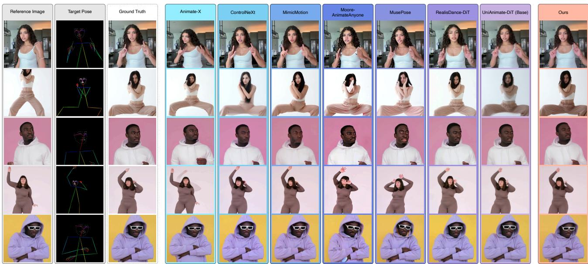  
Figure 1. One image is enough. From a single reference image and a driving pose sequence, our method personalizes a pose-driven video diffusion model to the subject at test time, with no subject video, ground truth, or labels. Identity preservation and video quality improve together. Columns show the reference image and target pose, the ground truth, seven pose-driven baselines, and our adapted model.

## Abstract

Pose-driven human video diffusion animates a person from a single reference image and a target pose sequence, yet it struggles to preserve identity, rendering the face and garments unfaithfully as the pose departs from it. Personalization is the standard remedy, but its supervision is missing: one image fixes identity at a single pose, while a multi-pose subject video cannot be assumed in practice. Instead, we synthesize the missing supervision. A domain-tuned, pose-conditioned generator produces pseudo-ground-truth frames at selected key poses. An inference-time reference-only sampler steers these candidates toward the subject and keeps the most identity-consistent. A per-subject low-rank adapter then trains on static clips of them, configuredfrom the reference alone, with no subject video, ground truth, or labels. Although lower in fidelity, these synthetic frames supervise

more effectively than real ones. Real frames as captured carry motion that erodes the temporal prior, while a static clip conveys appearance alone. On TikTok and UBC Fashion, the adapted model improves the base on every metric, inverts the identity-versus-motion trade-off, and matches or surpasses adaptation on five real frames despite using none. Code and weights are available at github.com/SadmanPinon/one-image-is-enough.

## 1. Introduction

Given a single reference image of a person and a driving pose sequence, pose-driven human video diffusion models aim to animate the reference subject under the target motion. Recent advances in large-scale video diffusion have substantially improved motion realism, temporal coherence, and overall visual fidelity. However, it is still a challenging problem to faithfully preserve the subject’s identity. For example, facial appearance may be generated inconsistently across frames, while fine-grained garment details, text, and logos can be distorted, altered, or hallucinated.

Rather than relying solely on a larger video diffusion backbone, we focus on personalizing the model to the input subject at test time. A single reference image, however, provides limited adaptation signals: it captures the subject in only one pose and cannot supervise identity preservation across the diverse poses in the driving sequence. We therefore construct pose-diverse pseudo-supervision at inference time.

Specifically, a pose-conditioned, reference-following image diffusion model synthesizes subject-specific images for poses sampled from the driving sequence. More importantly, an inference-time particle-steering procedure, guided by body-similarity and facial-identity rewards, selects highquality identity-consistent samples without subject videos, target-frame annotations, or human feedback.

Given the pseudo ground truth frames, directly adapting a video diffusion model to static subject images can weaken its motion prior, reducing dynamics and temporal consistency. This identity-and-motion trade-off [4, 22, 23, 61] is particularly challenging for unified attention video DiTs [9, 45, 62], whose 3D self-attention jointly models appearance and motion without separable appearance-only parameters [9, 45, 62]. We address this issue by repeating each synthetic image into a static clip and optimizing a lightweight subject-specific LoRA on these appearancefocused clips. This strategy improves identity preservation while retaining the backbone’s motion capability and video quality.

We validate the approach on the TikTok and UBC Fashion benchmarks. The largest gain is on video quality: adaptation substantially lowers FVD where naive personalization is expected to degrade it, so identity and video quality improve together rather than trading off. The same adaptation transfers to in-the-wild videos unseen during training, since the supervision is generated for each test subject rather than learned from a dataset-specific prior. The adaptation restores the face and fine garment detail that the base model distorts as the body turns away from the reference pose. Our main contributions are:

• We propose a test-time personalization framework for pose-driven human video diffusion from a single image, requiring no ground truth, no real captured frames, and no human feedback.

• A reward-guided generation approach is proposed for synthesizing pseudo-ground-truth images, using bodysimilarity and facial-identity rewards that measure consistency with the reference image.

• Our method achieves the best results on most metrics across benchmarks, surpassing the non-personalized base on every metric and matching or surpassing a model personalized with real captured subject frames.

## 2. Related Work

Pose-driven human animation. Pose-driven human image animation has converged on the setting we study: a single reference image is animated according to a target body-pose or motion sequence. Early diffusion models established the now-standard recipe of reference appearance injection, pose-guided denoising, and temporal modules for video synthesis [14, 53]. Follow-up work makes this recipe practical in open-source form [31, 39] and improves pose confidence and long-video fusion [59]. Others inject SMPLderived depth, normal, semantic, and skeleton cues [63], study efficient control modules [33], and unify reference appearance and target-pose conditioning in a single video diffusion branch [44]. Recent DiT-based work further shows that larger video backbones, compact pose encoders, motion tokens, text/background control, and hard-motion training can substantially improve pose following and temporal quality [9, 25, 45, 51, 60, 62].

These works are primarily trained as feed-forward general animators, and do not adapt the model to the test subject by constructing pose-specific supervision from the given reference image. Our work therefore focuses on reducing per-subject identity, clothing, and hard-pose errors after the target motion is known, rather than introducing another generic pose-control branch.

Personalization and test-time adaptation. Diffusion personalization methods show that few-shot subject binding can be achieved by fine-tuning model weights, learning new tokens, or updating compact adapter parameters [10, 11, 13, 19, 34]. Video customization work highlights a related but sharper problem: static subject reconstruction can damage the motion prior, reducing dynamics, temporal consistency, or prompt adherence. Prior video customization methods study one-shot video tuning from real videos [49]. Others add subject and motion adapters, image-prompt conditioning, frozen videos, dynamic denoising weights, reward supervision, preference pairs, and DiT LoRA tuning [4, 17, 22, 23, 29, 30, 48, 50, 61]. These methods diagnose the same identity-versus-motion tension that appears in pose-driven animation. Still-Moving [4] originates the frozen-clip supervision we adopt, training adapters on still images replicated over time. There the construction is a liability: it leaves the model producing nearly static videos unless a Motion Adapter on the temporal-attention layers, trained on 1,600 real videos, absorbs the effect. Neither remedy transfers, since a unified 3D-attention DiT has no temporal-only layer and we use no real video. The difference is what the conditioning asks for. A text prompt demands motion the frozen clip does not show, whereas our pose is held constant across the clip. StableAnimator [41] attacks the same problem by training an identity adapter into a video diffusion model and steering denoising with a face reward at inference. The reward there acts on the delivered video, whereas ours acts on the supervision frames and the animator is never rewarded. Wan-Dancer [15] builds long dance videos on the same Wan backbone from music rather than a driving pose, and names identity consistency over long sequences as open future work, which is the failure mode our per-reference adaptation targets.

In contrast, our input is one still reference image rather than a subject video, the control signal is an explicit target pose sequence, and we adapt at test time on pseudoexamples tied to the poses the model must render.

Self-generated and synthetic supervision. Generated supervision is also well established in diffusion personalization and view synthesis. Prior work uses generated class images for prior preservation [34], distills synthetic expert customizations into amortized personalization models [6], and builds synthetic preference pairs for image personalization [1]. Other methods use synthetic motion, generated views, uncertainty weighting, hallucination maps, or partial-reference quality measures to avoid poisoning downstream optimization [7, 18, 24, 26, 40]. Test-time selfimprovement and generated-support-view pipelines have also appeared for video generation and sparse-view NVS [5, 27, 37, 52].

The distinction in our setting is the target and use of the generated supervision. The single test reference produces candidate human frames at poses sampled from the driving sequence. Those candidates are filtered for identity and image quality, and the selected pseudo-pairs supervise persubject adaptation of the pose-driven video model. Thus, the self-generated data are neither generic class regularizers nor free-view support images, but pose-targeted evidence for the exact subject-motion pair being requested.

Inference-time guidance and reward-guided sampling. A complementary line steers diffusion at inference time without retraining, either by resampling a population of particles toward a reward [36] or by searching the noise space with verifiers [28]. DINO- and identity-based rewards are standard signals for subject fidelity [8, 32, 47], and bestof-N selection is the simplest such scheme. Closest to our use, IPRO [35] optimizes an ArcFace identity reward, but as train-time reinforcement learning of the video model, and IPRO scores against ground-truth video frames.

We instead apply a training-free, reference-only sampler at the pseudo-supervision stage. A DINO body-similarity reward steers candidate frames in-loop, and an ArcFace reward selects the final one, anchored entirely to the single reference image, with no ground truth and no model finetuning. Our contribution is this adaptation to the singlereference video-personalization setting.

## 3. Method

Our goal is to personalize a frozen pose-driven video model to a subject from a single reference image, with no subject video, ground-truth frames, or labels available. We therefore synthesize the supervision. From the reference image $x _ { \mathrm { r e f } }$ and the driving pose sequence P, a pose-conditioned generator produces a pseudo-ground-truth frame of the subject at each of a few key poses sampled from $\mathcal { P } _ { \cdot }$ Each frame is steered and selected by its identity match to the reference (Sec. 3.2). A per-subject LoRA then adapts the base animator on static clips of these frames (Sec. 3.3). Fig. 2 shows the pipeline, and Algorithm 2 states it in full. We begin with the preliminaries and problem setup (Sec. 3.1).

## 3.1. Preliminaries

At test time we are given a single reference image $x _ { \mathrm { r e f } }$ and a driving pose sequence $\mathcal { P } ~ = ~ \{ p _ { t } \} _ { t = 1 } ^ { T }$ , and seek a video $\hat { V } = \{ \hat { v } _ { t } \} _ { t = 1 } ^ { T }$ in which the subject of $x _ { \mathrm { r e f } }$ performs $\mathcal { P }$ while retaining its appearance.

The base animator $F _ { \theta }$ is a latent video diffusion model. An encoder maps each frame to a latent z. A forward process adds Gaussian noise over diffusion steps τ,

$$
q ( z _ { \tau } \mid z _ { \tau - 1 } ) = \mathcal { N } \big ( z _ { \tau } ; \sqrt { 1 - \beta _ { \tau } } z _ { \tau - 1 } , \beta _ { \tau } \mathbf { I } \big ) ,\tag{1}
$$

and $F _ { \theta }$ is trained to reverse it under conditioning $c =$ $( x _ { \mathrm { r e f } } , \mathcal { P } )$

$$
\begin{array} { r } { \begin{array} { r l r } { \mathcal { L } ( \theta ) = \mathbb { E } _ { z , c , \epsilon , \tau } \big \| \epsilon - \epsilon _ { \theta } ( z _ { \tau } , \tau , c ) \big \| _ { 2 } ^ { 2 } , } & { { } } & { \epsilon \sim \mathcal { N } ( 0 , \mathbf { I } ) . } \end{array} } \end{array}\tag{2}
$$

At inference $F _ { \theta }$ maps $( x _ { \mathrm { r e f } } , \mathcal { P } )$ to a video but does not reliably preserve the reference identity as the pose departs from the reference.

Personalization adapts the base through a small persubject low-rank update $\Delta \theta ,$ yielding the adapted model $F _ { \theta + \Delta \theta }$ Since neither subject video nor ground-truth frames are available, we draw the supervision from a poseconditioned generator G, whose selected pseudo frames $\mathcal { D } _ { \mathrm { p s e u d o } }$ stand in for the absent subject data (Sec. 3.2).

## 3.2. Reference-only reward-guided generation

Pose-conditioned generator G. We build G from FLUX.1 Kontext [21], a FLUX.1 [20] variant with strong reference and prior preservation, augmented with a pose ControlNet [57]. We domain-tune $G$ for this task. Given the reference image $x _ { \mathrm { r e f } }$ and a target pose, G renders the subject in that pose while preserving identity. During training, we freeze the base weights of $G$ and optimize a low-rank LoRA injected into its DiT attention blocks. Each training step draws a two-frame pair from an in-domain video: one frame serves as the reference, and G must reconstruct the second frame from its 2D pose. The optimizer, schedule, and trained layers are in Appendix A.

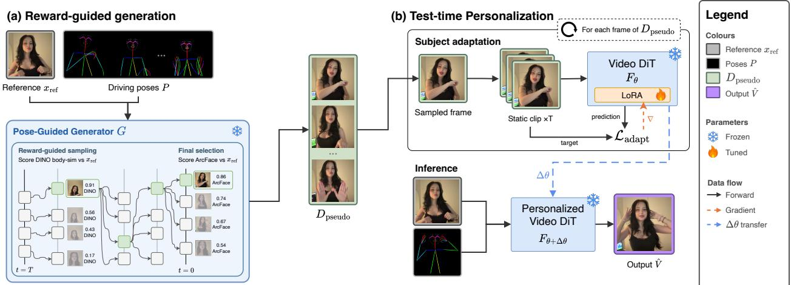  
Figure 2. Method overview. From one reference image $x _ { \mathrm { r e f } }$ and a driving pose sequence ${ \mathcal P } ,$ a pose-conditioned generator G synthesizes pose-targeted pseudo-ground-truth frames $\mathcal { D } _ { \mathrm { p s e u d o } }$ of the subject. (a) Reward-guided generation: for each key pose, $G$ draws several candidates as an interacting particle system and resamples them in-loop toward a DINO body-similarity reward to $x _ { \mathrm { r e f } }$ , then selects the final frame by ArcFace face identity. Every reward is read from the reference alone (our reference-only reward-guided sampler). (b) Test-time personalization: a per-subject LoRA ∆θ adapts the frozen base animator $F _ { \theta }$ on static clips of the selected frames. The adapted model $F _ { \theta + \Delta \theta }$ renders the personalized video Vˆ . No subject video, no ground truth, and no human feedback are used.

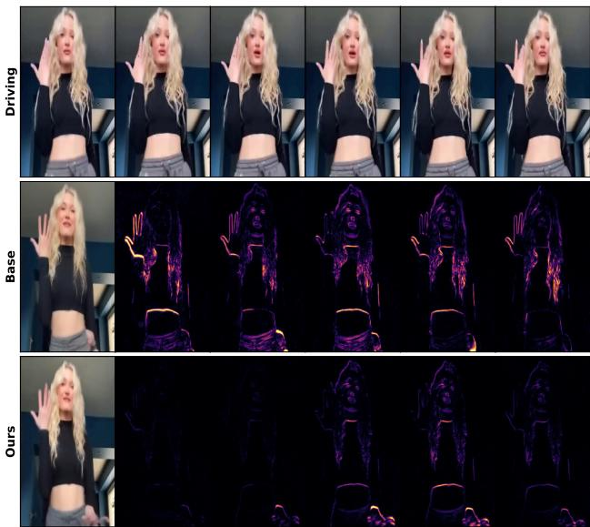  
Figure 3. Temporal stability. $T o p \mathrm { : }$ the driving frames. For Base (middle) and Ours (bottom), the leftmost column is that method’s output frame and the remaining columns are consecutive framedifference maps over the same frames. The non-personalized base produces widespread inter-frame residual across the face and torso (temporal flicker), whereas our adapted model confines residual to true motion boundaries and stays stable, reducing mean interframe residual by 60% over the frames shown. Brighter indicates larger frame-to-frame change.

Pose-targeted synthesis. From the driving sequence $\mathcal { P }$ we select K key poses $\mathcal { P } _ { K } \subset \mathcal { P }$ by farthest-point sampling in keypoint space, anchored at the reference pose. This concentrates the supervision on the hard poses the video model

$F _ { \theta }$ must render and spans the range of motion. For each key pose $p _ { k } \in \mathcal { P } _ { K }$ the generator must produce one frame that is faithful to the subject and of sufficient quality to supervise appearance.

Reward-guided sampling. Rather than draw N independent candidates and keep the best (best-of-N), we sample the N candidates as an interacting particle system and steer them while they denoise. We adapt inference-time particle steering [28, 36] to our task with two novel changes specific to the single-reference setting. First, every reward is derived from the reference image alone. No ground-truth target frame exists, so the guidance signal is self-supervised. Second, we split the reward by role.

An in-loop steering reward $R _ { \mathrm { s } } ( x )$ = $w _ { b } \mathrm { D I N O } ( x , x _ { \mathrm { r e f } } ) \ + \ w _ { \sigma } \mathrm { s h a r p } ( x )$ combines body and appearance similarity to the reference, read from a DINOv2 encoder [32], with an image-sharpness term. At scheduled denoising steps, the particles are resampled in proportion to exp(λRs), so sampling compute concentrates on the trajectories that already resemble the subject (Algorithm 1). We resample only in the back half of denoising. Early, high-noise particles lack the structure for the reward to be informative, so the first half runs as a plain deterministic ODE, and steering it would only collapse diversity. After each resampling, a churn step re-noises the particles at strength η, so that duplicated high-reward particles diverge rather than remaining identical under the deterministic dynamics.

A final selection reward $R _ { \mathrm { f } } ( x ) = \mathrm { A r c F a c e } ( x , x _ { \mathrm { r e f } } )$ [8] then picks the surviving candidate with the highest face identity. We steer in-loop with the dense, inexpensive DINO signal and reserve the sharper but detector-sensitive Arc-

Algorithm 1 GUIDEDSAMPLE: reward-guided pseudo   
frame generation ( one target pose)   
Input: reference $x _ { \mathrm { r e f } } ,$ target pose $p _ { k }$   
Output: pseudo frame $\boldsymbol { x } _ { k } ^ { * }$   
Frozen model: pose-conditioned generator $G$   
Rewards: $R _ { \mathrm { s } } ( x ) = w _ { b } \mathrm { D I N O } ( x , x _ { \mathrm { r e f } } ) + w _ { \sigma }$ sharp(x),   
$R _ { \mathrm { f } } ( x ) = \mathrm { A r c F a c e } ( x , x _ { \mathrm { r e f } } )$   
Hyperparameters: particles $N ,$ denoising steps $S ,$ resam  
ple steps $\mathcal { R } \subseteq \{ [ t _ { \mathrm { s t a r t } } S ] , \dots , S \}$ (back half), temperature $\lambda ,$   
churn η   
1: $\{ z ^ { ( i ) } \} _ { i = 1 } ^ { \dot { N } } \sim \mathcal { N } ( 0 , \mathbf { I } )$ ▷ initialize N particles   
2: for $s = 1 , \ldots , S$ do   
3: $z ^ { ( i ) } \gets$ EULERSTEP $( G , z ^ { ( i ) } , x _ { \mathrm { r e f } } , p _ { k } )$ ∀i ▷ deterministic   
ODE step   
4: if $s \in \mathcal R$ then   
5: wi ∝ exp $\big ( \lambda R _ { \mathrm { s } } ( \hat { x } _ { 0 } ^ { ( i ) } ) \big )$ ▷ reward weights; $\hat { x } _ { 0 } ^ { ( i ) }$   
decoded from $z ^ { ( i ) }$   
6: $\{ z ^ { ( i ) } \} \sim \mathrm { C } :$ ategorical(w) ▷ resample N particles   
with replacement, $\operatorname* { P r } ( i ) \propto w _ { i }$   
7: $\{ \hat { \boldsymbol { z } } ^ { ( i ) }  \mathrm { R E N O I S E } ( \boldsymbol { z } ^ { ( i ) } ; \boldsymbol { \eta } )$ ∀i ▷ churn: re-noise so   
duplicate particles diverge   
8: end if   
9: end for   
10: return $x _ { k } ^ { * } = \arg$ maxi $R _ { \mathrm { f } } ( x ^ { ( i ) } )$ , x(i) = decode $( z ^ { ( i ) } )$ ▷   
ArcFace pick

Face score for the single final choice, where it is most reliable. At an equal sampling budget, the reward-guided sampler improves identity and video quality over best-of-N (the no-steering rows of Tab. 7).

The selected pair $( x _ { k } ^ { * } , p _ { k } )$ enters the pseudo-supervision set $\mathcal { D } _ { \mathrm { p s e u d o } } ~ = ~ \{ ( x _ { k } ^ { * } , \ddot { p _ { k } } ) \} _ { k = 1 } ^ { K }$ . Each selected frame captures a single pose. Replicated into a static clip for adaptation (Sec. 3.3), it carries no inter-frame motion, unlike real video frames captured from a subject in motion. Rewardguided sampling and DINO- or identity-based rewards are each established [35, 36, 47]. Unlike reward fine-tuning against ground-truth video [35, 54], ours is training-free, uses only the reference image as its target, and acts at the pseudo-supervision stage. The novelty in our setting is that these frames are pose-targeted to the test subject’s driving sequence, then reward-steered against the reference before they supervise.

## 3.3. Test-time adaptation

Static-clip adaptation. We adapt only a low-rank update ∆θ (LoRA [13]) of rank r on $F _ { \theta } .$ , and keep θ frozen. We train $\Delta \theta$ by minimizing an adaptation loss $\mathcal { L } _ { \mathrm { a d a p t } }$ on $\mathcal { D } _ { \mathrm { p s e u d o } }$ . Each adaptation step uses one selected frame $\boldsymbol { x } _ { k } ^ { * }$ We replicate $\ v x _ { k } ^ { * }$ into a clip and hold the pose $p _ { k }$ constant across every frame of that clip, then train $F _ { \theta + \Delta \theta }$ to reconstruct it. The static clip carries no motion. Writing $\mathrm { c l i p } ( x ) = [ x , \ldots , x ]$ for the T-frame replication and $z _ { \tau } ^ { k }$ for the noised latent of $\mathcal { E } ( \mathrm { c l i p } ( x _ { k } ^ { * } ) )$ ,

$$
\mathcal { L } _ { \mathrm { a d a p t } } ( \Delta \theta ) = \sum _ { k = 1 } ^ { K } \mathbb { E } _ { \tau , \epsilon } \big \| \epsilon - \epsilon _ { \theta + \Delta \theta } \big ( z _ { \tau } ^ { k } , \tau , ( x _ { \mathrm { r e f } } , p _ { k } ) \big ) \big \| _ { 2 } ^ { 2 } ,\tag{3}
$$

so the pose $p _ { k }$ stays fixed across the clip and the temporal pathway sees no motion during adaptation.

A multi-frame clip of distinct pseudo poses would reintroduce motion into the temporal pathways of the unified self-attention DiT. That motion reproduces the canonical motion-prior damage seen in video personalization [4, 22, 23, 61]. The static clip removes that signal, so adaptation updates appearance only. Prior fixes that decouple spatial parameters from temporal parameters [29] do not transfer to unified-attention DiTs, where one attention operation mixes both. We therefore control motion through the data rather than the parameterization. Removing the static clip drops identity below the base model and worsens temporal consistency, as we report in Tab. 4. At inference, the adapted model $F _ { \theta + \Delta \theta }$ renders $x _ { \mathrm { r e f } }$ along the full driving sequence P to produce $\hat { V }$

## 4. Experiments

## 4.1. Setup

Datasets. For in-domain training and evaluation we use the TikTok [16] and UBC Fashion [56] benchmarks with their standard train and test splits. To probe cross-domain transfer, we additionally evaluate zero-shot on Unseen100-Val, a set of 100 in-the-wild videos spanning diverse subjects, motion, lighting, and backgrounds (Tab. 2). Full dataset details are in Appendix D.

Evaluation. We follow the evaluation protocol of RealisDance-DiT [62] for all comparisons, covering reconstruction, perceptual, identity, and video-quality metrics.

Algorithm 2 Test-time self-generated personalization   
Input: reference $x _ { \mathrm { r e f } } .$ , driving poses $\mathcal { P } = \{ p _ { t } \} _ { t = } ^ { T } .$ 1   
Output: personalized video $\hat { V }$   
Frozen models: base animator $F _ { \theta } ,$ generator $G$   
Trainable: per-subject LoRA $\Delta \theta$ (rank r)   
Hyperparameters: key poses K   
1: $\mathcal { P } _ { K } \gets \mathrm { F P S } ( \mathcal { P } , K )$ ▷ select K key poses by farthest-point   
sampling   
2: $\mathcal { D } _ { \mathrm { p s e u d o } }  \emptyset$ ▷ empty pseudo-supervision set   
3: for $p _ { k } \in \mathcal { P } _ { K }$ do   
4: $x _ { k } ^ { * } \gets$ GUIDEDSAMPL $. \mathrm { E } ( x _ { \mathrm { r e f } } , p _ { k } ; G )$ ▷ reward-guided   
sampling from G, Alg. 1   
5: Dpseudo $ \mathcal { D } _ { \mathrm { p s e u d o } } \cup \{ ( x _ { k } ^ { * } , p _ { k } ) \}$   
6: end for   
7: $\Delta \theta \gets \arg \operatorname* { m i n } _ { \Lambda \theta } \quad \quad \sum _ { - } \qquad \mathcal { L } _ { \mathrm { a d a p t } } \big ( F _ { \theta + \Delta \theta } ; \mathrm { c l i p } ( x ) , p \big )$ ▷   
(x,p)∈Dpseudo   
static clip of every pseudo frame, θ frozen   
8: return $\hat { V } = F _ { \theta + \Delta \theta } ( x _ { \mathrm { r e f } } , \mathcal { P } )$

Metric definitions are in Appendix B, and the full protocol in Appendix D.2.

## 4.2. Implementation details

Base animator. The base animator $F _ { \theta }$ is UniAnimate-DiT [45], a pose-driven human video DiT built on Wan2.1- I2V (14B) [43]. It uses a single unified 3D self-attention stack that models space and time jointly. Reference conditioning enters through dual cross-attention with dedicated image-token projections, and the target pose is injected as a residual at the latent entry. We keep θ frozen and adapt only the low-rank update ∆θ of rank r.

Generator. We build the pose-conditioned generator G on FLUX.1 Kontext [21] with a pose ControlNet [57] and freeze its base. We train a low-rank LoRA on its DiT attention blocks ourselves, on the in-domain training split of each benchmark, with the two-frame reconstruction objective of Sec. 3.2. We optimize with AdamW at a constant learning rate for 4,000 steps on a single H100 GPU. The LoRA rank, schedule, and trained layers are in Appendix A. Adaptation. By default we synthesize K=5 pseudo frames, each selected from N=8 reward-guided particles, and train the rank-r LoRA on static clips of these frames. The K target poses, and the K real frames of the Real-5 baseline, are the same indices, chosen by farthest-point sampling over the driving poses and seeded at the reference frame, so they span the pose range rather than the timeline. We study how cost and quality scale with the number of fine-tuning steps in Appendix C.1. Full hyperparameters are in Appendix A.

Test-time cost. Table 8 reports the wall-clock and peak GPU memory of each stage on a single H100. The method has two distinct costs, with different hardware requirements. Generation and adaptation run once per reference image and take 9.3 minutes together, peaking at 62.1 GiB. That peak is dominated by the frozen base model, which accounts for 70% of $\mathbf { i t } ,$ against 15% for the low-rank update and its optimizer state (Tab. 18). Inference is the recurring cost. It is unchanged by adaptation, since merging the update adds no parameters at inference, and it peaks at 21.6 GiB, within a 24 GB card. The two costs separate in deployment: the one-time stage runs server-side and produces a 1.1 GiB adapter, after which inference proceeds at base cost. Appendix F gives the measurement protocol and the full breakdown.

## 4.3. Comparison with the state of the art

In-domain. Table 1 compares against eight pose-driven animators on TikTok and Fashion dataset. Our test-time adaptation improves the UniAnimate-DiT base on every metric and gives the best result on most metrics. The largest gain is on video quality: FVD on TikTok falls below every prior method. Three aspects of this result are worth mentioning:

Table 1. Main comparison on TikTok / Fashion (each cell Tik-Tok/Fashion). StableAnimator is quoted from its paper, which reports neither FID nor FID-VID and does not evaluate on UBC Fashion.
<table><tr><td>Model</td><td>PSNR↑</td><td>SSIM↑</td><td>LPIPS↓</td><td>FID↓</td><td>FVD↓</td><td>FID-VID↓</td></tr><tr><td>MusePose [39]</td><td>18.20/22.20</td><td>0.757/0.896</td><td>0.248/0.067</td><td>41.99/14.95</td><td>532.75/96.17</td><td>14.60/10.94</td></tr><tr><td>Moore-AA [31]</td><td>18.62/20.83</td><td>0.764/0.880</td><td>0.230/0.093</td><td>37.28/27.74</td><td>501.22/149.66</td><td>12.40/10.13</td></tr><tr><td>ControlNeXt [33]</td><td>16.31/18.48</td><td>0.728/0.853</td><td>0.296/0.132</td><td>33.48/13.82</td><td>548.01/143.02</td><td>28.23/14.60</td></tr><tr><td>Animate-X [38]</td><td>16.71/22.15</td><td>0.743/0.893</td><td>0.285/0.069</td><td>32.77/10.11</td><td>508.63/70.47</td><td>17.47/11.87</td></tr><tr><td>MimicMotion [59]</td><td>19.30/23.80</td><td>0.751/0.913</td><td>0.220/0.061</td><td>34.88/15.40</td><td>472.51/80.89</td><td>9.30/8.17</td></tr><tr><td>RealisDance-DiT [62]</td><td>17.55/23.33</td><td>0.717/0.908</td><td>0.261/0.053</td><td>30.39/10.81</td><td>458.81/72.94</td><td>-1-</td></tr><tr><td>MTVCraft [9]</td><td>19.84/23.90</td><td>0.779/0.923</td><td>0.217/0.057</td><td>20.70/8.74</td><td>276.65/64.88</td><td>7.31/4.41</td></tr><tr><td>StableAnimator [41]</td><td>20.66/-</td><td>0.801/-</td><td>0.232/-</td><td>-1-</td><td>140.62/-</td><td>-1-</td></tr><tr><td>UniAnimate-DiT (Base) [45]</td><td>19.35/23.52</td><td>0.765/0.907</td><td>0.235/0.060</td><td>28.47/12.79</td><td>402.14/88.36</td><td>9.12/6.12</td></tr><tr><td>UA-DiT Ours</td><td>21.20/24.56 0.847/0.931</td><td></td><td>0.206/0.059</td><td>26.74/8.71</td><td>133.5/53.88</td><td>8.42/5.79</td></tr></table>

Table 2. Quantitative comparison on cross-domain performance on the Unseen100-Val set after training on TikTok. Off the training distribution, our adaptation reaches the only FVD below 100 (92.5) and the lowest dtSSD, while every other method stays above 125.
<table><tr><td>Model</td><td>PSNR↑ SSIM↑ LPIPS↓ FaceID↑ BodySIM↑ FVD↓ dtSSD↓</td><td></td><td></td><td></td><td></td><td></td><td></td></tr><tr><td>MusePose [39]</td><td>20.25</td><td>0.767</td><td>0.217</td><td>0.498</td><td>0.877</td><td>131.1</td><td>295.2</td></tr><tr><td>Moore-AA [31]</td><td>18.67</td><td>0.690</td><td>0.356</td><td>0.402</td><td>0.820</td><td>229.3</td><td>435.9</td></tr><tr><td>ControlNeXt [33]</td><td>17.85</td><td>0.720</td><td>0.328</td><td>0.534</td><td>0.854</td><td>226.1</td><td>1077.1</td></tr><tr><td>Animate-X [38]</td><td>17.51</td><td>0.709</td><td>0.368</td><td>0.440</td><td>0.830</td><td>198.6</td><td>371.0</td></tr><tr><td>MimicMotion [59]</td><td>17.28</td><td>0.704</td><td>0.346</td><td>0.488</td><td>0.874</td><td>219.6</td><td>769.9</td></tr><tr><td>RealisDance-DiT [62]</td><td>18.43</td><td>0.663</td><td>0.339</td><td>0.574</td><td>0.885</td><td>181.5</td><td>594.4</td></tr><tr><td>UniAnimate-DiT (Base) [45]</td><td>21.19</td><td>0.796</td><td>0.206</td><td>0.632</td><td>0.903</td><td>125.5</td><td>207.9</td></tr><tr><td>UniAnimate-DiT: Ours</td><td>21.45</td><td>0.804</td><td>0.203</td><td>0.663</td><td>0.904</td><td>92.5</td><td>190.0</td></tr></table>

the gain lands on the metric that personalization usually degrades, it requires no subject video, and reconstruction and identity improve in step rather than trading against video quality. Figure 4 shows the effect on hard poses, where the base and competing animators reconstruct identity inconsistently while our adapted model preserves the face and garment. Additional qualitative results are in Appendix E. Out-of-domain. Trained on TikTok and evaluated on the out-of-domain Unseen100-Val set (Tab. 2), the adaptation transfers. It leads all methods and improves over the base on every metric, cutting FVD by roughly a quarter, with the prior animators further behind. The advantage holds under domain shift because the supervision is generated for the test subject rather than learned from the training distribution, so it does not inherit a dataset-specific prior.

Cross-reenactment. When one subject is driven by another subject’s motion, no aligned ground truth exists, so we measure identity against the reference (Tab. 3). Adaptation improves appearance fidelity (FaceID, BodySIM) while pose obedience (PoseAcc) is essentially unchanged, since the pose-conditioning pathway stays frozen. The adaptation thus binds appearance without disturbing the motion pathway, the asymmetry the static-clip recipe is designed to produce.

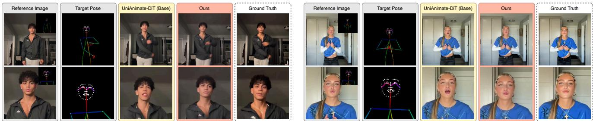  
Figure 4. Qualitative comparison on hard poses. For two subjects we show the reference and driving pose alongside the base, our adapted model, and ground truth. Insets crop the face. The base reconstructs identity and garment detail inconsistently as the pose departs from the reference, while our adaptation preserves both.

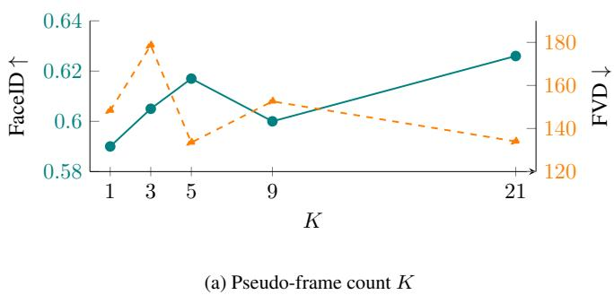

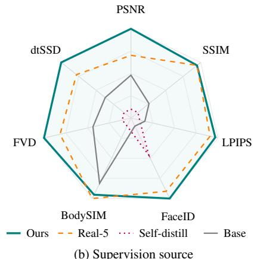  
(b) Supervision source  
Figure 5. Pseudo-frame count and supervision source. (a) FVD (orange) is lowest at K=5; FaceID (teal) dips at K=9 and peaks at K=21 at a similar FVD (values from Tab. 6). (b) Seven-metric comparison of supervision sources (outward = better, per-axis min–max over the rows of Tab. 5): Ours forms nearly the outer envelope, while self-distillation collapses on body similarity and temporal consistency.

Table 3. Cross-reenactment (Unseen100-Val). Each subject is driven by a different subject’s motion, so no aligned ground truth exists; we measure identity against the reference (FaceID, BodySIM) and pose obedience against the driving sequence (PoseAcc). Adaptation raises appearance fidelity while leaving pose obedience essentially unchanged, as the pose-conditioning pathway is frozen.
<table><tr><td>Method</td><td>FaceID↑</td><td>BodySIM↑</td><td>PoseAcc↑</td></tr><tr><td>UniAnimate-DiT (Base)</td><td>0.431</td><td>0.745</td><td>0.817</td></tr><tr><td>Ours</td><td>0.571</td><td>0.791</td><td>0.822</td></tr><tr><td>∆</td><td>+0.140</td><td>+0.046</td><td>+0.005</td></tr></table>

## 4.4. Ablations and analysis

Contribution of each component. Table 4 removes one component at a time. Removing the reward-guided frame selection raises FVD as lower-quality pseudo frames enter adaptation. Dropping the static clip is the most damaging: identity falls and temporal consistency degrades past the base itself (dtSSD 369.0 → 416.3). This confirms that multi-pose clips push motion back into the temporal pathway.

The full system also improves on adaptation on five real subject frames (Real-5) in FVD while using none, and matches it on identity, inverting the usual trade-off. The standalone generator G attains the highest per-frame identity but has no temporal model and cannot produce coherent video.

Supervision source. Holding the adaptation fixed and varying only the supervision source isolates what drives the gain (Tab. 5). Self-distillation adapts the base on its own outputs. It does not improve reconstruction and worsens temporal consistency, pushing dtSSD above the base, and scarcely improves identity, since those outputs carry the motion artifacts of a video model. Real frames help more, and our clean, static pseudo-GT from G helps most, cutting FVD to 133.5. Figure 5b summarizes this across all seven metrics.

Number of pseudo frames. FVD is lowest at K=5, our default, and both FVD and identity degrade at K=9 as extra frames expose generator artifacts (Fig. 5a, Tab. 6). A larger K=21 reaches the highest full-video FaceID (0.626) but trades away the balanced result, while a small K undercovers the motion the model must render. The fine-tuningtime and generator ablations are in Appendix C.

Steering and selection rewards. The reward-guided sampler reads two reference-only rewards in distinct roles, and

Table 4. Component ablation. Each designed component is removed and compared against real-frame supervision (Real-5) and the unadapted base. FaceID and BodySIM are over the full video. Generator G is a per-frame reference with no temporal model, so it lacks FVD/dtSSD and is not ranked.
<table><tr><td colspan="8">Variant PSNR↑ SSIM↑ LPIPS↓ FaceID↑(long) BodySIM↑(long) FVD↓ dtSSD↓</td></tr><tr><td>Real-5 + recipe</td><td>20.81</td><td>0.847</td><td>0.208</td><td>0.615</td><td>0.888</td><td>157.3</td><td>375.1</td></tr><tr><td>Ours (full)</td><td>21.20</td><td>0.847</td><td>0.206</td><td>0.617</td><td>0.887</td><td>133.5</td><td>369.0</td></tr><tr><td>w/o selection</td><td>20.92</td><td>0.847</td><td>0.208</td><td>0.613</td><td>0.884</td><td>163.8</td><td>375.7</td></tr><tr><td>w/o static-clip</td><td>20.80</td><td>0.842</td><td>0.208</td><td>0.583</td><td>0.872</td><td>151.9</td><td>416.3</td></tr><tr><td>Generator G</td><td>18.74</td><td>0.806</td><td>0.266</td><td>0.640</td><td>0.864</td><td>一</td><td>一</td></tr><tr><td>UniAnimate-DiT (Base)</td><td>20.52</td><td>0.834</td><td>0.233</td><td>0.597</td><td>0.884</td><td>206.0</td><td>386.6</td></tr></table>

Table 5. Supervision source. All rows share the adaptation recipe; only the supervision source changes. FaceID and BodySIM are over the full video, on the TikTok dataset. The standalone quality of G appears in Tab. 4.
<table><tr><td>Supervision source</td><td>PSNR↑</td><td>SSIM↑</td><td></td><td>LPIPS↓ FaceID↑(long)</td><td>BodySIM↑(long)</td><td>FVD↓</td><td>dtSSD↓</td></tr><tr><td>UniAnimate-DiT (Base)</td><td>20.52</td><td>0.834</td><td>0.233</td><td>0.597</td><td>0.884</td><td>206.0</td><td>386.6</td></tr><tr><td>Self-distillation (base&#x27;s own frames)</td><td>20.02</td><td>0.831</td><td>0.235</td><td>0.605</td><td>0.869</td><td>249.4</td><td>394.1</td></tr><tr><td>Reference image only (no G)</td><td>21.14</td><td>0.848</td><td>0.205</td><td>0.608</td><td>0.885</td><td>139.0</td><td>380.5</td></tr><tr><td>Real-5 frames</td><td>20.81</td><td>0.847</td><td>0.208</td><td>0.615</td><td>0.888</td><td>157.3</td><td>375.1</td></tr><tr><td>Ours (G pseudo-GT)</td><td>21.20</td><td>0.847</td><td>0.206</td><td>0.617</td><td>0.887</td><td>133.5</td><td>369.0</td></tr></table>

Table 6. Number of pseudo frames K. We sweep the number of self-generated supervision frames used for per-subject adaptation. FaceID and BodySIM are over the full video; K=5 is the best balanced configuration.

<table><tr><td colspan="11">K PSNR↑ SSIM↑ LPIPS↓ FaceID↑(long) BodySIM↑(long) FVD↓ FID↓ dtSSD↓</td></tr><tr><td>1</td><td>20.33</td><td>0.836</td><td>0.232</td><td></td><td>0.590</td><td>0.875</td><td>148.3</td><td>25.40</td><td>388.5</td></tr><tr><td>3</td><td>20.93</td><td>0.845</td><td>0.210</td><td></td><td>0.605</td><td>0.881</td><td>178.6</td><td>27.82</td><td>377.5</td></tr><tr><td>5 (ours)</td><td>21.20</td><td>0.847</td><td>0.206</td><td>0.617</td><td></td><td>0.887</td><td>133.5</td><td>26.74</td><td>369.0</td></tr><tr><td>9</td><td>20.79</td><td>0.842</td><td>0.212</td><td>0.600</td><td></td><td>0.872</td><td>152.6</td><td>28.46</td><td>396.0</td></tr><tr><td>21</td><td>21.16</td><td>0.846</td><td>0.209</td><td></td><td>0.626</td><td>0.881</td><td>134.0</td><td>27.64</td><td>377.7</td></tr></table>

Tab. 7 shows both assignments matter. Its no-steering (i.i.d.) rows are the best-of-N baseline, which in-loop steering improves on at an equal budget. The dense but coarse DINO reward steers the particle population best. The sharp but detector-sensitive ArcFace reward is unreliable as an inloop signal on the occluded, fast-moving faces typical of dance, but is decisive as the final selection. Steering with DINO and selecting with ArcFace is therefore our default.

Temporal stability. The gains do not come at the cost of motion. Figure 3 shows that adaptation confines inter-frame residual to true motion boundaries rather than spreading it across the face and torso. Identity improves without the flicker that personalization usually introduces.

## 5. Conclusion

We personalize a pose-driven human video model to a subject from a single reference image, with no subject video and no ground truth. A pose-conditioned generator synthesizes pseudo-ground-truth frames at the poses the driving sequence requires, steered and selected by reference-only rewards, and a per-subject LoRA adapts the base animator on static clips of them. The static clip, which we adopt from prior work, supplies subject appearance while carrying no motion, so the adaptation binds identity without disturbing the temporal prior. Personalization then improves identity and reconstruction and even improves video quality (FVD), the metric it usually degrades, and the gains transfer to outof-domain subjects because the supervision is generated for the test subject rather than learned from a training distribution. The adapted model surpasses its non-personalized base on every metric and matches or surpasses adaptation on five real subject frames despite using none, inverting the trade-off personalization usually incurs.

Table 7. Reward-design ablation (on a tuning subset). The two reference-only rewards assigned to in-loop steering versus final selection. Steering with DINO and selecting with ArcFace is best.
<table><tr><td>Steer (in-loop) Select (final)</td><td></td><td>PSNR↑</td><td></td><td>FaceID↑ BodySIM↑</td><td>FVD↓</td></tr><tr><td>none (i.i.d.)</td><td>DINO</td><td>21.48</td><td>0.685</td><td>0.916</td><td>713</td></tr><tr><td>none (i.i.d.)</td><td>ArcFace</td><td>22.42</td><td>0.695</td><td>0.918</td><td>538</td></tr><tr><td>DINO</td><td>DINO</td><td>22.40</td><td>0.661</td><td>0.921</td><td>516</td></tr><tr><td>DINO</td><td>ArcFace</td><td>22.80</td><td>0.711</td><td>0.928</td><td>496</td></tr><tr><td>ArcFace</td><td>ArcFace</td><td>21.07</td><td>0.655</td><td>0.922</td><td>429</td></tr></table>

Table 8. Test-time cost per reference image on a single H100 (TikTok, 81-frame inference, adaptation at 832×480, generation at 576×1024). The one-time peak is the maximum over the two stages, not their sum. Of it, 43.6 GiB is the frozen base and 9.2 GiB our update (Tab. 18). Inference costs what the base costs, as the merged adapter adds no parameters. Protocol in App. F.
<table><tr><td>Stage</td><td>Time</td><td>Peak GPU (GiB)</td></tr><tr><td>Once per reference image</td><td></td><td></td></tr><tr><td>Pseudo-frame generation (K=5, N=8)</td><td>9.2 min</td><td>41.7</td></tr><tr><td>Per-subject LoRA adaptation (5 steps)</td><td>5.8s</td><td>62.1</td></tr><tr><td>frozen base model</td><td></td><td>43.6</td></tr><tr><td>our update + optimizer state</td><td></td><td>9.2</td></tr><tr><td>activations, workspace, reserve</td><td></td><td>9.4</td></tr><tr><td>Total</td><td>9.3 min</td><td>62.1</td></tr><tr><td>Per video</td><td></td><td></td></tr><tr><td>Inference (ours and base)</td><td>1.8 min</td><td>21.6</td></tr></table>

Limitations and future work. The method inherits the quality of its generator G, since a degraded pseudo frame weakens the adaptation, so rejecting blurred or occluded frames is a simple safeguard (App. G). The reference-only rewards are fixed and hand-weighted, and learning them would raise the ceiling G imposes. The adapted model’s own outputs could re-supervise G in a closed loop. Because the adaptation never touches the backbone, it should carry over to stronger animators as they appear.

## References

[1] Shamil Ayupov, Maksim Nakhodnov, Anastasia Yaschenko, Andrey Kuznetsov, and Aibek Alanov. Dreamboothdpo: Improving personalized generation using direct preference optimization, 2025. 3

[2] Yogesh Balaji, Martin Renqiang Min, Bing Bai, Rama Chellappa, and Hans Peter Graf. Conditional gan with discriminative filter generation for text-to-video synthesis. In IJCAI, 2019. 14

[3] Joao Carreira and Andrew Zisserman. Quo vadis, action˜ recognition? a new model and the kinetics dataset. In Proceedings of the IEEE Conference on Computer Vision and Pattern Recognition (CVPR), pages 4724–4733, 2017. 14

[4] Hila Chefer, Shiran Zada, Roni Paiss, Ariel Ephrat, Omer Tov, Michael Rubinstein, Lior Wolf, Tali Dekel, Tomer Michaeli, and Inbar Mosseri. Still-moving: Customized video generation without customized video data. ACM Transactions on Graphics, 43(6):244:1–244:11, 2024. 2, 5

[5] Kaihua Chen, Tarasha Khurana, and Deva Ramanan. Reconstruct, inpaint, test-time finetune: Dynamic novel-view synthesis from monocular videos. In Advances in Neural Information Processing Systems (NeurIPS), 2025. 3

[6] Wenhu Chen, Hexiang Hu, Yandong Li, Nataniel Ruiz, Xuhui Jia, Ming-Wei Chang, and William W. Cohen. Subject-driven text-to-image generation via apprenticeship learning. In Advances in Neural Information Processing Systems (NeurIPS), pages 30286–30305, 2023. 3

[7] Inseong Choi, Siwoo Lee, Seung-Hun Nam, and Soohwan Song. Pr-iqa: Partial-reference image quality assessment for diffusion-based novel view synthesis. In Proceedings of the IEEE/CVF Conference on Computer Vision and Pattern Recognition (CVPR), pages 37301–37310, 2026. 3

[8] Jiankang Deng, Jia Guo, Niannan Xue, and Stefanos Zafeiriou. Arcface: Additive angular margin loss for deep face recognition. In Proceedings of the IEEE/CVF Conference on Computer Vision and Pattern Recognition (CVPR), 2019. 3, 4, 14

[9] Yanbo Ding, Xirui Hu, Zhizhi Guo, Yan Zhang, Xinrui Wang, Zhixiang He, Chi Zhang, Yali Wang, and Xuelong Li. MTVCraft: Tokenizing 4d motion for arbitrary character animation. In International Conference on Learning Representations (ICLR), 2026. 2, 6, 18

[10] Rinon Gal, Yuval Alaluf, Yuval Atzmon, Or Patashnik, Amit H. Bermano, Gal Chechik, and Daniel Cohen-Or. An image is worth one word: Personalizing text-to-image generation using textual inversion. In International Conference on Learning Representations (ICLR), 2023. 2

[11] Ligong Han, Yinxiao Li, Han Zhang, Peyman Milanfar, Dimitris Metaxas, and Feng Yang. SVDiff: Compact parameter space for diffusion fine-tuning. In Proceedings of the IEEE/CVF International Conference on Computer Vision (ICCV), pages 7323–7334, 2023. 2

[12] Martin Heusel, Hubert Ramsauer, Thomas Unterthiner, Bernhard Nessler, and Sepp Hochreiter. Gans trained by a two time-scale update rule converge to a local nash equilibrium. In NeurIPS, 2017. 14

[13] Edward J. Hu, Yelong Shen, Phillip Wallis, Zeyuan Allen-Zhu, Yuanzhi Li, Shean Wang, Lu Wang, and Weizhu Chen. LoRA: Low-rank adaptation of large language models. In In ternational Conference on Learning Representations (ICLR), 2022. 2, 5, 13, 14

[14] Li Hu. Animate anyone: Consistent and controllable imageto-video synthesis for character animation. In Proceedings of the IEEE/CVF Conference on Computer Vision and Pattern Recognition (CVPR), pages 8153–8163, 2024. 2

[15] Mingyang Huang, Peng Zhang, Li Hu, Guangyuan Wang, Ruoshi Zhang, Yi Lu, Gang Cheng, and Bang Zhang. Wan-dancer: A hierarchical framework for minute-scale coherent music-to-dance generation. arXiv preprint arXiv:2607.09581, 2026. 3

[16] Yasamin Jafarian and Hyun Soo Park. Learning high fidelity depths of dressed humans by watching social media dance videos. In Proceedings of the IEEE/CVF Conference on Computer Vision and Pattern Recognition (CVPR), 2021. 5, 17

[17] Yuming Jiang, Tianxing Wu, Shuai Yang, Chenyang Si, Dahua Lin, Yu Qiao, Chen Change Loy, and Ziwei Liu. VideoBooth: Diffusion-based video generation with image prompts. In Proceedings of the IEEE/CVF Conference on Computer Vision and Pattern Recognition (CVPR), pages 6689–6700, 2024. 2

[18] Wonjoon Jin, Jiyun Won, Janghyeok Han, Qi Dai, Chong Luo, Seung-Hwan Baek, and Sunghyun Cho. Learning to generate highly dynamic videos using synthetic motion data. In Proceedings ofthe IEEE/CVF Conference on Computer Vision and Pattern Recognition (CVPR), pages 18331– 18341, 2026. 3

[19] Nupur Kumari, Bingliang Zhang, Richard Zhang, Eli Shechtman, and Jun-Yan Zhu. Multi-concept customization of text-to-image diffusion. In Proceedings of the IEEE/CVF Conference on Computer Vision and Pattern Recognition (CVPR), pages 1931–1941, 2023. 2

[20] Black Forest Labs. Flux. https://github.com/ black-forest-labs/flux, 2024. 3, 13

[21] Black Forest Labs, Stephen Batifol, Andreas Blattmann, Frederic Boesel, Saksham Consul, Cyril Diagne, Tim Dockhorn, Jack English, Zion English, Patrick Esser, Sumith Kulal, Kyle Lacey, Yam Levi, Cheng Li, Dominik Lorenz, Jonas Muller, Dustin Podell, Robin Rombach, Harry Saini, Axel¨ Sauer, and Luke Smith. Flux.1 kontext: Flow matching for in-context image generation and editing in latent space, 2025. 3, 6, 13, 14

[22] Hengjia Li, Lifan Jiang, Xi Xiao, Tianyang Wang, Hongwei Yi, Boxi Wu, and Deng Cai. MagicID: Hybrid preference optimization for id-consistent and dynamic-preserved video customization. In Proceedings of the IEEE/CVF International Conference on Computer Vision (ICCV), pages 12737–12746, 2025. 2, 5

[23] Hengjia Li, Haonan Qiu, Shiwei Zhang, Xiang Wang, Yujie Wei, Zekun Li, Yingya Zhang, Boxi Wu, and Deng Cai. PersonalVideo: High id-fidelity video customization without dynamic and semantic degradation. In Proceedings of the IEEE/CVF International Conference on Computer Vision (ICCV), pages 19406–19416, 2025. 2, 5

[24] Hongjie Li, Heng Yu, Jiaman Li, Hong-Xing Yu, Ehsan Adeli, C. Karen Liu, and Jiajun Wu. Anylift: Scaling motion reconstruction from internet videos via 2d diffusion. In Proceedings of the IEEE/CVF Conference on Computer Vision and Pattern Recognition (CVPR), pages 13876–13886, 2026. 3

[25] Gaojie Lin, Jianwen Jiang, Jiaqi Yang, Zerong Zheng, Chao Liang, Yuan Zhang, and Jingtuo Liu. OmniHuman-1: Rethinking the scaling-up of one-stage conditioned human animation models. In Proceedings of the IEEE/CVF International Conference on Computer Vision (ICCV), pages 13847–13858, 2025. 2

[26] Xi Liu, Weiwei Sun, Zhou Ren, Chris Broaddus, Siyu Huang, and Laurent Guigues. Had: Hallucination-aware diffusion priors for 3d reconstruction. In Proceedings of the IEEE/CVF Conference on Computer Vision and Pattern Recognition (CVPR), pages 29781–29791, 2026. 3

[27] Do Xuan Long, Xingchen Wan, Hootan Nakhost, Chen-Yu Lee, Tomas Pfister, and Sercan O. Arık. VISTA: A test-time¨ self-improving video generation agent. In Proceedings of the IEEE/CVF Conference on Computer Vision and Pattern Recognition (CVPR), pages 6021–6032, 2026. 3

[28] Nanye Ma, Shangyuan Tong, Haolin Jia, Hexiang Hu, Yu-Chuan Su, Mingda Zhang, Xuan Yang, Yandong Li, Tommi Jaakkola, Xuhui Jia, and Saining Xie. Scaling inference time compute for diffusion models. In Proceedings of the Computer Vision and Pattern Recognition Conference (CVPR), pages 2523–2534, 2025. 3, 4

[29] Yue Ma, Yulong Liu, Qiyuan Zhu, Xiangpeng Yang, Kunyu Feng, Xinhua Zhang, Zexuan Yan, Zhifeng Li, Sirui Han, Chenyang Qi, and Qifeng Chen. EffiVMT: Video motion transfer via efficient spatial-temporal decoupled finetuning. In International Conference on Learning Representations (ICLR), 2026. 2, 5

[30] Ze Ma, Daquan Zhou, Xue-She Wang, Chun-Hsiao Yeh, Xiuyu Li, Huanrui Yang, Zhen Dong, Kurt Keutzer, and Jiashi Feng. Magic-me: Identity-specific video customized diffusion. In Computer Vision – ECCV 2024 Workshops, pages 19–37. Springer, 2025. 2

[31] Moore Threads. Moore-animateanyone. https : / / github . com / MooreThreads / Moore - AnimateAnyone, 2024. Software repository. 2, 6

[32] Maxime Oquab, Timothee Darcet, Th´ eo Moutakanni, Huy V.´ Vo, Marc Szafraniec, Vasil Khalidov, Pierre Fernandez, Daniel Haziza, Francisco Massa, Alaaeldin El-Nouby, Mahmoud Assran, Nicolas Ballas, Wojciech Galuba, Russell Howes, Po-Yao Huang, Shang-Wen Li, Ishan Misra, Michael Rabbat, Vasu Sharma, Gabriel Synnaeve, Hu Xu, Herve Je-´ gou, Julien Mairal, Patrick Labatut, Armand Joulin, and Piotr Bojanowski. DINOv2: Learning robust visual features without supervision. Transactions on Machine Learning Research, 2024. 3, 4, 14

[33] Bohao Peng, Jian Wang, Yuechen Zhang, Wenbo Li, Ming-Chang Yang, and Jiaya Jia. Controlnext: Powerful and efficient control for image and video generation, 2025. 2, 6

[34] Nataniel Ruiz, Yuanzhen Li, Varun Jampani, Yael Pritch, Michael Rubinstein, and Kfir Aberman. Dreambooth: Fine

tuning text-to-image diffusion models for subject-driven generation. In Proceedings of the IEEE/CVF Conference on Computer Vision and Pattern Recognition (CVPR), pages 22500–22510, 2023. 2, 3

[35] Liao Shen, Wentao Jiang, Yiran Zhu, Jiahe Li, Tiezheng Ge, Zhiguo Cao, and Bo Zheng. Identity-preserving image-tovideo generation via reward-guided optimization. In Proceedings of the IEEE/CVF Conference on Computer Vision and Pattern Recognition (CVPR), pages 27281–27290, 2026. 3, 5

[36] Raghav Singhal, Zachary Horvitz, Ryan Teehan, Mengye Ren, Zhou Yu, Kathleen McKeown, and Rajesh Ranganath. A general framework for inference-time scaling and steering of diffusion models. In Proceedings of the 42nd International Conference on Machine Learning (ICML), pages 55810–55827. PMLR, 2025. 3, 4, 5

[37] Chenxi Song, Yanming Yang, Tong Zhao, Ruibo Li, and Chi Zhang. Taming video models for 3d and 4d generation via zero-shot camera control. In Proceedings of the IEEE/CVF Conference on Computer Vision and Pattern Recognition (CVPR), pages 40352–40363, 2026. 3

[38] Shuai Tan, Biao Gong, Xiang Wang, Shiwei Zhang, Dandan Zheng, Ruobing Zheng, Kecheng Zheng, Jingdong Chen, and Ming Yang. Animate-x: Universal character image animation with enhanced motion representation. In ICLR, 2025. 6

[39] Zhengyan Tong, Chao Li, Zhaokang Chen, Bin Wu, and Wenjiang Zhou. Musepose: a pose-driven image-to-video framework for virtual human generation. arXiv, 2024. 2, 6

[40] Atakan Topaloglu, Kunyi Li, Michael Niemeyer, Nassir˘ Navab, A. Murat Tekalp, and Federico Tombari. Oraclegs: Grounding generative priors for sparse-view gaussian splatting. In Proceedings of the IEEE/CVF Winter Conference on Applications of Computer Vision (WACV), pages 77–87, 2026. 3

[41] Shuyuan Tu, Zhen Xing, Xintong Han, Zhi-Qi Cheng, Qi Dai, Chong Luo, and Zuxuan Wu. Stableanimator: High quality identity-preserving human image animation. In CVPR, 2025. 3, 6

[42] Thomas Unterthiner, Sjoerd van Steenkiste, Karol Kurach, Raphael Marinier, Marcin Michalski, and Sylvain Gelly. Towards accurate generative models of video: A new metric & challenges. arXiv preprint arXiv:1812.01717, 2018. 14

[43] Team Wan, Ang Wang, Baole Ai, Bin Wen, Chaojie Mao, Chen-Wei Xie, Di Chen, Feiwu Yu, Haiming Zhao, Jianxiao Yang, Jianyuan Zeng, Jiayu Wang, Jingfeng Zhang, Jingren Zhou, Jinkai Wang, Jixuan Chen, Kai Zhu, Kang Zhao, Keyu Yan, Lianghua Huang, Mengyang Feng, Ningyi Zhang, Pandeng Li, Pingyu Wu, Ruihang Chu, Ruili Feng, Shiwei Zhang, Siyang Sun, Tao Fang, Tianxing Wang, Tianyi Gui, Tingyu Weng, Tong Shen, Wei Lin, Wei Wang, Wei Wang, Wenmeng Zhou, Wente Wang, Wenting Shen, Wenyuan Yu, Xianzhong Shi, Xiaoming Huang, Xin Xu, Yan Kou, Yangyu Lv, Yifei Li, Yijing Liu, Yiming Wang, Yingya Zhang, Yitong Huang, Yong Li, You Wu, Yu Liu, Yulin Pan, Yun Zheng, Yuntao Hong, Yupeng Shi, Yutong Feng, Zeyinzi Jiang, Zhen Han, Zhi-Fan Wu, and Ziyu Liu. Wan: Open

and advanced large-scale video generative models, 2025. 6, 13

[44] Xiang Wang, Shiwei Zhang, Changxin Gao, Jiayu Wang, Xiaoqiang Zhou, Yingya Zhang, Luxin Yan, and Nong Sang. UniAnimate: Taming unified video diffusion models for consistent human image animation. Science China Information Sciences, 68(10):200103, 2025. 2

[45] Xiang Wang, Shiwei Zhang, Longxiang Tang, Yingya Zhang, Changxin Gao, Yuehuan Wang, and Nong Sang. Unianimate-dit: Human image animation with large-scale video diffusion transformer, 2025. 2, 6, 13

[46] Zhou Wang, Alan C. Bovik, Hamid R. Sheikh, and Eero P. Simoncelli. Image quality assessment: From error visibility to structural similarity. IEEE Transactions on Image Processing, 13(4):600–612, 2004. 13

[47] Fanyue Wei, Wei Zeng, Zhenyang Li, Dawei Yin, Lixin Duan, and Wen Li. Powerful and flexible: Personalized textto-image generation via reinforcement learning. In Computer Vision – ECCV 2024, pages 394–410. Springer, 2024. 3, 5

[48] Yujie Wei, Shiwei Zhang, Zhiwu Qing, Hangjie Yuan, Zhiheng Liu, Yu Liu, Yingya Zhang, Jingren Zhou, and Hongming Shan. DreamVideo: Composing your dream videos with customized subject and motion. In Proceedings of the IEEE/CVF Conference on Computer Vision and Pattern Recognition (CVPR), pages 6537–6549, 2024. 2

[49] Jay Zhangjie Wu, Yixiao Ge, Xintao Wang, Stan Weixian Lei, Yuchao Gu, Yufei Shi, Wynne Hsu, Ying Shan, Xiaohu Qie, and Mike Zheng Shou. Tune-A-Video: One-shot tuning of image diffusion models for text-to-video generation. In Proceedings of the IEEE/CVF International Conference on Computer Vision (ICCV), pages 7623–7633, 2023. 2

[50] Tao Wu, Yong Zhang, Xintao Wang, Xianpan Zhou, Guangcong Zheng, Zhongang Qi, Ying Shan, and Xi Li. Custom-Crafter: Customized video generation with preserving motion and concept composition abilities. In Proceedings of the AAAI Conference on Artificial Intelligence, pages 8469– 8477, 2025. 2

[51] Shuolin Xu, Siming Zheng, Ziyi Wang, HC Yu, Jinwei Chen, Huaqi Zhang, Daquan Zhou, Tong-Yee Lee, Bo Li, and Peng-Tao Jiang. Hypermotionx: The dataset and benchmark with dit-based pose-guided human image animation of complex motions, 2026. 2

[52] Yan Xu, Yixing Wang, and Stella X. Yu. Novel view synthesis from a few glimpses via test-time natural video completion. In Advances in Neural Information Processing Systems (NeurIPS), 2025. 3

[53] Zhongcong Xu, Jianfeng Zhang, Jun Hao Liew, Hanshu Yan, Jia-Wei Liu, Chenxu Zhang, Jiashi Feng, and Mike Zheng Shou. MagicAnimate: Temporally consistent human image animation using diffusion model. In Proceedings of the IEEE/CVF Conference on Computer Vision and Pattern Recognition (CVPR), pages 1481–1490, 2024. 2

[54] Zeyue Xue, Jie Wu, Yu Gao, Fangyuan Kong, Lingting Zhu, Mengzhao Chen, Zhiheng Liu, Wei Liu, Qiushan Guo, Weilin Huang, and Ping Luo. Dancegrpo: Unleashing grpo on visual generation, 2025. 5

[55] Zhendong Yang, Ailing Zeng, Chun Yuan, and Yu Li. Effective whole-body pose estimation with two-stages distillation. In Proceedings of the IEEE/CVF International Conference on Computer Vision (ICCV) Workshops, pages 4210–4220, 2023. 13, 14, 18

[56] Polina Zablotskaia, Aliaksandr Siarohin, Bo Zhao, and Leonid Sigal. DwNet: Dense warp-based network for poseguided human video generation. In Proceedings of the British Machine Vision Conference (BMVC), 2019. 5, 17

[57] Lvmin Zhang, Anyi Rao, and Maneesh Agrawala. Adding conditional control to text-to-image diffusion models. In Proceedings of the IEEE/CVF International Conference on Computer Vision (ICCV), pages 3836–3847, 2023. 3, 6, 13, 14

[58] Richard Zhang, Phillip Isola, Alexei A Efros, Eli Shechtman, and Oliver Wang. The unreasonable effectiveness of deep features as a perceptual metric. In CVPR, pages 586–595, 2018. 13

[59] Yuang Zhang, Jiaxi Gu, Li-Wen Wang, Han Wang, Junqi Cheng, Yuefeng Zhu, and Fangyuan Zou. MimicMotion: High-quality human motion video generation with confidence-aware pose guidance. In Proceedings ofthe 42nd International Conference on Machine Learning (ICML), pages 74896–74910. PMLR, 2025. 2, 6

[60] Haoyu Zhao, Zhongang Qi, Cong Wang, Qingping Zheng, Guansong Lu, Fei Chen, Hang Xu, Zuxuan Wu, and Yu Gang Jiang. DynamiCtrl: Rethinking the basic structure and the role of text for high-quality human image animation. IEEE Transactions on Multimedia, 2026. Early Access. 2

[61] Rui Zhao, Yuchao Gu, Jay Zhangjie Wu, David Junhao Zhang, Jia-Wei Liu, Weijia Wu, Jussi Keppo, and Mike Zheng Shou. MotionDirector: Motion customization of text-to-video diffusion models. In Computer Vision – ECCV 2024, pages 273–290. Springer, 2024. 2, 5

[62] Jingkai Zhou, Yifan Wu, Shikai Li, Min Wei, Chao Fan, Weihua Chen, Wei Jiang, and Fan Wang. Realisdance-dit: Sim ple yet strong baseline towards controllable character animation in the wild, 2025. 2, 5, 6, 14, 18

[63] Shenhao Zhu, Junming Leo Chen, Zuozhuo Dai, Zilong Dong, Yinghui Xu, Xun Cao, Yao Yao, Hao Zhu, and Siyu Zhu. Champ: Controllable and consistent human image animation with 3D parametric guidance. In Computer Vision – ECCV 2024, pages 145–162. Springer, 2024. 2

A. Further Implementation Details 13   
A.1. Base Model and Generator Architectures 13   
A.2. Key-pose and frame selection 13   
A.3. Efficient Adaptation via LoRA . 13   
A.4. Training Details 13   
B. Evaluation Metrics 13   
B.1. Identity under independent recognizers 14   
B.2. Human preference study 15   
C. Further Ablation 15   
C.1. Additional Quantitative Results 15   
C.2. Generator and Reward-Guided Sampling 15   
D. Dataset Curation & Evaluation Protocol 17   
D.1. Datasets . 17   
D.2. Evaluation Protocol . 18   
E. Additional Qualitative Results 18   
F. Test-Time Cost 18   
F.1. Measurement protocol . 18   
F.2. Composition of the memory peak 19   
F.3. Deployment and amortization 19   
G. Limitations 19   
H. Ethical Considerations & Broader Impact 20

## A. Further Implementation Details

## A.1. Base Model and Generator Architectures

The base animator $F _ { \theta }$ is UniAnimate-DiT [45], a posedriven human video diffusion transformer built on the Wan2.1-I2V (14B) backbone [43]. It operates in the compressed latent space of a frozen video VAE and conditions on three streams: a reference-appearance stream, in which the source image is encoded by the frozen VAE encoder and concatenated with the noisy video latents to preserve high-frequency detail; a target-pose stream, which injects the driving skeleton as a residual at the latent entry; and dual cross-attention with dedicated image-token projections for reference alignment. The backbone uses a single unified 3D self-attention stack that models space and time jointly. We keep all pre-trained parameters frozen and adapt only a per-subject low-rank update ∆θ.

The generator G is built on FLUX.1 Kontext [21], a FLUX.1 [20] variant chosen for its strong reference and prior preservation, paired with a pose ControlNet [57] (Fig. 6). We freeze the base and train a low-rank LoRA [13] on its DiT attention blocks with the two-frame reconstruction objective of the main paper, so that $G$ renders the reference subject under a target pose while preserving identity.

## A.2. Key-pose and frame selection

Which poses are supervised. We do not generate a frame for every pose in $\mathcal { P } ;$ we supervise only a small set of K key poses. The key poses are chosen by greedy farthestpoint sampling in 2D keypoint space, initialized at the reference pose and adding, at each step, the pose whose minimum keypoint distance to the already-selected set is largest. This spreads the key poses across the range of motion and concentrates supervision on the poses farthest from the reference, which the base animator renders worst. The keypoint distance is the mean per-joint Euclidean distance between the normalized 2D whole-body keypoints (extracted by DWPose [55]) of the two frames. By default K=5: the reference pose plus the four farthest poses. For example, on TikTok sequence 07 the selected key frames are {0, 38, 53, 57, 71} of the 305-frame clip.

Which frame is kept. For each key pose, the rewardguided sampler (Algorithm 1) produces a single frame: N particles denoise under in-loop DINO steering toward $x _ { \mathrm { r e f } }$ , and the surviving candidate with the highest ArcFace identity is kept. There is no post-hoc filtering of a larger pool; selection is the in-loop steering followed by the final ArcFace pick. We use $N { = } 8$ particles and resample at $| \mathcal { R } | { = } 3$ points evenly spaced over the back half of the 30- step denoising schedule (start fraction 0.5; resample steps {18, 22, 25}), injecting churn $\eta { = } 0 . 5$ so cloned winners diverge under the otherwise-deterministic dynamics. The inloop steering reward weights a DINOv2 body-similarity term $( w _ { b } { = } 1 . 0 )$ and a Laplacian sharpness term $( w _ { \sigma } { = } 0 . 5 ) ;$ the surviving per-pose candidate is then chosen by maximum ArcFace identity to $x _ { \mathrm { r e f } }$

## A.3. Efficient Adaptation via LoRA

We inject LoRA [13] into the query, key, value, and output projections of the attention blocks and the two feed-forward layers (fn.0, fn.2) of every transformer block, with rank r and scaling $\alpha = r$ following standard convention. Freezing the backbone and adapting only these low-rank factors keeps the trainable parameter count a small fraction of the backbone and the adaptation fast. Concretely, the animator $F$ uses r=128 (α=128) on {q, k, v, o, fn.0, fn.2} of each DiT block (≈ 0.61B trainable parameters, ∼ 4% of the frozen 14B backbone), and the generator $G$ uses $r { = } 6 4$ on its DiT attention, feed-forward, and modulation projections (≈ 0.31B trainable parameters).

## A.4. Training Details

Generator training. We optimize G with AdamW at a constant learning rate of $1 \times 1 0 ^ { - 4 }$ for 4,000 steps on a single H100 GPU, on the in-domain training split of each benchmark. We train at LoRA rank r=64 with one (reference, target) frame pair per step and gradient checkpointing; supervision is real frame pairs, so no photometric augmentation is applied. The cross-frame pairing itself supplies the pose variation.

Per-subject adaptation. At test time we synthesize K pseudo frames, replicate each into a static clip, and adapt $\Delta \theta$ on these clips. Adaptation is a one-time per-subject cost; once $\Delta \theta$ is obtained, inference along an arbitrary driving sequence requires no further optimization. Adaptation uses AdamW at learning rate $1 \times 1 0 ^ { - 4 }$ for 5 steps by default (Tab. 10 sweeps 5–400).

## B. Evaluation Metrics

We provide the formulations of every metric used in our experiments. Let $I _ { t }$ and $\hat { I } _ { t }$ denote the ground-truth and generated frames at time t, with spatial size $H \times W$ , C channels, and T total frames.

PSNR. From the per-frame mean squared error $\mathrm { { M S E } = }$ 1 $\begin{array} { r } { \sum _ { x , y , c } \big ( I _ { t } ( x , y , c ) - \hat { I } _ { t } ( x , y , c ) \big ) ^ { 2 } } \end{array}$ HWC

$$
\mathrm { P S N R } = 2 0 \log _ { 1 0 } \left( \frac { 2 5 5 } { \sqrt { \mathrm { M S E } } } \right) ,\tag{4}
$$

averaged over frames. Higher is better.

SSIM. Structural similarity [46] compares local luminance, contrast, and structure between $I _ { t }$ and $\hat { I } _ { t }$ . We report the mean over all frames and channels. Higher is better.

LPIPS. Learned Perceptual Image Patch Similarity [58] measures the distance between deep features of $I _ { t }$ and $\hat { I } _ { t }$

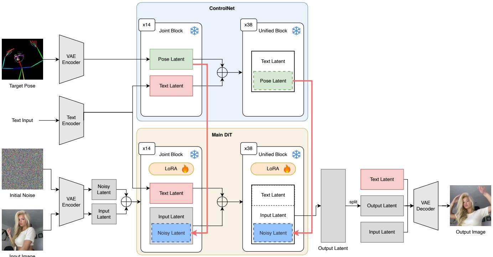  
Figure 6. Pose-conditioned generator G. G is built on FLUX.1 Kontext [21] paired with a pose ControlNet [57]. The target pose is VAE-encoded and read by a frozen ControlNet (14 joint blocks, 38 unified blocks), whose pose-aware features condition the main DiT. The reference image and initial noise are encoded and denoised by the main DiT, into which we inject the trainable LoRA [13]; a text encoder supplies the prompt. The output latent is VAE-decoded to the subject rendered under the target pose. Backbone weights are frozen (snowflake); only the LoRA adapters are trained (flame).

from a pre-trained backbone, averaged over frames. Lower is better.

FID. Frechet Inception Distance [ ´ 12] compares Gaussian statistics $\left( \mu _ { r } , \Sigma _ { r } \right)$ and $\textstyle ( \mu _ { f } , \Sigma _ { f } )$ of real and generated frame features from a pre-trained Inception network,

$$
\begin{array} { r } { \mathrm { F I D } = \| \mu _ { r } - \mu _ { f } \| _ { 2 } ^ { 2 } + \operatorname { T r } \bigl ( \Sigma _ { r } + \Sigma _ { f } - 2 \bigl ( \Sigma _ { r } \Sigma _ { f } \bigr ) ^ { 1 / 2 } \bigr ) . } \end{array}\tag{5}
$$

FVD. Frechet Video Distance [ ´ 42] applies the same form to spatiotemporal features extracted by an Inflated 3D ConvNet [3] from fixed-length video segments, capturing temporal realism. Lower is better.

FID-VID. A video-level variant [2] that aggregates clip embeddings into a single descriptor per sequence before computing the Frechet distance, capturing long-range temporal ´ consistency. Lower is better.

FaceID. Facial identity preservation is the cosine similarity between ArcFace [8] embeddings of the generated and reference faces, averaged over frames. Higher is better.

BodySIM. Body-appearance similarity is the cosine similarity between DINOv2 [32] embeddings of the generated and reference subject crops. Higher is better.

dtSSD. Temporal consistency is measured on inter-frame differences: we compare the temporal gradient of the generated video, $\hat { I } _ { t + 1 } - \hat { I } _ { t }$ , against that of the reference video,

$I _ { t + 1 } - I _ { t }$ , and report the mean squared deviation over time. Lower indicates motion closer to the ground truth without added flicker.

PoseAcc. Pose-following accuracy compares the skeleton extracted from the generated frame against the driving skeleton, reporting keypoint agreement. Poses are extracted with DWPose [55] from both the generated and the ground-truth frame, and agreement is the percentage of correct keypoints (PCK@0.2): a predicted joint is counted correct when its distance to the corresponding ground-truth joint is within 0.2 of the person bounding-box size. Higher indicates closer adherence to the target motion.

We follow the overall evaluation protocol of RealisDance-DiT [62] (see Appendix D.2).

## B.1. Identity under independent recognizers

FaceID is ArcFace cosine and BodySIM is DINOv2 cosine, and those same two networks drive the pipeline: candidates are selected by ArcFace similarity to the reference and sampling is steered by DINOv2 body similarity. To verify that an identity gain measured with them reflects identity rather than the selection reward, Table 9 re-scores the same rendered videos with recognizers that are not used at any stage of the pipeline. Two controls ensure a fair comparison:

Table 9. Identity measured by recognizers not used by the pipeline. Pseudo-frames are selected with ArcFace, so identity is re-scored with FaceNet512 and SFace, which are not used in selection. Faces are detected once and every recognizer embeds the identical crop. A frame is scored only when a face is found in the ground truth and in both arms (33 pairs for base vs ours, 30 for the three-arm comparison, trim regime, 3 TikTok sequences). Ours-FN selects with FaceNet512 instead of ArcFace.
<table><tr><td>Metric</td><td>Base</td><td>Ours</td><td>Ours-FN</td><td>Not used by</td></tr><tr><td>ArcFace</td><td>0.690</td><td>0.731</td><td>0.724</td><td>Ours-FN</td></tr><tr><td>FaceNet512</td><td>0.722</td><td>0.786</td><td>0.778</td><td>Ours</td></tr><tr><td>SFace</td><td>0.626</td><td>0.704</td><td>0.704</td><td>both</td></tr></table>

faces are detected and aligned once and every recognizer embeds the identical crop, so detector disagreement cannot appear as a difference between recognizers, and the scored set is fixed across arms, so no arm benefits from being evaluated on the frames on which its own faces are detectable.

The gain persists and is larger under FaceNet512 (+0.059) and SFace (+0.067) than under ArcFace (+0.035). Exploiting ArcFace-specific artifacts would produce the opposite ordering. We also run the test in reverse, rebuilding the per-subject dataset by ranking the same candidate pool with FaceNet512 instead of ArcFace (Ours-FN in Tab. 9). The two recognizers disagree on 7 of 12 selections, so the two training sets differ substantially. Scored with ArcFace, which it never optimized, Ours-FN gains +0.034 over the base. Although Ours-FN optimizes FaceNet512, it does not lead on FaceNet512: selection does not inflate the score of the network doing the selecting. Appearance evidence that does not depend on either reward is provided by LPIPS, which is computed on VGG features and improves substantially (0.177 vs 0.283, Tab. 12). PSNR, SSIM and FVD are likewise reward-independent and all improve (Tab. 1).

## B.2. Human preference study

Every metric above is automatic, and two of them (FaceID, BodySIM) share their networks with the reward used to select pseudo-frames (Appendix B.1). We therefore also conducted a human study, which depends on neither.

Thirty-four respondents rated clips from each method on a 1–5 scale along four axes: human appearance alignment, pose alignment, background alignment, and overall quality. Clips were drawn from the TikTok test split, method identities were hidden, and the presentation order of the four methods was shuffled per clip so that no position was systematically associated with one method. Each respondent saw the reference image alongside the clip, since appearance alignment is only meaningful relative to it. This yields 180 ratings per method per axis.

Figure 7 shows the resulting distributions. Ours places 93% of appearance-alignment ratings at 4–5 against 38% for the unadapted base, and leads on all four axes. The base model in turn leads both prior animators, which is consistent with the automatic metrics in Tab. 1, and corroborates the perceptual metrics with judgments that depend on neither reward.

Table 10. Quality versus fine-tuning time. Per-subject adaptation quality at different numbers of fine-tuning steps and the time they take on a single H100 (K=5, TikTok). Quality saturates within the first five steps, our default. Longer budgets improve only identity, and not monotonically.
<table><tr><td>Steps</td><td>Time (s)</td><td>PSNR↑</td><td>SSIM↑</td><td>LPIPS↓</td><td>FaceID↑</td><td>BodySIM↑</td><td>FVD↓</td><td>dtSSD↓</td></tr><tr><td>5 (ours)</td><td>5.8</td><td>22.89</td><td>0.853</td><td>0.166</td><td>0.772</td><td>0.939</td><td>289.4</td><td>212.0</td></tr><tr><td>25</td><td>29</td><td>22.71</td><td>0.848</td><td>0.169</td><td>0.764</td><td>0.935</td><td>352.9</td><td>218.3</td></tr><tr><td>50</td><td>58</td><td>22.26</td><td>0.838</td><td>0.181</td><td>0.820</td><td>0.931</td><td>399.4</td><td>219.0</td></tr><tr><td>100</td><td>116</td><td>22.72</td><td>0.850</td><td>0.168</td><td>0.768</td><td>0.937</td><td>341.5</td><td>213.9</td></tr><tr><td>200</td><td>232</td><td>22.85</td><td>0.850</td><td>0.167</td><td>0.762</td><td>0.941</td><td>291.7</td><td>212.3</td></tr><tr><td>400</td><td>464</td><td>22.21</td><td>0.840</td><td>0.181</td><td>0.825</td><td>0.927</td><td>380.5</td><td>217.4</td></tr></table>

## C. Further Ablation

## C.1. Additional Quantitative Results

Quality versus fine-tuning time. Table 10 studies how reconstruction, identity, and video quality scale with the number of per-subject fine-tuning steps and the corresponding wall-clock time on a single H100. Quality saturates by five steps, our default, and is flat over the rest of the sweep: five steps already match or exceed every larger budget on reconstruction and video quality, since the static clip presents the same target at every step and the low-rank update converges to it within a few updates. Longer budgets improve only identity, and not monotonically, so we adapt for five steps, at 5.8 s per subject. This sweep varies the step budget only. Peak GPU memory, the hardware requirement, and the cost of the other pipeline stages are reported separately in Appendix F.

Per-subject LoRA rank. Table 11 sweeps the rank r of the per-subject update on a tuning subset. Quality improves with adapter capacity up to r=128, our default. At r=256 the adapter over-fits the handful of pseudo-frames and quality regresses, marking 128 as a clear optimum.

## C.2. Generator and Reward-Guided Sampling

Our pipeline contains a second trained model, the poseconditioned generator G, and a reference-only rewardguided sampler. We ablate their components here.

How much domain tuning does G need? G’s LoRA is trained on the in-domain split of each benchmark, so the pipeline assumes access to a human-video corpus before test time, even though no video of the test subject is ever used. Table 12 quantifies the effect of that assumption by sweeping the amount of tuning G receives, from none to our default. Two conclusions follow. First, the dependence is present but bounded: with an entirely untuned generator the adapted model still improves over the base on every metric (21.88 vs 20.33 PSNR, 0.184 vs 0.283 LPIPS). Second, the benefit of tuning depends on the metric. Pixel and perceptual quality saturate early: 500 steps, one eighth of the default, already recovers 95% of the PSNR gain over base, and LPIPS, SSIM and BodySIM are flat from there on. Identity does not: FaceID continues to increase to 4,000 (0.699 → 0.714 → 0.720 → 0.764), so 500 steps recovers only 66% of that gain. Domain tuning of G therefore primarily improves identity fidelity, as expected of a LoRA that teaches G the appearance statistics of the domain. Reconstruction quality requires only light tuning on a humanvideo corpus rather than close matching to the benchmark. Consistent with this, the G used for Unseen100-Val is tuned on TikTok yet leads on in-the-wild subjects (Tab. 2). The gains concentrate on the sequence where the base model performs worst, where PSNR rises from 12.12 (base) to 17.39 (untuned G) to 20.50 (default). On sequences where the base already performs well, the tuning levels are indistinguishable.

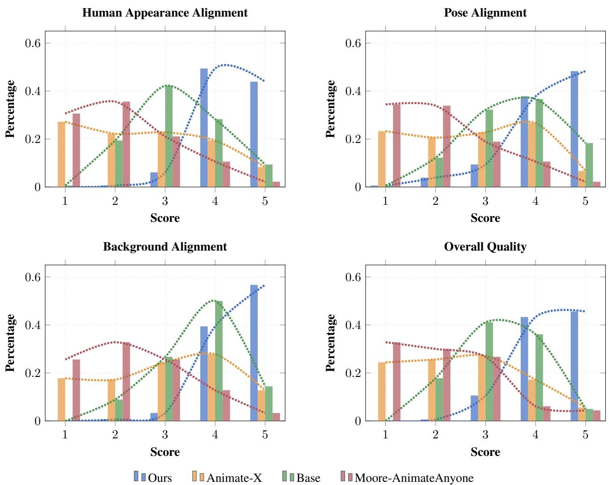  
Figure 7. Human preference study. Distribution of 1–5 ratings for ours, Animate-X, the unadapted base, and Moore-AnimateAnyone, on four axes. Thirty-four respondents, 180 ratings per bar group. Ours places 93% of appearance-alignment ratings at 4–5, against 38% fo the base model; the ordering is the same on all four axes. Protocol in Appendix B.2.

Particle count N. Table 13 sweeps the number of particles N in the reward-guided sampler, reporting the fidelity of the selected pseudo-frame to the real frame. Frame quality is already largely saturated by our default N=8, while per-frame sampling time grows roughly linearly, so larger populations cost compute without further gain. The value of in-loop steering over best-of-N selection at a matched budget is established separately in Tab. 7.

Resampling schedule. Table 14 varies the denoising window over which particles are resampled and the churn strength η. Pseudo-frame fidelity is largely insensitive to the schedule. We default to resampling only the back half with churn for its downstream stability, since steering early, high-noise particles collapses diversity before subject structure emerges and the churn step keeps duplicated highreward particles from remaining identical under the deterministic dynamics.

Table 11. Per-subject LoRA rank r (on a tuning subset). Adaptation quality as the rank of the per-subject update varies. Quality improves with capacity up to r=128, our default; beyond it $\left( r \mathrm { = } 2 5 6 \right)$ the adapter over-fits the few pseudo-frames and quality regresses, marking a clear optimum. Absolute scores differ from the main tables because this sweep runs on a tuning subset.
<table><tr><td colspan="8">r PSNR↑ SSIM↑ LPIPS↓ FaceID↑ BodySIM↑ FVD↓ dtSSD↓</td></tr><tr><td>4</td><td>20.12</td><td>0.820</td><td>0.232</td><td>0.558</td><td>0.858</td><td>176.4</td><td>410.2</td></tr><tr><td>8</td><td>20.61</td><td>0.829</td><td>0.224</td><td>0.581</td><td>0.866</td><td>161.2</td><td>397.5</td></tr><tr><td>16</td><td>20.94</td><td>0.837</td><td>0.216</td><td>0.597</td><td>0.872</td><td>150.1</td><td>384.0</td></tr><tr><td>32</td><td>21.08</td><td>0.841</td><td>0.211</td><td>0.606</td><td>0.877</td><td>143.6</td><td>379.1</td></tr><tr><td>64</td><td>21.31</td><td>0.846</td><td>0.206</td><td>0.622</td><td>0.883</td><td>136.2</td><td>363.9</td></tr><tr><td>128</td><td>21.49</td><td>0.852</td><td>0.201</td><td>0.635</td><td>0.890</td><td>129.8</td><td>365.1</td></tr><tr><td>256</td><td>21.22</td><td>0.844</td><td>0.212</td><td>0.615</td><td>0.881</td><td>142.7</td><td>381.4</td></tr></table>

Table 12. Sensitivity to the generator’s domain tuning. G’s LoRA receives from no tuning (off-the-shelf FLUX.1 Kontext with the pose ControlNet) to our default of 4,000 steps, with the rest of the pipeline fixed. Teacher is the fidelity of the selected pseudo-frame to the real frame at that pose, and downstream is the adapted model’s video quality (trim, 3 TikTok sequences).
<table><tr><td rowspan="2">G tuning</td><td colspan="2">Teacher (pseudo-frame)</td><td colspan="4">Downstream (video)</td></tr><tr><td>PSNR↑</td><td>BodySim↑</td><td>PSNR↑</td><td>LPIPS↓</td><td>FaceID↑</td><td>BodySim↑</td></tr><tr><td>Base (no adaptation)</td><td>1</td><td>一</td><td>20.33</td><td>0.283</td><td>0.619</td><td>0.906</td></tr><tr><td>None (off-the-shelf)</td><td>17.85</td><td>0.862</td><td>21.88</td><td>0.184</td><td>0.699</td><td>0.928</td></tr><tr><td>500 steps</td><td>17.89</td><td>0.857</td><td>22.75</td><td>0.176</td><td>0.714</td><td>0.928</td></tr><tr><td>1,000 steps</td><td>18.54</td><td>0.873</td><td>22.71</td><td>0.176</td><td>0.720</td><td>0.929</td></tr><tr><td>4,000 steps (ours)</td><td>19.54</td><td>0.893</td><td>22.89</td><td>0.177</td><td>0.764</td><td>0.927</td></tr></table>

Table 13. Particle count N. Selected pseudo-ground-truth frame fidelity to the real frame (mean over the K supervised poses × 3 sequences) and per-pseudo-frame generation time, as the number of reward-guided particles varies. Frame quality is largely saturated already by our default N=8, while sampling time grows roughly linearly, so larger populations cost compute without further gain. Time is the per-pseudo-frame sampling cost on a single H100.
<table><tr><td>N</td><td>Time (s)</td><td>PSNR↑</td><td>SSIM↑</td><td>LPIPS↓</td><td>FaceID↑</td><td>BodySIM↑</td></tr><tr><td>2</td><td>28.1</td><td>19.71</td><td>0.824</td><td>0.232</td><td>0.718</td><td>0.891</td></tr><tr><td>4</td><td>41.4</td><td>19.36</td><td>0.814</td><td>0.239</td><td>0.719</td><td>0.901</td></tr><tr><td>8 (ours)</td><td>69.1</td><td>19.51</td><td>0.815</td><td>0.235</td><td>0.707</td><td>0.890</td></tr><tr><td>16</td><td>134.5</td><td>19.98</td><td>0.827</td><td>0.226</td><td>0.718</td><td>0.886</td></tr></table>

Key-pose selection. Table 15 compares strategies for choosing the $K$ supervised poses from the driving sequence. At fixed $K ,$ farthest-point sampling in keypoint space (ours), random, and uniform-in-time selection are within noise of one another, indicating the gain comes from supervising diverse poses at all rather than from the specific selection rule. We use farthest-point sampling as a princi-

Table 14. Resampling schedule. Selected pseudo-ground-truth frame fidelity to the real frame as a function of the denoising window over which particles are resampled and the churn strength η that re-noises duplicated particles $( N { = } 8 ;$ mean over the K supervised poses × 3 sequences). Pseudo-ground-truth frame quality is largely insensitive to the schedule; the back-half-with-churn default is used for its downstream stability.
<table><tr><td>Schedule</td><td>PSNR↑</td><td>SSIM↑</td><td>LPIPS↓</td><td>FaceID↑</td><td>BodySIM↑</td></tr><tr><td>Full (all steps)</td><td>19.43</td><td>0.817</td><td>0.234</td><td>0.732</td><td>0.892</td></tr><tr><td>Last quarter</td><td>19.61</td><td>0.816</td><td>0.235</td><td>0.751</td><td>0.893</td></tr><tr><td>Back half (ours)</td><td>19.51</td><td>0.815</td><td>0.235</td><td>0.707</td><td>0.890</td></tr><tr><td>Back half, no churn  $( \eta { = } 0 )$ </td><td>19.46</td><td>0.812</td><td>0.239</td><td>0.714</td><td>0.888</td></tr></table>

Table 15. Key-pose selection. How the K supervised poses are chosen from the driving sequence, at fixed K: farthest-point sampling in keypoint space (ours) vs. random and uniform-in-time selection, each adapted with an identical step budget and evaluated on the generated video (mean over 3 sequences). On this subset the three strategies are within noise of one another, indicating the gain comes from supervising diverse poses at all rather than from the specific selection rule.
<table><tr><td>Selection</td><td>FaceID↑</td><td>BodySIM↑</td><td>FVD↓</td><td>dtSSD↓</td></tr><tr><td>Random</td><td>0.783</td><td>0.941</td><td>319.1</td><td>216.6</td></tr><tr><td>Uniform (in time)</td><td>0.776</td><td>0.941</td><td>293.4</td><td>215.5</td></tr><tr><td>Farthest-point (ours)</td><td>0.768</td><td>0.937</td><td>341.5</td><td>213.9</td></tr></table>

pled default.

## D. Dataset Curation & Evaluation Protocol

## D.1. Datasets

For in-domain training and evaluation we use the Tik-Tok [16] and UBC Fashion [56] benchmarks with their standard train and test splits. To probe cross-domain transfer, we additionally evaluate zero-shot on Unseen100-Val, a set of 100 in-the-wild videos spanning diverse subjects, motion, lighting, and backgrounds.

Motivation. Both standard benchmarks are limited for evaluating modern video diffusion models. The TikTok test set contains only 10 videos, too few for fine-grained comparison, while UBC Fashion, though larger, consists of simple catwalk sequences with uniform lighting and minimal background variation, so scores saturate across methods (Tab. 1). Neither covers the diversity of real-world deployment, including varied skin tones, challenging lighting, and non-photorealistic subjects. We therefore curate Unseen100-Val, a 100-video zero-shot evaluation set designed to (a) better represent the visual diversity of realworld data and (b) stress-test models in challenging settings they were not trained on, such as difficult lighting, complex backgrounds, and animated characters.

Collection and eligibility. Videos are sourced from a mix of TikTok and stock footage. Each clip features a single person or character performing a dancing motion, with no heavy occlusion of any body part (slight tolerance is allowed for an arm briefly disappearing during fast motion), and the pose skeleton must remain fully visible throughout, ensuring reliable pose extraction for both adaptation and evaluation.

Table 16. Composition of the Unseen100-Val dataset. Each attribute group independently covers all 100 videos; rows within a group sum to 100 (or to 80 for appearance and setting, which apply only to the real-human videos).
<table><tr><td>Attribute</td><td>Category</td><td>Count</td></tr><tr><td>Subject type</td><td>Real</td><td>80</td></tr><tr><td></td><td>Animated – 2D</td><td>10</td></tr><tr><td></td><td>Animated – 3D</td><td>10</td></tr><tr><td>Setting</td><td>Indoor</td><td>54</td></tr><tr><td></td><td>Outdoor</td><td>26</td></tr><tr><td>Appearance</td><td>East Asian</td><td>32</td></tr><tr><td></td><td>South Asian</td><td>06</td></tr><tr><td></td><td>Caucasian</td><td>24</td></tr><tr><td></td><td>Darker-skinned</td><td>18</td></tr><tr><td>Motion intensity</td><td>Slow / moderate</td><td>48</td></tr><tr><td></td><td>Fast / complex</td><td>52</td></tr><tr><td>Lighting</td><td>Standard</td><td>61</td></tr><tr><td></td><td>Challenging</td><td>39</td></tr><tr><td>Camera</td><td>Static</td><td>71</td></tr><tr><td></td><td>Slight shift</td><td>29</td></tr></table>

Composition and diversity. Table 16 summarizes the dataset composition across several axes; each attribute group independently covers all 100 videos. We deliberately balance real and animated subjects and ensure broad coverage of appearance, motion complexity, and environmental conditions. Among the 80 real-human videos, skin tones span East Asian, South Asian, Caucasian, and darkerskinned appearances to promote evaluation fairness; the 20 animated videos split evenly between 2D (anime, cartoon) and 3D (rendered, stylized) characters, testing generalization beyond photorealistic subjects.

Preprocessing and statistics. All clips are center-cropped and resized to a common resolution, with driving poses extracted by a 2D keypoint detector consistent with our training pipeline. The detector is DWPose [55], the same whole-body extractor used to render the training pose maps; keypoints are extracted at the clip’s native resolution and rendered as skeleton maps at the model input resolution of 832 × 480. The average clip duration is 14.4 seconds (±3.2 s), ranging from 8 to 24 s. At 100 videos, Unseen100- Val matches the test-set size of UBC Fashion while being 10× larger than TikTok’s test split; because it targets zeroshot cross-domain evaluation rather than statistical power over a narrow domain, 100 diverse videos provide sufficient coverage to surface meaningful failure modes and performance differences across methods.

## D.2. Evaluation Protocol

We follow the evaluation settings of RealisDance-DiT [62]. All generated videos are center-cropped and resized to a common resolution for metric computation, ensuring a fair comparison across methods that train at different native resolutions. For competing methods we use officially released checkpoints and evaluation code where available, and directly report published numbers where applicable. Our base animator and adapted model are sampled with the Wan2.1 flow-matching solver for 50 steps at classifier-free guidance scale 1.0, and metrics are computed at a common 832×480 resolution (image metrics on the trimmed window, video metrics over full clips). Pseudo-frames are generated with the fixed prompt “The person is dancing.” We do not retrain any competing method: their scores come from official checkpoints and evaluation code, or from the published papers where applicable. All baselines in Tab. 1, including the UniAnimate-DiT base, are quoted from MTVCraft [9]; the base rows of Tabs. 4 and 5 re-evaluate it under our protocol, so its numbers there differ.

## E. Additional Qualitative Results

We provide extended visual comparisons across subjects, motion types, and visual domains, including cross-domain subjects unseen during training. Figures 8 and 9 give in-domain comparisons spanning diverse motions, backgrounds, appearance, and illumination, and Fig. 10 shows cross-domain results on animated characters. Across all examples, the adapted model preserves the subject’s appearance while maintaining temporal coherence under challenging lighting and complex motion.

## F. Test-Time Cost

This section reports the cost of serving one reference image on a single H100: the wall-clock and peak GPU memory of every stage, how that memory is allocated, how it amortizes over repeated use, and the implications for deployment.

## F.1. Measurement protocol

All numbers are measured on one NVIDIA H100 80 GB (driver 580.173) on a single TikTok test subject, with adaptation and inference at 832×480 and pseudo-frame generation at the generator’s native 576×1024, using the default recipe of Sec. 4.2 (K=5 pseudo frames from N=8 rewardguided particles, rank-128 adapter, 5 adaptation steps). Peak memory is the maximum device memory sampled every 250 ms for the lifetime of the stage, cross-checked against the per-process figure. We report the device-leve number because it includes the CUDA context and allocator reserve and is therefore what a deployment must provision. For the inference rows we also report the torch allocator peak: it runs ∼ 1 GiB lower, and quoting only the allocator figure would understate the requirement. Inference times exclude the one-off model load, which a deployment pays once rather than per video.

Table 17. Per-stage test-time cost, single H100 80 GB, 832×480, one TikTok subject, with 81-frame inference. Time is generation only for the inference rows and wall-clock elsewhere. Peak GPU is the maximum resident device memory during the stage, and Alloc. the torch allocator peak where the pipeline reports it (protocol in Appendix F.1).
<table><tr><td>Stage</td><td>Time</td><td>Peak GPU (GiB)</td><td>Alloc. (GiB)</td></tr><tr><td>One-time, per reference image</td><td></td><td></td><td></td></tr><tr><td>Pseudo-frame generation (K=5, N=8)</td><td>8.7min</td><td>41.7</td><td></td></tr><tr><td>ArcFace candidate selection</td><td>0.5 min</td><td>1.2</td><td></td></tr><tr><td>LoRA adaptation, r=128, 5 steps</td><td>5.8s</td><td>62.1</td><td></td></tr><tr><td>Total (time summed, memory maximum)</td><td>9.3 min</td><td>62.1</td><td></td></tr><tr><td>Per video</td><td></td><td></td><td></td></tr><tr><td>Inference, ours</td><td>1.8 min</td><td>21.6</td><td>20.6</td></tr><tr><td>Inference, base</td><td>1.7 min</td><td>21.6</td><td>20.6</td></tr></table>

Table 18. Composition of the adaptation memory peak. Resident sizes follow from each checkpoint’s parameter count and load precision: bf16 for the frozen modules, and fp32 with gradients and two AdamW moments for the low-rank update. The final line is the measured peak minus the resident modules above it.
<table><tr><td>Component</td><td>Params</td><td>Resident (GiB)</td><td>Share</td></tr><tr><td>Frozen base model</td><td>23.0B</td><td>43.6</td><td>70%</td></tr><tr><td>Video DiT θ (bf16)</td><td>16.4B</td><td>30.5</td><td>49%</td></tr><tr><td>Text encoder umT5-xxl</td><td>5.3B</td><td>10.6</td><td>17%</td></tr><tr><td>Image encoder + VAE</td><td>1.3B</td><td>2.5</td><td>4%</td></tr><tr><td>Update ∆θ + grads + AdamW (fp32)</td><td>0.61B</td><td>9.2</td><td>15%</td></tr><tr><td>Activations, workspace, allocator reserve</td><td></td><td>9.4</td><td>15%</td></tr><tr><td>Measured peak</td><td></td><td>62.1</td><td></td></tr></table>

## F.2. Composition of the memory peak

Table 18 decomposes the adaptation peak. The frozen base model accounts for 70% of it, the video DiT contributing 49% and the text encoder, image encoder and VAE a further 21% between them. The per-subject update accounts for 15%, and is dominated not by the adapter weights (613M parameters, ≈ 4% of the backbone) but by the optimizer state they require, since the low-rank tensors are upcast to fp32 and AdamW keeps two moments per parameter. The remaining 15% is activations, workspace and allocator reserve.

The adaptation requirement is therefore a property of fine-tuning this animator rather than of the supervision we propose. The Real-5 and reference-only arms of Tab. 5 run the identical trainer at the identical rank and differ only in which frames they consume, so they occupy the same footprint, as would any adapter-based personalization of a backbone this size.

Minimum GPU. The minimum GPU is therefore set by the frozen base model, not by our update: adaptation needs an 80 GB card, while inference needs only 24 GB, the same requirement as running the base animator unadapted.

Inference requires far less memory despite using the same backbone, because it streams the DiT: only a 6Bparameter working set is resident and the remaining blocks are fetched layer-by-layer during the forward pass.

Table 19. Amortization of the one-time cost. Adaptation (9.3 min) is paid once per reference image, and each subsequent video of that reference costs only inference. Since adapted and base inference are the same computation (Tab. 17), we use a single render time for both, the measured 7.46 min for a full-length 305-frame video, so the ratio reflects the one-time cost alone. Average cost per video is (9.3 + 7.46n)/n, which decays as 1/n and is within 5% of the unadapted base by n=25.
<table><tr><td>Videos from one reference n</td><td>1</td><td>5</td><td>10</td><td>25</td><td>100</td></tr><tr><td>Ours, min/video</td><td>16.8</td><td>9.3</td><td>8.4</td><td>7.8</td><td>7.6</td></tr><tr><td>Relative to base</td><td>2.25×</td><td>1.25×</td><td>1.12×</td><td>1.05×</td><td>1.01×</td></tr></table>

## F.3. Deployment and amortization

The two costs are distinct. Adaptation is a one-time, serverside job of 9.3 minutes whose entire output is a 1.1 GiB adapter file. The 2.3 GiB training checkpoint additionally carries optimizer state, which is not part of the deployment payload. Once obtained, the adapter is reused for every video generated from that reference. Inference is the recurring cost and is unchanged from the base model, at identical peak memory and the same generation time to within run-to-run variance, so a user never requires training-grade hardware: the adapter is downloaded and inference runs at base cost.

Table 19 quantifies the benefit of repeated use. Because adaptation is paid per reference image and not per video, the average cost per video falls as 1/n: a reference animated 25 times costs 1.05× what the unadapted base would cost for the same 25 videos, and approaches parity beyond that. The regime where the overhead dominates is the single-video case, where the one-time stage is 1.25× the inference it enables. Adaptation is thus better characterized as a provisioning cost, paid once when a reference is enrolled, than as a per-request cost.

## G. Limitations

The method inherits the quality of its generator: when the generator produces weak pseudo-ground-truth for a subject (for example under heavy occlusion, motion blur, or strong out-of-domain appearance), the downstream persubject adaptation is correspondingly weaker, since adaptation can only bind the appearance that the pseudo-groundtruth actually exposes. This motivates both the referenceonly selection that curates high-quality pseudo frames and the closed-loop direction discussed in the conclusion, where the adapted model’s own outputs re-supervise the generator. A complementary safeguard is an automatic frame-quality filter that rejects blurred or occluded pseudo frames before adaptation. Figure 11 illustrates how the adapted output tracks the quality of the pseudo-supervision.

## H. Ethical Considerations & Broader Impact

Our method lowers the cost of personalizing a human video model to a new subject: it needs a single reference image, no subject video, and no manual labels. This benefits creative content production, accessibility, and avatar applications, but the same capability warrants a discussion of misuse.

Risk of misuse. The ease of synthesizing realistic video of a person from one image raises the risk of non-consensual or deceptive media, such as impersonation or misinformation. We condemn any use that depicts an individual without their explicit consent, and we intend any release to be governed by terms that prohibit such use.

Data bias. Like all generative models, ours can inherit biases in its training data. If the underlying datasets underrepresent particular skin tones, body types, ages, or styles of dress, personalization quality may be uneven across groups. We encourage evaluation across diverse subjects, and our Unseen100-Val set is curated to include a broad range of appearances and conditions toward this end.

Mitigation strategies. To navigate these risks responsibly, we support provenance and detection measures, including digital watermarking of generated video and research on deepfake-detection methods that distinguish authentic from synthesized motion. Because our pipeline selects supervision by reference identity, it is also compatible with consent-based safeguards that verify the subject of the reference image before adaptation.

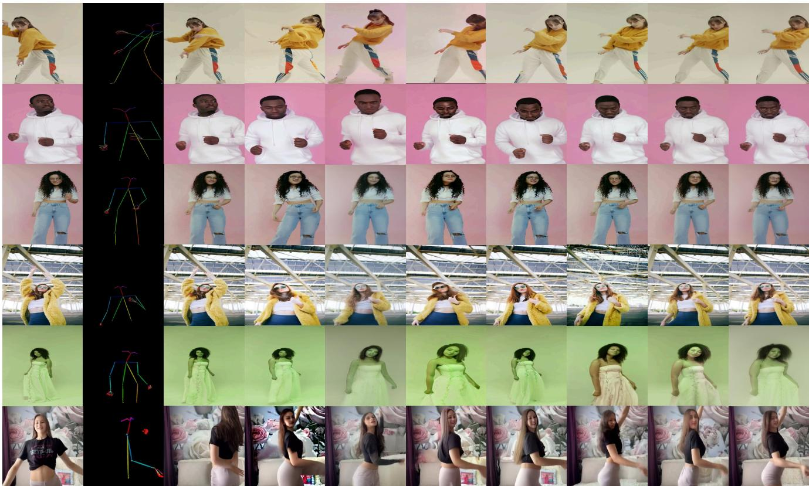  
Figure 8. In-Domain Comparisons: Diverse Motions and Backgrounds. Examples illustrating variations in background, motion complexity, and clothing style. Our approach consistently preserves holistic appearance and pose alignment while producing sharper, more realistic details than competing methods.

MusePose  
Reference Image  
Target Pose  
Animate-X  
ControlNext  
MimicMotion  
Moore-AnimateAnyone  
RealisDance  
UniAnimate-DiT(Base)  
Ours  
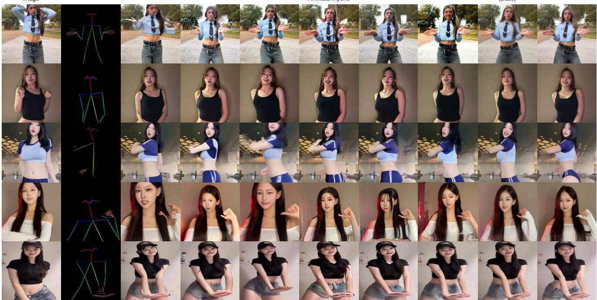  
Figure 9. In-Domain Comparisons: Diverse Appearance and Illumination. Examples covering variations in skin tone, lighting con ditions, and clothing texture. Our approach maintains consistent subject appearance and realistic fine-grained details across all scenarios, clearly outperforming state-of-the-art methods.

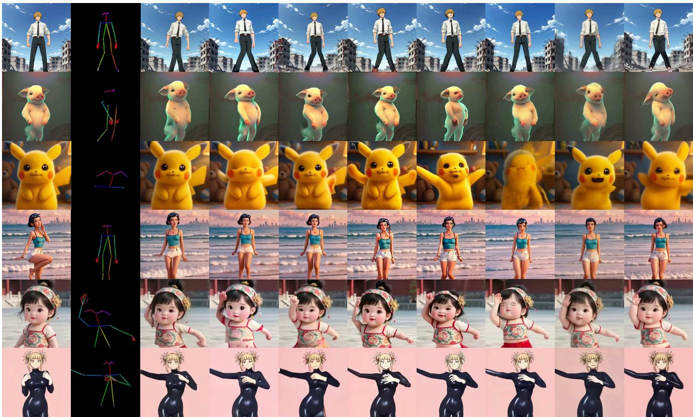  
Figure 10. Cross-Domain Comparisons: Animated Characters. Examples from the Unseen100-Val evaluation set featuring 2D and 3D animated characters unseen during training. Our approach generalizes beyond photorealistic subjects, faithfully preserving stylized appearance details and character proportions while maintaining temporal coherence under complex motion.

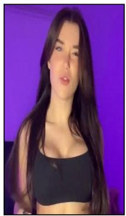  
Reference Frame

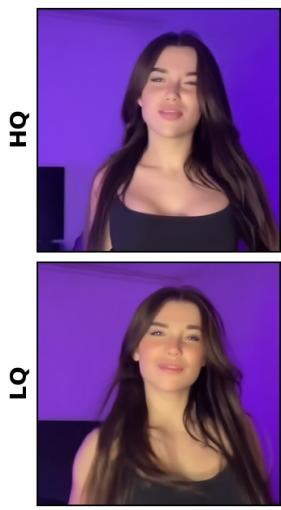

Supervision Frames  
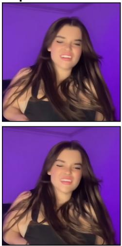

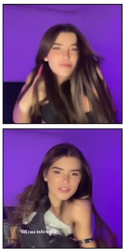

Output frames  
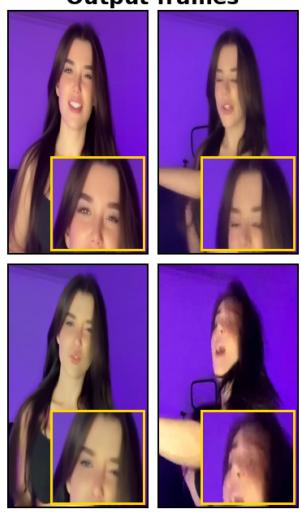  
Figure 11. Adaptation is bounded by pseudo-frame quality. Top (HQ): high-quality pseudo frames (Supervision) yield faithful adapted outputs (Outputframes). Bottom (LQ): degraded pseudo frames for the same subject yield weaker outputs. This is why the reference-only sampler selects high-quality frames before adaptation.