# PHOTOGUIDER: COMPOSITION-AWARE CROPPINGAND $3 6 0 ^ { \circ }$ VIEW FRAMING WITH EXPLAINABLEPHOTOGRAPHIC ASSESSMENTS

Yuan-Kang Lee1,3 Kuan-Lin Chen2 Chia-Che Chang1 Yu-Lun Liu3

1MediaTek Inc. 2National Taiwan University

3Department of Computer Science, National Yang Ming Chiao Tung University

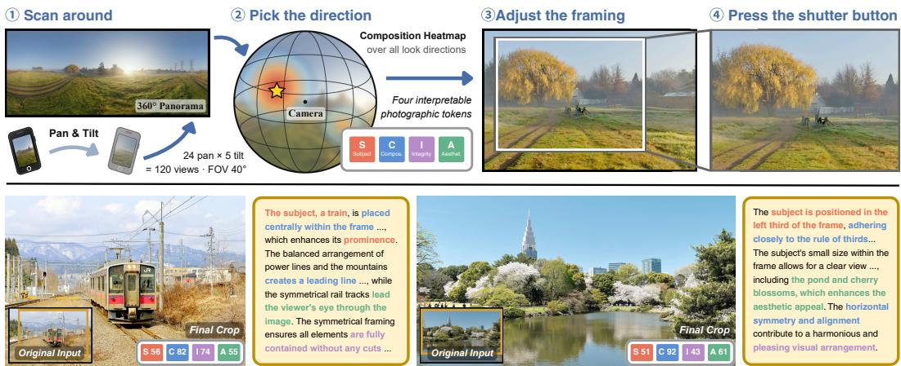  
Figure 1: PhotoGuider turns a whole scene into a framed photograph and provides a reasoned explanation for its choice of framing. The four stages follow what a photographer actually does upon arriving at a scene: look around, settle on a direction, adjust the frame, and press the shutter. (1) Given a 360° panorama, the system scans look directions and (2) scores each using the proposed four photographic tokens: Subject, Composition, Integrity, and Aesthetics. The maximum fixes the camera direction. (3) The frame is then refined within that view, and (4) the final photograph is rendered natively from the panorama. The same four tokens also ground the explanation: our MLLM explainer is fine-tuned to cite these tokens and conditioned on their measured assessments. Below, two results show the selected crop and the produced explanation; phrases grounded in the four assessments are highlighted.

## ABSTRACT

Traditional image cropping assumes the photograph already contains the composition worth keeping, and asks only where to crop. A full 360° scene offers no such guarantee: the viewing direction in a scene has to be discovered before anything can be framed. We present PhotoGuider, a measure-then-frame method that answers both questions with compact learned scorers over one shared set of composition-aware features. The designed features are extracted using foundation and task-specific vision models and structured into four photographic tokens: Subject, Composition, Aesthetics, and Integrity. Our MLLM explainer is fine-tuned to generate composition-related explanations conditioned on images and measured token assessments. To our knowledge, PhotoGuider is the first method to combine explicit composition-based direction selection in 360° panoramas with refined framing, camera-parameter output for native re-rendering, and measurementconditioned explanations. On two standard 2D cropping benchmarks, PhotoGuider achieves the highest average mIoU performance against ground-truth crops. In a blind ranking study, 120 participants ranked three cropping methods over 100 panoramic scenes from the public Poly Haven HDRI library, placing our framings first in 53.2% of cases, against 27.3% and 19.5% for two strong alternatives. Project page: https://ntuneillee.github.io/research/photoguider/

## 1 INTRODUCTION

While computational photography has effectively matured low-level image acquisition (Mohammadi et al., 2026; Brooks et al., 2019; Lee & Ding, 2024; Zhang et al., 2021b; He et al., 2025; Kong et al., 2025; Feijoo et al., 2025; Kim et al., 2025; Lee et al., 2024; 2026a;b), higher-level compositional choices require separate treatment. When cropping an image, a photographer answers four fundamental questions: what the subject is, where to place it, whether critical elements are cut off, and if the overall composition is visually appealing. These four independent judgments are susceptible to distinct failures, such as selecting a correct subject with poor placement. Furthermore, panoramic framing introduces an earlier decision: determining direction before the frame is formed. Existing 2D cropping methods assume that the input is already a pre-shot photograph. Our goal is to combine composition-based direction selection with refined framing, camera-parameter output, and measurement-conditioned explanations. PhotoGuider evaluates candidate crops using four interpretable photographic tokens: Subject (S), Composition (C), Integrity (I), and Aesthetics (A). These assessments collectively score panoramic view directions, rank candidate frames, guide spatial refinements, and anchor MLLM explanations in concrete measurements. Pre-trained vision models extract the features, and compact scorers learn to combine them for framing decisions. This architecture offers three advantages. First, interpretability is structural at the feature level and post hoc at the attribution level. Second, the trainable decision layer has limited capacity to reduce the risk of overfitting to dataset-specific biases. Third, it natively generalizes to full panoramas, as the tokens evaluate intrinsic geometry and semantics on perspective projections. The overview of PhotoGuider is demonstrated in Fig. 1. Overall, PhotoGuider provides three contributions:

• Composition-Aware Cropping: The decision layer selects the optimal box using four photographic tokens and learned compact rankers with only 63k parameters, achieving competitive performance across two benchmarks while confining the MLLM to a bounded consultant role that neither scores nor makes decisions.

• Measurement-Conditioned Explanations: We condition a fine-tuned MLLM on the token assessments and geometric measurements, allowing its measurement-based statements to be checked against the supplied values.

• To our knowledge, PhotoGuider is the first system for automatic composition-aware framing from 360° panoramas that combines explicit view-level direction selection with cameraparameter output for re-rendering and measurement-conditioned explanations based on shared photographic feature groups.

## 2 RELATED WORK

Image Cropping. Early croppers optimize hand-designed saliency and composition energies (Nishiyama et al., 2009; Liu et al., 2010; Chen et al., 2016). Generate-and-rank methods score candidate boxes using expert edits, professional photographs, saliency partitioning, or reinforcement learning (Yan et al., 2013; Chen et al., 2017b; Wei et al., 2018; Lu et al., 2019; Shin et al., 2024; Wang & Shen, 2017; Wang et al., 2019; Li et al., 2018; 2019; Hamara & Freeman, 2025). End-to-end methods directly regress crops using cascaded regression, grid anchors, score maps, meta-learning, or set prediction (Guo et al., 2018; Zeng et al., 2019; 2022; Tu et al., 2020; Li et al., 2020a; Jia et al., 2022; Wang et al., 2023a; Pan et al., 2024; 2023), often incorporating relational, boundaryaware, subject-aware, or synthesized composition signals (Li et al., 2020b; Hong et al., 2021; Pan et al., 2021; Liu et al., 2023; Zhu et al., 2025; Wong & Wong, 2025; Zhang et al., 2022; Yang et al., 2023; Hong et al., 2024; Su et al., 2024; Gu et al., 2025). Their fixed objectives make the scoring evidence difficult to inspect. MLLM-based croppers use vision-language priors and fine-tuning or prompting for aesthetic reasoning, increasingly producing rationales, composition categories, or capture-time guidance alongside boxes (Zhong et al., 2023; Yuan et al., 2024; Lee et al., 2025; Du et al., 2026; Zhang et al., 2026a; Jiang & Chen, 2025; Yuan et al., 2026; Yang et al., 2026a; Viriyavisuthisakul et al., 2025; Dong et al., 2026; You et al., 2026; Li et al., 2026). Photographic reasoning remains challenging for MLLMs (Fang & Chen, 2025). PhotoGuider generates candidates from self-supervised attention (Caron et al., 2021; Simeoni et al., 2026) and ranks them through four pho-´ tographic tokens with explicitly learned weights. Its MLLM consultant makes bounded proposals, aggregated following the principle of self-consistency (Wang et al., 2022).

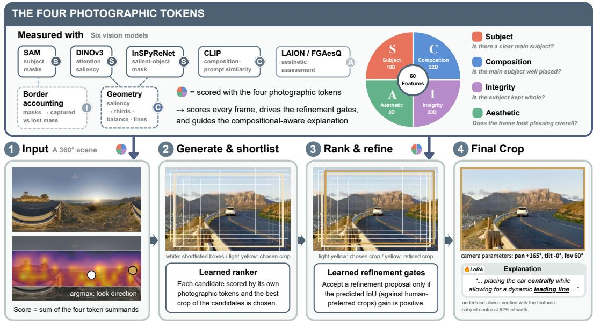  
Figure 2: One set of photographic tokens, three uses. Each token yields one assessment score for a given frame, allowing the decision layer’s output to be separated into four interpretable metrics. These drive our entire pipeline by (1) scoring all view directions in a 360° scene, (2) ranking shortlisted framings and gating each refinement step, and (3) anchoring the fine-tuned MLLM’s explanations. An optional generalist MLLM acts only as a consultant during refinement.

Aesthetic Assessment and Explainable Critique. Aesthetic scoring has progressed from regressors trained on crowd-rated photographs (Murray et al., 2012; Talebi & Milanfar, 2018; He et al., 2022; Huang et al., 2024a) to CLIP- and LMM-based models (Wang et al., 2023b; Ke et al., 2023; Wu et al., 2024). Composition datasets annotate thirds, symmetry, and triangles (Lee et al., 2018a; Zhang et al., 2021a; Zhao et al., 2025), providing reasoning priors for VLM croppers (Dong et al., 2026). Early critique generation used photographers’ comments (Chang et al., 2017). MLLMs generate aesthetic critiques at scale (Huang et al., 2024c;b; Zhou et al., 2024; Qi et al., 2025), assess quality through reinforcement learning (Li et al., 2025b), or use interpretable concept subspaces (Liu & Wagemans, 2026). Their free-form rationales receive limited checks against measurable image properties, raising concerns about hallucination and faithfulness (Li et al., 2023; Guan et al., 2024; Jacovi & Goldberg, 2020). PhotoGuider uses aesthetic predictions and composition measurements as token inputs and filters explainer training drafts against these measurements, following a rationale-distillation approach akin to rejection sampling (Zelikman et al., 2022; Hsieh et al., 2023).

View Selection in 360° Scenes. Prior work extracts normal-field-of-view trajectories from panoramic video using learned videography, piloting agents, hyperlapse, highlight ranking, summarization, or saliency-guided camera paths (Su et al., 2016; Su & Grauman, 2017; Hu et al., 2017; Lai et al., 2018; Yu et al., 2018; Lee et al., 2018b; Kang & Cho, 2019; Wang et al., 2020; Chen et al., 2024). Other work optimizes projection, snap angles, or capture guidance (Kim et al., 2017; Xiong & Grauman, 2018; Rao et al., 2022; Su et al., 2021; Li et al., 2025a), predicts 360° viewer attention (Rai et al., 2017; Sitzmann et al., 2018; Zhang et al., 2018), or steers real and reconstructed cameras with aesthetic rewards (Fang & Zhang, 2017; Xiong et al., 2017; AlZayer et al., 2021; Limoyo et al., 2024; Uchida et al., 2025; Yao et al., 2025; Tang et al., 2026; Jiang & Chen, 2026; Xu et al., 2026). Saliency alone is insufficient for aesthetic view selection (Chen et al., 2024), and exist ing view scores lack interpretability or conflate framing with camera-pose objectives. PhotoGuider uses the same 60 measurements in a LightGBM framing ranker and an additive direction scorer. It selects a direction, reprojects the view, and refines the crop, with shared measurements supporting view selection, ranking, and explanation.

Interpretable Decision Layers. Generalized additive models provide per-feature contributions by construction, including boosted GA2Ms, explainable boosting machines (Lou et al., 2013; Nori et al., 2019), and neural variants (Agarwal et al., 2021; Chang et al., 2021; Radenovic et al., 2022). Gradient-boosted trees perform well on tabular data (Ke et al., 2017; Grinsztajn et al., 2022), support

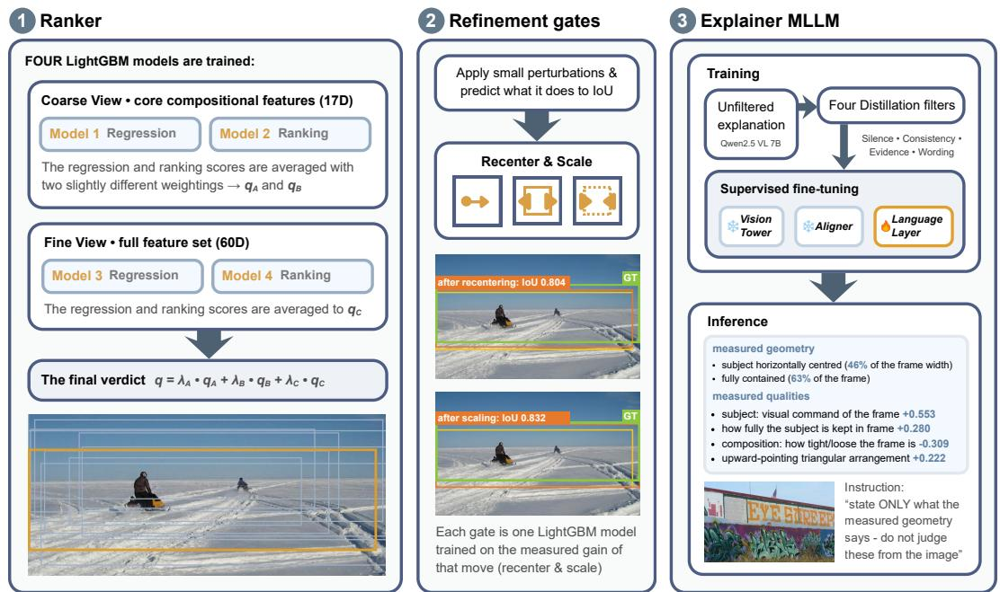  
Figure 3: The three learned components of PhotoGuider. We use single ground-truth crops from FCDB and top-rated crops from GAICD, with labels defined by the overlap (IoU) between candidate framings and reference crops. (1) Ranker. Candidates are scored using four LightGBM models (two regression and two ranking) operating on two feature tiers: a 17D core set (saliency, geometry) and a 60D full set (adding SAM object semantics, aesthetic scores, and CLIP prompts). Blending these model outputs yields three quality scores $( q _ { A } , q _ { B } , q _ { C } )$ to determine the optimal crop. (2) Refinement Gates. Six LightGBM gates adjust the selected crop by predicting IoU gains: one gate recenters the frame (via rule-of-thirds and CLIP-attention), four evaluate expansion (based on subject coverage, composition, scale-aesthetic variance, and golden ratio alignment), and a final gate shrinks the frame if no expansion triggers. (3) Explainer MLLM. It generates explanations conditioned on the crop, measured geometry, and ranker attributions. Training data drafts are filtered via four strict quality checks (unmasked geometry, numerical consistency, feature citations, and vocabulary validity).

LambdaRank objectives (Burges, 2010), and admit isotonic calibration (Zadrozny & Elkan, 2002; Niculescu-Mizil & Caruana, 2005). PhotoGuider uses a token-grouped neural additive view scorer with pairwise terms and a calibrated LightGBM ranker and gates. TreeSHAP (Lundberg et al., 2020) provides ranker attributions, with a secant approximation for the calibrated head (Appendix A.1).

## 3 METHOD

## 3.1 OVERVIEW

A photographer arriving at a scene acts in four steps: decide which way to point the camera, compose the shot, polish it, and, when possible, ask a second pair of eyes. PhotoGuider performs these steps as follows: Stage (a) extends the 2D cropper into a complete 360° framing system by scoring candidate look directions across the panorama using shared assessments and reprojecting the optimal direction into a working view (Sec. 3.7). Stage (b) generates, filters, and ranks candidate framings to select a top proposal (Secs. 3.2 and 3.3). Stage (c) applies spatial adjustments when predicted beneficial by a learned gate (Sec. 3.4). Together, stages (b) and (c) constitute the fast mode, and the full mode further incorporates stage (d), which consults a specialized MLLM within bounded constraints (Sec. 3.5). Finally, composition-aware explanations are derived from the same assessments (Sec. 3.6). The method and training overviews are shown in Fig. 2 and Fig. 3, respectively.

The four photographic tokens Each token is extracted by the model whose mechanism matches it. Subject is answered by three sources: the self-supervised attention map of DINOv3 (Simeoni´ et al., 2026) highlights regions that naturally draw visual focus, InSPyReNet (Kim et al., 2022) extracts the salient-object mask, and SAM (Kirillov et al., 2023) segments the distinct objects and semantic regions comprising the frame. Composition is evaluated by CLIP (Radford et al., 2021), measuring the alignment between the crop and compositional geometric attributes like the rule of thirds and visual lines computed over the saliency map. Integrity is quantified via geometric and boundary statistics relating the segmented objects and subject mask to the crop border. Aesthetics is predicted using two learned aesthetic assessment models, LAION (Schuhmann et al., 2022) and FGAesQ (Yang et al., 2026b). Figure 4 illustrates the four tokens. Each description below states what a token measures; the definitions of every feature are provided in Appendix A.1.

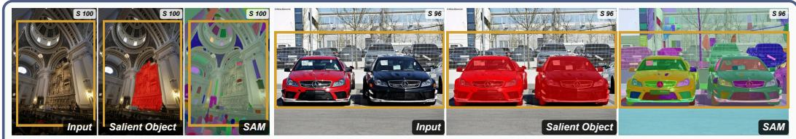  
Subject asks how strongly the eye is drawn to one region and how completely it is kept in frame

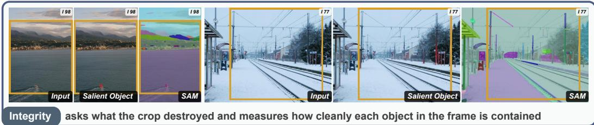

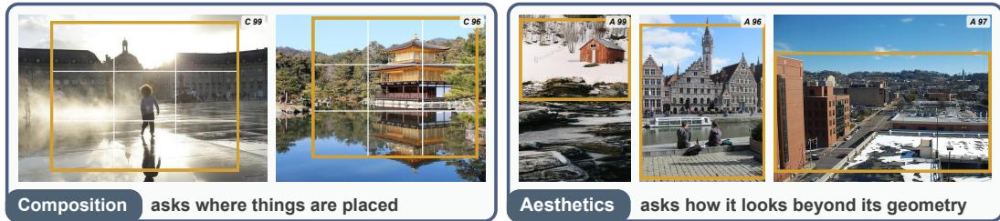  
Figure 4: Feature Partitioning and Token Definitions. The four tokens partition the 60 extracted features into disjoint subsets. Each reported score represents one such component, expressed as a percentile against the same quantity derived from training crops that match the human annotations most closely. The assessed frame is highlighted by the yellow box.

Subject (10D). Evaluates focal attention and object completeness using three models: DINOv3 attention captures focal strength (3D), InSPyReNet saliency quantifies subject coverage and prominence (2D), and SAM provides frame coverage, spatial placement, and cross-model agreement with InSPyReNet (4D), supplemented by subject scale (1D).

Integrity (20D). Measures information preservation and structural disruption using SAM-derived representation. Encoder features (9D) quantify visual information density, object signal distribution, crop-versus-background contrast, whole-image baseline, and shot scale. Decoder features (11D) capture object-level composition, including object count, dominant area shares, size disparity, boundary containment cleanliness, edge margins, and depth layering.

Composition (22D). Spatial layout is parameterized across three sources: saliency geometry (10D) covering rule-of-thirds, symmetry, triangles, balance, offset, tightness, and aspect ratio; SAM object parsing (3D) evaluating grid alignment and center-versus-thirds bias; and CLIP features (9D) measuring eight canonical cues plus peak match score.

Aesthetics (8D). Captures visual appeal via two learned taste models (2D LAION crowd appeal scores and 1D FGAesQ expert judgment), 1D overall saturation, and 4D SAM-derived subject-tobackground contrast metrics in saturation, brightness, Lab color, and subject color richness.

## 3.2 CANDIDATE GENERATION AND SHORTLISTING

Candidate generation only uses the visual signals from the DINOv3 attention map, the InSPyReNet salient-object mask, and box geometry. Given a target aspect ratio asp∗, eight complementary sources generate a candidate pool P of approximately 300 boxes, comprising a re-aspected base geometric grid, subject mask and top saliency anchors paired with seven medium scales, a multi-scale refinement pass over top-covering candidates, and four composition-guided generators (diagonal, negative space, leading line, and boundary). In unconstrained settings without a fixed ratio, a sampling grid of seven scales and 36 positions spans eight aspect ratios, including seven standard ratios (16:9, 3:2, 4:3, 1:1, 3:4, 2:3, and 9:16) alongside the native image ratio. A determinantal point process (DPP) (Kulesza & Taskar, 2012; 2011; Chen et al., 2018) selects ten framings $( K \bar { = } 1 0 )$ that are individually strong and mutually distinct. Candidate quality is defined as:

$$
q _ { \mathrm { d p p } } ( c ) = \bigl ( q _ { \mathrm { L G B M } } ( c ) + \lambda _ { v } s _ { \mathrm { s a l } } ( c ) \bigr ) \cdot \operatorname* { m a x } \Bigl ( 0 , 1 - \lambda _ { a } \Bigl | \log \frac { \mathrm { a s p } ( c ) } { \mathrm { a s p } ^ { * } } \Bigr | \Bigr ) ,\tag{1}
$$

where $q _ { \mathrm { L G B M } }$ is a LightGBM (Ke et al., 2017; Grinsztajn et al., 2022; McElfresh et al., 2023; Holzmuller et al., 2024; Gorishniy et al., 2024) quality regressor trained on FCDB over saliency and¨ geometry features, $s _ { \mathrm { s a l } }$ denotes peak DINOv3 saliency within the crop, and the final term penalizes aspect ratio deviations from the target $\mathrm { a s p } ^ { * }$ (evaluating to one in free-form mode). The diversity kernel is $\exp ( - \beta ( 1 - \mathrm { I o U } ) )$ with a same-source penalty. Greedy MAP approximation (Chen et al., 2018) extracts the shortlist $\kappa .$ . The top three candidates $\displaystyle { { \cal { K } } _ { 3 } }$ are forwarded to the main ranker (Sec. 3.3), while all ten candidates provide normalization context.

## 3.3 RANKING

The weighting of the four questions varies by photograph. A LightGBM ranker learns it on the human-favored framings, supervised by IoU, and returns the chosen frame:

$$
q ( c ) = \lambda _ { A } q _ { A } ( c ) + \lambda _ { B } q _ { B } ( c ) + \lambda _ { C } q _ { C } ( c ) , \qquad c ^ { * } = \arg \operatorname* { m a x } _ { c \in \mathcal { K } _ { 3 } } q ( c ) ,\tag{2}
$$

where $\lambda _ { A } + \lambda _ { B } + \lambda _ { C } = 1$ are mixing weights. Two regression-and-ranking model pairs use different feature sets. The first pair uses the 17-dimensional core compositional set (the saliency measures of Subject, the geometric rules of Composition, and one color term). Its regression and ranking outputs are combined with two sets of weights to obtain $q _ { A }$ and $q _ { B }$ . The second pair uses the full 60-dimensional set, applies isotonic calibration to its regression head, and produces $q _ { C }$ . Each component is min-max normalized within the image. Pool-relative features are computed over all ten boxes and then frozen; normalization and the arg max run on $\kappa _ { 3 }$ . Token attributions are exact for three uncalibrated heads carrying a combined weight of 0.88; the calibrated head (weight 0.12) uses a secant approximation (Appendix A.1).

## 3.4 GATED REFINEMENT

Three sequential spatial moves adjust the chosen frame $c ^ { * }$ into the refined frame b. Each move is gated by a LightGBM regressor predicting the expected IoU gain on the current image, firing only when the predicted gain exceeds a dedicated threshold. In the recenter stage, two center targets compete for alignment: $t _ { \mathrm { t h i r d s } } ,$ representing the saliency centroid aligned with the nearest rule-ofthirds point, and $t _ { \mathrm { c a m } } .$ , representing the centroid of CLIP compositional attention. The gate predicts the IoU advantage mˆ of the CLIP target, computes a weight $w = \mathrm { c l i p } ( \hat { m } / T _ { g } , 0 , 1 )$ , and shifts the frame center by a fraction $\beta$ toward $t = ( 1 - w ) t _ { \mathrm { t h i r d s } } + w t _ { \mathrm { c a m } }$ . In the Expand stage, four independent gates evaluate the gain ${ \hat { g } } _ { k } ( s )$ of enlarging the frame by scale factor $s \in { \mathcal { S } }$ centered at a fixed ratio. Each gate assesses a distinct signal: subject coverage, CLIP wide-versus-tight response, aesthetic score variation under enlargement, and subject proximity to the nearest goldensection point. A gate fires when max $; { \hat { g } } _ { k } ( s ) > \tau _ { e }$ , and the frame adopts the scale factor providing the highest predicted gain among all fired gates. In the shrink stage, if no expansion gate fires, a fallback gate evaluates shot-scale similarity via the cosine similarity between SAM embeddings of the frame and full image. Above threshold $\tau _ { s }$ , the gate tightens frames using scale factor $s \in \mathcal { S } _ { \mathrm { s h r } }$

## 3.5 MLLM AS CONSULTANT

Venus (Du et al., 2026) acts as an MLLM consultant to propose candidate boxes without scoring or making decisions in the pipeline. A primary prompt undergoes $1 + m$ decodes (one greedy decoding alongside m temperature-sampled outputs), where the coordinate-wise median establishes the core opinion $\tilde { v } _ { \mathrm { c } }$ . Combining outputs from M paraphrased prompts extends this to a broader opinion $\tilde { v } _ { \mathrm { f } }$ via median aggregation. Each candidate $c _ { i }$ aligning with the consultant $( \mathrm { I o U } ( c _ { i } , \tilde { v } _ { \mathrm { c } } ) \geq 0 . 5 )$ receives a twin candidate adjusted toward $\tilde { v } _ { \mathrm { c } }$ within fixed bounds. After recomputing all 60 features, the ranker compares the original and twin candidates, switching only given a significant score margin. If the refined frame b agrees with the broader opinion, its center and area are interpolated.

## 3.6 EXPLANATION

Our explainer cites the quantitative features used by the ranker. Token assessments and feature attributions originate from TreeSHAP (Lundberg & Lee, 2017; Lundberg et al., 2020) decomposition of the ranker’s output, while geometric statements are computed from the same vision features. Qwen2.5-VL-7B (Bai et al., 2025) is the teacher model used to draft explanations for all training images. Four distillation filters admit valid drafts: Silence (rejecting geometric claims lacking valid subject masks), Consistency (rejecting values conflicting with physical measurements), Evidence (enforcing feature citations beyond basic geometry), and Wording (eliminating banned phrasing or incorrect languages). The student model learns exclusively from admitted drafts via QLoRA (Dettmers et al., 2023; Hu et al., 2022).

Table 1: Comparison with state-of-the-art methods on FCDB and FLMS datasets.
<table><tr><td rowspan="2">Method</td><td rowspan="2">Publication</td><td colspan="2">FCDB</td><td colspan="2">FLMS</td><td colspan="2">Average</td></tr><tr><td>BDE↓</td><td>IoU↑</td><td>BDE↓</td><td>IoU↑</td><td>BDE↓</td><td>IoU↑</td></tr><tr><td>DIC Wang &amp; Shen (2017)</td><td>ICCV 2017</td><td>0.090</td><td>0.630</td><td>0.057</td><td>0.810</td><td>0.074</td><td>0.720</td></tr><tr><td>DIC* (Wang et al., 2019)</td><td>TPAMI 2019</td><td>0.080</td><td>0.650</td><td>0.052</td><td>0.830</td><td>0.066</td><td>0.740</td></tr><tr><td>A2RL (Li et al., 2018)</td><td>CVPR 2018</td><td>0.089</td><td>0.664</td><td>0.045</td><td>0.821</td><td>0.067</td><td>0.743</td></tr><tr><td>A3RL (Li et al., 2019)</td><td>TIP 2019</td><td>0.077</td><td>0.696</td><td></td><td>0.839</td><td></td><td>0.768</td></tr><tr><td>VPN (Wei et al., 2018)</td><td>CVPR 2018</td><td>0.073</td><td>0.711</td><td>0.044</td><td>0.836</td><td>0.059</td><td>0.774</td></tr><tr><td>CACNet (Hong et al., 2021)</td><td>CVPR 2021</td><td>0.074</td><td>0.702</td><td>0.037</td><td>0.841</td><td>0.056</td><td>0.772</td></tr><tr><td>GAIC (Zeng et al., 2022)</td><td>TPAMI 2022</td><td>0.081</td><td>0.674</td><td>0.041</td><td>0.834</td><td>0.061</td><td>0.754</td></tr><tr><td>CAGR (Zhu et al., 2025)</td><td>TOMM 2025</td><td>0.067</td><td>0.721</td><td>0.033</td><td>0.851</td><td>0.050</td><td>0.786</td></tr><tr><td>InstructCrop (Sheng et al., 2025)</td><td>MM 2025</td><td>0.070</td><td>0.716</td><td>0.033</td><td>0.847</td><td>0.052</td><td>0.782</td></tr><tr><td>Cropper (Lee et al., 2025)</td><td>CVPR 2025</td><td>0.062</td><td>0.756</td><td>0.041</td><td>0.821</td><td>0.052</td><td>0.789</td></tr><tr><td>Venus (Du et al., 2026)</td><td>CVPR 2026</td><td>0.071</td><td>0.713</td><td>0.030</td><td>0.870</td><td>0.051</td><td>0.792</td></tr><tr><td>CPIC (Zhang et al., 2026b)</td><td>arXiv 2026</td><td>0.058</td><td>0.751</td><td>0.037</td><td>0.842</td><td>0.048</td><td>0.797</td></tr><tr><td>PhotoGuider (fast)</td><td>2026</td><td>0.058</td><td>0.759</td><td>0.041</td><td>0.835</td><td>0.050</td><td>0.797</td></tr><tr><td>PhotoGuider (full)</td><td>2026</td><td>0.056</td><td>0.766</td><td>0.033</td><td>0.856</td><td>0.044</td><td>0.811</td></tr></table>

## 3.7 GENERALIZATION TO 360° SCENES

Coarse: choosing a direction. Perspective views are reprojected on an overlapping grid of pan and tilt angles, and the same 60 features are extracted for each view exactly as for a crop. An additive view scorer maps the features of a view to a composition score. It is trained on the GAICD (Zeng et al., 2022) training set, whose mean opinion scores rate candidate frames. The scoring model is a token-grouped neural additive network whose output is the sum of four token-specific summands, attributing the strength of each candidate direction to its constituent tokens. The direction with the highest aggregate score is selected as the optimal view.

Fine: framing in the chosen direction. The selected direction is reprojected into a wider working view, which then enters the cropping pipeline described in Secs. 3.2, 3.3, 3.4, and 3.5. The resulting box is converted through the working view’s pinhole model into camera parameters, pan, tilt, field of view and aspect ratio, and the photograph is re-rendered from the panorama at full resolution.

## 4 EXPERIMENTS

## 4.1 DATASETS AND METRICS

Following the protocol of Cropper (Lee et al., 2025) and Venus (Du et al., 2026), we evaluate PhotoGuider across two cropping benchmarks: the FCDB testing set (348 images) for aspect ratio-aware cropping, and FLMS (500 images) for free-form cropping. Training samples are collected from the FCDB training set with single ground-truth crops (1395 images) and GAICD with top-rated crops (1000 images). We report the mean intersection-over-union (mIoU) and the boundary displacement error (BDE). Implementation details are provided in Appendix A.5.

## 4.2 COMPARISON WITH BASELINES

We compare the 2D cropping performance of PhotoGuider on the FCDB and FLMS datasets against state-of-the-art baselines, including DIC (Wang & Shen, 2017), DIC∗ (Wang et al., 2019), A2RL (Li et al., 2018), A3RL (Li et al., 2019), VPN (Wei et al., 2018), CACNet (Hong et al., 2021), GAIC (Zeng et al., 2022), CAGR (Zhu et al., 2025), InstructCrop (Sheng et al., 2025), Cropper (Lee et al., 2025), and Venus (Du et al., 2026). The results are summarized in Table 1. We evaluate FCDB and FLMS using the same trained checkpoint, without dataset-specific retraining. PhotoGuider achieves the highest mean mIoU and lowest mean BDE averaged across the two benchmarks. The example crops from PhotoGuider are shown in Fig. 5. For each drop-one and keep-only configuration, we retrain the ranker using the corresponding feature subset and evaluate fast mode. The results are shown in Table 2. Subject and Composition provide the strongest individual feature groups, while combining all four tokens achieves the best overall cropping performance. Integrity and Aesthetics receive lower weights in the ranker because candidate shortlisting drastically reduces their variance within candidate pools. Since candidates are anchored on the salient subject, subject capture exceeds 0.95 for 64% of FCDB and all FLMS shortlist frames, varying within a pool at only 0.4 of its global spread (compared to 0.9 for rule-of-thirds alignment). Instead, these features operate in downstream modules: the coverage and shrink gates use integrity measures, while the aesthetic delta gate evaluates aesthetic score variations. The integrity and aesthetic assessments are the statements the explainer follows most faithfully. To also validate the performance of our fine-tuned explainer, a rule-based detector checks every numeric and directional claim in an explanation against the injected measurement and flags a contradiction when they disagree. With the same prompt and detector on the testing images, fine-tuning lowered the detector-measured contradiction rate of Qwen2.5-VL-7B from 6.31% to 1.55% (Appendix A.4). Moreover, we conducted a double-blind, three-way user study. We evaluated PhotoGuider against Venus Du et al. (2026) and ArtiMuse Cao et al. (2026) across five test images (two from FCDB, three from FLMS) using identical crops. 50 participants viewed the three candidate explanations with model names removed and order randomized, selecting the text that best explained the crop’s composition. PhotoGuider’s explanations were preferred most often, capturing 40.0% of the 250 total votes (ahead of Venus at 32.8% and ArtiMuse at 27.2%). This confirms that users judging image composition favor explanations grounded in quantitative compositional metrics at least as strongly as those produced by a specialized aesthetic MLLM. Details can be found in Appendix A.7.

Table 2: Photographic Token ablation of PhotoGuider in fast mode.
<table><tr><td rowspan="3"></td><td colspan="4">Drop-one</td><td colspan="4">Keep-only</td></tr><tr><td colspan="2">FCDB</td><td colspan="2">FLMS</td><td colspan="2">FCDB</td><td colspan="2">FLMS</td></tr><tr><td>BDE↓</td><td>IoU↑</td><td>BDE↓</td><td>IoU↑</td><td>BDE↓</td><td>IoU↑</td><td>BDE↓</td><td>IoU↑</td></tr><tr><td>Subject (S)</td><td>0.063</td><td>0.740</td><td>0.046</td><td>0.821</td><td>0.064</td><td>0.735</td><td>0.042</td><td>0.834</td></tr><tr><td>Composition (C)</td><td>0.064</td><td>0.737</td><td>0.042</td><td>0.834</td><td>0.064</td><td>0.735</td><td>0.046</td><td>0.820</td></tr><tr><td>Integrity (I)</td><td>0.060</td><td>0.754</td><td>0.042</td><td>0.834</td><td>0.068</td><td>0.718</td><td>0.044</td><td>0.826</td></tr><tr><td>Aesthetics (A)</td><td>0.060</td><td>0.753</td><td>0.042</td><td>0.834</td><td>0.070</td><td>0.714</td><td>0.052</td><td>0.792</td></tr></table>

## 4.3 PERFORMANCE OF 360° FRAMING

We evaluate 360° framing through a user study with 120 participants and 100 panoramic scenes. We collected 100 panoramic scenes from the Poly Haven library, covering diverse indoor and outdoor environments across both day and night conditions. We compare PhotoGuider (fast mode) against CACNet (Hong et al., 2021), an end-to-end deep cropper, and Venus (Du et al., 2026), an MLLM-based cropper. All methods follow an identical two-stage protocol using their respective scoring mechanisms. CAC-Net uses the maximum confidence score from its composition classifier, whereas Venus relies on its composition score (1–10 scale) decoded

Table 3: User study. Rank-1/3 report the firstand third-place shares, and Scenes Won counts scenes receiving the most first-place votes. PhotoGuider gets 53.2% first-place and 15.2% thirdplace rankings, wins 59 of 100 scenes, and is preferred head-to-head over Venus in 65.2% and CACNet in 72.8% of comparisons.
<table><tr><td>Method</td><td>Rank-1</td><td>Rank-3</td><td>Mean rank</td><td>Scenes won</td></tr><tr><td>Ours</td><td>53.2%</td><td>15.2%</td><td>1.62</td><td>59</td></tr><tr><td>Venus</td><td>27.3%</td><td>37.4%</td><td>2.10</td><td>26</td></tr><tr><td>CACNet</td><td>19.5%</td><td>47.4%</td><td>2.28</td><td>15</td></tr></table>

greedily with a fixed seed. The top-scoring view establishes the primary direction, after which each method crops its corresponding 60◦ working view. The resulting bounding boxes are converted to camera parameters and re-rendered from the panorama. None of the three methods is trained on panoramas. Participants ranked the three anonymized framings for each scene in a randomized order. The participants provided 4,820 rankings. PhotoGuider received 53.2% of first-place rankings, compared with 27.3% for Venus and 19.5% for CACNet (Table 3). Qualitative comparisons among the three methods are demonstrated in Fig. 6.

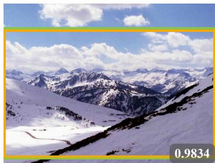

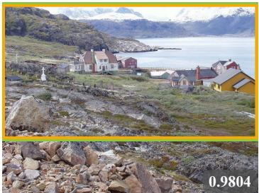

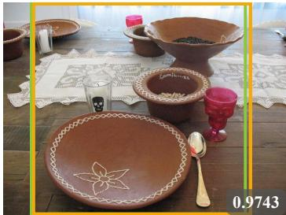  
Figure 5: Examples from PhotoGuider on FCDB (Chen et al., 2017a) and FLMS (Fang et al., 2014) testing images. Green boxes are ground-truth crops from both datasets, and yellow boxes show crops from PhotoGuider. Bottom-right: IoU between the predicted and ground-truth crops.

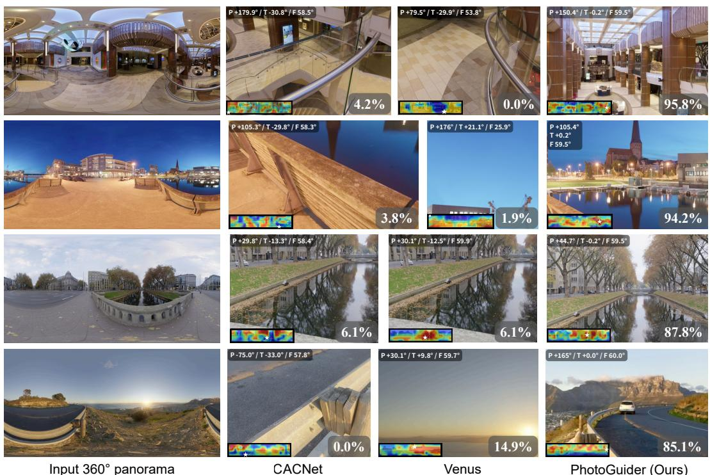  
Figure 6: Visual comparison of 360° view framing from the Poly Haven HDRI library. Score heatmaps are produced by each method across 120 look directions (24 pan × 5 tilt). Scores are displayed as percentile ranks, with red denoting highly favored directions and a star marking the peak score, alongside the corresponding rendered photograph. Each panel labels the chosen camera parameters (pan / tilt / field of view) and shows the percentage of participants who rated it first. Across 100 scenes, the first-place preference shares are 19.5%, 27.3%, and 53.2%, respectively.

## 5 CONCLUSION

PhotoGuider models a photographer’s framing process using four interpretable photographic tokens. These tokens drive a compact ranker for candidate selection, a gated refinement module, and an explainer providing grounded rationales. PhotoGuider achieves competitive performance across two benchmarks and, to our knowledge, is the first method to combine explicit compositionbased direction selection in 360° panoramas with refined framing, camera-parameter output, and measurement-conditioned explanations. User evaluations show clear preference for our crops over end-to-end and MLLM baselines. PhotoGuider combines view selection, crop refinement, and measurement-conditioned explanations in one pipeline.

Limitations. Framing adjustments rely on discrete step fractions, approximating targets falling between sampled intervals. Also, view selection uses a single argmax, returning one frame even in scenes with multiple strong regions regardless of user preference. Future work will examine continuous refinement and user-guided view selection.

## REFERENCES

Rishabh Agarwal, Levi Melnick, Nicholas Frosst, Xuezhou Zhang, Ben Lengerich, Rich Caruana, and Geoffrey E. Hinton. Neural additive models: Interpretable machine learning with neural nets. Advances in neural information processing systems, 34:4699–4711, 2021.

Hadi AlZayer, Hubert Lin, and Kavita Bala. Autophoto: Aesthetic photo capture using reinforcement learning. In IEEE/RSJ International Conference on Intelligent Robots and Systems, IROS 2021, Prague, Czech Republic, September 27 - Oct. 1, 2021, pp. 944–951. IEEE, 2021. doi: 10.1109/IROS51168.2021.9636788.

Shuai Bai, Keqin Chen, Xuejing Liu, Jialin Wang, Wenbin Ge, Sibo Song, Kai Dang, Peng Wang, Shijie Wang, Jun Tang, Humen Zhong, Yuanzhi Zhu, Mingkun Yang, Zhaohai Li, Jianqiang Wan, Pengfei Wang, Wei Ding, Zheren Fu, Yiheng Xu, Jiabo Ye, Xi Zhang, Tianbao Xie, Zesen Cheng, Hang Zhang, Zhibo Yang, Haiyang Xu, and Junyang Lin. Qwen2.5-vl technical report. CoRR, abs/2502.13923, 2025. doi: 10.48550/ARXIV.2502.13923.

Tim Brooks, Ben Mildenhall, Tianfan Xue, Jiawen Chen, Dillon Sharlet, and Jonathan T. Barron. Unprocessing images for learned raw denoising. In Proceedings ofthe IEEE/CVF Conference on Computer Vision and Pattern Recognition (CVPR), pp. 11036–11045, June 2019.

Christopher J. C. Burges. From RankNet to LambdaRank to LambdaMART: An overview. Technical Report MSR-TR-2010-82, Microsoft Research, 2010.

Shuo Cao, Nan Ma, Jiayang Li, Xiaohui Li, Lihao Shao, Kaiwen Zhu, Yu Zhou, Yuandong Pu, Jiarui Wu, Jiaquan Wang, et al. Artimuse: Fine-grained image aesthetics assessment with joint scoring and expert-level understanding. In Proceedings ofthe IEEE/CVF Conference on Computer Vision and Pattern Recognition, pp. 15313–15322, 2026.

Mathilde Caron, Hugo Touvron, Ishan Misra, Herve J´ egou, Julien Mairal, Piotr Bojanowski, and´ Armand Joulin. Emerging properties in self-supervised vision transformers. In 2021 IEEE/CVF international conference on computer vision (ICCV), pp. 9630–9640. IEEE, 2021.

Chun-Hao Chang, Rich Caruana, and Anna Goldenberg. NODE-GAM: Neural generalized additive model for interpretable deep learning. arXiv preprint arXiv:2106.01613, 2021.

Kuang-Yu Chang, Kung-Hung Lu, and Chu-Song Chen. Aesthetic critiques generation for photos. In 2017 IEEE International Conference on Computer Vision (ICCV), pp. 3534–3543. IEEE, 2017.

Chenglizhao Chen, Guangxiao Ma, Wenfeng Song, Shuai Li, Aimin Hao, and Hong Qin. Saliencyfree and aesthetic-aware panoramic video navigation. IEEE Transactions on Pattern Analysis and Machine Intelligence, 47(3):2037–2054, 2024.

Jiansheng Chen, Gaocheng Bai, Shaoheng Liang, and Zhengqin Li. Automatic image cropping: A computational complexity study. In Proceedings of the IEEE conference on computer vision and pattern recognition, pp. 507–515, 2016.

Laming Chen, Guoxin Zhang, and Hanning Zhou. Fast greedy MAP inference for determinantal point process to improve recommendation diversity. In Advances in Neural Information Processing Systems 31, NeurIPS 2018, 2018.

Yi-Ling Chen, Tzu-Wei Huang, Kai-Han Chang, Yu-Chen Tsai, Hwann-Tzong Chen, and Bing-Yu Chen. Quantitative analysis of automatic image cropping algorithms: A dataset and comparative study. In 2017 IEEE Winter Conference on Applications ofComputer Vision, WACV 2017, Santa Rosa, CA, USA, March 24-31, 2017, pp. 226–234. IEEE Computer Society, 2017a. doi: 10.1109/ WACV.2017.32.

Yi-Ling Chen, Jan Klopp, Min Sun, Shao-Yi Chien, and Kwan-Liu Ma. Learning to compose with professional photographs on the web. In Proceedings of the 2017 ACM on Multimedia Conference, MM 2017, Mountain View, CA, USA, October 23-27, 2017, pp. 37–45. ACM, 2017b. doi: 10.1145/3123266.3123274.

Tim Dettmers, Artidoro Pagnoni, Ari Holtzman, and Luke Zettlemoyer. Qlora: Efficient finetuning of quantized llms. In Advances in Neural Information Processing Systems 36: Annual Conference on Neural Information Processing Systems 2023, NeurIPS 2023, New Orleans, LA, USA, December 10 - 16, 2023, 2023. URL http://papers.nips.cc/paper\_files/paper/ 2023/hash/1feb87871436031bdc0f2beaa62a049b-Abstract-Conference. html.

Zhitong Dong, Chao Li, Jie Yu, and Hao Chen. Crop: Expert-aligned image cropping via compositional reasoning and optimizing preference. arXiv preprint arXiv:2605.12545, 2026.

Tianxiang Du, Hulingxiao He, and Yuxin Peng. Venus: Benchmarking and empowering multimodal large language models for aesthetic guidance and cropping. CoRR, abs/2602.23980, 2026. doi: 10.48550/ARXIV.2602.23980.

Chen Fang, Zhe Lin, Radom´ır Mech, and Xiaohui Shen. Automatic image cropping using visualˇ composition, boundary simplicity and content preservation models. In Proceedings of the 22nd ACM International Conference on Multimedia, MM ’14, pp. 1105–1108, New York, NY, USA, 2014. ACM. doi: 10.1145/2647868.2654979.

Hui Fang and Meng Zhang. Creatism: A deep-learning photographer capable of creating professional work. CoRR, abs/1707.03491, 2017. URL http://arxiv.org/abs/1707.03491.

I-Sheng Fang and Jun-Cheng Chen. CameraBench: Benchmarking visual reasoning in MLLMs via photography. arXiv preprint arXiv:2504.10090, 2025.

Daniel Feijoo, Juan C. Benito, Alvaro Garcia, and Marcos V. Conde. DarkIR: Robust low-light image restoration. In 2025 IEEE/CVF Conference on Computer Vision and Pattern Recognition (CVPR), pp. 10879–10889. IEEE, 2025.

Yury Gorishniy, Ivan Rubachev, Nikolay Kartashev, Daniil Shlenskii, Akim Kotelnikov, and Artem Babenko. TabR: Tabular deep learning meets nearest neighbors. In The Twelfth International Conference on Learning Representations, ICLR 2024, 2024.

Leo Grinsztajn, Edouard Oyallon, and Ga´ el Varoquaux. Why do tree-based models still outperform¨ deep learning on typical tabular data? In Advances in Neural Information Processing Systems 35, Datasets and Benchmarks Track, NeurIPS 2022, 2022.

Sitian Gu, Zhiyu Pan, Chaoyi Hong, Chengxin Liu, and Zhiguo Cao. Dynamic beauty is easy to find: A large-scale composition-aware dataset and an end-to-end framework for video reframing. In Proceedings of the 33rd ACM International Conference on Multimedia, MM 2025, Dublin, Ireland, October 27-31, 2025, pp. 7776–7784. ACM, 2025. doi: 10.1145/3746027.3755103.

Tianrui Guan, Fuxiao Liu, Xiyang Wu, Ruiqi Xian, Zongxia Li, Xiaoyu Liu, Xijun Wang, Lichang Chen, Furong Huang, Yaser Yacoob, Dinesh Manocha, and Tianyi Zhou. Hallusionbench: an advanced diagnostic suite for entangled language hallucination and visual illusion in large visionlanguage models. In 2024 IEEE/CVF Conference on Computer Vision and Pattern Recognition (CVPR), pp. 14375–14385. IEEE, 2024.

Guanjun Guo, Hanzi Wang, Chunhua Shen, Yan Yan, and Hong-Yuan Mark Liao. Automatic image cropping for visual aesthetic enhancement using deep neural networks and cascaded regression. IEEE Transactions on Multimedia, 20(8):2073–2085, 2018.

Andrew Hamara and Andrew C. Freeman. Efficient multi-crop saliency partitioning for automatic image cropping. In 2025 International Conference on Modern Computing, Networking and Applications (MCNA), pp. 105–108. IEEE, 2025.

Jin-Ting He, Fu-Jen Tsai, Yan-Tsung Peng, Min-Hung Chen, Chia-Wen Lin, and Yen-Yu Lin. BlurDM: A blur diffusion model for image deblurring. In Advances in Neural Information Processing Systems, volume 38, pp. 52196–52227, 2025. doi: 10.52202/085713-1740.

Shuai He, Yongchang Zhang, Rui Xie, Dongxiang Jiang, and Anlong Ming. Rethinking image aesthetics assessment: Models, datasets and benchmarks. In Proceedings of the Thirty-First International Joint Conference on Artificial Intelligence, pp. 942–948, 2022.

David Holzmuller, L¨ eo Grinsztajn, and Ingo Steinwart. Better by default: Strong pre-tuned MLPs´ and boosted trees on tabular data. In Advances in Neural Information Processing Systems 37, NeurIPS 2024, 2024.

Chaoyi Hong, Shuaiyuan Du, Ke Xian, Hao Lu, Zhiguo Cao, and Weicai Zhong. Composing photos like a photographer. In IEEE Conference on Computer Vision and Pattern Recognition, CVPR 2021, virtual, June 19-25, 2021, pp. 7057–7066. Computer Vision Foundation / IEEE, 2021. doi: 10.1109/CVPR46437.2021.00698.

James Hong, Lu Yuan, Michael Gharbi, Matthew Fisher, and Kayvon Fatahalian. Learning subject-¨ aware cropping by outpainting professional photos. In Thirty-Eighth AAAI Conference on Artificial Intelligence, AAAI 2024, February 20-27, 2024, Vancouver, Canada, pp. 2175–2183. AAAI Press, 2024. doi: 10.1609/aaai.v38i3.27990.

Cheng-Yu Hsieh, Chun-Liang Li, Chih-kuan Yeh, Hootan Nakhost, Yasuhisa Fujii, Alex Ratner, Ranjay Krishna, Chen-Yu Lee, and Tomas Pfister. Distilling step-by-step! outperforming larger language models with less training data and smaller model sizes. In Findings of the association for computational linguistics: ACL 2023, pp. 8003–8017, 2023.

Edward J. Hu, Yelong Shen, Phillip Wallis, Zeyuan Allen-Zhu, Yuanzhi Li, Shean Wang, Lu Wang, and Weizhu Chen. Lora: Low-rank adaptation of large language models. In The Tenth International Conference on Learning Representations, ICLR 2022, Virtual Event, April 25-29, 2022. OpenReview.net, 2022. URL https://openreview.net/forum?id=nZeVKeeFYf9.

Hou-Ning Hu, Yen-Chen Lin, Ming-Yu Liu, Hsien-Tzu Cheng, Yung-Ju Chang, and Min Sun. Deep 360 pilot: Learning a deep agent for piloting through 360° sports videos. In 2017 IEEE Conference on Computer Vision and Pattern Recognition (CVPR), pp. 1396–1405. IEEE, 2017.

Yipo Huang, Leida Li, Pengfei Chen, Haoning Wu, Weisi Lin, and Guangming Shi. Multi-modality multi-attribute contrastive pre-training for image aesthetics computing. IEEE Transactions on Pattern Analysis and Machine Intelligence, 47(2):1205–1218, 2024a.

Yipo Huang, Xiangfei Sheng, Zhichao Yang, Quan Yuan, Zhichao Duan, Pengfei Chen, Leida Li, Weisi Lin, and Guangming Shi. Aesexpert: Towards multi-modality foundation model for image aesthetics perception. In Proceedings ofthe 32nd ACM International Conference on Multimedia, MM 2024, Melbourne, VIC, Australia, 28 October 2024 - 1 November 2024, pp. 5911–5920. ACM, 2024b. doi: 10.1145/3664647.3680649.

Yipo Huang, Quan Yuan, Xiangfei Sheng, Zhichao Yang, Haoning Wu, Pengfei Chen, Yuzhe Yang, Leida Li, and Weisi Lin. Aesbench: An expert benchmark for multimodal large language models on image aesthetics perception. CoRR, abs/2401.08276, 2024c. doi: 10.48550/ARXIV.2401. 08276.

Alon Jacovi and Yoav Goldberg. Towards faithfully interpretable nlp systems: How should we define and evaluate faithfulness? In Proceedings of the 58th annual meeting of the association for computational linguistics, pp. 4198–4205, 2020.

Gengyun Jia, Huaibo Huang, Chaoyou Fu, and Ran He. Rethinking image cropping: Exploring diverse compositions from global views. In IEEE/CVF Conference on Computer Vision and Pattern Recognition, CVPR 2022, New Orleans, LA, USA, June 18-24, 2022, pp. 2436–2445. IEEE, 2022. doi: 10.1109/CVPR52688.2022.00248.

Ruixiang Jiang and Chang Wen Chen. Multimodal LLMs can reason about aesthetics in zero-shot. In Proceedings ofthe 33rd ACM International Conference on Multimedia, pp. 6634–6643, 2025.

Ruixiang Jiang and Chang Wen Chen. Before the shutter: Aesthetic and actionable portrait photography planning in 3d scenes. CoRR, abs/2605.30318, 2026. doi: 10.48550/ARXIV.2605.30318.

Kyoungkook Kang and Sunghyun Cho. Interactive and automatic navigation for 360° video playback. ACM Transactions on Graphics (TOG), 38(4):1–11, 2019.

Guolin Ke, Qi Meng, Thomas Finley, Taifeng Wang, Wei Chen, Weidong Ma, Qiwei Ye, and Tie-Yan Liu. Lightgbm: A highly efficient gradient boosting decision tree. In Advances in Neural Information Processing Systems 30: Annual Conference on Neural Information Processing Systems 2017, December 4-9, 2017, Long Beach, CA, USA, pp. 3146–3154, 2017. URL https://proceedings.neurips.cc/paper/2017/hash/ 6449f44a102fde848669bdd9eb6b76fa-Abstract.html.

Junjie Ke, Keren Ye, Jiahui Yu, Yonghui Wu, Peyman Milanfar, and Feng Yang. VILA: Learning image aesthetics from user comments with vision-language pretraining. In 2023 IEEE/CVF Conference on Computer Vision and Pattern Recognition (CVPR), pp. 10041–10051. IEEE, 2023.

Dongyoung Kim, Mahmoud Afifi, Dongyun Kim, Michael S. Brown, and Seon Joo Kim. CCM-Net: Leveraging calibrated color correction matrices for cross-camera color constancy. In 2025 IEEE/CVF International Conference on Computer Vision (ICCV), pp. 6198–6208. IEEE, 2025.

Taehun Kim, Kunhee Kim, Joonyeong Lee, Dongmin Cha, Jiho Lee, and Daijin Kim. Revisiting image pyramid structure for high resolution salient object detection. In Computer Vision - ACCV 2022 - 16th Asian Conference on Computer Vision, Macao, China, December 4-8, 2022, Lecture Notes in Computer Science. Springer, 2022. doi: 10.1007/978-3-031-26293-7 16.

Yeong Won Kim, Chang-Ryeol Lee, Dae-Yong Cho, Yong Hoon Kwon, Hyeok-Jae Choi, and Kuk-Jin Yoon. Automatic content-aware projection for 360° videos. In 2017 IEEE International Conference on Computer Vision (ICCV), pp. 4753–4761. IEEE, 2017.

Alexander Kirillov, Eric Mintun, Nikhila Ravi, Hanzi Mao, Chloe Rolland, Laura Gustafson, Tete Xiao, Spencer Whitehead, Alexander C. Berg, Wan-Yen Lo, Piotr Dollar, and Ross Girshick.´ Segment anything. In IEEE/CVF International Conference on Computer Vision, ICCV 2023, Paris, France, October 1-6, 2023, pp. 3992–4003. IEEE, 2023. doi: 10.1109/ICCV51070.2023. 00371.

Lingshun Kong, Jiawei Zhang, Dongqing Zou, Fu Lee Wang, Jimmy S. Ren, Xiaohe Wu, Jiangxin Dong, and Jinshan Pan. DeblurDiff: Real-world image deblurring with generative diffusion models. In Advances in Neural Information Processing Systems, volume 38, pp. 154855–154873, 2025. doi: 10.52202/085713-5179.

Alex Kulesza and Ben Taskar. k-DPPs: Fixed-size determinantal point processes. In Proceedings of the 28th International Conference on Machine Learning, ICML 2011, 2011.

Alex Kulesza and Ben Taskar. Determinantal point processes for machine learning. Foundations and Trends in Machine Learning, 5(2-3):123–286, 2012. doi: 10.1561/2200000044.

Wei-Sheng Lai, Yujia Huang, Neel Joshi, Christopher Buehler, Ming-Hsuan Yang, and Sing Bing Kang. Semantic-driven generation of hyperlapse from 360 degree video. IEEE transactions on visualization and computer graphics, 24(9):2610–2621, 2018.

Jun-Tae Lee, Han-Ul Kim, Chul Lee, and Chang-Su Kim. Photographic composition classification and dominant geometric element detection for outdoor scenes. Journal of Visual Communication and Image Representation, 55:91–105, 2018a.

Kyunghyun Lee, Ukcheol Shin, and Byeong-Uk Lee. Learning to control camera exposure via reinforcement learning. In 2024 IEEE/CVF Conference on Computer Vision and Pattern Recognition (CVPR), pp. 2975–2983. IEEE, 2024.

Sangho Lee, Jinyoung Sung, Youngjae Yu, and Gunhee Kim. A memory network approach for story-based temporal summarization of 360° videos. In 2018 IEEE/CVF Conference on Computer Vision and Pattern Recognition, pp. 1410–1419. IEEE, 2018b.

Seung Hyun Lee, Jijun Jiang, Yiran Xu, Zhuofang Li, Junjie Ke, Yinxiao Li, Junfeng He, Steven Hickson, Katie Datsenko, Sangpil Kim, Ming-Hsuan Yang, Irfan Essa, and Feng Yang. Cropper: Vision-language model for image cropping through in-context learning. In IEEE/CVF Conference on Computer Vision and Pattern Recognition, CVPR 2025, Nashville, TN, USA, June 11-15, 2025, pp. 30010–30019. Computer Vision Foundation / IEEE, 2025. doi: 10.1109/CVPR52734.2025. 02793.

Yuan-Kang Lee and Jian-Jiun Ding. Efficient color image denoising using dwt-based noise estimation and adaptive wiener filter. In 2024 8th International Conference on Imaging, Signal Processing and Communications (ICISPC), pp. 47–51. IEEE, 2024.

Yuan-Kang Lee, Kuan-Lin Chen, Chia-Che Chang, and Yu-Lun Liu. Rl-awb: Deep reinforcement learning for auto white balance correction in low-light nighttime scenes. In European Conference on Computer Vision, pp. 77–99. Springer, 2026a.

Yuan-Kang Lee, Kuan-Lin Chen, Chih-Heng Chang, and Jian-Jiun Ding. Safe: Scene-aware feature modulation for color constancy with learned color space in pure-color scenes. arXiv preprint arXiv:2608.13967, 2026b.

Debang Li, Huikai Wu, Junge Zhang, and Kaiqi Huang. A2-RL: aesthetics aware reinforcement learning for image cropping. In 2018 IEEE Conference on Computer Vision and Pattern Recognition, CVPR 2018, Salt Lake City, UT, USA, June 18-22, 2018, pp. 8193–8201. Computer Vision Foundation / IEEE Computer Society, 2018. doi: 10.1109/CVPR.2018.00855.

Debang Li, Huikai Wu, Junge Zhang, and Kaiqi Huang. Fast A3RL: aesthetics-aware adversarial reinforcement learning for image cropping. IEEE Trans. Image Process., 28(10):5105–5120, 2019. doi: 10.1109/TIP.2019.2914360.

Debang Li, Junge Zhang, and Kaiqi Huang. Learning to learn cropping models for different aspect ratio requirements. In 2020 IEEE/CVF Conference on Computer Vision and Pattern Recognition, CVPR 2020, Seattle, WA, USA, June 13-19, 2020, pp. 12682–12691. Computer Vision Foundation / IEEE, 2020a. doi: 10.1109/CVPR42600.2020.01270.

Debang Li, Junge Zhang, Kaiqi Huang, and Ming-Hsuan Yang. Composing good shots by exploiting mutual relations. In 2020 IEEE/CVF Conference on Computer Vision and Pattern Recognition, CVPR 2020, Seattle, WA, USA, June 13-19, 2020, pp. 4212–4221. Computer Vision Foundation / IEEE, 2020b. doi: 10.1109/CVPR42600.2020.00427.

Jiawan Li, Fei Zhou, Zhipeng Zhong, Jiongzhi Lin, and Guoping Qiu. Towards smart point-andshoot photography. In IEEE/CVF Conference on Computer Vision and Pattern Recognition, CVPR 2025, Nashville, TN, USA, June 11-15, 2025, pp. 28242–28251. Computer Vision Foundation / IEEE, 2025a. doi: 10.1109/CVPR52734.2025.02630.

Jiayu Li, Yixiao Fang, Tianyu Hu, Wei Cheng, Ping Huang, Zheheng Fan, Gang Yu, and Xingjun Ma. Shuttermuse: Capture-time photography guidance with mllms. arXiv preprint arXiv:2606.25763, 2026.

Weiqi Li, Xuanyu Zhang, Shijie Zhao, Yabin Zhang, Junlin Li, Li Zhang, and Jian Zhang. Q-Insight: Understanding image quality via visual reinforcement learning. In Advances in Neural Information Processing Systems, volume 38, pp. 36802–36827, 2025b.

Yifan Li, Yifan Du, Kun Zhou, Jinpeng Wang, Xin Zhao, and Ji-Rong Wen. Evaluating object hallucination in large vision-language models. In Proceedings of the 2023 conference on empirical methods in natural language processing, pp. 292–305, 2023.

Oliver Limoyo, Jimmy Li, Dmitriy Rivkin, Jonathan Kelly, and Gregory Dudek. Photobot: Reference-guided interactive photography via natural language. In 2024 IEEE/RSJ International Conference on Intelligent Robots and Systems (IROS), pp. 2479–2486. IEEE, 2024.

Ligang Liu, Renjie Chen, Lior Wolf, and Daniel Cohen-Or. Optimizing photo composition. In Computer graphics forum, volume 29, pp. 469–478. Wiley Online Library, 2010.

Xiao-Chang Liu and Johan Wagemans. From concepts to judgments: Interpretable image aesthetic assessment. CoRR, abs/2603.18108, 2026. doi: 10.48550/ARXIV.2603.18108.

Xiaoyu Liu, Ming Liu, Junyi Li, Shuai Liu, Xiaotao Wang, Lei Lei, and Wangmeng Zuo. Beyond image borders: Learning feature extrapolation for unbounded image composition. In IEEE/CVF International Conference on Computer Vision, ICCV 2023, Paris, France, October 1-6, 2023, pp. 12977–12986. IEEE, 2023. doi: 10.1109/ICCV51070.2023.01197.

Yin Lou, Rich Caruana, Johannes Gehrke, and Giles Hooker. Accurate intelligible models with pairwise interactions. In Proceedings of the 19th ACM SIGKDD international conference on Knowledge discovery and data mining, pp. 623–631, 2013.

Weirui Lu, Xiaofen Xing, Bolun Cai, and Xiangmin Xu. Listwise view ranking for image cropping. IEEE Access, 7:91904–91911, 2019. doi: 10.1109/ACCESS.2019.2925430.

Scott M. Lundberg and Su-In Lee. A unified approach to interpreting model predictions. In Advances in Neural Information Processing Systems 30: Annual Conference on Neural Information Processing Systems 2017, December 4-9, 2017, Long Beach, CA, USA, pp. 4765–4774, 2017. URL https://proceedings.neurips.cc/paper/2017/hash/ 8a20a8621978632d76c43dfd28b67767-Abstract.html.

Scott M. Lundberg, Gabriel Erion, Hugh Chen, Alex DeGrave, Jordan M. Prutkin, Bala Nair, Ronit Katz, Jonathan Himmelfarb, Nisha Bansal, and Su-In Lee. From local explanations to global understanding with explainable AI for trees. Nature Machine Intelligence, 2(1):56–67, 2020. doi: 10.1038/s42256-019-0138-9.

Duncan McElfresh, Sujay Khandagale, Jonathan Valverde, Vishak Prasad C, Ganesh Ramakrishnan, Micah Goldblum, and Colin White. When do neural nets outperform boosted trees on tabular data? In Advances in Neural Information Processing Systems 36, Datasets and Benchmarks Track, NeurIPS 2023, 2023.

Mohammad Mohammadi, Sina Honari, Stavros Tsogkas, Tristan Aumentado-Armstrong, Michael S. Brown, Iqbal Mohomed, Konstantinos G. Derpanis, Alex Levinshtein, and Igor Gilitschenski. Why low-light cameras go color blind: Removing color bias in raw denoising. arXiv preprint arXiv:2607.11090, 2026.

Naila Murray, Luca Marchesotti, and Florent Perronnin. AVA: A large-scale database for aesthetic visual analysis. In 2012 IEEE Conference on Computer Vision and Pattern Recognition, Providence, RI, USA, June 16-21, 2012, pp. 2408–2415. IEEE Computer Society, 2012. doi: 10.1109/CVPR.2012.6247954.

Alexandru Niculescu-Mizil and Rich Caruana. Predicting good probabilities with supervised learning. In Proceedings of the 22nd international conference on Machine learning, pp. 625–632, 2005.

Masashi Nishiyama, Takahiro Okabe, Yoichi Sato, and Imari Sato. Sensation-based photo cropping. In Proceedings ofthe 17th ACM international conference on Multimedia, pp. 669–672, 2009.

Harsha Nori, Samuel Jenkins, Paul Koch, and Rich Caruana. InterpretML: A unified framework for machine learning interpretability. arXiv preprint arXiv:1909.09223, 2019.

Zhiyu Pan, Zhiguo Cao, Kewei Wang, Hao Lu, and Weicai Zhong. Transview: Inside, outside, and across the cropping view boundaries. In 2021 IEEE/CVF International Conference on Computer Vision, ICCV 2021, Montreal, QC, Canada, October 10-17, 2021, pp. 4198–4207. IEEE, 2021. doi: 10.1109/ICCV48922.2021.00418.

Zhiyu Pan, Yinpeng Chen, Jiale Zhang, Hao Lu, Zhiguo Cao, and Weicai Zhong. Find beauty in the rare: Contrastive composition feature clustering for nontrivial cropping box regression. In Thirty-Seventh AAAI Conference on Artificial Intelligence, AAAI 2023, Washington, DC, USA, February 7-14, 2023, pp. 2011–2019. AAAI Press, 2023. doi: 10.1609/aaai.v37i2.25293.

Zhiyu Pan, Jiahao Cui, Kewei Wang, Yizheng Wu, and Zhiguo Cao. Pseudo label fusion with uncertainty estimation for semi-supervised cropping box regression. IEEE Trans. Multim., 26: 8157–8171, 2024. doi: 10.1109/TMM.2024.3377125.

Daiqing Qi, Handong Zhao, Jing Shi, Simon Jenni, Yifei Fan, Franck Dernoncourt, Scott Cohen, and Sheng Li. The photographer’s eye: Teaching multimodal large language models to see, and critique like photographers. In IEEE/CVF Conference on Computer Vision and Pattern Recognition, CVPR 2025, Nashville, TN, USA, June 11-15, 2025, pp. 24807–24816. Computer Vision Foundation / IEEE, 2025. doi: 10.1109/CVPR52734.2025.02310.

Filip Radenovic, Abhimanyu Dubey, and Dhruv Mahajan. Neural basis models for interpretability. Advances in Neural Information Processing Systems, 35:8414–8426, 2022.

Alec Radford, Jong Wook Kim, Chris Hallacy, Aditya Ramesh, Gabriel Goh, Sandhini Agarwal, Girish Sastry, Amanda Askell, Pamela Mishkin, Jack Clark, Gretchen Krueger, and Ilya Sutskever. Learning transferable visual models from natural language supervision. In Proceedings of the 38th International Conference on Machine Learning, ICML 2021, 18-24 July 2021, Virtual Event, volume 139 of Proceedings ofMachine Learning Research, pp. 8748–8763. PMLR, 2021.

Yashas Rai, Jesus Guti´ errez, and Patrick Le Callet. A dataset of head and eye movements for 360´ degree images. In Proceedings ofthe 8th ACM on Multimedia Systems Conference, pp. 205–210, 2017.

Anyi Rao, Linning Xu, and Dahua Lin. Shoot360: Normal view video creation from city panorama footage. In SIGGRAPH ’22: Special Interest Group on Computer Graphics and Interactive Techniques Conference, Vancouver, BC, Canada, August 7 - 11, 2022, pp. 13:1–13:9. ACM, 2022. doi: 10.1145/3528233.3530702.

Christoph Schuhmann, Romain Beaumont, Richard Vencu, Cade Gordon, Ross Wightman, Mehdi Cherti, Theo Coombes, Aarush Katta, Clayton Mullis, Mitchell Wortsman, Patrick Schramowski, Srivatsa Kundurthy, Katherine Crowson, Ludwig Schmidt, Robert Kaczmarczyk, and Jenia Jitsev. LAION-5B: An open large-scale dataset for training next generation image-text models. In Advances in Neural Information Processing Systems 35: Datasets and Benchmarks Track, 2022. doi: 10.52202/068431-1833.

Xiangfei Sheng, Pangu Xie, Weidong Zou, Pengfei Chen, Tong Zhu, and Leida Li. Instructcrop: Teaching multimodal large language models to crop aesthetic images. In Proceedings ofthe 33rd ACM International Conference on Multimedia, pp. 6830–6839, 2025. doi: 10.1145/3746027. 3754931. URL https://dl.acm.org/doi/10.1145/3746027.3754931.

Nyeong-Ho Shin, Seon-Ho Lee, Jinwon Ko, and Chang-Su Kim. Image cropping based on order learning. J. Vis. Commun. Image Represent., 103:104253, 2024. doi: 10.1016/J.JVCIR.2024. 104253.

Oriane Simeoni, Huy V. Vo, Maximilian Seitzer, Federico Baldassarre, Maxime Oquab, Cijo Jose,´ Vasil Khalidov, Marc Szafraniec, Seung Eun Yi, Michael Ramamonjisoa, Francisco Massa,¨ Daniel Haziza, Luca Wehrstedt, Jianyuan Wang, Timothee Darcet, Th´ eo Moutakanni, Leonel´ Sentana, Claire Roberts, Andrea Vedaldi, Jamie Tolan, John Brandt, Camille Couprie, Julien Mairal, Herve J´ egou, Patrick Labatut, and Piotr Bojanowski. Dinov3.´ Trans. Mach. Learn. Res., 2026, 2026. URL https://openreview.net/forum?id=2NlGyqNjns.

Vincent Sitzmann, Ana Serrano, Amy Pavel, Maneesh Agrawala, Diego Gutierrez, Bel´ en Masi´ a,´ and Gordon Wetzstein. Saliency in vr: How do people explore virtual environments? IEEE transactions on visualization and computer graphics, 24(4):1633–1642, 2018.

Yu-Chuan Su and Kristen Grauman. Making 360° video watchable in 2D: Learning videography for click free viewing. In 2017 IEEE Conference on Computer Vision and Pattern Recognition (CVPR), pp. 1368–1376. IEEE, 2017.

Yu-Chuan Su, Dinesh Jayaraman, and Kristen Grauman. Pano2vid: Automatic cinematography for watching 360° videos. In Computer Vision - ACCV 2016 - 13th Asian Conference on Computer Vision, Taipei, Taiwan, November 20-24, 2016, Revised Selected Papers, Part IV, volume 10114 of Lecture Notes in Computer Science, pp. 154–171. Springer, 2016. doi: 10.1007/978-3-319-54190-7\ 10.

Yu-Chuan Su, Raviteja Vemulapalli, Ben Weiss, Chun-Te Chu, Philip Andrew Mansfield, Lior Shapira, and Colvin Pitts. Camera view adjustment prediction for improving image composi tion. CoRR, abs/2104.07608, 2021. URL https://arxiv.org/abs/2104.07608.

Yukun Su, Yiwen Cao, Jingliang Deng, Fengyun Rao, and Qingyao Wu. Spatial-semantic collaborative cropping for user generated content. In Thirty-Eighth AAAI Conference on Artificial Intelligence, AAAI 2024, February 20-27, 2024, Vancouver, Canada, pp. 4988–4997. AAAI Press, 2024. doi: 10.1609/aaai.v38i5.28303.

Hossein Talebi and Peyman Milanfar. NIMA: neural image assessment. IEEE Trans. Image Process., 27(8):3998–4011, 2018. doi: 10.1109/TIP.2018.2831899.

Sheyang Tang, Armin Shafiee Sarvestani, Jialu Xu, Xiaoyu Xu, and Zhou Wang. Aesthetic camera viewpoint suggestion with 3d aesthetic field. CoRR, abs/2602.20363, 2026. doi: 10.48550/ ARXIV.2602.20363.

Yi Tu, Li Niu, Weijie Zhao, Dawei Cheng, and Liqing Zhang. Image cropping with composition and saliency aware aesthetic score map. In The Thirty-Fourth AAAI Conference on Artificial Intelligence, AAAI 2020, New York, NY, USA, February 7-12, 2020, pp. 12104–12111. AAAI Press, 2020. doi: 10.1609/aaai.v34i07.6889.

Taichi Uchida, Yoshihiro Kanamori, and Yuki Endo. 3d view optimization for improving image aesthetics. In 2025 IEEE International Conference on Acoustics, Speech and Signal Processing, ICASSP 2025, Hyderabad, India, April 6-11, 2025, pp. 1–5. IEEE, 2025. doi: 10.1109/ICASSP49660.2025.10888966.

Supatta Viriyavisuthisakul, Shun Yoshida, Kaede Shiohara, Ling Xiao, and Toshihiko Yamasaki. Explainable AI for image aesthetic evaluation using vision-language models. In 2025 Conference on Artificial Intelligence x Multimedia (AIxMM), pp. 62–65. IEEE, 2025. doi: 10.1109/ aixmm62960.2025.00017.

Chao Wang, Li Niu, Bo Zhang, and Liqing Zhang. Image cropping with spatial-aware feature and rank consistency. In IEEE/CVF Conference on Computer Vision and Pattern Recognition, CVPR 2023, Vancouver, BC, Canada, June 17-24, 2023, pp. 10052–10061. IEEE, 2023a. doi: 10.1109/CVPR52729.2023.00969.

Jianyi Wang, Kelvin C. K. Chan, and Chen Change Loy. Exploring CLIP for assessing the look and feel of images. In Proceedings of the AAAI conference on artificial intelligence, volume 37, pp. 2555–2563, 2023b.

Miao Wang, Yi-Jun Li, Wen-Xuan Zhang, Christian Richardt, and Shi-Min Hu. Transitioning360: Content-aware NFoV virtual camera paths for 360° video playback. In 2020 IEEE International Symposium on Mixed and Augmented Reality (ISMAR), pp. 241–250. IEEE, 2020.

Wenguan Wang and Jianbing Shen. Deep cropping via attention box prediction and aesthetics assessment. In IEEE International Conference on Computer Vision, ICCV 2017, Venice, Italy, October 22-29, 2017, pp. 2205–2213. IEEE Computer Society, 2017. doi: 10.1109/ICCV.2017.240.

Wenguan Wang, Jianbing Shen, and Haibin Ling. A deep network solution for attention and aesthetics aware photo cropping. IEEE Trans. Pattern Anal. Mach. Intell., 41(7):1531–1544, 2019. doi: 10.1109/TPAMI.2018.2840724.

Xuezhi Wang, Jason Wei, Dale Schuurmans, Quoc Le, Ed Chi, Sharan Narang, Aakanksha Chowdhery, and Denny Zhou. Self-consistency improves chain of thought reasoning in language models. arXiv preprint arXiv:2203.11171, 2022.

Zijun Wei, Jianming Zhang, Xiaohui Shen, Zhe Lin, Radom´ır Mech, Minh Hoai, and Dimitris Sama-ˇ ras. Good view hunting: Learning photo composition from dense view pairs. In 2018 IEEE Conference on Computer Vision and Pattern Recognition, CVPR 2018, Salt Lake City, UT, USA, June 18-22, 2018, pp. 5437–5446. Computer Vision Foundation / IEEE Computer Society, 2018. doi: 10.1109/CVPR.2018.00570.

Yen-Hong Wong and Lai-Kuan Wong. Aescrop: Aesthetic-driven cropping guided by composition. In IEEE/CVF International Conference on Computer Vision, ICCV 2025 - Workshops, Honolulu, HI, USA, October 19-20, 2025, pp. 3965–3972. IEEE, 2025. doi: 10.1109/ICCVW69036.2025. 00412.

Haoning Wu, Zicheng Zhang, Weixia Zhang, Chaofeng Chen, Liang Liao, Chunyi Li, Yixuan Gao, Annan Wang, Erli Zhang, Wenxiu Sun, Qiong Yan, Xiongkuo Min, Guangtao Zhai, and Weisi Lin. Q-align: Teaching lmms for visual scoring via discrete text-defined levels. In Forty-first International Conference on Machine Learning, ICML 2024, Vienna, Austria, July 21-27, 2024, volume 235 of Proceedings ofMachine Learning Research, pp. 54015–54029. PMLR, 2024. URL https://proceedings.mlr.press/v235/wu24ah.html.

Bo Xiong and Kristen Grauman. Snap angle prediction for 360° panoramas. In Computer Vision - ECCV 2018 - 15th European Conference, Munich, Germany, September 8-14, 2018, Proceedings, Part V, volume 11209 of Lecture Notes in Computer Science, pp. 3–20. Springer, 2018. doi: 10.1007/978-3-030-01228-1\ 1.

Xiaoliang Xiong, Jie Feng, and Bingfeng Zhou. Automatic view finding for drone photography based on image aesthetic evaluation. In Proceedings ofthe 12th International Joint Conference on Computer Vision, Imaging and Computer Graphics Theory and Applications (VISIGRAPP 2017) - Volume 1: GRAPP, Porto, Portugal, February 27 - March 1, 2017, pp. 282–289. SciTePress, 2017. doi: 10.5220/0006255402820289.

Chuanzhi Xu, Boyu Wei, Haoxian Zhou, Xuanhua Yin, Zihan Deng, Haodong Chen, Qiang Qu, and Weidong Cai. Aes3d: Aesthetic assessment in 3d gaussian splatting. arXiv preprint arXiv:2605.05155, 2026.

Jianzhou Yan, Stephen Lin, Sing Bing Kang, and Xiaoou Tang. Learning the change for automatic image cropping. In 2013 IEEE Conference on Computer Vision and Pattern Recognition, Portland, OR, USA, June 23-28, 2013, pp. 971–978. IEEE Computer Society, 2013. doi: 10.1109/CVPR.2013.130.

Guo-Ye Yang, Wen-Yang Zhou, Yun Cai, Song-Hai Zhang, and Fang-Lue Zhang. Focusing on your subject: Deep subject-aware image composition recommendation networks. Comput. Vis. Media, 9(1):87–107, 2023. doi: 10.1007/s41095-021-0263-3.

Rui Yang, Wei Zhou, Dingyong Gou, Xiaohui Cui, Cong Li, Yinyin Gong, Yipo Huang, and Jiliang Zhao. COMEX: A composition-grounded benchmark and learning framework for explainable aesthetic image cropping. CoRR, abs/2608.07570, 2026a. doi: 10.48550/ARXIV.2608.07570.

Zhichao Yang, Jianjie Wang, Zhixianhe Zhang, Pangu Xie, Xiangfei Sheng, Pengfei Chen, and Leida Li. Fine-grained image aesthetic assessment: Learning discriminative scores from relative ranks. In Proceedings ofthe IEEE/CVF Conference on Computer Vision and Pattern Recognition (CVPR), pp. 145–155, June 2026b.

Lujian Yao, Siming Zheng, Xinbin Yuan, Zhuoxuan Cai, Pu Wu, Jinwei Chen, Bo Li, and Peng-Tao Jiang. Photography perspective composition: Towards aesthetic perspective recommendation. In Advances in Neural Information Processing Systems, volume 38, 2025. doi: 10.52202/ 085713-3020. URL https://proceedings.neurips.cc/paper\_files/paper/ 2025/hash/8227285e32f70e07fa3a247f3a48006d-Abstract-Conference. html.

Zhiyuan You, Ke Wang, He Zhang, Xin Cai, Jinjin Gu, Tianfan Xue, Chao Dong, and Zhoutong Zhang. PhotoFramer: Multi-modal image composition instruction. In Proceedings of the IEEE/CVF Conference on Computer Vision and Pattern Recognition, pp. 10197–10207, 2026.

Youngjae Yu, Sangho Lee, Joonil Na, Jaeyun Kang, and Gunhee Kim. A deep ranking model for spatio-temporal highlight detection from a 360° video. In Proceedings of the AAAI Conference on Artificial Intelligence, volume 32, 2018.

Quan Yuan, Leida Li, and Pengfei Chen. Aesthetic image cropping meets VLP: enhancing good while reducing bad. J. Vis. Commun. Image Represent., 105:104316, 2024. doi: 10.1016/J. JVCIR.2024.104316.

Quan Yuan, Yipo Huang, Pengfei Chen, and Leida Li. Humancrop-thinker: An inference-driven framework with explicit thinking for explainable human-centric image cropping. Expert Syst. Appl., 316:131664, 2026. doi: 10.1016/J.ESWA.2026.131664.

Bianca Zadrozny and Charles Elkan. Transforming classifier scores into accurate multiclass probability estimates. In Proceedings ofthe eighth ACM SIGKDD international conference on Knowledge discovery and data mining, pp. 694–699, 2002.

Eric Zelikman, Yuhuai Wu, Jesse Mu, and Noah Goodman. STaR: Bootstrapping reasoning with reasoning. Advances in Neural Information Processing Systems, 35:15476–15488, 2022.

Hui Zeng, Lida Li, Zisheng Cao, and Lei Zhang. Reliable and efficient image cropping: A grid anchor based approach. In IEEE Conference on Computer Vision and Pattern Recognition, CVPR 2019, Long Beach, CA, USA, June 16-20, 2019, pp. 5949–5957. Computer Vision Foundation / IEEE, 2019. doi: 10.1109/CVPR.2019.00610.

Hui Zeng, Lida Li, Zisheng Cao, and Lei Zhang. Grid anchor based image cropping: A new benchmark and an efficient model. IEEE Trans. Pattern Anal. Mach. Intell., 44(3):1304–1319, 2022. doi: 10.1109/TPAMI.2020.3024207.

Bo Zhang, Li Niu, and Liqing Zhang. Image composition assessment with saliency-augmented multi-pattern pooling. arXiv preprint arXiv:2104.03133, 2021a.

Bo Zhang, Li Niu, Xing Zhao, and Liqing Zhang. Human-centric image cropping with partitionaware and content-preserving features. In Computer Vision - ECCV 2022 - 17th European Conference, Tel Aviv, Israel, October 23-27, 2022, Proceedings, Part VII, volume 13667 of Lecture Notes in Computer Science, pp. 181–197. Springer, 2022. doi: 10.1007/978-3-031-20071-7\ 11.

Ke Zhang, Tianyu Ding, Jiachen Jiang, Tianyi Chen, Ilya Zharkov, Vishal M. Patel, and Luming Liang. Procrop: Learning aesthetic image cropping from professional compositions. In Fortieth AAAI Conference on Artificial Intelligence, AAAI 2026, Singapore, January 20-27, 2026, pp. 12600–12608. AAAI Press, 2026a. doi: 10.1609/aaai.v40i15.38255.

Yi Zhang, Hongwei Qin, Xiaogang Wang, and Hongsheng Li. Rethinking noise synthesis and modeling in raw denoising. In Proceedings ofthe IEEE/CVF International Conference on Computer Vision (ICCV), pp. 4593–4601, October 2021b. doi: 10.1109/ICCV48922.2021.00455.

Zhiheng Zhang, Yanyu Xu, Jingyi Yu, and Shenghua Gao. Saliency detection in 360° videos. In European conference on computer vision, pp. 504–520. Springer, 2018.

Ziqing Zhang, Xiao Liu, Kai Liu, Jianze Li, Weihang Zhang, Linghe Kong, and Yulun Zhang. Discrete annotation, continuous preference: Rethinking supervision for accurate and generalizable aesthetic image cropping. arXiv preprint arXiv:2610.00582, 2026b.

Zhaoran Zhao, Peng Lu, Anran Zhang, Peipei Li, Xia Li, Xuannan Liu, Yang Hu, Shiyi Chen, Liwei Wang, and Wenhao Guo. Can machines understand composition? dataset and benchmark for photographic image composition embedding and understanding. In 2025 IEEE/CVF Conference on Computer Vision and Pattern Recognition, CVPR 2025, pp. 14411–14421. Computer Vision Foundation / IEEE, 2025.

Zhihang Zhong, Mingxi Cheng, Zhirong Wu, Yuhui Yuan, Yinqiang Zheng, Ji Li, Han Hu, Stephen Lin, Yoichi Sato, and Imari Sato. Clipcrop: Conditioned cropping driven by vision-language model. In IEEE/CVF International Conference on Computer Vision, ICCV 2023 - Workshops, Paris, France, October 2-6, 2023, pp. 294–304. IEEE, 2023. doi: 10.1109/ICCVW60793.2023. 00037.

Zhaokun Zhou, Qiulin Wang, Bin Lin, Yiwei Su, Rui Chen, Xin Tao, Amin Zheng, Li Yuan, Pengfei Wan, and Di Zhang. UNIAA: A unified multi-modal image aesthetic assessment baseline and benchmark. CoRR, abs/2404.09619, 2024. doi: 10.48550/ARXIV.2404.09619.

Hancheng Zhu, Li Yan, Yong Zhou, Rui Yao, Zhiwen Shao, Jiaqi Zhao, and Leida Li. Image cropping with content and composition attribute-aware global relation reasoning. ACM Trans. Multim. Comput. Commun. Appl., 21(4):125:1–125:19, 2025. doi: 10.1145/3719012.

## A APPENDIX

This document provides supplementary material for the paper “PhotoGuider: Composition-Aware Cropping and 360° View Framing with Explainable Photographic Assessments” to complement the main manuscript. Sec. A.1, A.2, A.3, and A.4 provide details of the photographic tokens, refinement gates, MLLM consultant, and Explainer, respectively. Sec. A.5 offers implementation details of PhotoGuider. Sec. A.6 provides the ablation study of modules in the refinement stage. Sec. A.7 gives the detailed analysis of user preferences for 360° framings.

Supplementary material. The project page (https://ntuneillee.github.io/ research/photoguider/) provides two videos of the full 360◦ pipeline, from direction search to the final native re-render with its explanation, and the ten user-study scenes in which our framing was preferred most strongly, each showing the panorama, the three methods’ framings with their first-place shares and camera parameters, our four token assessments, and the three direction fields. All scenes are CC0 panoramas from Poly Haven.

## A.1 THE FOUR PHOTOGRAPHIC TOKENS

Shared photographic features. We measure 60 features on each perspective frame and group them into four photographic tokens: Subject (S), Composition (C), Aesthetics (A), and Integrity (I). The same feature groups support direction selection, crop ranking, and explanation. Figure 7 shows differences in token contributions between crops selected on FCDB and FLMS. We evaluate transfer across these benchmarks using the same trained checkpoint (Sec. 4.2).

Subject: what is being photographed. A photographer first checks whether the subject is fully in frame and how much of the frame it occupies. We measure this from three complementary views. The self-supervised attention of DINOv3 supplies saliency coverage and peak (vmix max, v1 max, v1 cov). In-SPyReNet supplies the subject’s precise outline and completeness (inspy capture, inspy max). The SAM object mask corresponding to the subject supplies its area share, centering, and agreement with the InSPyReNet reading (sam mask area ratio, sam mask centered x/y, sam mask vs inspy iou), the last being a measure of how far two subject readings agree. A geometric term completes the group with subject size (subject size ratio).

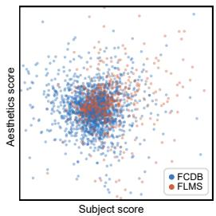

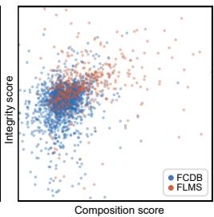  
Figure 7: Dataset Bias from FCDB and FLMS datasets. Each point is one crop selected by PhotoGuider, positioned by the contributions of two of the four photographic tokens. Normalized by the pooled standard deviation, the median-to-median displacement is 0.34 SD in the S-A plane and 0.47 SD in the C-I plane.

## Composition: how the subject is placed. With

the subject in frame, a photographer checks placement against a textbook vocabulary: the rule of thirds, symmetry, triangular structure, balance of visual weight, negative space and shot scale. Three signals are complementary. Geometry encodes the rules directly (thirds align, sym v diff, sym diag diff, tri top apex, tri bot apex, visual weight x/y, ca dist, area ratio, log aspect diff). SAM thirds alignment measures how segmented objects align with the rule-of-thirds structure (sam thirds q mean/max, sam thirds vs center). CLIP multi-prompt similarity (clip sim {pro, balanced, leading, thirds, symmetric, negspace, centered, dynamic}, clip max sim) provides a computable linguistic anchor for the vocabulary itself: eight prompts are eight rules stated in natural language, and CLIP’s image-text alignment turns ”does this look like a leading-lines composition” into a measurable number.

Integrity: what the frame cut off. Last comes the reflex check of a professional: the crop must not sever a hand or a head, must not leave a mutilated object, and must keep the depth layering clean. This check evaluates object boundaries throughout the frame, independently of subject identity. That is SAM’s most direct use, and all 20 dimensions of this token come from it. Encoder-side embedding statistics (sam emb norm/var/kurt, sam cand norm mean/max/std, sam cand to outside ratio, sam image total norm) characterize how much information the crop holds and how it contrasts with what lies outside; sam cos to image is a continuous measure of shot scale, from close-up to full view. On the decoder side we count the objects (sam obj count in cand, sam obj top1 share, sam obj top3 share, sam obj area cv, sam dominant ratio), check whether each remains cleanly definable (sam mask q mean/std/margin, whose quality and boundary margin drop when a cropping line severs an object), and read the scene’s depth layering (sam h area cv, sam h iou top12, sam h cand match max).

Table 4: The eight candidate sources of the aspect ratio-aware pool. Every source is deduplicated by non-maximum suppression at IoU 0.95.
<table><tr><td>Source</td><td>Anchor</td><td>Construction</td></tr><tr><td>Base grid</td><td>image geometry</td><td>center-shift grid, small-area grid and seeded random boxes, each re-aspected to the target ratio</td></tr><tr><td>Subject anchors</td><td>InSPyReNet subject mask</td><td>mask centroid, blobs and bounding box × seven medium areas</td></tr><tr><td>Saliency peaks</td><td>DINOv3 saliency map</td><td>top-five peaks × seven medium areas</td></tr><tr><td>Multi-scale</td><td>the three sources above</td><td>top-20 by saliency coverage × scale factors {0.7, 0.85, 1.15, 1.3}</td></tr><tr><td>Diagonal</td><td>subject mask and saliency</td><td>frames placing the subject on an image diagonal</td></tr><tr><td>Negative space</td><td>subject mask and saliency</td><td>frames leaving open space opposite the subject</td></tr><tr><td>Leading line</td><td>saliency structure</td><td>frames aligned with a dominant linear structure</td></tr><tr><td>Boundary</td><td>subject mask</td><td>frames set by the subject&#x27;s extent with a margin</td></tr></table>

Aesthetics: whether it is pleasing. The Aesthetics token measures visual appeal using two complementary aesthetic priors. The LAION aesthetic head (laion score, laion pi minmax) represents a crowd’s sense that an image is appealing, and FGAesQ (fgaesq score) represents a fine-grained expert judgment of where the appeal lies; colour saturation (color sat mean) supplements them. The last group measures the subject-to-background separation in colour and tone that SAM’s parse makes computable (sam fg bg sat diff, sam fg bg val diff, sam fg bg lab dist, sam fg var). What a photographer calls the subject ”popping out” is, concretely, a contrast in saturation, value and Lab colour between a foreground object and its background, and computing it requires that object to have been separated first.

Token Assessments. The ranker operates as a gradient-boosted tree model explained post hoc. For a given frame, TreeSHAP Lundberg et al. (2020) decomposes each model’s raw output into feature attributions. These attributions pass through the same per-image normalization and model-output weighting as the final score, giving the approximate decomposition

$$
q \approx \sum _ { g \in \{ \mathrm { S } , \mathrm { C } , \mathrm { A } , \mathrm { I } \} } \Phi _ { g } + \mathrm { c o n s t } , \qquad \Phi _ { g } = \sum _ { j \in \mathcal { F } _ { g } } \phi _ { j } ,\tag{3}
$$

where $\phi _ { j }$ is the weighted attribution of feature $j$ and $\mathcal { F } _ { g }$ is the disjoint index set of token $g .$ The attribution decomposition is exact for three uncalibrated heads carrying a combined weight of 0.88. For the calibrated head, which carries the remaining weight of 0.12, attributions are propagated through the isotonic mapping using a secant approximation. Token attributions aggregate the feature-level shares of cross-token interactions, subject to this approximation. Finally, each $\Phi _ { g }$ is mapped to a percentile rank against the training reference distribution and reported independently, without any additive assumption.

Candidate Generation. With a target ratio, about 300 candidates come from eight sources: a base geometric grid re-aspected to the ratio; anchors on the subject mask and on the top saliency peaks, each crossed with seven medium areas; a multi-scale pass over the best-covering candidates; and four composition-principle generators (diagonal, negative space, leading line, boundary). Without a ratio, a grid of seven scales and 36 positions is laid over each of eight ratios, the seven standard ratios 16:9, 3:2, 4:3, 1:1, 3:4, 2:3 and 9:16 plus the source image’s own ratio, deduplicated within 2%. The eight sources are described in Table.4.

## A.2 GATED REFINEMENT

The refinement stage applies gated spatial adjustments to the selected frame $c ^ { * }$ to obtain b. Each adjustment is evaluated by a LightGBM model that predicts its IoU gain on the current image. The adjustment is applied when the predicted gain exceeds the corresponding threshold.

Recenter. The gate chooses where to place the frame center. Two candidate targets are available: $t _ { \mathrm { t h i r d s } } ,$ the saliency centroid softly aligned to the nearest rule-of-thirds point, and $t _ { \mathrm { c a m } } ,$ the centroid of CLIP’s compositional attention. The gate predicts $\hat { m } .$ , the IoU advantage of the CLIP target over the thirds target, and turns it into a mixing weight $w = \mathrm { c l i p } ( \hat { m } / T _ { g } , 0 , 1 )$ , where $T _ { g }$ is a fixed scale constant. The target is the mix $t = ( 1 - w ) t _ { \mathrm { t h i r d s } } + w t _ { \mathrm { c a m } }$ , and the center x of the frame moves a fixed fraction $\beta$ of the way toward it.

Expand. Four independent gates k ∈ {cov, incl, ∆aes, ∆gold} each predict the IoU gain ${ \hat { g } } _ { k } ( s )$ of enlarging the frame by a factor $s \in S$ about its centre, at fixed aspect ratio. They read four different signals: the coverage gate reads how much of the subject’s saliency the current frame captures; the inclination gate reads $\mathrm { C L I P } ^ { \prime } \mathrm { s }$ relative response to wide versus tight composition prompts; the $\Delta$ -aesthetics gate reads the change of the LAION and FGAesQ scores between the current frame and the enlarged one; the ∆-golden gate reads the change in the subject’s distance to the nearest golden-section point. A gate fires when maxs $\hat { g } _ { k } ( s ) > \tau _ { e }$ , and the frame is enlarged to the factor with the largest predicted gain among the gates that fired. The two $\Delta$ gates use score changes across scales. In our measurements, static scores provide little signal for expansion. We hypothesize that using score changes contributes to cross-dataset transfer. Each of the four gates evaluates a distinct signal and applies its own expansion criterion.

Shrink. When no expand gate fires, one fallback gate reads the shot-scale measure (the cosine between the frame’s SAM embedding and the whole image’s) and, above its own threshold $\tau _ { s } .$ tightens by a factor $s \in S _ { \mathrm { s h r } }$ a frame that looks too much like the whole image.

## A.3 MLLM AS CONSULTANT

In the final stage, we incorporate Venus Du et al. (2026) as an MLLM consultant to propose candi date boxes, restricting it from directly scoring or making final decisions in our pipeline.

Self-Consistency. A primary prompt is decoded 1 + m times (one greedy decoding alongside m temperature-sampled outputs with fixed seeds), where the coordinate-wise median yields the core opinion $\tilde { v } _ { \mathrm { c } } .$ . To build a broader opinion v˜ , we compute the median across the union of responses from M paraphrased prompts (decoded greedily with whole-image predictions filtered out). The coordinate-wise median aggregates the decoded box predictions.

Twin Candidates. For each shortlist candidate $c _ { i }$ that aligns with the consultant, defined by $\mathrm { I o U } ( c _ { i } , \tilde { v } _ { \mathrm { c } } ) \geq 0 . 5$ , we construct a twin candidate $c _ { i } ^ { t } .$ . Its center and area are shifted toward $\tilde { v } _ { \mathrm { c } }$ within fixed bounds at a constant ratio, followed by a complete recomputation of all 60 features. The frozen ranker then evaluates both the original and twin candidates on the merged pool, switching to the twin only when a substantial margin is achieved.

Bounded Concession. Prior to final delivery, if the refined box b agrees with the broader opinion $( \mathrm { I o U } ( b , \tilde { v } _ { \mathrm { f } } ) \ge \tau )$ , the system interpolates the center linearly and the area geometrically:

$$
\begin{array} { r } { \mathbf { x } _ { \hat { b } } = ( 1 - \lambda _ { c } ) \mathbf { x } _ { b } + \lambda _ { c } \mathbf { x } _ { \tilde { v } _ { \mathrm { f } } } , \quad A _ { \hat { b } } = A _ { b } ^ { 1 - \lambda _ { a } } A _ { \tilde { v } _ { \mathrm { f } } } ^ { \lambda _ { a } } . } \end{array}\tag{4}
$$

The log aspect ratio is adjusted via $\lambda _ { r } \colon$ setting $\lambda _ { r } = 0$ when a fixed target ratio is specified (preserving the output ratio), or $\lambda _ { r } = 1$ when unconstrained, thereby adopting the consultant’s aspect ratio opinion to refine the discrete enumeration from the main paper’s “Candidate generation and shortlisting” section. Below the threshold $\tau ,$ the consultant is considered to be proposing a distinct photographic composition, and no adjustments are adopted. All hyper-parameters are fitted on the training split under a bounded-regression constraint without per-image learned decisions.

## A.4 EXPLANATION

Measurements as Shared Foundation. Our explainer cites the quantitative features used by the ranker. Token assessments and feature attribution lists originate from TreeSHAP Lundberg & Lee (2017); Lundberg et al. (2020) decomposition of the ranker’s output, while geometric assertions are computed from the same underlying vision features.

Training via Distillation Filtering. We adopt Qwen2.5-VL-7B Bai et al. (2025) as the explainer MLLM, using the same base model as a teacher to draft explanations for training images. To build a high-quality dataset, drafts must pass four distillation filters: a Silence Filter discarding geometric claims without valid subject masks, a Consistency Filter rejecting values or directions conflicting with measurements, an Evidence Filter enforcing minimum feature citations beyond raw geometry, and a Wording Filter eliminating banned phrasing or incorrect languages. The student model learns exclusively from passed drafts via QLoRA Dettmers et al. (2023); Hu et al. (2022).

Table 5: Module-level ablation.
<table><tr><td rowspan="2">Configuration</td><td colspan="2">FCDB</td><td colspan="2">FLMS</td></tr><tr><td>BDE↓</td><td>mIoU↑</td><td>BDE↓</td><td>mIoU↑</td></tr><tr><td colspan="5">Refinement variants</td></tr><tr><td>No refinement</td><td>0.060</td><td>0.754</td><td>0.044</td><td>0.820</td></tr><tr><td>Recenter only</td><td>0.059</td><td>0.758</td><td>0.043</td><td>0.824</td></tr><tr><td>No recenter</td><td>0.060</td><td>0.755</td><td>0.042</td><td>0.832</td></tr><tr><td>Ungated expansion</td><td>0.066</td><td>0.738</td><td>0.042</td><td>0.834</td></tr><tr><td>Recenter target fixed to thirds</td><td>0.059</td><td>0.758</td><td>0.041</td><td>0.834</td></tr><tr><td>Recenter target fixed to CLIP</td><td>0.060</td><td>0.750</td><td>0.042</td><td>0.832</td></tr><tr><td>PhotoGuider (full refinement)</td><td>0.058</td><td>0.759</td><td>0.041</td><td>0.835</td></tr></table>

Inference Prompt Construction. At inference, the explainer receives the input image, the final cropped frame, and a structured prompt comprising the four token assessments, frame geometry, and key feature attributions mapped to human-interpretable photographic terms. Anchor sentences derived directly from physical measurements are appended to the prompt to constrain the corresponding statements; they do not guarantee the correctness of the entire generated explanation.

Contradiction rate. We measure the consistency between generated statements and the supplied measurements. We report the contradiction rate detected by a rule-based checker. Anchor sentences constrain the corresponding statements, while the remaining sentences are generated freely. Appendix A.7 reports a complementary human preference study on composition explanations.

## A.5 IMPLEMENTATION DETAILS

View scorer. The view scorer is implemented as a hierarchical additive network operating over the 60 standardized features. Each feature is processed by an individual subnetwork $( 1 \stackrel { - } {  } 3 2 \stackrel { - } {  } 1 6 \stackrel { - } {  } 1$ with ELU activation), supplemented by pair subnetworks $( 2  1 6  8  1 )$ for 20 selected feature pairs. To ensure exact score additive decomposition, each feature output is scaled by a learned token weight, with pairwise terms split equally between the tokens of their constituent features. The architecture contains $4 . 0 \times 1 0 ^ { 4 }$ parameters and is trained on the GAICD training set using a withinimage pairwise ranking loss, applied to crop pairs from the same image with MOS differences of at least 0.1. Optimization employs Adam (learning rate $1 0 ^ { - 3 }$ , weight decay $1 0 ^ { - 5 }$ , pair batch size 8,192) with early stopping based on validation SRCC (patience 15), where the optimal checkpoint is selected at epoch 60.

Ranker. Training uses a learning rate of 0.05. The model combines three component scores $q _ { A }$ (0.6 regression / 0.4 ranking), qB (0.55 / 0.45), and $q _ { C } ~ ( 0 . 6 / 0 . 4 )$ with isotonic calibration into a final score $q = 0 . 4 q _ { A } + 0 . 4 q _ { B } + 0 . 2 q _ { C }$ , totaling approximately $2 . 1 \times 1 0 ^ { 4 }$ parameters.

Refinement. Recentering operates with $\beta = 0 . 2 0$ , rule-of-thirds weight 0.4, and gate margin $T _ { g } =$ 0.05. Four expansion gates and a single shrink gate are LightGBM regressors trained on IoU gain across scale candidate sets $S = \{ 1 . 1 , 1 . 3 , 1 . 5 , 2 . 0 \}$ and $\{ 0 . 6 \dot { , } 0 . 7 , 0 . 8 , 0 . \dot { 9 } \} \approx 4 . 2 { \times } 1 0 ^ { 4 }$ parameters). Refinement thresholds $\left( \tau _ { e } , \tau _ { s } \right)$ are set to (0.03, 0.05) given a target aspect ratio, and $\left( - 0 . 0 2 , 0 . 0 8 \right)$ otherwise. The complete decision layer contains roughly $6 . 3 \times 1 0 ^ { 4 }$ parameters, executing within milliseconds on a CPU.

Note that the free-form expansion threshold is −0.02: the gate’s gain estimates are conservative on free-form pools, and the training-split grid search selected a threshold that admits expansions with slightly negative predicted gain.

Consultant. Venus is quantized in 4-bit NF4. We run 1+m decodes $\left( m = 5 , \mathrm { t o p } \mathrm { - } p 0 . 9 \right)$ , temperature 1.0, fixed seeds) alongside M = 4 paraphrases, producing 10 decodes per image. Twin candidates require $\mathrm { I o U } \geq 0 . 5$ . Final blending parameters $\left( \lambda _ { c } , \lambda _ { a } , \tau \right)$ are set to (0.4, 0.2, 0.5) with a target ratio, and (0.7, 0.3, 0.45) without (adopting the consultant aspect ratio). All hyperparameters are determined via grid search on the training split without consulting FCDB or FLMS test sets.

Table 6: Choices per system in the blind three-way study.
<table><tr><td>Image</td><td>PhotoGuider</td><td>Venus</td><td>ArtiMuse</td></tr><tr><td>fcdb_16002047337</td><td>20</td><td>16</td><td>14</td></tr><tr><td>fcdb_9349007347</td><td>20</td><td>15</td><td>15</td></tr><tr><td>flms_15659590</td><td>20</td><td>19</td><td>11</td></tr><tr><td>flms_799562644</td><td>21</td><td>15</td><td>14</td></tr><tr><td>flms_1588688990</td><td>19</td><td>17</td><td>14</td></tr><tr><td>All (250)</td><td>100 (40.0%)</td><td>82 (32.8%)</td><td>68 (27.2%)</td></tr></table>

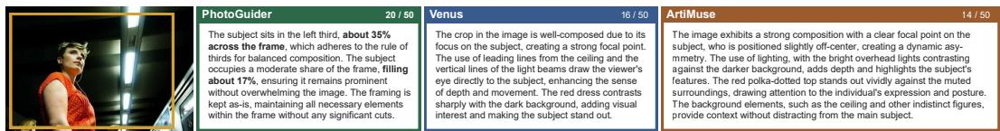  
Figure 8: An example from the human preference study on composition explanations. PhotoGuider, Venus, and ArtiMuse explain the same crop. The counts above each explanation indicate how many of the 50 participants selected it as best explaining the crop’s compositional aesthetics. Method names are shown for reference and were concealed during the study.

Explainer. We fine-tune Qwen2.5-VL-7B-Instruct using QLoRA (r = 16, α = 32, dropout 0.05) applied to language-model linear layers while freezing the vision tower and aligner, yielding 40.4M trainable parameters (0.8% of total). Training uses NF4 base with bf16 compute, learning rate $2 \times 1 0 ^ { - 4 }$ with cosine decay, gradient accumulation step 32, and sequence length 3,072.

## A.6 MODULE ABLATION

Table 5 isolates the performance contribution of each refinement stage. Compared with no refinement, full refinement improves mIoU from 0.754 to 0.759 on FCDB and from 0.820 to 0.835 on FLMS, while reducing BDE on both benchmarks.

## A.7 ANALYSIS OF USER STUDY

Composition Explanations. Five images were randomly selected: fcdb 16002047337, fcdb 9349007347, flms 15659590, flms 799562644, and flms 1588688990. For each image, all three systems explain the same PhotoGuider crop, holding the visual input fixed across the three explanations. The study followed a double-blind design. Table 6 gives the overall and per-image counts. PhotoGuider’s explanation received 100 of 250 choices (40.0%), Venus 82 (32.8%), and ArtiMuse 68 (27.2%). PhotoGuider’s observed choice share exceeded those of Venus and ArtiMuse by 7.2 and 12.8 percentage points, respectively.

The result supports that: when users judge how well a text explains the composition of a given crop, an explanation whose content is anchored in measured compositional quantities is chosen at least as often as the explanation of a dedicated aesthetic MLLM and more often than ArtiMuse’s. The texts themselves show why the preference splits. ArtiMuse frequently targets irrelevant visual elements rather than composition itself. An obvious example is found in Image 1 (Fig. 8), where it describes the plain red top as “polka-dotted” and mistakenly cites this as justification for a favorable compositional score. Venus stays on composition but in a template: four of five passages open with “The crop in the image is well-composed due to its focus on”, all are wholly positive, and none gives a position or size. PhotoGuider states where the subject sits (“in the left third, about 35% across the frame”), how much of the frame it fills (“about 17%”), and whether anything is cut off.

360° Panorama. The 100 scenes were selected from the Poly Haven HDRI library with 30 urban, 25 indoor, 25 nature, 15 golden hour, and 5 night scenes. User preferences for 360° framings demonstrate strong statistical significance. A Friedman test across the 100 evaluation scenes rejects equal mean ranks $( \chi ^ { 2 } = 4 3 . 4 , p < 1 0 ^ { - 9 } )$ , while scene-level Wilcoxon signed-rank tests confirm significant preference for our framings over Venus $( p = 1 . 5 \times 1 0 ^ { - 8 } )$ and CACNet $( p = 1 . 6 \times$ $1 \breve { 0 ^ { - 1 2 } } )$ , with identical conclusions holding at the participant level $( p < 1 0 ^ { - 1 6 } )$ . Furthermore, sceneresampled bootstrapping estimates our rank-1 preference share at 53.2% (95% CI [48.8%, 57.6%]), substantially exceeding the chance level of 33.3% across all resamples.

## REPRODUCIBILITY STATEMENT

Code and assets. Inference code for photographs and panoramas, the trained decision layer, and the explainer adapter are released under Apache-2.0. Entry points are one script per input type with --mode fast|full and --explain. Released assets comprise the feature caches, the QLoRA adapter (SHA-256 recorded in the repository), and the panoramic demo scenes.

Determinism. All models train with fixed seeds; train.py --verify retrains the 13 decisionlayer models and confirms byte-identical files. reproduce.py recomputes the four results of Table1 from the released caches within tolerance $5 \times 1 0 ^ { - 4 }$