# PIXELBENCH: CAN LLMS UNDERSTAND AND GENERATE IMAGES PIXEL BY PIXEL?

Haoquan Zhang1 Feiyang Liu2 Juanxi Tian3 Wanhua Li3 Haodong Duan1,† Weiyang Liu1 1CUHK 2SCUT 3NTU Singapore †Corresponding author Project Page

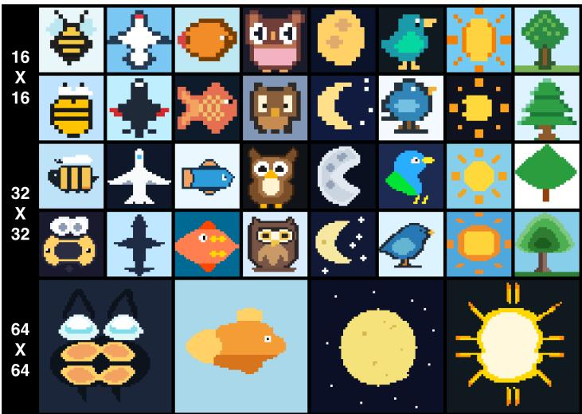

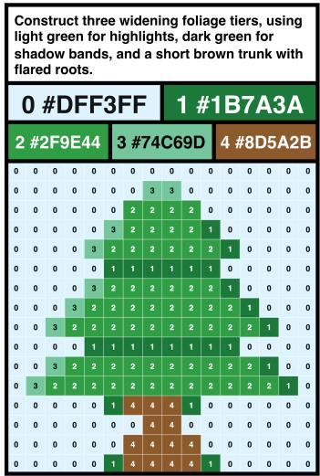  
Figure 1: Zero-shot text-to-pixel generation by large language models. Left: pixel images generated at different resolutions. Right: our generation protocol, in which the model defines a color palette and outputs a numerical grid whose entries index the palette colors. See Figure 3 for image-to-pixel generation.

## ABSTRACT

Large language models (LLMs) can generate visual assets through text-based formats such as SVG and CAD, but these symbolic representations describe images using high-level primitives rather than explicit raster values. We ask whether LLMs can instead generate pixel images directly through their existing vocabulary, without a learned image tokenizer or decoder. We introduce PixelBench, a benchmark for text-to-pixel (T2P) and image-to-pixel (I2P) generation across multiple resolutions, together with a complementary pixel-understanding evaluation. Models generate an RGB color palette followed by a grid of indices specifying the palette color of each output pixel. In T2P, the strongest models produce recognizable images directly from text. In I2P, the strongest models outperform palette-matched downsampling and specialized pixelization algorithms at low resolutions. Pixel-understanding performance correlates strongly with generation performance. A resolution-scaling study shows that pixel-generation performance often improves initially before declining at high resolutions. Finally, we introduce Pixel Reconstruction Tuning (PRT), which augments visual instruction tuning with caption-palette-grid trajectories. We post-train Molmo2-4B from its pretraining checkpoint by mixing general instruction data with our curated PRT data, improving performance across 16 visual-centric benchmarks, indicating that explicit pixel reconstruction can provide useful auxiliary supervision.

## 1 INTRODUCTION

Large language models (LLMs) were originally developed to predict the next token in naturallanguage sequences. The same autoregressive training paradigm has since produced strong codegeneration capabilities. Some generated code, including SVG code and CAD programs, can be rendered into images, providing an interface for probing how LLMs express visual information (Sharma et al., 2024; Qiu et al., 2025; Chen et al., 2026b; Rodriguez et al., 2025; Xing et al., 2025; Khan et al., 2024). However, these formats describe images using semantically meaningful, highlevel primitives and are therefore one step away from actual visual appearance: a renderer expands each primitive into many pixels. By contrast, RGB rasters provide a more direct and ubiquitous representation of digital images, with each spatial location in a two-dimensional grid storing a color value. Most modern image generators map learned visual tokens or latent representations to pixels through dedicated decoders (Chameleon Team, 2024; Wang et al., 2026). Prior work has also trained specialized autoregressive image models to generate images directly in raster space (van den Oord et al., 2016a;b; Parmar et al., 2018; Chen et al., 2020). These studies demonstrate the feasibility of direct pixel generation, but rely on models specifically designed and trained for image modeling. To better investigate pixel-based visual understanding and generation, we ask the following question:

## Can LLMs directly generate and understand visual content pixel by pixel?

To address this research question, we introduce PixelBench, a benchmark for evaluating LLMs on direct pixel generation and understanding. PixelBench uses a palette-indexed raster representation: the model first defines a palette of up to eight RGB colors and then generates a grid of palette indices, with each grid position specifying the color of one pixel. This interface needs no learned tokenizer, image decoder, or architectural change. PixelBench evaluates three tasks: text-to-pixel generation (T2P), where a model generates a recognizable pixel image from an object label, imageto-pixel generation (I2P), where the model reconstructs a given image in pixel format, and pixel understanding, where the model identifies the underlying concept from a textual palette-and-grid representation generated by either an algorithmic or a model-based pixel oracle.

Our evaluation shows that frontier LLMs already exhibit substantial pixel-generation capabilities, with leading models producing recognizable T2P outputs and competitive I2P reconstructions. Their behavior, however, depends strongly on target resolution. For many models, both visual quality and quantitative performance peak at an intermediate resolution, with 64 × 64 often performing worse than $3 2 \times 3 2$ , while GPT-6 Astra exhibits notably better robustness. We therefore conduct a finegrained resolution-scaling study and find that, except for Astra’s consistently strong performance, most evaluated models initially improve but eventually decline as resolution increases. Viewing resolution as a measure of visual abstraction, these model-specific performance peaks suggest that different models are most effective at different levels of abstraction. Pixel understanding exhibits a similar ranking across models and correlates strongly with generation performance, suggesting that the connection between visual understanding and generation persists for pixel-based interface.

The observed connection between pixel generation and visual understanding raises a natural question of whether reconstructing an input image can serve as a training objective to improve a model’s visual understanding. Reconstruction Alignment (RecA) (Xie et al., 2026) shows that reconstructionaligned visual representations can improve image generation, but whether reconstruction can also enhance visual understanding remains underexplored. Motivated by this, we propose Pixel Reconstruction Tuning (PRT), which augments post-training with trajectories that describe an image, explain an automatically constructed color palette, and reconstruct the image as a pixel grid. In a controlled experiment with Molmo2-4B, we start from its pretraining checkpoint and post-train it on 500k LLaVA-OneVision-1.5 instructions mixed with PRT examples. Incorporating PRT data improves average performance across 16 visual-centric benchmarks. Ablations varying the number of PRT examples from 1k to 8k show consistent improvements across all tested data scales. A com plementary study with Qwen3-VL further shows that Pixel data can regularize post-training when incorporated into a general instruction mixture. Our contributions are summarized below:

• A unified interface for evaluating pixel capabilities. We introduce PixelBench, a shared textbased pixel interface for evaluating frontier LLMs on both pixel generation and understanding.

• Capability limits at increasing resolutions. We characterize model-specific performance peaks and failure modes. GPT-6 Astra remains robust as resolution increases, while other evaluated models generally improve and then decline.

• Pixels as training supervision. We propose Pixel Reconstruction Tuning (PRT), which uses pixel reconstruction as a post-training objective. Starting from the Molmo2-4B pretraining checkpoint, incorporating PRT data into general instruction tuning consistently improves performance.

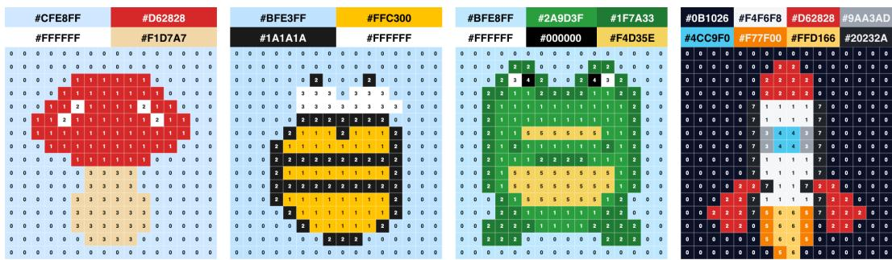  
Figure 2: Examples of palette-indexed pixel representations. Each example pairs a compact color palette (top) with a 16 × 16 grid of palette indices (bottom). The mushroom, bee, frog, and rocket remain recognizable despite the low resolution and restricted palettes.

## 2 PIXELBENCH: EVALUATING PIXEL UNDERSTANDING AND GENERATION

## 2.1 PIXELS AS A VISUAL REPRESENTATION

Pixel art is a compact visual output format. Its restricted palette and raster structure can preserve recognizable colors and shapes while limiting the number of symbols that a model must generate. Related representations are commonly used in icons, pictograms, low-resolution displays, and digital graphics. In this work, pixel art refers specifically to a palette-indexed raster with two components: a palette of RGB colors and an S × S grid of palette indices. Each grid entry selects the color of one pixel. The representation is human-interpretable and deterministic to render, and can be expressed using the model’s existing text vocabulary. We serialize the palette and index grid as JSON. The palette field contains two to eight opaque RGB colors in #RRGGBB format, and the pixels field contains the S rows of palette indices. Rendering maps each index to its corresponding RGB value. Figure 2 shows rendered examples and their palettes.

## 2.2 BENCHMARK INTRODUCTION AND DESIGN

We introduce PixelBench to probe how much image-generation capability a language model can express through its native token interface. Unlike SVG and CAD, which describe images through high-level geometric primitives, our palette-indexed grids specify raster values directly: each generated grid entry corresponds to one rendered pixel, and rendering requires only a deterministic palette lookup. PixelBench therefore evaluates visual generation through a representation closer to the native form of raster images, without relying on a learned image tokenizer or decoder.

Section 2.2 defines the generation and understanding tasks, models, baselines, and protocol; Section 2.3 specifies the metrics; and Section 2.4 presents the main results. We find that current models already exhibit substantial pixel-image generation ability through their text interface, while their pixel-understanding performance closely tracks their generation performance. Generation quality does not consistently improve with output resolution, as further analyzed in Section 3.

Tasks and datasets. In text-to-pixel generation (T2P), a model maps an English object label to a recognizable icon without a reference image. We use 100 concrete concepts spanning five categories (Appendix H). In image-to-pixel generation (I2P), a vision encoder supplies a natural image and the model reconstructs it while preserving subject identity, pose, composition, and dominant colors. We sample one validation image from each of 100 ImageNet-1K classes (Deng et al., 2009) and centercrop it to 256 × 256 (Appendix I); the category is withheld. Every item in both generation tasks is evaluated at 162, 322, and 642, yielding 300 instances per task and model. In pixel understanding, a model receives only the textual serialization of an RGB palette and index grid and selects the concept from ten candidates. Inputs come from deterministic PIA-reduced reconstructions and GPT-6 Astra I2P generations (Astra-I2P), each with 100 questions at each resolution.

Models and baselines. We evaluate Gemini 3.6 Flash (Google DeepMind, 2026b), GPT-5.6 Sol (OpenAI, 2026a), GPT-6 Astra (OpenAI, 2026b), Claude Opus 5 (Anthropic, 2026), Seed-2.1 Pro (ByteDance Seed, 2026), and Kimi K3 (Kimi Team, 2026) on both generation tasks and pixel understanding in a zero-shot setting. DeepSeek V4 Pro (DeepSeek-AI, 2026) is included as a supplementary model for T2P and pixel understanding, but not for I2P generation. Detailed task-specific inference settings, including temperature, reasoning configuration, output-token limits, and samples per item, are reported in Appendix E. For I2P, we additionally compare against three representative palette-matched algorithms: nearest-neighbor sampling followed by median-cut quantization (Heckbert, 1982); SSIM-optimal downscaling followed by median cut (Oztireli & Gross¨ , 2015); and a reduced Pixelated Image Abstraction pipeline (Gerstner et al., 2012) that combines SLIC regions (Achanta et al., 2012) with an eight-color weighted k-means palette. The complete ten-method comparison and implementation details are in Appendix L.

Generation protocol. Both generation tasks use the palette-indexed representation in Figure 2: two to eight opaque RGB colors and an exactly sized index grid, with task-specific prompts. Successfully returned outputs with invalid JSON, palette references, or grid sizes receive zero; rate limits and token-limit truncations are retried, raising the limit when needed. Pixel understanding directly presents the serialized grid and ten choices, with no rendered image. Prompts are in Appendix G.

## 2.3 EVALUATION METRICS

Text-to-Pixel metrics. Using the paired SigLIP-SO400M text and vision encoders (Zhai et al., 2023), we retrieve text candidates represented as “a pixel art icon depicting {label}.” The main table reports 500-way Top-1 and a complementary VLM-as-judge score from Gemini 3.5 Flash (Google DeepMind, 2026a), whose 0-100 rubric prompt is in Appendix G.2. The 100-way Top-1 and MRR diagnostics are in Appendix K; retrieval definitions and vocabulary are in Appendices F and J.

Image-to-Pixel metrics. We report 100-way Top-1 by embedding each generated output and the 100 candidate source images with the same SigLIP vision encoder. We additionally compute paired cosine similarity using pooled SigLIP features and DINOv2-Large CLS features (Oquab et al., 2024), which measure semantic and appearance-level similarity to the source, respectively. For both T2P and I2P, invalid outputs count as retrieval misses or zero similarity. We also report the Valid and Flat rates. Valid is the percentage of outputs with well-formed JSON, valid palette references, and the required grid size; Flat is the percentage of outputs that are valid but render to a single color.

Pixel-understanding metric. We report 10-way recognition accuracy from the serialized paletteand-grid inputs. Each resolution contains 100 questions, so each source average covers 300 questions and the overall average covers all 600. Random-choice accuracy is 10%.

## 2.4 EXPERIMENTAL RESULTS

Text-to-Pixel Generation. Table 1 summarizes the main results for T2P generation. GPT-6 Astra leads throughout: its 500- way Top-1 rises from 87% to 94% across resolutions and its Agg. score reaches 90.8. GPT-5.6 Sol and Claude Opus 5 follow at 81.0 and 79.4, with Kimi K3 at 76.0. The stricter judge spans 90.66- 51.45 overall and leaves Astra 14.01 points ahead of Sol, provid-

Table 1: Text-to-Pixel generation results. We report 500-way Top-1 retrieval accuracy and a VLM-as-judge score at 162, 322, and 642. The Aggregated score is the mean of these six values. Valid and Flat report output validity and single-color generation rates. Gemini 3.5 Flash serves as the judge; 100-way Top-1 and MRR are in the appendix. Bold and underline mark the top two results per column. Agg. abbreviates Aggregated score.
<table><tr><td></td><td></td><td></td><td colspan="4">500-way Top-1</td><td colspan="4">VLM Judge</td><td></td></tr><tr><td>Model</td><td>Valid</td><td>Flat</td><td>16</td><td>32</td><td>64</td><td>Avg</td><td>16</td><td>32</td><td>64</td><td>Avg</td><td>Agg.</td></tr><tr><td>GPT-6 Astra</td><td>100.0</td><td>0.0</td><td>87</td><td>92</td><td>94</td><td>91.0</td><td>90.8</td><td>91.6</td><td>89.7</td><td>90.7</td><td>90.8</td></tr><tr><td>Claude Opus 5</td><td>100.0</td><td>0.0</td><td>81</td><td>87</td><td>89</td><td>85.7</td><td>75.1</td><td>74.1</td><td>70.1</td><td>73.1</td><td>79.4</td></tr><tr><td>GPT-5.6 Sol</td><td>100.0</td><td>0.0</td><td>84</td><td>89</td><td>83</td><td>85.3</td><td>78.1</td><td>78.9</td><td>73.0</td><td>76.7</td><td>81.0</td></tr><tr><td>Kimi K3</td><td>99.7</td><td>0.0</td><td>81</td><td>87</td><td>77</td><td>81.7</td><td>74.5</td><td>74.7</td><td>61.5</td><td>70.3</td><td>76.0</td></tr><tr><td>Gemini 3.6 Flash</td><td>100.0</td><td>1.3</td><td>87</td><td>78</td><td>72</td><td>79.0</td><td>77.8</td><td>71.2</td><td>60.4</td><td>69.8</td><td>74.4</td></tr><tr><td>Seed-2.1 Pro</td><td>100.0</td><td>0.0</td><td>70</td><td>72</td><td>74</td><td>72.0</td><td>68.6</td><td>64.6</td><td>59.3</td><td>64.2</td><td>68.1</td></tr><tr><td>DeepSeek V4 Pro</td><td>98.7</td><td>1.3</td><td>49</td><td>59</td><td>51</td><td>53.0</td><td>53.7</td><td>55.0</td><td>45.7</td><td>51.5</td><td>52.2</td></tr></table>

ing clearer discrimination while preserving the same leader. Figure 3 and Appendix C further show that model-generated pixelizations can preserve semantic structure; together with Astra’s leading I2P Aggregated score, this motivates Astra-I2P as one understanding oracle. Full 100-way Top-1 and MRR results are in Appendix K. Most models decline from $3 2 ^ { 2 }$ to 642, motivating Section 3.

Image-to-Pixel Generation. Table 2 compares six multimodal language models with three palettematched algorithms. Five models are fully valid; Kimi K3 reaches 96.3%, and only Gemini 3.6 Flash produces flat fills (1.0%). GPT-5.6 Sol leads model Top-1 Avg (56.0%), while GPT-6 Astra leads model SigLIP (.654) and DINO (.175) averages. The best model exceeds all algorithms at $1 6 ^ { 2 }$ and 322, but algorithms lead at 642: PIA reaches 78% Top-1 and .697 SigLIP, and SSIM-optimized pixelization reaches .543 DINO. Four models also decline from $3 2 ^ { 2 }$ to 642. GPT-6 Astra achieves the highest Aggregated score (80.45), ahead of PIA (77.50). See Appendix L for all algorithms.

Table 2: Image-to-Pixel results. Valid and Flat are percentages over 300 model–resolution items for models and 100 images per resolution for algorithms. Top-1 uses the 100 source images; SigLIP and DINO are paired cosines, and invalid generations score zero. Agg. denotes the Aggregated score: the mean of the min–max-normalized Top-1, SigLIP, and DINO average columns. Colors are normalized within each metric family; bold and underline mark the top two results per column.
<table><tr><td></td><td></td><td></td><td colspan="4">100-way Top-1</td><td colspan="4">SigLIP cosine</td><td colspan="4">DINO cosine</td><td></td></tr><tr><td>Model / method</td><td>Valid</td><td>Flat</td><td>16</td><td>32</td><td>64</td><td>Avg</td><td>16</td><td>32</td><td>64</td><td>Avg</td><td>16</td><td>32</td><td>64</td><td>Avg</td><td>Agg.</td></tr><tr><td colspan="10">Multimodal language models</td><td colspan="7"></td></tr><tr><td>GPT-6 Astra</td><td>100.0</td><td>0.0</td><td>18</td><td>50</td><td>76</td><td>48.0</td><td>.615</td><td>.652</td><td>.695</td><td>.654</td><td>.023</td><td>.177</td><td>.326</td><td>.175</td><td>80.45</td></tr><tr><td>GPT-5.6 Sol</td><td>100.0</td><td>0.0</td><td>44</td><td>61</td><td>63</td><td>56.0</td><td>.569</td><td>.597</td><td>.599</td><td>.588</td><td>.022</td><td>.112</td><td>.147</td><td>.094</td><td>57.27</td></tr><tr><td>Claude Opus 5</td><td>100.0</td><td>0.0</td><td>26</td><td>49</td><td>47</td><td>40.7</td><td>.535</td><td>.567</td><td>.582</td><td>.561</td><td>.021</td><td>.062</td><td>.098</td><td>.060</td><td>23.16</td></tr><tr><td>Kimi K3</td><td>96.3</td><td>0.0</td><td>34</td><td>46</td><td>30</td><td>36.7</td><td>.558</td><td>.562</td><td>.501</td><td>.541</td><td>.020</td><td>.064</td><td>.038</td><td>.040</td><td>8.48</td></tr><tr><td>Seed-2.1 Pro</td><td>100.0</td><td>0.0</td><td>33</td><td>42</td><td>30</td><td>35.0</td><td>.536</td><td>.553</td><td>.553</td><td>.547</td><td>.020</td><td>.056</td><td>.054</td><td>.043</td><td>8.52</td></tr><tr><td>Gemini 3.6 Flash</td><td>100.0</td><td>1.0</td><td>28</td><td>37</td><td>27</td><td>30.7</td><td>.535</td><td>.546</td><td>.536</td><td>.539</td><td>.018</td><td>.065</td><td>.070</td><td>.051</td><td>1.98</td></tr><tr><td colspan="10">Algorithmic baselines</td><td colspan="7"></td></tr><tr><td>Nearest + median cut</td><td>100.0</td><td>0.0</td><td>9</td><td>28</td><td>62</td><td>33.0</td><td>.523</td><td>.568</td><td>.665</td><td>.585</td><td>.012</td><td>.090</td><td>.480</td><td>.194</td><td>44.11</td></tr><tr><td>SSIM-opt. + median cut</td><td>100.0</td><td>0.0</td><td>9</td><td>34</td><td>75</td><td>39.3</td><td>.524</td><td>.579</td><td>.686</td><td>.596</td><td>.013</td><td>.119</td><td>.543</td><td>.225</td><td>61.19</td></tr><tr><td>PIA (reduced)</td><td>100.0</td><td>0.0</td><td>18</td><td>50</td><td>78</td><td>48.7</td><td>.546</td><td>.608</td><td>.697</td><td>.617</td><td>.014</td><td>.135</td><td>.490</td><td>.213</td><td>77.50</td></tr></table>

Pixel Understanding. We construct understanding inputs from two complementary sources. PIA is deterministic but not uniformly optimal. GPT-6 Astra achieves the highest I2P $\mathrm { A g \mathrm { - } }$ gregated score (80.45), ahead of PIA (77.50), and at $3 2 ^ { 2 }$ also leads PIA on SigLIP cosine (.652 vs. .608) and DINO cosine (.177 vs. .135). Figure 3 and Appendix C further show cases in which model-generated outputs match or surpass deterministic pixelization, so we also use Astra-I2P as a model-generated oracle.

Table 3 reports recognition accuracy for both sources. GPT-6 Astra leads overall accuracy (67.5%), followed by GPT-5.6 Sol (39.2%). On PIA alone it already leads by a wide margin (57.3% vs. 32.3% for GPT-5.6

Table 3: Pixel understanding. Each source contributes 100 ten-way questions per resolution. Overall averages 600 questions; each source average covers 300. Chance accuracy is 10%. Background color is globally normalized from 8 (white) to 85 (blue); bold and underline mark the best and second-best values in each column.
<table><tr><td></td><td></td><td colspan="4">PIA source</td><td colspan="4">Astra-I2P source</td></tr><tr><td>Model</td><td>Overall</td><td>16</td><td>32</td><td>64</td><td>Avg</td><td>16</td><td>32</td><td>64</td><td> $\mathbf { A v } \mathbf { g }$ </td></tr><tr><td>GPT-6 Astra</td><td>67.5</td><td>48</td><td>57</td><td>67</td><td>57.3</td><td>72</td><td>76</td><td>85</td><td>77.7</td></tr><tr><td>GPT-5.6 Sol</td><td>39.2</td><td>34</td><td>29</td><td>34</td><td>32.3</td><td>45</td><td>42</td><td>51</td><td>46.0</td></tr><tr><td>Claude Opus 5</td><td>35.3</td><td>22</td><td>26</td><td>24</td><td>24.0</td><td>40</td><td>50</td><td>50</td><td>46.7</td></tr><tr><td>Kimi K3</td><td>27.3</td><td>20</td><td>19</td><td>16</td><td>18.3</td><td>39</td><td>34</td><td>36</td><td>36.3</td></tr><tr><td>Gemini 3.6 Flash</td><td>21.8</td><td>21</td><td>11</td><td>17</td><td>16.3</td><td>28</td><td>24</td><td>30</td><td>27.3</td></tr><tr><td>Seed-2.1 Pro</td><td>16.0</td><td>15</td><td>14</td><td>12</td><td>13.7</td><td>20</td><td>15</td><td>20</td><td>18.3</td></tr><tr><td>DeepSeek V4 Pro</td><td>12.5</td><td>13</td><td>10</td><td>8</td><td>10.3</td><td>15</td><td>14</td><td>15</td><td>14.7</td></tr></table>

Table 4: Correlation summary. Pearson, Spearman, and Kendall correlations between pixel understanding and generation performance across models, using the T2P and I2P Aggregated scores as the respective generation summaries. The I2P comparison includes only models with available I2P generation results.
<table><tr><td>Comparison</td><td>n</td><td>Pearson r</td><td>Spearman ρ</td><td>Kendall τ</td></tr><tr><td>Understanding-T2P</td><td>7</td><td>.871</td><td>1.000</td><td>1.000</td></tr><tr><td>Understanding-I2P (w/o DeepSeek)</td><td>6</td><td>.930</td><td>.829</td><td>.733</td></tr></table>

Sol), and the two sources largely preserve the same ranking. Switching to Astra-I2P raises every model’s source average, with Claude Opus 5 gaining more than Astra $\left( + 2 2 . 7 \ \mathrm { v s . \ + 2 0 . 4 } \right)$ , so the model-based oracle helps broadly rather than rewarding Astra for recognizing its own generations. Overall accuracy correlates strongly with generation performance: the Pearson correlation is 0.871 for T2P and 0.930 for I2P. Table 4 also reports Spearman and Kendall coefficients, which support the same strong relationship. The T2P comparison uses all evaluated models, whereas the I2P comparison uses those with available generation results. Since the comparison covers only a small set of models, we treat these correlations as descriptive rather than general and use them to motivate the training experiment in Section 4.

## 3 RESOLUTION SCALING AND FAILURE MODES

The main results suggest that higher resolution is not uniformly better: for many models in both T2P and I2P, $6 4 ^ { 2 }$ underperforms $3 2 ^ { 2 ^ { - } }$ (Tables 1 and 2). To examine this behavior more closely, we sweep GPT-6 Astra, GPT-5.6 Sol, Claude Opus 5, and Gemini 3.6 Flash over ten resolutions from $1 6 ^ { 2 }$ to $1 2 8 ^ { 2 }$ . The number of predicted grid positions grows quadratically with side length: relative to $1 6 ^ { 2 }$ $6 4 ^ { 2 }$ and $1 2 8 ^ { 2 }$ require 16× and 64× as many pixel indices. Resolution scaling therefore increases both representational capacity and the burden of coordinating a long spatial output.

Text-to-Pixel Generation. The left two panels of Figure 4 report 500-way retrieval and VLM-asjudge quality, showing that increasing resolution does not consistently improve performance under either metric. GPT-6 Astra maintains strong performance across resolutions, with its judge score remaining near its peak through 962 and declining only modestly at the two highest resolutions. GPT-5.6 Sol fluctuates after an early peak, while Claude Opus 5 exhibits oscillating retrieval performance but a clearer downward trend under VLM judging. Gemini 3.6 Flash shows the sharpest degradation at high resolutions, particularly beyond 642. The consistent agreement between retrieval and judge-based evaluations also suggests that the lack of monotonic improvement with resolution is not an artifact of the retrieval metric.

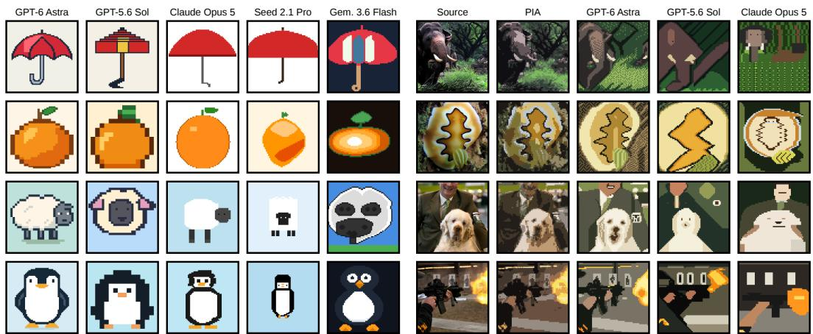  
Figure 3: Qualitative PixelBench generations. Left: T2P outputs from GPT-6 Astra, GPT-5.6 Sol, Claude Opus 5, Seed-2.1 Pro, and Gemini 3.6 Flash. Right: four I2P sources and reconstructions from PIA, Astra, Sol, and Claude. Some models preserve subjects more clearly at low resolutions, whereas PIA better tracks local appearance at higher ones. PIA is the reduced variant (Appendix L); Appendix C adds 20 cases per task.

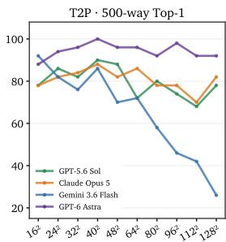

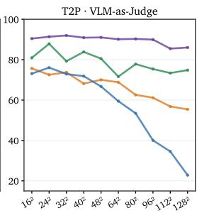

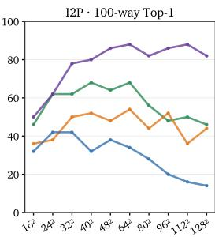

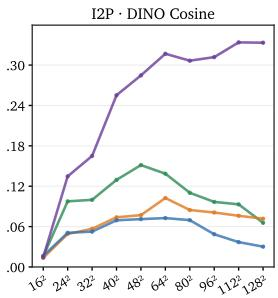  
Figure 4: Fine-grained resolution scaling on PixelBench. From left to right: T2P 500-way Top-1, T2P VLM-as-Judge, I2P 100-way Top-1, and paired I2P DINOv2 CLS cosine from 162 to 1282. Retrieval and VLM judging agree that higher resolution does not consistently improve T2P: Astra remains robust, while the other models fluctuate or decline. In I2P, Astra continues to benefit from larger grids, whereas the other models generally peak at intermediate resolutions and then decline.

Image-to-Pixel Generation. The right two panels reveal a clearer scaling pattern. GPT-6 Astra increasingly benefits from larger grids, with both retrieval accuracy and DINO similarity remaining strong at the highest resolutions. In contrast, the other models generally peak at intermediate resolutions and then decline. These results suggest that larger grids offer additional expressive capacity, but only GPT-6 Astra can translate this capacity into more faithful reconstructions.

To inspect these differences directly, Figure 5 shows two I2P examples across the same resolution sweep. GPT-6 Astra progressively adds texture, sharper boundaries, and architectural detail while preserving the subject and overall layout. GPT-5.6 Sol instead exhibits an effective-resolution collapse: despite the increasing nominal grid size, its outputs become dominated by large color blocks. This behavior can preserve a coarse semantic layout, but it underuses the available grid and reduces fidelity. Claude Opus 5 shows different failures across the two inputs. In the upper example, it mechanically repeats details from the central region, sacrificing the fidelity of the global reconstruction. In the lower indoor-architecture example, it preserves only a coarse layout and fails to recover fine structural details. Gemini 3.6 Flash degrades most severely, with the subject or key structures gradually vanishing at high resolutions.

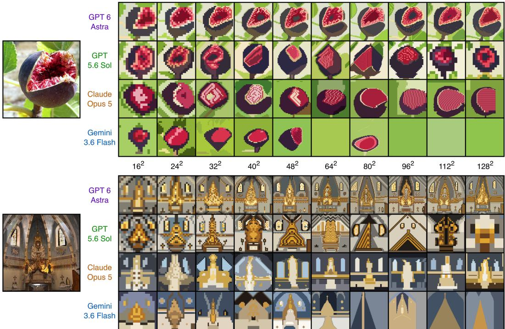  
Figure 5: Qualitative I2P resolution sweep. Two source images (left) are reconstructed from $1 6 ^ { 2 }$ to 1282; rows show GPT-6 Astra, GPT-5.6 Sol, Claude Opus 5, and Gemini 3.6 Flash. Astra remains strongest and adds coherent detail as resolution grows; GPT-5.6 Sol collapses to a lower effective resolution, Claude mechanically repeats central details in one case and fails to recover fine architectural structure in the other, and Gemini increasingly omits the subject or other key structures.

Together, these examples expose three high-resolution failure modes: effective-resolution collapse, repetitive local patterns that disrupt global structure, and omission of the subject or other key structures. They also reveal a broader consistency gap across resolutions. Beyond how effectively models use additional grid positions, other models can produce substantially different reconstructions as resolution increases, whereas Astra preserves subject identity, composition, and overall appearance across scales. Astra’s advantage is therefore not merely its ability to produce longer outputs, but its ability to organize additional grid positions into coherent details while maintaining a stable reconstruction. Representative T2P cases in Appendix B exhibit the same failure modes.

## 4 PIXEL RECONSTRUCTION TUNING

The strong correlation between pixel generation and pixel understanding in PixelBench raises a training question: can pixel generation itself serve as an objective that improves a VLM’s general visual understanding? RecA (Xie et al., 2026) explores a related idea for unified multimodal models, training them to reconstruct input images from their visual representations and thereby improving general image generation and editing. For visual understanding, however, conventional image-text and VQA supervision provides sparse, non-unique textual targets rather than dense supervision over visual content. Pixel generation provides such a target by requiring a VLM to reconstruct its input as a palette-indexed pixel grid, turning the image itself into deterministic, spatially aligned training supervision. We term this approach Pixel Reconstruction Tuning (PRT).

## 4.1 DATA AND TRAINING

Pixel Reconstruction Tuning Data Construction. We sample images from a 20k-image PixMo-Cap pool (Deitke et al., 2025) after removing exact matches with evaluation images. To avoid distortion from square reconstruction targets, we discard images with aspect ratios above 1.33. We also exclude text-heavy and multi-panel images that cannot be faithfully represented at resolutions of $1 6 ^ { 2 }$ to 322. We render both resolutions with the PIA-reduced procedure (Appendix L) and compute the SigLIP2 cosine similarity between each rendered pixel image and its source image. We retain the top 40% at $1 6 ^ { 2 }$ and the top 80% at $3 2 ^ { 2 }$ . For each retained image, we query Gemini 3.8 Flash to write an image description and summarize the colors in the algorithmically constructed palette. We package these with the grid using <CAPTION>, <PALETTE>, and <GRID>, while keeping the palette and grid values deterministic. The retained examples are our PRT data (see Appendix D).

Table 5: PRT evaluation suite. The suite comprises 16 benchmarks spanning four capability groups. For each benchmark, we summarize the tested content and number of evaluated examples (N).
<table><tr><td>Benchmark</td><td>Task content</td><td>N</td></tr><tr><td colspan="3">General perception and reasoning</td></tr><tr><td>MMStar (Chen et al., 2024)</td><td>Vision-essential perception and reasoning across six capability areas</td><td>1,500</td></tr><tr><td>MMBench (Liu et al., 2024b)</td><td>Multiple-choice perception and reasoning over diverse visual content</td><td>1,292</td></tr><tr><td>BLINK (Fu et al., 2024)</td><td>Fourteen classic computer-vision tasks recast as visual question answering</td><td>1,901</td></tr><tr><td>BabyVision (Chen et al., 2026a)</td><td>Foundational visual perception and reasoning over simple scenes</td><td>388</td></tr><tr><td>PerceptionBench (Lin et al., 2026)</td><td>Atomic perception of existence, count, position, color, and relations</td><td>3,000</td></tr><tr><td colspan="3">Fine-grained visual and spatial detail</td></tr><tr><td>MMVP (Tong et al., 2024b)</td><td>Fine-grained visual details missed by CLIP-style vision encoders</td><td>150</td></tr><tr><td>Q-Bench (Wu et al., 2024)</td><td>Low-level visual attributes, image quality, and visual perception</td><td>1,495</td></tr><tr><td>HallusionBench (Guan et al., 2024)</td><td>Image-context reasoning that exposes visual illusion and hallucination</td><td>1,129</td></tr><tr><td>V-STAR Bench (Wu &amp; Xie, 2024)</td><td>High-resolution visual search and grounding for small or hidden targets</td><td>191</td></tr><tr><td>CV-Bench (Tong et al., 2024a)</td><td>2D spatial relations and counting; 3D depth and distance</td><td>2,638</td></tr><tr><td>BlindTest (Rahmanzadehgervi et al., 2024)</td><td>Geometric primitives, spatial relations, and precise attribute reading</td><td>3,434</td></tr><tr><td>VLMs Are Biased (Vo et al., 2026)</td><td>Counting in counterfactual images that conflict with learned priors</td><td>2,784</td></tr><tr><td colspan="3">Color</td></tr><tr><td>ColorBench (Liang et al., 2025)</td><td>Color recognition, extraction, comparison, counting, and reasoning</td><td>955</td></tr><tr><td>ColorBench-Robust (Liang et al., 2025)</td><td>Answer consistency across each original image and nine recolored variants</td><td>493</td></tr><tr><td colspan="3">Charts and mathematics</td></tr><tr><td>ChartQA (Masry et al., 2022)</td><td>Visual extraction and logical or arithmetic reasoning over real-world charts</td><td>2,500</td></tr><tr><td>MathVista (Lu et al., 2024)</td><td>Mathematical reasoning over diagrams, plots, puzzles, and scientific figures</td><td>1,000</td></tr></table>

Post-training setup. Starting from the Molmo2- 4B (Clark et al., 2026) step-32k pretraining checkpoint, we post-train all modules for one pass on 500k LLaVA-OneVision-1.5 instructions (An et al., 2025), adding PRT data only in treatment runs. The main 2k experiment (0.4%; Table 6) uses four matched seed pairs. The quantity ablation tests 1k, 2k, 4k, and 8k examples (Table 7) on two matched seeds shared across amounts; 2k includes two additional seeds and is reported over four pairs. Within each pair, OV-only and OV+Pixel share the same random seed, isolating the effect of PRT data.

Evaluation suite. We evaluate 16 benchmarks across four groups (Table 5): general perception and reasoning, fine-grained visual and spatial detail, color, and charts and mathematics. All use their full evaluation sets except BlindTest, for which we sample a category-balanced subset.

## 4.2 MAIN RESULTS

PRT Improves VLM Performance. In the controlled 2k comparison (Table 6), Pixel trajectories raise Example averaging from 54.2 to 54.8 (+0.6) and Benchmark averaging from 54.1 to 54.6 (+0.5); the seed-paired Benchmark gain is positive in three

Table 6: Molmo2-4B post-training with Pixel trajectories. Four-seed means for OV 500k and +2k Pixel; ∆ is +Pixe minus OV. Example avg. pools 24,850 official evaluation units; Benchmark avg. weights the 16 benchmarks equally.
<table><tr><td>Benchmark</td><td> $N$ </td><td>OV</td><td>+Pixel</td><td>∆</td></tr><tr><td>BlindTest</td><td>3,434</td><td>58.3</td><td>59.7</td><td>+1.4</td></tr><tr><td>VLM Bias</td><td>2,784</td><td>26.1</td><td>27.2</td><td>+1.1</td></tr><tr><td>CV-Bench</td><td>2,638</td><td>75.8</td><td>76.7</td><td>+0.9</td></tr><tr><td>ColorBench-R.</td><td>493</td><td>61.8</td><td>62.6</td><td>+0.8</td></tr><tr><td>BLINK</td><td>1,901</td><td>52.8</td><td>53.6</td><td>+0.8</td></tr><tr><td>MMStar</td><td>1,500</td><td>55.3</td><td>56.0</td><td>+0.8</td></tr><tr><td>MathVista</td><td>1,000</td><td>56.2</td><td>56.7</td><td>+0.5</td></tr><tr><td>ColorBench</td><td>955</td><td>32.1</td><td>32.5</td><td>+0.4</td></tr><tr><td>Q-Bench</td><td>1,495</td><td>71.9</td><td>72.2</td><td>+0.3</td></tr><tr><td>Hallusion</td><td>1,129</td><td>59.6</td><td>59.9</td><td>+0.2</td></tr><tr><td>MMVP</td><td>150</td><td>58.7</td><td>58.8</td><td>+0.2</td></tr><tr><td>ChartQA</td><td>2,500</td><td>77.9</td><td>77.9</td><td>+0.0</td></tr><tr><td>Perception</td><td>3,000</td><td>25.9</td><td>25.9</td><td>+0.0</td></tr><tr><td>MMBench</td><td>1,292</td><td>78.6</td><td>78.6</td><td>+0.0</td></tr><tr><td>BabyVision</td><td>388</td><td>10.2</td><td>10.1</td><td>-0.1</td></tr><tr><td>V-STAR</td><td>191</td><td>65.2</td><td>65.1</td><td>-0.1</td></tr><tr><td>Example avg.</td><td>24,850</td><td>54.2</td><td>54.8</td><td>+0.6</td></tr><tr><td>Benchmark avg.</td><td>16</td><td>54.1</td><td>54.6</td><td>+0.5</td></tr></table>

Table 7: Pixel-quantity ablation. Changes relative to OV-only post-training. The 2k setting averages four seeds; the others average two. Bold and underline mark the best and second-bes values in each row.
<table><tr><td>Avg.</td><td> $\Delta _ { \mathrm { 1 k } }$ </td><td> $\Delta _ { \mathrm { 2 k } }$ </td><td> $\Delta _ { \mathrm { 4 k } }$ </td><td> $\Delta { \bf s k }$ </td></tr><tr><td>Example</td><td>+0.40</td><td>+0.61</td><td>+0.36</td><td>+0.50</td></tr><tr><td>Benchmark</td><td>+0.56</td><td>+0.45</td><td>+0.39</td><td>+0.51</td></tr></table>

of four pairs $( + 0 . 8 / + 0 . 5 / ^ { - } + 0 . 7 / ^ { - } - 0 . 1 )$ . Across quantities (Table 7), both aggregate deltas stay positive from 1k to 8k (+0.36-+0.61) without a monotonic scaling trend; 2k is the only four-seed setting. At the benchmark level, the largest gains are on BlindTest (+1.4), VLMs Are Biased (+1.1), and CV-Bench (+0.9). ChartQA, PerceptionBench, and MMBench are unchanged, while BabyVi sion and V-STAR decrease by only 0.1 point. Example averaging peaks at 2k (+0.61), whereas

Table 8: Qwen3-VL across model scales. FV+Pixel adds 3k Pixel examples to 64k FV examples.  
Table 9: Target-resolution ablation. Gains over FV; Mix spans $1 6 ^ { 2 } , 3 2 ^ { 2 } .$ , and 642. Bold and underline mark the best and second-best values per row.
<table><tr><td>Model</td><td> $\operatorname { A v g } .$ </td><td>FV</td><td> $\mathrm { F V + P i x e l }$ </td><td> $\Delta$ </td></tr><tr><td rowspan="2">2B</td><td>Example</td><td>48.1</td><td>50.1</td><td>+3.0</td></tr><tr><td>Benchmark</td><td>47.3</td><td>50.3</td><td></td></tr><tr><td rowspan="2">4B</td><td>Example</td><td>53.9</td><td>56.8</td><td>+2.9</td></tr><tr><td>Benchmark</td><td>53.6</td><td>57.3</td><td>+3.7</td></tr><tr><td rowspan="2">8B</td><td>Example</td><td>55.1</td><td>57.2</td><td>+2.1</td></tr><tr><td>Benchmark</td><td>56.3</td><td>57.9</td><td>+1.6</td></tr></table>

<table><tr><td>Model</td><td> $\operatorname { A v g } .$ </td><td> $\Delta _ { 1 6 }$ </td><td> $\Delta _ { 3 2 }$ </td><td> $\Delta _ { 6 4 }$ </td><td> $\Delta _ { \mathrm { M i x } }$ </td></tr><tr><td rowspan="2">2B</td><td>Example</td><td>+2.14</td><td>+2.50</td><td></td><td>+2.01</td></tr><tr><td>Benchmark</td><td>+2.66</td><td>+3.37</td><td>+22</td><td>+3.02</td></tr><tr><td rowspan="2">4B</td><td>Example</td><td>+3.14</td><td>+2.87</td><td>+2.18</td><td>+2.94</td></tr><tr><td>Benchmark</td><td>+4.07</td><td>+3.90</td><td>+3.48</td><td>+3.70</td></tr><tr><td rowspan="2">8B</td><td>Example</td><td>+1.88</td><td>+1.92</td><td>+1.90</td><td>+2.07</td></tr><tr><td>Benchmark</td><td>+1.38</td><td>+1.23</td><td>+1.73</td><td>+1.60</td></tr></table>

Benchmark averaging peaks at 1k (+0.56), further indicating that the benefit does not scale monotonically with quantity. Full results and caveats are in Appendix D.

Pixel Reconstruction Serves as Regularization. We study Qwen3-VL-Instruct at 2B, 4B, and 8B. FV uses 64k FineVision examples; FV+Pixel adds 3k examples that directly pair an input image with its deterministic palette-indexed reconstruction. Here, the target contains only the reconstructed pixels, with no accompanying image description or palette explanation. Table 8 shows positive gains at every scale: 2B rises from 48.1/47.3 to $\bar { 5 } 0 . 1 / 5 0 . \bar { 3 } ( + 2 . 0 / \bar { + } 3 . 0 )$ , 4B from 53.9/53.6 to 56.8/57.3 $( + 2 . 9 \dot { / } + 3 . 7 )$ , and 8B from 55.1/56.3 to $5 7 . 2 / 5 7 . 9 ( + 2 . 1 / + 1 . 6 ) ;$ 4B gains the most. Resolution preferences vary by scale (Table 9): 2B peaks at $3 2 ^ { 2 } \ : ( + 2 . 5 0 / + 3 . 3 7 )$ , 4B at $1 6 ^ { 2 } ( + 3 . 1 4 / + 4 . 0 7 ) .$ and 8B at Mix for Example averaging (+2.07) but $6 4 ^ { 2 }$ for Benchmark averaging (+1.73). Mix nevertheless ranks first or second in four of six rows, making it a robust choice without committing to a single resolution.

## 5 CONCLUDING REMARKS

We introduce PixelBench, a text-based interface for direct pixel generation and understanding without a learned image tokenizer or decoder. Across T2P, I2P, and understanding tasks, frontier models exhibit substantial yet uneven capabilities, with model-specific resolution peaks. GPT-6 Astra remains robust as grid resolution increases, whereas most other models initially improve before declining. Beyond evaluation, we introduce PRT, which transforms deterministic palettes and grids into instruction trajectories. By combining general instruction data with curated PRT data, we posttrain Molmo2-4B from its pretraining checkpoint, improving performance across 16 visual-centric benchmarks. The performance gain can also be observed in Qwen3-VL across different scales. These findings highlight the dual role of explicit pixels as a behavioral probe for evaluating visual capabilities and a practical training signal for improving them.

## ACKNOWLEDGMENTS

HZ thanks Ji Xie for a careful review of the paper and helpful suggestions. HZ also thanks Yangyi Huang, Sihan Yang, Zhou Jiang, Yi Xie, and Hongrui Zhang for useful comments.

## REFERENCES

Radhakrishna Achanta, Appu Shaji, Kevin Smith, Aurelien Lucchi, Pascal Fua, and Sabine Susstrunk. SLIC superpixels compared to state-of-the-art superpixel methods. ¨ TPAMI, 34(11): 2274–2282, 2012. 4

Jean-Baptiste Alayrac, Jeff Donahue, Pauline Luc, Antoine Miech, Iain Barr, Yana Hasson, Karel Lenc, Arthur Mensch, Katherine Millican, Malcolm Reynolds, et al. Flamingo: A visual language model for few-shot learning. In NeurIPS, 2022. 15

Xiang An, Yin Xie, Kaicheng Yang, Wenkang Zhang, Xiuwei Zhao, Zheng Cheng, Yirui Wang, Songcen Xu, Changrui Chen, Chunsheng Wu, et al. LLaVA-OneVision-1.5: Fully open framework for democratized multimodal training, 2025. 8

Anthropic. System card: Claude opus 5. https://www.anthropic.com/system-cards, 2026. Accessed 2026-08-21. 3

ByteDance Seed. Seed2.1 model card: Agentic intelligence for productivity. Technical Report, 2026. URL https://seed.bytedance.com/en/seed2\_1. 3

Chameleon Team. Chameleon: Mixed-modal early-fusion foundation models, 2024. 2, 15

Liang Chen, Weichu Xie, Yiyan Liang, Hongfeng He, Hans Zhao, Zhibo Yang, Zhiqi Huang, Haoning Wu, Haoyu Lu, et al. Babyvision: Visual reasoning beyond language. In ICML, 2026a. 8, 27

Lin Chen, Jinsong Li, Xiaoyi Dong, Pan Zhang, Yuhang Zang, Zehui Chen, Haodong Duan, Jiaqi Wang, Yu Qiao, Dahua Lin, et al. Are we on the right way for evaluating large vision-language models? In NeurIPS, 2024. 8, 15, 27

Mark Chen, Alec Radford, Rewon Child, Jeffrey Wu, Heewoo Jun, David Luan, and Ilya Sutskever. Generative pretraining from pixels. In ICML, pp. 1691–1703, 2020. 2, 15

Siqi Chen, Xinyu Dong, Haolei Xu, Xingyu Wu, Fei Tang, Hang Zhang, Yuchen Yan, Linjuan Wu, Wenqi Zhang, Guiyang Hou, Yongliang Shen, Weiming Lu, and Yueting Zhuang. Svgenius: Benchmarking llms in svg understanding, editing and generation. In ACM MM, 2025. 15

Yamei Chen, Haoquan Zhang, Yangyi Huang, Zeju Qiu, Kaipeng Zhang, Yandong Wen, and Weiyang Liu. Symbolic graphics programming with large language models. Transactions on Machine Learning Research, 2026b. 2, 15

Franc¸ois Chollet. On the measure of intelligence, 2019. 15

Christopher Clark, Jieyu Zhang, Zixian Ma, Jae Sung Park, Rohun Tripathi, Sangho Lee, Mohammadreza Salehi, Jason Ren, Chris Dongjoo Kim, Yinuo Yang, et al. Molmo2: Open weights and data for vision-language models with video understanding and grounding. In CVPR, 2026. 8

Wenliang Dai, Junnan Li, Dongxu Li, Anthony Meng Huat Tiong, Junqi Zhao, Weisheng Wang, Boyang Li, Pascale Fung, and Steven Hoi. Instructblip: Towards general-purpose vision-language models with instruction tuning. In NeurIPS, 2023. 15

DeepSeek-AI. DeepSeek-V4: Towards highly efficient million-token context intelligence, 2026. URL https://arxiv.org/abs/2606.19348. 3

Matt Deitke, Christopher Clark, Sangho Lee, Rohun Tripathi, Yue Yang, Jae Sung Park, Mohammadreza Salehi, Niklas Muennighoff, Kyle Lo, Luca Soldaini, et al. Molmo and PixMo: Open weights and open data for state-of-the-art vision-language models. In CVPR, pp. 91–104, 2025. 7, 15

Jia Deng, Wei Dong, Richard Socher, Li-Jia Li, Kai Li, and Li Fei-Fei. Imagenet: A large-scale hierarchical image database. In CVPR, pp. 248–255, 2009. 3

Emergent Mind. Pixel art bench. https://www.emergentmind.com/ pixel-art-bench, 2026. Accessed 2026-08-19. 15

Xingyu Fu, Yushi Hu, Bangzheng Li, Yu Feng, Haoyu Wang, Xudong Lin, Dan Roth, Noah A. Smith, Wei-Chiu Ma, and Ranjay Krishna. BLINK: Multimodal large language models can see but not perceive. In ECCV, 2024. 8, 15, 27

Timothy Gerstner, Doug DeCarlo, Marc Alexa, Adam Finkelstein, Yotam Gingold, and Andrew Nealen. Pixelated image abstraction. In NPAR, 2012. 4, 37

Google DeepMind. Gemini 3.5 flash model card. https://deepmind.google/models/ model-cards/gemini-3-5-flash/, 2026a. Accessed 2026-08-21. 4

Google DeepMind. Introducing Gemini 3.6 flash, 3.5 flash-lite, and 3.5 flash cyber. https://blog.google/innovation-and-ai/models-and-research/ gemini-models/gemini-3-6-flash-3-5-flash-lite-3-5-flash-cyber/, 2026b. Accessed 2026-08-21. 3

Tianrui Guan, Fuxiao Liu, Xiyang Wu, Ruiqi Xian, Zongxia Li, Xiaoyu Liu, Xijun Wang, Lichang Chen, Furong Huang, Yaser Yacoob, et al. Hallusionbench: An advanced diagnostic suite for entangled language hallucination and visual illusion in large vision-language models. In CVPR, pp. 14375–14385, 2024. 8, 27

Kaiming He, Xinlei Chen, Saining Xie, Yanghao Li, Piotr Dollar, and Ross Girshick. Masked´ autoencoders are scalable vision learners. In CVPR, 2022. 15

Paul Heckbert. Color image quantization for frame buffer display. In SIGGRAPH, pp. 297–307, 1982. 4, 37

Siddharth Karamcheti, Suraj Nair, Ashwin Balakrishna, Percy Liang, Thomas Kollar, and Dorsa Sadigh. Prismatic VLMs: Investigating the design space of visually-conditioned language models. In ICML, pp. 23123–23144, 2024. 15

Mohammad Sadil Khan, Sankalp Sinha, Talha Uddin Sheikh, Didier Stricker, Sk Aziz Ali, and Muhammad Zeshan Afzal. Text2CAD: Generating sequential cad designs from beginner-toexpert level text prompts. In NeurIPS, 2024. 2, 15

Kimi Team. Kimi K3: Open frontier intelligence, 2026. URL https://arxiv.org/abs/ 2607.24653. 3

Hugo Laurenc¸on, Leo Tronchon, Matthieu Cord, and Victor Sanh. What matters when building´ vision-language models? In NeurIPS, 2024. 15

Junnan Li, Dongxu Li, Silvio Savarese, and Steven Hoi. BLIP-2: Bootstrapping language-image pre-training with frozen image encoders and large language models. In ICML, pp. 19730–19742, 2023. 15

Yijun Liang, Ming Li, Chenrui Fan, Ziyue Li, Dang Nguyen, Kwesi Cobbina, Shweta Bhardwaj, Jiuhai Chen, Fuxiao Liu, and Tianyi Zhou. ColorBench: Can VLMs see and understand the colorful world? a comprehensive benchmark for color perception, reasoning, and robustness. In NeurIPS Datasets and Benchmarks Track, 2025. 8, 27

Zichao Lin, Yifeng Xie, Bowen Qu, Haiming Wang, Jia Li, Haoning Wu, Yuhao Dong, Zuhao Yang, Jinguo Zhu, Haoyu Lu, et al. Perceptionbench: Evaluating atomic visual perception in multimodal large language models, 2026. 8, 27

Haotian Liu, Chunyuan Li, Qingyang Wu, and Yong Jae Lee. Visual instruction tuning. In NeurIPS, 2023. 15

Haotian Liu, Chunyuan Li, Yuheng Li, and Yong Jae Lee. Improved baselines with visual instruction tuning. In CVPR, 2024a. 15

Yuan Liu, Haodong Duan, Yuanhan Zhang, Bo Li, Songyang Zhang, Wangbo Zhao, Yike Yuan, Jiaqi Wang, Conghui He, Ziwei Liu, et al. MMBench: Is your multi-modal model an all-around player? In ECCV, pp. 216–233, 2024b. 8, 27

Pan Lu, Hritik Bansal, Tony Xia, Jiacheng Liu, Chunyuan Li, Hannaneh Hajishirzi, Hao Cheng, Kai-Wei Chang, Michel Galley, and Jianfeng Gao. MathVista: Evaluating mathematical reasoning of foundation models in visual contexts. In ICLR, 2024. 8, 27

Ahmed Masry, Xuan Long Do, Jia Qing Tan, Shafiq Joty, and Enamul Hoque. ChartQA: A benchmark for question answering about charts with visual and logical reasoning. In Findings ofACL, pp. 2263–2279, 2022. 8, 27

OpenAI. GPT-5.6: Frontier intelligence that scales with your ambition. https://openai. com/index/gpt-5-6/, 2026a. Accessed 2026-08-21. 3

OpenAI. GPT-6 astra: A new generation of intelligence. https://openai.com/index gpt-6-astra/, 2026b. Accessed 2026-09-16. 3

Maxime Oquab, Timothee Darcet, Th ´ eo Moutakanni, Huy V. Vo, Marc Szafraniec, Vasil Khalidov, ´ Pierre Fernandez, Daniel Haziza, Francisco Massa, Alaaeldin El-Nouby, et al. DINOv2: Learning robust visual features without supervision. TMLR, 2024. 4

A. Cengiz Oztireli and Markus Gross. Perceptually based downscaling of images. ¨ ACM TOG, 34 (4), 2015. 4, 15, 37

Niki Parmar, Ashish Vaswani, Jakob Uszkoreit, Lukasz Kaiser, Noam Shazeer, Alexander Ku, and Dustin Tran. Image transformer. In ICML, pp. 4055–4064, 2018. 2

Zeju Qiu, Weiyang Liu, Haiwen Feng, Zhen Liu, Tim Z. Xiao, Katherine M. Collins, Joshua B. Tenenbaum, Adrian Weller, Michael J. Black, and Bernhard Scholkopf. Can large language mod-¨ els understand symbolic graphics programs? In ICLR, 2025. 2, 15

Alec Radford, Jong Wook Kim, Chris Hallacy, Aditya Ramesh, Gabriel Goh, Sandhini Agarwal, Girish Sastry, Amanda Askell, Pamela Mishkin, Jack Clark, et al. Learning transferable visual models from natural language supervision. In ICML, pp. 8748–8763, 2021. 15

Pooyan Rahmanzadehgervi, Logan Bolton, Mohammad Reza Taesiri, and Anh Totti Nguyen. Vision language models are blind. In ACCV, pp. 18–34, 2024. 8, 15, 27

Juan A. Rodriguez, Abhay Puri, Shubham Agarwal, Issam H. Laradji, Pau Rodriguez, Sai Rajeswar, David Vazquez, Christopher Pal, and Marco Pedersoli. Starvector: Generating scalable vector graphics code from images and text. In CVPR, pp. 16175–16186, 2025. 2, 15

Kenneth Rose. Deterministic annealing for clustering, compression, classification, regression, and related optimization problems. Proc. IEEE, 86(11):2210–2239, 1998. 37

Danila Rukhovich, Elona Dupont, Dimitrios Mallis, Kseniya Cherenkova, Anis Kacem, and Djamila Aouada. CAD-Recode: Reverse engineering cad code from point clouds. In ICCV, pp. 9801– 9811, 2025. 15

Pratyusha Sharma, Tamar Rott Shaham, Manel Baradad, Stephanie Fu, Adrian Rodriguez-Munoz, Shivam Duggal, Phillip Isola, and Antonio Torralba. A vision check-up for language models. In CVPR, pp. 14410–14419, 2024. 2, 15

Shengbang Tong, Ellis Brown, Penghao Wu, Sanghyun Woo, Manoj Middepogu, Sai Charitha Akula, Jihan Yang, Shusheng Yang, Adithya Iyer, Xichen Pan, et al. Cambrian-1: A fully open, vision-centric exploration of multimodal llms. In NeurIPS, 2024a. 8, 15, 27

Shengbang Tong, Zhuang Liu, Yuexiang Zhai, Yi Ma, Yann LeCun, and Saining Xie. Eyes wide shut? exploring the visual shortcomings of multimodal llms. In CVPR, 2024b. 8, 15, 27

Shengbang Tong, David Fan, Jiachen Zhu, Yunyang Xiong, Xinlei Chen, Koustuv Sinha, Michael Rabbat, Yann LeCun, Saining Xie, and Zhuang Liu. Metamorph: Multimodal understanding and generation via instruction tuning. In ICCV, pp. 17001–17012, 2025. 15

Aaron van den Oord, Nal Kalchbrenner, and Koray Kavukcuoglu. Pixel recurrent neural networks.¨ In ICML, pp. 1747–1756, 2016a. 2

Aaron van den Oord, Nal Kalchbrenner, Oriol Vinyals, Lasse Espeholt, Alex Graves, and Koray¨ Kavukcuoglu. Conditional image generation with PixelCNN decoders. In NeurIPS, 2016b. 2

An Vo, Khai-Nguyen Nguyen, Mohammad Reza Taesiri, Vy Tuong Dang, Anh Totti Nguyen, and Daeyoung Kim. Vision language models are biased. In ICLR, 2026. 8, 27

Xinlong Wang, Yufeng Cui, Jinsheng Wang, Fan Zhang, Yueze Wang, Xiaosong Zhang, Zhengxiong Luo, Quan Sun, Zhen Li, et al. Multimodal learning with next-token prediction for large multimodal models. Nature, 650:327–333, 2026. 2, 15

Nicolas Weber, Michael Waechter, Sandra C. Amend, Stefan Guthe, and Michael Goesele. Rapid, detail-preserving image downscaling. ACM TOG, 35(6), 2016. 15, 37

Luis Wiedmann, Orr Zohar, Amir Mahla, Xiaohan Wang, Rui Li, Thibaud Frere, Leandro von Werra, Aritra Roy Gosthipaty, and Andres Marafioti. Finevision: Open data is all you need, 2025.´ 15

Haoning Wu, Zicheng Zhang, Erli Zhang, Chaofeng Chen, Liang Liao, Annan Wang, Chunyi Li, Wenxiu Sun, Qiong Yan, Guangtao Zhai, and Weisi Lin. Q-Bench: A benchmark for general purpose foundation models on low-level vision. In ICLR, 2024. 8, 27

Penghao Wu and Saining Xie. V\*: Guided visual search as a core mechanism in multimodal llms. In CVPR, pp. 13084–13094, 2024. 8, 27

Ronghuan Wu, Wanchao Su, and Jing Liao. Chat2svg: Vector graphics generation with large language models and image diffusion models. In CVPR, pp. 23690–23700, 2025. 15

Zongwei Wu, Liangyu Chai, Nanxuan Zhao, Bailin Deng, Yongtuo Liu, Qiang Wen, Junle Wang, and Shengfeng He. Make your own sprites: Aliasing-aware and cell-controllable pixelization. ACM TOG, 41(6), 2022. 15

Ji Xie, Trevor Darrell, Luke Zettlemoyer, and Xudong Wang. Reconstruction alignment improves unified multimodal models. In ICLR, 2026. 2, 7, 15

Ximing Xing, Juncheng Hu, Guotao Liang, Jing Zhang, Dong Xu, and Qian Yu. Empowering llms to understand and generate complex vector graphics. In CVPR, pp. 19487–19497, 2025. 2, 15

Xiaohua Zhai, Basil Mustafa, Alexander Kolesnikov, and Lucas Beyer. Sigmoid loss for language image pre-training. In ICCV, pp. 11975–11986, 2023. 4, 15

Wenqian Zhuang, Yangyi Huang, Zigeng Xu, Weiyang Liu, and Zhen Liu. Can it actually work? synthesizing functional cad mechanisms. arXiv preprint arXiv:2610.26861, 2026. 15

Bocheng Zou, Mu Cai, Jianrui Zhang, and Yong Jae Lee. VGBench: Evaluating large language models on vector graphics understanding and generation. In EMNLP, pp. 3647–3659, 2024. 15

## Appendix

A Related Work 15   
A.1 Symbolic Visual Representations 15   
A.2 Vision-Language Training and Visual Representations 15   
B Additional Resolution-Scaling Examples 16   
C Additional Qualitative PixelBench Cases 16   
D Additional Pixel Reconstruction Tuning Results 27   
D.1 Molmo2 Pixel-Trajectory Construction 27   
D.2 Molmo2 Training and Evaluation 27   
D.3 Qwen3-VL Training Setup 28   
D.4 Additive FV + Pixel Results 29   
D.5 Fixed Data Amount and Training Steps 29   
D.6 Limitations 30   
E Model Inference Settings 30   
F SigLIP Retrieval Scores 31   
G Full Evaluation Prompts 31   
G.1 Text-to-Pixel Prompt 31   
G.2 Text-to-Pixel VLM-as-Judge Prompt 32   
G.3 Image-to-Pixel Prompt . 32   
G.4 Pixel Understanding Prompt 33   
H Text-to-Pixel Concept List 33   
Image-to-Pixel Source Images 33   
J 500-Way Retrieval Vocabulary 34   
K Full Text-to-Pixel Results 36   
L Algorithmic Image-to-Pixel Baselines in Full 37   
L.1 Representative Implementations 37   
L.2 Complete Algorithmic Results . 38

## A RELATED WORK

## A.1 SYMBOLIC VISUAL REPRESENTATIONS

A growing line of work represents visual content as a discrete symbol sequence that a renderer executes, rather than as a dense array of pixels. On the understanding side, SGP-Bench evaluates whether language models can infer the semantics of SVG and CAD programs without seeing their renderings and improves this ability through Symbolic Instruction Tuning (Qiu et al., 2025), while VGBench and SVGenius broaden evaluation to editing and generation across many formats, domains, and complexity levels (Zou et al., 2024; Chen et al., 2025). On the generation side, models emit SVG code or executable CAD programs directly (Chen et al., 2026b; Rodriguez et al., 2025; Xing et al., 2025; Wu et al., 2025; Khan et al., 2024; Rukhovich et al., 2025; Zhuang et al., 2026), and Sharma et al. (2024) use rendering code as a stand-in for pixels, demonstrating that text-only models encode substantial visual knowledge. Together, these studies show that general-purpose models encode usable geometric knowledge in symbolic form, although their performance degrades when precise spatial and structural fidelity is required.

Two properties separate that setting from ours. A program mediates between model and image, so the renderer supplies geometry and resolution independence and each primitive covers many pixels; token-based generative models instead keep the raster form but substitute a learned codebook whose vocabulary is opaque and whose decoding requires the paired detokenizer (Chen et al., 2020; Chameleon Team, 2024; Wang et al., 2026). PixelBench asks for an explicit palette and perpixel indices, so rendering is a table lookup and every emitted symbol is one spatial location. The closest prior evaluation of this format is Pixel Art Bench, a web leaderboard that ranks $2 4 \times 2 4$ grids for seven subjects by LLM-judged Elo (Emergent Mind, 2026). Color-index grids also appear in abstract reasoning (Chollet, 2019). PixelBench broadens this to text-to-pixel and imageto-pixel generation over 100 concepts and 100 natural images at three resolutions, adds a complementary pixel-understanding evaluation, replaces judge-based ranking with deterministic retrieval and fidelity metrics, and compares against palette-matched pixelization and downscaling algorithms (Oztireli & Gross¨ , 2015; Weber et al., 2016; Wu et al., 2022).

## A.2 VISION-LANGUAGE TRAINING AND VISUAL REPRESENTATIONS

Contemporary VLMs pair a pretrained visual encoder with a language model through a connector, aligned by image-text pretraining and visual instruction tuning (Radford et al., 2021; Zhai et al., 2023; Alayrac et al., 2022; Li et al., 2023; Liu et al., 2023; Dai et al., 2023; Liu et al., 2024a). Controlled ablations attribute much of the reported progress to the unimodal backbones and to training data rather than to the connector (Karamcheti et al., 2024; Laurenc¸on et al., 2024), and a parallel body of work stresses the composition, quality, and cleanliness of that data: vision-centric mixtures sharpen fine-grained perception (Tong et al., 2024a), curated non-distilled and decontaminated corpora improve generalization (Deitke et al., 2025; Wiedmann et al., 2025), and benchmark audits show that apparent gains can stem from leakage or from questions answerable without the image (Chen et al., 2024). Across these pipelines the supervision target is language, whatever the visual input.

That choice has consequences: distinctions lost by the encoder propagate into the assembled model (Tong et al., 2024b), which remains unreliable on low-level spatial queries (Rahmanzadehgervi et al., 2024; Fu et al., 2024). Objectives that require reproducing visual detail instead yield transferable representations (He et al., 2022; Chen et al., 2020), and MetaMorph finds understanding and visual generation mutually beneficial (Tong et al., 2025). Reconstruction Alignment (RecA) conditions unified multimodal models on their own visual encoder representations and trains them to recon struct the input image, thereby connecting visual understanding and generation (Xie et al., 2026). PRT studies an analogous objective for VLMs without a dedicated image generator: predicting the palette-index grid itself through the existing vocabulary, with no learned image tokenizer or decoder. Our primary protocol starts from a Molmo2 pretraining checkpoint and adds caption-palette-grid trajectories to a fixed 500k-example instruction mixture. Appendix D additionally reports the earlier Qwen3-VL experiments, where pixel targets are added to FineVision post-training as a regularizer.

## B ADDITIONAL RESOLUTION-SCALING EXAMPLES

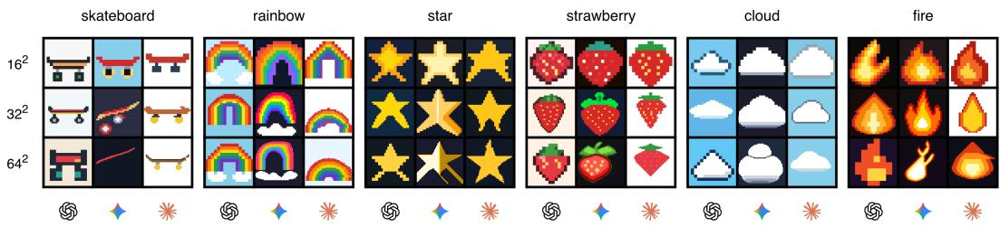  
Figure 6: Model-dependent resolution behavior in T2P. Each case group shows GPT-5.6 Sol, Gemini 3.6 Flash, and Claude Opus 5 at 162, 322, and $6 4 ^ { 2 }$ . Higher nominal resolution can yield finer detail, coarse effective pixels, or degraded global structure depending on the model and prompt.

These cases instantiate the same three failure modes observed in the qualitative $\mathrm { I } 2 \mathrm { P }$ sweep. GPT-5.6 Sol exhibits effective-resolution underutilization: its $6 4 ^ { 2 }$ skateboard and fire are dominated by blocks roughly one-eighth of the canvas width, giving them a granularity closer to an $8 \times 8$ grid. The outputs remain recognizable, but the additional positions contribute little detail. Gemini 3.6 Flash uses finer boundaries and local variation, but these local patterns can disrupt global structure: at $6 4 ^ { 2 }$ , its skateboard collapses to a diagonal stroke, its star loses the five-point structure, and its fire loses a coherent silhouette. The latter cases also omit identity-bearing structures. Claude Opus 5 varies by prompt: it preserves the depicted objects in these examples while using the higher resolution grid, but its aggregate T2P performance fluctuates across resolutions and does not sustain its intermediate-resolution peak.

## C ADDITIONAL QUALITATIVE PIXELBENCH CASES

The following pages expand Figure 3 with 20 additional T2P cases and 20 additional I2P cases. Each T2P case compares all seven evaluated models at 162, 322, and $6 4 ^ { 2 }$ . Each I2P case compares the six evaluated models and three algorithmic baselines at the same resolutions. The I2P panels provide additional qualitative evidence that some model-based reconstructions preserve semantic structure more clearly than the algorithmic baselines at low resolutions, complementing the aggregate results in Table 2. Pixel images use nearest-neighbor enlargement for display.

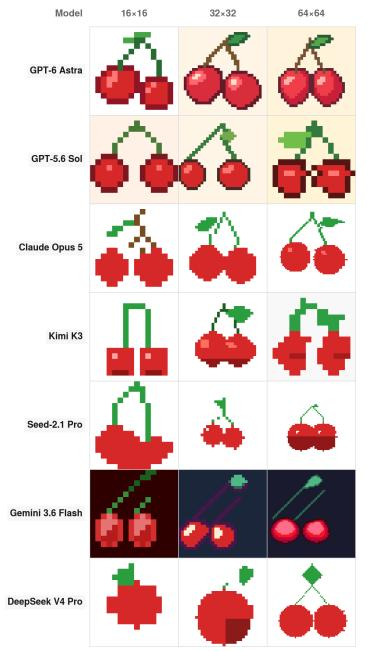  
T2P showcase - page 1/10 - nearest-neighbor displa

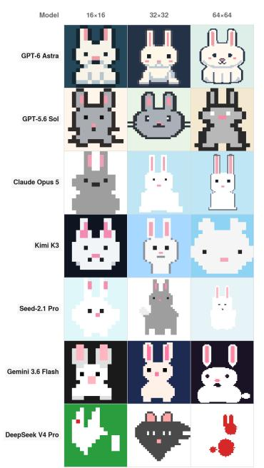

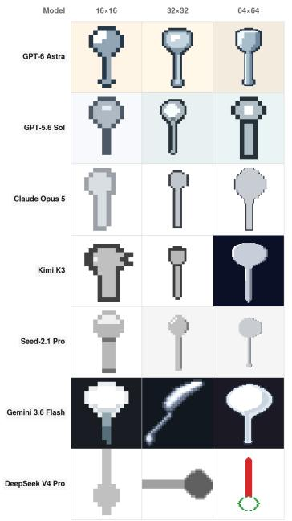

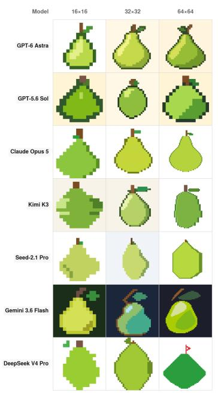

chicken

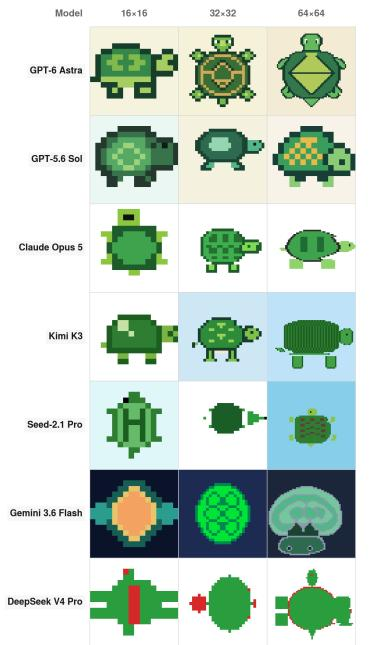

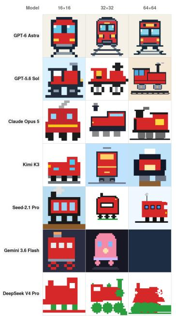

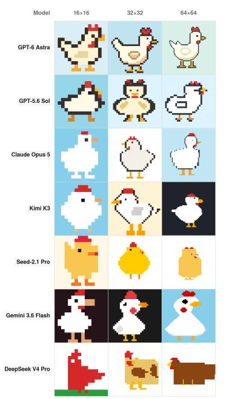  
T2P showcase - page 4/10 - nearest-neighbor displa

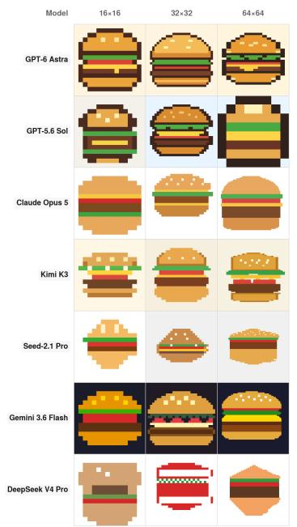

transport - case 12

bottle

frog

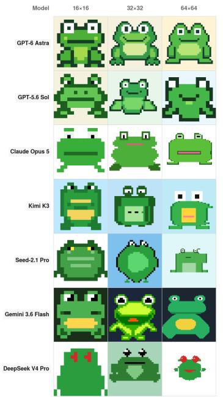

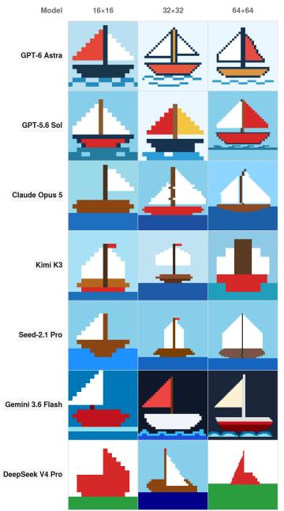

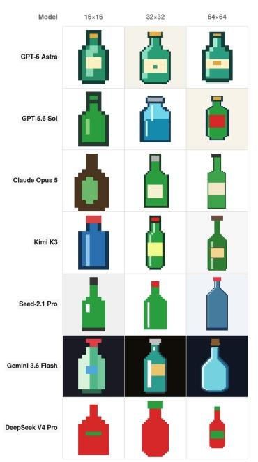

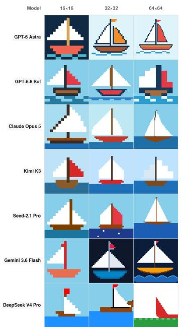

household case 16

bicycle

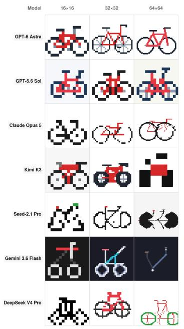

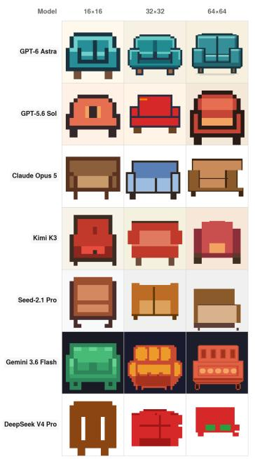  
cake

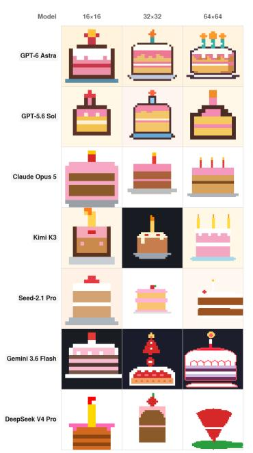

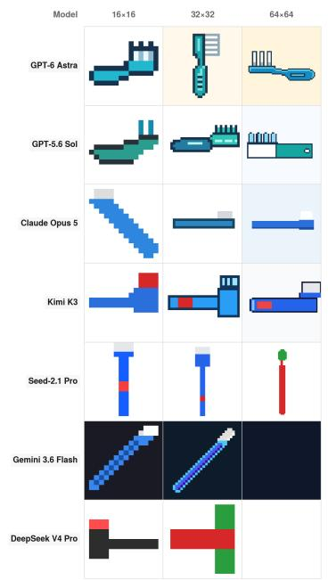

star

mountain  
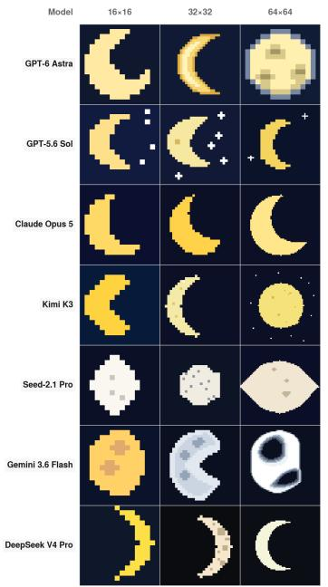

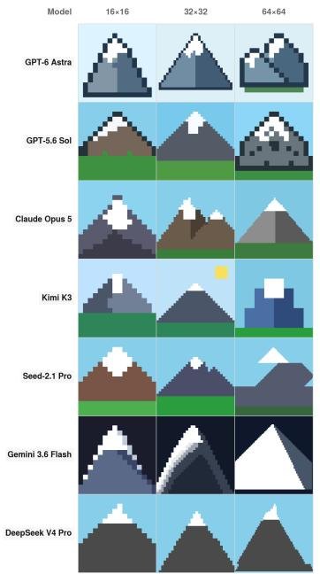

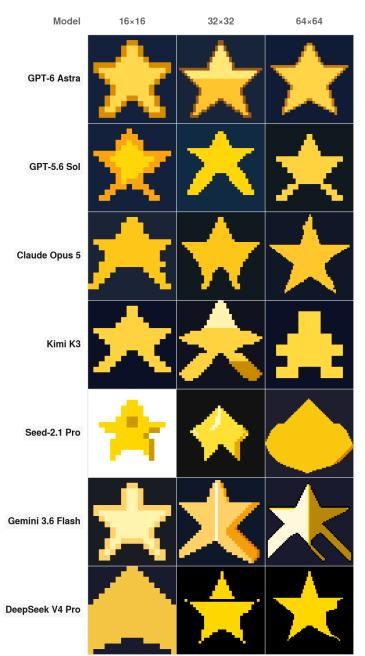

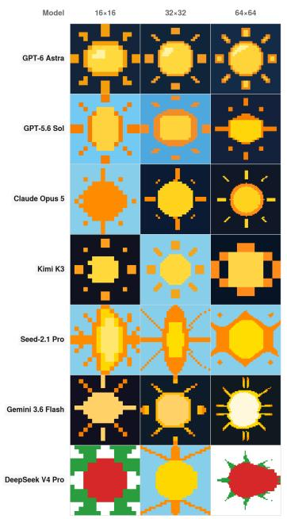

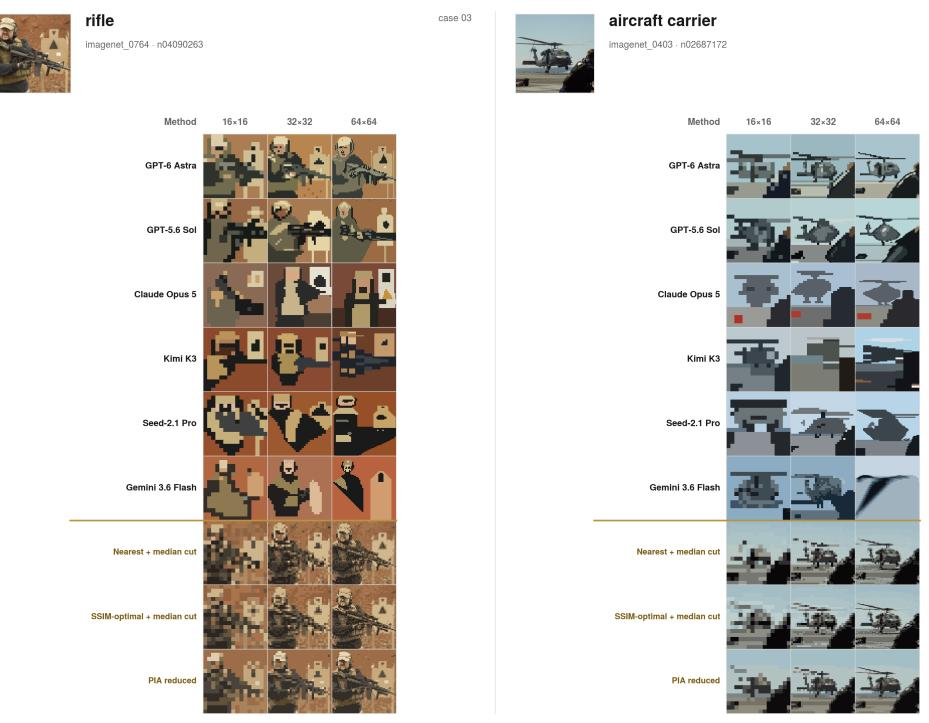

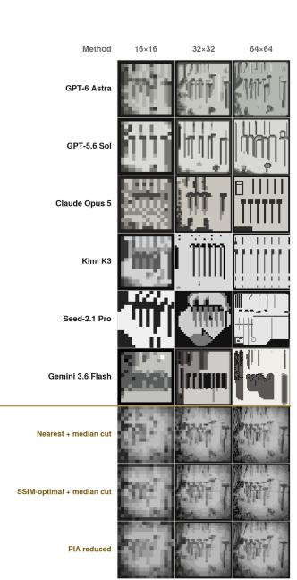

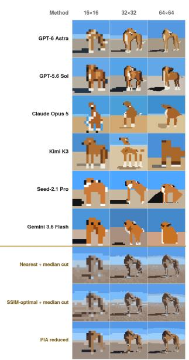  
I2P showcase - page 2/10 - nearest-neighbor display

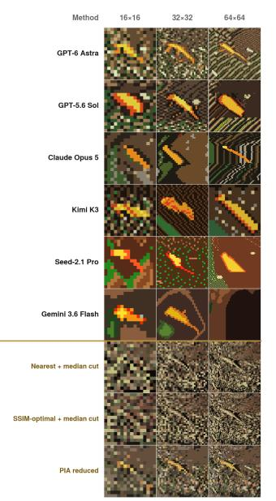

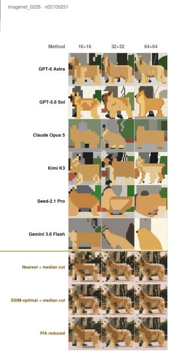

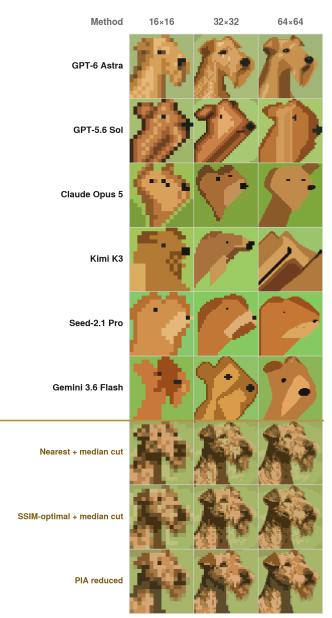

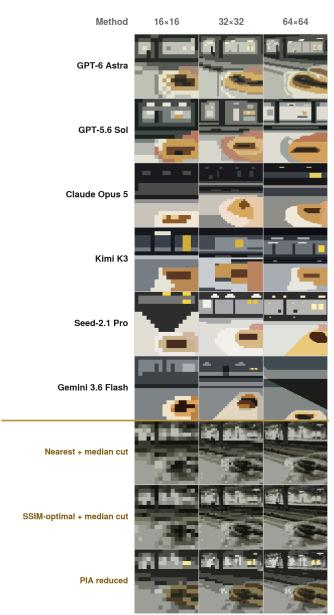

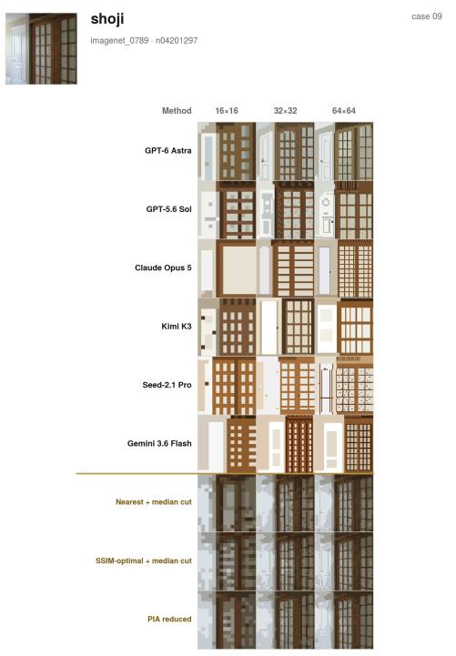

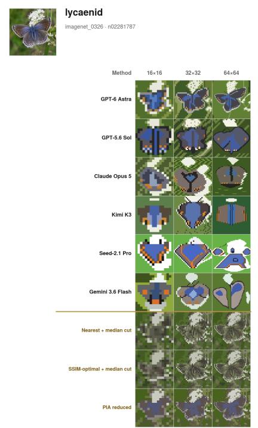

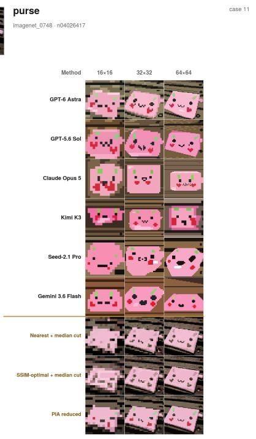

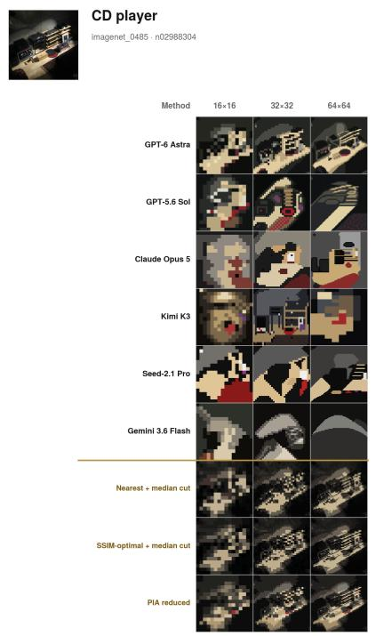

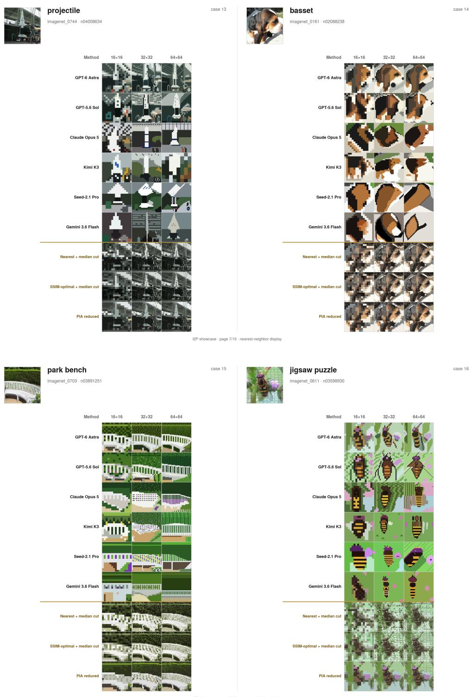

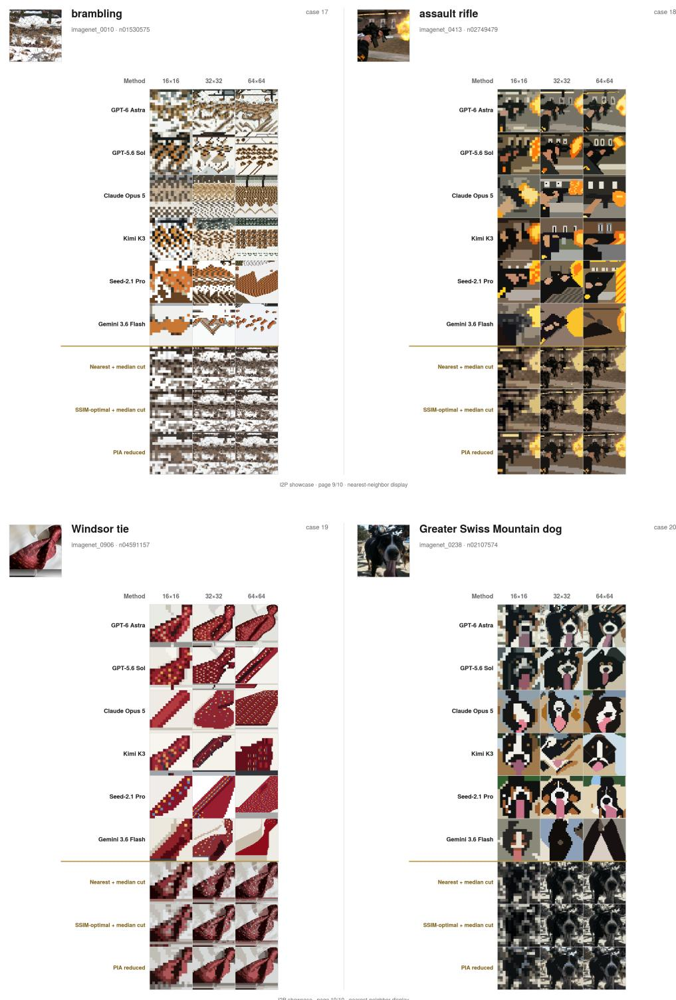

## D ADDITIONAL PIXEL RECONSTRUCTION TUNING RESULTS

## D.1 MOLMO2 PIXEL-TRAJECTORY CONSTRUCTION

Image pool and filtering. Pixel trajectories use PixMo-Cap images with human-written dense captions. We first construct a 20k-image pool and expand it with previously unused images for the 4k and 8k sets. Exact hash matches to evaluation images are removed. We reject examples whose captions indicate screenshots, webpages, user interfaces, documents, posters, text, charts, diagrams, infographics, collages, or multi-panel layouts because text-heavy and composite content cannot be faithfully represented at $1 6 ^ { 2 } – 3 2 ^ { 2 }$ . Because PIA-reduced converts every source to a square grid, we also reject images with aspect ratio above 1.33 to avoid substantial geometric distortion.

Recognizability and grid construction. For each candidate, we construct $1 6 ^ { 2 }$ and $3 2 ^ { 2 }$ eight-color grids using the PIA-reduced procedure (Appendix L). We nearest-neighbor upscale each grid and compute its paired cosine similarity with the source image using SigLIP2-base-patch16-224. At each resolution, candidates are ranked by this similarity; we retain the top 40% at $1 6 ^ { 2 }$ and the top 80% at $3 2 ^ { 2 }$ . Images are unique within every set. The 2k set is balanced across $1 6 ^ { 2 }$ and $3 2 ^ { 2 }$ ; 4k and 8k are nested extensions whose new rows use previously unused images.

Natural-language trajectory. Gemini 3.8 Flash receives the original image, upscaled ground-truth grid, one mask visualization per palette letter, the PixMo caption, and measured palette/layout hints. At temperature 0.4 and thinking budget 2,048, it writes only the caption and palette explanation; the palette and grid remain deterministic. The response must discuss every palette letter exactly once and in order, otherwise it is retried up to three times. Three paraphrased user prompts are assigned deterministically. Median target lengths are 1,693 characters at 162 $1 \dot { 6 } ^ { 2 }$ and 2,739 at $3 2 ^ { \frac { \cdot } { 2 } }$

## D.2 MOLMO2 TRAINING AND EVALUATION

Table 10: Molmo2 post-training setup. Both conditions start from the same released Molmo2-4B image-pretraining checkpoint.
<table><tr><td>Item</td><td>Setting</td></tr><tr><td>Initialization</td><td>Molmo2-4B-Pretrain, step 32,000; Qwen3-4B language model</td></tr><tr><td>OV mixture</td><td>500,000 single-image rows from LLaVA-OneVision-1.5-Instruct; answers over 2,048 tokens removed; image long side capped at 1,024 px</td></tr><tr><td>Pixel mixture</td><td>OV 500k plus 1k, 2k, 4k, or 8k unique Pixel trajectories</td></tr><tr><td>Schedule</td><td>One pass; OV 1,190 steps; OV+Nk uses 1,190 + 4N steps</td></tr><tr><td>Batching</td><td>128 packed sequences × 4,096 tokens; one image per sample; maximum answer length 1,800 tokens</td></tr><tr><td>Optimization</td><td>AdamW; LLM LR 10−5; ViT/connector LR 5× 10−6; 60-step warmup; final LR multiplier 0.1; gra- dient clip 1.0; bf16</td></tr><tr><td>Hardware</td><td>Four nodes × eight NVIDIA A100-80GB GPUs per run</td></tr><tr><td>Seeds</td><td>Four matched seed pairs for OV and +2k; two seeds for 1k, 4k, and 8k</td></tr></table>

The primary suite comprises MMVP (Tong et al., 2024b), BlindTest (Rahmanzadehgervi et al., 2024), V-STAR (Wu & Xie, 2024), BabyVision (Chen et al., 2026a), HallusionBench (Guan et al., 2024), PerceptionBench (Lin et al., 2026), CV-Bench (Tong et al., 2024a), MMStar (Chen et al., 2024), Q-Bench (Wu et al., 2024), MMBench (Liu et al., 2024b), VLMs Are Biased (Vo et al., 2026), BLINK (Fu et al., 2024), ColorBench and ColorBench-Robust (Liang et al., 2025), ChartQA (Masry et al., 2022), and MathVista (Lu et al., 2024).

All runs use fixed question subsets, identical prompts, and greedy decoding. Rule-based scoring is used except for the free-form portion of BabyVision and PerceptionBench, which use their benchmark-specific LLM judging protocols.

Table 11: Molmo2 per-seed aggregate results. Example pools the 24,850 official evaluation units from the primary suite; Benchmark weights its 16 benchmarks equally.
<table><tr><td>Run</td><td>Example avg.</td><td>Benchmark avg.</td></tr><tr><td>OV-only s0</td><td>54.1</td><td>54.3</td></tr><tr><td>OV-only s1</td><td>54.7</td><td>54.4</td></tr><tr><td>OV-only s2</td><td>53.8</td><td>53.6</td></tr><tr><td>OV-only s3</td><td>54.2</td><td>54.2</td></tr><tr><td>OV+2k s0</td><td>55.1</td><td>55.1</td></tr><tr><td>OV+2k s1</td><td>55.0</td><td>54.9</td></tr><tr><td>OV+2k s2</td><td>54.9</td><td>54.3</td></tr><tr><td>OV+2k s3</td><td>54.3</td><td>54.0</td></tr></table>

Table 12: Molmo2 benchmark-level Pixel-quantity deltas. Values are changes from the four-seed OV-only mean. The 2k column averages four seeds; 1k, 4k, and 8k average two seeds each; All Pixel pools ten runs.
<table><tr><td>Benchmark</td><td> $\pmb { \Delta } _ { 1 \mathbf { k } }$ </td><td> $\pmb { \Delta } _ { 2 \mathbf { k } }$ </td><td> $\pmb { \Delta } _ { 4 \mathbf { k } }$ </td><td> $\pmb { \Delta } _ { \mathbf { s k } }$ </td><td>All Pixel</td></tr><tr><td>CV-Bench</td><td>+1.8</td><td>+0.9</td><td>+1.5</td><td>+1.0</td><td>+1.2</td></tr><tr><td>ColorBench-Robust</td><td>+1.3</td><td>+0.8</td><td>+1.5</td><td>+0.4</td><td>+1.0</td></tr><tr><td>VLMs Are Biased</td><td>+0.6</td><td>+1.1</td><td>+0.2</td><td>+1.7</td><td>+1.0</td></tr><tr><td>MathVista</td><td>+0.2</td><td>+0.5</td><td>+1.5</td><td>+1.3</td><td>+0.8</td></tr><tr><td>MMStar</td><td>+0.5</td><td>+0.8</td><td>+1.0</td><td>+0.8</td><td>+0.8</td></tr><tr><td>HallusionBench</td><td>+0.1</td><td>+0.2</td><td>+2.2</td><td>+0.5</td><td>+0.7</td></tr><tr><td>BabyVision</td><td>+1.3</td><td>-0.1</td><td>+0.3</td><td>+1.0</td><td>+0.5</td></tr><tr><td>MMVP</td><td>+2.0</td><td>+0.2</td><td>-0.7</td><td>+0.7</td><td>+0.5</td></tr><tr><td>BlindTest</td><td>+0.2</td><td>+1.4</td><td>-0.5</td><td>-0.3</td><td>+0.5</td></tr><tr><td>Q-Bench</td><td>+0.6</td><td>+0.3</td><td>+0.2</td><td>+0.4</td><td>+0.4</td></tr><tr><td>ColorBench</td><td>+0.4</td><td>+0.4</td><td>+0.3</td><td>+0.2</td><td>+0.3</td></tr><tr><td>BLINK</td><td>-1.3</td><td>+0.8</td><td>+0.3</td><td>+0.5</td><td>+0.2</td></tr><tr><td>ChartQA</td><td>+0.5</td><td>+0.0</td><td>-0.1</td><td>+0.2</td><td>+0.1</td></tr><tr><td>MMBench</td><td>+0.2</td><td>+0.0</td><td>-0.2</td><td>+0.3</td><td>+0.1</td></tr><tr><td>PerceptionBench</td><td>-0.0</td><td>+0.0</td><td>-0.1</td><td>-0.1</td><td>-0.0</td></tr><tr><td>V-STAR Bench</td><td>+0.5</td><td>-0.1</td><td>-1.0</td><td>-0.5</td><td>-0.3</td></tr><tr><td>Example avg.</td><td>+0.4</td><td>+0.6</td><td>+0.4</td><td>+0.5</td><td>+0.5</td></tr><tr><td>Benchmark avg.</td><td>+0.6</td><td>+0.5</td><td>+0.4</td><td>+0.5</td><td>+0.5</td></tr></table>

## D.3 QWEN3-VL TRAINING SETUP

Data composition. All PRT experiments initialize from Qwen3-VL-Instruct checkpoints at the 2B, 4B, and 8B scales; tables abbreviate these scales as 2B, 4B, and 8B. These experiments use an additive design. The FV-only baseline uses 64,000 FineVision occurrences. Each FV+Pixel configuration retains those occurrences and adds 3,000 pixel-reconstruction occurrences mixed approximately evenly across 162, 322, and $6 4 ^ { 2 }$ , for 67,000 total training examples. All examples are jointly shuffled. FineVision responses are capped at 2,048 tokens, and pixel targets use the deterministic eight-color PIA-reduced conversion. Pixel source images are sampled without replacement. In the Pixel-Mix run, each of the 3,000 unique source images is assigned to exactly one of 162, 322, or $6 4 ^ { 2 }$ . The single-resolution ablations deliberately reuse the same 3,000 source-image IDs across separate runs, converting each image once at the corresponding run’s target resolution; no run therefore repeats a source image because of the resolution construction.

Optimization. We fully fine-tune all parameters, including the vision transformer, using AdamW $( \hat { \beta _ { 1 } } = 0 . 9 , \beta _ { 2 } = 0 . 9 9 \bar { 9 } , \epsilon = 1 0 ^ { - 8 } )$ , zero weight decay, a peak learning rate of $1 0 ^ { - 5 }$ with cosine decay and 3% warmup, gradient clipping at 1.0, bf16 precision, and training seed 42. The effective batch size is 64. FV-only trains for 1,000 optimizer steps, whereas FV+Pixel trains for 1,047 steps. Consequently, the additive delta measures the combined effect of adding Grid data and training for 47 additional steps.

Table 13: Qwen3-VL post-training as a regularization study. Base is the released Instruct checkpoint; FV is FineVision-only post-training; FV+Pixel retains all 64k FV examples and adds 3k reconstruction examples. ∆ is FV+Pixel minus FV.
<table><tr><td>Model</td><td> $\mathbf { A v } \mathbf { g } .$ </td><td>Base</td><td>FV</td><td> $\mathbf { F V } + \mathbf { P i x e l }$ </td><td> $\Delta$ </td></tr><tr><td rowspan="2">2B</td><td>Example</td><td>43.0</td><td>48.1</td><td>50.1</td><td>+2.0</td></tr><tr><td>Benchmark</td><td>45.2</td><td>47.3</td><td>50.3</td><td>+3.0</td></tr><tr><td rowspan="2">4B</td><td>Example</td><td>48.8</td><td>53.9</td><td>56.8</td><td>+2.9</td></tr><tr><td>Benchmark</td><td>51.5</td><td>53.6</td><td>57.3</td><td>+3.7</td></tr><tr><td rowspan="2">8B</td><td>Example</td><td>48.8</td><td>55.1</td><td>57.2</td><td>+2.1</td></tr><tr><td>Benchmark</td><td>53.6</td><td>56.3</td><td>57.9</td><td>+1.6</td></tr></table>

## D.4 ADDITIVE FV + PIXEL RESULTS

Table 14 summarizes benchmark-level target-resolution deltas across model scales. Each panel is independently ordered by the mixed-resolution delta, from the largest gain to the largest drop.

Table 14: Benchmark-level target-resolution deltas across model scales. Each entry is the accuracy change, in percentage points, relative to the corresponding FineVision-only baseline under the additive protocol. Mix distributes Grid examples approximately evenly across the three resolutions. Panels are independently sorted by ∆ . Example averaging assigns equal weight to every official evaluation unit; Benchmark averaging assigns equal weight to every benchmark. \* denotes a randomly sampled subset.
<table><tr><td>2B</td><td>N</td><td> $\Delta _ { 1 6 }$ </td><td> $\Delta _ { 3 2 }$ </td><td> $\Delta _ { 6 4 }$ </td><td> $\Delta _ { \mathrm { M i x } }$ </td></tr><tr><td>MMVP</td><td>150</td><td>+7.3</td><td>+12.0</td><td>+9.3</td><td>+11.3</td></tr><tr><td>BabyVision</td><td>388</td><td>+4.6</td><td>+2.8</td><td>+7.0</td><td>+4.9</td></tr><tr><td>MMBench</td><td>1292</td><td>+5.0</td><td>+4.8</td><td>+4.2</td><td>+4.8</td></tr><tr><td>CV-Bench</td><td>2638</td><td>+3.1</td><td>+3.4</td><td>+3.5</td><td>+3.0</td></tr><tr><td>TallyQA*</td><td>3000</td><td>+3.3</td><td>+2.8</td><td>+2.4</td><td>+2.9</td></tr><tr><td>Hallusion</td><td>1129</td><td>+5.1</td><td>+1.2</td><td>+3.8</td><td>+2.8</td></tr><tr><td>VStar</td><td>191</td><td>+1.0</td><td>+3.1</td><td>0.0</td><td>+2.6</td></tr><tr><td>Q-Bench</td><td>1495</td><td>+1.8</td><td>+3.7</td><td>+3.1</td><td>+2.1</td></tr><tr><td>Perception</td><td>3000</td><td>+2.0</td><td>+2.0</td><td>+1.2</td><td>+1.9</td></tr><tr><td>BlindTest</td><td>3434</td><td>+3.6</td><td>+1.3</td><td>+3.9</td><td>+1.7</td></tr><tr><td>BLINK</td><td>1901</td><td>-0.7</td><td>+1.5</td><td>+0.3</td><td>+1.6</td></tr><tr><td>MMStar</td><td>1500</td><td>-0.5</td><td>+3.3</td><td>+0.9</td><td>+0.3</td></tr><tr><td>VLMBias</td><td>2784</td><td>-1.1</td><td>+1.9</td><td>-0.6</td><td>-0.8</td></tr><tr><td></td><td></td><td></td><td></td><td></td><td></td></tr><tr><td>Example</td><td>22902</td><td>+2.14</td><td>+2.50</td><td>+2.27</td><td>+2.01</td></tr><tr><td>Benchmark</td><td>13</td><td>+2.66</td><td>+3.37</td><td>+2.99</td><td>+3.02</td></tr></table>

<table><tr><td>4B</td><td>N</td><td> $\Delta _ { 1 6 }$ </td><td> ${ \Delta } _ { 3 2 }$ </td><td> $\Delta _ { 6 4 }$ </td><td> $\Delta _ { \mathrm { M i x } }$ </td></tr><tr><td>MMVP</td><td>150</td><td>+18.0</td><td>+22.7</td><td>+23.3</td><td>+20.7</td></tr><tr><td>BlindTest</td><td>3434</td><td>+10.7</td><td>+10.6</td><td>+7.3</td><td>+9.6</td></tr><tr><td>BabyVision</td><td>388</td><td>+2.6</td><td>+3.9</td><td>+3.6</td><td>+5.2</td></tr><tr><td>CV-Bench</td><td>2638</td><td>+3.4</td><td>+3.2</td><td>+2.9</td><td>+3.0</td></tr><tr><td>VLMBias</td><td>2784</td><td>-0.9</td><td>+1.1</td><td>+0.2</td><td>+2.7</td></tr><tr><td>MMStar</td><td>1500</td><td>+1.6</td><td>+3.4</td><td>+0.4</td><td>+2.3</td></tr><tr><td>MMBench</td><td>1292</td><td>+3.6</td><td>+3.3</td><td>+2.6</td><td>+2.2</td></tr><tr><td>Perception</td><td>3000</td><td>+2.0</td><td>+1.2</td><td>+1.6</td><td>+1.5</td></tr><tr><td>BLINK</td><td>1901</td><td>-0.6</td><td>-0.1</td><td>+1.4</td><td>+1.3</td></tr><tr><td>Q-Bench</td><td>1495</td><td>+0.4</td><td>-1.1</td><td>+0.3</td><td>+0.8</td></tr><tr><td>TallyQA*</td><td></td><td>+2.0</td><td>+0.8</td><td>+0.3</td><td>+0.6</td></tr><tr><td></td><td>3000</td><td></td><td></td><td></td><td></td></tr><tr><td>VStar</td><td>191</td><td>+5.2</td><td>+2.6</td><td>+2.6</td><td>+0.5</td></tr><tr><td>Hallusion</td><td>1129</td><td>+4.9</td><td>-0.8</td><td>-1.5</td><td>-2.1</td></tr><tr><td>Example</td><td>22902</td><td>+3.14</td><td>+2.87</td><td>+2.18</td><td>+2.94</td></tr><tr><td>Benchmark</td><td>13</td><td>+4.07</td><td>+3.90</td><td>+3.48</td><td>+3.70</td></tr></table>

<table><tr><td>8B</td><td>N</td><td> $\Delta _ { 1 6 }$ </td><td> ${ \Delta } _ { 3 2 }$ </td><td> $\Delta _ { 6 4 }$ </td><td> $\Delta _ { \mathrm { M i x } }$ </td></tr><tr><td>BlindTest</td><td>3434</td><td>+4.6</td><td>+4.3</td><td>+5.2</td><td>+7.8</td></tr><tr><td>MMVP</td><td>150</td><td>+0.7</td><td>+0.7</td><td>+8.0</td><td>+4.0</td></tr><tr><td>Q-Bench</td><td>1495</td><td>+3.0</td><td>+4.3</td><td>+2.5</td><td>+2.6</td></tr><tr><td>TallyQA *</td><td>3000</td><td>+2.8</td><td>+3.3</td><td>+2.5</td><td>+2.6</td></tr><tr><td>MMStar</td><td>1500</td><td>+4.5</td><td>+2.3</td><td>+4.0</td><td>+2.3</td></tr><tr><td>BabyVision</td><td>388</td><td>-1.8</td><td>+1.5</td><td>0.0</td><td>+2.1</td></tr><tr><td>BLINK</td><td>1901</td><td>+2.9</td><td>+0.8</td><td>+2.4</td><td>+1.7</td></tr><tr><td>MMBench</td><td>1292</td><td>+3.4</td><td>+1.6</td><td>+1.5</td><td>+1.6</td></tr><tr><td>Perception</td><td>3000</td><td>+1.4</td><td>+2.0</td><td>+1.9</td><td>+1.3</td></tr><tr><td>CV-Bench</td><td>2638</td><td>-0.3</td><td>+0.8</td><td>-0.2</td><td>+1.0</td></tr><tr><td>VStar</td><td>191</td><td></td><td>-0.5</td><td>0.0</td><td>-1.0</td></tr><tr><td>VLMBias</td><td>2784</td><td>+1.6</td><td></td><td>+0.9</td><td>-1.1</td></tr><tr><td></td><td>1129</td><td>+0.1</td><td>+1.8</td><td></td><td>-4.1</td></tr><tr><td>Hallusion</td><td></td><td>-4.9</td><td>-7.0</td><td>-6.1</td><td></td></tr><tr><td>Example Benchmark</td><td>22902 13</td><td>+1.88 +1.38</td><td>+1.92 +1.23</td><td>+1.90 +1.73</td><td>+2.07 +1.60</td></tr></table>

Table 15: Qwen3-VL Grid-quantity sweep. Values are accuracy deltas from the corresponding FV-only baseline. Example pools official evaluation units and Benchmark weights benchmarks equally. Bold and underline mark the best and second-best distinct values within each row.
<table><tr><td>Model</td><td> $\operatorname { A v g } .$ </td><td> $\Delta _ { \mathrm { 1 k } }$ </td><td> $\Delta _ { \mathrm { 2 k } }$ </td><td> $\Delta _ { \mathrm { 3 k } }$ </td><td> $\Delta _ { 4 \mathbf { k } }$ </td><td> $\Delta _ { \mathrm { 5 k } }$ </td></tr><tr><td>2B</td><td>Example</td><td>+2.43</td><td>+2.68</td><td>+2.01</td><td>+2.31</td><td>+2.18</td></tr><tr><td></td><td>Benchmark</td><td>+3.30</td><td>+3.20</td><td>+3.02</td><td>+3.31</td><td>+3.91</td></tr><tr><td>4B</td><td>Example</td><td>+2.73</td><td>+2.08</td><td>+2.94</td><td>+1.92</td><td>+2.66</td></tr><tr><td></td><td>Benchmark</td><td>+3.33</td><td>+3.01</td><td>+3.70</td><td>+2.77</td><td>+3.61</td></tr><tr><td>8B</td><td>Example</td><td>+1.59</td><td>+1.21</td><td>+2.07</td><td>+0.59</td><td>+0.99</td></tr><tr><td></td><td>Benchmark</td><td>+1.67</td><td>+1.04</td><td>+1.60</td><td>+0.90</td><td>+0.55</td></tr></table>

## D.5 FIXED DATA AMOUNT AND TRAINING STEPS

To compare reconstruction tuning under matched training conditions, we fix both the amount of training data and the number of updates. FV-only contains 64,000 FineVision occurrences. Each Pixel configuration replaces 3,000 of those occurrences with pixel-reconstruction examples, so every fine-tuning run uses exactly 64,000 occurrences and stops at 1,000 optimizer steps. The Pixel configurations therefore contain less FineVision supervision.

The single-resolution variants use eight-color PIA-reduced targets at $1 6 ^ { 2 } , 3 2 ^ { 2 }$ , or $6 4 ^ { 2 }$ in separate runs, reusing the same 3,000 unique source-image IDs across runs. The mixed variant assigns each image from that batch to exactly one resolution, approximately evenly, using sampling seed 0. Source-image sampling is without replacement, so no image is repeated within a run. All finetuning runs use training seed 42, four GPUs with DeepSpeed ZeRO-2, per-GPU batch size 4, and four gradient accumulation steps; the 4B runs use NVIDIA A100 80GB GPUs. These settings match the number of training occurrences and optimizer steps; target sequence length still grows with grid size.

Training-seed sensitivity. For the 4B setting with 4,000 Pixel occurrences, all three seeds yield positive, tightly clustered deltas (Table 17; SD 0.150 Example and 0.197 Benchmark). This auxiliary study uses the original MMVP scoring protocol, so the values differ from the main PRT tables; all runs and baselines here use the same evaluation protocol.

Table 16: Fixed-data-amount, fixed-step comparison. Every run uses 64,000 training occurrences and 1,000 optimizer steps. Values are Pixel-minus-FV-only accuracy deltas; Example pools 22,554 official evaluation units after MMVP pair-level and MMBench CircularEval aggregation, while Benchmark weights 13 benchmarks equally.
<table><tr><td>Model</td><td>Setting</td><td>∆ Example</td><td>∆ Benchmark</td></tr><tr><td rowspan="4">2B</td><td>Pixel-16</td><td>+3.152</td><td>+4.278</td></tr><tr><td>Pixel-32</td><td>+1.534</td><td>+2.481</td></tr><tr><td>Pixel-64</td><td>+2.833</td><td>+3.744</td></tr><tr><td>Pixel-Mix</td><td>+2.966</td><td>+3.577</td></tr><tr><td rowspan="4">4B</td><td>Pixel-16</td><td>+2.270</td><td>+3.129</td></tr><tr><td>Pixel-32</td><td>+1.335</td><td>+1.828</td></tr><tr><td>Pixel-64</td><td>+1.171</td><td>+2.306</td></tr><tr><td>Pixel-Mix</td><td>+1.134</td><td>+1.993</td></tr></table>

Table 17: Seed sensitivity (4B, 4,000 Pixel occurrences). Values are Pixel-minus-FV-only accuracy deltas; Example pools examples and Benchmark weights benchmarks equally. Summary statistics are computed across three seeds.
<table><tr><td>Run</td><td>∆ Example</td><td>∆ Benchmark</td></tr><tr><td>Seed 42</td><td>+1.455</td><td>+1.789</td></tr><tr><td>Seed 43</td><td>+1.746</td><td>+2.053</td></tr><tr><td>Seed 44</td><td>+1.534</td><td>+1.668</td></tr><tr><td>Mean ± SD</td><td>+1.578 ± 0.150</td><td>+1.837 ± 0.197</td></tr><tr><td>SEM</td><td>0.087</td><td>0.114</td></tr><tr><td>95%CI</td><td>[1.205, 1.952]</td><td>[1.348, 2.326]</td></tr></table>

Under the official aggregation, Pixel-16 yields the largest gains at both model scales, and every setting—including 4B Pixel-Mix—improves both averages.

## D.6 LIMITATIONS

The main Molmo comparison adds Pixel trajectories to OV rather than replacing OV rows, so the 2k condition receives eight additional updates. We also do not compare against alternative auxiliary objectives on the same images, such as caption-only trajectories. We therefore cannot fully separate the palette-index grid from additional image exposure or its accompanying language supervision. Pixel trajectories are longer than typical responses, so their token share exceeds their 0.4% share of examples.

The 2k Benchmark-average effect is small (+0.5 points), has a standardized difference of z = 1.5, and is positive in three of four matched seed pairs. The 1k, 4k, and 8k settings have only two seeds each, and the observed gains do not increase with quantity. These results support a small, consistent aggregate benefit, not a data-scaling claim.

The secondary Qwen controls compare PRT against FineVision-only tuning and do not isolate pixel targets from additional image exposure. Their additive runs also contain 47 extra updates. The fixeddata, equal-step experiment above addresses update count but replaces some FineVision supervision, leaving the auxiliary-objective comparison unresolved.

## E MODEL INFERENCE SETTINGS

Table 18 reports the task-specific inference settings used for PixelBench generation. We retain one completed output per item. A completed response that violates the output constraints is a model error and receives zero, whereas provider-side failures and token-limit truncations are retried; for the latter, we raise the output-token limit when needed. Seed-2.1 Pro is the only model for which we impose an explicit reasoning budget. We cap it at 2,500 tokens because pilot runs frequently produced long, repetitive deliberation without improving the final pixel output.

Table 18: Model inference settings for PixelBench generation. Temperatures and reasoning controls are task-specific. “Default” denotes the provider default at the time of evaluation. The listed output-token limit is the nominal setting and is raised only when retrying a truncated response.
<table><tr><td>Model</td><td>Temperature</td><td>Reasoning configuration</td><td>Max output tokens</td><td>Samples/item</td></tr><tr><td>Text-to-Pixel (T2P)</td><td></td><td></td><td></td><td></td></tr><tr><td>GPT-6 Astra</td><td>1.0</td><td>Default</td><td>32,768</td><td>1</td></tr><tr><td>Claude Opus 5</td><td>1.0</td><td>Default (high effort)</td><td>32,768</td><td>1</td></tr><tr><td>GPT-5.6 Sol</td><td>1.0</td><td>High effort</td><td>32,768</td><td>1</td></tr><tr><td>Kimi K3</td><td>1.0</td><td>High effort</td><td>32,768</td><td>1</td></tr><tr><td>Gemini 3.6 Flash</td><td>0.7</td><td>Default</td><td>32,768</td><td>1</td></tr><tr><td>Seed-2.1 Pro</td><td>0.7</td><td>Reasoning budget 2,500</td><td>32,768</td><td>1</td></tr><tr><td>DeepSeek V4 Pro</td><td>0.7</td><td>Default</td><td>32,768</td><td>1</td></tr><tr><td>Image-to-Pixel (I2P)</td><td></td><td></td><td></td><td></td></tr><tr><td>GPT-6 Astra</td><td>1.0</td><td>Default</td><td>32,768</td><td>1</td></tr><tr><td>Claude Opus 5</td><td>1.0</td><td>Default (high effort)</td><td>32,768</td><td>1</td></tr><tr><td>GPT-5.6 Sol</td><td>1.0</td><td>High effort</td><td>32,768</td><td>1</td></tr><tr><td>Kimi K3</td><td>1.0</td><td>High effort</td><td>32,768</td><td>1</td></tr><tr><td>Gemini 3.6 Flash</td><td>0.7</td><td>Default</td><td>32,768</td><td>1</td></tr><tr><td>Seed-2.1 Pro</td><td>0.7</td><td>Reasoning budget 2,500</td><td>32,768</td><td>1</td></tr></table>

## F SIGLIP RETRIEVAL SCORES

Let xˆ denote a rendered pixel image and let $\mathbf { q }$ be its SigLIP embedding. Given a candidate set $\mathcal { C } = \{ \mathbf { c } _ { i } \} _ { i = 1 } ^ { K }$ of the same embedding space, we score each candidate by cosine similarity,

$$
s ( \mathbf { q } , \mathbf { c } _ { i } ) = \frac { \mathbf { q } ^ { \top } \mathbf { c } _ { i } } { \left\| \mathbf { q } \right\| \left\| \mathbf { c } _ { i } \right\| } .
$$

The rank of the intended target $\mathbf { c } ^ { \star }$ is

$$
r ( \hat { x } ) = 1 + \sum _ { \mathbf { c } \in \mathcal { C } \setminus \left\{ \mathbf { c } ^ { \star } \right\} } \mathbf { 1 } [ s ( \mathbf { q } , \mathbf { c } ) > s ( \mathbf { q } , \mathbf { c } ^ { \star } ) ] ,
$$

so $r ( \hat { x } ) = 1$ if and only if the target is the nearest neighbor of the query. Let V index the valid outputs among N attempted generations. The reported 100-way Top-1 or 500-way Top-1 score counts invalid outputs as misses:

$$
\mathrm { T o p - 1 } = \frac { 1 } { N } \sum _ { n \in \mathcal { V } } \mathbf { 1 } [ r ( \hat { x } _ { n } ) = 1 ] .
$$

The appendix MRR diagnostic is averaged over valid outputs:

$$
\mathrm { M R R } = \frac { 1 } { | \mathcal { V } | } \sum _ { n \in \mathcal { V } } \frac { 1 } { r ( \hat { x } _ { n } ) } .
$$

For T2P, q comes from the SigLIP-SO400M image encoder and each $\mathbf { c } _ { i }$ is the corresponding text embedding of $\mathbf { \ddot { a } }$ pixel art icon depicting $\{ { \mathrm { l a b e l } } \} ^ { \sim } ;$ we report $K = 1 0 0$ and $K = 5 0 0$ . For I2P, both the query and candidates are image embeddings from the same SigLIP-SO400M model, and K = 100 is the set of benchmark source images.

## G FULL EVALUATION PROMPTS

The fields label (T2P) and sample id (I2P) are included only to simplify automated parsing and pairing during evaluation; they are not part of the visual generation objective. For pixel under standing, {compact pixel json} is the serialized palette-and-grid input, and {choice 1}- $\left\{ { \mathrm { c h o i c e } } _ { - } 1 0 \right\}$ are the ten candidate labels. For VLM judging, {label} and {size} are replaced with the target concept and native grid size, and the rendered image is supplied.

## G.1 TEXT-TO-PIXEL PROMPT

Create exactly N recognizable SxS pixel-art icons, one for each of these English labels in   
this exact order:   
{labels}   
Return JSON only, with no Markdown fence or commentary, using:   
{"images": [{"label": "{label}",   
"palette": ["#FFFFFF", "#D62828", "#2A9D3F"],   
"pixels": ["000...", "... exactly S strings"]}]}   
Requirements:   
- Every icon must have exactly S rows and S columns.   
- Use 2 to 8 opaque RGB colors, including a background color.   
- Encode each pixel as one digit from 0 to 7.   
- Favor simple silhouettes, high contrast, and centered subjects.   
- Make each object recognizable at SxS resolution; use no text.

## G.2 TEXT-TO-PIXEL VLM-AS-JUDGE PROMPT

Judge inference and stability. We use Gemini 3.5 Flash with temperature 0, thinking budget 0, a maximum of 1,536 output tokens, and one sample per item. As a stability check, we re-score a 10% subset after the initial evaluation; the mean absolute change in total score is below 2 points on the 100-point scale, indicating that the reported VLM Judge scores are robust to repeated evaluation.

Act as a strict evaluator of a text-to-pixel generation. The target concept is   
"{label}". The supplied image is a nearest-neighbor enlargement of a   
native {size}x{size} pixel-art image. Large square pixels are intentional.   
Score the image using all six independent dimensions below. Do not reward   
complexity by itself, do not infer the generator identity, and do not excuse a   
wrong or unrecognizable subject merely because the image is attractive.   
1. subject\_identity (0-20): Does the visible subject clearly depict the target   
concept rather than a related, ambiguous, or incorrect object?   
2. defining\_attributes (0-25): Are the target's identity-bearing parts, shapes,   
and relations present and correct?   
3. structure\_proportion (0-20): Is the silhouette coherent, proportionate,   
well framed, and structurally correct rather than cropped or merged?   
4. detail\_quality (0-20): Are internal details coherent, informative, and   
consistent with the target at the native resolution?   
5. pixel\_art\_execution (0-10): Are pixel clusters and edges deliberate   
and appropriate for the native resolution, without random noise or   
fragmented pseudo-texture?   
6. palette\_contrast (0-5): Is the limited palette coherent and does contrast   
preserve the subject and its important parts?   
Return JSON only, without Markdown:   
"observed\_subject": "short literal description of what is visibly depicted",   
"subject\_identity": {"score": 0, "reason": "brief evidence"},   
"defining\_attributes": {"score": 0, "reason": "brief evidence"},   
"structure\_proportion": {"score": 0, "reason": "brief evidence"},   
"detail\_quality": {"score": 0, "reason": "brief evidence"},   
"pixel\_art\_execution": {"score": 0, "reason": "brief evidence"},   
"palette\_contrast": {"score": 0, "reason": "brief evidence"},   
"confidence": "low|medium|high",   
"failure\_flags": []

## G.3 IMAGE-TO-PIXEL PROMPT

Convert the supplied reference image into a faithful SxS pixel-art image. Preserve the main   
subject's identity, silhouette, pose, composition, and dominant colors. Simplify fine   
detail only as required by the pixel resolution.   
Do not use any object name or text.   
Return JSON only:   
{"sample\_id": "{sample\_id}",   
"palette": ["#FFFFFF", "#111111"],   
"pixels": ["000...", "... exactly S strings"]}   
Use 2 to 8 opaque #RRGGBB colors.

## G.4 PIXEL UNDERSTANDING PROMPT

Candidate construction. For each question, we exclude the correct concept from the benchmark’s 100 object concepts, deterministically shuffle the remaining 99, and select the first nine as distractors. We then deterministically reshuffle the correct answer together with these nine distractors to assign the ten choices to A-J. Each item therefore contains ten distinct candidates with exactly one correct answer, and the construction is reproducible.

This is a {size}x{size} pixel-art icon encoded as JSON.   
"palette" is 2-8 hex colors. "pixels" are {size} row strings; each character is a palette   
index 0-7.   
Identify the depicted object. Reply with ONE letter only (A, B, C, D, E, F, G, H, I, J).   
{compact\_pixel\_json}   
A. {choice\_1}   
B. {choice\_2}   
C. {choice\_3}   
D. {choice\_4}   
E. {choice\_5}   
F. {choice\_6}   
G. {choice\_7}   
H. {choice\_8}   
I. {choice\_9}   
J. {choice\_10}

## H TEXT-TO-PIXEL CONCEPT LIST

Table 19 lists the 100 T2P concepts in the order used by the benchmark. The set contains 18 animals, 20 food items, 30 household objects, 15 means of transport, and 17 nature-related objects or symbols.

Table 19: Complete Text-to-Pixel concept list. Numeric identifiers preserve the original benchmark order. Background colors denote animal , food , household , transport , and nature/symbol
<table><tr><td rowspan=1 colspan=2>4. cat              8. fish</td><td rowspan=1 colspan=4>17.dog                18. bird              19. rabbit</td></tr><tr><td rowspan=1 colspan=1>20. elephant</td><td rowspan=1 colspan=1>21. turtle</td><td rowspan=1 colspan=2>22. butterfly</td><td rowspan=1 colspan=1>51.cow</td><td rowspan=1 colspan=1>52. sheep</td></tr><tr><td rowspan=1 colspan=1>53. pig</td><td rowspan=1 colspan=1>54. chicken</td><td rowspan=1 colspan=2>55.owl</td><td rowspan=1 colspan=1>56. penguin</td><td rowspan=1 colspan=1>57. frog</td></tr><tr><td rowspan=1 colspan=1>58. snake</td><td rowspan=1 colspan=1>59. bee</td><td rowspan=1 colspan=2>60. snail</td><td rowspan=1 colspan=1>1. apple</td><td rowspan=1 colspan=1>3. banana</td></tr><tr><td rowspan=1 colspan=1>23. orange</td><td rowspan=1 colspan=1>24. strawberry</td><td rowspan=1 colspan=2>25. watermelon</td><td rowspan=1 colspan=1>26. carrot</td><td rowspan=1 colspan=1>27. pizza</td></tr><tr><td rowspan=1 colspan=1>28. cake</td><td rowspan=1 colspan=1>29. bread</td><td rowspan=1 colspan=2>30. ice cream</td><td rowspan=1 colspan=1>61.pear</td><td rowspan=1 colspan=1>62. pineapple</td></tr><tr><td rowspan=1 colspan=1>63. grapes</td><td rowspan=1 colspan=1>64.cherry</td><td rowspan=1 colspan=2>65. lemon</td><td rowspan=1 colspan=1>66.corn</td><td rowspan=1 colspan=1>67. donut</td></tr><tr><td rowspan=1 colspan=1>68. hamburger</td><td rowspan=1 colspan=1>69.sandwich</td><td rowspan=1 colspan=1></td><td rowspan=1 colspan=1>70. cookie</td><td rowspan=1 colspan=1>2. stool</td><td rowspan=1 colspan=1>5. house</td></tr><tr><td rowspan=1 colspan=1>10.cup</td><td rowspan=1 colspan=1>14. key</td><td rowspan=1 colspan=1></td><td rowspan=1 colspan=1>15. umbrella</td><td rowspan=1 colspan=1>16. clock</td><td rowspan=1 colspan=1>31. lamp</td></tr><tr><td rowspan=1 colspan=1>32. spoon</td><td rowspan=1 colspan=1>33. scissors</td><td rowspan=1 colspan=1></td><td rowspan=1 colspan=1>34. toothbrush</td><td rowspan=1 colspan=1>35. bottle</td><td rowspan=1 colspan=1>36. camera</td></tr><tr><td rowspan=1 colspan=1>37. phone</td><td rowspan=1 colspan=1>38. book</td><td rowspan=1 colspan=2>39. hammer</td><td rowspan=1 colspan=1>71. fork</td><td rowspan=2 colspan=1>72. knife77.sofa</td></tr><tr><td rowspan=1 colspan=1>73. plate</td><td rowspan=1 colspan=1>74. bowl</td><td rowspan=1 colspan=2>75. bed</td><td rowspan=1 colspan=1>76. table</td></tr><tr><td rowspan=1 colspan=1>78. television</td><td rowspan=1 colspan=1>79. computer</td><td rowspan=1 colspan=2>80. backpack</td><td rowspan=1 colspan=1>82. hat</td><td rowspan=1 colspan=1>89. wrench</td></tr><tr><td rowspan=1 colspan=1>90. screwdriver</td><td rowspan=1 colspan=1>91.axe</td><td rowspan=1 colspan=2>92. shovel</td><td rowspan=1 colspan=1>7.car</td><td rowspan=3 colspan=1>40. bus45. rocket85. submarine</td></tr><tr><td rowspan=1 colspan=1>41. bicycle</td><td rowspan=1 colspan=1>42. airplane</td><td rowspan=1 colspan=2>43. boat</td><td rowspan=1 colspan=1>44. train</td><td rowspan=1 colspan=1></td></tr><tr><td rowspan=1 colspan=1>46. truck</td><td rowspan=1 colspan=1>81.shôe</td><td rowspan=1 colspan=2>83. motorcycle</td><td rowspan=1 colspan=1>84. helicopter</td></tr><tr><td rowspan=1 colspan=1>86. tractor</td><td rowspan=1 colspan=1>87.skateboard</td><td rowspan=1 colspan=1></td><td rowspan=1 colspan=1>88. sailboat</td><td rowspan=1 colspan=1>6. tree</td><td rowspan=1 colspan=1>9. flower</td></tr><tr><td rowspan=1 colspan=1>11.star</td><td rowspan=1 colspan=1>12. heart</td><td rowspan=1 colspan=1></td><td rowspan=1 colspan=1>13. mushroom</td><td rowspan=1 colspan=1>47.sun</td><td rowspan=1 colspan=1>48.moon</td></tr><tr><td rowspan=1 colspan=2>49. cloud           50. mountain</td><td rowspan=1 colspan=1></td><td rowspan=1 colspan=1>93. rainbow</td><td rowspan=2 colspan=2>95. lightning99. palm tree         100. castle</td></tr><tr><td rowspan=1 colspan=2>96. fire             97.leaf</td><td rowspan=1 colspan=1></td><td rowspan=1 colspan=1>98. cactus</td></tr></table>

## I IMAGE-TO-PIXEL SOURCE IMAGES

Figure 7 shows the 100 ImageNet validation crops used as I2P inputs. Each class contributes one center-cropped 256 × 256 image; labels are shown for reference and are not provided to the model during generation.

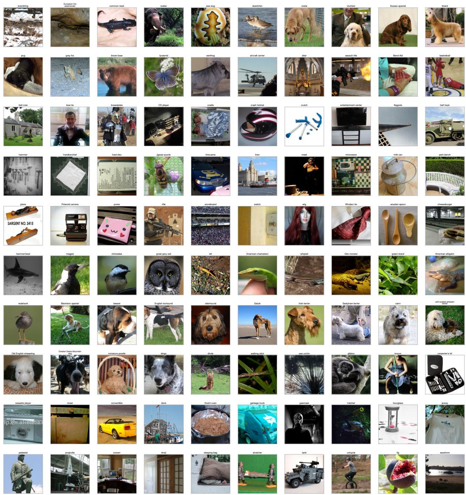  
Figure 7: I2P source images. The 100 ImageNet-1K validation crops used for image-to-pixel generation, arranged in evaluation order. Class names are shown for reference only.

## J 500-WAY RETRIEVAL VOCABULARY

Tables 20 and 21 list the 500 text candidates used for T2P 500-way Top-1 retrieval. Numbers are evaluation indices: the first 100 indices are the benchmark concepts in Table 19, and indices 101- 500 are additional distractors. For layout, we sort entries by label length and split at 9 characters (271 shorter labels; 229 longer ones). Within each table, entries fill columns from top to bottom so shorter labels occupy narrower columns.

Table 20: Shorter 500-way labels (≤9 characters). Sorted by increasing length and filled top-to-bottom across eight columns; 271 entries. Numbers are evaluation indices.
<table><tr><td>500.0x 91. axe 75. bed 59. bee 204. bra 40. bus 7. car 4. cat 51.cow 10. cup 17. dog 484. fig 122. fly 82. hat 116. hay 328. jay</td><td>269. harp 31. lamp 97. leaf 333. mask 275. maze 161. mink 48. moon 61. pear 337. safe 81. shoe 473. sock 77. sofa 11. star 489. suit 414. tank 396. tent</td><td>281. flute 327. goose 12. heart 5. house 172. junco 72. knife 65. lemon 252. llama 202. macaw 147. moped 37. phone 27. pizza 73. plate 118. purse 432. quail 266. quill 488. quilt 392. rifle 39. hammer</td><td>162. buckle 98. cactus 36. camera 26. carrot 100. castle 64. cherry 498. collie 70. cookie 155. coucal 132. cougar 497. coyote 425. dugong 491. eggnog 450. eraser 9. flower 179. geyser 63. grapes</td><td>286. teapot 375. throne 344. tights 386. tripod 21. turtle 216. tusker 191. valley 434. Vizsla 124. wallet 180. weasel 89. wrench 371. bassoon 273. bathtub 41. bicycle 54. chicken 135. doormat 243. echidna 254. go-kart</td><td>93. rainbow 448. Samoyed 154. sawmill 257. snorkel 424. spatula 140. sundial 128. T-shirt 483. thimble 86. tractor 268. viaduct 330. volcano 137. warthog 192. website 42. airplane 80. backpack 350. baseball 340. chainsaw 79. computer</td><td>168. lorikeet 163. Malinois 446. marmoset 50. mountain 13. mushroom 221. odometer 229. payphone 235. platypus 402. plectrum 433. popsicle 293. rapeseed 88. sailboat 69. sandwich 33. scissors</td><td>421. drumstick 165. golf cart 362. grey wolf 189. guacamole 334. gyromitra 355. hair clip 68. hamburger 237. harmonica 195. hourglass 30. ice cream 309. lakeshore</td></tr></table>

Table 21: Longer 500-way labels (≥10 characters). Sorted by increasing length and filled top-to-bottom across four columns; 229 entries. Numbers are evaluation indices.
<table><tr><td>260. Arctic fox 263. bald eagle 397. black swan 423. Otterhound 352. paintbrush 325. park bench 251. piggy bank 329. pipe organ 239. Pomeranian 418. pool table 151. promontory 455. pufferfish 312. rotisserie 369. safety pin 197. sea urchin 200. shoe store 460. shower cap 87. skateboard 391. snoek fish</td><td>499. coffeemaker 442. dung beetle 382. fire screen 264. freight car 207. grand piano 452. great égret 234. green mamba 139. hermit crab 495. hummingbird 259. hunting bow 385. leaf beetle 272. mixing bowl 185. pencil case 357. Persian cat 230. pirate ship 223. planetarium 173. rain barrel 250. salt shaker 90. screwdriver 496. sea anemone 241. Siamese cat 300. tape player 326. tennis ball 363. tiger shark 214. titi monkey 332. toilet seat 164. trench coat 322. triceratops 298. wheelbarrow 256. Windsor tie 178. wine bottle 224. wolf spider 351. Afghan Hound 109. barber chair 292. black grouse 403. Brittany dog 466. coral fungus 440. Egyptian Mau 399. fox squirrel 316. green iguana</td><td>249. Cairn Terrier 365. china cabinet 490. digital clock 336. garbage truck 166. grocery store 158. howler monkey 427. Irish Terrier 106. Japanese Chin 105. manhole cover 201. measuring cup 148. messenger bag 465. movie theater 487. red king crab 331. reflex camera 378. rocking chair 467. silver salmon 174. upright piano 215. velvet fâbric 412. American robin 126. Carolina anole 353. cliff dwelling 253. Cocker Spaniel 117. Dungeness crab 103. filing cabinet 379. French Bulldog 449. graduation cap 420. great grey owl 372. ping-pong ball 182. shower curtain 380. soap dispenser</td><td>119. steam locomotive 196. computer keyboard 186. impala (antelope) 482. little blue heron 295. monarch butterfly 373. Redbone Coonhound 285. rhinoceros beetle 356. Shetland Sheepdog 107. sulphur butterfly 405. threshing machine 426. Bluetick Coonhound 469. Christmas stocking 485. hand-held computer 493. Labrador Retriever 453. Scottish Deerhound 367. semi-trailer truck 444. smooth green snake 149. Alaskan tundra wolf 248. black-footed ferret 267. electric locomotive 297. Irish Water Spaniel 486. kite (bird of prey)</td></tr><tr><td>477. Bloodhound 383. box turtle 461. bridegroom 213. can opener 156. car mirror 439. chiffonier 277. chimpanzee 296. coral reef 463. crane bird 451. dishwasher 370. fire truck 121. frying pan 242. greenhouse 255. guinea pig 462. hair dryer 144. hair spray 274. hammerhead 84. helicopter 317. hoop skirt 428. lawn mower 142. leafhopper 146. lighthouse 83. motorcycle 415. mud turtle 349. neck brace</td><td>131. handkerchief 368. home theater 211. Groenendael dog 271. killer whale 471. laptop computer 335. mosquito net 145. longhorn beetle</td><td>101. spiral or coil 310. tandem bicycle 127. American dipper 104. baseball player 225. chocolate syrup 358. cocktail shaker 393. common redshank 314. electric guitar 226. fire salamander 422. football helmet 458. four-poster bed</td><td>307. through arch bridge 476. Cardigan Welsh Corgi 359. entertainment center 306. Old English Sheepdog 289. southern black wídow 125. swim trunks / shorts 400. European green lizard 348. red admiral butterfly</td></tr></table>

## K FULL TEXT-TO-PIXEL RESULTS

Tables 22 and 23 report the per-resolution Top-1 and MRR scores corresponding to Table 1. Table 24 decomposes the VLM Judge score into its six rubric dimensions.

Table 22: Full Text-to-Pixel semantic recognition results. SigLIP-SO400M 100-way and 500-way Top-1 under text-candidate pools. “Gem” and “F” denote Gemini and Flash. Invalid generations are counted as retrieval misses. All values are proportions; higher is better.
<table><tr><td>Resolution</td><td>Pool</td><td>Gem 3.6 F</td><td>GPT-5.6 Sol</td><td>GPT-6 Astra</td><td>Opus 5</td><td>Kimi K3</td><td>DeepSeek V4 Pro</td><td>Seed-2.1 Pro</td></tr><tr><td> $1 6 ^ { 2 }$ </td><td>100-way</td><td>.910</td><td>.910</td><td>.950</td><td>.910</td><td>.900</td><td>.580</td><td>.810</td></tr><tr><td> $1 6 ^ { 2 }$ </td><td>500-way</td><td>.870</td><td>.840</td><td>.870</td><td>.810</td><td>.810</td><td>.490</td><td>.700</td></tr><tr><td> $3 2 ^ { 2 }$ </td><td>100-way</td><td>.830</td><td>.920</td><td>.980</td><td>.950</td><td>.930</td><td>.680</td><td>.820</td></tr><tr><td> $3 2 ^ { 2 }$ </td><td>500-way</td><td>.780</td><td>.890</td><td>.920</td><td>.870</td><td>.870</td><td>.590</td><td>.720</td></tr><tr><td> $6 4 ^ { 2 }$ </td><td>100-way</td><td>.810</td><td>.890</td><td>.980</td><td>.970</td><td>.860</td><td>.630</td><td>.830</td></tr><tr><td> $6 4 ^ { 2 }$ </td><td>500-way</td><td>.720</td><td>.830</td><td>.940</td><td>.890</td><td>.770</td><td>.510</td><td>.740</td></tr></table>

Table 23: Full Text-to-Pixel mean reciprocal rank results. SigLIP-SO400M MRR under 100-way and 500-way candidate pools. “Gem” and $\mathrm { ^ { * } F ^ { * } } { }$ denote Gemini and Flash. GPT-6 Astra and Claude Opus 5 have 100 valid generations at every resolution. DeepSeek V4 Pro has 100, 99, and 97 valid generations at 162, 322, and 642, respectively. †Evaluated on 99 valid generations; “–” denotes an unavailable result.
<table><tr><td>Resolution</td><td>Pool</td><td>Gem3.6 F</td><td>GPT-5.6 Sol</td><td>GPT-6 Astra</td><td>Opus 5</td><td>Kimi K3</td><td>DeepSeek V4 Pro</td><td>Seed-2.1 Pro</td></tr><tr><td> $1 6 ^ { 2 }$ </td><td>100-way</td><td>.945</td><td>.945</td><td>.972</td><td>.949</td><td>.941</td><td>.697</td><td>.874</td></tr><tr><td> $1 6 ^ { 2 }$ </td><td>500-way</td><td>.913</td><td>.899</td><td>.927</td><td>.884</td><td>.881</td><td>.599</td><td>.792</td></tr><tr><td> $3 2 ^ { 2 }$ </td><td>100-way</td><td>.887</td><td>.956</td><td>.990</td><td>.972</td><td>.965</td><td>.769</td><td>.892</td></tr><tr><td> $3 2 ^ { 2 }$ </td><td>500-way</td><td>.837</td><td>.931</td><td>.960</td><td>.925</td><td>.932</td><td>.681</td><td>.815</td></tr><tr><td> $6 4 ^ { 2 }$ </td><td>100-way</td><td>.843</td><td>.933</td><td>.990</td><td>.985</td><td>.896†</td><td>.718</td><td>.898</td></tr><tr><td> $6 4 ^ { 2 }$ </td><td>500-way</td><td>.785</td><td>.893</td><td>.970</td><td>.945</td><td>.826†</td><td>.614</td><td>.832</td></tr></table>

Table 24: Text-to-Pixel VLM Judge dimension scores. Gemini 3.5 Flash scores each rendered output on subject identity (ID), defining attributes and key parts (Parts), structure and proportion (Struct.), detail quality (Detail), pixel-art execution (Pixel), and palette and contrast (Color). Entries are mean scores at each native resolution; Total is out of 100. Bold and underline mark the best and second-best values within each resolution.
<table><tr><td>Model</td><td>ID/20</td><td>Parts/25</td><td>Struct./20</td><td>Detail/20</td><td>Pixel/10</td><td>Color/5</td><td>Total/100</td></tr><tr><td> $1 6 ^ { 2 }$ </td><td></td><td></td><td></td><td></td><td></td><td></td><td></td></tr><tr><td>GPT-6 Astra</td><td>18.83</td><td>22.89</td><td>18.16</td><td>16.95</td><td>8.94</td><td>4.98</td><td>90.75</td></tr><tr><td>GPT-5.6 Sol</td><td>16.11</td><td>19.31</td><td>15.77</td><td>13.98</td><td>8.21</td><td>4.75</td><td>78.13</td></tr><tr><td>Claude Opus 5</td><td>15.77</td><td>18.52</td><td>15.61</td><td>12.60</td><td>7.88</td><td>4.75</td><td>75.13</td></tr><tr><td>Kimi K3</td><td>15.48</td><td>18.21</td><td>15.27</td><td>12.90</td><td>7.99</td><td>4.69</td><td>74.54</td></tr><tr><td>Gemini 3.6 Flash</td><td>16.22</td><td>19.23</td><td>15.79</td><td>13.66</td><td>8.17</td><td>4.72</td><td>77.79</td></tr><tr><td>Seed-2.1 Pro</td><td>14.12</td><td>16.57</td><td>14.07</td><td>11.61</td><td>7.64</td><td>4.56</td><td>68.57</td></tr><tr><td>DeepSeek V4 Pro</td><td>10.99</td><td>12.34</td><td>11.47</td><td>8.17</td><td>6.68</td><td>4.00</td><td>53.65</td></tr><tr><td> $3 2 ^ { 2 }$ </td><td></td><td></td><td></td><td></td><td></td><td></td><td></td></tr><tr><td>GPT-6 Astra</td><td>19.16</td><td>23.18</td><td>18.36</td><td>16.94</td><td>8.95</td><td>4.99</td><td>91.58</td></tr><tr><td>GPT-5.6 Sol</td><td>16.57</td><td>19.52</td><td>16.06</td><td>13.80</td><td>8.11</td><td>4.80</td><td>78.86</td></tr><tr><td>Claude Opus 5</td><td>16.04</td><td>18.39</td><td>15.49</td><td>11.92</td><td>7.59</td><td>4.69</td><td>74.12</td></tr><tr><td>Kimi K3</td><td>15.80</td><td>18.27</td><td>15.35</td><td>12.68</td><td>7.92</td><td>4.65</td><td>74.67</td></tr><tr><td>Gemini 3.6 Flash</td><td>14.77</td><td>17.05</td><td>14.47</td><td>12.33</td><td>7.99</td><td>4.60</td><td>71.21</td></tr><tr><td>Seed-2.1 Pro</td><td>13.56</td><td>15.55</td><td>13.22</td><td>10.77</td><td>7.10</td><td>4.36</td><td>64.56</td></tr><tr><td>DeepSeek V4 Pro</td><td>11.76</td><td>13.13</td><td>11.50</td><td>8.51</td><td>6.17</td><td>3.95</td><td>55.02</td></tr><tr><td> $6 4 ^ { 2 }$ </td><td></td><td></td><td></td><td></td><td></td><td></td><td></td></tr><tr><td>GPT-6 Astra</td><td>18.74</td><td>22.63</td><td>18.04</td><td>16.38</td><td>8.92</td><td>4.95</td><td>89.66</td></tr><tr><td>GPT-5.6 Sol</td><td>15.14</td><td>17.95</td><td>15.05</td><td>12.23</td><td>7.87</td><td>4.72</td><td>72.96</td></tr><tr><td>Claude Opus 5</td><td>15.55</td><td>17.54</td><td>14.58</td><td>10.95</td><td>6.97</td><td>4.48</td><td>70.07</td></tr><tr><td>Kimi K3</td><td>12.95</td><td>14.69</td><td>12.82</td><td>9.68</td><td>7.05</td><td>4.34</td><td>61.53</td></tr><tr><td>Gemini 3.6 Flash</td><td>12.67</td><td>14.30</td><td>12.30</td><td>9.87</td><td>7.05</td><td>4.16</td><td>60.35</td></tr><tr><td>Seed-2.1 Pro</td><td>12.89</td><td>14.24</td><td>12.27</td><td>9.32</td><td>6.45</td><td>4.16</td><td>59.33</td></tr><tr><td>DeepSeek V4 Pro</td><td>10.16</td><td>10.77</td><td>9.58</td><td>6.54</td><td>5.20</td><td>3.42</td><td>45.67</td></tr></table>

## L ALGORITHMIC IMAGE-TO-PIXEL BASELINES IN FULL

Each method either combines a spatial downscaling stage with a subsequent color quantization stage or jointly determines the output regions and palette. We set the palette size to eight for all constrained methods and evaluate them on the same 100 ImageNet validation crops used for the VLMs.

Tier 0: simple resampling. Nearest-neighbor sampling selects the source-cell center, while box filtering averages the corresponding source patch. Both are followed by median-cut quantization (Heckbert, 1982).

Tier 1: linear filters. Bicubic and Lanczos interpolation use standard fixed resampling kernels before median-cut quantization. These methods allocate the output resolution uniformly across the image.

Tier 2: content-adaptive downscaling. DPID (Weber et al., 2016) weights input pixels according to their deviation from a local guidance color; we evaluate $\lambda \in \{ 0 . 5 , 1 . 0 \}$ . SSIM-optimal downscaling (Oztireli & Gross¨ , 2015) minimizes structural dissimilarity using local image statistics. Both methods are followed by median-cut quantization.

Tier 3: pixel-art-specific methods. Pyxelate1 uses Sobel-gradient information to merge local cells and estimates an eight-color palette with a Bayesian Gaussian mixture. We use version 2.1 or later with sobel=3, depth=1, and dithering disabled. Pixelated Image Abstraction (PIA) (Gerstner et al., 2012) jointly constructs output regions and a reduced palette. The reference implementation uses modified SLIC mapping, mass-constrained deterministic annealing (Rose, 1998), bilateral superpixel smoothing, and a saturation factor of 1.1. PIA (reduced) retains SLIC with compactness $m = 4 5$ , replaces annealing with weighted eight-means over superpixel colors, and omits bilateral smoothing and saturation adjustment.

## L.1 REPRESENTATIVE IMPLEMENTATIONS

The following procedures specify the three representatives used in the main comparison. All receive $4 2 5 6 \times 2 5 6$ RGB crop I and target side length $N \in \{ 1 6 , 3 2 , 6 4 \}$ . Median cut uses $K = 8$ without dithering. SLIC and k-means in PIA (reduced) operate in CIELAB; the other operations use RGB.

Nearest + median cut

Input: image I and target side length $N .$

1. For each output cell $( y , x )$ , sample I at the center of the corresponding source cell to obtain $Y [ y , x ]$

2. Apply MedianCut $( Y , K = 8 )$ and return the quantized grid.

## SSIM-optimal + median cut

Input: image I of side length H and target side length $N .$

1. Set $s = H / N _ { \ast }$ . For each output cell, compute the aligned $s \times s$ block mean $L [ y , x ]$ and squared-value mean $Q [ y , x ]$ for each RGB channel.

2. For each $2 \times 2$ output neighborhood, compute its mean $\mu ,$ the variance $\sigma _ { L } ^ { 2 }$ of $L ,$ and $\sigma _ { H } ^ { 2 } = \mathrm { m e a n } ( Q ) -$ $\mu ^ { 2 }$

3. Set $r = \sqrt { \sigma _ { H } ^ { 2 } / \sigma _ { L } ^ { 2 } }$ when $\sigma _ { L } ^ { 2 } \geq \varepsilon ,$ , and $r = 0$ otherwise. Form the local proposal $\hat { Y } = \mu + r ( L - \mu )$

4. Average overlapping proposals, clip values to $[ 0 , 1 ]$ , and return MedianCut(Y , K ˆ = 8).

## PIA (reduced)

Input: image I and target side length N.

1. Compute $S = { \mathrm { S L I C } } ( I ; n = N ^ { 2 } , m = 4 5 ) { \mathrm { ~ i n ~ C I E L A B } } .$

2. For each superpixel u, compute its mean color $c _ { u }$ and size $w _ { u } = | u | .$

3. Fit eight palette colors $\{ p _ { k } \} _ { k = 1 } ^ { 8 }$ and assignments a using weighted k-means on $\left\{ c _ { u } \right\}$ with weights $\{ w _ { u } \}$

4. For each output cell, identify the superpixel at the corresponding source-cell center and assign the RGB conversion of $p _ { a ( u ) }$

## L.2 COMPLETE ALGORITHMIC RESULTS

Table 25: All palette-matched algorithmic baselines on I2P. Every method is restricted to eight colors. DINO is paired DINOv2-Large CLS cosine, SigLIP cosine uses pooled SigLIP-SO400M features, and 100-way Top-1 is measured over the 100 source images. Higher is better, with n = 100 for every cell. Bold values mark the best result in each column, and colored bands distinguish the four method families.
<table><tr><td rowspan="2">Method</td><td colspan="3">DINO CLS cosine</td><td colspan="3">SigLIP cosine</td><td colspan="3">100-way Top-1 (%)</td></tr><tr><td> $1 6 ^ { 2 }$ </td><td> $3 2 ^ { 2 }$ </td><td> $6 4 ^ { 2 }$ </td><td> $1 6 ^ { 2 }$ </td><td> $3 2 ^ { 2 }$ </td><td> $6 4 ^ { 2 }$ </td><td> $1 6 ^ { 2 }$ </td><td> $3 2 ^ { 2 }$ </td><td> $6 4 ^ { 2 }$ </td></tr><tr><td colspan="10">Tier 0 Simple resampling</td></tr><tr><td>Nearest + median cut</td><td>.012</td><td>.090</td><td>.480</td><td>.523</td><td>.568</td><td>.665</td><td>9</td><td>28</td><td>62</td></tr><tr><td>Box + median cut</td><td>.012</td><td>.099</td><td>.475</td><td>.523</td><td>.577</td><td>.673</td><td>10</td><td>27</td><td>65</td></tr><tr><td colspan="10">Tier 1 Linear filters</td></tr><tr><td>Bicubic + median cut</td><td>.013</td><td>.093</td><td>.459</td><td>.524</td><td>.573</td><td>.672</td><td>9</td><td>26</td><td>64</td></tr><tr><td>Lanczos + median cut</td><td>.013</td><td>.099</td><td>.478</td><td>.524</td><td>.576</td><td>.673</td><td>10</td><td>29</td><td>64</td></tr><tr><td colspan="10">Tier 2 Content-adaptive downscaling</td></tr><tr><td>DPID λ = 0.5 + median cut</td><td>.011</td><td>.103</td><td>.509</td><td>.523</td><td>.578</td><td>.679</td><td>10</td><td>27</td><td>68</td></tr><tr><td>DPID λ = 1.0 + median cut</td><td>.011</td><td>.104</td><td>.527</td><td>.522</td><td>.580</td><td>.678</td><td>9</td><td>32</td><td>65</td></tr><tr><td>SSIM-optimal + median cut</td><td>.013</td><td>.119</td><td>.543</td><td>.524</td><td>.579</td><td>.686</td><td>9</td><td>34</td><td>75</td></tr><tr><td colspan="10">Tier 3 Pixel-art-specific methods</td></tr><tr><td>Pyxelate</td><td>.013</td><td>.085</td><td>.377</td><td>.525</td><td>.569</td><td>.655</td><td>12</td><td>32</td><td>65</td></tr><tr><td>PIA (reduced)</td><td>.014</td><td>.135</td><td>.490</td><td>.546</td><td>.608</td><td>.697</td><td>18</td><td>50</td><td>78</td></tr><tr><td>PIA (reference)</td><td>.015</td><td>.123</td><td>.485</td><td>.541</td><td>.599</td><td>.692</td><td>17</td><td>40</td><td>71</td></tr></table>

Table 25 shows that standard resampling filters and the two DPID settings yield similar results, while the strongest method depends on the metric. SSIM-optimal obtains the highest DINOv2 fidelity at $6 4 ^ { 2 }$ , whereas PIA (reduced) leads both SigLIP metrics across resolutions. We therefore use one representative for simple resampling, fidelity-oriented downscaling, and joint geometry-palette optimization.