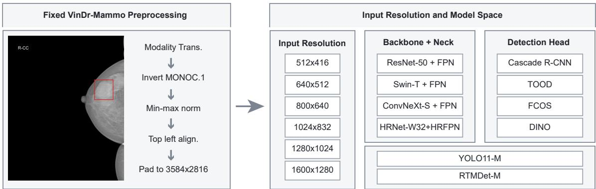
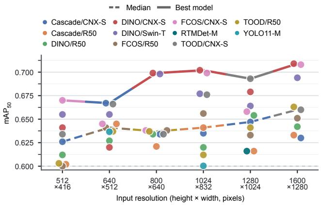
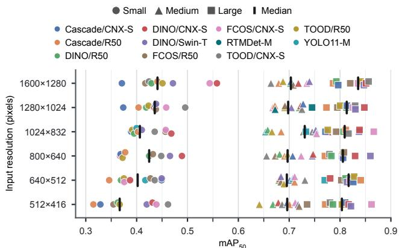
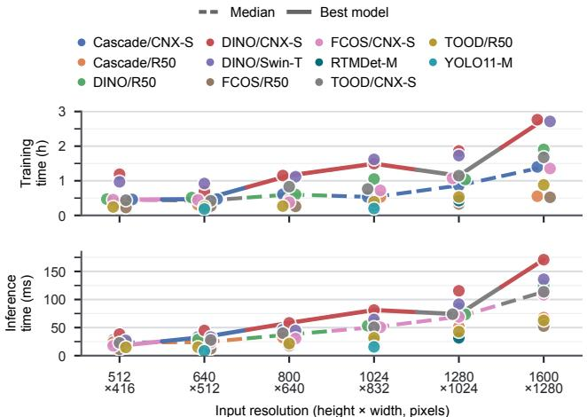
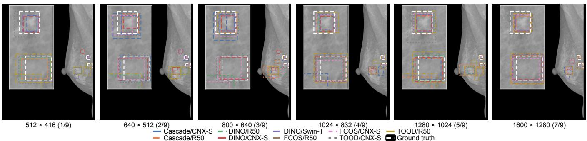

# IMPACT OF INPUT RESOLUTION ON MAMMOGRAPHIC MASS DETECTION: A CONTROLLED MULTI-ARCHITECTURE STUDY

Kaan Buyukdemirci⋆†

Emine Ulku Saritas⋆†

⋆Department of Electrical and Electronics Engineering, Bilkent University, Ankara 06800, Turkey †National Magnetic Resonance Research Center (UMRAM), Bilkent University, Ankara 06800, Turkey Email: k.buyukdemirci@bilkent.edu.tr, saritas@ee.bilkent.edu.tr

## ABSTRACT

Deep-learning-based mass detectors usually downsample mammograms, trading fine image detail for lower computational cost. However, published studies cannot reveal how much accuracy this tradeoff sacrifices, since they also differ in architecture, preprocessing, and evaluation protocol. In this work, we isolated the effect of input resolution in a controlled study on the VinDr-Mammo dataset, training 18 detectors at six input resolutions ranging from 512×416 to 1600×1280 pixels, for 108 model–resolution combinations. Whole mammograms were resized without cropping or tiling. For each model, preprocessing, model initialization, augmentation, and evaluation procedures were kept fixed across resolutions. Detection accuracy was evaluated by mAP50 on the 219 mass-positive images of the official test split, and 57 combinations with test mAP50 ≥ 0.60 were analyzed. From the lowest to the highest resolution, median mAP rose from 0.626 to 0.660 and the best mAP from 0.670 to 0.709. The best result, achieved by DINO with a ConvNeXt-S backbone, is the highest mAP reported to date on mass-positive VinDr-Mammo images. Gains were concentrated in small masses: for the smallest third of lesions, median mAP rose by 0.074 (from 0.367 to 0.441), compared with 0.007 and 0.032 for medium and large masses. Median training time increased from 0.45 to 1.40 h, and median inference time from 23.6 to 113.7 ms per image. Therefore, higher input resolution mainly benefits the small masses that are hardest to detect, at a computational cost that remains practical.

Index Terms— Computer-aided detection, deep learning, image resolution, mammography, object detection

## 1. INTRODUCTION

Deep-learning methods have been used to support mammogram interpretation [1, 2]. Applications include image-level classification to identify mammograms with suspicious findings and mass detection to localize individual lesions. Mammograms can contain a large number of pixels, making full-resolution processing computationally demanding. As an example, the publicly available VinDr-Mammo dataset features full mammograms that can be as large as 3580 × 2812 pixels, along with annotated breast findings [3]. To reduce memory use and processing time, mammograms are often resized to a lower input resolution. This may remove details needed to detect small or hard-to-see masses. Using a higher input resolution can preserve more detail, but increases the computational load. The question is therefore how much higher resolution improves detection and whether the improvement justifies the cost.

Previous studies have investigated mass detection by dividing mammograms into small high-resolution patches to preserve fine details while reducing the computational load [4, 5]. Other studies have examined resizing, cropping, and preprocessing for mammogram classification [6–8]. Overall, the studies in the literature differ in their models, training procedures, image preparation, and test images [9, 10]. As a result, an important question that remains is how the input resolution alone affects mass detection performance.

In this work, we compared 18 models at six different input resolutions using the 219 mass-positive images of the official VinDr-Mammo test split. For each model, the preprocessing, model initialization, augmentation, and evaluation procedures were kept fixed, while only the input resolution was changed. At each resolution, full mammograms were resized without cropping or dividing into patches. The detection performance was evaluated using mean average precision at a bounding-box overlap threshold of 0.50 (mAP ). The performances at different mass sizes were also compared, along with training and inference times. Our contributions are:

1. A controlled comparison of 18 detection models at six different input resolutions, covering 108 model–resolution combinations, showing that the highest mAP50 among all the models increased from 0.670 to 0.709 between the lowest input resolution at 512× 416 and the highest input resolution at 1600×1280.

2. An mAP50 score of 0.709 achieved using DINO/ConvNeXt-S at 1600×1280 resolution, the highest reported score in the literature using mass-positive VinDr-Mammo images (see Table 1).

3. An analysis of mAP50 score by mass size, showing that the largest performance gains were achieved for the smallest masses.

The code, configurations, and other resources needed to reproduce the experiments will be released at https://github.com/kaanb uyukdemirci/isbi-model-resolution-comparison.

## 2. DATA AND METHODS

## 2.1. Dataset and Preprocessing

VinDr-Mammo v1.0.0 contains 20,000 mammograms from 5,000 exams, with a total of 1,226 mass boxes annotated on 1,113 images [11]. Here, we retained the official 1,000-exam test split and held out 15% of training exams for validation. The resulting training, validation, and test sets contained 743, 151, and 219 mass-positive images, respectively. Then, 186 mass-negative images were added to the training set to help the models distinguish masses from normal breast tissue. Both the MLO and CC views of a breast had to lack a mass annotation for either to qualify as negative.

First, the DICOM images were converted to floating-point arrays, with the image polarity corrected when necessary and pixel values normalized to [0, 1]. No cropping, mirroring, histogram equalization, CLAHE, lesion cropping, or tiling was applied. The mammograms were zero padded to 3584×2816 pixels, the nearest dimension divisible by 32. These images were then resized while preserving the aspect ratio. Compatibility with different network architectures was ensured by applying minimal right padding to the nearest multiple of 32. Six different input resolutions were considered: $5 1 2 \times 4 1 6 ,$ 640×512, 800×640, 1024×832, 1280×1024, and $1 6 0 0 \times 1 2 8 0$ Bounding-box coordinates were scaled by the same factor at each resolution. Grayscale values were converted to RGB values by copying pixel intensities into three channels to match the input format expected by the models (Fig. 1).

  
Fig. 1. Following preprocessing of VinDr-Mammo images, mass detection performances of 18 models are evaluated at six input resolutions. The model–resolution combinations are as listed. Four backbones are combined with four detection networks, resulting in 16 models. DINO uses its own channel mapper instead of FPN or HRFPN. The other 2 models, YOLO11-M and RTMDet-M, fully retain their native architectures.

## 2.2. Controlled Resolution Sweep

We evaluated four feature extraction networks (i.e., backbones): ResNet-50, Swin-T, HRNet-W32, and ConvNeXt-S. We combined each backbone with four detection networks: Cascade R-CNN, TOOD, FCOS, and DINO [12–15], resulting in 16 detection models. Independent of the choice of backbone, DINO used its own channel mapper. In all other cases, ResNet-50, Swin-T, and ConvNeXt-S were paired with an FPN neck, while HRNet-W32 was paired with an HRFPN neck. In addition, we evaluated YOLO11-M and RTMDet-M, each using its native backbone, neck, and detection head. We used implementations from MMDetection and Ultralytics [16, 17]. All 18 models processed full mammograms, without tiling, cross-view fusion, test-time augmentation, or ensembling.

Increasing input resolution $H \times W$ increased feature-map locations but not learned parameter shapes. At stride $s ,$ the feature map contained approximately $\lceil H / s \rceil \times \mathsf { \bar { \Gamma } } W / s \rceil$ locations. Hence, resolution changed spatial sampling while channel widths and pyramid levels remained fixed. Parameter counts ranged from 20.1M to 94.5M across the models and remained fixed within each model.

In the end, the controlled multi-architecture study contained 18 models and six resolution levels, for a total of 108 model–resolution combinations. Each model–resolution combination used five learningrate and batch-size settings, giving 540 planned runs. Augmentation settings, initial weights, random seed, and optimizer remained the same. Baseline learning rates and two batch sizes were selected for each model at 640×512 using validation only. With the smaller batch size, we tested learning rates of 0.5, 1, and 1.5 times the baseline rate. With the larger batch size, we tested 0.5 and 1 times the baseline rate. We initialized each model using official ImageNet or COCO weights, with the one-class output layer reinitialized and input normalization unchanged across resolutions. We used gradient accumulation to preserve the effective batch size when GPU memory required a smaller physical batch.

Table 1. Reported detection performances on mass-positive VinDr-Mammo images. “Official” denotes the official test split. Numbers in parentheses indicate test image count. NR stands for “not reported”.
<table><tr><td>Study</td><td> $\mathrm { \ m A P { 5 0 } }$ </td><td>Test set</td></tr><tr><td>This work</td><td>0.709</td><td>Official (219)</td></tr><tr><td>Bhat et al. [18]</td><td>0.700</td><td>Official (NR)</td></tr><tr><td>Trang et al. [9]</td><td>0.690</td><td>Random (NR)</td></tr><tr><td>Bulatović et al. [5]</td><td>0.671</td><td>Official (NR)</td></tr><tr><td>Mammo-CLIP/FM [10, 19]</td><td>0.580</td><td>Official (219)</td></tr></table>

All runs used seed 42, one RTX 3090, at most 25 epochs, moderate geometric and intensity augmentation $( \pm 2 ^ { \circ }$ rotation, 2% translation, scaling from 0.95 to 1.05, mild intensity changes, and lowvariance Gaussian noise), and early stopping after ten epochs without a 0.002 validation-m $\mathrm { A P _ { 5 0 } }$ improvement. For each model–resolution combination, we selected the checkpoint with the highest validation mAP50 across the five learning-rate and batch-size settings. Only the selected checkpoint was evaluated on the test set. Both validation and test evaluation used mass-positive images, following related work [10, 18].

## 2.3. Quantitative Evaluations

For quantifying detection accuracy, $\mathrm { \ m A P _ { 5 0 } }$ score was computed for each model–resolution combination on mass-positive images, excluding false positives on the 3,781 mass-negative official-test images. We excluded 51 combinations with test $\mathrm { m A P _ { 5 0 } < 0 . 6 0 }$ leaving 57 combinations for analysis. The number of retained models per resolution varied between 9 and 10.

The 219 mass-positive test images contained 237 ground-truth bounding boxes. In addition, we divided the bounding boxes into three approximately equal-sized groups based on their area relative to the whole image, using thresholds of 0.280% and 0.709% of the total image area, resulting in 77 to 81 boxes per group. We then calculated $\mathrm { \ m A P _ { 5 0 } }$ separately for each mass-size group to determine the performances at different mass sizes. Lastly, training time was measured as wall-clock duration, while per-image inference time was calculated as the average over the test images.

  
(a) Resolution vs. $\mathrm { \ m A P _ { 5 0 } }$

  
(b) m $\mathrm { \ A P _ { 5 0 } }$ by mass size and resolution  
Fig. 2. Comparison of detection performances at different input resolutions. (a) m $\mathrm { { A P } _ { 5 0 } }$ scores of models at different resolutions. Dashed and solid lines connect the median and best $\mathrm { \ m A P _ { 5 0 } }$ scores per resolution, respectively. (b) $\mathrm { \ m A P { 5 0 } }$ scores for three different mass-size groups at different resolutions. Markers indicate mass sizes: circle for small, triangle for medium, and square for large masses, with vertical ticks marking group medians. Colors identify models in both (a) and (b). Only the results for model–resolution combinations with mA $\mathbf { \Delta } \mathbf { \cdot } \mathbf { P } 5 0 \geq 0 . 6 0$ are shown.

## 3. RESULTS

Figure 2(a) shows $\mathrm { \ m A P { 5 0 } }$ scores for the models at different input resolutions. The median m $\mathrm { A P 5 0 }$ score rises from 0.626 at $5 1 2 \times 4 1 6$ to 0.660 at 1600×1280, increasing in a non-monotonic fashion. Perresolution best $\mathrm { m A P 5 0 }$ scores are also non-monotonic. The overall best m $\mathrm { \bf A P _ { 5 0 } }$ score of 0.709 is achieved with DINO/ConvNeXt-S at $1 6 0 0 \times 1 2 8 0$ . Table 1 shows that this score is the highest reported detection accuracy on mass-positive VinDr-Mammo images in the literature, exceeding the next-highest reported score of 0.700.

As shown in Fig. 2(b), the models have considerably lower median mAP50 for small masses compared with medium and large masses. Nonetheless, the small masses benefit the most from increased resolution: the median $\mathrm { \ m A P _ { 5 0 } }$ for the small mass sizes increases by 0.074 (from 0.367 to 0.441), when compared to 0.007 and 0.032 for the medium and large mass sizes, respectively.

The median training time increases from 0.45 to 1.40 h and inference time increases from 23.6 to 113.7 ms (Fig. 3), demonstrating a trade-off between detection accuracy and computational cost, as expected.

Figure 4 shows an example case with two adjacent small masses (sizes of 0.20% and 0.15% of the total image area). The number of models successfully detecting both masses increases at every resolution step, from 1/9 at $5 1 2 \times 4 1 6$ to 7/9 at 1600×1280. At a fixed feature-map stride, a higher-resolution input gives each mass more pixels and feature-map samples without increasing the parameter count. Consistent with the performance gain observed for smaller masses, this example illustrates how retaining high-resolution image details can help detect and distinguish nearby masses.

## 4. DISCUSSION AND CONCLUSION

This work presented a controlled comparison of detection performances across models by varying input resolution within fixed detector and training setups. The largest tested input resolution produces both the highest median mA $\mathrm { { . P _ { 5 0 } } }$ and the best individual result. To our knowledge, the best $\mathrm { \ m A P _ { 5 0 } }$ of 0.709, obtained with DINO/ConvNeXt-S at $1 6 0 0 \times 1 2 8 0$ , is the highest reported on masspositive VinDr-Mammo images (Table 1). This result was achieved with a standard whole-image detector, without architectural modifications, patch-based inference, or external mammography-specific pretraining, yet it exceeds methods that rely on these strategies.

  
Fig. 3. Training and inference times at different input resolutions. Dashed lines track the median times and solid lines track the times for best- ${ \cdot } { \mathrm { m A P } } _ { 5 0 }$ models from Fig. 2(a). Colors identify models.

The mass-size dependent performance analysis helps explain the benefit of using higher input resolution. From the lowest to the highest input size, the smallest masses gain 0.074 in median $\mathrm { \ m A P _ { 5 0 } }$ , which is considerably higher than that for the larger masses. Together with the adjacent-mass example in Fig. 4, this finding supports retaining lesion detail as a reason for the improvement. Small masses still have the lowest median scores at every input size, so increasing resolution does not remove the mass-size dependence of performance.

While the computational cost increases with resolution, the onetime training time remains manageable even at the highest tested resolution. In addition, the inference time remains short enough to not impose any bottlenecks in a radiological evaluation pipeline. Con sidering the importance of early detection and that the largest gains are observed for the smallest masses, the increase in computational cost might be well justified.

  
Fig. 4. Representative detection results across all six resolutions on a mammogram with two adjacent small masses. Model predictions and ground truth boxes are shown, with rectangular insets displaying close-up views of the two masses. The number of models successfully detecting both masses increases with increasing input resolution, from 1/9 at $5 1 2 \times 4 1 6$ to 7/9 at $1 6 0 0 \times 1 2 8 0$ (confidence $\ge 0 . 1 5 , \mathrm { I o U } \ge 0 . 5 0 )$

## 5. COMPLIANCE WITH ETHICAL STANDARDS

This work used de-identified human subject data from the publicly available VinDr-Mammo dataset [11].

## 6. ACKNOWLEDGMENTS

The authors have no relevant financial or non-financial interests to disclose. Codex was used to help develop the code and extract shared repositories from larger codebases. All Codex-generated code was reviewed and tested in detail by the authors.

## 7. REFERENCES

[1] L. Shen, L. R. Margolies, J. H. Rothstein, E. Fluder, R. McBride, and W. Sieh, “Deep learning to improve breast cancer detection on screening mammography,” Sci. Rep., vol. 9, no. 1, Art. no. 12495, 2019.

[2] N. Wu et al., “Deep neural networks improve radiologists’ performance in breast cancer screening,” IEEE Trans. Med. Imag., vol. 39, no. 4, pp. 1184–1194, 2020.

[3] H. T. Nguyen et al., “VinDr-Mammo: A large-scale benchmark dataset for computer-aided diagnosis in full-field digital mammography,” Sci. Data, vol. 10, no. 1, Art. no. 277, 2023.

[4] K. Rangarajan et al., “Ultra-high resolution, multi-scale, context-aware approach for detection of small cancers on mammography,” Sci. Rep., vol. 12, no. 1, Art. no. 11622, 2022.

[5] I. Bulatovic, G. Wang, and H. Wang, “Refining YOLOv8 for full´ field digital mammograms: Improving small object detection through resolution-preserving patched inference,” in Proc. IEEE Int. Conf. Real-time Comput. Robot. (RCAR), 2025, pp. 812– 819.

[6] D. G. P. Petrini and H. Y. Kim, “A comprehensive study of transfer learning, resolution reduction, and multi-view classification for breast cancer detection in mammograms,” Int. J. Imag. Syst. Technol., vol. 36, no. 5, Art. no. e70436, 2026.

[7] N. Ferreira, A. Peres, C. Renno-Costa, and R. C. Moioli, “Pre-´ processing pipeline and imaging equipment impact the performance of CNN for breast cancer detection in mammograms: Evidence from CBIS-DDSM and VinDr-Mammo,” IEEE Access, vol. 14, pp. 75 198–75 208, 2026.

[8] H. N. Huynh, A. T. Tran, and T. N. Tran, “Region-of-interest optimization for deep-learning-based breast cancer detection in mammograms,” Appl. Sci., vol. 13, no. 12, Art. no. 6894, 2023.

[9] K. Trang, F. F. Ting, B. Q. Vuong, and C.-M. Ting, “MANGA-YOLO: A mamba-inspired YOLO model with group attention for breast mass detection in mammograms,” Comput. Biol. Med., vol. 199, Art. no. 111339, 2025.

[10] S. Ghosh, C. B. Poynton, S. Visweswaran, and K. Batmanghelich, “Mammo-CLIP: A vision language foundation model to enhance data efficiency and robustness in mammography,” in Proc. Int. Conf. Med. Image Comput. Comput.-Assist. Interv. (MICCAI), ser. Lect. Notes Comput. Sci., vol. 15012, 2024, pp. 632–642.

[11] H. H. Pham, H. Nguyen Trung, and H. Q. Nguyen, “VinDr-Mammo: A large-scale benchmark dataset for computer-aided detection and diagnosis in full-field digital mammography,” PhysioNet, version 1.0.0, 2022.

[12] Z. Cai and N. Vasconcelos, “Cascade R-CNN: Delving into high quality object detection,” in Proc. IEEE/CVF Conf. Comput. Vis. Pattern Recognit. (CVPR), 2018, pp. 6154–6162.

[13] C. Feng, Y. Zhong, Y. Gao, M. R. Scott, and W. Huang, “TOOD: Task-aligned one-stage object detection,” in Proc. IEEE/CVF Int. Conf. Comput. Vis. (ICCV), 2021, pp. 3490–3499.

[14] Z. Tian, C. Shen, H. Chen, and T. He, “FCOS: Fully convolutional one-stage object detection,” in Proc. IEEE/CVF Int. Conf. Comput. Vis. (ICCV), 2019, pp. 9626–9635.

[15] H. Zhang et al., “DINO: DETR with improved denoising anchor boxes for end-to-end object detection,” in Proc. Int. Conf. Learn. Represent. (ICLR), 2023.

[16] K. Chen et al., “MMDetection: Open MMLab detection toolbox and benchmark,” arXiv:1906.07155, 2019.

[17] G. Jocher and J. Qiu, “Ultralytics YOLO11,” version 11.0.0, 2024, accessed: Aug. 26, 2026. [Online]. Available: https: //github.com/ultralytics/ultralytics.

[18] S. Bhat et al., “Exemplar Med-DETR: Toward generalized and robust lesion detection in mammogram images and beyond,” in Proc. Int. Conf. Med. Image Comput. Comput.-Assist. Interv. (MICCAI), ser. Lect. Notes Comput. Sci., vol. 15965, 2025, pp. 205–215.

[19] S. Ghosh et al., “Mammo-FM: Breast-specific foundational model for integrated mammographic diagnosis, prognosis, and reporting,” arXiv:2512.00198, 2025.