# Improving Diffusion-Based Augmentation for Data-Scarce Image Classification via Mask-Guided Reference Attention and Repulsive Noise Optimization

Hyun-Jic Oh1,2\* GaYeon Koh1\* Won-Ki Jeong1,2†

1Korea University, Republic of Korea 2VIENCE Inc., Republic of Korea {hyunjic0127,wkjeong}@korea.ac.kr Code: https://github.com/hvcl/MGRAttn-RNO

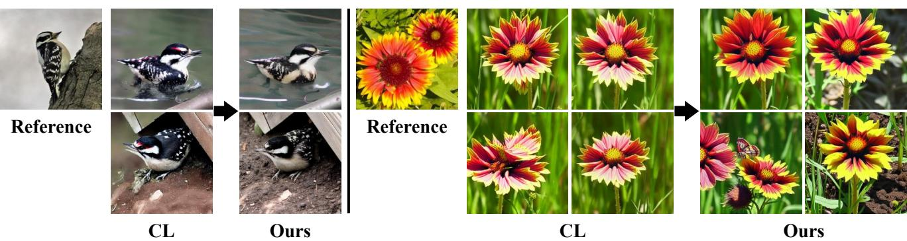  
Figure 1. Rare-class generations illustrating the two failure modes. (Left) Ours corrects foreground artifacts in concept-learning (CL) (e.g., incorrect red coloration on the bird’s head) and better preserves foreground details. (Right) CL generates similar outputs despite varying prompts; Ours produces diverse prompt-conditioned samples while preserving foreground details.

## Abstract

Diffusion-based data augmentation has emerged as a powerful strategy for addressing data-scarce image classification. Recent pipelines typically adapt a pretrained text-to-image diffusion model to a limited number of class examples and subsequently sample synthetic images using diverse textual prompts. However, in extreme data-scarce regimes such as long-tailed single-sample settings, this approach suffersfrom a dualfailure mode: the generated samples often lack discriminativeforeground details crucialfor classifier training, and the adapted class prior can bias the early denoising process, causing output images to exhibit similar patterns despite varying text prompts. To overcome these limitations, we propose a sampling-side framework of two complementary components that simultaneously enhance fine details and diversity. First, Mask-Guided Reference (MGR) Attention updates onlyforeground value tokens with reference features via zero-shot segmentation, limiting reference influence to the target object and mitigating excessive global feature injection. Second, Repulsive

Noise Optimization (RNO) encourages initial noise trajectories to diverge from dominant generative modes of the adapted model, enabling target prompts to express broader contextual variation. Extensive evaluations show consistent improvements, with the largest gains in long-tailed single-sample settings of up to 2.50 and 2.94 points on CUB-LT IF100, andfurther robustness acrossfew-shot and background-shift evaluations.

## 1. Introduction

Training high-performing image classifiers under datascarce regimes remains a fundamental challenge, particularly in long-tailed and single-sample settings where certain categories contain only a handful of labeled instances [27, 43, 48]. This constraint is especially severe in fine-grained classification, where deployable vision backbones must capture subtle, highly localized foreground attributes such as specific texture patterns or color contours to effectively distinguish visually similar sub-categories.

Synthetic data augmentation powered by pretrained textto-image diffusion models [28, 33] has emerged as a promising solution to alleviate this scarcity by generating additional training samples with diverse synthetic variants [1, 13, 29]. For these synthetic samples to benefit downstream classifier training, they must simultaneously satisfy two criteria: preserving class-discriminative finedetails while maintaining broad contextual diversity.

Diffusion-based augmentation methods typically adapt a text-to-image diffusion model via concept-learning techniques such as Textual Inversion [8] or LoRA [16], and sample synthetic images using diverse textual prompts. While effective to an extent, we observe that in extreme datascarce regimes such as long-tailed single-sample cases, this approach suffers from a distinct dual failure mode (see Fig. 1). (i) Fine-Detail Degradation: the adapted model often fails to reproduce precise, discriminative foreground details, as adapting from only a few examples can yield weak fine-grained priors. (ii) Diversity Collapse: the adapted class prior can dominate the early denoising process, causing generated images to collapse into similar geometric structures despite varying text prompt suffixes.

To overcome fine-detail degradation, we propose Mask-Guided Reference (MGR) Attention, a sampling-time localized attention strategy. Existing attention-manipulation methods [3, 17] are designed for image editing such as style transfer or spatial layout control, where replacing selfattention key-value tokens with those from a reference is appropriate. However, directly applying such techniques to data augmentation is not straightforward: global key-value replacement propagates reference features across the entire synthesized image, suppressing contextual variation driven by the text prompt. Instead, MGR Attention uses a zeroshot segmenter [4, 19] to obtain foreground boundaries, updating only foreground value tokens with reference features.

To address diversity collapse, we introduce Repulsive Noise Optimization (RNO), a latent optimization method applied before the denoising process begins. While standard noise optimization techniques like CNO [18] enforce an attraction-repulsion balance to stabilize generic generation, we observed that retaining an attraction term in adapted-model augmentation forces the latent trajectories right back into the dominant collapsed class prior. RNO establishes fixed anchors from the adaptation prompt, representing the dominant generative modes of the adapted model, and optimizes initial latent trajectories via a repulsion-only objective, encouraging diverse promptconditioned generation across broader layout spaces.

Our framework operates entirely at sampling time, making it compatible with existing concept-learning pipelines on UNet-based latent diffusion models as a plug-and-play component. This is particularly effective in single-sample regimes, where concept-learning approaches cannot exploit reference information beyond what was captured during adaptation, whereas our modules leverage a real reference image at every generation step. Extensive evaluations demonstrate consistent improvements in classification accuracy across long-tailed single-sample, few-shot, and Waterbirds background-shift settings, with the largest gains in the most data-scarce regimes. Our main contributions are summarized as follows:

• We introduce MGR Attention, a sampling-time localized attention strategy that updates target foreground value tokens with reference features via zero-shot segmentation, limiting reference influence to the target object region.

• We propose RNO, a latent optimization method that refines initial noise trajectories via a repulsion-only objective against fixed anchors from the adaptation prompt, encouraging diverse prompt-conditioned generation.

• We demonstrate consistent improvements with the largest gains in long-tailed single-sample settings, and further robustness across few-shot and background-shift settings.

## 2. Related Work

## 2.1. Diffusion Augmentation for Classification

Generative data augmentation leveraging text-to-image diffusion models [20, 28, 33] has become a standard pipeline for expanding limited datasets. A common research direction focuses on training-based adaptation strategies, where a diffusion model is adapted to a targeted dataset via concept-learning pipelines. For instance, early formulations such as Da-Fusion [38] fine-tune text embeddings via Textual Inversion [8], while subsequent frameworks like Diff-Mix [41] incorporate cross-class imagery blending. Furthermore, recent adaptation lines like Diff-II [40] execute intra-class interpolation using target prompt suffixes, and more recent variants optimize this adaptation stage by learning salient concepts [49], employing hierarchical structural guidance [24], or enriching contextual prompt diversity during adaptation [44]. While these training-based adaptation methods yield notable improvements for data distribution expansion, they encounter performance bottlenecks in extreme data-scarce scenarios such as single-sample settings, where interpolation-based strategies become ill-defined and foreground fidelity depends heavily on the adapted prior.

Our framework complements these adaptation-centric approaches by operating at sampling time without modifying any adapted model weights, and can therefore be combined with existing concept-learning baselines.

## 2.2. Reference-Guided Diffusion Sampling

A prominent branch of training-free diffusion manipulation modifies attention matrices to inject specific reference attributes. Prompt-to-Prompt [14] regulates semantic editing via cross-attention layout cloning, and Visual Style Prompting [17] replaces target key–value features to transplant global artistic aesthetics. MasaCtrl [3] converts selfattention into mutual self-attention for spatial transfer, using attention maps to derive localized masks for regionselective feature injection. However, such attention-derived masks are less reliable in adapted diffusion models, as the learned class prior can distort intermediate attention maps and lead to inaccurate foreground localization. These methods are primarily designed for image editing or style transfer, where maintaining a global spatial layout or uniform texture is the objective. For data augmentation, global keyvalue token replacement causes reference features to propagate across the entire synthesized image, suppressing contextual variation that should be steered by the text prompt.

Another line of research focuses on region-controlled generation [5, 42] or detection-oriented augmentation frameworks [23, 50]. However, these methods require dense annotations or explicit object-level objectives, making them difficult to apply in automated data augmentation pipelines under image-level labels.

In contrast, MGR Attention operates under image-level labels only, employing a zero-shot segmenter [4, 19] to automatically localize foreground boundaries and restricting reference feature insertion to foreground value tokens.

## 2.3. Sampling-Time Diversity Control

Controlling the generative trajectory at inference time without model retraining has been actively explored to enhance sample variance. CADS [34] perturbs text conditioning signals to broaden output distributions. InitNO [10] refines initial noise maps for prompt-layout alignment, while CNO [18] optimizes initial noises in the Tweedie prediction space by balancing instance attraction and sample repulsion. More recently, Harrington et al. [11] demonstrate that calibrating noise properties can recover diversity from repetitive sampling modes of pre-trained diffusion models.

Although successful in diverse sample generation, directly applying these techniques to adapted-model augmentation is not straightforward. Perturbing conditioning signals can deteriorate sample fidelity in fine-grained settings where discriminative details are critical. Furthermore, where the adapted class prior strongly biases early latent trajectories, retaining an attraction term makes it difficult for latent trajectories to escape the dominant generative mode.

RNO addresses these limitations by reformulating noise optimization for adapted diffusion models, treating adaptation-prompt anchors as stationary repulsive barriers and optimizing initial noises via a repulsion-only formulation. Together, RNO and MGR Attention address the dual failure mode: RNO promotes diversity through noise optimization, while MGR Attention reinforces foreground details through localized reference guidance.

## 3. Preliminaries

Latent Diffusion Process. Latent Diffusion Models (LDMs) [33] perform the diffusion process within the lower-dimensional latent space of a pretrained autoencoder. Let $\mathbf { z } _ { 0 }$ denote the latent representation of a clean image. The forward process gradually corrupts $\mathbf { z } _ { 0 }$ over discrete timesteps $t \in \{ 0 , \ldots , T \}$

$$
\mathbf { z } _ { t } = \sqrt { \bar { \alpha } _ { t } } \mathbf { z } _ { 0 } + \sqrt { 1 - \bar { \alpha } _ { t } } \epsilon , \qquad \epsilon \sim \mathcal { N } ( \mathbf { 0 } , \mathbf { I } ) ,\tag{1}
$$

where $\alpha _ { t } = 1 - \beta _ { t }$ and $\begin{array} { r } { \bar { \alpha } _ { t } = \prod _ { s = 1 } ^ { t } \alpha _ { s } } \end{array}$ are determined by the predefined noise schedule. In conditional generation, an adapted denoiser $\epsilon _ { \theta } ( \mathbf { z } _ { t } , t , \mathbf { c } )$ predicts the noise under a text-conditioning embedding c. Following DDPM [15], the Tweedie estimate of the clean latent at timestep t is:

$$
\hat { \bf z } _ { 0 \mid t } ( { \bf z } _ { t } , { \bf c } ) = \frac { 1 } { \sqrt { \bar { \alpha } _ { t } } } \left( { \bf z } _ { t } - \sqrt { 1 - \bar { \alpha } _ { t } } \epsilon _ { \theta } ( { \bf z } _ { t } , t , { \bf c } ) \right) .\tag{2}
$$

The forward process in Eq. (1) is used to noise the reference image in MGR Attention; the Tweedie estimate in Eq. (2) forms the basis of our noise optimization in RNO.

Self-Attention in Latent Diffusion. At each self-attention layer in the LDMs, an intermediate feature tensor is projected into query (Q), key (K), and value (V) tokens, and the output is computed as:

$$
{ \mathrm { A t t n } } ( \mathbf { Q } , \mathbf { K } , \mathbf { V } ) = { \mathrm { S o f t m a x } } \left( { \frac { \mathbf { Q } \mathbf { K } ^ { \top } } { \sqrt { d } } } \right) \mathbf { V } ,\tag{3}
$$

where d is the feature channel dimension. Our method modifies this token update rule without altering any pre-trained or adapted parameter weights. As the attention weights are determined by Q and K, our method exploits this property by modifying only selected value tokens, confining direct reference influence to the attended features without altering the attention weight distribution.

## 4. Method

## 4.1. Problem Setup

We assume a text-to-image diffusion model has been adapted to the available training data via concept-learning pipelines, establishing an adapted class prior. We refer to the prompt used during this adaptation as the adaptation prompt (e.g., “a photo of a <concept> bird”).

During augmentation, a real training image from the target class is selected as the reference image. Each generated sample is conditioned on a text prompt describing the desired contextual variation, such as background or pose.

## 4.2. Pipeline Overview

Our framework operates entirely during inference and consists of two complementary components (see Fig. 2a). Before the diffusion loop begins (t=T), RNO optimizes a set of initial latent noises for diverse sample generation. The denoising then proceeds to an intermediate timestep $t _ { m } .$ , at which a foreground mask is extracted from the decoded intermediate image via zero-shot segmentation. During the remaining steps $( t _ { m } {  } 0 )$ , MGR Attention performs a region-selective value update in selected self-attention layers, infusing reference features into the target object region.

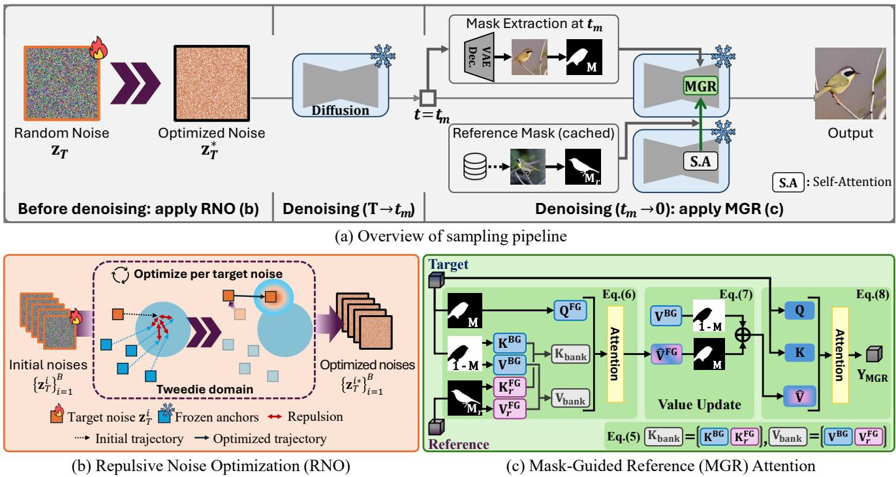  
Figure 2. Overview of the proposed sampling pipeline. (a) RNO optimizes initial noises before denoising; the target mask M is extracted at $t _ { m }$ and the reference mask Mr is cached offline; MGR Attention refines target foreground values during the remaining steps. (b) RNO optimizes each target noise $( { \bf z } _ { T } ^ { i } )$ to diverge from adaptation-prompt anchors (blue), which remain fixed throughout optimization. (c) MGR Attention constructs a hybrid bank $\mathbf { K } _ { \mathrm { b a n k } }$ ， $\mathbf { V _ { \mathrm { b a n k } } }$ from target-background and reference-foreground tokens, updating only foreground values.

## 4.3. Repulsive Noise Optimization (RNO)

When adapted from extremely limited data, the learned prior can heavily bias early latent trajectories toward repetitive structural modes. CNO [18] further struggles here, as the dominant prior can overwhelm the attraction objective, pulling trajectories back to repetitive generation.

To address this, RNO introduces a repulsion-only latent optimization strategy before the denoising process begins (see Fig. 2b). Let $\{ { \bf z } _ { T } ^ { i } \} _ { i = 1 } ^ { B }$ be a batch of initial random noises assigned to target variation prompts, and let $\mathbf { c } _ { t } ^ { i }$ and $\mathbf { c } _ { a }$ denote the embeddings of the target and adaptation prompts, respectively. The remaining B−1 branches conditioned on $\mathbf { c } _ { a }$ serve as adaptation-prompt anchors for each target noise $\mathbf { z } _ { T } ^ { i }$ , kept frozen throughout optimization via $\mathrm { s g } \bar { [ \cdot ] }$ . These anchors represent dominant generative modes of the adapted model, serving as stationary repulsive barriers. Let $\hat { \mathbf { z } } ^ { i } { = } \hat { \mathbf { z } } _ { 0 \mid T } \big ( \mathbf { z } _ { T } ^ { i } , \mathbf { c } _ { t } ^ { i } \big )$ and $\hat { \mathbf { z } } _ { a } ^ { j } { = } \hat { \mathbf { z } } _ { 0 \mid T } ( \mathbf { z } _ { T } ^ { j } , \mathbf { c } _ { a } )$ denote target and anchor predictions. RNO minimizes their average

similarity at timestep $T \colon$

$$
\mathcal { L } _ { \mathrm { R N O } } = \frac { 1 } { B ( B { - } 1 ) } \sum _ { i = 1 } ^ { B } \sum _ { j \neq i } \sin \left( \hat { \mathbf { z } } ^ { i } , \mathbf { s } \mathbf { g } [ \hat { \mathbf { z } } _ { a } ^ { j } ] \right) ,\tag{4}
$$

where $\mathrm { s i m } ( \cdot , \cdot )$ denotes cosine similarity and $\mathrm { s g } [ \cdot ]$ the stopgradient operation. This repulsion-only formulation encourages the optimized latents $\{ \mathbf { z } _ { T } ^ { i * } \} _ { i = 1 } ^ { B }$ to explore broader layout spaces for diverse sample generation.

## 4.4. Mask-Guided Reference (MGR) Attention

While RNO promotes layout diversity, generated objects can still lack fine-grained details; MGR Attention addresses this via a region-selective value update that injects reference features into foreground token positions (see Fig. 2c).

## 4.4.1. Mask Extraction

At timestep $t _ { m } ,$ where coarse object structure has emerged, we decode the Tweedie estimate $\hat { \mathbf { z } } _ { 0 \mid t _ { m } }$ and apply a zero-shot segmenter to extract target foreground mask M; reference mask ${ { \bf { M } } _ { r } }$ is pre-computed from the clean reference image offline. Both masks are downscaled to match the spatial resolution of the selected self-attention layers.

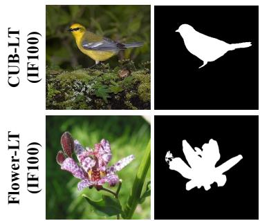  
Reference Mask

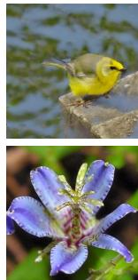  
(a) CL

  
(b) Diff-II

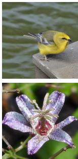  
(c) MGR

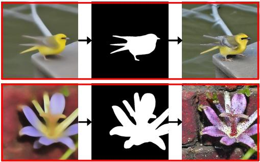  
(d) MGR+RNO (Ours)  
Figure 3. Qualitative comparison on CUB-LT and Flower-LT IF100 (prompts: “sitting on a ledge by water” and “against a brick wall”). (a) CL and (b) Diff-II rely on the adapted class prior, limiting foreground details and prompt-conditioned variation. (c) MGR enhances foreground details. (d) MGR+RNO (Ours) increases prompt-conditioned diversity while preserving foreground details, successfully following the given prompts.

## 4.4.2. Region-Selective Value Update

MGR Attention operates on two concurrent streams: a target stream generating the synthetic image and a frozen reference stream supplying reference features. At each timestep $t { \le } t _ { m }$ , the reference image is encoded and noised via Eq. (1); this noised latent is passed through the frozen denoiser to extract key and value tokens from the selected self-attention layers, serving solely as a feature provider.

Let Q, K, V and ${ \mathbf { K } } _ { r } , { \mathbf { V } } _ { r }$ denote tokens of the target and reference streams, respectively, partitioned by spatial masks into foreground $( \Omega ^ { \mathrm { F G } } )$ and background $( \Omega ^ { \mathrm { B G } } )$ sets. MGR Attention constructs a hybrid bank from target-background and reference-foreground tokens (see Fig. 2c):

$$
{ \bf K } _ { \mathrm { b a n k } } = [ { \bf K } ^ { \mathrm { B G } } ; { \bf K } _ { r } ^ { \mathrm { F G } } ] , \qquad { \bf V } _ { \mathrm { b a n k } } = [ { \bf V } ^ { \mathrm { B G } } ; { \bf V } _ { r } ^ { \mathrm { F G } } ] .\tag{5}
$$

Foreground queries attend exclusively to this bank to compute reference-fortified values:

$$
\begin{array} { r } { \hat { \mathbf { V } } ^ { \mathrm { F G } } = \mathrm { A t t n } ( \mathbf { Q } ^ { \mathrm { F G } } , \mathbf { K } _ { \mathrm { b a n k } } , \mathbf { V } _ { \mathrm { b a n k } } ) . } \end{array}\tag{6}
$$

The value update is then applied to foreground indices:

$$
\hat { \mathbf { V } } [ \Omega ^ { \mathrm { F G } } ] = \hat { \mathbf { V } } ^ { \mathrm { F G } } , \qquad \hat { \mathbf { V } } [ \Omega ^ { \mathrm { B G } } ] = \mathbf { V } [ \Omega ^ { \mathrm { B G } } ] .\tag{7}
$$

Finally, the self-attention output is computed using the updated value tensor Vˆ :

$$
\begin{array} { r } { { \bf Y } _ { \mathrm { M G R } } = \mathrm { A t t n } ( { \bf Q } , { \bf K } , \hat { \bf V } ) . } \end{array}\tag{8}
$$

Since Q and K remain directly unaffected, YMGR preserves the original attention weight distribution, confining reference influence to the foreground value tokens.

## 5. Experiment

## 5.1. Setup

Benchmarks. We evaluate in three data-scarce regimes: (i) Long-tailed (LT): CUB-LT [36] and Flower-LT [41] with imbalance factors IF∈{100, 20, 10}, following Diff-II [40]. (ii) Few-shot: 5-shot and 10-shot on CUB [39], Aircraft [26], Cars [21], and Pet [32]. (iii) Background-shift: 5-shot CUB trained model evaluated on Waterbirds [35].

Generation and adaptation. We use a pretrained Stable Diffusion (SD) [33] v1.5 model with 50-step DDIM sampling [37] and a classifier-free guidance scale of 7.0, with publicly available adapted checkpoints from Diff-Mix [41] and class-specific prompt suffixes following Diff-II [40]. We additionally evaluate on top of BOB [44] on Flower-LT, reproduced following the official protocol, with both SD v1.5 and SD v2.1 backbones. MGR Attention extracts the target mask at $t _ { m } = 3 0$ and is applied to decoder upblock self-attention layers (from layer 2.1) for $t { \le } t _ { m }$ , using SAM3 [4] for zero-shot segmentation. Further details, including RNO hyperparameters, are provided in the supplementary material.

Synthetic-data and classifier protocols. For LT experiments, we generate enough samples to match each class to the maximum real class frequency, following SYNAuG [45]. For few-shot and background-shift experiments, real and synthetic images are mixed at a 1:5 ratio following Diff-II [40]. We train ResNet-50 [12] and ViT-B/16 [6] classifiers for all augmentation methods.

Baselines and metrics. We compare with standard cross entropy (CE), Mixup [47], CutMix [46], CMO [31], CMO-DRW [2], and diffusion-based augmentation methods including Real-Filter, Real-Guidance [13], Real-Gen, Real-Mix, Diff-AUG, Diff-Mix [41], Da-Fusion [38], and Diff-II [40]. Top-1 accuracy (%) is the primary metric.

## 5.2. Qualitative Comparison

Figure 3 compares generated samples on CUB- and Flower-LT IF100. On CUB-LT, (a) CL and (b) Diff-II fail to reproduce fine-grained foreground details such as wing texture and head color, whereas (c) MGR and (d) MGR+RNO better preserve these foreground details while generating diverse backgrounds. On Flower-LT, (a) and (b) drift from the reference color patterns and fail to follow the given prompt (e.g., “against a brick wall”); (d) MGR+RNO successfully generates prompt-conditioned samples while preserving the distinctive color and petal structure of the reference flower.

Table 1. LT classification results (%) on CUB-LT and Flower-LT (∆CE: gain over CE; Diff-II†: SYNAuG [45]-style normalization).
<table><tr><td rowspan="2">Method</td><td colspan="4">CUB-LT (ResNet-50)</td><td colspan="4">Flower-LT (ResNet-50)</td><td colspan="4">CUB-LT (ViT-B/16)</td><td colspan="4">Flower-LT (ViT-B/16)</td></tr><tr><td>IF100</td><td>IF20</td><td>IF10</td><td>∆CE</td><td>IF100</td><td>IF20</td><td>IF10</td><td>ΔCE</td><td>IF100</td><td>IF20</td><td>IF10</td><td>∆CE</td><td>IF100</td><td>IF20</td><td>IF10</td><td>ΔCE</td></tr><tr><td>CE</td><td>33.65</td><td>44.82</td><td>58.13</td><td></td><td>80.43</td><td>90.87</td><td>95.07</td><td></td><td>53.87</td><td>68.36</td><td>78.82</td><td></td><td>92.84</td><td>97.52</td><td>99.20</td><td></td></tr><tr><td>Mixup [47]</td><td>37.59</td><td>49.15</td><td>63.43</td><td>+4.52</td><td>81.11</td><td>92.13</td><td>96.16</td><td>+1.01</td><td>53.64</td><td>68.85</td><td>79.38</td><td>+0.27</td><td>92.06</td><td>97.79</td><td>98.96</td><td>-0.25</td></tr><tr><td>CutMix [46]</td><td>37.61</td><td>49.15</td><td>63.27</td><td>+4.48</td><td>81.96</td><td>92.28</td><td>95.80</td><td>+1.22</td><td>54.02</td><td>68.45</td><td>78.22</td><td>-0.12</td><td>92.06</td><td>97.28</td><td>99.00</td><td>-0.41</td></tr><tr><td>CMO [31]</td><td>32.94</td><td>44.08</td><td>57.62</td><td>-0.65</td><td>83.95</td><td>91.43</td><td>95.19</td><td>+1.40</td><td>49.22</td><td>64.20</td><td>79.55</td><td>-2.69</td><td>92.21</td><td>97.57</td><td>99.03</td><td>-0.25</td></tr><tr><td>CMO-DRW [2]</td><td>32.57</td><td>46.43</td><td>59.25</td><td>+0.55</td><td>84.07</td><td>92.02</td><td>95.29</td><td>+1.67</td><td>51.20</td><td>67.29</td><td>73.80</td><td>-2.92</td><td>95.27</td><td>98.15</td><td>99.17</td><td>+1.01</td></tr><tr><td>Real-Filter [13]</td><td>36.83</td><td>49.41</td><td>62.69</td><td>+4.11</td><td>80.38</td><td>91.58</td><td>95.65</td><td>+0.41</td><td>48.84</td><td>64.77</td><td>78.37</td><td>-3.02</td><td>88.30</td><td>96.16</td><td>98.88</td><td>-2.07</td></tr><tr><td>Real-Guidance [13]</td><td>36.50</td><td>49.34</td><td>59.11</td><td>+2.78</td><td>81.94</td><td>91.60</td><td>95.27</td><td>+0.81</td><td>52.62</td><td>65.43</td><td>75.37</td><td>-2.54</td><td>91.16</td><td>96.75</td><td>98.69</td><td>-0.99</td></tr><tr><td>Real-Gen [41]</td><td>45.86</td><td>53.43</td><td>61.42</td><td>+8.04</td><td>83.56</td><td>91.84</td><td>95.22</td><td>+1.42</td><td>61.17</td><td>69.97</td><td>76.46</td><td>+2.18</td><td>92.67</td><td>96.63</td><td>99.00</td><td>-0.42</td></tr><tr><td>Real-Mix [41]</td><td>47.75</td><td>55.67</td><td>62.27</td><td>+9.70</td><td>85.19</td><td>92.96</td><td>96.02</td><td>+2.60</td><td>62.72</td><td>71.75</td><td>76.35</td><td>+3.26</td><td>92.60</td><td>96.12</td><td>98.30</td><td>-0.85</td></tr><tr><td>Da-Fusion [38]</td><td>35.74</td><td>46.82</td><td>57.13</td><td>+1.03</td><td>83.86</td><td>91.82</td><td>95.31</td><td>+1.54</td><td>49.13</td><td>62.19</td><td>72.80</td><td>-5.64</td><td>92.13</td><td>96.92</td><td>98.71</td><td>-0.60</td></tr><tr><td>Diff-AUG [41]</td><td>47.77</td><td>59.73</td><td>67.22</td><td>+12.71</td><td>87.47</td><td>94.12</td><td>96.87</td><td>+4.03</td><td>54.02</td><td>68.76</td><td>80.82</td><td>+0.85</td><td>95.61</td><td>97.57</td><td>99.22</td><td>+0.95</td></tr><tr><td>Diff-Mix [41]]</td><td>50.35</td><td>58.19</td><td>64.48</td><td>+12.14</td><td>89.46</td><td>93.86</td><td>96.63</td><td>+4.53</td><td>60.89</td><td>66.33</td><td>73.08</td><td>-0.25</td><td>95.29</td><td>97.77</td><td>99.00</td><td>+0.83</td></tr><tr><td>Diff-II [40]</td><td>51.21</td><td>62.31</td><td>70.28</td><td>+15.74</td><td>89.54</td><td>94.39</td><td>97.35</td><td>+4.97</td><td>64.50</td><td>74.53</td><td>81.46</td><td>+6.48</td><td>95.34</td><td>98.52</td><td>99.37</td><td>+1.22</td></tr><tr><td>Diff-II† [40]</td><td>53.59</td><td>64.14</td><td>69.52</td><td>+16.89</td><td>88.44</td><td>94.49</td><td>96.84</td><td>+4.47</td><td>66.93</td><td>75.54</td><td>81.72</td><td>+7.71</td><td>92.81</td><td>98.57</td><td>99.44</td><td>+0.42</td></tr><tr><td>Ours</td><td>56.09</td><td>66.15</td><td>71.68</td><td>+19.11</td><td>90.34</td><td>95.29</td><td>97.60</td><td>+5.62</td><td>69.87</td><td>77.51</td><td>82.59</td><td>+9.64</td><td>96.13</td><td>98.59</td><td>99.44</td><td>+1.53</td></tr></table>

Table 2. Few-shot (5-shot and 10-shot) classification results.
<table><tr><td></td><td colspan="5">5-shot</td><td colspan="5">10-shot</td></tr><tr><td>Method</td><td>CUB</td><td>Air.</td><td>Pet</td><td>Car</td><td>Avg</td><td>CUB</td><td>Air.</td><td>Pet</td><td>Car</td><td>Avg</td></tr><tr><td>CE</td><td>54.52</td><td>36.63</td><td>86.98</td><td></td><td>40.1054.56</td><td>70.26</td><td>54.11</td><td>90.41</td><td></td><td>69.64 71.11</td></tr><tr><td>Mixup</td><td></td><td>54.3336.75</td><td></td><td></td><td>586.3641.4354.72</td><td>70.0055.28</td><td></td><td>89.49</td><td></td><td>70.28 71.26</td></tr><tr><td>CutMix</td><td></td><td>51.7434.2085.4141.8953.31</td><td></td><td></td><td></td><td>68.91 51.0589.71 67.7169.35</td><td></td><td></td><td></td><td></td></tr><tr><td>Real-Filter</td><td></td><td>55.0340.4087.66 57.60 60.17</td><td></td><td></td><td></td><td>67.3647.2190.14 69.64 68.59</td><td></td><td></td><td></td><td></td></tr><tr><td>Real-Guidance</td><td></td><td>54.6736.2787.2241.6054.90</td><td></td><td></td><td></td><td>69.81 54.77 90.00 70.97 71.40</td><td></td><td></td><td></td><td></td></tr><tr><td>Real-Mix</td><td></td><td>51.0032.2186.4253.56 55.80</td><td></td><td></td><td></td><td>64.6544.1689.0075.7268.38</td><td></td><td></td><td></td><td></td></tr><tr><td>Da-Fusion</td><td></td><td>59.4034.9887.4158.7360.13</td><td></td><td></td><td></td><td></td><td></td><td></td><td></td><td>72.0551.14 90.4777.6172.82</td></tr><tr><td>Diff-AUG</td><td></td><td>61.1439.4289.2354.0860.97</td><td></td><td></td><td></td><td></td><td></td><td></td><td></td><td>71.94 53.04 91.0075.6672.91</td></tr><tr><td>Diff-Mix</td><td></td><td>56.1832.6188.7756.3958.49</td><td></td><td></td><td></td><td></td><td></td><td></td><td></td><td>70.16 52.3389.78 72.3971.17</td></tr><tr><td>Diff-II</td><td></td><td>62.2242.1589.84</td><td></td><td>64.2464.61</td><td></td><td></td><td></td><td>72.66 57.43 91.01</td><td></td><td>82.02 75.78</td></tr><tr><td>Ours</td><td></td><td>|66.9841.0489.6767.4966.30|</td><td></td><td></td><td></td><td></td><td>|74.11 57.67 91.25 83.58 76.65</td><td></td><td></td><td></td></tr></table>

## 5.3. Downstream Classification

Long-tailed. Table 1 reports results on CUB- and Flower-LT across three imbalance factors and two classifier architectures, where our method achieves the best accuracy in all reported settings. The improvement is largest in the most data-scarce CUB-LT IF100 setting: relative to Diff-II† under the same class-normalized synthetic-data protocol, our method improves ResNet-50 accuracy from 53.59% to 56.09% (+2.50 points) and ViT-B/16 accuracy from 66.93% to 69.87% (+2.94 points). On Flower-LT, gains are smaller where strongest baselines already exceed 94–99% accuracy, but our method remains competitive.

Few-shot. Table 2 summarizes 5-shot and 10-shot results on CUB, Aircraft, Pet, and Cars, where our method achieves the highest average accuracy in both regimes, outperforming Diff-II by 1.69 and 0.87 points respectively. The gains are driven by CUB (+4.76 points) and Car (+3.25 points)

Table 3. Background-shift evaluation on Waterbirds.
<table><tr><td>Method</td><td>(L,L)</td><td>(W,W) (L,W)</td><td>(W,L)</td><td>Avg</td></tr><tr><td>CE</td><td>38.55</td><td>32.15</td><td>37.90 30.20</td><td>34.70</td></tr><tr><td>Real-Filter [13]</td><td>38.87</td><td>34.72 38.25</td><td>31.64</td><td>35.87</td></tr><tr><td>Real-Guidance [13]</td><td>39.49</td><td>33.64</td><td>39.80 29.78</td><td>35.68</td></tr><tr><td>Real-Mix [41]</td><td>30.29</td><td>29.44</td><td>30.02 26.95</td><td>29.18</td></tr><tr><td>Da-Fusion [38]</td><td>44.50</td><td>39.04</td><td>44.46 33.49</td><td>40.37</td></tr><tr><td>Diff-AUG [41]</td><td>49.02</td><td>40.59 48.71</td><td>38.58</td><td>44.23</td></tr><tr><td>Diff-Mix [41]]</td><td>33.84</td><td>30.53 34.72</td><td>28.19</td><td>31.82</td></tr><tr><td>Diff-II [40]</td><td>49.84</td><td>41.46</td><td>51.01 42.03</td><td>46.09</td></tr><tr><td>Ours</td><td>52.73</td><td>41.90 52.20</td><td></td><td>42.3747.30</td></tr></table>

in the 5-shot setting; on Aircraft, where large intra-class appearance variation makes reference anchoring less effective, Diff-II remains slightly better (−1.11 points), while the 10- shot setting shows improvements on all four datasets.

Background-shift robustness. Table 3 shows improvements in mean group accuracy from 46.09% to 47.30% (+1.21) and worst-group from 41.46% to 41.90% (+0.44). This is consistent with our design: MGR Attention strengthens foreground cues, while RNO diversifies contexts in the training data, suggesting reduced spurious correlations between bird labels and background appearance.

## 5.4. Ablation Studies

Qualitative design analysis. Figure 4 provides visual evidence for the design choices analyzed below. For MGR Attention (left), global key–value replacement (K/V swap; VSP-style [17]) transfers reference style across the entire image; applying an attention-derived mask (MasaCtrl [3]-style) reduces global leakage but remains imprecise in adapted diffusion models. Using a K/V swap with SAM3 mask improves localization but can still over-transfer reference appearance. MGR Attention with foreground-selective value update best preserves target layout while enhancing

CUB-LT IF100

Pet 5-shot

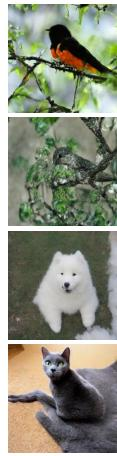  
(a)

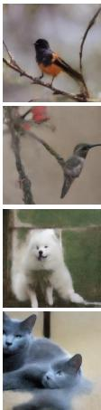

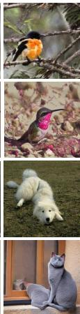  
(b)  
(c)

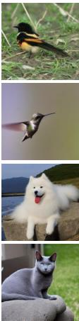  
(d)

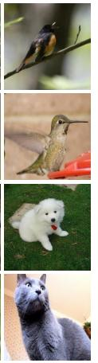  
Flower-LT IF100

Reference  
  
(a)

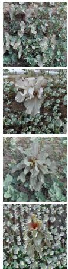  
(b)

  
“… against a brick wall”

  
(c)

“… in front of a water body”

“… growing in a garden”

“… in front of a water body”

(d)  
Figure 4. Qualitative module comparisons. (left) On CUB-LT IF100 and Pet 5-shot, (a) global K/V replacement (VSP-style [17]), (b) attention-masked K/V replacement (MasaCtrl [3]-style), and (c) SAM3-masked K/V replacement introduce unwanted reference style o disrupt target layout, whereas (d) Ours better preserves target layout while enhancing localized foreground details. (right) On a single image Flower-LT class with varying prompts, (a) CL collapses to similar outputs, (b) CADS increases variation at the cost of quality degradation, and (c) CNO generates diverse samples but struggles to follow prompt-conditioned variation, whereas (d) RNO produces diverse prompt-conditioned layouts while retaining recognizable foreground structure.  
Table 4. Module ablation on CUB-LT and Flower-LT IF100. Single: 1 image per class (CUB: 83 classes, Flower: 37 classes). Few: <5/<10 images per class, including Single.
<table><tr><td></td><td colspan="3">CUB-LT IF100</td><td colspan="3">Flower-LT IF100</td></tr><tr><td>Method</td><td>Few</td><td>Single</td><td>Avg</td><td>Few</td><td>Single</td><td>Avg</td></tr><tr><td>CL</td><td>42.95</td><td>37.79</td><td>54.16</td><td>77.37</td><td>64.39</td><td>87.74</td></tr><tr><td>MGR</td><td>44.70</td><td>39.46</td><td>55.61</td><td>80.67</td><td>69.14</td><td>89.34</td></tr><tr><td>RNO</td><td>43.23</td><td>37.18</td><td>54.49</td><td>76.35</td><td>61.37</td><td>87.16</td></tr><tr><td>MGR+RNO</td><td>46.08</td><td>41.05</td><td>56.09</td><td>82.18</td><td>72.04</td><td>90.34</td></tr></table>

localized object details. For RNO (right), CL and CNO remain close to repetitive class-prior modes, whereas CADS degrades sample quality; RNO produces broader promptconditioned layouts with recognizable foreground structure. Module Contributions. Table 4 reports module ablations (CUB- and Flower-LT IF100). MGR Attention improves Few and Single accuracy over CL on both datasets (CUB-LT: +1.75/+1.67; Flower-LT: +3.30/+4.75), confirming that foreground-selective value update strengthens discriminative details in data-scarce classes. RNO alone shows mixed results: it improves CUB-LT (+0.33 overall) but slightly reduces Flower-LT (−0.58), indicating that sampling variation alone is insufficient without foreground guidance. MGR+RNO achieves the best accuracy on both datasets, with gains in Few and Single groups (+3.13/+3.26 on CUB-LT; +4.81/+7.65 on Flower-LT), confirming complementary roles: RNO broadens sampled configurations while MGR reinforces foreground evidence.

Design Choices. Table 5 ablates design choices on CUBand Flower-LT IF100. (i) Attention mechanism. On CUB-LT, global K/V swap slightly improves Few accuracy but degrades Single-group performance (37.46% vs. 37.79%); applying an attention-derived mask (MasaCtrlstyle) further hurts both groups (Single: 27.97%), confirming that attention-derived masks are unreliable in adapted diffusion models. K/V swap with SAM3 mask improves Few (51.26%) but substantially reduces Single accuracy (31.67%), showing that key modification disrupts the adapted class structure even with accurate masks. MGR’s value-only update resolves this: replacing the attentionderived mask with SAM3 improves Single from 37.71% to 39.46%. (ii) Noise optimization. Comparing CNO and RNO on top of MGR, MGR+RNO consistently outperforms MGR+CNO on Single-group accuracy (41.05% vs. 40.18% on CUB-LT; 72.04% vs. 66.82% on Flower-LT), demonstrating that repulsion-only optimization better suits adapted diffusion models.

Table 5. Design choice ablation on CUB-LT and Flower-LT IF100. (i) Attention mechanism. (ii) Noise optimization.
<table><tr><td colspan="2"></td><td colspan="3">CUB-LT IF100</td><td colspan="3">Flower-LT IF100</td></tr><tr><td colspan="2">Method</td><td>Few</td><td>Single</td><td>Avg</td><td>Few</td><td>Single</td><td>Avg</td></tr><tr><td rowspan="6">(i)</td><td>CL</td><td>42.95</td><td>37.79</td><td>54.16</td><td>77.37</td><td>64.39</td><td>87.74</td></tr><tr><td>K/V swap</td><td>43.26</td><td>37.46</td><td>54.71</td><td>79.41</td><td>66.36</td><td>88.57</td></tr><tr><td>K/V swap (Attn. mask)</td><td>35.47</td><td>27.97</td><td>49.28</td><td>79.12</td><td>66.13</td><td>88.66</td></tr><tr><td>K/V swap (SAM3)</td><td>51.26</td><td>31.67</td><td>51.36</td><td>79.21</td><td>66.01</td><td>88.64</td></tr><tr><td>MGR (Attn. mask)</td><td>43.70</td><td>37.71</td><td>54.71</td><td>77.95</td><td>64.97</td><td>87.98</td></tr><tr><td>MGR (SAM3, Ours)</td><td>44.70</td><td>39.46</td><td>55.61</td><td>80.67</td><td>69.14</td><td>89.34</td></tr><tr><td rowspan="2">(ii)</td><td>MGR+CNO [18]</td><td>45.84</td><td>40.18</td><td>55.83</td><td>72.09</td><td>66.82</td><td>89.05</td></tr><tr><td>MGR+RNO (Ours)</td><td>46.08</td><td>41.05</td><td>56.09</td><td>82.18</td><td>72.04</td><td>90.34</td></tr></table>

Table 6. Diversity and foreground detail metrics on single-sample classes of CUB-LT and Flower-LT IF100. MSS [34] and Vendi [7] measure diversity; Ref-FG Sim measures foreground similarity via DINOv2 [30] features on SAM3 [4]-segmented regions. Bold indicates best among MGR-based methods; CADS is excluded as it produces severe quality degradation (see Fig. 4).
<table><tr><td></td><td colspan="3">CUB-LT IF100</td><td colspan="3">Flower-LT IF100</td></tr><tr><td>Method</td><td>MSS↓</td><td>Vendi↑</td><td>Ref-FG↑</td><td>MSS↓</td><td>Vendi↑</td><td>Ref-FG↑</td></tr><tr><td>CL</td><td>0.62</td><td>7.46</td><td>0.45</td><td>0.81</td><td>3.25</td><td>0.59</td></tr><tr><td>CADS</td><td>0.35</td><td>17.51</td><td>0.22</td><td>0.56</td><td>8.89</td><td>0.28</td></tr><tr><td>CNO</td><td>0.58</td><td>8.39</td><td>0.44</td><td>0.76</td><td>4.12</td><td>0.56</td></tr><tr><td>MGR</td><td>0.60</td><td>7.89</td><td>0.46</td><td>0.79</td><td>3.60</td><td>0.61</td></tr><tr><td>MGR+CNO</td><td>0.63</td><td>7.18</td><td>0.48</td><td>0.77</td><td>3.86</td><td>0.59</td></tr><tr><td>MGR+RNO</td><td>0.58</td><td>8.28</td><td>0.49</td><td>0.72</td><td>4.91</td><td>0.56</td></tr></table>

Table 7. Mask extraction timestep analysis on CUB-LT and Flower-LT IF100.
<table><tr><td></td><td colspan="3">CUB-LT IF100</td><td colspan="3">Flower-LT IF100</td></tr><tr><td> $t _ { m }$ </td><td>Few</td><td>Single</td><td>Avg</td><td>Few</td><td>Single</td><td>Avg</td></tr><tr><td>40</td><td>45.17</td><td>39.91</td><td>55.92</td><td>80.09</td><td>68.10</td><td>89.10</td></tr><tr><td>30√</td><td>46.08</td><td>41.05</td><td>56.09</td><td>82.18</td><td>72.04</td><td>90.34</td></tr><tr><td>20</td><td>44.72</td><td>39.50</td><td>55.58</td><td>80.52</td><td>67.75</td><td>89.27</td></tr><tr><td>10</td><td>43.15</td><td>37.99</td><td>54.30</td><td>79.65</td><td>67.40</td><td>88.86</td></tr></table>

Diversity–Detail Analysis. Table 6 analyzes diversity and foreground detail of synthetic samples by each method on single-sample classes of CUB-LT and Flower-LT IF100 (83 and 37 classes, respectively; 50 images per class). We report MSS [34] and Vendi [7] as diversity metrics, and Ref-FG Sim as a measure of foreground similarity to the reference image. CADS achieves the highest diversity but substantially reduces foreground details (see also Fig. 4). CNO improves diversity over CL without improving Ref-FG Sim, while MGR consistently increases Ref-FG Sim, confirming that foreground-selective value update transfers discriminative reference details. Although the absolute gain is modest, it translates to meaningful downstream accuracy improvements in Few and Single groups (Tab. 4). MGR+RNO (Ours) outperforms MGR+CNO in diversity on both datasets while achieving the highest Ref-FG Sim on CUB-LT; on Flower-LT, Ref-FG Sim is slightly lower than CL as RNO introduces greater layout variation, yet MGR+RNO attains the best downstream accuracy across all settings. These results support that improving both diversity and foreground details contributes to downstream gains.

Mask extraction timestep. Table 7 ablates the mask extraction timestep $t _ { m }$ on CUB-LT and Flower-LT IF100. Both datasets peak at $t _ { m } = 3 0$ . Flower-LT shows higher sensitivity, with a larger performance drop at $t _ { m } \mathrm { = } 1 0$ (Single: 67.40 vs. 72.04). At $t _ { m } \mathrm { = } 4 0$ , masks may be extracted before sufficient object structure has emerged, likely limiting the effectiveness of reference-guided refinement, particularly on Flower-LT where larger foreground objects require more denoising steps to form reliable boundaries. At $t _ { m } = 2 0 / 1 0$ , the remaining denoising steps may be insufficient for MGR Attention to effectively incorporate reference features. MGR Attention also shows robust performance across different zero-shot segmenters (see supplementary).

Table 8. Compatibility with BOB [44] on Flower-LT IF100. Reproduced following the official repository.
<table><tr><td></td><td colspan="3">SD v1.5</td><td colspan="3">SD v2.1</td></tr><tr><td>Method</td><td>Few</td><td>Single</td><td> $\operatorname { A v g }$ </td><td>Few</td><td>Single</td><td>Avg</td></tr><tr><td>BOB</td><td>79.70</td><td>69.58</td><td>85.49</td><td>80.52</td><td>70.27</td><td>86.03</td></tr><tr><td>BOB+Ours</td><td>81.80</td><td>72.53</td><td>86.80</td><td>83.14</td><td>75.64</td><td>87.83</td></tr></table>

Compatibility with alternative adaptation. Table 8 applies our modules to BOB [44] on Flower-LT IF100, reproduced following its diffusion-adaptation and classifiertraining protocols. BOB+Ours consistently improves over BOB across both SD v1.5 and SD v2.1 backbones, with the gains in Single-group accuracy of 2.95 and 5.37 points. These results show that, on Flower-LT, our sampling-time modules remain effective on top of an alternative conceptlearning method.

## 6. Conclusion

We introduced a sampling-time diffusion augmentation framework combining MGR Attention and RNO for datascarce image classification. MGR Attention updates only foreground value tokens with reference features via zeroshot segmentation, strengthening fine-grained object details while limiting unwanted reference propagation. RNO optimizes initial latent trajectories via a repulsion-only objective against adaptation-prompt anchors, promoting promptconditioned diversity. Across long-tailed, few-shot, and background-shift evaluations, the proposed framework improves downstream classifier accuracy with the largest gains in Few and Single groups, confirming the complementary roles of the two modules.

Limitations and future work. Applying a strong repulsion objective in RNO may push latent trajectories away from class-consistent regions. A theoretical understanding of how repulsion strength affects the trade-off between diversity and class consistency remains an interesting direction for future work. Beyond sampling-time interventions, incorporating reference-guided objectives into the conceptlearning process itself could yield stronger adapted priors under extreme data scarcity, offering a complementary direction to our approach. In addition, our experiments are limited to UNet-based Stable Diffusion backbones (v1.5 and v2.1); extending MGR Attention to transformer-based architectures such as MM-DiT, where image and text tokens share joint attention, is left for future work.

## Acknowledgments

This work was supported in part by the National Research Foundation of Korea under Grant RS-2024-00349697 and Grant RS-2021-NR060143; in part by the Technology Development Program (RS-2024-00437796) funded by the Ministry of SMEs and Startups (MSS, Korea); in part by the Institute for Information and Communications Technology Planning and Evaluation under Grant IITP-2027-RS-2020- II201819; and in part by Korea University Grant.

## References

[1] Shekoofeh Azizi, Simon Kornblith, Chitwan Saharia, Mohammad Norouzi, and David J. Fleet. Synthetic data from diffusion models improves imagenet classification. Transactions on Machine Learning Research, 2023. 2

[2] Kaidi Cao, Colin Wei, Adrien Gaidon, Nikos Arechiga, and Tengyu Ma. Learning imbalanced datasets with labeldistribution-aware margin loss. Advances in neural information processing systems, 32, 2019. 5, 6

[3] Mingdeng Cao, Xintao Wang, Zhongang Qi, Ying Shan, Xiaohu Qie, and Yinqiang Zheng. Masactrl: Tuning-free mutual self-attention control for consistent image synthesis and editing. In Proceedings of the IEEE/CVF international conference on computer vision, pages 22560–22570, 2023. 2, 6, 7, 13, 14

[4] Nicolas Carion, Laura Gustafson, Yuan-Ting Hu, Shoubhik Debnath, Ronghang Hu, Didac Suris, Chaitanya Ryali, Kalyan Vasudev Alwala, Haitham Khedr, Andrew Huang, et al. Sam 3: Segment anything with concepts. arXiv preprint arXiv:2511.16719, 2025. 2, 3, 5, 8, 12

[5] Xi Chen et al. Anydoor: Zero-shot object-level image customization. In Proc. CVPR, 2024. 3

[6] Alexey Dosovitskiy, Lucas Beyer, Alexander Kolesnikov, Dirk Weissenborn, Xiaohua Zhai, Thomas Unterthiner, Mostafa Dehghani, Matthias Minderer, Georg Heigold, Sylvain Gelly, Jakob Uszkoreit, and Neil Houlsby. An image is worth 16x16 words: Transformers for image recognition at scale. ICLR, 2021. 5

[7] Dan Friedman and Adji Bousso Dieng. The vendi score: A diversity evaluation metric for machine learning. Transactions on Machine Learning Research, 2023. 8

[8] Rinon Gal, Yuval Alaluf, Yuval Atzmon, Or Patashnik, Amit H. Bermano, Gal Chechik, and Daniel Cohen-Or. An image is worth one word: Personalizing text-to-image generation using textual inversion. In The Eleventh International Conference on Learning Representations, 2023. 2

[9] Jing Gu et al. Photoswap: Personalized subject swapping in images. In Proc. NeurIPS, 2023. 13

[10] Xiefan Guo, Jinlin Liu, Miaomiao Cui, Jiankai Li, Hongyu Yang, and Di Huang. Initno: Boosting text-to-image diffusion models via initial noise optimization. In Proceedings of the IEEE/CVF Conference on Computer Vision and Pattern Recognition, pages 9380–9389, 2024. 3

[11] Anne Harrington, A Koepke, Shyamgopal Karthik, Trevor Darrell, and Alexei A Efros. It’s never too late: Noise optimization for collapse recovery in trained diffusion models.

In Proceedings of the IEEE/CVF Conference on Computer Vision and Pattern Recognition, pages 43124–43134, 2026. 3

[12] Kaiming He, Xiangyu Zhang, Shaoqing Ren, and Jian Sun. Deep residual learning for image recognition. In Proceed ings ofthe IEEE conference on computer vision and pattern recognition, pages 770–778, 2016. 5

[13] Ruifei He, Shuyang Sun, Xin Yu, Chuhui Xue, Wenqing Zhang, Philip Torr, Song Bai, and Xiaojuan Qi. Is synthetic data from generative models ready for image recognition? arXiv preprint arXiv:2210.07574, 2022. 2, 5, 6

[14] Amir Hertz, Ron Mokady, Jay Tenenbaum, Kfir Aberman, Yael Pritch, and Daniel Cohen-Or. Prompt-to-prompt image editing with cross attention control. In The 11th International Conference on Learning Representations (ICLR), 2023. 2, 13

[15] Jonathan Ho, Ajay Jain, and Pieter Abbeel. Denoising diffusion probabilistic models. Advances in neural information processing systems, 33:6840–6851, 2020. 3

[16] Edward J. Hu, Yelong Shen, Phillip Wallis, Zeyuan Allen Zhu, Yuanzhi Li, Shean Wang, Lu Wang, and Weizhu Chen. Lora: Low-rank adaptation of large language models. In ICLR, 2022. 2

[17] Jaeseok Jeong, Junho Kim, Yunjey Choi, Gayoung Lee, and Youngjung Uh. Visual style prompting with swapping selfattention. arXiv preprint arXiv:2402.12974, 2024. 2, 6, 7, 13, 14

[18] Byungjun Kim, Soobin Um, and Jong Chul Ye. Diverse text-to-image generation via contrastive noise optimization. arXiv preprint arXiv:2510.03813, 2025. 2, 3, 4, 7

[19] Alexander Kirillov et al. Segment anything. In Proc. ICCV, 2023. 2, 3

[20] GaYeon Koh, Hyun-Jic Oh, Jeonghyun Noh, and Won-Ki Jeong. Synthetic data augmentation using pre-trained diffusion models for long-tailed food image classification. In Proceedings ofthe Computer Vision and Pattern Recognition Conference, pages 391–400, 2025. 2

[21] Jonathan Krause, Michael Stark, Jia Deng, and Li Fei-Fei. 3d object representations for fine-grained categorization. In Proceedings of the IEEE international conference on computer vision workshops, pages 554–561, 2013. 5

[22] Yuhang Li et al. A simple background augmentation method for object detection with diffusion model. In Proc. ECCV, 2024. 13

[23] Yu Li et al. Domain-rag: Retrieval-guided compositional im age generation for cross-domain few-shot object detection. arXiv:2506.05872, 2025. 3, 13

[24] Zhiguang Lu, Qianqian Xu, Peisong Wen, Siran Dai, and Qingming Huang. Higfa: Hierarchical guidance for finegrained data augmentation with diffusion models. arXiv preprint arXiv:2511.12547, 2025. 2

[25] Timo Luddecke and Alexander Ecker. Image segmenta-¨ tion using text and image prompts. In Proceedings of the IEEE/CVF conference on computer vision and pattern recognition, pages 7086–7096, 2022. 12

[26] Subhransu Maji, Esa Rahtu, Juho Kannala, Matthew Blaschko, and Andrea Vedaldi. Fine-grained visual classi-

fication of aircraft. arXiv preprint arXiv:1306.5151, 2013. 5

[27] Atsuyuki Miyai, Jingkang Yang, Jingyang Zhang, Yifei Ming, Yueqian Lin, Qing Yu, Go Irie, Shafiq Joty, Yixuan Li, Hai Li, et al. Generalized out-of-distribution detection and beyond in vision language model era: A survey. arXiv preprint arXiv:2407.21794, 2024. 1

[28] Alex Nichol, Prafulla Dhariwal, Aditya Ramesh, Pranav Shyam, Pamela Mishkin, Bob McGrew, Ilya Sutskever, and Mark Chen. Glide: Towards photorealistic image generation and editing with text-guided diffusion models. arXiv preprint arXiv:2112.10741, 2021. 1, 2

[29] Hyun-Jic Oh and Won-Ki Jeong. Controllable and efficient multi-class pathology nuclei data augmentation using textconditioned diffusion models. In International Conference on Medical Image Computing and Computer-Assisted Intervention, pages 36–46. Springer, 2024. 2

[30] Maxime Oquab, Timothee Darcet, Th ´ eo Moutakanni, Huy´ Vo, Marc Szafraniec, Vasil Khalidov, Pierre Fernandez, Daniel Haziza, Francisco Massa, Alaaeldin El-Nouby, et al. Dinov2: Learning robust visual features without supervision. arXiv preprint arXiv:2304.07193, 2023. 8

[31] Seulki Park, Youngkyu Hong, Byeongho Heo, Sangdoo Yun, and Jin Young Choi. The majority can help the minority: Context-rich minority oversampling for long-tailed classification. In Proceedings of the IEEE/CVF conference on computer vision and pattern recognition, pages 6887–6896, 2022. 5, 6

[32] Omkar M Parkhi, Andrea Vedaldi, Andrew Zisserman, and CV Jawahar. Cats and dogs. In 2012 IEEE conference on computer vision and pattern recognition, pages 3498–3505. IEEE, 2012. 5

[33] Robin Rombach, Andreas Blattmann, Dominik Lorenz, Patrick Esser, and Bjorn Ommer. High-resolution image syn-¨ thesis with latent diffusion models. In CVPR, pages 10684– 10695, 2022. 1, 2, 3, 5

[34] Seyedmorteza Sadat, Jakob Buhmann, Derek Bradley, Otmar Hilliges, and Romann Weber. Cads: Unleashing the diversity of diffusion models through condition-annealed sampling. In International Conference on Learning Representations, pages 23723–23755, 2024. 3, 8

[35] Shiori Sagawa, Pang Wei Koh, Tatsunori B Hashimoto, and Percy Liang. Distributionally robust neural networks for group shifts: On the importance of regularization for worstcase generalization. arXiv preprint arXiv:1911.08731, 2019. 5

[36] Dvir Samuel, Yuval Atzmon, and Gal Chechik. From generalized zero-shot learning to long-tail with class descriptors. In Proceedings ofthe IEEE/CVF winter conference on applications ofcomputer vision, pages 286–295, 2021. 5

[37] Jiaming Song, Chenlin Meng, and Stefano Ermon. Denoising diffusion implicit models. arXiv preprint arXiv:2010.02502, 2020. 5

[38] Brandon Trabucco, Kyle Doherty, Max Gurinas, and Ruslan Salakhutdinov. Effective data augmentation with diffusion models. In The Twelfth International Conference on Learning Representations, 2024. 2, 5, 6

[39] Catherine Wah, Steve Branson, Peter Welinder, Pietro Perona, and Serge Belongie. The caltech-ucsd birds-200-2011 dataset. 2011. 5

[40] Yanghao Wang and Long Chen. Inversion circle interpolation: Diffusion-based image augmentation for data-scarce classification. In Proceedings of the Computer Vision and Pattern Recognition Conference, pages 25560–25569, 2025. 2, 5, 6, 13

[41] Zhicai Wang, Longhui Wei, Tan Wang, Heyu Chen, Yanbin Hao, Xiang Wang, Xiangnan He, and Qi Tian. Enhance image classification via inter-class image mixup with diffusion model. In Proceedings of the IEEE/CVF conference on computer vision and pattern recognition, pages 17223–17233, 2024. 2, 5, 6

[42] Jinheng Xie et al. Boxdiff: Text-to-image synthesis with training-free box-constrained diffusion. In Proc. ICCV, 2023. 3

[43] Huali Xu, Shuaifeng Zhi, Shuzhou Sun, Vishal Patel, and L Liu. Deep learning for cross-domain few-shot visual recognition: A survey. ACM Computing Surveys, 57(8):1–37, 2025. 1

[44] William Yang, Xindi Wu, Zhiwei Deng, Esin Tureci, and Olga Russakovsky. Beyond objects: Contextual synthetic data generation for fine-grained classification. In Proceedings of the IEEE/CVF Conference on Computer Vision and Pattern Recognition, pages 22498–22508, 2026. 2, 5, 8

[45] Moon Ye-Bin, Nam Hyeon-Woo, Wonseok Choi, Nayeong Kim, Suha Kwak, and Tae-Hyun Oh. SYNAuG: Exploiting synthetic data for data imbalance problems. arXiv preprint arXiv:2308.00994, 2023. 5, 6

[46] Sangdoo Yun, Dongyoon Han, Seong Joon Oh, Sanghyuk Chun, Junsuk Choe, and Youngjoon Yoo. Cutmix: Regularization strategy to train strong classifiers with localizable features. In ICCV, pages 6023–6032, 2019. 5, 6

[47] Hongyi Zhang, Moustapha Cisse, Yann N Dauphin, and David Lopez-Paz. mixup: Beyond empirical risk minimiza tion. arXiv preprint arXiv:1710.09412, 2017. 5, 6

[48] Yifan Zhang, Bingyi Kang, Bryan Hooi, Shuicheng Yan, and Jiashi Feng. Deep long-tailed learning: A survey. IEEE transactions on pattern analysis and machine intelligence, 45(9):10795–10816, 2023. 1

[49] Tianchen Zhao, Xuanbai Chen, Zhihua Li, Jun Fang, Dongsheng An, Xiang Xu, Zhuowen Tu, and Yifan Xing. Salient concept-aware generative data augmentation. arXiv preprint arXiv:2510.15194, 2025. 2

[50] Haowei Zhu, Tianxiang Pan, Rui Qin, Jun-Hai Yong, and Bin Wang. Recon: Region-controllable data augmentation with rectification and alignment for object detection. arXiv preprint arXiv:2510.15783, 2025. 3

# Improving Diffusion-Based Augmentation for Data-Scarce Image Classification via Mask-Guided Reference Attention and Repulsive Noise Optimization Supplementary Materials

In this supplementary material, we provide additional implementation details and analyses complementing the main paper, organized as follows:

• Implementation details (Sec. S1)

• Sampling algorithm (Sec. S2)

• MGR Attention analysis (Sec. S3)

• Segmentation backbone sensitivity (Sec. S4)

• RNO hyperparameter sensitivity (Sec. S5)

• Comparison to Reference-Guided Methods (Sec. S6)

• Additional qualitative results (Sec. S7)

## S1. Implementation Details

Reference mask extraction. Reference masks are precomputed offline using SAM3. To ensure mask validity, each image–mask overlay is automatically checked using Qwen2.5-VL-3B-Instruct1. Among 16,890 reference images across all datasets, 36 (0.21%) produced invalid masks and were replaced with revised masks.

RNO hyperparameters. RNO uses 3 optimization steps with learning rate (LR) 0.01 for CUB-LT, 10 steps with LR 0.04 for Aircraft, Cars, and Pet, and 30 steps with LR 0.08 for Flower-LT. We use B=5 initial noises per optimization batch; each noise is optimized as a target, with the remaining B−1=4 noises conditioned on $\mathbf { c } _ { a }$ serving as its frozen (stop-gradient) adaptation-prompt anchors (Eq. 4).

## S2. Sampling Algorithm

Algorithm 1 summarizes the proposed sampling process. RNO optimizes target initial noises against frozen adaptation-prompt anchors before denoising begins (lines 4–11). The denoising then proceeds from t=T to ${ t } \mathrm { = } t _ { m }$ (lines 19–20) to establish spatial structure for mask extraction (lines 14–16), after which MGR Attention is activated for the remaining steps $( t _ { m } {  } 0$ , lines 17–18).

## S3. Analysis on MGR Attention

Value feature visualization. Figure 5 visualizes target value features Vˆ during denoising across timesteps, depicting the effect of the value update in Eq. (7). CL activations (a) remain dominated by the adapted class prior throughout denoising. Foreground-only update (b) produces more structured foreground responses, but background regions appear smoothed in the output image. MGR Attention (c, Ours) strengthens foreground responses aligned with the reference while retaining target background activations, producing more structured non-foreground responses than (b). These results support retaining target background values in the value update, as formulated in Eq. (7).

Algorithm 1 Sampling with MGR Attention and RNO   
1: Input: adapted denoiser $\epsilon \theta \cdot$ , adaptation prompt $\mathbf { c } _ { a } ,$ , target   
prompts $\{ \mathbf { c } _ { t } ^ { i } \} _ { i = 1 } ^ { B } ,$ reference image Ir, mask timestep $t _ { m } ,$   
T=50, RNO steps K, LR η   
2: $/ / \mathbf { M } _ { r } .$ pre-computed from Ir via SAM3 (offline)   
3: Initialize $\{ \mathbf { z } _ { T } ^ { i } \} _ { i = 1 } ^ { \hat { B } } \sim \mathcal { N } ( \mathbf { 0 } , \mathbf { I } )$   
4: // RNO: optimize target noises   
5: Compute $\hat { \mathbf { z } } _ { a } ^ { j } { = } \mathrm { s g } [ \hat { \mathbf { z } } _ { 0 } { \mid } T \left( \mathbf { z } _ { T } ^ { j } , \mathbf { c } _ { a } \right) ]$ for all j   
6: for $k = 1$ to K do   
7: Compute $\hat { \mathbf { z } } ^ { i } { = } \hat { \mathbf { z } } _ { 0 \mid T } \big ( \mathbf { z } _ { T } ^ { i } , \mathbf { c } _ { t } ^ { i } \big )$ for all i   
8: $\begin{array} { r } { \mathcal { L } _ { R N O } { = } \frac { 1 } { B ( B { - } 1 ) } \sum _ { i } \sum _ { j \neq i } \sin ( \hat { \mathbf { z } } ^ { i } , \hat { \mathbf { z } } _ { a } ^ { j } ) } \end{array}$ (Equation (4))   
9: $\mathbf z _ { T } ^ { i } \gets \mathbf z _ { T } ^ { i } - \eta \dot { \nabla } _ { \mathbf z _ { T } ^ { i } } \mathcal L$ for all i   
10: end for   
11: $\{ \mathbf { z } _ { T } ^ { i * } \} _ { i = 1 } ^ { B }  \{ \mathbf { z } _ { T } ^ { i } \} _ { i = 1 } ^ { B }$ // optimized noises   
12: // Denoising: $T \to 0$   
13: for $t = T$ downto 1 do   
14: if $t = t _ { m }$ then   
15: $\{ \mathbf { M } _ { t } ^ { i } \} \gets \mathrm { S A M 3 } ( \mathrm { d e c o d e } ( \hat { \mathbf { z } } _ { 0 \mid t _ { m } } ^ { i * } ) )$ for all i   
16: end if   
17: i $: t \leq t _ { m }$ then   
18: $\mathbf { z } _ { t - 1 } ^ { i * }  \mathrm { D D I M \_ w i t h \_ M G R } ( \mathbf { z } _ { t } ^ { i * } , \mathbf { c } _ { t } ^ { i } , \mathbf { M } _ { t } ^ { i } , \mathbf { M } _ { r } , \mathbf { I } _ { r } )$   
19: else   
20: $\mathbf { z } _ { t - 1 } ^ { i * } \gets \mathrm { D D I M } ( \mathbf { z } _ { t } ^ { i * } , \mathbf { c } _ { t } ^ { i } )$   
21: end if   
22: end for   
23: return $\{ \mathrm { d e c o d e } ( \hat { \mathbf { z } } _ { 0 } ^ { i * } ) \} _ { i = 1 } ^ { B }$

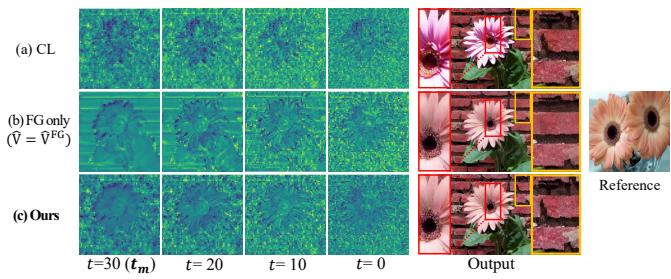  
Figure 5. Target value features $( \hat { \mathbf { V } } )$ over denoising timesteps and final outputs: (a) CL, (b) foreground-only update $( \mathbf { \hat { V } } \mathbf { = } \hat { \mathbf { V } } ^ { \mathrm { F G } } )$ , and (c) MGR Attention. MGR aligns foreground activations with the reference while keeping target responses outside the foreground.

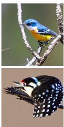

  
Reference

  
(a) Up (Ours)  
(b) Mid

  
(c) Down

  
(d) CL  
Figure 6. Layer selection for MGR Attention on CUB-LT IF100. (a) Up-blocks (Ours), (b) Mid-blocks, (c) Down-blocks, (d) CL baseline. Up-blocks best preserve foreground details.

Table 9. Layer selection analysis for MGR Attention on CUB-LT IF100 (ResNet-50). Decoder up-blocks yield the best performance.
<table><tr><td>Method</td><td>Many</td><td>Medium</td><td>Few</td><td>Single</td><td>Avg</td></tr><tr><td>Down-blocks</td><td>82.89</td><td>70.48</td><td>42.01</td><td>36.28</td><td>53.62</td></tr><tr><td>Mid-blocks</td><td>84.82</td><td>71.10</td><td>42.95</td><td>37.55</td><td>54.54</td></tr><tr><td>Up-blocks (Ours)</td><td>85.54</td><td>70.87</td><td>44.70</td><td>39.46</td><td>55.61</td></tr></table>

Layer selection. Figure 6 and Tab. 9 ablate the selfattention layer selection for MGR Attention on CUB-LT IF100. In Tab. 9, decoder up-blocks consistently yield the best accuracy; we apply MGR Attention to up-block layers from layer 2.1, selected empirically. Mid-blocks show slightly higher Medium accuracy but underperform on tail classes, while down-blocks perform worst overall, producing outputs closer to the CL baseline as shown in Fig. 6.

Feature modification strategy. Figure 7 provides visual evidence for the foreground value update design in MGR Attention. Our foreground-selective value update (e, Vˆ ) empirically yields a better balance between reference guidance and layout preservation across both datasets.

Attention bank composition. Figure 8 provides visual evidence for the KV bank design in MGR Attention. Using foreground-only reference tokens (c, ${ \bf K } _ { r } ^ { \mathrm { F G } } , { \bf V } _ { r } ^ { \mathrm { F G } } )$ or using full reference tokens $(  { \mathbf { d } } , \  { \mathbf { K } } _ { r } ,  { \mathbf { V } } _ { r } )$ can produce incomplete structures (row 2). Our bank design (e, $\mathbf { K } _ { \mathrm { b a n k } } { = } [ \mathbf { K } ^ { \mathrm { B G } } ; \mathbf { K } _ { r } ^ { \mathrm { F G } } ] )$ ) empirically yields a better balance between foreground guidance and spatial grounding.

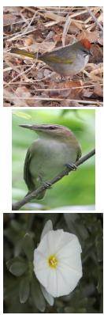

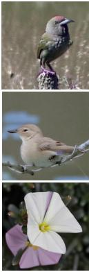  
(a) Reference  
(b) CL

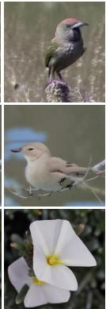  
(c) �෡

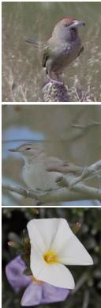  
(d) �෡, �෡

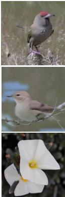  
(e) Ours

Figure 7. Feature modification strategy on CUB-LT IF100 and Flower-LT IF100. (a) Reference, (b) CL baseline, (c) key-only (Kˆ ), (d) key-value (Kˆ , Vˆ ), (e) Ours: foreground value update (Vˆ ).  

  
(a) Reference  
(b) CL

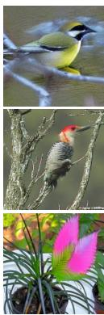  
(c) ��FG, ��FG

  
(d) ${ \bf K } _ { r } , { \bf V } _ { r }$

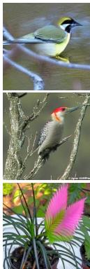  
(e) Ours  
Figure 8. KV bank composition on CUB-LT and Flower-LT IF100. (a) Reference, (b) CL baseline, (c) foregroundonly $( \mathbf { K } _ { r } ^ { \mathrm { F G } } , \mathbf { V } _ { r } ^ { \mathrm { F G } } )$ , (d) reference-full $( \mathbf { K } _ { r } , \mathbf { V } _ { r } )$ , (e) Ours $( \mathbf { K } _ { \mathrm { b a n k } } { = } [ \mathbf { K } ^ { \mathrm { B G } } ; \mathbf { K } _ { r } ^ { \mathrm { F G } } ] )$ .

Table 10. Segmentation backbone analysis on CUB-LT IF100 (MGR+RNO, ResNet-50).
<table><tr><td>Segmenter</td><td>Many</td><td>Medium</td><td>Few</td><td>Single</td><td>Avg</td></tr><tr><td>CLIPSeg [25]</td><td>84.34</td><td>70.19</td><td>45.80</td><td>40.44</td><td>56.01</td></tr><tr><td>SAM3 [4]√</td><td>85.78</td><td>69.57</td><td>46.08</td><td>41.05</td><td>56.09</td></tr></table>

## S4. Segmentation Backbone

Table 10 compares CLIPSeg [25] and SAM3 [4] as zeroshot segmenters on CUB-LT IF100. Both backbones show comparable overall performance (Avg within 0.08 points), indicating that MGR Attention is robust to the choice of segmentation backbone. SAM3 achieves slightly better Few and overall accuracy, and is used as the default segmenter in all main paper experiments.

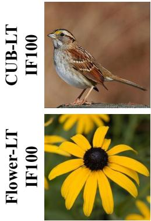  
Reference

  
Reference Mask

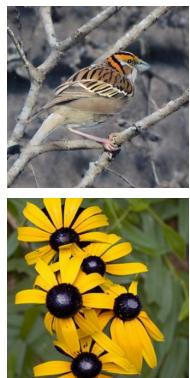  
(a) CL

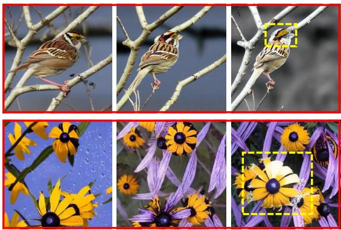  
(b) Increases RNO repulsion strength (→)  
Figure 9. Effect of increasing RNO repulsion strength on CUB-LT and Flower-LT IF100. (a) CL. (b) Ours with increasing RNO repulsion strength from left to right, starting from the default setting (CUB: 3 steps, LR 0.01; Flower: 30 steps, LR 0.08). Prompts: “sitting on a branch of a tree” (CUB) and “with water droplets on it” (Flower). Greater repulsion introduces layout diversity but risks drifting from class-consistent foreground appearance (yellow boxes).

Table 11. RNO hyperparameter sensitivity on CUB-LT IF100 (MGR+RNO, ResNet-50).
<table><tr><td>Steps</td><td>LR</td><td>Many</td><td>Medium</td><td>Few</td><td>Single</td><td>Avg</td></tr><tr><td>30</td><td>0.08</td><td>84.34</td><td>70.48</td><td>44.86</td><td>39.22</td><td>55.51</td></tr><tr><td>10</td><td>0.04</td><td>85.39</td><td>70.66</td><td>44.36</td><td>39.31</td><td>55.67</td></tr><tr><td>5</td><td>0.04</td><td>84.82</td><td>71.61</td><td>45.14</td><td>39.87</td><td>56.06</td></tr><tr><td>3</td><td>0.01√</td><td>85.78</td><td>69.57</td><td>46.08</td><td>41.05</td><td>56.09</td></tr></table>

## S5. RNO Sensitivity

Figure 9 illustrates the effect of increasing repulsion strength on generated samples. With the default setting (leftmost column of (b)), MGR+RNO preserves foreground details while generating diverse layouts. As repulsion strength increases (remaining columns of (b)), generated samples show greater layout variation but can drift from class-consistent foreground appearance, suggesting that applying too strong a repulsion objective may push latent trajectories away from class-consistent regions.

Table 11 ablates RNO hyperparameter sensitivity on CUB-LT IF100. The empirically selected setting (3 steps, LR 0.01) achieves the best Few, Single, and overall accuracy, while stronger repulsion settings do not consistently improve performance across all groups.

## S6. Comparison to Reference-Guided Methods

Table 12 compares MGR Attention against attention-based editing and detection-oriented augmentation methods on CUB-LT IF100. Attention editing methods (P2P [14], PHOTOSWAP [9], MasaCtrl [3], VSP [17]) show limited gains on Few and Single groups as global feature manipulation degrades foreground details, while detectionoriented methods (Li et al. [22], Domain-RAG [23]) require bounding box annotations or object-level objectives and underperform on tail classes in our classification setting. MGR consistently improves Few and Single accuracy, and MGR+RNO achieves the best overall performance.

Table 12. Comparison with attention-based editing and detectionoriented augmentation on CUB-LT IF100 (ResNet-50). All rows are our runs under the same protocol (main-paper Tab. 1 reports CE from Diff-II [40]); attention-editing baselines use their original settings, unlike the in-pipeline K/V variants in main-paper Tab. 5. Groups (classes): Many x>20 (16), Medium 5≤x≤20 (61), Few x<5 incl. Single (123), Single x=1 (83).
<table><tr><td>Method</td><td>Many</td><td>Medium</td><td>Few</td><td>Single</td><td>Avg</td></tr><tr><td>CE only</td><td>85.54</td><td>67.14</td><td>18.33</td><td>7.38</td><td>38.04</td></tr><tr><td>Diff-II† [40]</td><td>83.86</td><td>70.14</td><td>42.01</td><td>36.69</td><td>53.59</td></tr><tr><td>P2P [14]</td><td>84.82</td><td>69.91</td><td>41.40</td><td>35.55</td><td>53.21</td></tr><tr><td>PHOTOSWAP [9]</td><td>83.37</td><td>63.57</td><td>19.83</td><td>11.62</td><td>37.73</td></tr><tr><td>MasaCtrl [3]</td><td>84.58</td><td>66.74</td><td>18.50</td><td>7.75</td><td>37.95</td></tr><tr><td>VSP [17]</td><td>85.30</td><td>70.81</td><td>42.62</td><td>36.77</td><td>54.28</td></tr><tr><td>Li et al. [22]</td><td>82.17</td><td>64.03</td><td>18.64</td><td>10.40</td><td>37.04</td></tr><tr><td>Domain-RAG [23]</td><td>84.10</td><td>62.67</td><td>19.75</td><td>11.29</td><td>37.45</td></tr><tr><td>MGR (Ours)</td><td>85.54</td><td>70.87</td><td>44.70</td><td>39.46</td><td>55.61</td></tr><tr><td>MGR+RNO (Ours)</td><td>85.78</td><td>69.57</td><td>46.08</td><td>41.05</td><td>56.09</td></tr></table>

## S7. Additional Qualitative Results

Figure 10 visualizes the qualitative comparison to Car 5- shot and Aircraft 5-shot settings. As in Fig. 4 (left), global/attention-masked K/V replacement (a, b) introduce style leakage and blurry object regions on fine-grained vehicle and aircraft textures. SAM3-masked K/V replacement (c) reduces global noise but can still produce blurry foreground regions. Ours (d) consistently better preserves target layout and foreground details.

Car 5-shot  
Aircraft5-shot  
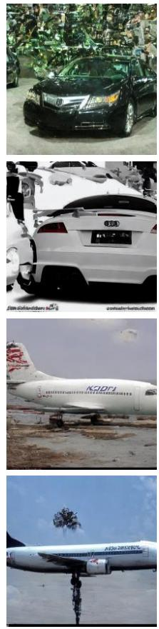  
(a)

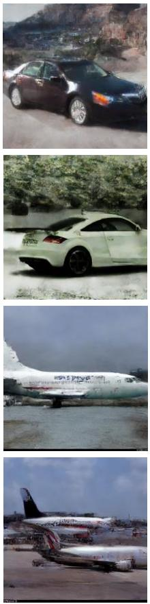  
(b)

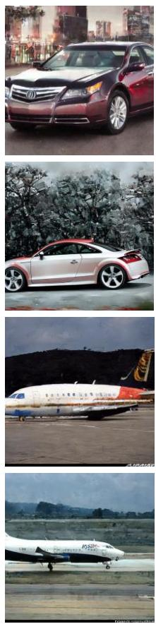  
(c)

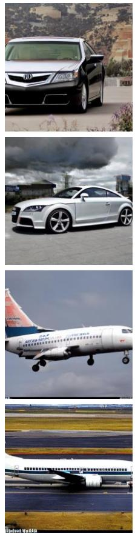  
(d)

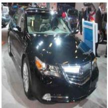

  
Reference  
Figure 10. Qualitative comparison on Car 5-shot and Aircraft 5-shot. (a) Global K/V replacement (VSP-style [17]), (b) attention-masked K/V replacement (MasaCtrl [3]-style), (c) SAM3-masked K/V replacement, and (d) Ours (MGR Attention). (a) and (b) introduce global style propagation and blurry object regions; (c) reduces noise but can still produce blurry foreground. (d) better preserves target layou while enhancing localized foreground details.