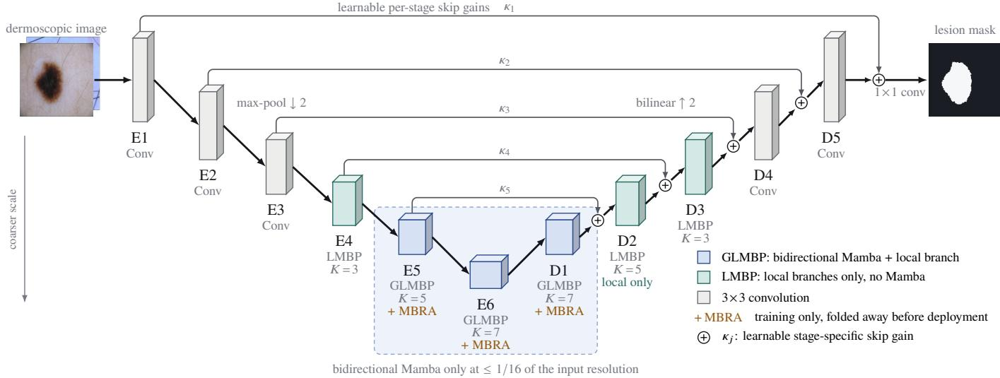
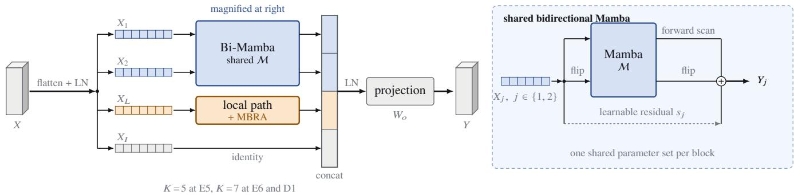
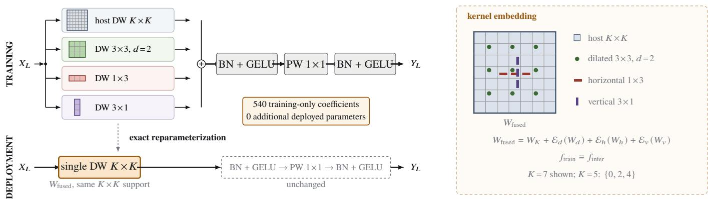
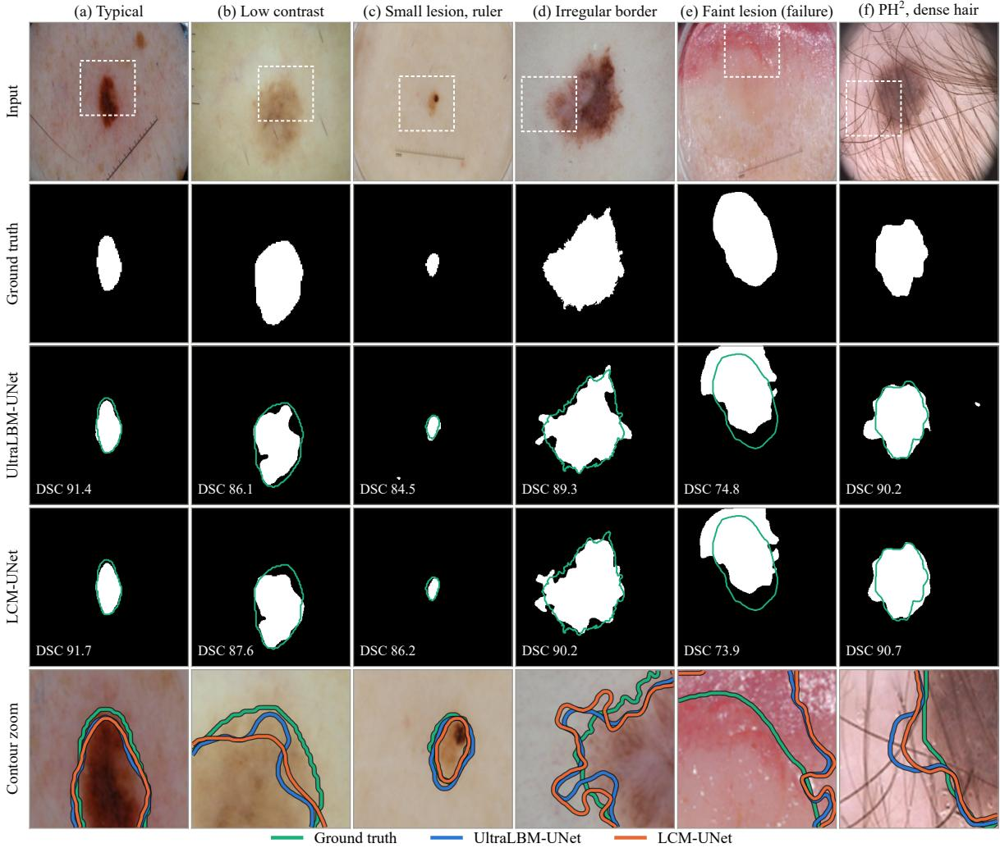
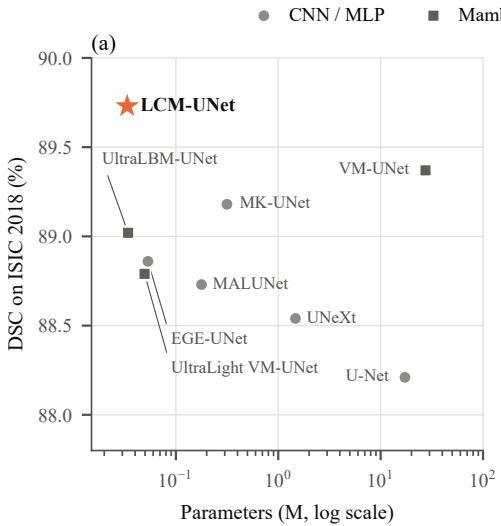
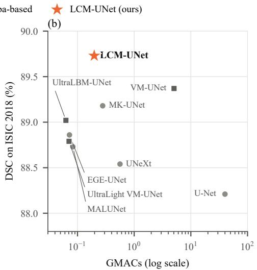
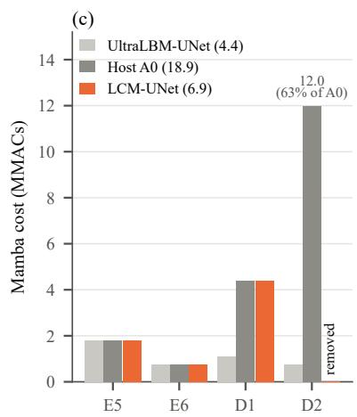

# LCM-UNet: Scale-Selective Mamba with Reparameterizable Multi-Basis Local Modeling for Lightweight Skin Lesion Segmentation

Md Shihabul Islam Shovo, Nishi Kanta Paul, Dip Kumar Saha, and Kishor Morol

Abstract: Accurate lesion segmentation underpins automated dermoscopic analysis: masks enable measurements of asymmetry, border and size. Deployment in primary care or on mobile devices requires a compact network. Existing ultra-light Mamba U-Nets offer global context, but global-modeling cost depends on each Mamba block’s resolution, while their local branches rely on a single square kernel. We introduce LCM-UNet, a 33,474-parameter U-shaped network that fuses every skip at its native resolution, restricts bidirectional Mamba to stages at one-sixteenth of the input resolution or coarser, and uses local convolutions at finer scales. A multi-basis reparameterizable adapter augments each local branch during training with dilated, horizontal and vertical depthwise kernels, then folds them into the host kernel before inference. Each skip connection also learns a stage-specific gain. Nine networks were retrained on the official ISIC 2017 and ISIC 2018 partitions under a harmonized protocol, with PH2 reserved for external validation and ablations run on a development split. LCM-UNet achieved Dice scores of 88.62%, 89.73% and 90.46% on ISIC 2017, ISIC 2018 and PH2, respectively, ranking first on both ISIC test sets and second on PH2 among the compared models. In the native-resolution host, removing Mamba from the one-eighth-resolution decoder stage eliminated 63% of Mamba operations, corresponding to 5.3% of all operations, with a Dice change of −0.03 percentage points. The adapter improved Dice by 0.48 percentage points over a single host kernel without adding deployed parameters or operations. With latency so far measured only on a GPU, LCM-UNet is a candidate for resource-constrained deployment.

Index Terms: Dermoscopy, lightweight neural network, Mamba, skin lesion segmentation, state space model, structural reparameterization.

## I. INTRODUCTION

M ELANOMA, although accounting for a small fractionof skin cancers, is responsible for most skin cancer of skin cancers, is responsible for most skin cancer deaths, and outcomes depend strongly on early detection [1]. Dermoscopy improves the visual assessment of pigmented lesions, while computerized analysis of dermoscopy images has attained dermatologist-level accuracy in laboratory studies [2]. Lesion segmentation is an early step of such pipelines because an accurate lesion mask enables the measurement of asymmetry, border irregularity and size, supports lesionspecific feature extraction, and facilitates monitoring over time [3]. Reliable segmentation remains challenging because lesions vary widely in size, shape and color, their borders are often diffuse, and images contain hair, ruler marks, color markers and vignetting.

Many high-performing segmentation networks are designed for workstation GPUs. U-Net variants [4] and Transformerbased models [5], [6] reach strong accuracy with millions to tens of millions of parameters. Mamba-based U-Nets can also be large; VM-UNet [7] has about 27 million parameters. Segmentation on a smartphone connected to a dermatoscope or in an embedded imaging device must operate under far tighter memory, energy and latency budgets. These requirements have motivated a growing family of ultra-light segmentation models with at most a few hundred thousand parameters [8]–[12].

Existing ultra-light designs expose two relevant trade-offs. Purely convolutional or multilayer-perceptron models [8], [9], [13]–[15] are efficient but capture long-range context only indirectly, which matters for large lesions and low-contrast borders. Mamba-based models [10]–[12] add global context through selective state space scans with linear complexity [16]. Although hardware-aware parallel kernels avoid token-bytoken execution [16], the selective-scan workload still grows linearly with sequence length, so the resolution at which each global block runs determines its cost. UltraLBM-UNet [11] keeps this cost low by applying its decoder blocks before upsampling, so its decoder Mamba layers see only 8×8 tokens. In the native-resolution host studied here, however, the second decoder stage operates at one-eighth of the input resolution and alone accounts for 63% of all Mamba operations. Moreover, the local branches of these blocks usually rely on one square depthwise kernel per stage, providing a single spatial parameterization for encoding local structure during optimization.

These observations motivate a scale-dependent allocation of the computational budget. Our hypothesis is that global dependencies are most useful at coarse semantic scales, where each token summarizes a large image region and the sequence is short, whereas reconstruction at finer decoder scales depends mainly on local evidence around the lesion boundary, which inexpensive convolutions can model. Local modeling can be made richer during training without affecting the deployed network. Structural reparameterization [17]–[20] shows that linear parallel branches can be trained jointly and then merged analytically into a single operator.

Accordingly, we propose LCM-UNet, an ultra-light Ushaped network that restricts global sequence modeling to low-resolution semantic stages and learns richer local representations through training-time reparameterization, without increasing deployment complexity. LCM-UNet builds on the ultra-light global-local design of UltraLBM-UNet [11] but changes where global modeling is applied, how the local branch is parameterized during training, and how encoder features are fused into the decoder. Key contributions can be summarized as follows:

• A scale-selective global-local architecture with independent bidirectional Mamba modules at E5, E6 and D1 only, all at a spatial resolution of 16 × 16 or smaller. Within each GLMBP block, one Mamba parameter set is shared by the two global channel groups and both scan directions, while each stage has its own parameters. The decoder stage at 32 × 32 uses a wider-kernel local block, and every skip connection receives its own learnable scalar gain. Relative to the native-resolution host backbone, this removes 63% of the Mamba operations, or 5.3% of all operations, and reduces the deployed parameter count to 33,474.

• A multi-basis reparameterizable adapter (MBRA) that augments the existing dense host depthwise kernel in each global-local block with sparse dilated, horizontal and vertical depthwise bases during training and folds the auxiliary branches exactly into the host kernel before inference. Its 540 training-time coefficients add no deployed parameters or operations.

• A controlled evaluation on the official ISIC 2017 and ISIC 2018 partitions, with eight baselines retrained under a harmonized protocol and external validation on PH2, which is never used for training or model selection. A compact ablation on a development split of the ISIC 2018 training set documents the combined transition from the released UltraLBM-UNet to our native-resolution host implementation, then isolates skip scaling, the Mamba layer at D2 and each MBRA basis. A numerical check confirms exact reparameterization up to floating-point rounding.

Related work is described in Section II. In Section III, LCM-UNet is proposed, while Section IV covers the datasets, implementation details and evaluation protocol. The results and their analysis are given in Section V, and Section VI concludes.

## II. RELATED WORK

## A. Lightweight Skin Lesion Segmentation

U-Net [4] and its variants remain the reference design for lesion segmentation [3]. Transformer-based models add global context at a substantial cost in parameters and computation [5], [6]. Lightweight alternatives reduce this cost through more selective feature processing.

UNeXt [13] combines early convolutional stages with tokenized shifted multilayer perceptrons, while MALUNet [8] and EGE-UNet [9] employ lightweight attention modules with channel widths of at most 64 to reach 0.18 and 0.05 million parameters, respectively. Other approaches focus on local modeling: ULFAC-Net [14] uses fully asymmetric convolutions, LB-UNet [21] adds boundary supervision, MK-UNet [15] employs multiple depthwise kernels, and LV-UNet [22] fuses its training-time blocks for inference. These networks show that careful local design can be efficient, but their receptive fields grow only with depth and kernel size. This motivates lightweight designs that combine local processing with explicit global-context modeling.

## B. State Space Models for Medical Image Segmentation

Structured state space models [23] and their input-dependent variant Mamba [16] model long sequences with cost linear in sequence length. Vision Mamba [24] scans image tokens bidirectionally, whereas VMamba [25] uses multi-directional two-dimensional scans.

In medical segmentation, VM-UNet [7] and LKM-UNet [26] insert state space blocks into U-shaped encoders and decoders, while recent hybrid designs combine them with multi-scale convolution or attention [27], [28]. These models have demonstrated strong segmentation performance but usually contain millions of parameters. UltraLight VM-UNet [10] shows that processing channel groups with parallel Mamba layers of small width preserves accuracy with fewer than 0.05 million parameters.

Among ultra-light skin lesion models, UltraLBM-UNet [11] and UCA-MNet [12] are closest to our work. UltraLBM-UNet introduces global-local multi-branch perception (GLMBP) blocks that split the channels into two global groups processed by one bidirectional Mamba with weights shared within each block, one depthwise local group and one identity group. It fuses skips by addition with a single learnable scalar. UCA-MNet combines bidirectional Mamba with cross-scale and pyramidal attention and activates its multi-scale module only when the channel depth exceeds a threshold, reflecting that expensive context modeling need not be applied uniformly.

LCM-UNet retains the channel schedule and GLMBP decomposition of UltraLBM-UNet but changes the allocation of global and local computation. Every decoder block runs after upsampling and every skip is fused at the resolution at which it was produced, so the decoder returns to full resolution before the prediction head. This schedule moves the second decoder block from 8 × 8 to 32 × 32. At that resolution, LCM-UNet uses a local block instead of Mamba, so global modeling stays at resolutions of $1 6 \times 1 6$ or less. The local branch of each remaining global-local block is trained with multiple reparameterizable bases, and each skip level has its own scalar. Unlike UCA-MNet, LCM-UNet uses no attention modules and places no global block in the decoder above 16 × 16.

## C. Directional, Dilated and Multi-Kernel Local Modeling

Efficient local operators can reshape the spatial support of convolution. Splitting a square k-by-k kernel into a row kernel $( 1 \times k )$ and a column kernel (k × 1) lowers cost while preserving horizontal and vertical support [29]. Compared with an undilated kernel of the same size, dilation enlarges the sampling support without extra parameters [30].

In lightweight medical segmentation, ULFAC-Net [14] builds networks from asymmetric convolutions, MK-UNet [15] mixes depthwise kernels of several sizes, and DSConv-Mamba [31] pairs lightweight directional convolutions with Mamba. These designs support the view that directional local operators complement global state space modeling, but they keep their extra branches at inference time. MBRA instead uses dilated and directional bases only during optimization and folds them into the host kernel before deployment.

## D. Structural Reparameterization

Structural reparameterization trains a multi-branch block and converts it into a single operator by exploiting the linearity of convolution and batch normalization. ACNet [17] strengthens the central cross of a square kernel with parallel $1 \times 3$ and $3 \times 1$ branches. RepVGG [18] and the Diverse Branch Block [19] merge identity, $1 \times 1$ and multi-scale branches.

RepLKNet [32] trains large kernels with parallel small kernels, and UniRepLKNet [20] merges dilated small kernels into a large one. In medical segmentation, LV-UNet [22] uses reparameterizable blocks to obtain a simple inference network.

MBRA applies this principle to the local branch of a Mamba-based global-local block in an ultra-light network. The existing dense depthwise kernel remains the host operator, while sparse dilated, horizontal and vertical depthwise branches are introduced only during training. The auxiliary branches are zero-initialized so that optimization starts from the host operator, and their coefficients are embedded into the existing kernel before inference. Thus, the additional training-time parameterization does not increase the deployed parameter count or operation count.

## III. METHODOLOGY

## A. Overall Architecture

The complete LCM-UNet pipeline is depicted in $\mathrm { F i g . ~ 1 }$ The network transforms an RGB image $X \doteq \mathbb { R } ^ { B \times 3 \times 2 5 6 \times }$ 256 into a one-channel map of logits using six encoder stages, five decoder stages and a $. 1 \times 1$ convolutional head. The encoder widths are [8, 16, 24, 32, 48, 64], and the resolution decreases as $2 5 6 \to 1 2 8 \to 6 4 \to 3 2 \to 1 6 \to 8$ . In the following, E1– E6 and D1–D5 denote the stages shown in Fig. 1, whereas $E _ { j }$ and $F _ { j } ^ { D }$ represent the encoder and decoder feature maps at resolution level $j ,$ , with level 1 at the input resolution. Thus D1 reconstructs level 5 at 16×16, while D5 reconstructs level 1 at $2 5 6 \times 2 5 6$

The first three encoder stages and the last two decoder stages are $3 \times 3$ convolutions operating at the highest resolutions. E4 employs a local multi-branch perception (LMBP) block with $K = 3$ , and E5 and E6 use global-local multi-branch perception (GLMBP) blocks with $K = 5$ and $K = 7 .$ . E6 is the bottleneck at $8 \times 8 .$ . After each stage, group normalization with four groups [33] is followed by a GELU activation. Here, Pool denotes $2 \times 2$ max pooling and Φ denotes a stage. The encoder computes

$$
E _ { 1 } = \Phi _ { \mathrm { E } 1 } ( X ) , \qquad E _ { i } = \Phi _ { \mathrm { E } i } \bigl ( \mathrm { P o o l } ( E _ { i - 1 } ) \bigr ) , \quad i = 2 , \ldots , 6 .\tag{1}
$$

Similar to the encoder hierarchy, the decoder upsamples bilinearly by a factor of two $\mathrm { ( U p ) }$ before each stage. The kernel sizes at D1, D2 and D3 decrease as $7  5  3$ . D4 and D5 are convolutional, and the decoder stage that reconstructs level j is $ Ḋ \mathbf Ḋ \ Ḋ \ Ḍ Ḍ ( 6 - j )$ ). Starting from $F _ { 6 } ^ { D } = \bar { E _ { 6 } }$

$$
\begin{array} { l } { { \hat { F } _ { j } ^ { D } = \Phi _ { \mathrm { D } ( 6 - j ) } \bigl ( \mathrm { U p } ( F _ { j + 1 } ^ { D } ) \bigr ) , } } \\ { { F _ { j } ^ { D } = \hat { F } _ { j } ^ { D } + \kappa _ { j } E _ { j } , \qquad j = 5 , \ldots , 1 , } } \end{array}\tag{2}
$$

where $\kappa _ { j }$ is the skip coefficient of Section III-E. The head generates the logits $\hat { Y } = W _ { h } * F _ { 1 } ^ { D } \in \mathbb { R } ^ { B \times }$ ×1×256×256, and the lesion mask is obtained by thresholding $\sigma ( { \hat { Y } } )$ at 0.5. Thus, every skip is fused at the resolution at which it was produced, and the decoder returns to full input resolution before the head.

## B. Scale-Selective Global-Local Modeling

GLMBP block. Fig. 2(a) shows the GLMBP block used at E5, E6 and D1. For an input $X \in \mathbb { R } ^ { B \times C \times H ^ { \prime } \times W ^ { \prime } }$ , the spatial dimensions are flattened to generate $\begin{array} { r } { N \ = \ H ^ { \prime } W ^ { \prime } } \end{array}$ tokens, normalized by layer normalization and then split into four channel groups of width $C _ { g } = C / 4$

$$
X _ { 1 } , X _ { 2 } , X _ { L } , X _ { I } = { \mathrm { S p l i t } } _ { 4 } { \big ( } { \mathrm { L N } } ( { \mathrm { R e s h a p e } } ( X ) ) { \big ) } .\tag{3}
$$

In each GLMBP block, the two global groups $X _ { 1 }$ and $X _ { 2 }$ are processed by a single Mamba module M whose parameters are shared between both groups and both scan directions. Each of E5, E6 and D1 has its own Mamba module, and M denotes the module of the current block:

$$
Y _ { j } = \mathcal { M } ( X _ { j } ) + \mathrm { F l i p } \big ( \mathcal { M } ( \mathrm { F l i p } ( X _ { j } ) ) \big ) + s _ { j } \odot X _ { j } ,\tag{4}
$$

for $j \in \{ 1 , 2 \}$ , where Flip reverses the token order and $s _ { j }$ is a learnable scalar initialized to one. The three terms correspond to the selective scan in the forward direction, the reversed scan and the learnable residual term. The local group $X _ { L }$ is reshaped to $B \times C _ { g } \times H ^ { \prime } \times W ^ { \prime }$ and processed by the local path of Section III-C, producing $Y _ { L }$ . The identity group $X _ { I }$ is passed through unchanged. The four outputs are concatenated, normalized and projected to the stage output width $C _ { \mathrm { o u t } }$

$$
Y = W _ { o } \mathrm { L N } \big ( [ Y _ { 1 } , Y _ { 2 } , Y _ { L } , X _ { I } ] \big ) , \qquad W _ { o } \in \mathbb { R } ^ { C _ { \mathrm { o u t } } \times C } ,\tag{5}
$$

so that half of the channels encode global context, one quarter encodes local detail and one quarter passes through unchanged. Following the host backbone, M uses a state dimension of 16, a causal convolution width of 4 and an expansion factor of 2.

LMBP block. LMBP maintains the same normalization, four-way split and output projection but does not include a state-space layer. Three of its groups are processed with independent depthwise-separable local paths with kernel K, and the fourth is an identity group. LMBP is applied at E4 $( K = 3 ) , { \bf D } 2 \ ( K = 5 )$ and D3 $( K = 3 )$

Placement. The A0 host backbone applies GLMBP at E5, E6, D1 and D2 and follows the native-resolution schedule of Section III-A. Each GLMBP block invokes the Mamba module four times (two groups and two directions). Although the selective scan is computed with hardware-aware parallel kernels [16], its workload still grows linearly with sequence length. In A0, D2 processes $3 2 \times 3 2 = 1 . 0 2 4$ tokens, four times as many as E5 or D1 and sixteen times as many as

  
Fig. 1. Overall architecture of LCM-UNet. Bidirectional Mamba is used only in the shaded stages, and the output shown is the predicted lesion mask.

E6. In our operation-count analysis, D2 accounts for 63% of the Mamba operations of the host network (Fig. 4(c)). The released UltraLBM-UNet [11] applies the same block before upsampling, on $8 \times 8$ tokens, so the additional computational cost arises from the native-resolution schedule. At $3 2 \times 3 2$ adjacent D2 feature locations correspond to an 8-pixel inputspace stride, while their effective receptive fields are larger because of preceding encoder-decoder transformations. Our hypothesis is that local refinement at this level can use the context already formed at coarser stages. Consequently, LCM-UNet replaces GLMBP at D2 with an LMBP block that preserves the wider $5 \times 5$ kernel, so no Mamba layer operates above 16×16 and the decoder becomes increasingly local as its resolution grows. MBRA is not applied at D2, which keeps the effects of Mamba removal and multi-basis reparameterization separately measurable.

## C. Multi-Basis Reparameterizable Adapter

In the host backbone, the local group of a GLMBP block is processed by a depthwise-separable path [34] with a single $K \times K$ depthwise kernel. MBRA augments this path during training with three auxiliary depthwise bases (Fig. 2(b)). For $X _ { L } \in \mathsf { \overline { { R } } } ^ { B \times C _ { L } \times H ^ { \prime } \times W ^ { \prime } }$ with $C _ { L } = C / 4$ , the local response before normalization is

$$
\begin{array} { r l } & { Z = \mathrm { D W C o n v } _ { K } ( X _ { L } ) + \mathrm { D W C o n v } _ { 3 \times 3 } ^ { d = 2 } ( X _ { L } ) } \\ & { \qquad + \mathrm { D W C o n v } _ { 1 \times 3 } ( X _ { L } ) + \mathrm { D W C o n v } _ { 3 \times 1 } ( X _ { L } ) , } \end{array}\tag{6}
$$

with $K = 5$ at E5 and $K = 7$ at E6 and D1, followed by

$$
\begin{array} { r l r } { U = \mathrm { G E L U } \big ( \mathrm { B N } _ { d } ( Z ) \big ) , } & { { } } & { P = \mathrm { P W } _ { 1 \times 1 } ( U ) , } \\ { Y _ { L } = \mathrm { G E L U } \big ( \mathrm { B N } _ { p } ( P ) \big ) , } & { { } } & { } \end{array}\tag{7}
$$

where $\mathrm { P W } _ { 1 \times 1 }$ is the pointwise convolution that mixes the local channels. The normalization layers $\mathrm { B N } _ { d }$ and $\mathrm { B N } _ { p }$ are internal to the depthwise-separable local paths in GLMBP and LMBP. Four-group GroupNorm is applied at the output of each stage.

The four bases provide complementary optimization parameterizations. The dense host kernel parameterizes every position within its $K \times K$ neighborhood. The $3 \times 3$ kernel with dilation 2 provides an additional sparse $5 \times 5$ sampling lattice with nine coefficients as a separate parameterization. The $1 \times 3$ and $3 \times 1$ kernels provide independent horizontal and vertical optimization bases through the kernel center, as in asymmetric convolution blocks [17]. All three auxiliary supports are already representable by the $5 \times 5$ host kernel at E5 and the $7 \times 7$ host kernels at E6 and D1. MBRA therefore changes only the training parameterization and optimization path by adding learnable coefficients to selected host-kernel positions, without changing the deployed function class or receptive-field extent.

For exact folding, every auxiliary branch consists of a depthwise convolution with stride 1, no bias, no internal normalization or activation, and zero padding that preserves the host output shape. The auxiliary branch outputs are added before $\mathrm { B N } _ { d }$ and any nonlinearity. The auxiliary weights are initialized to zero, $W _ { d } = W _ { h } = W _ { v } = 0 $ , so that initially $Z ~ = ~ \mathrm { D W C o n v } _ { K } ( X _ { L } )$ and training starts from the host operator. MBRA is attached to the local groups of E5, E6 and D1, whose widths are 8, 12 and 16 channels. Each local channel receives $9 + 3 + 3 = 1 5$ auxiliary coefficients, and the total number of training-time MBRA parameters is $1 5 \times 3 6 = 5 4 0$

## D. Structural Reparameterization

Let $W _ { K } \in \mathbb { R } ^ { C _ { L } \times 1 \times K \times K }$ be the host depthwise kernel and $W _ { d } , W _ { h }$ and $W _ { v }$ the dilated $3 \times 3 .$ , horizontal $1 \times 3$ and vertical $3 \times 1$ kernels. We introduce embedding operators $\mathcal { E } _ { d } ( \cdot ) , \mathcal { E } _ { h } ( \cdot )$ and $\mathcal { E } _ { v } ( \cdot )$ that place each auxiliary kernel on the corresponding positions of a zero $K \times K$ grid. Given $c = \lfloor K / 2 \rfloor$ and zero-

(a)  

  
(b)  
Fig. 2. Building blocks of LCM-UNet. (a) GLMBP block with a shared bidirectional Mamba. (b) MBRA before and after reparameterization.

based indices,

$$
\begin{array} { r l r } & { } & { \mathcal { E } _ { d } ( W _ { d } ) [ c - 2 + 2 a , c - 2 + 2 b ] = W _ { d } [ a , b ] , } \\ & { } & { \mathcal { E } _ { h } ( W _ { h } ) [ c , c - 1 + b ] = W _ { h } [ b ] , ~ } \\ & { } & { \mathcal { E } _ { v } ( W _ { v } ) [ c - 1 + a , c ] = W _ { v } [ a ] , ~ } \end{array}\tag{8}
$$

for $a , b \in \{ 0 , 1 , 2 \}$ , the dilated coefficients occupy rows and columns $\{ 0 , 2 , 4 \}$ for $K = 5$ and {1, 3, 5} for $K = 7 ,$ while the directional coefficients occupy the central row and column. Since all four branches are centered, have stride 1 and are biasfree, linearity of convolution ensures

$$
\begin{array} { r } { Z = \mathrm { C o n v } ( X _ { L } ; W _ { \mathrm { f u s e d } } ) , \qquad } \\ { W _ { \mathrm { f u s e d } } = W _ { K } + \mathcal { E } _ { d } ( W _ { d } ) + \mathcal { E } _ { h } ( W _ { h } ) + \mathcal { E } _ { v } ( W _ { v } ) . } \end{array}\tag{9}
$$

After training, $W _ { \mathrm { f u s e d } }$ is incorporated into the host kernel and the three auxiliary operators are removed. The deployed local path comprises a single $K \times K$ depthwise convolution followed by the unchanged $\mathrm { B N } _ { d }  \mathrm { G E L U }  \mathrm { P W } _ { 1 \times 1 } $ $\mathrm { B N } _ { p } ~  ~ \mathrm { G E L U }$ stack. Because the summation precedes every normalization and activation, the unfused training form $f _ { \mathrm { t r a i n } } ( X ; \theta )$ and the deployed form $f _ { \mathrm { i n f e r } } ( X ; \theta ^ { \prime } )$ produce the same output up to floating-point rounding when both run in evaluation mode with identical normalization statistics. The 540 auxiliary coefficients are incorporated into existing host kernels, so the deployed network has the same number of parameters and operations that the network without MBRA has. Section V-E confirms the equivalence of the two forms numerically.

## E. Stage-Specific Additive Skip Scaling

The host backbone fuses all five skips with one shared learnable scalar. In LCM-UNet, each level has its own scalar,

$$
F _ { j } ^ { D } = \hat { F } _ { j } ^ { D } + \kappa _ { j } E _ { j } , \qquad j = 1 , \ldots , 5 ,\tag{10}
$$

where $E _ { j }$ denotes the encoder feature map at level $j , \ \hat { F } _ { j } ^ { D }$ denotes the decoder feature map before fusion and $\kappa _ { j }$ is initialized to one. The encoder and decoder tensors at each level have identical shapes, from $8 \times 2 5 6 \times 2 5 6$ at level 1 to $4 8 \times 1 6 \times 1 6$ at level 5. Thus, fusion requires no concatenation, projection, attention gate or channel expansion and adds only four parameters to the host network. The motivation is that encoder features at different levels contain different proportions of useful information and nuisance texture. The highresolution features of E1 may contain low-level texture such as hair and illumination artifacts, whereas those of E5 are more abstract. Level-dependent gains allow the decoder to rebalance these contributions at negligible cost.

## F. Training Objective

The network is trained with the sum of the binary crossentropy and Dice losses [35],

$$
\begin{array} { r c l } { \mathscr { L } = \mathscr { L } _ { \mathrm { B C E } } + \mathscr { L } _ { \mathrm { D i c e } } , } \\ { \mathscr { L } _ { \mathrm { B C E } } = - \displaystyle \frac { 1 } { | \Omega | } \sum _ { i \in \Omega } \bigl [ y _ { i } \log p _ { i } + ( 1 - y _ { i } ) \log ( 1 - p _ { i } ) \bigr ] , } \\ { \mathscr { L } _ { \mathrm { D i c e } } = 1 - \displaystyle \frac { 2 \sum _ { i } p _ { i } y _ { i } + \epsilon } { \sum _ { i } p _ { i } + \sum _ { i } y _ { i } + \epsilon } , } \end{array}\tag{11}
$$

TABLE I  
DATASETS AND PARTITIONS. THE ISIC 2018 DEVELOPMENT SPLIT IS HELD OUT FROM ITS TRAINING SET.
<table><tr><td>Dataset</td><td>Role</td><td>Train</td><td>Val.</td><td>Test</td><td>Total</td></tr><tr><td>ISIC 2017 [36]</td><td>Benchmark</td><td>2,000</td><td>150</td><td>600</td><td>2,750</td></tr><tr><td>ISIC 2018 [37], [38]</td><td>Benchmark</td><td>2,594</td><td>100</td><td>1,000</td><td>3,694</td></tr><tr><td>ISIC 2018 development</td><td>Ablation</td><td>2,075</td><td>100</td><td>519</td><td></td></tr><tr><td>PH2 [39]</td><td>External validation</td><td>1</td><td>一</td><td>200</td><td>200</td></tr></table>

where $p _ { i } = \sigma ( \hat { Y } _ { i } )$ and $y _ { i } \in \{ 0 , 1 \}$ are the predicted probability and the label of pixel $i , \ \Omega \ \mathrm { i s }$ the set of pixels, and $\epsilon = 1$ is a smoothing constant. The Dice term is computed per image and averaged over the batch.

## IV. EXPERIMENTAL SETUP

## A. Datasets and Protocol

We used three public dermoscopic datasets (Table I). ISIC 2017 [36] contains 2,000 training, 150 validation and 600 test images annotated with expert lesion masks, and the lesion segmentation task of ISIC 2018 [37], [38] contains 2,594 training, 100 validation and 1,000 test images. Both datasets were used with their official partitions rather than random splits. Each model was trained on the official training set, its checkpoint was selected on the official validation set, and the official test set was used once for the final assessment. For the ablation study, 519 images (20%) served as a fixed development split selected from the ISIC 2018 training set by permuting the lexicographically sorted training-image IDs with random seed 2018 and retaining the first 519 IDs. Ablation variants were trained on the remaining 2,075 training images, their checkpoints were selected on the official validation set, and they were evaluated on the development split, so the official test sets were not used for model development or ablation analysis. Validation and test images were never included in training. Separate models were trained on ISIC 2017 and ISIC 2018. The datasets differ in image resolution, acquisition device and artifact distribution.

PH2 [39] contains 200 dermoscopic images of melanocytic lesions, 40 melanomas and 160 nevi split evenly between common and atypical cases, acquired at one hospital at a resolution of $7 6 8 \times 5 6 0$ pixels. It was reserved for external validation. PH2 was excluded from model development and hyperparameter selection: it was not used for training, architecture design, checkpoint or threshold selection, loss or augmentation choices, Mamba placement or MBRA configuration. External evaluation took place only after these decisions had been fixed on the ISIC development data. For each method, the three models trained on ISIC 2018 were evaluated on all 200 $\mathrm { P H ^ { 2 } }$ images without further tuning.

## B. Implementation Details

Images were resized to $2 5 6 \times 2 5 6$ pixels using bilinear interpolation, and masks were resized using nearest-neighbor interpolation and binarized. Normalization used the channelwise mean and standard deviation of the corresponding training set; $\mathrm { P H ^ { 2 } }$ images were normalized with the ISIC 2018 statistics. During training, images were flipped horizontally and vertically with a probability of 0.5 each and rotated by an angle sampled uniformly from [0◦, 360◦) with a probability of 0.5, following the host-backbone protocol [11].

Each model was optimized for 300 epochs on mini-batches of eight images using AdamW [40] with $\beta _ { 1 } ~ = ~ 0 . 9$ and $\beta _ { 2 } = 0 . 9 9 9 .$ , an initial step size of $1 0 ^ { - 3 }$ and a weight-decay coefficient of $1 0 ^ { - 2 }$ . The step size followed cosine annealing with a 50-epoch period and a floor of $1 0 ^ { - 5 }$ . After each epoch, validation DSC was computed on the official validation set, and the checkpoint with the highest value was saved. Prediction masks were binarized at a threshold of 0.5 for all datasets and methods, with no test-time augmentation or post-processing. All configurations were trained three times, once with each random seed (42, 43 and 44). The results are given as mean and standard deviation across these runs. For LCM-UNet, MBRA was folded into the host kernels after checkpoint selection, and all reported results correspond to the deployed network unless stated otherwise. All experiments were implemented in PyTorch 2.8.0 (Python 3.12, CUDA 12.6) with the official Mamba selective-scan kernels (version 2.2.2) [16] and run on one NVIDIA A100 GPU with 40 GB of memory.

Compared methods. The comparison includes LCM-UNet, U-Net [4], UNeXt [13], MALUNet [8], EGE-UNet [9], VM-UNet [7], UltraLight VM-UNet [10], MK-UNet [15] and UltraLBM-UNet [11], representing a conventional U-Net, lightweight convolutional and perceptron models, and standard and ultra-light Mamba-based models. Because published results use different splits, input sizes and averaging conventions, all baselines were retrained from their official implementations under a harmonized protocol. All baselines shared the datasets and official splits, input resolution, optimizer and schedule where applicable, metric definitions and evaluation procedure, while retaining their default architectures, method-specific pretraining and auxiliary losses. All results in the comparison tables were obtained under our harmonized evaluation protocol rather than copied from published reports. U-Net uses four downsampling stages, 64 base channels and bilinear upsampling. VM-UNet was initialized with the ImageNetpretrained VMamba weights provided by its authors, and all other networks were trained from scratch. EGE-UNet retained its auxiliary deep-supervision losses by design, and all other methods were trained with the loss in (11). UCA-MNet [12] was not retrained because not all components required for its reproduction are publicly available. Its published results were computed at $3 2 0 \times 3 2 0$ with per-image averaging and with $\mathrm { P H ^ { 2 } }$ split into training and test subsets, so they are not directly comparable with ours.

## C. Evaluation Metrics

Following the convention of the compared lightweight models [8]–[11], predictions and masks were compared at $2 5 6 \times 2 5 6$ . Pixel-level counts of TP, FP, FN and TN (true/false positives and negatives) were accumulated over each test set

to compute

$$
\begin{array} { r l r } { \mathrm { D S C } = \frac { 2 \mathrm { T P } } { 2 \mathrm { T P } + \mathrm { F P } + \mathrm { F N } } , } & { } & { \mathrm { I o U } = \frac { \mathrm { T P } } { \mathrm { T P } + \mathrm { F P } + \mathrm { F N } } , } \\ { \mathrm { S E } = \frac { \mathrm { T P } } { \mathrm { T P } + \mathrm { F N } } , } & { } & { \mathrm { S P } = \frac { \mathrm { T N } } { \mathrm { T N } + \mathrm { F P } } , } \end{array}\tag{12}
$$

where DSC denotes the Dice similarity coefficient, IoU the Jaccard index, SE sensitivity and SP specificity. The overlap metrics DSC and IoU are treated as the primary measures [41].

Model size is the number of parameters of the deployed network. Computational cost is given in billions of multiplyaccumulates (GMACs) per 256×256 image; one multiplication and its accumulation count as one MAC. Stage-wise costs are reported in millions of MACs (MMACs). Convolutional and linear layers are counted exactly, and every Mamba call is counted analytically, including its projections, causal convolution and selective-scan recurrence. The same counting procedure was applied to all compared methods. Latency is the mean forward-pass time at batch size 1 in FP32 across 500 timed runs after 50 warm-up passes, with device synchronization, gradients disabled and models in evaluation mode. Ablation protocol. All ablation variants were trained on the remaining ISIC 2018 training images and evaluated on the development split of Section IV-A, with the same schedule, loss, seeds and checkpoint-selection criterion as the main model. The component ablation (Table IV(a)) uses the released UltraLBM-UNet (A−1) as its starting point. It was trained with its official implementation, which fuses its skips after pooling and applies each decoder block before upsampling. The host A0 uses the same blocks in our implementation with the native-resolution schedule of Fig. 1. It also uses separate input and output layer normalizations, bias-free convolutions, adjusted residual scalars and group normalization after E6, adding 554 parameters. Thus, $_ { \mathrm { A - } 1 }$ to A0 represents a combined implementation transition, not an isolated test of the resolution schedule. A1–A4 progressively introduce stage-specific skip scaling, a single dilated reparameterizable local adapter (RDLA), scale-selective Mamba placement and finally MBRA. The adapter ablation (M0–M3, Table IV(b)) keeps stage-specific skip scaling and scale-selective Mamba placement fixed and varies only the auxiliary bases. M1 and M3 coincide with A3 and A4, respectively. RDLA denotes the isolated dilated basis of MBRA. In A2–A4 and M1–M3, the adapter is attached only to E5, E6 and D1, so A2 and A3 differ only in the block used at D2.

## V. RESULTS AND DISCUSSION

## A. Comparison on ISIC 2017 and ISIC 2018

Table II compares LCM-UNet with eight methods retrained under the harmonized protocol of Section IV-B. LCM-UNet achieved the highest DSC and IoU on both official test sets, reaching 88.62 ± 0.21% DSC and 79.57 ± 0.34% IoU on ISIC 2017 and 89.73 ± 0.18% DSC and $8 1 . 3 7 \pm 0 . 3 0 \%$ IoU on ISIC 2018. Its closest architectural comparator, UltraLBM-UNet, has a similar number of parameters (34,166 versus 33,474) and achieved 88.04% and 89.02% DSC, so LCM-UNet achieved DSC gains of 0.58 and 0.71 percentage points relative to it on the two datasets. Among the larger baselines, MK-UNet achieved the highest DSC on ISIC 2017 (87.96% DSC) and VM-UNet on ISIC 2018 (89.37% DSC), the latter with about 819 times more parameters than LCM-UNet. The margins over the second-best results are below one percentage point, so these improvements should be interpreted as modest.

Secondary metrics provide additional context for these gains. On ISIC 2018, LCM-UNet had the highest sensitivity (90.08%) and nearly the highest specificity (96.60%), behind MALUNet (96.64%), which had a lower sensitivity of 88.18%. On ISIC 2017, VM-UNet had a slightly higher sensitivity than LCM-UNet (88.47% versus 88.31%) but lower specificity. These values suggest that the gains of LCM-UNet are associated with higher sensitivity to lesion pixels relative to the ultra-light comparators, rather than with a more conservative decision rule.

LCM-UNet requires 0.197 GMACs, compared with approximately 26 times as many operations for VM-UNet and 200 times as many for U-Net. Compared with UltraLBM-UNet, UltraLight VM-UNet, EGE-UNet and MALUNet, which operate at 0.062–0.083 GMACs, LCM-UNet needs 2.4 to 3.2 times more operations and performs more Mamba operations than UltraLBM-UNet (6.9 versus 4.4 MMACs), whose decoder Mamba layers run at 8×8. The difference in total cost does not arise from the global-local blocks. The five plain convolution stages at $6 4 \times 6 4$ and above (E1–E3, D4 and D5) account for 91% of its operations because all skips are fused at their native resolutions and the decoder returns to 256 × 256 before the head. We return to this trade-off in Section V-F.

## B. External Validation on PH2

Table III shows the performance of the ISIC 2018 models on all 200 PH2 images. VM-UNet achieved the highest DSC $( 9 0 . 7 1 \pm 0 . 3 3 \% )$ , while LCM-UNet was second (90.46 ± 0.31%), followed by MK-UNet (90.38%) and UltraLBM-UNet (90.02%). LCM-UNet trailed VM-UNet by 0.25 percentage points but was the most accurate network with fewer than one million parameters. The small advantage of VM-UNet under this domain shift may partly reflect its ImageNetpretrained encoder. For all methods, DSC on $\mathrm { P H ^ { 2 } }$ was higher than on the ISIC 2018 test set, which reflects the uniform acquisition conditions and large, well-centered lesions of PH2; sensitivity increased and specificity decreased relative to ISIC 2018. This pattern suggests a mild tendency toward oversegmentation after the change of acquisition device rather than a failure to detect lesions. The ranking of the methods was largely preserved between ISIC 2018 and $\mathrm { P H ^ { 2 } }$ , providing some evidence that LCM-UNet’s gains are not confined to the ISIC test distribution.

## C. Qualitative Results

Fig. 3 compares LCM-UNet with UltraLBM-UNet, its closest architectural baseline, on five ISIC 2018 test images and one $\mathrm { P H ^ { 2 } }$ image using the seed-42 checkpoints. The cases represent a typical lesion, a low-contrast border, a small lesion near a ruler, an irregular border, a failure case and dense hair. They were selected to represent these conditions, with no preference for either method. Both networks recover the main lesion region in every case, while their differences are confined to the boundary, consistent with the sub-point DSC differences in Table II. In the typical case, the two predictions nearly coincide. Along low-contrast borders, both predictions contract toward the darker lesion core, and occasional small false-positive islands appear on ruler marks or hair outside the lesion. The faint lesion in Fig. 3(e), adjacent to erythema near the edge of the field of view, is a failure case for both networks. Both predictions extend into the erythema and miss the faint lower part of the lesion; LCM-UNet does not correct this error. On PH2, both predictions are slightly larger than the expert mask, consistent with the higher sensitivity and lower specificity in Table III.

TABLE II  
COMPARISON ON THE ISIC 2017 AND ISIC 2018 TEST SETS (MEAN ± STD OVER THREE SEEDS). BOLD: BEST; UNDERLINE: SECOND BEST.
<table><tr><td></td><td></td><td></td><td></td><td colspan="4">ISIC 2017 (600 test images)</td><td colspan="4">ISIC 2018 (1,000 test images)</td></tr><tr><td>Method</td><td>Year</td><td>Params (M)</td><td>GMACs</td><td>DSC (%)</td><td>IoU (%)</td><td>SE (%)</td><td>SP (%)</td><td>DSC (%)</td><td>IoU (%)</td><td>SE (%)</td><td>SP (%)</td></tr><tr><td>U-Net [4]</td><td>2015</td><td>17.263</td><td>39.980</td><td>86.34±0.41</td><td>75.96±0.63</td><td>85.12</td><td>95.85</td><td> $8 8 . 2 1 { \pm } 0 . 3 5 $ </td><td> $7 8 . 9 1 { \scriptstyle \pm 0 . 5 6 }$ </td><td>87.93</td><td>96.37</td></tr><tr><td>UNeXt [13]</td><td>2022</td><td>1.472</td><td>0.562</td><td>86.92±0.33</td><td>76.87±0.52</td><td>86.05</td><td>95.89</td><td> $8 8 . 5 4 \pm 0 . 2 9 $ </td><td> $7 9 . 4 4 \pm 0 . 4 7$ </td><td>88.36</td><td>96.43</td></tr><tr><td>MALUNet [8]</td><td>2022</td><td>0.178</td><td>0.083</td><td>87.35±0.36</td><td>77.54±0.57</td><td>86.41</td><td>96.06</td><td> $8 8 . 7 3 { \pm } 0 . 3 1$ </td><td> $7 9 . 7 4 \pm 0 . 5 0$ </td><td>88.18</td><td>96.64</td></tr><tr><td>EGE-UNet [9]</td><td>2023</td><td>0.053</td><td>0.072</td><td>87.52±0.31</td><td>77.81±0.49</td><td>86.93</td><td>95.97</td><td> $8 8 . 8 6 { \pm } 0 . 2 6 $ </td><td> $7 9 . 9 5 { \pm } 0 . 4 2$ </td><td>88.91</td><td>96.44</td></tr><tr><td>VM-UNet [7]</td><td>2025</td><td>27.428</td><td>5.049</td><td>87.81±0.29</td><td>78.27±0.46</td><td>88.47</td><td>95.52</td><td> $8 9 . 3 7 { \pm } 0 . 2 2 $ </td><td> $\underline { { 8 0 . 7 8 \pm 0 . 3 6 } }$ </td><td>89.64</td><td>96.52</td></tr><tr><td>UltraLight VM-UNet [10]</td><td>2025</td><td>0.049</td><td>0.071</td><td>87.43±0.27</td><td>77.67±0.43</td><td>86.72</td><td>95.99</td><td> $\overline { { 8 8 . 7 9 2 0 . 2 4 } }$ </td><td> $\overline { { 7 9 . 8 4 \pm 0 . 3 9 } }$ </td><td>88.72</td><td>96.47</td></tr><tr><td>MK-UNet [15]</td><td>2025</td><td>0.316</td><td>0.278</td><td>87.96±0.25</td><td> $7 8 . 5 1 { \scriptstyle \pm 0 . 4 0 }$ </td><td>87.64</td><td>96.00</td><td> $8 9 . 1 8 { \pm } 0 . 2 0 $ </td><td> $8 0 . 4 7 { \pm } 0 . 3 3 $ </td><td>89.27</td><td>96.53</td></tr><tr><td>UltraLBM-UNet [11]</td><td>2026</td><td>0.034</td><td>0.062</td><td>88.04±0.30</td><td>78.64±0.48</td><td>87.39</td><td>96.17</td><td> $8 9 . 0 2 { \scriptstyle \pm 0 . 2 7 }$ </td><td> $8 0 . 2 1 { \scriptstyle \pm 0 . 4 4 }$ </td><td>88.84</td><td>96.58</td></tr><tr><td>LCM-UNet</td><td>Ours</td><td>0.033</td><td>0.197</td><td>88.62±0.21</td><td>79.57±0.34</td><td>88.31</td><td>96.22</td><td> $\mathbf { 8 9 . 7 3 \pm 0 . 1 8 }$ </td><td> $\mathbf { 8 1 . 3 7 \pm 0 . 3 0 }$ </td><td>90.08</td><td>96.60</td></tr></table>

  
Fig. 3. Qualitative comparison of UltraLBM-UNet and LCM-UNet on ISIC 2018 (a)–(e) and $\mathrm { P H ^ { 2 } }$ (f). Values are per-image DSC (%), and the bottom row magnifies the dashed boxes.

TABLE III  
EXTERNAL VALIDATION ON PH2 WITH THE THREE ISIC 2018 MODELS OF EACH METHOD. BOLD: BEST; UNDERLINE: SECOND BEST.
<table><tr><td>Method</td><td>DSC (%)</td><td>IoU (%)</td><td>SE (%)</td><td>SP (%)</td></tr><tr><td>U-Net [4]</td><td> $8 8 . 9 3 { \pm } 0 . 5 2 $ </td><td> $8 0 . 0 7 { \scriptstyle \pm 0 . 8 4 }$ </td><td>91.84</td><td>95.07</td></tr><tr><td>UNeXt [13]</td><td>89.47±0.47</td><td> $8 0 . 9 5 { \scriptstyle \pm 0 . 7 7 }$ </td><td>92.26</td><td>95.32</td></tr><tr><td>MALUNet [8]</td><td>89.62±0.49</td><td> $8 1 . 1 9 { \scriptstyle \pm 0 . 8 0 }$ </td><td>91.95</td><td>95.56</td></tr><tr><td>EGE-UNet [9]</td><td>89.81±0.41</td><td> $8 1 . 5 0 { \scriptstyle \pm 0 . 6 8 }$ </td><td>92.40</td><td>95.52</td></tr><tr><td>VM-UNet [7]</td><td>90.71±0.33</td><td> $\mathbf { 8 3 . 0 0 \pm 0 . 5 5 }$ </td><td>93.12</td><td>95.91</td></tr><tr><td>UltraLight VM-UNet [10]</td><td>89.74±0.44</td><td> $8 1 . 3 9 { \pm } 0 . 7 2 $ </td><td>92.18</td><td>95.56</td></tr><tr><td>MK-UNet [15]</td><td>90.38±0.36</td><td> $8 2 . 4 5 { \pm } 0 . 6 0$ </td><td>92.87</td><td>95.76</td></tr><tr><td>UltraLBM-UNet [11]</td><td>90.02±0.40</td><td>81.85±0.66</td><td>92.53</td><td>95.63</td></tr><tr><td>LCM-UNet</td><td>90.46±0.31</td><td>82.58±0.52</td><td>92.95</td><td>95.79</td></tr></table>

## D. Ablation Study

Component ablation. Table IV(a) reports the cumulative ablation on the ISIC 2018 development split. The combined transition from the released UltraLBM-UNet (A−1) to our native-resolution host implementation (A0) changed DSC by +0.20 percentage points. This difference cannot be attributed to the resolution schedule alone because normalization, convolution biases and residual scalars also changed (Section IV-C). Computational cost rose from 0.062 to 0.208 GMACs and from 4.4 to 18.9 Mamba MMACs, mainly because the decoder operates at the native resolution of each skip and D2 processes 1,024 tokens instead of 64. Changing from one shared skip scalar to five stage-specific scalars (A0 to A1) changed DSC by +0.09 percentage points at a cost of four parameters. This change is smaller than the run-to-run standard deviation and does not provide clear evidence of an improvement. Adding the single dilated adapter RDLA to the three GLMBP local branches (A1 to A2) increased DSC by 0.17 percentage points without changing the deployed network.

Replacing the GLMBP block at D2 with an LMBP block (A2 to A3) tests scale-selective global modeling. DSC changed from 88.61% to 88.58% (−0.03 percentage points) and IoU from 79.55% to 79.50%, while the deployed parameter count decreased by 1,250 (3.6%) and Mamba operations decreased by 63% (18.9 to 6.9 MMACs). Since Mamba layers account for a small fraction of total cost, this corresponds to 5.3% of the GMACs. The same difference of −0.03 points appears between A1 and M0, which differ in the same way but have no adapter. Under this protocol, removing D2 Mamba therefore changed DSC by −0.03 percentage points; no formal equivalence test was performed. This result does not show that E5, E6 and D1 are the optimal placement, because Mamba was not removed from these stages individually. Replacing RDLA with MBRA (A3 to A4) improved DSC by 0.31 points and IoU by 0.50 points. Overall, LCM-UNet improved the host backbone by 0.54 DSC points and 0.87 IoU points while using 1,246 fewer parameters and fewer operations. Relative to the released UltraLBM-UNet, the gain is 0.74 DSC points, of which 0.20 points accompany the combined implementation transition from A−1 to A0; LCM-UNet needs 3.2 times as many operations and 1.6 times as many Mamba operations.

MBRA bases. Table IV(b) reports the adapter ablation with selective Mamba and stage-specific skips fixed. Relative to the host kernel alone (M0), the dilated basis improved DSC by 0.17 points (M1), the horizontal and vertical bases by 0.27 points (M2), and all three bases by 0.48 points (M3). Thus, the directional bases contribute more than the sparse dilated basis, and the effects are approximately additive. All four configurations deploy the same single depthwise kernel, with 33,474 parameters and 0.197 GMACs, and differ only in 0 to 540 training-time coefficients. Because the host kernel can already represent every auxiliary support, the observed gains are consistent with an optimization benefit rather than increased deployed capacity. This is consistent with reports that parallel asymmetric and multi-branch parameterizations improve the training of a single convolution [17], [19]. Zero initialization of the auxiliary bases ensured that every variant started from the same host operator.

TABLE IV  
ABLATION STUDY ON THE ISIC 2018 DEVELOPMENT SPLIT (519 IMAGES). DSC AND IOU ARE MEAN ± STD OVER THREE SEEDS. A−1 IS THE RELEASED ULTRALBM-UNET, WHICH RUNS ITS DECODER BLOCKS BEFORE UPSAMPLING. A−1 TO A0 COMBINES THE SCHEDULE AND IMPLEMENTATION CHANGES. MMACS DENOTE THE MAMBA COST.  
(a) Component ablation
<table><tr><td>ID</td><td>κ</td><td colspan="5">Adapter D2 Mamba Params (M) GMACs MMACs DSC (%)</td><td></td><td>IoU (%)</td></tr><tr><td>A-1 shared</td><td></td><td>none</td><td>√</td><td>0.0342</td><td>0.062</td><td>4.4</td><td> $8 8 . 1 5 { \pm } 0 . 2 9 7 8 . 8 1 { \pm } 0 . 4 6$ </td><td></td></tr><tr><td>A0</td><td>shared</td><td>none</td><td>√</td><td>0.0347</td><td>0.208</td><td>18.9</td><td> $8 8 . 3 5 { \pm } 0 . 2 4 7 9 . 1 3 { \pm } 0 . 3 9$ </td><td></td></tr><tr><td>A1</td><td>stage</td><td>none</td><td>√</td><td>0.0347</td><td>0.208</td><td>18.9</td><td> $8 8 . 4 4 \pm 0 . 2 2 7 9 . 2 8 \pm 0 . 3 5$ </td><td></td></tr><tr><td>A2</td><td>stage</td><td>RDLA</td><td>√</td><td>0.0347</td><td>0.208</td><td>18.9</td><td> $8 8 . 6 1 \pm 0 . 2 0 7 9 . 5 5 \pm 0 . 3 2$ </td><td></td></tr><tr><td>A3</td><td>stage</td><td>RDLA</td><td>x</td><td>0.0335</td><td>0.197</td><td>6.9</td><td> $8 8 . 5 8 { \pm } 0 . 2 3 7 9 . 5 0 { \pm } 0 . 3 7$ </td><td></td></tr><tr><td>A4</td><td></td><td>stage MBRA</td><td>x</td><td>0.0335</td><td>0.197</td><td>6.9</td><td> $8 8 . 8 9 { \pm } 0 . 2 0 8 0 . 0 0 { \pm } 0 . 3 2$ </td><td></td></tr><tr><td colspan="9">(b) MBRA bases</td></tr><tr><td>ID</td><td></td><td>Dilated</td><td>Horiz. + vert.</td><td></td><td>Aux. params</td><td>DSC (%)</td><td></td><td>IoU (%)</td></tr><tr><td>M0</td><td></td><td>x</td><td>x</td><td></td><td>0</td><td></td><td> $8 8 . 4 1 { \pm } 0 . 2 4 $ </td><td> $7 9 . 2 3 { \pm } 0 . 3 9$ </td></tr><tr><td> $\mathbf { M } 1 \mathbf { \Psi } ( = \mathbf { A } \mathbf { \Psi } 3 )$ </td><td></td><td>√</td><td>x</td><td></td><td>324</td><td></td><td> $8 8 . 5 8 { \pm } 0 . 2 3 $ </td><td> $7 9 . 5 0 { \pm } 0 . 3 7 $ </td></tr><tr><td>M2</td><td></td><td>x</td><td>√</td><td></td><td>216</td><td></td><td> $8 8 . 6 8 { \pm } 0 . 2 1 $ </td><td> $7 9 . 6 6 \pm 0 . 3 4$ </td></tr><tr><td> $\mathbf { M } 3 \mathbf { \Psi } ( = \mathbf { A } 4 )$ </td><td></td><td>√</td><td>√</td><td></td><td>540</td><td></td><td> $8 8 . 8 9 { \pm } 0 . 2 0 $ </td><td> $8 0 . 0 0 { \pm } 0 . 3 2 \ $ </td></tr></table>

## E. Reparameterization and Deployment Efficiency

Table V compares the cost of the host backbone with the unfused and deployed forms of LCM-UNet, all timed in evaluation mode. Folding MBRA removed all 540 auxiliary parameters and nine auxiliary depthwise convolutions. Across the three ISIC 2018 checkpoints and 1,000 test images, the largest absolute difference between the logits of the two forms was $2 . 4 \times 1 0 ^ { - 6 } ;$ no thresholded pixel changed, and DSC and IoU were identical. A checkpoint-independent stress test with non-zero random adapter kernels and random normalization statistics on 30 dermoscopic images gave maximum differences of $3 . 3 \times 1 0 ^ { - 6 }$ in FP32 and ${ \bar { 5 } } . 3 { \bar { \times } } 1 0 ^ { - 1 5 }$ in FP64, again without a changed pixel. The reparameterization is therefore exact up to floating-point rounding, as predicted by (9).

On the A100 GPU, the deployed LCM-UNet processed one image in 6.43 ms (155.5 images per second), compared with 7.21 ms for the host backbone and 6.69 ms for its own unfused graph. The latency reduction relative to the host (10.8%) is about twice the reduction in GMACs (5.3%). Fig. 4(c) shows that the four Mamba calls at D2 process 1,024 tokens each and account for 12.0 of the 18.9 Mamba MMACs of the host, yet removing them reduced the total operation count by only

  
Fig. 4. Accuracy and efficiency on ISIC 2018. (a) DSC versus parameters and (b) DSC versus GMACs, both using the official test set. (c) Mamba cost per stage in MMACs, with D1 and D2 of the released UltraLBM-UNet at $8 \times 8 .$ Removing the D2 Mamba layer of the host cuts its Mamba operations by 63% but its total GMACs by only 5.3%.

TABLE V  
DEPLOYMENT EFFICIENCY AND FUSION CHECK ON THE ISIC 2018 TEST SET. $\Delta _ { \mathrm { m a x } }$ IS THE LARGEST LOGIT DIFFERENCE BETWEEN THE UNFUSED AND DEPLOYED MODELS.
<table><tr><td>Model</td><td>Params</td><td>GMACs</td><td>ms</td><td>FPS</td><td>DSC</td><td>IoU</td><td> $\Delta _ { \mathrm { m a x } }$ </td></tr><tr><td>Host (A0)</td><td>34,720</td><td>0.208</td><td>7.21</td><td>138.7</td><td></td><td></td><td></td></tr><tr><td>LCM-UNet (unfused)</td><td>34,014</td><td>0.197</td><td>6.69</td><td>149.5</td><td>89.73 81.37</td><td></td><td></td></tr><tr><td>LCM-UNet (deployed)</td><td>33,474</td><td>0.197</td><td>6.43</td><td></td><td>155.5 89.73 81.37</td><td></td><td> $2 . 4 \times 1 0 ^ { - 6 }$ </td></tr></table>

5.3%. Latency need not scale proportionally with operation count across these operator types, particularly for long spatial sequences relative to surrounding convolutions. The measured latency reduction is consistent with this explanation, although operation counts alone cannot show how time is spread across operators. Folding the adapter saved a further 3.9% of latency by removing the auxiliary kernels. Fig. 4(a) and (b) place LCM-UNet among the compared methods on the accuracyefficiency plot. Among the compared methods, it has the fewest parameters and the highest ISIC 2018 DSC, while its operation count lies between those of the ultra-light models and the heavier baselines.

## F. Discussion

The ablation supports two narrower conclusions. First, under our experimental protocol, removing Mamba from the $3 2 \times 3 2$ decoder stage changed DSC by −0.03 percentage points while reducing Mamba MACs by 63%. This small observed difference does not establish statistical equivalence. We did not remove Mamba from E5, E6 or D1 individually, so the result does not show that this placement is optimal or that the finding transfers to other backbones. Second, the local branch of an ultra-light global-local block benefits from a richer training-time parameterization even when the deployed operator remains unchanged. The horizontal and vertical bases together produced the largest gain among the isolated MBRA basis groups; this pattern may reflect locally oriented borders, hair and ruler marks in dermoscopic images.

The evidence for stage-specific skip scaling is weaker. UltraLBM-UNet reported that per-stage skip scalars performed worse than one shared scalar on a random 7:3 split of ISIC 2017 [11], whereas we observed a small improvement within the run-to-run variation on the fixed ISIC 2018 development split. Since per-level scalars cost four parameters and no operations, we retain them in LCM-UNet, but do not attribute a meaningful share of its accuracy gains to them.

The operation count of LCM-UNet is dominated by its outer convolution stages rather than global modeling. With selective placement, Mamba layers account for only 3.5% of total operations. Forming predictions at the input resolution retains high-resolution features that may help boundary delineation, although the overlap metrics do not show a boundary improvement. The resolution schedule is also the main reason LCM-UNet needs about three times the operations of UltraLBM-UNet at a similar parameter count and more Mamba operations. The 63% reduction in Mamba operations is therefore relative to the native-resolution host, not the released UltraLBM-UNet. Its 33,474 parameters require about 134 kB of FP32 weight storage, although runtime memory also depends on activations and workspaces. The cost of the outer stages remains a deployment consideration alongside the savings from selective Mamba placement and MBRA.

## G. Limitations

This study has several limitations. The metrics are pooled over all pixels at $2 5 6 \times 2 5 6$ , which follows the compared lightweight models but weights large lesions more heavily than per-image averages and does not measure boundary distances directly [41]. Boundary-distance measures (HD95, ASSD and Boundary Dice) were not computed over the test sets. The ablation used one development split, and Mamba placement was ablated only at D2. External validation used a single public dataset from one center. The available datasets do not provide sufficiently complete skin-type annotations to establish uniform performance across skin tones, and performance on other populations and imaging devices remains to be established. Results are averaged over three seeds, and several ablation differences are within the run-to-run variation. No formal significance or equivalence test was performed. Latency was measured only on an NVIDIA A100 data-center GPU. We have not yet measured latency or energy consumption on CPUs or on mobile and embedded hardware, so deployment on such devices remains to be demonstrated. Finally, the evaluation is retrospective, and benchmark accuracy does not by itself establish clinical utility.

## VI. CONCLUSION

We presented LCM-UNet, an ultra-light network for skin lesion segmentation that allocates global and local modeling according to spatial scale. Bidirectional Mamba is restricted to E5, E6 and D1, at resolutions of $1 6 \times 1 6$ or less, while finer decoder stages use local convolutions. A multi-basis reparameterizable adapter trains dilated and directional depthwise branches alongside the existing dense host kernel and folds them into it before inference, without adding deployed parameters or operations. With 33,474 deployed parameters, LCM-UNet achieved the highest DSC on the official ISIC 2017 and ISIC 2018 test sets among nine networks retrained under a harmonized protocol, and the second-highest DSC in external validation on $\mathrm { P H ^ { 2 } }$ . On a development split, removing Mamba from the $3 2 \times 3 2$ decoder stage reduced Mamba operations by 63%, or 5.3% of all operations, with a DSC change of −0.03 percentage points under this protocol. The adapter was associated with a 0.48 percentage-point increase in DSC over a single local kernel, and its reparameterization is exact up to floating-point rounding. Future work will test other Mamba placements and reduce the cost of full-resolution outer stages. It will also evaluate per-image and boundary metrics in additional external cohorts that include darker skin types, and measure latency and energy consumption on CPUs and mobile or embedded dermoscopy hardware. Together, these results suggest that scale-selective global modeling and reparameterized local branches can pair strong segmentation accuracy with a compact deployed model under the evaluated protocol.

## DATA AND CODE AVAILABILITY

All datasets used in this study are publicly available. ISIC 2017 and ISIC 2018 can be obtained from the ISIC Challenge data repository (https://challenge.isic-archive.com/data/), and $\mathrm { P H ^ { 2 } }$ is available through its dataset page after registration (https://www.fc.up.pt/addi/ph2%20database.html). The images are de-identified, no new patient data were collected, and no institutional review board approval was required. Source code for LCM-UNet, including the ablation variants, the reparameterization routine and all evaluation scripts, is publicly available at https://github.com/Shihabul-Shuvo/LCM-UNet.

[1] R. L. Siegel, T. B. Kratzer, A. N. Giaquinto, H. Sung, and A. Jemal, “Cancer statistics, 2025,” CA: A Cancer Journal for Clinicians, vol. 75, no. 1, pp. 10–45, 2025.

[2] A. Esteva, B. Kuprel, R. A. Novoa, J. Ko, S. M. Swetter, H. M. Blau, and S. Thrun, “Dermatologist-level classification of skin cancer with deep neural networks,” Nature, vol. 542, no. 7639, pp. 115–118, 2017.

[3] Z. Mirikharaji, K. Abhishek, A. Bissoto, C. Barata, S. Avila, E. Valle, M. E. Celebi, and G. Hamarneh, “A survey on deep learning for skin lesion segmentation,” Medical Image Analysis, vol. 88, p. 102863, 2023.

[4] O. Ronneberger, P. Fischer, and T. Brox, “U-Net: Convolutional networks for biomedical image segmentation,” in Proc. Med. Image Comput. Comput.-Assist. Interv. (MICCAI), ser. Lecture Notes in Computer Science, 2015, pp. 234–241.

[5] H. Cao, Y. Wang, J. Chen, D. Jiang, X. Zhang, Q. Tian, and M. Wang, “Swin-Unet: Unet-like pure transformer for medical image segmentation,” in Proc. Eur. Conf. Comput. Vis. Workshops (ECCVW), ser. Lecture Notes in Computer Science, 2023, pp. 205–218.

[6] A. He, K. Wang, T. Li, C. Du, S. Xia, and H. Fu, “H2Former: An efficient hierarchical hybrid transformer for medical image segmentation,” IEEE Transactions on Medical Imaging, vol. 42, no. 9, pp. 2763–2775, 2023.

[7] J. Ruan, J. Li, and S. Xiang, “VM-UNet: Vision Mamba UNet for medical image segmentation,” ACM Trans. Multimedia Comput. Commun. Appl., early access, Sep. 16, 2025, doi: 10.1145/3767748.

[8] J. Ruan, S. Xiang, M. Xie, T. Liu, and Y. Fu, “MALUNet: A multiattention and light-weight UNet for skin lesion segmentation,” in Proc. IEEE Int. Conf. Bioinform. Biomed. (BIBM), 2022, pp. 1150–1156.

[9] J. Ruan, M. Xie, J. Gao, T. Liu, and Y. Fu, “EGE-UNet: An efficient group enhanced UNet for skin lesion segmentation,” in Proc. Med. Image Comput. Comput.-Assist. Interv. (MICCAI), ser. Lecture Notes in Computer Science, 2023, pp. 481–490.

[10] R. Wu, Y. Liu, G. Ning, P. Liang, and Q. Chang, “UltraLight VM-UNet: Parallel vision Mamba significantly reduces parameters for skin lesion segmentation,” Patterns, vol. 6, no. 11, p. 101298, 2025.

[11] L. Fan, J. Jiang, W. Liu, Z. Xue, J. Lv, J. Zhang, and Y. Liu, “UltraLBM-UNet: Ultralight bidirectional Mamba-based model for skin lesion segmentation,” Neurocomputing, vol. 702, p. 134608, 2026.

[12] R. Alharith, J. Zhang, and C. Zhao, “An ultra-lightweight crossscale attention Mamba network for accurate skin lesion segmentation,” IEEE J. Biomed. Health Inform., early access, Jul. 1, 2026, doi: 10.1109/JBHI.2026.3708901.

[13] J. M. J. Valanarasu and V. M. Patel, “UNeXt: MLP-based rapid medical image segmentation network,” in Proc. Med. Image Comput. Comput.- Assist. Interv. (MICCAI), ser. Lecture Notes in Computer Science, 2022, pp. 23–33.

[14] Y. Ma, L. Wu, Y. Gao, F. Gao, J. Zhang, and Z. Luo, “ULFAC-Net: Ultra-lightweight fully asymmetric convolutional network for skin lesion segmentation,” IEEE Journal of Biomedical and Health Informatics, vol. 27, no. 6, pp. 2886–2897, 2023.

[15] M. M. Rahman and R. Marculescu, “MK-UNet: Multi-kernel lightweight CNN for medical image segmentation,” in Proc. IEEE/CVF Int. Conf. Comput. Vis. Workshops (ICCVW), 2025, pp. 1053–1062.

[16] A. Gu and T. Dao, “Mamba: Linear-time sequence modeling with selective state spaces,” in Proc. 1st Conf. Lang. Model. (COLM), 2024.

[17] X. Ding, Y. Guo, G. Ding, and J. Han, “ACNet: Strengthening the kernel skeletons for powerful CNN via asymmetric convolution blocks,” in Proc. IEEE/CVF Int. Conf. Comput. Vis. (ICCV), 2019, pp. 1911–1920.

[18] X. Ding, X. Zhang, N. Ma, J. Han, G. Ding, and J. Sun, “RepVGG: Making VGG-style ConvNets great again,” in Proc. IEEE/CVF Conf. Comput. Vis. Pattern Recognit. (CVPR), 2021, pp. 13 728–13 737.

[19] X. Ding, X. Zhang, J. Han, and G. Ding, “Diverse branch block: Building a convolution as an inception-like unit,” in Proc. IEEE/CVF Conf. Comput. Vis. Pattern Recognit. (CVPR), 2021, pp. 10 881–10 890.

[20] X. Ding, Y. Zhang, Y. Ge, S. Zhao, L. Song, X. Yue, and Y. Shan, “UniRepLKNet: A universal perception large-kernel ConvNet for audio, video, point cloud, time-series and image recognition,” in Proc. IEEE/CVF Conf. Comput. Vis. Pattern Recognit. (CVPR), 2024, pp. 5513–5524.

[21] J. Xu and L. Tong, “LB-UNet: A lightweight boundary-assisted UNet for skin lesion segmentation,” in Proc. Med. Image Comput. Comput.- Assist. Interv. (MICCAI), ser. Lecture Notes in Computer Science, 2024, pp. 361–371.

[22] J. Jiang, M. Wang, H. Tian, L. Cheng, and Y. Liu, “LV-UNet: A lightweight and vanilla model for medical image segmentation,” in Proc. IEEE Int. Conf. Bioinform. Biomed. (BIBM), 2024, pp. 4240–4246.

[23] A. Gu, K. Goel, and C. Ré, “Efficiently modeling long sequences with structured state spaces,” in Proc. Int. Conf. Learn. Represent. (ICLR), 2022.

[24] L. Zhu, B. Liao, Q. Zhang, X. Wang, W. Liu, and X. Wang, “Vision Mamba: Efficient visual representation learning with bidirectional state space model,” in Proc. 41st Int. Conf. Mach. Learn. (ICML), 2024.

[25] Y. Liu, Y. Tian, Y. Zhao, H. Yu, L. Xie, Y. Wang, Q. Ye, J. Jiao, and Y. Liu, “VMamba: Visual state space model,” in Proc. Adv. Neural Inf. Process. Syst. (NeurIPS), vol. 37, 2024, pp. 103 031–103 063.

[26] J. Wang, J. Chen, D. Chen, and J. Wu, “LKM-UNet: Large kernel vision Mamba UNet for medical image segmentation,” in Proc. Med. Image Comput. Comput.-Assist. Interv. (MICCAI), ser. Lecture Notes in Computer Science, 2024, pp. 360–370.

[27] Z. Huang, S. Wang, M. Hou, Z. Yu, S. Wang, X. Li, Y. Yan, Y. Liu, and H. Gregersen, “MSCD-VM-UNet: A vision Mamba combining multiscale global and local feature extraction with cross-domain feature fusion for medical image segmentation,” IEEE Journal of Biomedical and Health Informatics, vol. 29, no. 10, pp. 7312–7325, 2025.

[28] J. Jiang, S. Lei, H.-C. Li, and Y. Sun, “MLAgg-UNet: Advancing medical image segmentation with efficient transformer and Mambainspired multi-scale sequence,” IEEE Journal of Biomedical and Health Informatics, vol. 30, no. 3, pp. 2340–2353, 2026.

[29] C. Szegedy, V. Vanhoucke, S. Ioffe, J. Shlens, and Z. Wojna, “Rethinking the inception architecture for computer vision,” in Proc. IEEE Conf. Comput. Vis. Pattern Recognit. (CVPR), 2016, pp. 2818–2826.

[30] F. Yu and V. Koltun, “Multi-scale context aggregation by dilated convolutions,” in Proc. Int. Conf. Learn. Represent. (ICLR), 2016.

[31] Y. Song, W. Dou, and L. Chen, “DSConv-Mamba: High-precision medical image segmentation with lightweight convolution and Mamba,” in Proc. IEEE Int. Conf. Bioinform. Biomed. (BIBM), 2025, pp. 4063– 4068.

[32] X. Ding, X. Zhang, J. Han, and G. Ding, “Scaling up your kernels to 31x31: Revisiting large kernel design in CNNs,” in Proc. IEEE/CVF Conf. Comput. Vis. Pattern Recognit. (CVPR), 2022, pp. 11 953–11 965.

[33] Y. Wu and K. He, “Group normalization,” in Proc. Eur. Conf. Comput. Vis. (ECCV), ser. Lecture Notes in Computer Science, 2018, pp. 3–19.

[34] M. Sandler, A. Howard, M. Zhu, A. Zhmoginov, and L.-C. Chen, “MobileNetV2: Inverted residuals and linear bottlenecks,” in Proc. IEEE/CVF Conf. Comput. Vis. Pattern Recognit. (CVPR), 2018, pp. 4510–4520.

[35] F. Milletari, N. Navab, and S.-A. Ahmadi, “V-Net: Fully convolutional neural networks for volumetric medical image segmentation,” in Proc. 4th Int. Conf. 3D Vis. (3DV), 2016, pp. 565–571.

[36] N. C. F. Codella, D. Gutman, M. E. Celebi, B. Helba, M. A. Marchetti, S. W. Dusza, A. Kalloo, K. Liopyris, N. Mishra, H. Kittler, and A. Halpern, “Skin lesion analysis toward melanoma detection: A challenge at the 2017 International Symposium on Biomedical Imaging (ISBI), hosted by the International Skin Imaging Collaboration (ISIC),” in Proc. IEEE 15th Int. Symp. Biomed. Imag. (ISBI), 2018, pp. 168–172.

[37] N. Codella, V. Rotemberg, P. Tschandl, M. E. Celebi, S. Dusza, D. Gutman, B. Helba, A. Kalloo, K. Liopyris, M. Marchetti, H. Kittler, and A. Halpern, “Skin lesion analysis toward melanoma detection 2018: A challenge hosted by the International Skin Imaging Collaboration (ISIC),” arXiv:1902.03368, 2019.

[38] P. Tschandl, C. Rosendahl, and H. Kittler, “The HAM10000 dataset, a large collection of multi-source dermatoscopic images of common pigmented skin lesions,” Scientific Data, vol. 5, p. 180161, 2018.

[39] T. Mendonça, P. M. Ferreira, J. S. Marques, A. R. S. Marcal, and J. Rozeira, “PH2 – A dermoscopic image database for research and benchmarking,” in Proc. 35th Annu. Int. Conf. IEEE Eng. Med. Biol. Soc. (EMBC), 2013, pp. 5437–5440.

[40] I. Loshchilov and F. Hutter, “Decoupled weight decay regularization,” in Proc. Int. Conf. Learn. Represent. (ICLR), 2019.

[41] L. Maier-Hein, A. Reinke, P. Godau, M. D. Tizabi, F. Buettner, E. Christodoulou, B. Glocker, F. Isensee, J. Kleesiek, M. Kozubek, M. Reyes, M. A. Riegler et al., “Metrics reloaded: Recommendations for image analysis validation,” Nature Methods, vol. 21, no. 2, pp. 195–212, 2024.