# LIPS-PC: Learning Illumination Patterns for Single-Pixel Classification

Tomer Porat, Talya Eden, and Eliahu Cohen

Abstract—In single-pixel (ghost) imaging, the object is probed by a sequence of known illumination patterns and a detector with no spatial resolution returns one number per pattern. Each pattern is a separate physical measurement, costing acquisition time, photon budget and, for ionizing probes, delivered dose, so the number of patterns M is the quantity to minimize. A motivating instance is automated radiographic defect screening on a production line, where throughput and delivered dose are both set by the number of exposures taken per item, and the decision needed is a class label rather than a reconstructed image. We study whether the pattern set should be learned endto-end for a downstream classification task instead of fixed to a generic transform, subjected to a constraint that keeps the setting physically realizable: the learned operator must be one fixed linear matrix, identical for every input. We call this approach Learning Illumination Patterns for Single-Pixel Classification (LIPS-PC). We parameterize it as a residual correction to a 2D-DCT anchor, $\mathbf { D } = \mathbf { D } _ { \mathrm { b a s e } } + \Delta .$ , and train ∆ jointly with a compact classifier under a cross-entropy classification objective, with no image reconstructed at any point. This is a taskdriven linear embedding, obtained by optimization rather than in closed form. We validate the approach first on two wellunderstood digit/garment benchmarks (MNIST, Fashion-MNIST) under a controlled protocol, then on the target application, a real industrial X-ray weld-radiograph dataset for automated defect screening (RIAWELC). Across all three, over five budgets $M \ \in \ \{ 8 , 1 6 , 3 2 , 6 4 , 1 2 8 \}$ (sampling ratios from under 1 % to $1 2 . 5 \% )$ , the learned operator beats the best fixed transform by 9 to 15 percentage points at $M = 8$ on every dataset. Equivalently, at $M = 8$ it reaches an accuracy that the best fixed transform does not attain until roughly M = 16 to M = 32, a 2× to 4× saving in measurements at matched accuracy. The advantage generally shrinks as M grows, and on RIAWELC it reverses by a small margin at intermediate budgets. One of the main conclusions is that learning what to measure pays off especially when measurements are very scarce.

Index Terms—Computational ghost imaging, single-pixel imaging, compressed sensing, compressed learning, learned measurement operator, task-driven dimensionality reduction, end-to-end optimization, image classification, non-destructive testing, lowdose imaging.

## I. INTRODUCTION

CONVENTIONAL camera records millions of pixels in parallel. A single-pixel camera [1], and its ghost-imaging   
(GI) and computational ghost-imaging (CGI) relatives [2], [3],   
[4], instead use one detector with no spatial resolution, a so  
called bucket detector. Spatial information is recovered by   
illuminating the object with a sequence of known patterns   
and correlating the single intensity readings with the patterns   
that produced them. This paradigm is attractive, for instance,

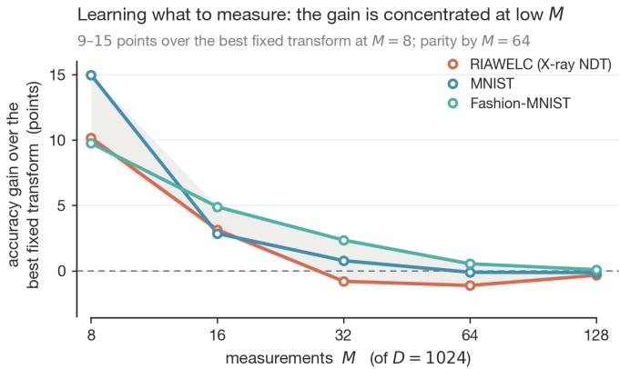  
Fig. 1: Main result. Accuracy of the learned linear measurement operator minus that of the best fixed transform, versus the number of measurements M (out of $D = 1 0 2 4 )$ . On a real industrial X-ray dataset and two standard benchmarks the learned operator wins by 9 to 15 percentage points at $M = 8 .$ The advantage shrinks to zero, or presents a small reversal, as M grows. Learning what to measure helps most when there is very little budget to spend.

when a dense sensor array is unavailable, unsafe, or expensive: imaging through scattering media, imaging at wavelengths with no readily available focal-plane array, and imaging with ionizing probes such as X-rays, where every photon delivered to the object carries a dose cost. Here, single-pixel imaging motivates a numerical sensing-design problem: which linear measurements best support classification?

Beyond this physical motivation, the setting targets a concrete industrial need, and it is the one this paper is ultimately built to serve. Radiographic defect screening on a production line is currently limited by how many exposures can be taken and processed per item; a measurement operator that reaches high classification accuracy from very few readings offers a direct path to screening more items per unit time, or at a lower delivered dose, using the same acquisition hardware and without a human in the decision loop. The RIAWELC welddefect case studied below (Section IV) is a concrete instance of this need: automatic, fast defect identification rather than image reconstruction for its own sake. We reach that case by first developing and validating the approach under tight experimental control on MNIST and Fashion-MNIST, two digit/garment benchmarks whose class structure and image statistics are well understood, where any failure of the method is unambiguous; RIAWELC then tests whether the same, unmodified approach transfers to noisier, lower-contrast real radiographs and a genuine downstream use case. The digit benchmarks are a controlled stepping stone, not a second headline result alongside it.

In CGI the optical reference arm is removed and the patterns become pre-defined, computer-generated masks applied directly to the illumination path [3], [5]. The spatial resolution of the result is then a property of the pattern set rather than of any sensor, so the pattern set becomes a design variable. Compressed sensing [6], [7] explains why a small pattern set can suffice: if the signal is sparse in some known basis and suitable recovery conditions hold, far fewer than D linear measurements can recover it.

Two observations motivate this work. First, most of the works that learn single-pixel patterns optimize them for reconstruction fidelity, using a mean-squared-error or total-variation objective and a decoder that returns a full image [8], [9], [10], [11]. Second, for many end uses, such as sorting, inspection, and triage, the image is only a means to a decision, and the decision may be reachable with far fewer measurements than a faithful image would need. This has been shown for biological cells [12] and for coarse object recognition [13], [14]. When the target is a class label, the natural training objective is classification accuracy rather than pixel fidelity, and the natural question is whether a task-optimized pattern set beats a generic fixed transform at a fixed, small measurement budget.

Seen from the learning side, the object is this: train the linear measurement operator jointly with the classifier that reads its output, end-to-end, so that the few measurements taken are the ones most useful for the decision. This is the reconstructionfree, task-driven end of compressed learning [15], [16], [17], and the learned operator is a supervised, task-driven linear embedding, a relative of supervised principal component analysis and linear discriminant analysis, but reached by gradient-based optimization under a hardware constraint rather than in closed form.

We refer to this approach as Learning Illumination Patterns for Single-Pixel Classification (LIPS-PC). We study this under one constraint that keeps the setting physically realizable: the learned operator must be a single fixed linear matrix $\textbf { D } \in$ $\mathbb { R } ^ { M \times D }$ , identical for every object, applied as y = Dx before any nonlinear processing. A real bucket detector cannot choose its illumination from the content of an object it has not yet sensed, so per-image nonlinear “encoders” are excluded: such models reach high accuracy but correspond to no realizable mask set. Within this constraint we make three contributions.

1) A residual parameterization of the learned pattern set, $\textbf { D } = \textbf { D } _ { \mathrm { b a s e } } + \Delta$ , anchored to a 2D discrete-cosine basis and trained jointly with the classifier under a cross-entropy classification objective (Section III). The result is a task-aware linear embedding, close in spirit to supervised principal component analysis, but obtained by end-to-end optimization rather than in closed form.

2) An evaluation aimed at a real industrial X-ray nondestructive testing (NDT) target, the weld-radiograph dataset RIAWELC [18], reached via a controlled preliminary step on MNIST [19] and Fashion-MNIST [20], over five budgets spanning sub-one-percent sampling ratios (Section IV). To our knowledge this is the first time task-learned single-pixel patterns are reported on a real industrial radiographic dataset at this compression.

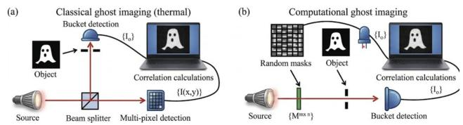  
Fig. 2: Ghost-imaging architectures. Panel (a) shows a bucket detector in the object arm and a spatially resolved detector in the reference arm. Panel (b) shows computational ghost imaging, where known illumination patterns replace the measured reference arm. The present numerical study uses the ideal linear measurement model $\mathbf { y } = \mathbf { D } \mathbf { x }$

3) A consistent empirical finding (Fig. 1): the learned advantage is largest at the smallest budget, between 9 and 15 percentage points at $M = 8$ on every dataset, and it generally decreases as M grows larger towards D, with a small reversal on RIAWELC for $M \geq 3 2$ (Section V). We report this as an observed pattern across three datasets, consistent with compressed-sensing intuition, not as a theorem.

## II. BACKGROUND AND RELATED WORK

## A. Ghost imaging and CGI

Ghost imaging originally used the correlation between a bucket detector in the object arm and a spatially resolved detector in a correlated reference arm [2], [4]. Computational ghost imaging removes the reference arm and replaces it with known programmable patterns, for example on a digital micromirror device [3] (Fig. 2). The measurement is then a deterministic linear map $\textbf { y } = \textbf { D x }$ , with D the row-stack of vectorized patterns. Reviews of the modern single-pixelimaging pipeline, including pattern choice, detector noise, and reconstruction, are given by [5]. The idea of computing on the compressed measurements directly, rather than reconstructing first, goes back to compressed learning [15], which showed that classifiers trained in a random measurement domain retain much of their accuracy.

## B. Fixed pattern families

Random patterns, drawn i.i.d. Gaussian or Bernoulli, are the compressed-sensing baseline and satisfy the restrictedisometry property with high probability [6]. Hadamard patterns form an orthogonal, binary-friendly basis; their sampling order matters, and sequency (Walsh) ordering concentrates energy far better than the natural order [21]. The discrete cosine transform places most natural-image energy in a few lowfrequency coefficients and underlies JPEG. All three families are generic in the sense that they are built around signal structure, not around any particular downstream task.

## C. Learned patterns for reconstruction

Deep networks have been used to reconstruct images from few single-pixel measurements [8], [10], [11], [22], and to learn the sensing matrix jointly with such a reconstruction decoder [9]. In all of these the training objective is image fidelity. Closest to the present work, DO-CGI [23] learns the diffuser set itself, jointly with a Split-Bregman totalvariation reconstruction and a mean-squared-error loss, and reports clear gains over random patterns at sampling ratios below five percent. Its objective is still image fidelity. The present paper keeps the learned-diffuser idea but replaces the reconstruction objective with a classification one and removes the reconstruction step entirely.

## D. Learned patterns for classification

Fewer works optimize the patterns for a decision. Calderbank et al. [15] give the theoretical basis. Ota et al. [12] classify cells image-free in a single-pixel flow cytometer. Zhang et al. [13] classify fast-moving objects from structured illumination without reconstruction. Cao et al. [14] report 94.23% on handwritten digits from M = 16 random singlepixel patterns with a small network and no reconstruction step, a paradigm we reproduce and exceed at $M = 8 .$ Bacca et al. [24] jointly learn a coded aperture and a classifier, including eight-measurement MNIST experiments at approximately 1% sampling and a sweep over several sampling ratios. TransCL [25] learns a linear sensing layer that feeds a Transformer decoder and reaches about 91% on CIFAR-10, at 10% sampling, and about 69% at 1.8% sampling; its decoder is also far heavier than the minimal head used here. Closest in spirit, Han et al. [26] study the analogous design problem for image-free single-pixel segmentation: how raw measurements are lifted into a task representation, across a spectrum from fixed operators to content-adaptive, nonlinear lifting networks, and report that this adaptive lift is more robust to measurement noise than a reconstruct-then-segment pipeline. Their strongest lift is content-adaptive per input, which the physicalrealizability constraint adopted here rules out; our comparison instead stays within the fixed-operator end of that spectrum (fixed transforms versus one jointly learned but still inputagnostic matrix) and asks a classification-accuracy, not noiserobustness, question across M. For context on the RIAWELC task itself, full-resolution convolutional classifiers reach the high nineties [18], [27], which confirms the four defect classes are separable and frames the sub-Nyquist numbers below as a measurement question, not a task-difficulty one.

## E. This work

Relative to the above, the combination studied here is: (i) a physical-realizability constraint on the learned operator, namely one fixed linear matrix that is identical for every input; (ii) a classification objective, not a reconstruction objective; and (iii) evaluation on a real industrial X-ray NDT dataset at sampling ratios below one percent. Of these, (iii) carries most of the paper’s emphasis: MNIST and Fashion-MNIST serve as an initial, controlled check of the approach on standard digit benchmarks, before moving to the substantially more complex and practically relevant setting of real industrial radiographs, which is where the approach is intended to matter.

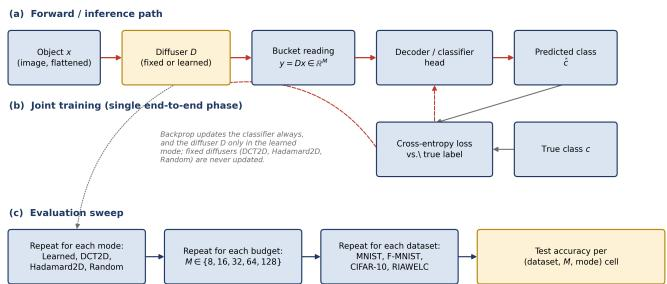  
Fig. 3: Training and evaluation pipeline. An object x is compressed to $\mathbf { y } = \mathbf { D } \mathbf { x }$ by a fixed $M \times D$ matrix, and a small decoder predicts the class directly from y, with no image reconstruction. The classifier is always trained; D is trained only in the learned mode, jointly with the classifier and by the cross-entropy loss alone setting the classification objective. The whole procedure is repeated for every (diffuser mode, budget M, dataset) cell to produce Table II.

## III. METHOD

LIPS-PC comprises a small number of deliberate design choices. We state each choice and its rationale in turn. Figure 3 shows how the pieces fit together: the object is measured through a single fixed matrix D, the M-vector of readings is passed to a compact decoder, and, in the learned mode only, gradients from the classification loss flow back into D as well as into the decoder.

## A. Measurement model and non-adaptive sensing

An image is a vector $\textbf { x } \in \mathbb { R } ^ { D }$ , with $D = 1 0 2 4$ for the $3 2 \times 3 2$ inputs used here. We take M measurements, each the inner product of x with one fixed pattern. Stacking the patterns as the rows of $\mathbf { D } \in \mathbb { R } ^ { M \times D }$ gives

$$
\mathbf { y } = \mathbf { D } \mathbf { x } , \qquad \mathbf { y } \in \mathbb { R } ^ { M } .\tag{1}
$$

Constraint. D must be a single matrix, identical for every object, and linear. This is exactly what a physical single-pixel mask set is: the detector integrates x through a pattern and returns one number, before any nonlinear computation. We therefore exclude any nonlinear, per-image map that would pose as a “diffuser”, for example a convolutional network run on x. Such maps score highly but realize no mask set, so they are not reported, not even as an ablation. The linear and inputagnostic form is necessary but not sufficient for realizability: a real device also needs non-negative or sign-encoded patterns and finite bit depth. Those issues are out of scope here and are discussed in Section VI. They apply equally to the fixed baselines and to the learned operator, so they do not affect the comparison.

## B. Fixed baselines

The three fixed baselines span the standard options. Random is the compressed-sensing baseline with no structure.

Hadamard is a structured, orthogonal, binary-friendly basis. DCT is the structured basis matched to natural-image statistics. We use 2D, per-channel variants and select the M lowestfrequency components in zigzag order for DCT, or the M lowest-sequency components for Hadamard. All three are applied as genuine near-orthonormal $M \times D$ matrices and are already realizability-compliant in the linear-and-fixed sense above.

## C. Learned diffuser: a residual correction

We do not learn D from scratch. An unconstrained matrix is often poorly conditioned early in training and, in our experiments, less stable. Instead we anchor to a strong basis and learn an additive correction:

$$
\mathbf { D } = \mathbf { D } _ { \mathrm { b a s e } } + \Delta ,\tag{2}
$$

where $\mathbf { D } _ { \mathrm { b a s e } }$ is the fixed 2D-DCT basis and $\pmb { \Delta } \in \mathbb { R } ^ { M \times D }$ is a free tensor initialized to 0, so that $\mathbf { D } = \mathbf { D } _ { \mathrm { b a s e } }$ exactly at the start of training. The correction $\pmb { \Delta }$ is optimized jointly with the classifier by the classification cross-entropy loss; there is no reconstruction term and no regularizer on $\pmb { \Delta }$ beyond weight decay. An unrestricted $\pmb { \Delta }$ does not restrict the representable matrix family; the DCT anchor specifies the initialization. At inference D is a single fixed matrix shared across all inputs, so Eq. (1) still describes the a physically realizable measurement.

Conceptually, D is a task-aware linear embedding. Like supervised principal component analysis it is one global linear projection, but instead of preserving variance it is optimized to preserve the directions that separate the classes. This also predicts the behaviour observed in Section V: when M is small the projection must be spent economically, so a task-optimized choice of subspace matters a great deal; as M approaches D almost any well-conditioned basis spans enough of the signal, and the freedom to trient D buys little.

## D. Decoder as a control

The same classifier architecture is used for every pattern set, so that a difference in accuracy can be attributed to the measurement operator rather than to decoder capacity. For MNIST and Fashion-MNIST every mode, the three fixed baselines and the learned one, feeds an identical residual multilayer perceptron (Fig. 4, left): a linear projection of $\mathbf { y }$ to width 512, three residual blocks at width 512 with batch normalization and dropout, and a 512→256→C output head. The learned mode adds only the $M \times D$ parameters of $\pmb { \Delta }$ on top of this shared head. Holding the decoder architecture fixed is what makes the comparison a comparison of measurement operators: any change in accuracy between modes is then a property of D, since nothing downstream of y has changed.

## E. The RIAWELC variant

RIAWELC is treated differently, deliberately, because its effective training set is small: it contains thousands of image crops but they are drawn from only about 29 physical welds. A free $M \times D$ tensor $\pmb { \Delta }$ then has enough capacity to fit weld-specific nuisance structure. We therefore replace it with a network-generated correction, $\Delta = f _ { \boldsymbol { \theta } } ( \mathbf { z } )$ , where $f _ { \theta }$ is a small shared network applied to a fixed latent vector ${ \bf z ; }$ this gives the correction far fewer effective degrees of freedom. The RIAWELC decoder is also different: rather than a multilayer perceptron on y, we form the adjoint proxy image $\hat { \mathbf { x } } = \mathbf { D } ^ { \top } \mathbf { y }$ and classify it with a compact three-stage residual convolutional network (64-128-256 channels, global average pooling, followed by one linear layer that maps the pooled features to class logits). The map $\mathbf { y } \mapsto \mathbf { D } ^ { \top } \mathbf { y }$ is linear and adds no information; it only re-embeds the M measurements into image coordinates so that a convolutional decoder can exploit spatial structure [16]. All RIAWELC modes share this same decoder, so the comparison inside RIAWELC remains controlled. Figure 5 shows what this re-embedding looks like on actual weld radiographs, for two representative defect classes, rather than only in schematic form (Fig. 4): at $M = 8$ the proxy is a coarse blur that keeps only gross shape, and by M = 128 class-relevant structure, such as the crack in the second row, is already visible, consistent with the accuracy trend of Table II.

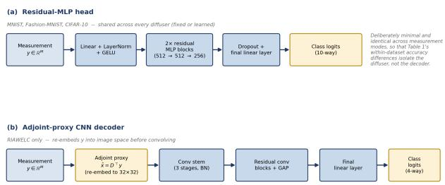  
Fig. 4: Decoder heads. Panel (a): for MNIST and Fashion-MNIST, every sensing mode feeds the same residual multilayer perceptron on the raw M-vector y. Panel (b): for RIAWELC, the measurements are reembedded as an adjoint proxy image $\hat { \mathbf { x } } = \mathbf { D } ^ { \top } \mathbf { y }$ and classified by a small convolutional network; all RIAWELC modes share this head.

A failure mode, and its fix. A shared generator couples every entry of $\pmb { \Delta }$ to each weight update. In one run we observed the correction norm diverging, $\| f _ { \boldsymbol { \theta } } ( \mathbf { z } ) \| \approx$ 4400 against $\left\| \mathbf { D } _ { \mathrm { b a s e } } \right\| \approx 3 ,$ that is, the anchor was effectively discarded. Two changes, both needed, remove this behaviour: a separate and lower learning rate for $f _ { \theta } ,$ , and a hard structural cap $\| f _ { \theta } ( \mathbf { z } ) \| \leq c \| \mathbf { D } _ { \mathrm { b a s e } } \|$ enforced by construction (we rescale the generator output whenever it exceeds the cap). The point is transferable to any design in which a network produces a correction to a fixed operator.

## F. Training protocol and recipe

For a fixed baseline, training is a single stage: a classifier is trained on the fixed measurements. For the learned mode there are two stages. In stage 1 the diffuser and a classifier are trained together, end-to-end, by the classification cross-entropy loss; this is where $\pmb { \Delta }$ is learned. In stage 2 the learned matrix D is frozen and a fresh classifier is trained on it, exactly as for a fixed baseline. The number reported for every mode, learned or fixed, is the stage-2 (or single-stage) test accuracy, so all four modes are scored under an identical classifier-training protocol and only the measurement operator differs.1

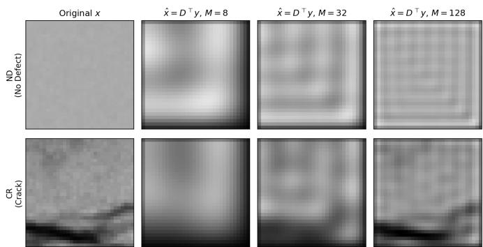  
Fig. 5: The adjoint-proxy re-embedding $\hat { \mathbf x } = \mathbf D ^ { \top } \mathbf y$ on real RIAWELC crops, for two of the four defect classes (no defect, crack; lack of penetration and porosity follow the same trend and are omitted here for space, code in Section III-F), illustrated with the fixed 2D-DCT anchor $\textbf { D } = \textbf { D } _ { \mathrm { b a s e } }$ at $M = 8 ,$ 32, and 128 (not the learned matrix, so this shows the decoder’s re-embedding mechanism in isolation from the learned correction). Resolution in the proxy increases with $M ;$ ; this is a visual illustration of the mechanism, not a measurement of accuracy.

All stages use stochastic gradient descent with Nesterov momentum 0.9, a five-epoch linear warm-up followed by cosine decay, mixup $( \alpha = 0 . 2 )$ on the measurement vectors, label smoothing 0.1, gradient-norm clipping at 1.0, and weight decay $5 \times 1 0 ^ { - 4 }$ . The batch size is 64. Stage 1 uses a learning rate of $1 \times 1 0 ^ { - 3 }$ for $\pmb { \Delta }$ (and for the RIAWELC generator $f _ { \theta } )$ and $5 \times 1 0 ^ { - 3 }$ for its classifier; the lower rate on $f _ { \theta } ,$ together with the norm cap $c = 2$ of Section III, is what keeps the generated correction from diverging. The stage-2 and fixedbaseline classifiers use a peak learning rate of 0.1. Each stage runs for 10 epochs on MNIST and Fashion-MNIST and for 35 epochs on RIAWELC, which converges more slowly. Table I collects these values. Every (dataset, M, mode) combination is a single training run under one fixed random seed; the statistical consequence is discussed in Section VI.

## IV. EXPERIMENTAL SETUP

## A. Datasets

MNIST [19] and Fashion-MNIST [20] are $2 8 ~ \times ~ 2 8$ grayscale, ten classes, resized to $3 2 \times 3 2$ for a common input size. They serve as the controlled preliminary step described in Section I: well-characterized class structure against which the method and its failure modes are easy to read, before testing transfer to the real target. RIAWELC [18], the target application, contains real industrial X-ray weld radiographs in four classes: no defect, crack, lack of penetration, and porosity. Images are natively $2 2 4 \times 2 2 4$ and are resized to $3 2 \times 3 2$ Low contrast and high background noise make this dataset qualitatively different from the digit benchmarks. We use an 80/20 split, stratified by class, at the level of individual crops. Because the crops of a given weld are visually correlated, we checked directly whether weld identity could act as a label shortcut under this split, by tabulating the defect-class composition of every physical weld (Fig. 6). It could not: 24 of the 29 welds (82.8%) contribute crops to more than one defect class, so knowing which weld a crop came from does not determine its label. This rules out that specific shortcut; it does not rule out near-duplicate crops on either side of the split as a separate channel for inflated accuracy, which is a residual risk discussed in Section VI and not resolved by this check. CIFAR-10 and other natural-image data are outside the scope of this paper and are left to future work, since the RGB, highintra-class-variance regime behaves differently and deserves its own treatment.

TABLE I: Hyperparameters and module sizes.
<table><tr><td>Setting</td><td>Value</td></tr><tr><td>Input size / D</td><td> $3 2 \times 3 2 / 1 0 2 4$ </td></tr><tr><td>Optimizer</td><td>SGD, Nesterov, momentum 0.9</td></tr><tr><td>Epochs per stage</td><td>10 (MNIST, F-MNIST); 35 (RIAWELC)</td></tr><tr><td>LR schedule</td><td>5-epoch warm-up, then cosine decay</td></tr><tr><td>Stage-1 LR</td><td> $1 \times 1 0 ^ { - 3 } ( \pmb { \Delta } ,$   $\bar { f } _ { \theta } ) ; 5 \times 1 0 ^ { - 3 }$  (classifier)</td></tr><tr><td>Stage-2 / baseline LR</td><td>0.1</td></tr><tr><td>Batch size</td><td>64</td></tr><tr><td>Weight decay</td><td> $5 \times 1 0 ^ { - 4 }$ </td></tr><tr><td>Mixup α</td><td>0.2</td></tr><tr><td>Label smoothing</td><td>0.1</td></tr><tr><td>Gradient-norm clip</td><td>1.0</td></tr><tr><td>Grayscale decoder head</td><td>residual MLP, width 512, 3 blocks, then 512→256→ C</td></tr><tr><td>Block dropout</td><td>0.15 (blocks), 0.1 (output)</td></tr><tr><td>RIAWELC decoder</td><td>3-stage residual CNN, 64-128-256 ch, GAP + linear</td></tr><tr><td>RIAWELC fθ</td><td>MLP, fixed latent 100, hidden 512; norm cap  $c = 2 . 0$ </td></tr></table>

## B. Budgets

We use $M \in \{ 8 , 1 6 , 3 2 , 6 4 , 1 2 8 \}$ out of $D = 1 0 2 4 .$ , that is sampling ratios from 0.78% to 12.5%, entirely in the sub-Nyquist regime. The smallest budget, $M = 8 ,$ , is the operating point of most interest for dose- or time-limited acquisition.

## C. Compute

All experiments run on a single workstation: an Apple M4 with 24 GB of unified memory and no discrete GPU, training on the integrated GPU through the MPS backend. This modest budget is the reason for the lightweight decoder heads and for the single-run-per-cell protocol.

## V. RESULTS

## A. Central message

On all three datasets the learned pattern set’s advantage over the best fixed transform is concentrated at the smallest budgets and decays as M grows. Figure 7 plots test accuracy against M. The fixed baseline that wins among the three is always DCT2D, so the figure shows the learned mode against DCT2D and against Random; the full four-way numbers are in Table II.

RIAWELC: defect-class composition per physical weld  
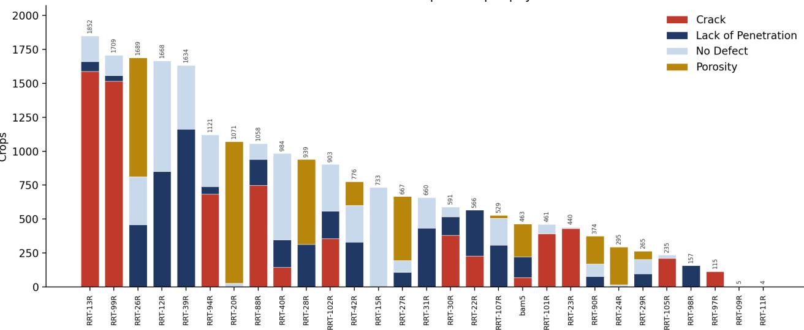  
Physical weld (24 of 29 span more than one class)

Fig. 6: Defect-class composition of every physical weld in RIAWELC, sorted by crop count. Most welds (24 of 29) span more than one defect class, so weld identity alone cannot predict the label under the crop-level split used here.  
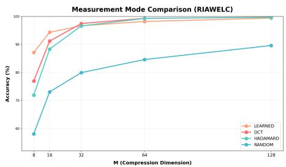  
(a) RIAWELC (X-ray weld radiographs)

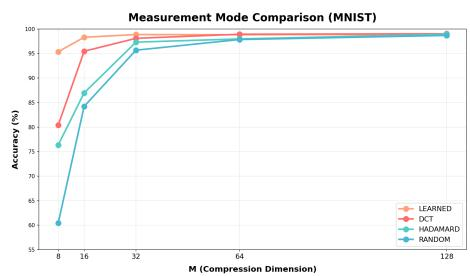  
(b) MNIST

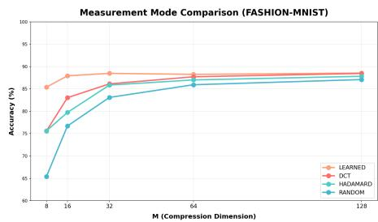  
(c) Fashion-MNIST  
Fig. 7: Test accuracy versus measurement budget M: learned diffuser against the strongest fixed transform (DCT2D) and against random Gaussian patterns. On every dataset the learned curve is well above the fixed curves at M = 8 and the gap closes as M grows. On RIAWELC the learned curve leads at $M = 8$ and $M = 1 6 .$ , is overtaken from $M = 3 2$ , and the deficit widens before narrowing again by $M = 1 2 8$ . MNIST and Fashion-MNIST use the free-tensor correction; RIAWELC uses the network-generated correction and CNN decoder of Section III.

## B. Full numbers

Table II gives test accuracy for all four modes and all five budgets. At M = 8 LIPS-PC is the best mode on every dataset. Random is almost always last, so the substantive comparison is learned versus DCT2D. On MNIST the learned mode stays best or within 0.13 percentage points of best at every budget. On Fashion-MNIST it is best at every budget. On RIAWELC it is far ahead at $M = 8$ and $M = 1 6$ , then is overtaken by DCT2D and Hadamard2D from M = 32 onward, though by a small margin that never exceeds about one point.

## C. The margin, and how it scales

Table III isolates the learned diffuser’s margin over the best fixed transform at each budget, and Fig. 1 plots it. The margin is between 9.76 and 14.97 percentage points at $M = 8$ on every dataset, and it generally shrinks thereafter. On MNIST and Fashion-MNIST the decay is mild and near-monotone, and the margin stays at or above zero except for a dip of at most 0.13 points on MNIST at the two largest budgets. On RIAWELC the margin turns negative earlier, at M = 32, and non-monotonically: the largest deficit, −1.12 points, is at $M = 6 4$ , and it narrows again to −0.34 points at $M = 1 2 8 .$ This is what the embedding view in Section III predicts: the value of a task-optimized subspace is largest when the budget is tightest. We present it as an empirical pattern across three datasets, not as a proof, and note that the RIAWELC crossover in particular rests on single runs (Section VI).

The same numbers read as a measurement saving. The learned diffuser’s $M \ = \ 8$ accuracy is one that the best fixed transform does not reach until $M \ = \ 1 6$ on MNIST (95.36 vs. 95.45 at M = 16) and on RIAWELC (87.14, between the fixed M = 8 and $M = 1 6$ values), and until roughly $M = 3 2$ on Fashion-MNIST (85.38, between the fixed $M = 1 6$ and $M = 3 2$ values). At the small-budget operating point that matters for dose- or time-limited acquisition, the learned operator therefore enables 2× to 4× reduction in the number of physical measurements at matched accuracy.

TABLE II: Test accuracy (%). Bold = best mode at that budget. MNIST and Fashion-MNIST use the free-tensor residual correction and the MLP head; RIAWELC uses the networkgenerated correction and the CNN decoder (Section III). “Hadam.” = Hadamard2D.
<table><tr><td>Dataset</td><td>M</td><td>Learned</td><td>DCT2D</td><td>Hadam.</td><td>Random</td></tr><tr><td rowspan="5">RIAWELC</td><td>8</td><td>87.14</td><td>76.97</td><td>71.96</td><td>58.10</td></tr><tr><td>16</td><td>94.33</td><td>91.19</td><td>88.32</td><td>73.05</td></tr><tr><td>32</td><td>96.65</td><td>97.45</td><td>96.61</td><td>79.95</td></tr><tr><td>64</td><td>98.20</td><td>99.32</td><td>99.27</td><td>84.62</td></tr><tr><td>128</td><td>99.41</td><td>99.75</td><td>99.70</td><td>89.62</td></tr><tr><td rowspan="6">MNIST</td><td>8</td><td>95.36</td><td>80.39</td><td>76.35</td><td>60.44</td></tr><tr><td>16</td><td>98.30</td><td>95.45</td><td>86.96</td><td>84.22</td></tr><tr><td>32</td><td>98.86</td><td>98.08</td><td>97.31</td><td>95.67</td></tr><tr><td>64</td><td>98.81</td><td>98.92</td><td>97.96</td><td>97.84</td></tr><tr><td>128</td><td>98.89</td><td>99.02</td><td>98.92</td><td>98.68</td></tr><tr><td></td><td></td><td></td><td></td><td></td></tr><tr><td rowspan="5">F-MNIST</td><td>8</td><td>85.38</td><td>75.59</td><td>75.62</td><td>65.40</td></tr><tr><td>16</td><td>87.93</td><td>83.04</td><td>79.74</td><td>76.71</td></tr><tr><td>32</td><td>88.48</td><td>86.13</td><td>85.86</td><td>83.10</td></tr><tr><td>64</td><td>88.25</td><td>87.71</td><td>87.01</td><td>85.93</td></tr><tr><td>128</td><td>88.55</td><td>88.46</td><td>87.82</td><td>87.09</td></tr></table>

TABLE III: Learned-diffuser margin over the best fixed transform (percentage points). Positive = learned wins.
<table><tr><td>Dataset</td><td> $M { = } 8$ </td><td> $M { = } 1 6$ </td><td> $M { = } 3 2$ </td><td> $M { = } 6 4$ </td><td> $M { = } 1 2 8$ </td></tr><tr><td>RIAWELC</td><td> $+ 1 0 . 1 7$ </td><td>+3.14</td><td>-0.80</td><td>-1.12</td><td>-0.34</td></tr><tr><td>MNIST</td><td>+14.97</td><td>+2.85</td><td>+0.78</td><td>-0.11</td><td>-0.13</td></tr><tr><td>F-MNIST</td><td>+9.76</td><td>+4.89</td><td>+2.35</td><td>+0.54</td><td>+0.09</td></tr></table>

## D. Comparison with a published single-pixel classifier

Cao et al. [14] report 94.23% on handwritten digits from $M = 1 6$ random single-pixel patterns. On MNIST the learned diffuser here reaches 95.36% at $M = 8 ,$ that is, a comparable accuracy at half the measurement budget. The two settings differ in dataset preprocessing, network, and training protocol, so this is a point of context rather than a controlled headto-head, but it places the numbers here in the range of prior reconstruction-free single-pixel classification while using fewer measurements.

## E. What the learned patterns look like

Rendering the M rows of D as $3 2 \times 3 2$ tiles (Fig. 8), the low-budget learned rows carry content-related texture on RIAWELC, with faint horizontal banding in several tiles, centrally concentrated strokes on MNIST, and bilaterally symmetric garment-like silhouettes on Fashion-MNIST, visibly different from the three fixed transforms shown alongside them in the same panels. We show the target application, RIAWELC, alongside the digit benchmarks here rather than describing it in prose only, so the reader can judge the pattern directly. By $M = 1 2 8$ the learned rows visually resemble the DCT2D initialization they are corrected around (Fig. 8, bottom row), where the measured learned-versus-DCT2D margin is small, while remaining visually distinct from the Hadamard2D and Random patterns shown alongside it at the same budget. This is consistent with the intuition that the correction $\pmb { \Delta }$ is important especially when the budget is tight. (We did not repeat on RIAWELC the quantitative symmetry/centering structure analysis carried out for the digit benchmarks elsewhere; the description above is a visual reading, not a measured statistic.)

TABLE IV: Learned residual accuracy (%) by anchor basis.
<table><tr><td>Dataset</td><td>Anchor</td><td> $M { = } 8$ </td><td>16</td><td>32</td><td>64</td><td>128</td></tr><tr><td rowspan="2">RIAWELC</td><td>DCT2D</td><td>81.50</td><td>85.80</td><td>86.28</td><td>86.32</td><td>85.82</td></tr><tr><td>Hadam.</td><td>79.68</td><td>85.23</td><td>85.41</td><td>85.14</td><td>85.59</td></tr><tr><td rowspan="2">MNIST</td><td>DCT2D</td><td>95.27</td><td>97.81</td><td>98.80</td><td>98.98</td><td>98.75</td></tr><tr><td>Hadam.</td><td>95.48</td><td>98.12</td><td>98.73</td><td>98.99</td><td>98.93</td></tr><tr><td rowspan="2">F-MNIST</td><td>DCT2D</td><td>84.50</td><td>87.92</td><td>88.27</td><td>88.82</td><td>88.95</td></tr><tr><td>Hadam.</td><td>84.93</td><td>87.74</td><td>88.70</td><td>89.04</td><td>88.70</td></tr></table>

## F. Ablations

Anchor: DCT2D versus Hadamard2D. DCT2D is the best fixed baseline; we test whether it is also the best anchor for ∆. Replacing $\mathbf { D } _ { \mathrm { b a s e } }$ with a sequency-ordered Hadamard2D basis (Table IV) gives a genuinely mixed result. On RIAWELC the DCT2D anchor wins at all five budgets, by a small onedirectional margin. On MNIST the Hadamard2D anchor wins or ties at four of five budgets. On Fashion-MNIST neither direction is consistent. Most of the gaps are within the project’s run-to-run noise, roughly 0.8 to 1.6 points, so we do not claim DCT2D is a universally better anchor, only that it is a safe default and, separately, the best fixed baseline.

Free versus network-generated ∆ on RIAWELC. The network-generated correction keeps the large low-budget advantage, +10.17 points at M = 8 and +3.14 points at $M =$ 16, and it substantially narrows the high-budget deficit: −1.12 and −0.34 points at $M = 6 4$ and $M = 1 2 8$ , against −3.14 and −3.51 points for a free $M \times D$ tensor under the same decoder. Constraining the correction’s degrees of freedom helps where the free tensor was overfitting, which supports the smalltraining-set explanation for treating RIAWELC differently.

## VI. DISCUSSION AND LIMITATIONS

## A. Why the low-budget concentration is the useful part

In dose- or time-constrained imaging, M sets the physical cost directly. A practitioner who already classifies on compressed single-pixel measurements can replace a fixed transform with a jointly trained learned diffuser, without changing the classifier, and gain accuracy at exactly the small-M operating point. Equivalently, a target accuracy can be reached at a smaller M, and therefore potentially at a lower delivered dose or a shorter acquisition. The same argument should apply also to clinical X-ray and CT, where M maps to patient dose, However, we leave this avenue for future research. The approach is believed to be compatible with existing hardware: the learned operator is still a single $M \times D$ matrix, so a suitably programmable acquisition pipeline may need no new hardware, only a different pattern set loaded onto the modulator.

Diffuser D — RIAWELC, M=8  
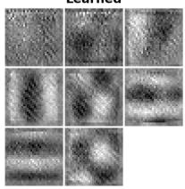

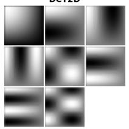

Diffuser D — MNIST, M=8  
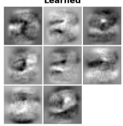

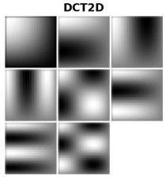

Diffuser D - FMNIST, M=8  
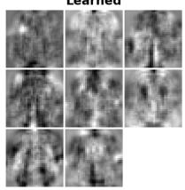

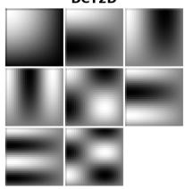

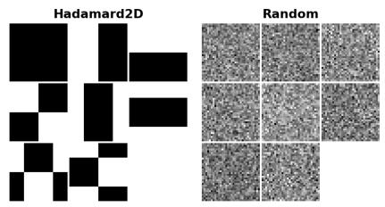  
(a) RIAWELC, M=8, all four modes

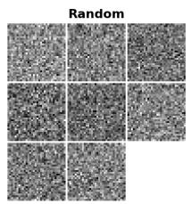  
(b) MNIST, M=8, all four modes

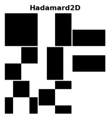

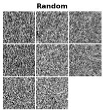  
(c) F-MNIST, M=8, all four modes

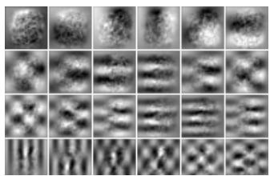  
(d) MNIST, M=128,  
learned (24/128 rows)

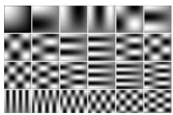  
(e) MNIST, M=128, DCT2D (24/128 rows)

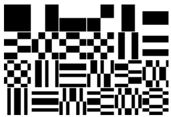  
(f) MNIST, M=128, Hadamard2D (24/128 rows)

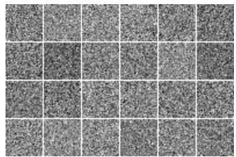  
(g) MNIST, M=128, Random (24/128 rows)  
Fig. 8: Learned pattern set against all three fixed transforms, each row of D reshaped to 32 × 32 and tiled. Top row, M = 8 (all 8 rows, every mode): the learned rows (top-left quadrant of each panel) carry content-related structure that DCT2D, Hadamard2D, and Random do not, including on the target application, RIAWELC. Bottom row, M = 128: at this budget all 128 rows compressed onto the page are illegible, so we show the first 24 of 128 rows for every mode (row order is storage order, not sorted by appearance, so this is a representative crop, not a selected one; code for the full 128-row mosaics is part of the repository linked in Section III-F). Structurally, the learned rows have visually converged onto their DCT2D anchor by M = 128 and remain visually distinct from the blockwise Hadamard2D basis and from unstructured Random, even though by this budget all four modes reach comparable accuracy (Table II); the structural resemblance is to the specific anchor the correction was initialized from, not a general convergence across every fixed transform.

## B. Limitations

• Single run per cell. There is no multi-seed average. Any result that is not backed by a clear one-directional trend across M, for example parts of the anchor ablation and the exact location of the RIAWELC crossover, should be read as provisional. Multi-seed replication is the first item of future work.

• RIAWELC split. The 80/20 split is at the crop level. Multi-class welds rule out the simplest label-leakage shortcut, in which weld identity would predict the class, but a residual risk of near-duplicate crops on either side of the split remains. A weld-level split was not run under the current pipeline.

• Simulation only. The measurement y = Dx is computed numerically. There is no optical bench and no detectornoise model, so shot noise, read noise, and patternprojection error are all absent. Robustness of the learned patterns under realistic noise is untested, and is a natural next experiment since noise could plausibly erode a finely tuned ∆ faster than it erodes a generic basis.

• RIAWELC uses a different decoder. The adjoint-proxy convolutional decoder for RIAWELC differs from the multilayer perceptron used for the digit benchmarks, so absolute accuracies are not comparable across datasets. Every claim in this paper is scoped within a single dataset; only the direction and rough size of the learnedversus-fixed margin is compared across datasets.

• Physical realizability is only partial. Every pattern set here, fixed and learned alike, has signed entries and full floating-point precision. A real digital micromirror device or spatial light modulator needs non-negative or dual-rail sign encoding and low bit depth. These costs fall equally on the fixed baselines and on the learned operator, so they do not change the comparison, but they must be addressed before any hardware claim, and quantization in particular may interact with the small learned corrections.

## VII. CONCLUSION

In LIPS-PC, learning the measurement operator end-to-end for the classification task, under the constraint that it stay one fixed linear matrix a single-pixel apparatus could apply, gives a large and consistent accuracy advantage over every fixed transform at the smallest budget: 9 to 15 percentage points at $M = 8$ across a real industrial X-ray dataset and two standard benchmarks, equivalently a $2 \times \mathrm { ~ t o ~ } 4 \times$ saving in physical measurements at matched accuracy. The advantage generally decreases as the budget grows, towards zero on the digit benchmarks and to a small reversal on RIAWELC at intermediate budgets, consistent with the task-driven-embedding view predicts: the choice of which few projections to take matters most when there are very few to take. The practical statement is therefore a scoped one. A task-learned linear operator is a candidate replacement for a fixed transform that is worth its training cost specifically in the dose- and time-limited, sub-Nyquist regime, and not a general-purpose substitute for classical bases. Sharpening the result would mean multi-seed replication (the current numbers are singlerun), a weld-level RIAWELC split, a detector-noise model, and sign- and precision-constrained pattern sets as a bridge toward an optical or X-ray bench.

## ACKNOWLEDGMENT

The authors thank Amotz Taub-Tabib for helpful discussions. E.C. was supported by the European Union’s Horizon Europe research and innovation programme under grant agreement No. 101178170, by the Israel Science Foundation under grant agreement No. 2208/24, by the Israel Innovation Authority, and by the Israeli Council for Higher Education through “QERNEL” and the “Interdisciplinary Center for the Theory of Quantum Computing”.

## REFERENCES

[1] M. F. Duarte et al., “Single-pixel imaging via compressive sampling,” IEEE Signal Process. Mag., vol. 25, no. 2, pp. 83–91, 2008.

[2] T. B. Pittman, Y. H. Shih, D. V. Strekalov, and A. V. Sergienko, “Optical imaging by means of two-photon quantum entanglement,” Phys. Rev. A, vol. 52, no. 5, pp. R3429–R3432, 1995.

[3] J. H. Shapiro, “Computational ghost imaging,” Phys. Rev. A, vol. 78, no. 6, 061802(R), 2008.

[4] Y. Bromberg, O. Katz, and Y. Silberberg, “Ghost imaging with a single detector,” Phys. Rev. A, vol. 79, no. 5, 053840, 2009.

[5] M. P. Edgar, G. M. Gibson, and M. J. Padgett, “Principles and prospects for single-pixel imaging,” Nat. Photonics, vol. 13, pp. 13–20, 2019.

[6] E. J. Candes, J. Romberg, and T. Tao, “Robust uncertainty\` principles: exact signal reconstruction from highly incomplete frequency information,” IEEE Trans. Inf. Theory, vol. 52, no. 2, pp. 489–509, 2006.

[7] D. L. Donoho, “Compressed sensing,” IEEE Trans. Inf. Theory, vol. 52, no. 4, pp. 1289–1306, 2006.

[8] C. F. Higham, R. Murray-Smith, M. J. Padgett, and M. P. Edgar, “Deep learning for real-time single-pixel video,” Sci. Rep., vol. 8, 2369, 2018.

[9] A. Adler, D. Boublil, M. Elad, and M. Zibulevsky, “A deep learning approach to block-based compressed sensing of images,” arXiv:1606.01519, 2016.

[10] M. Lyu et al., “Deep-learning-based ghost imaging,” Sci. Rep., vol. 7, 17865, 2017.

[11] F. Wang et al., “Learning from simulation: an end-to-end deep-learning approach for computational ghost imaging,” Opt. Express, vol. 27, no. 18, pp. 25560–25572, 2019.

[12] S. Ota et al., “Ghost cytometry,” Science, vol. 360, no. 6394, pp. 1246–1251, 2018.

[13] Z. Zhang et al., “Image-free classification of fast-moving objects using “learned” structured illumination and single-pixel detection,” Opt. Express, vol. 28, no. 9, pp. 13269–13278, 2020.

[14] J.-N. Cao et al., “Single-pixel neural network object classification of sub-Nyquist ghost imaging,” Appl. Opt., vol. 60, no. 29, pp. 9180–9187, 2021, doi: 10.1364/AO.438392.

[15] R. Calderbank, S. Jafarpour, and R. Schapire, “Compressed learning: universal sparse dimensionality reduction and learning in the measurement domain,” Technical report, Princeton Univ., 2009.

[16] A. Adler, M. Elad, and M. Zibulevsky, “Compressed learning: A deep neural network approach,” arXiv:1610.09615, 2016.

[17] Y. Lu and A. Velten, “Deep feature-specific imaging,” Opt. Express, vol. 34, no. 8, pp. 15484–15504, 2026, doi: 10.1364/OE.586900.

[18] B. Totino, F. Spagnolo, and S. Perri, “RIAWELC: a novel dataset of radiographic images for automatic weld defects classification,” Int. J. Electr. Comput. Eng. Res., vol. 3, no. 1, pp. 13– 17, 2023.

[19] Y. LeCun, L. Bottou, Y. Bengio, and P. Haffner, “Gradient-based learning applied to document recognition,” Proc. IEEE, vol. 86, no. 11, pp. 2278–2324, 1998.

[20] H. Xiao, K. Rasul, and R. Vollgraf, “Fashion-MNIST: a novel image dataset for benchmarking machine learning algorithms,” arXiv:1708.07747, 2017.

[21] M.-J. Sun et al., “A Russian dolls ordering of the Hadamard basis for compressive single-pixel imaging,” Sci. Rep., vol. 7, 3464, 2017.

[22] K. Kulkarni, S. Lohit, P. Turaga, R. Kerviche, and A. Ashok, “ReconNet: non-iterative reconstruction of images from compressively sensed measurements,” in Proc. IEEE CVPR, 2016, pp. 449–458.

[23] M. Hale, O. Lindenbaum, and E. Cohen, “DO-CGI: deepoptimized illumination patterns for computational ghost imaging at low sampling ratios,” arXiv:2607.26216, 2026.

[24] J. Bacca, L. Galvis, and H. Arguello, “Coupled deep learning coded aperture design for compressive image classification,” Opt. Express, vol. 28, no. 6, pp. 8528–8540, 2020.

[25] C. Mou and J. Zhang, “TransCL: Transformer makes strong and flexible compressive learning,” IEEE Trans. Pattern Anal. Mach. Intell., vol. 45, no. 4, pp. 5236–5251, 2023.

[26] Y. Han et al., “The Lift Spectrum: How Measurement-to-Space Adaptivity Shapes Robustness in Image-Free Single-Pixel Sensing,” arXiv:2607.22077, 2026.

[27] D. Palma-Ram´ırez et al., “Deep convolutional neural network for weld defect classification in radiographic images,” Heliyon, vol. 10, no. 9, e30590, 2024.