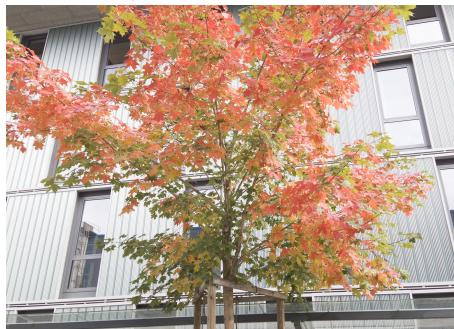
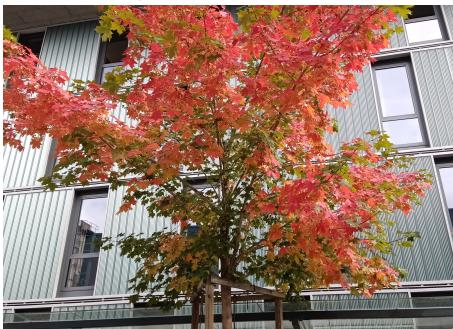
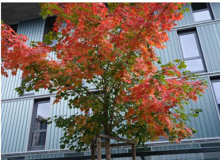
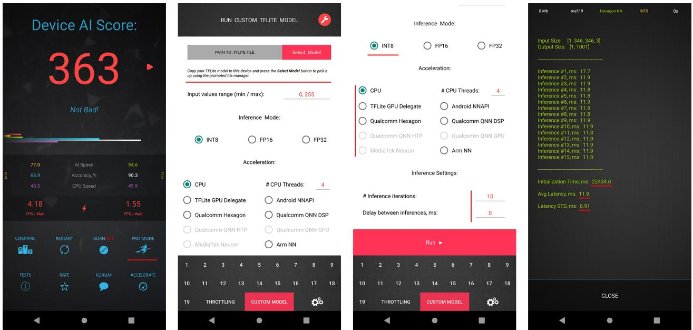
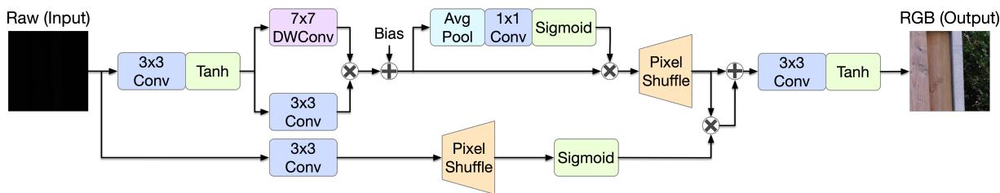
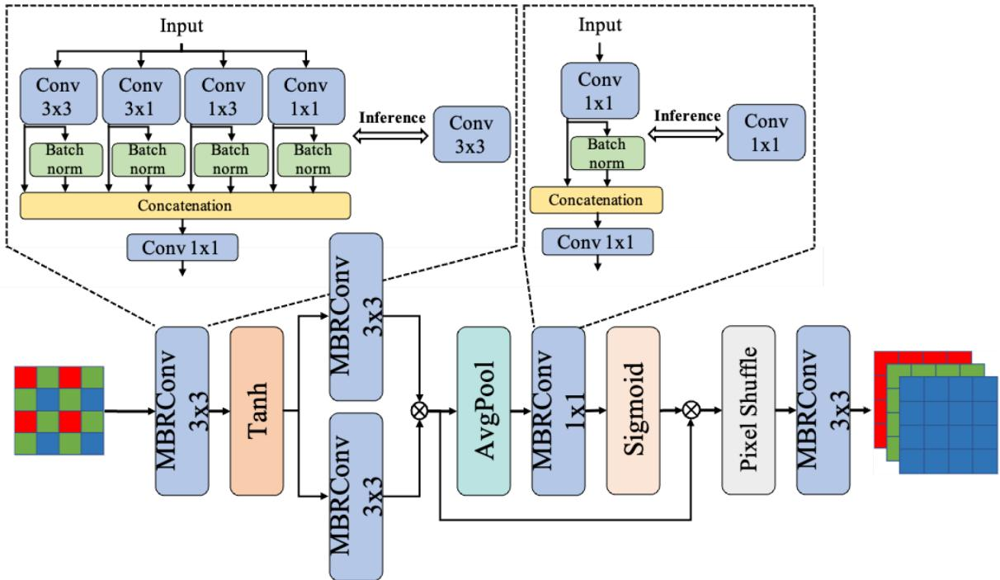
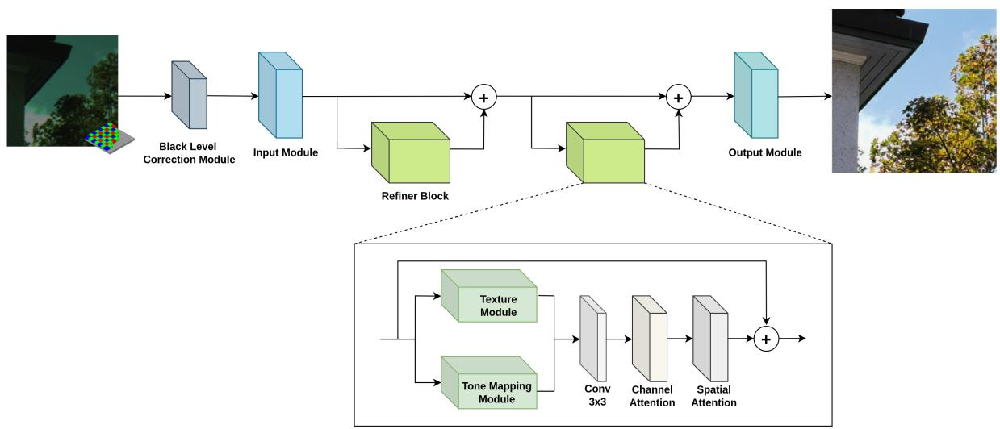
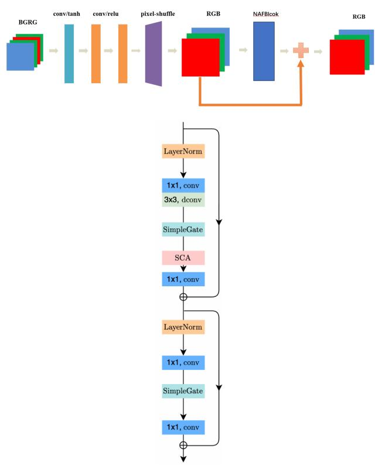
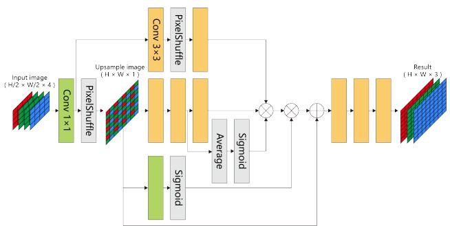

# Learned Smartphone ISP on Mobile GPUs: Mobile AI 2026 Challenge Report

Andrey Ignatov Georgy Perevozchikov Radu Timofte Yuhong He Yuxuan Qiu Tianyu Hao Ruoqi Li Yueqi Yang Chaoyu Feng Dongqing Zou Lei Lei Na Jiang Yongrui Zhang Hailong Yan Xiangtao Zhang Ao Li Le Zhang Andrei Arhire Jing Fang XingLin Xie YiChen Lu Haibo Xu

## Abstract

With the increasing importance of mobile camera quality in modern smartphones, growing attention has been directed toward computational photography and advanced image signal processing (ISP) algorithms aimed at enhancing various perceptual attributes of captured images. This creates a need for efficient deep learning models for this problem that are not only performant but can also be deployed on constrained mobile hardware. In this Mobile AI challenge, we address this problem and propose the participants to design fast solutions that can reconstruct RGB photos from RAW Bayer camera data while running on popular smartphone GPUs from Qualcomm and Arm. For this, the participants were provided with a large-scale Fujifilm UltraISP dataset consisting of RAW-RGB image pairs captured with the Sony IMX586 Quad Bayer mobile sensor and a professional 102MP medium format FujiFilm GFX100 camera. The runtime of all models was evaluated on the Snapdragon 8 Elite Gen 5 and Dimensity 9500 chipsets with the Adreno and Mali GPUs, respectively. Top solutions proposed in this challenge are able to reconstruct high-quality 5MP RGB image from raw data on both platforms under 100 milliseconds. A comprehensive description ofthe mod els developed in the challenge is provided in this paper.

## 1. Introduction

A primary driver of performance improvements in smartphone cameras can be attributed to sophisticated image processing algorithms, including those for noise suppression, accurate color reproduction, and high dynamic range (HDR) imaging. While individual stages of the traditional image signal processing (ISP) pipeline can be replaced by dedicated deep learning models to enhance reconstruction quality, a more comprehensive paradigm involves substituting the entire RAW-to-RGB pipeline with a unified neural network that implicitly learns all intermediate processing steps. Such an approach enables direct utilization of the richer 10–16 bit information contained in the original, unprocessed RAW Bayer data, thereby potentially leading to improved image restoration performance. In [34], the authors first introduced this approach by constructing the Zurich RAW-to-RGB dataset comprised of paired RAW and RGB images captured using both a mobile camera sensor and a high-end DSLR camera. This dataset was subsequently used to train a deep neural network for end-toend image reconstruction. The experimental results demonstrated the strong potential of this method in comparison to the commercial hand-crafted ISP of the Huawei P20 smartphone. Even better results were achieved by the models proposed in the follow-up challenges and papers using the same dataset [15, 29, 33, 58, 78]. A further advancement in deep learning–based ISP development was presented in [42, 43], where the authors introduced a more advanced Fujifilm UltraISP dataset for the considered task along with mobile-efficient CNN architectures capable of processing high-resolution images directly on smartphones. In this competition, we use the same dataset and propose the participants to design even more efficient learned ISP models that can run on recent smartphone GPUs.

Designing deep learning models that run efficiently on mobile devices — especially across different AI accelerators like NPUs — is a complex challenge. It demands careful analysis of hardware constraints such as limited operator support, restricted memory capacity and bandwidth, reduced accuracy for quantized models and specific driver behavior of NPUs. Even when certain layers or operations are technically supported, they may be executed inefficiently due to constraints related to NPU hardware architecture or its driver implementation, and thus create performance bottlenecks during inference. A striking example here would be the Google Tensor NPU present in all recent Google Pixel smartphones that, despite having quite high theoretical peak performance, is unable to efficiently accelerate the vast majority of even simplistic CNN-based models [49]. As a result, achieving low latency and energy efficiency often requires partial or complete redesigns of model architectures. For a more detailed discussion of these challenges and the performance of modern mobile AI accelerators we refer to [26, 30]. Overall, all these limitations require various adaptations of the standard deep learning models for their efficient deployment on mobile NPUs, including conventional optimizations like 16-bit / 8- bit [7, 12, 56, 57, 67, 68, 73, 77, 79, 93] and low-bit [5, 6, 8, 10, 16, 55, 60, 65, 69, 83, 97] quantization, network pruning and compression [12, 20, 59, 61, 66, 70, 74, 85, 89, 96], NPU-specific adaptations, platform-aware neural architecture search [13, 14, 21, 72, 80, 84, 87, 88, 94, 95], etc.

Sony IMX586 RAW – Visualized  

Sony IMX586 – MediaTek ISP  

Fujifilm Camera  
  
Figure 1. A sample set of images from the collected dataset. From left to right: the original RAW image visualized with Photoshop’s built-in raw image processing engine, RGB image obtained with MediaTek’s built-in ISP system, and the target Fujifilm photo.

In this Mobile AI Challenge, the participants were proposed to develop efficient deep learning models that can reconstruct 5MP RGB image from RAW Bayer data while running on smartphone GPUs. For this, the participating teams were provided with the Fujifilm UltraISP dataset [43] consisting of thousands paired photos captured with a normal mobile camera sensor and a professional 102MP medium-format FujiFilm GFX100 camera. The runtime of the models was evaluated on mobile GPUs present in the Snapdragon 8 Elite Gen 5 and the Dimensity 9500 chipsets. Each submission was evaluated based on both image fidelity and runtime efficiency, thus balancing reconstruction quality with model efficiency. All solutions developed during this challenge are fully compatible with the LiteRT [75] (former TensorFlow Lite) framework, enabling deployment on a variety of Linux and Android-based IoT platforms, smartphones, and edge devices.

This challenge is a part of the MAI 2026 Workshop and

Challenges consisting of the following competitions:

• 4K Image Super-Resolution on Mobile NPUs [53]

• Real-Time Video Super-Resolution on Smartphone GPUs [54]

• Efficient Image Denoising on Smartphone GPUs [50]

• RGB Photo Enhancement on Smartphone GPUs [52]

• Learned Smartphone ISP on Mobile GPUs

• Bokeh Effect Rendering on Smartphone GPUs [51]

• Efficient LLMs for On-Device Deployment

• Adapting Stable Diffusion for Efficient On-Device Inference

The results and solutions obtained in the previous Mobile AI Challenges are described in the following papers:

• Image Super-Resolution on Mobile NPUs [40, 41, 49]

• Learned ISP on Mobile NPUs and GPUs [36, 45, 47]

• Video Super-Resolution on Mobile GPUs [39, 44]

• Image Denoising on Mobile GPUs [35]

• Bokeh Effect Rendering on Mobile GPUs [46]

• Camera Scene Detection on Smartphones [38, 76]

• RGB Photo Enhancement on Mobile GPUs [48]

• Depth Estimation on Mobile Devices [37, 41]

## 2. Challenge

To design an efficient and practical solution for mobilerelated tasks, the following key components are essential:

1. A high-quality and large-scale dataset that can be used to train and evaluate the solution;

2. An efficient way to check the runtime and debug the model locally without any constraints;

This challenge addresses the above issues. Real training data, tools, and runtime evaluation options provided to the challenge participants are described in the next sections.

## 2.1. Dataset

In this challenge, we use the Fujifilm UltraISP dataset [42, 43] collected using the Fujifilm GFX100 medium format

  
Figure 2. Loading and running custom TensorFlow Lite models with AI Benchmark application. The currently supported acceleration options include Qualcomm QNN, Hexagon NN, MediaTek Neuron, TFLite GPU, Android NNAPI and ARM NN delegates as well as CPU inference (LiteRT / XNNPACK backends). The latest app version can be downloaded at https://ai-benchmark.com/download

102 MP camera capturing the target high-quality images, and a popular Sony IMX586 Quad Bayer mobile camera sensor that can be found in tens of mid-range and highend mobile devices released during the past years. The Sony sensor was mounted on the MediaTek Dimensity 820 development board, and was capturing both raw and processed (by its built-in ISP system) 12MP images. The Dimensity board was rigidly attached to the Fujifilm camera, and they were shooting photos synchronously to ensure that the image content is identical. The dataset contains over 6 thousand daytime image pairs captured at a wide variety of places with different illumination and weather conditions. An example set of full-resolution photos from the Fujifilm UltraISP dataset is shown in Fig. 1. As the collected RAW-RGB image pairs were not perfectly aligned, they were initially matched using the state-of-the-art deep learning based dense matching algorithm [82] to extract 256×256 pixel patches from the original photos. It should be mentioned that all alignment operations were performed on Fujifilm RGB images only, therefore RAW photos from the Sony sensor remained unmodified, exhibiting the same values as read from the sensor.

## 2.2. Local Runtime Evaluation

When developing AI solutions for mobile devices, it is vital to be able to test the designed models and debug all emerging issues locally on available devices. For this, the participants were provided with the AI Benchmark application [26, 30] that allows to load any custom Tensor-

Flow Lite model and run it on any Android device with all supported acceleration options. This tool contains the latest versions of the Qualcomm QNN, MediaTek Neuron, Hexagon NN, TFLite GPU, Android NNAPI, Samsung ENN, Amlogic AML and Arm NN delegates, therefore supporting all current mobile platforms and providing the users with the ability to execute neural networks on smartphone NPUs, APUs, DSPs, GPUs and CPUs.

To load and run a custom TensorFlow Lite (LiteRT) model, one needs to follow the next steps:

1. Download AI Benchmark from the official website1 or from Google Play2 and run its standard tests.

2. After the end of the tests, enter the PRO Mode and select the Custom Model tab there.

3. Put the exported TFLite (LiteRT) model into the Download folder of the device.

4. Select mode type (INT8, FP16, or FP32), the desired acceleration / inference options and run the model.

These steps are also illustrated in Fig. 2. The instructions on how to generate TFLite model from PyTorch, Tensor-Flow and Keras pre-trained models were provided in the MAI Workshop GitHub repository 3.

<table><tr><td>Team</td><td>Author</td><td>Framework</td><td>Model Size, KB</td><td>PSNR↑</td><td>SSIM↑</td><td>MOS↑</td><td>Snapdragon 8 Elite Gen 5 GPU, ms ↓</td><td> $\mathbf { N P U } , \mathbf { m s } \downarrow$ </td><td>Dimensity 9500 GPU, ms ↓</td><td>NPU, ms ↓</td><td>Avg. GPU Runtime, ms ↓</td><td>Final Score</td></tr><tr><td>MiAlgo</td><td>qyx596</td><td>PyTorch / TensorFlow</td><td>17.4</td><td>24.19</td><td>0.8587</td><td>4.5</td><td>16.6</td><td>44.1</td><td>45.4</td><td>20</td><td>27.5</td><td>96.9</td></tr><tr><td>AVC2</td><td>zhangyongrui</td><td>PyTorch</td><td>17.3</td><td>24.18</td><td>0.8582</td><td>4.5</td><td>59.4</td><td>40</td><td>111</td><td>Failed</td><td>81.2</td><td>32.4</td></tr><tr><td>UAIC_ISP</td><td>AndreiArhire</td><td>PyTorch</td><td>242</td><td>24</td><td>0.8625</td><td>4.8</td><td>727</td><td>Failed</td><td>1032</td><td>Failed</td><td>866.2</td><td>3.6</td></tr><tr><td>NAF</td><td>destiny</td><td>TensorFlow</td><td>75.3</td><td>23.69</td><td>0.854</td><td>4.1</td><td>227</td><td>731</td><td>270</td><td>Failed</td><td>247.6</td><td>3.1</td></tr><tr><td>MFI</td><td>1514288815</td><td>PyTorch</td><td>94</td><td>23.76</td><td>0.8564</td><td>4.2</td><td>893</td><td>365</td><td>1356</td><td>Failed</td><td>1100.4</td><td>0.88</td></tr><tr><td>amonal</td><td>amonal</td><td>PyTorch</td><td>28.5</td><td>22.89</td><td>0.8295</td><td>1.8</td><td>275</td><td>1762</td><td>359</td><td>Failed</td><td>314.2</td><td>0.03</td></tr></table>

Table 1. Mobile AI 2026 Learned Smartphone ISP challenge results and final rankings. During the runtime measurements, the models were processing photos of resolution 1920×2560 pixels on the Snapdragon 8 Elite Gen 5 and Dimensity 9500 SoCs. Team MiAlgo is the challenge winner.

## 2.3. Runtime Evaluation on the Target Platform

In this challenge, we use two flagship mobile SoCs as our target evaluation platforms: Qualcomm Snapdragon 8 Elite Gen 5 and MediaTek Dimensity 9500 chipsets with the Adreno 840 and Arm Mali G1-Ultra MC12 GPUs, respectively, that can be found in numerous flagship smartphones. The models were parsed and accelerated using the TFLite GPU delegate [63] that demonstrated the best runtime results on both platforms. NPU runtimes provided for reference were obtained by running the models with the Qualcomm QNN and MediaTek Neuron TFLite delegates on the Snapdragon 8 Elite Gen 5 and the Dimensity 9500 SoCs. All final solutions were tested using the aforementioned AI Benchmark application.

## 2.4. Challenge Phases

The challenge consisted of the following phases:

I. Development: the participants get access to the data and AI Benchmark app, and are able to train the models and evaluate their runtime locally;

II. Validation: the participants can upload their models to the remote server to check the fidelity scores on the validation dataset, and to compare their results on the validation leaderboard;

III. Testing: the participants submit their final results, codes, TensorFlow Lite models, and factsheets.

## 2.5. Scoring System

All solutions were evaluated using the following metrics:

• Peak Signal-to-Noise Ratio (PSNR) measuring fidelity score,

• Structural Similarity Index Measure (SSIM) as proxy for perceptual score,

• Mean Opinion Score (MOS) obtained from a user study and used to evaluate the perceived aesthetic quality of the reconstructed RGB image,

• The runtime on the target Snapdragon 8 Elite Gen 5 and Dimensity 9500 GPU.

The score of each final submission was evaluated based on the next formula (C is a constant normalization factor):

$$
{ \mathrm { F i n a l ~ S c o r e } } = { \frac { 2 ^ { 2 \cdot ( { \mathrm { P S N R } } + { \mathrm { M O S } } ) } } { C \cdot { \mathrm { r u n t i m e } } } } ,
$$

During the final challenge phase, the participants did not have access to the test dataset. Instead, they had to submit their final TensorFlow Lite models that were subsequently used by the challenge organizers to check both the runtime and the fidelity results of each submission under identical conditions. This approach solved all the issues related to model overfitting, reproducibility of the results, and consistency of the obtained runtime / accuracy values.

## 3. Challenge Results

In this challenge, 6 teams entered the final phase and submitted their results, TFLite models, codes, executables and factsheets. Table 1 summarizes the final challenge results for both tracks and report PSNR, SSIM and runtime numbers for the valid solutions on the final test dataset and on the target evaluation platform. The proposed methods are described in section 4, and the team members and affiliations are listed in Appendix A.

## 3.1. Results and Discussion

All submitted solutions demonstrated a very high efficiency: the majority of models are able to process one 5MP (1920×2560 px) image under 0.5 seconds on both target GPUs. This shows great progress in both model design as well as in mobile AI acceleration hardware that is currently able to provide decent speed-up for many common network architectures. Team MiAlgo is the challenge winner: the solution proposed by this team was able to demonstrate over 60 and 22 FPS when running on the Adreno and Arm GPUs, respectively. This highlights that the considered model can be potentially applied even for FullHD RAW video processing while achieving a frame rate of over 30 FPS on current mid-range and high-end smartphone SoCs. It should be mentioned that this model is additionally compatible with NPUs from both Qualcomm and MediaTek, yielding an additional 2× runtime speed-up in the latter case. Very similar numerical and visual results were demonstrated by team AVC2, which solution was slightly slower on both platforms. The best perceptual quality was achieved with solution developed by team UAIC ISP. Despite using a relatively large model, its runtime was still not exceeding one second on the considered mobile GPUs, making it possible to use this solution for practical applications.

  
Figure 3. LKSNet architecture proposed by team MiAlgo

A notable progress that should be highlighted is the ease of model conversion to the target TFLite format. Table 1 shows that the majority of solutions in this challenge were developed using the PyTorch ML framework. Due to the recently presented litert-torch plugin 4 developed by the LiteRT team, one can now directly convert the majority of PyTorch models to the TFLite format without the need for TensorFlow / Keras model re-implementation or use of ONNX as an intermediary format. This significantly simplifies the development process of mobile-friendly deep learning architectures for the majority of researchers using Py-Torch as their main framework for AI model development and training.

## 4. Challenge Methods

This section describes solutions submitted by top teams participating in the final stage of the MAI 2026 Learned ISP challenge.

## 4.1. MiAlgo

Team MiAlgo based its solution on the SYENet [19] architecture. The proposed LKSNet (Large Kernel Skip Net) model (Fig. 3) starts with 3×3 convolution used to preprocess raw input data. Then, 7×7 depthwise convolution and 3×3 convolution extract features separately and multiply them together. After adding learnable bias and applying channel attention, the features are upsampled by 2× and multiplied with skip-connected 3×3 convolution features. Finally, the RGB output is obtained after adjustment through 3×3 convolution.

In addition to the SYENet loss function, MSE losses are computed separately for low-frequency and high-frequency image information through FFT-based filtering. The authors also incorporated color loss [24], LPIPS, SSIM, and cosine similarity losses to better preserve perceptual quality, structural consistency, and feature similarity in the reconstructed images. The entire training split of the dataset was utilized for tuning model parameters with a batch size of 32 and a learning rate of 1e–3.

## 4.2. AVC2

Team AVC2 introduced a simplified version of MobileIE [91], a lightweight image signal processing network designed for mobile deployment that balances performance and efficiency using reparameterization, as illustrated in Figure 4. The architecture first employs an MBRConv 3 × 3 layer followed by a Tanh activation for initial feature extraction. Subsequently, the feature maps are fed into two parallel branches. Each branch consists of an MBRConv 3 × 3 layer with a residual connection. The outputs of the two branches are fused via element-wise multiplication. After these blocks, a simplified version of the Hierarchical Dual-Path Attention (HDPA) module is employed to refine features. Upsampling is achieved through a Pixel Shuffle layer, followed by a final MBRConv 3 × 3 layer generating the output image. A key aspect is the MBRConv block, which utilizes multiple parallel convolutional branches with batch normalization during training; these blocks are reparameterized into standard single convolutional layers for efficient inference.

The network was trained using the $L _ { 1 }$ loss function, favored for promoting sharper image reconstruction [4, 90, 92]. The Adam optimizer was utilized with a cosine annealing learning rate schedule. The schedule started with an initial learning rate of 1e–3, preceded by a 10-epoch warm-up phase at a fixed rate of 1e–6. The learning rate was subsequently reset every 50 epochs before decaying. The model was trained for a total of 5000 epochs with a batch size of 32. The training employed 24000 aligned raw-sRGB image pairs, partitioned into 22000 for training and 2000 for testing.

## 4.3. UAIC ISP

Team UAIC ISP proposed an improved version of its solutions from the previous learned ISP challenge [47]. The authors made changes to both the architecture and the training method, which resulted in a PSNR score on the validation data that was improved by more than 0.6 dB.

  
Figure 4. Network architecture proposed by team AVC2

The proposed architecture is a modified version of RMFA-Net [64], in particular the version designed for smartphone inference (Fig. 5). The signal passes through a black level correction module, an input module, two refinement blocks, and one output module. In the first module, the input has its black levels corrected by subtracting learnable per-channel black level offsets, then scaled by learnable perchannel multipliers, and clamped to the valid range [0,1]. In the input module, the input is processed through two 3×3 convolutional layers to extract features and then passed through a Tanh activation to map the output to the range (-1, 1). Each block addresses feature representation by incorporating a dedicated texture module, a tone mapping module, and both channel and spatial attention mechanisms. In the texture module, the input is processed through two parallel branches — a 1×1 convolution for high-frequency details and a 3×3 convolution for low-frequency patterns, then their outputs are concatenated. The tone mapping module processes the input through hierarchical downsampling and upsampling to estimate global illumination features, which are subtracted from the input to produce reflectance according to the Retinex theory [62]. The channel attention module uses global average pooling and 1×1 convolutions to compute channel-wise weights, enhancing important features via sigmoid scaling, while the spatial attention module applies average pooling across channels followed by a 7×7 convolution to generate spatial attention maps that refine feature locations. In the last module, the input is upsampled using pixel shuffle, then refined with a final convolution, and mapped to the [0,1] range with a Sigmoid activation.

The model was trained in four stages with adversarial losses from [3]. In the first stage, it was trained for $1 0 ^ { 5 }$ steps using the Adam optimizer with a fixed learning rate of $5 \cdot 1 0 ^ { - 4 } $ and a batch size of 16. Both discriminators had a fixed learning rate of $1 0 ^ { - 5 }$ and were trained with Adam at a frequency of 1:10 relative to the neural ISP. The losses and weighting system were the same as in [3]. The training was then continued for $1 0 ^ { 5 }$ more steps. At this time, the color loss was changed so that instead of minimizing the pixel differences in blurred versions, the Mean Squared Error (MSE) was directly applied. This MSE loss component was weighted 10 times more than any other and the batch size was reduced to 8, while all other details remained the same as in the first stage. During the third stage, the only difference was that the learning rate was decreased from $5 \cdot 1 0 ^ { - 4 } ~ \mathrm { t o } ~ 1 0 ^ { - 5 }$ by a linear scheduler in the first $1 0 ^ { 5 }$ steps. In the last stage, the model was trained for $2 \cdot 1 0 ^ { 5 }$ steps, while the content, total variation loss, and DISTS [17] loss were removed, meaning that the only losses used were MSE, LPIPS+ [11] and the adversarial texture losses that rely on the LPIPS+ features. The authors additionally used the manually filtered selection of the dataset, where 17.6% of the training dataset was removed.

  
Figure 5. Deep learning architecture proposed by team UAIC ISP

4.4. NAF  
  
Figure 6. NAF-Enhanced Smallnet model (top) and the NAFBlock architecture (bottom) proposed by team NAF

Team NAF proposed an architecture illustrated in Fig. 6. The model starts with a 4-channel input, first generating basic RGB features through three convolutional layers, dimensional transformation, and color correction (gamma correction and s-curve mapping). Subsequently, it expands the 3-channel RGB features to 32 channels via an upsampling convolution, enhances these features using a NAF-Block (that includes depthwise convolution, SimpleGate, SCA attention, and FFN structure), reduces the dimensionality back to 3 channels, and combines the result with the original basic RGB features through a residual connection. Finally, it outputs an RGB image within the [0,1] range. The main novelty of the proposed model lies in the integration of a NAFBlock to enhance feature representation while preserving the integrity of the original features and improving fine details. The model was trained with a combination of the structural similarity loss and the mean absolute error (MAE) loss, balancing pixel-level error minimization and preservation of image structural consistency:

$$
\mathcal { L } ( y _ { \mathrm { t r u e } } , y _ { \mathrm { p r e d } } ) = 0 . 1 5 \cdot \frac { 1 } { N } \sum _ { i = 1 } ^ { N } \left( 1 - \mathrm { S S I M } ( y _ { \mathrm { t r u e } , i } , y _ { \mathrm { p r e d } , i } ) \right) +
$$

## 4.5. MFI

Team MFI proposed a multi-level feature interaction (MFI) module which architecture is illustrated in Figure 7. The input of MFI is a 4 channel raw image, which is first processed by a $1 \times 1$ convolution layer. Then, MFI splits into two branches for further processing. In the main branch, the feature map is processed by the PixelShuffle layer, yielding the upsampled feature map $I _ { u }$ . Then the feature map $I _ { u }$ is processed by several $3 \times 3$ convolution layers. Inspired by SENet [22], the authors introduced a channel attention module to enhance the feature representation ability of the model and output the first feature map. In the secondary branch, features are processed sequentially by a 3 × 3 convolution layer, a PixelShuffle layer, and a 3×3 convolution layer to obtain the second feature map.

  
Figure 7. Multi-level feature interaction model presented by team MFI

The main branch uses only a 1×1convolution layer before the PixelShuffle layer, which can reduce the computational cost of the model and maximally preserve the high-frequency spatial information from the original image, while the secondary branch focuses on the low-frequency information of the image. Then, the two branches interact with each other by element-wise multiplication, which can further enhance the nonlinear processing capability of the model. The fused features are further multiplied elementwise with another feature map derived from $I _ { u }$ after a 1×1 convolution layer and Sigmoid activation function, which aims to enhance the retention of high-frequency spatial information. Finally, the resulted feature map is added to $I _ { u }$ and processed by several 3×3 convolution layers to obtain the final RGB image.

The model was trained with the $L _ { 1 }$ loss function and the Adam optimizer. The initial learning rate was set to 1e–4 and decayed by a factor of 0.9 every 10 epochs. The model was trained for 400 epochs with a batch size of 4.

## 5. Additional Literature

An overview of the past challenges on mobile-related tasks together with the proposed solutions can be found in the following papers:

• Image Super-Resolution: [9, 27, 71, 81]

• Learned End-to-End ISP: [29, 33, 42, 43, 86]

• RGB Image Enhancement: [23–25, 27]

• Bokeh Effect Rendering: [28, 31, 32]

• Image Denoising: [1, 2, 18]

## Acknowledgements

We thank AI Witchlabs, ETH Zurich, and the University of¨ Wurzburg (Computer Vision Lab), the organizers and spon-¨

sors of this Mobile AI 2026 challenge.

## A. Teams and Affiliations

## Mobile AI 2026 Team

## Title:

Mobile AI 2026 Learned Smartphone ISP Challenge Members:

Andrey Ignatov1,3 (andrey@vision.ee.ethz.ch), Georgy Perevozchikov2 (georgii.perevozchikov@uni-wuerzburg. de), Radu Timofte2,3 (radu.timofte@uni-wuerzburg.de) Affiliations:

1 Computer Vision Lab, ETH Zurich, Switzerland

2 Computer Vision Lab, University of Wurzburg, Germany¨

3 AI Witchlabs, Switzerland

## MiAlgo

## Members:

Yuhong He (1201004027@cnu.edu.cn), Yuxuan Qiu, Tianyu Hao, Ruoqi Li, Yueqi Yang, Chaoyu Feng, Dongqing Zou, Lei Lei, Na Jiang

## Affiliations:

Xiaomi Inc.

## AVC2

## Members:

Yongrui Zhang (zhangyongrui@std.uestc.edu.cn), Hailong Yan, Xiangtao Zhang, Ao Li, Le Zhang

## Affiliations:

University of Electronic Science and Technology of China

## UAIC ISP

## Members:

Andrei Arhire (andreiarhire2708@gmail.com), Radu Timofte

## Affiliations:

Faculty of Computer Science, Alexandru Ioan Cuza University of Iasi (UAIC), Romania

## NAF

Title: NAF-Enhanced Smallnet

Members:

Jing Fang (2627729817@qq.com), XingLin Xie, YiChen Lu

Affiliations: Xidian University, China

## MFI

Title:   
Multi-level feature interaction for mobile ISP   
Members:   
Haibo Xu (haibo.xu@zju.edu.cn)   
Affiliations:   
College of Optical Science and Engineering, Zhejiang   
University, China

## References

[1] Abdelrahman Abdelhamed, Radu Timofte, and Michael S Brown. Ntire 2019 challenge on real image denoising: Methods and results. In Proceedings of the IEEE/CVF Conference on Computer Vision and Pattern Recognition Workshops, pages 0–0, 2019. 8

[2] Abdelrahman Abdelhamed, Mahmoud Afifi, Radu Timofte, and Michael S Brown. Ntire 2020 challenge on real image denoising: Dataset, methods and results. In Proceedings of the IEEE/CVF Conference on Computer Vision and Pattern Recognition Workshops, pages 496–497, 2020. 8

[3] Andrei Arhire and Radu Timofte. Learned lightweight smartphone isp with unpaired data. In Proceedings of the Computer Vision and Pattern Recognition Conference, pages 1878–1887, 2025. 6

[4] Guangrui Bai, Hailong Yan, Wenhai Liu, Yahui Deng, and Erbao Dong. Towards lightest low-light image enhancement architecture for mobile devices. Expert Systems with Applications, page 129125, 2025. 5

[5] Ron Banner, Yury Nahshan, and Daniel Soudry. Post training 4-bit quantization of convolutional networks for rapiddeployment. Advances in neural information processing systems, 32, 2019. 2

[6] Yash Bhalgat, Jinwon Lee, Markus Nagel, Tijmen Blankevoort, and Nojun Kwak. Lsq+: Improving low-bit quantization through learnable offsets and better initialization. In Proceedings of the IEEE/CVF conference on computer vision and pattern recognition workshops, pages 696– 697, 2020. 2

[7] Yelysei Bondarenko, Markus Nagel, and Tijmen Blankevoort. Understanding and overcoming the challenges of efficient transformer quantization. arXiv preprint arXiv:2109.12948, 2021. 2

[8] Yelysei Bondarenko, Riccardo Del Chiaro, and Markus Nagel. Low-rank quantization-aware training for llms. arXiv preprint arXiv:2406.06385, 2024. 2

[9] Jianrui Cai, Shuhang Gu, Radu Timofte, and Lei Zhang. Ntire 2019 challenge on real image super-resolution: Methods and results. In Proceedings of the IEEE/CVF Conference on Computer Vision and Pattern Recognition Workshops, pages 0–0, 2019. 8

[10] Yaohui Cai, Zhewei Yao, Zhen Dong, Amir Gholami, Michael W Mahoney, and Kurt Keutzer. Zeroq: A novel zero shot quantization framework. In Proceedings of the IEEE/CVF Conference on Computer Vision and Pattern Recognition, pages 13169–13178, 2020. 2

[11] Chaofeng Chen, Jiadi Mo, Jingwen Hou, Haoning Wu, Liang Liao, Wenxiu Sun, Qiong Yan, and Weisi Lin. Topiq: A top-down approach from semantics to distortions for image quality assessment. IEEE Transactions on Image Processing, 33:2404–2418, 2024. 6

[12] Cheng-Ming Chiang, Yu Tseng, Yu-Syuan Xu, Hsien-Kai Kuo, Yi-Min Tsai, Guan-Yu Chen, Koan-Sin Tan, Wei-Ting Wang, Yu-Chieh Lin, Shou-Yao Roy Tseng, et al. Deploying image deblurring across mobile devices: A perspective of quality and latency. In Proceedings of the IEEE/CVF Conference on Computer Vision and Pattern Recognition Work shops, pages 502–503, 2020. 2

[13] Krishna Teja Chitty-Venkata and Arun K Somani. Neural architecture search survey: A hardware perspective. ACM Computing Surveys, 55(4):1–36, 2022. 2

[14] Grace Chu, Okan Arikan, Gabriel Bender, Weijun Wang, Achille Brighton, Pieter-Jan Kindermans, Hanxiao Liu, Berkin Akin, Suyog Gupta, and Andrew Howard. Discovering multi-hardware mobile models via architecture search. In Proceedings of the IEEE/CVF Conference on Computer Vision and Pattern Recognition, pages 3022–3031, 2021. 2

[15] Linhui Dai, Xiaohong Liu, Chengqi Li, and Jun Chen. Awnet: Attentive wavelet network for image isp. arXiv preprint arXiv:2008.09228, 2020. 1

[16] Tim Dettmers and Luke Zettlemoyer. The case for 4-bit precision: k-bit inference scaling laws. In International Confer ence on Machine Learning, pages 7750–7774. PMLR, 2023. 2

[17] Keyan Ding, Kede Ma, Shiqi Wang, and Eero P Simoncelli. Image quality assessment: Unifying structure and texture similarity. IEEE transactions on pattern analysis and ma chine intelligence, 44(5):2567–2581, 2020. 6

[18] Roman Flepp, Andrey Ignatov, Radu Timofte, and Luc Van Gool. Real-world mobile image denoising dataset with efficient baselines. In Proceedings of the IEEE/CVF Conference on Computer Vision and Pattern Recognition, pages 22368–22377, 2024. 8

[19] Weiran Gou, Ziyao Yi, Yan Xiang, Shaoqing Li, Zibin Liu, Dehui Kong, and Ke Xu. Syenet: A simple yet effective net work for multiple low-level vision tasks with real-time performance on mobile device. In Proceedings of the ieee/cvf international conference on computer vision, pages 12182– 12195, 2023. 5

[20] Benjamin Hawks, Javier Duarte, Nicholas J Fraser, Alessandro Pappalardo, Nhan Tran, and Yaman Umuroglu. Ps and qs: Quantization-aware pruning for efficient low latency neural network inference. Frontiers in Artificial Intelligence, 4: 676564, 2021. 2

[21] Andrew Howard, Mark Sandler, Grace Chu, Liang-Chieh Chen, Bo Chen, Mingxing Tan, Weijun Wang, Yukun Zhu, Ruoming Pang, Vijay Vasudevan, et al. Searching for mobilenetv3. In Proceedings of the IEEE/CVF International Conference on Computer Vision, pages 1314–1324, 2019. 2

[22] Jie Hu, Li Shen, and Gang Sun. Squeeze-and-excitation networks. In Proceedings of the IEEE conference on computer vision and pattern recognition, pages 7132–7141, 2018. 7

[23] Andrey Ignatov and Radu Timofte. Ntire 2019 challenge on image enhancement: Methods and results. In Proceedings of

the IEEE/CVF Conference on Computer Vision and Pattern Recognition Workshops, pages 0–0, 2019. 8

[24] Andrey Ignatov, Nikolay Kobyshev, Radu Timofte, Kenneth Vanhoey, and Luc Van Gool. Dslr-quality photos on mobile devices with deep convolutional networks. In Proceedings of the IEEE International Conference on Computer Vision, pages 3277–3285, 2017. 5

[25] Andrey Ignatov, Nikolay Kobyshev, Radu Timofte, Kenneth Vanhoey, and Luc Van Gool. Wespe: weakly supervised photo enhancer for digital cameras. In Proceedings of the IEEE Conference on Computer Vision and Pattern Recognition Workshops, pages 691–700, 2018. 8

[26] Andrey Ignatov, Radu Timofte, William Chou, Ke Wang, Max Wu, Tim Hartley, and Luc Van Gool. Ai benchmark: Running deep neural networks on android smartphones. In Proceedings of the European Conference on Computer Vision (ECCV) Workshops, pages 0–0, 2018. 2, 3

[27] Andrey Ignatov, Radu Timofte, Thang Van Vu, Tung Minh Luu, Trung X Pham, Cao Van Nguyen, Yongwoo Kim, Jae-Seok Choi, Munchurl Kim, Jie Huang, et al. Pirm challenge on perceptual image enhancement on smartphones: Report. In Proceedings ofthe European Conference on Computer Vision (ECCV) Workshops, pages 0–0, 2018. 8

[28] Andrey Ignatov, Jagruti Patel, Radu Timofte, Bolun Zheng, Xin Ye, Li Huang, Xiang Tian, Saikat Dutta, Kuldeep Purohit, Praveen Kandula, et al. Aim 2019 challenge on bokeh effect synthesis: Methods and results. In 2019 IEEE/CVF International Conference on Computer Vision Workshop (IC-CVW), pages 3591–3598. IEEE, 2019. 8

[29] Andrey Ignatov, Radu Timofte, Sung-Jea Ko, Seung-Wook Kim, Kwang-Hyun Uhm, Seo-Won Ji, Sung-Jin Cho, Jun-Pyo Hong, Kangfu Mei, Juncheng Li, et al. Aim 2019 challenge on raw to rgb mapping: Methods and results. In 2019 IEEE/CVF International Conference on Computer Vision Workshop (ICCVW), pages 3584–3590. IEEE, 2019. 1, 8

[30] Andrey Ignatov, Radu Timofte, Andrei Kulik, Seungsoo Yang, Ke Wang, Felix Baum, Max Wu, Lirong Xu, and Luc Van Gool. Ai benchmark: All about deep learning on smartphones in 2019. In 2019 IEEE/CVF International Conference on Computer Vision Workshop (ICCVW), pages 3617– 3635. IEEE, 2019. 2, 3

[31] Andrey Ignatov, Jagruti Patel, and Radu Timofte. Rendering natural camera bokeh effect with deep learning. In Proceedings of the IEEE/CVF Conference on Computer Vision and Pattern Recognition Workshops, pages 418–419, 2020. 8

[32] Andrey Ignatov, Radu Timofte, Ming Qian, Congyu Qiao, Jiamin Lin, Zhenyu Guo, Chenghua Li, Cong Leng, Jian Cheng, Juewen Peng, et al. Aim 2020 challenge on rendering realistic bokeh. In European Conference on Computer Vision, pages 213–228. Springer, 2020. 8

[33] Andrey Ignatov, Radu Timofte, Zhilu Zhang, Ming Liu, Haolin Wang, Wangmeng Zuo, Jiawei Zhang, Ruimao Zhang, Zhanglin Peng, Sijie Ren, et al. Aim 2020 challenge on learned image signal processing pipeline. arXiv preprint arXiv:2011.04994, 2020. 1, 8

[34] Andrey Ignatov, Luc Van Gool, and Radu Timofte. Replacing mobile camera isp with a single deep learning model.

In Proceedings of the IEEE/CVF Conference on Computer Vision and Pattern Recognition Workshops, pages 536–537, 2020. 1

[35] Andrey Ignatov, Kim Byeoung-su, and Radu Timofte. Fast camera image denoising on mobile gpus with deep learning, mobile ai 2021 challenge: Report. In Proceedings of the IEEE/CVF Conference on Computer Vision and Pattern Recognition Workshops, pages 0–0, 2021. 2

[36] Andrey Ignatov, Jimmy Chiang, Hsien-Kai Kuo, Anastasia Sycheva, and Radu Timofte. Learned smartphone isp on mobile npus with deep learning, mobile ai 2021 challenge: Report. In Proceedings of the IEEE/CVF Conference on Computer Vision and Pattern Recognition Workshops, pages 0–0, 2021. 2

[37] Andrey Ignatov, Grigory Malivenko, David Plowman, Samarth Shukla, and Radu Timofte. Fast and accurate singleimage depth estimation on mobile devices, mobile ai 2021 challenge: Report. In Proceedings of the IEEE/CVF Conference on Computer Vision and Pattern Recognition Workshops, pages 0–0, 2021. 2

[38] Andrey Ignatov, Grigory Malivenko, and Radu Timofte. Fast and accurate quantized camera scene detection on smart phones, mobile ai 2021 challenge: Report. In Proceedings of the IEEE/CVF Conference on Computer Vision and Pattern Recognition Workshops, pages 0–0, 2021. 2

[39] Andrey Ignatov, Andres Romero, Heewon Kim, and Radu Timofte. Real-time video super-resolution on smartphones with deep learning, mobile ai 2021 challenge: Report. In Proceedings of the IEEE/CVF Conference on Computer Vi sion and Pattern Recognition Workshops, pages 0–0, 2021. 2

[40] Andrey Ignatov, Radu Timofte, Maurizio Denna, and Abdel Younes. Real-time quantized image super-resolution on mobile npus, mobile ai 2021 challenge: Report. In Proceedings of the IEEE/CVF Conference on Computer Vision and Pattern Recognition Workshops, pages 0–0, 2021. 2

[41] Andrey Ignatov, Grigory Malivenko, Radu Timofte, Lukasz Treszczotko, Xin Chang, Piotr Ksiazek, Michal Lopuszyn ski, Maciej Pioro, Rafal Rudnicki, Maciej Smyl, et al. Efficient single-image depth estimation on mobile devices, mobile ai & aim 2022 challenge: report. In European Confer ence on Computer Vision, pages 71–91. Springer, 2022. 2

[42] Andrey Ignatov, Grigory Malivenko, Radu Timofte, Yu Tseng, Yu-Syuan Xu, Po-Hsiang Yu, Cheng-Ming Chiang, Hsien-Kai Kuo, Min-Hung Chen, Chia-Ming Cheng, and Luc Van Gool. Pynet-v2 mobile: Efficient on-device photo processing with neural networks. In 2021 26th International Conference on Pattern Recognition (ICPR). IEEE, 2022. 1, 2, 8

[43] Andrey Ignatov, Anastasia Sycheva, Radu Timofte, Yu Tseng, Yu-Syuan Xu, Po-Hsiang Yu, Cheng-Ming Chiang, Hsien-Kai Kuo, Min-Hung Chen, Chia-Ming Cheng, and Luc Van Gool. Microisp: Processing 32mp photos on mobile devices with deep learning. In European Conference on Computer Vision, 2022. 1, 2, 8

[44] Andrey Ignatov, Radu Timofte, Cheng-Ming Chiang, Hsien Kai Kuo, Yu-Syuan Xu, Man-Yu Lee, Allen Lu, Chia-Ming

Cheng, Chih-Cheng Chen, Jia-Ying Yong, et al. Power efficient video super-resolution on mobile npus with deep learning, mobile ai & aim 2022 challenge: Report. In European Conference on Computer Vision, pages 130–152. Springer, 2022. 2

[45] Andrey Ignatov, Radu Timofte, Shuai Liu, Chaoyu Feng, Furui Bai, Xiaotao Wang, Lei Lei, Ziyao Yi, Yan Xiang, Zibin Liu, et al. Learned smartphone isp on mobile gpus with deep learning, mobile ai & aim 2022 challenge: report. In European Conference on Computer Vision, pages 44–70. Springer, 2022. 2

[46] Andrey Ignatov, Radu Timofte, Jin Zhang, Feng Zhang, Gaocheng Yu, Zhe Ma, Hongbin Wang, Minsu Kwon, Haotian Qian, Wentao Tong, et al. Realistic bokeh effect rendering on mobile gpus, mobile ai & aim 2022 challenge: report. In European Conference on Computer Vision, pages 153–173. Springer, 2022. 2

[47] Andrey Ignatov, Georgy Perevozchikov, and Radu Timofte. Learned smartphone isp on mobile gpus, mobile ai 2025 challenge: Report. In Proceedings of the IEEE/CVF Conference on Computer Vision and Pattern Recognition Workshops, pages 0–0, 2025. 2, 5

[48] Andrey Ignatov, Georgy Perevozchikov, and Radu Timofte. Rgb photo enhancement on mobile gpus, mobile ai 2025 challenge: Report. In Proceedings of the IEEE/CVF Conference on Computer Vision and Pattern Recognition Workshops, pages 0–0, 2025. 2

[49] Andrey Ignatov, Georgy Perevozchikov, and Radu Timofte. Quantized image super-resolution on mobile npus, mobile ai 2025 challenge: Report. In Proceedings of the IEEE/CVF Conference on Computer Vision and Pattern Recognition Workshops, pages 0–0, 2025. 2

[50] Andrey Ignatov, Georgy Perevozchikov, Timofte, et al. Efficient image denoising on smartphone gpus: Mobile ai 2026 challenge report. In Proceedings ofthe Computer Vision and Pattern Recognition Conference, 2026. 2

[51] Andrey Ignatov, Georgy Perevozchikov, Timofte, et al. Bokeh effect rendering with deep learning on smartphone gpus: Mobile ai 2026 challenge report. In Proceedings of the Computer Vision and Pattern Recognition Conference, 2026. 2

[52] Andrey Ignatov, Georgy Perevozchikov, Timofte, et al. Rgb photo enhancement with deep learning on smartphone gpus: Mobile ai 2026 challenge report. In Proceedings of the Computer Vision and Pattern Recognition Conference, 2026. 2

[53] Andrey Ignatov, Georgy Perevozchikov, Timofte, et al. 4k image super-resolution on mobile npus: Mobile ai 2026 challenge report. In Proceedings of the Computer Vision and Pattern Recognition Conference, 2026. 2

[54] Andrey Ignatov, Georgy Perevozchikov, Timofte, et al. Realtime video super-resolution on smartphone gpus: Mobile ai 2026 challenge report. In Proceedings of the Computer Vision and Pattern Recognition Conference, 2026. 2

[55] Dmitry Ignatov and Andrey Ignatov. Controlling information capacity of binary neural network. Pattern Recognition Letters, 138:276–281, 2020. 2

[56] Benoit Jacob, Skirmantas Kligys, Bo Chen, Menglong Zhu, Matthew Tang, Andrew Howard, Hartwig Adam, and Dmitry

Kalenichenko. Quantization and training of neural networks for efficient integer-arithmetic-only inference. In Proceed ings ofthe IEEE Conference on Computer Vision and Pattern Recognition, pages 2704–2713, 2018. 2

[57] Sambhav R Jain, Albert Gural, Michael Wu, and Chris H Dick. Trained quantization thresholds for accurate and efficient fixed-point inference of deep neural networks. arXiv preprint arXiv:1903.08066, 2019. 2

[58] Byung-Hoon Kim, Joonyoung Song, Jong Chul Ye, and Jae-Hyun Baek. Pynet-ca: enhanced pynet with channel attention for end-to-end mobile image signal processing. In European Conference on Computer Vision, pages 202–212. Springer, 2020. 1

[59] Jangho Kim, Simyung Chang, and Nojun Kwak. Pqk: model compression via pruning, quantization, and knowledge distillation. arXiv preprint arXiv:2106.14681, 2021. 2

[60] Jeonghoon Kim, Jung Hyun Lee, Sungdong Kim, Joonsuk Park, Kang Min Yoo, Se Jung Kwon, and Dongsoo Lee. Memory-efficient fine-tuning of compressed large language models via sub-4-bit integer quantization. Advances in Neural Information Processing Systems, 36:36187–36207, 2023. 2

[61] Andrey Kuzmin, Markus Nagel, Mart Van Baalen, Arash Behboodi, and Tijmen Blankevoort. Pruning vs quantization: Which is better? Advances in neural information processing systems, 36:62414–62427, 2023. 2

[62] Edwin H Land and John J McCann. Lightness and retinex theory. Journal of the Optical society ofAmerica, 61(1):1– 11, 1971. 6

[63] Juhyun Lee, Nikolay Chirkov, Ekaterina Ignasheva, Yury Pisarchyk, Mogan Shieh, Fabio Riccardi, Raman Sarokin, Andrei Kulik, and Matthias Grundmann. On-device neural net inference with mobile gpus. arXiv preprint arXiv:1907.01989, 2019. 4

[64] Fei Li, Wenbo Hou, and Peng Jia. Rmfa-net: A neural isp for real raw to rgb image reconstruction. arXiv preprint arXiv:2406.11469, 2024. 6

[65] Jingyang Li, Kuangyu Ding, Kim-Chuan Toh, and Pan Zhou. Memory-efficient 4-bit preconditioned stochastic optimization. In Proceedings ofthe IEEE/CVF International Confer ence on Computer Vision, pages 22633–22643, 2025. 2

[66] Yawei Li, Shuhang Gu, Luc Van Gool, and Radu Timofte. Learning filter basis for convolutional neural network compression. In Proceedings of the IEEE/CVF International Conference on Computer Vision, pages 5623–5632, 2019. 2

[67] Yuhang Li, Mingzhu Shen, Jian Ma, Yan Ren, Mingxin Zhao, Qi Zhang, Ruihao Gong, Fengwei Yu, and Junjie Yan. Mqbench: Towards reproducible and deployable model quantization benchmark. arXiv preprint arXiv:2111.03759, 2021. 2

[68] Ji Lin, Jiaming Tang, Haotian Tang, Shang Yang, Guangxuan Xiao, and Song Han. Awq: Activation-aware weight quantization for on-device llm compression and acceleration. GetMobile: Mobile Computing and Communications, 28(4): 12–17, 2025. 2

[69] Zechun Liu, Baoyuan Wu, Wenhan Luo, Xin Yang, Wei Liu, and Kwang-Ting Cheng. Bi-real net: Enhancing the per-

formance of 1-bit cnns with improved representational capability and advanced training algorithm. In Proceedings of the European conference on computer vision (ECCV), pages 722–737, 2018. 2

[70] Zechun Liu, Haoyuan Mu, Xiangyu Zhang, Zichao Guo, Xin Yang, Kwang-Ting Cheng, and Jian Sun. Metapruning: Meta learning for automatic neural network channel pruning. In Proceedings of the IEEE/CVF International Conference on Computer Vision, pages 3296–3305, 2019. 2

[71] Andreas Lugmayr, Martin Danelljan, and Radu Timofte. Ntire 2020 challenge on real-world image super-resolution: Methods and results. In Proceedings of the IEEE/CVF Conference on Computer Vision and Pattern Recognition Workshops, pages 494–495, 2020. 8

[72] Keith G Mills, Fred X Han, Jialin Zhang, Seyed Saeed Changiz Rezaei, Fabian Chudak, Wei Lu, Shuo Lian, Shangling Jui, and Di Niu. Profiling neural blocks and design spaces for mobile neural architecture search. In Proceedings of the 30th ACM International Conference on Information & Knowledge Management, pages 4026–4035, 2021. 2

[73] Markus Nagel, Marios Fournarakis, Rana Ali Amjad, Yelysei Bondarenko, Mart Van Baalen, and Tijmen Blankevoort. A white paper on neural network quantization. arXiv preprint arXiv:2106.08295, 2021. 2

[74] Anton Obukhov, Maxim Rakhuba, Stamatios Georgoulis, Menelaos Kanakis, Dengxin Dai, and Luc Van Gool. T-basis: a compact representation for neural networks. In International Conference on Machine Learning, pages 7392–7404. PMLR, 2020. 2

[75] LiteRT overview. https://ai.google.dev/edge/ litert, 2025. 2

[76] Angeline Pouget, Sidharth Ramesh, Maximilian Giang, Ramithan Chandrapalan, Toni Tanner, Moritz Prussing, Radu Timofte, and Andrey Ignatov. Fast and accurate camera scene detection on smartphones. In Proceedings of the IEEE/CVF Conference on Computer Vision and Pattern Recognition, pages 2569–2580, 2021. 2

[77] Sangeetha Siddegowda, Marios Fournarakis, Markus Nagel, Tijmen Blankevoort, Chirag Patel, and Abhijit Khobare. Neural network quantization with ai model efficiency toolkit (aimet). arXiv preprint arXiv:2201.08442, 2022. 2

[78] Jose Ivson S Silva, Gabriel G Carvalho, Marcel Santana Santos, Diego JC Santiago, Lucas Pontes de Albuquerque, Jorge F Puig Battle, Gabriel M da Costa, and Tsang Ing Ren. A deep learning approach to mobile camera image signal processing. In Anais Estendidos do XXXIII Conference on Graphics, Patterns and Images, pages 225–231. SBC, 2020. 1

[79] Fuwen Tan, Royson Lee, Shell Xu Hu, Sourav Bhattacharya, Timothy Hospedales, Georgios Tzimiropoulos, Brais Martinez, et al. Mobilequant: Mobile-friendly quantization for on-device language models. arXiv preprint arXiv:2408.13933, 2024. 2

[80] Mingxing Tan, Bo Chen, Ruoming Pang, Vijay Vasudevan, Mark Sandler, Andrew Howard, and Quoc V Le. Mnasnet: Platform-aware neural architecture search for mobile. In Proceedings of the IEEE/CVF Conference on Computer Vision and Pattern Recognition, pages 2820–2828, 2019. 2

[81] Radu Timofte, Shuhang Gu, Jiqing Wu, and Luc Van Gool. Ntire 2018 challenge on single image super-resolution: Methods and results. In Proceedings of the IEEE conference on computer vision and pattern recognition workshops, pages 852–863, 2018. 8

[82] Prune Truong, Martin Danelljan, Luc Van Gool, and Radu Timofte. Learning accurate dense correspondences and when to trust them. arXiv preprint arXiv:2101.01710, 2021. 3

[83] Stefan Uhlich, Lukas Mauch, Fabien Cardinaux, Kazuki Yoshiyama, Javier Alonso Garcia, Stephen Tiedemann, Thomas Kemp, and Akira Nakamura. Mixed precision dnns: All you need is a good parametrization. arXiv preprint arXiv:1905.11452, 2019. 2

[84] Alvin Wan, Xiaoliang Dai, Peizhao Zhang, Zijian He, Yuandong Tian, Saining Xie, Bichen Wu, Matthew Yu, Tao Xu, Kan Chen, et al. Fbnetv2: Differentiable neural architecture search for spatial and channel dimensions. In Proceedings of the IEEE/CVF Conference on Computer Vision and Pattern Recognition, pages 12965–12974, 2020. 2

[85] Zhiyuan Wang and Haisheng Tan. Towards efficient inference on mobile device via pruning. In 2024 10th International Conference on Big Data Computing and Communications (BigCom), pages 26–33. IEEE, 2024. 2

[86] Daniel Wirzberger Raimundo, Andrey Ignatov, and Radu Timofte. Lan: Lightweight attention-based network for rawto-rgb smartphone image processing. In 2022 IEEE/CVF Conference on Computer Vision and Pattern Recognition Workshops (CVPRW), pages 807–815. IEEE, 2022. 8

[87] Bichen Wu, Xiaoliang Dai, Peizhao Zhang, Yanghan Wang, Fei Sun, Yiming Wu, Yuandong Tian, Peter Vajda, Yangqing Jia, and Kurt Keutzer. Fbnet: Hardware-aware efficient convnet design via differentiable neural architecture search. In Proceedings of the IEEE/CVF Conference on Computer Vision and Pattern Recognition, pages 10734–10742, 2019. 2

[88] Yushu Wu, Yifan Gong, Pu Zhao, Yanyu Li, Zheng Zhan, Wei Niu, Hao Tang, Minghai Qin, Bin Ren, and Yanzhi Wang. Compiler-aware neural architecture search for onmobile real-time super-resolution. In European Conference on Computer Vision, pages 92–111. Springer, 2022. 2

[89] Haitao Xu, Songwei Liu, Yuyang Xu, Shuai Wang, Jiashi Li, Chenqian Yan, Liangqiang Li, Lean Fu, Xin Pan, and Fangmin Chen. Sparsebytenn: A novel mobile inference acceleration framework based on fine-grained group sparsity. arXiv preprint arXiv:2310.19509, 2023. 2

[90] Hailong Yan, Junjian Huang, and Tingwen Huang. Igdnet: Zero-shot robust underexposed image enhancement via illumination-guided and denoising. IEEE Transactions on Artificial Intelligence, 2025. 5

[91] Hailong Yan, Ao Li, Xiangtao Zhang, Zhe Liu, Zenglin Shi, Ce Zhu, and Le Zhang. Mobileie: An extremely lightweight and effective convnet for real-time image enhancement on mobile devices. In Proceedings of the IEEE/CVF Interna tional Conference on Computer Vision, pages 21949–21960, 2025. 5

[92] Hailong Yan, Shice Liu, Xiangtao Zhang, Lujian Yao, Fengxiang Yang, Jinwei Chen, and Bo Li. Revisiting lightweight low-light image enhancement: From a yuv color

space perspective. arXiv preprint arXiv:2601.17349, 2026. 5

[93] Jiwei Yang, Xu Shen, Jun Xing, Xinmei Tian, Houqiang Li, Bing Deng, Jianqiang Huang, and Xian-sheng Hua. Quantization networks. In Proceedings of the IEEE/CVF Conference on Computer Vision and Pattern Recognition, pages 7308–7316, 2019. 2

[94] Yutaka Yoshihama, Kenichi Yadani, and Shota Isobe. Hardware-aware zero-shot neural architecture search. In 2023 18th International Conference on Machine Vision and Applications (MVA), pages 1–5. IEEE, 2023. 2

[95] Zheng Zhan, Yifan Gong, Pu Zhao, Geng Yuan, Wei Niu, Yushu Wu, Tianyun Zhang, Malith Jayaweera, David Kaeli, Bin Ren, et al. Achieving on-mobile real-time superresolution with neural architecture and pruning search. In Proceedings of the IEEE/CVF international conference on computer vision, pages 4821–4831, 2021. 2

[96] Yu-Jie Zheng, Si-Bao Chen, Chris HQ Ding, and Bin Luo. Model compression based on differentiable network channel pruning. IEEE Transactions on Neural Networks and Learning Systems, 34(12):10203–10212, 2022. 2

[97] Shaojie Zhuo, Hongyu Chen, Ramchalam Kinattinkara Ramakrishnan, Tommy Chen, Chen Feng, Yicheng Lin, Parker Zhang, and Liang Shen. An empirical study of low precision quantization for tinyml. arXiv preprint arXiv:2203.05492, 2022. 2