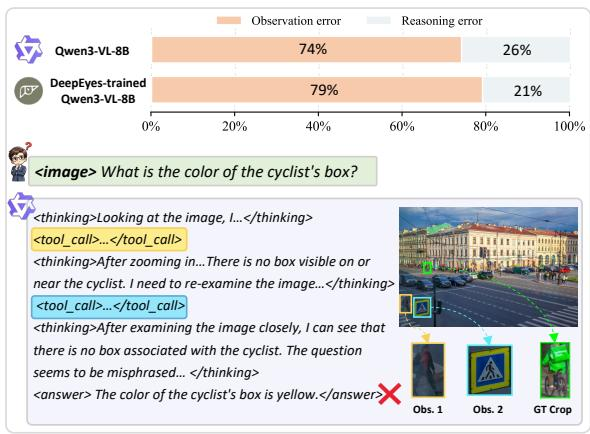
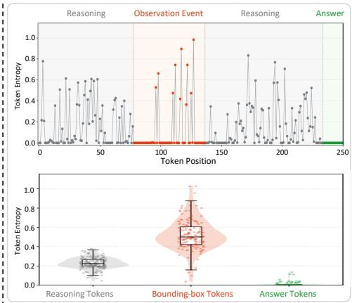
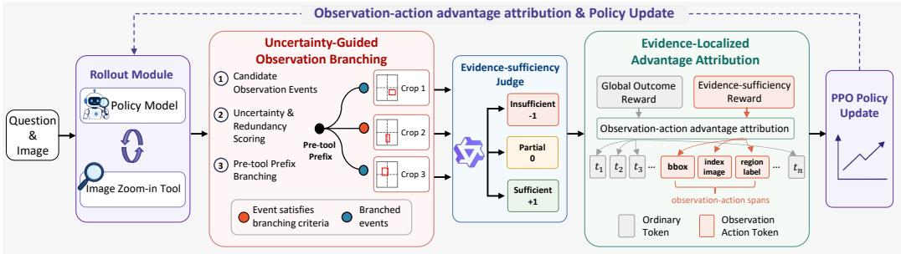
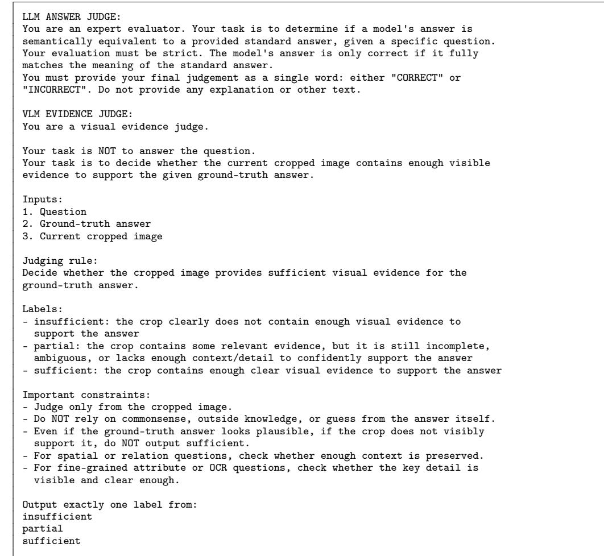
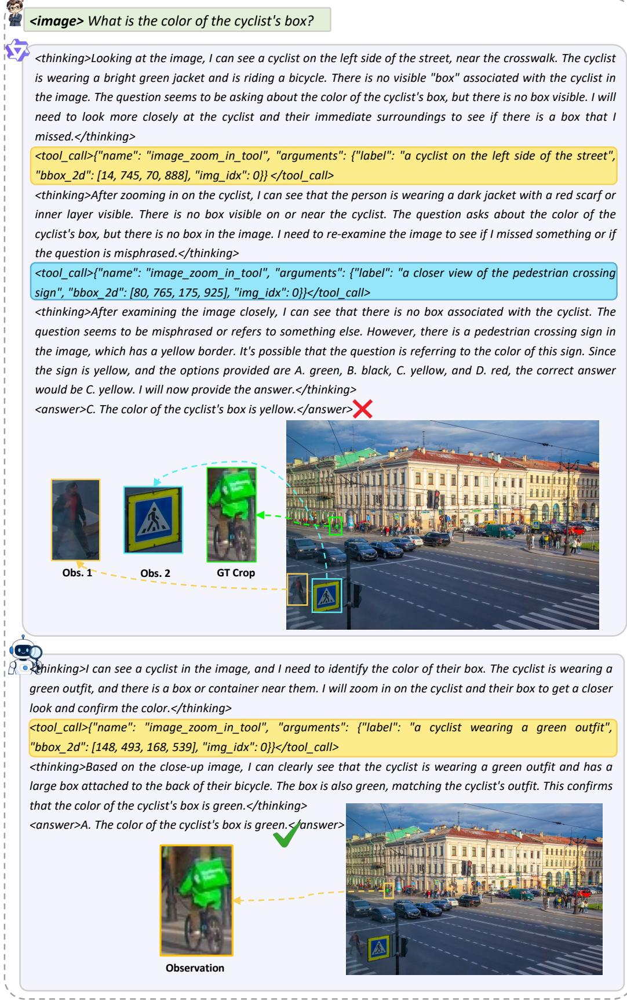
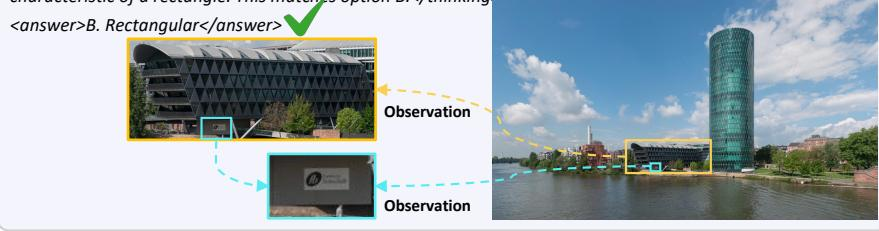
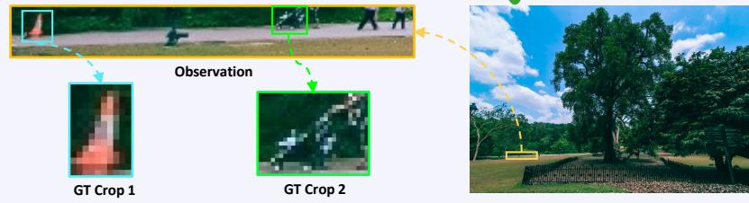

# Learning Where to Look: Observation Policy Optimization for Thinking with Images

Junfeng Wang1,∗ Jiawei Liu1,∗ Yongchao Xu1,∗ Tao Jiang2 Jiangbo Ai2 Jin Zhang2 Chong Wang1,† Qixing Zhang1

1University of Science and Technology of China 2Alibaba Group

{jfwang2002,yongchaoxu}@mail.ustc.edu.cn {jwliu6,wchong,qixing}@ustc.edu.cn {cigarette.jt,aijiangbo.ajb,zj146372}@alibaba-inc.com ∗Equal contribution. †Corresponding author.

## Abstract

Complex visual question answering often requires vision-language models to think with images, i.e., actively acquire local visual evidence by zooming into informative regions of high-resolution images. Our error analysis shows that many failures in this setting originate from incorrect observation actions, where the model fails to localize key regions or obtain crops that contain sufficient evidence for answering. We further observe that bounding-box tokens exhibit substantially higher generation entropy than ordinary language tokens, indicating high uncertainty when the model decides where to look. However, existing reinforcement learning methods based on final-answer rewards provide only trajectory-level feedback, making it difficult to assign precise credit to the observation actions. We propose Observation Policy Optimization (OPO), an RL algorithm for optimizing observation actions in toolaugmented thinking with images. OPO consists of two core modules. First, Uncertainty-Guided Observation Branching (UOB) treats each image zoom-in tool call as an observation event and selectively branches at high-uncertainty, low-redundancy events during rollout, enabling efficient exploration of alternative cropping decisions and their resulting visual evidence. Second, Evidence-Localized Advantage Attribution (ELAA) compares sibling branches using local evidencesufficiency rewards and assigns credit only to the corresponding observationaction tokens. By decoupling observation-action optimization from trajectorylevel outcome supervision, OPO improves visual evidence acquisition and further enhances visual reasoning performance. Experiments show that OPO consistently improves Qwen3-VL models across scales and achieves competitive performance against larger models and tool-augmented baselines. Code is publicly available.1

## 1 Introduction

Vision-language models (VLMs) have made substantial progress in visual question answering, chart understanding, document parsing, and complex scene reasoning [1–5]. However, many highresolution visual tasks cannot be solved from a single global image view. The evidence required to answer a question may appear only in small text, subtle objects, spatial relations, or local image regions. In such cases, models must actively acquire local visual evidence by selecting informative regions and zooming in, an ability often referred to as thinking with images [6–10].

  
(a) Failure analysis on V\*

  
(b) Token Entropy Analysis  
Figure 1: Motivation for observation-action optimization. (a) Error-type breakdown of incorrect V\* trajectories for Qwen3-VL-8B and DeepEyes-trained Qwen3-VL-8B, together with an example observation-error trajectory. (b) Token-entropy analysis, where the top panel shows an event-aligned entropy trace over a generated response and the bottom panel compares entropy distributions of reasoning tokens, bounding-box tokens, and answer tokens.

In this paper, we study tool-augmented thinking with images, where a VLM invokes an image zoom-in tool during multi-turn reasoning. In this setting, the key challenge is not only to reason over visual evidence, but also to acquire the right evidence in the first place. As shown in Figure 1(a), our error analysis shows that many failures stem from incorrect observation actions: the model either localizes the wrong region or obtains crops that lack sufficient evidence. We further find that bounding-box tokens exhibit substantially higher generation entropy than ordinary language tokens, as shown in Figure 1(b), suggesting that visual localization is a high-uncertainty local decision.

Existing RL-based methods for visual tool use typically optimize tool-augmented reasoning with trajectory-level rewards, such as final-answer correctness, format validity, or tool-use rewards [7– 9, 11]. While such rewards can encourage models to use visual tools, they provide imprecise credit assignment for observation actions. A crop that contains sufficient evidence may be penalized if later reasoning fails, while an insufficient crop may be reinforced if the model guesses the answer correctly. This credit mismatch makes it difficult for the model to reliably learn where to look.

To address this problem, we propose Observation Policy Optimization (OPO), a reinforcement learning algorithm that directly optimizes observation actions in tool-augmented thinking with images. OPO consists of two complementary modules. First, Uncertainty-Guided Observation Branching (UOB) treats each zoom-in tool call as an observation event and selectively branches from high-uncertainty, low-redundancy events, allowing the model to explore alternative crops from a shared reasoning prefix. Second, Evidence-Localized Advantage Attribution (ELAA) compares sibling branches using local evidence-sufficiency rewards and assigns the resulting advantage only to the observation-action tokens that produced the corresponding crop. Together, UOB and ELAA separate observation-action optimization from trajectory-level outcome supervision, enabling more precise learning of where to look.

We evaluate OPO using Qwen3-VL backbones [2] on V\* [12], HR-Bench 4K, and HR-Bench 8K [13]. OPO consistently improves both model scales, increasing overall accuracy by 10.0, 12.4, and 15.8 percentage points for Qwen3-VL-2B and by 4.7, 4.1, and 4.3 percentage points for Qwen3-VL-8B on the three benchmarks, respectively. OPO-8B also achieves competitive performance against strong open-source, proprietary, and tool-augmented baselines across these benchmarks. Ablation studies further show that uncertainty-guided observation branching and evidence-localized advantage attribution both contribute to these gains.

## Our contributions are summarized as follows:

• We identify observation actions as a key bottleneck in thinking with images. Our analysis shows that many failures stem from insufficient visual evidence acquisition, and that observation-action tokens exhibit high local uncertainty.

• We propose OPO, which consists of two complementary modules: Uncertainty-Guided Observation Branching for targeted exploration of alternative cropping decisions, and Evidence-Localized Advantage Attribution for precise credit assignment.

• Experiments show that OPO consistently improves Qwen3-VL models across scales and achieves competitive performance against much larger models and tool-augmented methods.

## 2 Related Work

Thinking with Images. Thinking with images extends multimodal reasoning by allowing models to acquire and manipulate visual evidence during inference [10]. Within this paradigm, visual exploration methods use crops, zooming, and other image operations to inspect details that may be lost in the global view [14–16]. DeepEyes learns a zoom-based observation policy through reinforcement learning [7]. Broader tool interfaces support more diverse evidence acquisition: Thyme uses executable code for image manipulation and computation [17], while DeepEyesV2 and SenseNova-MARS combine visual operations with search [18, 19]. Alongside these interactive approaches, latent visual reasoning explores internal visual representations [20], and ZwZ distills region-level supervision into the model to enable single-pass perception without inference-time zooming [21].

A related question is how to supervise the visual actions taken during reasoning. CodeVision and CodeV address this through process rewards for code-based tool use. CodeVision rewards tool-use strategy and efficiency, including improvements in crop overlap with a target region [22]. CodeV evaluates the evidence provided by tool outputs and combines these scores with answer correctness to form a trajectory-level advantage [23]. OPO connects evidence supervision to the observation decision itself: it explores alternative crops from a shared reasoning prefix, compares their evidence sufficiency within the resulting sibling group, and assigns the local advantage to the corresponding observation-action tokens. This couples the exploration of candidate observations with credit assignment for the evidence they acquire.

Agentic Reinforcement Learning. Agentic reinforcement learning formulates large language models as learnable policies embedded in multi-turn interactive environments, enabling them to plan, reason, and invoke tools under partial observations [24]. More broadly, reinforcement learning has also found applications in other domains [25–27]. Early tool-augmented agents mainly relied on prompting or supervised fine-tuning to elicit tool-use behaviors, such as ReAct, Toolformer, FireAct, AgentTuning, and Agent-FLAN [28–32]. Recent studies further apply reinforcement learning to multi-turn tool interaction, using outcome or rule-based rewards to train models to autonomously invoke search engines, browsers, code interpreters, or visual tools for complex reasoning, information seeking, and multimodal tasks [33–40, 7, 41]. ARPO and AEPO further leverage token entropy to improve multi-turn tool-use exploration through branch sampling or entropy-balanced optimization at high-uncertainty tool-call steps [42, 43]. While these methods target general tool-use behavior, OPO specializes agentic RL to visual observation: it uses uncertainty-guided branching to explore alternative crops and evidence-localized attribution to assign feedback according to the visual evidence produced by the observation action.

## 3 Preliminary Analysis

## 3.1 Observation Events and Observation-Action Tokens

We follow the image zoom-in tool interface of Qwen3-VL [2], where the model generates tool-call tokens in a predefined format to trigger a zoom-in operation. Each tool call contains a region label, a bounding box, and an image index, which together determine the local visual evidence the model will observe next. We refer to each valid image zoom-in tool call as an observation event, and call its region-label, bounding-box and image-index tokens observation-action tokens. The concrete tool-call schema, prompt template, and zoom-in tool behavior are provided in Appendix E.

## 3.2 Failure Analysis on $\mathbf { V } ^ { * }$

We analyze the error trajectories of Qwen3-VL-8B-Instruct [2] and a Qwen3-VL-8B model trained under the DeepEyes [7] paradigm on the V\* [12] dataset, aiming to understand the main sources of failure in tool-augmented visual reasoning. We focus on whether the model’s image zoom-in operation acquires local visual evidence sufficient to answer the question. Specifically, we categorize a trajectory as an observation error if the model localizes an irrelevant region that does not contain the key evidence required for answering the question. If the cropped region contains sufficient evidence but the model still fails in subsequent reasoning or answer generation, we categorize it as a reasoning error. As shown in Figure 1(a, top), Qwen3-VL-8B-Instruct achieves an answer accuracy of 87.96% on $\mathrm { V } ^ { \ast }$ . Among its incorrect answers, approximately 74% of failures are mainly caused by observation errors. For the Qwen3-VL-8B model trained under the DeepEyes paradigm, the answer accuracy improves to 90.05%, yet approximately 79% of its incorrect answers still mainly originate from observation errors. These results indicate that although outcome-level RL can improve final-answer accuracy, failures remain concentrated in the local visual evidence acquisition stage. Therefore, the training process needs to provide more direct optimization signals for the observation actions that determine where the model looks. Localization failures also dominate unsuccessful trajectories in stronger models (Appendix I).

## 3.3 Token Entropy Analysis

We further examine the token-level generation entropy of different parts of the model response. For decoding position $t ,$ let $p _ { t }$ denote the next-token distribution over the full vocabulary, conditioned on the input question $x ,$ the tool context $\tau$ , and the previously generated prefix $\mathcal { R } _ { < t }$ . We define the token entropy at this position as

$$
H _ { t } = - \sum _ { j = 1 } ^ { V } p _ { t , j } \log p _ { t , j } , \quad p _ { t } = \pi _ { \theta } ( \cdot \mid \mathcal { R } _ { < t } , x ; \mathcal { T } ) = \operatorname { S o f t m a x } \left( \frac { z _ { t } } { \tau } \right) .\tag{1}
$$

Here V is the vocabulary size, $p _ { t , j }$ is the probability of the j-th vocabulary token at position $t ,$ $z _ { t } \in \mathbb { R } ^ { V }$ denotes the pre-softmax logits, and $\tau$ is the decoding temperature. This entropy quantifies the uncertainty of the model’s next-token prediction at decoding position t. For analysis, we group generated tokens into reasoning tokens, observation-event tokens, and answer tokens. Observationevent tokens correspond to the structured image zoom-in tool call.

As shown in Figure 1(b, bottom), the bounding-box tokens used for localization in observation actions exhibit substantially higher entropy than ordinary reasoning tokens. We conduct this analysis over all samples in the V\* [12] dataset. The bounding-box tokens have a mean entropy of 0.522 and a median entropy of 0.501, both more than twice the corresponding mean entropy of 0.229 and median entropy of 0.225 for reasoning tokens. In contrast, answer tokens are nearly deterministic, with a mean entropy of only 0.006. The event-aligned trace in Figure 1(b, top) further shows that entropy spikes concentrate on bounding-box tokens, which directly determine where the model looks. This observation aligns with entropy-guided agentic RL, where high-entropy tool-use steps are treated as promising branching points for adaptive exploration [42]. These results indicate that visual localization is a high-uncertainty observation decision, motivating uncertainty-guided branching around observation events.

## 4 Method

Observation Policy Optimization (OPO) is a reinforcement learning framework that improves where a model looks during tool-augmented thinking with images. Following the definition above, we denote each candidate observation event by e. OPO introduces two complementary modules for optimizing the model’s observation actions: Uncertainty-Guided Observation Branching (UOB, Section 4.1) and Evidence-Localized Advantage Attribution (ELAA, Section 4.2). The full training procedure is summarized in Appendix A.1.

## 4.1 Uncertainty-Guided Observation Branching

UOB is a rollout-time module for targeted exploration around uncertain observation events. Instead of spending all M samples on independent full-trajectory rollouts, UOB first obtains a small set of base trajectories and then uses the remaining budget to branch at high-uncertainty observation events while filtering redundant child candidates. This preserves the same reasoning prefix while varying the observation action, making the resulting sibling trajectories directly comparable. As a result, UOB concentrates exploration on observation decisions where the model is most unsure, avoids spending rollout budget on redundant crops, and produces branch groups that provide controlled comparisons for ELAA.

  
Figure 2: Overview of OPO. UOB concentrates rollout exploration around high-uncertainty and low-redundancy observation decisions by branching from the shared pre-tool prefix. ELAA then compares sibling crops within each branch group using evidence-sufficiency rewards and assigns the resulting local advantage only to the observation-action tokens.

Candidate observation events. For each question, OPO produces M trajectories under a fixed rollout budget. It first samples B base trajectories and reserves the remaining $P = M - B$ rollout slots for observation-event branching and backfill. Each base trajectory is decoded until it reaches the first valid observation event or terminates without invoking the zoom-in tool. For each collected event, we record the shared pre-tool prefix, the generated observation-action spans, and the original candidate crop. These event records provide the basis for UOB to branch from the shared pre-tool prefix and for ELAA to attribute local feedback to the corresponding observation-action tokens.

Event uncertainty. UOB scores each candidate event by the local token entropy around the observation action. We use $H _ { t }$ defined in Eq. (1) as the uncertainty at decoding position t. A larger $H _ { t }$ indicates a more diffuse next-token distribution and thus higher uncertainty.

Motivated by the entropy analysis above, UOB localizes event uncertainty to bounding-box generation. Let $S _ { \mathrm { b o x } } ( e )$ denote the bounding-box token span of event e. Since the bounding box specifies the local region to be observed, its generation entropy provides a direct signal of uncertainty in the observation decision.

$$
g ( e ) = \mathrm { m e a n } _ { t \in S _ { \mathrm { b o x } } ( e ) } H _ { t } + \lambda _ { \mathrm { s t d } } \mathrm { s t d } _ { t \in S _ { \mathrm { b o x } } ( e ) } H _ { t } .\tag{2}
$$

The standard-deviation term makes the score sensitive to entropy spikes within the box span, which often indicate unstable coordinate or region decisions; $\lambda _ { \mathrm { s t d } }$ controls the strength of this spike-sensitive signal. A larger $g ( e )$ indicates that the event lies in a more uncertain localization decision region.

Question-adaptive anomaly and redundancy. Because raw uncertainty varies across questions and prompts, UOB normalizes event uncertainty against the question’s own local baseline. Let $b ( e )$ be the mean uncertainty in a fixed window of $\dot { W } _ { }$ tokens before the bounding-box span. Over the base candidates ${ \mathcal E } _ { x }$ of the same question, we compute

$$
z ( e ) = \frac { g ( e ) - \mathrm { m e a n } _ { e ^ { \prime } \in \mathcal { E } _ { x } } b ( e ^ { \prime } ) } { \mathrm { s t d } _ { e ^ { \prime } \in \mathcal { E } _ { x } } b ( e ^ { \prime } ) + \epsilon } .\tag{3}
$$

Here $\mathcal { E } _ { x }$ is the set of base candidate events for question x, $b ( e ^ { \prime } )$ is the pre-action baseline uncertainty of candidate event $e ^ { \prime } { \mathrm { . } }$ , and ϵ is a numerical stability constant. The resulting $z ( e )$ is a questionnormalized anomaly score: it measures how much the bbox-based event uncertainty $g ( e )$ deviates from the typical pre-action uncertainty for the same question. In this form, a large $z ( e )$ means that the observation event is unusually uncertain relative to the model’s local pre-action uncertainty on the same question.

To avoid repeatedly exploring similar regions within the same branch group, UOB computes a crop redundancy score for each child candidate c sampled from event e:

$$
{ \mathrm { R e d } } ( c \mid e ) = \operatorname* { m a x } _ { c ^ { \prime } \in { \mathcal { C } } _ { e } } { \mathrm { I o U } } ( b _ { c } , b _ { c ^ { \prime } } ) ,\tag{4}
$$

where $b _ { c }$ is the bounding box of candidate $c ,$ and $\mathcal { C } _ { e }$ contains the original candidate and previously accepted child crops on the same image within the branch group. UOB filters out redundant child candidates, allocating the limited rollout budget to diverse observation regions.

Branching from the observation prefix. The branching rule combines uncertainty-guided budget allocation with redundancy-based candidate filtering:

$$
Z ( e ) = \mathcal { A } ( z ( e ) , P _ { \mathrm { r e m } } ) ,\tag{5}
$$

where $\mathcal { A }$ is the budget allocator, $Z ( e )$ is the maximum number of child rollouts proposed for event $e ,$ and $P _ { \mathrm { r e m } }$ is the remaining branch budget. The allocator assigns more proposals to high-uncertainty events and always respects the remaining rollout budget and the number of available trajectory slots. Redundancy filtering determines which proposals are retained.

A child trajectory is not generated from scratch. Instead, OPO preserves the prompt and all tokens up to the pre-tool prefix boundary, then resamples the suffix from that prefix. The newly generated suffix may contain an alternative observation event. Valid child tool calls are accepted if their redundancy scores do not exceed a threshold $\tau _ { \mathrm { r e d } }$ . Accepted candidates are added to $\mathcal { C } _ { e }$ , their tool calls are executed, and the agent continues multi-turn generation until termination. If fewer than M trajectories are obtained after all branch opportunities, ordinary rollouts are used to backfill the group. The trajectories derived from the same pre-tool prefix form a branch group, which serves as the comparison set for ELAA.

## 4.2 Evidence-Localized Advantage Attribution

ELAA converts the sibling trajectories produced by UOB into local advantages for observation-action tokens. Trajectories in the same branch group share the same pre-tool prefix, but may generate different observation actions and crops. ELAA first evaluates each crop with an evidence-sufficiency reward, then normalizes these local scores within the branch group to obtain a group-local advantage. Finally, this local advantage is applied only to the observation-action token spans that produced the corresponding crop, while the remaining generated tokens keep the global outcome advantage.

Global outcome reward. The global outcome reward is computed from the final answer and task-level formatting and tool-use signals:

$$
R _ { i } ^ { \mathrm { g l o b a l } } = w _ { \mathrm { a c c } } r _ { i } ^ { \mathrm { a c c } } + w _ { \mathrm { f m t } } r _ { i } ^ { \mathrm { f m t } } + w _ { \mathrm { t o o l } } r _ { i } ^ { \mathrm { t o o l } } .\tag{6}
$$

Here $R _ { i } ^ { \mathrm { g l o b a l } }$ is the trajectory-level outcome reward for trajectory i. The terms $r _ { i } ^ { \mathrm { a c c } } , r _ { i } ^ { \mathrm { f m t } }$ , and $r _ { i } ^ { \mathrm { t o o l } }$ respectively denote answer correctness, format quality, and tool-use quality $[ 7 ]$ . The coefficients $w _ { \mathrm { a c c } } , w _ { \mathrm { f m t } }$ , and $w _ { \mathrm { t o o l } }$ control the relative weights of these outcome-level signals.

Evidence-sufficiency reward. For each evidence crop, a frozen visual judge receives the question, the ground-truth answer, and the crop, and is prompted to assess whether the crop contains sufficient visual evidence to support the answer. The judge labels the crop as INSUFFICIENT, PARTIAL, or SUFFICIENT. The reward-judge prompts and model choices are detailed in Appendix F. The default scalar mapping is

$$
\begin{array} { r } { \rho \big ( \mathrm { I N S U F F I C I E N T } \big ) = - 1 , \quad \rho \big ( \mathrm { P A R T I A L } \big ) = 0 , \quad \rho \big ( \mathrm { S U F I C I E N T } \big ) = 1 . } \end{array}\tag{7}
$$

Here $\rho ( \cdot )$ maps the judge’s discrete evidence-sufficiency label to a scalar local reward: insufficient evidence is penalized, partial evidence is neutral, and sufficient evidence is rewarded.

For each sibling trajectory i in branch group $^ { g , }$ , let $c _ { i , g }$ denote the crop produced by its observation action. The group-local evidence reward is

$$
R _ { i , g } ^ { \mathrm { e v i } } = \rho ( c _ { i , g } ) .\tag{8}
$$

$R _ { i , g } ^ { \mathrm { e v i } }$ measures the quality of visual evidence acquired by the local observation action. This reward is used only for local comparison among sibling trajectories in the same branch group.

Observation-action advantage attribution. After rollout and reward computation, standard GRPO first computes a global group advantage using the shared question identifier:

$$
A _ { i } ^ { \mathrm { g l o b a l } } = \frac { R _ { i } ^ { \mathrm { g l o b a l } } - \mathrm { m e a n } _ { j \in \mathcal { G } ( x ) } R _ { j } ^ { \mathrm { g l o b a l } } } { \mathrm { s t d } _ { j \in \mathcal { G } ( x ) } R _ { j } ^ { \mathrm { g l o b a l } } + \epsilon } .\tag{9}
$$

Here $\mathcal G ( x )$ is the rollout group for question x. The advantage $A _ { i } ^ { \mathrm { g l o b a l } }$ indicates whether trajectory i achieves a better or worse outcome than its group peers.

Let $S ( g )$ be the set of sibling trajectories in branch group g. ELAA uses only the evidence-sufficiency reward to construct the group-local advantage:

$$
A _ { i , g } ^ { \mathrm { l o c a l } } = \frac { R _ { i , g } ^ { \mathrm { e v i } } - \mathrm { m e a n } _ { j \in S ( g ) } R _ { j , g } ^ { \mathrm { e v i } } } { \mathrm { s t d } _ { j \in S ( g ) } R _ { j , g } ^ { \mathrm { e v i } } + \epsilon } .\tag{10}
$$

Because normalization is performed only within the same branch group, $A _ { i , g } ^ { \mathrm { l o c a l } }$ reflects relative evidence-quality differences among alternative observation actions sampled from the same prefix.

Let $m _ { i , t } ( g )$ be a binary mask that is one only for the image-index, region-label, and bounding-box spans generated by trajectory i in branch group g. ELAA applies the evidence-local advantage only to these observation-action tokens:

$$
A _ { i , t } = ( 1 - m _ { i , t } ( g ) ) A _ { i } ^ { \mathrm { g l o b a l } } + m _ { i , t } ( g ) \lambda _ { \mathrm { l o c a l } } A _ { i , g } ^ { \mathrm { l o c a l } } .\tag{11}
$$

Thus, tokens outside the observation-action spans are trained with the global outcome advantage, while observation-action tokens receive the evidence-local advantage computed within their corresponding branch group. This yields a clean credit assignment between downstream reasoning and visual evidence acquisition.

After obtaining the token-level advantage $A _ { i , t }$ , OPO updates the policy with the standard clipped PPO objective. OPO does not change the form of the PPO update; its effect enters through the advantage $A _ { i , t }$ defined above. The full policy objective is provided in Appendix A.2.

## 5 Experiments

## 5.1 Experimental Setup

Baselines. To comprehensively assess the effectiveness of OPO, we compare it against three categories of baselines. First, we include advanced proprietary models, including GPT-5 mini and GPT-5.2 [44, 45], Claude Opus 4.6 [46], and Gemini-3 Pro [47], which represent strong closedsource general-purpose vision-language systems. Second, we compare with state-of-the-art opensource vision-language models, including LLaVA-OneVision [48], Qwen2.5-VL [1], Qwen3-VL [2], Qwen3.5 [49], and Kimi K2.5 [50]. Third, we consider methods explicitly designed with workflows or tool-use procedures, including SEAL [12], DyFo [51], ZoomEye [52], DeepEyes [7], and DeepEyesV2 [18]. These workflow-based systems are particularly relevant because they also aim to improve fine-grained perception by changing how visual evidence is acquired or processed.

Benchmarks. Since fine-grained high-resolution perception tasks naturally test a model’s ability to observe visual details, we evaluate models on three popular benchmarks: V\* [12], HR-Bench 4K, and HR-Bench 8K [13]. Details of these benchmarks are provided in Appendix B, and the evaluation protocol is described in Appendix C.

Training Details. We train Qwen3-VL-Instruct [2] with OPO for 200 iterations on 8 NVIDIA H20 GPUs. Each training batch contains 64 prompts, and each prompt uses a rollout budget of $M = 8$ consisting of $B = \bar { 2 }$ initial rollouts and $P = 6$ remaining trajectory slots for observation-event branching and backfill. For each sample, the model can generate up to five assistant turns and invoke the image zoom-in tool during reasoning. We follow the tool-call format of Qwen3-VL; the detailed prompt template is provided in Appendix E. For fair comparison, we use the same training data as DeepEyes [7], with data details provided in Appendix D. Additional rollout and optimization details are provided in Appendix H.

Table 1: Main results on high-resolution perception benchmarks. LLaVA-OV abbreviates LLaVA-OneVision. Tool denotes the inference-time mechanism: Zoom for image zoom-in crop tools, WF for manually designed visual-search workflows, Code for code-execution tools, General for codeexecution, image search and text search tools, C+S for image cropping and search, × for no tool. Best and second-best results are bolded and underlined. † denotes results reproduced by us, and – indicates that the corresponding entry is not reported or not applicable.
<table><tr><td>Model</td><td>Backbone</td><td>Tool</td><td>Param.</td><td colspan="3">V* Bench</td><td colspan="3">HR-Bench 4K</td><td colspan="3">HR-Bench 8K</td></tr><tr><td></td><td></td><td></td><td></td><td>Attr.</td><td></td><td>Spatial Overall</td><td>FSP</td><td>FCP</td><td>Overall</td><td>FSP</td><td>FCP</td><td>Overall</td></tr><tr><td colspan="10">Advanced proprietary models</td><td></td><td></td><td></td><td></td></tr><tr><td>GPT-5 mini [44]</td><td></td><td></td><td></td><td></td><td></td><td>78.6</td><td></td><td></td><td>78.6</td><td></td><td></td><td>74.4</td></tr><tr><td>GPT-5.2 [45]</td><td></td><td></td><td></td><td></td><td></td><td>75.9</td><td></td><td></td><td></td><td></td><td></td><td></td></tr><tr><td>Claude Opus 4.6 [46]</td><td></td><td></td><td></td><td></td><td></td><td>66.5</td><td></td><td></td><td></td><td></td><td></td><td></td></tr><tr><td>Gemini-3 Pro [47]</td><td></td><td>一</td><td>一</td><td>一</td><td></td><td>88.0</td><td>一</td><td>一</td><td>一</td><td></td><td></td><td>一</td></tr><tr><td colspan="10">State-of-the-art open-source models</td><td colspan="3"></td></tr><tr><td>LLaVA-OV [48]</td><td></td><td>×</td><td>7B</td><td>75.7</td><td>75.0</td><td>75.4</td><td>72.0</td><td>54.0</td><td>63.0</td><td>67.3</td><td>52.3</td><td>59.8</td></tr><tr><td>Qwen2.5-VL [1]</td><td></td><td>X</td><td>7B</td><td>73.9</td><td>67.1</td><td>71.2</td><td>85.2</td><td>52.2</td><td>68.8</td><td>78.8</td><td>51.8</td><td>65.3</td></tr><tr><td>Qwen2.5-VL [1]</td><td></td><td>×</td><td>32B</td><td>87.8</td><td>88.1</td><td>87.9</td><td>89.8</td><td>58.0</td><td>73.9</td><td>84.5</td><td>56.3</td><td>70.4</td></tr><tr><td>Qwen3-VL [2]</td><td></td><td>Zoom</td><td>235B-A22B</td><td></td><td></td><td>93.7</td><td></td><td></td><td>85.4</td><td></td><td></td><td>82.4</td></tr><tr><td>Qwen3-VL [2]</td><td></td><td>Zoom</td><td>30B-A3B</td><td></td><td></td><td>89.5</td><td></td><td></td><td>82.5</td><td></td><td></td><td>79.3</td></tr><tr><td>Qwen3-VL [2] Qwen3.5 [49]</td><td></td><td>Zoom</td><td>32B</td><td></td><td></td><td>91.1</td><td></td><td></td><td>84.6</td><td></td><td></td><td>81.6</td></tr><tr><td>Qwen3.5 [49]</td><td></td><td></td><td>397B-A17B</td><td></td><td></td><td>91.1</td><td></td><td></td><td></td><td></td><td></td><td></td></tr><tr><td>Kimi K2.5 [50]</td><td></td><td>Code</td><td>397B-A17B 1T-A32B</td><td></td><td></td><td>95.8</td><td></td><td></td><td></td><td></td><td></td><td></td></tr><tr><td></td><td></td><td></td><td></td><td></td><td></td><td>77.0</td><td></td><td></td><td></td><td></td><td></td><td></td></tr><tr><td colspan="10">Specialized visual reasoning methods</td><td colspan="3"></td><td colspan="3"></td></tr><tr><td>SEAL [12]</td><td>LLaVA</td><td>WF</td><td>7B</td><td>74.8</td><td>76.3</td><td>75.4</td><td></td><td></td><td></td><td></td><td></td><td></td></tr><tr><td>DyFo [51]</td><td>Qwen2-VL</td><td>WF</td><td>7B</td><td>80.0</td><td>82.9</td><td>81.2</td><td>一</td><td></td><td></td><td></td><td></td><td></td></tr><tr><td>ZoomEye [52]</td><td>LLaVA-OV</td><td>WF</td><td>7B</td><td>93.9</td><td>85.5</td><td>90.6</td><td>84.3</td><td>55.0</td><td>69.6</td><td>88.5</td><td>50.0</td><td>69.3</td></tr><tr><td>DeepEyes [7]</td><td>Qwen2.5-VL</td><td>Zoom</td><td>7B</td><td>91.3</td><td>88.2</td><td>90.1</td><td>91.3</td><td>59.0</td><td>75.1</td><td>86.8</td><td>58.5</td><td>72.6</td></tr><tr><td>DeepEyesV2 [18]</td><td>Qwen2.5-VL</td><td>General</td><td>7B</td><td></td><td></td><td>81.8</td><td></td><td></td><td>77.9</td><td></td><td></td><td>73.8</td></tr><tr><td>Thyme-RL [17]</td><td>Qwen2.5-VL</td><td>Code</td><td>7B</td><td>83.5</td><td>80.3</td><td>82.2</td><td>91.0</td><td>63.0</td><td>77.0</td><td>86.5</td><td>57.5</td><td>72.0</td></tr><tr><td>ZwZ-8B [21]</td><td>Qwen3-VL</td><td>X</td><td>8B</td><td></td><td></td><td>91.1</td><td></td><td></td><td>84.4</td><td></td><td></td><td>82.0</td></tr><tr><td>SenseNova-MARS [19]</td><td>Qwen3-VL</td><td>C+S</td><td>8B</td><td>一</td><td></td><td>92.2</td><td></td><td>一</td><td>83.1</td><td></td><td></td><td>78.4</td></tr><tr><td colspan="10">Qwen3-VL-2B† [2]</td><td>68.0</td><td>53.3</td><td></td><td>60.6</td></tr><tr><td>+ OPO</td><td>Qwen3-VL</td><td>Zoom Zoom</td><td>2B 2B</td><td>82.6 89.6</td><td>65.8 80.3</td><td>75.9 85.9</td><td>79.3 90.5</td><td>52.8 66.3</td><td>66.0 78.4</td><td>85.3</td><td>67.5</td><td>76.4</td></tr><tr><td>∆ (vs Qwen3-VL-2B)</td><td></td><td></td><td></td><td>+7.0</td><td>+14.5</td><td>+10.0</td><td>+11.2</td><td>+13.5</td><td>+12.4</td><td>+17.3</td><td>+14.2</td><td>+15.8</td></tr><tr><td>Qwen3-VL-8B† [2]</td><td></td><td>Zoom</td><td>8B</td><td>91.3</td><td>82.9</td><td>88.0</td><td>92.5</td><td>70.3</td><td>81.4</td><td>87.8</td><td>65.3</td><td>76.5</td></tr><tr><td>+ OPO</td><td>Qwen3-VL</td><td>Zoom</td><td>8B</td><td>93.9</td><td>90.8</td><td>92.7</td><td>95.8</td><td>75.3</td><td>85.5</td><td>93.0</td><td>68.5</td><td>80.8</td></tr><tr><td>∆ (vs Qwen3-VL-8B)</td><td></td><td></td><td></td><td>+2.6</td><td>+7.9</td><td>+4.7</td><td>+3.3</td><td>+5.0</td><td>+4.1</td><td>+5.3</td><td>+3.3</td><td>+4.3</td></tr></table>

## 5.2 Main Results

For readability, we denote Qwen3-VL-2B/8B trained with OPO as OPO-2B/8B.

Overall performance. Table 1 presents the main results of OPO on high-resolution perception benchmarks. Overall, OPO consistently improves performance across model scales and datasets. Based on Qwen3-VL-2B, OPO-2B improves the overall accuracy on V\*, HR-Bench 4K, and HR-Bench 8K by 10.0, 12.4, and 15.8 points, respectively. Based on Qwen3-VL-8B, OPO-8B also brings gains of 4.7, 4.1, and 4.3 points. The gains suggest that observation-action optimization is particularly effective for acquiring fine-grained visual evidence in high-resolution settings. These results show that OPO substantially improves smaller models while remaining effective at larger scales.

Comparison with strong baselines. Compared with strong open-source and proprietary models, OPO-8B also achieves competitive performance. On V\*, OPO-8B obtains 92.7% overall accuracy, outperforming several strong baselines, including Gemini-3 Pro, Qwen3-VL-32B, and Qwen3.5, while remaining below the much larger Qwen3-VL-235B-A22B and the Code-enabled Qwen3.5. On HR-Bench 4K, OPO-8B reaches 85.5% overall accuracy, achieving the best result in the table and slightly surpassing Qwen3-VL-235B-A22B at 85.4%. On HR-Bench 8K, OPO-8B improves Qwen3-VL-8B from 76.5% to 80.8%, approaching the performance of much larger models. These results suggest that directly optimizing observation actions can effectively improve high-resolution visual evidence acquisition, rather than relying solely on scaling model size.

Comparison with specialized visual reasoning methods. OPO-8B also compares favorably with other specialized visual reasoning methods. SEAL, DyFo, ZoomEye, DeepEyes, DeepEyesV2,

Table 2: Controlled comparison between DeepEyes-style outcome-level GRPO and OPO under the same backbone and zoom-tool training setup. All results are reproduced by us.
<table><tr><td rowspan="2">Model</td><td colspan="3">V* Bench</td><td colspan="3">HR-Bench 4K</td><td colspan="3">HR-Bench 8K</td></tr><tr><td>Attr.</td><td>Spatial</td><td>Overall</td><td>FSP</td><td>FCP</td><td>Overall</td><td>FSP</td><td>FCP</td><td>Overall</td></tr><tr><td>Qwen2.5-VL-7B [1]</td><td>53.0</td><td>55.3</td><td>53.9</td><td>68.5</td><td>55.3</td><td>61.9</td><td>60.8</td><td>48.0</td><td>54.4</td></tr><tr><td>+ DeepEyes-style GRPO [7]</td><td>87.0</td><td>81.6</td><td>84.8</td><td>88.0</td><td>55.0</td><td>71.5</td><td>76.3</td><td>59.8</td><td>68.0</td></tr><tr><td>+ OPO</td><td>93.9</td><td>80.3</td><td>88.5</td><td>87.8</td><td>60.3</td><td>74.0</td><td>78.8</td><td>57.5</td><td>68.1</td></tr><tr><td>∆(vs GRPO)</td><td>+6.9</td><td>-1.3</td><td>+3.7</td><td>-0.2</td><td>+5.3</td><td>+2.5</td><td>+2.5</td><td>-2.3</td><td>+0.1</td></tr><tr><td>Qwen3-VL-2B [2]</td><td>82.6</td><td>65.8</td><td>75.9</td><td>79.3</td><td>52.8</td><td>66.0</td><td>68.0</td><td>53.3</td><td>60.6</td></tr><tr><td>+ DeepEyes-style GRPO [7]</td><td>85.2</td><td>79.0</td><td>82.7</td><td>88.0</td><td>55.0</td><td>71.5</td><td>85.3</td><td>57.0</td><td>71.1</td></tr><tr><td>+ OPO</td><td>89.6</td><td>80.3</td><td>85.9</td><td>90.5</td><td>66.3</td><td>78.4</td><td>85.3</td><td>67.5</td><td>76.4</td></tr><tr><td>∆(vs GRPO)</td><td>+4.4</td><td>+1.3</td><td>+3.2</td><td>+2.5</td><td>+11.3</td><td>+6.9</td><td>+0.0</td><td>+10.5</td><td>+5.3</td></tr><tr><td>Qwen3-VL-8B [2]</td><td>91.3</td><td>82.9</td><td>88.0</td><td>92.5</td><td>70.3</td><td>81.4</td><td>87.8</td><td>65.3</td><td>76.5</td></tr><tr><td>+ DeepEyes-style GRPO [7]</td><td>87.8</td><td>93.4</td><td>90.1</td><td>91.5</td><td>73.3</td><td>82.4</td><td>86.3</td><td>69.3</td><td>77.8</td></tr><tr><td>+ OPO</td><td>93.9</td><td>90.8</td><td>92.7</td><td>95.8</td><td>75.3</td><td>85.5</td><td>93.0</td><td>68.5</td><td>80.8</td></tr><tr><td>∆ (vs GRPO)</td><td>+6.1</td><td>-2.6</td><td>+2.6</td><td>+4.3</td><td>+2.0</td><td>+3.1</td><td>+6.7</td><td>-0.8</td><td>+3.0</td></tr></table>

Thyme-RL, and SenseNova-MARS improve fine-grained visual perception through visual search, dynamic focusing, or tool use, while ZwZ distills region-level supervision into the model for single pass perception without tools. OPO-8B achieves 92.7% and 85.5% overall accuracy on V\* and HR-Bench 4K, respectively, ranking first among these methods on both benchmarks; on HR-Bench 8K, it achieves 80.8%, second only to ZwZ-8B. Notably, OPO-2B achieves 78.4% and 76.4% on HR-Bench 4K and 8K, outperforming several 7B baselines. These results show that targeted observation exploration and localized credit attribution enable OPO to improve the acquisition and use of fine-grained visual evidence.

Comparison with outcome-level GRPO. Table 2 further provides a controlled comparison between OPO and DeepEyes-style outcome-level GRPO. The DeepEyes results in Table 1 are taken from the original paper, whereas the DeepEyes-style GRPO baselines in Table 2 are retrained by us under the same backbone, training budget, and zoom-tool setup as OPO. DeepEyes-style GRPO relies only on outcome-level rewards such as final-answer correctness, format quality, and tool-use signals. In contrast, OPO further introduces uncertainty-guided local branching and evidence-localized attribution. Although DeepEyes-style GRPO performs better on a few subtasks, OPO is more stable in terms of overall accuracy, especially on HR-Bench. This suggests that outcome-level rewards can encourage the model to use the zoom-in tool, but they still struggle to assign local evidence-quality feedback to the specific observation actions. By exploring alternative crops around high-uncertainty observation events and applying evidence-sufficiency feedback to the corresponding observation-action tokens, OPO more effectively optimizes where the model looks.

Qualitative examples and analysis are provided in Appendix G and Figures 5–6.

## 5.3 Ablation Study

Effect of core modules. Table 3 presents the ablation results based on Qwen3-VL-2B. Unless otherwise specified, all OPO variants use the default rollout setting M = 8, B = 2, where M is the total rollout budget, B is the number of base trajectories, and the remaining $P = M - B$ slots are used for event-local branching and backfill. Under the default rollout budget, the full OPO achieves the best performance among all module ablations, showing that both uncertainty-guided observation exploration and evidence-localized attribution are important for improving high-resolution visual evidence acquisition.

Since ELAA relies on sibling trajectories produced by UOB for local comparison, we do not remove UOB alone; instead, we jointly remove UOB and ELAA. Without UOB and ELAA, the model degenerates into DeepEyes-style outcome-level GRPO training [7]. This variant performs substantially worse than the full OPO on all three benchmarks, suggesting that ordinary full-trajectory sampling is insufficient for exploring alternative observation actions, especially in high-resolution tasks where an incorrect crop can directly affect the final answer.

Removing ELAA keeps the UOB branching mechanism but removes localized evidence attribution, so the evidence-sufficiency feedback is no longer applied specifically to observation-action tokens and instead becomes a trajectory-level signal. This variant still shows consistent degradation compared with the full method, indicating that outcome-level or trajectory-level supervision alone can cause credit mismatch between observation actions and downstream reasoning. Meanwhile, w/o ELAA remains better than w/o UOB & ELAA, suggesting that UOB’s local branching itself is beneficial, but ELAA is needed to more effectively convert local evidence quality into observation-action learning signals.

We further examine the design choices inside UOB. Replacing uncertainty-guided event selection with random branching reduces performance, indicating that high-entropy observation events are more informative branching points than randomly selected zoom events. Removing redundancy filtering also hurts performance, suggesting that without penalizing crops that heavily overlap with previous observations, the limited branching budget can be wasted on redundant visual regions.

Effect of rollout allocation. We also analyze the effect of rollout budget and base-trajectory allocation. The smaller setting $( M = 4 , \mathbf { \bar { B } } = \mathbf { i } )$ performs worse, showing that insufficient rollout budget limits local observation exploration. When fixing M = 8, using only B = 1 provides too few base candidates and may miss useful observation events, while increasing to B = 4 reduces the budget available for local branching and limits the exploration of alternative crops. The default setting M = 8, B = 2 achieves a better balance between base-candidate coverage and event-local branching. Increasing the budget to M = 16, B = 2 brings only marginal gains, suggesting diminishing returns from larger rollout budgets.

Table 3: Ablation study on Qwen3-VL-2B. We report overall accuracy. The default setting is $\bar { M } = 8 , B = 2 .$ , where M is the rollout budget and B is the number of base trajectories. The default full OPO setting is highlighted in bold.
<table><tr><td>Variant</td><td>V*</td><td>HR-Bench 4K</td><td>HR-Bench 8K</td></tr><tr><td rowspan="3">Qwen3-VL-2B OPO full</td><td>75.9</td><td>66.0</td><td>60.6</td></tr><tr><td>85.9</td><td>78.4</td><td>76.4</td></tr><tr><td>82.7</td><td>71.5</td><td>71.1</td></tr><tr><td>w/o UOB &amp; ELAA w/o ELAA</td><td>83.8</td><td>76.5</td><td>73.8</td></tr><tr><td>w/o uncert. sel.</td><td>83.3</td><td>76.9</td><td>73.0</td></tr><tr><td>w/o redund. filt.</td><td>84.8</td><td>76.5</td><td>75.1</td></tr><tr><td>M = 4, B = 1</td><td>82.4</td><td>74.2</td><td>72.5</td></tr><tr><td>M = 8, B = 1</td><td>84.3</td><td>76.6</td><td>74.8</td></tr><tr><td>M = 8, B = 2</td><td>85.9</td><td>78.4</td><td>76.4</td></tr><tr><td>M = 8, B = 4</td><td>84.8</td><td>77.1</td><td>75.3</td></tr><tr><td>M = 16, B = 2</td><td>86.2</td><td>78.8</td><td>76.9</td></tr><tr><td></td><td></td><td></td><td></td></tr></table>

## 6 Conclusion

In this work, we study a key challenge in tool-augmented thinking with images: models must learn not only how to reason, but also where to look during reasoning. We show that many failures in high-resolution fine-grained visual tasks originate from the observation stage rather than downstream language reasoning, and that the observation-action tokens determining local crops exhibit substantially higher uncertainty than ordinary language tokens. These findings suggest that visual evidence acquisition is a critical decision-making process that should be optimized directly, rather than treated as an ordinary part of trajectory-level generation. Based on these observations, we propose Observation Policy Optimization (OPO), which improves visual evidence acquisition through uncertainty-guided observation branching and evidence-localized advantage attribution. OPO performs local branching at high-uncertainty and low-redundancy observation events, allowing the model to explore alternative crops from shared reasoning prefixes. It then assigns evidence-sufficiency feedback only to the observation-action tokens that produce the corresponding crops, thereby reducing the credit mismatch between final-answer rewards and local evidence quality. Experiments across high-resolution visual reasoning benchmarks show that OPO consistently improves Qwen3-VL-2B and Qwen3-VL-8B, and OPO-8B achieves competitive performance against much larger models and tool-augmented baselines. These results highlight observation policy optimization as an important direction for improving active visual reasoning.

## Acknowledgments and Disclosure of Funding

This work was supported by the Ministry of Industry and Information Technology under Grant No. BB2320000141; the National Key Research and Development Plan under Grant No. 2024YFC3014700; the Central Government-Guided Local Science and Technology Development Funds of Anhui Province under Grant No. 2023CSJGG1100; the National Natural Science Foundation of China (NSFC) under Grant No. 62476260; the Fundamental Research Funds for the Central Universities under Grant No. WK2100000057; and the CCF-1688 Yuanbao Cooperation Fund under Grant No. 2025006. The numerical computations were performed on the supercomputing system at the Supercomputing Center of the University of Science and Technology of China.

## References

[1] Shuai Bai, Keqin Chen, Xuejing Liu, Jialin Wang, Wenbin Ge, Sibo Song, Kai Dang, Peng Wang, Shijie Wang, Jun Tang, Humen Zhong, Yuanzhi Zhu, Mingkun Yang, Zhaohai Li, Jianqiang Wan, Pengfei Wang, Wei Ding, Zheren Fu, Yiheng Xu, Jiabo Ye, Xi Zhang, Tianbao Xie, Zesen Cheng, Hang Zhang, Zhibo Yang, Haiyang Xu, and Junyang Lin. Qwen2.5-vl technical report, 2025. URL https://arxiv.org/abs/2502.13923.

[2] Shuai Bai, Yuxuan Cai, Ruizhe Chen, Keqin Chen, Xionghui Chen, Zesen Cheng, Lianghao Deng, Wei Ding, Chang Gao, Chunjiang Ge, et al. Qwen3-vl technical report. arXiv preprint arXiv:2511.21631, 2025.

[3] Jinguo Zhu, Weiyun Wang, Zhe Chen, Zhaoyang Liu, Shenglong Ye, Lixin Gu, Hao Tian, Yuchen Duan, Weijie Su, Jie Shao, et al. Internvl3: Exploring advanced training and test-time recipes for open-source multimodal models. arXiv preprint arXiv:2504.10479, 2025.

[4] Kimi Team, Angang Du, Bohong Yin, Bowei Xing, Bowen Qu, Bowen Wang, Cheng Chen, Chenlin Zhang, Chenzhuang Du, Chu Wei, et al. Kimi-vl technical report. arXiv preprint arXiv:2504.07491, 2025.

[5] Dong Guo, Faming Wu, Feida Zhu, Fuxing Leng, Guang Shi, Haobin Chen, Haoqi Fan, Jian Wang, Jianyu Jiang, Jiawei Wang, et al. Seed1.5-vl technical report. arXiv preprint arXiv:2505.07062, 2025.

[6] Xu Chu, Xinrong Chen, Guanyu Wang, Zhijie Tan, Kui Huang, Wenyu Lv, Tong Mo, and Weiping Li. Qwen look again: Guiding vision-language reasoning models to re-attention visual information. arXiv preprint arXiv:2505.23558, 2025.

[7] Ziwei Zheng, Michael Yang, Jack Hong, Chenxiao Zhao, Guohai Xu, Le Yang, Chao Shen, and Xing Yu. Deepeyes: Incentivizing "thinking with images" via reinforcement learning. arXiv preprint arXiv:2505.14362, 2025.

[8] Yue Fan, Xuehai He, Diji Yang, Kaizhi Zheng, Ching-Chen Kuo, Yuting Zheng, Sravana Jyothi Narayanaraju, Xinze Guan, and Xin Eric Wang. Grit: Teaching mllms to think with images. arXiv preprint arXiv:2505.15879, 2025.

[9] Meng Cao, Haoze Zhao, Can Zhang, Xiaojun Chang, Ian Reid, and Xiaodan Liang. Groundr1: Incentivizing grounded visual reasoning via reinforcement learning. arXiv preprint arXiv:2505.20272, 2025.

[10] Zhaochen Su, Peng Xia, Hangyu Guo, Zhenhua Liu, Yan Ma, Xiaoye Qu, Jiaqi Liu, Yanshu Li, Kaide Zeng, Zhengyuan Yang, Linjie Li, Yu Cheng, Heng Ji, Junxian He, and Yi R. Fung. Thinking with images for multimodal reasoning: Foundations, methods, and future frontiers, 2025. URL https://arxiv.org/abs/2506.23918.

[11] Zhihong Shao, Peiyi Wang, Qihao Zhu, Runxin Xu, Junxiao Song, Xiao Bi, Haowei Zhang, Mingchuan Zhang, YK Li, Yang Wu, et al. Deepseekmath: Pushing the limits of mathematical reasoning in open language models. arXiv preprint arXiv:2402.03300, 2024.

[12] Penghao Wu and Saining Xie. V\*: Guided visual search as a core mechanism in multimodal LLMs. In Proceedings of the IEEE/CVF Conference on Computer Vision and Pattern Recognition, pages 13084–13094, 2024.

[13] Wenbin Wang, Liang Ding, Minyan Zeng, Xiabin Zhou, Li Shen, Yong Luo, Wei Yu, and Dacheng Tao. Divide, conquer and combine: A training-free framework for high-resolution image perception in multimodal large language models. In Proceedings ofthe AAAI Conference on Artificial Intelligence, volume 39, pages 7907–7915, 2025.

[14] Xintong Zhang, Zhi Gao, Bofei Zhang, Pengxiang Li, Xiaowen Zhang, Yang Liu, Tao Yuan, Yuwei Wu, Yunde Jia, Song-Chun Zhu, et al. Chain-of-Focus: Adaptive visual search and zooming for multimodal reasoning via RL. arXiv preprint arXiv:2505.15436, 2025. URL https://arxiv.org/abs/2505.15436v1.

[15] Muzhi Zhu, Hao Zhong, Canyu Zhao, Zongze Du, Zheng Huang, Mingyu Liu, Hao Chen, Cheng Zou, Jingdong Chen, Ming Yang, et al. Active-o3: Empowering multimodal large language models with active perception via grpo. arXiv preprint arXiv:2505.21457, 2025.

[16] Zhaochen Su, Linjie Li, Mingyang Song, Yunzhuo Hao, Zhengyuan Yang, Jun Zhang, Guanjie Chen, Jiawei Gu, Juntao Li, Xiaoye Qu, et al. OpenThinkIMG: Learning to think with images via visual tool reinforcement learning. arXiv preprint arXiv:2505.08617, 2025. URL https://arxiv.org/abs/2505.08617.

[17] Yi-Fan Zhang, Xingyu Lu, Shukang Yin, Chaoyou Fu, Wei Chen, Xiao Hu, Bin Wen, Kaiyu Jiang, Changyi Liu, Tianke Zhang, Haonan Fan, Kaibing Chen, Jiankang Chen, Haojie Ding, Kaiyu Tang, Zhang Zhang, Liang Wang, Fan Yang, Tingting Gao, and Guorui Zhou. Thyme: Think beyond images. arXiv preprint arXiv:2508.11630, 2025. URL https://arxiv.org/ abs/2508.11630.

[18] Jack Hong, Chenxiao Zhao, ChengLin Zhu, Weiheng Lu, Guohai Xu, and Xing Yu. Deepeyesv2: Toward agentic multimodal model. arXiv preprint arXiv:2511.05271, 2025.

[19] Yong Xien Chng, Tao Hu, Wenwen Tong, Xueheng Li, Jiandong Chen, Haojia Yu, Jiefan Lu, Hewei Guo, Hanming Deng, Chengjun Xie, Gao Huang, Dahua Lin, and Lewei Lu. Sensenovamars: Empowering multimodal agentic reasoning and search via reinforcement learning. arXiv preprint arXiv:2512.24330, 2025. URL https://arxiv.org/abs/2512.24330.

[20] Bangzheng Li, Ximeng Sun, Jiang Liu, Ze Wang, Jialian Wu, Xiaodong Yu, Hao Chen, Emad Barsoum, Muhao Chen, and Zicheng Liu. Latent visual reasoning. arXiv preprint arXiv:2509.24251, 2025.

[21] Lai Wei, Liangbo He, Jun Lan, Lingzhong Dong, Yutong Cai, Siyuan Li, Huijia Zhu, Weiqiang Wang, Linghe Kong, Yue Wang, Zhuosheng Zhang, and Weiran Huang. Zooming without zooming: Region-to-image distillation for fine-grained multimodal perception. arXiv preprint arXiv:2602.11858, 2026. URL https://arxiv.org/abs/2602.11858.

[22] Zirun Guo, Minjie Hong, Feng Zhang, Kai Jia, and Tao Jin. Thinking with programming vision: Towards a unified view for thinking with images. arXiv preprint arXiv:2512.03746, 2025. URL https://arxiv.org/abs/2512.03746.

[23] Xinhai Hou, Shaoyuan Xu, Manan Biyani, Moyan Li, Jia Liu, Todd C. Hollon, and Bryan Wang. Codev: Code with images for faithful visual reasoning via tool-aware policy optimization. arXiv preprint arXiv:2511.19661, 2025. URL https://arxiv.org/abs/2511.19661.

[24] Guibin Zhang, Hejia Geng, Xiaohang Yu, Zhenfei Yin, Zaibin Zhang, Zelin Tan, Heng Zhou, Zhongzhi Li, Xiangyuan Xue, Yijiang Li, et al. The landscape of agentic reinforcement learning for llms: A survey. arXiv preprint arXiv:2509.02547, 2025.

[25] Bowen Ye, Yongchao Xu, Zhijian Li, Xiang Yin, Junkai Ma, and Wenzhao Li. CoEvo-Mem: Coevolving retrieval policy and memory bank for LLM agents. arXiv preprint arXiv:2608.01739, 2026. URL https://arxiv.org/abs/2608.01739.

[26] Yongchao Xu, Bowen Ye, Jiefeng Gan, Junkai Ma, Wenzhao Li, Sen Tao, Yi Wei, and Jiawei Liu. VideoEvolve: Co-evolving memory and retrieval for long video understanding. arXiv preprint arXiv:2610.10183, 2026. URL https://arxiv.org/abs/2610.10183.

[27] Yongchao Xu, Jiawei Liu, Junfeng Wang, Sen Tao, Na Jiang, and Zheng-Jun Zha. Learning to diversify and focus: A reinforcement framework for open-vocabulary HOI detection. In Proceedings of the IEEE/CVF Conference on Computer Vision and Pattern Recognition, pages 34673–34682, 2026. URL https://openaccess.thecvf.com/content/CVPR2026/ html/Xu\_Learning\_to\_Diversify\_and\_Focus\_A\_Reinforcement\_Framework\_for\_ Open-Vocabulary\_CVPR\_2026\_paper.html.

[28] Shunyu Yao, Jeffrey Zhao, Dian Yu, Nan Du, Izhak Shafran, Karthik R Narasimhan, and Yuan Cao. ReAct: Synergizing reasoning and acting in language models. In The Eleventh International Conference on Learning Representations, 2023.

[29] Timo Schick, Jane Dwivedi-Yu, Roberto Dessì, Roberta Raileanu, Maria Lomeli, Eric Hambro, Luke Zettlemoyer, Nicola Cancedda, and Thomas Scialom. Toolformer: Language models can teach themselves to use tools. Advances in neural information processing systems, 36: 68539–68551, 2023.

[30] Baian Chen, Chang Shu, Ehsan Shareghi, Nigel Collier, Karthik Narasimhan, and Shunyu Yao. Fireact: Toward language agent fine-tuning. arXiv preprint arXiv:2310.05915, 2023.

[31] Aohan Zeng, Mingdao Liu, Rui Lu, Bowen Wang, Xiao Liu, Yuxiao Dong, and Jie Tang. AgentTuning: Enabling generalized agent abilities for LLMs. arXiv preprint arXiv:2310.12823, 2023. URL https://arxiv.org/abs/2310.12823.

[32] Zehui Chen, Kuikun Liu, Qiuchen Wang, Wenwei Zhang, Jiangning Liu, Dahua Lin, Kai Chen, and Feng Zhao. Agent-flan: Designing data and methods of effective agent tuning for large language models. In Findings of the Association for Computational Linguistics: ACL 2024, pages 9354–9366, 2024.

[33] Cheng Qian, Emre Can Acikgoz, Qi He, Hongru Wang, Xiusi Chen, Dilek Hakkani-Tür, Gokhan Tur, and Heng Ji. Toolrl: Reward is all tool learning needs, 2025. URL https: //arxiv.org/abs/2504.13958.

[34] Jiazhan Feng, Shijue Huang, Xingwei Qu, Ge Zhang, Yujia Qin, Baoquan Zhong, Chengquan Jiang, Jinxin Chi, and Wanjun Zhong. Retool: Reinforcement learning for strategic tool use in llms. arXiv preprint arXiv:2504.11536, 2025.

[35] Yifan Wei, Xiaoyan Yu, Yixuan Weng, Tengfei Pan, Angsheng Li, and Li Du. AutoTIR: Autonomous tools integrated reasoning via reinforcement learning. arXiv preprint arXiv:2507.21836, 2025. URL https://arxiv.org/abs/2507.21836.

[36] Bowen Jin, Hansi Zeng, Zhenrui Yue, Jinsung Yoon, Sercan Arik, Dong Wang, Hamed Zamani, and Jiawei Han. Search-r1: Training llms to reason and leverage search engines with reinforcement learning. arXiv preprint arXiv:2503.09516, 2025.

[37] Jialong Wu, Baixuan Li, Runnan Fang, Wenbiao Yin, Liwen Zhang, Zhengwei Tao, Dingchu Zhang, Zekun Xi, Gang Fu, Yong Jiang, et al. Webdancer: Towards autonomous information seeking agency. arXiv preprint arXiv:2505.22648, 2025.

[38] Xiaoxi Li, Jiajie Jin, Guanting Dong, Hongjin Qian, Yongkang Wu, Ji-Rong Wen, Yutao Zhu, and Zhicheng Dou. Webthinker: Empowering large reasoning models with deep research capability. arXiv preprint arXiv:2504.21776, 2025.

[39] Kuan Li, Zhongwang Zhang, Huifeng Yin, Liwen Zhang, Litu Ou, Jialong Wu, Wenbiao Yin, Baixuan Li, Zhengwei Tao, Xinyu Wang, et al. Websailor: Navigating super-human reasoning for web agent. arXiv preprint arXiv:2507.02592, 2025.

[40] Mingyuan Wu, Jingcheng Yang, Jize Jiang, Meitang Li, Kaizhuo Yan, Hanchao Yu, Minjia Zhang, Chengxiang Zhai, and Klara Nahrstedt. Vtool-r1: Vlms learn to think with images via reinforcement learning on multimodal tool use. arXiv preprint arXiv:2505.19255, 2025.

[41] Haozhe Wang, Alex Su, Weiming Ren, Fangzhen Lin, and Wenhu Chen. Pixel reasoner: Incentivizing pixel-space reasoning with curiosity-driven reinforcement learning. arXiv preprint arXiv:2505.15966, 2025.

[42] Guanting Dong, Hangyu Mao, Kai Ma, Licheng Bao, Yifei Chen, Zhongyuan Wang, Zhongxia Chen, Jiazhen Du, Huiyang Wang, Fuzheng Zhang, Guorui Zhou, Yutao Zhu, Ji-Rong Wen, and Zhicheng Dou. Agentic reinforced policy optimization. CoRR, abs/2507.19849, 2025. doi: 10.48550/ARXIV.2507.19849. URL https://doi.org/10.48550/arXiv.2507.19849.

[43] Guanting Dong, Licheng Bao, Zhongyuan Wang, Kangzhi Zhao, Xiaoxi Li, Jiajie Jin, Jinghan Yang, Hangyu Mao, Fuzheng Zhang, Kun Gai, Guorui Zhou, Yutao Zhu, Ji-Rong Wen, and Zhicheng Dou. Agentic entropy-balanced policy optimization. CoRR, abs/2510.14545, 2025. doi: 10.48550/ARXIV.2510.14545. URL https://doi.org/10.48550/arXiv.2510. 14545.

[44] OpenAI. GPT-5 System Card. https://cdn.openai.com/gpt-5-system-card.pdf, August 2025. Accessed: 2026-05-07.

[45] OpenAI. Update to GPT-5 System Card: GPT-5.2. https://cdn.openai.com/ pdf/3a4153c8-c748-4b71-8e31-aecbde944f8d/oai\_5\_2\_system-card.pdf, December 2025. Accessed: 2026-05-07.

[46] Anthropic. Claude Opus 4.6 System Card. https://www-cdn.anthropic.com/ 0dd865075ad3132672ee0ab40b05a53f14cf5288.pdf, 2026. Accessed: 2026-05-07.

[47] Google DeepMind. Gemini 3 Pro Model Card. https://storage.googleapis.com/ deepmind-media/Model-Cards/Gemini-3-Pro-Model-Card.pdf, December 2025. Accessed: 2026-05-07.

[48] Bo Li, Yuanhan Zhang, Dong Guo, Renrui Zhang, Feng Li, Hao Zhang, Kaichen Zhang, Peiyuan Zhang, Yanwei Li, Ziwei Liu, and Chunyuan Li. Llava-onevision: Easy visual task transfer, 2024. URL https://arxiv.org/abs/2408.03326.

[49] Qwen Team. Qwen3.5: Accelerating productivity with native multimodal agents, February 2026. URL https://qwen.ai/blog?id=qwen3.5.

[50] Kimi Team, Tongtong Bai, Yifan Bai, Yiping Bao, SH Cai, Yuan Cao, Y Charles, HS Che, Cheng Chen, Guanduo Chen, et al. Kimi k2.5: Visual agentic intelligence. arXiv preprint arXiv:2602.02276, 2026.

[51] Geng Li, Jinglin Xu, Yunzhen Zhao, and Yuxin Peng. Dyfo: A training-free dynamic focus visual search for enhancing lmms in fine-grained visual understanding. In Proceedings ofthe Computer Vision and Pattern Recognition Conference, pages 9098–9108, 2025.

[52] Haozhan Shen, Kangjia Zhao, Tiancheng Zhao, Ruochen Xu, Zilun Zhang, Mingwei Zhu, and Jianwei Yin. ZoomEye: Enhancing multimodal LLMs with human-like zooming capabilities through tree-based image exploration. In Christos Christodoulopoulos, Tanmoy Chakraborty, Carolyn Rose, and Violet Peng, editors, Proceedings of the 2025 Conference on Empirical Methods in Natural Language Processing, pages 6602–6618, Suzhou, China, November 2025. Association for Computational Linguistics. ISBN 979-8-89176-332-6. doi: 10.18653/v1/2025. emnlp-main.335. URL https://aclanthology.org/2025.emnlp-main.335/.

## A Algorithm

## A.1 Algorithm Procedure

Algorithm 1 summarizes the full OPO training procedure, combining the rollout-time observation branching of UOB (Section 4.1) with the evidence-localized advantage assignment of ELAA (Section 4.2).

Algorithm 1 OPO with UOB and ELAA   
Require: Policy π , input sample x, total rollout budget M, base rollout budget B, branch budget   
$\mathbf { \dot { \boldsymbol { P } } } = \boldsymbol { M } - \mathbf { \dot { \boldsymbol { B } } }$   
UOB: rollout-time observation branching   
1: Generate $B$ base rollouts until the first valid image zoom-in call or termination.   
2: For each candidate observation event $e ,$ record its pre-tool prefix, observation-action spans, and   
the original candidate crop.   
3: Estimate bounding-box uncertainty $g ( e )$ from the bounding-box token span.   
4: Compute the question-normalized anomaly score $z ( e )$   
5: for each candidate event e while the branch budget remains do do   
6: Allocate at most $Z ( e ) = \mathcal { A } ( z ( e ) , P _ { \mathrm { r e m } } )$ child proposals.   
7: Initialize $\mathcal { C } _ { e }$ with the original candidate crop.   
8: Preserve the prompt and pre-tool prefix, then resample $Z ( e )$ suffixes from that state.   
9: Sequentially accept valid child candidates with Red $| ( c \mid e ) \stackrel { . } { \leq } \tau _ { \mathrm { r e d } }$ and add them to $\mathcal { C } _ { e }$   
10: Execute accepted child tool calls, continue each retained trajectory to termination, and form   
a branch group $g$ from trajectories sharing the same pre-tool prefix.   
11: end for   
12: Backfill with ordinary rollouts until M complete trajectories are obtained.   
ELAA: evidence-localized advantage attribution   
13: Compute global outcome rewards $R _ { i } ^ { \mathrm { g l o b a l } }$ and standard GRPO advantages $A _ { i } ^ { \mathrm { g l o b a l } }$ by question id.   
14: For each branch group $^ { g , }$ judge each crop $c _ { i , g }$ and compute group-local evidence rewards   
$R _ { i , g } ^ { \mathrm { e v i } } = \rho ( c _ { i , g } ) .$   
15: Normalize $R _ { i , g } ^ { \mathrm { e v i } }$ within $S ( g )$ to obtain $A _ { i , g } ^ { \mathrm { l o c a l } } ,$   
16: Apply $A _ { i , g } ^ { \mathrm { l o c a l } }$ only to image-index, region-label, and bounding-box spans; use $A _ { i } ^ { \mathrm { g l o b a l } }$ for other   
generated tokens.   
17: Update $\pi _ { \theta }$ with the clipped PPO policy objective.

## A.2 Policy Update

After obtaining the token-level advantage $A _ { i , t } ,$ , OPO updates the policy with the standard clipped PPO objective. OPO does not change the form of the PPO update; its effect enters through the advantage $A _ { i , t }$ defined in the main text, which assigns global outcome advantages to ordinary tokens and evidence-local advantages to observation-action tokens.

For generated token $y _ { i , t }$ , let

$$
r _ { i , t } ( \theta ) = \frac { \pi _ { \theta } ( y _ { i , t } \mid x _ { i } , y _ { i , < t } ) } { \pi _ { \theta _ { \mathrm { o l d } } } ( y _ { i , t } \mid x _ { i } , y _ { i , < t } ) } .\tag{12}
$$

The policy objective is

$$
\mathcal { L } _ { \mathrm { p o l i c y } } = - \sum _ { i , t } m _ { i , t } ^ { \mathrm { r e s p } } \operatorname* { m i n } \left( r _ { i , t } ( \theta ) A _ { i , t } , \mathrm { c l i p } ( r _ { i , t } ( \theta ) , 1 - \epsilon _ { \mathrm { c l i p } } , 1 + \epsilon _ { \mathrm { c l i p } } ) A _ { i , t } \right) ,\tag{13}
$$

where $m _ { i , t } ^ { \mathrm { r e s p } }$ is the response mask. Tool-observation tokens returned by the environment are masked out and do not contribute to the policy loss.

## B Benchmark Details

We evaluate OPO on three high-resolution perception benchmarks: ${ \mathrm { V } } ^ { * }$ [12], HR-Bench 4K, and HR-Bench 8K [13]. Following the high-resolution evaluation setting used in DeepEyes [7], these benchmarks focus on the ability of models to acquire and interpret fine-grained visual evidence from high-resolution images. Many examples cannot be answered reliably from a global image view or a heavily downsampled image alone; instead, they require models to locate local evidence such as small objects, subtle attributes, local text, or spatial relations.

V\* [12] focuses on guided visual search over natural images and evaluates whether a model can locate and use critical visual details in high-resolution images. The V\* split used in our evaluation contains 191 examples in total, including 115 examples from direct\_attributes and 76 examples from relative\_position. For V\*, we report the benchmark-defined attribute, spatial, and overall accuracies.

HR-Bench [13] contains two high-resolution evaluation versions, HR-Bench 4K and HR-Bench 8K, which measure whether models can resolve local visual evidence under increasingly demanding image resolutions. Each version contains 200 original questions, including 100 Fine-grained Single-instance Perception (FSP) questions and 100 Fine-grained Cross-instance Perception (FCP) questions. FSP evaluates fine-grained perception over a single instance, such as attribute recognition, OCR, and visual prompting, while FCP evaluates fine-grained perception across multiple instances, such as map analysis, chart analysis, and spatial relationship assessment.

In our evaluation, each original HR-Bench question is expanded into four option-rotation instances. As a result, hr\_bench\_4k contains 800 evaluation rows and hr\_bench\_8k contains 800 evaluation rows, yielding 1,600 rows in total. When reporting results, we aggregate performance according to the original benchmark definitions and report FSP, FCP, and overall accuracy following the official scoring protocol.

These benchmarks are particularly aligned with our setting because successful prediction often requires an explicit observation action: the model must first decide which local region should be inspected and then answer based on the acquired local evidence. Therefore, for both OPO and our reproduced Qwen3-VL tool-use baselines, we keep the image zoom-in tool enabled during inference. The model is allowed to perform multi-turn tool-augmented reasoning, and we evaluate only the final answer after the trajectory terminates.

## C Evaluation Protocol

We evaluate saved checkpoints with deterministic multi-turn generation. For each benchmark example, we use the same system instructions, response format, and tool schema as in training, and generate one assistant turn at a time using greedy decoding. Each sample allows up to 10 tool-use turns. When the generated response contains a valid <tool\_call>...</tool\_call> block, the evaluator parses the JSON arguments, converts the bounding box to image coordinates, crops the selected image from the visible image pool, appends the crop as a tool message, and continues generation. The trajectory terminates when an <answer>...</answer> block is produced, an invalid tool call is encountered, or the maximum number of turns is reached.

For V\*, we evaluate the direct attributes and relative position splits. Each example is treated as a multiple-choice visual question, with the first option as the benchmark-provided correct answer. The final answer is extracted from the answer tags. We apply an LLM judge to compare the model answer with the standard answer using few-shot consistency examples and return a binary judgement. We report accuracy for each split and compute the V\* overall score as the mean over all evaluated examples.

For HR-Bench, we evaluate the HR-Bench 4K and HR-Bench 8K splits. Images are decoded from the benchmark TSV files and resized according to the Qwen-VL visual grid before inference. The same multi-turn tool loop and answer extraction procedure are used. The judging script reports accuracy separately for the benchmark’s Fine-grained Single-instance Perception (FSP) and Fine-grained Cross-instance Perception (FCP) categories and computes each split’s overall score as the unweighted average of these two category accuracies. These scores correspond to the HR-Bench columns reported in Table 1.

## D Training Data Details

For fair comparison with DeepEyes, we use the same tool-oriented training data recipe rather than constructing a new training corpus. As described in DeepEyes [7], the training mixture contains about 47K samples from three complementary sources: Visual Search, ArxivQA, and ThinkLite-VL. Visual Search contributes about 22K samples, roughly 47% of the mixture, and emphasizes naturalimage grounding and fine-grained perception. ArxivQA contributes about 14K samples, roughly 30%, covering scientific plots, diagrams, and chart-style visual inputs. ThinkLite-VL contributes about 11K samples, roughly 23%, and provides multimodal reasoning examples involving arithmetic, commonsense inference, and problem solving.

The DeepEyes data curation process follows a tool-use-oriented filtering pipeline. First, it removes questions that are either too easy or too difficult by estimating model accuracy from multiple responses. Second, it converts questions into an open-ended format and filters unreliable conversions. Third, it removes unverifiable samples, including examples with incorrect answers or unreadable questions. Finally, it prioritizes samples where tool use can improve visual evidence acquisition, especially cases where the model fails from the original image but can answer correctly when given the relevant cropped region. Chart data and reasoning data are retained according to their own preprocessing assumptions because they already provide complementary structured-visual and reasoning supervision.

## E Prompt and Tool Configuration

We use the Qwen3-VL tool-calling format in both training and evaluation. Each example is converted into a conversation containing tool instructions and the user’s visual question. The tool instructions provide the image\_zoom\_in\_tool function signature inside <tools>...</tools> XML tags and require each function call to be returned as a JSON object inside <tool\_call>...</tool\_call> tags. The user message contains the image placeholder, the original question, candidate options, and the instruction to think first, call tools when needed, and finally provide an answer enclosed by answer tags. The concrete prompt and tool-call schema are summarized in Figure 3.

The image zoom-in tool crops a region from the selected image and returns the cropped image as the next tool observation. The tool maintains a visible image pool consisting of the original input image followed by all tool-returned crops from previous turns. Thus, img\_idx=0 refers to the original image, while later indices can refer to earlier crops. For Qwen3-VL models, bounding boxes are interpreted in the normalized [0, 1000] coordinate system and converted to image-space pixels before cropping.

## F Reward and Evidence Judge

The reward function has two parts: a trajectory-level final-answer reward and an event-local evidence reward. The final-answer reward first extracts the model’s answer from <answer>...</answer> after the thinking segment. A judge then compares the extracted answer with the ground-truth answer given the original question and returns a binary correctness label. We denote this answer reward by $r _ { \mathrm { a c c } } \in \{ 0 , 1 \}$ . The implementation also includes a tool-use reward $r _ { \mathrm { t o o l } } .$ , which is one only when the trajectory uses the zoom-in tool and the final answer is correct, and a format reward $r _ { \mathrm { f m t } }$ , which is −1 when the response violates the required thinking/answer format and 0 otherwise. The global trajectory reward is

$$
R ^ { \mathrm { g l o b a l } } = 0 . 8 r _ { \mathrm { a c c } } + 1 . 2 r _ { \mathrm { t o o l } } + 0 . 2 r _ { \mathrm { f m t } } .\tag{14}
$$

This global reward is used for the ordinary trajectory-level GRPO signal.

For OPO’s local observation-action supervision, we additionally use an evidence judge. For each branch event, the training pipeline keeps the crops associated with that event and sends each crop, together with the question and ground-truth answer, to a frozen visual judge. The judge must return exactly one of three labels: insufficient, partial, or sufficient. These labels are mapped to local evidence rewards −1, 0, and 1, respectively.

The exact prompts for the final-answer judge and the local evidence judge are shown in Figure 4. In our implementation, the final-answer reward judge is instantiated with Qwen3-Plus, while the local evidence reward judge is instantiated with Qwen3-VL-Max.

SYSTEM:   
You are a helpful assistant. You can call functions to assist with the user query.   
Important: You must call only one function at a time. After each function call,   
wait for the execution result before making the next function call if needed.   
# Tools   
You may call one or more functions to assist with the user query.   
You are provided with function signatures within <tools></tools> XML tags:   
<tools>   
{   
"type": "function",   
"function": {   
"name": "image\_zoom\_in\_tool",   
"description": "Zoom in on a specific region of an image by cropping it based on a bounding   
box (bbox) and an optional object label.",   
"parameters": {   
"type": "object",   
"properties": {   
"bbox\_2d": {   
"type": "array",   
"items": {"type": "number"},   
"minItems": 4,   
"maxItems": 4,   
"description": "The bounding box of the region to zoom in, as [x1, y1, x2, y2], where   
(x1, y1) is the top-left corner and (x2, y2) is the bottom-right corner."   
},   
"label": {   
"type": "string",   
"description": "The name or label of the object in the specified bounding box."   
},   
"img\_idx": {   
"type": "integer",   
"description": "0-based index into the currently visible image list, including the   
original input images followed by tool-returned crops from earlier turns."   
}   
},   
"required": ["bbox\_2d", "label", "img\_idx"]   
}   
}   
}   
</tools>   
For each function call, return a json object with function name and arguments within   
<tool\_call></tool\_call> XML tags:   
<tool\_call>   
{"name": <function-name>, "arguments": <args-json-object>}   
</tool\_call>   
USER:   
<image>   
Your role is that of a research assistant specializing in visual information. Answer questions   
about images by looking at them closely and then using research tools. Please follow this   
structured thinking process and show your work.   
Start an iterative loop for each question:   
- First, look closely: Begin with a detailed description of the image, paying attention to the   
user's question. List what you can tell just by looking, and what you'll need to look up.   
- Next, find information: Use a tool to research the things you need to find out.   
- Then, review the findings: Carefully analyze what the tool tells you and decide on your next   
action.   
Continue this loop until your research is complete.   
To finish, bring everything together in a clear, synthesized answer that fully responds to the   
user's question.   
Question: {question}   
Options:   
A. {option\_1}   
B. {option\_2}   
First think in <thinking>...</thinking>. If needed, call tools using   
<tool\_call>...</tool\_call>. Final answer must be enclosed in <answer>...</answer>.  
Figure 3: Prompt and tool-call schema used for tool-augmented visual reasoning, including the tool signature for image\_zoom\_in\_tool and the required <tool\_call> return format.

  
Figure 4: Prompts for final-answer judging and local visual-evidence judging. The LLM judge produces the trajectory-level correctness signal, while the VLM judge produces the event-local evidence reward for ELAA.

## G Qualitative Results

Figure 5 and Figure 6 show qualitative comparisons between direct Qwen3-VL-8B inference and OPO-8B. In the direct-attribute example (Figure 5), direct Qwen3-VL-8B inference is distracted by salient but irrelevant yellow regions, such as the pedestrian-crossing sign, and mistakenly treats them as evidence for the color of the cyclist’s box. In contrast, OPO-8B focuses its observation action on the cyclist and the attached box, correctly identifying the box as green from localized evidence. In the spatial-relation example (Figure 6, top), Qwen3-VL-8B observes both the cone and the baby carriage but fails to reliably resolve their left-right relation; OPO-8B instead crops a local region containing both objects and correctly determines that the carriage is to the right of the cone. In the HR-Bench example (Figure 6, bottom), Qwen3-VL-8B relies on a coarse building-level observation and mistakes the signboard for an oval shape, whereas OPO-8B accurately localizes the small signboard and zooms into it, allowing it to recognize its rectangular shape from the clear edges and background. These cases show that OPO’s gains do not merely come from invoking the zoom-in tool, but from more reliably selecting question-relevant and evidence-sufficient observation regions, thereby grounding the final answer in localized visual evidence.

## H Implementation Details

In the main implementation, the rollout budget is M = 8, with B = 2 base rollouts and P = 6 remaining trajectories for event-local branching and backfill. The pre-action baseline window is

W = 16, and event uncertainty is computed only from the bounding-box token span, without using image-index or post-crop tokens. Branches preserve the pre-event prefix and resample the suffix from the prompt-plus-prefix state. If the total number of trajectories remains below M, ordinary rollouts are used as backfill. For local attribution, the local token spans cover image-index, region-label, and bounding-box tokens, and the local advantage is computed only from the event-local evidence reward.

## I Localization Failures in Stronger Models

To examine whether the observation bottleneck persists in stronger models, we evaluate Qwen3-VL-32B-Instruct, Qwen3.7-Max, and Kimi K3 on all 191 examples in V\*. We analyze their inference trajectories without applying OPO training. We manually inspect each unsuccessful trajectory, including incorrect responses and cases without a valid final answer. A trajectory is classified as a localization failure when failure to acquire the visual evidence needed to answer the question is the primary cause of the unsuccessful response.

Table 4: Localization failures in stronger models on V\*. Percentages in the last column are computed over unsuccessful trajectories.
<table><tr><td>Model</td><td>Accuracy</td><td></td><td>Unsuccessful Localization failures</td></tr><tr><td>Qwen3-VL-32B-Instruct</td><td>169/191 (88.5%)</td><td>22</td><td>17/22 (77.3%)</td></tr><tr><td>Kimi K3</td><td>172/191 (90.1%)</td><td>19</td><td>15/19 (78.9%)</td></tr><tr><td>Qwen3.7-Max</td><td>182/191 (95.3%)</td><td>9</td><td>9/9 (100.0%)</td></tr><tr><td>Overall</td><td>523/573 (91.3%)</td><td>50</td><td>41/50 (82.0%)</td></tr></table>

As shown in Table 4, the three models achieve an aggregate accuracy of 91.3%, yet localization failures account for 41 of their 50 unsuccessful trajectories (82.0%). This pattern appears in all three models: localization failures account for 17/22 unsuccessful trajectories for Qwen3-VL-32B-Instruct, 15/19 for Kimi K3, and 9/9 for Qwen3.7-Max. Under the evaluated observation interface, acquiring fine-grained visual evidence thus remains a major source of failure even for stronger models. These findings motivate extending observation-policy optimization to larger backbones and additional model families, with controlled OPO training as a direction for future work.

## J Limitations and Future Work

Our work focuses on optimizing observation actions under an image zoom-in tool. This setting directly targets a key bottleneck in high-resolution fine-grained perception, where the model must decide where to look in order to acquire useful local evidence. However, tool-augmented visual reasoning in more general scenarios may involve a broader set of tools, such as OCR, detection, segmentation, search, code execution, or more complex image manipulation tools. Therefore, our current experiments do not fully characterize how OPO generalizes to a more diverse tool ecosystem.

Second, due to computational and time constraints, we train and evaluate OPO mainly on Qwen3- VL-2B and Qwen3-VL-8B, rather than further applying it to newer or stronger native multimodal backbones such as Qwen3.5. As a result, although our experiments show that OPO remains effective when scaling from 2B to 8B models, its behavior on larger and more capable backbone models remains to be further validated.

Future work can extend OPO in two main directions. First, OPO can be generalized to broader visual and multimodal tools, enabling models to learn not only where to look, but also when to invoke different tools and how to combine them for evidence acquisition. Second, applying OPO to stronger native multimodal models would further test its scalability and clarify whether observation-action optimization can complement stronger visual encoders, longer-context reasoning, and more general tool-use capabilities.

## K Societal Impacts

OPO aims to improve the ability of vision-language models to acquire fine-grained visual evidence from high-resolution images. This can have positive impacts in applications that require careful inspection of visual details, such as document understanding, chart analysis, scientific image interpretation, accessibility tools, and assistance with complex visual question answering. By making observation actions more reliable, the method may also reduce failures where a model answers from insufficient or irrelevant visual evidence.

At the same time, stronger tool-augmented visual reasoning systems may introduce risks if deployed without appropriate oversight. More reliable zooming and local evidence acquisition could be misused for privacy-invasive visual analysis, automated surveillance, or high-stakes decision making where model errors are difficult for users to detect. The method may also increase user trust in generated answers even when the acquired evidence is incomplete or the evidence judge is miscalibrated.

  
Figure 5: Qualitative comparison on a V\* direct-attribute example.

## <image> Is the baby carriage on the left or right side of the cone?

<thinking>Looking at the image, I can see a cone on the left side of the image, near the fence. There is also a baby carriage visible in the background, further to the left. Therefore, the baby carriage is on the left side of the cone.</thinking>

<answer>B. The baby carriage is on the left side of the cone.</answer>

<thinking>I can see a cone in the image, and there is a baby carriage nearby. I need to determine the relative position of the baby carriage with respect to the cone. I will zoom in on the area where the cone and the baby carriage are located to get a clearer view and confirm their positions.</thinking>

<tool\_call>{"name": "image\_zoom\_in\_tool", "arguments": {"label": "a cone and a baby carriage in the background", "bbox\_2d": [135, 791, 237, 810], "img\_idx": 0}}</tool\_call>

<thinking>Now that I have a closer look at the image, I can clearly see the cone on the left side of the image and the baby carriage on the right side of the cone. This confirms that the baby carriage is positioned to the right of the cone.</thinking>

<answer>A. The baby carriage is on the right side of the cone.</answer>

## <image> Tell me the shape of the signboard attached to the building?

<thinking>Looking at the image, I can see a tall, cylindrical building with a glass facade. There is a signboard attached to the building, but from this distance, its exact shape is not clearly discernible. I need to zoom in on the signboard to get a better view of its shape.</thinking>

<tool\_call>{"name": "image\_zoom\_in\_tool", "arguments": {"label": "the signboard attached to the building", "bbox\_2d": [356, 647, 542, 778], "img\_idx": 0}} </tool\_call>

<thinking>After zooming in on the building, I can now see the signboard more clearly. It is located at the base of the building, and I can observe that it has a curved, arched shape. This shape is not triangular, rectangular, or circular. It appears to be an oval or elliptical shape, which is a type of elongated circle. Therefore, the most appropriate option from the given choices is C. Oval.</thinking>

<answer>C. Oval</answer>

<thinking>I need to identify the shape of the signboard attached to the building. The image shows a tall, cylindrical building with a glass facade. There is a signboard visible on the building, but its shape is not clearly discernible from the current view. I will need to zoom in on the signboard to get a better look at its shape.</thinking>

<tool\_call>{"name": "image\_zoom\_in\_tool", "arguments": {"label": "the signboard attached to the building", "bbox\_2d": [412, 754, 434, 777], "img\_idx": 0}}</tool\_call>

<thinking>After zooming in on the signboard, I can clearly see that it is a rectangular shape. The signboard has a white background with some text and a logo on it, and its edges are straight and form right angles, which is characteristic of a rectangle. This matches option B.</thinking>

Figure 6: Qualitative comparisons on ${ \mathrm { V } } ^ { * }$ and HR-Bench. The top example is a ${ \mathrm { V } } ^ { * }$ spatial-relation question, while the bottom example is from HR-Bench.

## NeurIPS Paper Checklist

## 1. Claims

Question: Do the main claims made in the abstract and introduction accurately reflect the paper’s contributions and scope?

Answer: [Yes]

Justification: The abstract and introduction make claims that accurately reflect the paper’s contributions and scope.

Guidelines:

• The answer [N/A] means that the abstract and introduction do not include the claims made in the paper.

• The abstract and/or introduction should clearly state the claims made, including the contributions made in the paper and important assumptions and limitations. A [No] or [N/A] answer to this question will not be perceived well by the reviewers.

• The claims made should match theoretical and experimental results, and reflect how much the results can be expected to generalize to other settings.

• It is fine to include aspirational goals as motivation as long as it is clear that these goals are not attained by the paper.

## 2. Limitations

Question: Does the paper discuss the limitations of the work performed by the authors?

Answer: [Yes]

Justification: This paper discusses the limitations of the work in the Appendix.

Guidelines:

• The answer [N/A] means that the paper has no limitation while the answer [No] means that the paper has limitations, but those are not discussed in the paper.

• The authors are encouraged to create a separate “Limitations” section in their paper.

• The paper should point out any strong assumptions and how robust the results are to violations of these assumptions (e.g., independence assumptions, noiseless settings, model well-specification, asymptotic approximations only holding locally). The authors should reflect on how these assumptions might be violated in practice and what the implications would be.

• The authors should reflect on the scope of the claims made, e.g., if the approach was only tested on a few datasets or with a few runs. In general, empirical results often depend on implicit assumptions, which should be articulated.

• The authors should reflect on the factors that influence the performance of the approach. For example, a facial recognition algorithm may perform poorly when image resolution is low or images are taken in low lighting. Or a speech-to-text system might not be used reliably to provide closed captions for online lectures because it fails to handle technical jargon.

• The authors should discuss the computational efficiency of the proposed algorithms and how they scale with dataset size.

• If applicable, the authors should discuss possible limitations of their approach to address problems of privacy and fairness.

• While the authors might fear that complete honesty about limitations might be used by reviewers as grounds for rejection, a worse outcome might be that reviewers discover limitations that aren’t acknowledged in the paper. The authors should use their best judgment and recognize that individual actions in favor of transparency play an important role in developing norms that preserve the integrity of the community. Reviewers will be specifically instructed to not penalize honesty concerning limitations.

## 3. Theory assumptions and proofs

Question: For each theoretical result, does the paper provide the full set of assumptions and a complete (and correct) proof?

Answer: [N/A]

Justification: There is no theoretical results.

## Guidelines:

• The answer [N/A] means that the paper does not include theoretical results.

• All the theorems, formulas, and proofs in the paper should be numbered and crossreferenced.

• All assumptions should be clearly stated or referenced in the statement of any theorems.

• The proofs can either appear in the main paper or the supplemental material, but if they appear in the supplemental material, the authors are encouraged to provide a short proof sketch to provide intuition.

• Inversely, any informal proof provided in the core of the paper should be complemented by formal proofs provided in appendix or supplemental material.

• Theorems and Lemmas that the proof relies upon should be properly referenced.

## 4. Experimental result reproducibility

Question: Does the paper fully disclose all the information needed to reproduce the main experimental results of the paper to the extent that it affects the main claims and/or conclusions of the paper (regardless of whether the code and data are provided or not)?

Answer: [Yes]

Justification: This work provides all the information needed to reproduce the main experimental results of the paper in the Implementation Details.

Guidelines:

• The answer [N/A] means that the paper does not include experiments.

• If the paper includes experiments, a [No] answer to this question will not be perceived well by the reviewers: Making the paper reproducible is important, regardless of whether the code and data are provided or not.

• If the contribution is a dataset and/or model, the authors should describe the steps taken to make their results reproducible or verifiable.

• Depending on the contribution, reproducibility can be accomplished in various ways. For example, if the contribution is a novel architecture, describing the architecture fully might suffice, or if the contribution is a specific model and empirical evaluation, it may be necessary to either make it possible for others to replicate the model with the same dataset, or provide access to the model. In general. releasing code and data is often one good way to accomplish this, but reproducibility can also be provided via detailed instructions for how to replicate the results, access to a hosted model (e.g., in the case of a large language model), releasing of a model checkpoint, or other means that are appropriate to the research performed.

• While NeurIPS does not require releasing code, the conference does require all submissions to provide some reasonable avenue for reproducibility, which may depend on the nature of the contribution. For example

(a) If the contribution is primarily a new algorithm, the paper should make it clear how to reproduce that algorithm.

(b) If the contribution is primarily a new model architecture, the paper should describe the architecture clearly and fully.

(c) If the contribution is a new model (e.g., a large language model), then there should either be a way to access this model for reproducing the results or a way to reproduce the model (e.g., with an open-source dataset or instructions for how to construct the dataset).

(d) We recognize that reproducibility may be tricky in some cases, in which case authors are welcome to describe the particular way they provide for reproducibility. In the case of closed-source models, it may be that access to the model is limited in some way (e.g., to registered users), but it should be possible for other researchers to have some path to reproducing or verifying the results.

## 5. Open access to data and code

Question: Does the paper provide open access to the data and code, with sufficient instructions to faithfully reproduce the main experimental results, as described in supplemental material?

## Answer: [Yes]

Justification: The code is publicly available at https://github.com/Yann0122/ Observation-Policy-Optimization.

## Guidelines:

• The answer [N/A] means that paper does not include experiments requiring code.

• Please see the NeurIPS code and data submission guidelines (https://neurips.cc/ public/guides/CodeSubmissionPolicy) for more details.

• While we encourage the release of code and data, we understand that this might not be possible, so [No] is an acceptable answer. Papers cannot be rejected simply for not including code, unless this is central to the contribution (e.g., for a new open-source benchmark).

• The instructions should contain the exact command and environment needed to run to reproduce the results. See the NeurIPS code and data submission guidelines (https: //neurips.cc/public/guides/CodeSubmissionPolicy) for more details.

• The authors should provide instructions on data access and preparation, including how to access the raw data, preprocessed data, intermediate data, and generated data, etc.

• The authors should provide scripts to reproduce all experimental results for the new proposed method and baselines. If only a subset of experiments are reproducible, they should state which ones are omitted from the script and why.

• At submission time, to preserve anonymity, the authors should release anonymized versions (if applicable).

• Providing as much information as possible in supplemental material (appended to the paper) is recommended, but including URLs to data and code is permitted.

## 6. Experimental setting/details

Question: Does the paper specify all the training and test details (e.g., data splits, hyperparameters, how they were chosen, type of optimizer) necessary to understand the results?

Answer: [Yes]

Justification: The experimental setups, including data splits, training, and testing details, are provided in the Method and Experiments sections.

Guidelines:

• The answer [N/A] means that the paper does not include experiments.

• The experimental setting should be presented in the core of the paper to a level of detail that is necessary to appreciate the results and make sense of them.

• The full details can be provided either with the code, in appendix, or as supplemental material.

## 7. Experiment statistical significance

Question: Does the paper report error bars suitably and correctly defined or other appropriate information about the statistical significance of the experiments?

Answer: [No]

Justification: We follow the default evaluations in the vision-language models field, which do not require error bars.

Guidelines:

• The answer [N/A] means that the paper does not include experiments.

• The authors should answer [Yes] if the results are accompanied by error bars, confidence intervals, or statistical significance tests, at least for the experiments that support the main claims of the paper.

• The factors of variability that the error bars are capturing should be clearly stated (for example, train/test split, initialization, random drawing of some parameter, or overall run with given experimental conditions).

• The method for calculating the error bars should be explained (closed form formula, call to a library function, bootstrap, etc.)

• The assumptions made should be given (e.g., Normally distributed errors).

• It should be clear whether the error bar is the standard deviation or the standard error of the mean.

• It is OK to report 1-sigma error bars, but one should state it. The authors should preferably report a 2-sigma error bar than state that they have a 96% CI, if the hypothesis of Normality of errors is not verified.

• For asymmetric distributions, the authors should be careful not to show in tables or figures symmetric error bars that would yield results that are out of range (e.g., negative error rates).

• If error bars are reported in tables or plots, the authors should explain in the text how they were calculated and reference the corresponding figures or tables in the text.

## 8. Experiments compute resources

Question: For each experiment, does the paper provide sufficient information on the computer resources (type of compute workers, memory, time of execution) needed to reproduce the experiments?

Answer: [Yes]

Justification: We provide them in the implementation details of the main paper and the Appendix.

Guidelines:

• The answer [N/A] means that the paper does not include experiments.

• The paper should indicate the type of compute workers CPU or GPU, internal cluster, or cloud provider, including relevant memory and storage.

• The paper should provide the amount of compute required for each of the individual experimental runs as well as estimate the total compute.

• The paper should disclose whether the full research project required more compute than the experiments reported in the paper (e.g., preliminary or failed experiments that didn’t make it into the paper).

## 9. Code of ethics

Question: Does the research conducted in the paper conform, in every respect, with the NeurIPS Code of Ethics https://neurips.cc/public/EthicsGuidelines?

Answer: [Yes]

Justification: This work conforms to the NeurIPS Code of Ethics.

Guidelines:

• The answer [N/A] means that the authors have not reviewed the NeurIPS Code of Ethics.

• If the authors answer [No], they should explain the special circumstances that require a deviation from the Code of Ethics.

• The authors should make sure to preserve anonymity (e.g., if there is a special consideration due to laws or regulations in their jurisdiction).

## 10. Broader impacts

Question: Does the paper discuss both potential positive societal impacts and negative societal impacts of the work performed?

Answer: [Yes]

Justification: The broader impacts are provided in the Appendix.

Guidelines:

• The answer [N/A] means that there is no societal impact of the work performed.

• If the authors answer [N/A] or [No], they should explain why their work has no societal impact or why the paper does not address societal impact.

• Examples of negative societal impacts include potential malicious or unintended uses (e.g., disinformation, generating fake profiles, surveillance), fairness considerations (e.g., deployment of technologies that could make decisions that unfairly impact specific groups), privacy considerations, and security considerations.

• The conference expects that many papers will be foundational research and not tied to particular applications, let alone deployments. However, if there is a direct path to any negative applications, the authors should point it out. For example, it is legitimate to point out that an improvement in the quality of generative models could be used to generate Deepfakes for disinformation. On the other hand, it is not needed to point out that a generic algorithm for optimizing neural networks could enable people to train models that generate Deepfakes faster.

• The authors should consider possible harms that could arise when the technology is being used as intended and functioning correctly, harms that could arise when the technology is being used as intended but gives incorrect results, and harms following from (intentional or unintentional) misuse of the technology.

• If there are negative societal impacts, the authors could also discuss possible mitigation strategies (e.g., gated release of models, providing defenses in addition to attacks, mechanisms for monitoring misuse, mechanisms to monitor how a system learns from feedback over time, improving the efficiency and accessibility of ML).

## 11. Safeguards

Question: Does the paper describe safeguards that have been put in place for responsible release of data or models that have a high risk for misuse (e.g., pre-trained language models, image generators, or scraped datasets)?

Answer: [N/A]

Justification: The proposed method uses pre-trained models. This proposed method is safe under the safeguards of adopted pre-trained models.

Guidelines:

• The answer [N/A] means that the paper poses no such risks.

• Released models that have a high risk for misuse or dual-use should be released with necessary safeguards to allow for controlled use of the model, for example by requiring that users adhere to usage guidelines or restrictions to access the model or implementing safety filters.

• Datasets that have been scraped from the Internet could pose safety risks. The authors should describe how they avoided releasing unsafe images.

• We recognize that providing effective safeguards is challenging, and many papers do not require this, but we encourage authors to take this into account and make a best faith effort.

## 12. Licenses for existing assets

Question: Are the creators or original owners of assets (e.g., code, data, models), used in the paper, properly credited and are the license and terms of use explicitly mentioned and properly respected?

Answer: [Yes]

Justification: We cited the original paper that produced the code package or dataset.

Guidelines:

• The answer [N/A] means that the paper does not use existing assets.

• The authors should cite the original paper that produced the code package or dataset.

• The authors should state which version of the asset is used and, if possible, include a URL.

• The name of the license (e.g., CC-BY 4.0) should be included for each asset.

• For scraped data from a particular source (e.g., website), the copyright and terms of service of that source should be provided.

• If assets are released, the license, copyright information, and terms of use in the package should be provided. For popular datasets, paperswithcode.com/datasets has curated licenses for some datasets. Their licensing guide can help determine the license of a dataset.

• For existing datasets that are re-packaged, both the original license and the license of the derived asset (if it has changed) should be provided.

• If this information is not available online, the authors are encouraged to reach out to the asset’s creators.

## 13. New assets

Question: Are new assets introduced in the paper well documented and is the documentation provided alongside the assets?

Answer: [Yes]

Justification: The code and accompanying documentation have been publicly released at https://github.com/Yann0122/Observation-Policy-Optimization.

Guidelines:

• The answer [N/A] means that the paper does not release new assets.

• Researchers should communicate the details of the dataset/code/model as part of their submissions via structured templates. This includes details about training, license, limitations, etc.

• The paper should discuss whether and how consent was obtained from people whose asset is used.

• At submission time, remember to anonymize your assets (if applicable). You can either create an anonymized URL or include an anonymized zip file.

## 14. Crowdsourcing and research with human subjects

Question: For crowdsourcing experiments and research with human subjects, does the paper include the full text of instructions given to participants and screenshots, if applicable, as well as details about compensation (if any)?

Answer: [N/A]

Justification: The paper does not involve crowdsourcing nor research with human subjects. Guidelines:

• The answer [N/A] means that the paper does not involve crowdsourcing nor research with human subjects.

• Including this information in the supplemental material is fine, but if the main contribution of the paper involves human subjects, then as much detail as possible should be included in the main paper.

• According to the NeurIPS Code of Ethics, workers involved in data collection, curation, or other labor should be paid at least the minimum wage in the country of the data collector.

## 15. Institutional review board (IRB) approvals or equivalent for research with human subjects

Question: Does the paper describe potential risks incurred by study participants, whether such risks were disclosed to the subjects, and whether Institutional Review Board (IRB) approvals (or an equivalent approval/review based on the requirements of your country or institution) were obtained?

Answer: [N/A]

Justification: There is no research with human subjects in this work.

Guidelines:

• The answer [N/A] means that the paper does not involve crowdsourcing nor research with human subjects.

• Depending on the country in which research is conducted, IRB approval (or equivalent) may be required for any human subjects research. If you obtained IRB approval, you should clearly state this in the paper.

• We recognize that the procedures for this may vary significantly between institutions and locations, and we expect authors to adhere to the NeurIPS Code of Ethics and the guidelines for their institution.

• For initial submissions, do not include any information that would break anonymity (if applicable), such as the institution conducting the review.

## 16. Declaration of LLM usage

Question: Does the paper describe the usage of LLMs if it is an important, original, or non-standard component of the core methods in this research? Note that if the LLM is used only for writing, editing, or formatting purposes and does not impact the core methodology, scientific rigor, or originality of the research, declaration is not required.

Answer: [Yes]

Justification: We describe the usage of LLMs if it is an important, original, or non-standard component of the core methods in this research.

## Guidelines:

• The answer [N/A] means that the core method development in this research does not involve LLMs as any important, original, or non-standard components.

• Please refer to our LLM policy in the NeurIPS handbook for what should or should not be described.