# Learning from Unlabeled Photographs for General Oral Image Analysis

Zhong-Shi Zhanga,c, Zi-Li Yua,c, Xiao Xiaoa,b, Huan Liua,d, Gui-Song Xiae, Cui Huanga,b, Meng-Xun Lia,b,e\*

a State Key Laboratory of Oral & Maxillofacial Reconstruction and Regeneration, Key Laboratory of Oral Biomedicine, Ministry of Education, Hubei Key Laboratory of Stomatology, School and Hospital of Stomatology, Wuhan University, China

b Department of Prosthodontics, School and Hospital of Stomatology, Wuhan University, China c Department of Oral Maxillofacial Surgery, School and Hospital of Stomatology, Wuhan University, China

d Department of Periodontology, School and Hospital of Stomatology, Wuhan University, China e School of Artificial Intelligence, Wuhan University, China

## Abstract

Oral photographs contain rich clinical information and hold significant potential for artificial intelligence applications; however, most models are trained for individual tasks and rely on costly expert annotations. We hypothesized that self-supervised training on unlabeled oral photographs could produce transferable visual representations for heterogeneous vision tasks. To test this hypothesis, we developed DOVE (Dental Optical Visual Encoder) by domain-adaptive self-supervised pretraining on approximately 530,000 unlabeled oral photographs collected from publicly accessible sources. DOVE was benchmarked against 3 established baselines across 5 classification datasets and 4 segmentation datasets, covering both frozen backbone evaluation and end-to-end finetuning. DOVE achieved the strongest overall performance, ranking best in few-shot transfer and label efficiency on most benchmarks. Under the 20-shot frozen-backbone protocol, DOVE outperformed the second best DINOv3 by 4.37 percentage points in mean macro-F1 across classification datasets and by 4.49 percentage points in mean macro-Dice across segmentation tasks. Under end-to-end finetuning, DOVE achieved at least 80% of the strongest full-data baseline's performance across most evaluation datasets using only 10% of the labeled training data. Qualitative retrieval and feature analyses further indicated better organization of image-level and spatial representations. These findings support DOVE as a generalizable and label-efficient backbone for oral vision research.

## Introduction

Oral photography is widely used in dental documentation, capturing clinically visible phenotypes of the oral structures in a non-invasive, low-cost, and longitudinally repeatable manner. Its practical value in diagnosis, follow-up, research, and communication has made it a vital imaging source in modern dentistry [1-3].

Rapid advances in artificial intelligence have increasingly enabled the automated analysis of clinical images and have created new opportunities for computer-assisted diagnosis, disease screening, and clinical decision support [4-7]. However, previous studies have predominantly relied on supervised learning to develop task-specific models for individual applications in oral photography, such as caries detection [8], oral cancer detection [9], periodontitis screening [10], and tooth enumeration and segmentation [11]. Although these models have achieved favorable performance on specific datasets, each model is generally designed for a predefined task and label space. Consequently, their learned representations may not transfer effectively to new oral imaging tasks, acquisition conditions, or clinical populations [12]. Supervised approaches also depend heavily on large quantities of high-quality, task-specific annotations. Producing such annotations is costly and timeconsuming, often requiring experienced dental professionals.

General-purpose vision foundation models trained through self-supervised learning on largescale unlabeled datasets have demonstrated strong transferability across a wide range of naturalimage tasks [13-17]. By learning transferable representations without requiring manual labels during pretraining, self-supervised learning provides a potentially scalable approach for domains in which expert annotation is limited [18, 19].

However, existing general-purpose models are primarily trained on natural-image collections that differ substantially from the clinical oral domain. Previous studies applied self-supervised learning to dental radiographic images, outperforming supervised and self-supervised baselines [20]. More recently, DinoDental evaluated DINOv3 across diverse dental imaging tasks without domainspecific pretraining and demonstrated the strong transferability [21]. Nevertheless, oral photography presents challenges distinct from those of radiographic imaging and is characterized by substantial visual heterogeneity. Variations in devices, illumination, viewing angle, magnification, soft-tissue retraction, and specular reflections can substantially alter image appearance, while repetitive dental structures and the subtle presentation of early lesions further complicate robust visual interpretation. These characteristics make oral photography technically challenging for representation learning. At the same time, oral photography data resources have remained fragmented. Many publicly available datasets are still small, single-center, or task-specific [6, 22]. Consequently, it is still unclear whether large-scale self-supervised pretraining on unlabeled oral photographs can improve a unified representation that transfers robustly across heterogeneous oral imaging tasks under limited annotation settings.

To address these limitations, we developed a workflow incorporating automated procedures for constructing a large-scale image dataset of approximately 530,000 oral-related photographs from publicly accessible data sources. We then performed self-supervised training within a teacher– student self-distillation framework from DINOv3 [15] and developed DOVE (Dental Optical Visual Encoder), a visual foundation model for oral photograph analysis. DOVE was evaluated against 3 widely used baseline models [15, 23, 24] on 5 classification datasets and 4 segmentation datasets from geographically diverse populations and sources (Table 1). The evaluation combined limitedlabel frozen backbone protocols with end-to-end finetuning across 5% to 100% of the available training data, together with qualitative image retrieval. Across these heterogeneous benchmarks, DOVE showed stronger transferability in low-sample settings, high label efficiency during taskspecific adaptation, and a more semantically organized embedding space in PCA visualizations.

## Materials and Methods

## Study Design

The study comprised three stages: construction of a large-scale unlabeled oral photograph corpus (Figure 1A), self-supervised adaptation of a general-purpose vision backbone to the oral photography domain (Figure 1B), and downstream evaluation across heterogeneous oral imaging tasks (Figure 1C).

In the downstream evaluation phase, we compared DOVE (ViT-B/16) with 3 representative baseline models for oral image analysis: DINOv3 (ViT-B/16), ViT-B/16, and ResNet-50. Two complementary evaluation protocols were used. In the frozen backbone protocol, a nonparametric Knearest-neighbor classifier evaluated image-level embeddings, whereas a linear segmentation head evaluated spatial features. These small sample transfer results are presented in Figure 2A for classification and Figure 4A for segmentation. In the end-to-end finetuning protocol, the backbone was jointly optimized with the task head, and downstream supervision was varied by training on 5%, 10%, 20%, 30%, 50%, and 100% of each training set; these results are presented in Figure 2B and Figure 4B. ResNet-50 and ViT-B/16 were initialized with weights pretrained on ImageNet-1K [23, 24], whereas DINOv3 used weights pretrained on LVD-1689M [15]. DOVE and the 3 baselines were compared using identical data splits, validation procedures, task-specific heads, and evaluation metrics within each protocol. This study was reported with reference to the checklist (Appendix Section 7) for artificial intelligence research in dentistry [25].

## Construction of the Unlabeled Oral Photograph Corpus

The pretraining corpus primarily comprised publicly accessible oral health-related images retrieved from: 1) LAION-5B [26] using an automated pipeline and 2) images from the publicly released MetaDent dataset [27].

Data curation included image quality control, duplicate removal, and processing of composite images (Figure 1A) similar to that of [27]. First, for grid-based composite images containing multiple panels, we finetuned YOLO11x [28] to identify individual panels within composite images and automatically crop them into standalone images. We used difference hashing to identify and remove duplicate images within the pretraining dataset. We also removed images overlapping with downstream evaluation datasets to minimize the risk of data leakage. The following image types were then excluded through semantic recognition by Qwen3.6-35B-A3B [29]: images of animal teeth; drawings, cartoons, and advertisements without relevant oral content; artificial tooth models. To protect patient privacy, images containing human eyes were also excluded. The prompt used for semantic filtering is provided in Appendix Section 6.

After dataset curation, approximately 530,000 unlabeled oral-related photographs were retained for subsequent self-supervised training. 1,000 images were randomly sampled from each of three categories to test the semantic recognition precision: excluded non-oral images, excluded facial images, and retained oral images for quality assessment. The classification precision exceeded 99% in all three categories (Appendix Figure 2).

## Self-Supervised Training

DOVE was initialized from the DINOv3 ViT-B/16 model and retained its architectural design and teacher–student self-distillation framework. During training, the student network was optimized to align its representations with those produced by the teacher network. The teacher received no gradient updates and was instead updated as an exponential moving average (EMA) of the student parameters (Figure 1B).

Data augmentation generated 2 global crops and 4 local crops from each image. The teacher received only the global crops, whereas the student received both global and local crops. Of the global crops provided to the student, 50% were additionally subjected to patch masking (Figure 1B). The training objective combined an image-level DINO self-distillation loss, a patch-level iBOT masked-prediction loss, and a distributed KoLeo regularization term, weighted 1.0, 1.2, and 0.05, respectively. A slightly greater weight was assigned to the iBOT objective than to the image-level DINO objective to place additional emphasis on patch-level representation learning. This design was intended to encourage the model to recover local visual information from partially masked inputs and to improve its sensitivity to subtle and spatially confined oral features.

Global and local crops were resized to 512 and 256 pixels, respectively. The model was optimized using AdamW. The learning rate was linearly warmed up to $1 \times 1 0 ^ { - 5 }$ over 9 epochs and then decayed to $5 \times 1 0 ^ { - 6 }$ using a cosine annealing schedule over the remaining 91 epochs, for a total of 100 training epochs. Training was performed using 4 NVIDIA RTX 5880 Ada GPUs. The checkpoint saved at the end of training was used for all downstream evaluations.

## Downstream Evaluation

We evaluated the models in a wide range of publicly available and in-house developed datasets (Table 1; Image samples shown in Appendix Figures 3 to 11). The current quantitative evaluation focused on classification and semantic segmentation, with both frozen backbone and end-to-end finetuning protocols applied to each task family.

Official training, validation, and test splits were used when available. For datasets without official splits, the data were first randomly divided into training and test sets at a ratio of 8:2, after which 15% of the training set was reserved for validation. For datasets with patients as the unit, we performed patient-level data splitting. Annotations for public datasets were obtained from the original dataset labels, whereas private datasets were annotated by our research team. Model setting combinations were generally repeated using 5 matched random seeds. Means and standard deviations were calculated over the 5 repeated runs. The 95% confidence intervals were calculated using Student's t-distribution based on the five repeated runs. We used paired t-tests to compare DOVE and the second best using dataset-level mean scores, separately for classification and segmentation. Classification: Classification was evaluated on 5 oral photograph datasets under both the frozen backbone and end-to-end finetuning protocols: Oral Lesions: Malignancy Detection [30], Caries-Spectra [31], Oral Cancer Dataset [32], Dataset of Oral Mucosal Diseases [33], and Oral Disease

Sub [34] (Table 1). All classification tasks used an input resolution of 512×512 pixels.

Among the datasets, each image was assigned to one mutually exclusive category, allowing class-balanced few-shot subsets to be constructed unambiguously. We evaluated frozen image-level representations using a cosine-similarity-based 1-nearest-neighbor classifier under 1-, 5-, 10-, and 20-shot settings per class. This nonparametric protocol required no optimization of an additional classifier, which mitigated overfitting and directly assessed class separability and label efficiency within the pretrained embedding space. Performance was evaluated using top-1 accuracy and macro-averaged F1 score (macro-F1). We selected the 20-shot setting for confusion matrix visualization because it represented the largest training sample size in our few-shot evaluation, allowing a more detailed examination of class-specific prediction patterns while avoiding redundant visualizations across different shot sizes (Figure 3).

End-to-end classification finetuning was performed on the 5 datasets shared by both protocols. For DOVE, DINOv3, and ViT, a linear classification head was attached to the classification token of each backbone. For ResNet, the classification head was applied to the globally pooled convolutional features. Each training set was randomly subsampled to 5%, 10%, 20%, 30%, 50%, and 100% of its original size, with identical subsets used for all 4 backbones within each random seed. Validation data, test data and preprocessing were held constant across training fractions. Performance was evaluated using macro-F1 and macro area under the receiver operating characteristic curve (macro AUROC).

Segmentation: DOVE and the 3 baseline backbones were evaluated on 2 public datasets, DentalAI [35] and AlphaDent [36]; a Gingivitis dataset comprising publicly available MetaDent [27] images with additional in-house annotations; and a private ToothSeg dataset (Table 1). ToothSeg was further evaluated at 3 levels of label granularity: binary tooth-versus-background segmentation (ToothSeg Binary); 3-class segmentation of anterior teeth, posterior teeth, and background (ToothSeg Region); and 33-class segmentation in which each of 32 teeth was treated as a separate class, with background as an additional class (ToothSeg Instance). For the paired t-test, we selected only ToothSeg Instance because it was the most challenging task. This avoided treating multiple tasks from the same dataset as independent observations. The input resolution was 1024×1024 pixels for Gingivitis, ToothSeg, and DentalAI, and 2048×2048 pixels for AlphaDent.

For semantic segmentation, image-level nearest-neighbor classification was not applicable. A lightweight linear segmentation head was therefore trained on the frozen patch-level features and used to generate pixel-level class predictions. Segmentation performance was evaluated using training subsets of 5, 10, 20, and 50 images to characterize low-label performance.

Whether the advantage observed with frozen features persisted when the backbone itself was adapted to each segmentation task was further examined by end-to-end finetuning. The segmentation head and the underlying backbone were jointly optimized on training subsets comprising 5%, 10%, 20%, 30%, 50%, and 100% of the available training images, again with identical subsets used for all 4 backbones within each random seed. The same test sets and evaluation metrics as in the frozen protocol were used.

The primary evaluation metrics for segmentation were the Dice coefficient and mean intersection over union (mIoU).

Retrieval and Feature Visualization: We also performed qualitative evaluation on the image retrieval task. Representative clinical oral images were selected as queries, covering oral leukoplakia, mucogingival surgery, resin-filled tooth, and oral cancer. For mucogingival surgery, we cropped the image to the region of interest to improve semantic specificity. The retrieval database was constructed from the curated oral photograph corpus excluding each query image.

Image-level embeddings were extracted from the query and database images using each frozen backbone and then L2-normalized. Cosine similarity was calculated between each query and every database image; images were ranked in descending order of similarity, and the top 3 results were returned and visualized.

To investigate the spatial organization of local representations, we performed principal component analysis (PCA) visualizations of local features on top of the retrieval results. For DOVE, DINOv3, and ViT, patch-token features for each query image and its top 3 retrieved images were extracted from the final encoder layer of the frozen backbone. For each model, all patch tokens from the 1 query and 3 retrieved images within a retrieval group were concatenated, and PCA was fitted independently within that group. Each patch feature was then projected onto the 3 principal components explaining the greatest variance, with the 3 projection scores mapped to the red, green, and blue channels. Each channel was linearly normalized and clipped using the first and 99th percentiles of the groupwise projection scores. The projected features were then rearranged according to their original patch positions to reconstruct a 2-dimensional feature grid and up-sampled to the input image size using nearest-neighbor interpolation.

For ResNet, the output feature map from the final convolutional stage (layer4) of the frozen backbone was extracted, and the channel vector at each spatial location was treated as a local feature. The same within-group PCA projection, RGB mapping, and normalization procedures were then applied. The resulting principal component scores were reconstructed into a spatial feature grid and upsampled to the input image size.

## Ethics statement

Use of the public datasets complied with their respective licenses and data-use terms. The study was conducted in accordance with the Declaration of Helsinki and was approved by the Ethics Committee of the Hospital of Stomatology, Wuhan University (WDKQ2026B68).

## Results

DOVE demonstrated robust transferability across 5 classification datasets and 6 segmentation tasks derived from 4 datasets. Its advantages were evident both when the backbone was frozen and when the full network was adapted, with particularly strong performance under limited annotation. In several tasks, DOVE matched or exceeded baselines trained with substantially more labeled data, while remaining competitive when all training data were used. Retrieval and PCA analyses further indicated improved image-level similarity relationships and spatial organization of local representations.

## DOVE Improved Image Classification

Across 20 experiment settings from the 5 classification datasets, DOVE ranked first in 19 settings for accuracy and in 19 settings for macro-F1 (Figure 2A). DOVE led at all 4 shot levels on Oral

Lesions: Malignancy Detection, Dataset of Oral Mucosal Diseases, Oral Cancer Dataset, and Oral Disease Sub. The only setting in which it did not rank first was the 1-shot Caries-Spectra comparison, where ViT-B/16 had the highest accuracy and DINOv3 had the highest macro-F1. Across classification datasets, DOVE outperformed DINOv3 by 4.37 (Figure 6A, P = 0.0007) percentage points in mean macro-F1 under the 20-shot frozen-backbone protocol.

End-to-end finetuning further demonstrated DOVE's advantage in task-specific adaptation (Figure 2B). Across 30 experimental settings, DOVE achieved the highest AUROC in 27 and the highest macro-F1 in 26. On the Oral Cancer Dataset, DOVE trained with 50% of the data matched the strongest baseline trained with 100%. Its AUROC was 0.9902 (95% CI: 0.9821–0.9982) versus 0.9865 (95% CI: 0.9761–0.9969), and its macro-F1 was 0.9525 (95% CI: 0.9284–0.9766) versus 0.9460 (95% CI: 0.9123–0.9797). Across all datasets, DOVE achieved at least 80% of the strongest full-data baseline’s performance using only 10% of the training data (Figure 2B).

## DOVE Improved Image Segmentation

DOVE also showed strong performance in segmentation tasks (Figure 4). With a frozen backbone and linear segmentation probe, DOVE achieved the highest macro Dice in 23 of 24 settings and the highest mIoU in 22 of 24 (Figure 4A). Across segmentation datasets, DOVE outperformed DINOv3 by 4.49 (Figure 6B, P = 0.0336) percentage points in mean macro-Dice under the 20-shot frozenbackbone protocol. Under end-to-end finetuning, DOVE ranked first in 29 of 36 settings for both metrics (Figure 4B). These results demonstrate that DOVE's patch-level features support effective segmentation with limited annotations and provide a strong initialization for full-model adaptation.

On ToothSeg, DOVE achieved the highest performance across all 4 sample sizes for binary and 33-class per-tooth segmentation under the frozen-backbone protocol. It also led in 3 of 4 sample sizes for both anterior/posterior segmentation (Figure 4A). Under end-to-end finetuning, DOVE led across all 6 training fractions for ToothSeg Region segmentation and from 5% to 50% for ToothSeg Instance segmentation (Figure 4B). Across all three segmentation tasks, DOVE achieved at least 85% of strongest full-data baseline’s performance using only 10% of the training data.

Results on independent datasets further demonstrated DOVE's label efficiency (Figure 4B). On DentalAI, DOVE trained with only 20% of the data achieved performance comparable to that of the strongest baseline trained on the full dataset. Its macro Dice was 0.6715 (95% CI: 0.6600–0.6830) versus 0.6646 (95% CI: 0.6019–0.7273), and its mIoU was 0.5402 (95% CI: 0.5296–0.5508) versus 0.5313 (95% CI: 0.4676–0.5950; Figure 4B). On Gingivitis, DOVE trained with only 10% of the data also matched the performance of strongest full-data baseline. Its macro Dice was 0.4292 (95% CI: 0.3624–0.4961) versus 0.4259 (95% CI: 0.3605–0.4914), and its mIoU was 0.2744 (95% CI: 0.2210–0.3279) versus 0.2718 (95% CI: 0.2175–0.3260). Moreover, DOVE achieved approximately 88% of the strongest full-data baseline’s performance using only 5% of the training data on Gingivitis and 93% of the strongest full-data baseline’s performance using only 10% of the training data on DentalAI (Figure 4B). These findings suggest that DOVE can substantially reduce annotation requirements while maintaining competitive performance.

Representative input images, ground-truth masks, and segmentation predictions are presented in Figure 5. Additional visualizations of representative segmentation failure cases are provided in Appendix Figure 12.

## DOVE Demonstrated Representation-Level Advantages

Qualitative retrieval results showed that the top-ranked images returned by DOVE were more consistent with the query images in oral lesion characteristics than those returned by DINOv3, ViT, and ResNet (Figure 7A).

PCA visualizations of dense spatial features showed more coherent spatial correspondence among local structures within each DOVE retrieval group, with corresponding regions aligned across related images (Figure 7B). Moreover, the first component from DOVE varied coherently across space, and thresholding it separated oral structures from the background. Contrastively, the corresponding maps for the baselines showed less usable structure (Figure 7C). These findings suggest that oral-domain adaptation altered not only similarity relationships in the image-level feature space but also the spatial organization of local representations.

## Discussion

We developed DOVE through continued self-supervised pretraining from DINOv3 on a large corpus of unlabeled oral photographs and showed that it learned broadly transferable representations for oral images. Compared with ResNet-50 and ViT-B/16, both widely used in dental artificial intelligence, and with DINOv3, a state-of-the-art general visual foundation model, DOVE achieved the strongest overall performance across heterogeneous classification and segmentation benchmarks. Its gains appeared under frozen feature evaluation and persisted during end-to-end adaptation. The most consequential finding was label efficiency. On several datasets, DOVE matched or exceeded baselines trained with the complete training set while using only a fraction of the labels.

Differences among models primarily reflected the separability and transferability of their pretrained representations [13, 15]. Continued self-supervised pretraining may reorganize the representation around recurring oral-domain features, making classes more separable for KNN and pixels more separable for a linear segmentation head. The same initialization may also place end-to-end optimization closer to a useful task-specific solution [37], explaining why DOVE often required fewer labels during finetuning. Image retrieval provided an intuitive complement to this interpretation: after domain adaptation, retrieved images showed greater consistency in disease phenotype and local visual appearance. Local-level PCA visualization further indicated that these changes were not confined to global embeddings but also involved the spatial organization of local features.

DOVE provides a shared visual backbone for diverse oral photography tasks. Artificial intelligence research in oral health has traditionally emphasized task-specific model development, with datasets, learned representations, and evaluation protocols often being difficult to reuse across studies [22, 38]. DinoDental evaluated DINOv3 across diverse dental imaging tasks and demonstrated the strong transferability of general-purpose self-supervised representations [21]. Our findings step forward by showing that continued self-supervised pretraining on unlabeled oral photographs can further improve performance beyond direct transfer from DINOv3. Compared with the pretraining data used for ViT and ResNet (1.28 million images) and DINOv3 itself (1.689 billion images), our corpus of approximately 0.53 million images offered no advantage in scale. Nevertheless, it represents a substantial corpus within the oral domain. Moreover, because the images were sourced from large-scale internet-derived datasets LAION-5B [26] and MetaDent [27], the corpus encompassed considerably wide variation in diseases, populations, imaging perspectives, and devices.

An important limitation of this study is that DOVE was developed and evaluated primarily as a visual representation backbone rather than as a clinically deployed system. The benchmark datasets may contain annotation errors and label inconsistencies, which could affect model training and performance evaluation. Furthermore, strong performance on curated benchmark datasets does not necessarily translate into comparable performance in real-world clinical settings. Although DOVE demonstrated strong performance across diverse benchmarks, its effectiveness in routine clinical workflows remains unvalidated. Future studies should evaluate its clinical applicability and impact on clinical decision-making in routine practice.

Overall, the consistent improvements across heterogeneous sources, tasks, and label-availability settings provide evidence that continued self-supervised pretraining on large-scale unlabeled oral photographs can meaningfully improve a general-purpose visual backbone. The results support both generalization and annotation-efficient transfer, while the PCA findings suggest improved organization of oral photography representations. DOVE therefore provides a practical foundation for developing oral vision applications.

## Data Availability Statement

We will publicly release the model at the project website: https://renzheairen1.github.io/DOVE/.   
The training dataset cannot be made publicly available due to privacy concerns.

## Funding

This work was supported by the National Natural Science Foundation of China (82401200) and the National College Students Innovation and Entrepreneurship Training Program (202510486171, 202610486210).

## Acknowledgements

We are grateful to Zhi-Xing Wu and Yu-Jie Wu for their support and insightful discussions in the early stages of this project.

## Figure Captions

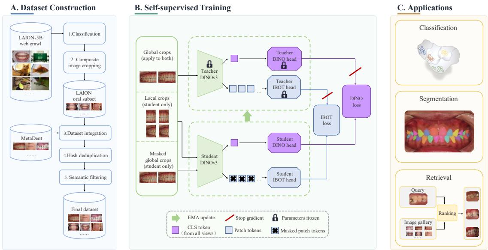  
Figure 1. Overview of DOVE, including construction of the oral visual corpus, self-supervised training, and evaluation of downstream applications. A. Construction of the oral image dataset. B. Self-supervised learning framework. C. Evaluation for typical applications across 9 clinical photography datasets.

A.  
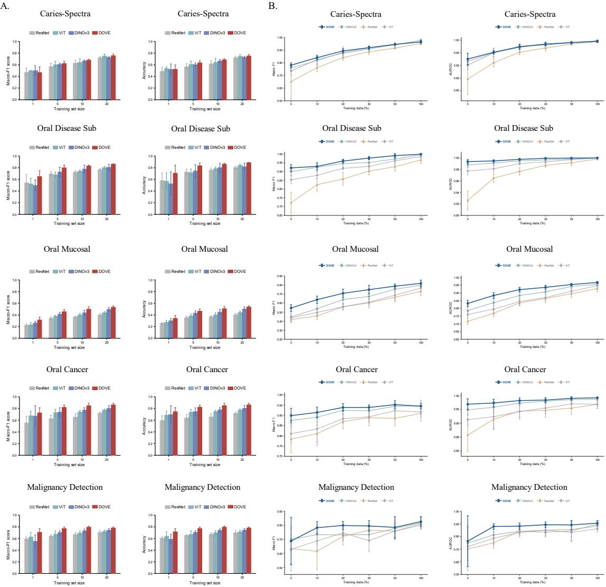  
Figure 2. Classification performance. (A) Frozen backbone small-sample transfer across 5 classification datasets using 1, 5, 10, or 20 labeled examples per class; top-1 accuracy and macro-F1 are reported. (B) End-to-end finetuning across the same 5 datasets using 5%, 10%, 20%, 30%, 50%, or 100% of the training set; AUROC and macro-F1 are reported. Error bars indicate standard deviations across 5 repeated runs.

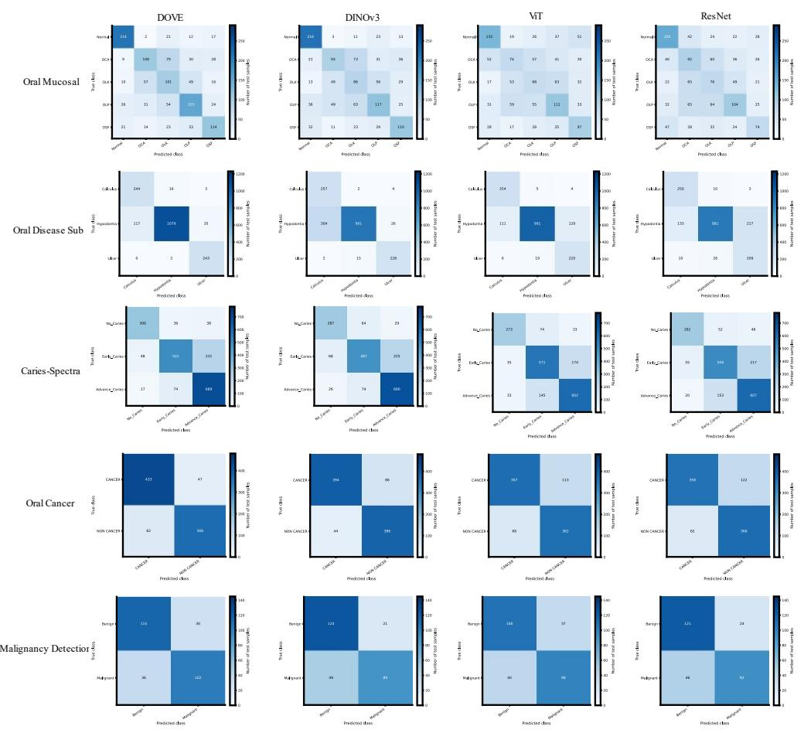  
Figure 3. Confusion matrices of DOVE and other three baselines across five classification datasets.

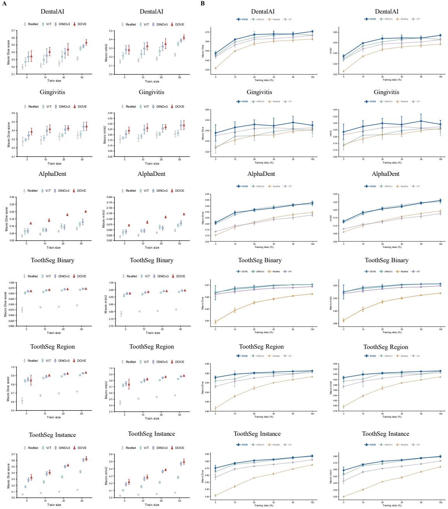  
Figure 4. Segmentation performance. (A) Frozen backbone small-sample transfer, evaluated using a linear segmentation probe trained with 5, 10, 20, or 50 labeled images. (B) End-to-end finetuning using 5%, 10%, 20%, 30%, 50%, or 100% of the training set. Both panels report macro Dice and mIoU for DOVE and the 3 baselines. Error bars indicate standard deviations across 5 repeated runs.

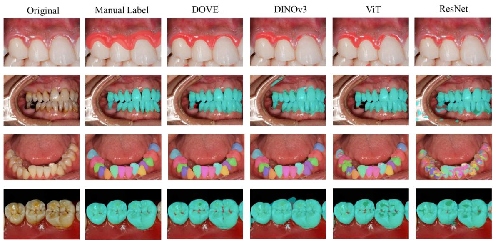  
Figure 5. The segmentation predictions generated by trained DOVE and baselines with the manual masks.

A  
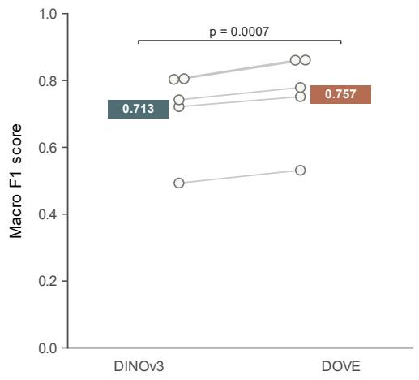

B  
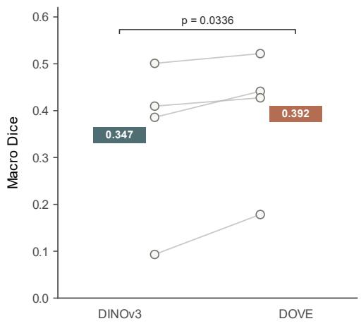  
Figure 6. Overall performance comparisons between DOVE and DINOv3. (A) Classification performance measured by macro-F1. (B) Segmentation performance measured by macro-Dice. Each open circle represents the mean for one dataset across five repeats, and the gray lines connect the results for the same dataset under the two models. The colored floating bars indicate the average across datasets.

A  
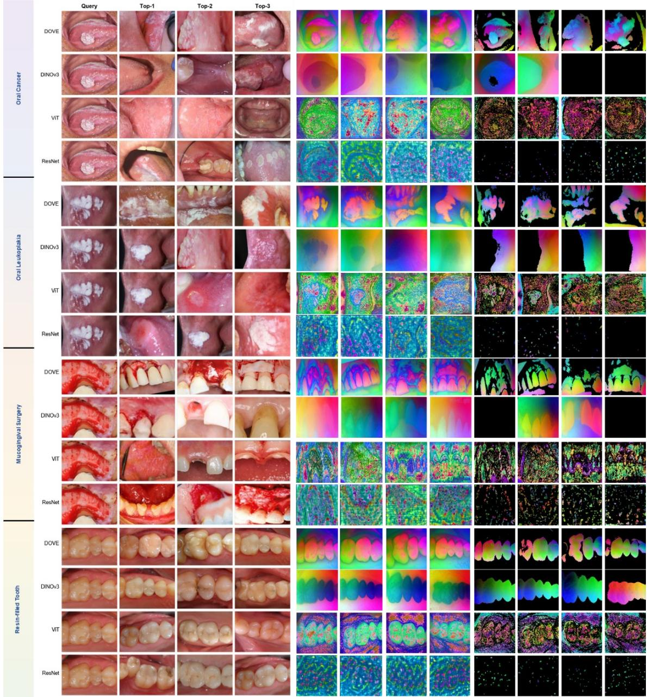  
Figure 7. Image retrieval results and local-feature principal component analysis (PCA) visualizations across visual backbones. (A) Image retrieval results for 4 representative query cases. Each row shows the query image followed by the 3 highest-ranked results according to cosine similarity (Top-1 to Top-3). (B) PCA visualization of local features extracted from each query image and its 3 retrieved images. DOVE generates distinct semantic embeddings that clearly separate lesion tissue from surrounding mucosa, while the representations learned by baseline encoders are substantially less discriminative. (C) The background was removed by Otsu thresholding of the first principal component. In these representative examples, DOVE produced clearer and more spatially coherent foreground–background separation than the baseline encoders.

Table 1. Downstream Evaluation Datasets.
<table><tr><td>Dataset</td><td>Source</td><td>Task</td><td>Classes</td><td>Number</td><td>Region</td></tr><tr><td>Oral Cancer Dataset [32]</td><td>Public</td><td>Classification</td><td>2</td><td>950</td><td>Not reported</td></tr><tr><td>Caries-Spectra [31]</td><td>Public</td><td>Classification</td><td>3</td><td>2,000</td><td>Bangladesh</td></tr><tr><td>Oral Lesions: Malignancy Detec- tion Dataset [30]</td><td>Public</td><td>Classification</td><td>2</td><td>323</td><td>India</td></tr><tr><td>Oral Disease Sub [34]</td><td>Public</td><td>Classification</td><td>3</td><td>1,799</td><td>Not reported</td></tr><tr><td>Dataset-of-oral-mucosal-diseases [33]</td><td>Public</td><td>Classification</td><td>5</td><td>1,348</td><td>China</td></tr><tr><td>DentalAI [35]</td><td>Public</td><td>Segmentation</td><td>4</td><td>2,495</td><td>Not reported</td></tr><tr><td>AlphaDent [36]</td><td>Public</td><td>Segmentation</td><td>9</td><td>1,320</td><td>Russia</td></tr><tr><td>ToothSeg</td><td>Private</td><td>Segmentation</td><td>2/3/33</td><td>1,106</td><td>China</td></tr><tr><td>Gingivitis</td><td>Hybrid</td><td>Segmentation</td><td>2</td><td>284</td><td>Not applicable</td></tr></table>

## References

[1] C. Signori, K. Collares, C.B.F. Cumerlato, M.B. Correa, N.J.M. Opdam, M.S. Cenci, Validation of assessment of intraoral digital photography for evaluation of dental restorations in clinical research, J Dent 71 (2018) 54-60.

[2] L. Mania, K. Nanobashvili, T. Manjavidze, M. Benashvili, I. Astamadze, Diagnostic accuracy of intraoral mobile photography for oral health screening in children: a pilot study, BMC Oral Health 25(1) (2025) 1144.

[3] M. Sahin, Use of dental photography in pediatric dentistry practice, Sci Rep 16(1) (2026) 5054.

[4] M.M. Kabir, A. Rahman, M.N. Hasan, M.F. Mridha, Computer vision algorithms in healthcare: Recent advancements and future challenges, Comput. Biol. Med. 185(C) (2025) 30.

[5] P. Rajpurkar, E. Chen, O. Banerjee, E.J. Topol, AI in health and medicine, Nat Med 28(1) (2022) 31-38.

[6] F. Schwendicke, W. Samek, J. Krois, Artificial Intelligence in Dentistry: Chances and Challenges, J Dent Res 99(7) (2020) 769-774.

[7] H. Askar, J. Krois, C. Rohrer, S. Mertens, K. Elhennawy, L. Ottolenghi, M. Mazur, S. Paris, F. Schwendicke, Detecting white spot lesions on dental photography using deep learning: A pilot study, J Dent 107 (2021) 103615.

[8] N. Adnan, S.M. Faizan Ahmed, J.K. Das, S. Aijaz, R.H. Sukhia, Z. Hoodbhoy, F. Umer, Developing an AI-based application for caries index detection on intraoral photographs, Sci Rep 14(1) (2024) 26752.

[9] J. Li, W.Y. Kot, C.P. McGrath, B.W.A. Chan, J.W.K. Ho, L.W. Zheng, Diagnostic accuracy of

artificial intelligence assisted clinical imaging in the detection of oral potentially malignant disorders and oral cancer: a systematic review and meta-analysis, Int J Surg 110(8) (2024) 5034-5046.

[10] L.R. Tao, Y. Li, X.Y. Wu, Y. Gu, Y. Xie, X.Y. Yu, H.C. Lai, M.S. Tonetti, Deep Learning Photo Processing for Periodontitis Screening, J Dent Res 105(2) (2026) 226-235.

[11] K.D. Nguyen, H.T. Hoang, T.H. Doan, K.Q. Dao, D.H. Wang, M.L. Hsu, SegmentAnyTooth: An open-source deep learning framework for tooth enumeration and segmentation in intraoral photos, J Dent Sci 20(2) (2025) 1110-1117.

[12] J. Krois, A. Garcia Cantu, A. Chaurasia, R. Patil, P.K. Chaudhari, R. Gaudin, S. Gehrung, F. Schwendicke, Generalizability of deep learning models for dental image analysis, Sci Rep 11(1) (2021) 6102.

[13] M. Caron, H. Touvron, I. Misra, H. Jégou, J. Mairal, P. Bojanowski, A. Joulin, Emerging properties in self-supervised vision transformers, Proceedings of the IEEE/CVF international conference on computer vision (2021) 9650-9660.

[14] M. Oquab, T. Darcet, T. Moutakanni, H. Vo, M. Szafraniec, V. Khalidov, P. Fernandez, D. Haziza, F. Massa, A. El-Nouby, Dinov2: Learning robust visual features without supervision, arXiv preprint arXiv:2304.07193 (2023).

[15] O. Siméoni, H.V. Vo, M. Seitzer, F. Baldassarre, M. Oquab, C. Jose, V. Khalidov, M. Szafraniec, S. Yi, M. Ramamonjisoa, Dinov3, arXiv preprint arXiv:2508.10104 (2025).

[16] K. He, X. Chen, S. Xie, Y. Li, P. Dollár, R. Girshick, Masked autoencoders are scalable vision learners, Proceedings of the IEEE/CVF conference on computer vision and pattern recognition, 2022, pp. 16000-16009.

[17] J. Zhou, C. Wei, H. Wang, W. Shen, C. Xie, A. Yuille, T. Kong, Image BERT Pre-training with Online Tokenizer, International Conference on Learning Representations, 2022.

[18] M. Hu, Q. Zhang, Z. Wei, P. Jia, M. Yuan, H. Yu, X. Yin, J. Peng, Self-supervised learning enhances periapical films segmentation with limited labeled data, J Dent 163 (2025) 106150.

[19] A. Taleb, C. Rohrer, B. Bergner, G. De Leon, J.A. Rodrigues, F. Schwendicke, C. Lippert, J. Krois, Self-Supervised Learning Methods for Label-Efficient Dental Caries Classification, Diagnostics (Basel) 12(5) (2022).

[20] X. Huang, F. Xiao, D. He, A. Gao, D. Li, X. Zhang, S. Zhang, X. Wang, Towards Generalist Intelligence in Dentistry: Vision Foundation Models for Oral and Maxillofacial Radiology, arXiv preprint arXiv:2510.14532 (2025).

[21] K. Tang, X. Yang, M. Zheng, X. Liu, X. Li, X. Guo, R. Chen, L. Shen, H. Meng, Dinodental: Benchmarking dinov3 as a unified vision encoder for dental image analysis, Expert Systems 43(11) (2026) e70451.

[22] F. Schwendicke, J. Krois, Data Dentistry: How Data Are Changing Clinical Care and Research, J Dent Res 101(1) (2022) 21-29.

[23] A. Dosovitskiy, L. Beyer, A. Kolesnikov, D. Weissenborn, X. Zhai, T. Unterthiner, M. Dehghani, M. Minderer, G. Heigold, S. Gelly, An image is worth 16x16 words: Transformers for image recognition at scale, arXiv preprint arXiv:2010.11929 (2020).

[24] K. He, X. Zhang, S. Ren, J. Sun, Deep residual learning for image recognition, Proceedings of the IEEE conference on computer vision and pattern recognition (2016) 770-778.

[25] F. Schwendicke, T. Singh, J.-H. Lee, R. Gaudin, A. Chaurasia, T. Wiegand, S. Uribe, J. Krois, Artificial intelligence in dental research: Checklist for authors, reviewers, readers, J Dent 107 (2021) 103610.

[26] C. Schuhmann, R. Beaumont, R. Vencu, C. Gordon, R. Wightman, M. Cherti, T. Coombes, A. Katta, C. Mullis, M. Wortsman, Laion-5b: An open large-scale dataset for training next generation image-text models, Advances in neural information processing systems 35 (2022) 25278-25294.

[27] M.X. Li, W.H. Deng, Z.X. Wu, C.X. Jin, J.M. Wu, Y. Han, J.K.H. Tsoi, G.S. Xia, C. Huang, MetaDent: Labeling Clinical Images for Vision-Language Models in Dentistry, J Dent Res (2026). [28] G. Jocher, J. Qiu, Ultralytics YOLO11, Ultralytics, 2024.

[29] Qwen Team, Qwen3.6-35B-A3B: Agentic Coding Power, Now Open to All, 2026.

[30] H.S. Chandrashekar, A. Geetha Kiran, S. Murali, M. Dinesh, B. Nanditha, Oral Images Dataset, Mendeley Data, 2021.

[31] G.M.S. Himel, M.M. Islam, U.H. Hannan, Caries-Spectra: A dataset of Enamel Caries, Mendeley Data, 2023.

[32] M.Z. Rashid, ORAL CANCER DATASET, Kaggle, 2024.

[33] J. Yu, R. Huang, X. Wang, Y. Zhang, Y. Li, Y. Ye, M. Ouyang, W. Su, J. Wen, Z. Zhang, Q. Liu, Z. Liu, W. Liu, A comparative study of single-stage and dual-stage classification models for OPMDs, BMC Oral Health 26(1) (2025) 169.

[34] S. Sajid, Oral Diseases, Kaggle, 2023.

[35] P. Valluri, Dentalai Computer Vision Project, 2023.

[36] E.I. Sosnin, Y.L. Vasilev, R.A. Solovyev, A.L. Stempkovskiy, D.V. Telpukhov, A.A. Vasilev, A.A. Amerikanov, A.Y. Romanov, AlphaDent: A dataset for automated tooth pathology detection, arXiv preprint arXiv:2507.22512 (2025).

[37] S. Azizi, B. Mustafa, F. Ryan, Z. Beaver, J. Freyberg, J. Deaton, A. Loh, A. Karthikesalingam, S. Kornblith, T. Chen, V. Natarajan, M. Norouzi, Big Self-Supervised Models Advance Medical Image Classification, Proceedings of the IEEE/CVF International Conference on Computer Vision (ICCV), 2021, pp. 3478-3488.

[38] L.T. Arsiwala-Scheppach, A. Chaurasia, A. Müller, J. Krois, F. Schwendicke, Machine Learning in Dentistry: A Scoping Review, J Clin Med 12(3) (2023).

[39] M. Byeon, B. Park, H. Kim, S. Lee, W. Baek, S. Kim, COYO-700M: Image-Text Pair Dataset, 2022.

## Appendix

## 1. Pretraining Corpus

The pretraining corpus was constructed by curating images from two large-scale, internet-sourced repositories: LAION [26]and MetaDent [27]. LAION contains approximately 5 billion webcrawled images, from which we initially filtered to obtain 850k dental-related candidates. Meta-Dent contains \~60k images derived from the COYO-700M [39], in-house datasets, and public da tasets. These initial candidates underwent the curation pipeline, including de-compositing, deduplication, and content filtering to ensure relevance and quality and to remove any overlap with the downstream evaluation datasets (as described in the main manuscript). This process resulted in a final training corpus of approximately 530k images. Random samples from the dataset are shown in Appendix Figure 1.

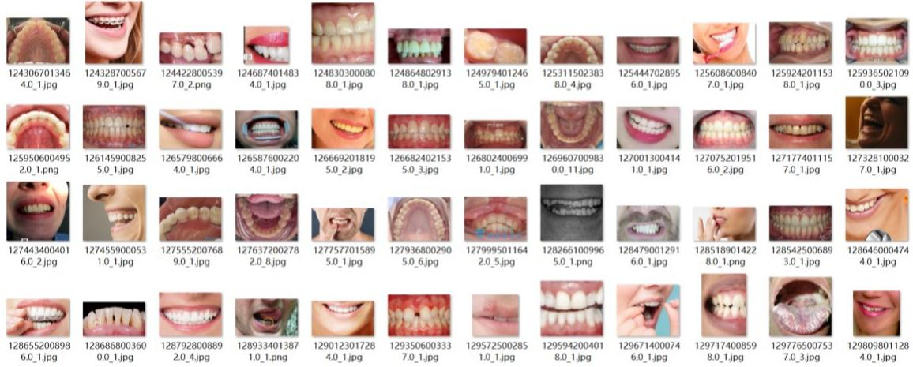  
Appendix Figure 1. Examples from the pretraining corpus.

## 2. Assessment of Semantic Recognition

To evaluate the reliability of the semantic recognition process, 1,000 images were randomly sampled from each of three categories: excluded non-oral images, excluded facial oral images, and retained oral images. A dentist assessed the purity of the three categories. Classification precision exceeded 99% across all three categories. The high precision for non-oral and facial oral images indicates few misclassifications, whereas the high precision for retained oral images indicates a low false-retention rate. These findings indicate that the screening procedure is highly reliable in excluding privacy-sensitive and irrelevant images. The method used the vision-language model Qwen3.6-35B-A3B, and the prompts are provided in Appendix Section 6.

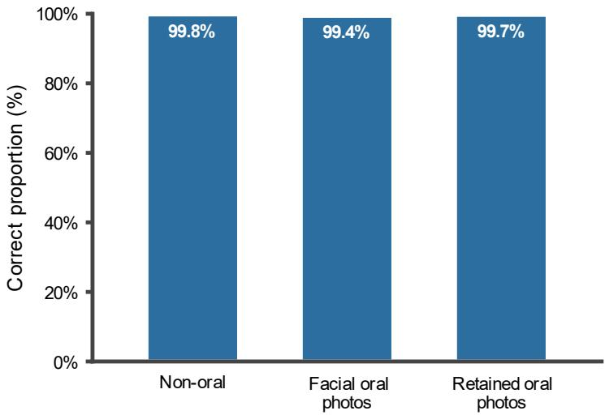  
Appendix Figure 2. Quality assessment of semantic recognition.

## 3. Evaluation Datasets

This section provides detailed descriptions and representative images of the datasets used for downstream evaluation. The evaluation datasets encompassed classification and semantic segmentation tasks and included both publicly available and privately collected oral photographs. They covered a broad range of clinical conditions and anatomical structures, including dental caries, oral mucosal lesions, oral cancer, gingivitis, tooth abnormalities, restorations, and individual teeth. The images were collected across multiple geographic regions, including Bangladesh, India, China, and Russia, using diverse imaging devices and acquisition protocols.

## Oral Cancer Dataset [32]

This dataset comprises 500 oral cancer images and 450 non-cancer oral images. Each image is labeled for binary classification.

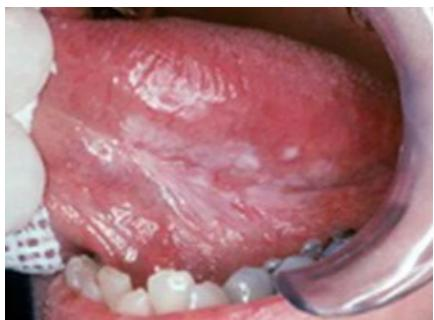  
Cancer

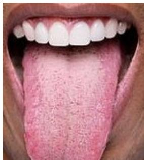  
Non Cancer  
Appendix Figure 3. Representative images of the Cancer and Non Cancer classes in the Oral Cancer Dataset.

## Caries-Spectra [31]

This dataset comprises a diverse collection of low-resolution images featuring two types of dental caries along with a category that represents no caries. The images were sourced from several medical clinics in Rajshahi and Dhaka, Bangladesh, spanning the time period from 2021 to 2022. The dataset comprises 2,000 original JPG images across three categories: Advanced Enamel Caries

(n=800), Early Stage Enamel Caries (n=800), and No Enamel Caries (n=400).  
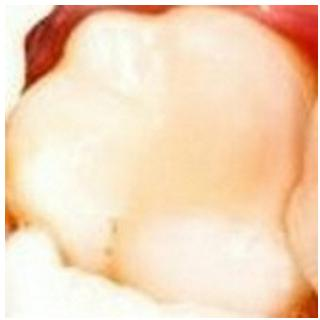  
No Enamel Caries

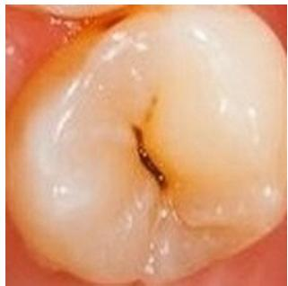  
Early Stage Enamel Caries

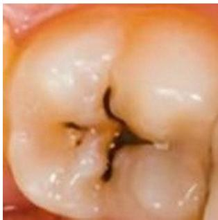  
Advanced Enamel Caries  
Appendix Figure 4. Representative images of the No Enamel Caries, Early Stage Enamel Caries, and Advanced Enamel Caries classes in the Caries-Spectra dataset.

## Oral Lesions: Malignancy Detection Dataset [30]

The dataset includes color images of oral lesions captured using mobile cameras and intraoral cameras. These images can be used for identifying potential oral malignancies by image analysis. These images have been collected from different hospitals and colleges in Karnataka, India. The dataset contains images of 165 benign lesions and 158 malignant lesions.

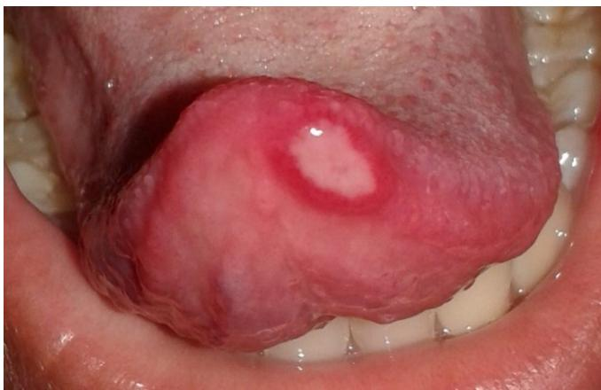  
Benign Lesions

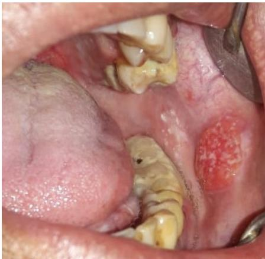  
Malignant Lesions  
Appendix Figure 5. Representative images of the Benign Lesions and Malignant Lesions classes in the Oral Lesions: Malignancy Detection Dataset.

## Oral Disease Sub

The Oral Disease Sub Dataset is a subset of the Oral Disease [34], a comprehensive collection of images curated for dental research and analysis. Our review revealed that several categories were broadly defined and exhibited substantial semantic overlap. We therefore retained only three categories with reliable and unambiguous labels for downstream evaluation: calculus, hypodontia, and ulcer. The final dataset contains 1,799 images.

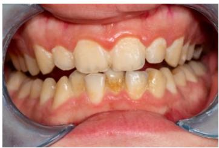  
Calculus

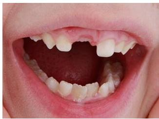  
Hypodontia

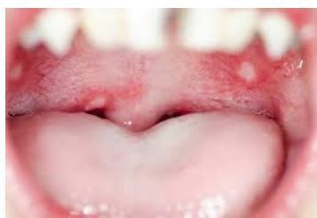  
Ulcer  
Appendix Figure 6. Representative images of the Calculus, Hypodontia, and Ulcer classes in the Oral Disease Sub dataset.

## Dataset-of-oral-mucosal-diseases [33]

Most images were collected from three hospitals in China: Changsha Stomatological Hospital, the Second Xiangya Hospital of Central South University, and the First Affiliated Hospital of Hunan University of Chinese Medicine. The images were acquired using a range of smartphones and digital cameras. The dataset comprises 1,348 intraoral mucosal images categorized into five classes: normal oral mucosa, oral leukoplakia, oral lichen planus, oral submucous fibrosis, and oral cancer. The lesions were distributed across multiple oral sites, including the lips, buccal mucosa, hard and soft palate, floor of the mouth, gingiva, and anterior two-thirds of the tongue.

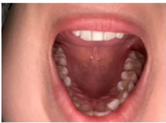  
Normal

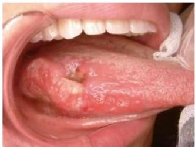

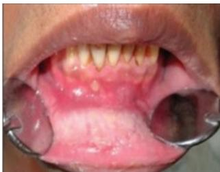  
Oral Leukoplakia

Oral Cancer  
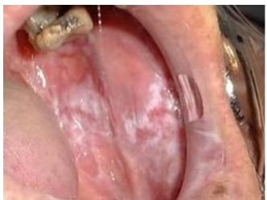  
Oral Lichen Planus

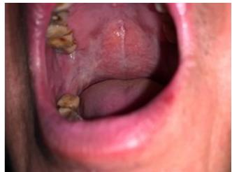  
Oral Submucous Fibrosis

Appendix Figure 7. Representative images of Normal, Oral Cancer, Oral Leukoplakia, Oral Lichen Planus, and Oral Submucous Fibrosis classes in the Dataset of Oral Mucosal Diseases.

## AlphaDent [36]

AlphaDent is an intraoral photographic dataset collected from 295 patients in Moscow, Russia. It contains 1,320 high-resolution DSLR photographs acquired using a Canon 6D Mark II camera and a 100-mm macro lens. The images include frontal and maxillary or mandibular occlusal views. Dentist-annotated instance masks are provided for nine categories: abrasion, fillings, crowns, and six classes of dental caries.

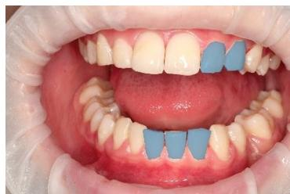

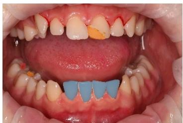  
Appendix Figure 8. Representative images from the AlphaDent dataset.

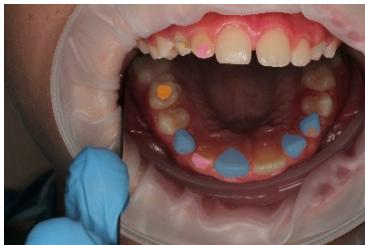

## DentalAI [35]

The dataset consists of 2,495 images with 28,904 labeled objects belonging to 4 different classes including tooth, caries, cavity, and other: crack. There are 3 splits in the dataset: train (1991 images), valid (254 images), and test (250 images).

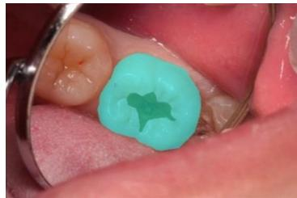

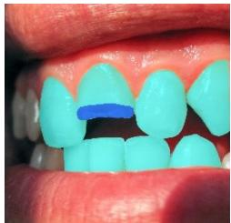  
Appendix Figure 9. Representative images from the DentalAI dataset.

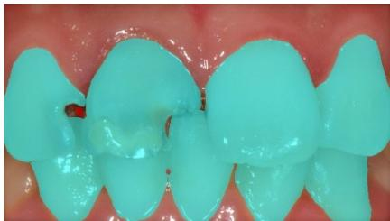

## ToothSeg

The dataset was annotated using an in-house software platform developed by our team (https://github.com/MenxLi/labelSys). Nine intraoral photographs were acquired for each participant, and 1,106 images remained usable after excluding unusable ones. The dataset provides highprecision tooth segmentation annotations indexed by tooth position, together with labels indicating the image acquisition view.

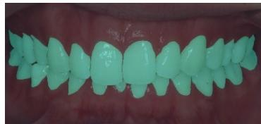

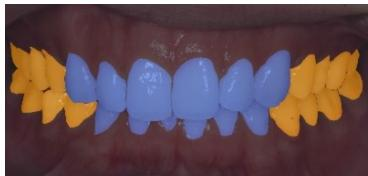

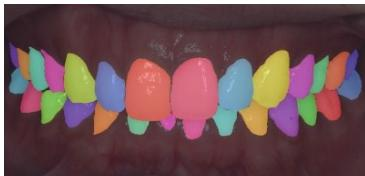  
Appendix Figure 10. Representative images from the ToothSeg dataset. ToothSeg was evaluated at 3 levels of label granularity: binary tooth-versus-background segmentation; 3-class segmentation of anterior teeth, posterior teeth, and background; and 33-class segmentation in which each of 32 teeth was treated as a separate class, with background as an additional class.

## Gingivitis

A gingivitis segmentation dataset was curated from MetaDent by identifying candidate images using the keywords “gingivitis,” “gingival redness and swelling,” “gingival swelling,” “gingival redness,” “periodontitis,” and “red gingiva”. Because publicly available gingivitis segmentation datasets are limited, the existing MetaDent annotations were supplemented with additional annotations created by our team. After screening and annotation, 284 images were retained for downstream evaluation.

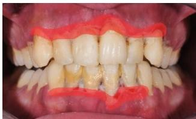

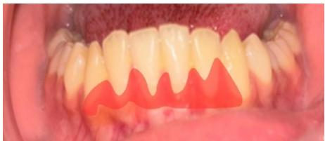

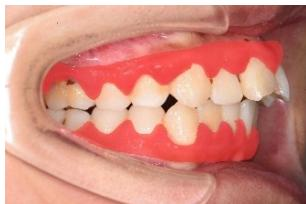  
Appendix Figure 11. Representative images from the Gingivitis dataset.

## 4. Qualitative Analysis of DOVE Segmentation Failure Cases

To illustrate the limitations of DOVE, Appendix Figure 12 presents three representative cases of suboptimal segmentation performance. These include the misclassification of a dental cavity as caries, overestimation of the gingivitis region, and minor segmentation inaccuracies for teeth located near image boundaries.

Original  
Manual Label  
DOVE  
DINOv3  
ViT  
ResNet  
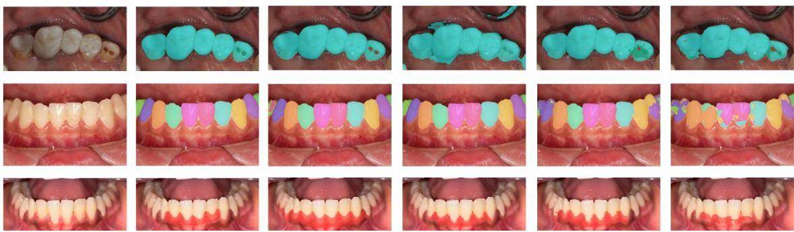  
Appendix Figure 12. Representative segmentation failure cases of DOVE.

## 5. Evaluation Metric

## Dice Similarity Coefficient

The Dice similarity coefficient (DSC) was used to quantify the overlap between the predicted segmentation region and the ground-truth annotation. For a given class, the Dice coefficient was defined as:

$$
D i c e = \frac { 2 | P \cap G | } { | P | + | G | } = \frac { 2 T P } { 2 T P + F P + F N }
$$

where P denotes the set of pixels predicted as the target class by the model, and G represents the corresponding ground-truth pixel set. TP, FP, and FN represent the numbers of true-positive, falsepositive, and false-negative pixels, respectively.

The Dice coefficient ranges from 0 to 1, with higher values indicating greater overlap between the predicted and reference regions. A Dice value of 1 indicates complete agreement between prediction and ground truth, whereas a value of 0 indicates no overlap. Since Dice does not consider true-negative pixels, it is less affected by large background regions and is therefore suitable for segmentation tasks involving small foreground regions or imbalanced class distributions.

## Mean Intersection over Union

Mean intersection over union (mIoU) is a widely used metric for evaluating semantic segmentation performance by measuring the overlap between predicted regions and ground-truth

annotations.

For class ${ \mathbf { c } } ,$ the intersection over union (IoU) is defined as:

$$
I o U _ { c } = \frac { | P _ { c } \cap G _ { c } | } { | P _ { c } \cup G _ { c } | } = \frac { T P _ { c } } { T P _ { c } + F P _ { c } + F N _ { c } }
$$

Where $\mathrm { P _ { c } }$ denotes the set of pixels predicted as class c, and $\mathrm { G } _ { \mathrm { c } }$ denotes the corresponding groundtruth pixel set. TPc, $\mathrm { F P _ { c } , }$ and $\mathrm { F N _ { c } }$ represent the numbers of true-positive, false-positive, and falsenegative pixels for class c, respectively.

The IoU ranges from 0 to 1, with higher values indicating better agreement between predicted and ground-truth regions. An IoU value of 1 represents perfect segmentation, whereas an IoU value of 0 indicates no overlap.

For a segmentation task containing C classes, mIoU is calculated as the arithmetic mean of IoUs across all classes.

## Accuracy

For single-label classification tasks containing C mutually exclusive categories, each sample is assigned to only one ground-truth class. The category with the highest predicted probability is selected as the final prediction, and the resulting accuracy is referred to as accuracy or Top-1 accuracy:

$$
\mathrm { A c c u r a c y } = \frac { 1 } { N } \sum _ { i = 1 } ^ { N } I \left( \widehat { y _ { i } } = y _ { i } \right)
$$

Where N denotes the number of samples, $\mathrm { y _ { i } }$ and $\widehat { y _ { \imath } }$ represent the ground-truth and predicted labels of the i-th sample, respectively. �(⋅) denotes the indicator function, which equals 1 when the condition is satisfied and 0 otherwise.

## Macro F1-score

Macro F1-score was used to evaluate overall classification performance across multiple categories. It is calculated by first computing the F1-score independently for each class and then averaging the values across all classes, assigning equal importance to each category.

For class c, precision and recall are defined as:

$$
\begin{array} { c } { { \mathrm { P r e c i s i o n } _ { \mathrm { c } } = \displaystyle \frac { T P _ { c } } { T P _ { c } + F P _ { c } } } } \\ { { \mathrm { R e c a l l } _ { \mathrm { c } } = \displaystyle \frac { T P _ { c } } { T P _ { c } + F N _ { c } } } } \end{array}
$$

Where $\mathrm { T P _ { c } , F P _ { c } , }$ and $\mathrm { F N _ { c } }$ represent the numbers of true-positive, false-positive, and false-negative samples for class c, respectively.

The F1-score for class c is calculated as the harmonic mean of precision and recall:

$$
F 1 _ { c } = \frac { 2 P r e c i s i o n _ { c } R e c a l l _ { c } } { P r e c i s i o n _ { c } + R e c a l l _ { c } }
$$

For a classification task containing C classes, Macro F1 is defined as:

$$
M a c r o F 1 = \frac { 1 } { C } \sum _ { c = 1 } ^ { C } F 1 _ { c }
$$

The Macro F1-score ranges from 0 to 1. Higher values indicate better and more balanced classification performance across different categories.

## Area Under the Receiver Operating Characteristic Curve (AUROC)

AUROC was used to evaluate the discriminative ability of classification models across different decision thresholds. It is calculated by plotting the true-positive rate (TPR) against the false-positive rate (FPR) at varying classification thresholds and measuring the area under the resulting receiver operating characteristic (ROC) curve.

For class c, the true-positive rate and false-positive rate are defined as:

$$
T P R _ { c } = { \frac { T P _ { c } } { T P _ { c } + F N _ { c } } }
$$

$$
F P R _ { c } = { \frac { F P _ { c } } { F P _ { c } + T N _ { c } } }
$$

Where TPc, FPc, TNc, and FNc represent the numbers of true-positive, false-positive, true-negative, and false-negative samples for class c, respectively.

The AUROC for class c is calculated as the area under its ROC curve:

$$
\begin{array} { r } { A U R O C _ { c } = \int _ { 0 } ^ { 1 } T P R _ { c } ( x ) d x } \end{array}
$$

Where x represents the false-positive rate.

For multiclass classification, AUROC was calculated using a one-versus-rest strategy, in which each class was treated as the positive class and all remaining classes as the negative class. For a classification task containing C classes, the macro-averaged AUROC is defined as:

$$
M a c r o A U R O C = { \frac { 1 } { C } } \sum _ { c = 1 } ^ { C } A U R O C _ { c }
$$

The AUROC ranges from 0 to 1, with a value of 0.5 indicating random discrimination and a value of 1 indicating perfect discrimination. Higher values indicate better discriminative performance across different classification thresholds.

## 6. Prompts for Semantic Recognition

The following prompt was used to guide Qwen3.6-35B-A3B in identifying and excluding irrelevant or privacy-sensitive images during dataset curation. It specified the criteria for retaining oral photographs and excluding non-oral content, artificial tooth models, and images containing human eyes.

You are a dental image screening assistant.

Your task is to classify the image based primarily on its VISUAL CONTENT.

## KEEP rule

Set "label": "yes" if the main visual content is a genuine photograph of a real human and shows either:

1. A human face or part of the face relevant to dental or orthodontic photography, including:

\- frontal face

\- left/right profile

\- 45-degree oblique face

\- smiling face

\- lips and teeth

\- mouth region

## 2. A human intraoral view, including:

\- teeth

\- maxillary or mandibular occlusal view

\- frontal or lateral occlusion

\- lingual or palatal view

\- gingiva

\- oral mucosa

\- tongue

\- inner lips

\- other photographs taken inside the human mouth

## DISCARD rule

Set "label": "no" if the main visual content is NOT a genuine photograph of a real human face or human oral cavity, including:

\- advertisements, posters, presentation slides, or graphic-design layouts where the dental photograph is absent or only a minor part of the image;

\- collages, multi-panel images, before-and-after comparison layouts, or composite images;

\- animal teeth or animal oral cavities;

\- 3D digital models, CAD renders, plaster casts, dental models, dentures, or prosthetic teeth photographed alone;

\- X-rays, CBCT, CT, panoramic radiographs, cephalograms, or other radiographic images;

\- cartoons, illustrations, diagrams, or screenshots dominated by text;

\- landscapes, objects, blank images, unrelated body parts, or other irrelevant content.

## Decision priority

Use the following order:

1. First determine whether the main content is a genuine photograph of a real human face or oral cavity.

2. If yes, prefer "label": "yes" unless the image is clearly a collage, multi-panel layout, radiograph, model/render, or another explicitly excluded category.

Eye detection

Only if "label": "yes", determine "has\_eyes".

Set "has\_eyes": true if at least one human eye is visibly present in the image. Closed eyes still count if the eye region is clearly visible.

Set "has\_eyes": false for:

\- pure intraoral photographs;

\- images showing only the mouth, lips, teeth, chin, or nose without any visible eye;

\- all images where "label": "no".

Return only valid JSON in exactly this format:

{"label":"yes","has\_eyes":true}

or

{"label":"yes","has\_eyes":false}

or

{"label":"no","has\_eyes":false}

Do not output any explanation or additional text. )

## 7. Checklist

We referred to the checklist of artificial intelligence in dental research to guide the reporting of this study [25]. The checklist includes 31 items covering study design, data, model development, evaluation, and reporting transparency. The completed checklist is provided below.

<table><tr><td>Item No</td><td>Planning and Conducting</td><td>Y/N</td><td colspan="2">Location in Manuscript</td></tr><tr><td>1.</td><td>Study Goal</td><td>Yes</td><td colspan="2">Introduction; Page 2-3</td></tr><tr><td>2.</td><td>Study Focus</td><td>Yes</td><td colspan="2">Introduction; Page 3</td></tr><tr><td>3.</td><td>Data</td><td>Yes</td><td colspan="2">Materials and Methods; Pages 3-5; Table 1</td></tr><tr><td>4.</td><td>Study Aim</td><td>Yes</td><td colspan="2">Introduction; Page 2-3</td></tr><tr><td>5.</td><td>Reference Test</td><td>Yes</td><td colspan="2">Materials and Methods;</td></tr><tr><td>6.</td><td>Clustering</td><td>Yes</td><td colspan="2">Page 4 Materials and Methods;</td></tr><tr><td>7.</td><td>Test Dataset</td><td>Yes</td><td colspan="2">Page 4 Materials and Methods;</td></tr><tr><td colspan="3"></td><td rowspan="2">Page 4</td></tr><tr><td>8.</td><td>Computational resource</td><td>Yes</td><td>Materials and Methods; Page 4</td></tr><tr><td>9.</td><td>Comparator</td><td>Yes</td><td>Materials and Methods;</td></tr><tr><td></td><td>Reporting</td><td></td><td>Page 3</td></tr><tr><td>10.</td><td>Title</td><td>Yes</td><td>Page 1</td></tr><tr><td>11.</td><td>Abstract</td><td>No</td><td>Page 1; No structured ab- stract</td></tr><tr><td>12.</td><td>Introduction</td><td>Yes</td><td>Pages 2-3</td></tr><tr><td>13.</td><td>Study Design</td><td>Yes</td><td>Page 3</td></tr><tr><td>14.</td><td>Data</td><td>Yes</td><td>Materials and Methods; Pages 3–5; Table 1</td></tr><tr><td>14 a.</td><td>Sampling</td><td>Yes</td><td>Materials and Methods; Pages 3-4</td></tr><tr><td>14 b.</td><td>Data Protection</td><td>Yes</td><td>Materials and Methods; Page 4/6</td></tr><tr><td>14 c.</td><td>Missing data</td><td>N/A</td><td>The image-level dataset contains no records with partial missing data; unus- able images were entirely removed during the quality</td></tr><tr><td>14 d.</td><td>Data Processing</td><td>Yes</td><td>control stage (Page 3) Materials and Methods;</td></tr><tr><td>15.</td><td>Reference Test</td><td>Yes</td><td>Pages 3\6 Materials and Methods;</td></tr><tr><td>16.</td><td>Sample Size</td><td>Yes</td><td>Pages 4 Materials and Methods;</td></tr><tr><td>17.</td><td>Model</td><td>Yes</td><td>Page 4-5; Table 1 Materials and Methods;</td></tr><tr><td>17 a.</td><td>Model parameters</td><td>Yes</td><td>Page 3-5 Materials and Methods;</td></tr><tr><td>18.</td><td>Training</td><td>Yes</td><td>Page 3-4 Materials and Methods;</td></tr><tr><td>19.</td><td>Justify the best-performing model</td><td>Yes</td><td>Page 4-5 Materials and Methods;</td></tr><tr><td>20.</td><td>Evaluation</td><td>Yes</td><td>Pages 4-5 Materials and Methods;</td></tr><tr><td></td><td></td><td></td><td>Pages 4-6 Results; Pages 7-8</td></tr><tr><td>21. 22.</td><td>Uncertainty Explainability</td><td>Yes Yes</td><td>Results; Page 7-8; Figure</td></tr><tr><td></td><td></td><td></td><td>5/7</td></tr><tr><td>23.</td><td>Results</td><td>Yes</td><td>Pages 6-8</td></tr><tr><td>23 a.</td><td>Performance Metrics and Data</td><td>Yes</td><td>Results; Pages 7-8</td></tr></table>

<table><tr><td colspan="3">Partitions</td></tr><tr><td>24.</td><td>Discussion</td><td>Yes Pages 8-9</td></tr><tr><td>25.</td><td>Other</td><td>Yes Page 9</td></tr></table>