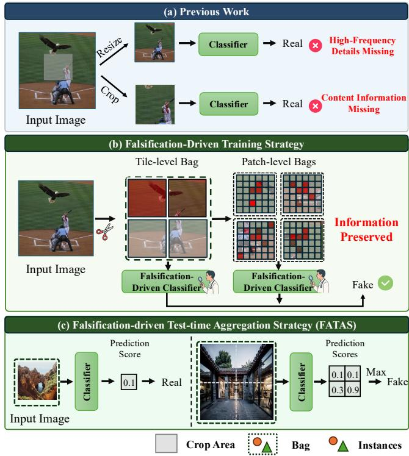
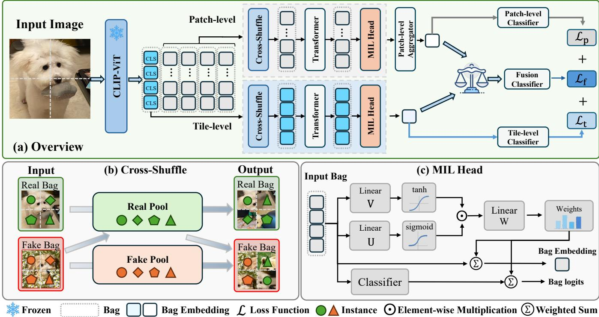
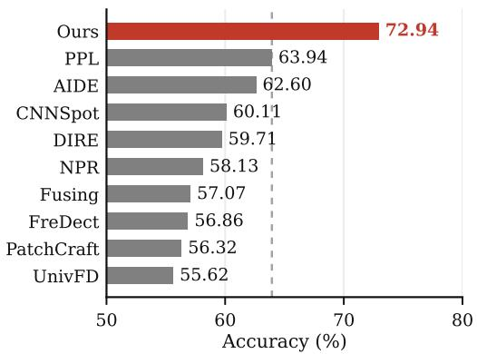
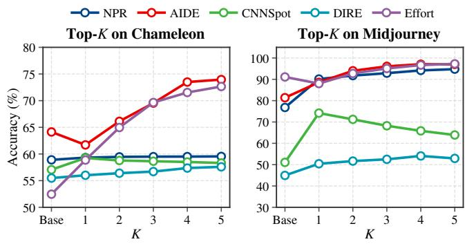
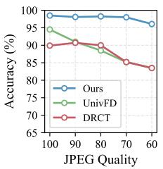
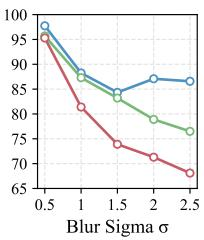
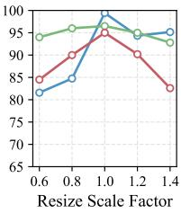

# Learning to Falsify: Hierarchical Multiple Instance Learning for High Resolution AI-Generated Image Detection

Haoran Chen Zhejiang Gongshang University Hangzhou, Zhejiang, China haoran@pop.zjgsu.edu.cn

Yongwei Wang   
Zhejiang University   
Hangzhou, Zhejiang, China   
yongwei.wang@zju.edu.cn

Daiqi Gao Zhejiang Gongshang University Hangzhou, Zhejiang, China 25020100007@pop.zjgsu.edu.cn

Lei Zhu The Hong Kong University of Science and Technology (Guangzhou) Guangzhou, Guangdong, China leizhu@hkust-gz.edu.cn

Jianfeng Dong✉   
Zhejiang Gongshang University   
Hangzhou, Zhejiang, China   
Zhejiang Key Laboratory of Big Data   
and Future E-Commerce Technology   
Hangzhou, Zhejiang, China   
dongjf24@gmail.com

Xinyuan Li Zhejiang Gongshang University Hangzhou, Zhejiang, China 2412190720@pop.zjgsu.edu.cn

Rui Cai Zhejiang Gongshang University Hangzhou, Zhejiang, China cairuics@gmail.com

## Abstract

Recent advances in generative models have made synthetic images increasingly photorealistic, posing growing challenges to reliable and generalizable detection of AI-generated images. Existing methods typically rely on holistic image-level classification, which may overlook local artifacts, especially in high-resolution images. To address this limitation, we formulate this task as a falsificationdriven multiple instance learning problem, where a single fake patch can falsify the whole image, while a real image requires all patches to be authentic. Based on this formulation, we propose Learning to Falsify (LTF), a hierarchical multiple instance learning framework that models an image as multiple bags of instances across diferent spatial levels and aggregates their predictions under the falsification-inspired principle. We further introduce Cross-Shufle during training to encourage the model to learn local artifact evidence rather than image-level shortcuts. Furthermore, we propose the Falsification-driven Test-time Aggregation Strategy (FA-TAS), a plug-and-play module that extends the same falsificationinspired principle to existing detectors by aggregating patch-level predictions. Extensive experiments demonstrate that LTF achieves strong generalization and robustness across multiple benchmarks, while FATAS substantially improves representative detectors in high-resolution scenarios without retraining. Code is available at https://github.com/HuiGuanLab/LTF.git

CCS Concepts

• Computing methodologies → Computer vision; Neural networks; • Applied computing → Computer forensics.

## Keywords

AI-generated image detection; Multiple instance learning

## ACM Reference Format:

Haoran Chen, Daiqi Gao, Xinyuan Li, Yongwei Wang, Lei Zhu, Rui Cai, and Jianfeng Dong. 2026. Learning to Falsify: Hierarchical Multiple Instance Learning for High Resolution AI-Generated Image Detection. In Proceedings ofthe 34th ACM International Conference on Multimedia (MM ’26), November 10–14, 2026, Rio de Janeiro, Brazil. ACM, New York, NY, USA, 10 pages. https://doi.org/10.1145/3767308.3836365

## 1 Introduction

Recent advances in generative models, from GANs [1, 7, 13, 29] to difusion-based methods [5, 9, 24, 30], have made it possible to synthesize highly photorealistic images at scale. As these synthetic images become increasingly indistinguishable from real photographs, their misuse poses growing societal risks, including privacy violations, identity forgery, and the spread of misinformation. Consequently, developing reliable and generalizable detectors for AI-generated images has become an urgent and important problem.

Despite substantial progress in AI-generated image detection [15– 17, 41, 42], most existing methods still follow a holistic imagelevel classification paradigm. To fit standard visual backbones [8, 26], they typically either resize the entire image to a fixed resolution [6, 36, 39] or use a single local crop as a proxy for the full image [3, 42, 45]. The resulting input is then compressed into a global representation for image-level classification. As illustrated in Fig. 1(a), this paradigm is poorly suited for detecting localized artifacts. Resizing may suppress fine-grained forensic cues, singlecrop inference only provides partial spatial coverage, and global representations diminish the influence of artifacts confined to local regions. These limitations become more severe for high-resolution images, where fixed-size resizing causes substantial loss of local details and a single crop captures only a small fraction of the image.

  
Figure 1: Motivation. (a) Conventional pipelines rely on image resizing or local cropping, which inevitably discard either fine-grained generated artifacts or content. (b) In contrast, we process the image at its original resolution and represent it as multiple bags of instances across multiple scales, thereby preserving both global context and fine-grained details. (c) During inference, image-level predictions are obtained via falsification-driven aggregation of instance-level scores, where a single decisive instance is suficient to classify the image as fake.

To overcome this limitation, we draw inspiration from counterexample based falsification in mathematics, where a single counterexample sufices to refute a universal claim. We accordingly introduce the falsification-inspired principle for AI-generated image detection: a single fake region sufices to reject image authenticity, whereas accepting an image as real requires all its regions to be authentic. Based on this principle, we propose Learning to Falsify (LTF), a hierarchical multiple instance learning framework for identifying localized generative artifacts. As illustrated in Fig. 1(b), LTF avoids resizing the image or using a single crop. Instead, it retains each image at its original resolution and partitions it without discarding pixels, thereby preserving full spatial coverage and fine-grained forensic details. These local regions are further organized into a hierarchical bag structure: each image forms a tile-level bag whose instances are image tiles, and each tile forms a patch-level bag composed of local patches. This design represents each image with one tile-level bag and multiple patch-level bags, enabling LTF to search for suspicious evidence at multiple granularities. Under the falsification-inspired principle, a few suspicious instances within any bag can provide suficient evidence for a fake prediction, so the final image-level prediction is driven by localized artifact evidence rather than a holistic image representation. However, since instances within the same bag are derived from the same image and share the same image-level label, the model may learn image-level shortcuts instead of truly identifying localized generative artifacts. To address this issue, we introduce Cross-Shufle, which recomposes fake bags by mixing features from real images at both the tile and patch levels. This strategy breaks shortcut correlations among instances and forces the falsification-driven classifier to focus on genuine artifact evidence.

As shown in Fig. 1(c), FATAS first divides the input image into multiple tiles and predicts a fake score for each tile using an existing detector. It then aggregates tile-level predictions by emphasizing the most suspicious local regions. This design follows the falsification rule: once any tile exhibits strong generative artifacts, the whole image should be classified as fake, thereby preventing local fake evidence from being diluted by holistic modeling. Without retraining or architecture modification, FATAS substantially improves existing detectors, boosting the accuracy of CNNSpot [39] by over 20 percentage points on Midjourney and that of AIDE [41] by nearly 10 percentage points on Chameleon [41].

Our contributions are summarized as follows:

• We introduce thefalsification-inspired principle, under which a single fake region can falsify an image, whereas a real image requires all regions to be authentic. We instantiate this principle as LTF, a hierarchical multiple-instance learning framework that explicitly learns localized discriminative artifacts. LTF incorporates Cross-Shufle to create diverse instance combinations and improve model generalization.

• We introduce FATAS, a Falsification-driven Test-time Aggregation Strategy that requires no retraining and can be readily integrated into existing detectors at inference time. Despite its simplicity, it consistently improves detection performance in high-resolution scenarios.

• Extensive experiments on multiple cross-dataset benchmarks demonstrate that our method achieves state-of-the-art performance, with particularly strong gains on high-resolution datasets, validating both the efectiveness of the framework and its generalization capability.

## 2 Related Work

The increasing realism and diversity of AI-generated images have made it more dificult to develop detectors that are both reliable and generalizable across diferent synthesis techniques [32, 33, 36, 39, 40]. Existing research on AI-generated image (AIGI) detection is commonly divided into two main directions: low-level artifact modeling and high-level semantic modeling.

Low-level approaches focus on subtle statistical irregularities introduced by generative processes [4, 36, 37, 39, 40, 45, 49], based on the assumption that synthetic images contain traces absent from authentic photographs. For example, CNNSpot [39] improves cross-generator generalization through extensive data augmentation. LGrad [37] exploits gradient-based cues, while DIRE [40] measures difusion reconstruction errors, a direction later extended by FIRE [4] through frequency-domain guidance. NPR [36] models abnormal pixel dependencies via local neighborhood analysis, MLEP [45] extends this line of work with multi-granularity and entropy-based features, and SLC [11] focuses on diferences in color distributions. By learning transformed representations $\mathbf { f } \left( x \right)$ , these methods extract robust forensic signatures beyond raw RGB values. Breaking [49] further shows that suppressing semantic information can improve cross-distribution generalization, underscoring the value of simple statistical cues.

High-level approaches instead leverage pretrained visual representations to assess semantic plausibility and global visual consistency [2, 15, 17, 18, 25, 32, 34, 47]. UnivFD [25], for instance, adopts CLIP-ViT as its feature backbone to improve cross-generator robustness. Building on this paradigm, subsequent studies extend CLIP in diferent directions: FatFormer [19] augments it with frequencyaware adapters, C2P-CLIP [34] adapts it through image-text finetuning, and DRCT [2] improves global feature representations via hard-negative contrastive learning. Despite their diferences in feature construction, both low-level and high-level methods still primarily derive image-level predictions from globally aggregated evidence, making it dificult to explicitly capture localized cues.

This issue becomes particularly acute in high-resolution regimes, where the cost of resizing and cropping is amplified: downscaling a high-resolution image to a fixed resolution compresses fine-grained details more aggressively, while a fixed-size crop covers an increasingly small portion of the scene. Existing detection methods for high-resolution AI-generated images (AIGI) generally follow one of three paradigms: resizing the entire image to a fixed resolution, analyzing a single local crop, or processing multiple patches followed by feature aggregation. Representative approaches in the first category include NPR [36] and UnivFD [25]. DRCT [2] and SAFE [14] instead adopt crop-based analysis, while more recent methods such as SPAI [12] and HiDA-Net [23] improve image coverage through multi-patch processing. Although these strategies partially mitigate the dificulty of handling high-resolution inputs, they primarily emphasize broader image coverage. The efective modeling and aggregation of local discriminative evidence remain insuficiently explored.

## 3 Method

As shown in Fig. 2, we propose Learning to Falsify (LTF), a hierarchical detection framework designed to preserve full spatial coverage and identify localized artifacts that can falsify an image’s authenticity. Given an input image, LTF first uses a frozen CLIP-ViT to construct hierarchical tile- and patch-level bags, enabling the model to represent both coarse regional context and fine-grained local details. To encourage the model to focus on local synthetic artifacts rather than image-level shortcuts, Cross-Shufle recomposes instances across bags during training. The resulting bags are then processed by falsification-driven MIL heads, which is used to identify and aggregate discriminative local evidence. Finally, predictions from the tile and patch levels are fused and jointly optimized with multi-level supervision.

## 3.1 Hierarchical Image Representation

Instead of resizing the whole image or using only one crop, we keep the input image at its original resolution and represent it into hierarchical tile-level and patch-level features. Specifically, given an input image, we first partition it into � non-overlapping tiles of size 224 × 224, and then use a frozen CLIP-ViT backbone to encode each tile independently. For the �-th tile, the encoder outputs one CLS token $\mathbf { c } _ { i }$ and � patch tokens $\{ \mathbf { p } _ { i , j } \} _ { j = 1 } ^ { M }$ . The CLS token summarizes the overall content of the tile, while the patch tokens describe smaller local regions within the tile and retain fine-grained artifact cues.

Following the multiple instance learning (MIL) paradigm, we treat each token as an instance and organize these instances into hierarchical bags. For each image, all CLS tokens from the � tiles are grouped into one tile-level bag, which captures coarse regional patterns. Meanwhile, the � patch tokens within each tile form a separate patch-level bag, preserving fine-grained local patterns inside that tile. Formally, these bags are defined as:

$$
\mathcal { B } ^ { \mathrm { t i l e } } = \{ \mathbf { c } _ { i } \} _ { i = 1 } ^ { N } , \qquad \mathcal { B } _ { i } ^ { \mathrm { p a t c h } } = \{ \mathbf { p } _ { i , j } \} _ { j = 1 } ^ { M } , \quad i = 1 , \ldots , N .\tag{1}
$$

Thus, an image partitioned into � tiles is represented by one tilelevel bag and � patch-level bags. In the example shown in Fig. 2, $N \ = \ 4 ,$ , the image is represented as one tile-level bag and four patch-level bags.

## 3.2 Cross-Shufle

Given the hierarchical bags constructed above, directly applying standard MIL optimization is still suboptimal. Since all instances in a bag inherit the same image-level label, the model may treat the bag as a globally labeled sample and memorize image-level semantic shortcuts, rather than learning which local instances contain discriminative generative artifacts. To overcome this, we propose Cross-Shufle, which dynamically recomposes bags across images during training, as illustrated in Fig. 2(b). The key idea is to create more diverse instance compositions while keeping the bag label strictly valid under the falsification principle: a real bag should only contain authentic instances, whereas a fake bag remains fake as long as at least one fake instance is preserved.

At each hierarchical level, we construct a real pool and a fake pool within each mini-batch by collecting instances from real and fake images, respectively. Given a replacement ratio $\rho \in \left[ 0 , 1 \right)$ Cross-Shufle randomly selects $\lfloor \rho K \rfloor$ positions in each bag for replacement. For a real bag, the selected instances are replaced only with instances from the real pool, ensuring that the recomposed bag remains fully authentic. For a fake bag, the selected instances are replaced with instances sampled from either the real or fake pool. Since $\rho < 1$ , at least one original instance from the source fake bag is preserved, so the recomposed fake bag remains label-consistent under the falsification principle. In this way, Cross-Shufle breaks the shortcut correlations among instances from the same image while preserving valid bag labels.

  
Figure 2: Overview of the proposed hierarchical falsification-driven detection framework. The input image is encoded into two levels of instances by a frozen CLIP-ViT. Cross-Shufle enhances instance discrimination across bags, and the MIL head aggregates sparse local evidence at each level via gated attention pooling. The final prediction is obtained by fusing the two levels with multi-level supervision.

## 3.3 Falsification-Driven MIL Aggregation

Given the recomposed bags from Cross-Shufle, the remaining challenge is to infer the bag label from a set of instance features. Guided by the falsification-inspired principle, synthetic evidence in a fake bag is often highly localized, meaning uniform instance weighting easily dilutes these subtle cues among predominant authentic features. Therefore, an efective MIL aggregator must selectively identify decisive instances and magnify their contributions to the bag-level decision.

To this end, we introduce Falsification-Driven MIL Aggregation. As illustrated in Fig. 2, we adopt a gated-attention MIL head [10] to process the contextualized instance features produced after Cross-Shufle and Transformer encoding. The MIL head computes an importance score for each instance and normalizes these scores into attention weights. These weights are then used to aggregate both instance features and instance-level classification logits, producing a bag-level representation and bag-level logits, respectively. The resulting outputs are used for subsequent dual-branch fusion.

Specifically, given a recomposed bag ${ \widetilde { \mathcal { B } } } ,$ a Transformer block first encodes its instances and produces a contextualized feature $\mathbf { h } _ { j } \in \mathbb { R } ^ { d }$ for each instance $j \in \{ 1 , \ldots , K \}$ . The gated-attention module [10] then estimates the importance of each instance by computing an attention score $s _ { j }$ as follows:

$$
s _ { j } = \mathbf { w } ^ { \top } \left[ \operatorname { t a n h } ( \mathbf { V } \mathbf { h } _ { j } ) \odot \sigma ( \mathbf { U } \mathbf { h } _ { j } ) \right] ,\tag{2}
$$

where tanh(·) and �(·) denote element-wise hyperbolic tangent and sigmoid functions, respectively, ⊙ denotes element-wise multiplication, and V $\mathbf { \Delta } , \mathbf { U } \in \mathbb { R } ^ { L \times \hat { d } } , \mathbf { w } \in \mathbb { R } ^ { \mathbf { \tilde { L } } }$ are learnable parameters with hidden dimension �. The attention scores are normalized across all � instances using softmax:

$$
a _ { j } = \frac { \exp ( s _ { j } ) } { \sum _ { k = 1 } ^ { K } \exp ( s _ { k } ) } , \qquad j \in \{ 1 , . . . , K \} ,\tag{3}
$$

The resulting weight $a _ { j }$ measures the relative contribution of the �-th instance to the bag-level prediction. Therefore, instances assigned higher attention scores contribute more strongly during aggregation. Under the falsification-inspired principle, this weighting mechanism allows localized synthetic evidence to dominate the bag-level decision.

While the attention weights identify which instances are important, the MIL head also needs to determine what each important instance supports, i.e., real or fake. Therefore, we attach a lightweight linear classifier to each contextualized instance feature h to produce instance-level binary classification logits $\ell _ { j } .$ These logits provide explicit local authenticity evidence, while the attention weights determine how strongly each instance should contribute to the bag-level decision. The bag-level embedding $\mathbf { h } _ { \mathrm { b a g } }$ and bag-level logits $\ell _ { \mathrm { b a g } }$ are then computed by weighted aggregation:

$$
{ \mathbf h } _ { \mathrm { b a g } } = \sum _ { j = 1 } ^ { K } a _ { j } { \mathbf h } _ { j } , \qquad \ell _ { \mathrm { b a g } } = \sum _ { j = 1 } ^ { K } a _ { j } \ell _ { j } .\tag{4}
$$

The bag-level logits produced at each hierarchical level are supervised by the image-level label using cross-entropy loss, and the resulting losses are summed as ${ \mathcal { L } } _ { \mathrm { b a g } } .$ . This objective encourages the instance classifier and attention weights to jointly discover discriminative local artifacts, while providing reliable intermediate prediction signals for final prediction.

## 3.4 Hierarchical Classifiers

The MIL heads produce hierarchical artifact evidence at two levels. At the tile level, the MIL head aggregates all tile instances into a tile-level image representation $\mathbf { h } _ { \mathrm { t i l e } }$ . At the patch level, the MIL heads produce � patch-bag representations, each corresponding to one tile. We additionally introduce a patch-level aggregator with a learnable query token to summarize these � representations into a unified patch-level image representation $\mathbf { h } _ { \mathrm { p a t c h } }$

After obtaining the tile-level and patch-level image representations, we attach a classifier to each branch to make both levels directly discriminative. The tile-level classifier operates on $\mathbf { h } _ { \mathrm { t i l e } }$ and captures coarse regional artifact evidence, while the patchlevel classifier operates on $\mathbf { h } _ { \mathrm { p a t c h } }$ and focuses on fine-grained local artifacts.

Since the reliability of tile-level and patch-level evidence may vary across images, we further adopt an adaptive fusion strategy. Specifically, a lightweight gating network takes the two branch logits as input and predicts a sample-adaptive fusion weight � ∈ (0, 1), which indicates the relative contribution of the patch-level branch. The fused representation is then computed as

$$
\mathbf { h } _ { \mathrm { f u s e } } = \alpha \mathbf { h } _ { \mathrm { p a t c h } } + ( 1 - \alpha ) \mathbf { h } _ { \mathrm { t i l e } } .\tag{5}
$$

Finally, $\mathbf { h } _ { \mathrm { f u s e } }$ is fed into a linear classifier to produce the image-level real/fake prediction.

The three classifiers are supervised by the image-level label, yielding the patch-level loss $\mathcal { L } _ { p } ,$ , tile-level loss $\mathcal { L } _ { t }$ , and fusion loss $\mathcal { L } _ { f } .$ . The overall hierarchical classification objective is

$$
\mathcal { L } _ { \mathrm { c l s } } = \mathcal { L } _ { p } + \mathcal { L } _ { t } + \mathcal { L } _ { f } .\tag{6}
$$

All classification objectives are implemented using binary crossentropy loss.

## 3.5 Model Training and Inference

The model is optimized with two complementary objectives. The bag-level loss $\mathcal { L } _ { \mathrm { b a g } }$ directly supervises the intermediate MIL logits to strengthen localized artifact learning while the hierarchical classification loss ${ \mathcal { L } } _ { \mathrm { c l s } }$ supervises the patch-level, tile-level, and fused image-level predictions defined above. The total training objective is defined as

$$
\mathcal { L } _ { \mathrm { t o t a l } } = \mathcal { L } _ { \mathrm { b a g } } + \mathcal { L } _ { \mathrm { c l s } } ,\tag{7}
$$

where the two losses are assigned equal weights.

After the model is trained, the output of the fusion classifier is used as the final real/fake prediction. It is worth noting that Cross-Shufle is disabled during inference.

## 3.6 Falsification-Driven Test-Time Aggregation Strategy

Building on the falsification-driven principle, we further explore whether existing detectors can be adapted to high-resolution AIGI detection at test time without retraining. Standard resizing or single-crop inference may suppress or omit local artifacts in highresolution images. To address this issue, we propose a Falsification-Driven Test-Time Aggregation Strategy (FATAS), which preserves full spatial coverage and allows highly suspicious local regions to directly influence the image-level prediction. FATAS is plug-and-play and can be applied to of-the-shelf detectors without architectural modifications or re-training.

Specifically, given a high-resolution image, FATAS partitions it into � non-overlapping tiles with full spatial coverage. An of-theshelf detector then evaluates each tile $T _ { i }$ independently and predicts a synthetic probability $\mathcal { P } i$ . Instead of averaging all tile scores, which may dilute fake evidence, FATAS follows the falsification principle and aggregates the most suspicious tiles. The final image-level prediction is computed by averaging the top-� tile probabilities:

$$
\widehat { p } _ { \mathrm { i m g } } = \mathrm { M e a n } \left( \mathrm { T o p } - k ( p _ { 1 } , \dots , p _ { N } ) \right) ,\tag{8}
$$

where Top -� (·) selects the � highest probabilities among all � tiles, Mean(·) denotes the average operation.

By focusing on the most suspicious local regions while retaining full image coverage, FATAS reduces the risk of missing local artifacts in high-resolution inputs. It therefore extends the falsificationdriven principle to test-time aggregation and provides a trainingfree strategy for improving existing detectors in high-resolution scenarios.

## 4 Experiments

## 4.1 Setting

Datasets. We conduct experiments on four benchmarks: GenImage [51], DRCT [2], Chameleon [41], and HiRes-50K [23]. GenImage and DRCT are widely used benchmarks for evaluating the crossdataset generalization ability of AIGI detectors, containing 8 and 16 test subsets, respectively. Chameleon provides a more realistic and challenging evaluation setting for high-resolution AIGI detection, comprising 26,033 samples with resolutions ranging from 0.5K to 4K. HiRes-50K is a dedicated benchmark for high-resolution AIgenerated image detection across diferent resolution ranges. We compare our method with prior approaches on all four benchmarks.

Metrics. We adopt Accuracy (Acc) and Average Precision (AP) for evaluation, consistent with prior studies [2, 44, 51]. A fixed threshold of 0.5 is used for binary classification decisions. For conciseness, we report Acc in the main paper and provide the corresponding AP results in the supplementary material.

Implementation Details. All experiments are conducted using a pretrained CLIP ViT-L/14 visual backbone, whose parameters remain frozen throughout training. The model is trained for 20 epochs using AdamW with a weight decay of 0.05 and a per-GPU batch size of 64. The main experiments are conducted on four NVIDIA A100 GPUs, each with 80 GB of memory, resulting in a global batch size of 256. The learning rate is set to 4 × 10−4 with a constant schedule. For data augmentation, we apply only JPEG compression and Gaussian blur. Additional implementation settings are provided in the supplementary material.

Table 1: Performance on the GenImage Dataset. All methods are trained on the SDv1.4 subset of the GenImage. The best result in each accuracy column is highlighted in bold, and the second-best is underlined. For standard deviation (std), lower is better.
<table><tr><td>Method</td><td>Venue</td><td>Midjourney</td><td>SDv1.4</td><td>SDv1.5</td><td>ADM</td><td>GLIDE</td><td>Wukong</td><td>VQDM</td><td>BigGAN</td><td>mAcc</td><td>std</td></tr><tr><td>ResNet-50 [8]</td><td>CVPR2016</td><td>54.9</td><td>99.9</td><td>99.7</td><td>53.5</td><td>61.9</td><td>98.2</td><td>56.6</td><td>52.0</td><td>72.1</td><td>22.6</td></tr><tr><td>DeiT-S [38]</td><td>ICML2021</td><td>55.6</td><td>99.9</td><td>99.8</td><td>49.8</td><td>58.1</td><td>98.9</td><td>56.9</td><td>53.5</td><td>71.6</td><td>23.2</td></tr><tr><td>Swin-T [20]</td><td>ICCV2021</td><td>62.1</td><td>99.9</td><td>99.8</td><td>49.8</td><td>67.6</td><td>99.1</td><td>62.3</td><td>57.6</td><td>74.8</td><td>21.1</td></tr><tr><td>CNNSpot [39]</td><td>CVPR2020</td><td>52.8</td><td>96.3</td><td>95.9</td><td>50.1</td><td>39.8</td><td>78.6</td><td>53.4</td><td>46.8</td><td>64.2</td><td>22.6</td></tr><tr><td>Spec [48]</td><td>WIFS2019</td><td>52.0</td><td>99.4</td><td>99.2</td><td>49.7</td><td>49.8</td><td>94.8</td><td>55.6</td><td>49.8</td><td>68.8</td><td>24.1</td></tr><tr><td>F3Net [27]</td><td>ECCV2020</td><td>50.1</td><td>99.9</td><td>99.9</td><td>49.9</td><td>50.0</td><td>99.9</td><td>49.9</td><td>49.9</td><td>68.7</td><td>25.8</td></tr><tr><td>GramNet [22]</td><td>CVPR2020</td><td>54.2</td><td>99.2</td><td>99.1</td><td>50.3</td><td>54.6</td><td>98.9</td><td>50.8</td><td>51.7</td><td>69.9</td><td>24.2</td></tr><tr><td>UnivFD [25]</td><td>CVPR2023</td><td>93.9</td><td>96.4</td><td>96.2</td><td>71.9</td><td>85.4</td><td>94.3</td><td>81.6</td><td>90.5</td><td>88.8</td><td>8.6</td></tr><tr><td>NPR [36]</td><td>CVPR2024</td><td>81.0</td><td>98.2</td><td>97.9</td><td>76.9</td><td>89.8</td><td>96.9</td><td>84.1</td><td>84.2</td><td>88.6</td><td>8.3</td></tr><tr><td>FreqNet [35]</td><td>AAAI2024</td><td>89.6</td><td>98.8</td><td>98.6</td><td>66.8</td><td>86.5</td><td>97.3</td><td>75.8</td><td>81.4</td><td>86.8</td><td>11.6</td></tr><tr><td>FatFormer [19]</td><td>CVPR2024</td><td>92.7</td><td>100.0</td><td>99.9</td><td>75.9</td><td>88.0</td><td>99.9</td><td>98.8</td><td>55.8</td><td>88.9</td><td>15.7</td></tr><tr><td>DRCT [2]</td><td>ICML2024</td><td>91.5</td><td>95.0</td><td>94.4</td><td>79.4</td><td>89.1</td><td>94.6</td><td>90.0</td><td>81.6</td><td>89.4</td><td>5.9</td></tr><tr><td>Breaking [49]</td><td>NeurIPS2024</td><td>83.9</td><td>98.9</td><td>93.0</td><td>99.1</td><td>97.7</td><td>85.4</td><td>92.7</td><td>90.5</td><td>92.7</td><td>5.8</td></tr><tr><td>AIDE [41]</td><td>ICLR2025</td><td>79.4</td><td>99.7</td><td>99.8</td><td>78.5</td><td>91.8</td><td>98.7</td><td>80.3</td><td>66.9</td><td>86.9</td><td>12.3</td></tr><tr><td>VIB [46]</td><td>CVPR2025</td><td>88.1</td><td>99.6</td><td>99.6</td><td>73.9</td><td>74.3</td><td>98.3</td><td>89.4</td><td>91.2</td><td>89.3</td><td>10.4</td></tr><tr><td>Beyond [50]</td><td>CVPR2025</td><td>95.0</td><td>95.3</td><td>95.5</td><td>95.3</td><td>95.2</td><td>95.6</td><td>95.1</td><td>95.2</td><td>95.3</td><td>0.2</td></tr><tr><td>Effort [42]</td><td>ICML2025</td><td>82.4</td><td>99.8</td><td>99.8</td><td>78.7</td><td>93.3</td><td>97.4</td><td>91.7</td><td>77.6</td><td>90.1</td><td>11.8</td></tr><tr><td>SAFE [14]</td><td>KDD2025</td><td>95.3</td><td>99.4</td><td>99.3</td><td>82.1</td><td>96.3</td><td>98.2</td><td>96.3</td><td>97.8</td><td>95.6</td><td>5.6</td></tr><tr><td>C2P-CLIP [34]</td><td>AAAI2025</td><td>88.2</td><td>90.9</td><td>97.9</td><td>96.4</td><td>99.0</td><td>98.8</td><td>96.5</td><td>98.7</td><td>95.8</td><td>4.0</td></tr><tr><td>HSIC [43]</td><td>ICLR2026</td><td>80.8</td><td>99.9</td><td>99.8</td><td>91.1</td><td>97.0</td><td>99.8</td><td>99.4</td><td>91.7</td><td>95.0</td><td>6.8</td></tr><tr><td>PPL [44]</td><td>ICLR2026</td><td>94.8</td><td>98.5</td><td>98.3</td><td>94.7</td><td>96.1</td><td>98.6</td><td>98.5</td><td>98.0</td><td>97.2</td><td>1.7</td></tr><tr><td>LTF</td><td>This work</td><td>97.3</td><td>98.9</td><td>98.6</td><td>98.4</td><td>98.1</td><td>98.9</td><td>98.7</td><td>98.1</td><td>98.4</td><td>0.5</td></tr></table>

Table 2: Performance on the DRCT dataset. All methods are trained on the SDv1.4 subset of DRCT. Results of previous methods are obtained from DRCT [2].
<table><tr><td rowspan="2">Method</td><td colspan="6">SD Variants</td><td colspan="2">Turbo Variants</td><td colspan="2">LCM Variants</td><td colspan="3">ControlNet Variants</td><td colspan="3">DR Variants</td><td rowspan="2">mAcc</td><td rowspan="2">std</td></tr><tr><td>LDM</td><td>SDv1.4</td><td>SDv1.5</td><td>SDv2</td><td>SDXL</td><td>SDXL- Refiner</td><td>SD- Turbo</td><td>SDXL- Turbo</td><td>LCM- SDv1.5</td><td>LCM- SDXL</td><td>SDv1- Ctrl</td><td>SDv2- Ctrl</td><td>SDXL- Ctrl</td><td>SDv1- DR</td><td>SDv2- DR</td><td>SDXL- DR</td></tr><tr><td>CNNSpot [39]</td><td>99.87</td><td>99.91</td><td>99.90</td><td>97.55</td><td>66.25</td><td>86.55</td><td>86.15</td><td>72.42</td><td>98.26</td><td>61.72</td><td>97.96</td><td>85.89</td><td>82.84</td><td>60.93</td><td>51.41</td><td>50.28</td><td>81.12</td><td>17.6</td></tr><tr><td>F3Net [27]</td><td>99.85</td><td>99.78</td><td>99.79</td><td>88.66</td><td>55.85</td><td>87.37</td><td>68.29</td><td>63.66</td><td>97.39</td><td>54.98</td><td>97.98</td><td>72.39</td><td>81.99</td><td>65.42</td><td>50.39</td><td>50.27</td><td>77.13</td><td>18.1</td></tr><tr><td>CLIP/RN50 [28]</td><td>99.00</td><td>99.99</td><td>99.96</td><td>94.61</td><td>62.08</td><td>91.43</td><td>83.57</td><td>64.40</td><td>98.97</td><td>57.43</td><td>99.74</td><td>80.69</td><td>82.03</td><td>65.83</td><td>50.67</td><td>50.47</td><td>80.05</td><td>18.3</td></tr><tr><td>GramNet [22]</td><td>99.40</td><td>99.01</td><td>98.84</td><td>95.30</td><td>62.63</td><td>80.68</td><td>71.19</td><td>69.32</td><td>93.05</td><td>57.02</td><td>89.97</td><td>75.55</td><td>82.68</td><td>51.23</td><td>50.01</td><td>50.08</td><td>76.62</td><td>17.0</td></tr><tr><td>De-fake [31]</td><td>92.10</td><td>99.53</td><td>99.51</td><td>89.65</td><td>64.02</td><td>69.24</td><td>92.00</td><td>93.93</td><td>99.13</td><td>70.89</td><td>58.98</td><td>62.34</td><td>66.66</td><td>50.12</td><td>50.16</td><td>50.00</td><td>75.52</td><td>18.4</td></tr><tr><td>Conv-B [21]</td><td>99.97</td><td>100.0</td><td>99.97</td><td>95.84</td><td>64.44</td><td>82.00</td><td>80.82</td><td>60.75</td><td>99.27</td><td>62.33</td><td>99.80</td><td>83.40</td><td>73.28</td><td>61.65</td><td>51.79</td><td>50.41</td><td>79.11</td><td>18.3</td></tr><tr><td>UnivFD [25]</td><td>98.30</td><td>96.22</td><td>96.33</td><td>93.83</td><td>91.01</td><td>93.91</td><td>86.38</td><td>85.92</td><td>90.44</td><td>88.99</td><td>90.41</td><td>81.06</td><td>89.06</td><td>51.96</td><td>51.03</td><td>50.46</td><td>83.46</td><td>17.0</td></tr><tr><td>DRCT [2]</td><td>94.45</td><td>94.35</td><td>94.24</td><td>95.05</td><td>95.61</td><td>95.38</td><td>94.81</td><td>94.48</td><td>91.66</td><td>95.54</td><td>93.86</td><td>93.48</td><td>93.54</td><td>84.34</td><td>83.20</td><td>67.61</td><td>91.35</td><td>7.11</td></tr><tr><td>Beyond [50]</td><td>97.13</td><td>97.13</td><td>97.13</td><td>97.13</td><td>97.13</td><td>97.13</td><td>97.13</td><td>97.13</td><td>97.13</td><td>97.13</td><td>97.08</td><td>96.81</td><td>94.73</td><td>92.26</td><td>51.79</td><td>49.73</td><td>90.86</td><td>15.7</td></tr><tr><td>LTF</td><td>99.68</td><td>99.70</td><td>99.70</td><td>99.70</td><td>99.70</td><td>99.65</td><td>99.65</td><td>99.68</td><td>99.69</td><td>99.70</td><td>99.69</td><td>99.68</td><td>99.67</td><td>99.70</td><td>98.00</td><td>82.80</td><td>98.62</td><td>4.08</td></tr></table>

## 4.2 Comparison with State-of-the-Art Methods

Generalization on GenImage and DRCT. To comprehensively assess the generalization of LTF across diverse generative models and data distributions, we conduct evaluations on the GenImage and DRCT benchmarks. Tab. 1 summarizes the performance comparison on GenImage, where all methods are trained on SD v1.4 subset. Our proposed LTF achieves the best performance, outperforming recent strong baselines such as PPL (97.2%), C2P-CLIP (95.8%), and SAFE (95.6%). Moreover, LTF achieves the second-lowest standard deviation while substantially outperforming the method with the lowest standard deviation, demonstrating a better balance between performance and stability. Notably, the Midjourney subset contains the highest-resolution images in the GenImage benchmark, and LTF achieves the best accuracy on this subset as well, reaching 97.3%, which further reflects its advantage in handling higher-resolution generated images.

Additionally, we conduct an experiment on DRCT, where all methods are trained on the SD v1.4 subset of DRCT-2M [2]. As shown in Tab. 2, LTF achieves the highest mean accuracy of 98.62%, outperforming DRCT (91.35%) and Beyond (90.86%). These results demonstrate that LTF generalizes efectively across diferent data distributions.

Table 3: Performance on the HiRes-50K Dataset across diferent resolutions. ∗ denotes results reproduced by us using the oficial code under the same experimental settings [23].
<table><tr><td>Resolution Range</td><td>0-900</td><td>900-1200</td><td>1200-1500</td><td>1500-2000</td><td>2000-2500</td><td>2500-3000</td><td>3000-5000</td><td>[5000,∞)</td><td>Avg.</td></tr><tr><td>CNNSpot</td><td>58.46</td><td>56.37</td><td>58.73</td><td>63.14</td><td>67.42</td><td>60.90</td><td>66.30</td><td>58.90</td><td>61.28</td></tr><tr><td>FreDetect</td><td>63.67</td><td>55.63</td><td>57.31</td><td>58.90</td><td>58.16</td><td>67.78</td><td>57.23</td><td>51.06</td><td>58.72</td></tr><tr><td>UnivFD</td><td>67.00</td><td>58.35</td><td>62.20</td><td>65.95</td><td>66.05</td><td>58.20</td><td>58.15</td><td>60.05</td><td>61.99</td></tr><tr><td>DIRE</td><td>59.11</td><td>64.25</td><td>62.10</td><td>66.66</td><td>75.84</td><td>63.40</td><td>69.31</td><td>62.18</td><td>65.36</td></tr><tr><td>AIDE</td><td>65.87</td><td>57.29</td><td>49.90</td><td>58.23</td><td>51.88</td><td>65.31</td><td>61.04</td><td>42.16</td><td>56.46</td></tr><tr><td>DRCT(ConvB)</td><td>65.30</td><td>66.19</td><td>68.78</td><td>68.85</td><td>68.78</td><td>75.79</td><td>69.65</td><td>54.03</td><td>67.17</td></tr><tr><td>TextureCrop(CNNDetect)</td><td>57.45</td><td>52.81</td><td>59.83</td><td>63.17</td><td>65.31</td><td>55.56</td><td>70.65</td><td>69.49</td><td>61.78</td></tr><tr><td>HiDA*</td><td>73.05</td><td>69.20</td><td>70.21</td><td>68.82</td><td>76.73</td><td>62.00</td><td>58.40</td><td>69.84</td><td>68.53</td></tr><tr><td>LTF</td><td>75.89</td><td>76.55</td><td>74.30</td><td>86.15</td><td>91.69</td><td>86.60</td><td>81.90</td><td>78.39</td><td>81.43</td></tr></table>

  
Figure 3: Performance on high-resolution Chameleon benchmark, where all models are trained on SD v1.4 of GenImage.

Performance on high-resolution datasets. In this experiment, we investigate the efectiveness of LTF in detecting high-resolution generated images. We first conduct an evaluation on the Chameleon dataset. As shown in Fig. 3, LTF achieves an accuracy of 72.94%, outperforming the second-best method by a substantial margin. We further evaluate on HiRes-50K [23] to examine whether its advantage remains consistent under diferent image resolutions. As reported in Tab. 3, LTF achieves the highest average accuracy of 81.43% and ranks first across all resolution ranges. More importantly, its performance advantage becomes more pronounced on higher-resolution images, especially in resolution ranges spanning 1,500–5,000 pixels. Overall, these results demonstrate the efectiveness of LTF for detecting high-resolution AI-generated images.

## 4.3 Experimental Evaluation of FATAS

We further evaluate the efectiveness of our Falsification-Driven Test-Time Aggregation Strategy (FATAS) on two high-resolution benchmarks, Chameleon and Midjourney. FATAS is applied in a training-free manner to five representative detectors, including NPR [36], AIDE [41], CNNSpot [39], DIRE [40], and Efort [42], using their oficial pre-trained checkpoints.

  
Figure 4: Performance of FATAS across inference settings. “Base” denotes the vanilla detector.

Fig. 4 shows that FATAS improves the majority of the evaluated detectors over their base results on both datasets. The gains are particularly significant on Midjourney, where all five detectors achieve higher accuracy when $K \geq 2 .$ On Chameleon, substantial improvements are observed for AIDE and Efort, while CNNSpot also benefits consistently from multi-patch inference. Notably, these gains are achieved across detectors with substantially diferent base accuracies, demonstrating the broad applicability of FATAS. Performance generally becomes stable as more patches are included, indicating that a small number of informative patches is suficient to improve prediction. A more comprehensive evaluation and detailed analysis are provided in the supplementary material.

## 4.4 Ablation Study

We conduct two ablation studies on GenImage to evaluate the key designs of LTF. Unless otherwise specified, models are trained on the SD v1.4 subset and evaluated on the full test set.

Efect of Cross-Shufle and MIL Head. To evaluate the individual contributions of Cross-Shufle and the MIL Head, we conduct component ablations on GenImage. As shown in Table 4, employing the MIL Head alone leads to a noticeable performance drop in overall accuracy, primarily due to misclassifications on fake images.

Table 4: Ablation of the core LTF components on GenImage. All metrics are reported in percentage (%).
<table><tr><td>Model</td><td>mAcc</td><td>Real Acc</td><td>Fake Acc</td><td>AUC</td><td>AP</td></tr><tr><td>Baseline</td><td>91.86</td><td>97.17</td><td>86.55</td><td>98.22</td><td>98.17</td></tr><tr><td>+ MIL Head</td><td>87.93</td><td>99.89</td><td>75.97</td><td>99.51</td><td>99.48</td></tr><tr><td>+ Cross Shuffle</td><td>96.41</td><td>98.77</td><td>94.06</td><td>99.63</td><td>99.62</td></tr><tr><td>Full LTF</td><td>98.40</td><td>97.68</td><td>99.09</td><td>99.89</td><td>99.86</td></tr></table>

Table 5: Ablation of hierarchical evidence modeling in LTF on GenImage. All metrics are reported in percentage (%).
<table><tr><td>Branch</td><td>mAcc</td><td>Real Acc</td><td>Fake Acc</td><td>AUC</td><td>AP</td></tr><tr><td>Tile level</td><td>95.26</td><td>92.41</td><td>98.12</td><td>99.36</td><td>99.34</td></tr><tr><td>Patch level</td><td>97.39</td><td>95.24</td><td>99.55</td><td>99.88</td><td>99.86</td></tr><tr><td>Hierarchy</td><td>98.40</td><td>97.68</td><td>99.09</td><td>99.89</td><td>99.86</td></tr></table>

In contrast, applying Cross-Shufle alone substantially boosts detection accuracy, while combining both components yields the highest overall accuracy. These results demonstrate that the MIL Head re lies on the diverse instance compositions provided by Cross-Shufle to efectively capture and aggregate localized synthetic artifacts. Notably, full LTF achieves a substantial gain in fake-class accu racy over the baseline, providing strong empirical evidence for the principle of Learning to Falsify.

Efect of Hierarchical Image Representation. To validate our hierarchical modeling, we compare the tile-level branch, patch-level branch, and their hierarchical fusion. As shown in Table 5, hierarchical fusion achieves the best overall performance with an accuracy of 98.40%, outperforming both individual branches and demonstrating their complementary nature for AIGI detection. Although the patch-level branch attains high accuracy on fake images, it suffers from a noticeably lower accuracy on real images, exhibiting a higher false-positive rate. By incorporating the tile-level representation, hierarchical fusion efectively restores performance on real images while maintaining strong fake-image detection, achieving a superior balance across both classes.

## 4.5 Robustness Analysis

To evaluate robustness to common image degradations, we compare our method with UnivFD and DRCT on GenImage under three types of image transformations: JPEG compression, Gaussian blur, and image rescaling. As shown in Fig. 5, our method demonstrates stronger robustness than UnivFD and DRCT across these degradation settings. Under JPEG compression, it outperforms both baselines by approximately 13 percentage points at a quality factor of 60. Under Gaussian blur, our method consistently achieves the highest accuracy, outperforming UnivFD and DRCT by 10-18 percentage points under severe blur (� = 2.5). Although its performance is less competitive under downscaling, where fine-grained details are lost, our method achieves the highest accuracy among the compared methods when the scale factor exceeds 1.0.

Table 6: Eficiency comparison on HiRes-50K.
<table><tr><td>Method</td><td>FLOPs (G) ↓</td><td>Latency (ms) ↓</td><td>Memory (MB)↓</td><td>Params (M) ↓</td><td>Accuracy (%) ↑</td></tr><tr><td colspan="6">Single-patch methods</td></tr><tr><td>UnivFD</td><td>77.83</td><td>10.60</td><td>1699</td><td>427.6</td><td>61.99</td></tr><tr><td>DRCT</td><td>77.83</td><td>10.60</td><td>1664</td><td>428.4</td><td>67.17</td></tr><tr><td>AIDE</td><td>225.70</td><td>32.90</td><td>3425</td><td>897.8</td><td>56.46</td></tr><tr><td>Multi-patch methods</td><td></td><td></td><td>4376</td><td></td><td></td></tr><tr><td>SPAI HiDA</td><td>658.00 821.16</td><td>233.00 64.26</td><td>1714</td><td>139.95 403.0</td><td>69.92</td></tr><tr><td></td><td></td><td></td><td></td><td></td><td>68.53</td></tr><tr><td>LTF</td><td>779.54</td><td>57.17</td><td>1395</td><td>319.5</td><td>81.43</td></tr></table>

  
Figure 5: Robustness comparison under JPEG compression, Gaussian blur, and image rescaling. Our method achieves more stable performance overall.

## 4.6 Computational Eficiency

We evaluate computational eficiency on the same machine under identical settings. For a fair comparison, all multi-patch methods are standardized to a fixed budget of 10 patches per image. As shown in Table 6, single-patch methods are faster but less accurate, whereas existing multi-patch approaches trade high computational overhead for accuracy gains. In contrast, LTF achieves a superior balance between computational eficiency and detection performance.

## 5 Conclusion

In this work, we introduced Learning to Falsify as a general principle for AI-generated image detection. Based on this principle, we developed LTF, a hierarchical MIL framework that learns discriminative representations across multiple levels. Cross-Shufle is a key component of LTF, as it creates diverse instance compositions that enable the MIL Head to better capture localized artifacts. We also proposed FATAS, a plug-and-play method that enhances existing detectors through multi-patch inference and falsification-driven aggregation. Extensive experiments on GenImage, DRCT, Chameleon, and HiRes-50K demonstrate the strong cross-dataset generalization of our approach, particularly on high-resolution images.

Despite its favorable accuracy-eficiency trade-of, our approach remains more computationally demanding than single-patch methods. Improving its eficiency is therefore an important direction for future research. Beyond image detection, we believe the Learning to Falsify principle can also be extended to AI-generated video detection, where we expect similar potential for improvement.

## Acknowledgments

This work was supported by the National Natural Science Foundation of China (No. 62472385), NSFC (Joint Fund) Key Program (No. U25A20440), Pioneer and Leading Goose R&D Program of Zhejiang (No. 2024C01110), Fundamental Research Funds for the Provincial Universities of Zhejiang (No. FR2402ZD), Tongxiang Institute of Artificial General Intelligence (No. TAGI2-B-2024-0004), Zhejiang Provincial High-Level Talent Special Support Program (2022R52048), the Graduate Scientific Research and Innovation Fund of Zhejiang Gongshang University (No. ZDXM2025010), Zhejiang Provincial Science and Technology Innovation Program (New Young Talent Program) for College Students (No. 2025R408A008) and the Computing Power Resource of the Future Experiment Center of Zhejiang Gongshang University.

## References

[1] Andrew Brock, Jef Donahue, and Karen Simonyan. 2019. Large Scale GAN Training for High Fidelity Natural Image Synthesis. In International Conference on Learning Representations. International Conference on Learning Representations, Appleton, WI, USA, 35 pages. arXiv:1809.11096v2 [cs.LG] https://openreview. net/forum?id=B1xsqj09Fm

[2] Baoying Chen, Jishen Zeng, Jianquan Yang, and Rui Yang. 2024. DRCT: Difusion Reconstruction Contrastive Training towards Universal Detection of Diffusion Generated Images. In Proceedings of the 41st International Conference on Machine Learning (Proceedings ofMachine Learning Research, Vol. 235), Ruslan Salakhutdinov, Zico Kolter, Katherine Heller, Adrian Weller, Nuria Oliver, Jonathan Scarlett, and Felix Berkenkamp (Eds.). PMLR, Vienna, Austria, 7621– 7639. https://proceedings.mlr.press/v235/chen24ay.htm

[3] Jiaxuan Chen, Jieteng Yao, and Li Niu. 2024. A Single Simple Patch is All You Need for AI-generated Image Detection. arXiv:2402.01123 [cs.CV]

[4] Beilin Chu, Xuan Xu, Xin Wang, Yufei Zhang, Weike You, and Linna Zhou. 2025. FIRE: Robust Detection of Difusion-Generated Images via Frequency-Guided Reconstruction Error. In Proceedings ofthe IEEE/CVF Conference on Computer Vision and Pattern Recognition. IEEE, Piscataway, NJ, USA, 12830–12839.

[5] Prafulla Dhariwal and Alexander Nichol. 2021. Difusion models beat gans on image synthesis. Advances in Neural Information Processing Systems 34 (2021), 8780–8794.

[6] Joel Frank, Thorsten Eisenhofer, Lea Schönherr, Asja Fischer, Dorothea Kolossa, and Thorsten Holz. 2020. Leveraging frequency analysis for deep fake image recognition. In International Conference on Machine Learning. PMLR, Virtual, 3247–3258.

[7] Ian Goodfellow, Jean Pouget-Abadie, Mehdi Mirza, Bing Xu, David Warde-Farley, Sherjil Ozair, Aaron Courville, and Yoshua Bengio. 2014. Generative adversarial nets. Advances in Neural Information Processing Systems 27 (2014), 2672–2680.

[8] Kaiming He, Xiangyu Zhang, Shaoqing Ren, and Jian Sun. 2016. Deep residual learning for image recognition. In Proceedings ofthe IEEE Conference on Computer Vision and Pattern Recognition. IEEE, Piscataway, NJ, USA, 770–778.

[9] Jonathan Ho, Ajay Jain, and Pieter Abbeel. 2020. Denoising difusion probabilistic models. Advances in Neural Information Processing Systems 33 (2020), 6840–6851.

[10] Maximilian Ilse, Jakub Tomczak, and Max Welling. 2018. Attention-based deep multiple instance learning. In International conference on machine learning. PMLR, Stockholmsmässan, Stockholm, Sweden, 2127–2136.

[11] Zexi Jia, Chuanwei Huang, Yeshuang Zhu, Hongyan Fei, Xiaoyue Duan, Zhiqiang Yuan, Ying Deng, Jiapei Zhang, Jinchao Zhang, and Jie Zhou. 2025. Secret Lies in Color: Enhancing AI-Generated Images Detection with Color Distribution Analysis. In Proceedings of the Computer Vision and Pattern Recognition Conference. IEEE, Piscataway, NJ, USA, 13445–13454.

[12] Dimitrios Karageorgiou, Symeon Papadopoulos, Ioannis Kompatsiaris, and Efstratios Gavves. 2025. Any-resolution ai-generated image detection by spectral learning. In Proceedings ofthe Computer Vision and Pattern Recognition Conference. IEEE, Piscataway, NJ, USA, 18706–18717.

[13] Tero Karras, Samuli Laine, and Timo Aila. 2019. A style-based generator architecture for generative adversarial networks. In Proceedings ofthe IEEE/CVF Conference on Computer Vision and Pattern Recognition. IEEE, Piscataway, NJ, USA, 4401–4410.

[14] Ouxiang Li, Jiayin Cai, Yanbin Hao, Xiaolong Jiang, Yao Hu, and Fuli Feng. 2025. Improving Synthetic Image Detection Towards Generalization: An Image Transformation Perspective. In Proceedings ofthe 31st ACM SIGKDD Conference on Knowledge Discovery and Data Mining V.1 (Toronto ON, Canada) (KDD ’25). Association for Computing Machinery, New York, NY, USA, 2405–2414. doi:10. 1145/3690624.3709392

[15] Shuaibo Li, Wei Ma, Jianwei Guo, Shibiao Xu, Benchong Li, and Xiaopeng Zhang. 2024. Unionformer: Unified-learning transformer with multi-view representation for image manipulation detection and localization. In Proceedings ofthe IEEE/CVF conference on computer vision and pattern recognition. IEEE, Piscataway, NJ, USA, 12523–12533.

[16] Shuaibo Li, Zhaohu Xing, Hongqiu Wang, Pengfei Hao, Xingyu Li, Zekai Liu, and Lei Zhu. 2025. Toward Medical Deepfake Detection: A Comprehensive Dataset and Novel Method. In International Conference on Medical Image Computing and Computer-Assisted Intervention. Springer, Cham, Switzerland, 626–637.

[17] Shuaibo Li, Yijun Yang, Zhaohu Xing, Hongqiu Wang, Pengfei Hao, Xingyu Li, Zekai Liu, Qing Zhang, and Lei Zhu. 2026. SynerDetect: Hierarchical Synergistic Learning for Generalizable AI-Generated Image Detection. Proceedings of the AAAI Conference on Artificial Intelligence 40, 8 (2026), 6405–6414. doi:10.1609/ aaai.v40i8.37568

[18] Shuaibo Li, Laixin Zhang, Wei Ma, Jianwei Guo, Shibiao Xu, Zhijie Qiu, and Hongbin Zha. 2026. RealNet: Eficient and Unsupervised Detection of AI-Generated Images via Real-Only Representation Learning. Proceedings ofthe AAAI Conference on Artificial Intelligence 40, 45 (2026), 38889–38898.

[19] Huan Liu, Zichang Tan, Chuangchuang Tan, Yunchao Wei, Jingdong Wang, and Yao Zhao. 2024. Forgery-aware adaptive transformer for generalizable synthetic image detection. In Proceedings ofthe IEEE/CVF Conference on Computer Vision and Pattern Recognition. IEEE, Piscataway, NJ, USA, 10770–10780.

[20] Ze Liu, Yutong Lin, Yue Cao, Han Hu, Yixuan Wei, Zheng Zhang, Stephen Lin, and Baining Guo. 2021. Swin transformer: Hierarchical vision transformer using shifted windows. In Proceedings of the IEEE/CVF International Conference on Computer Vision. IEEE, Piscataway, NJ, USA, 10012–10022.

[21] Zhuang Liu, Hanzi Mao, Chao-Yuan Wu, Christoph Feichtenhofer, Trevor Darrell, and Saining Xie. 2022. A convnet for the 2020s. In Proceedings ofthe IEEE/CVF Conference on Computer Vision and Pattern Recognition. IEEE, Piscataway, NJ, USA, 11976–11986.

[22] Zhengzhe Liu, Xiaojuan Qi, and Philip HS Torr. 2020. Global texture enhancement for fake face detection in the wild. In Proceedings ofthe IEEE/CVF Conference on Computer Vision and Pattern Recognition. IEEE, Piscataway, NJ, USA, 8060–8069.

[23] Lianrui Mu, Zou Xingze, Jianhong Bai, Jiaqi Hu, Wenjie Zheng, Jiangnan Ye, Jiedong Zhuang, Mudassar Ali, Jing Wang, and Haoji Hu. 2025. No Pixel Left Behind: A Detail-Preserving Architecture for Robust High-Resolution AI-Generated Image Detection. arXiv:2508.17346 [cs.CV]

[24] Alexander Quinn Nichol, Prafulla Dhariwal, Aditya Ramesh, Pranav Shyam, Pamela Mishkin, Bob Mcgrew, Ilya Sutskever, and Mark Chen. 2022. GLIDE: Towards Photorealistic Image Generation and Editing with Text-Guided Difu sion Models. In International Conference on Machine Learning. PMLR, Baltimore, Maryland, USA, 16784–16804.

[25] Utkarsh Ojha, Yuheng Li, and Yong Jae Lee. 2023. Towards universal fake image detectors that generalize across generative models. In Proceedings of the IEEE/CVF Conference on Computer Vision and Pattern Recognition. IEEE, Piscataway, NJ, USA, 24480–24489.

[26] Maxime Oquab, Timothée Darcet, Théo Moutakanni, Huy Vo, Marc Szafraniec, Vasil Khalidov, Pierre Fernandez, Daniel Haziza, Francisco Massa, Alaaeldin El Nouby, et al. 2023. Dinov2: Learning robust visual features without supervision. arXiv:2304.07193 [cs.CV]

[27] Yuyang Qian, Guojun Yin, Lu Sheng, Zixuan Chen, and Jing Shao. 2020. Thinking in frequency: Face forgery detection by mining frequency-aware clues. In European Conference on Computer Vision. Springer, Cham, Switzerland, 86–103.

[28] Alec Radford, Jong Wook Kim, Chris Hallacy, Aditya Ramesh, Gabriel Goh, Sandhini Agarwal, Girish Sastry, Amanda Askell, Pamela Mishkin, Jack Clark, et al. 2021. Learning transferable visual models from natural language supervision. In International Conference on Machine Learning. PMLR, Virtual, 8748–8763.

[29] Alec Radford, Luke Metz, and Soumith Chintala. 2015. Unsupervised representation learning with deep convolutional generative adversarial networks. arXiv:1511.06434 [cs.LG]

[30] Robin Rombach, Andreas Blattmann, Dominik Lorenz, Patrick Esser, and Björn Ommer. 2022. High-resolution image synthesis with latent difusion models. In Proceedings of the IEEE/CVF Conference on Computer Vision and Pattern Recognition. IEEE, Piscataway, NJ, USA, 10684–10695.

[31] Zeyang Sha, Zheng Li, Ning Yu, and Yang Zhang. 2023. De-fake: Detection and attribution of fake images generated by text-to-image generation models. In Proceedings of the 2023 ACM SIGSAC conference on computer and communications security. Association for Computing Machinery, New York, NY, USA, 3418–3432

[32] Jinjie Shen, Yaxiong Wang, Lechao Cheng, Nan Pu, and Zhun Zhong. 2025. Beyond Artificial Misalignment: Detecting and Grounding Semantic-Coordinated Multimodal Manipulations. In Proceedings of the 33rd ACM International Conference on Multimedia. Association for Computing Machinery, New York, NY, USA, 11308–11317.

[33] Jinjie Shen, Yaxiong Wang, Yujiao Wu, Lechao Cheng, Tianrui Hui, Nan Pu, Zhihui Li, and Zhun Zhong. 2026. CORE: Conflict-Oriented Reasoning for General Multimodal Manipulation Detection. In Proceedings ofthe 43rd International Conference on Machine Learning (Proceedings ofMachine Learning Research, Vol. 306). PMLR, Seoul, South Korea, 111204–111224. https://proceedings.mlr.press/v306/ shen26r.html

[34] Chuangchuang Tan, Renshuai Tao, Huan Liu, Guanghua Gu, Baoyuan Wu, Yao Zhao, and Yunchao Wei. 2025. C2p-clip: Injecting category common prompt in clip to enhance generalization in deepfake detection. Proceedings ofthe AAAI Conference on Artificial Intelligence 39, 7 (2025), 7184–7192.

[35] Chuangchuang Tan, Yao Zhao, Shikui Wei, Guanghua Gu, Ping Liu, and Yunchao Wei. 2024. Frequency-aware deepfake detection: Improving generalizability through frequency space domain learning. Proceedings of the AAAI Conference on Artificial Intelligence 38, 5 (2024), 5052–5060.

[36] Chuangchuang Tan, Yao Zhao, Shikui Wei, Guanghua Gu, Ping Liu, and Yunchao Wei. 2024. Rethinking the up-sampling operations in cnn-based generative network for generalizable deepfake detection. In Proceedings ofthe IEEE/CVF Conference on Computer Vision and Pattern Recognition. IEEE, Piscataway, NJ, USA, 28130–28139.

[37] Chuangchuang Tan, Yao Zhao, Shikui Wei, Guanghua Gu, and Yunchao Wei. 2023. Learning on gradients: Generalized artifacts representation for gan-generated images detection. In Proceedings ofthe IEEE/CVF Conference on Computer Vision and Pattern Recognition. IEEE, Piscataway, NJ, USA, 12105–12114.

[38] Hugo Touvron, Matthieu Cord, Matthijs Douze, Francisco Massa, Alexandre Sablayrolles, and Hervé Jégou. 2021. Training data-eficient image transformers & distillation through attention. In International Conference on Machine Learning. PMLR, Virtual, 10347–10357.

[39] Sheng-Yu Wang, Oliver Wang, Richard Zhang, Andrew Owens, and Alexei A Efros. 2020. CNN-generated images are surprisingly easy to spot... for now. In Proceedings ofthe IEEE/CVFConference on ComputerVision andPattern Recognition. IEEE, Piscataway, NJ, USA, 8695–8704.

[40] Zhendong Wang, Jianmin Bao, Wengang Zhou, Weilun Wang, Hezhen Hu, Hong Chen, and Houqiang Li. 2023. Dire for difusion-generated image detection. In Proceedings ofthe IEEE/CVF International Conference on Computer Vision. IEEE, Piscataway, NJ, USA, 22445–22455.

[41] Shilin Yan, Ouxiang Li, Jiayin Cai, Yanbin Hao, Xiaolong Jiang, Yao Hu, and Weidi Xie. 2024. A sanity check for ai-generated image detection. arXiv:2406.19435 [cs.CV]

[42] Zhiyuan Yan, Jiangming Wang, Peng Jin, Ke-Yue Zhang, Chengchun Liu, Shen Chen, Taiping Yao, Shouhong Ding, Baoyuan Wu, and Li Yuan. 2025. Orthogonal Subspace Decomposition for Generalizable AI-Generated Image Detection. In Proceedings of the 42nd International Conference on Machine Learning (Proceedings ofMachine Learning Research, Vol. 267), Aarti Singh, Maryam Fazel, Daniel Hsu, Simon Lacoste-Julien, Felix Berkenkamp, Tegan Maharaj, Kiri Wagstaf, and Jerry Zhu (Eds.). PMLR, Vancouver Convention Center, Vancouver, Canada, 70268– 70288. https://proceedings.mlr.press/v267/yan25b.html

[43] Chin-Chia Yang, Yung-Yu Chuang, Hwann-Tzong Chen, and Tyng-Luh Liu. 2026. HSIC Bottleneck for Cross-Generator and Domain-Incremental Synthetic Image

Detection. In The Fourteenth International Conference on Learning Representations, Vol. 2026. International Conference on Learning Representations, Appleton, WI, USA, 76841–76866. https://openreview.net/forum?id=msLnKDvhBx

[44] Zheng Yang, Ruoxin Chen, Zhiyuan Yan, Ke-Yue Zhang, Xinghe Fu, Shuang Wu, Xiujun Shu, Taiping Yao, Shouhong Ding, Zequn Qin, and Xi Li. 2026. All Patches Matter, More Patches Better: Enhance AI-Generated Image Detection via Panoptic Patch Learning. In The Fourteenth International Conference on Learning Representations, Vol. 2026. International Conference on Learning Representations, Appleton, WI, USA, 121742–121761. https://openreview.net/forum?id=ob7PJs8kPU

[45] Lin Yuan, Xiaowan Li, Yan Zhang, Jiawei Zhang, Hongbo Li, and Xinbo Gao. 2025. MLEP: Multi-granularity Local Entropy Patterns for Generalized AI-generated Image Detection. In Advances in Neural Information Processing Systems, Vol. 38. Curran Associates, Inc., Red Hook, NY, USA, 68981–69000. https://openreview. net/forum?id=Bsska2ayiy

[46] Haifeng Zhang, Qinghui He, Xiuli Bi, Weisheng Li, Bo Liu, and Bin Xiao. 2025. Towards Universal AI-Generated Image Detection by Variational Information Bottleneck Network. In 2025 IEEE/CVF Conference on Computer Vision and Pattern Recognition (CVPR). IEEE, Piscataway, NJ, USA, 23828–23837. doi:10.1109/CVPR52734.2025.02219

[47] Laixin Zhang, Shuaibo Li, Wei Ma, and Hongbin Zha. 2025. TrueMoE: Dual-Routing Mixture of Discriminative Experts for Synthetic Image Detection. arXiv:2509.15741 [cs.CV]

[48] Xu Zhang, Svebor Karaman, and Shih-Fu Chang. 2019. Detecting and simulating artifacts in gan fake images. In 2019 IEEE international workshop on information forensics and security (WIFS). IEEE, IEEE, Piscataway, NJ, USA, 1–6.

[49] Chende Zheng, Chenhao Lin, Zhengyu Zhao, Hang Wang, Xu Guo, Shuai Liu, and Chao Shen. 2024. Breaking Semantic Artifacts for Generalized AI generated Image Detection. In Advances in Neural Information Processing Systems, A. Globerson, L. Mackey, D. Belgrave, A. Fan, U. Paquet, J. Tomczak, and C. Zhang (Eds.), Vol. 37. Curran Associates, Inc., Red Hook, NY, USA, 59570–59596. doi:10.52202/079017-190

[50] Nan Zhong, Haoyu Chen, Yiran Xu, Zhenxing Qian, and Xinpeng Zhang. 2025. Beyond Generation: A Difusion-based Low-level Feature Extractor for Detecting AI-generated Images. In 2025 IEEE/CVF Conference on Computer Vision and Pattern Recognition (CVPR). IEEE, Piscataway, NJ, USA, 8258–8268. doi:10.1109/CVPR52734.2025.00773

[51] Mingjian Zhu, Hanting Chen, Qiangyu YAN, Xudong Huang, Guanyu Lin, Wei Li, Zhijun Tu, Hailin Hu, Jie Hu, and Yunhe Wang. 2023. GenImage: A Million-Scale Benchmark for Detecting AI-Generated Image. In Advances in Neural Information Processing Systems, A. Oh, T. Naumann, A. Globerson, K. Saenko, M. Hardt, and S. Levine (Eds.), Vol. 36. Curran Associates, Inc., Red Hook, NY, USA, 77771–77782. doi:10.52202/075280-3398