# MÖBIUS: A UNIFIED MOTION-LANGUAGE MODELBRIDGING UNDERSTANDING AND GENERATION

Jiazhi Shu1,2,∗, Chengfeng Zhao1,∗, Jinyi Wang2,†, Yubo Zhao1,2, Zhiyang Dou3 Ronghui Li2, Yu Lu2, Xinwei Jiang2, Zijiao Zeng2,‡, Yuan Liu1,‡

1The Hong Kong University of Science and Technology 2Tencent Games Motus 3Massachusetts Institute of Technology

Project page: https://jiazhishu.github.io/mobius/

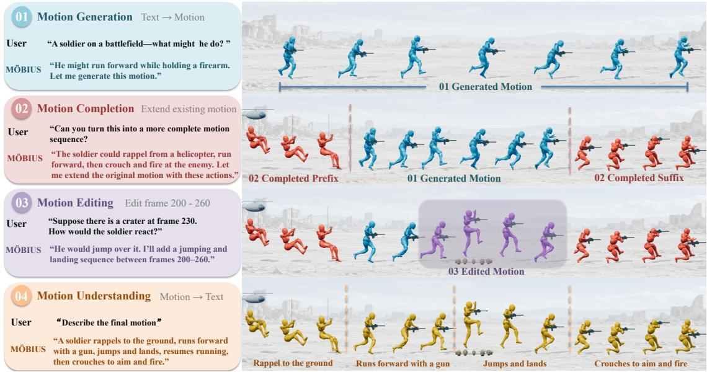  
Figure 1: Multi-turn motion creation with MÖBIUS. A motion sequence is progressively generated, completed, edited, and understood through natural language in multiple turns.

## ABSTRACT

We aim to build a truly unified motion model that can understand, generate, and edit human motion within a single framework. Existing motion UMMs remain only partially unified: motion understanding is handled by a language model, while generation is often delegated to a separate diffusion module operating over learned motion latents. We introduce MÖBIUS, which brings the entire diffusion process into the same multimodal representation space used for motion understanding. Clean motion, noisy motion, and text jointly participate in shared attention, while role-specific parameters process understanding and generation streams. Importantly, MÖBIUS operates directly on continuous frame-level raw motion, requiring neither discrete tokenization nor a pretrained motion VAE. This simple formulation naturally supports motion captioning, text-to-motion generation, temporal completion, and instruction-guided editing within a single model. On HumanML3D, MÖBIUS achieves state-of-the-art performance among unified motion models. Scaling to 1.7B parameters and 1,700 hours of motion data further demonstrates that our framework is both effective and scalable.

## 1 INTRODUCTION

Unifying understanding and generation within a single model is a central goal of multimodal intelligence, including motion-language modeling. Existing approaches have largely followed two paradigms. Diffusion-based methods (Tevet et al., 2022; Chen et al., 2023; He et al., 2026; Wen et al., 2025) excel at high-fidelity motion generation but typically lack native motion understanding capabilities. In contrast, language-model-based approaches (Guo et al., 2022b; Jiang et al., 2023; Wu et al., 2025b) unify multiple motion–language tasks autoregressively, but struggle in generation quality. This gap motivates a unified model that excels at both understanding observed motion and generating high-fidelity motion from natural-language instructions.

Recent unified motion–language models have attempted to unify motion understanding and generation (Zhu et al., 2025; Li et al., 2026; Wang et al., 2026) (see Fig. 2 for an architectural comparison). In these approaches, the language model first produces a shared multimodal representation, which is then passed as conditioning to an external diffusion model for motion generation. While this design allows understanding and generation to interact through a common feature space, the actual denoising process remains largely separated from the language model. The unified representation specifies what motion to generate, but does not directly participate in how the motion is progressively constructed. Consequently, motion understanding and motion generation are only partially unified. This motivates a more tightly integrated formulation in which not only the conditioning representation, but also the diffusion process itself operates within the unified multimodal feature space. We therefore ask: Can motion understanding and the entire motion generation process be unified within a single representation space?

To address this question, we introduce MÖBIUS, which brings the entire motion diffusion process into the same unified representation space as motion understanding. Both clean motion for understanding and noisy motion under generation are represented as motion tokens and jointly participate in the same attention with language tokens. Inspired by the Mixture-of-Transformers (MoT) (Liang et al., 2024) design, we use dedicated parameters to process clean and noisy motion streams while allowing them to communicate through shared attention. As a result, motion generation is no longer performed by an external diffusion module conditioned on features produced by the language model. Instead, noisy motion is progressively denoised directly within the unified multimodal space, where it can continuously interact with clean motion and language semantics. The generated motion can in turn be fed back as clean motion tokens for subsequent understanding and reasoning, forming a fully unified loop between motion generation and understanding. This tighter integration leads to stronger motion generation, understanding, and cross-modal interaction within a unified model.

A key advantage of this formulation is that it removes the need to learn an intermediate motion latent space. Rather than relying on a pretrained motion VAE, tokenizer, or task-specific encoder (Jiang et al., 2023; Zhu et al., 2025; Xiao et al., 2025; Wang et al., 2026), MÖBIUS operates directly on raw motion representations. Clean motion used for understanding and noisy motion used for generation share the same representation interface: both are projected into the unified multimodal space, with their roles distinguished only by whether they represent clean observations or noisy states undergoing denoising. This makes motion understanding and generation two modes of computation over the same underlying motion representation, rather than two tasks connected through separately learned latent spaces. The resulting framework is considerably simpler, requiring no additional representation learning stage or pretrained motion encoder, while our experiments show that directly modeling raw motion is sufficient to achieve strong performance for both understanding and generation.

To preserve the generalization ability of the pretrained LLM used in MÖBIUS, we adopt a curriculum training strategy. Joint training can introduce interference between understanding and generation, as gradients from the generation objective can propagate into the understanding parameters through shared attention. We therefore first train on motion understanding tasks, allowing the LLM to acquire meaningful motion semantics, and then introduce the generation objective on top of this learned representation. This curriculum training strategy provides a stable foundation for generation while better preserving the model’s original generalization ability.

We evaluate two model variants to assess benchmark performance and the benefits of scaling model capacity and training data. Under the HumanML3D evaluation protocol (Guo et al., 2022a), MÖBIUS-0.6B achieves state-of-the-art results in both text-to-motion generation and motion captioning, outperforming relevant diffusion-based, language-model-based, and motion–language baselines. MÖBIUS-0.6B also demonstrates strong capabilities in motion completion, motion inbetweening, and instruction-guided editing. Controlled ablations substantiate the effectiveness of our reasoner–generator architecture, showing that coupling motion understanding and generation yields improvements over commonly used architectural alternatives. We further present MÖBIUS-1.7B, a larger variant trained on 1,700 hours of high-quality motion data, which delivers additional improvements across all motion-language tasks on both controlled and uncontrolled user inputs.

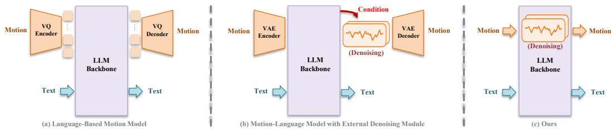  
Figure 2: Architectural comparison of unified motion–language modeling paradigms. (a) Language-based motion models discretize motion into tokens and model motion and text within a shared LLM. (b) Continuous motion–language models use the LLM to produce conditioning representations, while motion is generated by an external diffusion module. (c) MÖBIUS brings the denoising process into the unified multimodal backbone, allowing noisy motion and language to interact throughout generation.

## 2 RELATED WORK

Unified Multimodal Models. Unified multimodal models bring understanding and generation into a shared framework, as exemplified by recent systems such as BAGEL (Deng et al., 2025) and Cos mos3 (Agarwal et al., 2026). Existing approaches adopt unified sequence modeling (Chameleon Team, 2024; Wang et al., 2024) or hybrid objectives combining text autoregression with visual denoising (Zhou et al., 2025; Xie et al., 2026). Mixture-of-Transformers introduces modality-specific computation with shared attention (Liang et al., 2024), while task-decoupled architectures further address interference between understanding and generation (Wu et al., 2026). These developments motivate our investigation of specialized computation within a unified motion–language model.

Human Motion Modeling. Human motion research spans diffusion-based generation (Tevet et al., 2022; Chen et al., 2023; Zhou et al., 2024a; Wen et al., 2025; Zhao et al., 2026), discrete-token generation (Zhang et al., 2023; Guo et al., 2024; Lu et al., 2025; Fan et al., 2025), retrieval and understanding (Petrovich et al., 2023; Wu et al., 2025a; Chen et al., 2025), editing and completion (Athanasiou et al., 2024; Li et al., 2025d; Cohan et al., 2024; Chen et al., 2024), and spatial control (Wan et al., 2024; Xie et al., 2024). These methods are typically developed for particular tasks, with objectives and conditioning mechanisms tailored to their settings. Generalist frameworks consolidate multiple motion synthesis tasks (Guo et al., 2025; Li et al., 2025b; Cong et al., 2026), motivating broader unification that also incorporates language-based motion understanding.

Unified Motion Understanding and Generation. Motion–language models support understanding and generation through discrete motion vocabularies (Guo et al., 2022b; Jiang et al., 2023; Wu et al., 2025b; Li et al., 2025c; Zhou et al., 2024b), with extensions to conversational and multimodal interaction (Jiang et al., 2024; Ling et al., 2026; Yang et al., 2024; Luo et al., 2024). Continuous alternatives avoid discrete quantization: MoTe (Wu et al., 2024) and UniMotion (Li et al., 2025a) jointly model motion and text through latent diffusion, while MotionGPT3 (Zhu et al., 2025), LLaMo (Li et al., 2026), and UniMotion (Wang et al., 2026) integrate continuous motion representations with language-model backbones for unified understanding and generation. These approaches avoid discrete motion tokens but still rely on learned motion latent spaces or encoder–decoder interfaces. MÖBIUS instead operates directly on framewise motion features and brings denoising into the unified multimodal backbone. Clean motion, noisy motion, and text share attention, while role-specific projectors and Transformer parameters specialize their processing. This allows noisy motion to continuously interact with motion and language context throughout denoising.

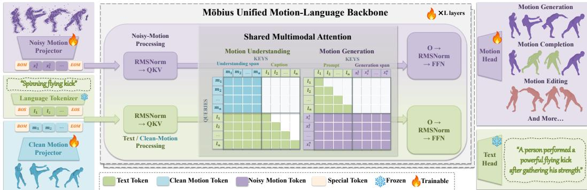  
Figure 3: Overview of MÖBIUS. Motion understanding and generation share a unified multimodal backbone. Text tokens, clean motion frames, and noisy target frames with flow time t participate in shared attention at every layer, while role-specific parameters handle normalization, projections, and feed-forward transformations. The text head autoregressively predicts captions, and the motion head recovers target frames in parallel for generation, temporal completion, and editing. The central matrices illustrate attention visibility for motion understanding and generation.

## 3 METHOD

MÖBIUS unifies motion understanding and generation within a shared representation space (see Figure 3). Starting from frame-level raw motion (Section 3.1), MÖBIUS routes clean and noisy motion tokens to role-specific parameters while allowing them to interact through shared attention (Section 3.2). It further adopts a curriculum training strategy to establish a stable foundation for generation while preserving the model’s original generalization ability (Section 3.3).

## 3.1 FRAME-LEVEL RAW MOTION REPRESENTATION

In our framework, we choose frame-level raw motion as the motion representation instead of learning any additional motion encoder. In previous methods, discrete motion tokenizers introduce quantization error (Guo et al., 2022b; Jiang et al., 2023; Wu et al., 2025b), while VAE-based approaches compress motion to temporally downsampled latents (Zhu et al., 2025; Li et al., 2026; Wang et al., 2026), losing frame-level information. Instead, we follow HY-Motion (Wen et al., 2025) to represent a motion clip as $X = [ x _ { 1 } , \dots , x _ { T } ] ^ { \top } \in \mathbb { R } ^ { T \times D }$ with motion token dimension D=201 comprising joint positions and rotations. Special tokens ⟨BOM⟩ and ⟨EOM⟩ are used to delimit the motion token sequence from text. Two dedicated projectors map clean motion tokens and noisy motion tokens to the shared representation space for understanding and generation, and corresponding motion heads decode it back to the raw motion space. In comparison with existing methods (Jiang et al., 2023; Li et al., 2026; Zhu et al., 2025; Wang et al., 2026) that learn different encoders for understanding and generation, we show that the raw motion representation can achieve strong performance in a unified representation space.

## 3.2 UNIFIED FEATURE SPACE ATTENTION WITH MOT

To process all the clean or noisy raw motion and text prompts, we adopt a Mixture-of-Transformers (Liang et al., 2024) structure. In MoT, tokens are routed to different parameters for normalization and linear projection but are then processed by a unified attention operation. We introduce how we route different tokens, and then we discuss how to conduct generative denoising.

Routing scheme. We route tokens based on their roles. Text tokens, boundary tokens, and clean motions are intended for understanding and are processed by the understanding parameters. Noisy target motions are used for generation and thus processed by the generation parameters

$$
r _ { i } = \left\{ \begin{array} { l l } { { \mathrm { g e n } , } } & { { i \mathrm { - t h ~ t o k e n ~ i s ~ a ~ n o i s y ~ m o t i o n ~ t o k e n } , } } \\ { { \mathrm { u n d } , } } & { { \mathrm { o t h e r w i s e } , } } \end{array} \right.\tag{1}
$$

where $r _ { i }$ determines the set of parameters used in normalization and linear projection (“to QKV" in standard attention layers). After that, all projected tokens are processed by a shared attention operation to exchange information in the same feature space.

Bidirectional attention for motion. In our design, motion token attention follows a different bidirectional visibility pattern from the causal attention of autoregressive text tokens. Specifically, we allow all motion tokens within the same motion sequence to attend bidirectionally to one another, regardless of whether they represent clean motion for understanding or noisy motion for generation. For understanding, the entire observed motion is already available as input, so bidirectional attention enables each frame to capture context from the complete motion sequence. For generation, all noisy target frames are instantiated jointly at each denoising step, and bidirectional attention allows each frame to exploit both past and future temporal context during refinement. Text tokens, in contrast, retain the causal attention pattern of the pretrained language model. In implementation, the target generated motion sequence is always put at the end of the whole sequence with its generation sequence length specified before denoising, allowing the full noisy sequence to be progressively refined as a whole.

## 3.3 CURRICULUM TRAINING STRATEGY

We train MÖBIUS in two stages. Directly optimizing motion understanding and generation together is unstable, as the randomly initialized generation pathway can disrupt the pretrained language representations and degrade the model’s understanding ability. We therefore adopt an understanding-first training strategy: the model first learns to interpret motion in the language space, and generation is introduced only after this representation has been established.

Phase I: motion understanding. We initialize our model from Qwen3 (Yang et al., 2025) and train it together with the motion projector on motion captioning. Given a clean motion sequence $X ,$ , an instruction $C ,$ and a target response $Y = ( y _ { 1 } , \dots , y _ { L } )$ , we use the standard autoregressive language modeling objective:

$$
\mathcal { L } _ { \mathrm { u n d } } = - \mathbb { E } _ { ( X , C , Y ) } \left[ \frac { 1 } { L } \sum _ { j = 1 } ^ { L } \log p _ { \theta _ { \mathrm { u n d } } } ( y _ { j } \mid y _ { < j } , C , X ) \right] .\tag{2}
$$

This stage allows the pretrained LLM to acquire motion semantics while preserving its original language reasoning capability.

Phase II: motion generation. We then initialize the generation parameters from the trained understanding parameters and freeze the understanding parameters. For a target motion $X _ { \mathrm { g t } }$ , we sample $\epsilon \sim \mathcal { N } ( 0 , I )$ and $t \sim \mathcal { U } [ 0 , 1 ]$ ], and construct a noisy motion

$$
X _ { t } = ( 1 - t ) \epsilon + t X _ { \mathrm { g t } } .\tag{3}
$$

The model is trained to iteratively denoise $X _ { t }$ to recover the clean motion while attending to the frozen text and motion representations produced by the understanding part:

$$
\begin{array} { r } { \mathcal { L } _ { \mathrm { g e n } } = \mathbb { E } \left[ \left. f _ { \theta _ { \mathrm { g e n } } } ( X _ { t } , t ; H _ { \theta _ { \mathrm { u n d } } } ( C ) ) - X _ { \mathrm { g t } } \right. _ { F } ^ { 2 } \right] . } \end{array}\tag{4}
$$

This staged training lets generation build on an already learned motion–language representation, avoiding interference with the pretrained understanding capability.

Unified motion editing and completion. The same framework naturally extends to a broad range of motion editing and completion tasks by treating the source motion as part of the conditioning context and generating the desired target motion. We also train our model on these tasks. Depending on which parts of the source are observed, the model supports temporal completion, including prediction, backcasting, in-betweening and keyframe infilling. It also supports semantic editing, where a source motion is modified according to a natural-language instruction. In all cases, the observed source motion is encoded as clean context, while the generation process predicts the missing or edited target motion. We construct diverse training pairs covering these settings and jointly train a unified editing model without introducing task-specific architectures.

Table 1: Comparison of text-to-motion generation on HumanML3D (Guo et al., 2022a). “Task" indicates whether a model is generation-only (Gen.) or unified for motion understanding and generation (Uni.). We use the evaluator from MotionStreamer (Xiao et al., 2025).
<table><tr><td>Method</td><td>Task</td><td>R@1↑</td><td>R@2↑</td><td>R@3↑</td><td>FID↓</td><td>MMDist↓</td><td>Diversity→</td></tr><tr><td>GT</td><td></td><td>0.7703</td><td>0.9030</td><td>0.9442</td><td>0.0000</td><td>14.8785</td><td>27.7705</td></tr><tr><td colspan="8">Trained on HumanML3D</td></tr><tr><td>T2M-GPT (Zhang et al., 2023)</td><td>Gen.</td><td>0.5516</td><td>0.7056</td><td>0.7788</td><td>25.4913</td><td>19.0912</td><td>25.5949</td></tr><tr><td>MoMask (Guo et al., 2024)</td><td>Gen.</td><td>0.6404</td><td>0.7974</td><td>0.8609</td><td>21.0729</td><td>18.1216</td><td>25.9789</td></tr><tr><td>MDM (Tevet et al., 2022)</td><td>Gen.</td><td>0.5208</td><td>0.6937</td><td>0.7701</td><td>35.5169</td><td>19.4246</td><td>25.3383</td></tr><tr><td>MotionStreamer (Xiao et al., 2025)</td><td>Gen.</td><td>0.6303</td><td>0.7865</td><td>0.8498</td><td>12.2110</td><td>16.5810</td><td>27.4637</td></tr><tr><td>MotionGPT (Jiang et al., 2023)</td><td>Uni.</td><td>0.4940</td><td>0.6352</td><td>0.6944</td><td>23.6811</td><td>19.6781</td><td>25.5410</td></tr><tr><td>MotionGPT3 (Zhu et al., 2025)</td><td>Uni. Uni.</td><td>0.6709</td><td>0.8242</td><td>0.8817</td><td>20.9913</td><td>17.5664</td><td>25.6889</td></tr><tr><td>Ours (0.6B)</td><td></td><td>0.8209</td><td>0.9397</td><td>0.9670</td><td>6.1291</td><td>13.9973</td><td>27.6107</td></tr><tr><td colspan="8">Trained on large-scale dataset</td></tr><tr><td>Go to Zero (3B) (Fan et al., 2025)</td><td>Gen.</td><td>0.7401</td><td>0.8772</td><td>0.9229</td><td>23.7550</td><td>15.3806</td><td>26.6340</td></tr><tr><td>HY-Motion (1B) (Wen et al., 2025)</td><td>Gen. Uni.</td><td>0.7899</td><td>0.9177</td><td>0.9516</td><td>13.5194</td><td>14.7748</td><td>27.4183</td></tr><tr><td>Ours (1.7B)</td><td></td><td>0.7968</td><td>0.9226</td><td>0.9524</td><td>10.6642</td><td>14.7441</td><td>27.4649</td></tr></table>

Table 2: Comparison of motion captioning on HumanML3D (Guo et al., 2022a). We follow the TM2T evaluation protocol (Guo et al., 2022b) using raw captions.
<table><tr><td>Method</td><td>BLEU-1↑</td><td>BLEU-4↑</td><td>ROUGE-L↑</td><td>CIDEr↑</td><td>BERT↑</td><td>R@1↑</td><td>R@2↑</td><td>R@3↑</td><td>MMDist↓</td></tr><tr><td>GT</td><td>1.0000</td><td>1.0000</td><td>1.0000</td><td>4.5165</td><td>1.0000</td><td>0.5068</td><td>0.7064</td><td>0.8041</td><td>2.9784</td></tr><tr><td>TM2T (Guo et al., 2022b)</td><td>0.4912</td><td>0.0760</td><td>0.3808</td><td>0.1719</td><td>0.3215</td><td>0.5180</td><td>0.7178</td><td>0.8079</td><td>2.9584</td></tr><tr><td>MotionGPT (Jiang et al., 2023)</td><td>0.4605</td><td>0.1210</td><td>0.3849</td><td>0.3409</td><td>0.3388</td><td>0.5087</td><td>0.6880</td><td>0.7776</td><td>3.1121</td></tr><tr><td>MotionGPT3 (Zhu et al., 2025)</td><td>0.5383</td><td>0.1605</td><td>0.4165</td><td>0.4077</td><td>0.3425</td><td>0.5333</td><td>0.7178</td><td>0.8043</td><td>2.8533</td></tr><tr><td>UniMuMo (Yang et al., 2024)</td><td>0.4488</td><td>0.1271</td><td>0.3560</td><td>0.3114</td><td>0.4517</td><td>0.5162</td><td>0.7032</td><td>0.7984</td><td>2.9658</td></tr><tr><td>Ours 0.6B (ML3D only)</td><td>0.5664</td><td>0.2032</td><td>0.4636</td><td>0.5754</td><td>0.4541</td><td>0.6056</td><td>0.7936</td><td>0.8761</td><td>2.4693</td></tr><tr><td>Ours 1.7B (large-scale)</td><td>0.5874</td><td>0.2105</td><td>0.4725</td><td>0.5836</td><td>0.4657</td><td>0.6152</td><td>0.8086</td><td>0.8862</td><td>2.4143</td></tr></table>

## 4 EXPERIMENTS

## 4.1 EXPERIMENTAL SETUP

We evaluate MÖBIUS on text-to-motion generation, motion captioning, instruction-guided editing, and temporal completion tasks, and conduct controlled ablations to examine its key design choices. Bold and underlined metric numbers indicate the best and second-best performance respectively.

Text-to-motion generation and motion captioning. We consider two model scales: MÖBIUS-0.6B and MÖBIUS-1.7B. The standard 0.6B variant is trained exclusively on HumanML3D (Guo et al., 2022a), while the 1.7B variant additionally uses an internal training corpus containing 1,700 hours of annotated motion. For the generation task, we use the MS-272 evaluator introduced by MotionStreamer (Xiao et al., 2025) to compare against representative baselines from diffusion-based models (Tevet et al., 2022; Wen et al., 2025; Xiao et al., 2025), autoregressive models (Zhang et al., 2023; Fan et al., 2025; Guo et al., 2024), and unified motion-language models (Jiang et al., 2023; Zhu et al., 2025). For motion captioning, we follow the TM2T protocol (Guo et al., 2022b) to compare with those methods that natively support understanding (Guo et al., 2022b; Jiang et al., 2023; Zhu et al., 2025; Yang et al., 2024).

Motion editing and completion. For editing and completion tasks, we report the performance on MotionLab (Guo et al., 2025) benchmark of both MÖBIUS-0.6B trained on HumanML3D (Guo et al., 2022a) and an additional variant that incorporates MotionFix (Athanasiou et al., 2024) data in training. The compared baselines include the task-specific baseline MotionFix (Athanasiou et al., 2024), the generalist model MotionLab (Guo et al., 2025), and also the unedited source motion.

## 4.2 QUANTITATIVE EVALUATION

Results. As shown in Table 1, MÖBIUS-0.6B outperforms both generation-specialized and unified baselines trained on HumanML3D. The scaled MÖBIUS-1.7B also achieves strong performance against large-scale motion models, attaining the best R-Precision, FID, and MMDist among the compared methods. For motion understanding, MÖBIUS consistently outperforms existing unified motion-language models across all reported metrics (Table 2). Furthermore, MÖBIUS surpasses editing-specialized baselines and even the unedited source motion (Table 3), demonstrating strong instruction-following capabilities.

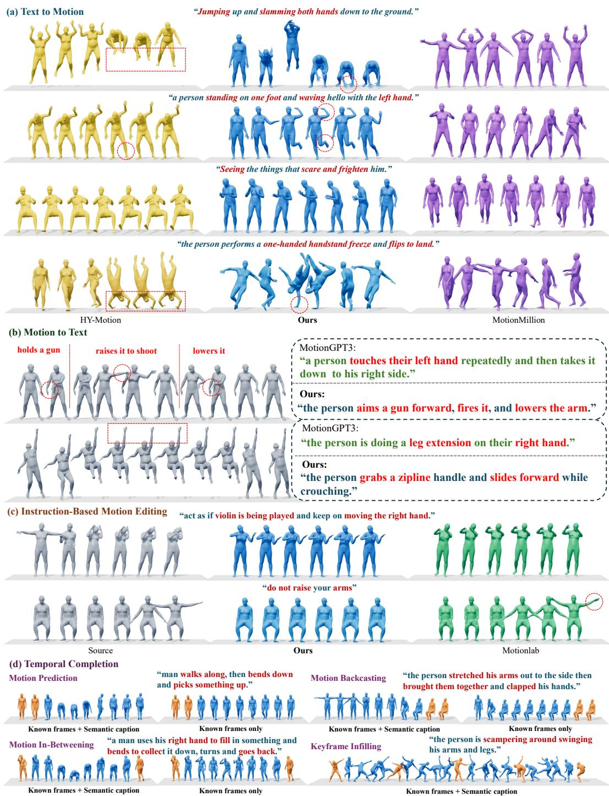  
Figure 4: Qualitative results on motion understanding and generation. (a) Text-to-motion generation results of HY-Motion (Wen et al., 2025) (yellow), MÖBIUS (blue), and MotionMillion (Fan et al., 2025) (purple). (b) Motion-to-text understanding compared with MotionGPT3 (Zhu et al., 2025). (c) Instruction-based editing: source (gray), MÖBIUS (blue), and MotionLab (Guo et al., 2025) (green). (d) Temporal completion: prediction, backcasting, in-betweening, and keyframe infilling; known and generated frames are orange and blue, respectively.

Table 3: Instruction-based motion editing results on MotionFix (Athanasiou et al., 2024). † denotes our editing variant trained with additional MotionFix pairs in Phase II. The no-edit source and GT are shown as references and excluded from ranking.
<table><tr><td>Method</td><td>FID↓</td><td>R@1↑</td><td>R@2↑</td><td>R@3↑</td><td>AvgR↓</td><td>MMDist↓</td><td>Diversity→</td></tr><tr><td>GT</td><td>0.0000</td><td>1.0000</td><td>1.0000</td><td>1.0000</td><td>1.0000</td><td>0.0000</td><td>8.3500</td></tr><tr><td>Source motion (no edit)</td><td>0.1066</td><td>0.4640</td><td>0.6525</td><td>0.7502</td><td>3.5100</td><td>2.2817</td><td>8.2000</td></tr><tr><td>MotionFix (TMED) (Athanasiou et al., 2024)</td><td>0.5282</td><td>0.3248</td><td>0.4877</td><td>0.5982</td><td>5.3600</td><td>3.1974</td><td>7.8900</td></tr><tr><td>MotionLab (Guo et al., 2025)</td><td>0.1339</td><td>0.4610</td><td>0.6308</td><td>0.7315</td><td>3.7500</td><td>2.4112</td><td>8.1800</td></tr><tr><td>Ours (0.6B)†</td><td>0.0955</td><td>0.4936</td><td>0.6821</td><td>0.7828</td><td>2.8026</td><td>1.8749</td><td>8.4468</td></tr></table>

Table 4: Ablation study. We study motion encoding, routing, and understanding–generation training. † allows denoising to access only the final-layer context representations; ‡ randomly initializes the denoising parameters instead of transferring those learned during understanding. Their M2T scores equal those of the full model and are not ranked. Bold and underline denote the best and second-best variants, excluding GT.
<table><tr><td rowspan="2">ID</td><td rowspan="2">Routing</td><td rowspan="2">Encoding</td><td rowspan="2">Training</td><td colspan="4">Understanding (M2T)</td><td colspan="4">Generation (T2M)</td></tr><tr><td>R@1↑</td><td>BLEU-1↑</td><td>CIDEr↑</td><td>BERT↑</td><td>R@1↑</td><td>R@3↑</td><td>FID↓</td><td>MMDist↓</td></tr><tr><td>GT</td><td></td><td></td><td></td><td>0.5068</td><td>1.0000</td><td>4.5165</td><td>1.0000</td><td>0.7703</td><td>0.9442</td><td>0.0000</td><td>14.8785</td></tr><tr><td>1</td><td>Dense</td><td>VQ</td><td>Und.→Gen.</td><td>0.5695</td><td>0.5593</td><td>0.4568</td><td>0.4296</td><td>0.5627</td><td>0.7741</td><td>6.0912</td><td>16.4993</td></tr><tr><td>2</td><td>Role</td><td>VAE</td><td>Und.→Gen.</td><td>0.5846</td><td>0.5619</td><td>0.5522</td><td>0.4404</td><td>0.8251</td><td>0.9655</td><td>5.9970</td><td>13.8139</td></tr><tr><td>3</td><td>Modality</td><td>Frame</td><td>Und. only</td><td>0.5675</td><td>0.5222</td><td>0.4525</td><td>0.4134</td><td>一</td><td>一</td><td>一</td><td></td></tr><tr><td>4</td><td>Modality</td><td>Frame</td><td>Und.→Gen.</td><td>0.0328</td><td>0.0776</td><td>0.0040</td><td>-0.3768</td><td>0.7512</td><td>0.9250</td><td>18.0517</td><td>15.3010</td></tr><tr><td>5</td><td>Modality</td><td>Frame</td><td>Gen.→Align→Joint</td><td>0.5390</td><td>0.5090</td><td>0.4100</td><td>0.3951</td><td>0.7075</td><td>0.8948</td><td>26.2865</td><td>16.1071</td></tr><tr><td>6</td><td>Role</td><td>Frame</td><td>Gen. only</td><td></td><td></td><td></td><td></td><td>0.7877</td><td>0.9486</td><td>6.0073</td><td>14.2763</td></tr><tr><td>7</td><td>Role</td><td>Frame</td><td>Und.+Gen.</td><td>0.5291</td><td>0.4941</td><td>0.3929</td><td>0.3801</td><td>0.8125</td><td>0.9506</td><td>8.0030</td><td>14.1169</td></tr><tr><td>8</td><td>Role</td><td>Frame</td><td> $\mathrm { U n d . {  } G e n . ^ { \dagger } }$ </td><td>0.6001</td><td>0.5670</td><td>0.5629</td><td>0.4507</td><td>0.7621</td><td>0.9387</td><td>5.7644</td><td>14.5591</td></tr><tr><td>9</td><td>Role</td><td>Frame</td><td> $\mathrm { U n d . } {  } \mathrm { G e n . } ^ { \dagger }$ </td><td>0.6001</td><td>0.5670</td><td>0.5629</td><td>0.4507</td><td>0.7721</td><td>0.9422</td><td>5.8772</td><td>14.5665</td></tr><tr><td>10</td><td>Role</td><td>Frame</td><td> $\mathrm { U n d . } {  } \mathrm { G e n . }$ </td><td>0.6001</td><td>0.5670</td><td>0.5629</td><td>0.4507</td><td>0.8207</td><td>0.9571</td><td>4.8772</td><td>14.0269</td></tr></table>

Analysis. We attribute our advantages in motion generation to the unified architecture. The routing scheme brings the entire motion diffusion process into the shared representation space, allowing the semantics of clean motion and language to continuously guide generation. Meanwhile, the curriculum training strategy helps preserve the reasoning ability inherited from the pretrained LLM, resulting in strong motion-understanding performance. Together with the frame-level raw motion representation, these designs also enable framewise control and editing that follow language instructions well, improving performance across motion–language tasks without sacrificing one capability for another.

## 4.3 QUALITATIVE EVALUATION

Figure 4 illustrates the versatility of MÖBIUS across both motion understanding and generation tasks. For text-to-motion generation, MÖBIUS follows challenging multi-part prompts while preserving their temporal ordering. For motion-to-text captioning, it captures the key actions and their temporal progression more accurately. For instruction-guided editing, it modifies the target motion while preserving the surrounding source content. Temporal completion requires no task-specific architecture: changing which frames are treated as observed is sufficient to support motion predic tion, backcasting, in-betweening, and keyframe infilling. Across these settings, the same frame-level representation supports both motion understanding and flexible conditional generation.

## 4.4 ABLATION STUDIES

We ablate the motion encoding, routing strategy, and understanding–generation training in Table 4. All variants use Qwen3-0.6B, are trained on HumanML3D using only the T2M and M2T objectives, and use MS-272 from MotionStreamer (Xiao et al., 2025) as the underlying motion feature format. For motion encoding, VQ discretizes motion using a tokenizer trained following MotionGPT (Jiang et al., 2023), VAE maps motion into the pretrained latent space of MotionStreamer, and Frame directly models framewise MS-272 features without an intermediate motion codec. For routing, Dense uses a single parameter set for all tokens, Modality separates text and motion computation but uses the same motion parameters for both clean observations and noisy denoising states, while Role (ours) assigns role-specific parameters to text/clean motion and noisy motion while retaining shared attention. For training, Gen. only trains generation without understanding pretraining, Und.→Gen. first establishes motion–language understanding and then transfers it to generation, Gen.→Align→Joint follows the MotionGPT3 (Zhu et al., 2025) schedule, and Und.+Gen. jointly optimizes both objectives.

Which motion encoding best supports unified modeling? We compare three representative motion interfaces in IDs 1, 2, and 10. Since discrete VQ tokens do not naturally represent intermediate continuous denoising states, the VQ variant uses dense computation, whereas the VAE and frame-level variants support role-specific processing of clean and noisy motion. VQ substantially weakens generation, while VAE remains competitive but yields weaker motion understanding than direct frame-level encoding. Overall, frame-level modeling provides the strongest balance between the two capabilities. Moreover, its one-to-one correspondence between motion frames and model positions naturally supports temporal completion and frame-conditioned manipulation.

Should computation be separated by modality or by role? With modality routing, the understanding-only model (ID 3) performs normally, but using the same motion parameters for both clean observations and noisy denoising states (ID 4) causes understanding to collapse. The generate–align–joint schedule (ID 5) largely recovers understanding, but at a substantial cost to generation quality. In contrast, separating clean and noisy motion by computational role (ID 10) maintains strong performance in both directions, indicating that the two roles benefit from specialized parameters while still interacting through shared attention.

How should understanding be transferred to generation? IDs 6–10 further isolate how learned motion–language understanding benefits generation. Compared with generation-only training (ID 6), the full model (ID 10) shows that establishing motion–language understanding first provides a stronger foundation for synthesis. Joint optimization (ID 7) notably degrades understanding, revealing interference between the two objectives when optimized together. Restricting denoising to only the final-layer context representations (ID 8) also weakens generation, demonstrating the benefit of layer-wise interaction throughout the denoising process. Randomly initializing the denoising parameters (ID 9) further degrades performance relative to initialization from the parameters learned during understanding. Together, these results support our understanding-first strategy: first establish motion–language alignment, then transfer it to generation through parameter initialization and layer-wise interaction while keeping the learned understanding parameters fixed.

## 5 DISCUSSION AND CONCLUSION

We presented MÖBIUS, a unified motion–language model that organizes computation by role rather than modality. Its role-routed architecture and continuous frame-level motion interface support motion understanding, generation, editing, and temporal completion within a single unified framework. The results also highlight the benefit of transferring learned motion understanding to generation. Experiments on HumanML3D show strong T2M and M2T performance, while scaling to 1.7B parameters and 1,700 hours of motion data further demonstrates the effectiveness of the design at larger scale.

More broadly, MÖBIUS demonstrates that understanding and continuous motion generation need not be connected through a separate latent generator, but can instead operate together within a shared multimodal representation space. Our current experiments focus on controlled single-person motion settings. Future work will extend MÖBIUS toward multi-person interaction, more detailed hand and finger motion, retargeting across heterogeneous body structures, and deployment in embodied systems such as real-world robots.

## AI USE STATEMENT

Generative AI tools were used only to improve the readability and language of the manuscript, including grammar, phrasing, and stylistic editing. They were not used to develop the research methodology, design experiments, implement methods, generate or modify data, formulate mathematical claims, or interpret experimental results. The authors reviewed all AI-assisted edits and take responsibility for the final content of the paper.

## REFERENCES

Niket Agarwal, Arslan Ali, Jon Allen, Martin Antolini, Adeline Aubame, Alisson Azzolini, Junjie Bai, Maciej Bala, Yogesh Balaji, Josh Bapst, et al. Cosmos 3: Omnimodal world models for physical ai. arXiv preprint arXiv:2606.02800, 2026.

Nikos Athanasiou, Alpár Cseke, Markos Diomataris, Michael J Black, and Gül Varol. Motionfix: Text-driven 3d human motion editing. In SIGGRAPH Asia 2024 Conference Papers, pp. 1–11, 2024.

Chameleon Team. Chameleon: Mixed-modal early-fusion foundation models. arXiv preprint arXiv:2405.09818, 2024.

Ling-Hao Chen, Shunlin Lu, Wenxun Dai, Zhiyang Dou, Xuan Ju, Jingbo Wang, Taku Komura, and Lei Zhang. Pay attention and move better: Harnessing attention for interactive motion generation and training-free editing. arXiv preprint arXiv:2410.18977, 2024.

Ling-Hao Chen, Shunlin Lu, Ailing Zeng, Hao Zhang, Benyou Wang, Ruimao Zhang, and Lei Zhang. Motionllm: Understanding human behaviors from human motions and videos. IEEE Transactions on Pattern Analysis and Machine Intelligence, 2025.

Xin Chen, Biao Jiang, Wen Liu, Zilong Huang, Bin Fu, Tao Chen, and Gang Yu. Executing your commands via motion diffusion in latent space. In Proceedings of the IEEE/CVF Conference on Computer Vision and Pattern Recognition, 2023.

Setareh Cohan, Guy Tevet, Daniele Reda, Xue Bin Peng, and Michiel van de Panne. Flexible motion in-betweening with diffusion models. arXiv preprint arXiv:2405.11126, 2024.

Xiaoyan Cong, Zekun Li, Zhiyang Dou, Hongyu Li, Omid Taheri, Chuan Guo, Abhay Mittal, Sizhe An, Taku Komura, Wojciech Matusik, et al. Umo: Unified in-context learning unlocks motion foundation model priors. arXiv preprint arXiv:2603.15975, 2026.

Chaorui Deng, Deyao Zhu, Kunchang Li, Chenhui Gou, Feng Li, Zeyu Wang, Shu Zhong, Weihao Yu, Xiaonan Nie, Ziang Song, Guang Shi, and Haoqi Fan. Emerging properties in unified multimodal pretraining. arXiv preprint arXiv:2505.14683, 2025.

Ke Fan, Shunlin Lu, Minyue Dai, Runyi Yu, Lixing Xiao, Zhiyang Dou, Junting Dong, Lizhuang Ma, and Jingbo Wang. Go to zero: Towards zero-shot motion generation with million-scale data. In Proceedings of the IEEE/CVF International Conference on Computer Vision, 2025.

Chuan Guo, Shihao Zou, Xinxin Zuo, Sen Wang, Wei Ji, Xingyu Li, and Li Cheng. Generating diverse and natural 3d human motions from text. In Proceedings ofthe IEEE/CVF Conference on Computer Vision and Pattern Recognition (CVPR), pp. 5152–5161, June 2022a.

Chuan Guo, Xinxin Zuo, Sen Wang, and Li Cheng. Tm2t: Stochastic and tokenized modeling for the reciprocal generation of 3d human motions and texts. In European Conference on Computer Vision, 2022b.

Chuan Guo, Yuxuan Mu, Muhammad Gohar Javed, Sen Wang, and Li Cheng. MoMask: Generative masked modeling of 3d human motions. In Proceedings of the IEEE/CVF Conference on Computer Vision and Pattern Recognition, 2024.

Ziyan Guo, Zeyu Hu, Na Zhao, and De Wen Soh. Motionlab: Unified human motion generation and editing via the motion-condition-motion paradigm. arXiv preprint arXiv:2502.02358, 2025.

Yannan He, Garvita Tiwari, Xiaohan Zhang, Pankaj Bora, Tolga Birdal, Jan Eric Lenssen, and Gerard Pons-Moll. Molingo: Motion-language alignment for text-to-human motion generation. In Proceedings of the IEEE/CVF Conference on Computer Vision and Pattern Recognition, pp. 38387–38398, 2026.

Biao Jiang, Xin Chen, Wen Liu, Jingyi Yu, Gang Yu, and Tao Chen. MotionGPT: Human motion as a foreign language. Advances in Neural Information Processing Systems, 36, 2023.

Biao Jiang, Xin Chen, Chi Zhang, Fukun Yin, Zhuoyuan Li, Gang Yu, and Jiayuan Fan. Motionchain: Conversational motion controllers via multimodal prompts. In European Conference on Computer Vision, pp. 54–74. Springer, 2024.

Chuqiao Li, Julian Chibane, Yannan He, Naama Pearl, Andreas Geiger, and Gerard Pons-Moll. Unimotion: Unifying 3d human motion synthesis and understanding. In 2025 International Conference on 3D Vision (3DV), pp. 240–249. IEEE, 2025a.

Jiefeng Li, Jinkun Cao, Haotian Zhang, Davis Rempe, Jan Kautz, Umar Iqbal, and Ye Yuan. Genmo: A generalist model for human motion. In Proceedings of the IEEE/CVF International Conference on Computer Vision (ICCV), 2025b.

Zekun Li, Sizhe An, Chengcheng Tang, Chuan Guo, Ivan Shugurov, Linguang Zhang, Amy Zhao, Srinath Sridhar, Lingling Tao, and Abhay Mittal. LLaMo: Scaling pretrained language models for unified motion understanding and generation with continuous autoregressive tokens. arXiv preprint arXiv:2602.12370, 2026.

Zhe Li, Weihao Yuan, Yisheng He, Lingteng Qiu, Shenhao Zhu, Xiaodong Gu, Weichao Shen, Yuan Dong, Zilong Dong, and Laurence Yang. Lamp: Language-motion pretraining for motion generation, retrieval, and captioning. In International Conference on Learning Representations, volume 2025, pp. 84238–84250, 2025c.

Zhengyuan Li, Kai Cheng, Anindita Ghosh, Uttaran Bhattacharya, Liangyan Gui, and Aniket Bera. Simmotionedit: Text-based human motion editing with motion similarity prediction. In 2025 IEEE/CVF Conference on Computer Vision and Pattern Recognition (CVPR), pp. 27827–27837. IEEE, 2025d.

Weixin Liang, Lili Yu, Liang Luo, Srinivasan Iyer, Ning Dong, Chunting Zhou, Gargi Ghosh, Mike Lewis, Wen-tau Yih, Luke Zettlemoyer, et al. Mixture-of-transformers: A sparse and scalable architecture for multi-modal foundation models. arXiv preprint arXiv:2411.04996, 2024.

Zeyu Ling, Bo Han, Shiyang Li, Jikang Cheng, Hongdeng Shen, and Changqing Zou. Versatilemotion: A unified framework for motion synthesis and comprehension. In European Conference on Computer Vision, pp. 343–362. Springer, 2026.

Shunlin Lu, Jingbo Wang, Zeyu Lu, Ling-Hao Chen, Wenxun Dai, Junting Dong, Zhiyang Dou, Bo Dai, and Ruimao Zhang. Scamo: Exploring the scaling law in autoregressive motion generation model. In 2025 IEEE/CVF Conference on Computer Vision and Pattern Recognition (CVPR), pp. 27872–27882. IEEE, 2025.

Mingshuang Luo, Ruibing Hou, Zhuo Li, Hong Chang, Zimo Liu, Yaowei Wang, and Shiguang Shan. M3GPT: An advanced multimodal, multitask framework for motion comprehension and generation. Advances in Neural Information Processing Systems, 37:28051–28077, 2024.

Mathis Petrovich, Michael J Black, and Gül Varol. Tmr: Text-to-motion retrieval using contrastive 3d human motion synthesis. In 2023 IEEE/CVF International Conference on Computer Vision (ICCV), pp. 9454–9463. IEEE, 2023.

Davis Rempe, Mathis Petrovich, Ye Yuan, Haotian Zhang, Xue Bin Peng, Yifeng Jiang, Tingwu Wang, Umar Iqbal, David Minor, Michael de Ruyter, Jiefeng Li, Chen Tessler, Edy Lim, Eugene Jeong, Sam Wu, Ehsan Hassani, Michael Huang, Jin-Bey Yu, Chaeyeon Chung, Lina Song, Olivier Dionne, Jan Kautz, Simon Yuen, and Sanja Fidler. Kimodo: Scaling controllable human motion generation. arXiv:2603.15546, 2026.

Guy Tevet, Sigal Raab, Brian Gordon, Yonatan Shafir, Daniel Cohen-Or, and Amit H Bermano. Human motion diffusion model. arXiv preprint arXiv:2209.14916, 2022.

Weilin Wan, Zhiyang Dou, Taku Komura, Wenping Wang, Dinesh Jayaraman, and Lingjie Liu. Tlcontrol: Trajectory and language control for human motion synthesis. In European Conference on Computer Vision, pp. 37–54. Springer, 2024.

Xinlong Wang, Xiaosong Zhang, Zhengxiong Luo, Quan Sun, Yufeng Cui, Jinsheng Wang, Fan Zhang, Yueze Wang, Zhen Li, Qiying Yu, et al. Emu3: Next-token prediction is all you need. arXiv preprint arXiv:2409.18869, 2024.

Ziyi Wang, Xinshun Wang, Shuang Chen, Yang Cong, and Mengyuan Liu. Unimotion: A unified framework for motion-text-vision understanding and generation. In European Conference on Computer Vision, pp. 664–682. Springer, 2026.

Yuxin Wen, Qing Shuai, Di Kang, Jing Li, Cheng Wen, Yue Qian, Ningxin Jiao, Changhai Chen, Weijie Chen, Yiran Wang, Jinkun Guo, Dongyue An, Han Liu, Yanyu Tong, Chao Zhang, Qing Guo, Juan Chen, Qiao Zhang, Youyi Zhang, Zihao Yao, Cheng Zhang, Hong Duan, Xiaoping Wu, Qi Chen, Fei Cheng, Liang Dong, Peng He, Hao Zhang, Jiaxin Lin, Chao Zhang, Zhongyi Fan, Yifan Li, Zhichao Hu, Yuhong Liu, Linus, Jie Jiang, Xiaolong Li, and Linchao Bao. HY-Motion 1.0: Scaling flow matching models for text-to-motion generation. arXiv preprint arXiv:2512.23464, 2025.

Bizhu Wu, Jinheng Xie, Keming Shen, Zhe Kong, Jianfeng Ren, Ruibin Bai, Rong Qu, and Linlin Shen. Mg-motionllm: A unified framework for motion comprehension and generation across mul tiple granularities. In 2025 IEEE/CVF Conference on Computer Vision and Pattern Recognition (CVPR), pp. 27849–27858. IEEE, 2025a.

Penghao Wu, Haiwen Diao, Weichen Fan, Lewei Lu, Dahua Lin, and Ziwei Liu. Uncovering understanding-generation synergy in native unified multimodal models: From representation, task to system. arXiv preprint arXiv:2609.01607, 2026.

Qi Wu, Yubo Zhao, Yifan Wang, Xinhang Liu, Yu-Wing Tai, and Chi-Keung Tang. Motion-agent: A conversational framework for human motion generation with llms. In International Conference on Learning Representations, volume 2025, pp. 48023–48043, 2025b.

Yiming Wu, Wei Ji, Kecheng Zheng, Zicheng Wang, and Dong Xu. Mote: Learning motion-text diffusion model for multiple generation tasks. arXiv preprint arXiv:2411.19786, 2024.

Lixing Xiao, Shunlin Lu, Huaijin Pi, Ke Fan, Liang Pan, Yueer Zhou, Ziyong Feng, Xiaowei Zhou, Sida Peng, and Jingbo Wang. Motionstreamer: Streaming motion generation via diffusion-based autoregressive model in causal latent space. In Proceedings ofthe IEEE/CVF International Conference on Computer Vision, 2025.

Jinheng Xie, Zhenheng Yang, and Mike Zheng Shou. Show-o2: Improved native unified multimodal models. Advances in Neural Information Processing Systems, 38:47490–47518, 2026.

Yiming Xie, Varun Jampani, Lei Zhong, Deqing Sun, and Huaizu Jiang. Omnicontrol: Control any joint at any time for human motion generation. In The Twelfth International Conference on Learning Representations, 2024.

An Yang, Anfeng Li, Baosong Yang, Beichen Zhang, Binyuan Hui, Bo Zheng, Bowen Yu, Chang Gao, Chengen Huang, Chenxu Lv, Chujie Zheng, Dayiheng Liu, Fan Zhou, Fei Huang, Feng Hu, Hao Ge, Haoran Wei, Huan Lin, Jialong Tang, Jian Yang, Jianhong Tu, Jianwei Zhang, Jianxin Yang, Jiaxi Yang, Jing Zhou, Jingren Zhou, Junyang Lin, Kai Dang, Keqin Bao, Kexin Yang, Le Yu, Lianghao Deng, Mei Li, Mingfeng Xue, Mingze Li, Pei Zhang, Peng Wang, Qin Zhu, Rui Men, Ruize Gao, Shixuan Liu, Shuang Luo, Tianhao Li, Tianyi Tang, Wenbiao Yin, Xingzhang Ren, Xinyu Wang, Xinyu Zhang, Xuancheng Ren, Yang Fan, Yang Su, Yichang Zhang, Yinger Zhang, Yu Wan, Yuqiong Liu, Zekun Wang, Zeyu Cui, Zhenru Zhang, Zhipeng Zhou, and Zihan Qiu. Qwen3 technical report. arXiv preprint arXiv:2505.09388, 2025.

Han Yang, Kun Su, Yutong Zhang, Jiaben Chen, Kaizhi Qian, Gaowen Liu, and Chuang Gan. Unimumo: Unified text, music and motion generation. arXiv preprint arXiv:2410.04534, 2024.

Jianrong Zhang, Yangsong Zhang, Xiaodong Cun, Shaoli Huang, Yong Zhang, Hongwei Zhao, Hongtao Lu, and Xi Shen. T2M-GPT: Generating human motion from textual descriptions with discrete representations. In Proceedings of the IEEE/CVF Conference on Computer Vision and Pattern Recognition (CVPR), 2023.

Chengfeng Zhao, Jiazhi Shu, Yubo Zhao, Tianyu Huang, Jiahao Lu, Zekai Gu, Chengwei Ren, Zhiyang Dou, Qing Shuai, and Yuan Liu. Comovi: Co-generation of 3d human motions and realistic videos. arXiv preprint arXiv:2601.10632, 2026.

Chunting Zhou, Lili Yu, Arun Babu, Kushal Tirumala, Michihiro Yasunaga, Leonid Shamis, Jacob Kahn, Xuezhe Ma, Luke Zettlemoyer, and Omer Levy. Transfusion: Predict the next token and diffuse images with one multi-modal model. In International Conference on Learning Representations, volume 2025, pp. 6446–6469, 2025.

Wenyang Zhou, Zhiyang Dou, Zeyu Cao, Zhouyingcheng Liao, Jingbo Wang, Wenjia Wang, Yuan Liu, Taku Komura, Wenping Wang, and Lingjie Liu. Emdm: Efficient motion diffusion model for fast and high-quality motion generation. In European Conference on Computer Vision, pp. 18–38. Springer, 2024a.

Zixiang Zhou, Yu Wan, and Baoyuan Wang. Avatargpt: All-in-one framework for motion understanding, planning, generation and beyond. In 2024 IEEE/CVF Conference on Computer Vision and Pattern Recognition (CVPR), pp. 1357–1366. IEEE, 2024b.

Bingfan Zhu, Biao Jiang, Sunyi Wang, Shixiang Tang, Tao Chen, Linjie Luo, Youyi Zheng, and Xin Chen. MotionGPT3: Human motion as a second modality. arXiv preprint arXiv:2506.24086, 2025.

Table S1: Architecture specification of MÖBIUS.
<table><tr><td>Component</td><td>MÖBIUS-0.6B</td><td>MÖBIUS-1.7B</td></tr><tr><td>Backbone</td><td>Qwen3-0.6B</td><td>Qwen3-1.7B</td></tr><tr><td>Vocabulary size</td><td>151,673</td><td>151,673</td></tr><tr><td>Total parameters</td><td>1.047B</td><td>3.148B</td></tr><tr><td>Motion representation</td><td>HY201, 30 FPS</td><td>HY201, 30 FPS</td></tr><tr><td>Transformer layers</td><td>28</td><td>28</td></tr><tr><td>Hidden dimension</td><td>1,024</td><td>2,048</td></tr><tr><td>Query heads</td><td>16</td><td>16</td></tr><tr><td>KV heads</td><td>8</td><td>8</td></tr><tr><td>Head dimension</td><td>128</td><td>128</td></tr><tr><td>FFN intermediate dimension</td><td>3,072</td><td>6,144</td></tr><tr><td>Activation in projectors</td><td>SiLU</td><td>SiLU</td></tr></table>

## A EXPERIMENTAL DETAILS AND INFERENCE

This supplement provides experimental and inference details, evaluation protocols, and additional results.

## A.1 DATASETS

MÖBIUS-0.6B uses HumanML3D motion–text data, while the 1.7B model additionally uses an internal corpus of approximately 1,700 hours. The editing variant adds MotionFix pairs during Phase II. Pure-text examples are interleaved during Phase I; “HumanML3D-only” refers to the source of motion–text supervision, not the absence of language pretraining or replay.

## A.2 CONTINUOUS MOTION INTERFACE

We use 201-dimensional HY-Motion features at 30 FPS: pelvis translation (3), root orientation in a continuous 6D representation (6), local body rotations (126), and root-relative joint positions (66). Each frame occupies one Transformer position. Let $\mu , \sigma \in \mathbb { R } ^ { 2 0 1 }$ denote the training-set feature statistics, and define the elementwise scale $\tilde { \sigma } = \operatorname* { m a x } ( \sigma , \varepsilon ) \mathrm { f o r } \varepsilon > 0$ . Normalization and its inverse are

$$
\bar { x } _ { i } = \left( x _ { i } - \mu \right) \oslash \tilde { \sigma } , \qquad x _ { i } = \bar { x } _ { i } \odot \tilde { \sigma } + \mu ,\tag{5}
$$

where operations are elementwise. All flow equations in the paper operate in this normalized space. For observed motion, $P _ { \mathrm { u n d } }$ denotes the framewise mapping before output normalization and learned scaling:

$$
z _ { i } = P _ { \mathrm { u n d } } ( \bar { x } _ { i } ) , \qquad h _ { i } ^ { \mathrm { o b s } } = m _ { i } s \frac { z _ { i } } { \operatorname* { m a x } ( \| z _ { i } \| _ { 2 } , \varepsilon ) } + ( 1 - m _ { i } ) e _ { [ \mathrm { M } ] } , \qquad s = \operatorname* { m i n } ( \exp ( b ) , s _ { \mathrm { m a x } } ) .\tag{6}
$$

Here $m _ { i } \in \{ 0 , 1 \}$ indicates whether a source frame is visible, b is learned, and $e _ { [ \mathrm { M } ] }$ represents an unrevealed frame. Noisy targets use $h _ { i } ^ { \mathrm { t g t } } = P _ { \mathrm { g e n } } ( X _ { t , i } ) + e ( t )$ and are decoded by $\widehat { X } _ { i } = P _ { \mathrm { o u t } } ( g _ { i } )$ where $g _ { i }$ is the final-layer hidden state at target position i, computed using the generation parameters. The projector architectures, scale cap, and numerical constants are recorded in Table S1.

## A.3 TASK CONSTRUCTION

Let C be the text instruction, $B _ { S }$ an observed-motion span, $B _ { t }$ the noisy target span, and $Y$ a text response. The mask m controls which source frames are provided as clean context to the understanding parameters. Task-specific context is summarized in Table S3.

For editing, the source is supplied only as understanding context; the target starts from Gaussian noise, as in T2M. Temporal tasks also provide observed frames through the understanding context, without pinning generated frames after sampling updates. Their observation masks and initialization settings are specified with the evaluation protocol below.

Table S2: Training and inference hyper-parameters of MÖBIUS-1.7B. We first train motion-totext (M2T) for 20,000 steps, followed by 200,000 steps of generation-only fine-tuning. Both stages use 2,000 warmup steps. Training batches are dynamically packed by token count. Inference uses EMA weights.
<table><tr><td>Hyper-parameter</td><td>Value</td><td>Hyper-parameter</td><td>Value</td></tr><tr><td>Training schedule</td><td></td><td>Generation objective</td><td></td></tr><tr><td>M2T training steps</td><td>20,000</td><td>Prediction target</td><td>x0</td></tr><tr><td>Generation training steps</td><td>200,000</td><td>Timestep sampling</td><td>Uniform</td></tr><tr><td>Warmup steps (each stage)</td><td>2,000</td><td>Motion dimension</td><td>201</td></tr><tr><td>Token budget / GPU</td><td>65,536</td><td>Text condition dropout</td><td>0.1</td></tr><tr><td>Gradient accumulation</td><td>1</td><td>Geometric loss</td><td>Enabled</td></tr><tr><td>Generation optimization</td><td></td><td>Inference</td><td></td></tr><tr><td>Optimizer</td><td>AdamW</td><td>Sampler</td><td>Euler (rectified flow)</td></tr><tr><td>Learning rate</td><td> $1 0 ^ { - 4 }$ </td><td>Sampling steps</td><td>50</td></tr><tr><td>Weight decay</td><td>0</td><td>CFG scale</td><td>3.0</td></tr><tr><td>AdamW  $( \beta _ { 1 } , \beta _ { 2 } )$ </td><td>(0.9, 0.95)</td><td>Timestep shift</td><td>1.0</td></tr><tr><td>AdamW ∈</td><td> $\mathrm { i } 0 ^ { - 8 }$ </td><td>Model weights</td><td>EMA</td></tr><tr><td>LR scheduler</td><td>Constant with warmup</td><td>Runtime</td><td></td></tr><tr><td>Max gradient norm</td><td>1.0</td><td>Training strategy</td><td>FSDP</td></tr><tr><td>EMA decay</td><td>0.999</td><td>Gradient checkpointing</td><td>Enabled</td></tr><tr><td>Trainable modules</td><td>Generation experts and interfaces</td><td>CPU offload</td><td>Disabled</td></tr><tr><td>Precision</td><td>bf16</td><td>Final GPU count</td><td>16</td></tr></table>

Table S3: Unified task construction. Ω denotes observed temporal indices. For temporal tasks, observations use the target timeline.
<table><tr><td>Task</td><td>Context / output</td><td>Observed motion</td></tr><tr><td>T2M</td><td> $C  B _ { t }$ </td><td>None</td></tr><tr><td>M2T</td><td> $[ C , B _ { S } ] \to Y$ </td><td>Full source</td></tr><tr><td>Editing</td><td> $[ { C , B s } ]  B _ { t }$ </td><td>Full source</td></tr><tr><td>Prediction</td><td> $[ { C , B _ { S } } ]  B _ { t }$ </td><td>PrefixΩ</td></tr><tr><td>Backcasting</td><td> $\left. C , B _ { S } \right. \to B _ { t }$ </td><td>SuffixΩ</td></tr><tr><td>In-betweening</td><td> $\left. C , B _ { S } \right. \to B _ { t }$ </td><td>Prefix and suffix</td></tr><tr><td>Keyframe infilling</td><td> $[ { C , B _ { S } } ]  B _ { t }$ </td><td>Sparse frames</td></tr></table>

## A.4 INFERENCE

The model predicts a clean endpoint using the generation parameters. Text-only classifier-free guidance retains the same motion context in both passes. Here $f _ { \theta } ( X _ { t } , t ; C , S , m )$ abbreviates the end point predictor with context encoded using the understanding parameters, and $\theta = ( \theta _ { \mathrm { u n d } } , \theta _ { \mathrm { g e n } } ) ;$

$$
\widehat { X } _ { g } ( X _ { t } , t ) = f _ { \theta } ( X _ { t } , t ; \mathcal { O } , S , m ) + w \big [ f _ { \theta } ( X _ { t } , t ; C , S , m ) - f _ { \theta } ( X _ { t } , t ; \mathcal { O } , S , m ) \big ] .\tag{7}
$$

The source is absent for T2M. For a grid $0 = t _ { 0 } < \cdots < t _ { N } = 1$ , Euler sampling converts the predicted endpoint to a velocity:

$$
X _ { t _ { n + 1 } } = X _ { t _ { n } } + ( t _ { n + 1 } - t _ { n } ) \frac { \widehat { X } _ { g } ( X _ { t _ { n } } , t _ { n } ) - X _ { t _ { n } } } { \operatorname* { m a x } ( 1 - t _ { n } , \varepsilon ) } .\tag{8}
$$

The network is evaluated at $t _ { n } < 1$ , and the final motion is denormalized. Because context cannot attend to noisy targets, its layer-wise keys and values can be reused across sampling steps; conditional and null-text passes use separate caches.

For M2T, the model uses the understanding parameters to generate $\begin{array} { r } { p ( Y \mid C , S ) \ = \ \prod _ { j } p ( y _ { j } \ } \end{array}$ $y _ { < j } , C , S )$ autoregressively. Pure-text inference uses the same parameters without a motion span. Sampler and text-decoding settings are listed in Table S4.

Table S4: T2M and M2T inference-pipeline settings. The response-token limit is the M2T script default. Editing and temporal-inpainting conditions are specified separately in their task protocols.
<table><tr><td>Setting</td><td>Text-to-motion</td><td>Motion-to-text</td></tr><tr><td>Sampler / decoder</td><td>Euler with clean-endpoint-to-velocity conversion</td><td>Autoregressive greedy decoding</td></tr><tr><td>Steps / time grid</td><td>50; uniform on [0, 1]; timestep shift 1.0</td><td>Not applicable</td></tr><tr><td>CFG scale</td><td>3.0</td><td>Not applicable</td></tr><tr><td>Initialization / input</td><td>Standard Gaussian noise</td><td>Observed clean motion</td></tr><tr><td>Motion length</td><td>Reference length, clipped to [2, 300] frames at 30 FPS</td><td>Input motion length</td></tr><tr><td>Response limit / stopping</td><td>Not applicable</td><td>128 new tokens; stop at the configured EOS token</td></tr><tr><td>Text sampling</td><td>Not applicable</td><td>Disabled; temperature 0</td></tr><tr><td>Prompt</td><td>“Generate a complete motion from the following description:&quot; followed by the</td><td>&quot;Describe this motion:&quot; with the mo- tion input</td></tr><tr><td>Random seed</td><td>caption 42+i, with i the original protocol index</td><td>Deterministic decoding</td></tr><tr><td>Weights Evaluation passes</td><td>EMA One in the inspected evaluation records</td><td>EMA One in the inspected evaluation records</td></tr><tr><td>Output handling</td><td>Denormalize HY201 and convert to the evaluator representation</td><td>Decode up to &lt; | im_end | &gt;; strip sur-</td></tr></table>

Table S5: Inference efficiency. Each input has 150 motion frames (5 seconds at 30 FPS). Latency is the mean per batch over five measured calls after two warmup calls. Memory is peak PyTorch allocated memory, including model weights.
<table><tr><td>Model</td><td>Task</td><td>Batch</td><td>Latency (s)</td><td>Clips/s</td><td>Memory (GiB)</td><td>Tokens/clip</td></tr><tr><td>0.6B</td><td>T2M</td><td>1</td><td>4.988</td><td>0.20</td><td>1.99</td><td>一</td></tr><tr><td>0.6B</td><td>T2M</td><td>8</td><td>6.462</td><td>1.24</td><td>2.07</td><td></td></tr><tr><td>0.6B</td><td>M2T</td><td>1</td><td>0.319</td><td>3.13</td><td>2.00</td><td>10.0</td></tr><tr><td>0.6B</td><td>M2T</td><td>8</td><td>0.898</td><td>8.91</td><td>2.16</td><td>12.4</td></tr><tr><td>1.7B</td><td>T2M</td><td>1</td><td>5.072</td><td>0.20</td><td>5.91</td><td></td></tr><tr><td>1.7B</td><td>T2M</td><td>8</td><td>6.547</td><td>1.22</td><td>6.00</td><td></td></tr><tr><td>1.7B</td><td>M2T</td><td>1</td><td>0.321</td><td>3.11</td><td>5.92</td><td>10.0</td></tr><tr><td>1.7B</td><td>M2T</td><td>8</td><td>0.985</td><td>8.12</td><td>6.10</td><td>14.6</td></tr></table>

## A.5 INFERENCE EFFICIENCY

Table S5 reports single-GPU measurements for both model sizes with EMA weights and BF16 autocast. T2M uses 50 Euler steps, CFG 3.0, and separate conditional/unconditional passes. M2T uses greedy decoding with EOS stopping and a limit of 128 new tokens; actual output lengths are reported because they affect decoding latency. The fixed inputs are the first eight captions in the T2M evaluation protocol and the first eight eligible M2T motions in sorted ID order, cropped to 150 frames. Batch-one measurements use the first input in each set. Timing includes context encoding and generation, with CUDA synchronization around each call. Model loading, dataset I/O, motion conversion, smoothing, and rendering are excluded. These repeated-input measurements characterize inference cost rather than average latency over the full test set.

## B METRICS AND EVALUATION PROTOCOLS

## B.1 EVALUATION PROTOCOLS

Text-to-motion. We evaluate on 4,042 selected-caption HumanML3D test cases using the Motion-Streamer MS-272 evaluator (Xiao et al., 2025). Generated motions are converted to the evaluator representation, and text–motion retrieval uses candidate batches of 32.

Table S6: Meaning of the evaluation metrics. ↑ and ↓ indicate preferred directions; → indicates closeness to the real-data value.
<table><tr><td>Metric</td><td>Definition and interpretation</td></tr><tr><td>R@k↑</td><td>Fraction of queries whose paired target ranks among the top k candidates in the task- specific embedding space. Ranks are computed within the candidate set of the corre- sponding protocol.</td></tr><tr><td>FID↓</td><td>Fréchet distance between Gaussian fits to generated and real motion embeddings; mea- sures distributional agreement.</td></tr><tr><td>MMDist / MM-D ↓</td><td>Mean paired text-motion embedding distance for T2M/M2T; the editing table uses motion-motion distance. This is not maximum mean discrepancy.</td></tr><tr><td>M2M-Dist ↓</td><td>Mean distance between generated and target motion embeddings for editing.</td></tr><tr><td>AvgR↓ Diversity →</td><td>Mean rank of the paired target in editing retrieval; depends on candidate-set size.</td></tr><tr><td></td><td>Mean embedding distance between sampled motion pairs; compare with the real-data reference.</td></tr><tr><td>BLEU-1 / BLEU-4 ↑</td><td>Reference-based n-gram precision with brevity penalty.</td></tr><tr><td>ROUGE-L ↑</td><td>Reference-based longest-common-subsequence overlap.</td></tr><tr><td>CIDEr ↑</td><td>Consensus-weighted n-gram agreement with reference captions.</td></tr><tr><td>BERT↑ MPJPE↓</td><td>Contextual-token semantic agreement, reported as rescaled BERTScore F1.</td></tr><tr><td></td><td>Mean Euclidean distance between predicted and reference joint positions over the eval- uated frames.</td></tr><tr><td>[P]-MPJPE ↓</td><td>Joint-position error on observed/preserved frames; here [P] means preservation, not Procrustes alignment.</td></tr></table>

Motion-to-text. We follow the TM2T protocol (Guo et al., 2022b), comprising 4,400 cases: 3,969 full motions and 431 temporal subclips. Each case has three reference captions. Linguistic metrics use the raw reference captions; semantic retrieval uses the HumanML3D matching network with candidate batches of 32.

Editing and temporal completion. Editing follows the MotionLab protocol (Guo et al., 2025) on MotionFix, with the unchanged source included as a no-edit baseline. Temporal completion covers prediction, backcasting, in-betweening, and keyframe infilling, corresponding to the observation patterns in Table S3. Comparisons use matched sample IDs, observations, target lengths, and text conditions. Motions are converted to HumanML3D-263 where required by the evaluator.

## B.2 EVALUATION METRICS

Table S6 summarizes the metrics and their preferred directions. Embedding-based scores depend on the task-specific evaluator and should not be compared across different embedding spaces. For temporal completion, MPJPE and [P]-MPJPE distinguish motion reconstruction from preservation of observed frames; [P] does not denote Procrustes alignment.

## C MORE RESULTS

## C.1 TEXT-TO-MOTION GENERATION

Figure S1 presents additional text-to-motion results for the shown prompts, complementing the qualitative comparisons in the main text.

## C.2 MOTION-TO-TEXT GENERATION

Figure S2 presents additional motion-captioning examples, complementing the quantitative evaluation in the main text.

the person backflips to dodge and then rushes forward to throw an uppercut.

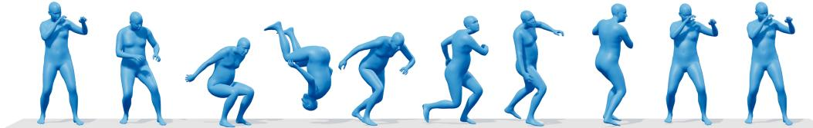

the person squats, jumps to perform a spinning kick, and lands on one hand.

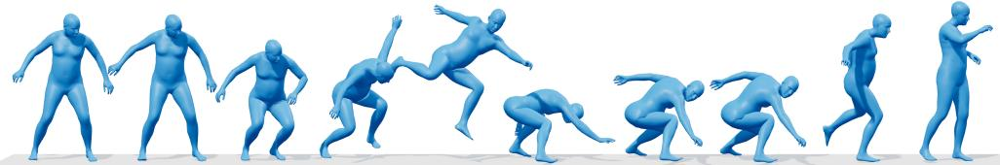

the person rolls backward with a rifle, kneels, and aims forward.

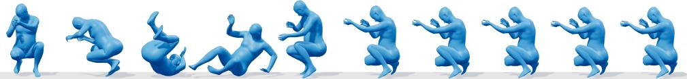

the person assumes a fighting stance and delivers a spinning kick.

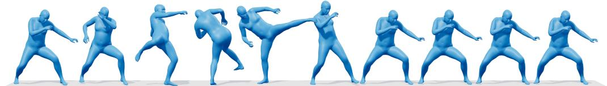

the person performs a one-handed handstand freeze and flips to land.

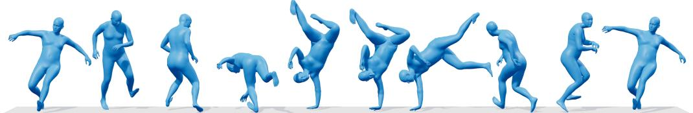

The character pulls the bow and shoots forward twice in a row while holding the bow and finally returns to the idle standing pose

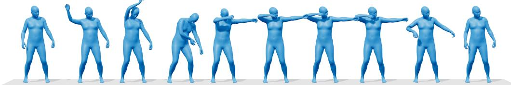  
Figure S1: Additional text-to-motion results. Motion sequences are shown with their conditioning descriptions to illustrate prompt adherence.

## C.3 MOTION KNOWLEDGE QUESTION ANSWERING

Table S7 presents text-only probes of motion knowledge and motion-language instruction generation. Base and ours receive the same English questions without any motion input. These examples probe motion-related knowledge and instruction generation without motion input, complementing the motion-conditioned captioning evaluation.

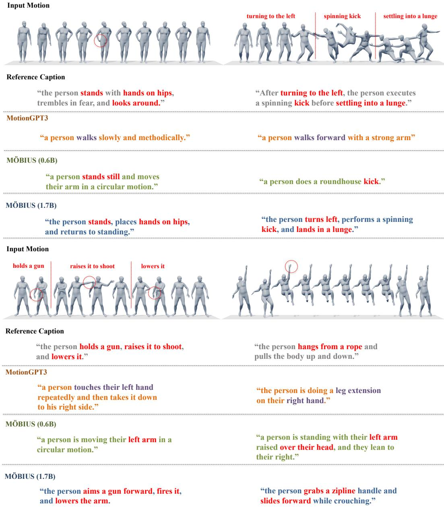  
Figure S2: Additional motion-to-text examples. The motion sequences and corresponding captions illustrate motion understanding at the example level.

## C.4 TEMPORAL COMPLETION

Table S9 reports results under four observation patterns. The 0.6B model achieves the lowest MPJPE in all four tasks, while the 1.7B model achieves the lowest FID throughout. For example, in prediction, our MPJPE reaches 7.177 compared with the best baseline’s 8.781; in keyframe infilling, our best FID is 0.286 compared with 0.358. Observed-frame preservation remains task-dependent: HY-Motion has the lowest [P]-MPJPE for prediction and Kimodo for in-betweening, whereas our models lead for backcasting and keyframe infilling. These results show complementary strengths in reconstruction and distributional quality, rather than a uniform advantage on every metric. The two model sizes also use different training data, so their comparison does not isolate model scale.

Table S7: Qualitative comparison on motion-knowledge QA and motion-language instruction generation. All questions are text-only and require no motion input.
<table><tr><td>Base</td><td>Ours</td></tr><tr><td colspan="2">Q1. How does the body&#x27;s height change when stepping up versus stepping down?</td></tr><tr><td>Answer When stepping up, the body moves upward as the person lifts the leg and pushes onto the higher surface. When stepping down, the body moves downward as the person lowers the foot to the lower surface and transfers their weight onto it.</td><td>The body&#x27;s center of mass rises when stepping up and lowers when stepping down, following the change in support height.</td></tr><tr><td>Q2. What happens to the knee and hip joints when a person squats down? Answer hips bend to lower the body. The knees move forward while the hips move backward, allow- of the squat. ing the person to descend while maintaining bal- ance.</td><td>As a person squats down, both the knees and Both the knees and hips flex as the body lowers, with increasing joint flexion toward the bottom</td></tr><tr><td colspan="2">Q3. Why is it harder to maintain balance when hopping on one foot than when jumping on both feet? Answer Hopping on one foot is more difficult because One-foot hopping has a smaller support area, re- the body has only one foot supporting its weight. quiring tighter control of the center of mass to This provides less stability and requires more remain balanced over the supporting foot. coordination to keep the body upright, whereas</td></tr><tr><td colspan="2">using both feet gives a more stable base of sup- port. Q4. Generate three random text instructions that could be used for text-to-motion generation.</td></tr><tr><td colspan="2">Answer 1. Walk forward naturally for a few steps, as if 1. A person walks forward three steps and turns approaching something in front of you. 2. Try a simple jumping movement where you bend your legs, push yourself off the ground, and then land again. 3. Slowly turn your body toward the left while</td></tr><tr><td colspan="2">knees bent. moving your arms naturally with the motion. Q5. What kind of movement is Tai Chi, and how is it typically performed? Answer Tai Chi is a traditional Chinese martial art Tai Chi uses slow, continuous movements with</td></tr></table>

Effect of multi-task training on T2M and M2T. Table S8 compares the main-table 0.6B model with the multi-task variant after 20k continuation steps. Adding conditional generation tasks yields a modest T2M trade-off: R@1 decreases by 1.53 percentage points, FID increases from 6.1291 to 6.6746, and MMDist increases from 13.9973 to 14.0824. Nevertheless, the multi-task model still outperforms all other HumanML3D-trained methods in Table 1 on R@1–3, FID, and MMDist, including generation-specialized models. Its M2T scores remain identical to the main-table results, consistent with keeping the understanding parameters frozen during the additional generation training.

Why report two training variants? The main-table comparison focuses on the bidirectional T2M/M2T setting shared with unified motion–language baselines, reducing the influence of additional task-specific supervision on that comparison. The multi-task evaluation asks a complementary question: can the same architecture accommodate additional observation patterns and conditional generation objectives while retaining its core capabilities? The temporal-completion results, together with the strong T2M scores and unchanged M2T performance, support this broader task coverage without introducing task-specific generation modules. We therefore report the variants separately to make the trade-off between task breadth and T2M specialization explicit. This demonstrates extensibility across trained tasks, rather than establishing zero-shot generalization to unseen tasks or distributions.

Table S8: T2M performance of the main-table and multi-task 0.6B variants. The first row reproduces Table 1; the second uses the multi-task 20k EMA checkpoint. FID is reported in the evaluator’s raw embedding space, as in the main table. M2T scores are unchanged.
<table><tr><td>Variant</td><td>R@1↑</td><td>R@2↑</td><td>R@3↑</td><td>FID↓</td><td>MMDist↓</td></tr><tr><td>Main-table model</td><td>0.8209</td><td>0.9397</td><td>0.9670</td><td>6.1291</td><td>13.9973</td></tr><tr><td>Multi-task model</td><td>0.8056</td><td>0.9221</td><td>0.9583</td><td>6.6746</td><td>14.0824</td></tr></table>

Table S9: Motion temporal completion on HumanML3D. [P]-MPJPE measures the preservation error on conditioned frames. Lower MPJPE, [P]-MPJPE, FID, and MM-D are better, while higher R-Precision is better.
<table><tr><td>Method</td><td>MPJPE↓</td><td>[P]-MPJPE↓</td><td>FID↓</td><td>R1↑</td><td>R2↑</td><td>R3↑</td><td>MM-D↓</td></tr><tr><td></td><td>0.000</td><td>0.000</td><td>0.000</td><td>0.448</td><td>0.646</td><td>0.767</td><td>3.466</td></tr><tr><td colspan="8">Motion Prediction</td></tr><tr><td>CondMDI (Cohan et al., 2024)</td><td>11.439</td><td>5.882</td><td>3.213</td><td>0.383</td><td>0.565</td><td>0.667</td><td>3.927</td></tr><tr><td>Kimodo (Rempe et al., 2026)</td><td>8.781</td><td>1.368</td><td>1.480</td><td>0.337</td><td>0.503</td><td>0.616</td><td>4.532</td></tr><tr><td>HY-Motion (1B) (Wen et al., 2025)</td><td>9.372</td><td>0.856</td><td>3.185</td><td>0.401</td><td>0.592</td><td>0.701</td><td>4.148</td></tr><tr><td>MotionLab (Guo et al., 2025)</td><td>9.829</td><td>4.086</td><td>1.108</td><td>0.436</td><td>0.626</td><td>0.733</td><td>3.479</td></tr><tr><td>Ours (0.6B)</td><td>7.177</td><td>1.232</td><td>0.543</td><td>0.493</td><td>0.696</td><td>0.806</td><td>3.099</td></tr><tr><td>Ours (1.7B)</td><td>7.754</td><td>1.320</td><td>0.435</td><td>0.498</td><td>0.695</td><td>0.802</td><td>3.118</td></tr><tr><td colspan="8">Motion Backcasting</td></tr><tr><td>CondMDI (Cohan et al., 2024)</td><td>11.704</td><td>8.049</td><td>3.895</td><td>0.361</td><td>0.553</td><td>0.656</td><td>4.054</td></tr><tr><td>Kimodo (Rempe et al., 2026)</td><td>8.794</td><td>2.408</td><td>0.969</td><td>0.345</td><td>0.532</td><td>0.649</td><td>4.301</td></tr><tr><td>HY-Motion (1B) (Wen et al., 2025)</td><td>9.118</td><td>2.857</td><td>1.344</td><td>0.426</td><td>0.617</td><td>0.726</td><td>3.848</td></tr><tr><td>MotionLab (Guo et al., 2025)</td><td>9.923</td><td>5.438</td><td>2.292</td><td>0.474</td><td>0.682</td><td>0.785</td><td>3.123</td></tr><tr><td>Ours (0.6B)</td><td>6.812</td><td>2.291</td><td>0.519</td><td>0.483</td><td>0.685</td><td>0.801</td><td>3.135</td></tr><tr><td>Ours (1.7B)</td><td>7.419</td><td>2.459</td><td>0.416</td><td>0.482</td><td>0.689</td><td>0.799</td><td>3.125</td></tr><tr><td colspan="8">Motion In-Betweening</td></tr><tr><td>CondMDI (Cohan et al., 2024)</td><td>11.299</td><td>6.869</td><td>2.878</td><td>0.387</td><td>0.568</td><td>0.676</td><td>3.914</td></tr><tr><td>Kimodo (Rempe et al., 2026)</td><td>7.604</td><td>1.436</td><td>1.251</td><td>0.353</td><td>0.532</td><td>0.655</td><td>4.347</td></tr><tr><td>HY-Motion (1B) (Wen et al., 2025)</td><td>9.457</td><td>1.986</td><td>6.183</td><td>0.358</td><td>0.541</td><td>0.651</td><td>4.679</td></tr><tr><td>MotionLab (Guo et al., 2025)</td><td>8.984</td><td>4.422</td><td>1.213</td><td>0.434</td><td>0.631</td><td>0.740</td><td>3.474</td></tr><tr><td>Ours (0.6B)</td><td>6.354</td><td>1.655</td><td>0.465</td><td>0.488</td><td>0.684</td><td>0.803</td><td>3.131</td></tr><tr><td>Ours (1.7B)</td><td>6.724</td><td>1.666</td><td>0.371</td><td>0.489</td><td>0.685</td><td>0.802</td><td>3.145</td></tr><tr><td colspan="8">Keyframe Infilling</td></tr><tr><td>CondMDI (Cohan et al., 2024)</td><td>7.324</td><td>6.711</td><td>2.881</td><td>0.442</td><td>0.545</td><td>0.742</td><td>3.694</td></tr><tr><td>Kimodo (Rempe et al., 2026)</td><td>5.015</td><td>2.485</td><td>0.358</td><td>0.397</td><td>0.606</td><td>0.727</td><td>3.848</td></tr><tr><td>HY-Motion (1B) (Wen et al., 2025)</td><td>11.984</td><td>7.314</td><td>18.878</td><td>0.275</td><td>0.431</td><td>0.534</td><td>6.016</td></tr><tr><td>MotionLab (Guo et al., 2025)</td><td>5.954</td><td>4.262</td><td>1.225</td><td>0.478</td><td>0.682</td><td>0.792</td><td>3.136</td></tr><tr><td>Ours (0.6B)</td><td>4.501</td><td>2.394</td><td>0.398</td><td>0.492</td><td>0.699</td><td>0.811</td><td>3.208</td></tr><tr><td>Ours (1.7B)</td><td>4.541</td><td>2.333</td><td>0.286</td><td>0.489</td><td>0.691</td><td>0.803</td><td>3.278</td></tr></table>