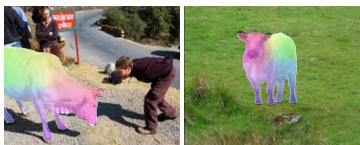

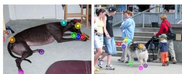

# Manifold Embedding of Deep Image Features for Image Matching via Neural Adjoint Maps

Nafie El Amrani

Moritz Heep

Florian Bernard

University of Bonn

Lamarr Institute

(a) Dense matching  
(b) Sparse matching  
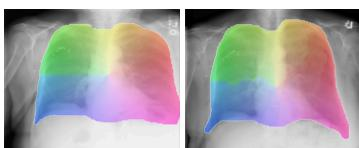  
(c) Medical image matching  
Figure 1: We propose a novel zero-shot method for finding correspondences between different object instances from similar categories. In each panel, the left image is the source and the right is the target. Our method is flexible and solves (a) dense image matching, (b) sparse image matching, and due to the zero-shot nature it is directly applicable to other domains, such as (c) medical images.

## Abstract

Estimating semantic correspondences between different object instances of similar categories in real-world images is a fundamental challenge in computer vision. While the recent progress in foundation models has significantly advanced solutions for such difficult image correspondence problems, respective methods are often insufficiently regularised. For example, common nearest-neighbour matching with foundation model features often results in noisy correspondences, which is particularly prominent when solving for dense correspondences. In this work, we tackle image matching via functional maps, which have been popularised for 3D shape matching due to their powerful spectral formalism utilising an efficient lowdimensional linear representation. However, functional maps require that domains (in our cases the rectangular image grids) are equipped with an informative and non-trivial geometry. To define a meaningful manifold structure for images, we use Galerkin’s method from finite elements to derive a discrete Laplace-Beltrami operator (LBO) based on a manifold embedding of deep image features. Further, we leverage a neural adjoint map that allows to represent non-linear mappings. We demonstrate that our method sets the new state of the art among zero-shot image correspondence methods on multiple dense correspondence benchmarks of real-world images. Our code is publicly available: https://github.com/ NafieAmrani/NAMI.

## 1 Introduction

Finding (semantic) correspondences across images is a fundamental task in computer vision, as it forms a prerequisite for numerous downstream tasks, such as image registration and stitching [1], 3D reconstruction [2, 3], structure-from-motion [4], and many more. Recent foundation models, such as DINO [5, 6] or CLIP [7] have been demonstrated to lead to powerful feature descriptors that are well-suited to establish image correspondences [8–10]. Most commonly, respective feature descriptors are matched based on a simple nearest-neighbour (NN) routine [8]. NN matching is generally reliable for finding sparse correspondences. However, it lacks a sense of global structure, such as semantic or geometric context, which often results in unreliable and unsmooth results. These issues are particularly evident when using NN to establish dense image matchings.

Dense matching problems are also omnipresent in 3D shape analysis; among the most successful approaches for 3D shape matching are deep functional map methods [11–14] that build upon the functional maps (FM) framework [15]. Instead of matching points directly, functional maps operate on low-dimensional function spaces represented by low-rank matrices. In the context of 3D geometry, these spaces are typically spanned by the spectral basis of the LBO; this low-dimensional representation effectively regularises the matching, allowing the problem to be solved in a coordinate system defined by the shape’s own intrinsic geometry. After optimisation, dense shape correspondences can be recovered from the low-rank matrix. Overall, the utility and success of the FM framework originates in the use of informative and explicit geometric information of the 3D shapes. Despite its success for 3D shape matching, so far the FM framework is underexplored for finding correspondences across 2D images – this is because of the severe challenge that images do not explicitly give rise to informative geometric information.

In this work, we explore how to best exploit the FM framework for finding correspondences across 2D images. Although (natural) images represent 2D projections of geometric (and textured) 3D objects, the resulting images are (geometrically) flat. Thus, they do not allow direct access to the underlying geometric information. Recent work proposed to represent an image in terms of a 4-connected pixel graph, where an exponential kernel applied to distances of deep features is used to obtain edge weights [16]. However, major drawbacks of this approach are the ad-hoc choice of a scale parameter and the resulting weak theoretical properties.

Our approach circumvents this by introducing a geometric manifold embedding of deep image features. From a technical point of view, we interpret each feature as a high-dimensional vertex coordinate for a quad mesh given by the image grid, so that we can apply Galerkin’s method from finite elements to derive a discrete LBO. This avoids choosing a scale parameter and inherits theoretical properties from variational methods [17]. Further, we have found that within our manifold embedding framework, the standard functional map approach (a linear transform on truncated spectral bases) loses too much information to be sufficiently expressive (see Fig. 5). Hence, we leverage the recently introduced Neural Adjoint Map (NAM) [14] approach, which compensates for this truncation-induced loss by aligning our manifold embeddings non-linearly within the truncated subspace. Overall, we demonstrate that our novel framework obtains compelling experimental results across a range of different settings (see Fig. 1). We summarise our contributions as follows:

1. For the first time, we introduce a manifold embedding of deep image features, which we combine with NAMs to address the image correspondence problem.

2. Unlike the previous functional map-based image matching method [16], our manifold embedding perspective leads to a discrete LBO that does not require choosing a scale parameter and inherits favourable theoretical properties from variational methods.

3. Experimentally, we show that we outperform existing zero-shot baselines in dense real-world image correspondence benchmarks. Further, we illustrate the advantage of our zero-shot approach by applying it to other domains such as medical image matching.

## 2 Related work

Functional maps. The functional map framework, first introduced by Ovsjanikov et al. [15], has become a well-established paradigm for non-rigid 3D shape matching. Rather than solving for pointwise correspondences through an expensive combinatorial optimisation problem [18–22], functional maps operate in the functional domain. To this end, correspondence relationships are encoded into a compact matrix, known as the functional map, which represents a linear transformation between spectral embeddings. Due to its inherent simplicity and efficiency, the framework has been extended to improve robustness [23, 24], facilitate multishape matching [25], and address nonisometric [26, 27] or partial shape matching [28]. However, severe partiality remains a known challenge for functional maps as core underlying assumptions degrade [29], motivating alternative shape-matching frameworks [30]. Furthermore, shifting from traditional methods dependent on hand-crafted features [31, 32], functional maps have been integrated into both supervised [11, 33] and unsupervised [12, 13] deep learning architectures, enabling applications ranging from medical 3D image matching [34–36] to latent representation alignment [37]. While the standard functional map framework parametrises the alignment between truncated spectral bases as a linear transformation, recent work has introduced a non-linear formalism [14]. This extension recovers expressivity lost to spectral truncation, information that no linear operator on the truncated coefficients can represent, and has yielded superior results in 3D shape matching.

Despite these advancements in 3D, applying functional maps to 2D images remains challenging. Treating images as geometric surfaces rather than flat regular grids has a rich history, ranging from classical PDE and anisotropic scale-space formulations [38–42] to modern geometric operator theory [43], yet a discretisation suited to functional maps is still lacking. Early works [44, 45] represented images as graphs via super-pixel decompositions, but the resulting eigenfunctions suffer from significant information loss. To mitigate this, [16] recently built a graph from foundation model features. While improving performance, the resulting graph is an ad-hoc construction and without a geometric interpretation. To address this, we propose using a discretised LBO of a 2D surface embedded in the high-dimensional feature space of foundational models.

Semantic image correspondence. Semantic matching aims to establish keypoint correspondences by identifying functionally or contextually equivalent roles across images, regardless of appearance or pose variations. While we focus here on the developments most relevant to our approach, a more extensive review of the field is available in the recent survey by Zhang et al. [46]. Traditional semantic correspondence frameworks extract features from images [47–49], compute pairwise similarities through cost volume representations [50–52] and subsequently estimate the final matching field between images [53–55]. As they rely on smooth displacement fields or locally varying affine transformations, these methods often fail to determine dense correspondences for complex articulated deformations. To mitigate this, multiple works have introduced end-to-end regression techniques [50, 56, 57] or parameterized spatial priors [58–61]. Other research directions have explored the prediction of semantic correspondences in weakly supervised settings via dense image alignment [62, 63], or through unsupervised frameworks via automatic label generation [64–66].

However, due to limited feature capacity or an over-reliance on strong spatial priors, these methods still struggle with challenging scenarios involving significant pose changes or pronounced changes in appearance between different instances of the same category, e.g. colour changes or non-rigid deformations. To overcome this, we propose a non-linear, structure-aware formalism capable of enhancing matching fidelity without necessitating restrictive spatial priors.

Correspondence from vision foundational models. While self-supervised and unsupervised learning methods have gained popularity [67–71], those trained primarily on image-level objectives [68, 71, 72] often fail to capture fine-grained spatial details [73, 74]. To address this, recent advancements in patch-based methods [5, 6, 75] and diffusion models [76–79] have demonstrated increased robustness to geometric transformations, enabling the extraction of dense correspondences in zero-shot settings [9, 10, 74]. Within the domain of image correspondence, Zhang et al. [8] estab lished that combined features from DINOv2 [5] and Stable Diffusion [77] are sufficiently descriptive to achieve strong zero-shot performance using a simple nearest-neighbour search. Zhang et al. [80] further addressed left/right geometric ambiguities in such features.

Still, nearest neighbour search relies solely on the descriptiveness of the features and inherently lacks the contextual information provided by the image structure. Building on existing spectral mapping methods [16], we propose a framework that incorporates non-linear spectral mappings to regularise the matching and increase robustness towards ambiguous features and medical imagery.

## 3 Background

The goal of our method is to establish correspondences between two images using the functional maps framework [15]. Depending on the point of view, we can represent such correspondences either continuously as a mapping T between rectangular subsets of R2, or discretely as a permutation Π of landmarks like pixels or features. The functional maps framework connects these two. We will first discuss the functional maps framework for general manifolds in Section 3.1. We will then apply it to image matching in Section 4 by equipping the flat image with a manifold structure.

## 3.1 Functional maps for manifolds

The functional maps framework [15] establishes a mapping between two functions defined on general manifolds $\mathcal { M } _ { s }$ and $\mathcal { M } _ { t }$ . This allows shifting the analysis from point-to-point mappings to linear transformations between function spaces. Any bijective mapping $\bar { T } : \mathcal { M } _ { s } \stackrel { \cdot } {  } \mathcal { M } _ { t }$ between points on two manifolds induces a mapping $\dot { T } _ { F } : L ^ { 2 } ( \dot { \mathcal { M } } _ { t } ) ^ { \sim } \mathnormal { L } ^ { 2 } ( \dot { \mathcal { M } _ { s } } )$ between (square-integrable) functions on the manifolds. This mapping is defined through the pullback $T _ { F } ( f ) \overset { \cdot } { = } f \circ T , i . e$ . the function f on $\mathcal { M } _ { t }$ becomes a function on $\mathcal { M } _ { s }$ by first mapping its argument from $\mathcal { M } _ { s }$ to $\mathcal { M } _ { t } .$ . It can be shown that $T _ { F }$ is in fact linear.

The key observation behind the functional maps framework is that using (truncated) bases for the respective function spaces, $f \in L ^ { 2 } ( \mathcal { M } _ { t } )$ and $g \in L ^ { 2 } ( \mathcal { M } _ { s } )$ , are represented through vectors of coefficients a and b, respectively. Accordingly, the linear operator $g = T _ { F } ( f )$ is represented through $\pmb { b } = \pmb { C } \pmb { a }$ . With that, the problem of finding a map $T _ { F }$ can be reduced to finding the matrix C. This matrix relates to the point-wise map Π as

$$
C = \Phi _ { s } ^ { \dagger } \Pi \Phi _ { t } ,\tag{1}
$$

where $\Phi _ { \bullet }$ are the projections onto the respective function bases. With that, we can extract the point-wise map Π by applying the functional map to Dirac δ-distributions for each point.

More recently, [81] proved that the mapping of Dirac δ-distributions is accurately described by the adjoint operator $T _ { A } : L ^ { 2 } ( \mathcal { M } _ { s } )  L ^ { 2 } ( \mathcal { \bar { M } } _ { t } )$ , which is uniquely defined through the duality condition

$$
\big \langle T _ { A } ( g ) , f \big \rangle _ { L ^ { 2 } ( \mathcal { M } _ { t } ) } = \big \langle g , T _ { F } ( f ) \big \rangle _ { L ^ { 2 } ( \mathcal { M } _ { s } ) } , \qquad \forall f \in L ^ { 2 } ( \mathcal { M } _ { s } ) , g \in L ^ { 2 } ( \mathcal { M } _ { t } ) ,\tag{2}
$$

where $\langle \cdot , \cdot \rangle _ { L ^ { 2 } ( \cdot ) }$ denotes the inner product on the respective manifolds [81–83]. This adjoint map can be understood as the functional analogue to the transpose matrix. This becomes apparent when looking at the discrete representation

$$
\pmb { A } = \tilde { \pmb { M } } _ { t } ^ { - 1 } \pmb { C } ^ { T } \tilde { \pmb { M } } _ { s }\tag{3}
$$

of $T _ { A }$ in the function bases, where $\tilde { M } _ { \bullet } = \Phi _ { \bullet } ^ { T } M _ { \bullet } \Phi$ is the basis-projected mass matrix for the respective manifold. We refer to [81, 82] for further details. Importantly, this duality allows for the definition of a non-linear generalisation of functional maps, which we discuss in the next section.

## 3.2 Neural adjoint maps

NAMs [14] generalise the linear adjoint operator A by replacing the matrix-based transformation with a non-linear neural representation. NAM considers discrete manifolds $\mathcal { M } _ { s }$ and $\mathcal { M } _ { t }$ represented by m and n vertices, respectively. For the truncated function bases, the first k eigenfunctions of the LBOs of $\mathcal { M } _ { s }$ and $\mathcal { M } _ { t } .$ , denoted by $\Phi _ { s } \in \mathbb { R } ^ { m \times k }$ and $\Phi _ { t } \in \mathbb { R } ^ { n \times k }$ , are used.

With that, NAM parametrises the adjoint operator as a neural network $h _ { \theta } : \mathbb { R } ^ { k }  \mathbb { R } ^ { k }$ that aligns the source and target basis embeddings. The model is trained to minimise the alignment error between the source basis and the transformed target basis, given a pointwise correspondence $\mathbf { I } \mathbf { I } _ { t s } \in \{ 0 , 1 \} ^ { m \times n }$ which maps vertices between the source and target manifolds. This approach allows the framework to maintain the structural benefits of the adjoint operator, specifically its efficiency in mapping Dirac δ-distributions, while utilising the expressive power of neural networks to achieve a more precise non-linear alignment that overcomes the spectral resolution and linearity constraints of a strictly linear matrix A. We refer to [14] for further details.

To translate a trained NAM $h _ { \theta }$ into point-to-point correspondences, we can perform nearest neighbour search (NN) in the space of the embedding of $\mathcal { M } _ { s } , i . e . \mathbf { \hat { U } } _ { s t } = \mathrm { N N } ( \Phi _ { s } , h _ { \theta } ( \Phi _ { t } ) )$ . Here, $h _ { \theta } ( \bar { \Phi _ { t } } )$ is to be understood as a row-wise mapping.

## 4 Our image matching approach

To facilitate robust feature matching from a source image $\mathcal { T } _ { s }$ to a target image $\mathcal { T } _ { t }$ , we propose the optimisation of a NAM [14] with an LBO specifically computed for images. Our framework assumes that for each feature patch on the source image there exists a semantic counterpart in the target image as in [16]. The pipeline is presented in Fig. 2 and begins by extracting two sets of features $\pmb { { E } } _ { s }$ and $\pmb { F } _ { s }$ for the source image from two frozen, off-the-shelf foundation models (e.g. DINO [5] or Stable Diffusion [77]). The same models are used to obtain $\scriptstyle { \pmb { E } } _ { t }$ and $\mathbf { } F _ { t }$ from the target image. Next, the features $\pmb { { \cal E } } _ { s }$ and $\scriptstyle { E _ { t } }$ are used to construct an LBO for the input images to extract spectral embeddings. Finally, the features $\pmb { F } _ { s }$ and $\mathbf { } F _ { t } ^ { } ,$ , alongside the spectral embeddings, are utilised to train our NAM. These stages are discussed in detail in the following sections.

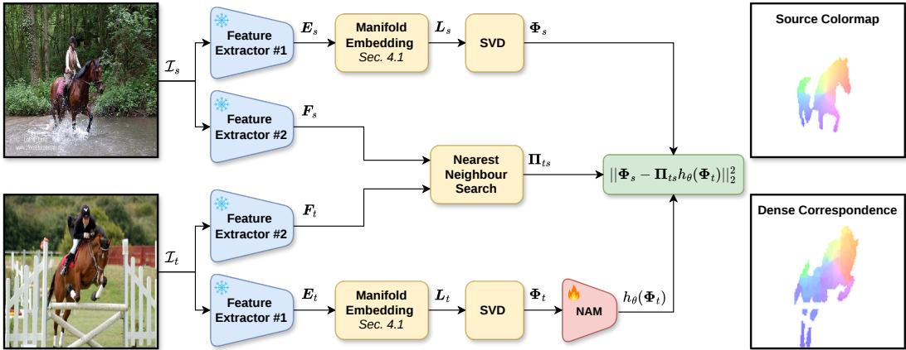  
Figure 2: Overview of our method. Two sets of features are extracted for each input image. One set is used to derive our LBO via a Manifold Embedding used in the spectral branch of our approach (top and bottom). The other set is used in the point-wise matching branch leveraging nearest-neighbour search (middle). Both branches are coupled via the alignment loss (green box, see Eqn. (9)).

## 4.1 Laplace-Beltrami operator for images via manifold embedding

Unlike previous work [16], we do not represent the image through a 4-connected graph, but we take a proper geometry-inspired approach. To this end, we interpret high-dimensional image features (e.g. obtained through foundation models) as an embedding $\pmb { { E } } : [ 0 , w ] \times [ 0 , h ]  \mathbb { R } ^ { d }$ of the 2D image domain $[ 0 , w ] \times [ 0 , h ]$ into a high-dimensional feature space, i.e. a 2D manifold. For this, we treat each pixel of the feature map as a vertex in a quad mesh and use the feature itself as the d-dimensional vertex position. Using this quad mesh, we resort to the theory of finite elements to derive a LBO.

For our quad mesh, we chose bilinear basis functions $\phi _ { i }$ (often called hat functions): For each pixel $( x _ { i } , y _ { i } )$ in the feature map, the basis function $\phi _ { i }$ is obtained by translating

$$
\phi ( x , y ) : = \operatorname* { m a x } \left( ( 1 - | x | ) \cdot ( 1 - | y | ) , 0 \right) ,\tag{4}
$$

i.e. we get $\phi _ { i } ( x , y ) : = \phi ( x - x _ { i } , y - y _ { i } )$ . Following Galerkin’s approach [17], we calculate the mass and stiffness matrices as

$$
M _ { i j } : = \int _ { 0 } ^ { h } \int _ { 0 } ^ { w } \phi _ { i } ( x , y ) \phi _ { j } ( x , y ) { \sqrt { | g ( x , y ) | } } { \mathrm { d } } x { \mathrm { d } } y \quad { \mathrm { a n d } }\tag{5}
$$

$$
\boldsymbol { K } _ { i j } : = \int _ { 0 } ^ { h } \int _ { 0 } ^ { w } \langle \nabla \phi _ { i } ( x , y ) , g ^ { - 1 } ( x , y ) \nabla \phi _ { j } ( x , y ) \rangle \sqrt { | g ( x , y ) | } \mathrm { d } x \mathrm { d } y ,\tag{6}
$$

where | · | denotes the determinant and $\pmb { g } \in \mathbb { R } ^ { 2 \times 2 }$ is the (spatially varying) metric tensor defined as

$$
g _ { i j } ( x , y ) : = \langle \partial _ { i } E ( x , y ) , \partial _ { j } E ( x , y ) \rangle .\tag{7}
$$

Here, $i , j \in \{ x , y \}$ and $\langle \cdot , \cdot \rangle$ is the standard scalar product between $\partial _ { i } { \pmb E } \in \mathbb { R } ^ { d }$ . The metric tensor describes how the embedding E distorts the surface. For a flat surface and $\pmb { { \cal E } } ( x , y ) = ( x , y ) ^ { T }$ we have $g = I$ , and the above elaboration reduces to the ordinary image Laplacian. We calculate Eqs. (5) and (6) using four-point quadrature and replace M with a diagonal matrix M with elements $\begin{array} { r } { \overline { { \boldsymbol { M } } } _ { i i } : = \sum _ { j } \boldsymbol { M } _ { i j } } \end{array}$ (lumped mass). With that, the resulting discrete LBO for images is

$$
{ \pmb L } = \overline { { { \pmb M } } } ^ { - 1 } { \pmb K } .\tag{8}
$$

Choosing the diagonal matrix $\overline { { M } }$ over M is a common technique to facilitate finding the first k eigenfunctions Φ of L. To summarise, our approach is to model the geometry of a surface that is embedded by high-dimensional deep features using the theoretically well-principled Galerkin method from finite elements. This contrasts [16], which models the similarity between deep features and requires the ad-hoc choice of a kernel scale.

Properties of the proposed LBO. We model deep neural feature maps as uniform grid-samples drawn from an underlying continuous surface. For regular spatial grids, bilinear basis functions provide a canonical choice for discretization. By employing the Galerkin formulation [17], Céa’s lemma [84] guarantees that our discrete LBO yields the optimal approximation of the continuous LBO within the span of this finite-dimensional basis. This approximation bound directly yields transformation stability: potential equivariances of the input features such as rotations or translations in the image domain correspond to isometric reparametrisations of the continuous surface. Consequently, while rigid transformations yield distinct discrete grid samples, and thus distinct discrete operator matrices, both discrete representations consistently approximate the same underlying continuous LBO, preserving equivariance across representations.

## 4.2 Optimisation of the neural adjoint map

The primary objective of our method is optimising the NAM $h _ { \theta }$ in a zero-shot setting (i.e. instancespecific optimisation). This map $h _ { \theta }$ is implemented as a lightweight Multi-Layer Perceptron (MLP) with residual connections. To guide the optimisation, we establish a point-wise mapping between the patches of images $\mathcal { T } _ { s }$ and $\mathcal { T } _ { t }$ . These correspondences are derived by performing a nearest-neighbour search between feature sets $\pmb { F } _ { s }$ and $\mathbf { } F _ { t }$ as $\Pi _ { t s } = \mathrm { N N } ( \boldsymbol { F } _ { t } , \boldsymbol { F } _ { s } )$ where $\operatorname { N N } ( \cdot , \cdot )$ denotes nearest neighbour search in $\mathbf { \nabla } \mathbf { F } _ { t }$ for each entry in $\pmb { F } _ { s }$ . Finally, we minimise the alignment error

$$
\mathcal { L } = | | \Phi _ { s } - \Pi _ { t s } h _ { \theta } ( \Phi _ { t } ) | | _ { F } ^ { 2 } .\tag{9}
$$

between the eigenfunctions $\Phi _ { i }$ and $\Phi _ { t }$ of the operators $\pmb { L _ { s } }$ and $\scriptstyle { \mathbf { L } } _ { t }$ constructed from the images $\mathcal { T } _ { s }$ and $\mathcal { T } _ { t }$ as described in the previous section. Our method optionally supports spectral refinement via Neural ZoomOut [14] (see Appendix D).

## 5 Experiments

In the following, we experimentally evaluate our method on dense and sparse correspondence tasks, and show its application on medical data. Further results and ablation studies are in the appendix.

## 5.1 Experimental setup

Datasets. We use TSS [85], which provides dense correspondences for 400 pairs from FG3DCar [86], PASCAL [87], and JODS [88], and SPair-71k [89], with sparse correspondences across 70,958 pairs in 18 categories (we sample 20 pairs per category, following [8]). We further introduce a synthetic benchmark (FAUST-2D) with dense correspondences, derived from a 3D shape correspondence dataset, and defer its construction and our results on it to Appendix H.

Metrics. Following prior work [8, 16, 63, 64, 90], we report the Percentage of Correct Keypoints (PCK) [91] with threshold κ·ma ${ \bf \Pi } _ { : } ( h , w )$ , where $( h , w )$ is the instance bounding box on SPair-71k [89] and the image size on TSS [85]. Scores on TSS are aggregated over its three subsets both unweighted $( \operatorname { A v g } . )$ and weighted (Wtd. Avg.)1. On SPair-71k, we additionally report the Mean Squared Error (MSE) on keypoints to quantify mapping distortions. On TSS, we report two semantic flow metrics: the End-Point Error (EPE), the Euclidean distance between predicted and ground-truth displacement vectors, and a smoothness metric [8] measuring spatial coherence of the flow field.

Baselines. Our evaluation focuses on zero-shot correspondence methods based on vision foundation models. Specifically, we use several foundation models, including DINOv1 (ViT-S/8) [68], DINOv2 (ViT-B/14) [5], DINOv3 (ViT-B/16) [6], Stable Diffusion [77] and CleanDIFT [78], to extract features

Source Image

Colourmap

Target Image

Cheng et al. [16]

Ours

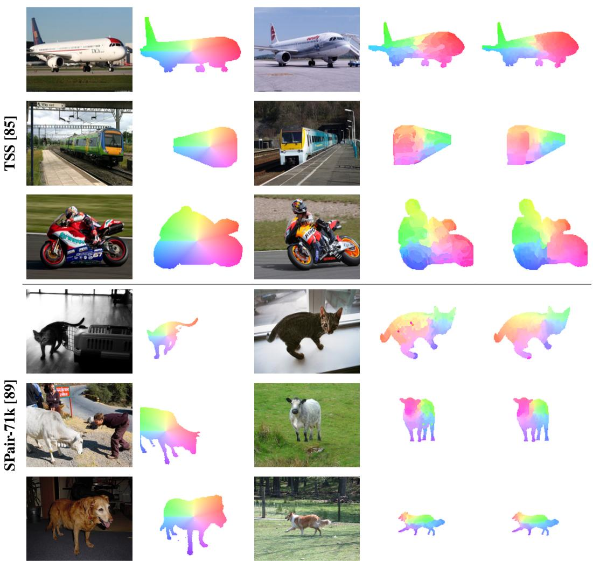  
Figure 3: Dense correspondences on two datasets. We visualise mappings from source to target by transferring a coordinate-based colourmap (second column) to the target domain (fourth and fifth columns). Our method achieves smoother and more consistent mappings than [16].

for correspondence estimation. We additionally benchmark against the feature concatenation approach (FUSE) [8], (Fuse2Match) [92] and the functional maps for images (Cheng et al. [16]). The latter serves as our primary baseline, as it similarly utilises spectral embedding matching. For each method, we report results with the optimal choice of k: $k = 5 0$ for ours and k = 200 for [16], identified empirically. We provide an ablation in Appendix C confirming that our method outperforms [16] across all considered values of k. For completeness, we report results from prior methods designed specifically for image correspondence, which rely on supervision or task-specific architectures. More experiments involving additional foundation models are included in Appendix K.

## 5.2 Dense correspondences

Results for dense correspondence on the TSS dataset are presented in Table 1. In the zero-shot setting, our approach achieves state-of-the-art performance across all metrics. For reference, we summarise the features used by each method: FUSE [8] concatenates Stable Diffusion (SD) and DINOv2-ViT-B/14 features; Fuse2Match [92] combines Stable Diffusion 3 (SD3) [96], SD, and DINOv2-ViT-B/14 features; and both Cheng et al. [16] and our method use SD features for basis computation and DINOv2-ViT-B/14 features for the training objectives. Notably, our method is approximately 100 times faster than Cheng et al. [16]; while [16] requires optimising a computationally intensive cross-attention feature refiner, our approach only necessitates optimisation of a lightweight MLP (i.e. the NAM network). We also include the performance of fully supervised and task-specific unsupervised methods as reference baselines. The qualitative dense correspondence visualisations in Fig. 3 demonstrate that our method produces significantly smoother and more spatially coherent mappings than Cheng et al. [16].

Table 1: Quantitative results (PCK@0.05↑) on the TSS dataset [85]. Methods are grouped into supervised, unsupervised and zero-shot. Our approach substantially outperforms all zero-shot baselines (bold face) and is on par with unsupervised task-specific methods. NN stands for nearestneighbour matching. We report both the unweighted (Avg.) and weighted (Wtd. Avg.) averages over the three data subsets following [8] and [16], respectively. \*: backbone fine-tuned on TSS.
<table><tr><td>Setting</td><td>Method</td><td>FG3DCar</td><td>JODS</td><td>Pascal</td><td>Avg.</td><td>Wtd. Avg.</td><td>Time [s]</td></tr><tr><td rowspan="4">Supervised</td><td>SCOT [93]</td><td>95.3</td><td>81.3</td><td>57.7</td><td>78.1</td><td>80.8</td><td></td></tr><tr><td>CATs* [50]</td><td>92.1</td><td>78.9</td><td>64.2</td><td>78.4</td><td>80.7</td><td></td></tr><tr><td>PWarpC-CATs* [94]</td><td>95.5</td><td>85.0</td><td>85.5</td><td>88.6</td><td>90.2</td><td></td></tr><tr><td>CNNGeo [59]</td><td>90.1</td><td>76.4</td><td>56.3</td><td>74.2</td><td>76.8</td><td></td></tr><tr><td rowspan="3">Unsupervised (task-specific) Unsupervised</td><td>PARN [95] GLU-Net [53]</td><td>89.5 93.2</td><td>75.9 73.3</td><td>71.2</td><td>78.8</td><td>81.0</td><td></td></tr><tr><td>Semantic-GLU-Net [54]</td><td>95.3</td><td>82.2</td><td>71.1 78.2</td><td>79.2 85.2</td><td>82.3 87.3</td><td></td></tr><tr><td>NN (DINOv1-ViT-S/8) [73]</td><td>68.7</td><td></td><td></td><td></td><td></td><td></td></tr><tr><td rowspan="6">(zero-shot)</td><td>NN (DINOv2-ViT-B/14) [5]</td><td>81.2</td><td>44.7 68.4</td><td>36.7 51.5</td><td>50.0 67.0</td><td>53.9 69.4</td><td> $< 1 0 ^ { - 3 }$   $< 1 0 ^ { - 3 }$ </td></tr><tr><td>NN (DINOv3-ViT-B/16) [6]</td><td>95.0</td><td>78.4</td><td>66.4</td><td>79.9</td><td>82.7</td><td> $< 1 0 ^ { - 3 }$ </td></tr><tr><td>NN (Stable Diffusion) [8]</td><td>92.1</td><td>62.6</td><td>51.5</td><td>67.7</td><td>72.5</td><td> $< 1 0 ^ { - 3 }$ </td></tr><tr><td>NN (CleanDIFT) [78]</td><td>95.8</td><td>80.6</td><td>72.7</td><td>83.1</td><td>85.5</td><td></td></tr><tr><td>NN (FUSE) [8]</td><td>92.9</td><td>73.8</td><td>59.6</td><td>75.4</td><td>78.7</td><td> $< 1 0 ^ { - 3 }$   $< 1 0 ^ { - 3 }$ </td></tr><tr><td>NN (Fuse2Match) [92]</td><td>95.9</td><td>79.5</td><td>70.7</td><td>82.0</td><td>84.8</td><td> $< 1 0 ^ { - 3 }$ </td></tr><tr><td colspan="2">Cheng et al. [16] Ours</td><td>93.1 96.0</td><td>74.0 81.1</td><td>59.9 75.8</td><td>75.6</td><td>78.9</td><td>95.6</td></tr></table>

Table 2: Sparse keypoint correspondences on SPair-71k [89]. While our method is on par with the baseline performance at PCK@0.1, it yields superior results for both PCK@0.2 and MSE.
<table><tr><td>Method</td><td>PCK@0.1↑</td><td>PCK@0.2↑</td><td>MSE↓</td></tr><tr><td>DINOv2</td><td>52.3</td><td>68.0</td><td>105.0</td></tr><tr><td>Stable Diffusion</td><td>51.2</td><td>64.1</td><td>120.5</td></tr><tr><td>FUSE [8]</td><td>57.2</td><td>72.2</td><td>97.2</td></tr><tr><td>CleanDIFT [78]</td><td>54.4</td><td>66.8</td><td>129.6</td></tr><tr><td>Fuse2Match [92]</td><td>61.0</td><td>72.3</td><td>100.1</td></tr><tr><td>Cheng et al. [16]</td><td>55.3</td><td>72.6</td><td>88.0</td></tr><tr><td>Ours</td><td>56.5</td><td>73.0</td><td>84.7</td></tr></table>

## 5.3 Sparse correspondences

Table 2 reports sparse keypoint correspondence results on SPair-71k [89]. Our approach yields PCK scores that are comparable to or exceed those of CleanDIFT [78], Fuse2Match [92], FUSE [8], Cheng et al. [16] across multiple thresholds, while simultaneously exhibiting a lower MSE. As illustrated in Fig. 4, our approach appears more robust in challenging scenarios. Specifically, it often distinguishes left and right keypoints correctly (first row), though some failure cases remain (Fig. A13, last row) and tends to remain reliable under substantial pose variation (second and third rows). It also appears less prone to certain failure modes observed in the baselines, such as matching a bird’s head in the source image with its reflection in the target image (last row).

## 5.4 Ablation study

We conduct an ablation study to evaluate the contribution of each component in our framework, for which we consider varying numbers of eigenfunctions, see Fig. 5. First, to validate our proposed image-based LBO, we replace it with the graph Laplacian used in [16] (plotted in blue). Second, we assess the impact of the NAM by replacing it with a linear functional map based framework (SmoothFM) [97] (plotted in green). For completeness, we additionally report the combination of both substitutions (plotted in purple). Our method achieves superior performance across all configurations, with $k = 5 0$ representing the optimal setting for our approach. While lower k values reduce high-frequency detail, they provide critical regularisation for the ambiguous DINO + SD features. This regularisation is needed, as evidenced by our nearest-neighbour results. Conversely, larger values of k degrade performance, a behaviour inherited from functional map based methods, for which an optimal number of eigenfunctions is well known [23]. Appendix F confirms that both components exhibit identical behaviour on SPair-71k [89].

FUSE [8]  
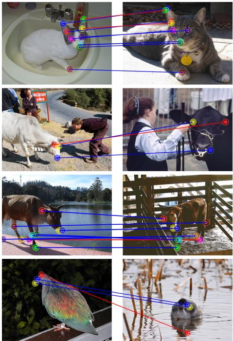

Ours  
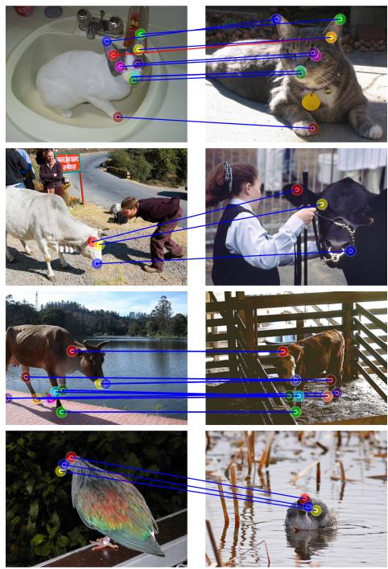

Figure 4: Visualisation of sparse correspondence on Spair-71k [89]. Correct matches are indicated by blue lines, while incorrect matches are shown in red. We compare our approach against FUSE [8], as it represents the strongest baseline in terms of PCK@0.1. Thanks to its global geometric consistency, our framework produces more robust mappings across challenging examples.  
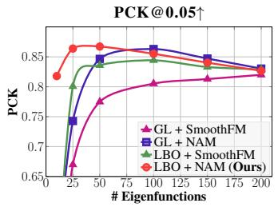

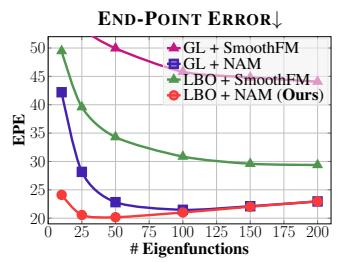

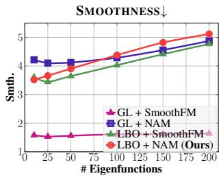  
Figure 5: Ablation of our approach without the proposed LBO or NAM on the TSS dataset. LBO + SmoothFM: we replace the NAM with a FM-based variant SmoothFM [97]. GL + NAM: we replace the LBO with the image graph Laplacian in [16]. GL + SmoothFM: we combine both alternatives. Our proposed combination of NAM and our LBO achieves the best results overall (red).

## 6 Discussion & limitations

Although our method produces overall high-quality correspondences, it also possesses some drawbacks: (i) Our formulation assumes that every source point has a counterpart in the target image. For dense image matching this breaks down under heavy occlusion or large pose differences – yet, our sparse matching experiments cover such cases by matching the set of given keypoints, see Fig. A13. Extending our framework to dense partial-to-partial matching, e.g. by predicting overlapping regions as done for 3D partial shapes in [33, 98], is a promising direction for future work. (ii) Further, our framework constructs semantic mappings by introducing an image-specific LBO derived from vision foundation model features. Because these features encapsulate a blend of semantic, geometric, and appearance information, the resulting operator represents a combination of these attributes, rather than an explicit description of 3D geometry. With that, our LBO equips the feature space with an abstract geometric notion that facilitates spatial alignment. (iii) In addition, functional maps use intrinsic properties of the manifolds to be matched. As such, the matching may flip if the deep feature embedding exhibits symmetries. Such a semantic symmetry may occur for near-symmetric images, e.g. the trains in Fig. 3. This example also confirms that it is task-dependent whether such a flip is desirable or not. (iv) Furthermore, the precision of our mappings is currently constrained by the resolution of the underlying image features, particularly when employing patch-based backbones such as DINO. However, our formalism is compatible with higher-resolution representations and can naturally be extended to upsampled [99] or pixel-level feature extractors once they become available.

## 7 Conclusion

We have presented a novel framework for finding semantic correspondences between different object instances of similar categories in real-world images. To achieve this, we consider a spectral matching formalism building upon the functional maps framework, which so far has been mainly popularised in the domain of 3D shape matching. Unlike previous spectral image matching methods, our approach leverages a well-principled LBO for 2D images that is derived via a manifold embedding of deep image features. With that, we show that the recent advances in foundation models allow us to equip the otherwise flat image with a meaningful manifold structure. Overall, our work demonstrates that well-established geometric principles can be transferred and utilised to successfully tackle fundamental challenges in image-based correspondence problems, thereby bridging the fields of 3D geometry processing and 2D computer vision.

Acknowledgments. This work is supported by the ERC starting grant no. 101160648 (Harmony).

## References

[1] Zhaobin Wang and Zekun Yang. Review on image-stitching techniques. Multimedia Systems, 26(4):413–430, 2020.

[2] Richard Hartley and Andrew Zisserman. Multiple view geometry in computer vision. Cambridge University Press, 2003.

[3] Johannes Lutz Schönberger, Enliang Zheng, Marc Pollefeys, and Jan-Michael Frahm. Pixelwise view selection for unstructured multi-view stereo. In Eur. Conf. Comput. Vis., 2016.

[4] Johannes Lutz Schönberger and Jan-Michael Frahm. Structure-from-motion revisited. In IEEE Conf. Comput. Vis. Pattern Recog., 2016.

[5] Maxime Oquab, Timothée Darcet, Théo Moutakanni, Huy Vo, Marc Szafraniec, Vasil Khalidov, Pierre Fernandez, Daniel Haziza, Francisco Massa, Alaaeldin El-Nouby, et al. DINOv2: Learning robust visual features without supervision. Trans. Mach. Learn Res., 2024.

[6] Oriane Siméoni, Huy V Vo, Maximilian Seitzer, Federico Baldassarre, Maxime Oquab, Cijo Jose, Vasil Khalidov, Marc Szafraniec, Seungeun Yi, Michaël Ramamonjisoa, et al. DINOv3. arXiv preprint arXiv:2508.10104, 2025.

[7] Alec Radford, Jong Wook Kim, Chris Hallacy, Aditya Ramesh, Gabriel Goh, Sandhini Agarwal, Girish Sastry, Amanda Askell, Pamela Mishkin, Jack Clark, et al. Learning transferable visual models from natural language supervision. In Int. Conf. Mach. Learn., pages 8748–8763. PmLR, 2021.

[8] Junyi Zhang, Charles Herrmann, Junhwa Hur, Luisa Polania Cabrera, Varun Jampani, Deqing Sun, and Ming-Hsuan Yang. A tale of two features: Stable diffusion complements DINO for zero-shot semantic correspondence. Adv. Neural Inform. Process. Syst., 36:45533–45547, 2023.

[9] Walter Goodwin, Sagar Vaze, Ioannis Havoutis, and Ingmar Posner. Zero-shot category-level object pose estimation. In Eur. Conf. Comput. Vis., pages 516–532. Springer, 2022.

[10] Eric Hedlin, Gopal Sharma, Shweta Mahajan, Hossam Isack, Abhishek Kar, Andrea Tagliasacchi, and Kwang Moo Yi. Unsupervised semantic correspondence using stable diffusion. Adv. Neural Inform. Process. Syst., 36:8266–8279, 2023.

[11] Or Litany, Tal Remez, Emanuele Rodola, Alex Bronstein, and Michael Bronstein. Deep functional maps: Structured prediction for dense shape correspondence. In Int. Conf. Comput. Vis., pages 5659–5667, 2017.

[12] Oshri Halimi, Or Litany, Emanuele Rodola, Alex M Bronstein, and Ron Kimmel. Unsupervised learning of dense shape correspondence. In IEEE Conf. Comput. Vis. Pattern Recog., pages 4370–4379, 2019.

[13] Dongliang Cao, Paul Roetzer, and Florian Bernard. Unsupervised learning of robust spectral shape matching. ACM Trans. Graph., 2023. doi: 10.1145/3592107. URL https://doi. org/10.1145/3592107.

[14] Giulio Viganò, Maks Ovsjanikov, and Simone Melzi. NAM: Neural adjoint maps for refining shape correspondences. ACM Trans. Graph., 44(4), July 2025. ISSN 0730-0301. doi: 10.1145/3730943. URL https://doi.org/10.1145/3730943.

[15] Maks Ovsjanikov, Mirela Ben-Chen, Justin Solomon, Adrian Butscher, and Leonidas Guibas. Functional maps: a flexible representation of maps between shapes. ACM Trans. Graph., 31 (4), July 2012. ISSN 0730-0301. doi: 10.1145/2185520.2185526. URL https://doi.org/ 10.1145/2185520.2185526.

[16] Xinle Cheng, Congyue Deng, Adam W Harley, Yixin Zhu, and Leonidas Guibas. Zero-shot image feature consensus with deep functional maps. In Eur. Conf. Comput. Vis., pages 277–293. Springer, 2024.

[17] Olgierd Cecil Zienkiewicz, Robert Leroy Taylor, Perumal Nithiarasu, and JZ Zhu. Thefinite element method, volume 1. Elsevier, 2005. ISBN 0750663200.

[18] Maolin Gao, Paul Roetzer, Marvin Eisenberger, Zorah Lähner, Michael Moeller, Daniel Cremers, and Florian Bernard. Sigma: Scale-invariant global sparse shape matching. In Int. Conf. Comput. Vis., pages 645–654, 2023.

[19] Florian Bernard, Zeeshan Khan Suri, and Christian Theobalt. Mina: Convex mixed-integer programming for non-rigid shape alignment. In IEEE Conf. Comput. Vis. Pattern Recog., pages 13826–13835, 2020.

[20] Thomas Windheuser, Ulrich Schlickewei, Frank R Schmidt, and Daniel Cremers. Geometrically consistent elastic matching of 3d shapes: A linear programming solution. In Int. Conf. Comput. Vis., pages 2134–2141. IEEE, 2011.

[21] Paul Roetzer and Florian Bernard. Fast globally optimal and geometrically consistent 3d shape matching. In Int. Conf. Comput. Vis., 2025.

[22] Nafie El Amrani, Paul Roetzer, and Florian Bernard. High-Resolution 3D Shape Matching with Global Optimality and Geometric Consistency. Comput. Graph. Forum, June 2025. doi: 10.1111/cgf.70208.

[23] Simone Melzi, Jing Ren, Emanuele Rodola, Abhishek Sharma, Peter Wonka, and Maks Ovsjanikov. Zoomout: Spectral upsampling for efficient shape correspondence. ACM Trans. Graph., 38(6), 2019. doi: 10.1145/3355089.3356524.

[24] Davide Eynard, Emanuele Rodola, Klaus Glashoff, and Michael M Bronstein. Coupled functional maps. In 2016 Fourth International Conference on 3D Vision (3DV), pages 399–407. IEEE, 2016.

[25] Maolin Gao, Zorah Lahner, Johan Thunberg, Daniel Cremers, and Florian Bernard. Isometric multi-shape matching. In IEEE Conf. Comput. Vis. Pattern Recog., pages 14183–14193, 2021.

[26] Jing Ren, Simone Melzi, Peter Wonka, and Maks Ovsjanikov. Discrete optimization for shape matching. In Comput. Graph. Forum, volume 40, pages 81–96. Wiley Online Library, 2021.

[27] Dorian Nogneng and Maks Ovsjanikov. Informative descriptor preservation via commutativity for shape matching. In Comput. Graph. Forum, volume 36, pages 259–267. Wiley Online Library, 2017.

[28] Emanuele Rodolà, Luca Cosmo, Michael M Bronstein, Andrea Torsello, and Daniel Cremers. Partial functional correspondence. In Comput. Graph. Forum, volume 36, pages 222–236. Wiley Online Library, 2017.

[29] Amit Bracha, Thomas Dagès, and Ron Kimmel. On unsupervised partial shape correspondence. In Asian Conference on Computer Vision, pages 316–332. Springer, 2024.

[30] Amit Bracha, Thomas Dagès, and Ron Kimmel. Wormhole loss for partial shape matching. In Proceedings of the 38th International Conference on Neural Information Processing Systems, NIPS ’24, Red Hook, NY, USA, 2024. Curran Associates Inc. ISBN 9798331314385.

[31] Mathieu Aubry, Ulrich Schlickewei, and Daniel Cremers. The wave kernel signature: A quantum mechanical approach to shape analysis. In Int. Conf. Comput. Vis. (Workshop), pages 1626–1633. IEEE, 2011.

[32] Michael M Bronstein and Iasonas Kokkinos. Scale-invariant heat kernel signatures for nonrigid shape recognition. In IEEE Conf. Comput. Vis. Pattern Recog., pages 1704–1711. IEEE, 2010.

[33] Yizheng Xie, Viktoria Ehm, Paul Roetzer, Nafie El Amrani, Maolin Gao, Florian Bernard, and Daniel Cremers. EchoMatch: Partial-to-partial shape matching via correspondence reflection. In IEEE Conf. Comput. Vis. Pattern Recog., June 2025.

[34] Francesca Maccarone, Giorgio Longari, Filippo Arrigoni, Denis Peruzzo, and Simone Melzi. Unraveling brainstem deformations in joubert syndrome: A statistical shape analysis of mriderived structures. In Int. Conf. Medical Image Comput. and Comput. Assisted Interv., pages 659–669. Springer, 2025.

[35] Nafie El Amrani, Dongliang Cao, and Florian Bernard. A universal and flexible framework for unsupervised statistical shape model learning. In Int. Conf. Medical Image Comput. and Comput. Assisted Interv., October 2024.

[36] Lennart Bastian, Alexander Baumann, Emily Hoppe, Vincent Bürgin, Ha Young Kim, Mahdi Saleh, Benjamin Busam, and Nassir Navab. S3M: Scalable statistical shape modeling through unsupervised correspondences. In Int. Conf. Medical Image Comput. and Comput. Assisted Interv., pages 459–469. Springer, 2023.

[37] Marco Fumero, Marco Pegoraro, Valentino Maiorca, Francesco Locatello, and Emanuele Rodolà. Latent functional maps: a spectral framework for representation alignment. In A. Globerson, L. Mackey, D. Belgrave, A. Fan, U. Paquet, J. Tomczak, and C. Zhang, editors, Adv. Neural Inform. Process. Syst., volume 37, pages 66178–66203. Curran Associates, Inc., 2024. doi: 10.52202/ 079017-2115. URL https://proceedings.neurips.cc/paper\_files/paper/2024/ file/79be41d858841037987964e3f5caf76d-Paper-Conference.pdf.

[38] Stanley Osher and James A Sethian. Fronts propagating with curvature-dependent speed: Algorithms based on hamilton-jacobi formulations. Journal of computational physics, 79(1): 12–49, 1988.

[39] Pietro Perona and Jitendra Malik. Scale-space and edge detection using anisotropic diffusion. IEEE Transactions on pattern analysis and machine intelligence, 12(7):629–639, 1990.

[40] Luis Alvarez, Frédéric Guichard, Pierre-Louis Lions, and Jean-Michel Morel. Axioms and fundamental equations of image processing. Archivefor rational mechanics and analysis, 123 (3):199–257, 1993.

[41] Vicent Caselles, Ron Kimmel, and Guillermo Sapiro. Geodesic active contours. International journal ofcomputer vision, 22(1):61–79, 1997.

[42] Ron Kimmel. Numerical geometry of images: Theory, algorithms, and applications. Springer Science & Business Media, 2012.

[43] Thomas Dagès, Michael Lindenbaum, and Alfred M Bruckstein. Metric convolutions: A unifying theory to adaptive image convolutions. In 2025 IEEE/CVF International Conference on Computer Vision (ICCV), pages 13974–13984. IEEE, 2025.

[44] Fan Wang, Qixing Huang, and Leonidas J Guibas. Image co-segmentation via consistent functional maps. In Int. Conf. Comput. Vis., pages 849–856, 2013.

[45] Fan Wang, Qixing Huang, Maks Ovsjanikov, and Leonidas J Guibas. Unsupervised multi-class joint image segmentation. In IEEE Conf. Comput. Vis. Pattern Recog., pages 3142–3149, 2014.

[46] Kaiyan Zhang, Xinghui Li, Jingyi Lu, and Kai Han. Semantic correspondence: Unified benchmarking and a strong baseline. IEEE Trans. Pattern Anal. Mach. Intell., 2025.

[47] David G Lowe. Object recognition from local scale-invariant features. In Int. Conf. Comput. Vis., volume 2, pages 1150–1157. IEEE, 1999.

[48] Karen Simonyan and Andrew Zisserman. Very deep convolutional networks for large-scale image recognition. In Int. Conf. Learn. Represent., 2015.

[49] Kaiming He, Xiangyu Zhang, Shaoqing Ren, and Jian Sun. Deep residual learning for image recognition. In IEEE Conf. Comput. Vis. Pattern Recog., pages 770–778, 2016.

[50] Seokju Cho, Sunghwan Hong, Sangryul Jeon, Yunsung Lee, Kwanghoon Sohn, and Seungryong Kim. CATs: Cost aggregation transformers for visual correspondence. In M. Ranzato, A. Beygelzimer, Y. Dauphin, P.S. Liang, and J. Wortman Vaughan, editors, Adv. Neural Inform. Process. Syst., volume 34, pages 9011–9023. Curran Associates, Inc., 2021. URL https://proceedings.neurips.cc/paper\_files/paper/ 2021/file/4b6538a44a1dfdc2b83477cd76dee98e-Paper.pdf.

[51] Sunghwan Hong, Seokju Cho, Jisu Nam, Stephen Lin, and Seungryong Kim. Cost aggregation with 4d convolutional swin transformer for few-shot segmentation. In Eur. Conf. Comput. Vis., pages 108–126. Springer, 2022.

[52] Junghyup Lee, Dohyung Kim, Jean Ponce, and Bumsub Ham. SFNet: Learning object-aware semantic correspondence. In IEEE Conf. Comput. Vis. Pattern Recog., June 2019.

[53] Prune Truong, Martin Danelljan, and Radu Timofte. GLU-Net: Global-local universal network for dense flow and correspondences. In IEEE Conf. Comput. Vis. Pattern Recog., June 2020.

[54] Prune Truong, Martin Danelljan, Fisher Yu, and Luc Van Gool. Warp consistency for unsupervised learning of dense correspondences. In Int. Conf. Comput. Vis., pages 10346–10356, October 2021.

[55] Seungryong Kim, Dongbo Min, Somi Jeong, Sunok Kim, Sangryul Jeon, and Kwanghoon Sohn. Semantic attribute matching networks. In IEEE Conf. Comput. Vis. Pattern Recog., June 2019.

[56] Jae Yong Lee, Joseph DeGol, Victor Fragoso, and Sudipta N. Sinha. Patchmatch-based neighborhood consensus for semantic correspondence. In IEEE Conf. Comput. Vis. Pattern Recog., pages 13153–13163, June 2021.

[57] Shuaiyi Huang, Luyu Yang, Bo He, Songyang Zhang, Xuming He, and Abhinav Shrivastava. Learning semantic correspondence with sparse annotations. In Shai Avidan, Gabriel Brostow, Moustapha Cissé, Giovanni Maria Farinella, and Tal Hassner, editors, Eur. Conf. Comput. Vis., pages 267–284, Cham, 2022. Springer Nature Switzerland. ISBN 978-3-031-19781-9.

[58] Seungryong Kim, Stephen Lin, Sangryul Jeon, Dongbo Min, and Kwanghoon Sohn. Recurrent transformer networks for semantic correspondence. In Adv. Neural Inform. Process. Syst., NIPS’18, page 6129–6139, Red Hook, NY, USA, 2018. Curran Associates Inc.

[59] Ignacio Rocco, Relja Arandjelovic, and Josef Sivic. Convolutional neural network architecture for geometric matching. In IEEE Conf. Comput. Vis. Pattern Recog., July 2017.

[60] Paul Hongsuck Seo, Jongmin Lee, Deunsol Jung, Bohyung Han, and Minsu Cho. Attentive semantic alignment with offset-aware correlation kernels. In Eur. Conf. Comput. Vis., September 2018.

[61] Fan Yang, Xin Li, Hong Cheng, Jianping Li, and Leiting Chen. Object-aware dense semantic correspondence. In IEEE Conf. Comput. Vis. Pattern Recog., July 2017.

[62] Yiwen Huang, Yixuan Sun, Chenghang Lai, Qing Xu, Xiaomei Wang, Xuli Shen, and Weifeng Ge. Weakly supervised learning of semantic correspondence through cascaded online correspondence refinement. In Int. Conf. Comput. Vis., pages 16254–16263, October 2023.

[63] William Peebles, Jun-Yan Zhu, Richard Zhang, Antonio Torralba, Alexei A. Efros, and Eli Shechtman. GAN-supervised dense visual alignment. In IEEE Conf. Comput. Vis. Pattern Recog., pages 13470–13481, June 2022.

[64] Kamal Gupta, Varun Jampani, Carlos Esteves, Abhinav Shrivastava, Ameesh Makadia, Noah Snavely, and Abhishek Kar. ASIC: Aligning sparse in-the-wild image collections. In Int. Conf. Comput. Vis., pages 4134–4145, October 2023.

[65] Aleksandar Shtedritski, Andrea Vedaldi, and Christian Rupprecht. Learning universal semantic correspondences with no supervision and automatic data curation. In Int. Conf. Comput. Vis. (Workshop), pages 933–943, October 2023.

[66] Dolev Ofri-Amar, Michal Geyer, Yoni Kasten, and Tali Dekel. Neural congealing: Aligning images to a joint semantic atlas. In IEEE Conf. Comput. Vis. Pattern Recog., pages 19403– 19412, June 2023.

[67] Mathilde Caron, Piotr Bojanowski, Armand Joulin, and Matthijs Douze. Deep clustering for unsupervised learning of visual features. In Eur. Conf. Comput. Vis., pages 132–149, 2018.

[68] Mathilde Caron, Hugo Touvron, Ishan Misra, Hervé Jégou, Julien Mairal, Piotr Bojanowski, and Armand Joulin. Emerging properties in self-supervised vision transformers. In Int. Conf. Comput. Vis., pages 9650–9660, 2021.

[69] Michael Fuest, Pingchuan Ma, Ming Gui, Johannes Schusterbauer, Vincent Tao Hu, and Björn Ommer. Diffusion models and representation learning: A survey. IEEE Trans. Pattern Anal. Mach. Intell., 2026.

[70] Jean-Bastien Grill, Florian Strub, Florent Altché, Corentin Tallec, Pierre Richemond, Elena Buchatskaya, Carl Doersch, Bernardo Avila Pires, Zhaohan Guo, Mohammad Gheshlaghi Azar, et al. Bootstrap your own latent: a new approach to self-supervised learning. Adv. Neural Inform. Process. Syst., 33:21271–21284, 2020.

[71] Kaiming He, Xinlei Chen, Saining Xie, Yanghao Li, Piotr Dollár, and Ross Girshick. Masked autoencoders are scalable vision learners. In IEEE Conf. Comput. Vis. Pattern Recog., pages 16000–16009, 2022.

[72] Ting Chen, Simon Kornblith, Mohammad Norouzi, and Geoffrey Hinton. A simple framework for contrastive learning of visual representations. In Int. Conf. Mach. Learn., pages 1597–1607. PmLR, 2020.

[73] Shir Amir, Yossi Gandelsman, Shai Bagon, and Tali Dekel. Deep vit features as dense visual descriptors. arXiv preprint arXiv:2112.05814, 2(3):4, 2021.

[74] Narek Tumanyan, Omer Bar-Tal, Shai Bagon, and Tali Dekel. Splicing vit features for semantic appearance transfer. In IEEE Conf. Comput. Vis. Pattern Recog., pages 10748–10757, 2022.

[75] Jinghao Zhou, Chen Wei, Huiyu Wang, Wei Shen, Cihang Xie, Alan Yuille, and Tao Kong. ibot: Image bert pre-training with online tokenizer. Int. Conf. Learn. Represent., 2022.

[76] Prafulla Dhariwal and Alexander Nichol. Diffusion models beat gans on image synthesis. Adv. Neural Inform. Process. Syst., 34:8780–8794, 2021.

[77] Robin Rombach, Andreas Blattmann, Dominik Lorenz, Patrick Esser, and Björn Ommer. High-resolution image synthesis with latent diffusion models. In IEEE Conf. Comput. Vis. Pattern Recog., pages 10684–10695, 2022.

[78] Nick Stracke, Stefan Andreas Baumann, Kolja Bauer, Frank Fundel, and Björn Ommer. Cleandift: Diffusion features without noise. In IEEE Conf. Comput. Vis. Pattern Recog., pages 117–127, 2025.

[79] Luming Tang, Menglin Jia, Qianqian Wang, Cheng Perng Phoo, and Bharath Hariharan. Emergent correspondence from image diffusion. Adv. Neural Inform. Process. Syst., 36: 1363–1389, 2023.

[80] Junyi Zhang, Charles Herrmann, Junhwa Hur, Eric Chen, Varun Jampani, Deqing Sun, and Ming-Hsuan Yang. Telling left from right: Identifying geometry-aware semantic correspondence. In Proceedings of the IEEE/CVF Conference on Computer Vision and Pattern Recognition, pages 3076–3085, 2024.

[81] Gautam Pai, Jing Ren, Simone Melzi, Peter Wonka, and Maks Ovsjanikov. Fast sinkhorn filters: Using matrix scaling for non-rigid shape correspondence with functional maps. In IEEE Conf. Comput. Vis. Pattern Recog., pages 384–393, June 2021.

[82] Florine Hartwig, Josua Sassen, Omri Azencot, Martin Rumpf, and Mirela Ben-Chen. An elastic basis for spectral shape correspondence. In ACM SIGGRAPH 2023 Conference Proceedings, SIGGRAPH ’23, New York, NY, USA, 2023. Association for Computing Machinery. ISBN 9798400701597. doi: 10.1145/3588432.3591518. URL https: //doi.org/10.1145/3588432.3591518.

[83] Ruqi Huang and Maks Ovsjanikov. Adjoint map representation for shape analysis and matching. Comput. Graph. Forum, 36(5):151–163, 2017. doi: https://doi.org/10.1111/cgf.13253. URL https://onlinelibrary.wiley.com/doi/abs/10.1111/cgf.13253.

[84] Jean Céa. Approximation variationnelle des problèmes aux limites. In Annales de l’institut Fourier, volume 14, pages 345–444, 1964.

[85] Tatsunori Taniai, Sudipta N Sinha, and Yoichi Sato. Joint recovery of dense correspondence and cosegmentation in two images. In IEEE Conf. Comput. Vis. Pattern Recog., pages 4246–4255, 2016.

[86] Yen-Liang Lin, Vlad I. Morariu, Winston Hsu, and Larry S. Davis. Jointly optimizing 3d model fitting and fine-grained classification. In David Fleet, Tomas Pajdla, Bernt Schiele, and Tinne Tuytelaars, editors, Eur. Conf. Comput. Vis., pages 466–480, Cham, 2014. Springer International Publishing. ISBN 978-3-319-10593-2.

[87] Bharath Hariharan, Pablo Arbeláez, Lubomir Bourdev, Subhransu Maji, and Jitendra Malik. Semantic contours from inverse detectors. In Int. Conf. Comput. Vis., pages 991–998, 2011. doi: 10.1109/ICCV.2011.6126343.

[88] Michael Rubinstein, Armand Joulin, Johannes Kopf, and Ce Liu. Unsupervised joint object discovery and segmentation in internet images. In IEEE Conf. Comput. Vis. Pattern Recog., June 2013.

[89] Juhong Min, Jongmin Lee, Jean Ponce, and Minsu Cho. SPair-71k: A large-scale benchmark for semantic correspondence. arXiv preprint arXiv:1908.10543, 2019.

[90] Dolev Ofri-Amar, Michal Geyer, Yoni Kasten, and Tali Dekel. Neural congealing: Aligning images to a joint semantic atlas. In IEEE Conf. Comput. Vis. Pattern Recog., pages 19403– 19412, June 2023.

[91] Yi Yang and Deva Ramanan. Articulated human detection with flexible mixtures of parts. IEEE Trans. Pattern Anal. Mach. Intell., 35(12):2878–2890, 2012.

[92] Jing Zuo, Jiaqi Wang, Yonggang Qi, and Yi-Zhe Song. Fuse2match: Training-free fusion of flow, diffusion, and contrastive models for zero-shot semantic matching. Advances in Neural Information Processing Systems, 38:14667–14691, 2026.

[93] Yanbin Liu, Linchao Zhu, Makoto Yamada, and Yi Yang. Semantic correspondence as an optimal transport problem. In IEEE Conf. Comput. Vis. Pattern Recog., June 2020.

[94] Prune Truong, Martin Danelljan, Fisher Yu, and Luc Van Gool. Probabilistic warp consistency for weakly-supervised semantic correspondences. In IEEE Conf. Comput. Vis. Pattern Recog., pages 8708–8718, June 2022.

[95] Sangryul Jeon, Seungryong Kim, Dongbo Min, and Kwanghoon Sohn. Parn: Pyramidal affine regression networks for dense semantic correspondence. In Eur. Conf. Comput. Vis., September 2018.

[96] Patrick Esser, Sumith Kulal, Andreas Blattmann, Rahim Entezari, Jonas Müller, Harry Saini, Yam Levi, Dominik Lorenz, Axel Sauer, Frederic Boesel, et al. Scaling rectified flow transformers for high-resolution image synthesis. In Forty-first international conference on machine learning, 2024.

[97] Robin Magnet, Jing Ren, Olga Sorkine-Hornung, and Maks Ovsjanikov. Smooth Non-Rigid Shape Matching via Effective Dirichlet Energy Optimization. In 2022 International Conference on 3D Vision (3DV). IEEE, 2022.

[98] Souhaib Attaiki, Gautam Pai, and Maks Ovsjanikov. Dpfm: Deep partial functional maps. In 2021 International Conference on 3D Vision (3DV), pages 175–185. IEEE, 2021.

[99] Thomas Wimmer, Prune Truong, Marie-Julie Rakotosaona, Michael Oechsle, Federico Tombari, Bernt Schiele, and Jan Eric Lenssen. Anyup: Universal feature upsampling. In Int. Conf. Learn. Represent., 2026.

[100] Nicholas Sharp and Keenan Crane. A laplacian for nonmanifold triangle meshes. In Computer Graphics Forum, volume 39, pages 69–80. Wiley Online Library, 2020.

[101] Federica Bogo, Javier Romero, Matthew Loper, and Michael J. Black. FAUST: Dataset and evaluation for 3D mesh registration. In Proceedings IEEE Conf. on Computer Vision and Pattern Recognition (CVPR), Piscataway, NJ, USA, June 2014. IEEE.

[102] Dustin Podell, Zion English, Kyle Lacey, Andreas Blattmann, Tim Dockhorn, Jonas Müller, Joe Penna, and Robin Rombach. Sdxl: Improving latent diffusion models for high-resolution image synthesis. In International Conference on Learning Representations, volume 2024, pages 1862–1874, 2024.

[103] Lvmin Zhang, Anyi Rao, and Maneesh Agrawala. Adding conditional control to text-to-image diffusion models. In 2023 IEEE/CVF International Conference on Computer Vision (ICCV), pages 3813–3824. IEEE, 2023.

[104] Xiaosong Wang, Yifan Peng, Le Lu, Zhiyong Lu, Mohammadhadi Bagheri, and Ronald M Summers. Chestx-ray8: Hospital-scale chest x-ray database and benchmarks on weaklysupervised classification and localization of common thorax diseases. In IEEE Conf. Comput. Vis. Pattern Recog., pages 2097–2106, 2017.

## A Appendix overview

This appendix document is organised as follows. Appendix B provides comprehensive implementation details of the proposed method. Appendix C investigates the effect of the number of eigenfunctions on the performance of both our method and a baseline approach. Appendix D evaluates the impact of spectral refinement techniques, while Appendix E compares alternative Laplacian formulations with our proposed formulation. Appendix F extends the ablation study presented in Section 5.4 to the SPair-71K dataset, and Appendix G investigates the effect of incorporating a feature refinement network in our approach. Appendix H introduces FAUST-2D, a synthetic dense image correspondence benchmark derived from a 3D shape matching dataset. Appendix I presents a proof-of-concept experiment demonstrating the applicability of our method to the medical domain. Appendix J examines the robustness of our method to different initialisations, and Appendix K investigates performance variations across different combinations of foundation models. Appendix L provides additional quantitative results in the sparse setting. Finally, Appendix M presents extended qualitative results.

## B Implementation details

We present the implementation details of our method. The optimisation is implemented in PyTorch and uses the Adam optimiser with a learning rate of $1 0 ^ { - 2 }$ for training the NAM model. Training is performed for 200 iterations. NAM consists of a linear branch (a bias-free fully connected layer, equivalent to a standard functional map) and a non-linear residual branch (an MLP with two hidden layers of width 128 and LeakyReLU activations). The MLP output is scaled by 0.01 and added to the linear branch, so $h _ { \theta }$ behaves as a linear map at initialisation and learns non-linear corrections during training. Weights are initialised with Xavier uniform. See [14] for more details. To compute the eigenfunctions of the Laplace–Beltrami Operator (LBO), we use the Lanczos algorithm, and we retain the first 50 eigenfunctions in all experiments, unless otherwise specified. All reported results are obtained using a single NVIDIA L40 GPU.

## C Influence of number of eigenfunctions

As shown in the ablation study in Fig. 5 in the main paper, our method achieves its best performance when using $k = 5 0$ eigenfunctions. In contrast, Cheng et al. [16] report $k = 2 0 0$ as the optimal number of eigenfunctions for their method. To ensure an even comparison, we evaluate both approaches across different numbers of eigenfunctions, namely $k \in \{ 5 \bar { 0 } , 1 0 0 , 2 0 0 \}$ , and report the results in Table A3. Our method consistently outperforms [16] across all tested values of $k ,$ including $k = 2 0 0$ , which corresponds to the optimal configuration reported for the competing method.

Furthermore, we visualise the eigenfunctions extracted using our Laplace-Beltrami Operator (LBO) and compare them with those obtained from the graph Laplacian used in [16], as shown in Fig. A6. The eigenfunctions produced by our LBO exhibit smoother low-frequency modes and avoid capturing high-frequency details. In contrast, the eigenfunctions derived from the graph Laplacian retain noticeable high-frequency structure (for instance, the horse silhouette remains visible in $\lambda _ { 1 } , \lambda _ { 2 } , \lambda _ { 3 } , \lambda _ { 4 }$ and even $\lambda _ { 1 0 } )$ .

## D Spectral refinement

Our method optionally admits a spectral refinement step via Neural ZoomOut (NZO) [14]. NZO progressively grows the spectral embedding by alternating between two conversions: from a pointto-point map to an NAM at the current dimension, and from the NAM back to a point-to-point map via nearest-neighbour search. In our experiments, we grow the embedding size from 50 to 250 in increments of 40. Table A4 compares our method with and without NZO. NZO offers an optional way to improve accuracy at the cost of a tenfold increase in runtime. Throughout the rest of the paper, we report results without NZO in order to characterise the performance of our method on its own.

Table A3: Impact of spectral resolution (k) on performance. We compare our approach against Cheng et al. [16] across varying numbers of eigenfunctions $k \in \{ 5 0 , 1 0 0 , 2 0 0 \}$ . Our method consistently outperforms [16] at all resolutions, including their optimal setting of $k = 2 0 0$ . Our method is roughly two orders of magnitude faster than [16] at all resolutions. †: Results as reported in the original paper. \*: Results reproduced using the official implementation
<table><tr><td>k</td><td>Method</td><td>PCK@0.05↑</td><td>PCK@0.1↑</td><td>EPE↓</td><td>Smth.↓</td><td>Time [s]</td></tr><tr><td rowspan="2">200</td><td rowspan="2">Cheng et al. [16]† Ours</td><td>78.9</td><td>91.1</td><td>26.1</td><td>5.7</td><td>95.6</td></tr><tr><td>80.0</td><td>91.8</td><td>22.9</td><td>5.6</td><td>0.77</td></tr><tr><td rowspan="2">100</td><td>Cheng et al. [16]*</td><td>60.4</td><td>82.1</td><td>34.7</td><td>11.6</td><td>94.3</td></tr><tr><td>Ours</td><td>82.9</td><td>93.2</td><td>20.9</td><td>4.8</td><td>0.77</td></tr><tr><td rowspan="2">50</td><td>Cheng et al. [16]*</td><td>60.3</td><td>82.0</td><td>34.9</td><td>11.7</td><td>93.5</td></tr><tr><td>Ours</td><td>84.3</td><td>94.2</td><td>20.0</td><td>4.3</td><td>0.76</td></tr></table>

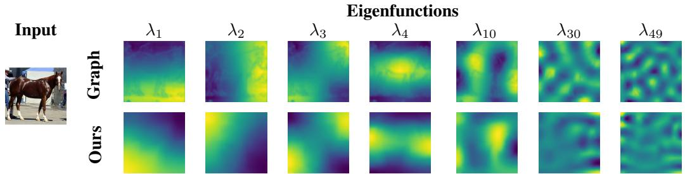  
Figure A6: Visualization of the eigenfunctions obtained from the graph Laplacian used in [16] and from our proposed image-based LBO. Our LBO produces smoother low-frequency eigenfunctions, whereas the graph Laplacian retains noticeable high-frequency image details even in the lower modes.

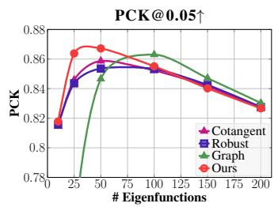

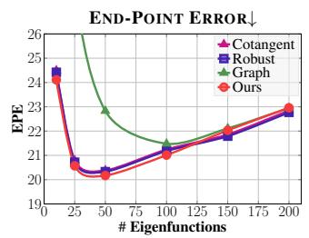

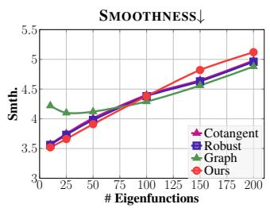  
Figure A7: Laplacian ablation on TSS [85]. We replace our LBO with the cotangent Laplacian, the robust Laplacian [100], and a graph Laplacian [16], holding the rest of the pipeline fixed. Our operator achieves the highest PCK and lowest EPE, peaking at $k = 5 0 .$ , while the graph Laplacian degrades sharply for small K and the cotangent and robust behave almost identically.

Table A4: Effect of Neural ZoomOut (NZO) refinement [14]. Without NZO, our method uses a spectral embedding of size 50. With NZO, we grow the embedding from 50 to 250 in increments of 40. NZO offers an optional way to improve accuracy across all metrics at the cost of a roughly 10× increase in runtime. In all experiments in our paper, we report results without NZO to characterise the performance of our method on its own.
<table><tr><td>Method</td><td>PCK@0.05↑</td><td>PCK@0.1↑</td><td>EPE↓</td><td>Smth.↓</td><td>Time.↓</td></tr><tr><td>w/NZO</td><td>86.3</td><td>94.7</td><td>19.0</td><td>3.9</td><td>11.3</td></tr><tr><td>w/o NZO</td><td>84.3</td><td>94.2</td><td>20.0</td><td>4.3</td><td>0.76</td></tr></table>

Table A5: Component ablation for sparse correspondence on the Spair-71k dataset [89]. We vary the operator (graph Laplacian [16] vs. our LBO) and the map estimator (SmoothFM [97] vs. NAM [14]). Both our LBO and NAM improve all three metrics in isolation, and their combination (shaded) is best overall.
<table><tr><td colspan="2">Operator</td><td colspan="2">Map estimator</td><td colspan="3">Metrics</td></tr><tr><td>Graph</td><td>Ours</td><td>SmoothFM</td><td>NAM</td><td>PCK@0.1↑</td><td>PCK@0.2↑</td><td>MSE↓</td></tr><tr><td>√</td><td></td><td>√</td><td></td><td>31.76</td><td>50.39</td><td>135.33</td></tr><tr><td>√</td><td></td><td></td><td>√</td><td>38.96</td><td>65.05</td><td>104.56</td></tr><tr><td></td><td>√</td><td>V</td><td></td><td>50.13</td><td>69.92</td><td>95.88</td></tr><tr><td></td><td>√</td><td></td><td>√</td><td>56.50</td><td>73.00</td><td>84.70</td></tr></table>

## E Comparison of the proposed LBO to other Laplacians on the TSS dataset

To isolate the contribution of our proposed LBO, we substitute it with two established alternatives within our pipeline and evaluate all three on the TSS dataset [85]: the cotangent Laplacian and the robust Laplacian [100].

The cotangent Laplacian is constructed on a regular grid triangulated by inserting a diagonal edge from the top-left to the bottom-right corner of every cell. Fig. A7 reports the results. Consistent with the main paper, our LBO achieves the strongest overall performance, while the cotangent and robust Laplacians perform comparably to one another on this dataset. Note that the cotangent and robust Laplacians find the sweet spot at k = 50, similar to the finding of our proposed LBO.

## F Ablation study on the Spair-71K dataset

We repeat the ablation of Fig. 5 on the SPair-71k dataset [89] to confirm that both components transfer to a second benchmark. As before, we replace our image-based LBO with the graph Laplacian of [16], and we substitute a linear functional-map framework, SmoothFM [97], for the NAM. We additionally report the combination of both substitutions. Table A5 shows that each component improves performance in isolation and that the two are complementary, with their combination performing best across all three metrics.

## G Influence of a refinement network

In this ablation study, we asses whether refining the input features $\pmb { F } _ { s }$ and $\mathbf { } F _ { t } ^ { } ,$ , as done by Cheng et al. [16], benefits our pipeline. We therefore add an analogous refinement network and report the results in Table A6. Performance degrades across all four metrics. We attribute this to an optimisation conflict: the refinement network continually shifts the features, which makes the optimisation of the NAM to align the eigenfunctions harder. Designing a refinement scheme that avoids this instability is a promising direction, but lies outside the scope of this paper.

Table A6: Effect of the refinement network used in Cheng et al. [16]. Adding the refinement network degrades all four metrics.
<table><tr><td></td><td>PCK@0.05↑</td><td>PCK@0.1↑</td><td>EPE↓</td><td>Smth↓</td></tr><tr><td>Ours w/ refinement network</td><td>81.84</td><td>93.64</td><td>22.02</td><td>4.06</td></tr><tr><td>Ours</td><td>86.72</td><td>95.31</td><td>20.16</td><td>3.90</td></tr></table>

Table A7: Quantitative comparison on FAUST-2D. Best results are shown in bold, second best are underlined. Our method outperforms all previous baselines on the FAUST-2D dataset.
<table><tr><td>Method</td><td>PCK@0.05↑</td><td>PCK@0.1↑</td><td>EPE↓</td><td>Smth. ↓</td></tr><tr><td>DINOv2 [5]</td><td>83.2</td><td>94.0</td><td>27.2</td><td>17.0</td></tr><tr><td>SD [77]</td><td>81.5</td><td>89.2</td><td>33.5</td><td>14.6</td></tr><tr><td>FUSE [8]</td><td>84.2</td><td>91.2</td><td>30.3</td><td>13.2</td></tr><tr><td>Cheng et al. [16]</td><td>82.9</td><td>94.4</td><td>26.3</td><td>12.9</td></tr><tr><td>Fuse2Match [92]</td><td>83.9</td><td>93.7</td><td>26.1</td><td>18.0</td></tr><tr><td>CleanDIFT [78]</td><td>85.8</td><td>92.4</td><td>30.1</td><td>16.7</td></tr><tr><td>Ours</td><td>87.8</td><td>95.2</td><td>24.4</td><td>12.5</td></tr></table>

## H Synthetic image dataset with dense correspondences

Image datasets with ground-truth correspondences are scarce, so we construct a new synthetic dataset from a 3D shape correspondence benchmark. We describe the construction procedure in Section H.1, report results for all baselines in Section H.2, and present an ablation study in Section H.3.

## H.1 Synthetic dataset creation

We construct a new dataset, which we refer to as FAUST-2D, by building on FAUST [101], a wellestablished benchmark for 3D shape matching that provides vertex-wise correspondences between all of its shapes. Our pipeline proceeds as follows:

1. We render pairs of FAUST shapes (registered scans of different people in different poses) as source and target images.

2. Each image pair is passed to SDXL [102] to generate a plausible background from one of 14 categories (e.g. office, living room, kitchen, cafe, gym, library, retail store).

3. The foreground is passed through a ControlNet inpainting model [103] to texturise the FAUST shapes.

4. We blend the texturised foreground and the generated background into a single image.

This yields 380 image pairs of texturised FAUST shapes with automatically generated backgrounds; Fig. A8 shows representative examples. For each pair, we compute pixel-to-pixel ground-truth correspondences via a visibility test from the given camera angle. Shapes are randomly rotated by angles between 0◦ and 140◦, which lets us stratify the pairs by the relative rotation between the two shapes into easy $( 0 ^ { \circ } - 2 0 ^ { \circ } )$ , medium (20◦–80◦), and hard $( 8 0 ^ { \circ } - 1 4 0 ^ { \circ } )$ cases.

## H.2 Results on FAUST-2D

Table A7 compares our method against all baselines on FAUST-2D, and Table A8 breaks the results down by difficulty split. Qualitative dense correspondences are shown in Fig. A8. Our method outperforms the baselines on the easy and medium splits, consistent with our findings on TSS in the main paper. On the hard split, however, all methods degrade substantially, and no single method dominates. We attribute this to the high degree of partiality induced by large relative rotations, which our formulation handles only to a limited extent. Adapting ideas from partial shape matching to the image setting is therefore a promising direction for future work.

Source

Source

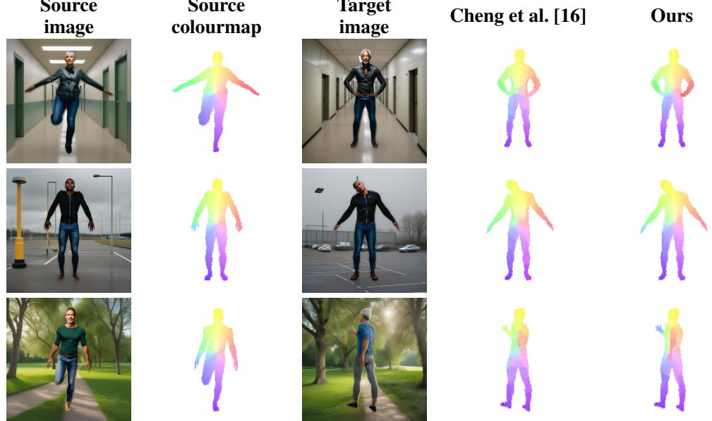  
Figure A8: Dense correspondences on the FAUST-2D dataset. We visualise mappings from source to target by transferring a coordinate-based colourmap (second column) to the target domain (fourth and fifth columns). Our method achieves smoother and more consistent mappings than [16].

Table A8: Per-difficulty results on FAUST-2D, stratified by the relative rotation between the two shapes in each pair. Best results per column are shown in bold, second best are underlined. Our method achieves the best accuracy on the easy and medium splits, whereas all methods degrade substantially on the hard split.
<table><tr><td></td><td colspan="4">Easy (0°–20°)</td><td colspan="4">Medium (20°–80°)</td><td colspan="4">Hard (80°–140°)</td></tr><tr><td>Method</td><td>PCK@0.05↑</td><td>PCK@0.1↑</td><td>EPE↓</td><td>Smth. ↓</td><td>PCK@0.05↑</td><td>PCK@0.1↑</td><td>EPE↓</td><td>Smth. ↓</td><td>PCK@0.05↑</td><td>PCK@0.1↑</td><td>EPE↓</td><td>Smth. ↓</td></tr><tr><td>DINOv2 [5]</td><td>85.9</td><td>96.0</td><td>16.6</td><td>9.7</td><td>78.2</td><td>91.9</td><td>22.3</td><td>12.0</td><td>25.8</td><td>43.3</td><td>69.5</td><td>47.4</td></tr><tr><td>SD [77]</td><td>85.1</td><td>92.2</td><td>18.3</td><td>7.0</td><td>73.2</td><td>84.1</td><td>28.0</td><td>10.6</td><td>8.2</td><td>22.3</td><td>93.6</td><td>45.3</td></tr><tr><td>FUSE [8]</td><td>87.6</td><td>94.0</td><td>16.2</td><td>6.6</td><td>77.2</td><td>87.5</td><td>24.4</td><td>9.7</td><td>10.0</td><td>24.5</td><td>86.8</td><td>40.2</td></tr><tr><td>CleanDIFT [78]</td><td>88.9</td><td>95.0</td><td>17.3</td><td>9.6</td><td>81.9</td><td>90.3</td><td>22.1</td><td>12.2</td><td>11.9</td><td>26.6</td><td>82.9</td><td>45.6</td></tr><tr><td>Cheng et al. [16]</td><td>85.0</td><td>96.4</td><td>16.9</td><td>7.7</td><td>76.2</td><td>92.7</td><td>21.7</td><td>9.2</td><td>21.8</td><td>39.9</td><td>63.9</td><td>34.8</td></tr><tr><td>Fuse2Match [92]</td><td>86.4</td><td>95.6</td><td>17.0</td><td>10.8</td><td>80.9</td><td>92.2</td><td>20.5</td><td>13.2</td><td>23.8</td><td>44.6</td><td>63.2</td><td>47.6</td></tr><tr><td>Ours</td><td>90.9</td><td>97.4</td><td>13.4</td><td>6.8</td><td>83.2</td><td>93.1</td><td>19.5</td><td>9.7</td><td>17.3</td><td>40.4</td><td>68.0</td><td>35.5</td></tr></table>

## H.3 Ablation study on FAUST-2D

We conduct an ablation study to assess the contribution of each component of our framework, evaluating every variant across a range of eigenfunction counts K (Fig. A9). Our LBO outperforms the graph Laplacian, and the NAM outperforms SmoothFM [97]. The plots also show that the best-performing value is K = 100 on FAUST-2D, whereas on TSS we found K = 50 to be optimal. This is consistent with the known sensitivity of functional-map methods to K: performance peaks at an intermediate value and declines on either side, with the location of that peak depending on the dataset.

## I Application to medical image data

As a proof of concept, we apply our zero-shot method to medical data (the NIH Chest X-ray dataset [104]), aligning longitudinal image pairs from the same patients captured months apart (Fig. A10). Compared to nearest-neighbour matching on DINOv2-ViT-B/14 features, our correspondences are qualitatively smoother and more realistic.

## J Robustness to initialisation

Since our method involves an instance-specific optimisation of the NAM, the final correspondence depends on the random initialisation of the network weights. To assess the robustness of our method to this choice, we run our pipeline with ten different random seeds on the TSS dataset and report the mean and standard deviation across all metrics in Table A9. The low standard deviations across all metrics indicate that our method is robust to the choice of initialisation, and that the reported performance is not the result of a particularly favourable seed.

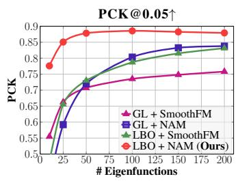

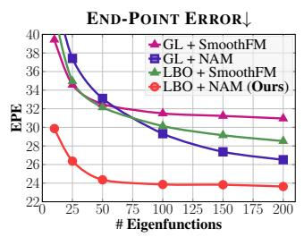

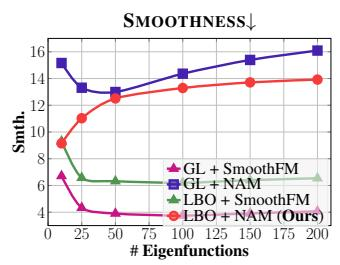  
Figure A9: Ablation of our approach on FAUST-2D, removing either the proposed LBO or the NAM. LBO + SmoothFM: we replace the NAM with the functional-map-based SmoothFM [97]. GL + NAM: we replace our LBO with the image graph Laplacian of [16]. GL + SmoothFM: we combine both alternatives. Our combination of the NAM and our LBO performs best on PCK@0.05 and end-point error, while SmoothFM yields smoother matchings, as expected given that it is explicitly designed to promote smoothness.  
Source Image

Colourmap  
Target Image  
NN (DINOv2)  
Ours  
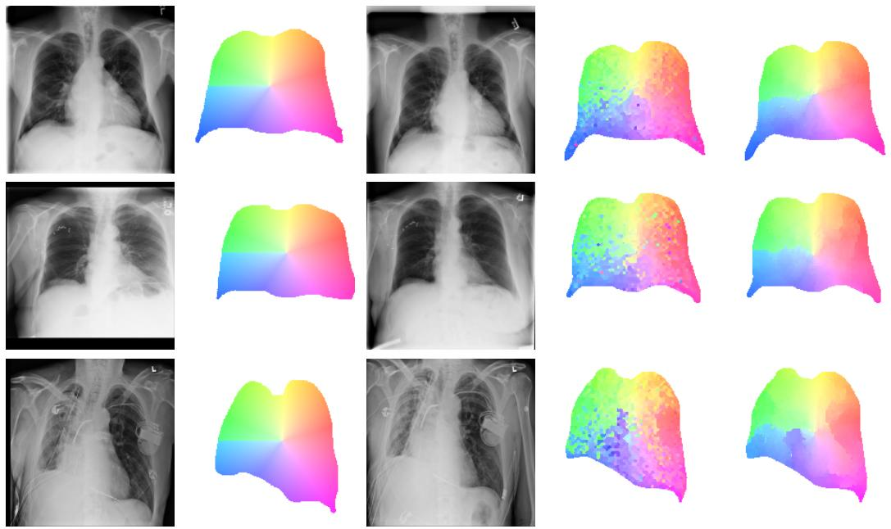  
Figure A10: Additional examples of dense correspondences on the NIH Chest X-ray dataset [104]. We visualise mappings between X-ray images of the same patient captured at different time points. Our method can be applied to medical images, outperforming nearest-neighbour search using backbone image features.

Table A9: Robustness to initialisation. Per-seed metrics on the TSS dataset [85], with mean and standard deviation across ten seeds. The low standard deviation shows that our method is robust to the random initialisation of the NAM weights.
<table><tr><td>Seed</td><td>PCK@0.05↑</td><td>PCK@0.1↑</td><td>EPE↓</td><td>Smth.↓</td></tr><tr><td>0</td><td>86.7</td><td>95.3</td><td>20.2</td><td>3.9</td></tr><tr><td>1</td><td>86.7</td><td>95.3</td><td>20.1</td><td>3.9</td></tr><tr><td>2</td><td>86.7</td><td>95.3</td><td>20.2</td><td>3.9</td></tr><tr><td>3</td><td>86.6</td><td>95.3</td><td>20.2</td><td>3.9</td></tr><tr><td>4</td><td>86.7</td><td>95.3</td><td>20.1</td><td>3.9</td></tr><tr><td>5</td><td>86.7</td><td>95.3</td><td>20.3</td><td>3.9</td></tr><tr><td>6</td><td>86.7</td><td>95.3</td><td>20.2</td><td>3.9</td></tr><tr><td>7</td><td>86.7</td><td>95.3</td><td>20.2</td><td>3.9</td></tr><tr><td>8</td><td>86.7</td><td>95.3</td><td>20.2</td><td>3.9</td></tr><tr><td>9</td><td>86.7</td><td>95.3</td><td>20.2</td><td>3.9</td></tr><tr><td>Mean ± Std</td><td> $8 6 . 7 \pm 0 . 0 3 3 9 7 3$ </td><td> $9 5 . 3 \pm 0 . 0 0 9 0 0 5$ </td><td> $2 0 . 2 \pm 0 . 0 1 6 0 8 6$ </td><td> $3 . 9 \pm 0 . 0 0 5 2 1 6$ </td></tr></table>

## K Additional backbone foundational models

In Table A10, we evaluate our method across various backbone combinations for LBO extraction and NAM training, including DINOv2 [5], DINOv3 [6], and Stable Diffusion (SD v1.5 and v3.5- medium) [77].

Although the combination of SD (v3.5) and DINOv2-ViT-L/14 achieves the best performance, we select SD (v1.5) with DINOv2-ViT-B/14 as the default configuration for our method. This choice provides a favourable trade-off between performance and model size, ViT-B/14 (86M parameters) compared with ViT-L/14 (300M parameters), while also enabling direct comparison with existing baselines that employ SD (v1.5). Interestingly, using the same backbone for both LBO extraction and NAM training performs worse than combining different networks. This suggests that different backbones, specifically SD and DINOv2, provide complementary representations, which is consistent with the observations of Zhang et al. [8]. Furthermore, combinations of SD with DINOv2 variants consistently outperform those using SD with DINOv3 variants.

## L Additional quantitative results

In Table A11, we provide a per-category breakdown of the results summarised in Table 2 in the main paper.

## M More qualitative results

We present additional qualitative results for dense correspondence in Fig. A11 and Fig. A12, where correspondences are visualised through color transfer from source to target on the TSS [85] and SPair-71k [89] datasets, respectively. Further keypoint transfer results on SPair-71k [89] are also provided. We also demonstrate texture transfer in Fig. A14. Unlike in 3D shapes, where this is largely a solved problem, texture transfer for 2D images remains an open challenge due to occlusions and missing regions; we include these results for comprehensiveness. Finally, we show additional examples of the application of our method to medical image data in Fig. A10.

Table A10: Ablation of backbone architectures for LBO extraction and NAM training. We evaluate the impact of various feature extractors on both the spectral basis computation and Neural Adjoint Map (NAM) optimisation. While the SD (v3.5) + DINOv2-ViT-L/14 combination achieves the best performance, we adopt the SD (v1.5) + DINOv2-ViT-B/14 configuration as it provides an optimal balance between competitive performance and computational efficiency while enabling direct comparison with SD (v1.5)-based baselines. Best and second-best results are highlighted in bold and underlined, respectively; the default configuration of our method is coloured in gray .
<table><tr><td>LBO extraction</td><td>NAM training</td><td>PCK@0.05↑</td><td>PCK@0.1↑</td><td>EPE↓</td><td>Smth.↓</td></tr><tr><td>SD (v1.5)</td><td>SD (v1.5)</td><td>79.3</td><td>89.1</td><td>30.5</td><td>4.2</td></tr><tr><td>SD (v3.5)</td><td>SD (v3.5)</td><td>30.7</td><td>51.4</td><td>95.4</td><td>13.2</td></tr><tr><td>DINOv2-ViT-B/14</td><td>DINOv2-ViT-B/14</td><td>82.1</td><td>91.2</td><td>28.6</td><td>3.9</td></tr><tr><td>DINOv3-ViT-B/16</td><td>DINOv3-ViT-B/16</td><td>85.4</td><td>95.0</td><td>21.2</td><td>4.4</td></tr><tr><td>DINOv2-ViT-B/14</td><td>SD (v1.5)</td><td>78.6</td><td>89.3</td><td>30.9</td><td>4.6</td></tr><tr><td>DINOv3-ViT-B/16</td><td>SD (v1.5)</td><td>78.8</td><td>89.2</td><td>30.7</td><td>4.6</td></tr><tr><td>DINOv2-ViT-B/14</td><td>SD (v3.5)</td><td>28.4</td><td>50.8</td><td>96.8</td><td>13.1</td></tr><tr><td>DINOv3-ViT-B/16</td><td>SD (v3.5)</td><td>29.7</td><td>50.5</td><td>52.9</td><td>9.3</td></tr><tr><td>SD (v1.5)</td><td>DINOv2-ViT-S/14</td><td>85.5</td><td>94.6</td><td>21.5</td><td>3.9</td></tr><tr><td>SD (v1.5)</td><td>DINOv2-ViT-B/14</td><td>86.7</td><td>95.3</td><td>20.1</td><td>3.9</td></tr><tr><td>SD (v1.5)</td><td>DINOv2-ViT-L/14</td><td>86.9</td><td>95.5</td><td>19.9</td><td>4.0</td></tr><tr><td>SD (v1.5)</td><td>DINOv3-ViT-S/16</td><td>80.2</td><td>91.5</td><td>28.2</td><td>3.8</td></tr><tr><td>SD (v1.5)</td><td>DINOv3-ViT-B/16</td><td>82.7</td><td>91.3</td><td>28.2</td><td>3.4</td></tr><tr><td>SD (v1.5)</td><td>DINOv3-ViT-L/16</td><td>86.4</td><td>94.9</td><td>21.0</td><td>3.6</td></tr><tr><td>SD (v3.5)</td><td>DINOv2-ViT-S/14</td><td>85.9</td><td>94.6</td><td>21.4</td><td>3.8</td></tr><tr><td>SD (v3.5)</td><td>DINOv2-ViT-B/14</td><td>86.9</td><td>95.3</td><td>20.2</td><td>3.8</td></tr><tr><td>SD (v3.5)</td><td>DINOv2-ViT-L/14</td><td>87.1</td><td>95.3</td><td>19.9</td><td>3.9</td></tr><tr><td>SD (v3.5)</td><td>DINOv3-ViT-S/16</td><td>80.4</td><td>91.5</td><td>28.3</td><td>3.7</td></tr><tr><td>SD (v3.5)</td><td>DINOv3-ViT-B/16</td><td>83.0</td><td>91.3</td><td>28.4</td><td>3.3</td></tr><tr><td>SD (v3.5)</td><td>DINOv3-ViT-L/16</td><td>86.6</td><td>94.9</td><td>21.0</td><td>3.5</td></tr></table>

Table A11: Experiment on sparse keypoint correspondences on SPair-71k [89]. While our method is on par with the baseline performance at PCK@0.1, it yields superior results for both PCK@0.2 and MSE error.
<table><tr><td>Method</td><td>十</td><td></td><td>★</td><td>泉</td><td>o</td><td>0</td><td>è</td><td>o</td><td>π</td><td>H</td><td>π</td><td></td><td>六</td><td>曾</td><td>#</td><td>日</td><td>口</td><td>All</td></tr><tr><td></td><td></td><td></td><td></td><td></td><td></td><td></td><td>PCK@0.10↑</td><td></td><td></td><td></td><td></td><td></td><td></td><td></td><td></td><td></td><td></td><td></td><td></td></tr><tr><td>DINOv2 [5]</td><td>67.7</td><td>63.3</td><td>83.8</td><td>39.1</td><td>45.6</td><td>44.0</td><td>41.0 68.3</td><td>33.9</td><td>67.5</td><td>48.8</td><td>61.2</td><td>64.1</td><td>61.3</td><td>22.2</td><td>60.9</td><td></td><td>46.1</td><td>23.1</td><td>52.3</td></tr><tr><td>SD [77]</td><td>56.5</td><td>55.0</td><td>75.0</td><td>32.2</td><td>51.9</td><td>45.3</td><td>34.3</td><td>73.4 34.8</td><td>70.6</td><td>46.3</td><td>63.7</td><td>44.7</td><td></td><td>49.6</td><td>50.8</td><td>51.3</td><td>55.7</td><td>32.1</td><td>51.2</td></tr><tr><td>Fuse2Match [92]</td><td>66.4</td><td>65.8</td><td>86.0</td><td>40.2</td><td>65.1</td><td>62.0</td><td>44.7</td><td>81.4 50.4</td><td>81.6</td><td>60.3</td><td></td><td>61.7 65.0</td><td></td><td>60.5</td><td>30.7</td><td>61.7</td><td>66.5</td><td>47.5</td><td>61.0</td></tr><tr><td>CleanDIFT [78]</td><td>57.0</td><td>55.0</td><td>77.2</td><td>32.1</td><td>66.4</td><td>50.6</td><td>35.0</td><td>77.3 36.5 78.9</td><td>76.6</td><td>46.9</td><td></td><td>60.5</td><td>47.5</td><td>36.1</td><td>40.3</td><td>45.2</td><td>64.7</td><td>75.2</td><td>54.4</td></tr><tr><td>FUSE [8] Cheng et al. [16]</td><td>67.7 65.3</td><td>60.8 65.0</td><td>83.8</td><td>40.2</td><td>52.2</td><td>50.7</td><td>37.3</td><td>42.5</td><td>68.9</td><td>53.9</td><td></td><td>61.3 61.2</td><td></td><td>64.6</td><td>42.9</td><td>57.4</td><td>60.0</td><td>46.4</td><td>57.2</td></tr><tr><td>Ours</td><td></td><td>63.6</td><td>83.8</td><td>39.1</td><td>47.5</td><td>44.0 48.6</td><td>40.3 69.4</td><td>37.4</td><td>64.4</td><td>59.2</td><td>63.1 64.5</td><td>66.0</td><td></td><td>64.7</td><td>27.0</td><td>60.0</td><td>51.3</td><td>47.4</td><td>55.3</td></tr><tr><td></td><td>67.7</td><td></td><td>84.7</td><td>41.3</td><td>52.5</td><td></td><td>47.2 75.3</td><td>42.5</td><td>65.3</td><td>60.5</td><td></td><td>67.1</td><td></td><td>60.5</td><td>29.8</td><td>62.6</td><td>55.8</td><td>28.6</td><td>56.5</td></tr><tr><td></td><td></td><td></td><td></td><td></td><td></td><td></td><td>PCK@0.20↑</td><td></td><td></td><td></td><td></td><td></td><td></td><td></td><td></td><td></td><td></td><td></td><td></td></tr><tr><td>DINOv2 [5]</td><td>77.7</td><td>78.3</td><td>91.9</td><td>56.3</td><td>63.9</td><td>54.7</td><td>48.5 85.4</td><td>50.4</td><td>84.1</td><td>63.4</td><td>86.0</td><td>84.5</td><td>71.4</td><td></td><td>47.6</td><td>75.7</td><td>67.8</td><td>36.3</td><td>68.0</td></tr><tr><td>SD [77]</td><td>70.5</td><td>73.3</td><td>90.4</td><td>41.4</td><td>65.2</td><td>52.6</td><td>41.0</td><td>81.4 47.8</td><td>78.5</td><td>60.3</td><td></td><td>78.3</td><td>55.3</td><td>62.2</td><td>69.8</td><td>64.3</td><td>72.6</td><td>50.0</td><td>64.1</td></tr><tr><td>Fuse2Match [92]</td><td>77.6</td><td>80.8</td><td>94.1</td><td>52.8 44.8</td><td>72.9</td><td>65.3</td><td>49.2</td><td>87.4 60.8</td><td>89.5</td><td></td><td>77.4</td><td>80.2</td><td>76.7</td><td>72.2</td><td>52.1</td><td>73.6</td><td>75.6</td><td>62.9</td><td>72.3</td></tr><tr><td>CleanDIFT [78] FUSE [8]</td><td>73.5 78.2</td><td>69.1 81.7</td><td>84.5 94.1</td><td>56.3</td><td>74.0 69.6</td><td>54.6 60.7</td><td>43.2 44.0</td><td>83.4 51.3</td><td>86.5</td><td>64.0</td><td></td><td>73.8</td><td>60.1</td><td>50.4</td><td>55.4</td><td>66.0</td><td>82.1</td><td>85.9</td><td>66.8</td></tr><tr><td>Cheng et al. [16]</td><td>81.2</td><td>80.0</td><td>94.9</td><td>56.3</td><td>67.1</td><td>57.3</td><td>89.9 56.0 82.9</td><td>56.5</td><td>80.4</td><td>71.9 79.9</td><td>80.3 80.3</td><td>77.6</td><td>76.5</td><td></td><td>65.9</td><td>71.3</td><td>78.7 73.0</td><td>67.5 68.0</td><td>72.2 72.6</td></tr><tr><td>Ours</td><td>82.1</td><td>83.1</td><td>94.6</td><td>56.3</td><td>70.8</td><td>60.2</td><td>58.7 90.8</td><td>47.8 57.4</td><td>78.5 81.7</td><td>81.5</td><td>87.6</td><td>82.5 85.6</td><td>80.7 74.3</td><td></td><td>57.9</td><td>75.7 73.9</td><td>69.8</td><td>54.8</td><td>73.0</td></tr><tr><td></td><td></td><td></td><td></td><td></td><td></td><td></td><td></td><td></td><td></td><td></td><td></td><td></td><td></td><td></td><td>51.4</td><td></td><td></td><td></td><td></td></tr><tr><td colspan="10">MSE↓</td><td></td><td></td><td></td><td></td><td></td><td></td><td></td><td></td><td></td><td></td></tr><tr><td>DINOv2 [5]</td><td>101.5</td><td>58.7</td><td>40.2</td><td>162.6</td><td>131.7</td><td>160.9</td><td>141.7</td><td>58.3 120.6</td><td>60.7</td><td>72.0</td><td></td><td>76.4</td><td>62.8</td><td>100.6</td><td>167.5</td><td>65.5</td><td>82.6</td><td>225.9</td><td>105.0</td></tr><tr><td>SD [77]</td><td>122.3</td><td>77.7</td><td>57.7</td><td>225.4</td><td>132.8</td><td>178.1</td><td>158.2</td><td>70.6 128.5</td><td>74.2</td><td>109.2</td><td></td><td>86.5 144.1</td><td></td><td>111.4</td><td>118.3</td><td>110.4</td><td>77.9</td><td>186.5</td><td>120.5</td></tr><tr><td>Fuse2Match [92]</td><td>83.2</td><td>64.9</td><td>25.8</td><td>355.5</td><td>98.9</td><td>159.2</td><td>122.6</td><td>22.8 121.4</td><td>13.3</td><td></td><td>54.2</td><td>102.3</td><td>107.6</td><td>78.4</td><td>169.4</td><td>101.2</td><td>18.3</td><td>102.4</td><td>100.1</td></tr><tr><td>CleanDIFT [78]]</td><td>125.3</td><td>90.7</td><td>83.1</td><td>286.6</td><td>127.8</td><td>222.8</td><td>169.5</td><td>49.5 191.6</td><td>23.3</td><td>84.4</td><td></td><td>127.4</td><td>202.2</td><td>157.1</td><td>189.1</td><td>130.5</td><td>36.2</td><td>35.9</td><td>129.6</td></tr><tr><td>FUSE [8] Cheng et al. [16]</td><td>98.2 88.9</td><td>64.9 54.8</td><td>39.9 37.7</td><td>55.3 162.9</td><td>110.7 116.3</td><td>156.9 153.8</td><td>150.4 123.1</td><td>47.2 105.6 57.7 93.1</td><td>65.5 70.3</td><td>78.8 60.6</td><td></td><td>94.7 96.9</td><td>85.7 66.0</td><td>84.1 74.9</td><td>143.1 114.7</td><td>94.1 68.8</td><td>64.4 73.7</td><td>111.3 103.1</td><td>97.2 88.0</td></table>

Source image

Source colourmap

Target image

Cheng et al. [16]

Ours

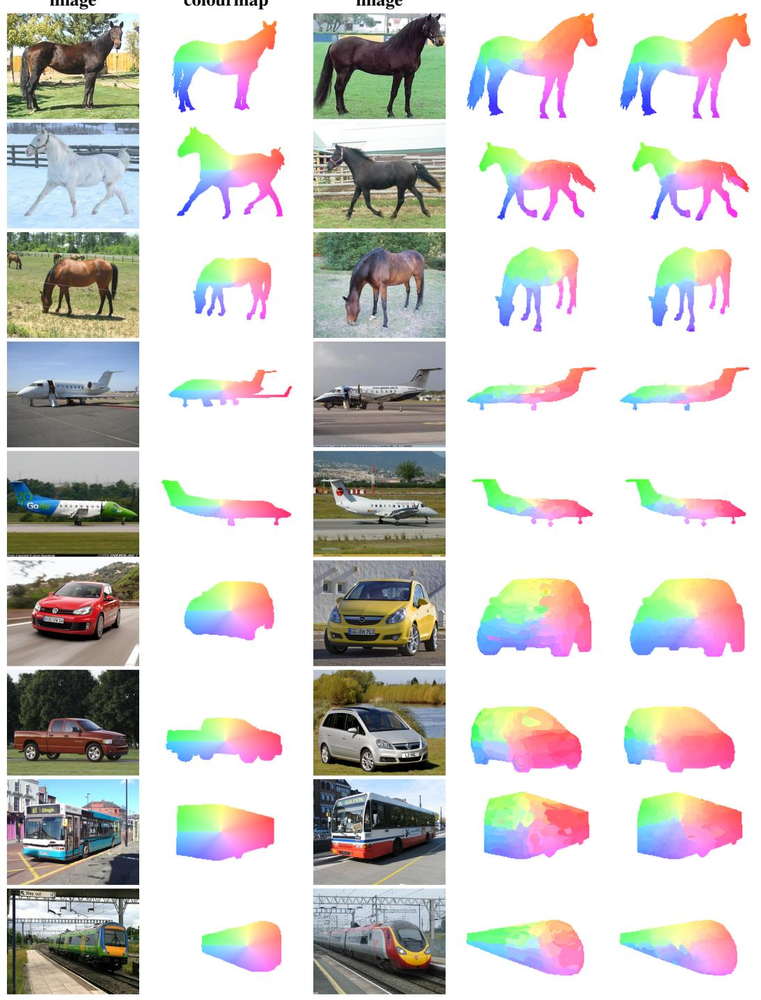  
Figure A11: Dense correspondences on the TSS dataset [85]. We visualise mappings from source to target by transferring a coordinate-based colourmap (second column) to the target domain (fourth and fifth columns). Our framework achieves smoother and more consistent mappings than Cheng et al. [16].

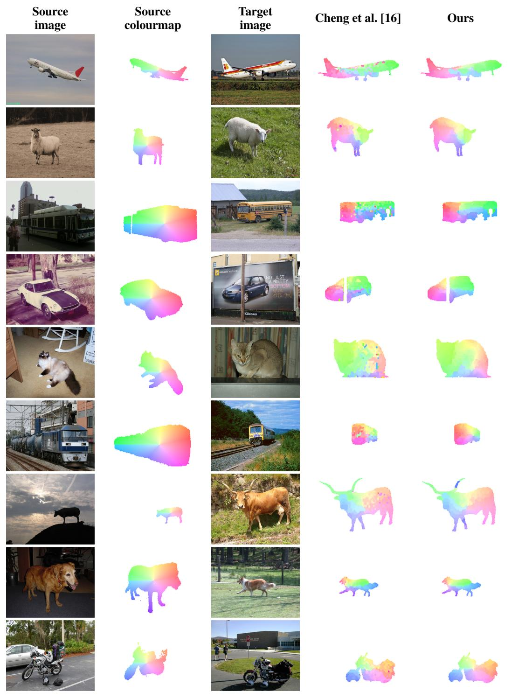  
Figure A12: Dense correspondences on the SPair-71k dataset [89]. We visualise mappings from source to target by transferring a coordinate-based colourmap (second column) to the target domain (fourth and fifth columns). Our framework achieves smoother and more consistent mappings than Cheng et al. [16].

FUSE [8]  
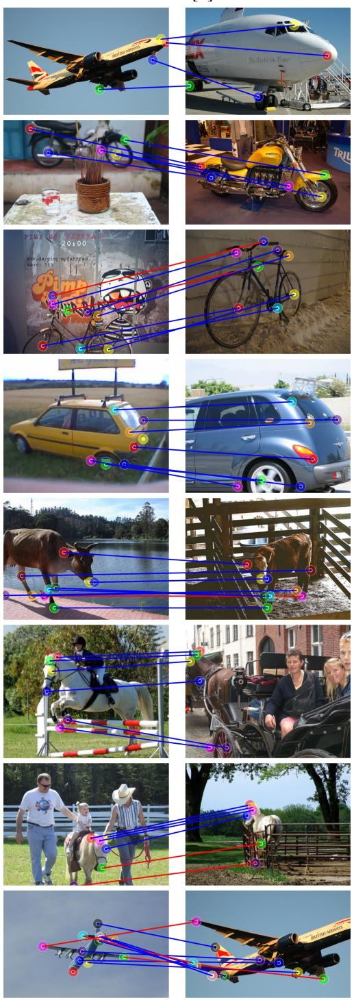

Ours  
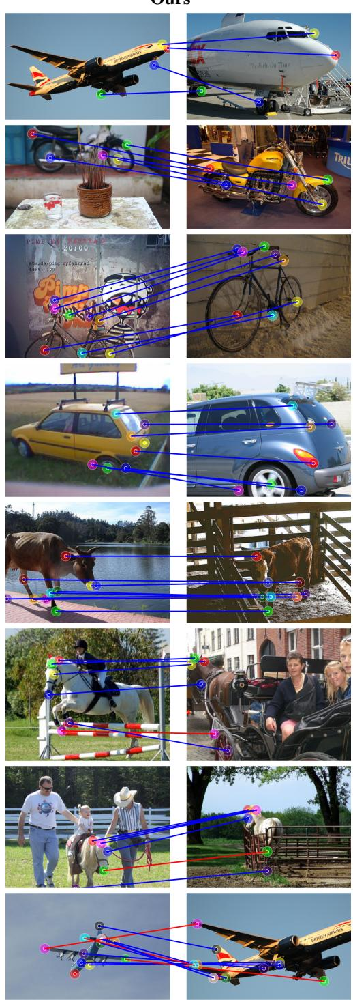  
Figure A13: Visualisation of sparse correspondences on the Spair-71k dataset [89]. Correct matches are indicated by blue lines, while incorrect matches are shown in red. We compare our approach with FUSE [8], and present failure cases of our method in the last two rows.

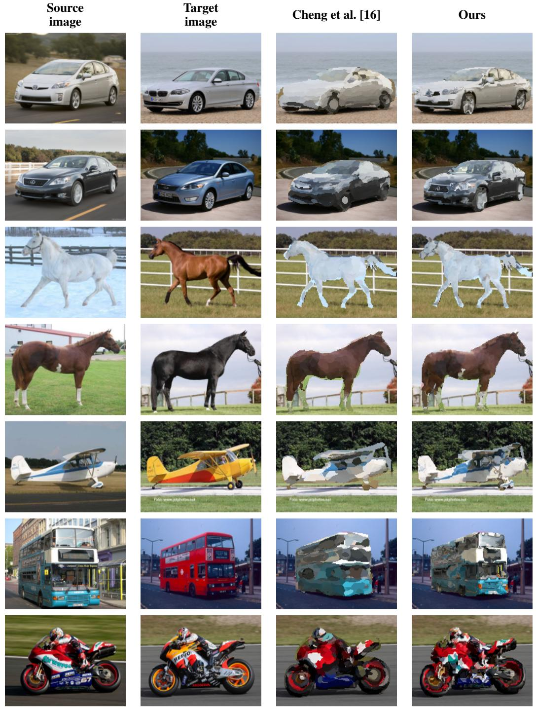  
Figure A14: Visualisation of texture transfer on the TSS [85]. We transfer the texture from the source image to the target image (third and fourth column). While texture transfer is not the primary focus of our method, our approach maintains superior detail fidelity and consistency compared to Cheng et al. [16].

## NeurIPS Paper Checklist

## 1. Claims

Question: Do the main claims made in the abstract and introduction accurately reflect the paper’s contributions and scope?

Answer: [Yes]

Justification: Our first contribution outlines the overarching framework implemented in this paper. The second is detailed within the methodology section, while the third is demonstrated through both the experimental results and the appendix.

Guidelines:

• The answer [N/A] means that the abstract and introduction do not include the claims made in the paper.

• The abstract and/or introduction should clearly state the claims made, including the contributions made in the paper and important assumptions and limitations. A [No] or [N/A] answer to this question will not be perceived well by the reviewers.

• The claims made should match theoretical and experimental results, and reflect how much the results can be expected to generalize to other settings.

• It is fine to include aspirational goals as motivation as long as it is clear that these goals are not attained by the paper.

## 2. Limitations

Question: Does the paper discuss the limitations of the work performed by the authors?

Answer: [Yes]

Justification: We discuss in details the limitations of our work in the limitation section and provide potential future research directions.

Guidelines:

• The answer [N/A] means that the paper has no limitation while the answer [No] means that the paper has limitations, but those are not discussed in the paper.

• The authors are encouraged to create a separate “Limitations” section in their paper.

• The paper should point out any strong assumptions and how robust the results are to violations of these assumptions (e.g., independence assumptions, noiseless settings, model well-specification, asymptotic approximations only holding locally). The authors should reflect on how these assumptions might be violated in practice and what the implications would be.

• The authors should reflect on the scope of the claims made, e.g., if the approach was only tested on a few datasets or with a few runs. In general, empirical results often depend on implicit assumptions, which should be articulated.

• The authors should reflect on the factors that influence the performance of the approach. For example, a facial recognition algorithm may perform poorly when image resolution is low or images are taken in low lighting. Or a speech-to-text system might not be used reliably to provide closed captions for online lectures because it fails to handle technical jargon.

• The authors should discuss the computational efficiency of the proposed algorithms and how they scale with dataset size.

• If applicable, the authors should discuss possible limitations of their approach to address problems of privacy and fairness.

• While the authors might fear that complete honesty about limitations might be used by reviewers as grounds for rejection, a worse outcome might be that reviewers discover limitations that aren’t acknowledged in the paper. The authors should use their best judgment and recognize that individual actions in favor of transparency play an important role in developing norms that preserve the integrity of the community. Reviewers will be specifically instructed to not penalize honesty concerning limitations.

## 3. Theory assumptions and proofs

Question: For each theoretical result, does the paper provide the full set of assumptions and a complete (and correct) proof?

## Answer: [N/A]

Justification: No theoretical results are presented in the paper.

Guidelines:

• The answer [N/A] means that the paper does not include theoretical results.

• All the theorems, formulas, and proofs in the paper should be numbered and crossreferenced.

• All assumptions should be clearly stated or referenced in the statement of any theorems.

• The proofs can either appear in the main paper or the supplemental material, but if they appear in the supplemental material, the authors are encouraged to provide a short proof sketch to provide intuition.

• Inversely, any informal proof provided in the core of the paper should be complemented by formal proofs provided in appendix or supplemental material.

• Theorems and Lemmas that the proof relies upon should be properly referenced.

## 4. Experimental result reproducibility

Question: Does the paper fully disclose all the information needed to reproduce the main experimental results of the paper to the extent that it affects the main claims and/or conclusions of the paper (regardless of whether the code and data are provided or not)?

Answer: [Yes]

Justification: All details required to reproduce our results using the publicly available datasets are discussed in Appendix B.

Guidelines:

• The answer [N/A] means that the paper does not include experiments.

• If the paper includes experiments, a [No] answer to this question will not be perceived well by the reviewers: Making the paper reproducible is important, regardless of whether the code and data are provided or not.

• If the contribution is a dataset and/or model, the authors should describe the steps taken to make their results reproducible or verifiable.

• Depending on the contribution, reproducibility can be accomplished in various ways. For example, if the contribution is a novel architecture, describing the architecture fully might suffice, or if the contribution is a specific model and empirical evaluation, it may be necessary to either make it possible for others to replicate the model with the same dataset, or provide access to the model. In general. releasing code and data is often one good way to accomplish this, but reproducibility can also be provided via detailed instructions for how to replicate the results, access to a hosted model (e.g., in the case of a large language model), releasing of a model checkpoint, or other means that are appropriate to the research performed.

• While NeurIPS does not require releasing code, the conference does require all submissions to provide some reasonable avenue for reproducibility, which may depend on the nature of the contribution. For example

(a) If the contribution is primarily a new algorithm, the paper should make it clear how to reproduce that algorithm.

(b) If the contribution is primarily a new model architecture, the paper should describe the architecture clearly and fully.

(c) If the contribution is a new model (e.g., a large language model), then there should either be a way to access this model for reproducing the results or a way to reproduce the model (e.g., with an open-source dataset or instructions for how to construct the dataset).

(d) We recognize that reproducibility may be tricky in some cases, in which case authors are welcome to describe the particular way they provide for reproducibility. In the case of closed-source models, it may be that access to the model is limited in some way (e.g., to registered users), but it should be possible for other researchers to have some path to reproducing or verifying the results.

## 5. Open access to data and code

Question: Does the paper provide open access to the data and code, with sufficient instructions to faithfully reproduce the main experimental results, as described in supplemental material?

## Answer: [Yes]

Justification: The datasets used in this work are publicly available and the code is published (see link in abstract).

Guidelines:

• The answer [N/A] means that paper does not include experiments requiring code.

• Please see the NeurIPS code and data submission guidelines (https://neurips.cc/ public/guides/CodeSubmissionPolicy) for more details.

• While we encourage the release of code and data, we understand that this might not be possible, so [No] is an acceptable answer. Papers cannot be rejected simply for not including code, unless this is central to the contribution (e.g., for a new open-source benchmark).

• The instructions should contain the exact command and environment needed to run to reproduce the results. See the NeurIPS code and data submission guidelines (https: //neurips.cc/public/guides/CodeSubmissionPolicy) for more details.

• The authors should provide instructions on data access and preparation, including how to access the raw data, preprocessed data, intermediate data, and generated data, etc.

• The authors should provide scripts to reproduce all experimental results for the new proposed method and baselines. If only a subset of experiments are reproducible, they should state which ones are omitted from the script and why.

• At submission time, to preserve anonymity, the authors should release anonymized versions (if applicable).

• Providing as much information as possible in supplemental material (appended to the paper) is recommended, but including URLs to data and code is permitted.

## 6. Experimental setting/details

Question: Does the paper specify all the training and test details (e.g., data splits, hyperparameters, how they were chosen, type of optimizer) necessary to understand the results?

Answer: [Yes]

Justification: We discuss how we use the datasets in the experimental setup section, we also add the hyperparameters and type of optimiser in the implementation details in Appendix B. Guidelines:

• The answer [N/A] means that the paper does not include experiments.

• The experimental setting should be presented in the core of the paper to a level of detail that is necessary to appreciate the results and make sense of them.

• The full details can be provided either with the code, in appendix, or as supplemental material.

## 7. Experiment statistical significance

Question: Does the paper report error bars suitably and correctly defined or other appropriate information about the statistical significance of the experiments?

Answer: [Yes]

Justification: We run an analysis of the robustness of our method to initialisation of the weights of the NAM and report the results in Appendix J.

Guidelines:

• The answer [N/A] means that the paper does not include experiments.

• The authors should answer [Yes] if the results are accompanied by error bars, confidence intervals, or statistical significance tests, at least for the experiments that support the main claims of the paper.

• The factors of variability that the error bars are capturing should be clearly stated (for example, train/test split, initialization, random drawing of some parameter, or overall run with given experimental conditions).

• The method for calculating the error bars should be explained (closed form formula, call to a library function, bootstrap, etc.)

• The assumptions made should be given (e.g., Normally distributed errors).

• It should be clear whether the error bar is the standard deviation or the standard error of the mean.

• It is OK to report 1-sigma error bars, but one should state it. The authors should preferably report a 2-sigma error bar than state that they have a 96% CI, if the hypothesis of Normality of errors is not verified.

• For asymmetric distributions, the authors should be careful not to show in tables or figures symmetric error bars that would yield results that are out of range (e.g., negative error rates).

• If error bars are reported in tables or plots, the authors should explain in the text how they were calculated and reference the corresponding figures or tables in the text.

## 8. Experiments compute resources

Question: For each experiment, does the paper provide sufficient information on the computer resources (type of compute workers, memory, time of execution) needed to reproduce the experiments?

Answer: [Yes]

Justification: We report our runtime in the result section for our main experiment and we provide the compute resources used in Appendix B.

Guidelines:

• The answer [N/A] means that the paper does not include experiments.

• The paper should indicate the type of compute workers CPU or GPU, internal cluster, or cloud provider, including relevant memory and storage.

• The paper should provide the amount of compute required for each of the individual experimental runs as well as estimate the total compute.

• The paper should disclose whether the full research project required more compute than the experiments reported in the paper (e.g., preliminary or failed experiments that didn’t make it into the paper).

## 9. Code of ethics

Question: Does the research conducted in the paper conform, in every respect, with the NeurIPS Code of Ethics https://neurips.cc/public/EthicsGuidelines?

Answer: [Yes]

Justification: We have reviewed the NeurIPS Code of Ethics and believe that our work conforms to this code.

Guidelines:

• The answer [N/A] means that the authors have not reviewed the NeurIPS Code of Ethics.

• If the authors answer [No], they should explain the special circumstances that require a deviation from the Code of Ethics.

• The authors should make sure to preserve anonymity (e.g., if there is a special consideration due to laws or regulations in their jurisdiction).

## 10. Broader impacts

Question: Does the paper discuss both potential positive societal impacts and negative societal impacts of the work performed?

Answer: [N/A]

Justification: Semantic correspondence is a fundamental computer-vision problem without direct societal impact. However, our method could affect downstream applications such as autonomous driving and medical image analysis, where improved accuracy may contribute positively to safety and diagnostics, but errors could also propagate negatively in safetycritical contexts. We encourage practitioners to validate the method within their specific deployment setting.

## Guidelines:

• The answer [N/A] means that there is no societal impact of the work performed.

• If the authors answer [N/A] or [No], they should explain why their work has no societal impact or why the paper does not address societal impact.

• Examples of negative societal impacts include potential malicious or unintended uses (e.g., disinformation, generating fake profiles, surveillance), fairness considerations (e.g., deployment of technologies that could make decisions that unfairly impact specific groups), privacy considerations, and security considerations.

• The conference expects that many papers will be foundational research and not tied to particular applications, let alone deployments. However, if there is a direct path to any negative applications, the authors should point it out. For example, it is legitimate to point out that an improvement in the quality of generative models could be used to generate Deepfakes for disinformation. On the other hand, it is not needed to point out that a generic algorithm for optimizing neural networks could enable people to train models that generate Deepfakes faster.

• The authors should consider possible harms that could arise when the technology is being used as intended and functioning correctly, harms that could arise when the technology is being used as intended but gives incorrect results, and harms following from (intentional or unintentional) misuse of the technology.

• If there are negative societal impacts, the authors could also discuss possible mitigation strategies (e.g., gated release of models, providing defenses in addition to attacks, mechanisms for monitoring misuse, mechanisms to monitor how a system learns from feedback over time, improving the efficiency and accessibility of ML).

## 11. Safeguards

Question: Does the paper describe safeguards that have been put in place for responsible release of data or models that have a high risk for misuse (e.g., pre-trained language models, image generators, or scraped datasets)?

Answer: [N/A]

Justification: No such risks are foreseen by our work.

Guidelines:

• The answer [N/A] means that the paper poses no such risks.

• Released models that have a high risk for misuse or dual-use should be released with necessary safeguards to allow for controlled use of the model, for example by requiring that users adhere to usage guidelines or restrictions to access the model or implementing safety filters.

• Datasets that have been scraped from the Internet could pose safety risks. The authors should describe how they avoided releasing unsafe images.

• We recognize that providing effective safeguards is challenging, and many papers do not require this, but we encourage authors to take this into account and make a best faith effort.

## 12. Licenses for existing assets

Question: Are the creators or original owners of assets (e.g., code, data, models), used in the paper, properly credited and are the license and terms of use explicitly mentioned and properly respected?

Answer: [Yes]

Justification: All publicly available datasets used in this work have been correctly cited.

Guidelines:

• The answer [N/A] means that the paper does not use existing assets.

• The authors should cite the original paper that produced the code package or dataset.

• The authors should state which version of the asset is used and, if possible, include a URL.

• The name of the license (e.g., CC-BY 4.0) should be included for each asset.

• For scraped data from a particular source (e.g., website), the copyright and terms of service of that source should be provided.

• If assets are released, the license, copyright information, and terms of use in the package should be provided. For popular datasets, paperswithcode.com/datasets has curated licenses for some datasets. Their licensing guide can help determine the license of a dataset.

• For existing datasets that are re-packaged, both the original license and the license of the derived asset (if it has changed) should be provided.

• If this information is not available online, the authors are encouraged to reach out to the asset’s creators.

## 13. New assets

Question: Are new assets introduced in the paper well documented and is the documentation provided alongside the assets?

Answer: [N/A]

Justification: No new assets are released within the scope of this work.

Guidelines:

• The answer [N/A] means that the paper does not release new assets.

• Researchers should communicate the details of the dataset/code/model as part of their submissions via structured templates. This includes details about training, license, limitations, etc.

• The paper should discuss whether and how consent was obtained from people whose asset is used.

• At submission time, remember to anonymize your assets (if applicable). You can either create an anonymized URL or include an anonymized zip file.

## 14. Crowdsourcing and research with human subjects

Question: For crowdsourcing experiments and research with human subjects, does the paper include the full text of instructions given to participants and screenshots, if applicable, as well as details about compensation (if any)?

Answer: [N/A]

Justification: No crowdsourcing nor research with human subjects have been conducted in the preparation of this paper.

Guidelines:

• The answer [N/A] means that the paper does not involve crowdsourcing nor research with human subjects.

• Including this information in the supplemental material is fine, but if the main contribution of the paper involves human subjects, then as much detail as possible should be included in the main paper.

• According to the NeurIPS Code of Ethics, workers involved in data collection, curation, or other labor should be paid at least the minimum wage in the country of the data collector.

## 15. Institutional review board (IRB) approvals or equivalent for research with human subjects

Question: Does the paper describe potential risks incurred by study participants, whether such risks were disclosed to the subjects, and whether Institutional Review Board (IRB) approvals (or an equivalent approval/review based on the requirements of your country or institution) were obtained?

Answer: [N/A]

Justification: No crowdsourcing nor research with human subjects have been conducted in the preparation of this paper.

Guidelines:

• The answer [N/A] means that the paper does not involve crowdsourcing nor research with human subjects.

• Depending on the country in which research is conducted, IRB approval (or equivalent) may be required for any human subjects research. If you obtained IRB approval, you should clearly state this in the paper.

• We recognize that the procedures for this may vary significantly between institutions and locations, and we expect authors to adhere to the NeurIPS Code of Ethics and the guidelines for their institution.

• For initial submissions, do not include any information that would break anonymity (if applicable), such as the institution conducting the review.

## 16. Declaration of LLM usage

Question: Does the paper describe the usage of LLMs if it is an important, original, or non-standard component of the core methods in this research? Note that if the LLM is used only for writing, editing, or formatting purposes and does not impact the core methodology, scientific rigor, or originality of the research, declaration is not required.

Answer: [N/A]

Justification: No LLMS were used to develop the core method in this research.

Guidelines:

• The answer [N/A] means that the core method development in this research does not involve LLMs as any important, original, or non-standard components.

• Please refer to our LLM policy in the NeurIPS handbook for what should or should not be described.