# NightIQA: A Comprehensive Dataset and Benchmark for MLLM-Based Nighttime Image Quality Assessment

Yiding Tian<sup>1,2,\*,†</sup> Jiaojiao Yi<sup>2,\*</sup> Jiayuan Lu<sup>2,\*</sup> Pufan Xu<sup>3</sup> Jinlin Wu<sup>4,5</sup> Changyuan Wen<sup>2</sup> Hongyuan Yu<sup>2,†,‡</sup>

<sup>1</sup>Xiamen University Malaysia <sup>2</sup>Xiaomi Corporation <sup>3</sup>Tsinghua University <sup>4</sup>Institute of Automation, Chinese Academy of Sciences <sup>5</sup>Centre for Artificial Intelligence and Robotics, HKISI, CAS, Hong Kong

## Abstract

Nighttime images are inherently susceptible to complex, compound degradations, making accurate quality assessment exceptionally challenging. Score-based IQA methods condense quality into a single number, lacking the multidimensional, language-grounded reasoning required for nighttime evaluation. Multimodal Large Language Models (MLLMs) offer a more comprehensive alternative, yet remain constrained by a critical data gap: existing realworld IQA datasets are overwhelmingly daytime-centric and often built from outdated captures, while synthetic alternatives lack nighttime-specific degradation modeling, yielding artifacts far removed from authentic nighttime conditions. To bridge this gap, we present NightIQA, a dataset and benchmark suite purpose-built for MLLMbased nighttime IQA. It comprises three core components: NightIQA-Real, a real-world dataset of1,769 highresolution images that we captured ourselves with modern equipment, encompassing six canonical distortion types and structured multi-dimensional annotations; NightIQA-Bench, a benchmark of 1,078 visually grounded multiplechoice questions tailored to MLLM-based nighttime IQA, organized around a four-level evaluation hierarchy spanning Perception, Technical Assessment, Localization, and Reasoning; and NightIQA-Syn, an inherently scalable, scene-aware synthesis pipeline that jointly models globallevel and instance-level degradations, with an initial release of 80k high-fidelity images alongside the full generation code. Fine-tuned on NightIQA with Supervised Fine-Tuning (SFT) and Group Relative Policy Optimization (GRPO), Qwen3-VL-8B outperforms open-source IQA methods and achieves higher overall accuracy than leading closedsource models, highlighting the value of domain-specific data and structured supervision.

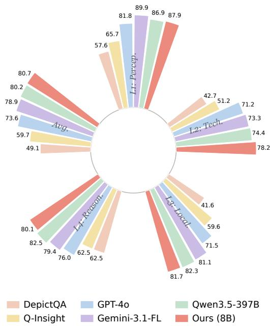  
Figure 1. NightIQA-Bench accuracy of six models (L1–L4 and average). Trained on NightIQA, our 8B model (red) leads on overall and L2 accuracy, ahead of larger VLMs and IQA baselines, indicating that domain-specific data, not model scale, is the bottleneck for nighttime IQA.

## 1. Introduction

Nighttime images are prone to complex, compound degradations that pose unique challenges for Image Quality Assessment (IQA) [43, 50]. In such conditions, multiple artifacts—from sensor noise and exposure failures to various forms of motion and optical blur—tend to co-occur and interact within a single capture, producing degradation patterns far more intricate than those typical of daytime photography. The compound nature of these distortions renders existing IQA paradigms particularly inadequate.

Score-based IQA methods—from classical metrics like SSIM [37] and BRISQUE [23] to recent deep no-reference models [4, 18, 32, 34, 52]—condense quality into a single number, which alone cannot distinguish co-occurring distortion types, pinpoint where degradations occur, or explain their physical causes. Multimodal Large Language Models (MLLMs) [11, 22, 25, 35] offer a more comprehensive alternative through language-grounded reasoning, and recent works [38–40, 47, 48] have confirmed their promise for general-purpose quality understanding. However, their effectiveness hinges on domain-specific data—a resource that remains critically absent for nighttime imagery. Mainstream IQA datasets [13, 16, 21] are overwhelmingly daytime-centric; the few nighttime-oriented resources [43] provide only coarse Mean Opinion Scores (MOS) without structured annotations; existing languageannotated datasets [39, 41] do not systematically cover nighttime distortions; and current synthetic pipelines apply degradations as uniform post-processing without regard to scene content. We term this joint absence of structured real-world annotations, dedicated evaluation protocols, and scene-aware synthesis for nighttime imagery the Nighttime Distortion Gap.

To bridge this gap, we introduce NightIQA, a comprehensive dataset and benchmark suite purpose-built for MLLM-based nighttime IQA. Our contributions are threefold:

• NightIQA-Real. A real-world nighttime dataset of 1,769 high-resolution images that we captured ourselves with modern photographic equipment, spanning three scene categories (Nature, Indoor, and Urban). Six representative distortion types are deliberately induced at three severity levels during shooting, and each image carries structured, multi-dimensional annotations covering distortion type, severity, spatial scope, affected region, and perceptual impact—going well beyond single-score labeling.

• NightIQA-Bench. A dedicated evaluation benchmark tailored to MLLM-based nighttime IQA, built around a four-level evaluation hierarchy: (1) Perception—scene parsing at night; (2) Technical Assessment—distortion classification and severity grading; (3) Localization— spatial reasoning about degraded regions; and (4) Reasoning—causal analysis of degradation mechanisms. These four levels probe complementary cognitive dimensions, from scene recognition to causal quality understanding.

• NightIQA-Syn. A scene-aware synthesis pipeline that takes high-quality, distortion-free images sourced from Unsplash[33] and applies controlled degradations at both global (e.g., sensor noise, underexposure) and instance (e.g., localized motion blur, focus blur) levels, producing spatially coherent artifacts consistent with scene geometry. The pipeline is inherently scalable; we release an initial corpus of 80k high-fidelity images with automatically derived structured annotations alongside

the full generation code.

To validate NightIQA, we fine-tune Qwen3-VL-8B [2] on it via a two-stage pipeline of Supervised Fine-Tuning (SFT) and Group Relative Policy Optimization (GRPO) [30]. The resulting model substantially outperforms existing open-source IQA methods, matches or exceeds leading closed-source models, and attains the best overall accuracy among all evaluated systems—with a decisive lead on Technical Assessment (L2), precisely the axis where general VLMs falter—indicating that domain-specific data and structured supervision are critical for nighttime IQA.

## 2. Related Work

## 2.1. Image Quality Assessment

IQA methods have evolved along two successive lines. Score-based approaches range from full-reference metrics such as SSIM [37] and LPIPS [51] to no-reference estimators like BRISQUE [23] and NIQE [24]. Deep learning further advanced this line through CNN-based score regression [4, 32], multi-scale Transformer architectures [9, 18], and vision-language cross-modal scoring [34, 52]. While progressively more accurate, all score-based methods inherently condense quality into a single scalar, precluding structured quality understanding.

MLLM-based approaches reframe IQA as a language generation task, enabling richer output beyond numerical scores. Q-Align [40] maps images to text-defined quality levels via discrete rating anchors. DeQA-Score [46] models score distributions to capture rating uncertainty. DepictQA [47, 48] produces hierarchical descriptions covering severity, causation, and spatial extent. Most recently, Q-Insight [19] and VisualQuality-R1 [42] apply Group Relative Policy Optimization (GRPO) [30] to move beyond the imitation ceiling of supervised fine-tuning, yielding improved reasoning fidelity for quality scoring and distortion perception. Despite this progress, existing MLLM-based IQA methods are developed and evaluated almost exclusively on daytime-centric data; their behavior under compound nighttime degradations remains largely unexamined.

## 2.2. IQA Datasets and Benchmarks

Real-world datasets. In-the-wild datasets such as KonIQ-10k [16] and SPAQ [13] collect authentically degraded images from consumer devices and annotate them with scalar MOS labels, offering high ecological validity but limited annotation expressiveness. Language-annotated resources have progressively enriched annotation granularity: Q-Instruct [39] provides 200K instruction-response pairs for quality-aware tuning; Q-Bench [38] and Q-Bench+ [53] establish multi-dimensional evaluation covering singleimage and paired-comparison settings; Co-Instruct [41] adds comparative quality descriptions; and Q-Ground [10] integrates spatial grounding via distortion segmentation. However, these datasets are predominantly collected from daytime scenes, and neither their acquisition strategies nor their annotation schemes target the distortions characteristic of nighttime photography. Even nighttime-specific datasets such as NNID [43] provide only scalar MOS labels collected with outdated devices, lacking both structured language annotations and modern image fidelity. No existing benchmark systematically evaluates MLLM-based quality understanding under nighttime conditions.

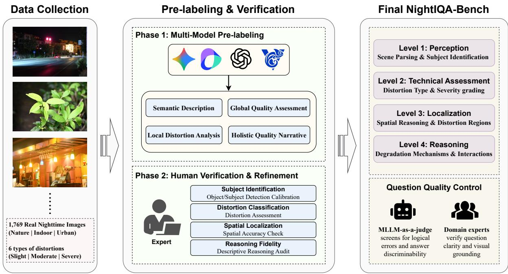  
Figure 2. NightIQA-Real annotation and NightIQA-Bench generation in three left-to-right stages. Data Collection (left): 1,769 rea nighttime images across three scene categories and six distortion types. Pre-labeling & Verification (middle): four frontier MLLMs pre-label each image along four content-to-impact dimensions, kept by majority agreement and corrected by experts. Final NightIQA-Bench (right): verified labels become a four-level MCQ hierarchy, filtered by an MLLM-as-a-judge with domain-expert validation.

Synthetic datasets. Controlled-distortion datasets such as TID2013 [28] and KADID-10k [21] apply predetermined degradations to pristine images, enabling precise control over distortion type and severity. This paradigm has been widely adopted for scalable training data generation. However, existing synthetic pipelines apply degradations as uniform post-processing transforms that ignore scene content, producing artifacts that diverge substantially from real nighttime captures where degradations are shaped by sensor characteristics, scene geometry, and spatially varying illumination.

These observations point to a consistent gap: the community lacks dedicated nighttime data collection, structured annotations, and evaluation protocols on the real-data side, and scene-aware synthesis on the synthetic-data side—the very deficiencies that NightIQA is designed to address.

## 3. The NightIQA Dataset

NightIQA has three coupled components: NightIQA-Real, real nighttime images with multi-dimensional structured annotations; NightIQA-Bench, a benchmark organizing these annotations by cognitive complexity; and NightIQA-Syn, a scalable scene-aware synthetic corpus for training.

## 3.1. NightIQA-Real Dataset

## 3.1.1. Data Collection.

Existing IQA datasets are not merely lacking in nighttime content—they also fail to provide controlled coverage of the distortion types that define nighttime photography. To address both deficiencies, we build NightIQA-Real through controlled real-world capture: 1,769 high-resolution nighttime images are shot on location using modern photographic equipment, spanning three scene categories: Nature, Indoor, and Urban. Crucially, rather than passively collecting images of varying quality, we deliberately induce six representative distortion types during capture—Noise, Underexposure, Overexposure, Motion Blur, Focus Blur, and Camera Shake—each at three severity levels (Slight, Moderate, Severe). This controlled acquisition strategy ensures systematic coverage of nighttime degradations while preserving the authenticity of real-world capture conditions. Because the scenes are shot on location, they also retain the complex illumination intrinsic to night photography—specular reflections, and mixed multisource lighting (e.g., neon, sodium-vapor, and LED sources at differing color temperatures)—conditions that uniform synthetic post-processing cannot faithfully reproduce. To ensure privacy, all images were strictly screened to exclude clearfaces and sensitive details (Supp. Sec. G).

## 3.1.2. Annotation Pipeline.

We label each image along four dimensions that move from scene content to perceptual impact: (i) Semantic Description, the intended subject and a natural-language account of scene content, layout, and lighting; (ii) Global Quality Assessment, the primary distortion plus severity ratings for all six canonical types; (iii) Local Distortion Analysis, each active distortion’s spatial scope (Global or Local) and affected regions; and (iv) Holistic Quality Narrative, content-impact statements on how active distortions affect perceptual quality and scene understanding. The full annotation schema and field definitions are given in Supp. Sec. A.

We annotate in two phases. In Phase 1 (Multi-Model Ensemble Pre-Labeling), four frontier MLLMs from different providers (GPT-5 [31], Gemini 2.5 Pro [12], Doubao-Seed-1.6-Vision [7], and GLM-4.5V [14]) annotate each image independently; we keep a label only when at least three of them agree, which provides consistent initial labels for human review. In Phase 2 (Human Verification & Refinement), professional annotators review every image and correct misidentified distortions, severity ratings, and ungrounded descriptions. This keeps quality close to fully manual annotation at much lower cost; we detail the platform, workflow, and audit protocol in Supp. Sec. A.

## 3.1.3. Dataset Statistics.

Figure 3 and Table 1 summarize NightIQA-Real. Scenes are balanced across Nature, Urban, and Indoor (Figure 3a). Primary distortions are mostly exposure problems: Underexposure and Overexposure together exceed 60% of labels, matching the central difficulty of nighttime capture, while noise and the blurs form a long tail. A small N/A group has no dominant distortion and provides nearpristine references (Table 1). Co-occurrence is mostly compound: most images carry two or more distortions at once (Figure 3b), which is why we annotate along several dimensions rather than a single distortion label.

## 3.2. NightIQA-Bench: Evaluation Benchmark

We turn NightIQA-Real’s structured, multi-dimensional annotations into targeted evaluation questions to build NightIQA-Bench, a visually grounded multiple-choice

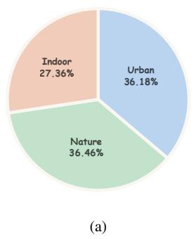

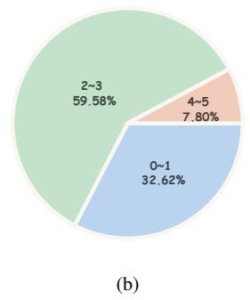  
Figure 3. NightIQA-Real statistics. (a) Scene composition: Nature (36.46%), Urban (36.18%), Indoor (27.36%). (b) Co-occurring distortion types per image: 59.58% exhibit 2–3 simultaneous distortions.

Table 1. Distribution of primary distortion types in NightIQA-Real. N/A denotes images with no visually dominant distortion.
<table><tr><td>Primary Distortion</td><td>Count</td><td>Ratio (%)</td></tr><tr><td>Underexposure</td><td>767</td><td>43.36</td></tr><tr><td>Overexposure</td><td>321</td><td>18.15</td></tr><tr><td>Noise</td><td>180</td><td>10.18</td></tr><tr><td>Camera Shake</td><td>169</td><td>9.55</td></tr><tr><td>Focus Blur</td><td>152</td><td>8.59</td></tr><tr><td>N/A</td><td>105</td><td>5.94</td></tr><tr><td>Motion Blur</td><td>75</td><td>4.23</td></tr></table>

question-answering benchmark that tests MLLM capabilities through a four-level evaluation hierarchy (Figure 2).

## 3.2.1. Four-Level Evaluation Hierarchy.

The four levels span complementary cognitive dimensions, mirroring how a human assessor inspects an image, and as Section 5.2 shows they are not equally difficult: Technical Assessment (L2) is empirically the hardest axis for nearly all models. Level 1 (Perception) recognizes the subject and scene content under nighttime conditions and complex artificial illumination. Level 2 (Technical Assessment) identifies the primary distortion and grades its severity. Level 3 (Localization) locates where a distortion is most evident and ties it to specific image regions. Level 4 (Reasoning) explains why details are degraded, attributing the primary and secondary factors and their interactions. Representative examples across the four levels are shown in Figure 4. All questions follow a standardized multiplechoice format and are accompanied by a visually grounded rationale derived from observable image evidence. The final validated benchmark comprises 1,078 questions, distributed across the four levels as Level 1: 99, Level 2: 344, Level 3: 344, and Level 4: 291. Extended per-level examples and the full filtering pipeline are provided in Supp. Sec. C.

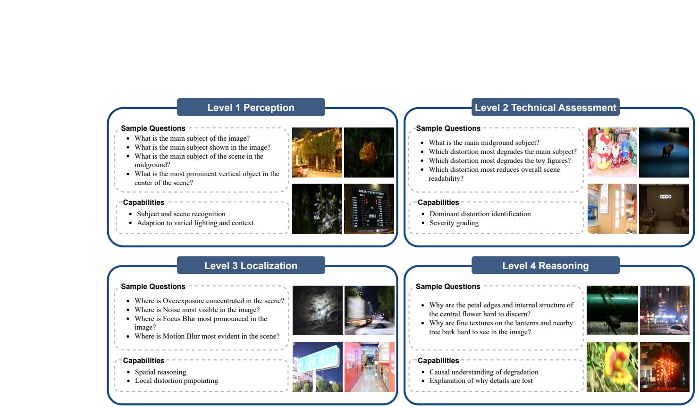  
Figure 4. Representative NightIQA-Bench questions across four cognitive levels: L1 (scene recognition), L2 (distortion identification and severity), L3 (spatial reasoning), and L4 (causal degradation analysis).

## 3.2.2. Question Quality Control.

Benchmark reliability demands that every question is unambiguous, visually answerable, and discriminative. We enforce this through a two-stage filter: an MLLM-as-ajudge module first screens candidates for logical errors, weak distractors, and insufficient discriminability; domain experts then manually verify question clarity and visual grounding. Only questions passing both stages are retained.

The training and evaluation splits share no identical or even visually similar scenes. We embed all 1,769 images with DINOv2 [26] and use feature similarity to assign near-duplicate scenes to the same side of the partition, followed by a manual review that removes any residual visual overlap. This yields a 953-image GRPO training corpus and an 816-image held-out evaluation set with no scene overlap, from which the 1,078 benchmark questions are drawn (details in Supp. Sec. B).

## 3.3. NightIQA-Syn: Scene-Aware Synthetic Data

NightIQA-Real provides high-quality annotations but is limited in scale: real-world collection is costly, scene diversity is bounded, and certain distortion-severity combinations are hard to induce intentionally. NightIQA-Syn complements it with a scene-aware pipeline that generates degraded nighttime images with automatically derived structured labels for large-scale MLLM training. Starting from distortion-free Unsplash [33] sources (clean exposure, sharp focus, no visible artifacts), it applies degradations organized into two categories by their spatial extent. Global-level distortions come from sensor or camera behavior and affect the whole image uniformly, whereas instance-level distortions are tied to specific scene elements and follow scene geometry. Each distortion is produced by a dedicated operator (Figure 5).

## 3.3.1. Global-Level Degradation.

We model four types, partly via Albumentations [5] (Figure 5, left): Noise (chromatic and Gaussian sensor noise typical of nighttime capture); Underexposure (intensity attenuation with added noise); Global Overexposure (luminance boosting with highlight bloom); and Camera Shake (directional motion blur with randomized extent and orientation). Exact operators, sampling ranges, and perseverity parameters are detailed in Supp. Sec. D.1.

## 3.3.2. Instance-Level Degradation.

Some nighttime distortions are inherently localized: motion blur affects only moving objects, focus blur varies with depth, and overexposure blooms around point light sources. Applying them uniformly would misrepresent how they appear in real captures. Our instance-level pipeline (Figure 5, right) proceeds in three stages. (1) Target identification: a vision-language model checks each image for elements suitable to a given distortion (e.g., movable objects for motion blur, likely-misfocused objects for focus blur, bright point sources for local overexposure) and names the candidate targets it finds; only images with

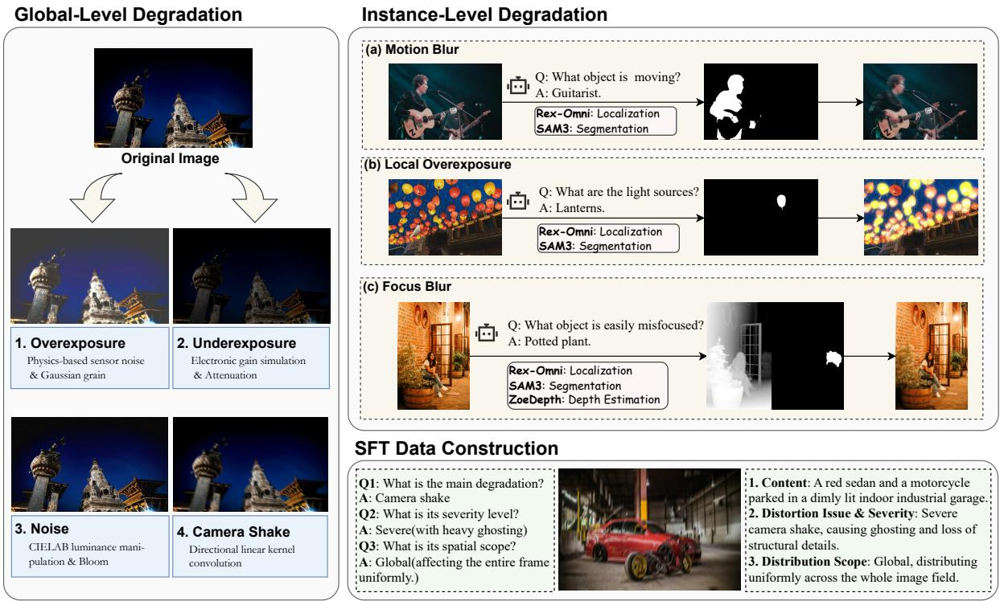  
Figure 5. The NightIQA-Syn degradation pipeline. Left: global-level distortions are applied uniformly via dedicated operators. Right: instance-level distortions follow a three-stage process (target identification, spatial localization, and spatially-coherent rendering) to produce spatially coherent artifacts.

frameworks.

valid targets enter the corresponding branch. (2) Spatial localization: Rex-Omni [17] grounds these candidate targets via open-vocabulary localization and SAM3 [8] extracts pixel-accurate masks, with ZoeDepth [3] supplying monocular depth for depth-dependent effects such as focus blur. (3) Spatially-coherent rendering: dedicated operators synthesize spatially varying degradations. Local Overexposure adds atmospheric bloom and glare halos around bright sources, Motion Blur accumulates warped samples along randomized trajectories in linear color space, and Focus Blur applies depth-aware, spatially varying blur radii for perceptually plausible bokeh. Full algorithms and parameter ranges are provided in Supp. Sec. D.2.

## 3.3.3. SFT Data Construction.

We release an initial 80,000-image corpus with full generation code. Each image carries automatically generated structured annotations in two formats: Basic QA, three single-turn pairs probing distortion type, severity, and spatial scope; and Chain-of-Thought (CoT), a long-form reasoning sample that describes image content, identifies the distortion, and characterizes its spatial distribution. We sample 6,769 images for SFT, balancing distortion-type and severity coverage (Supp. Sec. D.3), stored as conversationstyle records compatible with standard MLLM fine-tuning

## 4. Baseline Construction

We build a baseline on Qwen3-VL-8B [2] trained on NightIQA in two stages: SFT on the synthetic NightIQA-Syn data, followed by GRPO on the real NightIQA-Real annotations. We keep the backbone architecture unchanged and intend the pipeline as a reproducible reference rather than a new model.

## 4.1. Stage 1: Supervised Fine-Tuning (SFT)

We first perform SFT on the structured instruction data from NightIQA-Syn, enabling the model to learn nighttime distortion types, severity levels, and spatial scopes from scalable synthetic supervision. We use the standard masked next-token prediction loss:

$$
\mathcal { L } _ { \mathrm { S F T } } = - \sum _ { t = 1 } ^ { T } m _ { t } \log \pi _ { \theta } ( z _ { t } \mid z _ { < t } , \tilde { x } , q ) ,\tag{1}
$$

where $\mathbf { z } = ( z _ { 1 } , \dots , z _ { T } )$ is the target response, $m _ { t }$ masks non-response tokens, and $\pi _ { \theta }$ denotes the model policy. The SFT data construction, training objective, and full hyperparameters are detailed in Supp. Sec. E.

Table 2. Performance comparison on NightIQA-Bench (MCQ accuracy, %). L1–L4: Perception, Technical Assessment, Localization, and Reasoning. Best in bold, second best underlined.
<table><tr><td>Type</td><td>Model</td><td>L1: Percep.</td><td>L2: Tech.</td><td>L3: Local.</td><td>L4: Reason.</td><td>Avg.</td></tr><tr><td colspan="2">Sampled random guess</td><td>25.89</td><td>25.09</td><td>25.19</td><td>24.88</td><td>25.26</td></tr><tr><td rowspan="6">Closed-Source</td><td>GPT-4o [25]</td><td>81.82</td><td>71.22</td><td>71.51</td><td>75.95</td><td>73.56</td></tr><tr><td>GPT-5 Mini [31]</td><td>83.84</td><td>66.57</td><td>78.20</td><td>75.26</td><td>74.21</td></tr><tr><td>Gemini-2.5-Flash [12]</td><td>71.72</td><td>48.26</td><td>61.92</td><td>61.86</td><td>58.44</td></tr><tr><td>Gemini-3.1-Flash-Lite [15]</td><td>89.90</td><td>73.26</td><td>81.10</td><td>79.38</td><td>78.94</td></tr><tr><td>Doubao-Seed-2.0-Mini [6]</td><td>86.87</td><td>62.50</td><td>75.29</td><td>70.79</td><td>71.06</td></tr><tr><td>Claude-Haiku-4.5 [1]</td><td>72.73</td><td>64.24</td><td>68.90</td><td>74.23</td><td>69.20</td></tr><tr><td rowspan="14">Open-Source</td><td>MiMo-V2-Omni [44]</td><td>83.84</td><td>69.77</td><td>73.84</td><td>73.88</td><td>73.47</td></tr><tr><td>MiMo-V2.5 [45]</td><td>77.78</td><td>68.02</td><td>75.29</td><td>74.57</td><td>73.01</td></tr><tr><td>GLM-4.5V [14]</td><td>84.85</td><td>61.63</td><td>76.16</td><td>69.76</td><td>70.59</td></tr><tr><td>GLM-4.6V [49]</td><td>82.83</td><td>63.95</td><td>74.71</td><td>68.04</td><td>70.22</td></tr><tr><td>Qwen3-VL-30B [2]</td><td>82.83</td><td>59.59</td><td>70.93</td><td>67.70</td><td>67.53</td></tr><tr><td>Qwen3-VL-235B [2]</td><td>86.87</td><td>65.41</td><td>80.52</td><td>77.66</td><td>75.51</td></tr><tr><td>Qwen3.5-27B [29]</td><td>86.87</td><td>69.77</td><td>81.69</td><td>74.91</td><td>76.53</td></tr><tr><td>Qwen3.5-35B-A3B [29]</td><td>88.89</td><td>69.19</td><td>82.85</td><td>80.76</td><td>78.48</td></tr><tr><td>Qwen3.5-122B-A10B [29]</td><td>83.84</td><td>66.86</td><td>79.94</td><td>75.26</td><td>74.86</td></tr><tr><td>Qwen3.5-397B [29]</td><td>86.87</td><td>74.42</td><td>82.27</td><td>82.47</td><td>80.24</td></tr><tr><td>InternVL3.5-8B [36]</td><td>70.71</td><td>52.33</td><td>57.85</td><td>63.57</td><td>58.81</td></tr><tr><td>InternVL3.5-38B [36]</td><td>84.85</td><td>61.92</td><td>70.35</td><td>65.98</td><td>67.81</td></tr><tr><td>DepictQA [48]</td><td>57.60</td><td>42.70</td><td>41.60</td><td>62.50</td><td>49.10</td></tr><tr><td>Q-Instruct [39] IQA</td><td>46.46</td><td>45.93</td><td>53.78</td><td>56.70</td><td>51.39</td></tr><tr><td>VisualQuality-R1 [42]</td><td>66.70</td><td>55.20</td><td>63.70</td><td>59.50</td><td>61.30</td></tr><tr><td>Q-Insight [19]</td><td>65.70</td><td>51.20</td><td>59.60</td><td>62.50</td><td>59.70</td></tr><tr><td>Ours</td><td>SFT + GRPO (8B)</td><td>87.88</td><td>78.20</td><td>81.69</td><td>80.07</td><td>80.71</td></tr></table>

## 4.2. Stage 2: GRPO-Based Alignment

We then apply GRPO [30] using NightIQA-Real to align the model with human-annotated reasoning traces. For each image–question pair, the model samples multiple candidate responses, which are scored by a task-specific composite reward. The complete GRPO objective, advantage estimation, training configuration, and system prompt are deferred to Supp. Sec. F.

Composite Reward Function. The reward encourages both correct answers and faithful reasoning. We use a structured CoT format and define $r _ { i }$ as a weighted sum of answer correctness, reasoning fidelity, and format compliance:

$$
r _ { i } = w _ { \mathrm { a c c } } r _ { \mathrm { a c c } } + w _ { \mathrm { d e s c } } r _ { \mathrm { d e s c } } + w _ { \mathrm { f m t } } r _ { \mathrm { f m t } } ,\tag{2}
$$

where $w _ { \mathrm { a c c } } = 1 . 0 , w _ { \mathrm { d e s c } } = 0 . 8$ , and $w _ { \mathrm { f m t } } = 0 . 5$ . Here, $r _ { \mathrm { a c c } }$ checks answer correctness, $r _ { \mathrm { d e s c } }$ measures reasoning similarity to the human annotations using BLEU-4 [27] and ROUGE-L [20], and $r _ { \mathrm { f m t } }$ enforces the required output format.

## 5. Benchmark Evaluation

## 5.1. Evaluation Setup

We benchmark 22 zero-shot baselines across three families: closed-source frontier models (GPT-4o [25], GPT-5 Mini [31], Gemini [12, 15], Doubao [6], Claude [1]), open-source VLMs (MiMo [44, 45], GLM-4.5V/4.6V [14, 49], Qwen3-VL [2], Qwen3.5 [29], InternVL3.5 [36]), and domain-specific IQA models (DepictQA [48], Q-Instruct [39], VisualQuality-R1 [42], Q-Insight [19]); see Table 2 for exact variants. We also report final SFT+GRPO in Table 2 and analyze GRPO-only in the ablation. We report MCQ accuracy on L1–L4 and overall accuracy over all 1,078 held-out questions from the 816-image scenedisjoint evaluation set.

## 5.2. Results and Analysis

Across all evaluated models, NightIQA-Bench surfaces four consistent patterns (Table 2, Figure 1).

Cognitive Stratification Validates Benchmark Design.

Accuracy is far from uniform: most general VLMs peak on Perception (L1) and bottom out on Technical Assessment (L2). Even the top Perception scorer, Gemini-3.1-Flash-Lite [15], slides from 89.90% (L1) to 73.26% (L2). General VLMs parse nighttime scenes but lack the expertise to classify their distortions.

Domain-Specific IQA Models Exhibit a Severe Gap. Dedicated IQA methods cluster at the bottom: DepictQA [48] (49.10%), Q-Instruct [39] (51.39%), Q-Insight [19] (59.70%), and VisualQuality-R1 [42] (61.30%) trail nearly all general VLMs and falter on quality-centric axes such as Technical Assessment (L2) and Localization (L3). Their daylight-centric training with generic synthetic degradations (e.g., Gaussian blur, JPEG) leaves them ill-equipped for nighttime artifacts such as color noise and uneven exposure.

Scaling Alone Cannot Close the Nighttime Gap. Parameter scaling yields inconsistent, saturating returns: within Qwen3.5 accuracy is non-monotonic in size, and the largest Qwen3.5-397B [29] (80.24%) is still edged out by our domain-aligned 8B model, with its shortfall sharpest on L2 (74.42%). These results suggest that scaling alone is insufficient, and domain-specific degradation knowledge is a critical missing factor.

NightIQA Brings an 8B Model to Frontier-Level Accuracy. Our SFT+GRPO model attains the best overall average (80.71%), surpassing the ∼50× larger Qwen3.5- 397B (80.24%) and the strongest closed-source model, Gemini-3.1-Flash-Lite (78.94%), with a clear lead on Technical Assessment (L2, 78.20%) where general VLMs drop sharply. Larger general VLMs keep narrow leads on single axes (Gemini-3.1-Flash-Lite on L1, Qwen3.5-35B-A3B on L3, Qwen3.5-397B on L4), but none matches our overall accuracy and L2 lead, supporting our data-centric motivation.

## 5.3. Ablation Study

We ablate each training stage and data source from the same Qwen3-VL-8B base model (Table 3).

Table 3. Ablation on the training pipeline. SFT uses NightIQA-Syn; GRPO uses NightIQA-Real. ∆: improvement over the preceding row.
<table><tr><td>Configuration</td><td>L1</td><td>L2</td><td>L3</td><td>L4</td><td>Avg.</td></tr><tr><td>Qwen3-VL-8B (base)</td><td>71.72</td><td>59.30</td><td>64.83</td><td>65.29</td><td>63.82</td></tr><tr><td>+ GRPO (Real) ∆</td><td>82.83 +11.1</td><td>75.00 +15.7</td><td>79.65 +14.8</td><td>74.91 +9.6</td><td>77.18 +13.4</td></tr><tr><td>+ SFT (Syn) + GRPO (Real)</td><td>87.88</td><td>78.20</td><td>81.69</td><td>80.07</td><td>80.71</td></tr><tr><td>∆</td><td>+5.1</td><td>+3.2</td><td>+2.0</td><td>+5.2</td><td>+3.5</td></tr></table>

Effect of GRPO (NightIQA-Real). GRPO alone adds 13.4 pp to the average (63.82% to 77.18%), with the largest gains on L2 (+15.7) and L3 (+14.8): NightIQA-

Table 4. Per-epoch accuracy (%) for GRPO-only (from base) and SFT+GRPO. Best per column in bold: SFT+GRPO leads on every level. We adopt it at epoch 4 for its best average and L4 (Reasoning); GRPO-only peaks at epoch 5.
<table><tr><td>Method</td><td>Epoch</td><td>L1</td><td>L2</td><td>L3</td><td>L4</td><td>Avg.</td></tr><tr><td rowspan="5">GRPO-only</td><td>1</td><td>79.80</td><td>64.53</td><td>75.00</td><td>71.13</td><td>71.06</td></tr><tr><td>2</td><td>78.79</td><td>70.93</td><td>75.58</td><td>76.29</td><td>74.58</td></tr><tr><td>3</td><td>85.86</td><td>70.06</td><td>77.91</td><td>76.29</td><td>75.70</td></tr><tr><td>4</td><td>82.83</td><td>70.06</td><td>77.91</td><td>77.32</td><td>75.70</td></tr><tr><td>5</td><td>82.83</td><td>75.00</td><td>79.65</td><td>74.91</td><td>77.18</td></tr><tr><td rowspan="5">SFT+GRPO</td><td>1</td><td>80.81</td><td>78.20</td><td>78.49</td><td>78.35</td><td>78.57</td></tr><tr><td>2</td><td>80.81</td><td>76.74</td><td>80.81</td><td>79.04</td><td>79.04</td></tr><tr><td>3</td><td>88.89</td><td>75.00</td><td>82.27</td><td>79.38</td><td>79.78</td></tr><tr><td>4</td><td>87.88</td><td>78.20</td><td>81.69</td><td>80.07</td><td>80.71</td></tr><tr><td>5</td><td>88.89</td><td>76.74</td><td>82.27</td><td>79.73</td><td>80.43</td></tr></table>

Real’s reasoning trajectories are the dominant driver in our ablation, teaching distortion recognition and spatial reasoning at night.

Effect of SFT (NightIQA-Syn). Prepending SFT lifts the average a further 3.5 pp (77.18% to 80.71%), concentrated on L4 (+5.2) and L1 (+5.1). These gains stack on top of GRPO’s: NightIQA-Syn’s large-scale distortion vocabulary adds supervision beyond NightIQA-Real’s reasoning traces.

Training dynamics across epochs. Both regimes generally improve before saturating or slightly regressing (Table 4). SFT+GRPO climbs from 78.57% (epoch 1) to a peak 80.71% at epoch 4, which is also its best L4 (80.07%), then dips to 80.43% at epoch 5; GRPO-only peaks later (77.18%, epoch 5). We therefore adopt SFT+GRPO at epoch 4 for its best average and best L4 (Reasoning), the highest-order and most challenging axis.

## 6. Conclusion

We present NightIQA: 1,769 originally captured, multidimensionally annotated nighttime images; a four-level benchmark spanning perception to causal reasoning; and a scene-aware synthesis pipeline releasing 80k images with code. Across 22 zero-shot baselines, we expose a severe nighttime domain gap that scaling alone does not close. Fine-tuning Qwen3-VL-8B with SFT and GRPO yields a 17-point gain and the best overall accuracy of any evaluated system, including models ∼50× larger, supporting the importance of domain-specific data and structured supervision. A natural next step is to grow NightIQA beyond the nighttime regime, extending the dataset to daytime and broader real-world scenarios and enriching it with additional scenes, distortion types, and annotation dimensions, so that it can serve as a foundation for general MLLM-based image quality assessment.

## References

[1] Anthropic. Introducing Claude Haiku 4.5. https://www. anthropic.com/news/claude-haiku-4-5, 2025.

[2] Shuai Bai, Yuxuan Cai, Ruizhe Chen, Keqin Chen, Xionghui Chen, Zesen Cheng, Lianghao Deng, Wei Ding, Chang Gao, Chunjiang Ge, et al. Qwen3-VL technical report. arXiv preprint arXiv:2511.21631, 2025.

[3] Shariq Farooq Bhat, Reiner Birkl, Diana Wofk, Peter Wonka, and Matthias Müller. ZoeDepth: Zero-shot transfer by combining relative and metric depth. arXiv preprint arXiv:2302.12288, 2023.

[4] Sebastian Bosse, Dominique Maniry, Klaus-Robert Müller, Thomas Wiegand, and Wojciech Samek. Deep neural networks for no-reference and full-reference image quality assessment. IEEE Transactions on Image Processing, 27(1): 206–219, 2018.

[5] Alexander Buslaev, Vladimir I. Iglovikov, Eugene Khvedchenya, Alex Parinov, Mikhail Druzhinin, and Alexandr A. Kalinin. Albumentations: Fast and flexible image augmentations. Information, 11(2):125, 2020.

[6] ByteDance Seed. Seed2.0 Mini. https://seed.bytedance.com/ en/seed2, 2026.

[7] ByteDance Seed Team. Introduction to Techniques Used in Seed1.6. https://seed.bytedance.com/en/blog/introductionto-techniques-used-in-seed1-6, 2025.

[8] Nicolas Carion, Laura Gustafson, Yuan-Ting Hu, Shoubhik Debnath, Ronghang Hu, Didac Suris, Chaitanya Ryali, Kalyan Vasudev Alwala, Haitham Khedr, Andrew Huang, et al. SAM 3: Segment anything with concepts. arXiv preprint arXiv:2511.16719, 2026.

[9] Chaofeng Chen, Jiadi Mo, Jingwen Hou, Haoning Wu, Liang Liao, Wenxiu Sun, Qiong Yan, and Weisi Lin. TOPIQ: A top-down approach from semantics to distortions for image quality assessment. IEEE Transactions on Image Processing, 33:2404–2418, 2024.

[10] Chaofeng Chen, Sensen Yang, Haoning Wu, Liang Liao, Zicheng Zhang, Annan Wang, Wenxiu Sun, Qiong Yan, and Weisi Lin. Q-Ground: Image quality grounding with large multi-modality models. In Proceedings of the 32nd ACM International Conference on Multimedia, pages 486–495, 2024.

[11] Zhe Chen, Jiannan Wu, Wenhai Wang, Weijie Su, Guo Chen, Sen Xing, Muyan Zhong, Qinglong Zhang, Xizhou Zhu, Lewei Lu, et al. InternVL: Scaling up vision foundation models and aligning for generic visual-linguistic tasks. In Proceedings of the IEEE/CVF Conference on Computer Vision and Pattern Recognition, pages 24185–24198, 2024.

[12] Gheorghe Comanici, Eric Bieber, Mike Schaekermann, Ice Pasupat, Noveen Sachdeva, Inderjit Dhillon, Marcel Blistein, Ori Ram, Dan Zhang, Evan Rosen, et al. Gemini 2.5: Pushing the frontier with advanced reasoning, multimodality, long context, and next generation agentic capabilities. arXiv preprint arXiv:2507.06261, 2025.

[13] Yuming Fang, Hanwei Zhu, Yan Zeng, Kede Ma, and Zhou Wang. Perceptual quality assessment of smartphone photography. In Proceedings of the IEEE/CVF Conference

on Computer Vision and Pattern Recognition, pages 3677– 3686, 2020.

[14] GLM-V Team, Wenyi Hong, Wenmeng Yu, Xiaotao Gu, Guo Wang, Guobing Gan, Haomiao Tang, Jiale Cheng, Ji Qi, Junhui Ji, et al. GLM-4.5V and GLM-4.1V-Thinking: Towards versatile multimodal reasoning with scalable reinforcement learning. arXiv preprint arXiv:2507.01006, 2026.

[15] Google DeepMind. Gemini 3.1 Flash-Lite. https://deepmind. google/models/model-cards/gemini-3-1-flash-lite/, 2026.

[16] Vlad Hosu, Hanhe Lin, Tamas Sziranyi, and Dietmar Saupe. KonIQ-10k: An ecologically valid database for deep learning of blind image quality assessment. IEEE Transactions on Image Processing, 29:4041–4056, 2020.

[17] Qing Jiang, Junan Huo, Xingyu Chen, Yuda Xiong, Zhaoyang Zeng, Yihao Chen, Tianhe Ren, Junzhi Yu, and Lei Zhang. Detect anything via next point prediction. arXiv preprint arXiv:2510.12798, 2025.

[18] Junjie Ke, Qifei Wang, Yilin Wang, Peyman Milanfar, and Feng Yang. MUSIQ: Multi-scale image quality transformer. In Proceedings of the IEEE/CVF International Conference on Computer Vision, pages 5148–5157, 2021.

[19] Weiqi Li, Xuanyu Zhang, Shijie Zhao, Yabin Zhang, Junlin Li, Li Zhang, and Jian Zhang. Q-Insight: Understanding image quality via visual reinforcement learning. In Advances in Neural Information Processing Systems, pages 36802– 36827, 2025.

[20] Chin-Yew Lin. ROUGE: A package for automatic evaluation of summaries. In Text Summarization Branches Out, pages 74–81, 2004.

[21] Hanhe Lin, Vlad Hosu, and Dietmar Saupe. KADID-10k: A large-scale artificially distorted IQA database. In 2019 Eleventh International Conference on Quality of Multimedia Experience (QoMEX), pages 1–3, 2019.

[22] Haotian Liu, Chunyuan Li, Yuheng Li, and Yong Jae Lee. Improved baselines with visual instruction tuning. In Proceedings of the IEEE/CVF Conference on Computer Vision and Pattern Recognition, pages 26296–26306, 2024.

[23] Anish Mittal, Anush Krishna Moorthy, and Alan Conrad Bovik. No-reference image quality assessment in the spatial domain. IEEE Transactions on Image Processing, 21(12): 4695–4708, 2012.

[24] Anish Mittal, Rajiv Soundararajan, and Alan C. Bovik. Making a “completely blind” image quality analyzer. IEEE Signal Processing Letters, 20(3):209–212, 2013.

[25] OpenAI, Aaron Hurst, Adam Lerer, Adam P. Goucher, Adam Perelman, Aditya Ramesh, Aidan Clark, AJ Ostrow, Akila Welihinda, Alan Hayes, et al. GPT-4o system card. arXiv preprint arXiv:2410.21276, 2024.

[26] Maxime Oquab, Timothée Darcet, Théo Moutakanni, Huy V. Vo, Marc Szafraniec, Vasil Khalidov, Pierre Fernandez, Daniel Haziza, Francisco Massa, Alaaeldin El-Nouby, et al. DINOv2: Learning robust visual features without supervision. Transactions on Machine Learning Research, 2024. Featured Certification.

[27] Kishore Papineni, Salim Roukos, Todd Ward, and Wei-Jing Zhu. Bleu: a method for automatic evaluation of machine

translation. In Proceedings ofthe 40th Annual Meeting ofthe Association for Computational Linguistics, pages 311–318, 2002.

[28] Nikolay Ponomarenko, Lina Jin, Oleg Ieremeiev, Vladimir Lukin, Karen Egiazarian, Jaakko Astola, Benoit Vozel, Kacem Chehdi, Marco Carli, Federica Battisti, et al. Image database TID2013: Peculiarities, results and perspectives. Signal Processing: Image Communication, 30:57–77, 2015.

[29] Qwen Team. Qwen3.5: Towards native multimodal agents. https://qwen.ai/blog?id=qwen3.5, 2026.

[30] Zhihong Shao, Peiyi Wang, Qihao Zhu, Runxin Xu, Junxiao Song, Xiao Bi, Haowei Zhang, Mingchuan Zhang, Y. K. Li, Y. Wu, et al. DeepSeekMath: Pushing the limits of mathematical reasoning in open language models. arXiv preprint arXiv:2402.03300, 2024.

[31] Aaditya Singh, Adam Fry, Adam Perelman, Adam Tart, Adi Ganesh, Ahmed El-Kishky, Aidan McLaughlin, Aiden Low, AJ Ostrow, Akhila Ananthram, et al. OpenAI GPT-5 system card. arXiv preprint arXiv:2601.03267, 2026.

[32] Shaolin Su, Qingsen Yan, Yu Zhu, Cheng Zhang, Xin Ge, Jinqiu Sun, and Yanning Zhang. Blindly assess image quality in the wild guided by a self-adaptive hyper network. In Proceedings of the IEEE/CVF Conference on Computer Vision and Pattern Recognition, pages 3667–3676, 2020.

[33] Unsplash. Unsplash dataset. https://unsplash.com/data, 2020.

[34] Jianyi Wang, Kelvin C.K. Chan, and Chen Change Loy. Exploring CLIP for assessing the look and feel of images. In Proceedings of the AAAI Conference on Artificial Intelligence, pages 2555–2563, 2023.

[35] Peng Wang, Shuai Bai, Sinan Tan, Shijie Wang, Zhihao Fan, Jinze Bai, Keqin Chen, Xuejing Liu, Jialin Wang, Wenbin Ge, et al. Qwen2-VL: Enhancing vision-language model’s perception of the world at any resolution. arXiv preprint arXiv:2409.12191, 2024.

[36] Weiyun Wang, Zhangwei Gao, Lixin Gu, Hengjun Pu, Long Cui, Xingguang Wei, Zhaoyang Liu, Linglin Jing, Shenglong Ye, Jie Shao, et al. InternVL3.5: Advancing open-source multimodal models in versatility, reasoning, and efficiency. arXiv preprint arXiv:2508.18265, 2025.

[37] Zhou Wang, A.C. Bovik, H.R. Sheikh, and E.P. Simoncelli. Image quality assessment: from error visibility to structural similarity. IEEE Transactions on Image Processing, 13(4): 600–612, 2004.

[38] Haoning Wu, Zicheng Zhang, Erli Zhang, Chaofeng Chen, Liang Liao, Annan Wang, Chunyi Li, Wenxiu Sun, Qiong Yan, Guangtao Zhai, et al. Q-Bench: A benchmark for general-purpose foundation models on low-level vision. In International Conference on Learning Representations, pages 12547–12573, 2024.

[39] Haoning Wu, Zicheng Zhang, Erli Zhang, Chaofeng Chen, Liang Liao, Annan Wang, Kaixin Xu, Chunyi Li, Jingwen Hou, Guangtao Zhai, et al. Q-Instruct: Improving lowlevel visual abilities for multi-modality foundation models. In Proceedings of the IEEE/CVF Conference on Computer Vision and Pattern Recognition, pages 25490–25500, 2024.

[40] Haoning Wu, Zicheng Zhang, Weixia Zhang, Chaofeng Chen, Liang Liao, Chunyi Li, Yixuan Gao, Annan Wang,

Erli Zhang, Wenxiu Sun, et al. Q-Align: Teaching LMMs for visual scoring via discrete text-defined levels. In Proceedings of the 41st International Conference on Machine Learning, pages 54015–54029, 2024.

[41] Haoning Wu, Hanwei Zhu, Zicheng Zhang, Erli Zhang, Chaofeng Chen, Liang Liao, Chunyi Li, Annan Wang, Wenxiu Sun, Qiong Yan, et al. Towards open-ended visual quality comparison. In Computer Vision – ECCV 2024, pages 360–377, 2025.

[42] Tianhe Wu, Jian Zou, Jie Liang, Lei Zhang, and Kede Ma. VisualQuality-R1: Reasoning-induced image quality assessment via reinforcement learning to rank. In Advances in Neural Information Processing Systems, pages 88167– 88190, 2025.

[43] Tao Xiang, Ying Yang, and Shangwei Guo. Blind night time image quality assessment: Subjective and objective approaches. IEEE Transactions on Multimedia, 22(5):1259– 1272, 2020.

[44] Xiaomi MiMo Team. Xiaomi MiMo-V2-Omni. https: //mimo.xiaomi.com/mimo-v2-omni, 2026.

[45] Xiaomi MiMo Team. Xiaomi MiMo-V2.5. https://mimo. xiaomi.com/mimo-v2-5, 2026.

[46] Zhiyuan You, Xin Cai, Jinjin Gu, Tianfan Xue, and Chao Dong. Teaching large language models to regress accurate image quality scores using score distribution. In Proceedings of the IEEE/CVF Conference on Computer Vision and Pattern Recognition, pages 14483–14494, 2025.

[47] Zhiyuan You, Jinjin Gu, Xin Cai, Zheyuan Li, Kaiwen Zhu, Chao Dong, and Tianfan Xue. Enhancing descriptive image quality assessment with a large-scale multi-modal dataset. IEEE Transactions on Image Processing, 34:8201–8215, 2025.

[48] Zhiyuan You, Zheyuan Li, Jinjin Gu, Zhenfei Yin, Tianfan Xue, and Chao Dong. Depicting beyond scores: Advancing image quality assessment through multi-modal language models. In Computer Vision – ECCV 2024, pages 259–276, 2025.

[49] Z.ai. GLM-4.6V: Open source multimodal models with native tool use. https://z.ai/blog/glm-4.6v, 2025.

[50] Guangtao Zhai and Xiongkuo Min. Perceptual image quality assessment: a survey. Science China Information Sciences, 63(11):211301, 2020.

[51] Richard Zhang, Phillip Isola, Alexei A. Efros, Eli Shechtman, and Oliver Wang. The unreasonable effectiveness of deep features as a perceptual metric. In Proceedings of the IEEE Conference on Computer Vision and Pattern Recognition, pages 586–595, 2018.

[52] Weixia Zhang, Guangtao Zhai, Ying Wei, Xiaokang Yang, and Kede Ma. Blind image quality assessment via vision language correspondence: A multitask learning perspective. In Proceedings of the IEEE/CVF Conference on Computer Vision and Pattern Recognition, pages 14071–14081, 2023.

[53] Zicheng Zhang, Haoning Wu, Erli Zhang, Guangtao Zhai, and Weisi Lin. Q-Bench+: A benchmark for multi-modal foundation models on low-level vision from single images to pairs. IEEE Transactions on Pattern Analysis and Machine Intelligence, 46(12):10404–10418, 2024.

## Supplementary Material

NightIQA: A Comprehensive Dataset and Benchmark for MLLM-Based Nighttime Image Quality Assessment

This supplement collects the implementation details, full derivations, and extended results deferred from the main paper. It is organized as follows:

• Sec. A – NightIQA-Real annotation platform, workflow, and quality audit.

• Sec. B – scene-level deduplication and leakage-free train/benchmark partitioning.

• Sec. C – NightIQA-Bench question statistics, filtering pipeline, and per-level examples.

• Sec. D – full NightIQA-Syn degradation algorithms, parameters, and core reference implementation (global- and instance-level).

• Sec. E – supervised fine-tuning data, objective, and hyperparameters.

• Sec. F – complete GRPO formulation, composite reward, and training configuration.

• Sec. G – ethical considerations, privacy protection, and licensing.

## A. NightIQA-Real Annotation Details

## A.1. Annotation Schema and Field Definitions

Each NightIQA-Real image is labeled along the four structured dimensions introduced in Section 3.1, progressing from scene content to perceptual impact. Table 5 enumerates every field together with its admissible values.

1. Semantic Description — the intended subject together with a natural-language account of scene content, spatial layout, and lighting conditions.

2. Global Quality Assessment — the single primary distortion of the image, together with severity ratings for the six canonical distortion types.

3. Local Distortion Analysis — for each active distortion, its spatial scope (Global or Local) and the affected image region(s).

4. Holistic Quality Narrative — content-impact statements describing how the active distortions affect perceptual quality and scene understanding.

The six canonical distortion types are Noise, Underexposure, Overexposure, Motion Blur, Focus Blur, and Camera Shake, each induced at three severity levels (Slight, Moderate, Severe) during capture; the N/A label denotes an image with no visually dominant distortion (Table 1).

Table 5. NightIQA-Real annotation schema. Distortion types, severity levels, spatial scopes, and scene categories follow the definitions used during capture (Section 3.1).
<table><tr><td>Dimension</td><td>Field</td><td>Values</td></tr><tr><td>Semantic Desc.</td><td>Subject</td><td>free text</td></tr><tr><td></td><td>Scene category</td><td>Nature / Indoor / Ur- ban</td></tr><tr><td></td><td>Content, layout &amp; lighting</td><td>free text</td></tr><tr><td>Global Quality</td><td>Primary distortion</td><td>one of the six types, or N/A</td></tr><tr><td></td><td>Per-type severity</td><td>Slight / Moderate / Severe</td></tr><tr><td>Local Distortion</td><td>Spatial scope</td><td>Global / Local</td></tr><tr><td></td><td>Affected region(s)</td><td>free text</td></tr><tr><td>Holistic Narrative</td><td>Content-impact state-</td><td>free text</td></tr></table>

## A.2. Annotation Platform and Workflow

We employ Label Studio<sup>1</sup> as the annotation platform, implementing the two-phase protocol of Section 3.1: Phase 1 (Multi-Model Ensemble Pre-Labeling) supplies the imported pre-fills in step (1), and Phase 2 (Human Verification & Refinement) comprises steps (2)–(4) below.

(1) Pre-labeling Import. Ensemble annotations from the four frontier MLLMs (GPT-5, Gemini 2.5 Pro, Doubao-Seed-1.6-Vision, and GLM-4.5V), retained only where at least three models agree (Section 3.1), are imported as pre-filled fields.

(2) Human Verification. Annotators review each image alongside pre-filled dropdowns, radio buttons, and freetext fields.

(3) Correction. Misidentified distortions, severity ratings, and ungrounded descriptions are corrected; disagreements are escalated to a senior annotator.

(4) Quality Audit. Finalized annotations are exported in JSON, and a random 10% subset undergoes a secondround audit.

Figure 6 shows representative screenshots of the interface.

## A.3. Pre-Labeling Prompt Template and Annotation Schema

Phase 1 of the annotation pipeline (Section 3.1) queries the four frontier MLLMs (GPT-5, Gemini 2.5 Pro, Doubao-Seed-1.6-Vision, GLM-4.5V) with the identical structured prompt of Figure 7; each model returns a structured JSON annotation following the same schema, and a field is retained only where at least three models agree. The prompt fixes the task definition, a priority rule for selecting the primary distortion, the severity vocabulary, and the exact output schema, so that the four models produce directly comparable structured outputs. Figure 8 shows a complete annotation produced by this process and verified by human annotators.

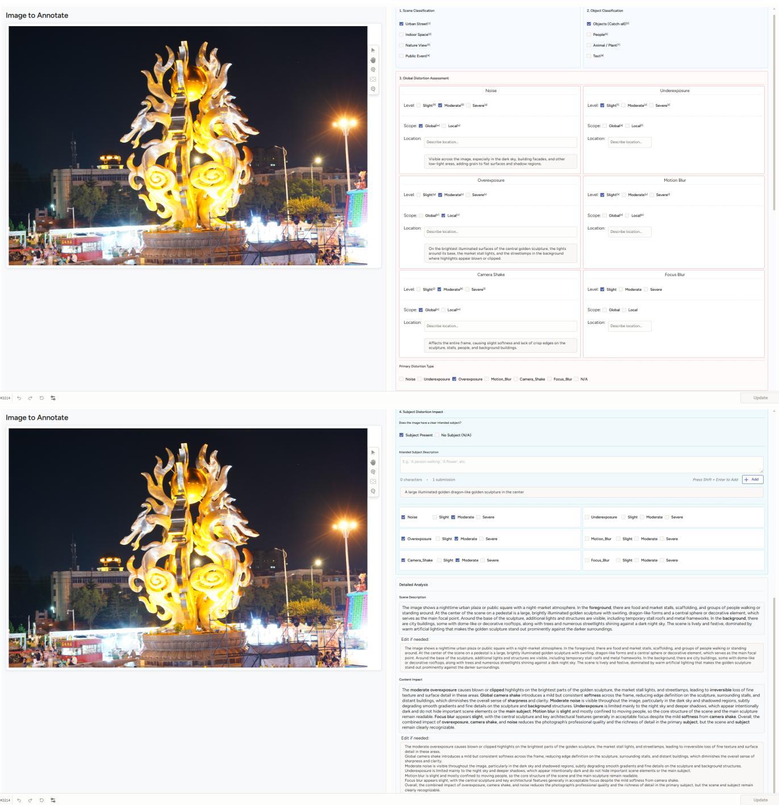  
Figure 6. Screenshots of the Label Studio annotation interface used for NightIQA-Real. The interface presents each nighttime image alongside pre-filled annotations from the multi-model ensemble, enabling annotators to verify and refine distortion type, severity, spatia scope, and quality narratives.

## B. Scene-Level Deduplication and Train/Benchmark Partitioning

We enforce scene-level separation through a four-stage pipeline: (1) privacy-aware face filtering, (2) DINOv2 feature extraction, (3) agglomerative clustering with clusterlevel partitioning, and (4) a manual review that removes any residual visual overlap between the two splits.

DINOv2 Feature Extraction. Each image is embedded using DINOv2 ViT-B/14 [1]. Images are resized via letterbox to 518×518 with bicubic interpolation and ImageNet normalization. The [CLS] token serves as the scene descriptor, ℓ -normalized as:

$$
\hat { { \mathbf f } } = \frac { { \mathbf f } } { \| { \mathbf f } \| _ { 2 } } , \quad \hat { { \mathbf f } } \in \mathbb { R } ^ { 7 6 8 } .\tag{3}
$$

Agglomerative Scene Clustering. Given the normalized feature matrix $\begin{array} { r l r } { \hat { F } } & { { } \in } & { \mathbb { R } ^ { N \times 7 6 8 ^ { - } } ~ ( N { = } 1 , 7 6 9 ) . } \end{array}$ , we apply hierarchical clustering with cosine distance $d ( \hat { \mathbf { f } } _ { i } , \hat { \mathbf { f } } _ { j } ) = 1 -$ $\hat { \mathbf { f } } _ { i } ^ { \top } \hat { \mathbf { f } } _ { j }$ , complete linkage, and threshold τ=0.45, yielding 334 scene clusters.

Cluster-Level Split. Clusters are sorted by ascending size and greedily assigned to training until reaching the target count. Since partitioning operates at the cluster level, no scene overlap or near-duplicate leakage occurs. This yields the 953-image GRPO training corpus and the 816- image held-out benchmark source, from which the 1,078 NightIQA-Bench questions are drawn. Table 6 summarizes the partition.

Manual Overlap Review. After the automatic clusterlevel assignment, an annotator inspects boundary cases across the two splits and removes any residual nearduplicate scenes, so the training corpus and the benchmark source share no visually similar scenes.

Table 6. Scene-level train/benchmark partition statistics. All splits are performed at the cluster level to prevent scene leakage.
<table><tr><td>Subset</td><td>Images</td></tr><tr><td>GRPO training corpus (small clusters)</td><td>953</td></tr><tr><td>Benchmark source (remaining clusters)</td><td>816</td></tr><tr><td>Total</td><td>1,769</td></tr></table>

## C. NightIQA-Bench: Detailed Examples and Statistics

## C.1. Question Distribution and Filtering

The final validated benchmark contains 1,078 questions, distributed across the four cognitive levels as L1: 99, L2: 344, L3: 344, and L4: 291. Questions are first generated from the NightIQA-Real annotations and then admitted only after passing the two-stage filter introduced in Section 3.2, which we expand here into four concrete steps:

(1) Candidate generation. For each image, multiplechoice questions spanning all four cognitive levels are generated jointly with chain-of-thought rationales grounded in the structured annotations; Level 2 yields two question types (primary-distortion identification and severity grading).

(2) Structural screening. Level completeness is enforced, and each rationale is checked for forbidden leakage patterns that would reveal the answer.

(3) MLLM-as-a-judge filter (first filter stage). An automatic judge screens candidates for logical errors, weak distractors, and insufficient discriminability.

(4) Domain-expert review (second filter stage). Human experts verify question clarity and visual grounding, retaining only questions that pass both filter stages.

The resulting MCQ+CoT pairs serve as the source for downstream GRPO training.

## C.2. MCQ Structure and CoT Generation Protocol

To keep the benchmark consistent across images and graders, every question is generated against a fixed schema rather than free-form prompting. We detail the three components that govern this schema below.

Controlled vocabulary. All questions and rationales are restricted to the annotation vocabulary defined in Section 3.1: the six canonical distortion types (Noise, Underexposure, Overexposure, Motion Blur, Focus Blur, Camera Shake), the severity levels, and the spatial-scope labels (global / local). Binding the wording to this taxonomy ensures that questions probe the same attributes that the annotations record, and that an answer can always be traced back to a grounded field.

Cognitive levels and option design. Each image yields questions across all four cognitive levels, with Level 2 contributing two complementary question types, so a single image produces both a distortion-identification item and a severity-grading item at that level. The levels follow the body’s definitions: L1 (Perception) recognizes the subject and scene content visible under nighttime conditions; L2 (Technical Assessment) identifies the primary distortion and grades its severity; L3 (Localization) probes spatial scope and the affected region; and L4 (Reasoning) probes causal and comparative judgments that require integrating multiple cues. Most questions are four-option singleanswer items following a 1+2+1 design: one correct answer, two hard distractors drawn from attributes that are plausible for the same scene (e.g., a neighboring severity level, a cooccurring distortion type, or an alternative affected region), and one easy distractor that is clearly inconsistent with the image. The severity-grading items at Level 2 instead use the three fixed options Slight / Moderate / Severe, so that any severity level can be the correct answer. This composition keeps the task discriminative while avoiding trivially guessable items.

```jsonl
Phase 1 Pre-Labeling Prompt (shared by GPT-5, Gemini 2.5 Pro, Doubao-Seed-1.6-Vision, GLM-4.5V)
TASK INSTRUCTION. You are an expert Image Quality Assessment (IQA) analyst specialising in nighttime photography. Analyse the
provided photograph and output the requested JSON fields. Your analysis must strictly assess the six distortion types listed in the
distortion severity field. Motion Blur: blur from moving objects while the background stays relatively sharp. Camera Shake:
blur affecting the entire image due to camera movement during exposure.
PRIORITY GUIDANCE. When selecting primary distortion, apply a two-step process. (1) Irreversibility: prioritise distortions that
cause irreversible loss of crucial information (e.g. blur or severe exposure issues) over inherent issues such as noise. (2) Conflict resolution:
if several distortions are equally severe and irreversible, select the one most affecting the primary subject, or the one that is visually most
dominant.
SEVERITY DEFINITIONS. Severe: prominent, severely degrades quality. Moderate: noticeable, clearly degrades quality. Slight: negligible
or absent.
OUTPUT FORMAT. A single, raw, syntactically correct JSON object with the following nine fields:
{
"scene_category": "few words, e.g. Outdoor street view",
"distortion_severity": {
"Noise": "Severe|Moderate|Slight",
"Underexposure": "...", "Overexposure": ".
"Motion_Blur": "...", "Camera_Shake": "...",
"Focus_Blur": "..."
},
"primary_distortion": "single dominant Severe/Moderate type",
"intended_subject": "single main focal subject, or N/A",
"subject_distortions": { "type": "severity", ... },
"scene_description": "key elements + spatial positions",
"distortion_analysis": {
"type": "Global|Local - short location phrase",
},
"content_impact_discussion": "impact on subject + scene",
"explanation": ["concise justification of key choices", ...]
}
```  
Figure 7. Pre-labeling prompt template shared by all four frontier MLLMs in the Phase 1 ensemble. Each model receives this identica prompt alongside the target nighttime image and returns a structured JSON annotation following the schema shown at the bottom.

Blind-test CoT protocol. The chain-of-thought rationale attached to each question is generated under a blind-test constraint: the rationale must describe the visual evidence and reasoning that lead to the answer without stating the option letter or copying the answer text, and a fixed list of forbidden answer-revealing phrases is enforced during structural screening (Section C.1, step 2). This prevents the rationale from leaking the answer and forces the model to articulate grounded perceptual evidence, which is what the description reward r (Section F.3) later supervises.

## C.3. Extended Benchmark Examples

Figures 9 and 10 present full-width benchmark views for all four cognitive levels.

## D. NightIQA-Syn: Degradation Pipeline Details

Each distortion is synthesized at two severity levels (Medium and Severe). Medium parameters are stochastically sampled; Severe parameters are derived by applying a fixed scaling factor.

Annotation Example (NightIQA-Real; ensemble output verified by human annotators)

```json
{
"scene_category": "Outdoor urban street view",
"distortion_severity": {
"Noise": "Moderate", "Underexposure": "Severe",
"Overexposure": "Moderate", "Motion_Blur": "Slight",
"Camera_Shake": "Slight", "Focus_Blur": "Slight"
},
"primary_distortion": "Underexposure",
"intended_subject": "White sedan parked on a dark street
in front of brightly lit storefronts.",
"subject_distortions": {
"Noise": "Moderate", "Underexposure": "Severe"
},
"scene_description": "Nighttime urban street; white sedan
on dark asphalt (foreground); sidewalk, tree, stacked
chairs (midground); lit restaurant facade with neon
trim and a circular illuminated logo (background).",
"distortion_analysis": {
"Underexposure": "Global - car, street, unlit
storefronts, and darker building areas.",
"Overexposure": "Local - neon signage, logo, awning.",
"Noise": "Global - mid-tone and dark regions."
},
"content_impact_discussion": "Underexposure hides
foreground detail and the car’s plate/interior; noise
adds grain in dark regions; local overexposure clips
neon highlights.",
"explanation": [
"Underexposure is primary: irreversible loss of
crucial detail across the scene.",
"Overexposure is local, limited to signage."
]
}
```  
Figure 8. A complete annotation example from NightIQA-Real, produced by the multi-model ensemble and verified by human annotators (long free-text values reflowed for display).

Note on severity levels. NightIQA-Real and NightIQA-Syn use different severity granularities by design. Real captures carry the three perceptual levels used by human annotators (Slight / Moderate / Severe, Section A.1), because real degradations form a continuum that annotators can resolve into three bands. Synthetic degradations are generated at two controllable levels (Medium / Severe), since the parameters are programmatically set and the goal is to expose the model to a clearly moderate and a clearly strong instance of each type. When the two sources are combined for training, the synthetic Medium level is aligned with the real Slight–Moderate range and Severe with Severe, so that severity supervision remains consistent across the real and synthetic portions of the data.

## D.1. Global-Level Degradation Algorithms

Noise. A black-level offset (+2) is added, then chromatic sensor noise is injected via ISONoise (color shift c ∈ [0.07, 0.09], intensity $\begin{array} { r l r } { \alpha } & { { } \in } & { [ 0 . 3 2 , 0 . 3 7 ] ) } \end{array}$ , followed by additive Gaussian grain $( \mu { = } 3 , \sigma _ { g } \in [ 4 . 8 , 5 . 3 ] )$ . Severe: all parameters ×1.4 (capped at 1.0).

Underexposure. With probability $p ~ \in ~ [ 0 . 2 , 0 . 4 ] .$ , lowintensity ISONoise $( c \in [ 0 . 0 1 , 0 . 0 3 ] , \alpha \in [ 0 . 0 5 , 0 . 1 0 ] )$ is injected, then the image is multiplied by brightness factor $\beta \in [ 0 . 3 5 , 0 . 5 5 ]$ . Severe: β/2.5, noise params ×2.5.

Global Overexposure. In CIE LAB space: a highlight mask is created by thresholding L at $\tau \in [ 1 8 0 , 2 0 0 ]$ and smoothing with Gaussian radius $r ~ \in ~ [ 7 1 , 8 1 ]$ px; gamma correction $( \gamma \in \ [ 0 . 5 0 , 0 . 5 5 ] )$ and brightness addition $( \Delta L \in [ 6 0 , 6 5 ] )$ are applied; the bloom mask is composited additively. Severe: $\gamma / 1 . 3 , \Delta L \times 1 . 3 , \tau \times 0 . 7 , r \times 1 . 3$

Camera Shake. MotionBlur with kernel extent $k \in$ [40, 60] px and random angle $\phi \in [ 0 , 3 6 0 ] ^ { \circ }$ . Severe: k×2.0.

Figure 11 shows representative examples of each globallevel distortion at both severity levels, and Table 7 summa-

Level 1: Perception (99 questions)  
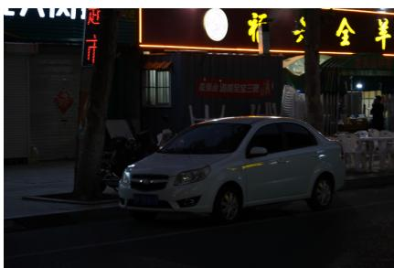

Question. Which description best matches the visible scene content?   
(A) A nighttime urban street with very dark, heavily out-of-focus foreground foliage and a prominent blurred pink/red flower cluster near the center-left, a curving road, and a scooter headlight in the background. [correct]   
(B) Identical scene, but the flower cluster sits near the center-right.   
(C) Identical layout, but the cluster is purple instead of pink/red.   
(D) A person riding a scooter with its headlight on is visible on the roadway in the background. Chain-of-Thought. The scene reads as a dark nighttime street with a large, very soft (out-of-focus) foreground plant mass and a pink/red cluster near the center-left blocking part of the view; the road curves right and a single bright headlight suggests a scooter in the distance. Option B shifts the cluster to center-right, which does not match. Option C keeps the layout but changes the color away from pink/red. Option D is true but only names a background element, ignoring the dominant foreground foliage that defines the scene.

Level 2: Technical Assessment (344 questions)  
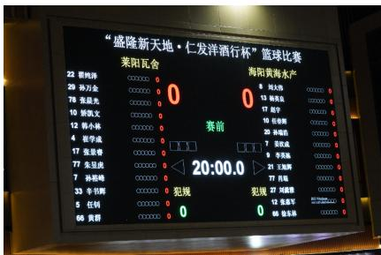

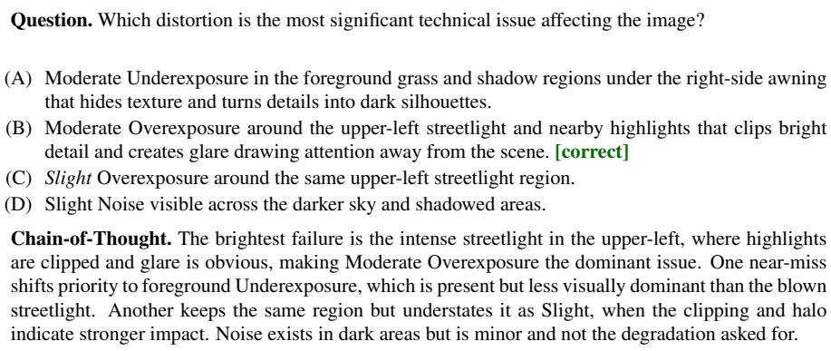  
Figure 9. Benchmark examples for cognitive levels L1–L2. Each panel pairs the nighttime image with its multiple-choice question, options (correct answer marked), and the jointly generated chain-of-thought rationale.

rizes all parameter ranges.

Table 7. Parameter configurations for global-level degradation operators in NightIQA-Syn.
<table><tr><td>Distortion</td><td>Parameter</td><td>Medium</td><td>Severe</td></tr><tr><td rowspan="3">Noise</td><td>Color shift c</td><td>[0.07, 0.09]</td><td> $c _ { m } \times 1 . 4$ </td></tr><tr><td>ISO intensity α</td><td>[0.32, 0.37]</td><td> $\alpha _ { m } \times 1 . 4$ </td></tr><tr><td>Gaussian sigma  $\sigma _ { g }$ </td><td>[4.8, 5.3]</td><td> $\sigma _ { g , m } \times 1 . 4$ </td></tr><tr><td rowspan="4">Underexposure</td><td>Brightness factor β</td><td>[0.35, 0.55]</td><td> $\beta _ { m } / 2 . 5$ </td></tr><tr><td>Noise probability p</td><td>[0.2, 0.4]</td><td> $p _ { m } \times 2 . 5$ </td></tr><tr><td>Noise color shift c</td><td>[0.01, 0.03]</td><td> $c _ { m } \times 2 . 5$ </td></tr><tr><td>Noise intensity α</td><td>[0.05, 0.10]</td><td> $\alpha _ { m } \times 2 . 5$ </td></tr><tr><td rowspan="4">Global Overexposure</td><td>Gamma γ</td><td>[0.50, 0.55]</td><td> $\gamma _ { m } / 1 . 3$ </td></tr><tr><td>Brightness addition ∆L</td><td>[60, 65]</td><td> $\Delta L _ { m } \times 1 . 3$ </td></tr><tr><td>Bloom threshold τ</td><td>[180, 200]</td><td> $\tau _ { m } \times 0 . 7$ </td></tr><tr><td>Bloom radius r (px)</td><td>[71, 81]</td><td> $r _ { m } \times 1 . 3$ </td></tr><tr><td rowspan="2">Camera Shake</td><td>Kernel extent k (px)</td><td>[40, 60]</td><td> $k _ { m } \times 2 . 0$ </td></tr><tr><td>Motion angle φ (deg)</td><td>[0, 360]</td><td>same as Medium</td></tr></table>

## D.2. Instance-Level Degradation Algorithms

Target Identification (Stage 1). Before any instancelevel operator is applied, a vision-language model inventories the salient scene elements that can serve as degradation targets (Section 3.3): movable objects (person, vehicle, animal) for Motion Blur, point light sources (neon sign, headlight, taillight, lamp, spotlight, etc.) for Local Overexposure, and depth-separated objects for Focus Blur. The model is queried with the prompt of Figure 12 and returns up to five categories from a fixed content vocabulary; only images that yield valid targets enter the corresponding rendering branch, after which Rex-Omni and SAM3 ground the named targets into pixel-accurate masks (Stage 2).

Local Overexposure. Light-source masks are combined via bitwise OR into M. The light layer $L = I \odot M$ is extracted, a bloom layer is generated via Gaussian filtering $( \sigma ~ \in ~ [ 4 5 , 5 0 ] )$ , and composited: $~ O ~ = ~ I + 0 . 5 L + \alpha$ Bloom(L) with $\alpha \in [ 1 . 6 , 1 . 7 ]$ . Severe: $\sigma { \times } 2 . 6 , \alpha { \times } 2 . 6$

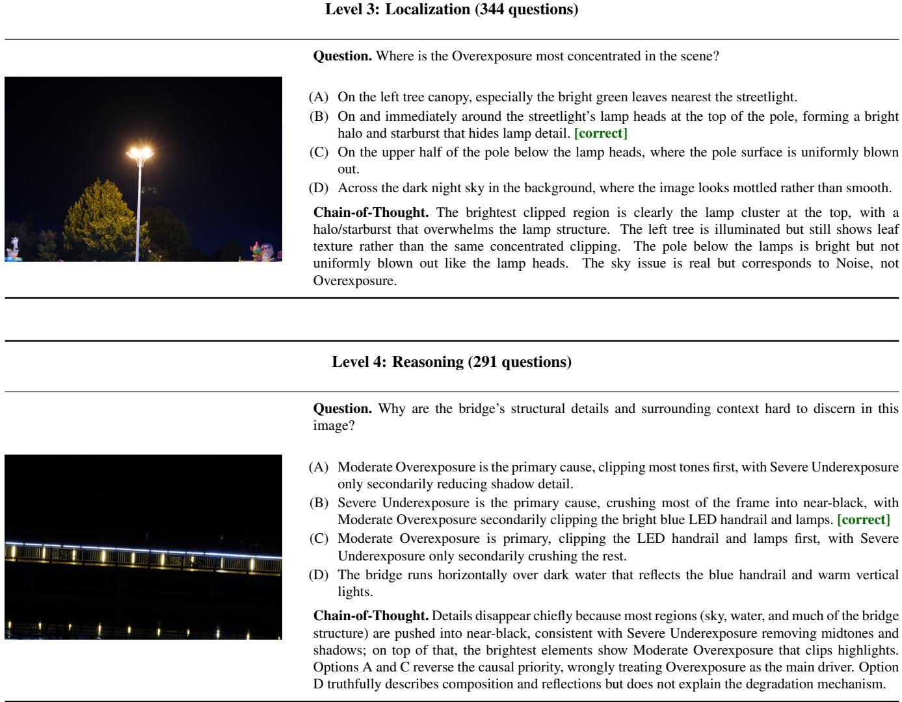  
Figure 10. Benchmark examples for cognitive levels L3–L4 (continued from Figure 9).

Motion Blur. Object masks are loaded, softened, and combined. An adaptive displacement d is derived from the bounding-box diagonal scaled by $\alpha \ \in \ [ 0 . 1 0 , 0 . 1 5 ]$ . The image is linearized (gamma 2.2), then $N \in [ 3 0 , 3 5 ]$ warped frames are accumulated along a randomized trajectory with vertical shift $v \in [ 0 . 0 0 8 , 0 . 0 1 2 ]$ , followed by matched noise injection $( \eta \in [ 0 . 0 1 , 0 . 0 1 5 ] )$ and soft compositing. Severe: all parameters ×3.5.

Focus Blur. A monocular depth map guides layered diskkernel convolution. The focal depth is derived from the secondary-object mask; the blur radius per pixel is $r =$ $r _ { \mathrm { m a x } } { \cdot } | d { - } d _ { f } | / \operatorname* { m a x } | d { - } d _ { f } |$ with $r _ { \mathrm { m a x } } \in [ 3 2 , 3 8 ]$ px, divided into $K { = } 5$ layers. Severe: $r _ { \mathrm { m a x } } { \times } 2 . 3$

Figure 13 shows representative examples of each instance-level distortion, and Table 8 summarizes all parameter ranges.

## D.3. Core Implementation of the Degradation Operators

This subsection lists the core routines of our released preprocessing toolkit, condensed from the production scripts (logging, I/O, multi-threading, and SFT-text generation removed) to expose the degradation logic itself. Every operator exposes a MEDIUM PARAMS dictionary and a scalar SEVERE FACTOR: the Medium level samples parameters from the listed ranges, and the Severe level scales them by SEVERE FACTOR (Section D). The four globa operators in Figure 14 act on the entire frame; the three

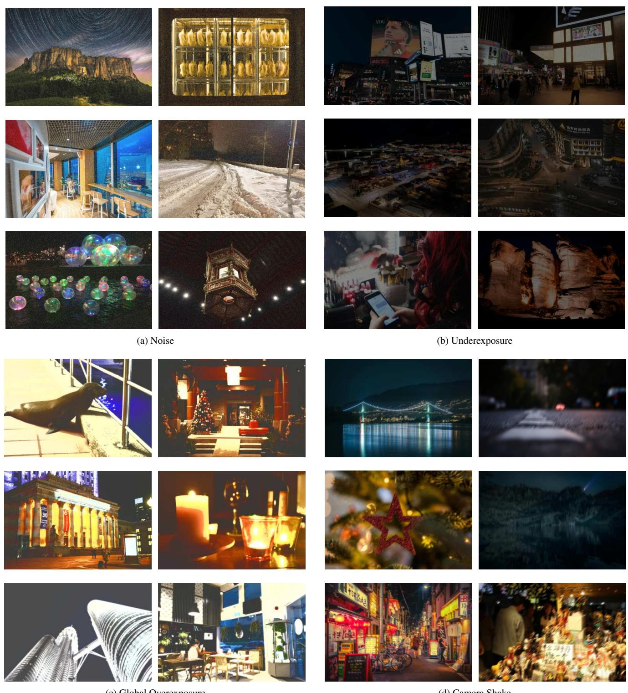  
(c) Global Overexposure  
(d) Camera Shake

Figure 11. Visual examples of global-level degradations in NightIQA-Syn, grouped by distortion type. Within each category, the columns show two representative scenes and the rows correspond to increasing severity.

TASK. You are an image tagger. From the category vocabulary below, choose up to five categories that are most confidently visible in the image. If fewer than five categories are clearly visible, return fewer.

OUTPUT FORMAT. Return only a single JSON object: {"img path": "<path>", "tag": ["tag1", ..., "tag5"]}.

```csv
person, vehicle, animal, storefront, sign, billboard,
light, illuminated_billboard, neon_sign, led_display,
screen, traffic_light, light_strip, string_lights, lamp,
chandelier, spotlight, taillight, monitor,
illuminated_window, headlight, sky, sun, cloud, tree,
door, escalator, elevator, table, chair, sofa, bed,
shelf, shadow
```

Figure 12. Stage 1 target-identification prompt for the instance-level pipeline. The model selects up to five categories from the fixed content vocabulary (bottom). Movable objects, point light sources, and depth-separated objects serve as candidate targets for Motion Blur, Loca Overexposure, and Focus Blur respectively; only images with valid targets enter the matching rendering branch.  
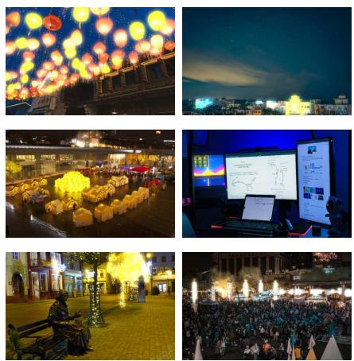  
(a) Local Overexposure

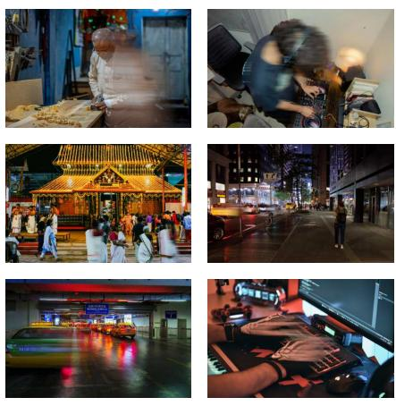  
(b) Motion Blur

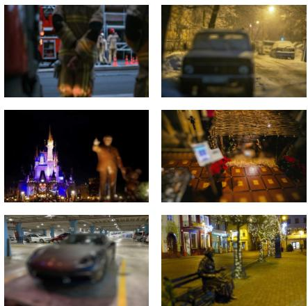  
(c) Focus Blur  
Figure 13. Visual examples of instance-level degradations in NightIQA-Syn, grouped by distortion type. Within each category, the columns show two representative scenes and the rows correspond to increasing severity.

Table 8. Parameter configurations for instance-level degradation operators in NightIQA-Syn.
<table><tr><td>Distortion</td><td>Parameter</td><td>Medium</td><td>Severe</td></tr><tr><td rowspan="2">Local Overexposure</td><td>Bloom sigma σ (px)</td><td>[45, 50]</td><td> $\sigma _ { m } \times 2 . 6$ </td></tr><tr><td>Bloom intensity α</td><td>[1.6, 1.7]</td><td> $\alpha _ { m } \times 2 . 6$ </td></tr><tr><td rowspan="4">Motion Blur</td><td>Displacement intensity α</td><td>[0.10, 0.15]</td><td> $\alpha _ { m } \times 3 . 5$ </td></tr><tr><td>Warp steps N</td><td>[30, 35]</td><td> $N _ { m } \times 3 . 5$ </td></tr><tr><td>Vertical shift factor v</td><td>[0.008, 0.012]</td><td> $v _ { m } \times 3 . 5$ </td></tr><tr><td>Matched noise level η</td><td>[0.01, 0.015]</td><td> $\eta _ { m } \times 3 . 5$ </td></tr><tr><td rowspan="2">Focus Blur</td><td>Max blur radius rmax (px)</td><td>[32, 38]</td><td>rmax, m × 2.3</td></tr><tr><td>Depth layers K</td><td colspan="2">5 (fixed)</td></tr></table>

instance-level operators in Figures 15–17 act only within object masks or a depth map. We use cv2 (OpenCV), np (NumPy), A (Albumentations), and torch/F (PyTorch / torch.nn.functional), with DEVICE the active

CUDA device.

## D.4. Synthetic Distortion Validation

Before SFT sampling (Supp. Sec. D.5), every generated image passes an automated quality-control step that verifies the intended distortion was actually rendered and is consistent with its structured label. An MLLM inspector receives the degraded image together with the expected distortion type, severity, scope, and the structured chainof-thought description, and is queried with the prompt of Figure 18. The judge returns a JSON verdict covering distortion presence, type match, scope accuracy, target reasonableness (for instance-level distortions), and severity consistency, plus an objective perceived-severity rating assessed independently of the label and a 1–10 quality score. An image is retained only when all boolean checks pass, the quality score is $\geq 7 ,$ , and no critical

Global Degradation Operators (noise, underexposure, overexposure, camera shake)

```python
# ISO sensor noise (global)
SEVERE_FACTOR = 1.4
MEDIUM_PARAMS = {"color_shift": (0.07, 0.09),
"intensity": (0.32, 0.37),
"gauss_sigma": (4.8, 5.3)}
def iso_noise(bgr, color, intensity, g_sigma):
rgb = cv2.cvtColor(bgr, cv2.COLOR_BGR2RGB)
rgb = cv2.add(rgb, np.array([2, 2, 2], np.uint8)) # lift black level
rgb = A.ISONoise(color_shift=(color, color),
intensity=(intensity, intensity), p=1.0)(image=rgb)["image"]
noise = np.random.normal(3, g_sigma, rgb.shape).astype(np.float32)
rgb = np.clip(rgb.astype(np.float32) + noise, 0, 255).astype(np.uint8)
return cv2.cvtColor(rgb, cv2.COLOR_RGB2BGR)
# Underexposure (global)
SEVERE_FACTOR = 2.5
MEDIUM_PARAMS = {"brightness_factor": (0.35, 0.55),
"noise_probability": (0.2, 0.4)}
def underexpose(bgr, brightness_factor, noise_prob, iso_color, iso_intensity):
if np.random.rand() < noise_prob: # probabilistic sensor noise
rgb = cv2.cvtColor(bgr, cv2.COLOR_BGR2RGB)
rgb = A.ISONoise(color_shift=(iso_color, iso_color),
intensity=(iso_intensity, iso_intensity))(image=rgb)["image"]
bgr = cv2.cvtColor(rgb, cv2.COLOR_RGB2BGR)
out = bgr.astype(np.float32) / 255.0 <sub>*</sub> brightness_factor # linear dimming
return np.clip(out <sub>*</sub> 255, 0, 255).astype(np.uint8)
# Global overexposure / bloom
SEVERE_FACTOR = 1.3
MEDIUM_PARAMS = {"gamma": (0.5, 0.55), "brightness_add": (60, 65),
"bloom_threshold": (180, 200), "bloom_radius": (71, 81)}
def overexpose(bgr, gamma, b_add, t_val, r_val):
l, a, b = cv2.split(cv2.cvtColor(bgr, cv2.COLOR_BGR2LAB))
_, sharp = cv2.threshold(l, t_val, 255, cv2.THRESH_BINARY)
r_val = r_val if r_val % 2 else r_val + 1 # odd kernel size
bloom = cv2.GaussianBlur(sharp, (r_val, r_val), 0)
lut = np.array([((i / 255.0) (1.0 / gamma)) 255
for i in range(256)]).astype(np.uint8)
l = cv2.add(cv2.LUT(l, lut), np.array([b_add], np.uint8))
l = cv2.add(l, bloom)
return cv2.cvtColor(cv2.merge([l, a, b]), cv2.COLOR_LAB2BGR)
# Camera shake (whole-image motion blur)
SEVERE_FACTOR = 2.0
MEDIUM_PARAMS = {"blur_limit": (40, 60)}
def camera_shake(bgr, limit, angle):
rgb = cv2.cvtColor(bgr, cv2.COLOR_BGR2RGB)
t = A.MotionBlur(blur_limit=(limit, limit),
angle_range=(angle, angle), allow_shifted=True, p=1.0)
return cv2.cvtColor(t(image=rgb)["image"], cv2.COLOR_RGB2BGR)
```  
Figure 14. Core routines for the four global operators. Each is applied to the full frame; Severe multiplies the sampled MEDIUM PARAMS by SEVERE FACTOR.

Instance-Level Motion Blur (physical optical-flow integration, GPU)

```python
# Motion blur (instance-level, physical optical integration)
SEVERE_FACTOR = 3.5
MEDIUM_PARAMS = {"steps": (30, 35), "intensity": (0.1, 0.15),
"vertical_shift_factor": (0.008, 0.012),
"noise_range": (0.01, 0.015)}
def adaptive_magnitude(w, h, intensity, level):
diag = np.sqrt(w 2 + h 2)
mag = diag <sub>*</sub> intensity
max_limit = {"slight": 25.0, "medium": 55.0}.get(level, 200.0)
if diag < 200: # damp small objects
mag <sub>*</sub>= max(0.4, diag / 200.0)
if mag > max_limit: # soft ceiling
mag = max_limit + (mag - max_limit) <sub>*</sub> 0.25
mag = max(1.5, mag)
ratio = 0.75 if level == "severe" else 0.5 # cap by object size
return min(mag, min(w, h) <sub>*</sub> ratio)
def motion_blur_torch(img, mask, steps, trans_x, trans_y, noise=0.05):
x = torch.from_numpy(img[..., ::-1].copy()).float()
x = x.permute(2, 0, 1).unsqueeze(0).to(DEVICE) / 255.0
m = torch.from_numpy(mask).float()[None, None].to(DEVICE)
x = torch.pow(x + 1e-6, 2.2) # sRGB -> linear light
B, C, H, W = x.shape
yy, xx = torch.meshgrid(torch.linspace(-1, 1, H, device=DEVICE),
torch.linspace(-1, 1, W, device=DEVICE), indexing=’ij’)
base = torch.stack((xx, yy), -1)[None]
acc_img = torch.zeros_like(x); acc_m = torch.zeros_like(m); wsum = 0.0
for i in range(steps): # integrate along the path
g = base.clone()
g[..., 0] -= (trans_x / steps i) 2 / W
g[..., 1] -= (trans_y / steps <sub>*</sub> i) <sub>*</sub> 2 / H
wi = F.grid_sample(x, g, align_corners=True, padding_mode="border")
wm = F.grid_sample(m, g, align_corners=True, padding_mode="zeros")
acc_img += wi wm; acc_m += wm; wsum += 1.0
acc_m = torch.clamp(acc_m, min=1e-3)
obj = torch.pow(acc_img / acc_m + 1e-6, 1 / 2.2)
obj = torch.clamp(obj + torch.randn_like(obj) <sub>*</sub> noise, 0, 1) # matched grain
fg = torch.clamp(acc_m / (wsum + 1e-6), 0, 1)
out = obj <sub>*</sub> fg + torch.pow(x + 1e-6, 1 / 2.2) <sub>*</sub> (1 - fg) # composite
out = out.squeeze(0).permute(1, 2, 0).cpu().numpy()
return np.clip(out <sub>*</sub> 255, 0, 255).astype(np.uint8)[..., ::-1]
```  
Figure 15. Motion blur is rendered in linear light by integrating the masked object along its displacement path, then alpha-composited back over the sharp background; displacement is set adaptively from object size.

issue is flagged; otherwise it is discarded. The check is scope-aware: global distortions must affect the entire frame uniformly, whereas instance-level distortions must be confined to a semantically appropriate target (light sources for Local Overexposure, moving objects for Motion Blur, depth-separated objects for Focus Blur), so that a mismatched target (e.g., motion blur on a static building) is marked as a failure.

## D.5. SFT Training Data Sampling Strategy

From the 80,000-image synthetic corpus, 6,769 images are sampled via stratified sampling along distortion type and severity level, with near-balanced coverage where validated samples permit. Table 9 reports the distribution.

Table 9. SFT training data distribution by distortion type and severity.
<table><tr><td>Distortion Type</td><td>Medium</td><td>Severe</td><td>Total</td></tr><tr><td>Noise</td><td>500</td><td>500</td><td>1,000</td></tr><tr><td>Underexposure</td><td>500</td><td>500</td><td>1,000</td></tr><tr><td>Global Overexposure</td><td>500</td><td>500</td><td>1,000</td></tr><tr><td>Local Overexposure</td><td>501</td><td>268</td><td>769</td></tr><tr><td>Camera Shake</td><td>500</td><td>500</td><td>1,000</td></tr><tr><td>Motion Blur</td><td>500</td><td>500</td><td>1,000</td></tr><tr><td>Focus Blur</td><td>500</td><td>500</td><td>1,000</td></tr><tr><td>Total</td><td>3,501</td><td>3,268</td><td>6,769</td></tr></table>

## Instance-Level Focus Blur (depth-aware layered defocus, GPU)

```python
# Focus blur (instance-level, depth-aware layered defocus)
SEVERE_FACTOR = 2.3
MEDIUM_PARAMS = {"max_radius": (32, 38)}
def disk_kernel(radius):
ks = int(radius 2 + 1)
yy, xx = torch.meshgrid(torch.linspace(-radius, radius, ks),
torch.linspace(-radius, radius, ks), indexing=’ij’)
k = torch.clamp(radius - torch.sqrt(xx<sub>**</sub>2 + yy<sub>**</sub>2) + 0.5, 0, 1)
return (k / k.sum()).to(DEVICE) # normalized disk (CoC)
def layered_blur(img, depth, focal_depth, max_radius, layers=5):
d = F.avg_pool2d(depth, 5, 1, 2)
diff = torch.abs(d - focal_depth)
target = diff / (diff.max() + 1e-6) <sub>*</sub> max_radius # blur radius per pixel
step = max_radius / (layers - 1)
out = img.clone()
for i in range(layers - 1): # discretize depth into layers
lo, hi = i <sub>*</sub> step, (i + 1) <sub>*</sub> step
m = (target >= lo) & (target < hi)
if not torch.any(m): continue
k = disk_kernel((lo + hi) / 2)
pad = k.shape[0] // 2
k4 = k[None, None].repeat(3, 1, 1, 1)
b = F.conv2d(F.pad(img, (pad,) <sub>*</sub> 4, mode=’reflect’), k4, groups=3)
out[m.repeat(1, 3, 1, 1)] = b[m.repeat(1, 3, 1, 1)]
return out
def focus_blur_torch(img, depth, focal_point, max_radius):
x = torch.from_numpy(img[..., ::-1].copy()).float()
x = x.permute(2, 0, 1).unsqueeze(0).to(DEVICE) / 255.0
x = torch.pow(x + 1e-6, 2.2) # sRGB -> linear light
d = torch.from_numpy(depth.astype(np.float32))[None, None].to(DEVICE)
fx, fy = focal_point
focal = torch.median(d[0, 0, max(0, fy-2):fy+3, max(0, fx-2):fx+3]).item()
out = layered_blur(x, d, focal, max_radius, layers=5)
out = torch.pow(out + 1e-6, 1 / 2.2).squeeze(0).permute(1, 2, 0).cpu().numpy()
return np.clip(out <sub>*</sub> 255, 0, 255).astype(np.uint8)[..., ::-1]
```  
Figure 16. Defocus is applied in depth-ordered layers: each pixel’s circle-of-confusion radius grows with its distance from the focal plane, and a normalized disk kernel is convolved per layer in linear light.

## Instance-Level Local Overexposure (mask-driven atmospheric bloom)

```python
# Local overexposure (instance-level atmospheric bloom)
SEVERE_FACTOR = 2.6
MEDIUM_PARAMS = {"sigma": (45.0, 50.0), "intensity": (1.6, 1.7)}
def atmospheric_bloom(bgr, mask, sigma, intensity):
img = bgr.astype(np.float32) / 255.0
m = mask.astype(np.float32) / 255.0
if m.ndim == 2:
m = cv2.merge([m, m, m])
light = img <sub>*</sub> m # isolate light sources
bloom = cv2.GaussianBlur(light, (0, 0), sigmaX=sigma, sigmaY=sigma)
out = img + light <sub>*</sub> 0.5 + bloom <sub>*</sub> intensity # additive optical blend
return (np.clip(out, 0, 1.0) <sub>*</sub> 255).astype(np.uint8)
```  
Figure 17. Local overexposure isolates masked light sources, generates a wide Gaussian halo, and blends it additively, reproducing the bloom around bright nighttime sources.

TASK. You are a professional image quality inspector. Validate whether this nighttime photograph exhibits the specific distortion described in the training data. You are given the expected distortion type, severity, scope, key visual features, and the structured chain-of-thought description (scene, scope, distortion specifics, target, labeled severity).

GLOBAL CHECKS. Confirm that the distortion (i) affects the entire frame uniformly, (ii) matches the expected type, (iii) is consistent with the labeled severity, and (iv) exhibits the expected visual features; localized effects under a Global label are marked as failures.

LOCAL CHECKS. Confirm that the distortion is confined to a specific target and that the target is semantically appropriate: light sources for Local Overexposure, moving objects for Motion Blur, and depth-separated objects for Focus Blur. The observed target must match the one stated in the description, and non-target regions must remain relatively unaffected; an unreasonable target (e.g., motion blur on a static building) is marked as a failure.

SEVERITY. Independently assess perceived severity (slight/medium/severe) from the image alone, then check whether it matches the labeled level.

DECISION RULE. validation passed is true only if all boolean checks pass, overall quality score $\geq 7 ,$ , and issues found is empty.

OUTPUT FORMAT. Return only the JSON object below (no extra text):

```jsonl
{
"distortion_present": true|false,
"distortion_matches_type": true|false,
"scope_accurate": true|false,
"target_identified": true|false, # local only
"target_reasonable": true|false, # local only
"target_matches_sft": true|false, # local only
"severity_appropriate": true|false,
"perceived_severity": "slight|medium|severe",
"severity_label_accurate": true|false,
"sft_description_accurate":true|false,
"overall_quality_score": 1-10,
"validation_passed": true|false,
"issues_found": ["...", ...],
"reasoning": "brief explanation"
}
```  
Figure 18. Synthetic distortion validation prompt. Each generated NightIQA-Syn image is inspected by an MLLM judge that returns the structured verdict (bottom); only images that pass every boolean check with a quality score $\geq ~ 7$ enter the SFT sampling pool (Supp. Sec. D.5).

## E. Supervised Fine-Tuning: Full Details

## E.1. SFT Data Construction

Each degraded image x˜ is annotated with degradation type $y ^ { \mathrm { t y p e } }$ , severity $y ^ { \mathrm { s e v } }$ (Medium/Severe), and scope $y ^ { \mathrm { s c o p e } } \in$ {global, local}. Supervision is constructed in two formats: Basic QA (three single-turn pairs probing type, severity, and scope) and Chain-of-Thought (a structured response sequentially describing content, distortion, and spatial distribution).

## E.2. SFT Training Objective

The SFT stage uses the masked next-token prediction loss, restricted to response tokens:

$$
\mathcal { L } _ { \mathrm { S F T } } = - \sum _ { t = 1 } ^ { T } m _ { t } \log p _ { \theta } ( z _ { t } \mid z _ { < t } ) ,\tag{4}
$$

where $m _ { t } \in \{ 0 , 1 \}$ masks out image and prompt tokens. The supervision implicitly targets:

$$
\hat { y } = \{ \hat { y } ^ { \mathrm { t y p e } } , \ \hat { y } ^ { \mathrm { s e v } } , \ \hat { y } ^ { \mathrm { s c o p e } } \} .\tag{5}
$$

The learning rate follows cosine annealing with linear warmup. During warmup $( 0 \leq s < S _ { w } ) , \eta _ { s } = \eta _ { 0 } s / S _ { w } ;$ during annealing $( S _ { w } \le s \le S )$

$$
\begin{array} { r } { \eta _ { s } = \eta _ { \mathrm { m i n } } + \frac { 1 } { 2 } \big ( \eta _ { 0 } - \eta _ { \mathrm { m i n } } \big ) \big ( 1 + \cos ( \pi \phi _ { s } ) \big ) , \quad \phi _ { s } = \frac { s - S _ { w } } { S - S _ { w } } , } \\ { ( 6 ) } \end{array}
$$

where $S _ { w } = 0 . 0 1 \cdot S$ is the warmup length.

## E.3. SFT Hyperparameters

Table 10 summarizes the SFT hyperparameters.

Table 10. Hyperparameters for the SFT stage.
<table><tr><td>Hyperparameter</td><td>Value</td></tr><tr><td>Base model</td><td>Qwen3-VL-8B</td></tr><tr><td>Fine-tuning strategy</td><td>Full-parameter SFT</td></tr><tr><td>Training epochs</td><td>3</td></tr><tr><td>Learning rate  $\eta _ { 0 }$ </td><td> $1 \times 1 0 ^ { - 5 }$ </td></tr><tr><td>LR schedule</td><td>Cosine annealing</td></tr><tr><td>Warmup ratio</td><td>0.01</td></tr><tr><td>Optimizer</td><td>AdamW</td></tr><tr><td>Data precision</td><td>bfloat16</td></tr></table>

## F. GRPO: Full Formulation and Training Details

## F.1. Group Relative Policy Optimization

For each query q with image x, GRPO samples G outputs $\{ o _ { i } \} _ { i = 1 } ^ { G }$ from $\pi _ { \theta _ { \mathrm { o l d } } }$ , scores them to obtain $\{ r _ { i } \}$ , and computes the group-relative advantage:

$$
\hat { A } _ { i } = \frac { r _ { i } - \mathrm { m e a n } ( \{ r _ { j } \} ) } { \mathrm { s t d } ( \{ r _ { j } \} ) } .\tag{7}
$$

The policy is updated via:

$$
\begin{array} { r l } & { \mathcal { I } _ { \mathrm { G R P O } } ( \theta ) = \mathbb { E } \Big [ \frac { 1 } { G } \displaystyle \sum _ { i = 1 } ^ { G } \operatorname* { m i n } \bigl ( \rho _ { i } \hat { A } _ { i } , } \\ & { \qquad \mathrm { c l i p } ( \rho _ { i } , 1 - \epsilon , 1 + \epsilon ) \hat { A } _ { i } \bigr ) } \\ & { \qquad - \beta \mathbb { D } _ { \mathrm { K L } } [ \pi _ { \theta } \parallel \pi _ { \mathrm { r e f } } ] \Big ] , } \end{array}\tag{8}
$$

where $\rho _ { i } \ = \ \pi _ { \theta } ( o _ { i } \ | \ q ) / \pi _ { \theta _ { \mathrm { o l d } } } ( o _ { i } \ | \ q )$ . The per-token KL divergence is:

$$
\begin{array} { r l r } & { } & { { \mathbb { D } } _ { \mathrm { K L } } [ \pi _ { \theta } \| \pi _ { \mathrm { r e f } } ] = \displaystyle \frac { 1 } { | o _ { i } | } \sum _ { t = 1 } ^ { | o _ { i } | } \Big [ \frac { \pi _ { \theta } \big ( o _ { i , t } \mid q , o _ { i , < t } \big ) } { \pi _ { \mathrm { r e f } } \big ( o _ { i , t } \mid q , o _ { i , < t } \big ) } } \\ & { } & { \qquad - \log \frac { \pi _ { \theta } \big ( o _ { i , t } \mid q , o _ { i , < t } \big ) } { \pi _ { \mathrm { r e f } } \big ( o _ { i , t } \mid q , o _ { i , < t } \big ) } - 1 \Big ] . } \end{array}\tag{9}
$$

## F.2. Structured Output Format

The model generates responses in the following format:

<thinking>   
[Analysis of visual attributes and   
quality reasoning process]   
</thinking>   
<answer>[Option letter]</answer>

## F.3. Composite Reward Function

The total reward is:

$$
\boldsymbol { r } _ { \mathrm { t o t a l } } = \boldsymbol { w } _ { \mathrm { a c c } } \cdot \boldsymbol { r } _ { \mathrm { a c c } } + \boldsymbol { w } _ { \mathrm { d e s c } } \cdot \boldsymbol { r } _ { \mathrm { d e s c } } + \boldsymbol { w } _ { \mathrm { f m t } } \cdot \boldsymbol { r } _ { \mathrm { f m t } } ,\tag{10}
$$

with $w _ { \mathrm { a c c } } { = } 1 . 0 , w _ { \mathrm { d e s c } } { = } 0 . 8 , w _ { \mathrm { f m t } } { = } 0 . 5 .$

Answer Accuracy r<sub>acc</sub>. $r _ { \mathrm { a c c } } = \mathcal { H } [ \hat { y } _ { \mathrm { a n s } } = y _ { \mathrm { a n s } } ^ { * } ]$

Description Quality $r _ { \mathrm { d e s c } }$

$$
r _ { \mathrm { d e s c } } = \frac { 1 } { 2 } \Big ( \mathrm { B L E U } { - } 4 ( \hat { d } , d ^ { * } ) + \mathrm { R O U G E } { - } \mathrm { L } ( \hat { d } , d ^ { * } ) \Big ) ,\tag{11}
$$

where $\hat { d }$ is the <thinking> text and $d ^ { * }$ is the reference description. BLEU-4 measures n-gram precision with brevity penalty:

$$
{ \mathrm { B L E U - 4 } } ( { \hat { d } } , d ^ { * } ) = { \mathrm { B P } } \cdot \exp \left( { \frac { 1 } { 4 } } \sum _ { n = 1 } ^ { 4 } \log p _ { n } \right) ,\tag{12}
$$

and ROUGE-L is based on the longest common subsequence:

$$
\mathrm { R O U G E - L } ( \hat { d } , d ^ { * } ) = \frac { 2 \cdot P _ { \mathrm { l c s } } \cdot R _ { \mathrm { l c s } } } { P _ { \mathrm { l c s } } + R _ { \mathrm { l c s } } } ,\tag{13}
$$

$$
\begin{array} { r l } { \mathrm { w i t h } \quad P _ { \mathrm { l c s } } \quad } & { = \quad | \mathrm { L C S } ( \hat { d } , d ^ { * } ) | / | \hat { d } | \quad \mathrm { a n d } \quad R _ { \mathrm { l c s } } \quad \quad = } \\ { | \mathrm { L C S } ( \hat { d } , d ^ { * } ) | / | d ^ { * } | . } \end{array}
$$

Format Compliance r<sub>fmt</sub>.

$$
r _ { \mathrm { f m t } } = \mathcal { k } [ \mathrm { o u t p u t } \mathrm { m a t c h e s } \mathcal { P } _ { \mathrm { f m t } } ] ,\tag{14}
$$

where the pattern ${ \mathcal { P } } _ { \mathrm { f m t } }$ requires <thinking>.<sub>\*</sub></thinking>, optional whitespace, then <answer>.<sub>\*</sub></answer>.

Weight Rationale. $w _ { \mathrm { a c c } }$ is highest (sparse binary signal needs strong gradient drive); $w _ { \mathrm { d e s c } }$ is slightly lower (continuous signal already provides dense gradients); $w _ { \mathrm { f m t } }$ is lowest (format compliance is largely learned during SFT).

## F.4. GRPO Hyperparameters

Table 11 summarizes the GRPO training configuration.

## F.5. System Prompt

During GRPO training, the following system prompt is prepended:

You are a nighttime image quality assessment expert. Begin your response with a <thinking> tag. Inside, provide a fluent, non-repetitive prose analysis of the nighttime image’s visual characteristics, including brightness distribution, noise level, detail preservation, color fidelity, and any visible distortions. Do NOT use option prefixes such as “A.”, “B.” inside the thinking section to avoid leaking your answer tendency. After the analysis, output the final option letter inside an <answer> tag.

Table 11. Hyperparameters for the GRPO alignment stage.
<table><tr><td>Hyperparameter</td><td>Value</td></tr><tr><td>Base model (after SFT) Framework / Parallelism GPUs / Precision</td><td>Qwen3-VL-8B (SFT ckpt) ms-swift / DeepSpeed [2] ZeRO-3 6 / bfloat16</td></tr><tr><td>Training epochs Learning rate Batch size (per device)</td><td>5  $1 \times 1 0 ^ { - 6 }$  1</td></tr><tr><td>Gradient accumulation Effective batch size Group size G / Temperature  $\beta$ </td><td>4  $6 \times 1 \times 4 = 2 4$  8 / 0.9</td></tr><tr><td>KL coefficient</td><td>0.04</td></tr><tr><td>Max gen / input length Max input resolution Warmup ratio Selected epoch Reward weights:</td><td>1,024 / 2,048 tokens 262,144 pixels 0.05 4 (best avg &amp; L4)  $w _ { \mathrm { a c c } } { = } 1 . 0 , w _ { \mathrm { d e s c } } { = } 0 . 8 , w _ { \mathrm { f m t } } { = } 0 . 5$ </td></tr></table>

## G. Ethical Considerations and Privacy

Data Collection. All NightIQA-Real images were captured by the research team; no images were sourced from surveillance systems, social media, or unconsented third parties.

Privacy Protection. Every image underwent automated face detection followed by manual review for identifiable information. Images failing either check were excluded.

Licensing. NightIQA-Syn uses Unsplash [3] source images (Unsplash License). NightIQA-Real and NightIQA-Bench will be released under the Creative Commons Attribution-NonCommercial-ShareAlike 4.0 (CC BY-NC-SA 4.0) license for research purposes, consistent with the non-commercial terms of the Unsplash source imagery.

## References

[1] Maxime Oquab, Timothée Darcet, Théo Moutakanni, Huy V. Vo, Marc Szafraniec, Vasil Khalidov, Pierre Fernandez, Daniel Haziza, Francisco Massa, Alaaeldin El-Nouby, et al. DINOv2: Learning robust visual features without supervision. Transactions on Machine Learning Research, 2024. Featured Certification.

[2] Jeff Rasley, Samyam Rajbhandari, Olatunji Ruwase, and Yuxiong He. DeepSpeed: System optimizations enable training deep learning models with over 100 billion parameters. In Proceedings ofthe 26th ACM SIGKDD International Conference on Knowledge Discovery & Data Mining, pages 3505–3506, 2020.

[3] Unsplash. Unsplash dataset. https://unsplash.com/data, 2020.