# OpenBrain: An Auditable Generated-Label Release for Whole-Brain MRI Parcellation

Qizhen Lan1 Yu-Chun Hsu1 Yuxiang Wei2 Lijing Zhu3 Zenan Sun1 Liang He4 Lishan Yu1 Xiaoqian Jiang1∗

1The University of Texas Health Science Center at Houston 2Georgia Institute of Technology 3University of Houston–Clear Lake 4ETH Zurich

## Abstract

Automatic tools can now generate whole-brain MRI parcellations at cohort scale, but generated-label releases often provide little evidence about which cases are reliable enough to reuse. We introduce OpenBrain, a confidence-aware release of 35,838 provenance-verified OpenNeuro T1w cases from 607 source datasets. OpenBrain is organized as an auditable case-record release rather than a directory of standalone segmentation files: each record links a primary parcellation, two committee parcellations, source/license provenance, raw QC-7 measurements, percentile risks, a combined risk score R, and a confidence tier. QC-7 is a referencefree reliability panel over label geometry, image-label consistency, and committee disagreement, so users can filter, weight, audit, or re-threshold generated labels without rerunning inference. We evaluate this released evidence under a frozen protocol. Across external cohorts, lower QC-7 risk corresponds to higher generatedlabel quality; in fixed-budget training, lower-risk selections improve paired macro Dice over random selection by +3.2 to +3.7 percentage points. OpenBrain also exposes raw axes, committee outputs, provenance, and datasheet documentation, so confidence claims remain inspectable after download. It does not turn generated labels into manual annotations or clinical-grade segmentations. Its contribution is a large open generated-parcellation substrate, a reusable case-level risk-evidence layer, and an external validation protocol for release-time QC. 2

## 1 Introduction

Whole-brain MRI parcellation has reached a point where automatic labels can be generated much faster than humans can review them. Public T1-weighted MRI repositories such as OpenNeuro [1] provide large, heterogeneous source cohorts, while automatic segmentation models such as Fast-Surfer [2], QuickNAT [3], and SynthSeg/SynthSeg+ [4, 5] make cohort-scale anatomical labeling practical. That scale creates a release-time problem. Once generated labels are distributed for reuse, downstream users need more than a plausible segmentation file: they need to trace the source scan, inspect likely failure modes, filter or weight cases, and evaluate reuse without manually reviewing every 3D volume.

Existing resources leave two gaps. First, scale, diversity, and whole-brain parcellation labels rarely appear in the same open resource. Manual benchmarks such as Mindboggle-101 [6], the Hammersmith atlas [7, 8], LPBA40 [9], and IBSR [10] remain the appropriate references for anatomical accuracy, but manual 3D annotation is too time-consuming to scale to tens of thousands of heterogeneous public scans. By contrast, many public segmentation resources provide images, brain masks, tissue labels, lesion labels, or task-specific challenge splits, including pathology-focused benchmarks such as BraTS [11], ATLAS [12], and ISLES [13].

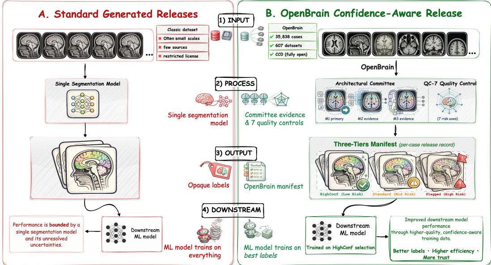  
Figure 1: Release-time contrast between a standard generated-label release and OpenBrain. Open-Brain packages each parcellation with provenance, committee outputs, QC-7 risk fields, confidence tiers, and validation evidence.

Second, generated-label releases often lack case-level evidencefor reuse. A released label file by itself does not tell users whether the predicted anatomy has visible failure signs, whether independent label generators agree, or whether the case should be prioritized, down-weighted, audited, or excluded. Reference-free QC and uncertainty methods provide useful diagnostics [14–18], and large generatedlabel releases show that automatic labels can scale [19]. What remains missing is a documentation methodology for multi-source whole-brain generated labels: what should be released with each label so that it can be reused and audited after download?

A reusable generated-label release therefore needs three properties: source-scale coverage, case-level reliability evidence, and validation that the released evidence supports the decisions it is meant to inform. OpenBrain is designed around these three requirements. It releases generated whole-brain parcellations for 35,838 provenance-verified T1w cases across 607 OpenNeuro source datasets. The release preserves source identifiers and CC0-compatible public-source provenance, so derived labels can be traced back to their public sources and reused as a large training and evaluation substrate. Figure 1 summarizes the design shift: OpenBrain releases generated labels as auditable case records rather than as standalone model outputs.

For case-level evidence, OpenBrain releases each case as an auditable record rather than as a parcella tion file alone. The record links the generated whole-brain parcellation to its source provenance and to OpenBrain QC-7, a compact panel of seven reference-free reliability checks. The QC-7 checks ask three direct questions: does the label geometry look plausible, are the predicted anatomical regions consistent with the image intensities, and do independent parcellation models agree with one another? OpenBrain stores the resulting per-case risk fields and confidence tier in the release case record, so users can filter, weight, audit, or re-threshold cases without rerunning label generation. These fields are not manual approval labels; they are reusable evidence about where generated labels may be more or less reliable.

We then evaluate whether the released evidence supports the reuse decisions it is meant to inform. Before confirmatory evaluation, the QC definition, percentile-risk conversion, label space, and tier thresholds are fixed. With these choices fixed, lower-risk retention improves external macro Dice by up to +3.7 pp across three external cohorts. In the fixed-budget training test, lower-risk selections improve paired 96-label macro Dice by +3.2 to +3.7 pp over random selection. These results support using OpenBrain’s risk fields to rank generated labels and avoid the least reliable tail of the release. OpenBrain makes three contributions:

Table 1: Positioning of OpenBrain against public brain MRI segmentation resources. W: whole-brain labels; M: multi-cohort or acquisition diversity; O: open redistribution; Q: released QC/risk fields or release audit.
<table><tr><td>Benchmark / resource</td><td>Scale</td><td>MRI / cohort</td><td>Labels</td><td>W</td><td>M</td><td>0</td><td>Q</td><td>Primary role</td></tr><tr><td colspan="9">Brain extraction, tissue, and anatomical segmentation benchmarks</td></tr><tr><td>NFBS [20]</td><td>125 scans</td><td>NKI T1w</td><td>Brain masks</td><td>×</td><td>O</td><td></td><td>0</td><td>Skull stripping</td></tr><tr><td>CC-359 [21]</td><td>359 scans</td><td>Multi-vendor T1w</td><td>Brain masks</td><td>×</td><td></td><td>V</td><td>0</td><td>Skull stripping</td></tr><tr><td>Mindboggle-101 [6]</td><td>101 subj.</td><td>Multi-source T1w</td><td>DKT cortex</td><td>0</td><td></td><td>0</td><td>X</td><td>Cortical anatomy</td></tr><tr><td>Hammers atlas [7, 8]</td><td>30 subj.</td><td>Adult T1w</td><td>83 ROIs</td><td>V</td><td>×</td><td>0</td><td>X</td><td>Atlas anatomy</td></tr><tr><td>LPBA40 [9]</td><td>40 subj.</td><td>Adult T1w</td><td>56 ROIs</td><td>V</td><td>×</td><td>0</td><td>×</td><td>Reg./seg. eval.</td></tr><tr><td>IBSR 1.5mm [10]</td><td>18 subj.</td><td>T1w, 7-71y</td><td>43 ROIs</td><td>V</td><td>×</td><td>o</td><td>×</td><td>Legacy gold std.</td></tr><tr><td>MALC / NM [22]</td><td>30 scans; 25 subj.</td><td>OASIS T1w</td><td>WB atlas</td><td></td><td>×</td><td>0</td><td>×</td><td>Multi-atlas challenge</td></tr><tr><td>CANDIShare [23]</td><td>103 subj.</td><td>Pediatric T1w</td><td>CMA labels</td><td></td><td>0</td><td>0</td><td>×</td><td>Pediatric anatomy</td></tr><tr><td>MRBrainS13 [24]</td><td>20 scans; 5/15 split</td><td>Elderly 3T MRI</td><td>GM/WM/CSF</td><td>0</td><td>0</td><td>O</td><td>×</td><td>Tissue challenge</td></tr><tr><td>MRBrainS18 [25]</td><td>30 subj.</td><td>T1/T1-IR/FLAIR</td><td>8 eval. labels</td><td>0</td><td>0</td><td></td><td>×</td><td>Tissue challenge</td></tr><tr><td>FeTA [26]</td><td>50 recon.</td><td>Fetal T2w</td><td>7 tissues</td><td></td><td>0</td><td>O</td><td>×</td><td>Fetal segmentation</td></tr><tr><td>iSeg-2017 [27]</td><td>23 infant scans</td><td>6-mo T1/T2</td><td>GM/WM/CSF</td><td>0</td><td>0</td><td>o</td><td>×</td><td>Infant tissues</td></tr><tr><td colspan="9">Pathology-focused segmentation challenges</td></tr><tr><td>BraTS 2021 [11]</td><td>2,040 pts; 1251/219/570</td><td>Glioma mpMRI</td><td>Tumor regions</td><td>×</td><td></td><td>O</td><td>X</td><td>Tumor segmentation</td></tr><tr><td>ATLAS v2.0 [12]</td><td>1,271 cases</td><td>Stroke T1w</td><td>Lesion masks</td><td>×</td><td></td><td>O</td><td>X</td><td>Stroke lesions</td></tr><tr><td>ISLES 2022 [13]</td><td>400 cases</td><td>DWI/ADC/FLAIR</td><td>Lesion masks</td><td>×</td><td></td><td>0</td><td>X</td><td>Acute stroke</td></tr><tr><td>WMH Challenge [28]</td><td>60 scans; 3 centers</td><td>T1/FLAIR</td><td>WMH masks</td><td>×</td><td></td><td>0</td><td>×</td><td>WMH lesions</td></tr><tr><td>MSSEG 2016 [29]</td><td>53 MS cases; 4 centers</td><td>Multi-modal MRI</td><td>MS lesions</td><td>×</td><td></td><td>0</td><td>×</td><td>MS lesions</td></tr><tr><td>ISBI 2015 MS [30]</td><td>82 scans; 21/61 split</td><td>Longitudinal MRI</td><td>MS lesions</td><td>X</td><td>0</td><td>0</td><td>×</td><td>Long. MS lesions</td></tr><tr><td>OpenBrain (ours)</td><td>35,838 cases</td><td>607 OpenNeuro T1w sets</td><td>WB auto labels</td><td></td><td></td><td></td><td>L</td><td>Scale + provenance + QC</td></tr></table>

1. A large multi-source generated-parcellation release. OpenBrain provides 35,838 provenanceverified T1w cases from 607 OpenNeuro source datasets, with generated whole-brain parcellations and CC0-compatible provenance metadata (Section 3).

2. A released risk-evidence layer for generated parcellations. OpenBrain defines and releases QC-7, a reference-free scoring layer that converts label-geometry, image-label consistency, and committee-disagreement checks into percentile risks and a combined risk score R. The released risk fields and tiers support filtering, weighting, auditing, and re-thresholding without rerunning label generation (Section 3.4).

3. External validation of release-time QC evidence. OpenBrain tests whether the released risk fields rank generated-label quality on external cohorts and select useful training cases under a fixed generated-label budget (Sections 5.1 and 5.2).

## 2 Related Work

Manual and human-reviewed segmentation datasets. Manual and human-reviewed datasets define anatomical targets and remain the right reference for accuracy measurement. In brain MRI, Mindboggle-101 [6], the Hammersmith atlas family [7, 8], LPBA40 [9], IBSR [10], MALC [22], MRBrainS18 [25], and FeTA [26] provide manual or expert-curated labels at modest scale. Pathologyfocused resources such as BraTS [11], ATLAS [12], ISLES [13], WMH Challenge [28], MSSEG [29], and ISBI MS [30] provide human-reviewed lesion or tumor annotations for specific tasks. Larger medical segmentation resources such as AbdomenAtlas [31, 32], TotalSegmentator [33], and TotalSegmentator-MRI [34] expand scale through automatic tools and human review. These resources provide targets, references, or task-specific annotations. OpenBrain addresses a different setting: generated whole-brain parcellations released at scale across many public MRI sources, where per-case manual approval is unavailable and release-time reliability evidence must accompany every case.

Brain parcellation methods and public MRI resources. Brain parcellation tools make generated labels feasible, while public repositories provide source images. FreeSurfer [35, 36] established a widely used anatomical parcellation convention; FastSurfer [2], QuickNAT [3], and Synth-Seg/SynthSeg+ [4, 5] make whole-brain segmentation faster or more robust across heterogeneous inputs. Knowledge distillation [37] offers another route to compact segmentation models [38–41], including models designed for on-premises clinical use [42]. OpenNeuro [1] provides the public BIDS source layer, and OpenBHB [43] provides a large multi-site brain MRI resource for representation learning and bias analysis. This ecosystem gives OpenBrain its source layer and label-generation tools, but tool output plus public images does not by itself define a dataset-level reliability record. OpenBrain adds provenance, committee parcellations, OpenBrain QC-7 risk fields, percentile risks, and confidence tiers for 35,838 provenance-verified cases from 607 OpenNeuro source datasets.

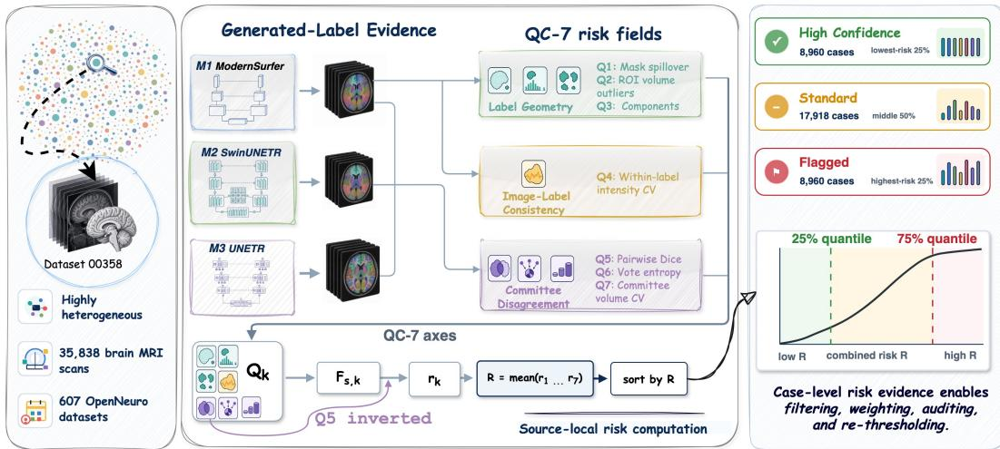  
Figure 2: OpenBrain case-level release record. Each source-scoped T1w case links generated parcellations, committee outputs, QC-7 checks, percentile risks, combined risk R, and a confidence tier.

Reference-free QC and generated-label releases. Reference-free QC methods provide diagnostics, but their release role differs from OpenBrain. MRIQC [14] targets raw-image quality rather than generated-label reliability. Reverse-classification accuracy [15, 16] estimates segmentation quality without ground truth, but is expensive at large label counts. Test-time augmentation uncertainty [17, 18] exposes model instability, but its interpretation depends on the model and domain. UKBOB [19] is the closest generated-label release precedent because it scales generated MRI masks and uses filtering plus subset audit. OpenBrain targets multi-source whole-brain parcellation rather than mask release, and releases the QC axes, percentile risk scores, confidence tiers, and downstream validation as part of the dataset itself, so risk evidence remains available for reuse after download.

## 3 The OpenBrain Release

## 3.1 Release scope and case-level record

OpenBrain is a generated-label release attached to existing public T1-weighted MRI records, not a new collection of human subjects. The submitted strict hosted release contains 35,838 provenance-verified cases from 607 OpenNeuro [1] source datasets; for these cases, the raw T1w inputs exactly match public OpenNeuro snapshots with CC0/public-domain-compatible license metadata. The release manifest used in this paper is this hosted 35,838-case release. A release case is one source-scoped T1w scan/session record, not an identity-linked person across unrelated sources.

Each case is released as a case-level record (Figure 2) rather than as a segmentation file alone, so generated labels travel with the fields needed to audit, filter, weight, or re-threshold cases after release. Raw-image access follows the OpenNeuro licensing and provenance accounting described in Appendix H.

## 3.2 Completeness Policy

A case is included in the hosted release only when all release evidence is present; cases with incomplete QC-7 evidence are excluded rather than imputed, because complete risk evidence is required for filtering, weighting, auditing, and tiering after release. Available age, sex, scanner, field-strength, and health-status metadata are reported as released, not imputed, and are used for release audit rather than fairness claims; Appendix H reports metadata coverage and provenance accounting.

## 3.3 Generated Labels and Committee Evidence

OpenBrain releases two kinds of generated-label evidence for each case: a primary generated parcellation for downstream use, and two additional generated parcellations for risk assessment. The primary parcellation comes from $M _ { 1 }$ . The committee parcellations come from $M _ { 2 }$ and $M _ { 3 }$ , which are architecturally distinct from $M _ { 1 }$ and from each other. They are released as reliability evidence: they are not ground truth, not manual annotations, and not fused consensus labels. Their role is to expose agreement or disagreement among different label generators.

OpenBrain does not claim novelty as a parcellation architecture; the release should be read as generated whole-brain parcellations with explicit risk fields, not per-case manual annotations. Section 6 discusses the upstream FreeSurfer-derived training labels and evaluation implications.

## 3.4 QC-7 risk manifest and interpretation contract

OpenBrain QC-7 is a reference-free risk manifest for generated whole-brain parcellations. It records seven checks in three failure families. Label geometry checks ask whether the generated foreground has implausible spatial structure: $Q _ { 1 }$ brain-mask leakage, $Q _ { 2 }$ source-relative ROI volume outliers, and $Q _ { 3 }$ distant disconnected fragments. Image-label consistency uses $Q _ { 4 }$ within-label intensity heterogeneity to ask whether predicted anatomical regions are internally consistent in the T1w image. Committee disagreement compares the three generated parcellations through $Q _ { 5 }$ pairwise committee Dice, $Q _ { 6 }$ voxel-vote ambiguity, and $Q _ { 7 }$ committee volume disagreement. Appendix I gives the formal definitions.

OpenBrain converts each raw axis value into a percentile risk. Let $\widehat { F } _ { k }$ be the empirical CDF of raw axis $Q _ { k }$ over the QC pool, with mid-ranks for ties. Equation 1 applies to lower-is-better axes:

$$
r _ { k } ( x ) = \widehat { F } _ { k } \big ( Q _ { k } ( x ) \big ) , \qquad k \in \{ 1 , 2 , 3 , 4 , 6 , 7 \} .\tag{1}
$$

For committee Dice, larger raw values indicate stronger agreement, so Eq. 2 inverts the percentile:

$$
r _ { 5 } ( x ) = 1 - \widehat { F } _ { 5 } \big ( Q _ { 5 } ( x ) \big ) .\tag{2}
$$

After this conversion, all seven $r _ { k }$ fields have the same direction: larger values mean higher generatedlabel risk. These fields are ranks, not calibrated probabilities of anatomical error. Equation 3 defines the combined case risk as an unweighted mean:

$$
R ( x ) = \frac { 1 } { 7 } \sum _ { k = 1 } ^ { 7 } r _ { k } ( x ) .\tag{3}
$$

OpenBrain assigns tiers by sorting the 35,838 hosted release cases by R. The lowest-risk 8,960 cases form HIGHCONF, the middle 17,918 form STANDARD, and the highest-risk 8,960 form FLAGGED. The release stores the raw $Q _ { k }$ values, percentile risks $r _ { k } .$ combined risk R, and tier label so users can filter, weight, audit, or re-threshold cases without rerunning label generation or committee inference.

The manifest also sets the scope of the release. QC-7 risks and tiers are evidence about generated-label reliability, not manual approval labels, calibrated correctness probabilities, demographic fairness claims, or clinical quality guarantees. Section 5 tests two reuse claims: whether $\mathrm { Q C ^ { - 7 } }$ risk ranks generated-label quality on external cohorts, and whether the released risk fields help select training cases under a fixed budget. Main-text evaluation uses a unified 96-label space, excluding 14 sparse or ill-defined classes from the released 110-class parcellations; Appendix G reports the corresponding sensitivity analysis.

## 4 Validation Design

The validation protocol fixes the QC-7 axes, tier thresholds, label grouping, and primary operating point before testing whether reference-free risk ranks generated-label quality and helps select training cases. IXI and BrainLat support development decisions; Mindboggle-101 remains a confirmatory manual-label holdout.

## 4.1 Frozen evaluation protocol

IXI and BrainLat choose the OpenBrain QC-7 composition, unified 96-label evaluation space, and primary 25% HIGHCONF operating point. After Mindboggle-101 is evaluated, no QC axis, tier threshold, label grouping, or operating-point decision is changed. Appendix E records these frozen choices.

## 4.2 Risk ranking and training selection

The risk-ranking evaluation applies frozen aggregate risk R to each external cohort using only reference-free inputs. For $K \in \{ 1 0 , 2 5 , 5 0 , 7 5 , 9 0 \}$ , we retain the lowest-risk K% of cases and compare mean 96-label macro Dice against the full-cohort baseline. This tests R as a case-quality ordering; bootstrap details are in Appendix E.

For downstream training, we draw three 1,000-case selections from the QC pool: lower-risk, random, and higher-risk. These names describe selection direction under a fixed budget, not pure tier membership [14]. Appendix E reports the selection rules and the manifest-tier composition.

Finally, the hosted-release audit applies the same frozen QC-7 policy to all 35,838 hosted release cases from 607 OpenNeuro source datasets. This audit reports tier structure, source coverage, and available demographic/scanner metadata as release fields. Missing fields are not imputed; the Datasheet reports coverage and provenance accounting.

## 5 Results

The results test two reuse questions: whether lower QC-7 risks correspond to better generated labels on external cohorts, and whether lower-risk release cases make better training data under the same 1,000-case budget. Model provenance and the 78-label ModernSurfer reproduction anchor are in Appendices C and F; main-text claims use the OpenBrain 96-label evaluation space.

## 5.1 Risk-ranking evaluation: the QC-7 panel ranks generated-label quality

At the primary $K = 2 5 \%$ operating point, selecting cases with the lowest QC-7 risk raises retainedcase macro Dice on all three external cohorts: +1.3 percentage points on IXI $( n { = } 5 6 3 ) , + 3 . 7$ pp on BrainLat $\scriptstyle ( n = 3 9 4 )$ , and $+ 1 . 5 \mathrm { p p } _ { [ + 1 . 0 , + 2 . 0 ] }$ on the Mindboggle-101 holdout (n=101, 25 retained; Table 2). The IXI and BrainLat references follow the same FreeSurfer convention as $M _ { 1 }$ ’s training labels; Mindboggle-101 is the only manually labeled cohort and the smallest. The same ordering advantage persists across the reported retention grid (Fig. 3). This is the core risk-ranking result: QC-7 works as a release-time ordering signal.

Axes capture different failure families. The individual axes are not duplicates of one hidden score. Figure 3 shows geometry, image-label, and committee checks peaking in different cohorts, while the aggregate is the strongest cross-cohort summary at $K = 2 5 \%$ . Partial correlations show strong coupling only for $r _ { 5 }$ committee overlap disagreement and $r _ { 6 }$ vote ambiguity $( \rho { = } + 0 . 7 6 ; \mathrm { F i g . } 4 \mathrm { A } )$ Appendix I.6 reports the full matrix. This coupling does not drive the result. Recomputing R without any one committee axis changes the cross-cohort mean gain at K=25% by about 0.1 pp; merging the three into one term gives 2.04 instead of 2.17 pp, and $r _ { 1 } { - } r _ { 4 }$ alone give 1.51 pp (Table 11).

Sensitivity to small structures. Macro-Dice gains could come mostly from large cortical and white-matter classes. On a 16-ROI subcortical subset matching the FastSurfer [2] and SynthSeg [4] small-structure panels, QC-7 retention still improves Dice on all three cohorts (Table 2). The gains are smaller than the full macro-Dice gains, especially on BrainLat, so QC-7’s largest benefit is not in the hardest limbic and basal-ganglia targets.

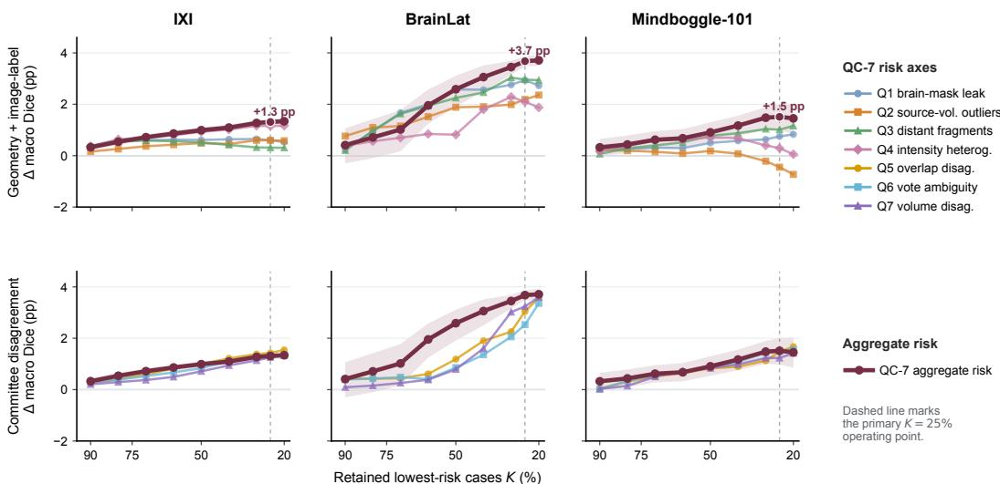  
Figure 3: Retention-quality curves for QC-7 risk signals. Columns are external cohorts and rows group QC families. Curves report retained-case $\Delta$ macro Dice after selecting the lowest-risk K% of cases.

Table 2: QC-7 retention at K=25% for overall 96-label macro Dice and Def-A small-structure Dice. Values are percentage-point deviations from the full-cohort baseline; colored brackets are bootstrap 95% CIs.
<table><tr><td>Cohort</td><td></td><td>Overall ∆ macro (pp) Def-A ∆ small-struct (pp)</td></tr><tr><td>IXI</td><td> $+ 1 . 3 \ [ + 1 . 2 , + 1 . 4 ]$ </td><td>+0.9 [+0.8, +1.0]</td></tr><tr><td>BrainLat</td><td> $+ 3 . 7 \ [ + 3 . 5 , + 3 . 9 ]$ </td><td> $+ 1 . 5 [ + 1 . 3 , + 1 . 7 ]$ </td></tr><tr><td>Mindboggle-101</td><td> $+ 1 . 5 \ [ + 1 . 0 , + 2 . 0 ]$ </td><td> $+ 1 . 2 \ [ + 0 . 3 , + 2 . 0 ]$ </td></tr></table>

## 5.2 Training-selection evaluation

At the same 1,000-case training budget, models trained on lower-risk OpenBrain cases outperform models trained on random samples on all three external cohorts, with paired macro-Dice gains of +3.2 to +3.7 pp (Table 3; Fig. 4B). The mirrored higher-risk selection is an adverse-selection check. It draws heavily from the high-risk tail, including 795 FLAGGED cases (Appendix E, Table 7), and performs substantially worse. These comparisons support the practical utility of QC-guided selection under a fixed training budget. The two selections also differ in which sources they draw from, so the gain reflects the combined effect of risk ranking and source composition (Appendix A).

Where the lower-risk advantage concentrates. The lower-risk training advantage is smaller on the same 16-ROI subcortical subset. Gains over random selection shrink to +0.4 to +1.0 pp (Appendix E, Table 6), and the BrainLat contrast is no longer statistically distinguishable. The higher-risk deficit remains large. The extra benefit of lower-risk selection therefore sits mostly in larger, easier classes, while the high-risk tail remains harmful even on small structures.

## 5.3 Deployment audit on the hosted release

The same frozen policy scales to the full 35,838-case hosted release from 607 OpenNeuro source datasets. This descriptive audit verifies the tiered release and treats demographic and scanner metadata as coverage fields, not optimization targets. Provenance accounting and metadata coverage are reported in the Datasheet and metadata audit (Appendices H and J).

Table 3: Fixed-budget training-selection results on three external cohorts. Models are trained on 1,000-case lower-risk, random, or higher-risk OpenBrain selections and evaluated with 96-label macro Dice; colored brackets are bootstrap 95% CIs. The reference row gives the basis of each cohort’s evaluation labels.
<table><tr><td>Selection</td><td>Mindboggle-101 (n=101) manual labels</td><td>BrainLat (n=394) FreeSurfer-derived</td><td>IXI (n=563) FreeSurfer-derived</td></tr><tr><td>Lower-risk</td><td>0.746 [0.733, 0.758]</td><td>0.719 [0.709, 0.730]</td><td>0.769 [0.764, 0.775]</td></tr><tr><td>Random</td><td>0.710 [0.696, 0.722]</td><td>0.687 [0.678, 0.697]</td><td>0.733 [0.727, 0.738]</td></tr><tr><td>Higher-risk</td><td>0.456 [0.450, 0.461]</td><td>0.458 [0.454, 0.463]</td><td>0.490 [0.487, 0.492]</td></tr><tr><td colspan="4">Paired ∆ macro Dice (pp; per-case)</td></tr><tr><td>Lower-risk — Random</td><td>+3.6[+2.8, +4.4]</td><td>+3.2[+2.6, +3.8]</td><td>+3.7[+3.2, +4.2]</td></tr><tr><td>Random – Higher-risk</td><td>+25.4[+24.3, +26.3]</td><td>+22.9[+22.2, +23.6]</td><td>+24.3[+23.8,+24.7]</td></tr></table>

A  
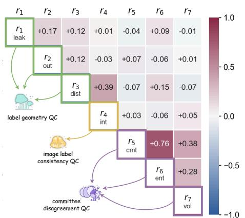

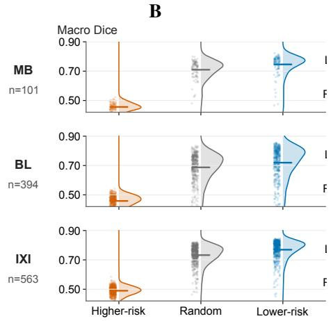  
Figure 4: QC-7 axis correlation and fixed-budget training-selection results. Panel A shows partial correlations among risk axes. Panel B compares nnU-Net models trained on 1,000-case lower-risk, random, and higher-risk selections.

Qualitative case audit. Figure 5 shows what the risk ordering looks like at case level. In the manual-GT row, the low-risk case has anatomically coherent labels, low entropy, and low QC-7 bars, whereas the high-risk case shows visible label disruption and committee uncertainty. The no-GT row shows the same diagnostic pattern on release cases that users would otherwise inspect without a manual reference. These panels are not approval labels; they show how QC-7 turns visual failure modes into reusable evidence for trusting, auditing, or down-weighting cases before reuse.

## 6 Discussion

What OpenBrain contributes. OpenBrain’s contribution is not another parcellation architecture; it is a release format for generated labels whose reliability evidence remains visible after download. Unlike resources that provide manual references, challenge tasks, or pretrained outputs, OpenBrain releases a large redistributable whole-brain generated-label corpus with per-case reliability fields (Appendix B). QC-7’s value comes from this record: frozen checks that users can inspect before reuse.

What the validation shows. The frozen validation supports QC-7 for ranking generated-label quality on external cohorts and guiding fixed-budget training selection. The three-group comparison evaluates the practical utility of the overall selection policy. OpenBrain exposes both the aggregate R and the seven raw axes because the aggregate hides whether risk comes from geometry, image-label inconsistency, or committee disagreement. The main redundancy is within the committee family: r5 captures label-overlap disagreement, while correlated $r _ { 6 }$ captures voxel-level vote uncertainty. The formal definitions, candidate-signal history, and correlation checks are in Appendices I, D, and I.6.

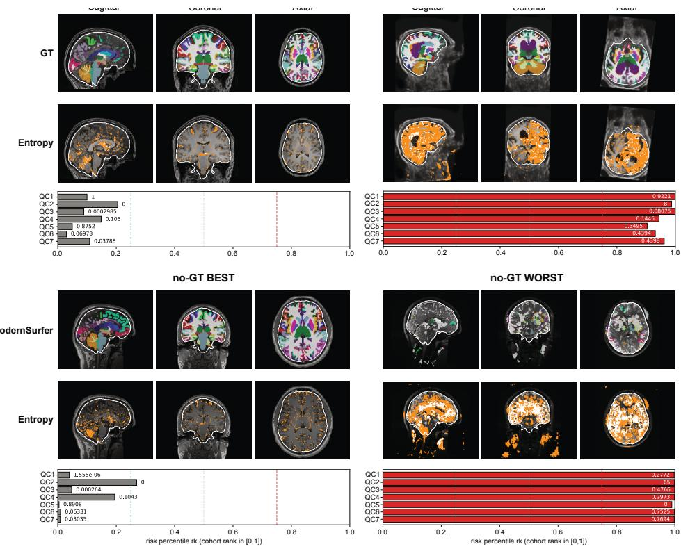  
Figure 5: Qualitative audit of low- and high-risk cases. Rows separate manual-GT cohorts from no-GT training-pool selections; tiles show image/label views, entropy, QC-7 bars, and risk position.

The appendices keep the audit trail visible through frozen selections, 110-label sensitivity, release accounting, metadata coverage, and expanded best/worst case panels.

Other uses. OpenBrain has no disease labels. Each case record keeps its OpenNeuro source and session identifiers, so when the source dataset publishes participant phenotypes, users can join them under that dataset’s terms, compute regional volumes or shapes from the released parcellations, and use the QC fields to exclude or down-weight cases before fitting a model. The phenotype labels and their validation come from the source study.

What the evidence does not show. OpenBrain labels inherit the conventions of the upstream segmenters and their FreeSurfer-derived training targets. Mindboggle-101 gives a manual-label holdout, but it does not turn the release into a manual annotation dataset. Likewise, the trainingselection result shows that the manifest helps avoid a bad high-risk tail under a fixed budget; it does not isolate every QC axis or remove source-composition effects. Metadata fields support release audit, not fairness claims, because coverage is incomplete and tier groups are not metadata-matched. These boundaries are stated in the Limitations, Datasheet, and metadata audit.

## 7 Conclusion

OpenBrain releases 35,838 provenance-verified generated parcellations with per-case evidence for reliability, provenance, and reuse. The release is more than a label collection: it defines a caserecord format, exposes three parcellation outputs, stores raw QC-7 axes and percentile risks, and assigns confidence tiers that users can reinterpret for their own operating points. The reusable unit is therefore the case record, not just the label file: users can keep conservative subsets, down-weight uncertain cases, or revisit thresholds as validation needs change. Under frozen choices, QC-7 ranks generated-label quality on external cohorts. The three-group comparison supports its practical value for fixed-budget selection over random sampling and identifies a high-risk tail for closer audit. The main claim is not that generated labels become manual annotations. It is that large generated-label datasets should ship with visible reliability evidence. OpenBrain gives one template for whole-brain MRI: scale, provenance, committee evidence, QC-7 risks, validation, and explicit limits packaged together.

## Acknowledgments and Disclosure of Funding

This work was supported in part by the National Institute on Aging under awards U01AG079847, R01AG082721, and R01AG083039. The authors declare no competing interests.

## References

[1] Christopher J Markiewicz, Krzysztof J Gorgolewski, Franklin Feingold, Ross Blair, Yaroslav O Halchenko, Eric Miller, Nell Hardcastle, Joe Wexler, Oscar Esteban, Mathias Goncavles, et al. The openneuro resource for sharing of neuroscience data. Elife, 10:e71774, 2021.

[2] Leonie Henschel, Sailesh Conjeti, Santiago Estrada, Kersten Diers, Bruce Fischl, and Martin Reuter. Fastsurfer - a fast and accurate deep learning based neuroimaging pipeline. NeuroImage, 219:117012, 2020. ISSN 1053-8119. doi: 10.1016/j.neuroimage.2020.117012. URL https: //www.sciencedirect.com/science/article/pii/S1053811920304985.

[3] Abhijit Guha Roy, Sailesh Conjeti, Nassir Navab, Christian Wachinger, Alzheimer’s Disease Neuroimaging Initiative, et al. Quicknat: A fully convolutional network for quick and accurate segmentation of neuroanatomy. NeuroImage, 186:713–727, 2019. doi: 10.1016/j.neuroimage.2018.11.042.

[4] Benjamin Billot, Douglas N. Greve, Oula Puonti, Axel Thielscher, Koen Van Leemput, Bruce Fischl, Adrian V. Dalca, and Juan Eugenio Iglesias. Synthseg: Segmentation of brain mri scans of any contrast and resolution without retraining. Medical Image Analysis, 86:102789, 2023. ISSN 1361-8415. doi: 10.1016/j.media.2023.102789. URL https://www.sciencedirect. com/science/article/pii/S1361841523000506.

[5] Benjamin Billot, Colin Magdamo, You Cheng, Steven E Arnold, Sudeshna Das, and Juan Eugenio Iglesias. Robust machine learning segmentation for large-scale analysis of heterogeneous clinical brain mri datasets. Proceedings of the National Academy of Sciences, 120(9): e2216399120, 2023. doi: 10.1073/pnas.2216399120.

[6] Arno Klein and Jason Tourville. 101 labeled brain images and a consistent human cortical labeling protocol. Frontiers in neuroscience, 6:33392, 2012. doi: 10.3389/fnins.2012.00171.

[7] Alexander Hammers, Richard Allom, Matthias J Koepp, Samantha L Free, Ralph Myers, Louis Lemieux, Tejal N Mitchell, David J Brooks, and John S Duncan. Three-dimensional maximum probability atlas of the human brain, with particular reference to the temporal lobe. Human brain mapping, 19(4):224–247, 2003. doi: 10.1002/hbm.10123.

[8] Ioannis S Gousias, Daniel Rueckert, Rolf A Heckemann, Leigh E Dyet, James P Boardman, A David Edwards, and Alexander Hammers. Automatic segmentation of brain mris of 2-yearolds into 83 regions of interest. Neuroimage, 40(2):672–684, 2008. doi: 10.1016/j.neuroimage. 2007.11.034.

[9] David W Shattuck, Mubeena Mirza, Vitria Adisetiyo, Cornelius Hojatkashani, Georges Salamon, Katherine L Narr, Russell A Poldrack, Robert M Bilder, and Arthur W Toga. Construction of a 3d probabilistic atlas of human cortical structures. Neuroimage, 39(3):1064–1080, 2008. doi: 10.1016/j.neuroimage.2007.09.031.

[10] JA Frazier, VS Caviness, DN Kennedy, AJ Worth, C Haselgrove, D Caplan, and N Makris. Internet brain segmentation repository (ibsr) 1.5 mm dataset, 1910.

[11] Ujjwal Baid, Satyam Ghodasara, Suyash Mohan, Michel Bilello, Evan Calabrese, Errol Colak, Keyvan Farahani, Jayashree Kalpathy-Cramer, Felipe C Kitamura, Sarthak Pati, et al. The rsnaasnr-miccai brats 2021 benchmark on brain tumor segmentation and radiogenomic classification. arXiv preprint arXiv:2107.02314, 2021.

[12] Sook-Lei Liew, Bethany P Lo, Miranda R Donnelly, Artemis Zavaliangos-Petropulu, Jessica N Jeong, Giuseppe Barisano, Alexandre Hutton, Julia P Simon, Julia M Juliano, Anisha Suri, et al. A large, curated, open-source stroke neuroimaging dataset to improve lesion segmentation algorithms. Scientific data, 9(1):320, 2022.

[13] Moritz R Hernandez Petzsche, Ezequiel De La Rosa, Uta Hanning, Roland Wiest, Waldo Valenzuela, Mauricio Reyes, Maria Meyer, Sook-Lei Liew, Florian Kofler, Ivan Ezhov, et al. Isles 2022: A multi-center magnetic resonance imaging stroke lesion segmentation dataset. Scientific data, 9(1):762, 2022.

[14] Oscar Esteban, Daniel Birman, Marie Schaer, Oluwasanmi O Koyejo, Russell A Poldrack, and Krzysztof J Gorgolewski. Mriqc: Advancing the automatic prediction of image quality in mri from unseen sites. PloS one, 12(9):e0184661, 2017.

[15] Vanya V Valindria, Ioannis Lavdas, Wenjia Bai, Konstantinos Kamnitsas, Eric O Aboagye, Andrea G Rockall, Daniel Rueckert, and Ben Glocker. Reverse classification accuracy: predicting segmentation performance in the absence of ground truth. IEEE transactions on medical imaging, 36(8):1597–1606, 2017.

[16] Robert Robinson, Vanya V Valindria, Wenjia Bai, Ozan Oktay, Bernhard Kainz, Hideaki Suzuki, Mihir M Sanghvi, Nay Aung, José Miguel Paiva, Filip Zemrak, et al. Automated quality control in image segmentation: application to the uk biobank cardiovascular magnetic resonance imaging study. Journal ofCardiovascular Magnetic Resonance, 21(1):18, 2019.

[17] Alain Jungo and Mauricio Reyes. Assessing reliability and challenges of uncertainty estimations for medical image segmentation. In International Conference on Medical Image Computing and Computer-Assisted Intervention, pages 48–56. Springer, 2019.

[18] Guotai Wang, Wenqi Li, Michael Aertsen, Jan Deprest, Sébastien Ourselin, and Tom Vercauteren. Aleatoric uncertainty estimation with test-time augmentation for medical image segmentation with convolutional neural networks. Neurocomputing, 338:34–45, 2019. ISSN 0925-2312. doi: 10.1016/j.neucom.2019.01.103. URL https://www.sciencedirect.com/science/ article/pii/S0925231219301961.

[19] Emmanuelle Bourigault, Amir Jamaludin, and Abdullah Hamdi. Ukbob: one billion mri labeled masks for generalizable 3d medical image segmentation. In Proceedings of the IEEE/CVF International Conference on Computer Vision, pages 21600–21611, 2025.

[20] Benjamin Puccio, James P Pooley, John S Pellman, Elise C Taverna, and R Cameron Craddock. The preprocessed connectomes project repository of manually corrected skull-stripped t1- weighted anatomical mri data. Gigascience, 5(1):s13742–016, 2016.

[21] Roberto Souza, Oeslle Lucena, Julia Garrafa, David Gobbi, Marina Saluzzi, Simone Appenzeller, Letícia Rittner, Richard Frayne, and Roberto Lotufo. An open, multi-vendor, multi-fieldstrength brain mr dataset and analysis of publicly available skull stripping methods agreement. NeuroImage, 170:482–494, 2018.

[22] Bennett A. Landman and Simon K. Warfield, editors. MICCAI 2012 Workshop on Multi-Atlas Labeling, Nice, France, 2012. CreateSpace Independent Publishing Platform. Challenge data with labels provided by Neuromorphometrics, Inc.

[23] David N Kennedy, Christian Haselgrove, Steven M Hodge, Pallavi S Rane, Nikos Makris, and Jean A Frazier. Candishare: a resource for pediatric neuroimaging data. Neuroinformatics, 10 (3):319–322, 2012.

[24] Adriënne M Mendrik, Koen L Vincken, Hugo J Kuijf, Marcel Breeuwer, Willem H Bouvy, Jeroen De Bresser, Amir Alansary, Marleen De Bruijne, Aaron Carass, Ayman El-Baz, et al. Mrbrains challenge: online evaluation framework for brain image segmentation in 3t mri scans. Computational intelligence and neuroscience, 2015(1):813696, 2015.

[25] Hugo J. Kuijf, Edwin Bennink, Koen L. Vincken, Nick Weaver, Geert Jan Biessels, and Max A. Viergever. MR Brain Segmentation Challenge 2018 Data, 2024. URL https://doi.org/10. 34894/E0U32Q.

[26] Kelly Payette, Priscille de Dumast, Hamza Kebiri, Ivan Ezhov, Johannes C Paetzold, Suprosanna Shit, Asim Iqbal, Romesa Khan, Raimund Kottke, Patrice Grehten, et al. An automatic multitissue human fetal brain segmentation benchmark using the fetal tissue annotation dataset. Scientific data, 8(1):167, 2021.

[27] Li Wang, Dong Nie, Guannan Li, Elodie Puybareau, Jose Dolz, Qian Zhang, Fan Wang, Jing Xia, Zhengwang Wu, Jia-Wei Chen, et al. Benchmark on automatic six-month-old infant brain segmentation algorithms: the iseg-2017 challenge. IEEE transactions on medical imaging, 38 (9):2219–2230, 2019.

[28] Hugo J Kuijf, J Matthijs Biesbroek, Jeroen De Bresser, Rutger Heinen, Simon Andermatt, Mariana Bento, Matt Berseth, Mikhail Belyaev, M Jorge Cardoso, Adria Casamitjana, et al. Standardized assessment of automatic segmentation of white matter hyperintensities and results of the wmh segmentation challenge. IEEE transactions on medical imaging, 38(11):2556–2568, 2019.

[29] Olivier Commowick, Audrey Istace, Michael Kain, Baptiste Laurent, Florent Leray, Mathieu Simon, Sorina Camarasu Pop, Pascal Girard, Roxana Ameli, Jean-Christophe Ferré, et al. Objective evaluation of multiple sclerosis lesion segmentation using a data management and processing infrastructure. Scientific reports, 8(1):13650, 2018.

[30] Aaron Carass, Snehashis Roy, Amod Jog, Jennifer L Cuzzocreo, Elizabeth Magrath, Adrian Gherman, Julia Button, James Nguyen, Ferran Prados, Carole H Sudre, et al. Longitudinal multiple sclerosis lesion segmentation: resource and challenge. NeuroImage, 148:77–102, 2017.

[31] Chongyu Qu, Tiezheng Zhang, Hualin Qiao, Yucheng Tang, Alan L Yuille, Zongwei Zhou, et al. Abdomenatlas-8k: Annotating 8,000 ct volumes for multi-organ segmentation in three weeks. volume 36, pages 36620–36636, 2023.

[32] Wenxuan Li, Chongyu Qu, Xiaoxi Chen, Pedro RAS Bassi, Yijia Shi, Yuxiang Lai, Qian Yu, Huimin Xue, Yixiong Chen, Xiaorui Lin, et al. Abdomenatlas: A large-scale, detailed-annotated, & multi-center dataset for efficient transfer learning and open algorithmic benchmarking. Medical Image Analysis, 97:103285, 2024.

[33] Jakob Wasserthal, Hanns-Christian Breit, Manfred T Meyer, Maurice Pradella, Daniel Hinck, Alexander W Sauter, Tobias Heye, Daniel T Boll, Joshy Cyriac, Shan Yang, et al. Totalsegmentator: robust segmentation of 104 anatomic structures in ct images. Radiology: Artificial Intelligence, 5(5):e230024, 2023.

[34] Tugba Akinci D’Antonoli, Lucas K Berger, Ashraya K Indrakanti, Nathan Vishwanathan, Jakob Weiß, Matthias Jung, Zeynep Berkarda, Alexander Rau, Marco Reisert, Thomas Küstner, et al. Totalsegmentator mri: robust sequence-independent segmentation of multiple anatomic structures in mri. arXiv preprint arXiv:2405.19492, 2024.

[35] Bruce Fischl, David H Salat, Evelina Busa, Marilyn Albert, Megan Dieterich, Christian Haselgrove, Andre Van Der Kouwe, Ron Killiany, David Kennedy, Shuna Klaveness, et al. Whole brain segmentation: automated labeling of neuroanatomical structures in the human brain. Neuron, 33(3):341–355, 2002.

[36] Bruce Fischl. Freesurfer. Neuroimage, 62(2):774–781, 2012.

[37] Qizhen Lan and Qing Tian. Clockdistill: Consistent location and context aware knowledge distillation for detrs. In 2026 IEEE/CVF Winter Conference on Applications ofComputer Vision (WACV), pages 7188–7197. IEEE, 2026.

[38] Qizhen Lan and Qing Tian. Acam-kd: adaptive and cooperative attention masking for knowledge distillation. In 2025 IEEE/CVF International Conference on Computer Vision (ICCV), pages 3957–3966. IEEE, 2025.

[39] Qizhen Lan, Yu-Chun Hsu, Nida Saddaf Khan, and Xiaoqian Jiang. Reco-kd: Region-and context-aware knowledge distillation for efficient 3d medical image segmentation. arXiv preprint arXiv:2601.08301, 2026.

[40] Mengchen Fan, Baocheng Geng, Xi Xiao, Tianyang Wang, Siyuan Mei, Pulin Che, Xiaoqian Jiang, and Qizhen Lan. Detail consistent stage-wise distillation for efficient 3d mri segmentation. arXiv preprint arXiv:2605.26382, 2026.

[41] Zhicheng Ding, Xinyu Chu, Jung Im Choi, Qing Tian, Tianyu Shi, Xiaoqian Jiang, Lijing Zhu, and Qizhen Lan. Displacement preserving relational distillation for robust medical segmentation. arXiv preprint arXiv:2607.04599, 2026.

[42] Qizhen Lan, Aaron Choi, Jun Ma, Bo Wang, Zhongming Zhao, Xiaoqian Jiang, and Yu-Chun Hsu. From performance to practice: knowledge-distilled segmentator for on-premises clinical workflows. npj Health Systems, 3(1):58, 2026.

[43] Benoit Dufumier, Antoine Grigis, Julie Victor, Corentin Ambroise, Vincent Frouin, and Edouard Duchesnay. Openbhb: a large-scale multi-site brain mri data-set for age prediction and debiasing. NeuroImage, 263:119637, 2022.

[44] Jun Ma. ModernSurfer: fast segmentation pipeline for brain MRI. GitHub repository, https: //github.com/JunMa11/ModernSurfer, 2025. Accessed 2026-11-03.

[45] Timnit Gebru, Jamie Morgenstern, Briana Vecchione, Jennifer Wortman Vaughan, Hanna Wallach, Hal Daumé Iii, and Kate Crawford. Datasheets for datasets. Communications ofthe ACM, 64(12):86–92, 2021.

[46] Fabian Isensee, Paul F Jaeger, Simon AA Kohl, Jens Petersen, and Klaus H Maier-Hein. nnu-net: a self-configuring method for deep learning-based biomedical image segmentation. Nature methods, 18(2):203–211, 2021.

[47] Kathleen M Bartz, Samuel W Remedios, Blake E Dewey, Savannah P Hays, Jerry L Prince, and Aaron Carass. Automated quality assurance of segmentation techniques with statistically-based failure evaluation (safe). In Medical Imaging 2026: Clinical and Biomedical Imaging, volume 13929, pages 601–617. SPIE, 2026.

[48] Jennifer Monereo-Sánchez, Joost JA de Jong, Gerhard S Drenthen, Magdalena Beran, Walter H Backes, Coen DA Stehouwer, Miranda T Schram, David EJ Linden, and Jacobus FA Jansen. Quality control strategies for brain mri segmentation and parcellation: Practical approaches and recommendations-insights from the maastricht study. Neuroimage, 237:118174, 2021.

[49] Turkay Kart, Marc Fischer, Stefan Winzeck, Ben Glocker, Wenjia Bai, Robin Bülow, Carina Emmel, Lena Friedrich, Hans-Ulrich Kauczor, Thomas Keil, et al. Automated imaging-based abdominal organ segmentation and quality control in 20,000 participants of the uk biobank and german national cohort studies. Scientific reports, 12(1):18733, 2022.

[50] Joris Fournel, Axel Bartoli, Baptiste Marchi, Arnaud Maurin, Siavash Arjomand Bigdeli, Alexis Jacquier, and Aasa Feragen. Difficulty estimation for image-specific medical image segmentation quality control. In International Conference on Medical Image Computing and Computer-Assisted Intervention, pages 118–127. Springer, 2025.

[51] Joost JM Van Griethuysen, Andriy Fedorov, Chintan Parmar, Ahmed Hosny, Nicole Aucoin, Vivek Narayan, Regina GH Beets-Tan, Jean-Christophe Fillion-Robin, Steve Pieper, and Hugo JWL Aerts. Computational radiomics system to decode the radiographic phenotype. Cancer research, 77(21):e104–e107, 2017.

[52] Maximilian Zenk, David Zimmerer, Fabian Isensee, Jeremias Traub, Tobias Norajitra, Paul F Jäger, and Klaus Maier-Hein. Comparative benchmarking of failure detection methods in medical image segmentation: unveiling the role of confidence aggregation. Medical image analysis, 101:103392, 2025.

[53] Abhijit Guha Roy, Sailesh Conjeti, Nassir Navab, Christian Wachinger, Alzheimer’s Disease Neuroimaging Initiative, et al. Bayesian quicknat: Model uncertainty in deep whole-brain segmentation for structure-wise quality control. NeuroImage, 195:11–22, 2019.

[54] Jaakko Sahlsten, Joel Jaskari, Kareem A Wahid, Sara Ahmed, Enrico Glerean, Renjie He, Benjamin H Kann, Antti Mäkitie, Clifton D Fuller, Mohamed A Naser, et al. Application of simultaneous uncertainty quantification and segmentation for oropharyngeal cancer use-case with bayesian deep learning. Communications Medicine, 4(1):110, 2024.

## Appendix Roadmap

The appendices are organized by the evidence they support. Appendix references below are clickable in the PDF.

<table><tr><td>Appendix</td><td>Evidence provided</td></tr><tr><td>A. Limitations and scope</td><td>Claim boundaries, source-composition caveats, and intended- use limits.</td></tr><tr><td>B. Benchmark positioning</td><td>Positioning of OpenBrain against public brain MRI segmen- tation benchmarks.</td></tr><tr><td>C. Model provenance</td><td>ModernSurfer  $M _ { 1 }$  training provenance and release role.</td></tr><tr><td>D. Candidate QC signals</td><td>Retained, dropped, replaced, and hard-gated candidate sig- nals during  $\mathrm { Q C ^ { - 7 } }$  development.</td></tr><tr><td>E. Holdout and training selections</td><td>Fixed holdout decisions and realized composition of the fixed-budget downstream training selections.</td></tr><tr><td>F. 78-label anchor</td><td>FastSurfer-aligned comparison for  $M _ { 1 }$  and committee mem- bers.</td></tr><tr><td>G. Label-space sensitivity</td><td>QC-7 retention check under the 110-label foreground space.</td></tr><tr><td>H. Datasheet</td><td>Release composition, metadata coverage, exclusion policy, intended use, licensing, and maintenance.</td></tr><tr><td>I. QC-7 definitions</td><td>Formal definitions of raw axes, percentile risks, tiers, and committee checks.</td></tr><tr><td>J. Metadata audit</td><td>Metadata-stratified QC-risk analyses and their interpretation limits.</td></tr><tr><td>K. Qualitative cases</td><td>Main-text qualitative audit and detailed Mindboggle-101 worst case.</td></tr></table>

## A Limitations and Scope

Generated-label circularity. OpenBrain labels are generated by $M _ { 1 }$ , which was trained against FreeSurfer-derived labels, and two development cohorts use FreeSurfer-derived expert-curated references. Mindboggle-101 is the manual-label holdout that partly mitigates this circularity, but it does not turn OpenBrain into a manual-label dataset. At K=25%, the Mindboggle-101 retained-case gain is +1.5 pp, about 40% of the BrainLat gain (+3.7 pp). This places the largest observed effects within FreeSurfer-aligned evaluation conventions. Users should treat HIGHCONF cases as highquality generated labels and should validate any scientific conclusion that depends on fine anatomical boundaries.

Training-selection attribution caveats. The higher-risk adverse-selection deficit deserves caveats. The higher-risk selection draws heavily from the high-risk tail, including 795 FLAGGED cases among its 1,000 training cases, so its deficit relative to random selection can absorb gross label, preprocessing, and committee-output failures; we do not decompose that deficit by QC axis. The lower-risk and higher-risk selections also differ in source composition as well as in risk because percentile risk is correlated with raw image quality and source quality varies across OpenNeuro datasets. The result shows that the released manifest marks a tail that users should audit or avoid, not that tier labels alone determine downstream accuracy.

Release completeness. The strict hosted release is defined by complete generated-label, committee, metadata, QC-7, and provenance artifacts. This makes the release directly usable for confidenceaware training and evaluation, but it also means that hosted membership depends on preprocessing, committee-output integrity, and provenance verification. The Datasheet records provenance accounting and exclusion details. We also audit QC-risk variation across available demographic and acquisition metadata; Appendix J reports the analysis and its interpretation limits.

Licensing and intended use. OpenBrain uses OpenNeuro-hosted public images and adds derived generated-label and QC artifacts with source provenance. The release is intended for research on segmentation evaluation, quality-aware training, and generated-label correction. It is not intended for clinical decision-making, diagnosis, or patient-specific treatment planning; the QC score is a proxy for generated-label reliability, not a clinical quality-of-service guarantee.

## B Positioning against public brain MRI segmentation benchmarks

Table 4 expands Table 1 by separating public brain MRI segmentation resources into brain-extraction, tissue/anatomical segmentation, and pathology-focused challenge settings. The comparison is intended to clarify complementarity: manual anatomical and lesion benchmarks remain the appropriate gold-standard references for their target labels, while OpenBrain targets a different gap: large-scale T1w whole-brain derived labels with redistribution, provenance auditing, and case-level label-quality signals.

Table 4: Detailed positioning of OpenBrain against public brain MRI segmentation benchmarks. W: whole-brain labels; M: multi-cohort or acquisition diversity; O: open redistribution; Q: automated label-quality scoring or release audit.
<table><tr><td>Benchmark / resource</td><td>Scale / split</td><td>MRI / cohort</td><td>Labels</td><td>Source</td><td>W</td><td>M 0</td><td>Q</td><td>Gap vs. OpenBrain</td></tr><tr><td colspan="9">Brain extraction, tissue, and anatomical segmentation benchmarks</td></tr><tr><td>NFBS [20]</td><td>125 scans</td><td>NKI T1w</td><td>Brain masks</td><td>Manual correction</td><td>× o</td><td></td><td>o</td><td>Mask-only</td></tr><tr><td>CC-359 [21]</td><td>359 scans</td><td>Multi-vendor T1w</td><td>Brain masks</td><td>Consensus masks</td><td>×</td><td></td><td>o</td><td>Mask-only</td></tr><tr><td>Mindboggle-101 [6]</td><td>101 subj.</td><td>Multi-source T1w</td><td>DKT cortex</td><td>Manual edits</td><td>0</td><td></td><td>X</td><td>Small; cortical-heavy</td></tr><tr><td>Hammers atlas [7, 8]</td><td>30 subj.</td><td>Adult T1w</td><td>83 ROIs</td><td>Manual</td><td>V</td><td></td><td>×</td><td>Small atlas cohort</td></tr><tr><td>LPBA40 [9]</td><td>40 subj.</td><td>Adult T1w</td><td>56 ROIs</td><td>Manual protocol</td><td>V ×</td><td></td><td>×</td><td>Narrow healthy cohort</td></tr><tr><td>IBSR 1.5mm [10]</td><td>18 subj.</td><td>T1w, 7-71y</td><td>43 ROIs</td><td>Expert-guided</td><td>V</td><td></td><td>×</td><td>Very small</td></tr><tr><td>MALC / NM [22]</td><td>30 scans; 25 subj.</td><td>OASIS T1w</td><td>WB atlas</td><td>Expert manual</td><td></td><td>0</td><td>×</td><td>Small; limited redist.</td></tr><tr><td>CANDIShare [23]</td><td>103 subj.</td><td>Pediatric T1w</td><td>CMA labels</td><td>CMA release</td><td></td><td></td><td>×</td><td>Domain-specific</td></tr><tr><td>MRBrainS13 [24]</td><td>20 scans; 5/15 split</td><td>Elderly 3T MRI</td><td>GM/WM/CSF</td><td>Manual reference</td><td>0</td><td>o</td><td>×</td><td>Tissue-only; small</td></tr><tr><td>MRBrainS18 [25]</td><td>30 subj.; 7/23 split</td><td>T1/T1-IR/FLAIR</td><td>8 eval. labels</td><td>Expert manual</td><td>0</td><td></td><td>×</td><td>Compact task</td></tr><tr><td>FeTA [26]</td><td>50 recon.; 40/10 split</td><td>Fetal T2w</td><td>7 tissues</td><td>Manual</td><td></td><td></td><td>×</td><td>Fetal, not adult T1w</td></tr><tr><td>iSeg-2017 [27]</td><td>23 scans; 10/13 split</td><td>6-mo T1/T2</td><td>GM/WM/CSF</td><td>Manual reference</td><td>O 0</td><td>0</td><td>×</td><td>Infant tissue task</td></tr><tr><td colspan="9">Pathology-focused segmentation challenges</td></tr><tr><td>BraTS 2021 [11]</td><td>2,040 pts; 1251/219/570</td><td>Glioma mpMRI</td><td>Tumor regions</td><td>Expert-approved</td><td>×</td><td>0</td><td>×</td><td>Tumor-only task</td></tr><tr><td>ATLAS v2.0 [12]</td><td>1,271 cases; 655/300/316</td><td>Stroke T1w</td><td>Lesion masks</td><td>Manual + QC</td><td>×</td><td></td><td>×</td><td>Lesion-only task</td></tr><tr><td>ISLES 2022 [13]</td><td>400 cases; 250/150</td><td>DWI/ADC/FLAIR</td><td>Lesion masks</td><td>Expert-checked</td><td>×</td><td></td><td>×</td><td>Stroke-only task</td></tr><tr><td>WMH Challenge [28]</td><td>60 scans; 3 centers</td><td>T1/FLAIR</td><td>WMH masks</td><td>Manual reference</td><td>×</td><td></td><td>×</td><td>WMH-only task</td></tr><tr><td>MSSEG 2016 [29]</td><td>53 MS cases; 4 centers</td><td>Multi-modal MRI</td><td>MS lesions</td><td>7 expert raters</td><td>×</td><td>0</td><td>×</td><td>MS lesion task</td></tr><tr><td>ISBI 2015 MS [30]</td><td>82 scans; 21/61 split</td><td>Longitudinal MRI</td><td>MS lesions</td><td>2 raters</td><td>× 0</td><td></td><td>×</td><td>Small longitudinal task</td></tr><tr><td>OpenBrain (ours)</td><td>35,838 strict cases</td><td>607 OpenNeuro T1w sets</td><td>WB auto labels</td><td>Algorithmic + audit</td><td>V</td><td></td><td></td><td>Algorithmic, not manual GT</td></tr></table>

OpenBrain’s algorithmic labels should be interpreted as QC-aware derived labels, not as a substitute for expert manual annotations when a gold-standard accuracy estimate is required.

## C Committee model $M _ { 1 }$ (ModernSurfer) training provenance

The primary generated-label source $M _ { 1 }$ is trained and distributed by a separate research group. We paraphrase the training provenance below so that OpenBrain users can trace the ModernSurfer repository and model provenance [44]; no claim of $M _ { 1 }$ novelty is made on our side.

## C.1 Training cohort

1,104 T1w scans pooled from four public archives:

Table 5: ModernSurfer training cohort summarized from upstream model provenance.
<table><tr><td>Source</td><td>n</td><td>Population</td><td>Age range</td></tr><tr><td>ABIDE I</td><td>100</td><td>autism + typical</td><td>6.5–39 y</td></tr><tr><td>CoRR</td><td>418</td><td>healthy</td><td>6-62 y</td></tr><tr><td>ADNI</td><td>100</td><td>50 AD + 50 HC</td><td>55–96 y</td></tr><tr><td>SALD</td><td>486</td><td>healthy</td><td>19–80 y</td></tr><tr><td>total</td><td>1,104</td><td>mixed</td><td>6.5–96 y</td></tr></table>

Reference labels were produced by running FreeSurfer 7.4.1 on every scan; no manual relabeling was applied during training. Mindboggle-101 (used as our held-out external validation set) carries the Mindboggle protocol’s manual labels plus expert repair by our collaborators, and is not part of $M _ { 1 } { ' } { \mathrm { s } }$ s training cohort.

## C.2 Architecture

3D Residual-Encoder U-Net instantiated through nnU-Net v2, with six resolution stages, feature widths (32, 64, 128, 256, 320, 320), and residual-block counts (1, 3, 4, 6, 6, 6) from shallow to deep. Preprocessing: foreground crop, per-volume z-score on non-zero voxels, resample to 1×1×1 mm isotropic. Patch size and training schedule follow the nnU-Net v2 defaults under this plans configuration.

## C.3 External-validation anchor

Appendix F reports the 78-label FastSurfer-aligned external anchor used to compare our reproduction of $M _ { 1 }$ with the author-reported ModernSurfer numbers. We keep those numbers in one place because the main-text evaluation uses the OpenBrain-native 96-label space.

## C.4 Role in OpenBrain

$M _ { 1 }$ serves as the primary generated-label source for all 35,838 hosted release cases; the generated labels we release are $M _ { 1 } ^ { \setminus } ,$ s outputs without further editing. $M _ { 1 }$ is also committee member one for the three committee axes $Q _ { 5 } , Q _ { 6 } , Q _ { 7 }$ (Section 3.4); the other two members are SwinUNETR and UNETR. The committee is intentionally architecturally diverse (CNN + Swin + ViT) so that the disagreement signal reflects inductive-bias differences rather than training-seed noise.

## D Dropped candidate signals (provenance)

During panel development we screened additional reference-free signals on IXI and BrainLat. Mindboggle-101 was reserved for confirmatory reporting. The excluded signals were either weak, sign-unstable, redundant with a retained axis, or appropriate only for pathology-specific cohorts. This appendix records the provenance of those decisions so that users can understand why the default release manifest is QC-7 rather than a larger unfrozen panel.

Dropped-signal decisions. Six candidate signals were excluded from the default release panel after the frozen development review. Brain coverage is kept only as a hard gate because it had no stable risk-axis signal. Missing ROIs and severe fragmentation were dropped because their signs or effect sizes were unstable once the retained volume-outlier and distant-component axes were present. The original small-components signal was replaced by the distant-component ratio because it penalized true thin structures. Hemispheric asymmetry and boundary-gradient signals were dropped because their direction depended on pathology mix or source cohort.

Raw values for development-only signals are retained in supplementary analysis files but are not part of the default QC-7 tiering policy.

Figure 6 reports the retention curves for the twelve original candidate signals. The status labels record the frozen development decision for each signal; they are not re-fit from the Mindboggle-101 holdout. The retained QC-7 panel also uses the $q 6 p$ distant-component replacement for the original small-component signal $q 6 ,$ , which is evaluated with the released QC-7 axes in Fig. 3. The candidate identifiers correspond to the released panel as follows: $q 2$ brain leakage is $Q _ { 1 } , q 4$ volume outliers is $Q _ { 2 } , q 6 p$ distant components (replacing $q 6 )$ is $Q _ { 3 } , q 1 0$ intensity CV is $Q _ { 4 } , q 8$ committee overlap is $Q _ { 5 } , q 1 1$ vote ambiguity is $Q _ { 6 } ,$ and $q 1 2$ volume disagreement is $Q _ { 7 } . \ q 1$ brain coverage is kept only as a hard gate; $q 3$ missing ROIs, q5 severe outliers, $q 7$ asymmetry, and $q 9$ boundary gradient were dropped.

## E Frozen holdout protocol and training-selection composition

This appendix records two analysis-design details that are easy to misread from the main text: which QC-7 decisions are fixed before the manual-label holdout is evaluated, and how the fixed-size downstream training selections relate to the manifest tiers.

Frozen holdout decisions. Before the Mindboggle-101 holdout is evaluated, the following are locked:

1. the 96-label unified evaluation space;

2. the QC-7 composition and its three signal families;

3. the primary 25% HighConf operating point;

4. the retention grid $K \in \{ 1 0 , 2 5 , 5 0 , 7 5 , 9 0 \} \% ;$

5. the source-size gate and pooled fallback for $Q _ { 2 }$

Archival mechanism. The frozen configuration is archived through the analysis repository tag, the release checksum table, and the release metadata record described in the Datasheet.

Holdout use. Mindboggle-101 is used only for confirmatory reporting of retained-case quality and downstream model evaluation. It is not used to select axes, drop axes, pick K, fit weights, choose strictness cutoffs, or validate the $Q _ { 2 }$ cohort-size gate. The 35,838-case hosted release manifest uses the same frozen QC-7 panel as the holdout evaluation.

Training-selection composition. The downstream training analysis uses selection names for relative direction under a fixed-size policy, not pure hosted-release tier membership. Table 7 reports the realized composition of the three 1,000-case selections. The selections were drawn from the 38,458-case QC pool. The lower-risk and higher-risk selections rank cases by the summed ranks of R and the OpenMind image-quality score, from either end, under a per-source cap; the random selection draws 1,000 cases from a random subset of 500 sources. The release lists the 906, 935, and 931 selected cases it contains.

Sampling and uncertainty protocol. The training selections are source-aware 1,000-case selections from the lower-risk, random, and higher-risk directions of the manifest, so they are not pure tier subsets. Retention intervals use 2000 bootstrap resamples, and downstream paired intervals use 5000 bootstrap resamples; bootstrap analyses use seed 42.

Training recipe. All three selections are trained with the same recipe: the nnU-Net v2 residualencoder 3D full-resolution configuration, 100 epochs of 250 iterations, and the same preprocessing, optimizer, augmentation, and evaluation code. Only the training cases differ. Each selection trains in about 6–7 hours on one NVIDIA H100 80 GB GPU. We trained at one budget, 1,000 cases, and make no claim about other budgets.

Table 6: Def-A small-structure Dice for the fixed-budget training selections across three external cohorts. Paired differences are reported in percentage points; colored brackets are bootstrap 95% CIs.
<table><tr><td>Selection</td><td>Mindboggle-101  $\scriptstyle ( n = 1 0 1 )$ </td><td>BrainLat  $\scriptstyle ( n = 3 9 4 )$ </td><td>IXI  $\scriptstyle ( n = 5 6 3 )$ </td></tr><tr><td>Lower-risk</td><td>0.812 [0.802, 0.822]</td><td>0.812 [0.802, 0.822]</td><td>0.852 [0.846, 0.856]</td></tr><tr><td>Random</td><td>0.803 [0.790, 0.814]</td><td>0.809 [0.799, 0.818]</td><td>0.842 [0.836, 0.847]</td></tr><tr><td>Higher-risk</td><td>0.557 [0.544, 0.570]</td><td>0.537 [0.529, 0.544]</td><td> $0 . 5 8 2 [ 0 . 5 7 6 , 0 . 5 8 7 ]$ </td></tr><tr><td colspan="4">Paired ∆ Def-A small-struct Dice (pp; per-case)</td></tr><tr><td> $_ \mathrm { L o w e r – r i s k - R a n d o m }$ </td><td> $+ 0 . 9 \left[ + 0 . 3 , + 1 . 6 \right]$ </td><td> $+ 0 . 4 \ : [ - 0 . 5 , + 1 . 2 ]$ </td><td> $+ 1 . 0 \left[ + 0 . 5 , + 1 . 5 \right]$ </td></tr><tr><td> $\mathrm { R a n d o m - H i g h e r  – r i s k }$ </td><td> $+ 2 4 . 6 [ + 2 3 . 4 , + 2 5 . 7 ]$ </td><td> $+ 2 7 . 2 [ + 2 6 . 3 , + 2 8 . 0 ]$ </td><td> $+ 2 6 . 0 \scriptscriptstyle { [ + 2 5 . 4 , + 2 6 . 6 ] }$ </td></tr></table>

Small-structure training sensitivity. The fixed-budget training result is also evaluated on the Def-A small-structure subset. Table 6 reports these secondary contrasts.

Table 7: Composition of lower-risk, random, and higher-risk training selections
<table><tr><td>Selection</td><td>Manifest-tier composition</td><td>R range</td><td>Interpretation</td></tr><tr><td>Lower-risk</td><td>720 HIGHCONF / 247 STANDARD / 33 FLAGGED</td><td>0.082–0.997</td><td>Lower-risk selection from the low-risk end</td></tr><tr><td>Random</td><td>258 HIGHCONF / 508 STANDARD / 234 FLAGGED</td><td>0.123-0.997</td><td>Fixed-size random baseline without confidence ranking</td></tr><tr><td>Higher-risk</td><td>0 HIGHCONF / 205 STANDARD / 795 FLAGGED</td><td>0.461-0.997</td><td>Higher-risk selection from the high-risk end</td></tr></table>

## F Cross-method 78-label comparison (external anchor)

For cross-method comparison against the author-reported $M _ { 1 }$ numbers [44], Table 8 reports each of our three committee models on the 78-label FastSurfer-aligned grouping used by ModernSurfer. This is an anchor table for cross-method orientation only; all main-text claims use the 96-label OpenBrain-native space. The BrainLat subset is smaller than the reported ModernSurfer subset $( n { = } 3 9 4 \mathrm { v s . } n { = } 4 1 8 )$ because 24 cases failed OpenBrain’s preprocessing integrity checks.

Table 8: Per-committee-member mean macro Dice (±SD) on the 78-label FastSurfer-aligned grouping.
<table><tr><td>Dataset</td><td>Committee model</td><td>n</td><td> $\mathbf { M e a n } \mathrm { D i c e } \pm \mathrm { S D }$ </td><td>Reported  $M _ { 1 }$ </td></tr><tr><td>IXI</td><td> $M _ { 1 }$  ModernSurfer</td><td>563</td><td> $0 . 8 8 9 5 \pm 0 . 0 1 7 6$ </td><td> $0 . 8 8 9 5 \pm 0 . 0 1 7 6$ </td></tr><tr><td>IXI</td><td> $M _ { 2 }$  SwinUNETR</td><td>563</td><td> $0 . 8 4 2 4 \pm 0 . 0 5 3 2$ </td><td></td></tr><tr><td>IXI</td><td> $M _ { 3 }$  UNETR</td><td>563</td><td> $0 . 8 0 5 1 \pm 0 . 0 7 3 9$ </td><td></td></tr><tr><td>BrainLat</td><td> $M _ { 1 }$  ModernSurfer</td><td>394</td><td> $0 . 8 6 5 1 \pm 0 . 0 6 3 1$ </td><td> $0 . 8 7 9 8 \pm 0 . 0 2 8 2 ^ { \ast }$ </td></tr><tr><td>BrainLat</td><td> $M _ { 2 }$  SwinUNETR</td><td>394</td><td> $0 . 7 9 3 6 \pm 0 . 1 1 6 4$ </td><td></td></tr><tr><td>BrainLat</td><td> $M _ { 3 }$  UNETR</td><td>394</td><td> $0 . 7 2 3 6 \pm 0 . 1 5 7 0$ </td><td></td></tr><tr><td>Mindboggle-101</td><td> $M _ { 1 }$  ModernSurfer</td><td>101</td><td> $0 . 8 2 0 0 \pm 0 . 0 2 7 7$ </td><td> $0 . 8 2 2 3 \pm 0 . 0 1 6 2$ </td></tr><tr><td>Mindboggle-101</td><td> $M _ { 2 }$  SwinUNETR</td><td>101</td><td> $0 . 7 9 4 0 \pm 0 . 0 5 0 3$ </td><td></td></tr><tr><td>Mindboggle-101</td><td> $M _ { 3 }$  UNETR</td><td>101</td><td> $0 . 7 5 7 1 \pm 0 . 1 0 3 2$ </td><td></td></tr></table>

Reported BrainLat number uses $n = 4 1 8 ;$ our pipeline passes n = 394 after filtering.

What the committee gap tells us. The 0.03–0.14 macro-Dice gap between $M _ { 1 }$ and the two transformer members $( M _ { 2 } , M _ { 3 } )$ is meaningful agreement signal: the committee is not three copies of the same inductive bias, and the pairwise-Dice- $- 2 5 ^ { \mathrm { t h } }$ -percentile axis $Q _ { 5 }$ therefore measures genuine architectural disagreement rather than seed noise. A cross-architecture vs. cross-seed ablation would further strengthen this claim; we defer that to future work.

## G Label-space sensitivity (110 vs. 96 labels)

We chose the 96-label unified space for the main-text QC retention claims so that the committee axes $Q _ { 5 } , Q _ { 6 } , Q _ { 7 }$ evaluate on a label set that is consistently defined across the committee members

(Section 3.4). To confirm the main-text conclusions are not an artifact of this exclusion, we re-ran the full retention sweep on the 110-label foreground space.

Table 9: Label-space sensitivity at the primary $K = 2 5 \%$ operating point. Effects are percentage-point changes in retained-case macro Dice relative to the all-case baseline.
<table><tr><td>Cohort</td><td>n kept</td><td>96-label kept mean</td><td>96-label ∆</td><td>110-label ∆</td><td>Gap</td></tr><tr><td>IXI</td><td>141</td><td>0.9028</td><td>+1.3</td><td>+1.6</td><td>+0.3</td></tr><tr><td>BrainLat</td><td>98</td><td>0.9004</td><td>+3.7</td><td>+3.6</td><td>-0.0</td></tr><tr><td>Mindboggle-101</td><td>25</td><td>0.8327</td><td>+1.5</td><td>+1.4</td><td>-0.1</td></tr></table>

On all three cohorts, the sign and approximate magnitude of QC-7’s ∆ macro Dice survive the label-space change, and the full retention curve remains positive over $K \in \{ 1 0 , 2 5 , 5 0 , 7 5 , 9 0 \} \%$ . We therefore present only 96-label numbers in the main text and report 110-label numbers here.

## H Datasheet for Datasets

We follow the Datasheets for Datasets template [45].

## Motivation

Purpose. OpenBrain was created to support confidence-aware whole-brain parcellation research at a scale beyond manual annotation and to expose per-case quality information for generated labels.

Creators and maintainers. The dataset is maintained by the OpenBrain authors through versioned releases. Each release ships a checksum table that fixes the content of every released file.

## Composition

Instances. The submitted hosted release contains 35,838 provenance-verified T1w cases from 607 OpenNeuro source datasets. Each hosted release case includes the T1w image reference, a primary generated parcellation, committee parcellations, all seven raw QC-7 axes, percentile risks, a combined risk score, a tier, and provenance metadata.

Relationships. Longitudinal repeats and multiple sessions are represented through the BIDS source, subject, and session identifiers in the manifest.

Excluded candidates. Cases are excluded from the hosted release when source provenance, preprocessing, affine integrity checks, committee inference, or any QC-7 axis required for the risk manifest is incomplete. Missing QC-7 or risk fields are not imputed, because the hosted release includes only cases with the complete provenance, parcellation, committee, QC-7, risk, tier, and license metadata required by the release manifest.

Table 10: Release provenance, exclusion accounting, and validation resources.
<table><tr><td>Resource / accounting set</td><td>Cases</td><td>Sources</td><td>Label or audit basis</td><td>Role</td></tr><tr><td>OpenNeuro T1w records audited</td><td>38,458</td><td>667</td><td>BIDS path + source licence/provenance audit</td><td>candidate pool</td></tr><tr><td>Strict hosted OpenBrain release</td><td>35,838</td><td>607</td><td>generated WB labels + complete QC-7 manifest</td><td>released cases</td></tr><tr><td>Excluded during audit</td><td>2,620</td><td>62</td><td>manual-review, missing, non-CC0, missing/ambiguous path</td><td>not hosted</td></tr><tr><td>IXI validation</td><td>563</td><td>1</td><td>expert-curated anatomical reference</td><td>external validation</td></tr><tr><td>BrainLat validation</td><td>394</td><td>1</td><td>expert-curated anatomical reference</td><td>external validation</td></tr><tr><td>Mindboggle-101 holdout</td><td>101</td><td>1</td><td>manual labels + expert repair</td><td>confirmatory holdout</td></tr></table>

Exclusion reasons. The 2,620 excluded cases were removed before QC for one of five reasons: 1,350 cases (43 source entries) await manual review of their redistribution provenance; 700 cases (5 entries) came from OpenNeuro sources that were unavailable at snapshot time; 284 cases (4 entries) had no file path despite an eligible license; 280 cases (9 entries) carry a non-CC0 license; and 6 cases (1 entry) had an ambiguous path. We report these counts but do not redistribute images or case identifiers for sources without redistribution rights, and we do not claim that the release is population-representative.

Q fallback. $Q _ { 2 }$ uses source-specific volume fences when a source has at least 30 cases in the QC-fitting pool, which is counted before release-eligibility filtering, and pooled fences otherwise. In the hosted release, 31,487 cases from 311 sources use source-specific fences and 4,351 cases from 296 sources (12.1%) use pooled fences. The two groups differ in tier mix (pooled: 32.7% HIGHCONF, 44.1% STANDARD, 23.2% FLAGGED; source-specific: 23.9%, 50.8%, 25.2%), so the fallback is not neutral. A per-case table in the release records which fence each case used, so users can audit, drop, or recalibrate the pooled group.

Metadata availability and tier imbalance are summarized with the reliability audit in Table 12; missing fields are not imputed.

## Collection process

Data acquisition. Images are selected from public OpenNeuro source datasets. OpenBrain adds preprocessing, SynthStrip masks, committee predictions, generated labels, and QC manifests. Human checks guide pipeline development, QC design, and sampled failure-case review, but OpenBrain does not add per-case manual label edits to every release case.

Preprocessing. Images are resampled, skull-stripped, and intensity-normalized before generatedlabel production. Raw per-axis QC values are released alongside percentile risks and tiers.

## Uses

Intended uses. Training and evaluating brain parcellation models, studying reference-free QC, quality-aware sampling, generated-label correction, and active-learning style data selection.

Unintended uses. Clinical decision-making, diagnosis, and patient-specific treatment planning. OpenBrain labels are generated labels with explicit reliability information; they are not clinical-grade outputs.

## Distribution and licensing

Licence. OpenNeuro public datasets are released under CC0 terms after publication or grace-period release. OpenBrain preserves source dataset identifiers and citation or acknowledgement metadata in the provenance manifest, so users can keep source attribution visible in downstream use.

## Maintenance

Updates. Updates will be issued as versioned releases. Changes to committee checkpoints, QC axes, percentile-risk conversion, or release membership will be reflected in the release version and its checksum table.

## I OpenBrain QC-7 Mathematical Definitions

This appendix gives the formal definitions behind the OpenBrain QC-7 manifest used in Section 3.4. The panel is reference-free: it uses the image, generated labels, brain mask, source-cohort statistics, and committee predictions, but no target reference labels.

## I.1 Notation

Let V denote the voxel grid, $I : \mathcal { V } \to \mathbb { R } \mathrm { ~ a ~ }$ T1w image, $B : \mathcal { V }  \{ 0 , 1 \}$ a SynthStrip brain mask, and $Y : \mathcal { V } \to \{ 0 , 1 , \dots , K \}$ the primary generated parcellation, where label 0 denotes background. The released parcellation has $\bar { K = } 1 1 \bar { 0 }$ foreground classes. The main text evaluates QC on the unified 96-label foreground set ${ \mathcal { L } } \subset \{ 1 , \ldots , K \}$ described in Section 3.4. For any label k, define its voxel volume

$$
V _ { k } ( Y ) = \left| \{ v \in \mathcal { V } : Y _ { v } = k \} \right| .
$$

Per-ROI computations ignore labels with fewer than $v _ { \mathrm { m i n } } ~ = ~ 5 0$ voxels. The three committee predictions are denoted $\breve { Y } ^ { ( 1 ) } , Y ^ { ( 2 ) } , Y ^ { ( 3 ) }$ , corresponding to $M _ { 1 } , M _ { 2 }$ , and $M _ { 3 }$

For a source dataset s, let $\mathcal { D } _ { s }$ be the set of cases from that source in the QC-fitting pool, which is counted before release-eligibility filtering (Appendix H). The $Q _ { 2 }$ volume fences are fitted within $\mathcal { D } _ { s }$ when possible; a per-case table in the release records any fallback to pooled-cohort fences.

## I.2 Label-Geometry Axes

$Q _ { 1 }$ : brain-mask leakage. While standard segmentation pipelines often use foreground masking as a hard post-processing step to remove structural anomalies [46], $Q _ { 1 }$ reformulates this spatial constraint into a continuous quality control metric. Brain-mask leakage measures the fraction of predicted foreground outside the brain mask:

$$
Q _ { 1 } ( Y , B ) = \frac { \left| \left\{ v \in \mathcal { V } : Y _ { v } > 0 \land B _ { v } = 0 \right\} \right| } { \operatorname* { m a x } \left( \left| \left\{ v \in \mathcal { V } : Y _ { v } > 0 \right\} \right| , 1 \right) } .
$$

By normalizing against the maximum predicted foreground size, lower values indicate better label geometry without biasing against absolute brain volume.

$Q _ { 2 } \mathbf { : }$ source-volume outliers. Evaluating structural volumes against normative population distributions is a well-established automated quality assurance strategy [47]. Following classical outlier detection validated for neuroimaging parcellation [48], $Q _ { 2 }$ defines out-of-distribution boundaries using Tukey’s fences. For each source s and label $k \in { \mathcal { L } } .$ let $q _ { 1 , k } ^ { ( s ) }$ and $q _ { 3 , k } ^ { ( s ) }$ be the first and third quartiles of $V _ { k } ( Y )$ over cases in $\mathcal { D } _ { s }$ , and define

$$
\mathrm { I Q R } _ { k } ^ { ( s ) } = q _ { 3 , k } ^ { ( s ) } - q _ { 1 , k } ^ { ( s ) } .
$$

The Tukey lower and upper fences are

$$
\ell _ { k } ^ { ( s ) } = q _ { 1 , k } ^ { ( s ) } - 1 . 5 \mathrm { I Q R } _ { k } ^ { ( s ) } , \qquad u _ { k } ^ { ( s ) } = q _ { 3 , k } ^ { ( s ) } + 1 . 5 \mathrm { I Q R } _ { k } ^ { ( s ) } .
$$

For a case x from source $s ( x )$ , the source-volume outlier count is

$$
Q _ { 2 } ( Y ; s ( x ) ) = \Big | \Big \{ k \in \mathcal { L } : V _ { k } ( Y ) < \ell _ { k } ^ { ( s ( x ) ) } \ \vee \ V _ { k } ( Y ) > u _ { k } ^ { ( s ( x ) ) } \Big \} \Big | .
$$

Lower values are better. $\mathrm { I f } \left| \mathcal { D } _ { s } \right| < 3 0$ , OpenBrain falls back to pooled cohort fences for this axis and records the fallback in the manifest.

$Q _ { 3 } \colon$ distant fragments. Although evaluating the number of disconnected components is a standard topological quality check [49, 50], raw component counts overly penalize minor one-voxel boundary artifacts. To robustly isolate geometrically implausible fragmentation, $Q _ { 3 }$ introduces a distance threshold relative to a linear-radius proxy. For each label $k \in \mathcal L$ with $V _ { k } ( Y ) \geq v _ { \operatorname* { m i n } } ,$ let $C _ { k , 1 } , \ldots , C _ { k , J _ { k } }$ be the 26-connected components of $\{ v : Y _ { v } = k \}$ sorted by decreasing voxel count. Let $C _ { k , 1 }$ be the primary component, let $\bar { c } _ { k , j }$ be the centroid of $C _ { k , j }$ , and define the linear-radius proxy

$$
\rho _ { k } = | C _ { k , 1 } | ^ { 1 / 3 } .
$$

A non-primary component is distant if

$$
\| \bar { c } _ { k , j } - \bar { c } _ { k , 1 } \| _ { 2 } > \alpha \rho _ { k } , \qquad \alpha = 1 . 5 , \quad j \geq 2 .
$$

The distant-component ratio is

$$
Q _ { 3 } ( Y ) = \frac { \sum _ { k \in \mathcal { L } } \sum _ { j \geq 2 } \vert C _ { k , j } \vert \mathbf { 1 } \{ C _ { k , j } \mathrm { i s } \mathrm { d i s t a n t } \} } { \operatorname* { m a x } \left( \sum _ { k \in \mathcal { L } } V _ { k } ( Y ) , 1 \right) } .
$$

Lower values indicate fewer geometrically implausible disconnected fragments.

## I.3 Image-Label Consistency Axis

$Q _ { 4 } { \mathrm { : } }$ : intensity heterogeneity. Following standardized radiomic quality control practices [50, 51], $Q _ { 4 }$ uses first-order image texture statistics to verify intra-label consistency, heavily penalizing

segmentations that bleed into adjacent tissue contrasts. For each valid label $k \in { \mathcal { L } }$ with $V _ { k } ( Y ) \ge v _ { \mathrm { m i n } }$ define

$$
\mu _ { k } = \frac { 1 } { V _ { k } ( Y ) } \sum _ { v : Y _ { v } = k } I _ { v } , \qquad \sigma _ { k } = \left( \frac { 1 } { V _ { k } ( Y ) } \sum _ { v : Y _ { v } = k } ( I _ { v } - \mu _ { k } ) ^ { 2 } \right) ^ { 1 / 2 } ,
$$

and

$$
\operatorname { C V } _ { k } ( I , Y ) = \frac { \sigma _ { k } } { \operatorname* { m a x } ( | \mu _ { k } | , \epsilon ) } ,
$$

where $\epsilon > 0$ prevents division by zero after intensity normalization. The axis value is the median valid-label coefficient of variation:

$$
\begin{array} { r } { Q _ { 4 } ( I , Y ) = \mathrm { m e d i a n } _ { k \in \mathcal { L } : V _ { k } ( Y ) \geq v _ { \mathrm { m i n } } } \mathrm { C V } _ { k } ( I , Y ) . } \end{array}
$$

Lower values indicate more homogeneous image intensities inside each predicted ROI.

## I.4 Committee-Agreement Axes

$Q _ { 5 } \colon$ committee overlap disagreement. The pairwise Dice score across an ensemble is a robust, well-documented indicator of segmentation failure [52]. However, standard pipelines typically aggregate these scores via the mean, which allows massive, easy-to-segment anatomical structures to dilute focal failures. To address this, $Q _ { 5 }$ uses the lower quartile. For committee members $a , b \in \{ 1 , 2 , 3 \}$ with $a < b .$ , and for label k $\in \mathcal { L }$ valid in both predictions, define

$$
d _ { a , b , k } = \frac { 2 \left| \{ v : Y _ { v } ^ { ( a ) } = k \} \cap \{ v : Y _ { v } ^ { ( b ) } = k \} \right| } { V _ { k } ( Y ^ { ( a ) } ) + V _ { k } ( Y ^ { ( b ) } ) } .
$$

The pairwise-Dice axis is the 25th percentile of this pool:

$$
Q _ { 5 } ( Y ^ { ( 1 : 3 ) } ) = \mathrm { P e r c e n t i l e } _ { 2 5 } \left( \{ d _ { a , b , k } : 1 \leq a < b \leq 3 , \ k \in \mathcal { L } \mathrm { \ v a l i d } \} \right) .
$$

Higher values are better, as this lower-quartile formulation effectively isolates and emphasizes focal ROI failures.

$Q _ { 6 } \colon$ committee vote ambiguity. $Q _ { 6 }$ evaluates the global spatial ambiguity of the committee’s predictions using structure-wise predictive entropy, a foundational metric in Bayesian deep learning for uncertainty quantification [53]. Let

$$
{ \mathcal { F } } = \{ v \in { \mathcal { V } } : Y _ { v } ^ { ( a ) } > 0 { \mathrm { ~ f o r ~ a t ~ l e a s t ~ o n e ~ } } a \}
$$

be the committee-union foreground. At voxel v, define the empirical committee vote distribution

$$
p _ { \ell } ^ { ( v ) } = \frac { 1 } { 3 } \sum _ { a = 1 } ^ { 3 } \mathbf { 1 } \{ Y _ { v } ^ { ( a ) } = \ell \} , \qquad \ell \in \{ 0 , 1 , \ldots , K \} .
$$

The voxel entropy is

$$
H _ { v } = - \sum _ { \ell : p _ { \ell } ^ { ( v ) } > 0 } p _ { \ell } ^ { ( v ) } \log p _ { \ell } ^ { ( v ) } ,
$$

and the axis value is

$$
Q _ { 6 } ( Y ^ { ( 1 : 3 ) } ) = \frac { 1 } { \operatorname* { m a x } ( | \mathcal { F } | , 1 ) } \sum _ { v \in \mathcal { F } } H _ { v } .
$$

Lower values are better.

$Q _ { 7 } { \mathrm { : } }$ committee volume disagreement. Volumetric variation across an ensemble captures size disagreements that remain hidden when masks are roughly co-located [53, 54]. For each valid label $k \in \mathcal L$ , let $\{ V _ { k } ( Y ^ { ( a ) } ) \} _ { a = 1 } ^ { 3 }$ be the three committee volumes. The structure volume coefficient of variation is defined as:

$$
\operatorname { C V } _ { k } ^ { \mathrm { v o l } } = { \frac { \operatorname { s t d } _ { a = 1 } ^ { 3 } V _ { k } ( Y ^ { ( a ) } ) } { \operatorname { m a x } \left( \operatorname { m e a n } _ { a = 1 } ^ { 3 } V _ { k } ( Y ^ { ( a ) } ) , 1 \right) } } .
$$

The volume-disagreement axis is the mean variation across valid labels:

$$
Q _ { 7 } ( Y ^ { ( 1 : 3 ) } ) = \mathrm { m e a n } _ { k \in \mathcal { L } : k { \mathrm { ~ v a l i d } } } \mathrm { C V } _ { k } ^ { \mathrm { v o l } } .
$$

Lower values are better.

Table 11: Sensitivity of the K=25% retention gain to the committee axes in $R .$ Values are retainedcase ∆ macro Dice in percentage points on the same external predictions; no model is retrained.
<table><tr><td>Risk composition</td><td>BrainLat</td><td>IXI</td><td>Mindboggle-101</td><td>Mean</td></tr><tr><td>Full  $\scriptstyle \mathrm { Q C - } 7 \ ( r _ { 1 } - r _ { 7 } )$ </td><td>+3.68</td><td>+1.31</td><td>+1.51</td><td>+2.17</td></tr><tr><td>Drop r5</td><td>+3.58</td><td>+1.26</td><td>+1.35</td><td>+2.06</td></tr><tr><td>Drop r6</td><td>+3.61</td><td>+1.33</td><td>+1.51</td><td>+2.15</td></tr><tr><td>Drop r7</td><td>+3.70</td><td>+1.26</td><td>+1.32</td><td>+2.10</td></tr><tr><td>Collapse  $r _ { 5 } { - } r _ { 7 }$  to one term</td><td>+3.61</td><td>+1.15</td><td>+1.34</td><td>+2.04</td></tr><tr><td>r1−r4 only</td><td>+2.88</td><td>+0.79</td><td>+0.87</td><td>+1.51</td></tr></table>

## I.5 Percentile Risks and Tier Assignment

For each axis k, let $\widehat { F } _ { k }$ be the empirical CDF of the observed raw values $Q _ { k }$ over the QC pool (Appendix H), with ties assigned mid-ranks. For lower-is-better axes,

$$
r _ { k } ( x ) = \widehat { F } _ { k } \big ( Q _ { k } ( x ) \big ) , \qquad k \in \{ 1 , 2 , 3 , 4 , 6 , 7 \} .
$$

For the higher-is-better committee-overlap axis,

$$
r _ { 5 } ( x ) = 1 - \widehat { F } _ { 5 } \big ( Q _ { 5 } ( x ) \big ) .
$$

Thus larger $r _ { k }$ always denotes higher risk.

The hosted release includes only cases with all seven axis risks observed. The combined risk is therefore

$$
R ( x ) = \frac { 1 } { 7 } \sum _ { k = 1 } ^ { 7 } r _ { k } ( x ) .
$$

At the primary operating point, cases are sorted by increasing R and assigned tiers relative to the hosted release manifest:

$$
\mathrm { t i e r } ( x ) = \left\{ \begin{array} { l l } { \mathrm { H I G H C O N F } , } & { R ( x ) \mathrm { ~ i s ~ i n ~ t h e ~ l o w e s t - r i s k ~ } 2 5 \% , } \\ { \mathrm { S T A N D A R D } , } & { R ( x ) \mathrm { ~ i s ~ i n ~ t h e ~ m i d d l e ~ } 5 0 \% } \\ { \mathrm { F L A G G E D } , } & { R ( x ) \mathrm { ~ i s ~ i n ~ t h e ~ h i g h e s t - r i s k ~ } 2 5 \% . } \end{array} \right.
$$

All raw $Q _ { k } ,$ percentile risks $r _ { k } ,$ combined risk $R ,$ and tier labels are released so downstream users can re-threshold or recompose the panel without rerunning committee inference.

## I.6 Correlation checks among QC-7 risks

Figure 7 gives the marginal correlation matrix used as a check on the main partial-correlation analysis. The committee-derived risks have high marginal correlations, but those values shrink after conditioning on the other axes; the main exception is the $r _ { 5 } – - r _ { 6 }$ committee pair.

Committee-axis sensitivity. Table 11 recomputes R with different axis sets on the same 1,058 external predictions (394 BrainLat, 563 IXI, and 101 Mindboggle-101 cases) and reports the retained case gain at $K { = } 2 5 \%$ . No model is retrained. Removing any one committee axis changes the cross-cohort mean by about 0.1 pp; merging $r _ { 5 } { - } r _ { 7 }$ into one term gives 2.04 pp against 2.17 pp for $\operatorname { Q C - } 7 ; r _ { 1 } - r _ { 4 }$ alone give 1.51 pp. The geometry and image-label axes contribute on their own. We treat $r _ { 5 } { - } r _ { 7 }$ as one correlated family and release every raw axis so users can set their own weights.

## I.7 Committee summary statistic checks

Three of the seven checks reduce a multi-element pool to a single per-case value: the pairwise-Dice axis pools roughly 290 (region × pair) values, the voxel-vote entropy axis pools every foreground voxel, and the committee-volume axis pools one value per evaluation region. The released panel uses the 25th percentile of the pairwise-Dice pool and the mean of the other two pools. During panel development, we compared these reductions with natural alternatives from {mean, 25th percentile, min} on the external retention sweeps. The released choices were retained because they gave stable behavior across cohorts without making the committee axes depend on a single extreme region or voxel. The raw axis values are released so a downstream user who prefers a different summary statistic can recompute the panel without rerunning inference.

## J Metadata-Stratified Reliability Audit

We conduct a metadata-stratified audit to check whether the QC-risk signals vary across observable subgroups. This analysis uses the random review pool as the primary cohort because the lower-risk and higher-risk pools were selected by QC criteria.

The audit is a reliability analysis, not a demographic fairness claim. We treat age and sex as audit covariates, not as fairness labels. Race and health status are reported only as metadata-coverage limitations because their coverage is too low for subgroup error claims.

Baseline tier composition. Table 12 summarizes metadata coverage and confidence-tier composition in the full 35,838-case release. The low-risk and flagged subsets are not metadata-matched: flagged cases have older known age on average, a larger male share, more missing age and healthstatus fields, a higher share of cases marked ill or pathological, and more non-standard acquisition metadata. These differences do not change the role of the tier as a QC-risk label, but they set a clear interpretation boundary. Tier comparisons should be read as reliability comparisons under the released QC policy, not as isolated demographic effects.

Table 12: Metadata coverage and tier composition in the strict OpenBrain release. Tier contrasts compare HighConf and Flagged cases as an imbalance audit, not as demographic fairness evidence
<table><tr><td>Field</td><td>Coverage</td><td>Full release</td><td>HighConf vs. Flagged contrast</td></tr><tr><td>Sex</td><td>72.9% (26,114)</td><td>F/M/missing: 39.9% / 33.0% / 27.1%</td><td>F: 52.0% vs 35.0%; M: 23.6% vs 38.8%; missing: 24.3% vs 26.2%</td></tr><tr><td>Age</td><td>63.8% (22,854)</td><td>known mean 29.2 ± 15.0 y; missing 36.2% known mean 26.6 ± 9.2 vs 32.0 ± 18.4</td><td>y; missing 31.7% vs 40.4%</td></tr><tr><td>Health</td><td>29.0% (10,409)</td><td>healthy/ill/missing: 20.3% / 8.8% / 71.0%</td><td>healthy: 32.6% vs 10.0%; ill/path.: 6.1% vs 10.5%; missing: 61.3% vs 79.4%</td></tr><tr><td></td><td>Manufacturer 74.9% (26,833)</td><td>Siemens/Philips/GE/missing: 14.2% / 7.9% / 25.1%</td><td>52.8% / Philips+GE: 10.1% vs 31.1%; missing: 31.2% vs 16.8%</td></tr><tr><td></td><td>Field strength 71.0% (25,446)</td><td>3T/1.5T/7T-UHF/other/missing: 4.8% / 1.6% / 3.7% / 29.0%</td><td>60.9% / 1.5T: 1.3% vs 8.9%; 7T-UHF: 0.0% vs 4.4%; other: 0.0% vs 12.7%</td></tr></table>

Finding A1: coverage and mean-offset audit. Figure 8 first establishes which metadata fields are sufficiently covered, then summarizes mean QC-risk offsets and sampling-arm composition shifts. The clearest mean-risk shifts are associated with acquisition metadata: in the random review pool, 1.5T and 7T/ultra-high-field scans have higher mean QC risk than 3T scans, and Philips and GE scans also show higher risk than Siemens scans. Age groups below 18 and above 65 also have higher QC risk, but these groups are smaller and may be confounded by source dataset and acquisition protocol.

Finding A2: distribution-shift audit. Figure 9 tests whether the subgroup signal is only a meanoffset artifact. The raincloud views show right-shifted distributions for acquisition strata, especially field strength and scanner vendor, while retaining the full case-level spread. We therefore use the random pool for the main subgroup audit and treat lower-risk and higher-risk selection comparisons as a sensitivity check because those selections are selected by QC criteria and are not compositionmatched.

Overall, this audit supports a limited conclusion. Available metadata can help identify where generated labels need closer inspection, but the current evidence does not support a demographic fairness claim. The strongest use of this analysis is to document acquisition-linked reliability differences and to motivate source-dataset-aware evaluation protocols.

## K Qualitative case audit

Figure 5 provides the condensed best-vs-worst audit in the main text. The following appendix expands the worst Mindboggle-101 case with manual GT, committee predictions, pairwise differences, vote entropy, and raw QC-7 values.

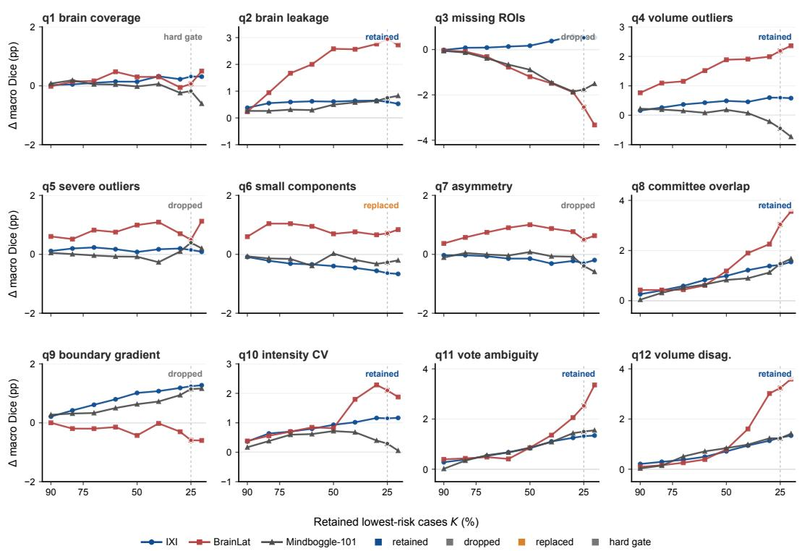  
Figure 6: Development provenance for the twelve original candidate QC signals. Each panel reports retained-case $\Delta$ macro Dice after ranking by one candidate signal. Status labels mark retained, dropped, replaced, and hard-gate signals under the frozen QC-7 release policy.

A  
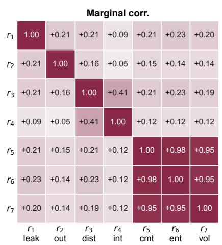

B  
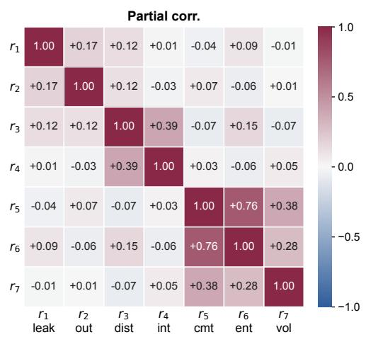  
Figure 7: Marginal and partial correlations among QC-7 percentile-risk axes. Partial correlations condition on the other five axes. Both panels use hosted release cases with complete $r _ { 1 } , \ldots , r _ { 7 }$ values.

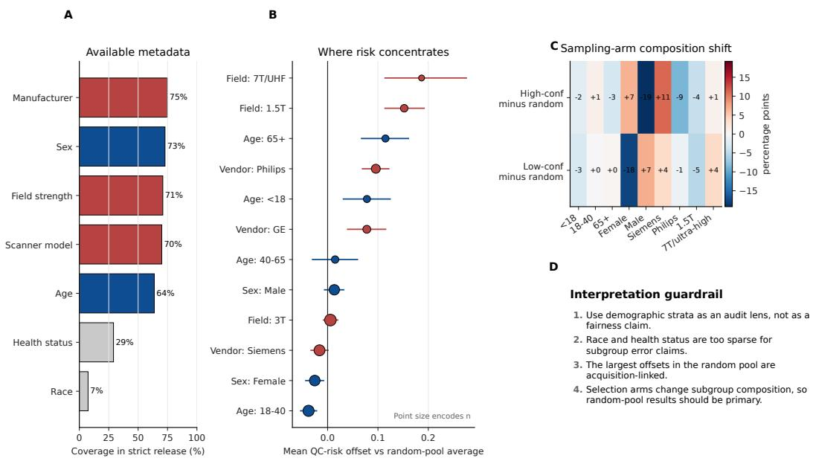  
Figure 8: Metadata-stratified QC-risk audit. Panels summarize metadata coverage, subgroup mean-risk offsets, sampling-arm composition shifts, and the interpretation boundary for this audit.

## Risk differences are distribution shifts, not just bar-height differences

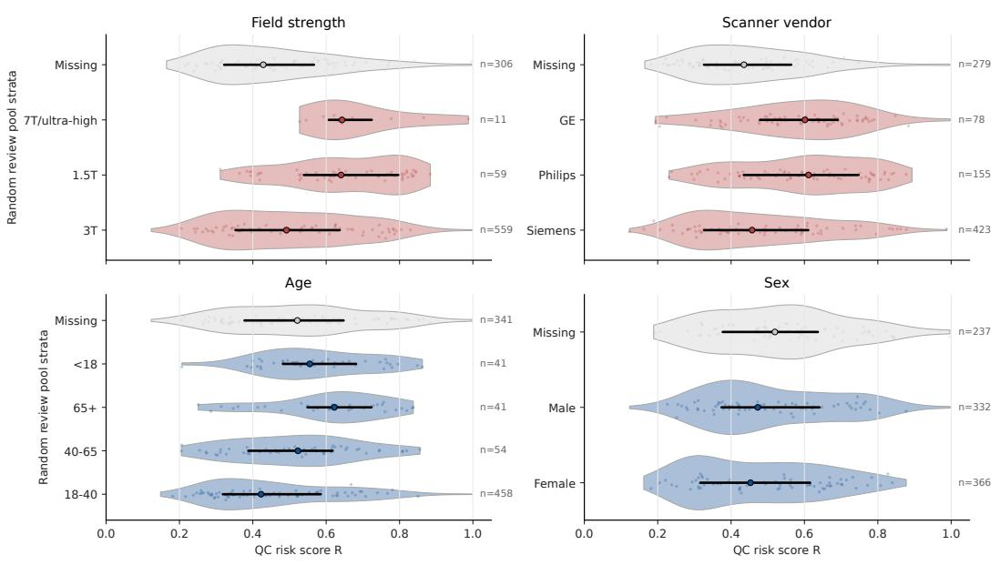  
Figure 9: Subgroup distributions of QC-risk score R. Each row shows random-pool case-level risks; the black segment marks the interquartile range and the central point marks the median.

## L Mindboggle-101 worst example

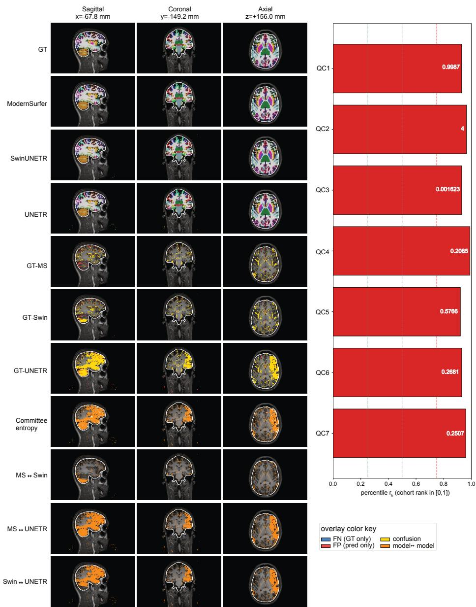  
Figure 10: Mindboggle-101 worst example. Section A shows manual GT, the three committee predictions, GT–model differences, committee vote entropy, and pairwise model differences at the worst-disagreement cuts. Section B shows the corresponding QC-7 bars and raw $Q _ { k }$ values.