# P-SER: Physical Consistency-Constrained Scattering Expandable Representation for Class-Incremental HRRP Target Recognition

Fangyi Wang, Graduate Student Member, IEEE Fudan University, Shanghai 200433, China

Peng Zhao, Graduate Student Member, IEEE Fudan University, Shanghai 200433, China

Haipeng Wang, Senior Member, IEEE

Fudan University, Shanghai 200433, China

Abstract— A high-resolution range profile (HRRP) describes target scattering responses along the radar line of sight and is widely used for radar target recognition. In long-term operation, previously unseen target classes may appear after deployment, while complete historical data may no longer be available. Classincremental HRRP recognition therefore aims to extend a recognition model to these classes while maintaining its ability to recognize previously learned classes. This task faces three practical difficulties. First, the aspect sensitivity of HRRP imaging causes substantial changes in scattering-peak locations and amplitudes, producing large intra-class variations and old-class representation drift. Second, reflector groups can generate strong responses similar to those of ships, reducing the differences between classes and increasing misclassification. Third, conventional dynamic expansion methods duplicate complete feature extractors, leading to increasing parameter and memory costs. To address these difficulties, a Physical Consistency-Constrained Scattering Expandable Representation framework, termed P-SER, is proposed. P-SER reconstructs dominant scattering points from complex-valued HRRPs acquired through the sum and azimuth-difference channels, together with the observation geometry. The resulting spatial structure, target extent, and energy distribution are used to construct class-level scatter-

ing prototypes and sample-level saliency priors, providing stable physical references for feature learning and old-class retention. Next, a primitive scatterer dictionary describes the mechanisms of local strong-scattering responses and selectively calibrates uncertain ship–reflector predictions at inference. Finally, lightweight residual adapters are added to a shared HRRP feature backbone at each incremental stage, supporting adaptation to incoming classes with limited model growth. P-SER thus incorporates stable and interpretable scattering properties into incremental knowledge construction, retention, and inference calibration. Experiments on simulated and measured HRRP datasets show that P-SER achieves competitive recognition performance without storing old-class exemplars, while maintaining physical consistency, interference robustness, knowledge retention, and model scalability.

Index Terms— radar automatic target recognition (RATR), class-incremental learning, high-resolution range profile (HRRP).

## I. Introduction

A high-resolution range profile (HRRP) records the range projection of a target’s scattering responses in a compact one-dimensional form and supports low-latency target recognition. HRRP recognition systems increasingly operate in open and continuously evolving environments, where new target categories may appear after deployment. Meanwhile, complete historical HRRP data are often unavailable because of storage, transmission, or operational constraints. Class-incremental HRRP recognition addresses this setting by learning newly observed classes in successive stages while retaining the ability to discriminate all previously encountered classes [1]– [4]. This capability is important for long-term maritime surveillance and other time-sensitive applications, since repeatedly collecting all historical observations and retraining a model from scratch is generally impractical. A conventional recognizer updated only with newly arriving samples tends to overwrite previously acquired representations, resulting in catastrophic forgetting during sustained operation.

Although class-space expansion is the defining change in the considered task, the HRRP data acquired at each stage are also affected by the imaging mechanism and scene interference, as illustrated in Fig. 1. Considering both the knowledge-retention requirement of classincremental learning and the deployment constraints of radar systems, the main difficulties of class-incremental HRRP recognition can be summarized as representation instability, interference vulnerability, and model inefficiency. The first challenge originates from the intrinsic aspect sensitivity of HRRP imaging. As the radar line of sight varies among observations, the range projections, mutual occlusion, and electromagnetic responses of target scattering components change accordingly. Consequently, the locations and amplitudes of dominant scattering peaks may fluctuate substantially for the same physical target, producing large intra-class variations. This property increases the difficulty of class-incremental recognition because the model must learn new classes without full access to historical samples that describe the diverse aspect-dependent appearances of old classes. A purely data-driven model may associate class identity with transient peak patterns and consequently suffer from feature drift. Such representations also provide limited insight into which intrinsic target properties have been retained.

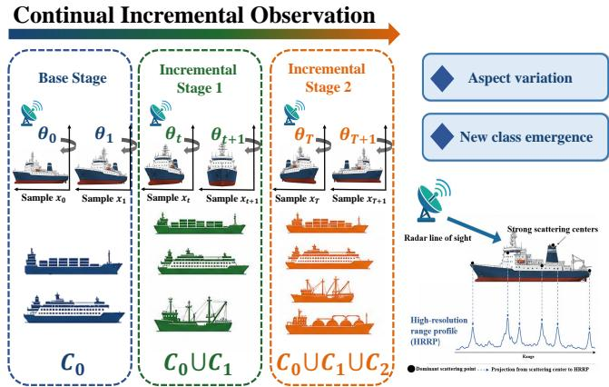  
Fig. 1. Illustration of continual class-incremental HRRP observation and its physical scattering response. Target classes expand progressively, while the HRRP imaging mechanism remains intrinsically sensitive to viewing aspect. Dominant responses are formed by the range projection of physical scattering centers, motivating the use of stable physical properties for incremental recognition.

The second challenge arises from strong-scattering interference that may appear or change across observation stages. Reflector groups, for example, can generate a small number of highly concentrated peaks whose range locations and amplitudes resemble the dominant responses of ship HRRPs. These responses may even occupy most of the profile energy. A classifier relying mainly on range-domain peak patterns may therefore confuse ships with reflector groups, although their underlying scattering mechanisms are fundamentally different. This ambiguity exposes a limitation of correlation-driven recognition: similar HRRP peak configurations do not necessarily correspond to the same physical scattering composition.

The third challenge concerns deployment efficiency. Continually operating HRRP recognition systems require timely model updates under restricted storage and computational resources. Dynamic network expansion provides useful representational plasticity for new classes, but conventional approaches often duplicate a complete feature extractor at each incremental stage. Their parameter and memory costs therefore increase rapidly as the class sequence grows. Such expansion is unsuitable for longterm radar deployment, where new-class adaptability, oldclass retention, and model compactness are simultaneously required.

The first two challenges reveal a common limitation of purely data-driven HRRP recognition. Features learned from the current observation distribution do not explicitly preserve the stable physical properties of the target. To address this limitation, physical consistency is introduced into class-incremental HRRP recognition. Dominant scattering points are first reconstructed from the complex sum- and difference-channel profiles together with the observation geometry. Their spatial structure, target extent, and energy distribution are more stable across viewing aspects than directly observed HRRP peak patterns. These physical attributes are subsequently constructed as class-level scattering prototypes and sample-level saliency priors. They anchor feature learning to the target itself rather than to a particular aspect-dependent observation, thereby reducing representation drift and supporting oldclass retention.

Physical scattering mechanisms are also incorporated at inference. A primitive scatterer dictionary (PSD) characterizes the mechanisms associated with local strongscattering components. When the HRRP recognition network is uncertain between a ship and a reflector group, the PSD mechanism evidence extracted from dominant-peak neighborhoods is used to calibrate the original prediction selectively. The final decision therefore depends on both the learned HRRP representation and the physical origin of the local response, improving robustness against strong-scattering interference.

For efficient expansion, a shared HRRP feature backbone is retained throughout the class sequence, and only a compact residual adapter is introduced at each incremental stage. The adapters provide stage-specific plasticity for learning new-class characteristics without repeatedly duplicating the complete feature extraction network. This design limits model growth while preserving previously acquired knowledge.

Based on these considerations, a Physical Consistency-Constrained Scattering Expandable Representation framework, termed P-SER, is proposed for class-incremental HRRP recognition, as illustrated in Fig. 2. Unlike methods that rely solely on statistical correlations in HRRP observations, P-SER allows stable and interpretable target scattering properties to participate directly in incremental knowledge construction, retention, and inference calibration. The main contributions are summarized as follows:

1) A physical-consistency scattering prototype constraint is proposed to alleviate representation drift caused by the intrinsic aspect sensitivity of HRRP observations. Dominant scattering points and target attributes are reconstructed from the complex sum- and difference-channel profiles and observation geometry. They are incorporated into classlevel prototypes and sample-level saliency priors, providing stable physical references for feature learning and old-class retention across viewing aspects.

2) A PSD-guided inference calibration method is developed for strong-scattering interference. It analyzes the physical scattering mechanisms associated with dominant local HRRP responses and selectively corrects ambiguous ship–reflector predictions without modifying the training procedure of the original recognition network.

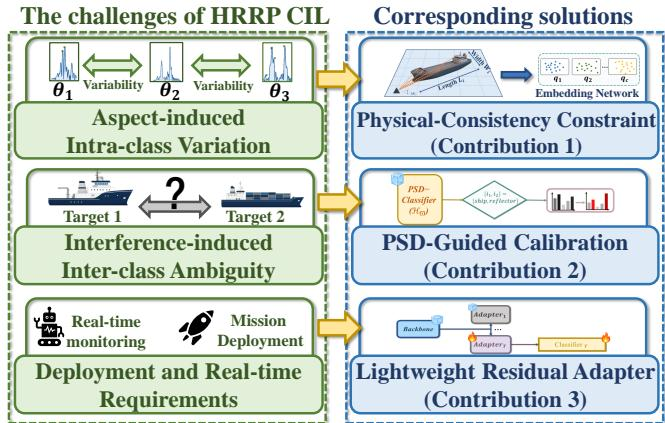  
Fig. 2. Key challenges in class-incremental HRRP recognition and the corresponding solutions in P-SER.

3) Lightweight residual adapters are introduced for parameter-efficient incremental expansion. Compact stage-specific branches learn new-class HRRP representations on a shared backbone, limiting parameter growth while maintaining previously acquired knowledge.

Experiments on simulated and measured HRRP datasets demonstrate the effectiveness and efficiency of P-SER. The proposed method achieves state-of-the-art average recognition performance on both datasets, exceeding the baseline by 26.55% and 19.05%, respectively. Compared with the second-best methods, P-SER further improves the average accuracy by 2.14% and 1.61% while using only 19.2% and 33.4% of their parameters. These results demonstrate that P-SER achieves a favorable balance among recognition accuracy, resistance to catastrophic forgetting, robustness against strong-scattering interference, and model complexity.

## II. Related Work

## A. HRRP Target Recognition

Before the advent of deep learning, HRRP target recognition primarily relied on statistical models and handcrafted descriptors, including radial extent, peak count, power spectra, and multiaspect dependencies [5]– [10]. These methods are computationally efficient and physically interpretable, but their performance depends strongly on signal quality and expert feature design. With the development of deep learning, hierarchical representations extracted directly from range profiles have increasingly replaced or integrated these handcrafted characteristics.

In recent years, convolutional, recurrent, and generative models have substantially advanced radar target recognition by learning latent characteristics from such data [11]–[15]. However, the representations obtained by these methods mainly rely on statistical correlations in the observed data. Under aspect-dependent response variation, these correlations may be unstable and offer limited physical interpretability.

Convolutional neural network (CNN)-based methods exploit local scattering patterns and their multiscale combinations. Liao et al. [11] proposed a concatenated deep architecture for radar HRRP recognition. Wan et al. [16] combined a convolutional encoder with a deconvolutional decoder to integrate target recognition and outlier rejection, while Guo et al. [13] developed a deep one-dimensional residual-inception network. More recent studies have incorporated radar-domain knowledge into feature learning. Zhou et al. [17] introduced knowledgeguided bidirectional temporal modeling and prototype enhancement, and Liu et al. [18] proposed a target-aspectguided network with geometric constraints for imbalanced HRRP recognition.

Recurrent neural network (RNN)-based methods use the sequential organization of HRRP range cells to model long-range dependencies [19]–[21]. Chen et al. [22] combined tensor recurrent modeling with a Bayesian nonparametric mixture to capture complex nonstationary distributions. Guo et al. [23] proposed a variational temporal deep generative model, whereas Chen et al. [24] developed a bidirectional recurrent gamma belief network that models correlations in both range directions.

Generative HRRP recognition methods mainly employ variational autoencoders (VAEs) and generative adversarial networks (GANs). In a VAE, the encoder learns a latent distribution and the decoder reconstructs the observation [25]. Du et al. [26] proposed a factorized discriminative conditional VAE to reduce the mismatch between feature learning and classification. Liao et al. [27] factorized the decoder according to target classes, and Chen et al. [28] introduced a mixture structure for more flexible data modeling. Recognition-aware adversarial generation [29], small-sample generation under noise [30], and continuous learning based on a CVAE–GAN [31] further demonstrate the value of generative representations. Recent studies have also explored synthetic-toreal HRRP construction and structure-aware generative modeling for high-fidelity profile synthesis [32], [33]. Nevertheless, these methods are primarily designed for closed-set recognition and do not directly address the retention of historical classes under sequential class arrival.

Beyond conventional closed-set classification, recent HRRP research has increasingly considered open-set recognition and unknown-target rejection through statistical tail modeling, prototype-based representation, and sequence-aware decision mechanisms [34]–[38]. Meanwhile, robust HRRP recognition under domain shifts, corrupted observations, cross-frequency variations, adversarial disturbances, and active interference has also received growing attention [39]–[45]. These developments extend radar recognition to increasingly complex operating conditions, but physical consistency, interference discrimination, and parameter-efficient class-incremental adaptation have rarely been considered within a unified framework.

## B. Class-Incremental Learning

Class-incremental learning handles a sequence of stages in which disjoint groups of classes are introduced over time, while a single classifier is evaluated over all classes observed so far [1]. Its central challenge is to learn discriminative representations for new categories without overwriting previously acquired knowledge. Existing methods can be broadly grouped into rehearsal, regularization or distillation, dynamic expansion, and exemplarfree learning.

Rehearsal-based methods preserve a bounded set of historical samples and replay them during subsequent updates. iCaRL [1] established a representative framework by combining exemplar rehearsal, representation learning, and prototype-based classification. Later studies improved exemplar selection through uncertainty or data-stream characteristics [46], while De Lange et al. [47] investigated continual prototype evolution under nonstationary streams. Rehearsal is effective because it directly approximates the historical distribution, but its performance depends on the permission and memory available for retaining old samples.

Knowledge distillation (KD) [48] and parameter regularization provide another route for transferring historical knowledge. Learning without Forgetting [2] constrained the outputs of the updated model using responses from its previous version. Kirkpatrick et al. [49] used Fisher information to penalize changes to important parameters, while remote-sensing-oriented methods further constrained representation drift [50], [51]. PODNet [3] preserves spatially pooled intermediate representations, and Kang et al. [52] proposed importance-aware feature consolidation. These approaches avoid unbounded expansion but may still struggle when new classes cause large representation shifts.

Dynamic expansion allocates additional capacity to incoming classes and has achieved strong performance in challenging CIL settings. Dynamically expandable networks [53] expand and retrain task-relevant neurons while using sparsity constraints to control redundancy. DER [4] further introduced task-specific representation branches, demonstrating the benefit of isolating new-class feature learning. FOSTER [54] combines feature boosting with compression to regulate the expanded model. TagFex [55] learns task-agnostic features through an auxiliary model and transfers them to task-specific branches to reduce feature collision. Although expansion generally improves plasticity, repeatedly introducing complete feature extractors incurs substantial storage cost.

When historical data cannot be retained, exemplarfree methods reconstruct or approximate old-class representations without storing raw samples. FeTrIL [56] combines a fixed feature extractor with feature translation to synthesize pseudo-features for old classes. DS-AL [57] uses an analytic linear solution together with a compensation stream to mitigate underfitting. Such methods provide an attractive balance between privacy, storage, and recognition accuracy, but their effectiveness depends strongly on the stability of the feature space inherited from the base stage.

## C. HRRP Incremental Learning

As discussed in Section I, directly transferring imageoriented CIL algorithms to HRRP recognition does not fully exploit the one-dimensional scattering structure of the observations. Only a limited number of studies have specifically considered HRRP incremental recognition. Li et al. [58] studied an exemplar-free setting and combined a local scattering patch multilayer perceptron with Gaussian-truncated Mahalanobis classification. Li et al. [59] used pooled distillation to transfer knowledge into a lightweight feature extractor. Chang et al. [60] combined a task-agnostic autoencoding branch, expandable taskspecific branches, and multilevel KD to control model growth under storage constraints.

These studies incorporate range-profile structure and exemplar-free requirements into incremental recognition, but the robustness of the learned representation to pronounced aspect changes and strong-scattering interference remains insufficiently explored. In practical applications, abrupt aspect variation can cause severe migration and amplitude fluctuation of dominant peaks, while reflector groups can produce responses similar to those of ship structures. Moreover, full task-specific expansion remains costly as the number of stages increases. These limitations motivate an HRRP-oriented CIL framework that jointly exploits stable physical properties, scattering-mechanism information, and lightweight expandable representations.

## III. Methodology

The base stage is indexed by $t = 0 ,$ and subsequent incremental updates by $t \geq 1$ . At stage t, only the current training set

$$
\begin{array} { r l r } { \mathcal { D } ^ { t } = \{ ( \mathbf { x } _ { i } , y _ { i } ) \} _ { i = 1 } ^ { N _ { t } } , } & { { } \quad } & { y _ { i } \in \mathcal { C } ^ { t } , } \end{array}\tag{1}
$$

is available, where $\mathbf { x } _ { i } ~ = ~ [ \mathbf { S } _ { i } ; \mathbf { D } _ { i } ] ~ \in ~ \mathbb { C } ^ { 2 \times N _ { r } }$ contains the complex sum- and azimuth-difference-channel profiles with $N _ { r }$ range cells, $y _ { i }$ is its label, $N _ { t }$ is the number of current-stage samples, and $\mathcal { C } ^ { t }$ is the class set introduced at stage t. Class sets are disjoint across stages, and no old-class exemplars are retained. After stage $t ,$ the model must classify all classes in $\textstyle { \mathcal { C } } ^ { 0 : t } = \bigcup _ { i = 0 } ^ { t } { \mathcal { C } } ^ { \bar { j } }$

As illustrated in Fig. 3, P-SER addresses this problem through three complementary components. PCSP reconstructs dominant scattering points and converts their physical attributes into class-level prototypes and samplelevel saliency priors. PSD-SCIC provides an inferencetime mechanism check for ambiguous ship–reflector predictions. LRAE expands representation capacity through compact residual adapters rather than complete backbone copies.

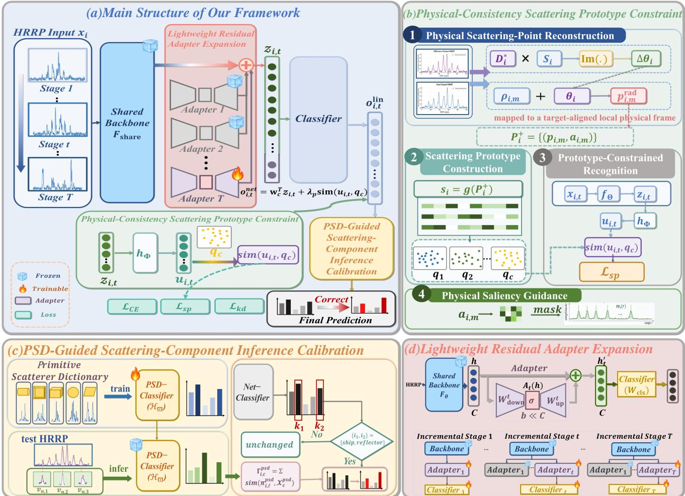  
Fig. 3. Overall framework of the proposed P-SER. The framework consists of three complementary components: physical-consistency scattering prototype constraint (PCSP), PSD-guided scattering-component inference calibration (PSD-SCIC), and lightweight residual adapter expansion (LRAE).

## A. Physical-Consistency Scattering Prototype Constraint

As illustrated in Fig. 4, dominant HRRP peaks are produced by target-dependent scattering centers rather than arbitrary range-domain fluctuations, although their observed locations vary with the viewing geometry. PCSP establishes their physical correspondence through calibrated monopulse angle estimation, radar-coordinate reconstruction, and data-derived spatial alignment. The resulting sparse point set is represented in a centered local frame whose principal axis is estimated from the reconstructed points; neither the true target heading nor class-specific metadata is required. Its stable geometric and energy attributes are subsequently used as physical anchors during incremental learning.

## 1. Physical Scattering-Point Reconstruction

For the i-th observation, let $S _ { i } ^ { \mathrm { r a w } } ( r )$ and $D _ { i } ^ { \mathrm { r a w } } ( r )$ denote the raw complex sum-channel and azimuth difference-channel responses at range cell r, respectively. The two channels are first compensated using the complex calibration responses $G _ { \Sigma } ( r )$ and $G _ { \Delta } ( r )$ of the correspond-

ing radar configuration:

$$
S _ { i } ( r ) = \frac { S _ { i } ^ { \mathrm { r a w } } ( r ) } { G _ { \Sigma } ( r ) } , \qquad D _ { i } ( r ) = \frac { D _ { i } ^ { \mathrm { r a w } } ( r ) } { G _ { \Delta } ( r ) } ,\tag{2}
$$

Here, $G _ { \Sigma } ( r )$ and $G _ { \Delta } ( r )$ are obtained from a referencesource calibration measurement and compensate the relative amplitude and phase responses of the sum and difference receiving paths. After this compensation, the quadrature convention adopted in this work gives the main-lobe monopulse relation $D _ { i } ( r ) / S _ { i } ( r ) ~ \simeq ~ - \mathrm { j } \kappa _ { \mathrm { m p } } \Delta \theta _ { i } ( r )$ [61], [62], where $\mathrm { ~ j ~ } ~ = ~ \sqrt { - 1 }$ $\theta _ { \mathrm { 3 d B } }$ is the azimuthal 3-dB beamwidth, and $\kappa _ { \mathrm { m p } }$ is the monopulse slope. Under this convention, $D _ { i } ^ { * } ( \bar { r } ) S _ { i } ( r )$ has an imaginary component proportional to $\Delta \dot { \theta _ { i } } ( r ) | S _ { i } ( r ) | ^ { 2 }$ . The angular deviation and effective observation angle are therefore obtained jointly as

$$
\begin{array} { r l r } & { \displaystyle \Delta \theta _ { i } ( r ) = \frac { \mathrm { I m } \{ D _ { i } ^ { * } ( r ) S _ { i } ( r ) \} } { \kappa _ { \mathrm { m p } } | S _ { i } ( r ) | ^ { 2 } + \epsilon _ { \theta } } , } & \\ & { \displaystyle \theta _ { i } ( r ) = \theta _ { i } ^ { 0 } + \Delta \theta _ { i } ( r ) , \qquad | \Delta \theta _ { i } ( r ) | \le \frac { \theta _ { \mathrm { 3 d B } } } { 2 } . } & \end{array}\tag{3}
$$

where $( \cdot ) ^ { * }$ denotes complex conjugation, Im $\{ \cdot \}$ extracts the imaginary part, and $\epsilon _ { \theta }$ is a small positive constant that prevents unstable division in weak-response cells. The coefficient $\kappa _ { \mathrm { m p } }$ is estimated once for each radar configuration by least-squares fitting the calibrated monopulse ratio to known angular offsets of a reference target within the main lobe. It is then fixed for all samples acquired with that configuration and does not depend on target pose or signal-to-noise ratio; a range- or frequency-dependent calibration table can be used when required by the frontend response. A different channel phase convention may place the monopulse slope on the real axis, in which case the complex calibration rotates the measured ratio to the adopted quadrature convention. Only estimates within the calibrated main-lobe interval are retained. The beam-pointing azimuth $\theta _ { i } ^ { 0 }$ is sensor-geometry metadata available at both acquisition and recognition, rather than the target heading or a class annotation.

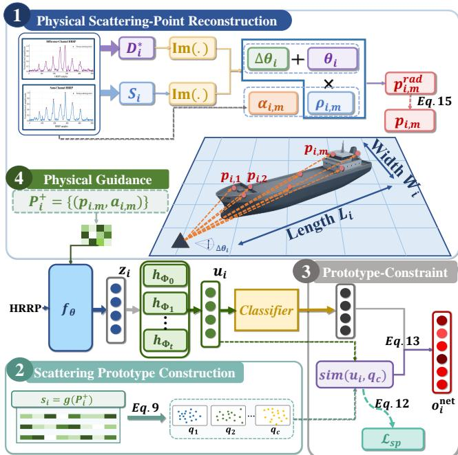  
Fig. 4. Overview of PCSP, which reconstructs physically consistent scattering points from HRRP observations and uses the resulting class-level prototypes and sample-level saliency priors to constrain incremental recognition.

When several unresolved scattering centers occupy one range cell, (3) yields the coherent apparent angle of their composite response, which is generally dominated by the strongest contributors rather than the angle of an individually resolved center. Accordingly, each retained HRRP peak is interpreted as a dominant scattering component at the available range resolution.

The dominant scattering responses are detected from the HRRP amplitude sequence $\begin{array} { r } { { a } _ { i } ( \boldsymbol { r } ) = \vert S _ { i } ( \boldsymbol { r } ) \vert } \end{array}$ . The candidate peak set is defined as

$$
\begin{array} { r } { \mathcal { M } _ { i } = \big \{ r _ { m } \in \Omega _ { i } \ \big | \ a _ { i } ( r _ { m } ) = \displaystyle \operatorname* { m a x } _ { r \in \mathcal { N } ( r _ { m } ) } a _ { i } ( r ) , } \\ { a _ { i } ( r _ { m } ) \geq \beta \underset { r \in \Omega _ { i } } { \operatorname* { m a x } } a _ { i } ( r ) \big \} , } \end{array}\tag{4}
$$

where $\Omega _ { i }$ denotes the valid target range $\mathrm { g a t e } , \mathcal { N } ( r _ { m } )$ is the local range neighborhood centered at $r _ { m } , \beta$ is the relative amplitude threshold with respect to the strongest response, and $r _ { m }$ is the range index of the m-th detected peak.

The relative threshold suppresses weak local fluctuations before physical reconstruction while preserving dominant scattering responses. Let $r _ { i } ^ { \mathrm { s t } }$ be the first cell of $\Omega _ { i } .$ . The slant range and corresponding radar-frame point of each retained peak are

$$
\begin{array} { r l } & { \rho _ { i , m } = R _ { i } ^ { 0 } + \eta ( \boldsymbol { r } _ { m } - \boldsymbol { r } _ { i } ^ { \mathrm { s t } } ) , } \\ & { \mathbf { p } _ { i , m } ^ { \mathrm { r a d } } = \rho _ { i , m } [ \cos \theta _ { i } ( \boldsymbol { r } _ { m } ) , \sin \theta _ { i } ( \boldsymbol { r } _ { m } ) ] ^ { T } , } \end{array}\tag{5}
$$

where $R _ { i } ^ { 0 }$ is the calibrated slant range associated with $r _ { i } ^ { \mathrm { s t } }$ in the radar range-gate record and $\eta$ is the range-cell spacing. With $a _ { i , m } = a _ { i } ( r _ { m } )$ , the radar-frame sparse point set is $\mathcal { P } _ { i } ^ { \mathrm { r a d } } = \{ ( \mathbf { p } _ { i , m } ^ { \mathrm { r a d } } , a _ { i , m } ) \} _ { m = 1 } ^ { M _ { i } }$ , where $M _ { i } = | { \mathcal { M } } _ { i } |$ is the number of candidate peaks and $a _ { i , m }$ is the amplitude of the m-th scattering response.

Since not all local maxima correspond to stable scattering centers, a main-cluster filtering operation is applied to suppress isolated false peaks:

$$
\mathcal { P } _ { i } ^ { \mathrm { r a d , + } } = \mathrm { M a i n C l u s t e r } ( \mathcal { P } _ { i } ^ { \mathrm { r a d } } ) .\tag{6}
$$

Here, MainCluster(·) denotes a neighborhoodconsistency filtering operation that retains the dominant scattering structure supported by adjacent peaks and removes isolated responses caused by noise, sidelobe leakage, or unstable weak scattering. Let $\kappa _ { i }$ index the retained points. Their amplitude-weighted center $\mathbf { c } _ { i }$ and covariance $\mathbf { C } _ { i }$ are computed from $\bar { \mathcal { P } } _ { i } ^ { \mathrm { r a d } , + }$ . Denote the principal eigenvector of $\mathbf { C } _ { i }$ by $\mathbf { v } _ { i , 1 }$ and its orientation by $\widehat { \psi } _ { i } = \mathrm { a t a n 2 } ( v _ { i , 1 } ^ { ( 2 ) } , v _ { i , 1 } ^ { ( 1 ) } )$ . The sign of $\mathbf { v } _ { i , 1 }$ is selected to have a nonnegative projection on the radar line of sight, resolving the $1 8 0 ^ { \circ }$ eigenvector ambiguity. With $\mathbf { Q } ( \cdot )$ denoting the standard two-dimensional rotation matrix, the retained points are transformed into the centered, principal-axis-aligned local frame as

$$
\mathbf { p } _ { i , m } = \mathbf { Q } ( - \widehat { \psi } _ { i } ) \left( \mathbf { p } _ { i , m } ^ { \mathrm { r a d } } - \mathbf { c } _ { i } \right) , \qquad m \in \mathcal { K } _ { i } ,\tag{7}
$$

and $\begin{array} { r c l } { \mathcal { P } _ { i } ^ { + } } & { = } & { \{ ( \mathbf { p } _ { i , m } , a _ { i , m } ) \} _ { m \in \mathcal { K } _ { i } } } \end{array}$ Thus, $R _ { i } ^ { 0 }$ and $\theta _ { i } ^ { 0 }$ come from ordinary radar range-gate and beam-pointing records, whereas the center and principal direction used for alignment are estimated directly from the reconstructed point set. No external target heading is assumed. Residual channel mismatch and noise may still introduce angular bias or dispersion; the calibration, denominator regularization, dominant-peak threshold, and main-cluster filtering jointly limit their influence. PCSP therefore treats the reconstruction as a compact physical prior rather than as precision geolocation.

For samples without the difference channel, $\Delta \theta _ { i } ( r )$ cannot be reliably estimated. PCSP then sets the angular deviation to zero and forms a range-consistent scattering skeleton along the radar line of sight. This form preserves the radial distribution, peak spacing, and amplitude allocation of dominant responses. Cross-rangedependent descriptor entries are omitted consistently for a range-only dataset, whereas the subsequent filtering, prototype construction, and recognition operations remain unchanged.

## 2. Class-Level Scattering Prototype Construction

For incremental recognition, $\mathcal { P } _ { i } ^ { + }$ is converted into a compact physical descriptor:

$$
\begin{array} { r l } & { \mathbf { s } _ { i } = g ( \mathcal { P } _ { i } ^ { + } ) } \\ & { \quad = \left[ L _ { i } , W _ { i } , \gamma _ { i } , \sin \psi _ { i } , \cos \psi _ { i } , \bar { \rho } _ { i } , \right. } \\ & { \quad \quad \left. \sigma _ { \rho , i } , E _ { \mathrm { c o n } , i } , \tilde { N } _ { i } \right] ^ { T } . } \end{array}\tag{8}
$$

where $g ( \cdot )$ maps the filtered scattering-point set to a compact physical vector. It uses the amplitude-weighted center and covariance described above; target extent is obtained from the spans of the aligned points along the two principal axes. Here, $L _ { i }$ and $W _ { i }$ are the estimated length and width, $\gamma _ { i }$ is the aspect ratio, $\psi _ { i } = \widehat { \psi } _ { i } - \theta _ { i } ^ { 0 }$ is the principal orientation relative to the radar line of sight, $\bar { \rho } _ { i }$ and $\sigma _ { \rho , i }$ describe the radial energy distribution, $E _ { \mathrm { c o n } , i }$ measures the fraction of profile energy carried by the retained points, and $\tilde { N } _ { i }$ is their normalized number. The sine–cosine encoding avoids discontinuity at the angular boundary. All dimensional quantities are consistently expressed in meters, and component-wise rescaling is intentionally omitted so that reconstructed target extent serves as the primary class-level physical cue, while the orientation and energy terms provide complementary information. Although individual observations need not yield identical descriptors, the class prototype below aggregates these attributes over all available training aspects. For range-only observations, $g ( \cdot )$ retains the corresponding radial entries.

For each class $c ,$ a class-level scattering prototype is constructed as

$$
\mathbf { q } _ { c } = \frac { 1 } { | \mathcal { T } _ { c } | } \sum _ { i \in \mathcal { T } _ { c } } \frac { \mathbf { s } _ { i } } { \| \mathbf { s } _ { i } \| _ { 2 } } ,\tag{9}
$$

where $\mathcal { T } _ { c }$ denotes the training-sample index set of class c. The prototype $\mathbf { q } _ { c }$ represents the typical scattering geometry of class c in the reconstructed physical space. During class-incremental learning, old-class prototypes are stored as physical anchors, while new-class prototypes are estimated from the samples available at the current stage.

## 3. Prototype-Constrained Incremental Recognition

For notational simplicity, the stage index is omitted from the sample-wise features and scores in this subsection; all such quantities are evaluated using the currentstage model.

Given a complex observation xi, the feature extractor produces the recognition feature

$$
\begin{array} { r } { \mathbf { z } _ { i } = f _ { \boldsymbol { \Theta } } ( \widetilde { \mathbf { x } } _ { i } ) , } \end{array}\tag{10}
$$

where $f _ { \Theta } ( \cdot )$ is the current feature extractor and $\widetilde { \mathbf { x } } _ { i }$ is the saliency-guided channel pair defined below. When saliency guidance is disabled, $\widetilde { \mathbf { x } } _ { i } = \mathbf { x } _ { i }$ . The recognition feature is then projected into the physical-prototype space as

$$
\begin{array} { r } { h _ { \Phi _ { t } } ( \mathbf { z } _ { i } ) = h _ { \Phi _ { t - 1 } } ( \mathbf { z } _ { i } ) + P _ { \Delta \Phi _ { t } } ( \mathbf { z } _ { i } ) , \quad t \geq 1 , } \\ { \mathbf { u } _ { i } = \mathrm { n o r m } _ { 2 } ( h _ { \Phi _ { t } } ( \mathbf { z } _ { i } ) ) , \qquad } \end{array}\tag{11}
$$

where $\mathrm { n o r m } _ { 2 } ( \mathbf { v } ) = \mathbf { v } / \lVert \mathbf { v } \rVert _ { 2 } , \ \Phi _ { t }$ denotes the parameters of the projection mapping retained after stage $t ,$ and $\Delta \Phi _ { t }$ denotes the parameters of the projection adapter introduced at that stage. The base projection $h _ { \Phi _ { 0 } }$ is learned at the base stage. At update $t , h _ { \Phi _ { t - 1 } }$ is frozen and only the compact projection adapter $P _ { \Delta \Phi _ { t } }$ is added, enabling new-class features to enter the common prototype space without overwriting the earlier mapping.

For a mini-batch $B _ { t }$ at stage t, the scattering prototype constraint is formulated as

$$
\mathcal { L } _ { \mathrm { s p } } = - \frac { 1 } { | \mathcal { B } _ { t } | } \sum _ { i \in \mathcal { B } _ { t } } \log \frac { \exp { ( \sin ( \mathbf { u } _ { i } , \mathbf { q } _ { y _ { i } } ) / \tau _ { p } ) } } { \sum _ { c \in \mathcal { C } ^ { 0 : t } } \exp { ( \sin ( \mathbf { u } _ { i } , \mathbf { q } _ { c } ) / \tau _ { p } ) } } ,\tag{12}
$$

where $| B _ { t } |$ is the mini-batch size, sim $( \cdot , \cdot )$ denotes cosine similarity, $\tau _ { p }$ is the temperature coefficient, and ${ \mathcal { C } } ^ { 0 : t }$ is the set of all classes observed up to stage t. This loss pulls each sample toward the scattering prototype of its own class and pushes it away from prototypes of other observed classes.

The linear classifier score vector is subsequently corrected by the physical prototype similarity:

$$
\mathbf o _ { i } ^ { \mathrm { n e t } } = \mathbf o _ { i } ^ { \mathrm { l i n } } + \lambda _ { \mathrm { p } } \left[ \mathrm { s i m } ( \mathbf u _ { i } , \mathbf q _ { c } ) \right] _ { c \in \mathcal { C } ^ { 0 : t } } ,\tag{13}
$$

where $\mathbf { o } _ { i } ^ { \mathrm { { l i n } } }$ and $\mathbf { o } _ { i } ^ { \mathrm { n e t } }$ are respectively the linear and PCSPcorrected score vectors of sample i at the current stage, the bracketed term collects the similarities to all observedclass prototypes, and $\lambda _ { \mathrm { p } }$ controls the prototype contribution. The final objective is

$$
\begin{array} { r } { \mathcal { L } = \mathcal { L } _ { \mathrm { c e } } + \lambda _ { \mathrm { s p } } \mathcal { L } _ { \mathrm { s p } } + \lambda _ { \mathrm { k d } } \mathcal { L } _ { \mathrm { k d } } , } \end{array}\tag{14}
$$

where $\mathcal { L } _ { \mathrm { c e } }$ is the cross-entropy loss evaluated from the PCSP-corrected scores in (13), $\mathcal { L } _ { \mathrm { k d } }$ is the old-class distillation term defined in Section $C ,$ , and $\lambda _ { \mathrm { s p } }$ and $\lambda _ { \mathrm { k d } }$ are their weighting coefficients.

## 4. Sample-Level Physical Saliency Guidance

The reconstructed scattering set also provides samplelevel guidance for feature extraction. Because dominant scattering points correspond to physically meaningful range positions, a soft physical saliency mask is constructed as

$$
m _ { i } ( r ) = \operatorname* { m a x } _ { ( \mathbf { p } _ { i , m } , a _ { i , m } ) \in \mathcal { P } _ { i } ^ { + } } a _ { i , m } \exp \left( - \frac { ( r - \Pi _ { i , r } ( \mathbf { p } _ { i , m } ) ) ^ { 2 } } { 2 \sigma _ { \mathrm { s a l } } ^ { 2 } } \right) ,\tag{15}
$$

where $\Pi _ { i , r } ( \cdot )$ denotes the sample-specific inverse mapping from the aligned physical plane back to the HRRP range index, and $\sigma _ { \mathrm { s a l } }$ controls the smoothness of the saliency response.

The mask is normalized $\begin{array} { r l r l } { \mathrm { a s } } & { { } \quad \bar { m } _ { i } ( r ) } & { } & { { } = } \end{array}$ $m _ { i } ( r ) / ( \operatorname* { m a x } _ { r } m _ { i } ( r ) + \epsilon _ { \mathrm { s a l } } )$ , where $\epsilon _ { \mathrm { s a l } }$ is a numericalstability constant, and is used to reweight, rather than discard, the original response:

$$
\widetilde { x } _ { i , k } ( r ) = x _ { i , k } ( r ) \big [ 1 + \bar { m } _ { i } ( r ) \big ] , \qquad k \in \{ \Sigma , \Delta \} .\tag{16}
$$

The feature extractor in (10) receives $\widetilde { \mathbf { x } } _ { i }$ when saliency guidance is enabled. The same real-valued weight is applied to both complex channels and therefore preserves

their phases. Thus, PCSP emphasizes physically supported range cells without discarding any component of the original observation.

## B. PSD-Guided Scattering-Component Inference Calibration

Reflector groups can be confused with ships because a few strong responses may occupy most of the profile energy and produce similar range-domain peak patterns. PSD-SCIC addresses this ambiguity through a fixed scattering-mechanism verifier that operates only at inference. It is trained independently of the radar recognition network and therefore does not alter the incremental feature-learning process.

The primitive scatterer dictionary (PSD) describes point, line or edge, surface or curved-surface, and multiple-bounce scattering structures [63]. These primitives provide reference mechanisms for generating standard local range-profile responses. For clarity, the dictionary is written explicitly as

$$
\mathrm { P S D ~ D i c t i o n a r y } = \{ \mathrm { P r i m i t i v e } _ { \nu } \} _ { \nu = 1 } ^ { N _ { \mathrm { p s d } } } ,\tag{17}
$$

where Primitiveν denotes the ν-th primitive type and $N _ { \mathrm { p s d } }$ is the number of primitive types. The 13 primitive types specified by the PSD are used in the implementation.

The PSD forward model generates local response segments under different component parameters and observation configurations. These simulated segments form the training set of a scattering-component classifier:

$$
\mathcal { H } _ { \varpi } ( \pmb { v } ) = \pi ^ { \mathrm { p s d } } ,\tag{18}
$$

where $\boldsymbol { \varpi }$ denotes the parameters of the PSD classifier, υ denotes a local response segment, and $\pi ^ { \mathrm { p s d } } \in \mathbb { R } ^ { N _ { \mathrm { p s d } } }$ is the predicted PSD component distribution. The classifier learns to describe a local response by its scattering mechanism rather than by the target category. After this pretraining stage, $\mathcal { H } _ { \varpi } ( \cdot )$ is fixed and is not updated on the target recognition dataset. This design avoids coupling the PSD calibration module with the incremental training process and allows it to serve as an external physical reference.

For a radar observation $\mathbf { x } _ { i }$ , local scattering segments are extracted around its dominant peaks. Let $_ { v _ { i , \ell } }$ denote the local segment associated with the ℓ-th dominant peak. The fixed PSD classifier then produces its scatteringcomponent distribution as

$$
\pi _ { i , \ell } ^ { \mathrm { p s d } } = \mathcal { H } _ { \varpi } ( \pmb { v } _ { i , \ell } ) .\tag{19}
$$

Thus, each dominant peak is assigned a soft PSD component description. Compared with directly using peak amplitude or position, this description provides a more explicit indication of whether the local response is closer to a surface, edge, point-like, or multiple-bounce scattering mechanism.

For each target class, a PSD mechanism template is computed from the training samples. Specifically, all dominant-peak segments of class c are passed through the fixed PSD classifier, and their component distributions are averaged as

$$
\chi _ { c } ^ { \mathrm { p s d } } = \frac { 1 } { Z _ { c } ^ { \mathrm { p s d } } } \sum _ { i \in \mathcal { I } _ { c } ^ { \mathrm { p s d } } } \sum _ { \ell = 1 } ^ { J _ { i } } e _ { i , \ell } \pi _ { i , \ell } ^ { \mathrm { p s d } } ,\tag{20}
$$

where $\mathcal { I } _ { c } ^ { \mathrm { p s d } }$ is the training-sample index set of class $c$ for PSD template construction, $J _ { i }$ is the number of selected dominant peaks, and $e _ { i , \ell }$ is the energy of the local segment normalized within sample i. The normalization factor is

$$
Z _ { c } ^ { \mathrm { p s d } } = \sum _ { i \in \mathcal { T } _ { c } ^ { \mathrm { p s d } } } \sum _ { \ell = 1 } ^ { J _ { i } } e _ { i , \ell } .\tag{21}
$$

The template $\chi _ { c } ^ { \mathrm { p s d } }$ describes the typical composition of PSD scattering components for class c. It is a fixed mechanism-level reference for inference calibration, rather than a trainable feature prototype. In particular, reflector groups tend to have a more concentrated mechanism composition dominated by specular or multiplebounce responses, whereas ship targets usually exhibit a richer mixture of scattering components caused by decks, sides, edges, curved surfaces, and local structures.

Although $\mathcal { H } _ { \varpi }$ is pretrained using simulated primitivescatterer responses, PSD-SCIC does not perform direct synthetic-to-real target classification. The simulated responses only establish a target-independent coordinate system over the predefined scattering mechanisms; they are not used to learn ship or reflector-group labels. For each radar dataset, $\chi _ { c } ^ { \mathrm { p s d } }$ is constructed from the training observations of that dataset after their local scattering segments are mapped into the fixed PSD space. A test observation is therefore compared with class templates from the same observation domain, rather than directly with simulated primitive responses. The calibration relies on relative mechanism consistency and does not require every local component to be assigned an exactly correct primitive label. Energy-weighted aggregation over multiple dominant components further reduces the influence of individual mapping deviations.

Moreover, PSD-SCIC serves only as a conservative inference-time verifier. It is invoked for uncertain ship– reflector decisions and modifies only the two ambiguous candidate scores; the PSD classifier neither replaces the recognition network nor independently determines the target category. Specifically, the recognition network first produces the PCSP-corrected score vector $\mathbf { o } _ { i } ^ { \mathrm { n e t } }$ in (13) and the corresponding probability vector $\mathbf { p } _ { i } ^ { \mathrm { n e t } } \ =$ softmax $( \mathbf { o } _ { i } ^ { \mathrm { n e t } } )$ ). Calibration is triggered when the two classes with the highest probabilities contain one ship and one reflector group and their probability difference is below an ambiguity threshold $\delta _ { \mathrm { a m b } }$ . Otherwise, the original network scores are retained. This selective trigger prevents unnecessary changes to confident predictions and to decisions that do not involve reflector interference.

For a candidate class $c ,$ the PSD matching score is computed by comparing the local PSD component distributions of the test sample with the class template:

$$
\Gamma _ { i , c } ^ { \mathrm { p s d } } = \frac { 1 } { \sum _ { \ell = 1 } ^ { J _ { i } } e _ { i , \ell } } \sum _ { \ell = 1 } ^ { J _ { i } } e _ { i , \ell } \sin \left( \pi _ { i , \ell } ^ { \mathrm { p s d } } , \chi _ { c } ^ { \mathrm { p s d } } \right) .\tag{22}
$$

Only the two ambiguous candidate classes are recalibrated:

$$
[ \mathbf { o } _ { i } ^ { \mathrm { c a l } } ] _ { c } = [ \mathbf { o } _ { i } ^ { \mathrm { n e t } } ] _ { c } + \mu _ { \mathrm { s c } } \Gamma _ { i , c } ^ { \mathrm { p s d } } ,\tag{23}
$$

where $\mu _ { \mathrm { s c } }$ controls the strength of scattering-component calibration; $\mathrm { s i m } ( \cdot , \cdot )$ is the cosine similarity defined in (12). Scores of the remaining classes are unchanged.

The calibrated score combines the discriminative evidence learned from radar observations with the mechanism-level evidence provided by PSD. By checking whether the dominant local responses are more consistent with ship-like component mixtures or reflector-like scattering mechanisms, PSD-SCIC improves robustness to reflector-induced interference without modifying the learned representation.

## C. Lightweight Residual Adapter Expansion

Dynamic expansion can isolate new-class learning from old representations, but duplicating a complete feature extractor at every stage causes rapid model growth. LRAE instead shares one HRRP backbone and adds only a compact residual adapter for each new stage.

Within the complete model, let $\mathbf { h } _ { i } \in \mathbb { R } ^ { C }$ denote the feature of sample i produced by the shared backbone before stage-specific adaptation, where $C$ is its dimension. For an incremental stage, LRAE introduces a bottleneck residual adapter instead of a new backbone:

$$
A _ { t } ( \mathbf { h } _ { i } ) = \mathbf { W } _ { \mathrm { u p } , t } \varphi \left( \mathbf { W } _ { \mathrm { d o w n } , t } \mathbf { h } _ { i } \right) ,\tag{24}
$$

where $\mathbf { W } _ { \mathrm { d o w n } , t } \in \mathbb { R } ^ { b _ { \mathrm { a d } } \times C }$ and $\mathbf { W } _ { \mathrm { u p } , t } \in \mathbb { R } ^ { C \times b _ { \mathrm { a d } } }$ are the stage-t down- and up-projection matrices, respectively, and $\varphi ( \cdot )$ is the nonlinear activation. The bottleneck dimension $b _ { \mathrm { a d } } \ll C$ limits the newly introduced parameters to approximately $2 C b _ { \mathrm { a d } }$

At stage t, the adapter bank $\{ A _ { j } \} _ { j = 1 } ^ { t }$ contains the residual corrections learned at all observed stages. Their contributions are fused using normalized learnable weights

$$
\omega _ { t , j } = \frac { \exp ( \zeta _ { t , j } ) } { \sum _ { j ^ { \prime } = 1 } ^ { t } \exp ( \zeta _ { t , j ^ { \prime } } ) } , \qquad j = 1 , \ldots , t ,\tag{25}
$$

and the expanded recognition feature is

$$
{ \bf h } _ { i , t } ^ { \prime } = { \bf h } _ { i } + \sum _ { j = 1 } ^ { t } \omega _ { t , j } A _ { j } ( { \bf h } _ { i } ) ,\tag{26}
$$

where $\zeta _ { t , j }$ is a learnable fusion logit and the softmax normalization prevents the accumulated residuals from growing with the number of stages. Historical adapters remain active, while the model learns their relative contributions at the current stage. Accordingly, the feature $\mathbf { z } _ { i }$ used in PCSP equals $\mathbf { h } _ { i }$ at the base stage and $\mathbf { h } _ { i , t } ^ { \prime }$ at incremental stage t.

This residual form has two advantages. First, the shared backbone feature $\mathbf { h } _ { i }$ is preserved as the common radar representation, which contains general rangedomain scattering patterns learned from previous data. Second, the adapter bank provides stage-specific residual corrections with only a small number of additional parameters. Therefore, the model can expand its representation capacity for new classes while maintaining previously learned residual knowledge.

At the base stage, the shared backbone, initial classifier, and base projection $h _ { \Phi _ { 0 } }$ are jointly optimized, and no residual adapter is required. At update $t \geq 1$ , the backbone, historical adapters, the previous PCSP projection mapping, and old-class classifier rows remain fixed. Only $A _ { t } ,$ the fusion logits $\{ \zeta _ { t , j } \} _ { j = 1 } ^ { t } .$ , the new classifier rows, and the PCSP projection adapter $P _ { \Delta \Phi _ { t } }$ are optimized. The expanded linear classifier produces

$$
\begin{array} { r } { \mathbf { o } _ { i , t } ^ { \mathrm { l i n } } = \mathbf { W } _ { \mathrm { c l s } , t } \mathbf { h } _ { i , t } ^ { \prime } , } \end{array}\tag{27}
$$

where $\mathbf { W } _ { \mathrm { c l s } , t }$ denotes the classifier after expansion to stage $t ; \mathbf { o } _ { i , t } ^ { \mathrm { l i n } }$ corresponds to $\mathbf { o } _ { i } ^ { \mathrm { { l i n } } }$ in PCSP, where the stage index is omitted. The resulting vector is corrected by PCSP according to (13) before evaluating the classifica tion loss. Thus, LRAE supplies the expandable representation and linear evidence, whereas PCSP provides the subsequent physical score correction.

The incremental regularizer preserves old-class responses by knowledge distillation on the PCSP-corrected network scores. Let $S _ { T } ( \mathbf { v } ) ~ = ~ \mathrm { s o f t m a x } ( \mathbf { v } / T )$ denote temperature-scaled softmax. Over the same mini-batch, the distillation term is

$$
\mathcal { L } _ { \mathrm { k d } } = \frac { T _ { \mathrm { k d } } ^ { 2 } } { | \mathcal { B } _ { t } | } \sum _ { i \in \mathcal { B } _ { t } } { \mathrm { K L } } \Bigl ( S _ { T _ { \mathrm { k d } } } ( \mathbf { o } _ { i , t - 1 } ^ { \mathrm { n e t , o l d } } ) \left\| S _ { T _ { \mathrm { k d } } } ( \mathbf { o } _ { i , t } ^ { \mathrm { n e t , o l d } } ) \right) ,\tag{28}
$$

where $\mathbf { o } _ { i , t - 1 } ^ { \mathrm { n e t , o l d } }$ and $\mathbf { o } _ { i , t } ^ { \mathrm { n e t , o l d } }$ are the previous- and currentmodel network scores restricted to old classes, $T _ { \mathrm { k d } }$ is the distillation temperature, and $\operatorname { K L } ( \cdot \| \cdot )$ denotes Kullback– Leibler divergence. Its contribution is controlled by $\lambda _ { \mathrm { k d } }$ in (14). PSD-SCIC is applied only after this training process and therefore does not enter either loss term.

Compared with full-branch expansion, LRAE provides a lighter way to increase the model capacity. The shared backbone maintains a stable radar representation, while each incremental stage only contributes a compact residual adapter. Therefore, the model can adapt to new classes without linearly duplicating large feature extractors, achieving a better balance among plasticity, stability, and parameter efficiency.

## IV. Experiments

## A. Datasets

Experiments are conducted using a self-constructed simulation dataset and a measured HRRP dataset. Both datasets provide synchronized complex sum-channel and azimuth-difference-channel responses for each observation. Representative profiles from both datasets are shown in Fig. 5.

Simulation Dataset  
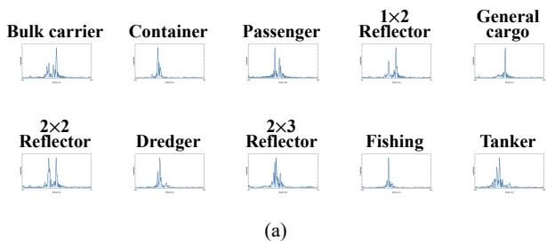

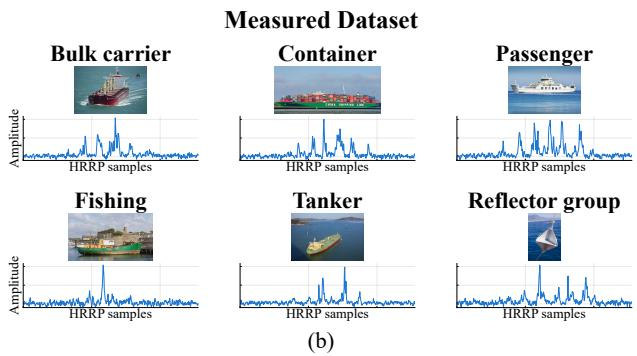  
Fig. 5. Representative samples from the simulation and measured datasets: (a) HRRP profiles of the ten simulated target classes, including ships and reflector groups; and (b) measured target images with their corresponding HRRP profiles.

## 1. Self-Constructed Simulation Dataset

The simulation dataset is generated from electromagnetic models of seven ship targets and three reflectorgroup configurations, yielding ten target classes. The simulated radar operates in the X-band with a center frequency of 10 GHz and a bandwidth of 500 MHz, corresponding to a nominal range resolution of 0.30 m. The simulated observations cover pitch angles of $0 ^ { \circ } - 9 0 ^ { \circ }$ and azimuth angles of $0 ^ { \circ } - 3 6 0 ^ { \circ }$ . Each class contains 4050 valid HRRPs, and each sample consists of 1024 range cells. The class composition, physical target sizes, and training–test partitions are summarized in Table I.

TABLE I  
Simulation and Measured HRRP Datasets
<table><tr><td>Dataset</td><td>Target type</td><td>Length &amp; width (m)</td><td>Training</td><td>Test</td></tr><tr><td>Simulation dataset</td><td></td><td></td><td></td><td></td></tr><tr><td></td><td>Bulk carrier</td><td>(152.14, 16.07)</td><td>3240</td><td>810</td></tr><tr><td></td><td>Container</td><td>(139.37, 23.37)</td><td>3240</td><td>810</td></tr><tr><td></td><td>Passenger</td><td>(178.82, 26.01)</td><td>3240</td><td>810</td></tr><tr><td></td><td>General cargo</td><td>(121.50, 21.72)</td><td>3240</td><td>810</td></tr><tr><td></td><td>Dredger</td><td>(79.52, 15.42)</td><td>3240</td><td>810</td></tr><tr><td></td><td>Fishing</td><td>(46.85, 8.60)</td><td>3240</td><td>810</td></tr><tr><td></td><td>Tanker</td><td>(168.55, 18.44)</td><td>3240</td><td>810</td></tr><tr><td></td><td>1 × 2 reflector</td><td>(44.40, 7.20)</td><td>3240</td><td>810</td></tr><tr><td></td><td>2 × 2 reflector</td><td>(44.40, 24.40)</td><td>3240</td><td>810</td></tr><tr><td></td><td>2 × 3 reflector</td><td>(81.60, 24.40)</td><td>3240</td><td>810</td></tr><tr><td>Measured dataset</td><td></td><td></td><td></td><td></td></tr><tr><td></td><td>Bulk carrier</td><td>(156.68, 18.06)</td><td>8631</td><td>2158</td></tr><tr><td></td><td>Container</td><td>(225.00, 32.20)</td><td>7463</td><td>1866</td></tr><tr><td></td><td>Passenger</td><td>(183.40, 25.00)</td><td>4679</td><td>1170</td></tr><tr><td></td><td>Fishing</td><td>(35.56, 9.30)</td><td>12676</td><td>3169</td></tr><tr><td></td><td>Tanker</td><td>(248.57, 44.14)</td><td>6780</td><td>1695</td></tr><tr><td></td><td>Reflector group</td><td>(48.20, 26.20)</td><td>4855</td><td>1214</td></tr></table>

## 2. The Measured Dataset

The measured dataset contains six target classes, and each synchronized complex channel pair is annotated with its class name. The radar operates at a center frequency of 10 GHz and a bandwidth of 120 MHz, corresponding to a nominal range resolution of 1.25 m. The measurements cover pitch angles of $0 ^ { \circ } - 2 5 ^ { \circ }$ and azimuth angles of $0 ^ { \circ } -$ 360◦. All valid observations are retained, with classdependent sample counts reported together with the target sizes and data partitions in Table I.

For both datasets, the training and test sets are partitioned by disjoint azimuth intervals rather than by randomly assigning individual samples. Samples from a given azimuth interval appear in only one partition, which prevents adjacent-aspect observations of the same target from being shared between training and testing. The resulting sample counts are listed in Table I.

## B. Experimental Settings

All protocols begin with two base classes. For the ten-class simulation dataset, adding 1, 2, or 4 classes per update yields the 8-stage, 4-stage, and 2-stage settings. The class order is bulk carrier, container, passenger, $1 \times 2$ reflector, general cargo, $2 \times 2$ reflector, dredger, $2 \times 3$ reflector, fishing, and tanker. For the six-class measured dataset, adding 1 or 2 classes per update yields the 4- stage and 2-stage settings, with the order bulk carrier, container, passenger, fishing, tanker, and reflector group. All methods use identical class orders and data partitions.

All methods use the same one-dimensional ResNet-18. Before entering the real-valued backbone, the complex observation xi defined in Section III is rearranged into the four-channel real-valued tensor

$$
\mathbf { x } _ { i } ^ { \mathrm { R I } } = [ \mathrm { R e } ( \mathbf { S } _ { i } ) , \mathrm { I m } ( \mathbf { S } _ { i } ) , \mathrm { R e } ( \mathbf { D } _ { i } ) , \mathrm { I m } ( \mathbf { D } _ { i } ) ] ^ { T } \in \mathbb { R } ^ { 4 \times N _ { r } } .\tag{29}
$$

All compared methods receive the same complex sumand azimuth-difference-channel observations. P-SER additionally exploits routinely available radar-side geometry and calibration information, including the beam-pointing angle $\theta _ { i } ^ { 0 } .$ , the range-gate reference $R _ { i } ^ { 0 }$ , the channel responses $G _ { \Sigma }$ and $G _ { \Delta }$ , and the monopulse slope $\kappa _ { \mathrm { { m p } } } .$ , to construct its physical prior. The former two are acquisition metadata recorded for each observation, whereas the latter quantities are target-independent calibration parameters fixed for a given radar configuration. No target heading, physical dimension, class label, or additional target measurement is required at inference. The backbone retains the ResNet-18 block configuration [2, 2, 2, 2] and widths [64, 128, 256, 512], with one-dimensional operations, a four-channel seven-tap stem, and global average pooling that yields $C = 5 1 2$ . Adam is used for 200 epochs at each stage with an initial learning rate of 10−3. The remaining settings are $b _ { \mathrm { a d } } = 3 2 , \lambda _ { \mathrm { k d } } = 1 . 0 , T _ { \mathrm { k d } } = 2 . 0 , \lambda _ { \mathrm { s p } } = 0 . 1 0 ,$ $\lambda _ { \mathrm { p } } = 0 . 1 0 , \tau _ { p } = 0 . 0 7$ , and $\mu _ { \mathrm { s c } } = 0 . 2 0$

Candidate peaks are local maxima within seven-cell neighborhoods whose amplitudes exceed 10% of the profile maximum, giving $\beta = 0 . 1 0 .$ . The saliency width is $\sigma _ { \mathrm { s a l } } = 3$ cells, and numerical-stability constants are $1 0 ^ { - 8 }$

The fixed PSD classifier processes the real and imaginary parts of an 11-cell local sum-channel segment. Three one-dimensional convolutional layers with 32, 64, and 128 channels, each followed by batch normalization and ReLU, are connected to global average pooling and a 13- way classifier. The PSD forward model generates 3000 segments per primitive, or 39000 in total, using amplitude scaling in [0.8, 1.2], peak shifts of at most two cells, and Gaussian noise from 10 to 30 dB. The data are split 8:1:1, and the classifier is pretrained for 100 epochs with Adam, a batch size of 256, a learning rate of $1 0 ^ { - 3 }$ , and a weight decay of $1 0 ^ { - 4 }$ before being fixed. PSD-SCIC uses $\delta _ { \mathrm { a m b } } = 0 . 1 5$ . Experiments are implemented in PyTorch on an NVIDIA RTX 4090 GPU.

Let $\mathcal { A } _ { b }$ denote the Top-1 accuracy after update b, where $b = 0$ is the base stage and $B$ is the final update. Performance over the complete sequence is summarized by

$$
\bar { \mathcal { A } } = \frac { 1 } { B + 1 } \sum _ { b = 0 } ^ { B } \mathcal { A } _ { b } .\tag{30}
$$

where $\mathcal { A } _ { B }$ and $\bar { A }$ measure final-stage retention and average incremental performance, respectively.

The baselines include the distillation methods LwF [2], iCaRL [1], and PODNet [3]; the expansion methods DER [4] and FOSTER [54]; DER equipped with VAE [26] or TAGNet [18]; the exemplar-free DS-AL [57]; and TagFex [55]. Only method-specific components differ; the backbone, four-channel input, class order, and data split are identical. Reported exemplar counts are per-oldclass raw-observation budgets. P-SER stores no historical raw profiles, retaining only one PCSP prototype and one PSD template per observed class.

## C. Experiments on the Self-Constructed Simulation Dataset

Following the settings in Section B, class-incremental learning experiments are conducted on the selfconstructed simulation dataset. The dataset contains ten classes comprising ship targets and reflector-group configurations. To evaluate the adaptability of different methods under different incremental granularities, three independent protocols are considered: the 8-stage, 4-stage, and 2-stage settings.

Fig. 6 presents the stage-wise recognition accuracy curves under the three protocols. Overall, because complete historical training data are unavailable during incremental updates, all CIL methods suffer from different degrees of catastrophic forgetting. LwF mainly constrains the output of the updated model through knowledge distillation and therefore shows limited ability to preserve old scattering structures. Although iCaRL additionally retains exemplars, its representation still degrades markedly as more classes arrive. PODNet introduces a finer-grained pooled distillation strategy and performs better than LwF and iCaRL, but it remains insufficient for handling strong aspect sensitivity and peak-structure variation.

In contrast, DER and FOSTER, as representative dynamic expansion methods, consistently outperform conventional distillation-based approaches. This result indicates that allocating additional representation capacity is beneficial for learning newly introduced radar target classes. When the range-profile-oriented VAE and TAG-Net models are combined with DER, recognition performance improves further, demonstrating that domainspecific feature modeling can reduce representation drift in incremental recognition. DS-AL also remains competitive without old-class exemplars because its analytic mapping and compensation stream partially recover historical feature distributions. TagFex learns task-agnostic features to reduce the risk of overfitting to short-sighted peak patterns or spurious correlations when new-class samples are limited, and consequently achieves strong results across all three protocols.

Among all compared methods, P-SER achieves the highest recognition accuracy under the 8-stage, 4-stage, and 2-stage settings. In the 8-stage experiment, its accuracy curve remains consistently above those of the other methods as the incremental process proceeds, and its final accuracy of 81.35% represents an absolute improvement of 3.75% over the second-best result. In the 4-stage and 2-stage settings, P-SER likewise obtains the highest final accuracies of 84.08% and 88.72%, respectively. More importantly, its accuracy curves exhibit a smaller degradation slope during later updates. This behavior indicates that the proposed method not only adapts to the scattering characteristics of the radar observations but also effectively mitigates old-class forgetting during continuous class expansion.

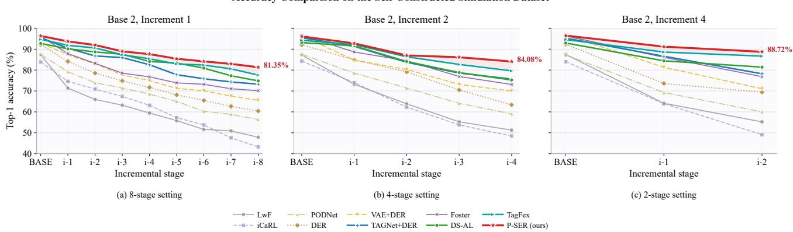  
Fig. 6. Accuracy comparison of different incremental learning methods across incremental stages on the self-constructed simulation dataset.

TABLE II  
Performance Comparison on the Self-Constructed Simulation Dataset
<table><tr><td rowspan="2">Method</td><td rowspan="2">Exemplars per class</td><td colspan="3">8-stage</td><td colspan="3">4-stage</td><td colspan="3">2-stage</td></tr><tr><td>Params. (M) AB (%) Ā (%) Params. (M) AB (%) Ā (%) Params. (M) AB (%) Ā (%)</td><td></td><td></td><td></td><td></td><td></td><td></td><td></td><td></td></tr><tr><td>LwF [2]</td><td>0</td><td>11.17</td><td>47.89</td><td>61.50</td><td>11.17</td><td>51.29</td><td>66.15</td><td>11.17</td><td>55.23</td><td>68.93</td></tr><tr><td>iCaRL [1]</td><td>150</td><td>11.18</td><td>43.28</td><td>62.42</td><td>11.18</td><td>48.45</td><td>64.57</td><td>11.18</td><td>49.11</td><td>65.69</td></tr><tr><td>PODNet [3]</td><td>150</td><td>11.18</td><td>56.34</td><td>69.01</td><td>11.18</td><td>59.03</td><td>72.15</td><td>11.18</td><td>60.05</td><td>72.18</td></tr><tr><td>DER [4]</td><td>150</td><td>89.39</td><td>60.41</td><td>73.12</td><td>44.71</td><td>63.37</td><td>77.98</td><td>22.37</td><td>69.41</td><td>78.45</td></tr><tr><td>VAE+DER [4], [26]</td><td>150</td><td>89.44</td><td>65.55</td><td>76.69</td><td>44.74</td><td>69.97</td><td>80.91</td><td>22.40</td><td>71.06</td><td>83.03</td></tr><tr><td>TAGNet+DER [4], [18]</td><td>100</td><td>89.41</td><td>73.26</td><td>82.47</td><td>44.72</td><td>75.69</td><td>84.96</td><td>22.38</td><td>78.20</td><td>86.68</td></tr><tr><td>FOSTER [54]</td><td>150</td><td>71.08</td><td>70.14</td><td>78.96</td><td>35.55</td><td>73.11</td><td>83.97</td><td>17.78</td><td>76.84</td><td>86.42</td></tr><tr><td>DS-AL [57]</td><td>0</td><td>87.60</td><td>74.82</td><td>84.39</td><td>87.60</td><td>75.24</td><td>84.56</td><td>87.60</td><td>81.39</td><td>86.24</td></tr><tr><td>TagFex [55]</td><td>100</td><td>63.22</td><td>77.60</td><td>85.91</td><td>35.94</td><td>79.62</td><td>87.01</td><td>18.71</td><td>86.65</td><td>89.93</td></tr><tr><td>P-SER</td><td>0</td><td>12.12</td><td>81.35</td><td>88.05</td><td>11.99</td><td>84.08</td><td>89.21</td><td>11.92</td><td>88.72</td><td>92.13</td></tr></table>

A more comprehensive comparison is provided in Table II, which reports the number of old-class exemplars, model parameters, final accuracy $A _ { B } ,$ and average accuracy A¯. Although distillation-based methods such as LwF, iCaRL, and PODNet use relatively compact models and may therefore be suitable for deployment-constrained scenarios, their final and average accuracies remain limited. DS-AL does not require old-class exemplars, but its analytic mappings and correlation matrices introduce considerable model storage overhead. By contrast, P-SER achieves the highest average accuracy without retaining any old-class exemplars. In the 8-stage setting, P-SER uses only 19.2% of the parameters of TagFex while improving the average accuracy to 88.05%, an absolute gain of 2.14% over the second-best result. In the 4- stage and 2-stage settings, P-SER also obtains the highest average accuracies of 89.21% and 92.13%, respectively. These results demonstrate that P-SER achieves a favorable balance among recognition accuracy, storage efficiency, and incremental stability.

## D. Experiments on the Measured Dataset

The proposed method is further evaluated on the measured radar dataset. Compared with the simulation data, the measured observations are affected by targetaspect variation, environmental clutter, measurement errors, and class-dependent sample imbalance, which lead to less stable peak positions and amplitudes. The measured experiment therefore provides a more direct assessment of the incremental adaptation capability and practical robustness of the compared methods. For the six measured target classes, the 4-stage and 2-stage protocols described in Section B are adopted.

Fig. 8 shows the stage-wise recognition accuracy of the different methods. The overall accuracies are lower than those obtained on the simulation dataset, and fluctuations among stages are more pronounced. Distillationbased methods, including LwF, iCaRL, and PODNet, continue to show limited performance, indicating that constraining only output responses or intermediate features is insufficient to preserve the aspect-dependent scattering structures of old classes. DER and FOSTER improve newclass learning through dynamic expansion and generally outperform conventional distillation methods. Incorporating VAE or TAGNet into DER provides a further improvement, confirming that range-profile-oriented feature modeling remains beneficial under real measurements. DS-AL and TagFex also achieve competitive results, reflecting the effectiveness of exemplar-free analytic learning and taskagnostic feature transfer in measured radar tasks.

P-SER achieves the best performance under both measured protocols. In the 4-stage experiment, it obtains a final accuracy of 76.93% and an average accuracy of 82.30%. In the 2-stage experiment, these metrics reach 79.85% and 83.56%, respectively. The corresponding accuracy curves also exhibit a smaller decline during later updates. This result suggests that the physical-consistency scattering prior and lightweight adapter expansion jointly reduce old-class representation drift, while PSD-guided calibration improves discrimination when reflector responses resemble ship measurements.

The bottom row of Fig. 7 further reports the finalround confusion matrices on the measured dataset. Under the adopted incremental class order, many misclassifications of earlier ship classes are directed toward classes introduced in later stages, which is consistent with the feature drift and catastrophic forgetting commonly observed in CIL. Nevertheless, P-SER maintains stable discrimi nation between ships and the reflector group. Reflectorrelated errors remain comparatively limited despite the presence of strong local peaks, indicating that PSD-SCIC provides an effective mechanism-level check for ambiguous ship–reflector predictions. Meanwhile, PCSP helps preserve class-level geometric scattering differences among ship categories. The confusion matrices therefore support the overall interference robustness of P-SER, while the independent contribution of each component is quantified by the ablation experiments below.

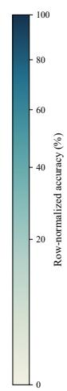

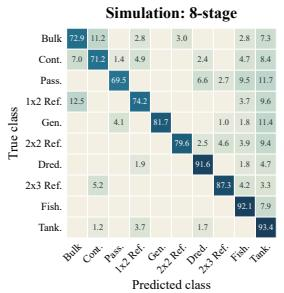  
(a)

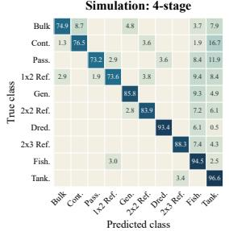  
(b)

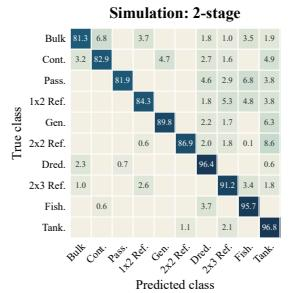  
(c)

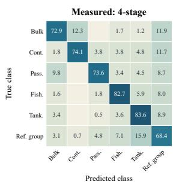  
(d)

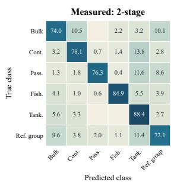  
(e)  
Fig. 7. Final-round confusion matrices of P-SER. The top row reports the simulation results under the (a) 8-stage, (b) 4-stage, and (c) 2-stage settings; the bottom row reports the measured results under the (d) 4-stage and (e) 2-stage settings.

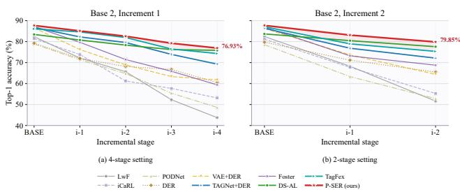  
Fig. 8. Accuracy comparison of different incremental learning methods across incremental stages on the measured dataset.

Table III compares the methods in terms of model size, the number of old-class exemplars, final accuracy, and average accuracy. Although LwF, iCaRL, and POD-Net require relatively few parameters, their recognition accuracies are lower than those of the expansion-based methods. DS-AL stores no old-class exemplars but introduces a large parameter footprint through its analytic mappings. TagFex achieves strong accuracy but still retains a set of historical exemplars. In contrast, P-SER requires 11.99 M and 11.92 M parameters in the 4-stage and 2-stage settings, respectively, and stores no old-class samples while obtaining the highest final and average accuracies. These results confirm that the favorable balance among recognition performance, storage efficiency, and incremental stability observed in simulation is preserved under measured conditions.

TABLE III  
Performance Comparison on the Measured Dataset
<table><tr><td rowspan="2">Method</td><td rowspan="2">Exemplars per class</td><td colspan="3">4-stage</td><td colspan="3">2-stage</td></tr><tr><td>Params. (M) AB (%) Ā (%) Params. (M) AB (%) Ā (%)</td><td></td><td></td><td></td><td></td><td></td></tr><tr><td>LwF [2]</td><td>0</td><td>11.17</td><td>43.75</td><td>63.25</td><td>11.17</td><td>51.63</td><td>67.44</td></tr><tr><td>iCaRL [1]</td><td>150</td><td>11.18</td><td>53.14</td><td>65.47</td><td>11.18</td><td>55.29</td><td>68.07</td></tr><tr><td>PODNet [3]</td><td>150</td><td>11.18</td><td>48.62</td><td>63.81</td><td>11.18</td><td>52.81</td><td>64.90</td></tr><tr><td>DER [4]</td><td>150</td><td>44.71</td><td>60.47</td><td>69.32</td><td>22.37</td><td>65.47</td><td>72.12</td></tr><tr><td>VAE+DER [4], [26]</td><td>150</td><td>44.74</td><td>61.72</td><td>71.34</td><td>22.40</td><td>64.38</td><td>74.77</td></tr><tr><td>TAGNet+DER [4], [18]</td><td>150</td><td>44.72</td><td>69.26</td><td>78.36</td><td>22.38</td><td>72.13</td><td>78.44</td></tr><tr><td>FOSTER [54]</td><td>150</td><td>35.55</td><td>59.38</td><td>72.70</td><td>17.78</td><td>68.76</td><td>76.29</td></tr><tr><td>DS-AL [57]</td><td>0</td><td>87.60</td><td>75.84</td><td>78.91</td><td>87.60</td><td>77.58</td><td>80.57</td></tr><tr><td>TagFex [55]</td><td>100</td><td>35.94</td><td>74.31</td><td>80.69</td><td>18.71</td><td>75.34</td><td>80.45</td></tr><tr><td>P-SER</td><td>0</td><td>11.99</td><td>76.93</td><td>82.30</td><td>11.92</td><td>79.85</td><td>83.56</td></tr></table>

## E. Ablation Studies

To analyze the contribution of each component, PCSP, PSD-SCIC, and LRAE are separated and evaluated under the 8-stage protocol on the self-constructed simulation dataset. Seven controlled ablation settings are constructed from different module combinations, while the complete P-SER configuration is included as a reference. For controlled comparison, variants with the same trainable components share the corresponding model checkpoint, and only the module under investigation is switched on or off. The results are reported in Table IV.

The comparison between Ablation Exp-1 and Ablation Exp-2 demonstrates the independent contribution of PCSP to radar target recognition. Without PSD-SCIC and LRAE, introducing PCSP increases the average accuracy from 59.21% to 80.25%, corresponding to an absolute gain of 21.04%. The stage-wise accuracy trajectory of Ablation Exp-2 is also substantially smoother than that of Ablation Exp-1. Although PCSP is not designed solely for the incremental process, its class-level physical scattering prototypes retain stable target properties for historical categories. These physical anchors reduce representation drift and consequently alleviate catastrophic forgetting to some extent.

TABLE IV  
Ablation study of the proposed components.
<table><tr><td rowspan="2">Setting</td><td colspan="3">Component</td><td colspan="10">Recognition accuracy (%)</td><td rowspan="2"> $\operatorname { A v g } .$ </td></tr><tr><td>PCSP</td><td>PSD-SCIC</td><td>LRAE</td><td>Base</td><td>Stage-1</td><td>Stage-2</td><td>Stage-3</td><td>Stage-4</td><td>Stage-5</td><td>Stage-6</td><td>Stage-7</td><td>Stage-8</td></tr><tr><td>Ablation Exp-1</td><td>X</td><td>×</td><td>X</td><td>83.44</td><td>67.36</td><td>63.84</td><td>61.11</td><td>57.47</td><td>55.82</td><td>49.34</td><td>47.93</td><td>46.59</td><td>59.21</td></tr><tr><td>Ablation Exp-2</td><td>√</td><td>X</td><td>X</td><td>96.29</td><td>89.37</td><td>87.24</td><td>84.68</td><td>80.15</td><td>77.92</td><td>73.46</td><td>67.81</td><td>65.29</td><td>80.25</td></tr><tr><td>Ablation Exp-3</td><td>√</td><td>√</td><td>X</td><td>96.29</td><td>89.37</td><td>85.76</td><td>83.18</td><td>82.64</td><td>78.31</td><td>75.87</td><td>74.22</td><td>72.59</td><td>82.03</td></tr><tr><td>Ablation Exp-4</td><td>√</td><td>X</td><td>√</td><td>96.29</td><td>93.72</td><td>87.35</td><td>85.72</td><td>84.19</td><td>81.63</td><td>77.84</td><td>75.27</td><td>74.51</td><td>84.06</td></tr><tr><td>Ablation Exp-5</td><td>X</td><td>√</td><td>X</td><td>83.44</td><td>67.36</td><td>73.28</td><td>69.91</td><td>65.43</td><td>59.75</td><td>55.12</td><td>53.86</td><td>50.34</td><td>64.28</td></tr><tr><td>Ablation Exp-6</td><td>X</td><td>√</td><td>√</td><td>83.44</td><td>82.39</td><td>85.21</td><td>83.69</td><td>82.44</td><td>80.18</td><td>76.73</td><td>73.95</td><td>72.10</td><td>80.01</td></tr><tr><td>Ablation Exp-7</td><td>X</td><td>X</td><td>√</td><td>83.44</td><td>82.39</td><td>79.64</td><td>75.17</td><td>74.82</td><td>71.45</td><td>68.23</td><td>64.78</td><td>63.56</td><td>73.72</td></tr><tr><td>Full P-SER</td><td> $\checkmark$ </td><td> $\checkmark$ </td><td> $\checkmark$ </td><td>96.29</td><td>93.72</td><td>91.97</td><td>88.94</td><td>87.62</td><td>85.41</td><td>84.15</td><td>82.96</td><td>81.35</td><td>88.05</td></tr></table>

The comparison between Ablation Exp-1 and Ablation Exp-5 reflects the inference calibration effect of PSD-SCIC. Because the first reflector class is introduced at Stage-2, PSD-SCIC is not activated at the Base and Stage-1 stages. The two settings therefore share the same checkpoint and produce identical results before Stage-2. From Stage-2 onward, the mechanism-level correction improves ship–reflector discrimination and raises the average accuracy from 59.21% to 64.28%, an absolute gain of 5.07%. The same contribution is observed when PSD-SCIC is added to PCSP+LRAE: the average accuracy increases from 84.06% in Ablation Exp-4 to 88.05% in the complete model. These paired results isolate the calibration effect from changes in feature training. Ablation Exp-7 independently verifies LRAE. Introducing only lightweight adapter expansion increases the average accuracy from 59.21% to 73.72%, showing that stagespecific residual capacity improves new-class adaptation without duplicating the complete backbone.

Ablation Exp-3 combines PCSP and PSD-SCIC and reaches an average accuracy of 82.03% by jointly addressing aspect sensitivity and reflector-induced ambiguity. Nevertheless, because it lacks an incremental expansion mechanism, its accuracy still decreases markedly as the number of stages grows. Ablation Exp-4 and Ablation Exp-6 include LRAE and therefore maintain more stable recognition during later updates. Among the twocomponent configurations, PCSP+LRAE in Ablation Exp-4 achieves the highest average accuracy of 84.06%, confirming the complementarity between stable physical con straints and parameter-isolated representation expansion.

Finally, the complete P-SER model achieves an average accuracy of 88.05%. The ablation results demonstrate that the three components address different limitations rather than providing redundant improvements: PCSP stabilizes aspect-sensitive radar representations, PSD-SCIC calibrates ship–reflector ambiguity at inference, and LRAE controls forgetting and model growth through lightweight expansion. Their combination therefore improves both recognition accuracy and incremental stability.

## F. The Target Reconstruction Experiment and Model Analysis

To examine the intermediate physical representation produced by PCSP, Fig. 9 visualizes four representative observations drawn from the simulation test set. One sample is selected from each target class shown, so the figure presents sample-level examples rather than complete-testset statistics. The dots denote dominant scattering points retained after consistency filtering, and the bounding rectangles indicate the estimated target extents.

The bulk-carrier and container examples recover the principal target extents relatively well because their dominant responses cover the bow, stern, sides, and deck boundaries. The dredger shows a larger deviation owing to its smaller size and nonuniform scattering distribution. The 2×2 reflector is more sensitive to aspect and peak selection because only a few specular and multiple-bounce components define its apparent boundary. These examples illustrate both the physical meaning and the expected limitations of sparse scattering-point reconstruction.

Beyond these examples, Table V reports the classwise mean dimensions reconstructed from all samples in the simulation test set. The relative errors are computed separately as $\epsilon _ { L } = | \widehat { L } - L | / L \times 1 0 0 \%$ and $\epsilon _ { W } = | \widehat { W } - \mathbf { \mu } |$ $W | / W \times 1 0 0 \%$ , using the dimensions in Table I as ground truth.

For the seven ship classes, the mean length and width errors are 4.57% and 15.75%, respectively. The lower length error indicates that stable bow–stern responses provide a reliable estimate of longitudinal extent, whereas width estimation depends more strongly on monopulse angle accuracy and the visibility of cross-range boundaries. The fishing vessel consequently has a larger width error because its small physical width is represented by fewer dominant components. The three reflector configurations yield higher mean errors of 33.01% and 31.38%. Their sparse, aspect-dependent responses do not necessarily cover the geometric boundary, although the $2 \times 3$ reflector still attains a length error of only 1.97%. These results support the use of reconstructed attributes as aggregated physical priors rather than precision geometric measurements.

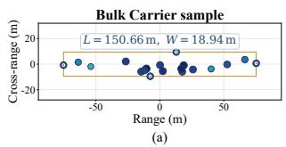

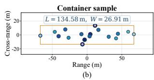

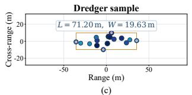

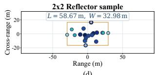  
(d)  
Fig. 9. Target reconstruction results for representative observations from the simulation test set. The dots denote the retained dominant scattering points, and the orange rectangles indicate the reconstructed target extents in the range and cross-range directions.

TABLE V  
Full-Test-Set Reconstruction Statistics on the Simulation Dataset
<table><tr><td>Target</td><td>GT (L, W) (m)</td><td>Reconstructed  $( \widehat { L } , \widehat { W } )$  (m)</td><td> $\epsilon _ { L }$  (%)</td><td> $\epsilon _ { W }$  (%)</td></tr><tr><td>Bulk carrier</td><td>(152.14, 16.07)</td><td>(149.38, 18.62)</td><td>1.81</td><td>15.87</td></tr><tr><td>Container</td><td>(139.37, 23.37)</td><td>(141.66, 25.97)</td><td>1.64</td><td>11.13</td></tr><tr><td>Passenger</td><td>(178.82, 26.01)</td><td>(186.59, 29.50)</td><td>4.35</td><td>13.42</td></tr><tr><td>General cargo</td><td>(121.50, 21.72)</td><td>(117.67, 23.09)</td><td>3.15</td><td>6.31</td></tr><tr><td>Dredger</td><td>(79.52, 15.42)</td><td>(83.25, 17.84)</td><td>4.69</td><td>15.69</td></tr><tr><td>Fishing</td><td>(46.85, 8.60)</td><td>(50.13, 11.81)</td><td>7.00</td><td>37.33</td></tr><tr><td>Tanker</td><td>(168.55, 18.44)</td><td>(184.26, 20.38)</td><td>9.32</td><td>10.52</td></tr><tr><td>1 × 2 reflector</td><td>(44.40, 7.20)</td><td>(63.04, 11.45)</td><td>41.98</td><td>59.03</td></tr><tr><td>2 × 2 reflector</td><td>(44.40, 24.40)</td><td>(68.85, 21.66)</td><td>55.07</td><td>11.23</td></tr><tr><td>2 × 3 reflector</td><td>(81.60, 24.40)</td><td>(83.21, 30.23)</td><td>1.97</td><td>23.89</td></tr><tr><td>Class mean</td><td></td><td></td><td>13.10</td><td>20.44</td></tr></table>

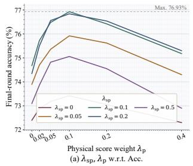

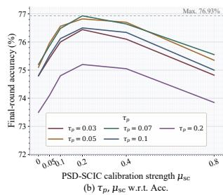  
Fig. 10. Hyperparameter sensitivity on the measured 4-stage protocol: final-round accuracy with respect to (a) $\lambda _ { \mathrm { s p } }$ and $\lambda _ { \mathrm { p } } ,$ and (b) $\tau _ { p }$ and $\mu _ { \mathrm { S C } }$

The sensitivity of four central hyperparameters is evaluated on the measured dataset in Fig. 10. The dashed line denotes the best final-round accuracy of 76.93%. In Fig. 10(a), moderate $\lambda _ { \mathrm { s p } }$ and $\lambda _ { \mathrm { p } }$ values improve recognition by incorporating prototype guidance, whereas overly large values overemphasize the reconstructed prior. In Fig. 10(b), $\tau _ { p }$ controls the sharpness of prototype matching and $\mu _ { \mathrm { s c } }$ determines the PSD calibration strength. Moderate settings improve ambiguous ship–reflector decisions, while excessive smoothing or correction weakens the original discriminative evidence. Overall, the results favor a balanced contribution from the physical prototypes and inference calibration.

## V. Conclusion

This paper presented P-SER for class-incremental radar target recognition. PCSP reconstructs stable scat tering attributes to constrain representation learning, PSD-SCIC checks ambiguous ship–reflector predictions through scattering mechanisms, and LRAE expands the model with compact weighted residual adapters. Experiments on simulated and measured datasets show that P-SER improves incremental accuracy and stability without retaining old-class exemplars, while reconstruction, confusion-matrix, ablation, and sensitivity analyses validate its individual components.

Future work will enrich PCSP with scatteringcomponent–semantic-description pairs to improve interpretability and transferability. PSD-SCIC will also be extended from ship–reflector ambiguity to all target classes through uncertainty-aware mechanism calibration.

## REFERENCES

[1] S. Rebuffi, A. Kolesnikov, G. Sperl, and C. H. Lampert iCaRL: Incremental classifier and representation learning In Proc. IEEE Conf. Comput. Vis. Pattern Recognit. (CVPR), 2017, pp. 2001– 2010.

[2] Z. Li and D. Hoiem Learning without forgetting IEEE Trans. Pattern Anal. Mach. Intell., vol. 40, no. 12, pp. 2935–2947, 2017.

[3] A. Douillard, M. Cord, C. Ollion, T. Robert, and E. Valle PODNet: Pooled outputs distillation for small-tasks incremental learning In Proc. Eur. Conf. Comput. Vis. (ECCV). Springer, 2020, pp. 86– 102.

[4] S. Yan, J. Xie, and X. He DER: Dynamically expandable representation for class-incremental learning In Proc. IEEE Conf. Comput. Vis. Pattern Recognit. (CVPR), 2021, pp. 3014–3023.

[5] C. M. Pilcher and A. Khotanzad Maritime ATR using classifier combination and high-resolution range profiles IEEE Trans. Aerosp. Electron. Syst., vol. 47, no. 4, pp. 2558–2573, 2011.

[6] L. Du, P. Wang, L. Zhang, H. He, and H. Liu Robust statistical recognition and reconstruction scheme based on hierarchical Bayesian learning of HRR radar target signal Expert Syst. Appl., vol. 42, no. 14, pp. 5860–5873, 2015.

[7] L. Du, H. Liu, and Z. Bao Radar HRRP statistical recognition: Parametric model and model selection IEEE Trans. Signal Process., vol. 56, no. 5, pp. 1931–1944, 2008.

[8] F. Zhu, X.-D. Zhang, Y.-F. Hu, and D. Xie Nonstationary hidden Markov models for multiaspect discriminative feature extraction from radar targets IEEE Trans. Signal Process., vol. 55, no. 5, pp. 2203–2214, 2007.

[9] K.-T. Kim, D.-K. Seo, and H.-T. Kim Efficient radar target recognition using the MUSIC algorithm and invariant features IEEE Trans. Antennas Propag., vol. 50, no. 3, pp. 325–337, 2002.

[10] S. Slomka, D. Gibbins, D. Gray, and B. Haywood Features for high-resolution radar range-profile-based ship classification In Proc. 5th Int. Symp. Signal Process. Appl. (ISSPA), vol. 1, 1999, pp. 329–332.

[11] K. Liao, J. Si, F. Zhu, and X. He Radar HRRP target recognition based on concatenated deep neural networks IEEE Access, vol. 6, pp. 29 211–29 218, 2018.

[12] J. Wan, B. Chen, Y. Liu, Y. Yuan, H. Liu, and L. Jin Recognizing the HRRP by combining CNN and BiRNN with attention mechanism IEEE Access, vol. 8, pp. 20 828–20 837, 2020.

[13] C. Guo, Y. He, H. Wang, T. Jian, and S. Sun Radar HRRP target recognition based on deep one-dimensional residual-inception network IEEE Access, vol. 7, pp. 9191–9204, 2019.

[14] H. Li, X. Li, Z. Xu, X. Jin, J. Gao, and F. Su An end-to-end multi-domain interaction deep unrolling network based on blockaware optimization model for ISAR multi-target separation IEEE Trans. Geosci. Remote Sens., 2025.

[15] T. Han, H. Chen, Y. Jia, Z. Zheng, and W.-Q. Wang Weighted exponential-product fusion and recursive Bayesian update for

multi-radar cooperative target recognition IEEE Trans. Aerosp. Electron. Syst., 2026.

[16] J. Wan, B. Chen, B. Xu, H. Liu, and L. Jin Convolutional neural networks for radar HRRP target recognition and rejection EURASIP J. Adv. Signal Process., vol. 2019, no. 1, p. 5, 2019.

[17] J. Zhou, J. Li, W. Guo, X. Zheng, and W. Yu Knowledgeguided BiTCN prototypical network for few-shot radar HRRP target recognition In Proc. IEEE Int. Geosci. Remote Sens. Symp. (IGARSS), 2024, pp. 10 223–10 227.

[18] Q. Liu, X. Zhang, and Y. Liu Target-aspect-guided neural network with geometric constraints for imbalanced radar target recognition IEEE Trans. Aerosp. Electron. Syst., vol. 61, no. 5, pp. 12 122– 12 142, 2025.

[19] Y. Zhang, F. Xiao, F. Qian, and X. Li VGM-RNN: HRRP sequence extrapolation and recognition based on a novel optimized RNN IEEE Access, vol. 8, pp. 70 071–70 081, 2020.

[20] Z. Zeng, J. Sun, Z. Han, and W. Hong Radar HRRP target recognition method based on multi-input convolutional gated recurrent unit with cascaded feature fusion IEEE Geosci. Remote Sens. Lett., vol. 19, pp. 1–5, 2022.

[21] K. Su, L. Gong, G. Wang, and L. Zhang Noise-robust radar HRRP target sequential recognition based on correlative scattering centers IEEE Geosci. Remote Sens. Lett., vol. 20, pp. 1–5, 2023.

[22] W. Chen et al. Tensor RNN with Bayesian nonparametric mixture for radar HRRP modeling and target recognition IEEE Trans. Signal Process., vol. 69, pp. 1995–2009, 2021.

[23] D. Guo, B. Chen, W. Chen, C. Wang, H. Liu, and M. Zhou Variational temporal deep generative model for radar HRRP target recognition IEEE Trans. Signal Process., vol. 68, pp. 5795–5809, 2020.

[24] W. Chen et al. Bidirectional recurrent gamma belief network for HRRP target recognition Signal Process., vol. 188, p. 108213, 2021.

[25] D. P. Kingma and M. Welling Auto-encoding variational Bayes arXiv preprint arXiv:1312.6114, 2013.

[26] C. Du, B. Chen, B. Xu, D. Guo, and H. Liu Factorized discriminative conditional variational auto-encoder for radar HRRP target recognition Signal Process., vol. 158, pp. 176–189, 2019.

[27] L. Liao, L. Du, and J. Chen Class factorized complex variational auto-encoder for HRR radar target recognition Signal Process., vol. 182, p. 107932, 2021.

[28] J. Chen, L. Du, and L. Liao Discriminative mixture variational autoencoder for semisupervised classification IEEE Trans. Cybern., vol. 52, no. 5, pp. 3032–3046, 2020.

[29] Y. Huang, Y. Wen, L. Shi, and X. Ding Recognition-aware HRRP generation with generative adversarial network IEEE Geosci. Remote Sens. Lett., vol. 19, pp. 1–5, 2021.

[30] J. Yin, W. Sheng, and H. Jiang Small-sample target recognition based on radar HRRP and SDAE-WACGAN IEEE Access, vol. 12, pp. 16 375–16 385, 2024.

[31] X. Li, W. Ouyang, M. Pan, S. Lv, and Q. Ma Continuous learning method of radar HRRP based on CVAE-GAN IEEE Trans. Geosci. Remote Sens., vol. 61, pp. 1–19, 2023.

[32] W. Li, J. Chen, S. Li, B. Tian, and Z. Chen A synthetic framework for real-world radar target recognition using HRRP IEEE Trans. Aerosp. Electron. Syst., 2026.

[33] S. Li, W. Li, J. Chen, B. Tian, and S. Xu Structure-aware generative modeling and comprehensive evaluation for high-fidelity radar HRRP synthesis IEEE Trans. Instrum. Meas., 2026.

[34] Z. Xia, P. Wang, G. Dong, and H. Liu Radar HRRP open set recognition based on extreme value distribution IEEE Trans. Geosci. Remote Sens., vol. 61, pp. 1–16, 2023.

[35] J. Chen, W. Li, S. Li, B. Tian, and Z. Chen ECAPL: Open set recognition on HRRP through expansive consistency-aware prototypes IEEE Trans. Aerosp. Electron. Syst., 2025.

[36] W. Li, B. Tian, J. Ma, P. Huang, and S. Xu OSFSM: A systematic open set framework for radar automatic target recognition using HRRP IEEE Trans. Aerosp. Electron. Syst., 2025.

[37] Y. Zhang, X. Feng, H. Yin, X. Wei, and H. Yan HRRPSeqNet: Open-set recognition of space target motions using HRRP sequences IEEE Trans. Aerosp. Electron. Syst., 2025.

[38] Y. Wang et al. NHPL: Neural collapse guided hierarchical prototypical learning for radar HRRP open set recognition IEEE Trans. Aerosp. Electron. Syst., 2025.

[39] J. Yang et al. A contrastive uncertainty modeling for radar HRRP domain generalization target recognition IEEE Trans. Aerosp. Electron. Syst., 2025.

[40] Y.-P. Zhang, L. Zhang, L. Kang, H. Wang, Y. Luo, and Q. Zhang Space target classification with corrupted HRRP sequences based on temporal–spatial feature aggregation network IEEE Trans. Geosci. Remote Sens., vol. 61, pp. 1–18, 2023.

[41] F. Zhang et al. Causal-inspired unsupervised dynamic-attribute feature disentanglement network for HRRP target recognition IEEE Trans. Aerosp. Electron. Syst., 2026.

[42] M. Liu, X. Gao, X. Qiu, and Y. Liu Deep Gaussian hidden Markov network for robust HRRP sequence modeling and target recognition IEEE Trans. Aerosp. Electron. Syst., 2025.

[43] W. Yang et al. Cross-frequency feature learning for dual-band radar HRRP target recognition IEEE Trans. Aerosp. Electron. Syst., 2026.

[44] K. Wang et al. Adv-STMamba: A lightweight spatial–temporal Mamba model incorporating adversarial training for radar HRRP target recognition IEEE Trans. Aerosp. Electron. Syst., 2026.

[45] G. Sun, L. Wang, Y. Wang, J. Wang, and Y. Liu Point-spreadfunction guided HRRP recognition network: A framework for robust target classification under ISRJ IEEE Trans. Aerosp. Electron. Syst., 2026.

[46] J. Bang, H. Koh, S. Park, H. Song, J.-W. Ha, and J. Choi Online continual learning on a contaminated data stream with blurry task boundaries In Proc. IEEE Conf. Comput. Vis. Pattern Recognit. (CVPR), 2022, pp. 9275–9284.

[47] M. De Lange and T. Tuytelaars Continual prototype evolution: Learning online from non-stationary data streams In Proc. IEEE Int. Conf. Comput. Vis. (ICCV), 2021, pp. 8250–8259.

[48] G. Hinton, O. Vinyals, and J. Dean Distilling the knowledge in a neural network arXiv preprint arXiv:1503.02531, 2015.

[49] J. Kirkpatrick et al. Overcoming catastrophic forgetting in neural networks Proc. Natl. Acad. Sci., vol. 114, no. 13, pp. 3521–3526, 2017.

[50] Y. Tai, Y. Tan, S. Xiong, and J. Tian Mine-distill-prototypes for complete few-shot class-incremental learning in image classification IEEE Trans. Geosci. Remote Sens., vol. 61, pp. 1–13, 2023.

[51] J. Chen, S. Wang, L. Chen, H. Cai, and Y. Qian Incremental detection of remote sensing objects with feature pyramid and knowledge distillation IEEE Trans. Geosci. Remote Sens., vol. 60, pp. 1–13, 2020.

[52] M. Kang, J. Park, and B. Han Class-incremental learning by knowledge distillation with adaptive feature consolidation In Proc. IEEE Conf. Comput. Vis. Pattern Recognit. (CVPR), 2022, pp. 16 071–16 080.

[53] J. Lee, J. Yoon, E. Yang, and S. J. Hwang Lifelong learning with dynamically expandable networks CoRR, 2017.

[54] F. Wang, D. Zhou, H. Ye, and D. Zhan FOSTER: Feature boosting and compression for class-incremental learning In Proc. Eur. Conf. Comput. Vis. (ECCV). Springer, 2022, pp. 398–414.

[55] B. Zheng, D. Zhou, H. Ye, and D. Zhan Task-agnostic guided feature expansion for class-incremental learning In Proc. IEEE Conf. Comput. Vis. Pattern Recognit. (CVPR), 2025, pp. 10 099– 10 109.

[56] G. Petit, A. Popescu, H. Schindler, D. Picard, and B. Delezoide FeTrIL: Feature translation for exemplar-free class-incremental learning In Proc. IEEE Winter Conf. Appl. Comput. Vis. (WACV), 2023, pp. 3911–3920.

[57] H. Zhuang, R. He, K. Tong, Z. Zeng, C. Chen, and Z. Lin DS-AL: A dual-stream analytic learning method for exemplar-free classincremental learning In Proc. AAAI Conf. Artif. Intell. (AAAI), vol. 38, no. 15, 2024, pp. 17 237–17 244.

[58] J. Li, W. Guo, J. Zhou, F. Wei, T. Zhang, and W. Yu Patching-based HRRP nonexemplar class-incremental recognition via Gaussian truncation IEEE Trans. Aerosp. Electron. Syst., 2025.

[59] Z. Li, J. Fu, W. Li, S. Li, B. Tian, and S. Xu PFDE-DCN: A lightweight class-incremental learning method for radar HRRP recognition IEEE Sensors J., 2025.

[60] Z. Chang, Y. Lv, B. Tian, X. Xiao, S. Guo, and P. Wang An incremental target recognition method for hrrp based on autoencoder reconstruction and multi-level knowledge distillation In Proc. 5th Int. Conf. Commun. Technol. Inf. Technol. (ICCTIT), 2025, pp. 363–369.

[61] S. M. Sherman and D. K. Barton Monopulse Principles and Techniques, 2nd ed. Artech House, 2011.

[62] U. Nickel Overview of generalized monopulse estimation IEEE Aerosp. Electron. Syst. Mag., vol. 21, no. 6, pp. 27–56, 2006.

[63] X. Zhang, F. Xu, Y. Yang, M. Xing, and Y. Jin A primitive scatterer dictionary for semantic representation of radar target images IEEE Trans. Antennas Propag., vol. 72, no. 1, pp. 825–840, 2024.

  
Fangyi Wang (Graduate Student Member, IEEE) received the B.E. degree in communication engineering from Shandong University, Qingdao, China, in 2023. He is currently pursuing the Ph.D.degree in information and communication engineering with the Key Laboratory for Information Science of Electromagnetic Waves, School of Information Science and Technology, Fudan University, Shanghai, China.  
His research interests include class-incremental learning for HRRP, HRRP image interpretation.

Peng Zhao (Graduate Student Member, IEEE) received the B.E. degree in electronic information engineering from Hangzhou Dianzi University, Hangzhou, China, in 2024. He is currently pursuing the M.Eng. degree in electronic information with the Key Laboratory for Information Science of Electromagnetic Waves, School of Information Science and Technology, Fudan University, Shanghai, China. His research interests include intelligent radar signal

processingand deep learning for high-resolution range profile (HRRP) interpretation.

Haipeng Wang (Senior Member, IEEE) received the B.S. and M.S. degrees in mechanical and electronic engineering from the Harbin Institute of Technology, Harbin, China, in 2001 and 2003, respectively, and the Ph.D. degree in environmental systems engineering from the Kochi University of Technology, Kochi, Japan, in 2006.

He was a Visiting Researcher with the Graduate School of Information, Production

and Systems, Waseda University, Fukuoka, Japan, in 2008. He is currently a Professor with the Key Laboratory of Electromagnetic Wave Information Science (MoE), Department of Communication Science and Engineering, School of Information Science and Engineering, Fudan University, Shanghai, China. His research interests include signal processing, synthetic aperture radar (SAR) image processing and analysis, speckle statistics, and applications to forestry and oceanography, and machine learning and its applications to SAR images.

Dr. Wang has been a member of the Technical Program Committee of the IEEE Geoscience and Remote Sensing Symposium (IGARSS) since 2011. He was a recipient of the Dean Prize of the School of

Information Science and Engineering, Fudan University, in 2009 and 2017. He also serves as an Associate Editor for IEEE GEOSCIENCE AND REMOTE SENSING LETTERS.