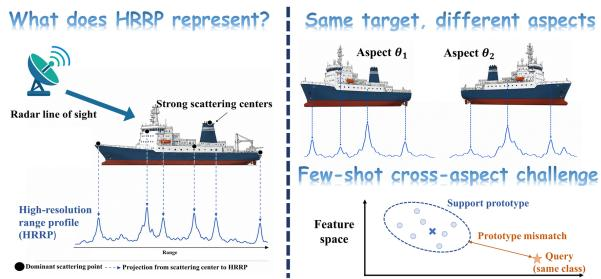
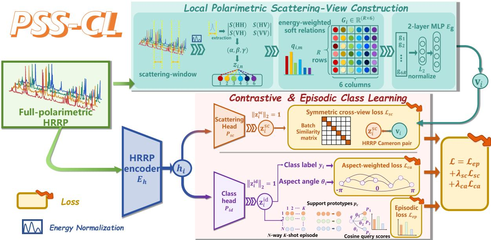
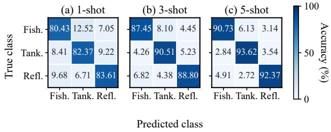
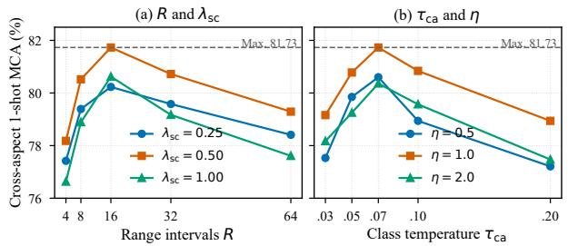

# POLARIMETRIC SCATTERING-STRUCTURE CONTRASTIVE LEARNING FOR FEW-SHOT HRRP RECOGNITION

Fangyi Wang, Peng Zhao, and Haipeng Wang∗†

Fudan University, China

## ABSTRACT

Few-shot high-resolution range profile (HRRP) recognition is challenged by strong aspect-dependent variation and sparse novel-class support. We propose polarimetric scattering-structure contrastive learning (PSS-CL), which supplies an episodic HRRP encoder with a structured physical training view. Dominant local responses are represented by their soft affinities to canonical polarimetric mechanisms, normalized range locations, and energy contributions. A symmetric cross-view objective transfers this scattering structure to the learned HRRP representation, while episodic prototype learning supports novel-class inference without the physical branch. We conduct Random-aspect and Cross-aspect experiments on a six-class measured dataset. In Cross-aspect 1-, 3-, and 5-shot recognition, PSS-CL achieves 81.73%, 86.92%, and 90.98% mean class accuracy (MCA), respectively, outperforming the best competing results by 5.62%, 3.09%, and 3.56%.

Index Terms— high-resolution range profile, few-shot learning, radar signal processing, contrastive learning, radar target recognition

## 1. INTRODUCTION

A high-resolution range profile (HRRP) is a one-dimensional complex radar signature obtained by coherently projecting the scattering responses of a target onto the radar line of sight. Its range cells resolve the distribution of dominant scattering centers along the target extent, providing a compact one-dimensional representation for recognition. Observation aspect changes the visibility, amplitude, and phase of local scattering centers, resulting in large intra-class variations. In few-shot recognition, one or a few labeled support HRRPs provide sparse coverage of the aspect-dependent distribution of each novel class. A query observed at a different aspect may consequently deviate considerably from the support prototype. Figure 1 summarizes HRRP formation and the resulting Cross-aspect prototype mismatch.

Existing HRRP recognition studies have progressively replaced handcrafted statistics with learned representations. Probabilistic and generative models describe HRRPs using class-factorized, conditional, mixture, or adversarial latent variables [1, 2, 3, 4]. Recurrent Bayesian networks and deep sequence models exploit dependencies among multi-aspect observations [5, 6]. More recent methods incorporate prior-guided contrastive learning, semantic hierarchies, target-aspect constraints, and polarization fusion to strengthen discriminative representations [7, 8, 9, 10]. These methods learn primarily from densely labeled base-class distributions, leaving novelclass support sets with sparse aspect coverage and unstable few-shot prototypes.

  
Fig. 1. HRRP formation and the Cross-aspect few-shot recognition challenge. Dominant scattering centers form a one-dimensional range profile, while aspect-dependent scattering causes support– query prototype mismatch.

Few-shot learning transfers reusable knowledge from base classes to tasks with small support sets. Representative approaches learn similarity functions or task-specific metrics through Siamese Networks, Matching Networks, Prototypical Networks, and Relation Networks [11, 12, 13, 14]; other methods learn adaptable initializations or episodic classifiers [15, 16], and strong representation baselines are also effective [17]. For HRRP data, prior-assisted task-wise discriminant analysis and fully polarimetric scatteringcenter matching demonstrate the value of domain knowledge under limited supervision [18, 19]. Existing objectives and physical descriptors provide complementary cues, yet few-shot HRRP learning lacks a fixed-dimensional training view that preserves local polarimetric mechanism relations and range organization without altering novel-class inference.

To address this problem, PSS-CL transfers a range-structured polarimetric scattering view to an episodic HRRP encoder through cross-view contrast. An auxiliary aspect-aware loss is used during training, while novel-class inference requires only the HRRP encoder and prototype classifier.

Our main contributions are summarized as follows:

• We construct a structured polarimetric scattering view by aggregating canonical soft-response affinities, range locations, and energy contributions from dominant scattering regions.

• We introduce cross-view scattering alignment that transfers this physical view to an episodically trained HRRP encoder. The physical branch supplies training supervision and is removed for novel-class prototype inference.

• On a six-class measured dataset, PSS-CL achieves the highest MCA among the compared methods under the present protocol: 81.73%, 86.92%, and 90.98% in Cross-aspect 1-, 3-, and

  
Fig. 2. Overview of PSS-CL. The structured physical branch provides training-only cross-view supervision for episodic HRRP learning.

5-shot recognition.

## 2. METHOD

## 2.1. Problem formulation and overview

Let the base-class training set be $\mathcal { D } _ { \mathrm { b a s e } } = \{ ( X _ { i } , y _ { i } , \theta _ { i } ) \} _ { i = 1 } ^ { N _ { b } }$ , where $X _ { i } ~ \in \mathbb { R } ^ { 6 \times L }$ is a fully polarimetric complex HRRP represented by the real and imaginary parts of the HH, HV, and VV channels. The variables $y _ { i }$ and $\theta _ { i }$ denote the class label and aspect angle, respectively. We consider class-disjoint few-shot recognition: base classes are used for representation learning; evaluation uses unseen classes under an N-way K-shot protocol.

PSS-CL combines structured scattering-view construction, cross-view alignment, and episodic class learning. Cameron decomposition is applied to dominant scattering regions; mechanism similarities, range locations, and energy contributions form a compact physical view. A shared HRRP encoder produces class and scattering embeddings. Cross-view contrast aligns the scattering embedding with the physical view. Episodic prototypes optimize the class embedding, with aspect-aware contrast serving as an auxiliary regularizer. Inference uses only the encoder and class branch.

## 2.2. Local polarimetric scattering-view construction

For sample i, let $\mathbf { S } _ { i } ( n )$ be the $2 \times 2$ polarimetric scattering matrix at range cell n. Its energy is

$$
P _ { i } ( n ) = \Vert \mathbf { S } _ { i } ( n ) \Vert _ { F } ^ { 2 } = | S _ { i , \mathrm { H H } } ( n ) | ^ { 2 } + 2 | S _ { i , \mathrm { H V } } ( n ) | ^ { 2 } + | S _ { i , \mathrm { V V } } ( n ) | ^ { 2 } ,\tag{1}
$$

where calibrated monostatic reciprocity gives $\begin{array} { r } { S _ { i , \mathrm { V H } } = S _ { i , \mathrm { H V } } . } \end{array}$ . After joint energy normalization, a seven-cell moving average and $0 . 1 \cdot$ normalized prominence threshold with seven-cell non-maximum suppression retain $M _ { i } ~ \le ~ M _ { \mathrm { m a x } } ~ = ~ 1 6$ seven-cell windows; the global maximum handles an empty detection. Their centers and energies are

$$
c _ { i , m } = \arg \operatorname* { m a x } _ { n \in \mathcal { W } _ { i , m } } P _ { i } ( n ) , \qquad A _ { i , m } = \sum _ { n \in \mathcal { W } _ { i , m } } P _ { i } ( n ) .\tag{2}
$$

<table><tr><td rowspan=1 colspan=1>k</td><td rowspan=1 colspan=1>Scattering Response</td><td rowspan=1 colspan=1>Zk</td></tr><tr><td rowspan=1 colspan=1>1</td><td rowspan=1 colspan=1>Trihedral</td><td rowspan=1 colspan=1>1</td></tr><tr><td rowspan=1 colspan=1>2</td><td rowspan=1 colspan=1>Cylinder</td><td rowspan=1 colspan=1>0.5</td></tr><tr><td rowspan=1 colspan=1>3</td><td rowspan=1 colspan=1>Dipole</td><td rowspan=1 colspan=1>0</td></tr><tr><td rowspan=1 colspan=1>4</td><td rowspan=1 colspan=1>Narrow diplane</td><td rowspan=1 colspan=1>-0.5</td></tr><tr><td rowspan=1 colspan=1>5</td><td rowspan=1 colspan=1>Dihedral</td><td rowspan=1 colspan=1>-1</td></tr><tr><td rowspan=1 colspan=1>6</td><td rowspan=1 colspan=1>Quarter wave</td><td rowspan=1 colspan=1>±j</td></tr></table>

Fig. 3. Six canonical polarimetric scattering-response families used in the Cameron implementation.

We instantiate the local polarimetric decomposition using the Cameron formulation, which characterizes a reciprocal response by its maximum symmetric component and measures it against canonical scattering responses [20, 21, 22]. For the scattering matrix at cell $n ,$ define $\overset { \cdot } { \alpha } = \overset { \cdot } { ( } S _ { \mathrm { H H } } + S _ { \mathrm { V V } } ) / \sqrt { 2 } , \beta = ( S _ { \mathrm { H H } } - S _ { \mathrm { V V } } ) / \sqrt { 2 }$ , and $\gamma = ( S _ { \mathrm { H V } } + S _ { \mathrm { V H } } ) / \sqrt { 2 }$ , where sample and cell indices are omitted. The Cameron real rotation parameter and maximum symmetric component are

$$
\begin{array} { l } { \displaystyle \varphi = \frac { 1 } { 2 } \operatorname { a t a n 2 } \bigl ( 2 \Re \{ \beta \gamma ^ { * } \} , | \beta | ^ { 2 } - | \gamma | ^ { 2 } \bigr ) , } \\ { \displaystyle \mu = \beta \cos \varphi + \gamma \sin \varphi . } \end{array}\tag{3}
$$

Let $\lambda ^ { ( 1 ) }$ and $\lambda ^ { ( 2 ) }$ denote $\alpha + \mu$ and $\alpha - \mu ,$ , ordered such that $| \lambda ^ { ( 1 ) } | \geq$ $| \lambda ^ { ( 2 ) } |$ . Restoring the indices, the Cameron coordinate is $z _ { i , n } =$ $\lambda _ { i , n } ^ { ( 2 ) } / \lambda _ { i , n } ^ { ( 1 ) } .$ , with $| z _ { i , n } | \leq 1 ;$ it is set to zero when $| \lambda _ { i , n } ^ { ( 1 ) } | < \delta ,$ , where $\delta = 1 0 ^ { - 8 }$ . Figure 3 illustrates the six canonical response families used to construct the local scattering view. Their coordinates are $z _ { k } \in \{ 1 , 0 . 5 , 0 , - 0 . 5 , - 1 , \mathrm { j } \}$ . The pair ±j constitutes one quarterwave family under the Cameron metric.

The squared Cameron affinity, $s _ { i , n , k } = \cos ^ { 2 } d _ { C } ( z _ { i , n } , z _ { k } )$ , is

$$
s _ { i , n , k } = \frac { \operatorname* { m a x } \bigl ( | 1 + z _ { i , n } z _ { k } ^ { * } | ^ { 2 } , | z _ { i , n } + z _ { k } ^ { * } | ^ { 2 } \bigr ) } { ( 1 + | z _ { i , n } | ^ { 2 } ) ( 1 + | z _ { k } | ^ { 2 } ) } , \quad k = 1 , \ldots , 6 ,\tag{4}
$$

where $s _ { i , n , k } \in [ 0 , 1 ]$ . Each retained cell is represented by its complete six-dimensional similarity vector. The energy-weighted relation within window m is

$$
q _ { i , m , k } = \frac { \sum _ { n \in \mathcal { W } _ { i , m } } P _ { i } ( n ) s _ { i , n , k } } { \sum _ { n \in \mathcal { W } _ { i , m } } P _ { i } ( n ) + \delta } .\tag{5}
$$

The vector $\mathbf { q } _ { i , m } = [ q _ { i , m , 1 } , \dots , q _ { i , m , 6 } ]$ records the continuous relation between a local response and all canonical mechanisms.

To obtain a fixed-dimensional representation, the span from the first to last retained window boundary is mapped linearly to $[ 0 , 1 ]$ and divided into R intervals. Let $b ( c _ { i , m } ) \in \bar { \{ 1 , \ldots , R \} }$ denote the clipped interval index of center $c _ { i , m }$ and define

$$
\begin{array} { c } { \displaystyle { w _ { i , m } = \frac { A _ { i , m } } { \sum _ { j = 1 } ^ { M _ { i } } A _ { i , j } + \delta } , } } \\ { \displaystyle { G _ { i } ( r , k ) = \sum _ { \stackrel { m = 1 } { b ( c _ { i , m } ) = r } } ^ { M _ { i } } w _ { i , m } q _ { i , m , k } . } } \end{array}\tag{6}
$$

Collecting these entries gives $\mathbf { G } _ { i } = [ G _ { i } ( r , k ) ] \in \mathbb { R } ^ { R \times 6 }$ . The structured and location-free global scattering views are

$$
\mathbf { g } _ { i } = \mathrm { n o r m } ( \mathrm { v e c } ( \mathbf { G } _ { i } ) ) \in \mathbb { R } ^ { 6 R } , \quad \bar { \mathbf { g } } _ { i } = \mathrm { n o r m } \left( \sum _ { m = 1 } ^ { M _ { i } } w _ { i , m } \mathbf { q } _ { i , m } \right) .\tag{7}
$$

Here, norm $\mathbf { \delta } _ { \mathrm { : } } ( \mathbf { x } ) = \mathbf { x } / \operatorname* { m a x } ( \| \mathbf { x } \| _ { 2 } , \delta )$ . Thus, $\mathbf { g } _ { i }$ describes how polarimetric mechanisms are distributed along range; $\bar { \bf g } _ { i }$ removes their locations for the ablation in Table 2.

## 2.3. Cross-view scattering alignment and class learning

A lightweight one-dimensional encoder extracts the shared HRRP feature $\mathbf { h } _ { i } \ = \ E _ { h } ( X _ { i } )$ . Two projection heads generate the class and scattering embeddings, where $\mathrm { \ddot { \Omega } _ { i d } \mathrm { \vec { \Omega } _ { \mathrm { ~ } } \Omega _ { \mathrm { ~ } } \ } }$ denotes the target-identity (class) space. A two-layer multilayer perceptron encodes the structured scattering view:

$$
\begin{array} { r l } & { \mathbf { z } _ { i } ^ { \mathrm { i d } } = \mathrm { n o r m } \left( P _ { \mathrm { i d } } ( \mathbf { h } _ { i } ) \right) , } \\ & { \mathbf { z } _ { i } ^ { \mathrm { s c } } = \mathrm { n o r m } \left( P _ { \mathrm { s c } } ( \mathbf { h } _ { i } ) \right) , \qquad \mathbf { v } _ { i } = \mathrm { n o r m } \left( E _ { g } ( \mathbf { g } _ { i } ) \right) . } \end{array}\tag{8}
$$

The paired embeddings $\mathbf { z } _ { i } ^ { \mathrm { { s c } } }$ and $\mathbf { v } _ { i }$ describe the same HRRP sample in a training episode batch of size $B .$ . With $\ell _ { i j } ^ { \mathrm { s c } } = ( \mathbf { z } _ { i } ^ { \mathrm { s c } } ) ^ { \top } \mathbf { v } _ { j } / \hat { \tau } _ { \mathrm { s c } } ,$ their symmetric cross-view contrastive loss is

$$
\mathcal { L } _ { \mathrm { s c } } = - \frac { 1 } { 2 B } \sum _ { i = 1 } ^ { B } \left[ \log \frac { e ^ { \ell _ { i i } ^ { \mathrm { s c } } } } { \sum _ { j = 1 } ^ { B } e ^ { \ell _ { i j } ^ { \mathrm { s c } } } } + \log \frac { e ^ { \ell _ { i i } ^ { \mathrm { s c } } } } { \sum _ { j = 1 } ^ { B } e ^ { \ell _ { j i } ^ { \mathrm { s c } } } } \right] .\tag{9}
$$

This objective transfers local polarimetric structure to the shared HRRP feature. Same-class instances remain negatives because $\mathbf { g } _ { i }$ is sample-specific; class invariance is learned only by the identity head.

As an auxiliary class-space regularizer during base-class training, the class branch employs aspect-aware supervised contrastive learning [7]. For anchor i, let $\mathcal { P } ( i ) = \{ p \neq i \mid \bar { y } _ { p } = y _ { i } \}$ . Each contrastive batch contains all support and query samples in an episode, ensuring $\mathcal { P } ( i ) \neq \emptyset$ . The circular aspect difference and normalized positive weight are

$$
\begin{array} { r l } & { \Delta \theta _ { i p } = \operatorname* { m i n } \left( | \theta _ { i } - \theta _ { p } | , 3 6 0 ^ { \circ } - | \theta _ { i } - \theta _ { p } | \right) , } \\ & { \widetilde { a } _ { i p } = \cfrac { 1 + \eta \Delta \theta _ { i p } / 1 8 0 ^ { \circ } } { \sum _ { r \in \mathcal { P } ( i ) } \left( 1 + \eta \Delta \theta _ { i r } / 1 8 0 ^ { \circ } \right) } . } \end{array}\tag{10}
$$

The coefficient $\eta \geq 0$ controls the emphasis on wider aspect separations. The resulting loss is

$$
\mathcal { L } _ { \mathrm { c a } } = - \frac { 1 } { B } \sum _ { i = 1 } ^ { B } \sum _ { p \in \mathcal { P } ( i ) } \widetilde { a } _ { i p } \log \frac { e ^ { ( \mathbf { z } _ { i } ^ { \mathrm { i d } } ) ^ { \top } \mathbf { z } _ { p } ^ { \mathrm { i d } } / \tau _ { \mathrm { c a } } } } { \sum _ { j \ne i } e ^ { ( \mathbf { z } _ { i } ^ { \mathrm { i d } } ) ^ { \top } \mathbf { z } _ { j } ^ { \mathrm { i d } } / \tau _ { \mathrm { c a } } } } .\tag{11}
$$

The weighting emphasizes same-class positive pairs separated by wider aspect intervals. Aspect angles determine positive-pair weights only during training; the HRRP signal $X _ { i }$ remains the input to $E _ { h }$

## 2.4. Episodic prototype learning and inference

For an N-way K-shot episode with query set $\mathcal { Q } ,$ , the prototype, score, episodic loss, and total objective are

$$
\begin{array} { r l } & { \mathbf { p } _ { c } = \mathrm { n o r m } \Bigg ( K ^ { - 1 } \displaystyle \sum _ { k = 1 } ^ { K } \mathbf { z } _ { c , k } ^ { \mathrm { i d } } \Bigg ) , \qquad d ( q , c ) = ( \mathbf { z } _ { q } ^ { \mathrm { i d } } ) ^ { \top } \mathbf { p } _ { c } , } \\ & { \qquad \mathscr { L } _ { \mathrm { e p } } = - | \boldsymbol { \mathcal { Q } } | ^ { - 1 } \displaystyle \sum _ { ( q , y _ { q } ) \in \boldsymbol { \mathcal { Q } } } \log \frac { e ^ { d ( q , y _ { q } ) / \tau _ { \mathrm { e p } } } } { \sum _ { c } e ^ { d ( q , c ) / \tau _ { \mathrm { e p } } } } , } \\ & { \qquad \mathscr { L } = \mathscr { L } _ { \mathrm { e p } } + \lambda _ { \mathrm { s c } } \mathscr { L } _ { \mathrm { s c } } + \lambda _ { \mathrm { c a } } \mathscr { L } _ { \mathrm { c a } } . } \end{array}\tag{12}
$$

Novel-class evaluation encodes support and query HRRPs with $E _ { h }$ and $P _ { \mathrm { i d } } ,$ constructs support prototypes, and applies cosine scoring. The scattering-view encoder, scattering head, and aspect annotations provide training supervision and are discarded after training.

## 3. EXPERIMENTS

## 3.1. Dataset and settings

The measured dataset contains 56,356 complex HRRPs in three synchronized channels: HH, HV, and VV. The range-registered profiles come from six targets: bulk carrier, container, passenger, fishing, tanker, and reflector group. Each L = 1024 HRRP was acquired at 10 GHz with a 120-MHz bandwidth and 1.25-m range resolution. For each class, the measurements collectively span $0 ^ { \circ } - 3 6 0 ^ { \circ }$ in azimuth and $0 ^ { \circ } - 2 5 ^ { \circ }$ in pitch. We use two complementary 3/3 class splits: Fold A assigns the first three classes to base training and the remaining classes to novel-class evaluation; Fold B exchanges the two groups.

Each fold trains one full-azimuth base-class model for both protocols. A 3-way K-shot episode, $K \in \{ 1 , 3 , 5 \}$ , contains 15 queries per class, with no overlap between support and query samples. Random-aspect draws samples without replacement from the full azimuth range. Cross-aspect draws support and query samples from two $6 0 ^ { \circ }$ sectors centered $1 2 0 ^ { \circ }$ apart, leaving a ${ \bar { 6 } } 0 ^ { \circ }$ boundary gap. Each fold uses 5,000 training episodes with uniformly sampled $K$ and 500 episodes from a disjoint base-class validation pool. All methods share 2,000 test episodes per fold, protocol, and shot. MCA first averages per-class query accuracy over episodes and then over folds.

The four-stage 1-D ResNet-12 outputs 128-dimensional embeddings after global average pooling; all three heads are two-layer

MLPs. One episode forms a batch. We set $R = 1 6 , \tau _ { \mathrm { s c } } = \tau _ { \mathrm { c a } } =$ $0 . 0 7 , \tau _ { \mathrm { e p } } = 0 . 1 , \eta = 1$ , and $\lambda _ { \mathrm { s c } } = \lambda _ { \mathrm { c a } } = 0 . 5 .$ AdamW uses a $1 0 ^ { - 3 }$ learning rate and $1 0 ^ { - 4 }$ weight decay; all choices use only base validation.

Table 1. MCA (%) on the measured HRRP dataset.
<table><tr><td rowspan="2">Method</td><td colspan="3">Random-aspect</td><td colspan="3">Cross-aspect</td></tr><tr><td>1-shot</td><td>t 3-shot 5-shot</td><td></td><td></td><td>1-shot 3-shot 5-shot</td><td></td></tr><tr><td colspan="7">General few-shot learning 79.16 84.28 70.69 76.28 82.36 84.55 73.85 85.39 75.46 76.60 67.25</td></tr><tr><td colspan="4">Matching Nets [12] 72.42 ProtoNet [13]</td><td colspan="3">60.83 67.76 63.52</td></tr><tr><td colspan="4">RelationNet [14]</td><td colspan="3">72.32 70.93</td></tr><tr><td></td><td colspan="3">74.76 81.55 70.35 75.95</td><td colspan="3">63.19</td></tr><tr><td>MAML [15]</td><td colspan="3">74.16 83.05</td><td colspan="3">58.70 63.98 66.81</td></tr><tr><td>MetaOptNet [16]</td><td colspan="3">77.53 82.73</td><td colspan="3">74.72 67.47 75.69</td></tr><tr><td>DN4 [23] FEAT [24]</td><td colspan="3">76.72 81.55</td><td colspan="3">68.87 74.92</td></tr><tr><td>DeepEMD [25]</td><td colspan="3">81.90 83.89</td><td colspan="3">71.20 75.51</td></tr><tr><td>HRRP-oriented methods</td><td colspan="3">73.61 79.73</td><td colspan="3">76.10</td></tr><tr><td colspan="7">PriorK-NN [7] 85.49 90.81 92.65</td></tr><tr><td>GAF-MLGNN [26]</td><td colspan="3">80.88 85.71 89.27</td><td colspan="3">69.42 73.93 88.94</td></tr><tr><td>MTBC [27]</td><td colspan="3">85.71</td><td colspan="3">80.65 76.11 82.39</td></tr><tr><td>DeepSCOM [19] PSS-CL (Ours)</td><td colspan="3">82.05 86.40 88.23 93.09</td><td colspan="3">73.85 83.83 95.21 81.73 86.92</td></tr></table>

## 3.2. Comparison with competing methods

Table 1 compares eight general and four HRRP-oriented few-shot methods. All use the same folds, episodes, inputs, and support– query selections. General baselines share ResNet-12, while HRRP methods retain their published architectures. PSS-CL ranks first in every setting, exceeding the best competing result by 2.52%, 3.82%, and 2.56% under Random-aspect evaluation and by 5.62%, 3.09%, and 3.56% under Cross-aspect evaluation. Its 1-shot Random-to-Cross decrease is 6.50%, compared with 12.76% for ProtoNet. The smaller drop suggests that scattering-structure supervision helps preserve class information when the support and query aspects differ.

Figure 4 reports the Cross-aspect fishing–tanker–reflector fold. The mean diagonal accuracy rises from 82.14% to 88.92% and 92.24% as the shot number increases. At 5-shot, all three class accuracies exceed 90%, compared with 80.43%–83.61% at 1-shot. Fishing-to-tanker errors fall from 12.52% to 8.10% and 6.13%, while ship–reflector errors fall from 6.71%–9.68% to 2.72%–4.91%. The consistent decrease shows that additional support samples improve the prototypes for all three classes.

  
Fig. 4. Cross-aspect confusion matrices for the fishing–tanker– reflector fold: (a) 1-shot; (b) 3-shot; (c) 5-shot.

## 3.3. Ablation study

Table 2 separates the effects of cross-view alignment, aspect regularization, and the structured view gi. With the global view $\bar { \bf g } _ { i } , \mathcal { L } _ { \mathrm { s c } }$ improves the episodic baseline by 10.64%, 9.36%, and 8.69%, while $\mathcal { L } _ { \mathrm { c a } }$ alone adds 7.26%, 6.10%, and 5.79%. Combining both losses reaches 78.33%, 84.49%, and 87.68%. Replacing g¯ with the rangestructured view $\mathbf { g } _ { i }$ further adds 3.40%, 2.43%, and 3.30%. Overall, PSS-CL improves the baseline by 17.23%, 14.53%, and 14.16%. The larger 1-shot gain highlights the value of physical structure when support is most limited, while the consistent gains show that the three components work together.

Table 2. Ablation results under Cross-aspect evaluation (MCA, %).
<table><tr><td>Configuration</td><td> $\mathcal { L } _ { \mathrm { s c } }$ </td><td> $\mathcal { L } _ { \mathrm { c a } }$ </td><td></td><td>View 1-shot 3-shot 5-shot</td><td></td></tr><tr><td>Episodic baseline</td><td></td><td></td><td></td><td>64.50 72.39</td><td>76.82</td></tr><tr><td>Scattering alignment</td><td>√</td><td></td><td>gi</td><td>75.14 81.75</td><td>85.51</td></tr><tr><td>Aspect regularizer</td><td>一</td><td>√</td><td></td><td>71.76 78.49</td><td>82.61</td></tr><tr><td>Global scattering view</td><td>L</td><td>」</td><td>gi</td><td>78.33 84.49</td><td>87.68</td></tr><tr><td>PSS-CL (Ours)</td><td>√</td><td>√</td><td>gi</td><td>81.73 86.92</td><td>90.98</td></tr></table>

## 3.4. Hyperparameter sensitivity

Figure 5 reports a post-selection Cross-aspect 1-shot diagnostic, with defaults fixed on the base validation set. For $\lambda _ { \mathrm { s c } } = 0 . 5$ , the MCA rises from 78.18% at R = 4 to 81.73% at $R = 1 6 ,$ , then falls to 79.29% at R = 64. This agrees with the need to balance range detail against sparsity. At $R = 1 6 \quad$ , the three tested values of $\lambda _ { \mathrm { s c } }$ give 80.23%–81.73%. For the aspect regularizer, $\tau _ { \mathrm { c a } } = 0 . 0 7$ gives 80.60%, 81.73%, and 80.36% for $\eta = 0 . 5 ,$ 1, and 2, whereas all curves fall below 79% at $\tau _ { \mathrm { c a } } = 0 . 2 0$ . The gradual changes around the selected values show that performance does not rely on a narrow parameter choice.

  
Fig. 5. Post-selection Cross-aspect 1-shot sensitivity to (a) R and λsc; (b) $\tau _ { \mathrm { c a } }$ and η.

## 4. CONCLUSION

In this paper, we presented PSS-CL for few-shot HRRP recognition. Cross-view contrast transfers range–mechanism organization from a structured fully polarimetric view to the HRRP encoder. Episodic prototype learning and aspect regularization support novel-class recognition, with the physical branch used only during training. On the measured six-class dataset, PSS-CL achieves the highest MCA among the compared methods under both protocols.

## 5. REFERENCES

[1] L. Liao, L. Du, and J. Chen, “Class factorized complex variational auto-encoder for HRR radar target recognition,” Signal Process., vol. 182, pp. 107932, 2021.

[2] J. Chen, L. Du, and L. Liao, “Discriminative mixture variational autoencoder for semisupervised classification,” IEEE Trans. Cybern., vol. 52, no. 5, pp. 3032–3046, 2022.

[3] C. Du, B. Chen, B. Xu, D. Guo, and H. Liu, “Factorized discriminative conditional variational auto-encoder for radar HRRP target recognition,” Signal Process., vol. 158, pp. 176– 189, 2019.

[4] Y. Huang, Y. Wen, L. Shi, and X. Ding, “Recognition-aware HRRP generation with generative adversarial network,” IEEE Geosci. Remote Sens. Lett., vol. 19, pp. 1–5, 2022.

[5] W. Chen, B. Chen, Y. Liu, X. Peng, H. Fan, F. Yu, and H. Liu, “Bidirectional recurrent gamma belief network for HRRP target recognition,” Signal Process., vol. 188, pp. 108213, 2021.

[6] D. Guo, B. Chen, W. Chen, C. Wang, H. Liu, and M. Zhou, “Variational temporal deep generative model for radar HRRP target recognition,” IEEE Trans. Signal Process., vol. 68, pp. 5795–5809, 2020.

[7] Q. Liu, X. Zhang, and Y. Liu, “A prior-knowledge-guided neural network based on supervised contrastive learning for radar HRRP recognition,” IEEE Trans. Aerosp. Electron. Syst., vol. 60, no. 3, pp. 2854–2873, 2024.

[8] Y. Liu, T. Long, L. Zhang, Y. Wang, X. Zhang, and Y. Li, “SDHC: Joint semantic-data guided hierarchical classification for fine-grained HRRP target recognition,” IEEE Trans. Aerosp. Electron. Syst., vol. 60, no. 4, pp. 3993–4009, 2024.

[9] Q. Liu, X. Zhang, and Y. Liu, “Target-aspect-guided neural network with geometric constraints for imbalanced radar target recognition,” IEEE Trans. Aerosp. Electron. Syst., vol. 61, no. 5, pp. 12122–12142, 2025.

[10] Y. Zhou, S. Liu, H. W. Gao, H. Lin, G. Wei, X. Wang, and X. M. Pan, “A dual-polarization feature fusion network for radar automatic target recognition based on HRRP sequences,” IEEE Trans. Aerosp. Electron. Syst., vol. 61, no. 5, pp. 14642– 14655, 2025.

[11] G. Koch, R. Zemel, and R. Salakhutdinov, “Siamese neural networks for one-shot image recognition,” in ICML Deep Learning Workshop, 2015.

[12] O. Vinyals, C. Blundell, T. Lillicrap, K. Kavukcuoglu, and D. Wierstra, “Matching networks for one shot learning,” in Adv. Neural Inf. Process. Syst., 2016, vol. 29.

[13] J. Snell, K. Swersky, and R. Zemel, “Prototypical networks for few-shot learning,” in Adv. Neural Inf. Process. Syst., 2017, vol. 30.

[14] F. Sung, Y. Yang, L. Zhang, T. Xiang, P. H. S. Torr, and T. M. Hospedales, “Learning to compare: Relation network for few-shot learning,” in Proc. IEEE Conf. Comput. Vis. Pattern Recognit. (CVPR), 2018, pp. 1199–1208.

[15] C. Finn, P. Abbeel, and S. Levine, “Model-agnostic metalearning for fast adaptation of deep networks,” in Proc. 34th Int. Conf. Mach. Learn. (ICML), 2017, vol. 70, pp. 1126–1135.

[16] K. Lee, S. Maji, A. Ravichandran, and S. Soatto, “Metalearning with differentiable convex optimization,” in Proc. IEEE/CVF Conf. Comput. Vis. Pattern Recognit. (CVPR), 2019, pp. 10657–10665.

[17] W. Y. Chen, Y. C. Liu, Z. Kira, Y. C. F. Wang, and J. B. Huang, “A closer look at few-shot classification,” in Int. Conf. Learn. Represent. (ICLR), 2019.

[18] J. Li, W. Guo, F. Wei, T. Zhang, and W. Yu, “Prior information-assisted few-shot HRRP recognition based on task-wise shrinkage quadratic discriminant analysis,” IEEE Trans. Aerosp. Electron. Syst., vol. 60, no. 6, pp. 9354–9368, 2024.

[19] Z. Guo, Z. Liu, R. Xie, and L. Ran, “HRRP few-shot target recognition for full polarimetric radars via SCs optimal matching,” IEEE Trans. Aerosp. Electron. Syst., vol. 61, no. 2, pp. 4526–4541, 2025.

[20] W. L. Cameron and L. K. Leung, “Feature motivated polarization scattering matrix decomposition,” in Proc. IEEE Int. Radar Conf., 1990, pp. 549–557.

[21] W. L. Cameron, N. N. Youssef, and L. K. Leung, “Simulated polarimetric signatures of primitive geometrical shapes,” IEEE Trans. Geosci. Remote Sens., vol. 34, no. 3, pp. 793–803, 1996.

[22] W. L. Cameron and H. Rais, “Polarization symmetric scatterer metric space,” IEEE Trans. Geosci. Remote Sens., vol. 47, no. 4, pp. 1097–1107, 2009.

[23] W. Li, L. Wang, J. Xu, J. Huo, Y. Gao, and J. Luo, “Revisiting local descriptor based image-to-class measure for fewshot learning,” in Proc. IEEE/CVF Conf. Comput. Vis. Pattern Recognit. (CVPR), 2019, pp. 7260–7268.

[24] H. J. Ye, H. Hu, D. C. Zhan, and F. Sha, “Few-shot learning via embedding adaptation with set-to-set functions,” in Proc. IEEE/CVF Conf. Comput. Vis. Pattern Recognit. (CVPR), 2020, pp. 8808–8817.

[25] C. Zhang, Y. Cai, G. Lin, and C. Shen, “DeepEMD: Few-shot image classification with differentiable earth mover’s distance and structured classifiers,” in Proc. IEEE/CVF Conf. Comput. Vis. Pattern Recognit. (CVPR), 2020, pp. 12203–12213.

[26] L. Chen, P. Hu, Q. Liu, and Z. Liu, “GAF-MLGNN: An efficient meta-learning framework for few-shot HRRP RATR with GNN,” IEEE Trans. Signal Inf. Process. Netw., vol. 12, pp. 341–356, 2026.

[27] S. Li, W. Li, P. Huang, M. Zheng, B. Tian, and S. Xu, “MTBC: Masked vision transformer and brownian distance covariance classifier for cross-domain few-shot HRRP recognition,” IEEE Sensors J., vol. 25, no. 9, pp. 16440–16454, 2025.

## DISCLOSURE

The authors have no relevant financial or nonfinancial interests to disclose.

## COMPLIANCE WITH ETHICAL STANDARDS

This study did not involve human or animal subjects; therefore, ethical approval was not required.