# PadLoc: Training-Free Floor-Plan Localization by Sparse Geometric Matching

Marian Bookhahn Frank Neumann HTW Berlin – University of Applied Sciences {bookhahn, frank.neumann}@htw-berlin.de

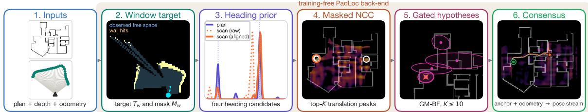  
Figure 1. PadLoc method overview on real data (tiles: intermediates of one trajectory chunk). A known floor plan, depth profiles, and planar odometry enter (1); the training-free back-end fuses a short window into a target and observation mask, which bounds drift (2), reduces rotation to four wall-angle heading candidates (3), scores translations with masked NCC and keeps top-K peaks (4), propagates K≤10 gated Gaussian hypotheses with odometry (5), and re-reads the raw NCC fields by consensus to choose the global anchor and recover poses (6; dashed: ground truth).

## Abstract

We propose PadLoc, a training-free localization back-end thatplaces a moving sensor within a knownfloorplan. Floor plans are cheap, persistent, and robust to appearance change, but recent learned-depth methods localize against them by filtering per-frame depth through dense (x, y, θ) pose grids. PadLoc keeps the swappable depthfront-end and replaces the dense grid back-end with sparse geometric matching: dominant wall orientations define a small pose-candidate set, masked normalized cross-correlation scores observed free space against the plan, and a moving-pose Gaussianmixture Bayes filter plus consensus readout decodes the trajectory. Holding each competitor’s depthfixed, PadLoc matches or beats UnLoc’sforwardfilter and the F3Locfilter at every Gibson trajectory length, and UnLoc’s offline refinementfrom T=35 on; it exceeds Z-FLoc’s published results with a shared MapAnythingfront-end. On Bonn LiLocBench, PadLoc improves pooled SR@1 m over UnLoc by 23–32 pp under wheel odometry and 35–43pp with ground-truth motion; with full-FOV LiDAR plus wheel odometry the same readout reaches 100 % SR@1 m at 9 cm to 10 cm median error on the static sequence. On the Hilti-Trimble Localization Challenge PadLoc localizes a camera-only fisheye rig on constructionfloors hundreds ofmetres across at 0.90–0.98 online SR@2 m on three offive sessions; adding learned wall isolation, applied to every session, covers all five at

0.67–0.92 with the localizer unchanged throughout. PadLoc thus matches or outperforms dense grid back-ends while preserving sensor modularity and a compact state that does not grow with trajectory length.

## 1. Introduction

Localizing a moving sensor against a 2D floor plan is attractive: floor plans already exist, are compact, and avoid dense 3D mapping. Recent systems such as F3Loc [7] and UnLoc [30] pair learned per-column depth with a dense Bayes-filter recursion over an (x, y, θ) grid—robust, but the posterior is large and persistent, and the design is tied to one depth front-end.

PadLoc keeps the swappable depth front-end and changes only the localizer. The front-end may be learned; the localizer itself has no trained parameters. Dominant wall orientations form a small heading set, weighted masked NCC [24] scores each sliding window, and the whole NCC field over translations is kept, not only its argmax. The top-K local maxima feed a moving-pose Gaussian-mixture Bayes filter (GM-BF), and a consensus readout reuses the raw NCC fields to select the absolute trajectory anchor.

This separation lets us hold each competitor’s depth fixed and compare only the localizer. On Gibson, PadLoc matches or outperforms the UnLoc and F3Loc forward filters at every trajectory length under a frozen readout, and UnLoc’s offline refinement from T=35 on; it exceeds Z-FLoc’s published results [27], with the largest gains at short horizons. The same matcher transfers unchanged to Bonn LiLocBench with LiDAR, wheel odometry, VO, and RGB-D front-ends, beating UnLoc on shared monocular depth, and scales to construction-size buildings on the Hilti-Trimble Localization Challenge from a camera-only fisheye front-end once the fusion window is matched to the reconstruction batch.

We make three contributions.

• A training-free masked-NCC matcher. Floor-plan localization cast as registration with partial overlap: an interior mask and an observation mask separate observed free space from unexplored cells, and rotation is reduced to dominant wall-orientation candidates.

• A sparse multi-hypothesis decoder, online at bounded lag. Top-K NCC peaks become a compact posterior decoded by a moving-pose GM-BF and a consensus readout kept as a running sum. A single fixed lag bounds both heading and translation evidence; the mixture is $\mathcal O ( K )$ the consensus state does not grow with the trajectory, and the O(N log N) matching kernel scales to building-sized plans and runs on a phone.

• Matched-depth and cross-building evidence. Holding each competitor’s depth fixed, PadLoc matches or improves over the F3Loc and UnLoc forward filters and Z-FLoc’s published results, and transfers across buildings. Knobs that depend on the front-end (fusion window, motion noise, cell size, blur) are set by stated rules, never per scene, and then carried from apartment scale (Bonn) to construction scale (Hilti) with a new MapAnything fisheye front-end.

## 2. Related Work

Floor-plan localization. F3Loc [7] and UnLoc [30] are the closest learned-depth baselines on Gibson. Both pair learned per-column depth predictions with a classical dense recursive Bayes filter over $( x , y , \theta )$ ; UnLoc adds Depth-Anything-v2 [32] depth, aleatoric ray uncertainty, and offline SE(2) refinement. Earlier work includes learned layout retrieval [13, 14], latent floor-plan matching [20], monocular layout filtering [4], and RGB-D floor-plan localization [29]. Z-FLoc with MapAnything [17] uses completed multiview depth and batched geometric matching [27], so we compare to it only in the batched regime. PadLoc instead keeps a sparse translation posterior, replaces dense orientation filtering with dominant wall-orientation candidates, and evaluates the same back-end under matched learned-depth front-ends.

Classical multi-hypothesis localization. Global localization in a known map is classically solved by Monte Carlo localization [9, 10, 25]—a sampled pose posterior—or by multi-hypothesis Gaussian trackers with MHT-style management [15] built on Gaussian-sum filtering [1]. Our matcher is correlative in the sense of Konolige and Chou [18] and Olson [23]: rotation in an outer loop, exhaustive translation scoring of a rasterized reference, a score surface retained beyond its argmax. Correlative and branch-and-bound matching [12, 23] register a scan within a prior-centred window and compress the surface to one Gaussian; PadLoc searches the entire plan at O(N log N) from a uniform prior, collapses rotation to dominant wall-orientation candidates, normalizes scores over observed cells only, and keeps the surface as top-K modes in a gated Gaussian mixture.

Masked correlation and orientation priors. Padfield [24] introduced Fourier-domain masked NCC. We adapt it to weighted masks (§3.3), with a building-interior mask and an observed-support mask: observed free space penalizes overlapping reference walls, while unobserved cells drop out. The contribution is to expose the full translation response as a multi-hypothesis posterior for temporal decoding. Similar sparse representations appear in mixture filters and factor-graph smoothers [16, 22], but our observations are local maxima of a masked correlation surface. The orientation prior is classical as well: Manhattan-world and dominant-direction assumptions are standard in indoor layout estimation [8] and scan matching [18, 23]. PadLoc uses that prior to remove the dense θ axis while retaining multiple directed candidates.

Swappable front-ends. PadLoc consumes per-frame depth profiles and relative planar odometry from available front-ends—wheel encoders, LiDAR scan matching, or visual-inertial odometry robust to dynamic scenes [19]— rather than training a sensor stack: ray-cast depth, learned F3Loc or UnLoc depth, 2D LiDAR, RGB-D, and a batched reconstruction front-end (MapAnything fisheye depth on Hilti [11]), which only requires matching the fusion window to the reconstruction batch (§4.5). Published Hilti floor-plan entries optimize the full sequence offline—the winning entry anchors an OKVIS2-X pose graph with Z-FLoc priors via whole-sequence PGO [28]—whereas PadLoc emits poses online at bounded lag.

## 3. Method

## 3.1. Overview

PadLoc localizes a moving sensor in a known 2D floor plan from a per-frame depth profile $d _ { t } \in \mathbb { R } ^ { N _ { \mathrm { c o l } } }$ and relative planar odometry $\Delta _ { t  t + 1 }$

Let $R _ { \mathrm { r a w } }$ be the rasterized wall map at resolution $\delta , M _ { R }$ its binary in-building mask, and $R = M _ { R } \odot R _ { \mathrm { r a w } }$ the premasked reference. Odometry gives cumulative planar motion $c _ { t } = ( x _ { t } , y _ { t } )$ in a local gauge — the odometry frame is known only up to an unobservable global rigid transform that aligns it to the map. PadLoc estimates a small candidate set $\Theta = \{ \theta _ { b } \} _ { b = 1 } ^ { B }$ , builds a target raster $T _ { w } ^ { b }$ and validity mask $M _ { w } ^ { b }$ for each sliding window w and heading $b ,$ and computes a masked NCC field $F _ { w } ^ { b } ( p )$ over translation cells $p = ( r , c )$ A field peak at p places window w’s centroid at map cell $p$ under heading $\theta _ { b }$

## 3.2. Rasterization and Headings

The floor plan is rasterized once: vector walls are drawn with Bresenham rasterization, while pre-rasterized maps supplied at a finer cell size are max-pooled down to the matching resolution. We fill a concave hull of the wall pixels to obtain $M _ { R }$ and use a blurred wall distance field only to give reference wall strokes width comparable to depth noise (Fig. 1, panel 1; supplement).

Each depth column is projected along its bearing into a local scan. A wall hit sets an occupied endpoint $( T _ { w } ^ { b } { = } 1$ $M _ { w } ^ { b } { = } w _ { \mathrm { w a l l } } )$ , traversed cells become observed free $( T _ { w } ^ { b } \mathrm { = } 0$ $M _ { w } ^ { \bar { b } } { = } 1 )$ , and unreached cells stay unobserved $( M _ { w } ^ { b } { = } 0 )$ Thus observed-free zeros penalize reference walls, whereas unobserved zeros drop out. Wall hits use $w _ { \mathrm { w a l l } } { = } 5 5$ so sparse wall returns dominate the masked NCC statistics. If the depth front-end exposes a per-column aleatoric scale $\hat { b } ,$ columns with $\hat { b } > 0 . 3 0$ m are removed before rasterization. Both constants are fixed once on Gibson and never re-tuned; the supplement lists all parameters and shows broad sensitivity plateaus, and the drop is ablated in §4.3.

For heading candidates, PadLoc runs a causal pre-pass: every 5 frames it accumulates a 5-frame scan, fits Hough wall segments, and votes segment lengths into a wall-angle histogram modulo π. Cross-correlating target and reference histograms yields gauge rotations; a lightweight tracker (a von-Mises mixture smoothed online by an exponential moving average, EMA, with forgetting) follows them, and mirror expansion adds each $1 8 0 ^ { \circ }$ counterpart. Θ thus uses frames up to a fixed lag, not the whole trajectory; the overlapweighted NCC sum in §3.3 ranks the surviving wall families (mechanism visualized in the supplement).

## 3.3. Masked NCC and Sparse Observations

For a candidate heading and window, PadLoc computes Padfield’s masked NCC [24] between the premasked reference R (mask $M _ { R } )$ and the window target $T _ { w } ^ { b }$ (graded mask $M _ { w } ^ { b }$ §3.2; premasked $\tilde { T } _ { w } ^ { b } = M _ { w } ^ { b } \odot T _ { w } ^ { \overline { { b } } } )$ . Writing $a \star c$ for the cross-correlation ${ \mathcal { F } } ^ { - 1 } \{ { \mathcal { F } } ( a ) { \overline { { { \mathcal { F } } ( c ) } } } \}$ (one FFT pair per term), the field at shift p is

$$
\mathrm { N C C } _ { w } ^ { b } ( p ) = \frac { ( R \star \tilde { T } _ { w } ^ { b } ) ( p ) - \frac { ( R \star M _ { w } ^ { b } ) ( p ) ( M _ { R } \star \tilde { T } _ { w } ^ { b } ) ( p ) } { N ( p ) } } { \sqrt { D _ { 1 } ( p ) D _ { 2 } ( p ) } } ,\tag{1}
$$

with the weighted overlap mass and the two per-image variances

$$
\begin{array} { r l r } & { N ( p ) = ( M _ { R } \star M _ { w } ^ { b } ) ( p ) , } & \\ & { D _ { 1 } ( p ) = ( R ^ { 2 } \star M _ { w } ^ { b } ) ( p ) - \cfrac { ( R \star M _ { w } ^ { b } ) ( p ) ^ { 2 } } { N ( p ) } , } & { ( 2 ) } \\ & { D _ { 2 } ( p ) = \big ( M _ { R } \star ( M _ { w } ^ { b } \odot ( T _ { w } ^ { b } ) ^ { 2 } ) \big ) ( p ) - \cfrac { \big ( M _ { R } \star \tilde { T } _ { w } ^ { b } \big ) ( p ) ^ { 2 } } { N ( p ) } . } & \end{array}
$$

Every term is one FFT correlation, so the field costs $\mathcal { O } ( H W \log H W )$ The overlap mass $N ( p )$ restricts the means and variances to $M _ { R } \cap ( M _ { w } ^ { b } + p )$ : observed-free zeros contribute, unobserved cells drop out, and graded wall weights dominate the statistic. Shifts with overlap mass $N ( p ) / \operatorname* { m a x } _ { p ^ { \prime } } N ( p ^ { \prime } ) < 0 . 7$ are rejected; all surviving cells store the masked NCC evidence field

$$
F _ { w } ^ { b } ( p ) = \mathrm { N C C } _ { w } ^ { b } ( p ) ,\tag{3}
$$

a ranking and curvature surface rather than a calibrated probability density.

Heading selection is the one place an overlap weight enters. PadLoc centres each field by its valid-cell mean and reweights it by

$$
\alpha _ { w } ^ { b } ( p ) = \left( N ( p ) / | M _ { w } ^ { b } | \right) ^ { 0 . 7 0 } ,\tag{4}
$$

ranking each heading by the peak of $\begin{array} { r } { \sum _ { w } \alpha _ { w } ^ { b } ( \mathrm { N C C } _ { w } ^ { b } - } \end{array}$ $\overline { { \mathrm { N C C } } } _ { w } ^ { b } )$ . Here $\begin{array} { r } { | M _ { w } ^ { b } | = \sum _ { p } M _ { w } ^ { b } ( p ) } \end{array}$ is total mask mass. This weight is used only for cross-heading choice; the back-end receives the unweighted field. The exponent 0.70 is selected by its own sweep and is unrelated to the 0.7 overlap-rejection threshold above; the near-equal values are coincidental.

From each field we extract a sparse observation $Z _ { w } ^ { b } =$ $\{ ( \lambda _ { i } , \mu _ { i } , \Sigma _ { i } ) \} _ { i = 1 } ^ { K }$ . The locations $\mu _ { i }$ are the top-K integercell maxima after non-maximum suppression (no sub-cell interpolation), the weights λi are softmax-normalized peak scores, and $\Sigma _ { i } ~ = ~ - \bar { H } _ { i } ^ { - 1 } \delta ^ { 2 }$ comes from the 3×3 finitedifference Hessian $H _ { i }$ of the field at the peak, with an isotropic fallback (5-cell standard deviation) at the crop boundary or when $H _ { i }$ is not negative-definite.

## 3.4. The CONS Back-End

The CONS decoder has two stages (Fig. 2), split by what each can trust: the GM-BF combines each window’s top-K peaks with odometry to place the windows relative to each other, correcting drift, and the consensus sum adds the aligned raw fields to fix one absolute anchor. The filter alone drifts and can jump between basins; a raw sum alone cannot align windows blurred by odometry error. First, a bounded Gaussian mixture ${ \mathcal G } _ { w } = \{ ( W _ { h } , m _ { h } , P _ { h } ) \} _ { h }$ tracks the absolute map position of the current window centroid. Each window step shifts every mean by the odometry centroid displacement $c _ { w } \mathrm { ~ - ~ } c _ { w - 1 }$ and inflates every covariance by an isotropic process term

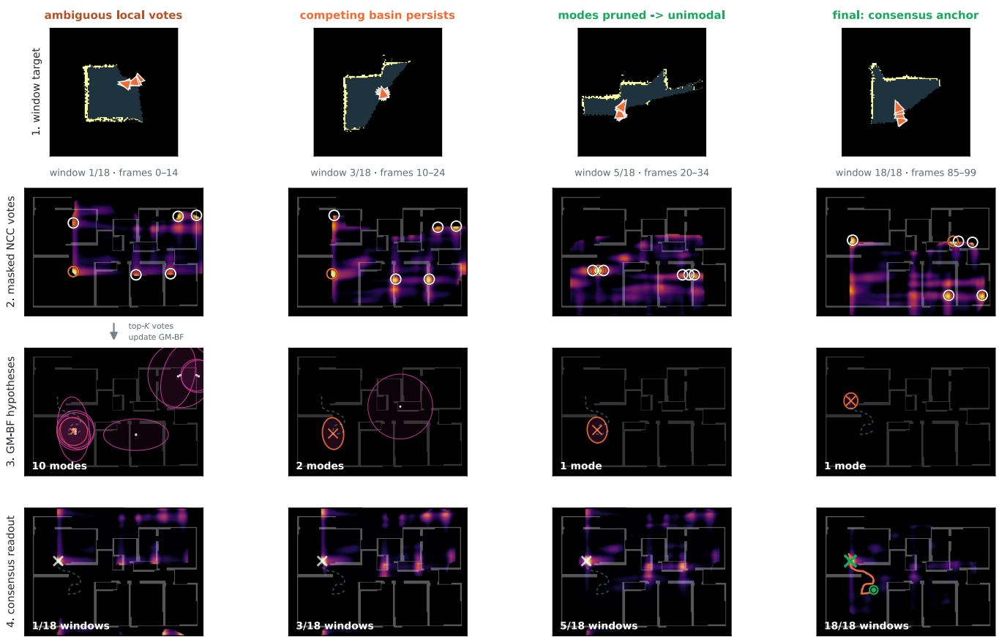  
Figure 2. Sliding-window matching and consensus decoding (CONS). Columns show one trajectory from early ambiguity to the fina anchor. Rows show the accumulated target, masked-NCC top-K votes, GM-BF hypotheses, and the cumulative consensus readout.

$$
Q = \left( \sigma \sqrt { s } \delta \right) ^ { 2 } \mathbf { I } ,\tag{5}
$$

where $\sigma { = } 0 . 5$ is the per-frame motion-noise scale in cells, δ the grid resolution, and s the inter-window stride in frames; added at every window step, Q grows linearly with elapsed frames (a random walk). Predicted components are updated by Gaussian products with the observation components in $\dot { Z } _ { w } ^ { b } .$ , pruned, moment-matched when close, and capped at $K _ { \operatorname* { m a x } } = 1 0$ . Before update, an observation is accepted only if it passes a squared-Mahalanobis gate against the dominant (MAP, maximum a posteriori) component $( m _ { \star } ^ { - } , P _ { \star } ^ { - } )$ :

$$
( \mu _ { i } - m _ { \star } ^ { - } ) ^ { \top } ( P _ { \star } ^ { - } ) ^ { - 1 } ( \mu _ { i } - m _ { \star } ^ { - } ) \leq 1 6 .\tag{6}
$$

The wide gate uses $P _ { \star } ^ { - }$ rather than $P _ { \star } ^ { - } + \Sigma _ { i }$ , so broad wrongbasin NCC peaks do not become easier to accept when their curvature is flat. The mixture starts from the first window’s top-K peaks. Dominant-mode gating can reject a correct alternative after a wrong lock. Covariance inflation may later admit it, but recovery is not guaranteed. Component birth is applied only to observations that pass the gate (supplement).

Second, the MAP sequence sets only the relative cyclic shifts before summing, never the absolute position. The heal replaces a MAP step by the odometry step when the two differ by more than τ = 0.3 m:

$$
r _ { w } = r _ { w - 1 } + \left\{ \begin{array} { l l } { \Delta c _ { w } , } & { \parallel \Delta \hat { z } _ { w } - \Delta c _ { w } \parallel > \tau , } \\ { \Delta \hat { z } _ { w } , } & { \mathrm { o t h e r w i s e } . } \end{array} \right.\tag{7}
$$

Each raw field is then cyclically shifted into the last-window frame and summed:

$$
S ( p ) = \sum _ { w = 1 } ^ { N } \mathrm { s h i f t } ( \tilde { F } _ { w } , - o _ { w } ) ( p ) ,\tag{8}
$$

$$
C ( p ) = \sum _ { w = 1 } ^ { N } \mathrm { s h i f t } ( V _ { w } , - o _ { w } ) ( p ) ,\tag{9}
$$

where $V _ { w }$ is the binary support mask of field $F _ { w }$ (distinct from the weighted target mask), and $\tilde { F } _ { w } = F _ { w } - \overline { { F _ { w } [ V _ { w } ] } }$ centres each field over its support, preventing coverage bias from dominating agreement. Here sh $\operatorname { i f t } ( \cdot , - o _ { w } )$ is a cyclic shift by the integer cell offset $o _ { w } = g _ { w } - g _ { N }$ between the grid cells $g _ { w }$ of the $r _ { w } ,$ and the count $C ( \boldsymbol p )$ is an eligibility gate requiring $C ( p ) \geq \operatorname* { m a x } ( 1 , \operatorname { r o u n d } ( N / 2 ) )$ . As every window votes on the same frame-zero anchor, both sums are kept running: a window is shifted $\boldsymbol { \mathsf { b y } } - g _ { w }$ and added once, and a read shifts the sums by $g _ { N }$ . The consensus peak $p ^ { \star }$ places the last-window centroid; subtracting its cumulative odometry $c _ { N }$ gives the frame-zero anchor $a = p ^ { \star } - c _ { N }$ , from which all poses reconstruct as $\hat { x } _ { t } = a + c _ { t }$ . Restricting the heading read and this vote to [w−back, $w { + } L ]$ emits a pose for window w once window $w { \pm } L$ is acquired, i.e. at lag $L ;$ with unbounded past the last-window pose equals the offline decode (§4.1). Streamed poses are reported at the window’s mid-frame centroid.

The default configuration applies the tracker’s causal perwindow heading and picks the wall family by the overlapweighted fused sum of Eq. (4); for long real-building trajectories an optional repick runs the readout per $\theta _ { b }$ and keeps the largest consensus peak.

The fusion window length $W$ and stride S couple the back-end to the front-end’s temporal structure. With perframe depth the stride sets the readout rate: $W { = } S { = } 5$ emits one pose per five frames (2 Hz on Gibson), fuses every frame into exactly one window, and bounds the drift inside each (§4.3). A front-end that instead reconstructs in non-overlapping batches of B frames (e.g. MapAnything’s multiview windows) requires $W { = } S { = } B ,$ , so each fused target draws from a single coherent reconstruction rather than straddling two (§4.5).

## 4. Experiments

## 4.1. Setup

We evaluate on the public gibson t split from F3Loc [7] over the Gibson environments [31]: 9 unseen scenes and 4045 frames at 10 Hz. Trajectories are re-chunked at $T \in \{ 1 5 , 2 0 , 3 5 , 5 0 , 1 0 0 \}$ , matching UnLoc’s denominators $( 2 6 8 / 2 0 0 / 1 1 1 / 7 8 / 3 7$ chunks). The metric is last-10 SR@1 m unless otherwise noted: a chunk succeeds iff all of the last 10 frames are within threshold. Because RMSE conditioned on each method’s own successes does not rank precision across methods, we also report the all-trial median last-10 RMSE (failures included) and Success weighted by Accuracy, $\begin{array} { r } { \mathrm { S W A } = \frac { 1 } { N } \sum _ { i } s _ { i } \left( 1 - e _ { i } / \tau \right) - } \end{array}$ an SPL-style score [2] over trials i with success $s _ { i }$ at τ=1 m and last-10 RMSE $e _ { i }$ (no established localization variant exists, so we state the definition; Table 2). Gibson and Bonn chunk trials reset state between chunks; Hilti uses full runs. In the Gibson comparisons, every method consumes the same GT-derived relative transitions (F3Loc’s transition step, UnLoc’s motion model, PadLoc’s odometry); noise experiments perturb them with identically seeded noise in each pipeline.

We keep latency regimes separate. Streaming methods emit poses online: F3Loc and UnLoc-FWD one per frame, PadLoc one per 5-frame window, first after frame 5. Our headline metric scores each of the last ten frames with the latest pose emitted by then, propagated by odometry and never revised (PadLoc frozen). The chunk-end readout instead scores the last ten frames from the final estimate carried back by odometry (PadLoc delayed; supplement, with the timing details). Batched methods need a completed trajectory or an offline post-process: accum builds a whole-chunk target, and UnLoc refined is UnLoc’s released postprocess, which shifts its chunk-end trajectory by a bounded SE(2) fit of depth to the plan.

Table 1. Matched-depth back-end comparison on Gibson: last-10 SR@1 m (↑) and, following UnLoc’s protocol, the mean last-10-frame RMSE over each method’s own successful trials (m, ↓; not a precision ranking, Tab. 2), pooled over 9 scenes. Each F3Loc/UnLoc block fixes the depth input; F3Loc filter and UnLoc fwd use the per-frame, PadLoc the frozen readout (§4.1; chunk-end: supplement). Bold: best SR per comparison (frozen vs filter, accum vs batched or refined rows), ties bold. Z-FLoc quoted from its paper (‘–’).
<table><tr><td>T=15 SR↑ R↓ SR↑ R↓</td><td>T=20 SR↑</td><td>T=35 R↓</td><td>T=50 T=100 SR↑ R↓</td></tr><tr><td>F3Loc mono depth</td><td></td><td></td><td></td><td>SR↑ R↓</td></tr><tr><td>F3Loc filter PadLoc frozen0.496 0.290.5850.280.7660.270.821 0.240.946 0.28</td><td>0.291 0.27 0.345 0.23 0.550 0.21 0.705 0.18 0.892 0.18</td><td></td><td></td><td></td></tr><tr><td>F3Loc comp_s depth F3Loc filter 0.366 0.21 0.410 0.180.622 0.16 0.7950.14 0.946 0.15</td><td></td><td></td><td></td><td></td></tr><tr><td>PadLoc frozen 0.563 0.25 0.6850.250.883 0.22 0.949 0.22 0.946 0.22</td><td></td><td></td><td></td><td></td></tr><tr><td>UnLoc µ depth UnLoc fwd</td><td>0.6600.130.7100.140.8740.12 0.9230.140.9730.16</td><td></td><td></td><td></td></tr><tr><td>UnLoc refined 0.810 0.17 0.865 0.17 0.919 0.17 0.949 0.17 0.973 0.20</td><td></td><td></td><td></td><td></td></tr><tr><td>PadLoc frozen 0.731 0.18 0.840 0.17 0.919 0.16 1.000 0.16 1.000 0.19</td><td></td><td></td><td></td><td></td></tr><tr><td>PadLoc accum 0.7950.16 0.860 0.17 0.946 0.14 1.000 0.141.000 0.15</td><td></td><td></td><td></td><td></td></tr></table>

Depth sources: GT ray casts, F3Loc mono/comp s, Un-Loc DA-V2 $( \mu , \hat { b } )$ , real LiDAR/RGB-D on Bonn. F3Loc and UnLoc comparisons use identical cached depth inputs; the quoted Z-FLoc comparison shares the MapAnything front-end, not its exact reconstructions.

## 4.2. Matched-Depth Back-End Comparisons

Table 1 fixes each depth source and swaps only the localization back-end. PadLocfrozen is compared to forward filters; PadLoc ACCUM is compared to batched whole-trajectory matchers or refinements. The UnLoc-depth block is the controlled head-to-head. Under the chunk-end readout UnLoc-FWD equals UnLoc refined in SR at every T (supplement): the refinement gain UnLoc reports (0.660→0.810 at T=15 here) comes entirely from switching the readout from perframe to chunk-end; the optimization alters no success flag. PadLoc frozen exceeds UnLoc-FWD at every T and the refinement from T=50 on (tie at $T { = } 3 5 )$ ; at $T { \le } 2 0$ PadLoc accum trails the refinement.

Table 2. Unconditional metrics on the Gibson UnL $\operatorname { o c } - \mu$ block of Tab. 1: SWA ↑ / all-trial median last-10 RMSE (m) ↓; bold = best SWA per column (Bonn: supplement).
<table><tr><td></td><td> $T { = } 1 5$ </td><td> $T { = } 2 0$ </td><td> $T { = } 3 5$ </td><td> $T { = } 5 0$ </td><td> $T { = } 1 0 0$ </td></tr><tr><td>UnLoc fwd</td><td></td><td></td><td></td><td></td><td>.573/.17.610/.14.771/.11.798/.11 .822/.12</td></tr><tr><td>UnLoc refined</td><td></td><td></td><td></td><td></td><td>.670/.18.717/.17.765/.16.791/.14.783/.17</td></tr><tr><td>PadLoc frozen</td><td></td><td></td><td></td><td></td><td>.601/.20.695/.17.774/.15.839/.15.811/.19</td></tr><tr><td>PadLoc accum</td><td></td><td></td><td></td><td></td><td>.667/.18.715/.18.809/.14.856/.13.846/.14</td></tr><tr><td>PadLoc frozen, 5 cm .624/.18.694/.15 .809/.12 .849/.11 .887/.11</td><td></td><td></td><td></td><td></td><td></td></tr></table>

PadLoc frozen exceeds the F3Loc filter by +5–24 pp (mono) and +15–28 pp (comp s; tie at $T { = } 1 0 0 )$ ; under the chunk-end readout it leads or ties in every cell (supplement). PadLoc accum exceeds ${ \bf { Z } } { \cdot } { \mathrm { { F L o c } } } ^ { \prime } { \bf { s } }$ published results at every T. Short-horizon failures are family flips or early-window misses: a wrong family $( \geq 4 5 ^ { \circ } )$ accounts for $3 7 / 7 2$ of the $T { = } 1 5$ failures on UnLoc depth and never coincides with a success; with the right family the heading error is $1 . 3 – 2 . 1 ^ { \circ }$ median (supplement).

Table 2 adds the unconditional view on the UnLoc-depth block. At T≥35 UnLoc-fwd is the more precise estimator (all-trial median 0.11–0.12 vs 0.15–0.19 m) and leads SWA at T=100; PadLoc frozen leads UnLoc-fwd at every other $T ,$ accum beats offline refinement from $\scriptstyle { T = 3 5 \ \mathrm { o n } }$ , and at 5 cm the frozen configuration exceeds UnLoc-fwd at every T. This resolution change also changes the process noise in metres (Eq. (5)); it is a configuration comparison, not an isolated test of quantization.

## 4.3. Component Ablation

Table 3 isolates each component under the same frozen readout (EMA heading tracker), on UnLoc $\mu$ depth pooled over the 9 Gibson scenes, and repeats the build-up under real drift (bottom panel). Accumulation is the dominant back-end lever: a per-frame NCC argmax localizes almost nothing (0.08–0.22 SR@1 m), and one aggregate-then-match step matches or exceeds the full default at every T.

These frozen results use every past window (no forgetting), $K { = } 1 0$ hypotheses, and the running consensus sum. The gate and heal matter mainly where motion drifts: removing both costs $6 . 3 / 8 . 1$ pp at ${ T } \mathrm { { = } } \mathrm { { 3 5 } / \mathrm { { 1 0 0 } ; } }$ the heal alone costs $2 . 7 / 2 . 7 \mathrm { p p }$ . The remaining refinements help at short and mid T and vanish by $T { = } 1 0 0 \colon$ the ˆb column drop $( + 2 . 6 / + 0 . 9 \mathrm { { I } }$ pp at $T { = } 1 5 / 3 5 )$ and the θ-overlap weight (+1.5 pp at T=15)— hence reading the ablation across T.

Window/stride and raster-constant sweeps (supplement) show plateaus at $T { \ge } 3 5$ , where the deployed $5 / 5$ is within one chunk of the best cell (tied at $T { = } 1 0 0 )$

The bottom panel of Table 3 separates the components under real drift. The association gate becomes decisive—held open, the readout collapses from 0.842 to 0.368 SR@1 m at $T { = } 4 5 0$ , the largest single effect in either dataset, as ORB-

Table 3. Component ablation (last-10 SR@1 m ↑ / median last-10 RMSE (m) ↓, per-chunk reset; consensus rows frozen). Top: Gibson build-up and leave-one-out (UnLoc µ depth, $n { = } 2 6 8 / 1 1 1 / 3 7 ;$ full config bold). Bottom: the build-up under real drift (Bonn $\mathsf { s t a t i c } _ { - } 0$ $\scriptstyle \mathrm { { D 4 5 5 + V O , } } \ n = 5 9 / 2 9 / 1 9 )$ . Accumulation-alone is the offline aggregate-then-match reference: the frozen decoder is within one chunk of it at $T { \geq } 3 5 .$ , while under drift the gate keeps the readout near the reference (row 3 vs 4) and above the smeared batch target.
<table><tr><td rowspan="2"></td><td colspan="2">T=15</td><td colspan="2">T=35</td><td colspan="2">T=100</td></tr><tr><td>SR</td><td>R</td><td>SR</td><td>R</td><td>SR</td><td>R</td></tr><tr><td>back-end build-up</td><td></td><td></td><td></td><td></td><td></td><td></td></tr><tr><td>per-frame NCC argmax</td><td>0.108</td><td>3.11</td><td>0.081</td><td>3.21</td><td>0.216</td><td>2.37</td></tr><tr><td>+ accumulation (argmax)</td><td>0.817</td><td>0.17</td><td>0.928</td><td>0.14</td><td>1.000</td><td>0.13</td></tr><tr><td>+ consensus, gate/heal off</td><td>0.687</td><td>0.21</td><td>0.856</td><td>0.15</td><td>0.919</td><td>0.14</td></tr><tr><td>+ GM-BF gate &amp; heal</td><td>0.731</td><td>0.20</td><td>0.919</td><td>0.15</td><td>1.000</td><td>0.19</td></tr><tr><td>leave-one-out from full</td><td></td><td></td><td></td><td></td><td></td><td></td></tr><tr><td>— θ-overlap weight</td><td>0.716</td><td>0.20</td><td>0.910</td><td>0.15</td><td>1.000</td><td>0.19</td></tr><tr><td>—  column drop</td><td>0.705</td><td>0.23</td><td>0.910</td><td>0.14</td><td>1.000</td><td>0.15</td></tr><tr><td>— consensus heal</td><td>0.724</td><td>0.21</td><td>0.892</td><td>0.15</td><td>0.973</td><td>0.19</td></tr><tr><td rowspan="3">build-up under drift (Bonn D455+VO)</td><td></td><td></td><td></td><td></td><td></td><td></td></tr><tr><td> $T { = } 1 5 0$ </td><td></td><td></td><td> $T { = } 3 0 0$ </td><td></td><td> $T { = } 4 5 0$ </td></tr><tr><td>0.153</td><td>7.7</td><td>0.069</td><td>7.7</td><td>0.105</td><td>10.3</td></tr><tr><td>per-frame NCC argmax + accumulation (batched)</td><td>0.729</td><td>0.21</td><td>0.862</td><td>0.20</td><td>0.789</td><td>0.34</td></tr><tr><td>+ consensus, gate off</td><td>0.525</td><td>0.42</td><td>0.552</td><td>0.29</td><td>0.368</td><td>3.4</td></tr><tr><td>+ GM-BF gate &amp; heal</td><td>0.780</td><td>0.20</td><td>0.966</td><td>0.22</td><td>0.842</td><td>0.31</td></tr><tr><td></td><td></td><td></td><td></td><td></td><td></td><td></td></tr></table>

SLAM3 relocalization jumps flood the filter with wrongbasin observations. The frozen decode exceeds the batch reference at every T (0.842 vs 0.789 at $\scriptstyle { T = 4 5 0 ) } \colon$ the wholetrajectory batched target smears under accumulated VO drift, while windowing bounds how much drift enters any single correlation (the deployed $5 / 5$ beats $1 5 / 5$ by up to 14 pp); only Hilti’s batched reconstruction forces ${ \cal W } { = } S { = } B \left( \ S 4 . 5 \right)$

Bounded lag. On the Bonn static 0 drifty-VO arm (clean LiDAR 106 ◦ depth, drifty VO motion; supplement), the $L { = } 0$ window readout has a two-frame acquisition delay and steady-state $p 9 0$ error of 0.76 m at T=450 (0.53 m for the offline $L { = } \infty$ reference). The textbook gate $P _ { \star } ^ { - } + \Sigma _ { i }$ performs alike here (0.931/0.947 for both at ${ T } \mathrm { { = } } 3 0 0 / 4 5 0$ supplement).

## 4.4. Real-Building Modularity on Bonn

We evaluate the unchanged matcher and online CONS backend on Bonn LiLocBench [26] (AprilTag [21] ground truth), varying only off-the-shelf front-ends. Motion is wheel odometry or monocular ORB-SLAM3 [5] VO; depth is 2D LiDAR, D455 RGB-D, or—for the UnLoc head-to-head—a monocular structural depth pairing UnLoc’s learned per-column depth with a Z-FLoc-style farthest-return readout, so both methods localize from the same monocular input. ORB-SLAM3 VO includes relocalization jumps, but the GM-BF gate and the heal absorb most of them: VO trails wheel odometry by a single chunk at $T { = } 4 5 0$ . Across front-ends on static 0 (T=300/450; full table in the supplement): full-FOV LiDAR reaches 1.000/1.000 SR@1 m under wheel odometry (median RMSE 9 cm to 10 cm) and 1.000/0.947 under VO; narrow-FOV 106 ◦ LiDAR 0.931/0.947; D455 RGB-D 0.966/0.842. We set σ=1.0 for clean LiDAR and σ=0.5 for noisier depth; on RGB-D this moves one chunk (0.842 vs 0.789 at $T { = } 4 5 0 )$ . At T=450 RGB-D trails the LiDAR rows (≥0.947), consistent with sensitivity to depth and motion quality.

Table 4. PadLoc vs UnLoc on Bonn (monocular structural depth and camera-built structural map held fixed; UnLoc with its own ˆb). Last-10 SR@1 m at T=150/300/450 per sequence and pooled; PadLoc frozen, UnLoc per-frame readout (chunk-end: supplement); PadLoc under wheel odometry, UnLoc under its ground-truth transitions. PadLoc wins 11 of 12 cells (tie: dynamics 0, T=450, $n { = } 5 )$ . Pooled $\scriptstyle n = 1 7 2 / 8 4 / 5 6$ . 16 rays: PadLoc fed only the 16 DeSDF rays UnLoc’s likelihood reads from the same profile.
<table><tr><td rowspan="2">scene</td><td colspan="3">UnLoc</td><td colspan="3">PadLoc CONS, wheel</td></tr><tr><td>150</td><td>300</td><td>450</td><td>150</td><td>300</td><td>450</td></tr><tr><td>static_0</td><td>0.32</td><td>0.59</td><td>0.68</td><td>0.59</td><td>0.79</td><td>0.89</td></tr><tr><td>dynamics_0</td><td>0.33</td><td>0.43</td><td>0.60</td><td>0.67</td><td>0.71</td><td>0.60</td></tr><tr><td>1t_changes_0</td><td>0.21</td><td>0.43</td><td>0.21</td><td>0.60</td><td>0.71</td><td>0.79</td></tr><tr><td>1t_ch_dyn_0</td><td>0.33</td><td>0.44</td><td>0.39</td><td>0.45</td><td>0.63</td><td>0.72</td></tr><tr><td>pooled SR@1 m</td><td>0.30</td><td>0.49</td><td>0.46</td><td>0.56</td><td>0.71</td><td>0.79</td></tr><tr><td>pooled, 16 rays</td><td></td><td></td><td></td><td>0.47</td><td>0.67</td><td>0.77</td></tr><tr><td>succ. med. RMSE (m)</td><td>0.19</td><td>0.25</td><td>0.25</td><td>0.19</td><td>0.20</td><td>0.20</td></tr></table>

Matched against UnLoc on real data. Holding monocular structural depth and the camera-built structural map (below) fixed, we swap only the back-end across all four public Bonn sequences (Table 4); UnLoc uses its learned per-column uncertainty ˆb. Under deployable wheel odometry, PadLoc beats UnLoc at every pooled T (0.56/0.71/0.79 vs 0.30/0.49/0.46) and in 11 of 12 per-sequence cells, with one tie. The gain reflects representation as well as time horizon: PadLoc registers the depth as 2D wall geometry and fuses each window before a single match, whereas UnLoc’s DeSDF likelihood scores 16 rays per frame. Fed only Un-Loc’s own 16 rays, PadLoc reaches 0.47/0.67/0.77 (Table 4; GT motion 0.62/0.82/0.91): 2–9 pp below the full profile and +17 to +30 pp above UnLoc. With ground-truth motion PadLoc is stronger still (pooled 0.65/0.83/0.89, +35 $\mathrm { t o + 4 3 p p ) }$ . The unconditional metrics widen the gap (supplement): PadLoc’s pooled all-trial median error stays submetre under wheel odometry (0.46/0.25/0.24 m) while Un-Loc’s sub-50% SR leaves it at 5.3/1.0/3.5 m; wheel SWA leads at every T (0.43/0.55/0.62 vs 0.23/0.36/0.35), GT motion more still (0.49/0.63/0.67).

Reference map: shipped vs structural. The benchmark (shipped) map is a 2D LiDAR scan at one height that records static furniture (e.g. a kitchenette) as wall—exactly what our structural depth omits. We therefore rebuild a furniturefree structural reference from the three D455 cameras of the benchmark’s mapping run (Mask2Former wall/door/window masking; no test-sequence information) and report both methods on both maps. On the shipped map, under the identical configuration as Table 4, PadLoc leads UnLoc at every pooled T: 0.49/0.62/0.73 vs 0.37/0.52/0.57 under wheel odometry and 0.63/0.79/0.86 with ground-truth motion. Which map is better depends on the back-end: the walls-only rebuild helps aggregate-then-match (up to +10 pp) but costs UnLoc’s per-frame filter up to 11 pp—UnLoc’s best map is the shipped one—so we report both maps for both methods. The gap is present on both maps and widens on the structural map to the headline $+ 2 3 \mathrm { - 3 2 p p }$ . Masking camera pixels while keeping the LiDAR changes nothing $( 0 . 4 0 0 = 0 . 4 0 0$ on dynamics 0, T=150); dropping the LiDAR-baked furniture is the entire lever (0.400→0.600; full matrix in the supplement).

## 4.5. Large-Building Modularity on Hilti

Bonn fixes the building at apartment scale and the front-end at per-frame depth. The 2026 Hilti-Trimble Localization Challenge [6, 11] stresses both: multi-hundred-metre construction floors (up to T=6124 frames) localized from a camera-only fisheye rig. The five ground-truth sessions span three physical floors—floor 1, three sessions of $\pm 1 \mathsf { o o r } _ { - } 2 ,$ and the UG1 underground hall (Table 5). Here too we assemble the front-end after Z-FLoc [27]: depth from MapAnything [17] multiview reconstruction (in nonoverlapping 30-frame batches) and an OKVIS2-X [3] visualinertial odometry prior we run on the rig. Because MapAnything cannot ingest the raw fisheye, we rectify it to an 80 ◦ pinhole—discarding most of the rig’s wide-FOV advantage. As the building is an order of magnitude larger than Bonn, we report online SR@2 m: the fraction of all emitted window poses within 2 m over the full run, cold start included (the challenge threshold; per-pose, not last-10).

We set $W { = } S { = } 3 0$ , MapAnything’s batch, for every session (§3.4): each fused target is then one complete reconstruction, whereas windows that straddle batches or fuse only five frames of one collapse on most sessions (supplement). The az55 and +seg front-ends are two alternatives, each applied unchanged to all sessions, with ground truth used for evaluation only; we do not evaluate a selector between them. On three of the five sessions PadLoc then localizes at 0.90–0.98. The other two exposefront-end limits of different kinds: run 1’s reconstruction is wall-like but as-built rather than as-drawn; UG1’s depth collapses to blobs with nothing to register (supplement)—the Bonn RGB-D depth-quality bottleneck at building scale.

Table 5. Hilti large-building localization (camera-only fisheye, MapAnything depth, OKVIS2-X prior). Online SR@2 m (↑) for the batch-matched 30/30 window and front-end arms $( \mathsf { a z 5 5 } \colon \pm 5 5 ^ { \circ }$ side crops; +seg: learned wall isolation), back-end unchanged; each column is one configuration applied to all sessions, none is selected per session; mean error/score at 30/30. run 2, 05-05, run 1: the three floor 2 sessions (2025-10-28 run 2, 2025-05- 05, 2025-10-28 run 1).
<table><tr><td rowspan="2">session</td><td rowspan="2">T</td><td colspan="3">SR@2m</td><td rowspan="2">mean (m)</td><td rowspan="2">score</td></tr><tr><td>30/30</td><td>az55</td><td>+seg</td></tr><tr><td>floor_1 run_2 05-05</td><td>3923 2569</td><td>0.977 0.907</td><td>0.710 0.953</td><td>0.718 0.895</td><td>0.90 0.68</td><td>68.1 74.3</td></tr><tr><td>run_1 UG1</td><td>5594 3067 6124</td><td>0.898 0.456 0.156</td><td>0.813 0.689 0.000</td><td>0.920 0.689 0.668</td><td>1.11 2.68 5.62</td><td>62.3 32.3 9.9</td></tr></table>

Multi-crop and wall-isolation front-end arms. Rectifying two additional $\pm 5 5 ^ { \circ }$ crops per fisheye (six views; back-end unchanged) quantifies the lost field of view (Table 5, az55): the weakest localizable session rises 0.456→0.689 and run 2 improves, while 05-05 and the strongest drop (0.977→0.710) as coverage trades against per-view quality. Adding learned wall isolation (Seg-Former wall/door/window; +seg) recovers UG1 outright, 0.156→0.668, improves the two sessions that rely on free space (0.920 on 05-05, 0.689 on run 1), and lowers floor 1, whose walls match the plan, from 0.977 to 0.718. The uniform +seg variant therefore reaches 0.668–0.920 across all five sessions with the back-end unchanged.

Classical control on the same front-end. Replacing the back-end by a memoryless per-block (x, y, θ) argmax—the same masked-NCC kernel and rasters, each 30-frame block localized over a dense 5◦ sweep—collapses to 0.05–0.11 SR@2 m (median 15–18 m; wrong heading family on 66–77% of blocks). Using our pre-pass headings changes little (0.05–0.15): single blocks are globally ambiguous, and PadLoc’s 0.90–0.98 comes from gated GM-BF and consensus across blocks.

## 4.6. Complexity, Runtime, and Footprint

With depth fixed, UnLoc scans the full DeSDF every frame over O=36 orientations and V =11 rays (O(HW OV )), while PadLoc correlates one fused target over B≈4 headings per S=5-frame window with cached reference FFTs (O(N log N))—the Fig. 3 gap. The kernel takes 5 ms to 40 ms per heading on iPhone 15/17 Pro at room-to-floor scale, rising to 176 ms to 224 ms at mall scale (supplement).

On Gibson / Bonn, PadLoc’s back-end holds the cached FFTs of the reference (1.2 MB to 1.9 MB / 9.9 MB; built from the plan in ≤0.4 s), 13 B per cell and heading, and a

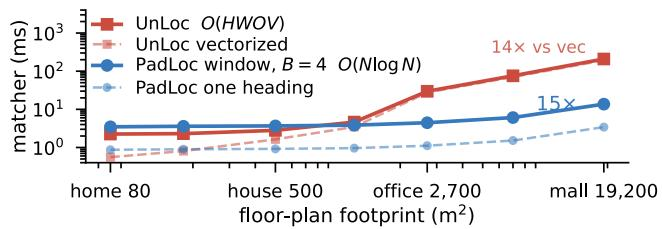  
Figure 3. Matcher cost vs. floor-plan size (10 cm grid; RTX 3090). One UnLoc call scores all 36 orientations per frame; a PadLoc window scores all B≈4 headings (solid; one heading dashed); complete back-end cost is given in the text. UnLoc grows 2.3 → 209 ms; a PadLoc window grows 3.5 → 13.7 ms (15× at mall scale, 76× per frame at stride 5; UnLoc is cheaper at home scale).

560 B mixture, i.e. O(BHW) evidence state for any number of windows under an unbounded past. A window costs one shift-and-add per heading and a read one shift. UnLoc holds a float32 (x, y, θ) prior and posterior at its 10 cm grid (8 MB to 44 MB / 147 MB on the GPU) and a DeSDF precomputed per map, grid and orientation count (4 min to ≈77 min / ≈44 min with its released code; supplement).

End-to-end, the full back-end is ∼40 ms per emitted window at Gibson scale on a laptop CPU (Apple M1 Max, no GPU): ∼15 ms for the B≈4 masked-NCC matches and ∼25 ms for rasterization, pre-pass, and GM-BF+consensus. At stride S=5 this is ∼8 ms per frame (throughput, not reporting delay); the shared DA-V2 ViT-L depth front-end costs 114 ms, so localization is not the bottleneck.

## 5. Discussion and Conclusion

Limits. Very short sparse-depth trajectories still suffer directed heading ambiguity (14–29% wrong-family chunks at T=15: the free-space wedge is too small to reject the 180◦ mirror). Under high drift the filter can stay locked on a wrong basin; the consensus peak-to-sidelobe ratio (PSR) flags this but does not relocalize. The method assumes stable wall structure; furniture, renovations, or long-term change make map quality decisive. The five Hilti sessions split into three regimes: matching walls, as-built walls where free space carries, and clutter where wall isolation recovers structure (§4.5). No variant is best on every session, and we do not evaluate a selector between them. Fixed parameters were set on Gibson; Bonn modularity and lag sweeps concentrate on static 0 at small n.

Conclusion. PadLoc—masked correlative matching over dominant wall orientations, consensus-decoded by a movingpose GM-BF—matches or beats native back-ends under matched depth and transfers across real buildings, with front-end knobs set by rule rather than tuning. Code: github.com/mbookhahn/padloc.

## References

[1] Daniel L. Alspach and Harold W. Sorenson. Nonlinear Bayesian estimation using Gaussian sum approximations. IEEE Transactions on Automatic Control, 17(4):439–448, 1972. 2

[2] Peter Anderson, Angel Chang, Devendra Singh Chaplot, Alexey Dosovitskiy, Saurabh Gupta, Vladlen Koltun, Jana Kosecka, Jitendra Malik, Roozbeh Mottaghi, Manolis Savva, and Amir R. Zamir. On evaluation of embodied navigation agents, 2018. arXiv:1807.06757. 5

[3] Simon Boche, Jaehyung Jung, Sebastian Barbas Laina, and´ Stefan Leutenegger. OKVIS2-X: Open keyframe-based visual-inertial SLAM configurable with dense depth or Li-DAR, and GNSS. arXiv preprint arXiv:2510.04612, 2025. 7

[4] Federico Boniardi, Abhinav Valada, Rohit Mohan, Tim Caselitz, and Wolfram Burgard. Robot localization in floor plans using a room layout edge extraction network. In IEEE/RSJ International Conference on Intelligent Robots and Systems (IROS), pages 5291–5297, 2019. 2

[5] Carlos Campos, Richard Elvira, Juan J. Gomez Rodr´ ´ıguez, Jose M. M. Montiel, and Juan D. Tard´ os. ORB-SLAM3: An´ accurate open-source library for visual, visual–inertial, and multimap SLAM. IEEE Transactions on Robotics, 37(6): 1874–1890, 2021. 6

[6] S. Centanni, Y. Zhang, Y. Tao, J. Kindle, F. Neuhaus, T. Koß, A. Patel, M. Helmberger, E. Szymanska, T. Gr´ aber, and M.¨ Fallon. Hilti-Trimble-Oxford dataset: 360 visual-inertial benchmark with floor plan priors for SLAM and localization, 2026. arXiv:2607.06464. 7

[7] Changan Chen, Rui Wang, Christoph Vogel, and Marc Pollefeys. F3Loc: Fusion and filtering for floorplan localization. In IEEE/CVF Conference on Computer Vision and Pattern Recognition (CVPR), pages 18029–18038, 2024. 1, 2, 5

[8] James M. Coughlan and Alan L. Yuille. Manhattan world: Compass direction from a single image by bayesian inference. In IEEE International Conference on Computer Vision (ICCV), pages 941–947, 1999. 2

[9] Frank Dellaert, Dieter Fox, Wolfram Burgard, and Sebastian Thrun. Monte Carlo localization for mobile robots. In IEEE International Conference on Robotics and Automation (ICRA), pages 1322–1328, 1999. 2

[10] Dieter Fox. Adapting the sample size in particle filters through KLD-sampling. International Journal ofRobotics Research, 22(12):985–1003, 2003. 2

[11] Michael Helmberger, Kristian Morin, Beda Berner, Nitish Kumar, Giovanni Cioffi, and Davide Scaramuzza. The Hilti SLAM challenge dataset. IEEE Robotics and Automation Letters, 7(3):7518–7525, 2022. 2, 7

[12] Wolfgang Hess, Damon Kohler, Holger Rapp, and Daniel Andor. Real-time loop closure in 2D LIDAR SLAM. In IEEE International Conference on Robotics and Automation (ICRA), pages 1271–1278, 2016. 2

[13] Henry Howard-Jenkins and Victor Adrian Prisacariu. LaLaLoc++: Global floor plan comprehension for layout localisation in unvisited environments. In European Con-

ference on Computer Vision (ECCV), pages 693–709, 2022. 2

[14] Henry Howard-Jenkins, Jose-Ra´ ul Ruiz-Sarmiento, and Vic-´ tor Adrian Prisacariu. LaLaLoc: Latent layout localisation in dynamic, unvisited environments. In IEEE/CVF International Conference on Computer Vision (ICCV), pages 10087–10096, 2021. 2

[15] Patric Jensfelt and Steen Kristensen. Active global localization for a mobile robot using multiple hypothesis tracking. IEEE Transactions on Robotics and Automation, 17(5):748– 760, 2001. 2

[16] Michael Kaess, Hordur Johannsson, Richard Roberts, Viorela Ila, John J. Leonard, and Frank Dellaert. iSAM2: Incremental smoothing and mapping using the Bayes tree. International Journal ofRobotics Research, 31(2):216–235, 2012. 2

[17] Nikhil Keetha, Norman Muller, Johannes L. Sch¨ onberger,¨ Lorenzo Porzi, Yuchen Zhang, Tobias Fischer, et al. MapAnything: Universal feed-forward metric 3D reconstruction. In International Conference on 3D Vision (3DV), 2026. 2, 7

[18] Kurt Konolige and Ken Chou. Markov localization using correlation. In International Joint Conference on Artificial Intelligence (IJCAI), pages 1154–1159, 1999. 2

[19] Jianheng Liu, Xuanfu Li, Yueqian Liu, and Haoyao Chen. RGB-D inertial odometry for a resource-restricted robot in dynamic environments. IEEE Robotics and Automation Letters, 7(4):9573–9580, 2022. 2

[20] Zhixiang Min, Naji Khosravan, Zachary Bessinger, Manjunath Narayana, Sing Bing Kang, Enrique Dunn, and Ivaylo Boyadzhiev. LASER: LAtent SpacE rendering for 2D visual localization. In IEEE/CVF Conference on Computer Vision and Pattern Recognition (CVPR), pages 11112–11121, 2022. 2

[21] Edwin Olson. AprilTag: A robust and flexible visual fiducial system. In IEEE International Conference on Robotics and Automation (ICRA), pages 3400–3407, 2011. 6

[22] Edwin Olson and Pratik Agarwal. Inference on networks of mixtures for robust robot mapping. International Journal of Robotics Research, 32(7):826–840, 2013. 2

[23] Edwin B. Olson. Real-time correlative scan matching. In IEEE International Conference on Robotics and Automation (ICRA), pages 4387–4393, 2009. 2

[24] Dirk Padfield. Masked object registration in the Fourier domain. IEEE Transactions on Image Processing, 21(5):2706– 2718, 2012. 1, 2, 3

[25] Sebastian Thrun, Wolfram Burgard, and Dieter Fox. Probabilistic Robotics. MIT Press, 2005. 2

[26] Niklas Trekel, Tiziano Guadagnino, Thomas Labe, Louis¨ Wiesmann, Perrine Aguiar, Jens Behley, and Cyrill Stachniss. Benchmark for evaluating long-term localization in indoor environments under substantial static and dynamic scene changes. In IEEE/RSJ International Conference on Intelligent Robots and Systems (IROS), pages 10770–10777, 2025. 6

[27] Ayumi Umemura, Toshinori Kuwahara, Marc Pollefeys, and Daniel Barath. Z-FLoc: Zero-shot floorplan localization via geometric primitives, 2026. arXiv:2606.04788. 2, 7

[28] Ayumi Umemura, Wei Zhang, Zihan Zhu, Toshinori Kuwahara, Marc Pollefeys, Norbert Haala, and Daniel Barath. Floorplan-anchored localization with a 360◦ camera for the Hilti-Trimble challenge 2026. Hilti-Trimble SLAM Challenge 2026 localization leaderboard report, rank 1, 2026. https://hilti-challenge.com/assets/2026/ leaderboard\_localization/1/report.pdf. 2

[29] Wera Winterhalter, Freya Fleckenstein, Bastian Steder, Luciano Spinello, and Wolfram Burgard. Accurate indoor localization for RGB-D smartphones and tablets given 2D floor plans. In IEEE/RSJ International Conference on Intelligent Robots and Systems (IROS), pages 3138–3143, 2015. 2

[30] Matthias Wuest, Francis Engelmann, Ondrej Miksik, Marc¨ Pollefeys, and Daniel Barath. UnLoc: Leveraging depth uncertainties for floorplan localization. In International Conference on Learning Representations (ICLR), 2026. arXiv:2509.11301. 1, 2

[31] Fei Xia, Amir R. Zamir, Zhiyang He, Alexander Sax, Jitendra Malik, and Silvio Savarese. Gibson Env: Real-world perception for embodied agents. In IEEE/CVF Conference on Computer Vision and Pattern Recognition (CVPR), pages 9068–9079, 2018. 5

[32] Lihe Yang, Bingyi Kang, Zilong Huang, Zhen Zhao, Xiaogang Xu, Jiashi Feng, and Hengshuang Zhao. Depth anything V2. In Advances in Neural Information Processing Systems (NeurIPS), pages 21875–21911, 2024. 2

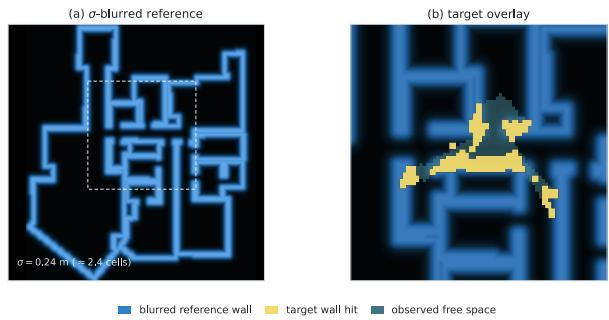  
Figure S1. Observation semantics on the blurred reference. (a) σ-blurred reference field. (b) A window target overlaid: yellow wall hits register on the blue reference bands, teal cells are observed free space, and unobserved cells drop out of the masked NCC.

## Supplementary Material

This appendix collects ablations and secondary results referenced from the main paper; references of the form “main paper” point to the sections and tables above.

## A. Observation semantics and reference blur

Figure S1 details the observation raster sketched in the main paper’s teaser: wall hits carry mask weight $w _ { \mathrm { w a l l } }$ , traversed cells become observed free space whose zeros penalize overlapping reference walls, and unobserved cells drop out of the masked statistics entirely. Reference wall strokes are blurred to the scale of depth noise $( \sigma { = } 0 . 2 4 \mathrm { m } )$ so sensor wall hits register on the reference bands.

Weighted masked NCC. Both arrays are premasked: $R =$ $M _ { R } R _ { \mathrm { r a w } }$ and $\tilde { \cal T } = M { \cal T }$ , with binary reference mask $M _ { R } ,$ binary target T, and $M \in \{ 0 , 1 , w _ { \mathrm { w a l l } } \}$ ; the kernel applies Padfield’s Algorithm 1 to these premasked arrays with the weighted target second moment. Main-paper Eqs. (1)–(2) give the score, including the $M T ^ { 2 }$ term in $D _ { 2 } ,$ the exact weighted variance (applying Algorithm 1 unchanged to $\tilde { T }$ would give $M ^ { 2 } T ^ { 2 } )$ ).

Numerically, the code adds $1 0 ^ { - 3 }$ to overlap mass, clips $D _ { 1 } , D _ { 2 }$ below at zero, and accepts normalization only when both exceed $1 0 ^ { - 6 } N$ . It floors $\bar { \sqrt { D _ { 1 } D _ { 2 } } } \mathrm { a t } 1 0 ^ { - 1 2 }$ and assigns zero otherwise; the overlap gate then excludes shifts below 0.7 max N. These safeguards accompany, rather than alter, the stated premasking convention. All reported results use this score.

## B. Multi-hypothesis recall

Figure S3 examines residual multimodality under increasing motion noise: the global argmax of the consensus surface slips off ground truth on a growing fraction of chunks, while the true pose remains among its top-K NMS peaks more often. This is a diagnostic of the final consensus surface, not a measurement of candidate recall in the individual input fields.

Table S1. Principal hyperparameters. Top: fixed across all datasets. Bottom: front-end-determined, set by stated rules.
<table><tr><td>parameter</td><td>value</td><td>set by</td></tr><tr><td colspan="3">fixed across all datasets</td></tr><tr><td>wall-hit mask weight wwall</td><td>55</td><td>Gibson</td></tr><tr><td> column-drop threshold</td><td>0.30 m</td><td>Gibson</td></tr><tr><td>overlap-rejection threshold</td><td>0.7</td><td>Gibson</td></tr><tr><td>heading-overlap exponent</td><td>0.70</td><td>own sweep (unique</td></tr><tr><td>top-K peaks / mixture cap</td><td>10</td><td>opt.) Gibson</td></tr><tr><td>Mahalanobis gate (squared)</td><td>16</td><td>Gibson</td></tr><tr><td>heal threshold τ</td><td>0.3 m</td><td>Gibson</td></tr><tr><td>consensus eligibility</td><td>round(N/2), min. 1</td><td>Gibson</td></tr><tr><td>pre-pass scan / cadence</td><td>5 fr / every 5</td><td>Gibson</td></tr><tr><td>heading-tracker EMA</td><td>0.6</td><td>Gibson</td></tr><tr><td colspan="3">BEV projection (walls by geometry, no classifier)</td></tr><tr><td>height band (floor-rel.)</td><td>0.3 m to 2.4 m</td><td>knee to doorway top</td></tr><tr><td>radius clip</td><td>8m</td><td>front-end confidence range</td></tr><tr><td>azimuth bin / reduce</td><td>0.5° / median</td><td>robust range per bear-</td></tr><tr><td>cluster gap / min pts</td><td>0.5 m / 3</td><td>ing segment contiguity</td></tr><tr><td>accum support radius</td><td>0.2 m (≥2 fr.)</td><td>cross-frame support</td></tr><tr><td colspan="3">front-end-determined</td></tr><tr><td>fusion window W/S</td><td>5/5; 30/30 Hilti</td><td>readout rate; = batch</td></tr><tr><td>motion noise σ</td><td>0.5; 1.0 LiDAR</td><td>odometry/depth noise class</td></tr><tr><td>reference blur σblur</td><td>0.24 m;</td><td>0.15 m depth-noise class</td></tr><tr><td>cell size δ</td><td>range sensors 10 cm; 5 cm Bonn</td><td>competitor grid / na- tive map</td></tr></table>

## C. Hyperparameters

Table S1 lists the principal matcher and back-end parameters, their values, and how each was set. All fixed knobs were selected once on Gibson, so we disclose this rather than claim a Gibson holdout. They are then never re-tuned, never per scene; Bonn and Hilti provide cross-dataset holdout evidence for those choices. Only the front-end-determined group changes across datasets, each by a stated rule: the fusion window follows the readout rate for per-frame depth and equals the reconstruction batch for batched front-ends (main paper, Method), the motion-noise scale follows the odometry/depth noise class, the reference blur follows the depth class (learned depth 0.24 m; physical range sensors 0.15 m), and the cell size matches the competitor grid (Gibson) or the benchmark map’s native resolution (Bonn).

Sensitivity of $w _ { \mathrm { w a l l } }$ and the $\hat { b }$ threshold. Table S2 sweeps the two remaining fixed constants on the UnLoc-depth arm at every T. The wall-hit weight sits on a broad plateau: a 4× range (25–100) moves pooled SR@1 m by at most 3.7 pp at any T (the published 55 is the optimum at neither T=15 nor $T { = } 3 5 )$ . Across 0.20–0.40 m the ˆb-drop threshold moves pooled SR by at most 4.1 pp, about as much as removing the drop (off: $- 2 . 6 / - 5 . 5 / - 0 . 9 / - 2 . 6 / 0 \mathrm { p p }$ , reproducing the main paper’s leave-one-out row exactly, 0.705/0.910/1.000; $\tau { = } 0 . 2 0$ equals off at T=15 and 50). Running the pair the test-set sweeps favoured with the re-summed consensus (rounded offsets, Sec. P; $w _ { \mathrm { w a l l } } { = } 4 0 , \tau { = } 0 . 2 5 )$ changes pooled SR by $+ 1 . 1 / - 0 . 5 / 0 / - 1 . 3 / 0 \mathrm { p p } ( + 9 / - 6$ chunks at $T { = } 1 5 )$ : the published constants are within a few chunks of a test-tuned configuration, not at its optimum.

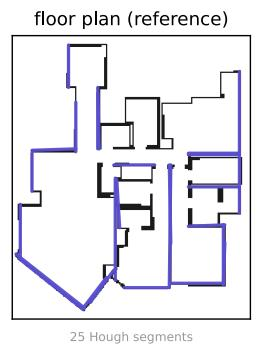

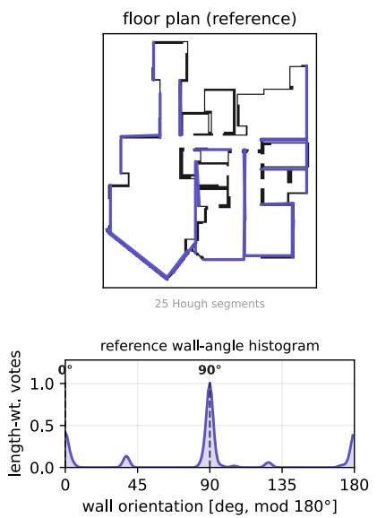

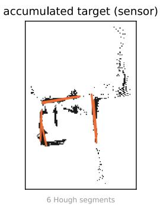

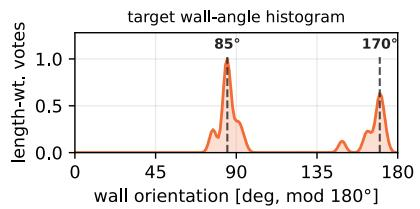

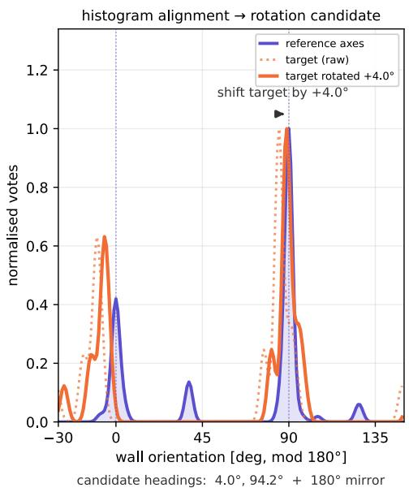  
Figure S2. Orientation pre-pass mechanism. Hough wall segments from the reference and accumulated target scan are converted into length-weighted wall-angle histograms. Cross-correlation aligns the target histogram to the reference axes and yields the directed heading set plus 180◦ mirrors (here $4 . 0 ^ { \circ } / 9 4 . 2 ^ { \circ } ) _ { \cdot }$ , which masked NCC scores downstream.

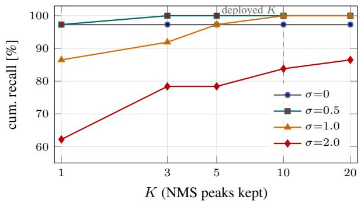  
Figure S3. Cumulative top-K NMS recall of the GT pose on the headline consensus decoder’s surface (moving-pose GM-BF + consensus-sum, chunk-end readout, GT depth, 10 cm grid, 37 gibson t chunks; GT-hit and NMS separation 0.30 m, quantization-fair at 10 cm). σ is per-frame odometry noise: a seeded random walk of σ cm on each translation axis and $\sigma ^ { \circ }$ on heading per frame. At σ=2.0 the global argmax recovers GT in only 62.2 % of chunks, while the deployed K=10 (dashed) recovers 83.8 % (top-20: 86.5 %); for $\sigma { \leq } 0 . 5$ the argmax misses at most one chunk (at σ=0 one chunk is missed at every K).

Table S2. Sensitivity sweeps (UnLoc µ depth, 9 scenes, pooled last-10 SR@1 m, frozen readout). One constant is varied at a time from the published setting (bold); last row: the pair the test-set sweeps favoured with the re-summed consensus (Sec. P).
<table><tr><td>setting</td><td>T=15 T=20 T=35 T=50</td><td></td><td></td><td></td><td>T=100</td></tr><tr><td>published  $( w { = } 5 5 , \tau { = } 0 . 3 0 )$ </td><td>.731</td><td>.840</td><td>.919</td><td>1.000</td><td>1.000</td></tr><tr><td> $w _ { \mathrm { w a l l } } { = } 2 5$ </td><td>.746</td><td>.835</td><td>.910</td><td>.974</td><td>1.000</td></tr><tr><td> $w _ { \mathrm { w a l l } } { = } 4 0$ </td><td>.728</td><td>.840</td><td>.928</td><td>1.000</td><td>1.000</td></tr><tr><td> $w _ { \mathrm { w a l l } } { = } 7 0$ </td><td>.713</td><td>.835</td><td>.937</td><td>1.000</td><td>1.000</td></tr><tr><td> ${ w _ { \mathrm { w a l l } } } \mathrm { = } 1 0 0$ </td><td>.709</td><td>.815</td><td>.928</td><td>.987</td><td>1.000</td></tr><tr><td> $\widehat { b } \mathrm { c u t o f f } \ \tau = 0 . 2 0$ </td><td>.705</td><td>.815</td><td>.937</td><td>.974</td><td>1.000</td></tr><tr><td> $\tau { = } 0 . 2 5$ </td><td>.746</td><td>.840</td><td>.919</td><td>1.000</td><td>1.000</td></tr><tr><td> $\tau { = } 0 . 4 0$ </td><td>.713</td><td>.830</td><td>.937</td><td>1.000</td><td>1.000</td></tr><tr><td>Î drop off</td><td>.705</td><td>.785</td><td>.910</td><td>.974</td><td>1.000</td></tr><tr><td> $w { = } 4 0 , \tau { = } 0 . 2 5$ </td><td>.743</td><td>.835</td><td>.919</td><td>.987</td><td>1.000</td></tr></table>

The fusion window is the main front-end-coupling choice. The full sweep (Table S3) shows a plateau at $T { \ge } 3 5$ rather than a sharp optimum: SR stays within $3 . 6 \mathrm { p p }$ across all cells there, and under the frozen readout the deployed $5 / 5$ is within one chunk of the best cell at $T { = } 3 5 \ : ( 1 5 / 5 , 0 . 9 2 8$ vs 0.919) and tied at $T { = } 1 0 0 ;$ at $T { = } 1 5$ only the 5-frame windows serve every scored frame; longer windows back-fill the first scored frames from their first output, and $1 5 / 5$ is a single window read at the chunk end (parentheses). On the high-drift Bonn VO arm $5 / 5$ is better than $1 5 / 5$ by up to 14 pp (Sec. F)—the drift-bound argument favours smaller windows there—and we keep one global $5 / 5$ across all perframe-depth datasets, as it follows from the readout rate (W set to the existing stride $S ,$ no further constant); the $1 5 / 5$ cells remain in Table S3.

Table S3. Fusion window/stride sweep on Gibson (UnLoc $\mu$ depth, 9 scenes, last-10 SR@1 m ↑ / median last-10 RMSE (m) ↓, frozen readout; $n { = } 2 6 8 / 1 1 1 / 3 7 ;$ ; at $T { = } 1 5$ , windows longer than five frames emit their first pose after scoring starts and earlier scored frames take that pose $( 1 5 / 5 ;$ one window, frozen = chunk-end), in parentheses). The operating point sits on a plateau at $T { \ge } 3 5$
<table><tr><td rowspan="2">W/S</td><td colspan="2">T=15</td><td colspan="2"> $T { = } 3 5$ </td><td colspan="2"> $T { = } 1 0 0$ </td></tr><tr><td>SR</td><td>R</td><td>SR</td><td>R</td><td>SR</td><td>R</td></tr><tr><td>5/1</td><td>0.683</td><td>0.24</td><td>0.901</td><td>0.16</td><td>0.973</td><td>0.21</td></tr><tr><td>5/5 (deployed)</td><td>0.731</td><td>0.20</td><td>0.919</td><td>0.15</td><td>1.000</td><td>0.19</td></tr><tr><td>10/5</td><td>(0.769)</td><td>0.20</td><td>0.910</td><td>0.15</td><td>1.000</td><td>0.17</td></tr><tr><td>10/10</td><td>(0.761)</td><td>0.21</td><td>0.892</td><td>0.16</td><td>1.000</td><td>0.13</td></tr><tr><td> $1 5 / 5$ </td><td>(0.817)</td><td>0.17</td><td>0.928</td><td>0.16</td><td>1.000</td><td>0.19</td></tr></table>

## D. Confidence thresholding versus intensity weighting

The main paper (§3) treats depth uncertainty as membership rather than intensity — for ˆb the discriminative control is which cells participate in the masked NCC, not how strongly each is weighted. The mask does carry one fixed geometric weight (wall hits over observed-free cells, §3), and the overlap mass $\alpha _ { w } ^ { b }$ weights the cross-heading selection; what the back-end field does not use is a per-cell depth-confidence weight. Here we report the ablation that motivates that membership choice.

An alternative is to weight each rasterized cell by the depth head’s confidence, down-weighting free-space cells with large aleatoric uncertainty $\hat { b }$ within the weighted score. On gibson t this is negative: against the same configuration without any use of $\bar { \hat { b } } ,$ pooled last-10 SR@1 m (frozen readout) drops by 10–23 pp at $T { \le } 5 0$ (both reach 1.000 at $T { = } 1 0 0 )$ , and all 9 scenes regress; weighting only the wall hits loses as much. This empirical result motivates the default column-drop rule, but does not establish why weighting fails; score normalization and the per-frame mean-1 weight normalization may interact with confidence weighting. We therefore restrict the conclusion to the evaluated configuration: thresholding membership performed better than the tested intensity weighting.

## E. Gate-space relaxations (full)

The main paper adopts a $P _ { \mathrm { m a p } } .$ -only association gate; the textbook innovation gate $P _ { \mathrm { m a p } } + \Sigma _ { k }$ ties it on every chunk at both lengths, frozen and chunk-end $( 0 . 9 3 1 / 0 . 9 4 7$ SR at ${ T } \mathrm { { = } } 3 0 0 / 4 5 0 )$ . The gate’s one residual cost is the rare confidently-wrong capture it cannot escape. We tried three further variants, all of which fail to improve on $P _ { \mathrm { m a p } } { \mathrm { - o n l y } } \colon$ • Per-track gating — admit an observation consistent with any hypothesis in the mixture, not only the MAP track. SRneutral with slightly worse RMSE: the extra admissions are redundant with hypotheses the filter already carries.

• Escape valve — force one ungated stride after N consecutive all-rejected updates (N=3). One chunk behind at $T { = } 3 0 0$ under the frozen readout $( 0 . 8 9 7 / 0 . 9 4 7$ vs 0.931/0.947 at $T { = } 3 0 0 / 4 5 0$ ; chunk-end SR equal, one chunk swapped).

• Motion-only (drift-immune) gate — SR-neutral, RMSEworse.

We therefore keep the $P _ { \mathrm { m a p } } – \mathbf { o n l y }$ gate.

Initialization, gating, and recovery limits. Although consensus chooses the absolute anchor, wrong relative shifts can still bias that choice; the heal only replaces jumps exceeding its odometry threshold. Birth is applied after the gate: an accepted observation whose best association log-evidence is below −10 can seed a component with log-weight offset −4.6 (approximately a 0.01 multiplier on its observation weight). It cannot rescue a correct observation already rejected by the gate. No explicit global relocalization is performed; consensus PSR is diagnostic, not a reset mechanism. Recovery from an incorrect dominant mode therefore depends on subsequent observations passing the gate.

## F. Component ablation on Bonn

Table S4 re-runs the main paper’s back-end build-up and leave-one-out on real Bonn $\mathsf { s t a t i c } _ { - } 0$ , across two front-end arms. On clean LiDAR 270 ◦+wheel the back-end saturates as on Gibson—accumulation alone reaches 1.000 SR@1 m at every $T$ and no refinement moves it. The high-drift D455 RGB-D + ORB-SLAM3 VO build-up is main-paper Table 3 (§4.3); its leave-one-out rows add that windowing is the driftbounding knob (the deployed $5 / 5$ beats a 15/5 window by up to 14 pp, since a shorter window accumulates less VO drift before matching).

## G. Readout protocols

PadLoc stamps window w’s pose at the window’s mid-frame and emits it once window w+L is acquired, an acquisition delay of $\lfloor ( W - 1 ) / 2 \rfloor + L S$ frames (2 at $W { = } S { = } 5 , ~ L { = } 0 )$ The frozen readout of the main tables scores each of the last ten frames with the latest pose emitted at or before it, propagated by odometry and never revised; the chunk-end readout (PadLoc delayed, Sec. H) reads one anchor after frame T and scores all ten frames from it (0–9 frames of lookahead). PadL $\omega \mathrm { c } ' \mathrm { s }$ first pose is emitted after frame 5, before the first scored frame at every $T { \geq } 1 5 \ ( \mathrm { F i g . } \mathrm { S } 4 )$ . Each readout is therefore compared only with the forward filters under the same readout: frozen against their per-frame output (mainpaper Table 1), chunk-end against their last pose carried back (Table S6). The frozen readout costs PadLoc 6–11 pp at $T { \le } 2 0 , 0 { \ - } { 3 } { \mathsf { p p } }$ at $T { = } 3 5 / 5 0$ and nothing at T=100 against its chunk-end readout (main-paper Table 1 vs. Table S6); per cell it loses up to 31 chunks that the chunk-end readout localizes and gains one (mono, T=15), and mean RMSE over successes stays within 3 cm.

Table S4. Component ablation on Bonn $( \mathsf { s t a t i c } _ { - } 0 ,$ last-10 SR@1 m ↑ / median RMSE (m) ↓; $n { = } 5 9 / 2 9 / 1 9$ chunks at $T { = } 1 5 0 / 3 0 0 / 4 5 0 \mathrm { ; }$ ; consensus rows frozen readout, argmax and accumulation rows their single readout). The clean LiDAR+wheel arm saturates (accumulation alone reaches 1.000); the high-drift $\mathrm { D } 4 5 5 \mathrm { + V O }$ arm separates the components.
<table><tr><td rowspan="2"></td><td colspan="2">T=150</td><td colspan="2">T=300</td><td colspan="2"> $T { = } 4 5 0$ </td></tr><tr><td>SR</td><td>R</td><td>SR</td><td>R</td><td>SR</td><td>R</td></tr><tr><td colspan="7">LiDAR 270°+ wheel (clean)</td></tr><tr><td>per-frame NCC argmax</td><td>0.5420.200.7240.12</td><td></td><td></td><td></td><td>0.5260.21</td><td></td></tr><tr><td>accumulation → full</td><td>1.0000.08</td><td></td><td>31.000 0.09</td><td></td><td>1.000</td><td>0.10</td></tr><tr><td colspan="7">D455 RGB-D + VO (high-drift)</td></tr><tr><td>per-frame NCC argmax</td><td>0.153</td><td>37.7</td><td>0.069</td><td>7.7</td><td>0.105</td><td>510.3</td></tr><tr><td>+ accumulation (batched)</td><td>0.729 0.21 0.862 0.20</td><td></td><td></td><td></td><td>0.7890.34</td><td></td></tr><tr><td>+ consensus, gate off</td><td>0.525 0.42 0.552 0.29</td><td></td><td></td><td></td><td>0.368</td><td>3.4</td></tr><tr><td>+ GM-BF gate &amp; heal</td><td>0.7800.20 0.966 0.22 0.842 0.31</td><td></td><td></td><td></td><td></td><td></td></tr><tr><td>— consensus heal</td><td>0.763 0.21 0.897 0.22 0.842 0.29</td><td></td><td></td><td></td><td></td><td></td></tr><tr><td>— θ-overlap weight</td><td>0.780 0.19 0.931 0.22 0.895 0.23</td><td></td><td></td><td></td><td></td><td></td></tr><tr><td> $W / S { = } 1 5 \bar { / } 5$  (wider window) 0.729 0.27 0.828 0.28 0.789 0.25</td><td></td><td></td><td></td><td></td><td></td><td></td></tr></table>

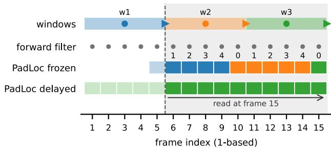  
Figure S4. Readout timing on Gibson $( T { = } 1 5 , W { = } S { = } 5 ,$ , 1-based frames). Bars: windows; dot: pose stamp (end −2); triangle: output available after the window’s last frame; dashed line: first output. Grey band: the ten scored frames. Forward filters (F3Loc, UnLoc-FWD) emit one pose per frame. PadLoc frozen: each scored frame is coloured by the window that serves it, the latest window ended at or before that frame; numbers give the anchor age in frames. PadLoc delayed: all ten frames use the chunk-end anchor read at frame T.

Lag sweep. Table S5 sweeps the lag L on the Bonn $\mathsf { s t a t i c } _ { - } 0$ drifty-VO arm, pooling every emitted window pose of $n { = } 5 9 / 2 9 / 1 9$ chunks (window-pooled online SR, not the last-10 SR of the main tables). Lag mainly sharpens the error (steady-state p90 0.76→0.53 m at T=450 from

Table S5. Bounded-lag online readout on Bonn (static 0 drifty-VO arm: LiDAR 106 ◦ depth + VO). Finite L uses delayed window outputs; L=∞ is an offline reference. Online SR@1 m over emitted windows / steady-state p90 error (m).
<table><tr><td rowspan="2">L</td><td colspan="2"> $T { = } 1 5 0$ </td><td colspan="2"> $T { = } 3 0 0$ </td><td colspan="2"> $T { = } 4 5 0$ </td></tr><tr><td>SR</td><td>p90</td><td>SR</td><td>p90</td><td>SR</td><td>p90</td></tr><tr><td>0</td><td>0.971</td><td>0.18 0.18</td><td>0.883 0.884</td><td>0.29 0.28</td><td>0.905 0.911</td><td>0.76</td></tr><tr><td>2 5</td><td>0.974 0.979</td><td>0.18</td><td>0.887</td><td>0.27</td><td>0.918</td><td>0.73 0.71</td></tr><tr><td>10</td><td>0.982 0.983</td><td>0.18 0.18</td><td>0.898 0.916</td><td>0.26 0.25</td><td>0.920 0.913</td><td>0.68 0.53</td></tr></table>

Table S6. Main-paper Table 1 under the chunk-end readout (Gibson, last-10 SR@1 m ↑ / mean last-10 RMSE over successes (m) ↓). Bold: best SR per comparison (delayed vs filter rows, accum vs batched or refined rows), ties bold.
<table><tr><td rowspan="3"></td><td> $T { = } 1 5$ </td><td> $T = 2 0$ </td><td> $T { = } 3 5$ </td></tr><tr><td>SR↑ R↓</td><td>SR↑ R↓</td><td> $T { = } 5 0$  SR↑ R↓ SR↑ R↓</td></tr><tr><td></td><td></td></tr><tr><td>F3Loc mono depth</td></tr><tr><td>F3Loc filter 0.511 0.25 0.530 0.24 0.703 0.19 0.808 0.18 0.892 0.18 PadLoc delayed 0.6080.280.6950.280.7750.260.8460.260.9460.26</td></tr><tr><td></td></tr><tr><td>F3Loc comp-s depth F3Loc filter 0.5670.21 0.5800.190.757 0.150.872 0.140.9460.14</td></tr><tr><td>PadLoc delayed 0.6750.240.770 0.240.910 0.20 0.962 0.230.9460.24</td></tr><tr><td>UnLoc µ depth UnLoc fwd</td></tr><tr><td>0.810 0.13 0.865 0.14 0.919 0.12 0.949 0.13 0.973 0.17 UnLoc refined 0.810 0.17 0.865 0.17 0.919 0.17 0.949 0.17 0.973 0.20</td></tr><tr><td>PadLoc delayed 0.843 0.180.900 0.16 0.937 0.15 1.000 0.17 1.000 0.18</td></tr><tr><td>PadLoc accum 0.795 0.16 0.860 0.17 0.946 0.14 1.000 0.14 1.000 0.15</td></tr><tr><td></td></tr></table>

$L { = } 0 \ \mathrm { t o } \ \infty ) ;$ ; finite L raises online SR by at most 1.5 pp.

## H. Chunk-end readout of the main tables

Main-paper Tables 1–4 report PadLoc’s consensus rows under the frozen readout. Tables S6–S9 give the same runs under the chunk-end readout (PadLoc delayed, main paper §4.1), with the forward filters under the same readout (last forward pose carried back through the shared transitions); argmax, accumulation, refinement, and Z-FLoc rows have a single readout (values as in the main paper). Under this readout PadLoc delayed leads the forward filters in 14 of 15 Gibson depth–length cells and ties the other (F3Loc comp s at T=100). On Bonn it leads UnLoc-FWD at every pooled T by +23–30 pp under wheel odometry and +34–41 pp with ground-truth motion (pooled GT 0.68/0.83/0.89); the wheel all-trial median is 0.43/0.26/0.23 m against Un-Loc’s 4.6/1.1/3.6 m, wheel SWA 0.43/0.55/0.62 against 0.26/0.36/0.37, and GT SWA 0.52/0.63/0.67.

## I. Real-building back-end levers

Front-end modularity table. The main paper’s static 0 modularity numbers in full:

Table S7. Main-paper Table 2 under the chunk-end readout (Gibson UnLoc-µ block: SWA ↑ / all-trial median last-10 RMSE (m) ↓; bold = best SWA per column).
<table><tr><td></td><td> $T { = } 1 5$ </td><td> $T { = } 2 0$ </td><td> $T { = } 3 5$ </td><td> $T { = } 5 0$ </td><td>T=100</td></tr><tr><td>UnLoc fwd</td><td></td><td></td><td></td><td>.703/.13 .748/.13 .809/.11 .821/.12 .809/.14</td><td></td></tr><tr><td>UnLoc refined</td><td></td><td></td><td></td><td>.670/.18.717/.17.765/.16.791/.14.783/.17</td><td></td></tr><tr><td>PadLoc delayed</td><td></td><td></td><td></td><td>.695/.16.757/.16.799/.13.835/.15.823/.18</td><td></td></tr><tr><td>PadLoc accum</td><td></td><td></td><td></td><td>.667/.18.715/.18.809/.14.856/.13.846/.14</td><td></td></tr><tr><td>PadLoc delayed, 5 cm .716/.16.737/.15 .828/.10.854/.11 .887/.12</td><td></td><td></td><td></td><td></td><td></td></tr></table>

Table S8. Consensus rows of main-paper Table 3 and Table S4 under the chunk-end readout (last-10 SR@1 m ↑ / median last-10 RMSE (m) ↓; Gibson UnLoc $\scriptstyle { \mu n = 2 6 8 / 1 1 1 / 3 7 }$ at ${ T { = } 1 5 / 3 5 / 1 0 0 } .$ Bonn static 0 n=59/29/19 at $T { = } 1 5 0 / 3 0 0 / 4 5 0$ ; full config bold).
<table><tr><td colspan="6">Gibson  $\scriptstyle ( T = 1 5 / 3 5 / 1 0 0 )$  + consensus, gate/heal off 0.806 0.18 0.883 0.14 0.973 0.13 + GM-BF gate &amp; heal 0.843 0.16 0.937 0.13 1.000 0.18</td></tr><tr><td>— θ-overlap weight —  column drop — consensus heal</td><td colspan="3">0.817 0.18 0.928 0.14 1.000 0.18 0.810 0.19 0.910 0.13 1.0000.17 0.8320.18 0.9100.14 0.973</td></tr><tr><td colspan="3">Bonn LiDAR 270°+ wheel (T=150/300/450) accumulation → full 1.000 0.08 1.000 0.07 1.000 0.10</td></tr><tr><td>+ consensus, gate off 0.576 0.35 0.655 0.24 0.421 2.4 + GM-BF gate &amp; heal 0.797 0.20 0.966 0.21 0.895 0.32</td><td>Bonn D455 RGB-D + VO (T=150/300/450)</td></tr></table>

Table S9. Main-paper Table 4 under the chunk-end readout (Bonn, monocular structural depth, cameras-only structural map; last-10 SR@1 m; PadLoc under wheel odometry, UnLoc-FWD under its ground-truth transitions). PadLoc wins 11 of 12 cells (tie: dynamics 0, T=450, n=5). 16 rays: equal-ray control as in main-paper Table 4. Replacing UnLoc’s ground-truth transitions by wheel odometry leaves its per-frame SR@1 m unchanged in 20 of 22 cells and one chunk higher in the other two (constant-σ head, shipped and cameras-only maps).
<table><tr><td></td><td colspan="3">UnLoc</td><td colspan="3">PadLoc CoNS, wheel</td></tr><tr><td>scene</td><td>150</td><td>300</td><td>450</td><td>150</td><td>300</td><td>450</td></tr><tr><td>static_0</td><td>0.37</td><td>0.59</td><td>0.74</td><td>0.59</td><td>0.79</td><td>0.89</td></tr><tr><td>dynamics_0</td><td>0.33</td><td>0.43</td><td>0.60</td><td>0.67</td><td>0.71</td><td>0.60</td></tr><tr><td>1t_changes_0</td><td>0.28</td><td>0.43</td><td>0.21</td><td>0.60</td><td>0.71</td><td>0.79</td></tr><tr><td>1t_ch_dyn_0</td><td>0.35</td><td>0.41</td><td>0.39</td><td>0.47</td><td>0.63</td><td>0.72</td></tr><tr><td>pooled SR@1 m</td><td>0.34</td><td>0.48</td><td>0.48</td><td>0.56</td><td>0.71</td><td>0.79</td></tr><tr><td>pooled, 16 rays</td><td></td><td></td><td></td><td>0.48</td><td>0.67</td><td>0.77</td></tr><tr><td>succ. med. RMSE (m)</td><td>0.21</td><td>0.25</td><td>0.21</td><td>0.19</td><td>0.20</td><td>0.20</td></tr></table>

Reference-map ablation (construction and sensitivity). We compare three reference maps, changing one variable at a time: (A) the shipped map office (unmasked one-height 2D-LiDAR; static furniture such as the kitchenette rendered as wall); (B) cameras + LiDAR with Mask2Former semantic masking (wall/door/window classes kept), i.e. masked pixels but LiDAR furniture retained; (C) cameras-only with the same masking, i.e. LiDAR dropped and furniture gone. B and C are rasterized from the masked depth of the three D455 cameras of the benchmark’s mapping run only—no test-sequence information—on the shipped 5 cm grid and world frame (facebook/mask2formerswin-large-ade-semantic). C is not sparser than the shipped map (wall density 1.4% vs 1.3%): three floor-toceiling cameras cover more than the one-height scan. Under ground-truth motion with the back-end held fixed and the structural query fixed, C beats A in 7/12 (scene,T) cells, ties 4, loses 1 (+5.4 pp mean SR@1 m, frozen readout; +7.8 pp under wheel odometry, 10/12 cells). The mechanism is isolated by B: masking alone changes nothing $( \mathbf { B } = \mathbf { A } = 0 . 4 0 0$ on dynamics 0 at T=150) while dropping the LiDARbaked furniture is the entire lever $( \mathbf { C } ~ = ~ 0 . 6 0 0 )$ ; gains concentrate on the dynamics/lt changes sequences, where scene–map furniture mismatch is worst. The lever is back-end-specific: the furniture-free reference helps PadLoc (+5.4 pp) but hurts UnLoc (−6.3 pp)—the per-frame filter cannot accumulate evidence to exploit the sparser wallsonly reference, whereas aggregate-then-match does. On the σ=1.0 back-end this widens PadLoc’s mean lead over UnLoc from +18 pp on the shipped map to ∼+ 30 pp; on C, PadLoc leads in 11 of 12 cells and ties the other. This study isolates the map variable (ground-truth motion, fixed back-end, constant-σ UnLoc); the shipped-map comparison under the published head-to-head configuration — wheel and ground-truth motion, UnLoc with its network ˆb — is in the main paper and agrees in direction on every pooled cell.

Table S10. Bonn static 0 modularity (last-10 SR@1 m ↑ / median RMSE (m) ↓, frozen readout, per-chunk reset, $\scriptstyle n = 2 9 / 1 9 )$ Top: deployed σ (1.0 LiDAR, 0.5 RGB-D; bold = best SR); bottom: the same rows with σ swapped.
<table><tr><td rowspan="2">depth</td><td rowspan="2"></td><td colspan="2"> $T { = } 3 0 0$ </td><td colspan="2"> $T { = } 4 5 0$ </td></tr><tr><td>motion SR</td><td>R</td><td>SR</td><td>R</td></tr><tr><td>LiDAR 270 °</td><td>VO</td><td>1.000</td><td>0.10</td><td>0.947</td><td>0.12</td></tr><tr><td> $\mathrm { L i D A R 2 7 0 } ^ { \circ }$ </td><td>wheel</td><td>1.000</td><td>0.09</td><td>1.000</td><td>0.10</td></tr><tr><td>LiDAR 106°</td><td>VO</td><td>0.931</td><td>0.10</td><td>0.947</td><td>0.12</td></tr><tr><td>D455 RGB-D</td><td>VO</td><td>0.966</td><td>0.22</td><td>0.842</td><td>0.31</td></tr><tr><td> $\mathrm { L i D A R 2 7 0 } ^ { \circ } , \sigma \mathrm { = } 0 . 5$ </td><td>VO</td><td>0.966</td><td>0.09</td><td>0.895</td><td>0.14</td></tr><tr><td> $\mathrm { L i D A R 2 7 0 } ^ { \circ } , \sigma \mathrm { = } 0 . 5$ </td><td>wheel</td><td>1.000</td><td>0.08</td><td>1.000</td><td>0.09</td></tr><tr><td> $\mathrm { L i D A R 1 0 6 } ^ { \circ } , \sigma \mathrm { = } 0 . 5$ </td><td>VO</td><td>0.931</td><td>0.08</td><td>0.895</td><td>0.11</td></tr><tr><td> $\mathrm { D 4 5 5 ~ R G B  – D } , \sigma { = } 1 . 0$ </td><td>VO</td><td>0.966</td><td>0.27</td><td>0.789</td><td>0.22</td></tr></table>

Borrowed ˆb. Bonn’s monocular structural depth carries no uncertainty, but we can borrow UnLoc’s released ViT-L head and keep only its per-column ˆb (leaving µ unchanged).

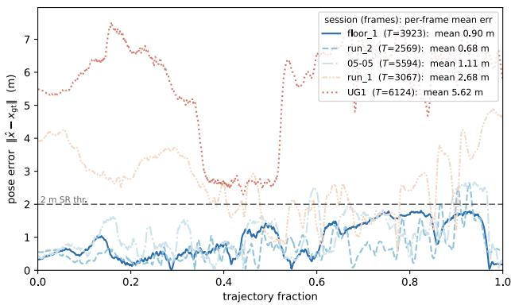  
Figure S5. Hilti online pose error $( W / S { = } 3 0 / 3 0 $ , with-windows reference). Per-frame error $\| \hat { x } - x _ { \mathrm { g t } } \|$ vs. trajectory fraction for the five GT sessions; the legend lists frame count and mean error. Blue: localizing sessions; red: run 1 and UG1; dashed: 2 m threshold.

On top of the $\sigma { = } 0 . 5$ back-end this borrowed column drop is only a small, scene-dependent gain (e.g. +5 pp ground-truth SR@1 m at $T { = } 1 5 0$ , frozen readout) and −3.6 to +1.8 pp elsewhere.

## J. Hilti online pose error

Figure S5 plots the per-frame localization error $\| \hat { x } - x _ { \mathrm { g t } } \|$ of the online pose stream against trajectory fraction for all five Hilti GT sessions at the adopted $W / S { = } 3 0 / 3 0$ (every GT frame, ${ T = 2 5 6 9 - 6 1 2 4 }$ per session—the same per-frame statistic as the mean column of the main paper’s Table 5). The three sessions that localize (floor 1, run 2, 05-05) hold a mean error at or below the 2 m success threshold (0.90, 0.68, 1.11 m) for essentially the whole trajectory. run 1 hovers around the threshold (mean 2.68 m); its error rises above 2 m where the free-space evidence fits a wrong part of the plan as well as the true one. UG1 stays ∼2–8 m off for the whole run (mean 5.62 m), because its reconstructed depth collapses to amorphous blobs with nothing wall-like to register. Section L analyses both failures. PadLoc emits a pose for every window, so these errors are wrong estimates, not missing outputs.

## K. Hilti qualitative: per-window locking

Figure S6 shows the whole-run trajectory on floor 1, which tracks the full building loop. Figure S7 shows a separate run over the first 720 frames of the same session: nine of its 24 non-overlapping 30-frame windows, each cropped around the camera, with the per-window error in the panel title. Along corridors the NCC field often forms a ridge, because translation along a featureless corridor is ambiguous. In the first four windows (0–3) the estimate has not yet settled on the true corridor: in window 3, the first panel, it sits on a parallel ridge about 10 m from GT. From window 4 on, every decoded estimate is within 0.7 m of GT, five of the nine sampled ones within about 0.3 m, even where the raw NCC peak lies elsewhere (windows 5, 18 and 20).

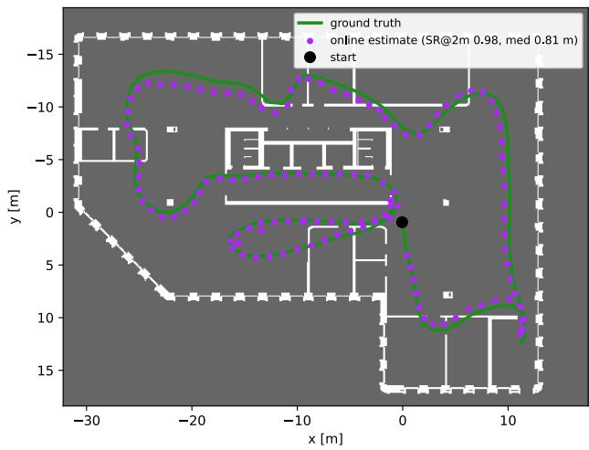  
Figure S6. Whole-run trajectory on floor 1. The online perwindow estimate (purple) vs. ground truth (green) on the occupancy floor plan; the estimate tracks the full building loop (SR@2 m 0.98, median 0.81 m).

## L. Hilti failure analysis: three regimes

Placing the pipeline’s own wall extraction on the plan, once at the ground-truth pose and once at the emitted pose (Fig. S8), separates the five sessions into three regimes, one per physical floor. We summarize each floor by fit@GT, the fraction of extracted wall points within 0.3 m of a plan wall when placed at ground truth.

(1) The building matches the plan (floor 1, fit@GT 0.68). The walls anchor localization. The remaining failures are small offsets, parallel to the walls, of an otherwise correct alignment. They come from a bias in the consensus anchor, not from matching a wrong place, and not from the odometry: after alignment the VIO deviates from GT by only 0.27 m on average. Every front-end variant in main-paper Table 5 lowers accuracy here.

(2) Real walls that the drawing lacks (the three floor 2 sessions run 2, 05-05 and run 1, fit@GT 0.12–0.17 even at ground truth). The reconstruction is wall-like, but its walls are drywall partitions of the ongoing fit-out, absent from the structural drawing. Localization therefore rests on observed free space. Two of the three sessions succeed (0.81–0.95 across front-end variants); run 1 stays at 0.46 (0.69 with the variants). Its failures are aliasing: in 41–100% of failed windows a wrong location explains the plan at least as well as the true pose (window 58 in Fig. S8). Variants that widen the view help; cleaner walls change little.

(3) Reconstruction collapse (UG1, fit@GT 0.06). Textureless surfaces, uniform artificial light, and the operator filling a third of the rear camera’s view reduce MapAnything’s output to amorphous blobs, in the best and worst windows alike, so there is nothing wall-like to register. Wall segmentation on the single-crop input only removes more of this sparse target. On the ±55◦ multi-crop input, however, it isolates the few true structures—above all the two shaft cores, the only landmarks that tell one part of the hall from another (removing them drops SR from 0.668 to 0.288)—and recovers the floor (0.156 → 0.668, main-paper Table 5).

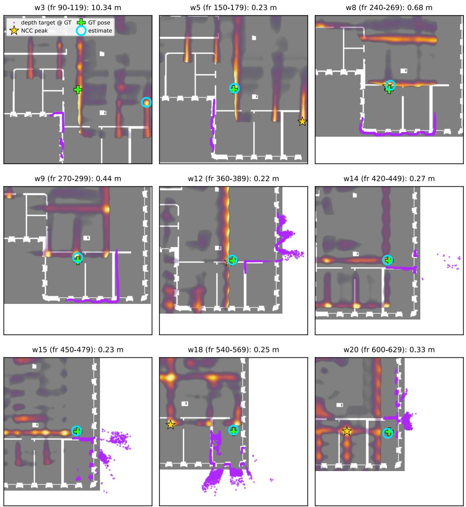  
Figure S7. Per-window locking on floor 1 (qualitative). Nine of the 24 windows of the first 720 frames. Each panel shows the masked-NCC field (inferno), the depth target at the ground-truth pose (purple), the raw NCC peak (gold star), the decoded estimate (cyan ring), and GT (green plus).

Window–batch alignment. MapAnything reconstructs non-overlapping 30-frame batches, and the deployed 30/30 window uses exactly one. Windows that mix frames from two batches, or use only five frames of one, fail on most sessions (online SR@2 m, floor 1/run 2/05-05/run 1/UG1:

15/5 0.843/0.008/0.000/0.296/0.000, 5/5 $0 . 8 9 2 / 0 . 0 0 6 / 0 . 0 1 5 / 0 . 0 0 0 / 0 . 0 0 1 ; \mathrm { ~ a ~ } 3 0 / 5$ window reaches 0.617/0.026 on floor 1/run 2). At equal length, alignment with the batches is what matters: a 15/15 window, which never straddles two batches, holds run 2 at 0.900 (0.008 at $1 5 / 5 )$ and run 1 at 0.985, but loses 11 pp on floor 1 (0.863 vs 0.977 at 30/30).

## M. Additional evidence-hygiene tools

The default configuration uses overlap-mass weighting (heading selection only) + per-column ˆb drop (main paper §3). We evaluated two further training-free tools (frozen readout, UnLoc depth):

• Multi-view support filter — keep a window-cloud point only $\mathrm { i f } \geq 2$ frames corroborate it within 0.2 m (a drop, not a down-weight). Standalone (without the ˆb drop) it changes pooled SR by −1.8 to +1.1 pp across ${ \cal T } = 1 5 \mathrm { - } 1 0 0 ;$ the base already reaches 1.000 at $T { = } 1 0 0$

• Reference wall unification — collapse aliased doublewall strokes to their centre line. Added to the support filter it costs 1.0–2.2 pp at $T { \le } 5 0$

On top of the default (with the ˆb drop) both lower SR (support filter: up to 2.6 pp at T=50; with unification: up to 8.0 pp at $\scriptstyle { T = 2 0 ; T = 1 0 0 }$ unchanged), so neither is part of the default per-frame configuration; the Hilti batched front-end uses both.

## N. Matching resolution vs. depth density

The main paper’s controlled T-sweep holds UnLoc’s 10 cm DeSDF grid so that no resolution asymmetry confounds the comparison. PadLoc’s matching cell is, however, a free knob—independent of the front-end and bounded below only by the floor plan’s own resolution. We sweep it on both datasets, down to each map’s native floor (1 cm on Gibson, 5 cm on Bonn), holding the other numerical settings fixed. This is a configuration sweep: with fixed σ in cells, changing δ also changes the motion covariance in metres (main-paper Eq. (5)). Differences therefore cannot be attributed to sampling density or quantization alone.

Sparse depth (Gibson, UnLoc $\mu ) .$ . UnLoc’s head emits a 40-column fan over $a \sim 1 0 6 ^ { \circ }$ cone—a sparse target. Shrinking the cell improves precision down to 3 cm (median last-10 RMSE falls from 0.19 m at 10 cm to 0.06 m at 3 cm, T=100, frozen readout), but success is non-monotonic (Table S11): short-trajectory SR peaks at 5 cm (+1.1 pp at $T { = } 1 5 )$ , falls at 3 and 2 cm $( - 5 . 2 / - 9 . 3 $ pp at $T { = } 1 5 )$ , and collapses at the native 1 cm floor (0.511, −22 pp). This is consistent with sparse wall sampling becoming less connected at fine grids, but the coupled motion-noise change prevents isolating that explanation. The shared 10 cm grid controls one important comparison setting; it is not uniformly optimal for PadLoc.

Table S11. Sparse depth has a resolution sweet spot (Gibson, UnLoc µ depth, 9 scenes, single frozen config, per-chunk reset). Last-10 SR@1 m (↑) vs. matching cell; per-column best in bold (ties unmarked). Short-T success peaks at 5 cm and falls below it, while T=20 and T=50 favour the coarse grid.
<table><tr><td rowspan="2">cell</td><td colspan="5">SR@1m↑at T</td></tr><tr><td>15</td><td>20</td><td>35</td><td>50</td><td>100</td></tr><tr><td>10 cm</td><td>0.731</td><td>0.840</td><td>0.919</td><td>1.000</td><td>1.000</td></tr><tr><td>5cm</td><td>0.743</td><td>0.815</td><td>0.928</td><td>0.974</td><td>1.000</td></tr><tr><td>3cm</td><td>0.679</td><td>0.795</td><td>0.919</td><td>0.962</td><td>1.000</td></tr><tr><td>2 cm</td><td>0.638</td><td>0.750</td><td>0.892</td><td>0.949</td><td>1.000</td></tr><tr><td>1cm</td><td>0.511</td><td>0.640</td><td>0.802</td><td>0.910</td><td>0.973</td></tr></table>

Table S12. Dense depth keeps its success rate on coarse cells (Bonn, 270 ◦ LiDAR + wheel odometry, static 0). Last-10 SR@1 m (↑) / median last-10 RMSE (m, ↓) vs. matching cell, frozen readout. SR stays at 1.000 up to 15 cm and error grows beyond 10 cm; the native 5 cm map floor reproduces the modular LIDAR+WHEEL headline; per-column best in bold (ties unmarked).
<table><tr><td colspan="3">T=300</td><td colspan="2"> $T { = } 4 5 0$ </td></tr><tr><td>cell</td><td>SR↑</td><td>RMSE↓</td><td>SR↑</td><td>RMSE↓</td></tr><tr><td>5cm</td><td>1.000</td><td>0.086</td><td>1.000</td><td>0.102</td></tr><tr><td>10 cm</td><td>1.000</td><td>0.103</td><td>1.000</td><td>0.095</td></tr><tr><td>15 cm</td><td>1.000</td><td>0.121</td><td>1.000</td><td>0.124</td></tr><tr><td>20 cm</td><td>1.000</td><td>0.204</td><td>0.947</td><td>0.227</td></tr></table>

Dense depth (Bonn, LiDAR). The $2 7 0 ^ { \circ }$ LiDAR returns thousands of points per frame—a dense target. Here SR stays at 1.000 from the native 5 cm map floor, where the sweep reproduces the modular LIDAR+WHEEL headline, up to 15 cm and drops by one chunk only at 20 cm, T=450 (Table S12). Coarsening the dense scan costs precision rather than success: median error rises from 0.09 m to 0.10 m at 5 cm to 10 cm to 0.20 m to 0.23 m at 20 cm.

## O. Matcher latency across map and target sizes

Figure S9 sweeps the masked-NCC per-call latency on the RTX 3090 across matching cell and target-window size, on a real 30×24 m benchmark floor (the synthetic up-scaled plans of §P reach mall scale). Once the scene-constant reference FFT is cached (solid), per-call cost varies with target size and the resulting padded FFT dimensions at this fixed map extent, and stays sub-millisecond at the deployed 8–10 cm cells; only the 1 cm grid with a large legacy target reaches tens of milliseconds. Rebuilding the reference each call (dashed) is consistently 20 % to 30 % costlier.

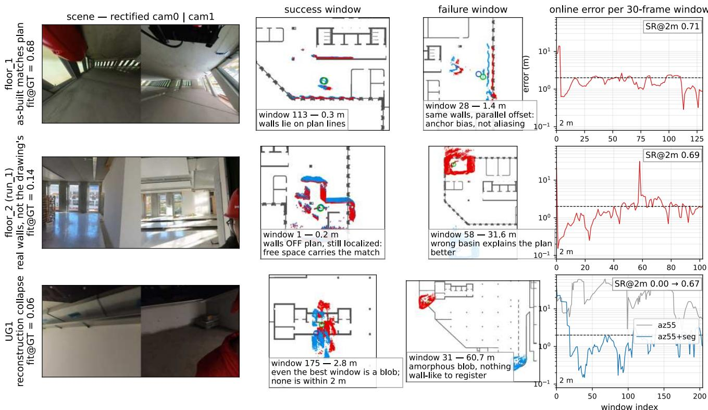  
Figure S8. Hilti failure taxonomy — three regimes. One row per regime. Columns: the two rectified camera views; the wall extraction placed on the plan at the ground-truth (red) and emitted (blue) pose, for a success and a failure window; and the per-window online erro (±55◦ multi-crop variant; dashed: 2 m success threshold). floor 1 fails by a parallel offset of a correct alignment; run 1’s off-plan walls localize on free space and fail by aliasing; UG1 reconstructs blobs, and its timeline also shows the recovery with learned wall segmentation (+seg, blue).

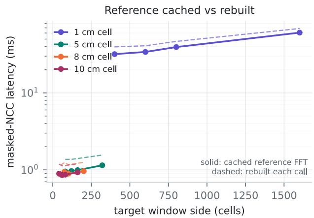  
Figure S9. Per-call masked-NCC latency (RTX 3090, cuFFT) vs. target-window side on the 30 × 24 m floor. Solid lines reuse the precomputed reference FFT; dashed lines rebuild it each call.

## P. Matcher complexity across building scales

UnLoc scores every frame against its full DeSDF: V=11 rays (its depth head’s 40 columns, downsampled to the DeSDF’s 10 ◦ ray spacing, a ∼100 ◦ cone within Gibson’s ∼106 ◦ field of view) at all O=36 orientations. This Laplacescaled $\ell _ { 1 }$ scan costs O(HWOV), linear in floor-plan area. PadLoc instead correlates one fused target per S=5-frame window with the plan at B candidate headings (the plan’s dominant wall orientations: B≈4 for Manhattan plans, up to 8 otherwise), at O(N log N) per heading.

We time both matchers on seven floor plans from 80 to 19,200 m2 (home to mall) on one RTX 3090, taking the minimum over repeated calls (UnLoc’s released matcher; the main-paper figure). Per match, i.e. one UnLoc frame or one PadLoc heading, UnLoc grows from 2.3 to 209 ms and PadLoc from 0.9 to 3.4 ms: 61× at mall scale. Since PadLoc matches B headings once per S frames, this becomes 76× per frame at B=4 (38× at B=8).

Where the speedup comes from. UnLoc’s matcher loops over the 36 orientations in Python. Replacing the loop with one strided reduction gives bit-identical output (max $| \Delta \mathrm { p r o b } | { = } 0$ on all plans) and is 3.7× faster at room scale, where kernel-launch overhead dominates, but only ${ \sim } 1 . 1 \times$ at mall scale, where memory traffic dominates. Against this vectorized matcher PadLoc is still 56× faster per match at mall scale. The $\ell _ { 1 }$ scan stays limited by memory bandwidth (∼18 GFLOP/s), whereas PadL $\omega \mathrm { c } ' \mathrm { s }$ FFT is limited by compute (396 GFLOP/s). The measured gain therefore comes from constants, implementation and Pad-Loc’s lower matching rate (B headings per S frames); it is not an asymptotic advantage of FFT matching over a scan with fixed O and $V ,$ , whose cost is linear in map area. At room scale the vectorized scan is as fast as our FFT, which cannot drop below about 0.9 ms because it pads to a power of two. Once the floor plan dominates the FFT size, the target size matters little (mall: a 1 m vs 11 m target costs 2.6 vs 3.4 ms).

Memory and precompute. Values are Gibson / Bonn. Both precompute times are measured on one laptop CPU (Apple M1 Max, 10 cores). Memory is measured where each method runs: PadLoc on that CPU, UnLoc’s released code on the RTX 3090. On the RTX 3090, PadLoc’s reference FFTs are at most 7% larger and its Gibson window-update peak about 20% larger. PadLoc’s back-end state consists of the cached reference FFTs (1.2 MB to 1.9 MB / 9.9 MB), built from the plan at load time in at most 0.4 s; 13 B per cell and heading (5 B for the heading-selection sum and its support, 8 B for the running consensus sum and count); and the 560 B K=10 mixture. A window update temporarily needs another 5.5 MB to 9.2 MB / 49 MB. UnLoc keeps a float32 $( x , y , \theta )$ prior and posterior over 0.9–5.2M / 18M cells at its 10 cm grid (8 MB to 44 MB / 147 MB on the GPU), plus a DeSDF that must be precomputed for each map, grid and orientation count. Its released, unoptimized code needs 4 min to ${ \approx } 7 7$ min / ≈44 min to build the DeSDF (the two largest values extrapolated from every 4th / 5th grid row) and re-uploads it every frame; with the likelihood round trip this is 11 MB to 62 MB / 288 MB of host–GPU traffic, against 1.0 MB to 1.4 MB / 6.6 MB for PadLoc’s GPU backend. Optimized code would reduce both, but the DeSDF must still be rebuilt for each map and read in full every frame.

Running consensus sum. Every window votes on the same frame-zero anchor, so the consensus sums (main paper, Method) never need recomputing. Shifting a field $\boldsymbol { \mathrm { b y } } - \sigma _ { w } .$ with $o _ { w } = g _ { w } - g _ { N }$ and $g _ { w }$ the grid cell of $r _ { w } .$ , equals shifting it by $- g _ { w }$ and then by $g _ { N }$ . PadLoc therefore keeps one running sum $\begin{array} { r } { \sum _ { w } \mathrm { s h i f t } ( \tilde { F } _ { w } , - g _ { w } ) } \end{array}$ and its count per heading: each window adds one shifted field, a read shifts the sums by $g _ { N }$ , and a finite back subtracts expired windows. One sum per heading candidate lets the readout switch wall family without storing past fields. This is exactly equal to re-summing every window with the same offsets (42,889 emitted window poses on main-paper Table 1, the PadLoc cells of Table 4 and the five Hilti $3 0 / 3 0$ sessions; identical chunk-end and frozen outcomes). Re-summing with the rounded offset $o _ { w } = \mathrm { r o u n d } ( ( r _ { w } - r _ { N } ) / \delta )$ instead flips at most four trials per cell. On the UG1 grid $( 1 5 1 2 \times 1 3 1 2$ cells), a re-summing read costs 8 ms to 10 ms per retained window (≥9.9 MB each), whereas a running-sum update and read take 11 ms to 15 ms regardless of length, with a 16 MB state per heading. On the Hilti UG1 $5 / 5$ run this cuts wall time from 2 h 31 min to 33 min. All reported results use the running sum.

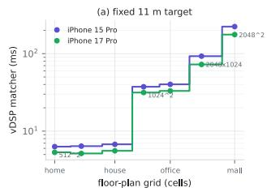

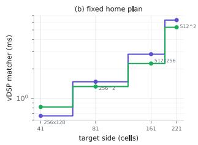  
Figure S10. On-device power-of-two staircase (iPhone 15 Pro & 17 Pro, vDSP, 10 cm, minimum over repeated calls). (a) Fixed 11 m target, growing floor plan; (b) fixed home plan, growing target. Both phones step through the same power-of-two FFT sizes and are flat within each size; the 17 Pro is ${ \sim } 1 . 2 \times$ faster.

On-device confirmation (iPhone 15 Pro and 17 Pro). We ran the same masked-NCC kernel on an iPhone 15 Pro and an iPhone 17 Pro (Accelerate/vDSP; Fig. S10, minimum over repeated calls). Its cost rises in steps, one per power-oftwo FFT size. With our 11 m target fixed and growing floor plans, the FFT steps through $5 1 2 ^ { \bar { 2 } } .$ $1 0 2 4 ^ { 2 }$ and $2 0 4 8 ^ { 2 }$ (15 Pro 6.3/38/224 ms; 17 Pro 5.3/32/176 ms); with the home plan fixed and growing targets, it steps from $2 5 6 ^ { 2 }$ to $5 1 2 ^ { 2 }$ . Within one FFT size the cost is flat: on each phone three floor plans all cost the same at $5 1 2 ^ { 2 } ( \sim 6 . 3 / 5 . 3 \mathrm { m s } )$ , and on the mall plan every target we use (41–221 cells) falls into the $2 0 4 8 ^ { \bar { 2 } }$ size, so the generous target window that the narrow field of view of a single depth frame motivates costs almost nothing. Precomputing the reference FFTs is 25 % to 40 % faster than computing them per call, and the newer phone is uniformly ${ \sim } 1 . 2 \times$ faster. At deployed room-to-floor scale $( 5 1 2 ^ { 2 } - 1 0 2 4 ^ { 2 } )$ the matcher takes 5 ms to 40 ms per heading, at mall scale 176 ms to 224 ms. These numbers cover the matching kernel only, not rasterization, heading estimation, temporal decoding or depth inference, so they do not measure full-system throughput on the phone.

Table S13. Unconditional-metric grid: SWA ↑ / all-trial median last-10 RMSE (m) ↓ for the runs behind the main paper’s SR cells. Top: Gibson, F3Loc depth sources (filter: per-frame readout; PadLoc: frozen). Bottom: Bonn per sequence, PadLoc CONS with wheel and GT motion (frozen) vs UnLoc (own $\hat { b } ,$ per-frame forward readout).
<table><tr><td>Gibson, F3Loc depth</td><td colspan="5"></td></tr><tr><td></td><td>T=15</td><td>T=20</td><td> $T { = } 3 5$ </td><td> $T { = } 5 0$ </td><td> $T { = } 1 0 0$ </td></tr><tr><td>F3Loc filter (mono)</td><td>.212/2.32</td><td>.264/1.89</td><td>.435/0.41</td><td>.577/0.22</td><td>.730/0.17</td></tr><tr><td>PadLoc frozen (mono)</td><td>.352/0.85</td><td>.423/0.47.562/0.29</td><td></td><td>.620/0.26</td><td>.685/0.25</td></tr><tr><td>F3Loc filter (comp_s)</td><td>.289/1.95.337/1.34.524/0.25</td><td></td><td></td><td>.687/0.13</td><td>.804/0.13</td></tr><tr><td>PadLoc frozen (comp_s)</td><td>.420/0.54.513/0.32.687/0.19</td><td></td><td></td><td>.736/0.19</td><td>.737/0.19</td></tr><tr><td colspan="6">Bonn per-sequence (columns T=150/300/450)</td></tr><tr><td></td><td>static</td><td>dyn</td><td> $\pm \mathrm { \ t \mathrm { - } \mathrm { C h } }$ </td><td> $\mathtt { l t \mathrm { _ { - } c h \mathrm { _ { - } d y n } } }$ </td><td>pooled</td></tr><tr><td>UnLoc  $T { = } 1 5 0$ </td><td></td><td>.260/5.33.260/4.39.164/7.29</td><td></td><td>.243/5.27</td><td>.231/5.30</td></tr><tr><td>UnLoc  $T { = } 3 0 0$ </td><td></td><td>.448/0.31.332/6.89.322/3.62</td><td></td><td>.305/3.80</td><td>.361/1.03</td></tr><tr><td>UnLoc  $T { = } 4 5 0$ </td><td>.528/0.28.406/0.40.155/3.96</td><td></td><td></td><td>.303/7.23</td><td>.352/3.50</td></tr><tr><td>wheel  $T { = } 1 5 0$ </td><td>.437/0.44.471/0.46.490/0.30</td><td></td><td></td><td>.356/1.66</td><td>.427/0.46</td></tr><tr><td>wheel  $T { = } 3 0 0$ </td><td></td><td>.596/0.23.514/0.42.574/0.21</td><td></td><td>.482/0.26</td><td>.547/0.25</td></tr><tr><td>wheel  $T { = } 4 5 0$ </td><td></td><td>.693/0.23.479/0.24.621/0.23</td><td></td><td>.576/0.28</td><td>.618/0.24</td></tr><tr><td>GT  $T { = } 1 5 0$ </td><td></td><td>.519/0.33.521/0.35.516/0.29</td><td></td><td>.430/0.51</td><td>.490/0.34</td></tr><tr><td>GT  $T { = } 3 0 0$ </td><td></td><td>.631/0.28.582/0.40.612/0.23</td><td></td><td>.661/0.24</td><td>.632/0.26</td></tr><tr><td> $\mathrm { G T } T { = } 4 5 0$ </td><td></td><td>.779/0.18.781/0.21.561/0.26</td><td></td><td>.609/0.28</td><td>.670/0.24</td></tr></table>

## Q. Unconditional metrics: full grid

Table S13 extends main-paper Table 2 (SWA and all-trial median) to the two F3Loc depth sources and to the individual Bonn sequences. Two patterns recur. First, F3Loc’s filter succeeds less often but is more precise when it succeeds. It trails or ties PadLoc in SR in all ten Gibson cells, yet its successful trials converge tightly, so at $T { = } 1 0 0$ its SWA exceeds PadLoc’s at 10 cm on both depth sources. Pad-Loc’s 5 cm configuration removes the same pattern on the UnLoc-depth block (main-paper Table 2). Second, the alltrial median shows what success-conditioned RMSE hides: the errors are bimodal (tens of centimetres for successes, metres for failures), so once fewer than half the trials succeed, the median jumps to metres, e.g. lt ch dyn with wheel odometry at T=150 (SR 0.45, median 1.66 m). Two mainpaper rows have no entry here: Z-FLoc publishes no per-trial outputs (its row is quoted from its paper), and PadLoc’s MapAnything-depth row combines two run archives. The per-archive numbers are in the released experiment record.

## R. Heading error, wall-family failures, and perscene intervals

Table S14 reports the chunk-anchor heading error of the Gibson cells under the frozen readout (per-chunk outputs of the exact-NCC runs, SR-exact with main-paper Table 1). The error is wrapped to [0◦, 180◦]; a chunk is wrong-family when it is at least $4 5 ^ { \circ }$ , i.e. the directed wall-orientation candidate is off by a quarter turn or more. Three facts. (i) With the right family the heading is tight: on UnLoc depth the median is $1 . 3 – 2 . 1 ^ { \circ }$ at every $T ,$ , at or below the $5 ^ { \circ }$ pre-pass bin, with $\mathsf { p } 9 0$ under $6 ^ { \circ }$ . (ii) Failures are discrete family flips, not drift: the p90 jumps to $9 0 { - } 1 7 3 ^ { \circ }$ at $T { = } 1 5$ , and a wrong family essentially never coincides with a position success (0.0–0.5% of chunks). (iii) Wrong-family chunks account for 37/72 (51%) of the T=15 failures and 19/32 (59%) at $T { = } 2 0$ on UnLoc depth, and for 77/135 on F3Loc mono— the directed heading ambiguity named in the main-paper Limits, quantified; the remaining failures are right-family chunks whose serving window is off at some of the last ten frames, mostly early-window misses that the chunk-end readout recovers (30 of 35 at T=15 on UnLoc depth, mainpaper Table 1 vs. Table S6). By T=50 no wrong-family chunk remains on UnLoc depth; the two T=100 failures on each F3Loc arm are wrong-family.

Table S14. Heading error and wall-family failures (Gibson cells, frozen readout; chunk-anchor heading vs. ground truth, wrapped to $[ 0 ^ { \circ } , 1 8 0 ^ { \circ } ] )$ . Wrong family: error $\geq 4 5 ^ { \circ }$ . Last column: failed chunks that are wrong-family / all failed chunks.
<table><tr><td>depth</td><td>T</td><td>n</td><td></td><td>SR@1 m med/p90 (°)</td><td></td><td>wrong fam. fail. wrong-fam.</td></tr><tr><td>UnLoc µ</td><td>15 268</td><td></td><td>0.731</td><td>2.6 / 90.1</td><td>13.8%</td><td>37/72</td></tr><tr><td>UnLocµ</td><td>20 200</td><td></td><td>0.840</td><td>1.7 / 13.1</td><td>9.5 %</td><td>19/32</td></tr><tr><td>UnLoc µ</td><td>35 111</td><td></td><td>0.919</td><td>1.7 / 7.3</td><td>6.3 %</td><td>7/9</td></tr><tr><td>UnLocµ</td><td>50</td><td>78</td><td>1.000</td><td>1.3 / 3.5</td><td>0.0 %</td><td>一</td></tr><tr><td>UnLoc µ</td><td>100</td><td>37</td><td>1.000</td><td>1.4/3.6</td><td>0.0 %</td><td></td></tr><tr><td>comp-s</td><td></td><td>15 268</td><td>0.563</td><td>3.4 / 172.7</td><td>25.7 %</td><td>68/117</td></tr><tr><td>comp-s</td><td></td><td>20 200</td><td>0.685</td><td>3.0 / 94.2</td><td>18.5 %</td><td>36/63</td></tr><tr><td>comp_s</td><td>35</td><td>111</td><td>0.883</td><td>1.9 / 10.9</td><td>8.1 %</td><td>9/13</td></tr><tr><td>comp_s</td><td>50</td><td>78</td><td>0.949</td><td>1.5 / 10.2</td><td>3.8%</td><td>3/4</td></tr><tr><td>comp_s</td><td>100</td><td>37</td><td>0.946</td><td>1.5 / 5.6</td><td>5.4%</td><td>2/2</td></tr><tr><td>mono</td><td></td><td>15 268</td><td>0.496</td><td>5.4 / 169.7</td><td>29.1 %</td><td>77/135</td></tr><tr><td>mono</td><td></td><td>20 200</td><td>0.585</td><td>3.9 / 154.9</td><td>26.0 %</td><td>51/83</td></tr><tr><td>mono</td><td>35 111</td><td></td><td>0.766</td><td>2.7 / 94.2</td><td>18.0%</td><td>20/26</td></tr><tr><td>mono</td><td>50</td><td>78</td><td>0.821</td><td>2.4 / 86.0</td><td>12.8 %</td><td>10/14</td></tr><tr><td>mono</td><td>100</td><td>37</td><td>0.946</td><td>1.5 /5.1</td><td>5.4 %</td><td>2/2</td></tr></table>

Table S15 gives the per-scene SR of the UnLoc-depth frozen cells with chunk counts, and the pooled SR with Wilson 95% intervals. Per-scene SR spans 0.62–0.95 at T=15 (Stokes lowest, Sumas highest) and is 1.00 in every scene at T=100. The pooled intervals, [0.68, 0.78] at T=15 and [0.78, 0.88] at T=20, overlap UnLoc-FWD’s per-frame interval at T=15 ([0.60, 0.71], Wilson at the shared n), are disjoint from it at T=20 ([0.64, 0.77]), and overlap again from T=35 on. These intervals only describe the spread: they treat chunks as independent, although chunks from the same scene are correlated, and they are not a paired test between methods. Single Bonn sequences are even less certain. At $T { = } 4 5 0 .$ , dynamics 0 has only n=5 chunks, and its $3 / 5$ successes give an interval of [0.23, 0.88]. This is why the main paper reports Bonn pooled over the four sequences and gives the chunk counts.

Table S15. Per-scene SR@1 m and pooled Wilson 95 % intervals (UnLoc $\mu$ depth, PadLoc frozen; chunk counts in parentheses).
<table><tr><td>scene</td><td> $T { = } 1 5$ </td><td> $T = 2 0$ </td><td> $T { = } 3 5$ </td><td> $T { = } 5 0$ </td><td> $T { = } 1 0 0$ </td></tr><tr><td>Spencerville</td><td>0.72 (39)</td><td>0.79 (29)</td><td>0.81 (16)</td><td>1.00 (11)</td><td>1.00 (5)</td></tr><tr><td>Spotswood</td><td>0.75 (20)</td><td>0.73 (15)</td><td>1.00 (8)</td><td>1.00 (6)</td><td>1.00 (3)</td></tr><tr><td>Springhill</td><td>0.74 (27)</td><td>0.90 (20)</td><td>0.91 (11)</td><td>1.00 (8)</td><td>1.00 (4)</td></tr><tr><td>Stilwell</td><td>0.71 (45)</td><td>0.85 (34)</td><td>0.89 (19)</td><td>1.00 (13)</td><td>1.00 (6)</td></tr><tr><td>Stokes</td><td>0.62 (24)</td><td>0.78 (18)</td><td>0.70 (10)</td><td>1.00 (7)</td><td>1.00 (3)</td></tr><tr><td>Sumas</td><td>0.95 (20)</td><td>0.93 (15)</td><td>1.00 (8)</td><td>1.00 (6)</td><td>1.00 (3)</td></tr><tr><td>Superior</td><td>0.67 (43)</td><td>0.84 (32)</td><td>1.00 (18)</td><td>1.00 (12)</td><td>1.00 (6)</td></tr><tr><td>Swormville</td><td>0.82 (33)</td><td>0.88 (25)</td><td>1.00 (14)</td><td>1.00 (10)</td><td>1.00 (5)</td></tr><tr><td>Woonsocket</td><td>0.65 (17)</td><td>0.83 (12)</td><td>1.00 (7)</td><td>1.00 (5)</td><td>1.00 (2)</td></tr><tr><td>pooled</td><td>0.731 (268)</td><td>0.840 (200)</td><td>0.919 (111)</td><td>1.000 (78)</td><td>1.000 (37)</td></tr><tr><td>Wilson 95 %</td><td>[0.68, 0.78]</td><td>[0.78, 0.88]</td><td>[0.85, 0.96]</td><td>[0.95, 1.00]</td><td>[0.91, 1.00]</td></tr></table>