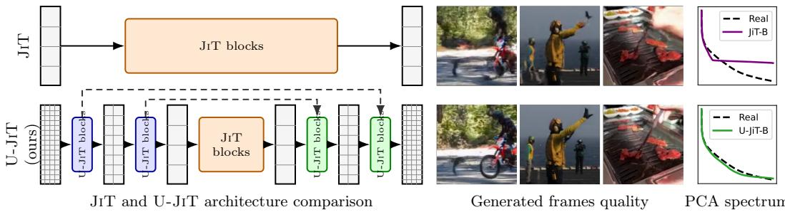
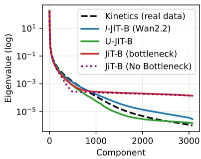
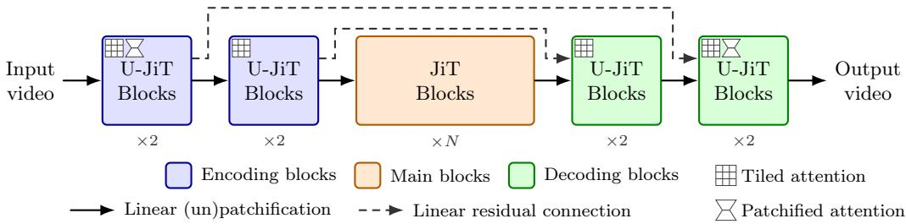
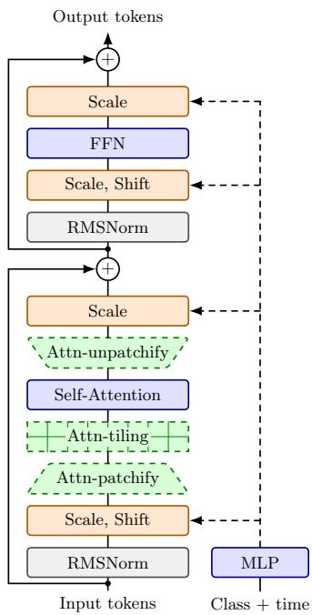
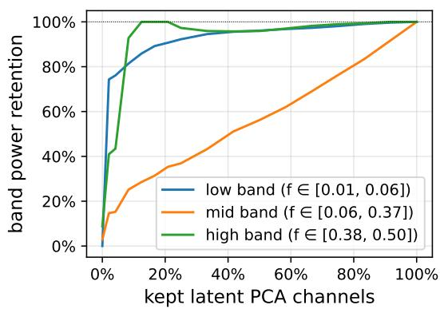
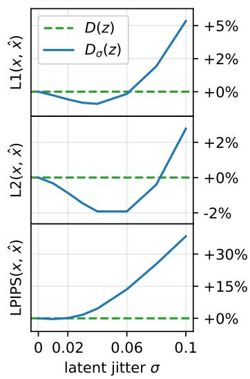
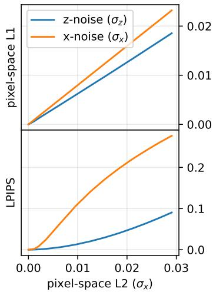
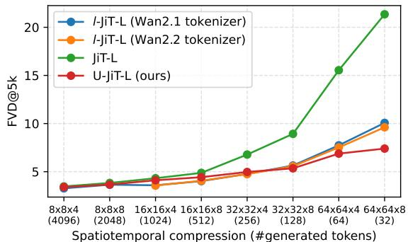
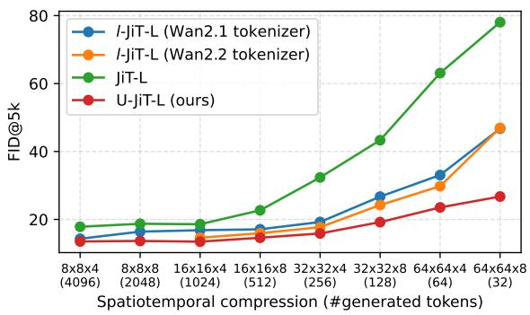

# Pixel-space video generation with U-JiT

Théophane Vallaeys1,2, Jakob Verbeek1, Matthieu Cord2,3

1FAIR, Meta, 2Sorbonne University, Paris, 3Valeo.ai

Latent difusion and flow matching models are ubiquitous in state-of-the-art generative video models. While highly efective, relying on pretrained autoencoders to compress the data into a lower-dimensional latent space also comes with drawbacks. First, training proceeds in two stages: autoencoder pretraining, with compression and reconstruction objectives, followed by latent generative model training, precluding fully end-to-end training. Second, autoencoders also lead to an inherent loss of signal, and the trade-of between reconstruction quality and generative performance in the latent space is still an active area of research. In this paper we explore the viability of generative video models directly in pixel space. We analyze recent approaches in pixel-space generative modeling of images that rely on basic transformer designs, and identify several shortcomings that limit their efectiveness for the high-dimensional pixel-space video generation. To overcome these limitations, we propose a UNet-like transformer architecture along with improvements to the training recipe and sampling strategy. We conduct controlled experiments, training latent and pixel-space models from scratch on Kinetics-600. For the standard frames-to-video task at 128 resolution, our U-JiT model improves generative FVD by 27% over prior state-of-the-art results, and by 14% against the JiT pixel-space baseline. Scaling to higher 256 resolution, we find the improvement over pixel-space and latent-based models grows as we increase the spatiotemporal compression rate up to 64×64×8. Finally, we find that U-JiT improves per-frame FID by 27% over latent models and 61% over pixel-space models on class-to-video generation, with respectively 9% and 56% reduction in FVD.

Date: October 29, 2026

Correspondence: Théophane Vallaeys (webalorn@meta.com)

∞Meta

  
Figure 1 Comparison of JiT and our proposed U-JiT on video generation. While JiT processes the video with a single stack of large-patch blocks, U-JiT varies the patch size along model depth. In this manner the model benefits from small patches in the outer layers to capture high resolution detail, as well as high channel depth in the inner layers to model high-level semantic structure. On the right, frames generated by each model, and the PCA spectrum of generated vs. real videos.

## 1 Introduction

Recent advances on pixel-space image generation (Hoogeboom et al., 2025; Chen et al., 2026a,b; Pavasovic et al., 2026; Baade et al., 2026) have shown that Flow-Matching models can achieve high quality generation in ambient space, without relying on the latent spaces generated by autoencoders or “tokenizers”. By using transformer-based models with large patch size, they also preserve the scalability and eficiency of their latent counterparts. Flow-Matching models are trained to predict, from a noised input $x _ { t } = ( 1 - t ) \varepsilon + t x _ { 0 } .$ the velocity $\boldsymbol { v } _ { t } = \boldsymbol { x } _ { 0 } - \varepsilon$ that transports the distribution of noise ε to the distribution of data $x _ { 0 }$ . The key idea underlying pixel-space models is the hypothesis that the natural data lies on a low-dimensional manifold embedded in the high-dimensional ambient space (Turk and Pentland, 1991; Tipping and Bishop, 1999; Roweis and Saul, 2000; Carlsson, 2009; Chapelle et al., 2006). This allows the predicted velocity to be decomposed into a compressible signal $x _ { 0 }$ and the incompressible Gaussian noise ε, either explicitly

through the objective (Li and He, 2026), or implicitly through the architecture design (Yu et al., 2026;   
Ma et al., 2026; Chen et al., 2026c).

However, state-of-the-art video generation models (Wan et al., 2025; Polyak et al., 2025; Jin et al., 2025; Yang et al., 2025; Gupta et al., 2025) rely on highly compressed latent representations (HaCohen et al., 2024; Team et al., 2026; Chen et al., 2025b) to achieve fast generation at scale, taking advantage of the high redundancy in video signal. Direct application of pixel-space models for images to video is complicated by the additional temporal dimension. Simple linear patchification layers cannot properly compress the high-dimensional data, as per-patch dimension becomes significantly higher than the model hidden dimension.

In our work, we propose to address this limitation directly at the architectural level. After demonstrating how plain transformers struggle to generate high frequencies in video, we introduce U-JiT, a minimal adaptation of the transformer architecture based on U-shaped transformers (Tian et al., 2024), see Figure 1. We propose to keep the stack of transformer blocks as the main backbone, but to vary the patch size along the depth of the network, using single-pixel patches at the finest level. This design allows fine-grained modeling of high-dimensional data at the finest level coupled with a learned, progressive, non-linear compression of the pixel-space video to the internal hidden representations. Skip connections are added to allow propagation of high-frequency information, and adaptations to the attention mechanism in the early and late blocks are used to preserve eficiency.

We evaluate our method on the Kinetics-600 (Carreira et al., 2018) dataset, and show on the frames-to-video task that U-JiT improves FVD and FID by respectively 29% and 90% over the JiT pixel-space baseline, outperforms by 27% the FVD of the best published results on the benchmark, and achieves competitive FVD with 64% reduction in FID compared to our best latent-space baseline. We additionally show that among those models, U-JiT scales the best with respect to the patch size, supporting strong spatiotemporal compression that JiT models struggle with. Finally, for the more challenging class-conditional generation setting, we improve FVD by 9% over the best latent baseline, and by 56% over the JiT pixel-space baseline, with a high compression rate of f32t8.

We summarize our contributions as follows: (1) We provide a detailed experimental analysis of the plain transformer architecture for pixel-space video generation, and show its practical limitations. (2) We propose U-JiT, a simple and eficient adaptation of the transformer architecture for pixel-space video generation, with minimal changes to preserve eficiency and scalability. (3) We study three key behaviors of two-stage latent-space video generation models, and show how standard Flow-Matching mechanisms can be used as their replacements, improving the results of both JiT and U-JiT. (4) We conduct extensive experiments across model sizes and tasks on Kinetics-600, showing that U-JiT outperforms existing latent-space and pixel-space baselines across both FVD and FID metrics.

## 2 Related work

Diffusion and Flow-matching. Difusion (Sohl-Dickstein et al., 2015; Ho et al., 2020; Song et al., 2021b; Dhariwal and Nichol, 2021; Song et al., 2021a; Nichol and Dhariwal, 2021) is a class of generative process modeling stochastic paths between a source (noise) and a target (data) distribution by learning to reverse a forward noising process. Flow Matching (Lipman et al., 2023; Liu et al., 2023; Albergo and Vanden-Eijnden, 2023) can be seen as a variant learning a deterministic velocity field between source and target. Notable design choices of the process itself include noise scheduling (Chen, 2023), sampling method (Karras et al., 2022), guidance mechanism (Ho and Salimans, 2021; Kynkäänniemi et al., 2024), training timestep sampling (Esser et al., 2024) and log-SNR shift with data dimensionality (Hoogeboom et al., 2023). Those methods are considered state-of-the-art for image (Peebles and Xie, 2023; Ma et al., 2024; Esser et al., 2024) and video (Ho et al., 2022b,a; Singer et al., 2023; Blattmann et al., 2023; Ma et al., 2025; Gupta et al., 2025; Lu et al., 2024) generation.

Latent-space generation. Latent difusion models (Rombach et al., 2022) were introduced to allow high dimensional generation by first compressing the data into a lower-dimensional latent space with an autoencoder (Kingma and Welling, 2022; van den Oord et al., 2017; Esser et al., 2021). These models inherently carry a trade-of between compression and generation quality (Chen et al., 2025a). Alignment with foundation models (Yao et al., 2025; Shi et al., 2026) and direct use of SSL encoders (Zheng et al., 2026; Singh et al., 2026) have been shown to improve the quality of latent generation and to allow larger latent dimensions. On the other end, difusion decoders (Zhao et al., 2025; Chen et al., 2025c; Vallaeys et al., 2026; Lu et al., 2026) focus on generating missing frequencies from the latent encoding. These autoencoders have been successfully extended to discrete (Yu et al., 2024) and continuous video tokenization (Guo et al., 2025; Gupta et al., 2025; Yang et al., 2025; Chen et al., 2025b; NVIDIA et al., 2025; Polyak et al., 2025; Wan et al., 2025; HaCohen et al., 2024; Kong et al., 2025). Various improvements have also been proposed for the latent model architecture, such as using and improving a transformer backbone (Peebles and Xie, 2023; Yao et al., 2025; Wang et al., 2026), and using U-Net (Ronneberger et al., 2015) inspired architectures (Hatamizadeh et al., 2025; Bao et al., 2023; Tian et al., 2024; Crowson et al., 2024).

End-to-end pixel-space generation. The main limitation of latent models is the two-stage training, which can introduce a loss of information and a latent space that is hard to difuse. One way to address it is to jointly train the tokenizer and the latent model, either as a first-stage improvement (Heek et al., 2026), a finetuning stage after pretraining (Leng et al., 2025), or as a fully end-to-end training (Duggal et al., 2026; Chu et al., 2026; Meshchaninov et al., 2026). Another line of work tries to address the issue by directly generating in pixel space. Transformers are adapted by using additional convolutional layers (Hoogeboom et al., 2023, 2025), pixel-space specialized output heads (Ma et al., 2026; Chen et al., 2026c; Yu et al., 2026), or by keeping a plain transformer backbone with a reformulation of the target velocity (Li and He, 2026). We build upon this line of work, by identifying and overcoming some of the limitations of current pixel-space approaches.

## 3 Method

## 3.1 The architectural bottleneck on high-dimensional data

Natural images and videos lie on low-dimensional manifolds embedded in high-dimensional ambient space, which implies that the intrinsic dimension of the data is much lower than the noise or velocity dimension (Turk and Pentland, 1991; Tipping and Bishop, 1999; Roweis and Saul, 2000; Carlsson, 2009; Chapelle et al., 2006). This has been leveraged in JiT (Li and He, 2026) by predicting the clean image rather than the velocity field directly, this separates the incompressible noise present in the velocity term from the compressible (clean image) signal while maintaining a simple architectural design. We show here that this is not suficient to capture the distribution of high-dimensional data such as videos. The relationship between the low-dimensional manifold and the high-dimensional ambient space is non-linear, implying that standard transformers are insuficient to capture this manifold with large patch sizes, resulting in lost high frequencies.

  
Figure 2 PCA spectrum over 16 × 16 × 4 patches, computed over 1k real and sampled videos.

To empirically display this behavior on real data, we train a pixelspace JiT-B model on Kinetics-600 for 200 epochs on the standard task of generating 12 frames from 5 starting frames, with a patch size of 16×16×4 and a frame resolution of 256×256. We additionally train a latent-space model (l-JiT-B (Wan2.2 Tokenizer)) and our custom architecture (U-JiT-B, see Section 3.2) on the same task. In Figure 2 we display the PCA spectrum of real and generated space-time video patches. We observe that JiT fails to capture high frequencies, as there is a sharp cut between two regimes of the spectrum: the first one roughly follows a power law, similarly to real data, while the second one is close to a flat Gaussian noise spectrum.1 On the other hand, both the latent model and our U-JiT-B model manage to capture the power law structure of the real data spectrum across the full range of frequencies.

To confirm this observation, we propose to model the distribution of real and generated patches as a mixture of two signals: a lower-dimensional signal P that captures the compressible part of the data (the signal subspace), and random Gaussian noise $\varepsilon \sim \mathcal { N } ( 0 , \sigma ^ { 2 } I )$ . This model is well aligned with the Flow-Matching generation process, which shifts samples from pure noise to data. We follow Gavish and Donoho (2014) to empirically estimate the threshold between signal and noise in the PCA spectrum2. We find an estimated signal-subspace dimension of 1308 for real Kinetics-600 videos, 1258 for videos generated in the Wan2.2 tokenizer latent space, 1284 for our U-JiT-generated videos, and only 596 for JiT-generated videos. This confirms that JiT fails to capture a large part of the signal, while the U-JiT architecture allows a better split between signal and noise, capturing a much wider range of frequencies.

  
Figure 3 U-JiT architecture overview. Encoding and decoding blocks are parametrized to match standard JiT blocks used in the main backbone in computational cost.

## 3.2 U-JiT: varying patch-size transformer

In order to support eficient video generation, a transformer model needs to handle a large spatiotemporal patch size, which reduces the number of tokens. The analysis in Section 3.1 motivates architectural changes to natively handle large patch sizes in pixel-space models. Existing architectures from the image generation literature (Wang et al., 2026; Yu et al., 2026; Ma et al., 2026; Chen et al., 2026c) address this with a specialized output head, but sufer from two issues: (1) Scalability: due to the large embedding dimension (Wang et al., 2026) or large, repeated, conditioning projection (Yu et al., 2026), their FLOPs and parameter count increase quadratically with the patch size, which makes them impractical for the stronger compression needed for video generation; (2) Expressivity: they use a linear projection layer to compress the input, which is significantly less expressive than the multi-layer encoders employed by latent space methods to extract compacts latents, thereby losing access to useful signal throughout the model up until the output head.

We propose instead to design our U-JiT as a varying-patchsize, U-Net shaped transformer, based on U-DiT (Tian et al., 2024), using JiT blocks (Li and He, 2026) and additional adaptations to attention to remain FLOPs-eficient. This

Figure 4 U-JiT block, with attention tiling and patchification blocks.

ensures scalability by keeping standard transformer blocks, with only minimal changes in the early (encoding) and late (decoding) layers. The overall architecture is shown in Figure 3. We follow the standard DiT (Peebles and Xie, 2023) model sizes and use 3 levels (2 encoding / decoding levels, and one main level), adjusting the overall number of blocks to keep the same computational cost as JiT. The central (main) level uses exactly the same blocks as JiT models, with the same patch size and hidden dimension. Compared to latent space models, our approach incorporates a small encoder and decoder inside the denoising model, and trains in end-to-end manner.

The encoding and decoding blocks, referred to as U-JiT blocks (see Figure 4), use a smaller patch size, and scale their hidden dimension relative to their patch size to preserve the same number of FLOPs as JiT blocks. Similarly to U-DiT, we use a single residual connection per level, projected with a zero-initialized linear layer. Downsampling and upsampling operations are learned as a linear operation combined with spacetime-to-depth / depth-to-spacetime reshaping, similarly to the input / output projections of JiT models. Furthermore, to allow patchification of individual frames, this linear projection is expressed as two linear layers, one for the spatial dimension and one for the temporal dimension, with the second one skipped for tokens representing individual frames. We additionally perform the adaptations detailed below to the attention mechanism of the encoding / decoding blocks to remain FLOP-eficient with small patch sizes on videos. Ablations on the impact of each architectural component of our model are provided in Table S4.

Attention tiling. Similarly to U-DiT (Tian et al., 2024), we use attention tiling to reduce attention complexity inside encoding / decoding layers, by splitting the token grid without changing the attention operation itself. Instead of fixing the number of grid splits, we use an attention tiling window size of 8×8×4 for all our models, which scales linearly with video length.

Attention patchification. In order to support (near) atomic spatiotemporal patches of size 1 ×1×1 or 2×2×1, we use a patchified attention, following the linear compressed attention of PixelDiT (Yu et al., 2026). We group tokens into spatiotemporal patches that are linearly projected to obtain a smaller token grid, with a higher embedding dimension per token, before applying the attention. A similar linear expansion is applied to the output of the attention, to recover the original token grid. In practice, we use attention patchification only for the first encoding / last decoding blocks (pixel-level blocks), with the same compression patch size as the second level of the U-JiT. We scale the attention hidden dimension to preserve FLOPs. See Section A for complete paramtetrization details.

## 3.3 Analyzing the two-stage generative process of latent-space models

Latent space generative models can be seen as a twostage generative process, where the first stage (latent flow-matching) iteratively generates a low-dimensional latent representation of the video, and the second stage decodes this latent representation into a highdimensional video as a single decoding step. We make three key observations that reflect the diferent behavior of these two stages. We support each with analysis on a latent l-JiT-B model trained using the Wan2.2 tokenizer on 256×256 resolution, on 16-frame Kinetics-600 clips.

1. Low/high frequency split between latent generator and decoder. Latent-space models are efectively two-stage generative processes. The latent space is usually significantly lower than that of the video, which limits the latents to mainly capturing low and mid frequencies, while the decoder is responsible for resolving high frequency detail.

  
Figure 5 Band power retention in decoded videos, depending on latent capacity.

To identify which frequency bands are captured by the latent and which ones are generated by the decoder, we reduce the latent capacity by applying a PCA decomposition on it, keeping only the first k PCA components. We sweep over k and display in Figure 5 the power retention ratio of the low, mid and high frequency bands in the decoded video, compared to the full-latent decoded video. We observe that low frequencies are mostly captured by the first PCA components (around 90% power retention with 20% of the PCA components), while mid frequencies increase almost linearly with the number of PCA components, indicating that successive PCA components capture from low to mid frequencies. Conversely, high frequencies consistently keep from 90% to 100% of their power, even when removing 90% of the PCA components, at which point the latent encodes almost only low frequencies. This indicates that the decoder is responsible for generating most of the high frequencies, while the latent process generates low to mid bands.

2. On-manifold high-frequency generation. Adversarially-trained decoders are optimized to generate on-manifold high-frequency details: from a given latent encoding z, the decoder does not generate the most likely video in the ambient space (the closest in MSE on average), but

Figure 6 Reconstruction quality over latent jittering.

the most likely one on the embedded manifold. The theoretical insights behind this efect are discussed by Blau and Michaeli (2018).

To identify if the latent-to-video decoder efectively benefits from this efect, we design a simple variant $D _ { \sigma }$ of the original decoder D to increase ambient space reconstruction fidelity. Given an input video x and its latent encoding z, we reconstruct the video by averaging the output of D over K = 16 randomly jittered latent encodings, yielding $\begin{array} { r } { \hat { x } = D _ { \sigma } ( z ) = \frac { 1 } { K } \sum _ { k = 1 } ^ { K } D ( z + \sigma \varepsilon _ { k } ) } \end{array}$ where $\varepsilon _ { k } \sim \mathcal { N } ( 0 , I )$ . The reconstruction xˆ is a locally smoothed output of the decoder. In Figure 6 we plot reconstruction metrics, sweeping over the hyperparameter $\sigma .$ . For $\sigma \in [ 0 . 0 2 , 0 . 0 6 ]$ , our jittered decoder pulls the decoded video closer to the initial datapoint, as measured by $L _ { 1 }$ and $L _ { 2 }$ distances. Conversely, the perceptual quality of the video is degraded, as measured by LPIPS. This confirms that the decoder actively pushes the generated video on-manifold, away from the closest reconstruction in ambient space.

3. Perceptually-aligned variance. The latent Flow-Matching model is trained with an isotropic Gaussian noise schedule and an $L _ { 2 }$ (MSE) objective, which is agnostic to any perceptual metric and weights every direction in latent space equally. As a result, its residual error is approximately isotropic in the latent space.

We investigate how the decoder maps isotropic latent variations to anisotropic, perceptually aligned variations in the video pixel space. To this end we decode a latent z into ${ \hat { x } } ,$ and a perturbed latent $z + \sigma _ { z } \varepsilon _ { z }$ with isotropic noise into $\hat { x } _ { \sigma _ { z } }$ . Averaging across noise and samples, we measure the efective pixel-space noise scale as the $L _ { 2 }$ distance $\sigma _ { x }$ between the clean decoded video xˆ and the perturbed decoded video $\hat { x } _ { \sigma _ { z } }$ . We similarly perturb the reconstructed video xˆ directly with isotropic noise in pixel space, as $\hat { x } + \sigma _ { x } \varepsilon _ { x }$ . We compare $L _ { 1 }$ and LPIPS metrics between both latent (z-noise) and pixel-space (x-noise) perturbations in Figure 7. For a similar, increasing pixel-space noise magnitude, the LPIPS metric deteriorates much faster for the pixelspace perturbation than for the latent perturbation. This shows that the decoder efectively maps isotropic latent noise to perceptually

  
Figure 7 Efect of two types of noise on metrics.

aligned variations in the video space, which is crucial to generate on-manifold high-frequency details. Additionally, the $L _ { 1 }$ distance to the original decoded sample also increases slightly faster, indicating that the latent perturbation is mapped to a sparser variation.

## 3.4 Sampling on-manifold in pixel space

In Section 3.3 we identified three key mechanisms, specific to latent-space models, that improve the generation of high-quality videos. Based on this analysis we propose adaptations of the training and sampling processes of pixelspace models, using known methods from Flow-Matching literature, to improve pixel-space methods and bridge the gap with latent-space generation.

Time-shifting: focusing sampling on low-frequencies. Latent models use most of their compute on the low-frequency structure of the video (latent flow-matching), and a single decoding step to generate high-frequency details. To mimick this behavior in pixel-space models, we use timeshifting (Hoogeboom et al., 2023) at inference only to shift the sampling process toward low frequencies, keeping only a few steps to generate the high-frequency details. In practice, given N sampling steps, we use the sampling schedule $\begin{array} { r } { t _ { i } = \frac { i } { i + \sigma _ { t } ( N - i ) } } \end{array}$ , reverting to the linear time sampling schedule for $\sigma _ { t } = 1$ . We validate in a simple setting in Table 1 that time-shifting can lead to significant improvements in both FVD and FID metrics.

Table 1 U-JiT-B sampling sweep on Kinetics-600, at 200 epochs. A CFG of 1 reverts to non-CFG sampling, and $\sigma _ { t } = 1$ to linear time sampling.
<table><tr><td></td><td></td><td colspan="6">CFG</td></tr><tr><td></td><td> $\sigma _ { t }$ </td><td>1</td><td>1.5</td><td>2</td><td>2.5</td><td>3</td><td>3.5</td></tr><tr><td>→</td><td>1</td><td>3.43</td><td>3.21</td><td>3.15</td><td>3.15</td><td>3.16</td><td>3.17</td></tr><tr><td>05k</td><td>2</td><td>3.37</td><td>3.17</td><td>3.14</td><td>3.13</td><td>3.13</td><td>3.15</td></tr><tr><td></td><td>4</td><td>3.33</td><td>3.14</td><td>3.12</td><td>3.11</td><td>3.12</td><td>3.15</td></tr><tr><td>VΛVD</td><td>8</td><td>3.29</td><td>3.14</td><td>3.10</td><td>3.14</td><td>3.20</td><td>3.29</td></tr><tr><td></td><td>16</td><td>3.32</td><td>3.15</td><td>3.14</td><td>3.26</td><td>3.47</td><td>3.78</td></tr><tr><td>→ 05</td><td>1 2</td><td>21.9 19.0</td><td>18.4 16.3</td><td>17.1 15.4</td><td>16.5 15.0</td><td>16.1 14.9</td><td>15.9 14.9</td></tr></table>

Classifier-free guidance: on-manifold high-frequency details. On the standard task of video completion (such as on the Kinetics dataset), where the strong conditioning is coupled with a GAN-trained decoder, classifierfree guidance is usually deemed unnecessary for latent-space models. We find in Table 1 that, for pixel-space models, applying classifier-free guidance (Ho and Salimans, 2021) with an interval (Kynkäänniemi et al., 2024) during sampling noticeably improves the quality of generated videos, as it allows the model to generate on-manifold high-frequency details.

Perceptual loss: aligning generation variations along perceptually-correct directions. Flow-Matching models are trained to capture the distribution of real training samples, and to generalize to realistic non-training samples. To ensure that the variations in high frequencies are aligned with perceptually-correct directions, we apply a perceptual LPIPS loss (Zhang et al., 2018) during training. Ablations on the impact of this

loss are included in Table S4.

We found time-shifting and classifier-free guidance to also improve, to a lesser extent, the performance of latent-space models on all tasks (see Table S3). To ensure a fair comparison, we use them in all our experiments. We find that a time shift $\sigma _ { t } = 8$ performs best on average across tasks and models for pixel-space models, and $\sigma _ { t } = 4$ for latent-space models. We select the CFG value for each model on each task with a grid search (step of 0.5), as the optimal CFG value difers substantially across tasks and models. Following (Kynkäänniemi et al., 2024), we apply CFG only in the ODE time interval of [0.1, 1] for all models.

## 3.5 Model architecture and training details

We follow Yao et al. (2025) by using DiT models (Peebles and Xie, 2023) with the same improvements: SwiGLU activations (Shazeer, 2020), RMSNorm layers (Zhang and Sennrich, 2019), RoPE positional embeddings (Su et al., 2024), and qk-norm (Henry et al., 2020), together with the additional context tokens introduced by Li and He (2026). We refer to these models as JiT models in pixel space, l-JiT models when trained in latent space, and U-JiT when incorporating our architecture modifications. We train all models with the same training objective as JiT (Li and He, 2026), using x-prediction and a velocity loss, which we found more efective than v-prediction for both pixel-space and latent-space video models. We use noise scaling to scale across video resolutions and lengths. We refer to Section A for additional implementation details and per-model FLOPs and parametrization.

## 4 Experiments

## 4.1 Experimental Setup

We train and evaluate our models on the Kinetics-600 dataset (Carreira et al., 2018), and use the FVD metric (Unterthiner et al., 2019) to evaluate overall video quality. As FVD assesses distribution match using spatio-temporal features from an action recognition model, we also evaluate FID (Heusel et al., 2017) to assess per-frame quality. We compare our pixel-space models to latent-space models trained using the following state-of-the-art video tokenizers: Wan2.1 and Wan2.2 (Wan et al., 2025), LTX (HaCohen et al., 2024), and the continuous Cosmos tokenizer (NVIDIA et al., 2025). We write fFtT for a spatiotemporal compression rate of F along the spatial axes and T along the temporal axis. As the Wan2.2 and LTX video tokenizers have respective compression rates of f16t4 and f32t8, we only use them in strong compression settings. Additional details about training and evaluation are provided in Section A.

## 4.2 Frames to video generation

We evaluate our models on the standard frames-to-video generation task (Ho et al., 2022b), where the model is given 5 frames as input, and is evaluated on generating the next 11 frames (in practice, 12 are generated due to patchification). We follow recent work (Pavasovic et al., 2026; Heek et al., 2026; Gupta et al., 2025) by training and evaluating at resolution 128×128 with spatiotemporal compression f8t4. We first train l-JiT-B, JiT-B and U-JiT-B models on this task, and report their results in Table 2. Our latent-space model (l-JiT-XL with Wan2.1 tokenizer) outperform existing latent-space and pixel-space video generation methods. Results show that our U-JiT is on par with the best latent-space model in terms of FVD, and significantly better in terms of FID. We also compare U-JiT-B with JiT-B under both our sampling strategy from Section 3.4 and base sampling that does not use CFG nor time-shifting.3. This confirms that both our sampling strategy and architecture each significantly contribute, on their own, to closing the gap between latent-space and pixel-space models, while combining both is necessary to match the FVD surpass the FID of latent-space models.

Scaling our models. To validate the improvements brought by our model at larger scales, we increase the model size to XL on the same task in Table 2. We observe clear FVD improvements for all methods, and similar FID for U-JiT and l-JiT. Our model stays on par with the best latent-space model in terms of FVD, with a clear per-frame FID quality improvement, and is noticeably better than JiT. We also reach state-of-the-art performance on the Kinetics-600 benchmark, with a 27% improvement from 0.84 to 0.61 in FVD compared to the previous best published results.

Table 2 Frames to video: 5 conditioning frames, 12 generated frames, at resolution 128×128 with spatiotemporal compression f8t4. B- and XL-sized models. FLOPs are computed for a single forward pass of the model, not accounting for the decoder cost of latent models. Pixel column indicates pixel-space (✓) and latent-space (×) generative models.
<table><tr><td>Model (f8t4)</td><td>Pixel</td><td>#Prms.</td><td>FLOPs</td><td>↓FVD</td><td>↓FID</td></tr><tr><td>Video Diffusion Models (Ho et al., 2022b)</td><td>√</td><td>1.1B</td><td>4.1T</td><td>16.2</td><td></td></tr><tr><td>RIN (Jabri et al., 2023)</td><td>√</td><td>411M</td><td>386G</td><td>10.8</td><td></td></tr><tr><td>MAGVIT-v2 (Yu et al., 2024)</td><td>X</td><td>307M</td><td></td><td>4.3</td><td></td></tr><tr><td>DeRA (Guo et al., 2025)</td><td>X</td><td>632M</td><td></td><td>4.1</td><td></td></tr><tr><td>W.A.L.T (Gupta et al., 2025)</td><td>X</td><td>313M</td><td></td><td>3.3</td><td></td></tr><tr><td>Unified Latents (Heek et al., 2026)</td><td>X</td><td></td><td></td><td>1.3</td><td></td></tr><tr><td>WaiT-XL (Pavasovic et al., 2026)</td><td>V</td><td>678M</td><td>1.3T</td><td>0.84</td><td>一</td></tr><tr><td>l-JrT-B (Cosmos Tokenizer)</td><td>X</td><td>124M</td><td>264G</td><td>1.50</td><td>8.36</td></tr><tr><td>l-JrT-B (Wan2.1 Tokenizer)</td><td>X</td><td>124M</td><td>264G</td><td>1.09</td><td>12.13</td></tr><tr><td>JIT-B (base sampling)</td><td>√</td><td>125M</td><td>266G</td><td>1.68</td><td>45.20</td></tr><tr><td>JIT-B</td><td>√</td><td>125M</td><td>266G</td><td>1.22</td><td>7.28</td></tr><tr><td>U-JIT-B (ours, base sampling)</td><td>√</td><td>98M</td><td>265G</td><td>1.25</td><td>7.17</td></tr><tr><td>U-JIT-B (ours)</td><td>√</td><td>98M</td><td>265G</td><td>1.06</td><td>3.08</td></tr><tr><td>l-JrT-XL (Cosmos Tokenizer)</td><td>X</td><td>643M</td><td>1.3T</td><td>1.00</td><td>8.78</td></tr><tr><td>l-JIT-XL (Wan2.1 Tokenizer)</td><td>X</td><td>643M</td><td>1.3T</td><td>0.62</td><td>11.05</td></tr><tr><td>JIT-XL (base sampling)</td><td>√</td><td>644M</td><td>1.3T</td><td>0.86</td><td>32.43</td></tr><tr><td>JIT-XL</td><td>√</td><td>644M</td><td>1.3T</td><td>0.71</td><td>5.29</td></tr><tr><td>U-JIT-XL (ours)</td><td>√</td><td>587M</td><td>1.3T</td><td>0.61</td><td>3.15</td></tr></table>

## 4.3 Strong video compression

As established in Section 3.1, the main challenge of pixel-space video generation lies in the high dimensionality of the video data, which is exacerbated by the use of strong spatiotemporal compression, necessary for fast, high-resolution generation. To this end, we study the efect of increased spatiotemporal compression on our models, compared to latent-space and vanilla JiT.

Scaling along the compression rate. We first train U-JiT-L, JiT-L and l-JiT-L (using the Wan2.1 and Wan2.2 tokenizers) models on the single-frame-to-video generation task, at resolution 256×256, where the model is given a single frame as input and is evaluated on the next 15 frames (in practice, 16 are generated and the last one is discarded). Models are trained for 400 epochs and evaluated on 5k samples. We report results in Figure 8. The JiT baseline shows a clear degradation in performance compared to latent-space models, as it struggles with high-dimensional data. On the other hand, our U-JiT model is as robust as latent-space models to increased spatiotemporal compression, following closely their FVD, and improving over them for the strongest f64t8 compression setting. It additionally shows improved per-frame quality (FID) at high compression rates.

  
Figure 8 Scaling the spatiotemporal compression rate. FVD@5k (left) and FID@5k (right) as functions of the compression. Evaluated at 400 epochs, 1 to 15 frames, resolution 256×256.

Strong compression analysis. We validate our findings by scaling to XL-sized models on the same task at a strong compression rate (f32t8), training until convergence (600 epochs) and evaluating on 50k samples. Results in Table 3 confirm our patch size scaling analysis, with U-JiT-XL outperforming all latent-space models in terms of both FVD and FID, and JiT-XL sufering from a clear degradation in performance.

Table 3 Image to video, strong compression. 1 to 16 frames, at resolution 256 × 256 with spatiotemporal compression f32t8.
<table><tr><td>Model (f32t8)</td><td>#Prms.</td><td>|↓FVD</td><td>↓FID</td></tr><tr><td>l-JIT-XL (Cosmos Tokenizer)</td><td>644M</td><td>3.94</td><td>12.41</td></tr><tr><td>l-J1T-XL (Wan2.1 Tokenizer)</td><td>644M</td><td>2.73</td><td>12.86</td></tr><tr><td>l-JIT-XL (Wan2.2 Tokenizer)</td><td>644M</td><td>2.66</td><td>9.97</td></tr><tr><td>l-JIT-XL (LTX Tokenizer)</td><td>643M</td><td>5.09</td><td>21.06</td></tr><tr><td>JIT-XL (base sampling)</td><td>700M</td><td>8.98</td><td>52.53</td></tr><tr><td>JIT-XL</td><td>700M</td><td>5.86</td><td>30.27</td></tr><tr><td>U-JIT-XL (ours)</td><td>478M</td><td>2.55</td><td>7.20</td></tr></table>

## 4.4 Class to video generation

Video completion evaluates the ability to continue a sequence of frames, with a strong conditioning signal that specifies most of the structure and background of the video. This mainly focuses on the capacity of the model to output coherent motion, and high-quality frames similar to the input, which is close to an auto-encoding task. We also evaluate our method on the harder class-tovideo generation task, where the full distribution of the content is learned by the model. We use the same strong compression setting of f32t8 as in Section 4.3, training l-JiT-XL, JiT-XL and U-JiT-XL models to generate 65 frames from a class condition, corresponding to 8 seconds of

Table 4 Class to video. 65 frames generated from a class condition, at resolution 256 × 256 with strong spatiotemporal compression f32t8.
<table><tr><td>Model (f32t8)</td><td>#Prms.</td><td>↓FVD</td><td>↓FID</td></tr><tr><td>l-JrT-XL (Cosmos Tokenizer)</td><td>647M</td><td>4.78</td><td>17.44</td></tr><tr><td>l-JIT-XL (Wan2.1 Tokenizer)</td><td>647M</td><td>3.31</td><td>21.52</td></tr><tr><td>l-JIT-XL (Wan2.2 Tokenizer)</td><td>647M</td><td>3.55</td><td>18.08</td></tr><tr><td>l-JIT-XL (LTX Tokenizer)</td><td>646M</td><td>3.96</td><td>22.24</td></tr><tr><td>JIT-XL (base sampling)</td><td>707M</td><td>9.45</td><td>65.49</td></tr><tr><td>JIT-XL</td><td>707M</td><td>6.88</td><td>32.60</td></tr><tr><td>U-JIT-XL (ours)</td><td>478M</td><td>3.00</td><td>12.65</td></tr></table>

video, at resolution 256×256. To compute FVD, we split each of the 50k generated videos into 4 clips of 16 frames, yielding a total of 200k clips for evaluation. Results reported in Table 4 show that our U-JiT outperforms all latent-space models, increasing the gap in FVD improvement from 4% to 9% compared to the image-to-video task (Table 3). This confirms that U-JiT generalizes to general video generation tasks, learning the full distribution of low- and high-level features.

## 5 Conclusion

Two-stage latent-space generation models are inherently limited by the quality of the tokenizer, whose objectives are not easily aligned with the generation task: reconstruction fidelity, compression ratio and difusability are all competing objectives that are hard to optimize simultaneously. End-to-end pixel-space generation ofers a paradigm that bypasses the tokenizer bottleneck, but is limited by the high dimensionality of the data space. Previous work has shown how to separate high-dimensional noise from the compressible signal to provide accurate velocity prediction in ambient space. In this work, we show that this is not suficient to capture the distribution of high-dimensional data such as videos, and propose a simple adaptation of the transformer architecture to address this issue. Our findings show that U-JiT, a multi-resolution pixel-space model, can be trained end-to-end to achieve results competitive with latent-space models, while providing better scalability to strong compression settings. We hope that this work will encourage further research on end-to-end video generation.

## References

Michael Samuel Albergo and Eric Vanden-Eijnden. Building normalizing flows with stochastic interpolants. In The Eleventh International Conference on Learning Representations, 2023. https://openreview.net/forum?id= li7qeBbCR1t.

Alan Baade, Eric Ryan Chan, Kyle Sargent, Changan Chen, Justin Johnson, Ehsan Adeli, and Li Fei-Fei. Latent forcing: Reordering the difusion trajectory for pixel-space image generation. In Forty-third International Conference on Machine Learning, 2026. https://openreview.net/forum?id=LFUaHUCO1a.

Fan Bao, Shen Nie, Kaiwen Xue, Yue Cao, Chongxuan Li, Hang Su, and Jun Zhu. All are worth words: A vit backbone for difusion models. In Proceedings of the IEEE/CVF Conference on Computer Vision and Pattern Recognition (CVPR), pages 22669–22679, June 2023.

Andreas Blattmann, Tim Dockhorn, Sumith Kulal, Daniel Mendelevitch, Maciej Kilian, Dominik Lorenz, Yam Levi, Zion English, Vikram Voleti, Adam Letts, Varun Jampani, and Robin Rombach. Stable video difusion: Scaling latent video difusion models to large datasets, 2023. https://arxiv.org/abs/2311.15127.

Yochai Blau and Tomer Michaeli. The perception-distortion tradeof. In Proceedings of the IEEE Conference on Computer Vision and Pattern Recognition (CVPR), June 2018.

Gunnar Carlsson. Topology and data. Bulletin of the American Mathematical Society, 46(2):255–308, 2009.

Joao Carreira and Andrew Zisserman. Quo vadis, action recognition? a new model and the kinetics dataset. In Proceedings of the IEEE Conference on Computer Vision and Pattern Recognition (CVPR), July 2017.

Joao Carreira, Eric Noland, Andras Banki-Horvath, Chloe Hillier, and Andrew Zisserman. A short note about kinetics-600, 2018. https://arxiv.org/abs/1808.01340.

Olivier Chapelle, Bernhard Schölkopf, and Alexander Zien, editors. Semi-Supervised Learning. MIT Press, Cambridge, MA, USA, 2006.

Hansheng Chen, Jan Ackermann, Minseo Kim, Gordon Wetzstein, and Leonidas Guibas. Asymmetric flow models, 2026a. https://arxiv.org/abs/2605.12964.

Junyu Chen, Han Cai, Junsong Chen, Enze Xie, Shang Yang, Haotian Tang, Muyang Li, and Song Han. Deep compression autoencoder for eficient high-resolution difusion models. In Y. Yue, A. Garg, N. Peng, F. Sha, and R. Yu, editors, International Conference on Learning Representations, volume 2025, pages 96539–96560, 2025a. https:// proceedings.iclr.cc/paper\_files/paper/2025/file/f062da1973ac9ac61fc6d44dd7fa309f-Paper-Conference.pdf.

Junyu Chen, Wenkun He, Yuchao Gu, Yuyang Zhao, Jincheng Yu, Junsong Chen, Dongyun Zou, Yujun Lin, Zhekai Zhang, Muyang Li, Haocheng Xi, Ligeng Zhu, Enze Xie, Song Han, and Han Cai. Dc-videogen: Eficient video generation with deep compression video autoencoder, 2025b. https://arxiv.org/abs/2509.25182.

Ting Chen. On the importance of noise scheduling for difusion models, 2023. https://arxiv.org/abs/2301.10972.

Yinbo Chen, Rohit Girdhar, Xiaolong Wang, Sai Saketh Rambhatla, and Ishan Misra. Difusion autoencoders are scalable image tokenizers, 2025c. https://arxiv.org/abs/2501.18593.

Zhennan Chen, Junwei Zhu, Xu Chen, Jiangning Zhang, Jiawei Chen, Zhuoqi Zeng, Wei Zhang, Chengjie Wang, Jian Yang, and Ying Tai. L2p: Unlocking latent potential for pixel generation, 2026b. https://arxiv.org/abs/ 2605.12013.

Zhennan Chen, Junwei Zhu, Xu Chen, Jiangning Zhang, Xiaobin Hu, Hanzhen Zhao, Chengjie Wang, Jian Yang, and Ying Tai. Dip: Taming difusion models in pixel space. In Proceedings of the IEEE/CVF Conference on Computer Vision and Pattern Recognition (CVPR), pages 36136–36146, June 2026c.

Wenda Chu, Bingliang Zhang, Jiaqi Han, Yizhuo Li, Linjie Yang, Yisong Yue, and Qiushan Guo. End-to-end autoregressive image generation with 1d semantic tokenizer. In Forty-third International Conference on Machine Learning, 2026. https://openreview.net/forum?id=fSnxuRhWoC.

Katherine Crowson, Stefan Andreas Baumann, Alex Birch, Tanishq Mathew Abraham, Daniel Z Kaplan, and Enrico Shippole. Scalable high-resolution pixel-space image synthesis with hourglass difusion transformers. In Ruslan Salakhutdinov, Zico Kolter, Katherine Heller, Adrian Weller, Nuria Oliver, Jonathan Scarlett, and Felix Berkenkamp, editors, Proceedings of the 41st International Conference on Machine Learning, volume 235 of Proceedings of Machine Learning Research, pages 9550–9575. PMLR, 21–27 Jul 2024. https://proceedings.mlr. press/v235/crowson24a.html.

Tri Dao, Dan Fu, Stefano Ermon, Atri Rudra, and Christopher Ré. Flashattention: Fast and memory-eficient exact attention with io-awareness. In S. Koyejo, S. Mohamed, A. Agarwal, D. Belgrave, K. Cho, and A. Oh,

editors, Advances in Neural Information Processing Systems, volume 35, pages 16344–16359. Curran Associates, Inc., 2022. doi: 10.52202/068431-1189. https://proceedings.neurips.cc/paper\_files/paper/2022/file/ 67d57c32e20fd0a7a302cb81d36e40d5-Paper-Conference.pdf.

Prafulla Dhariwal and Alexander Nichol. Difusion models beat gans on image synthesis. In M. Ranzato, A. Beygelzimer, Y. Dauphin, P.S. Liang, and J. Wortman Vaughan, editors, Advances in Neural Information Processing Systems, volume 34, pages 8780–8794. Curran Associates, Inc., 2021. https://proceedings.neurips. cc/paper\_files/paper/2021/file/49ad23d1ec9fa4bd8d77d02681df5cfa-Paper.pdf.

Shivam Duggal, Xingjian Bai, Zongze Wu, Richard Zhang, Eli Shechtman, Antonio Torralba, Phillip Isola, and William T. Freeman. End-to-end training for unified tokenization and latent denoising, 2026. https: //arxiv.org/abs/2603.22283.

Patrick Esser, Robin Rombach, and Bjorn Ommer. Taming transformers for high-resolution image synthesis. In Proceedings of the IEEE/CVF Conference on Computer Vision and Pattern Recognition (CVPR), pages 12873–12883, June 2021.

Patrick Esser, Sumith Kulal, Andreas Blattmann, Rahim Entezari, Jonas Müller, Harry Saini, Yam Levi, Dominik Lorenz, Axel Sauer, Frederic Boesel, Dustin Podell, Tim Dockhorn, Zion English, and Robin Rombach. Scaling rectified flow transformers for high-resolution image synthesis. In Ruslan Salakhutdinov, Zico Kolter, Katherine Heller, Adrian Weller, Nuria Oliver, Jonathan Scarlett, and Felix Berkenkamp, editors, Proceedings of the 41st International Conference on Machine Learning, volume 235 of Proceedings of Machine Learning Research, pages 12606–12633. PMLR, 21–27 Jul 2024. https://proceedings.mlr.press/v235/esser24a.html.

Matan Gavish and David L. Donoho. The optimal hard threshold for singular values is 4/ 3. IEEE Transactions on Information Theory, 60(8):5040–5053, 2014. doi: 10.1109/TIT.2014.2323359.

Pengbo Guo, Junke Wang, Zhen Xing, Chengxu Liu, Daoguo Dong, Xueming Qian, and Zuxuan Wu. Dera: Decoupled representation alignment for video tokenization, 2025. https://arxiv.org/abs/2512.04483.

Agrim Gupta, Lijun Yu, Kihyuk Sohn, Xiuye Gu, Meera Hahn, Fei-Fei Li, Irfan Essa, Lu Jiang, and José Lezama. Photorealistic video generation with difusion models. In Aleš Leonardis, Elisa Ricci, Stefan Roth, Olga Russakovsky, Torsten Sattler, and Gül Varol, editors, Computer Vision – ECCV 2024, pages 393–411, Cham, 2025. Springer Nature Switzerland. ISBN 978-3-031-72986-7.

Yoav HaCohen, Nisan Chiprut, Benny Brazowski, Daniel Shalem, Dudu Moshe, Eitan Richardson, Eran Levin, Guy Shiran, Nir Zabari, Ori Gordon, Poriya Panet, Sapir Weissbuch, Victor Kulikov, Yaki Bitterman, Zeev Melumian, and Ofir Bibi. Ltx-video: Realtime video latent difusion, 2024. https://arxiv.org/abs/2501.00103.

Ali Hatamizadeh, Jiaming Song, Guilin Liu, Jan Kautz, and Arash Vahdat. Difit: Difusion vision transformers for image generation. In Aleš Leonardis, Elisa Ricci, Stefan Roth, Olga Russakovsky, Torsten Sattler, and Gül Varol, editors, Computer Vision – ECCV 2024, pages 37–55, Cham, 2025. Springer Nature Switzerland. ISBN 978-3-031-73242-3.

Jonathan Heek, Emiel Hoogeboom, Thomas Mensink, and Tim Salimans. Unified latents (ul): How to train your latents, 2026. https://arxiv.org/abs/2602.17270.

Alex Henry, Prudhvi Raj Dachapally, Shubham Shantaram Pawar, and Yuxuan Chen. Query-key normalization for transformers. In Trevor Cohn, Yulan He, and Yang Liu, editors, Findings of the Association for Computational Linguistics: EMNLP 2020, pages 4246–4253, Online, November 2020. Association for Computational Linguistics. doi: 10.18653/v1/2020.findings-emnlp.379. https://aclanthology.org/2020.findings-emnlp.379/.

Karl Heun et al. Neue methoden zur approximativen integration der diferentialgleichungen einer unabhängigen veränderlichen. Z. Math. Phys, 45(23-38):7, 1900.

Martin Heusel, Hubert Ramsauer, Thomas Unterthiner, Bernhard Nessler, and Sepp Hochreiter. Gans trained by a two time-scale update rule converge to a local nash equilibrium. In I. Guyon, U. Von Luxburg, S. Bengio, H. Wallach, R. Fergus, S. Vishwanathan, and R. Garnett, editors, Advances in Neural Information Processing Systems, volume 30. Curran Associates, Inc., 2017. https://proceedings.neurips.cc/paper\_files/paper/2017/ file/8a1d694707eb0fefe65871369074926d-Paper.pdf.

Jonathan Ho and Tim Salimans. Classifier-free difusion guidance. In NeurIPS 2021 Workshop on Deep Generative Models and Downstream Applications, 2021. https://openreview.net/forum?id=qw8AKxfYbI.

Jonathan Ho, Ajay Jain, and Pieter Abbeel. Denoising difusion probabilistic models. In H. Larochelle, M. Ranzato, R. Hadsell, M.F. Balcan, and H. Lin, editors, Advances in Neural Information Processing Systems, volume 33, pages 6840–6851. Curran Associates, Inc., 2020. https://proceedings.neurips.cc/paper\_files/paper/2020/file/ 4c5bcfec8584af0d967f1ab10179ca4b-Paper.pdf.

Jonathan Ho, William Chan, Chitwan Saharia, Jay Whang, Ruiqi Gao, Alexey Gritsenko, Diederik P. Kingma, Ben Poole, Mohammad Norouzi, David J. Fleet, and Tim Salimans. Imagen video: High definition video generation with difusion models, 2022a. https://arxiv.org/abs/2210.02303.

Jonathan Ho, Tim Salimans, Alexey Gritsenko, William Chan, Mohammad Norouzi, and David Fleet. Video difusion models. In S. Koyejo, S. Mohamed, A. Agarwal, D. Belgrave, K. Cho, and A. Oh, editors, Advances in Neural Information Processing Systems, volume 35, pages 8633–8646. Curran Associates, Inc., 2022b. doi: 10.52202/068431-0628. https://proceedings.neurips.cc/paper\_files/paper/2022/file/ 39235c56aef13fb05a6adc95eb9d8d66-Paper-Conference.pdf.

Emiel Hoogeboom, Jonathan Heek, and Tim Salimans. simple difusion: End-to-end difusion for high resolution images. In Andreas Krause, Emma Brunskill, Kyunghyun Cho, Barbara Engelhardt, Sivan Sabato, and Jonathan Scarlett, editors, Proceedings of the 40th International Conference on Machine Learning, volume 202 of Proceedings of Machine Learning Research, pages 13213–13232. PMLR, 23–29 Jul 2023. https://proceedings. mlr.press/v202/hoogeboom23a.html.

Emiel Hoogeboom, Thomas Mensink, Jonathan Heek, Kay Lamerigts, Ruiqi Gao, and Tim Salimans. Simpler difusion: 1.5 fid on imagenet512 with pixel-space difusion. In Proceedings of the IEEE/CVF Conference on Computer Vision and Pattern Recognition (CVPR), pages 18062–18071, June 2025.

Allan Jabri, David J. Fleet, and Ting Chen. Scalable adaptive computation for iterative generation. In Andreas Krause, Emma Brunskill, Kyunghyun Cho, Barbara Engelhardt, Sivan Sabato, and Jonathan Scarlett, editors, Proceedings of the 40th International Conference on Machine Learning, volume 202 of Proceedings of Machine Learning Research, pages 14569–14589. PMLR, 23–29 Jul 2023. https://proceedings.mlr.press/v202/jabri23a. html.

Yang Jin, Zhicheng Sun, Ningyuan Li, Kun Xu, Hao Jiang, Nan Zhuang, Quzhe Huang, Yang Song, Yadong MU, and Zhouchen Lin. Pyramidal flow matching for eficient video generative modeling. In Y. Yue, A. Garg, N. Peng, F. Sha, and R. Yu, editors, International Conference on Learning Representations, volume 2025, pages 23378–23402, 2025. https://proceedings.iclr.cc/paper\_files/paper/2025/file/ 3ab228c4703c4459b1a600ebadc5732c-Paper-Conference.pdf.

Tero Karras, Miika Aittala, Timo Aila, and Samuli Laine. Elucidating the design space of difusion-based generative models. In S. Koyejo, S. Mohamed, A. Agarwal, D. Belgrave, K. Cho, and A. Oh, editors, Advances in Neural Information Processing Systems, volume 35, pages 26565–26577. Curran Associates, Inc., 2022. doi: 10.52202/068431-1926. https://proceedings.neurips.cc/paper\_files/paper/2022/file/ a98846e9d9cc01cfb87eb694d946ce6b-Paper-Conference.pdf.

Diederik P Kingma and Max Welling. Auto-encoding variational bayes, 2022. https://arxiv.org/abs/1312.6114.

Weijie Kong, Qi Tian, Zijian Zhang, Rox Min, Zuozhuo Dai, Jin Zhou, Jiangfeng Xiong, Xin Li, Bo Wu, Jianwei Zhang, Kathrina Wu, Qin Lin, Junkun Yuan, Yanxin Long, Aladdin Wang, Andong Wang, Changlin Li, Duojun Huang, Fang Yang, Hao Tan, Hongmei Wang, Jacob Song, Jiawang Bai, Jianbing Wu, Jinbao Xue, Joey Wang, Kai Wang, Mengyang Liu, Pengyu Li, Shuai Li, Weiyan Wang, Wenqing Yu, Xinchi Deng, Yang Li, Yi Chen, Yutao Cui, Yuanbo Peng, Zhentao Yu, Zhiyu He, Zhiyong Xu, Zixiang Zhou, Zunnan Xu, Yangyu Tao, Qinglin Lu, Songtao Liu, Dax Zhou, Hongfa Wang, Yong Yang, Di Wang, Yuhong Liu, Jie Jiang, and Caesar Zhong. Hunyuanvideo: A systematic framework for large video generative models, 2025. https://arxiv.org/abs/2412.03603.

Tuomas Kynkäänniemi, Miika Aittala, Tero Karras, Samuli Laine, Timo Aila, and Jaakko Lehti nen. Applying guidance in a limited interval improves sample and distribution quality in difusion models. In NeurIPS, 2024. https://proceedings.neurips.cc/paper\_files/paper/2024/file/ dd540e1c8d26687d56d296e64d35949f-Paper-Conference.pdf.

Xingjian Leng, Jaskirat Singh, Yunzhong Hou, Zhenchang Xing, Saining Xie, and Liang Zheng. Repa-e: Unlocking vae for end-to-end tuning of latent difusion transformers. In Proceedings of the IEEE/CVF International Conference on Computer Vision (ICCV), pages 18262–18272, October 2025.

Tianhong Li and Kaiming He. Back to basics: Let denoising generative models denoise. In Proceedings of the IEEE/CVF Conference on Computer Vision and Pattern Recognition (CVPR), pages 36115–36125, June 2026.

Yaron Lipman, Ricky T. Q. Chen, Heli Ben-Hamu, Maximilian Nickel, and Matthew Le. Flow matching for generative modeling. In The Eleventh International Conference on Learning Representations, 2023. https: //openreview.net/forum?id=PqvMRDCJT9t.

Xingchao Liu, Chengyue Gong, and qiang liu. Flow straight and fast: Learning to generate and transfer data with rectified flow. In The Eleventh International Conference on Learning Representations, 2023. https: //openreview.net/forum?id=XVjTT1nw5z.

Haoyu Lu, Guoxing Yang, Nanyi Fei, Yuqi Huo, Zhiwu Lu, Ping Luo, and Mingyu Ding. Vdt: General-purpose video difusion transformers via mask modeling. In B. Kim, Y. Yue, S. Chaudhuri, K. Fragkiadaki, M. Khan, and Y. Sun, editors, International Conference on Learning Representations, volume 2024, pages 19259–19286, 2024. https:// proceedings.iclr.cc/paper\_files/paper/2024/file/543ec10715d964122ab7cb15f648772b-Paper-Conference.pdf.

Yifan Lu, Qi Wu, Jay Zhangjie Wu, Zian Wang, Huan Ling, Sanja Fidler, and Xuanchi Ren. Pid: Fast and high-resolution latent decoding with pixel difusion, 2026. https://arxiv.org/abs/2605.23902.

Nanye Ma, Mark Goldstein, Michael S. Albergo, Nicholas M. Bofi, Eric Vanden-Eijnden, and Saining Xie. Sit: Exploring flow and difusion-based generative models with scalable interpolant transformers. In Aleš Leonardis, Elisa Ricci, Stefan Roth, Olga Russakovsky, Torsten Sattler, and Gül Varol, editors, Computer Vision – ECCV 2024, pages 23–40, Cham, 2024. Springer Nature Switzerland. ISBN 978-3-031-72980-5.

Xin Ma, Yaohui Wang, Xinyuan Chen, Gengyun Jia, Ziwei Liu, Yuan-Fang Li, Cunjian Chen, and Yu Qiao. Latte: Latent difusion transformer for video generation. Transactions on Machine Learning Research, 2025. ISSN 2835-8856. https://openreview.net/forum?id=ntGPYNUF3t.

Zehong Ma, Longhui Wei, Shuai Wang, Shiliang Zhang, and Qi Tian. Deco: Frequency-decoupled pixel difusion for end-to-end image generation. In Proceedings of the IEEE/CVF Conference on Computer Vision and Pattern Recognition (CVPR), pages 43600–43610, June 2026.

Viacheslav Meshchaninov, Alexander Shabalin, Egor Chimbulatov, Nikita Gushchin, Ilya Koziev, Alexander Korotin, and Dmitry Vetrov. How to train your latent difusion language model jointly with the latent space. In ICML 2026 Workshop on Foundations of Deep Generative Models: Understanding Memorization, Generalization, and Reasoning, 2026. https://openreview.net/forum?id=IZ1jSNabMs.

Alexander Quinn Nichol and Prafulla Dhariwal. Improved denoising difusion probabilistic models. In Marina Meila and Tong Zhang, editors, Proceedings of the 38th International Conference on Machine Learning, volume 139 of Proceedings of Machine Learning Research, pages 8162–8171. PMLR, 18–24 Jul 2021. https://proceedings.mlr. press/v139/nichol21a.html.

NVIDIA, Niket Agarwal, Arslan Ali, Maciej Bala, Yogesh Balaji, Erik Barker, Tifany Cai, Prithvijit Chattopadhyay, Yongxin Chen, Yin Cui, Yifan Ding, Daniel Dworakowski, Jiaojiao Fan, Michele Fenzi, Francesco Ferroni, Sanja Fidler, Dieter Fox, Songwei Ge, Yunhao Ge, Jinwei Gu, Siddharth Gururani, Ethan He, Jiahui Huang, Jacob Hufman, Pooya Jannaty, Jingyi Jin, Seung Wook Kim, Gergely Klár, Grace Lam, Shiyi Lan, Laura Leal-Taixe, Anqi Li, Zhaoshuo Li, Chen-Hsuan Lin, Tsung-Yi Lin, Huan Ling, Ming-Yu Liu, Xian Liu, Alice Luo, Qianli Ma, Hanzi Mao, Kaichun Mo, Arsalan Mousavian, Seungjun Nah, Sriharsha Niverty, David Page, Despoina Paschalidou, Zeeshan Patel, Lindsey Pavao, Morteza Ramezanali, Fitsum Reda, Xiaowei Ren, Vasanth Rao Naik Sabavat, Ed Schmerling, Stella Shi, Bartosz Stefaniak, Shitao Tang, Lyne Tchapmi, Przemek Tredak, Wei-Cheng Tseng, Jibin Varghese, Hao Wang, Haoxiang Wang, Heng Wang, Ting-Chun Wang, Fangyin Wei, Xinyue Wei, Jay Zhangjie Wu, Jiashu Xu, Wei Yang, Lin Yen-Chen, Xiaohui Zeng, Yu Zeng, Jing Zhang, Qinsheng Zhang, Yuxuan Zhang, Qingqing Zhao, and Artur Zolkowski. Cosmos world foundation model platform for physical ai, 2025. https://arxiv.org/abs/2501.03575.

Krunoslav Lehman Pavasovic, Théophane Vallaeys, Stéphane Mallat, Giulio Biroli, Luke Zettlemoyer, Brian Karrer, and Jakob Verbeek. Wait for the signal: Simple frequency-aware flow-matching, 2026. https://arxiv.org/abs/ 2607.28760.

William Peebles and Saining Xie. Scalable difusion models with transformers. In Proceedings of the IEEE/CVF International Conference on Computer Vision (ICCV), pages 4195–4205, October 2023.

Adam Polyak, Amit Zohar, Andrew Brown, Andros Tjandra, Animesh Sinha, Ann Lee, Apoorv Vyas, Bowen Shi, Chih-Yao Ma, Ching-Yao Chuang, David Yan, Dhruv Choudhary, Dingkang Wang, Geet Sethi, Guan Pang, Haoyu Ma, Ishan Misra, Ji Hou, Jialiang Wang, Kiran Jagadeesh, Kunpeng Li, Luxin Zhang, Mannat Singh, Mary Williamson, Matt Le, Matthew Yu, Mitesh Kumar Singh, Peizhao Zhang, Peter Vajda, Quentin Duval, Rohit Girdhar, Roshan Sumbaly, Sai Saketh Rambhatla, Sam Tsai, Samaneh Azadi, Samyak Datta, Sanyuan Chen, Sean Bell, Sharadh Ramaswamy, Shelly Sheynin, Siddharth Bhattacharya, Simran Motwani, Tao Xu, Tianhe Li, Tingbo Hou, Wei-Ning Hsu, Xi Yin, Xiaoliang Dai, Yaniv Taigman, Yaqiao Luo, Yen-Cheng Liu, Yi-Chiao Wu, Yue Zhao, Yuval Kirstain, Zecheng He, Zijian He, Albert Pumarola, Ali Thabet, Artsiom Sanakoyeu, Arun Mallya, Baishan Guo, Boris Araya, Breena Kerr, Carleigh Wood, Ce Liu, Cen Peng, Dimitry Vengertsev, Edgar Schonfeld, Elliot Blanchard, Felix Juefei-Xu, Fraylie Nord, Jef Liang, John Hofman, Jonas Kohler, Kaolin Fire, Karthik Sivakumar, Lawrence Chen, Licheng Yu, Luya Gao, Markos Georgopoulos, Rashel Moritz, Sara K. Sampson, Shikai Li, Simone Parmeggiani, Steve Fine, Tara Fowler, Vladan Petrovic, and Yuming Du. Movie gen: A cast of media foundation models, 2025. https://arxiv.org/abs/2410.13720.

Robin Rombach, Andreas Blattmann, Dominik Lorenz, Patrick Esser, and Björn Ommer. High-resolution image synthesis with latent difusion models. In Proceedings of the IEEE/CVF Conference on Computer Vision and Pattern Recognition (CVPR), pages 10684–10695, June 2022.

O. Ronneberger, P. Fischer, and T. Brox. U-net: Convolutional networks for biomedical image segmentation. In Medical Image Computing and Computer-Assisted Intervention, 2015.

S. Roweis and L. Saul. Nonlinear dimensionality reduction by locally linear embedding. Science, 290(5500): 2323–2326, 2000.

Noam Shazeer. Glu variants improve transformer, 2020. https://arxiv.org/abs/2002.05202.

Minglei Shi, Haolin Wang, Wenzhao Zheng, Ziyang Yuan, Xiaoshi Wu, Xintao WANG, Pengfei Wan, Jie Zhou, and Jiwen Lu. Latent difusion model without variational autoencoder. In C. Vondrick, B. Hariharan, C. Rafel, L. Pinto, D. Yang, and A. Faust, editors, International Conference on Learning Representations, volume 2026, pages 154506–154537, 2026. https://proceedings.iclr.cc/paper\_files/paper/2026/file/ fa5ddd6bac0d665c72969d79221b680a-Paper-Conference.pdf.

Uriel Singer, Adam Polyak, Thomas Hayes, Xi Yin, Jie An, Songyang Zhang, Qiyuan Hu, Harry Yang, Oron Ashual, Oran Gafni, Devi Parikh, Sonal Gupta, and Yaniv Taigman. Make-a-video: Text-to-video generation without text-video data. In The Eleventh International Conference on Learning Representations, 2023. https: //openreview.net/forum?id=nJfylDvgzlq.

Jaskirat Singh, Boyang Zheng, Zongze Wu, Richard Zhang, Eli Shechtman, and Saining Xie. Improved baselines with representation autoencoders, 2026. https://arxiv.org/abs/2605.18324.

Jascha Sohl-Dickstein, Eric Weiss, Niru Maheswaranathan, and Surya Ganguli. Deep unsupervised learning using nonequilibrium thermodynamics. In Francis Bach and David Blei, editors, Proceedings of the 32nd International Conference on Machine Learning, volume 37 of Proceedings of Machine Learning Research, pages 2256–2265, Lille, France, 07–09 Jul 2015. PMLR. https://proceedings.mlr.press/v37/sohl-dickstein15.html.

Jiaming Song, Chenlin Meng, and Stefano Ermon. Denoising difusion implicit models. In International Conference on Learning Representations, 2021a. https://openreview.net/forum?id=St1giarCHLP.

Yang Song, Jascha Sohl-Dickstein, Diederik P Kingma, Abhishek Kumar, Stefano Ermon, and Ben Poole. Scorebased generative modeling through stochastic diferential equations. In International Conference on Learning Representations, 2021b. https://openreview.net/forum?id=PxTIG12RRHS.

Jianlin Su, Murtadha Ahmed, Yu Lu, Shengfeng Pan, Wen Bo, and Yunfeng Liu. Roformer: Enhanced transformer with rotary position embedding. Neurocomputing, 568:127063, 2024.

FSVideo Team, Qingyu Chen, Zhiyuan Fang, Haibin Huang, Xinwei Huang, Tong Jin, Minxuan Lin, Bo Liu, Celong Liu, Chongyang Ma, Xing Mei, Xiaohui Shen, Yaojie Shen, Fuwen Tan, Angtian Wang, Xiao Yang, Yiding Yang, Jiamin Yuan, Lingxi Zhang, and Yuxin Zhang. Fsvideo: Fast speed video difusion model in a highly-compressed latent space, 2026. https://arxiv.org/abs/2602.02092.

Yuchuan Tian, Zhijun Tu, Hanting Chen, Jie Hu, Chao Xu, and Yunhe Wang. U-dits: Downsample tokens in u-shaped difusion transformers. In A. Globerson, L. Mackey, D. Belgrave, A. Fan, U. Paquet, J. Tomczak, and C. Zhang, editors, Advances in Neural Information Processing Systems, volume 37, pages 51994–52013. Curran Associates, Inc., 2024. doi: 10.52202/079017-1648. https://proceedings.neurips.cc/paper\_files/paper/2024/ file/5d2e24df9cfaad3189833b819c40b392-Paper-Conference.pdf.

M. E. Tipping and C. M. Bishop. Mixtures of probabilistic principal component analysers. Neural Computation, 11(2):443–482, 1999.

M. Turk and A. Pentland. Eigenfaces for recognition. Journal of Cognitive Neuroscience, 3(1):71–86, 1991.

Thomas Unterthiner, Sjoerd van Steenkiste, Karol Kurach, Raphael Marinier, Marcin Michalski, and Sylvain Gelly. Towards accurate generative models of video: A new metric & challenges, 2019. https://arxiv.org/abs/1812. 01717.

Théophane Vallaeys, Jakob Verbeek, and Matthieu Cord. Ssdd: Single-step difusion decoder for eficient image tokenization, 2026. https://arxiv.org/abs/2510.04961.

Aaron van den Oord, Oriol Vinyals, and koray kavukcuoglu. Neural discrete representation learning. In I. Guyon, U. Von Luxburg, S. Bengio, H. Wallach, R. Fergus, S. Vishwanathan, and R. Garnett, editors, Advances in Neural Information Processing Systems, volume 30. Curran Associates, Inc., 2017. https://proceedings.neurips. cc/paper\_files/paper/2017/file/7a98af17e63a0ac09ce2e96d03992fbc-Paper.pdf.

Team Wan, Ang Wang, Baole Ai, Bin Wen, Chaojie Mao, Chen-Wei Xie, Di Chen, Feiwu Yu, Haiming Zhao, Jianxiao Yang, Jianyuan Zeng, Jiayu Wang, Jingfeng Zhang, Jingren Zhou, Jinkai Wang, Jixuan Chen, Kai Zhu, Kang Zhao, Keyu Yan, Lianghua Huang, Mengyang Feng, Ningyi Zhang, Pandeng Li, Pingyu Wu, Ruihang Chu, Ruili Feng, Shiwei Zhang, Siyang Sun, Tao Fang, Tianxing Wang, Tianyi Gui, Tingyu Weng, Tong Shen, Wei Lin, Wei Wang, Wei Wang, Wenmeng Zhou, Wente Wang, Wenting Shen, Wenyuan Yu, Xianzhong Shi, Xiaoming Huang, Xin Xu, Yan Kou, Yangyu Lv, Yifei Li, Yijing Liu, Yiming Wang, Yingya Zhang, Yitong Huang, Yong Li, You Wu, Yu Liu, Yulin Pan, Yun Zheng, Yuntao Hong, Yupeng Shi, Yutong Feng, Zeyinzi

Jiang, Zhen Han, Zhi-Fan Wu, and Ziyu Liu. Wan: Open and advanced large-scale video generative models, 2025. https://arxiv.org/abs/2503.20314.

Shuai Wang, Zhi Tian, Weilin Huang, and Limin Wang. Ddt: Decoupled difusion transformer. In Proceedings of the IEEE/CVF Conference on Computer Vision and Pattern Recognition (CVPR), pages 40633–40642, June 2026.

Zhuoyi Yang, Jiayan Teng, Wendi Zheng, Ming Ding, Shiyu Huang, Jiazheng Xu, Yuanming Yang, Wenyi Hong, Xiaohan Zhang, Guanyu Feng, Da Yin, Yuxuan Zhang, Weihan Wang, Yean Cheng, Xu Bin, Xiaotao Gu, Yuxiao Dong, and Jie Tang. Cogvideox: Text-to-video difusion models with an expert transformer. In Y. Yue, A. Garg, N. Peng, F. Sha, and R. Yu, editors, International Conference on Learning Representations, volume 2025, pages 83048–83077, 2025. https://proceedings.iclr.cc/paper\_files/paper/2025/file/ ce31378e9f41d8907e97dab172b6c559-Paper-Conference.pdf.

Jingfeng Yao, Bin Yang, and Xinggang Wang. Reconstruction vs. generation: Taming optimization dilemma in latent difusion models. In Proceedings of the IEEE/CVF Conference on Computer Vision and Pattern Recognition (CVPR), pages 15703–15712, June 2025.

Lijun Yu, Jose Lezama, Nitesh Bharadwaj Gundavarapu, Luca Versari, Kihyuk Sohn, David Minnen, Yong Cheng, Agrim Gupta, Xiuye Gu, Alexander G Hauptmann, Boqing Gong, Ming-Hsuan Yang, Irfan Essa, David A Ross, and Lu Jiang. Language model beats difusion - tokenizer is key to visual generation. In The Twelfth International Conference on Learning Representations, 2024. https://openreview.net/forum?id=gzqrANCF4g.

Yongsheng Yu, Wei Xiong, Weili Nie, Yichen Sheng, Shiqiu Liu, and Jiebo Luo. Pixeldit: Pixel difusion transformers for image generation. In Proceedings of the IEEE/CVF Conference on Computer Vision and Pattern Recognition (CVPR), pages 14273–14282, June 2026.

Biao Zhang and Rico Sennrich. Root mean square layer normalization. In H. Wallach, H. Larochelle, A. Beygelzimer, F. d'Alché-Buc, E. Fox, and R. Garnett, editors, Advances in Neural Information Processing Systems, volume 32. Curran Associates, Inc., 2019. https://proceedings.neurips.cc/paper\_files/paper/2019/file/ 1e8a19426224ca89e83cef47f1e7f53b-Paper.pdf.

Richard Zhang, Phillip Isola, Alexei A. Efros, Eli Shechtman, and Oliver Wang. The unreasonable efectiveness of deep features as a perceptual metric. In Proceedings of the IEEE Conference on Computer Vision and Pattern Recognition (CVPR), June 2018.

Long Zhao, Sanghyun Woo, Ziyu Wan, YANDONG LI, Han Zhang, Boqing Gong, Hartwig Adam, Xuhui Jia, and Ting Liu. Epsilon-VAE: Denoising as visual decoding. In Forty-second International Conference on Machine Learning, 2025. https://openreview.net/forum?id=oK4ot2wAJU.

Boyang Zheng, Nanye Ma, Shengbang Tong, and Saining Xie. Difusion transformers with representation autoencoders. In C. Vondrick, B. Hariharan, C. Rafel, L. Pinto, D. Yang, and A. Faust, editors, International Conference on Learning Representations, volume 2026, pages 35791–35820, 2026. https://proceedings.iclr.cc/ paper\_files/paper/2026/file/3c4141c12660ad3625eb4ae845e0a6f9-Paper-Conference.pdf.

## A Implementation details

We base our implementation on a reproduction of the publicly available JiT codebase4 (Li and He, 2026). All our configurations are available in Table S1. We apply the following modifications on top of JiT:

• Register tokens: similarly to how JiT uses in-context class tokens, we use register tokens in the model. On frames-to-video completion, they are a set of learnable embeddings that are concatenated to the input of the transformer blocks. On class-to-video generation, they are strictly equivalent to JiT in-context class tokens, as we additionally embed the class label into the register tokens.

• Bottleneck: we do not use the bottleneck in the input projection of JiT models, unless explicitly specified (preliminary and ablation experiments).

• Training time sampler: we use a heavy-tailed training time sampler for pixel-space difusion, as a mixture of uniform and logit-normal distributions.

• Noise scaling: we sweep over noise scaling factors of the form $2 ^ { k }$ for each video resolution and length, and for each individual tokenizer, as we find that the optimal scaling factor varies greatly across both tokenizers, and pixel-space resolutions.

• Attention implementation: we use FlashAttention (Dao et al., 2022) for all attention layers to support the large token count of video models.

Table S1 Configurations of experiments.
<table><tr><td></td><td>JIT-B</td><td>JIT-L</td><td>JIT-XL</td></tr><tr><td colspan="4">architecture</td></tr><tr><td>depth</td><td>12</td><td>24</td><td>28</td></tr><tr><td>hidden dim</td><td>768</td><td>1024</td><td>1152</td></tr><tr><td>heads</td><td>12</td><td>16</td><td>18</td></tr><tr><td>dropout</td><td></td><td>0</td><td></td></tr><tr><td>register tokens</td><td></td><td>32</td><td></td></tr><tr><td>registers start block</td><td>4</td><td>8</td><td>8</td></tr><tr><td colspan="4">training</td></tr><tr><td>epochs</td><td>600 (unless specified otherwise)</td><td></td><td></td></tr><tr><td>warmup epochs</td><td></td><td>5</td><td></td></tr><tr><td>optimizer</td><td> $\mathrm { A d a m W } , \beta _ { 1 } , \beta _ { 2 } = 0 . 9 , 0 . 9 5$ </td><td></td><td></td></tr><tr><td>batch size</td><td></td><td> $1 2 8$ </td><td></td></tr><tr><td>learning rate</td><td> $\mathrm { 2 e - 4 } \ \mathrm { ( J I T , ~ U \mathrm { - } J I T ) , \ 4 e \mathrm { - } 4 \ ( \mathit { l } \mathrm { - } J I T ) }$ </td><td></td><td></td></tr><tr><td>learning rate schedule</td><td></td><td>constant</td><td></td></tr><tr><td>weight decay</td><td></td><td>0.01</td><td></td></tr><tr><td>EMA decay</td><td> $\int t \sim \mathcal { U } ( 0 , 1 )$ </td><td>0.9999</td><td>w.p. pl</td></tr><tr><td>time sampler</td><td> $\Big \backslash \log \mathrm { i t } ( t ) \sim \mathcal { N } ( \mu _ { l } , \sigma _ { l } ^ { 2 } ) \quad \mathrm { w . p . ~ } 1 - p _ { l }$ </td><td></td><td></td></tr><tr><td>time mean time variance</td><td> $\mu _ { l } \dot { = } - 0 . 8 \ \mathrm { ( J I T , ~ U - J I T ) } , \mu _ { l } = 0 \ ( l \mathrm { - } \mathrm { J I T } )$ </td><td></td><td></td></tr><tr><td></td><td> $\sigma _ { l } = 0 . 8 \ ( \mathrm { J I T , U \mathrm { - } J I T } ) , \sigma _ { l } = 1 \ ( l \mathrm { - } \mathrm { J I T } )$ </td><td></td><td></td></tr><tr><td>time heavy tail</td><td> $p _ { l } = 0 . 1 \ : ( \mathrm { J I T , \ : U \mathrm { - } J I T } ) , p _ { l } = 0 \ : ( l \mathrm { - } \mathrm { J I T } )$ </td><td></td><td></td></tr><tr><td>clip of (1 − t) in division</td><td></td><td>0.05</td><td></td></tr><tr><td>class token drop (for CFG)</td><td></td><td>0.1</td><td></td></tr><tr><td>LPIPS loss weight</td><td> $0 . 2 5 \ \mathrm { ( U \mathrm { - } J I T ) } , \ 0 \ \mathrm { ( J I T , } \ l \mathrm { \mathrm { - } J I T ) }$ </td><td></td><td></td></tr><tr><td colspan="4">sampling</td></tr><tr><td>ODE solver</td><td>Heun (Heun et al., 1900)</td><td></td><td></td></tr><tr><td>ODE steps</td><td></td><td> $N = 5 0$ </td><td></td></tr><tr><td>time steps</td><td></td><td></td><td></td></tr><tr><td>CFG scale sweep step</td><td></td><td> $\begin{array} { r } { t _ { i } = \frac { i } { i + \sigma _ { t } ( N - i ) } } \\ { 0 . 5 } \end{array}$ </td><td></td></tr><tr><td>CFG interval</td><td></td><td>[0.1, 1]</td><td></td></tr></table>

U-JiT blocks parametrization. The U-JiT encoding and decoding blocks are parametrized by their patch size and hidden dimension, with additional attention patchification (patch and dimension) and tiling parameters. The dimensions and number of those blocks are adjusted per setting (video resolution, length, main level patch size, and model size) to keep a similar or lower computational cost as matching JiT models. We provide in Table S2 the parametrization of each level of the U-JiT models for each setting used in our experiments, together with the number of parameters and FLOPs compared to JiT. Main blocks follow the same parametrization as JiT (Table S1).

Table S2 U-JiT blocks parametrization. Per-setting configuration of the U-JiT multi-level blocks across video resolutions, lengths, tokenizers, and model sizes, together with parameter counts and per forward-pass FLOPs compared to JiT.
<table><tr><td>Setting</td><td></td><td></td></tr><tr><td>Video resolution Video length</td><td>128 × 128 17 frames</td><td>256 × 256 17 frames 65 frames</td></tr><tr><td>Tokenizer patch size</td><td>f8t4 (8 × 8 × 4) B</td><td>f32t8 (32 × 32 × 8)</td></tr><tr><td>Model size</td><td>XL 2</td><td>XL XL 2 4</td></tr><tr><td>Pixel-space noise scaling</td><td></td><td></td></tr><tr><td>First level Patch size</td><td>1 × 1 × 1</td><td>2 × 2 × 1</td></tr><tr><td>Depth</td><td>2 (encoding) + 2 (decoding)</td><td></td></tr><tr><td>Hidden dim</td><td>32</td><td>24</td></tr><tr><td>Attention patchification</td><td>4 × 4 × 1</td><td>8 × 8 × 2</td></tr><tr><td>Attention dim</td><td>128 384</td><td>128 64</td></tr><tr><td>Attention tiling</td><td></td><td>8× 8× 4</td></tr><tr><td>Second level</td><td>8 × 8 × 1</td><td>8 × 8 × 2</td></tr><tr><td>Patch size Depth</td><td>2 (encoding) + 2 (decoding)</td><td></td></tr><tr><td>Hidden dim Attention tiling</td><td>256 384</td><td>128 8×8× 4</td></tr><tr><td></td><td></td><td></td></tr><tr><td>Main level</td><td>8</td><td>20</td></tr><tr><td>Depth</td><td>20</td><td></td></tr><tr><td>Efficiency</td><td></td><td></td></tr><tr><td>JIT parameters</td><td>124.8M 644.5M</td><td>700.0M 706.5M</td></tr><tr><td>U-J1T parameters</td><td>98.2M 587.5M</td><td>478.1M 478.2M</td></tr><tr><td>JrT FLOPs</td><td>266.3G 1.3T</td><td>199.1G 596.1G</td></tr><tr><td>U-JIT FLOPs</td><td>264.8G 1.3T</td><td>195.2G 575.2G</td></tr></table>

First frame embedding. A standard practice in state-of-the-art video tokenizers (NVIDIA et al., 2025; HaCohen et al., 2024; Wan et al., 2025) is to embed the first frame of the video independently, and use temporal patchification on the remaining frames. Through the video tokenizers, our latent models implicitly use this single-frame embedding. We follow this practice for our pixel-space models: for U-JiT, each spatiotemporal linear downsampling and upsampling projection (as input, output and between each level) is decomposed as a spatial projection followed by a temporal projection. On the first frame, the temporal projections are skipped. For JiT, we use a separate linear projection for the first frame, and a spatiotemporal projection for the remaining frames.

Dataset. We train on the Kinetics-600 dataset (Carreira et al., 2018), subsampling each video to 8 FPS, resizing the shorter side to the target resolution, and using a center crop. During training, we apply data augmentation by randomly flipping the video horizontally with probability 0.5. We filter out videos shorter than the target length, depending on the task.

Evaluation. Following common practices, we evaluate FVD (Unterthiner et al., 2019) for video quality and FID (Heusel et al., 2017) for per-frame quality. For the FVD evaluation, we use the pytorch adaptation5 of I3D models trained on the Kinetics dataset (Carreira and Zisserman, 2017). FID uses the commonly-used torch-fidelity implementation6. Evaluations are conducted on the eval set for frames-to-video completion, and on the training set for class-to-video generation. We use the first 16 frames of the output (conditioning + generated frames) for FVD evaluation, and the last generated frame for FID. Both metrics are evaluated on 50k samples. FVD@5k and FID@5k indicate evaluation on 5k samples instead.

## B Additional results and analysis

Sampling latent-space models. In Section 3.4 we consider sampling methods to fruther bridge the gap between latent-space and pixel-space flow-matching models. While we observe in Section 3.3 that latent models focus the generative process on lower frequencies and push the generated high frequencies onmanifold through adversarial and perceptual losses, it is not clear whether their action is suficient for faithful video generation. We therefore apply both sampling methods (classifier-free guidance and time-shifting) to latent-space models. In Table S3, we study their efect on l-JiT-B (Wan2.2 Tokenizer), and observe an improvement on both the FID and FVD metrics when combining the two methods. The improvement is smaller than the one observed on pixel-space models: FVD and FID improve respectively by 5% and 28% when applied to latents, compared to 10% and 39% for pixel space. In our main experiments we therefore report results using the best time-shifting and classifier-free guidance settings for latent-space l-JiT models.

Table S3 l-JiT-B (Wan2.2 Tokenizer) latent sampling sweep on Kinetics-600 (epoch 200), on 5-to-11 frames video generation. FVD@5k and FID@5k over σt (time shift) and CFG. Lower is better; best per metric in bold.
<table><tr><td rowspan="2"></td><td colspan="6">CFG</td></tr><tr><td>σt</td><td>1</td><td>1.5</td><td>2</td><td>2.5</td><td>3</td><td>3.5</td></tr><tr><td>→</td><td>1</td><td>3.17</td><td>3.02</td><td>3.11</td><td>3.20</td><td>3.25</td><td>3.27</td></tr><tr><td>VD5K</td><td>2</td><td>3.13</td><td>3.02</td><td>3.12</td><td>3.21</td><td>3.26</td><td>3.28</td></tr><tr><td></td><td>4</td><td>3.08</td><td>3.01</td><td>3.13</td><td>3.22</td><td>3.28</td><td>3.29</td></tr><tr><td></td><td>8</td><td>3.05</td><td>3.01</td><td>3.15</td><td>3.22</td><td>3.29</td><td>3.34</td></tr><tr><td></td><td>16</td><td>3.13</td><td>3.10</td><td>3.25</td><td>3.39</td><td>3.58</td><td>3.82</td></tr><tr><td rowspan="5">↑I5</td><td>1</td><td>19.1</td><td>15.5</td><td>14.7</td><td>14.4</td><td>14.4</td><td>14.4</td></tr><tr><td>2</td><td>18.5</td><td>15.1</td><td>14.3</td><td>14.1</td><td>14.0</td><td>14.1</td></tr><tr><td>4</td><td>17.9</td><td>14.8</td><td>14.0</td><td>13.8</td><td>13.8</td><td>13.9</td></tr><tr><td>8</td><td>18.3</td><td>15.2</td><td>14.5</td><td>14.4</td><td>14.7</td><td>15.3</td></tr><tr><td>16</td><td>21.6</td><td>17.2</td><td>16.9</td><td>18.3</td><td>20.8</td><td>24.6</td></tr></table>

Architectural and sampling ablations. To study the impact of each component of our method, we perform a series of architectural and sampling-time ablations on our model. We train variants of the U-JiT-L model on the 1-to-15 frame prediction task, with a spatiotemporal compression rate of f32t8, as in Table 3, and report results in Table S4. Line (1) is our default configuration used in our main experiments.

First, when we compare our main model to line 2 we observe that LPIPS loss contributes significantly to per-frame quality (FID), while also improving the overall video quality (FVD).

Secondly, we analyze the impact of several of our architectural design choices. Attention tiling in the encoding and decoding blocks (see line 3) is necessary to keep the model eficient and to prevent the attention cost from exploding and more than doubling the total number of FLOPs. Enabling it only slightly degrades both metrics. Attention patchification (line 4) provides a 5% improvement in FVD while degrading FID by 5%, and slightly reduces the computational cost: while it slightly improves our model overall, this component is dispensable. Next, we remove either one (line 5) or both (line 6) of the encoding-decoding levels of our U-JiT architecture, keeping the overall number of layers the same by increasing the main level depth. Removing the pixel-level (first level) layers (line 5) only causes a small degradation of the metrics. On the other hand, keeping only the main level (line 6), which results in a JiT-L model, deteriorates generation quality significantly. We additionally validate our choice of removing the input bottleneck (line 7) from JiT, as it further degrades both metrics on video generation. We conclude that the progressive compression from pixel space to the internal representation is central to our method, while the exact number of levels and patch sizes are hyperparameters with lower impact. These ablations validate that our U-shaped design is key to our method, while attention adaptations mostly focus on enabling eficient implementation of this architecture.

In lines 8 and 9 study the impact of the two components of the U-shaped architecture: residual connections, and progressive patchification. In line 8 we keep the varying patch size across blocks without the residuals, while in line 9 we use a plain single-resolution transformer (as in JiT), but adding the residual connections. We observe that while both components contribute to improving FVD and FID metrics, the progressive patchification and unpatchification of U-JiT blocks is the most significant one.

Table S4 Architectural and sampling ablations. Variants of U-JiT-L trained for 400 epochs on 1 conditioning frame to 15 evaluated frames, at resolution 256×256 with spatiotemporal compression f32t8. The first block ablates the loss, the second the architectural choices (attention adaptations, patchification levels and network structure), and the third the sampling-time methods. FLOPs are computed for a single forward pass of the model.
<table><tr><td>Model (f32t8)</td><td> $\mathrm { F L O P s }$ </td><td>FVD@5k</td><td></td><td>FID@5k</td></tr><tr><td colspan="5">Default configuration</td></tr><tr><td colspan="2">(1) U-JIT-L (ours)</td><td>137G</td><td>5.35</td><td>19.20</td></tr><tr><td colspan="5">Loss ablations</td></tr><tr><td>(2)  $\mathrm { w / o ~ L P I P S }$ </td><td>137G</td><td></td><td> $6 . 3 3 ~ + 0 . 9 8$ </td><td> $3 5 . 4 7 \ + 1 6 . 2 7$ </td></tr><tr><td colspan="5">Architecture ablations</td></tr><tr><td>(3)  $\mathrm { w } / \mathrm { o }$ </td><td>attention tiling</td><td> $3 5 8 \mathrm { G } \ + 2 2 1 \mathrm { G }$ </td><td> $5 . 3 2 \ - 0 . 0 3$ </td><td> $1 9 . 1 3 \ : - 0 . 0 7$ </td></tr><tr><td>(4)  $\mathrm { w } / \mathrm { o }$ </td><td>attention patchification</td><td> $1 4 9 \mathrm { G } + 1 2 G$ </td><td> $5 . 6 3 ~ + 0 . 2 8$ </td><td> $1 8 . 3 8 \ - 0 . 8 2$ </td></tr><tr><td>(5)  $\mathrm { w } / $ </td><td>2 U-JIT levels only 137G</td><td> $1 3 0 \mathrm { G } - 7 G$ </td><td> $5 . 4 4 \ + 0 . 0 9$ </td><td> $1 9 . 6 5 ~ + 0 . 4 5$ </td></tr><tr><td>(6)  $\mathrm { w } / $  (7)  $\mathrm { w } / $ </td><td>main level only (JIT-L) main level only and bottleneck</td><td></td><td> $8 . 9 8 \ + 3 . 6 3$ </td><td> $4 3 . 3 3 \ + 2 4 . 1 3$ </td></tr><tr><td></td><td></td><td> $1 3 2 \mathrm { G } \ - 5 \cal { G }$ </td><td> $1 0 . 0 8 ~ { + 4 . 7 3 }$ </td><td> $4 2 . 3 7 \ + 2 3 . 1 7$ </td></tr><tr><td>(8)  $\mathrm { w } / \mathrm { o }$ </td><td>residual connections 137G</td><td></td><td> $6 . 0 9 \ + 0 . 7 4$ </td><td> $2 0 . 0 1 \ + 0 . 8 1$ </td></tr><tr><td>(9)  $\mathrm { w } / \mathrm { o }$ </td><td>U-JrT blocks</td><td> $1 3 1 \mathrm { G } \ - 6 G$ </td><td> $7 . 4 7 \ + 2 . 1 2$ </td><td> $2 3 . 3 3 \ + 4 . 1 3$ </td></tr><tr><td colspan="5">Sampling ablations</td></tr><tr><td>(10)  $\mathrm { w } / \mathrm { o }$ </td><td>time-shift 137G</td><td></td><td> $5 . 4 9 \ + 0 . \ 1 4$ </td><td> $2 7 . 5 9 \ + 8 . 3 9$ </td></tr><tr><td>(11)</td><td> $\mathrm { w } / \mathrm { o } \mathrm { \ C F G }$ </td><td>137G</td><td> $5 . 8 6 ~ + 0 . 5 1$ </td><td> $2 1 . 0 9 \ + 1 . 8 9$ </td></tr><tr><td>(12)  $\mathrm { w } / \mathrm { o }$ </td><td>time-shift and  $\mathrm { w } / \mathrm { o }$  CFG</td><td>137G</td><td> $6 . 4 3 ~ + 1 . 0 8$ </td><td> $3 4 . 7 4 \ + 1 5 . 5 4$ </td></tr></table>

Finally, we study sampling variants in this setting, complementing the results from Section 3.4. While both classifier-free guidance and time-shifting impact FVD and FID, removing the time shift mostly has most impact on the per-frame quality (FID), while removing CFG has most impact on the overall video quality (FVD). Removing both leads to the largest degradations in both metrics, suggesting that time shifting and CFG act as complementary mechanisms.