# RAFT: Reasoning-Aligned Fine-Tuning Improves Robustness of VLA Post-Training

Shresth Grover<sup>1</sup>, Andrey Kolobov<sup>2</sup>, Dhruv Shah<sup>1</sup>

<sup>1</sup>P<sub>r</sub>i<sub>nce</sub>t<sub>on</sub> U<sub>n</sub>i<sub>vers</sub>it<sub>y,</sub> <sup>2</sup>Mi<sub>croso</sub>ft R<sub>esearc</sub>h

Ada<sub>p</sub>tin<sub>g</sub> a <sub>g</sub>eneralist vision-lan<sub>g</sub>ua<sub>g</sub>e-action (VLA) <sub>p</sub>olic<sub>y</sub> to a tar<sub>g</sub>et task with limited demon-<sub>s</sub>t<sub>ra</sub>ti<sub>ons</sub> <sub>can</sub> i<sub>mprove</sub> <sub>nom</sub>i<sub>na</sub>l t<sub>as</sub>k <sub>success</sub> <sub>w</sub>hil<sub>e</sub> <sub>re</sub>d<sub>uc</sub>i<sub>ng</sub> <sub>ro</sub>b<sub>us</sub>t<sub>ness</sub> t<sub>o</sub> <sub>var</sub>i<sub>a</sub>ti<sub>ons</sub> i<sub>n</sub> <sub>appear-</sub> ance, objects, and instructions. We introduce reasonin<sub>g</sub>-ali<sub>g</sub>ned fine-tunin<sub>g</sub> (RAFT), a two-sta<sub>g</sub>e <sub>pos</sub>t<sub>-</sub>t<sub>ra</sub>i<sub>n</sub>i<sub>ng proce</sub>d<sub>ure:</sub> RAFT fi<sub>rs</sub>t t<sub>ra</sub>i<sub>ns</sub> l<sub>ow-ran</sub>k <sub>a</sub>d<sub>ap</sub>t<sub>ers on</sub> t<sub>as</sub>k<sub>-re</sub>l<sub>evan</sub>t <sub>reason</sub>i<sub>ng anno-</sub> t<sub>a</sub>ti<sub>ons,</sub> th<sub>en</sub> f<sub>reezes</sub> th<sub>em w</sub>hil<sub>e</sub> fi<sub>ne-</sub>t<sub>un</sub>i<sub>ng</sub> th<sub>e po</sub>li<sub>cy on ac</sub>ti<sub>on</sub> d<sub>emons</sub>t<sub>ra</sub>ti<sub>ons.</sub> O<sub>n a p</sub>h<sub>ys</sub>i<sub>ca</sub>l DROID robot<sub>,</sub> RAFT achieves 75.0% out-of-distribution success<sub>,</sub> com<sub>p</sub>ared with 27.9% for <sub>p</sub>lain fi<sub>ne-</sub>t<sub>un</sub>i<sub>ng;</sub> <sub>on</sub> <sub>a</sub> <sub>mu</sub>lti<sub>-s</sub>t<sub>age</sub> bi<sub>manua</sub>l YAM t<sub>as</sub>k<sub>,</sub> it <sub>reac</sub>h<sub>es</sub> 70<sub>.</sub>0% <sub>mean</sub> <sub>success,</sub> <sub>compare</sub>d with 36.0% for the strongest baseline. RAFT also improves success under visual, object, and i<sub>ns</sub>t<sub>ruc</sub>ti<sub>on</sub> <sub>s</sub>hift<sub>s</sub> i<sub>n</sub> <sub>s</sub>i<sub>mu</sub>l<sub>a</sub>t<sub>e</sub>d <sub>p</sub>i<sub>c</sub>k<sub>-an</sub>d<sub>-p</sub>l<sub>ace</sub> <sub>an</sub>d <sub>open-</sub>d<sub>rawer</sub> t<sub>as</sub>k<sub>s.</sub> C<sub>ompare</sub>d <sub>w</sub>ith <sub>p</sub>l<sub>a</sub>i<sub>n</sub> fi<sub>ne-</sub>t<sub>un</sub>i<sub>ng,</sub> RAFT <sub>po</sub>li<sub>c</sub>i<sub>es p</sub>l<sub>ace more a</sub>tt<sub>en</sub>ti<sub>on on anno</sub>t<sub>a</sub>t<sub>e</sub>d t<sub>as</sub>k <sub>reg</sub>i<sub>ons an</sub>d <sub>y</sub>i<sub>e</sub>ld hi<sub>g</sub>h<sub>er</sub> linear-probe accuracy for object identity in later layers. A broader reasoning-data mixture f<sub>ur</sub>th<sub>er</sub> i<sub>mproves</sub> d<sub>owns</sub>t<sub>ream success across</sub> d<sub>emons</sub>t<sub>ra</sub>ti<sub>on</sub> b<sub>u</sub>d<sub>ge</sub>t<sub>s.</sub>

Keywords: Vision-language-action models, post-training, reasoning supervision

Website: princeton-prism.github.io/RAFT

Code: github.com/princeton-prism/RAFT


## 1 Introduction

Generalist vision-lan<sub>g</sub>ua<sub>g</sub>e-action (VLA) <sub>p</sub>olicies, built on <sub>p</sub>retrained vision-lan<sub>g</sub>ua<sub>g</sub>e models and lar<sub>g</sub>e robot datasets [1, 2, 4, 7, 22, 23], t<sub>yp</sub>icall<sub>y</sub> still re<sub>q</sub>uire ada<sub>p</sub>tation to reach the success rates needed to de<sub>p</sub>lo<sub>y</sub> the <sub>p</sub>olic<sub>y</sub> on a real-world tar<sub>g</sub>et task [3, 24]. Because collectin<sub>g</sub> task-s<sub>p</sub>ecific demonstrations is <sub>expens</sub>i<sub>ve,</sub> thi<sub>s pos</sub>t<sub>-</sub>t<sub>ra</sub>i<sub>n</sub>i<sub>ng o</sub>ft<sub>en re</sub>li<sub>es on a sma</sub>ll d<sub>a</sub>t<sub>ase</sub>t <sub>co</sub>ll<sub>ec</sub>t<sub>e</sub>d i<sub>n a narrow se</sub>t <sub>o</sub>f <sub>env</sub>i<sub>ronmen</sub>t<sub>s.</sub> Fi<sub>ne-</sub>t<sub>un</sub>i<sub>ng can</sub> i<sub>mprove nom</sub>i<sub>na</sub>l <sub>success w</sub>hil<sub>e re</sub>d<sub>uc</sub>i<sub>ng ro</sub>b<sub>us</sub>t<sub>ness</sub> t<sub>o v</sub>i<sub>sua</sub>l <sub>an</sub>d <sub>seman</sub>ti<sub>c var</sub>i<sub>a</sub>ti<sub>ons</sub> absent from those demonstrations [12, 21, 35, 37, 38, 43]. Existin<sub>g</sub> a<sub>pp</sub>roaches address this <sub>p</sub>roblem throu<sub>g</sub>h <sub>p</sub>arameter mer<sub>g</sub>in<sub>g</sub>, as in RETAIN [39], or re<sub>g</sub>ularization durin<sub>g</sub> ada<sub>p</sub>tation [17, 20]. We <sub>s</sub>t<sub>u</sub>d<sub>y a comp</sub>l<sub>emen</sub>t<sub>ary approac</sub>h<sub>, a</sub>li<sub>gn</sub>i<sub>ng a pre</sub>t<sub>ra</sub>i<sub>ne</sub>d <sub>po</sub>li<sub>cy w</sub>ith t<sub>as</sub>k<sub>-re</sub>l<sub>evan</sub>t <sub>reason</sub>i<sub>ng superv</sub>i<sub>s</sub>i<sub>on</sub> b<sub>e</sub>f<sub>ore a</sub>d<sub>ap</sub>ti<sub>ng</sub> it t<sub>o</sub> th<sub>e</sub> t<sub>arge</sub>t <sub>ac</sub>ti<sub>ons.</sub>

Reasoning supervision can teach policies to identify task-relevant objects, spatial relations, and motion structure [10, 26, 41, 42]. We stud<sub>y</sub> how reasonin<sub>g</sub> ca<sub>p</sub>abilities in <sub>p</sub>retrained VLMs can su<sub>pp</sub>ort l<sub>ow-</sub>d<sub>a</sub>t<sub>a a</sub>d<sub>ap</sub>t<sub>a</sub>ti<sub>on o</sub>f <sub>genera</sub>li<sub>s</sub>t VLA<sub>s</sub> t<sub>o a</sub> t<sub>arge</sub>t <sub>s</sub>kill<sub>.</sub> W<sub>e</sub> i<sub>n</sub>t<sub>ro</sub>d<sub>uce reason</sub>i<sub>ng-a</sub>li<sub>gne</sub>d fi<sub>ne-</sub>t<sub>un</sub>i<sub>ng</sub> (RAFT), a two-sta<sub>g</sub>e ada<sub>p</sub>tation <sub>p</sub>rocedure. Sta<sub>g</sub>e I learns low-rank ada<sub>p</sub>ters in the lan<sub>g</sub>ua<sub>g</sub>e and <sub>v</sub>i<sub>s</sub>i<sub>on</sub> <sub>mo</sub>d<sub>u</sub>l<sub>es</sub> f<sub>rom</sub> t<sub>as</sub>k<sub>-re</sub>l<sub>evan</sub>t <sub>reason</sub>i<sub>ng</sub> <sub>anno</sub>t<sub>a</sub>ti<sub>ons</sub> <sub>w</sub>hil<sub>e</sub> k<sub>eep</sub>i<sub>ng</sub> <sub>pre</sub>t<sub>ra</sub>i<sub>ne</sub>d <sub>parame</sub>t<sub>ers</sub> fi<sub>xe</sub>d<sub>.</sub> Stage II freezes these adapters and fine-tunes the language model, action expert, and projection layers <sub>on</sub> <sub>ac</sub>ti<sub>on</sub> d<sub>emons</sub>t<sub>ra</sub>ti<sub>ons.</sub> A<sub>c</sub>ti<sub>on</sub> <sub>gra</sub>di<sub>en</sub>t<sub>s</sub> th<sub>ere</sub>f<sub>ore</sub> d<sub>o</sub> <sub>no</sub>t di<sub>rec</sub>tl<sub>y</sub> <sub>up</sub>d<sub>a</sub>t<sub>e</sub> th<sub>e</sub> <sub>reason</sub>i<sub>ng-a</sub>d<sub>ap</sub>t<sub>er</sub> weights. We find that how reasoning supervision is incorporated matters: jointly co-training reasoning and actions under<sub>p</sub>erforms <sub>p</sub>lain fine-tunin<sub>g</sub> (63.2% vs. 79.6% mean success on simulated <sub>p</sub>ick and <sub>p</sub>lace), and u<sub>p</sub>datin<sub>g</sub> the reasonin<sub>g</sub> ada<sub>p</sub>ter durin<sub>g</sub> action learnin<sub>g</sub> falls below Plain FT (74.0% vs. 79.6%) (Secs. C.3 and C.2). Sta<sub>g</sub>in<sub>g</sub> the two, with the ada<sub>p</sub>ter frozen, <sub>y</sub>ields these robustness <sub>g</sub>ains. RAFT <sub>po</sub>li<sub>c</sub>i<sub>es a</sub>l<sub>so p</sub>l<sub>ace more a</sub>tt<sub>en</sub>ti<sub>on on anno</sub>t<sub>a</sub>t<sub>e</sub>d t<sub>as</sub>k <sub>reg</sub>i<sub>ons an</sub>d <sub>y</sub>i<sub>e</sub>ld hi<sub>g</sub>h<sub>er</sub> li<sub>near-pro</sub>b<sub>e</sub> accurac<sub>y</sub> for object identit<sub>y</sub> and e<sub>p</sub>isode-time <sub>p</sub>osition than <sub>p</sub>lainl<sub>y</sub> fine-tuned <sub>p</sub>olicies (Sec. 4.3).

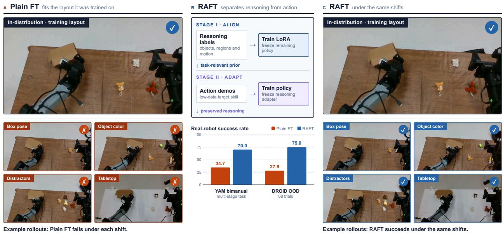  
Figure 1 | Reasoning-aligned fine-tuning for robust VLA adaptation. (a) Plain FT, fine-tuned only on actions, succeeds in the trainin<sub>g</sub> la<sub>y</sub>out but fails under small scene chan<sub>g</sub>es. (b) RAFT first learns task-relevant reasonin<sub>g</sub> throu<sub>g</sub>h LoRA ada<sub>p</sub>ters, then freezes them while fine-tunin<sub>g</sub> the <sub>p</sub>olic<sub>y</sub> on action demonstrations. (c) With the <sub>same</sub> d<sub>emons</sub>t<sub>ra</sub>ti<sub>ons,</sub> RAFT <sub>succee</sub>d<sub>s un</sub>d<sub>er</sub> th<sub>ese s</sub>hift<sub>s.</sub> O<sub>n p</sub>h<sub>ys</sub>i<sub>ca</sub>l <sub>ro</sub>b<sub>o</sub>t<sub>s,</sub> RAFT <sub>ra</sub>i<sub>ses success over</sub> Pl<sub>a</sub>i<sub>n</sub> FT from 34.7% to 70.0% on YAM and from 27.9% to 75.0% on out-of-distribution DROID trials.

We evaluate RAFT on two simulated tasks and two <sub>p</sub>h<sub>y</sub>sical <sub>p</sub>latforms: the sin<sub>g</sub>le-arm DROID setu<sub>p</sub> [22] and the bimanual YAM setu<sub>p</sub> [10]. Evaluations test visual, object, instruction, and <sub>g</sub>eometric variations <sub>o</sub>f th<sub>e a</sub>d<sub>ap</sub>t<sub>e</sub>d t<sub>as</sub>k<sub>s.</sub> RAFT <sub>ac</sub>hi<sub>eves</sub> th<sub>e</sub> hi<sub>g</sub>h<sub>es</sub>t <sub>mean success on s</sub>i<sub>mu</sub>l<sub>a</sub>t<sub>e</sub>d <sub>p</sub>i<sub>c</sub>k <sub>an</sub>d <sub>p</sub>l<sub>ace an</sub>d i<sub>mproves open-</sub>d<sub>rawer success, w</sub>ith th<sub>e</sub> l<sub>arges</sub>t <sub>ga</sub>i<sub>ns on</sub> th<sub>e p</sub>h<sub>ys</sub>i<sub>ca</sub>l <sub>ro</sub>b<sub>o</sub>t<sub>s: success on</sub> 75% <sub>o</sub>f <sub>ou</sub>t<sub>-o</sub>f<sub>-</sub>di<sub>s</sub>t<sub>r</sub>ib<sub>u</sub>ti<sub>on</sub> DROID t<sub>r</sub>i<sub>a</sub>l<sub>s versus</sub> 28% f<sub>or p</sub>l<sub>a</sub>i<sub>n</sub> fi<sub>ne-</sub>t<sub>un</sub>i<sub>ng, an</sub>d 70% <sub>mean success on</sub> th<sub>e</sub> multi-sta<sub>g</sub>e YAM task versus 36% for the stron<sub>g</sub>est baseline. Our contributions are threefold: (1) We <sub>p</sub>ro<sub>p</sub>ose RAFT a <sub>p</sub>ost trainin<sub>g</sub> reci<sub>p</sub>t that se<sub>p</sub>arates task relevant reasonin<sub>g</sub> su<sub>p</sub>ervision from action fine tunin<sub>g</sub> (2) We show im<sub>p</sub>roved downstream <sub>p</sub>erformace and robustness in simulation and on two <sub>p</sub>h<sub>y</sub>sical robot <sub>p</sub>latforms; and (3) We anal<sub>y</sub>ze wh<sub>y</sub> RAFT hel<sub>p</sub>s <sub>g</sub>eneralist <sub>p</sub>olic<sub>y</sub> ada<sub>p</sub>t to a tar<sub>g</sub>et b<sub>y</sub> anal<sub>y</sub>zin<sub>g</sub> the features learned b<sub>y</sub> RAFT.

## 2 Related Work

G<sub>enera</sub>li<sub>s</sub>t <sub>ro</sub>b<sub>o</sub>t <sub>po</sub>li<sub>c</sub>i<sub>es</sub> h<sub>ave</sub> <sub>ma</sub>d<sub>e</sub> <sub>su</sub>b<sub>s</sub>t<sub>an</sub>ti<sub>a</sub>l <sub>progress</sub> i<sub>n</sub> l<sub>earn</sub>i<sub>ng</sub> t<sub>rans</sub>f<sub>era</sub>bl<sub>e</sub> <sub>s</sub>kill<sub>s</sub> <sub>an</sub>d <sub>suppor</sub>ti<sub>ng</sub> de<sub>p</sub>lo<sub>y</sub>ment throu<sub>g</sub>h <sub>p</sub>ost-trainin<sub>g</sub> [5, 15, 23, 27, 30, 34, 40]. Within this settin<sub>g</sub>, work on VLA fine-tunin<sub>g</sub> studies reliable task execution [24, 43], while FAST im<sub>p</sub>roves action tokenization for autore<sub>g</sub>ressive VLAs [31]. ControlVLA uses object-centric conditionin<sub>g</sub> for few-shot ada<sub>p</sub>tation [28]. Th<sub>ese a</sub>d<sub>vances ma</sub>k<sub>e spec</sub>i<sub>a</sub>li<sub>za</sub>ti<sub>on more e</sub>f<sub>ec</sub>ti<sub>ve,</sub> b<sub>u</sub>t <sub>nom</sub>i<sub>na</sub>l t<sub>as</sub>k <sub>success can s</sub>till <sub>mas</sub>k f<sub>a</sub>il<sub>ures</sub> under distribution shift [11, 12, 44]. This motivates stud<sub>y</sub>in<sub>g</sub> robustness to variations absent from

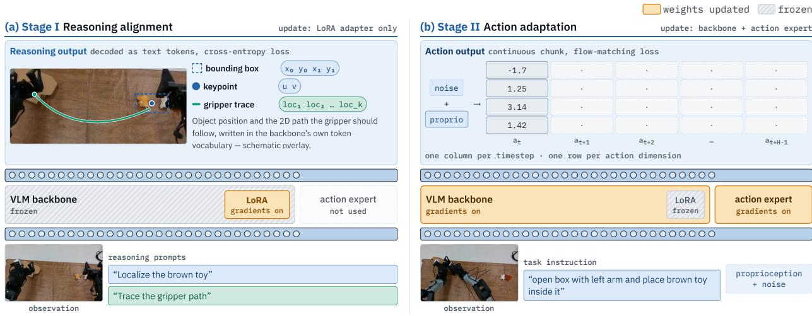  
Figure 2 | Overview of RAFT. Stage I updates only the reasoning adapters, using reasoning annotations. Stage II freezes the adapters and updates the language model, action expert, and projection layers on action d<sub>emons</sub>t<sub>ra</sub>ti<sub>ons, so ac</sub>ti<sub>on gra</sub>di<sub>en</sub>t<sub>s</sub> d<sub>o no</sub>t <sub>reac</sub>h th<sub>e reason</sub>i<sub>ng a</sub>d<sub>ap</sub>t<sub>ers.</sub>

## th<sub>e</sub> t<sub>arge</sub>t d<sub>emons</sub>t<sub>ra</sub>ti<sub>ons.</sub>

R<sub>o</sub>b<sub>us</sub>t <sub>pos</sub>t<sub>-</sub>t<sub>ra</sub>i<sub>n</sub>i<sub>ng me</sub>th<sub>o</sub>d<sub>s see</sub>k t<sub>o a</sub>d<sub>ap</sub>t <sub>genera</sub>li<sub>s</sub>t <sub>po</sub>li<sub>c</sub>i<sub>es w</sub>hil<sub>e re</sub>t<sub>a</sub>i<sub>n</sub>i<sub>ng use</sub>f<sub>u</sub>l <sub>pre</sub>t<sub>ra</sub>i<sub>ne</sub>d ca<sub>p</sub>abilities. Wei<sub>g</sub>ht-s<sub>p</sub>ace a<sub>pp</sub>roaches inter<sub>p</sub>olate or mer<sub>g</sub>e <sub>p</sub>retrained and ada<sub>p</sub>ted <sub>p</sub>arameters [9, 18, 36], while re<sub>g</sub>ularization and steerabilit<sub>y</sub>-<sub>p</sub>reservin<sub>g</sub> ada<sub>p</sub>tation constrain chan<sub>g</sub>es durin<sub>g</sub> fine tunin<sub>g</sub> [14, 17, 20, 33]. RETAIN [39] inter<sub>p</sub>olates <sub>p</sub>retrained and fine-tuned <sub>p</sub>olic<sub>y</sub> wei<sub>g</sub>hts to im<sub>p</sub>rove <sub>g</sub>eneralization to variations of a new skill and retain broader ca<sub>p</sub>abilities. DeLock [17] <sub>regu</sub>l<sub>ar</sub>i<sub>zes</sub> <sub>v</sub>i<sub>sua</sub>l<sub>-enco</sub>d<sub>er</sub> <sub>we</sub>i<sub>g</sub>ht d<sub>r</sub>ift d<sub>ur</sub>i<sub>ng</sub> <sub>pos</sub>t<sub>-</sub>t<sub>ra</sub>i<sub>n</sub>i<sub>ng</sub> <sub>an</sub>d <sub>uses</sub> <sub>con</sub>t<sub>ras</sub>ti<sub>ve</sub> <sub>promp</sub>t <sub>gu</sub>id<sub>ance</sub> <sub>a</sub>t i<sub>n</sub>f<sub>erence.</sub> RAFT i<sub>ns</sub>t<sub>ea</sub>d i<sub>n</sub>t<sub>ro</sub>d<sub>uces</sub> t<sub>as</sub>k<sub>-re</sub>l<sub>evan</sub>t <sub>reason</sub>i<sub>ng a</sub>li<sub>gnmen</sub>t b<sub>e</sub>f<sub>ore ac</sub>ti<sub>on</sub> fi<sub>ne-</sub>t<sub>un</sub>i<sub>ng, w</sub>ith co<sup>m</sup>p<sup>l</sup>e<sup>m</sup>e<sup>nt</sup>a<sup>r</sup>y pa<sup>r</sup>a<sup>m</sup>e<sup>t</sup>e<sup>r</sup> <sup>fr</sup>ee<sup>zin</sup>g ac<sup>r</sup>oss <sup>th</sup>e <sup>tw</sup>o s<sup>t</sup>ages.

R<sub>eason</sub>i<sub>ng an</sub>d <sub>groun</sub>di<sub>ng superv</sub>i<sub>s</sub>i<sub>on prov</sub>id<sub>e a</sub> f<sub>oun</sub>d<sub>a</sub>ti<sub>on</sub> f<sub>or</sub> thi<sub>s approac</sub>h<sub>.</sub> E<sub>m</sub>b<sub>o</sub>di<sub>e</sub>d Ch<sub>a</sub>i<sub>n-o</sub>f<sub>-</sub> Thou<sub>g</sub>ht interleaves sub-<sub>g</sub>oal, s<sub>p</sub>atial, and motion reasonin<sub>g</sub> with action <sub>p</sub>rediction [41]. Related work incor<sub>p</sub>orates s<sub>p</sub>atial re<sub>p</sub>resentations, afordances, ke<sub>yp</sub>oints, and mani<sub>p</sub>ulable <sub>p</sub>arts [10, 26, 42], or object- and lan<sub>g</sub>ua<sub>g</sub>e-<sub>g</sub>rounded su<sub>p</sub>ervision [4]. Steerable Policies use commands at multi<sub>p</sub>le abstraction levels to control [6], while VLS uses VLM-<sub>g</sub>enerated rewards to steer frozen <sub>p</sub>olicies at inference [29]. Reasonin<sub>g</sub> su<sub>p</sub>ervision is used to <sub>p</sub>re<sub>p</sub>are that <sub>p</sub>olic<sub>y</sub> for s<sub>p</sub>ecialization, and the l<sub>earne</sub>d <sub>a</sub>d<sub>ap</sub>t<sub>ers are</sub> h<sub>e</sub>ld fi<sub>xe</sub>d d<sub>ur</sub>i<sub>ng su</sub>b<sub>sequen</sub>t <sub>ac</sub>ti<sub>on</sub> l<sub>earn</sub>i<sub>ng.</sub> T<sub>o</sub> th<sub>e</sub> b<sub>es</sub>t <sub>o</sub>f <sub>our</sub> k<sub>now</sub>l<sub>e</sub>d<sub>ge,</sub> <sub>reason</sub>i<sub>ng superv</sub>i<sub>s</sub>i<sub>on</sub> h<sub>as no</sub>t b<sub>een s</sub>t<sub>u</sub>di<sub>e</sub>d f<sub>or</sub> l<sub>ow-</sub>d<sub>a</sub>t<sub>a pos</sub>t<sub>-</sub>t<sub>ra</sub>i<sub>n</sub>i<sub>ng o</sub>f <sub>a pre</sub>t<sub>ra</sub>i<sub>ne</sub>d <sub>genera</sub>li<sub>s</sub>t VLA<sub>.</sub> W<sub>e eva</sub>l<sub>ua</sub>t<sub>e</sub> thi<sub>s a</sub>d<sub>ap</sub>t<sub>a</sub>ti<sub>on sc</sub>h<sub>e</sub>d<sub>u</sub>l<sub>e</sub> th<sub>roug</sub>h d<sub>owns</sub>t<sub>ream ro</sub>b<sub>us</sub>t<sub>ness, a</sub>dditi<sub>ona</sub>l t<sub>ra</sub>i<sub>n</sub>i<sub>ng con</sub>t<sub>ro</sub>l<sub>s,</sub> <sub>an</sub>d <sub>ana</sub>l<sub>yses o</sub>f t<sub>as</sub>k<sub>-re</sub>l<sub>evan</sub>t <sub>represen</sub>t<sub>a</sub>ti<sub>ons.</sub>

## 3 Method

## 3.1 Overview and Problem Setup

W<sub>e cons</sub>id<sub>er</sub> t<sub>as</sub>k <sub>a</sub>d<sub>ap</sub>t<sub>a</sub>ti<sub>on</sub> f<sub>rom a pre</sub>t<sub>ra</sub>i<sub>ne</sub>d <sub>genera</sub>li<sub>s</sub>t <sub>po</sub>li<sub>cy us</sub>i<sub>ng a sma</sub>ll d<sub>emons</sub>t<sub>ra</sub>ti<sub>on</sub> d<sub>a</sub>t<sub>ase</sub>t $\mathcal { D } _ { \eta } = \{ ( s _ { t } , a _ { t } , T ) \}$ <sub>co</sub>ll<sub>ec</sub>t<sub>e</sub>d i<sub>n</sub> <sub>a</sub> <sub>narrow</sub> <sub>se</sub>t <sub>o</sub>f <sub>env</sub>i<sub>ronmen</sub>t<sub>s.</sub> H<sub>ere</sub> $s _ { t }$ <sub>con</sub>t<sub>a</sub>i<sub>ns</sub> th<sub>e</sub> <sub>po</sub>li<sub>cy</sub> <sub>o</sub>b<sub>serva</sub>ti<sub>ons,</sub> $a _ { t }$ i<sub>s</sub> th<sub>e</sub> d<sub>emons</sub>t<sub>ra</sub>t<sub>e</sub>d <sub>ac</sub>ti<sub>on, an</sub>d � i<sub>s</sub> th<sub>e</sub> t<sub>as</sub>k i<sub>ns</sub>t<sub>ruc</sub>ti<sub>on.</sub> W<sub>e</sub> d<sub>eno</sub>t<sub>e</sub> th<sub>e</sub> St<sub>age-</sub>II t<sub>ra</sub>i<sub>na</sub>bl<sub>e non-</sub> ada<sub>p</sub>ter <sub>p</sub>arameters (the lan<sub>g</sub>ua<sub>g</sub>e model, action ex<sub>p</sub>ert, and <sub>p</sub>rojection la<sub>y</sub>ers) b<sub>y</sub> �, initialized from $\theta _ { \mathrm { { p r e } . } }$ , and the LoRA parameters by � [16]. In RAFT, the pretrained SigLIP weights remain frozen th<sub>roug</sub>h<sub>ou</sub>t <sub>a</sub>d<sub>ap</sub>t<sub>a</sub>ti<sub>on, w</sub>hil<sub>e</sub> L<sub>o</sub>RA <sub>mo</sub>d<sub>u</sub>l<sub>es</sub> i<sub>n</sub> b<sub>o</sub>th th<sub>e v</sub>i<sub>s</sub>i<sub>on enco</sub>d<sub>er an</sub>d l<sub>anguage mo</sub>d<sub>e</sub>l <sub>are</sub> t<sub>ra</sub>i<sub>ne</sub>d i<sub>n</sub> St<sub>age</sub> I<sub>.</sub> St<sub>age</sub> II f<sub>reezes</sub> th<sub>ese</sub> l<sub>earne</sub>d <sub>a</sub>d<sub>ap</sub>t<sub>ers an</sub>d <sub>up</sub>d<sub>a</sub>t<sub>es</sub> �<sub>.</sub> Th<sub>us, v</sub>i<sub>s</sub>i<sub>on a</sub>d<sub>ap</sub>t<sub>a</sub>ti<sub>on</sub> in RAFT occurs throu<sub>g</sub>h Sta<sub>g</sub>e-I LoRA rather than u<sub>p</sub>dates to the <sub>p</sub>retrained Si<sub>g</sub>LIP wei<sub>g</sub>hts. The <sub>resu</sub>lti<sub>ng</sub> <sub>ac</sub>ti<sub>on</sub> <sub>po</sub>li<sub>cy</sub> i<sub>s</sub> $\pi _ { \theta , \phi } ( a _ { t } \mid s _ { t } , T )$ . Fi<sub>g</sub>ure 2 summarizes the two sta<sub>g</sub>es<sub>;</sub> Sec. A <sub>g</sub>ives the ada<sub>p</sub>ter <sub>p</sub>l<sub>acemen</sub>t <sub>an</sub>d <sub>op</sub>ti<sub>m</sub>i<sub>za</sub>ti<sub>on</sub> <sub>se</sub>tti<sub>ngs.</sub>

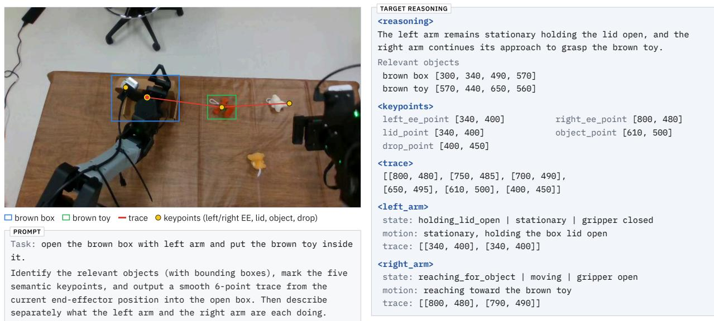  
Figure 3 | Example Stage-I reasoning annotation. In this YAM example, the left arm holds the lid open while the right arm reaches for the toy. The target combines language, object boxes, keypoints, motion traces, and <sub>per-arm s</sub>t<sub>a</sub>t<sub>e</sub> i<sub>n</sub>f<sub>orma</sub>ti<sub>on.</sub> Bl<sub>ue an</sub>d <sub>green mar</sub>k th<sub>e</sub> b<sub>ox an</sub>d t<sub>oy, ye</sub>ll<sub>ow mar</sub>k<sub>s</sub> k<sub>eypo</sub>i<sub>n</sub>t<sub>s, an</sub>d <sub>re</sub>d <sub>mar</sub>k<sub>s</sub> th<sub>e</sub> <sub>ac</sub>ti<sub>ve arm</sub>’<sub>s</sub> t<sub>race.</sub>

## 3.2 Stage I: Reasoning Alignment

Sta<sub>g</sub>e I trains the ada<sub>p</sub>ter to <sub>p</sub>redict task-relevant reasonin<sub>g</sub> annotations. A VLM annotator (Gemini 3.1 Pro) <sub>p</sub>roduces task-relevant reasonin<sub>g</sub> tar<sub>g</sub>ets from observations and instructions on $\mathcal { D } _ { \eta } ,$ <sub>y</sub>i<sub>e</sub>ldi<sub>ng</sub> $\mathcal { D } _ { \mathrm { r e a s o n } } = \{ ( s , r , T ) \}$ . These annotations describe the objects and interactions relevant to the t<sub>as</sub>k<sub>.</sub> Th<sub>e anno</sub>t<sub>a</sub>ti<sub>on c</sub>h<sub>o</sub>i<sub>ces</sub> i<sub>nc</sub>l<sub>u</sub>d<sub>e</sub> b<sub>oun</sub>di<sub>ng</sub> b<sub>oxes,</sub> k<sub>eypo</sub>i<sub>n</sub>t<sub>s,</sub> t<sub>races, spa</sub>ti<sub>a</sub>l d<sub>escr</sub>i<sub>p</sub>ti<sub>ons, an</sub>d <sub>v</sub>i<sub>sua</sub>l <sub>ques</sub>ti<sub>on answer</sub>i<sub>ng.</sub> S<sub>ec</sub>ti<sub>on</sub> C<sub>.</sub>1 <sub>compares</sub> th<sub>e</sub>i<sub>r e</sub>f<sub>ec</sub>t<sub>s.</sub> E<sub>ac</sub>h <sub>anno</sub>t<sub>a</sub>ti<sub>on</sub> i<sub>s represen</sub>t<sub>e</sub>d <sub>as a</sub> <sup>t</sup>a<sup>r</sup>ge<sup>t t</sup>o<sup>k</sup>e<sup>n</sup> seque<sup>n</sup>ce $\boldsymbol { r } = ( r _ { 1 } , \ldots , r _ { | | } )$ . We train the LoRA ada<sub>p</sub>ter usin<sub>g</sub> standard autore<sub>g</sub>ressive c<sup>r</sup>oss<sup>-</sup>e<sup>ntr</sup>opy:

$$
\mathcal { L } _ { \mathrm { r e a s o n } } ( \phi ) = - \mathbb { E } _ { ( s , r , T ) \sim \mathcal { D } _ { \mathrm { r e a s o n } } } \sum _ { j = 1 } ^ { | r | } \log p _ { \theta _ { \mathrm { p r e } } , \phi } ( r _ { j } \mid s , T , r _ { < j } ) .\tag{1}
$$

Onl<sub>y</sub> $\phi$ i<sub>s</sub> <sub>up</sub>d<sub>a</sub>t<sub>e</sub>d i<sub>n</sub> thi<sub>s</sub> <sub>s</sub>t<sub>age;</sub> <sub>a</sub>ll <sub>rema</sub>i<sub>n</sub>i<sub>ng</sub> <sub>parame</sub>t<sub>ers</sub> <sub>are</sub> f<sub>rozen.</sub> Thi<sub>s</sub> <sub>superv</sub>i<sub>s</sub>i<sub>on</sub> <sub>encourages</sub> t<sub>as</sub>k<sub>-re</sub>l<sub>evan</sub>t <sub>groun</sub>di<sub>ng</sub> b<sub>e</sub>f<sub>ore ac</sub>ti<sub>on a</sub>d<sub>ap</sub>t<sub>a</sub>ti<sub>on.</sub>

## 3.3 Stage II: Action Adaptation

St<sub>age</sub> II t<sub>urns</sub> th<sub>e</sub> <sub>reason</sub>i<sub>ng-a</sub>li<sub>gne</sub>d i<sub>n</sub>iti<sub>a</sub>li<sub>za</sub>ti<sub>on</sub> i<sub>n</sub>t<sub>o</sub> <sub>an</sub> <sub>ac</sub>ti<sub>on</sub> <sub>po</sub>li<sub>cy</sub> f<sub>or</sub> th<sub>e</sub> t<sub>arge</sub>t t<sub>as</sub>k<sub>.</sub> W<sub>e</sub> <sub>re</sub>t<sub>a</sub>i<sub>n</sub> th<sub>e</sub> l<sub>earne</sub>d <sub>a</sub>d<sub>ap</sub>t<sub>er</sub> $\phi ^ { \star }$ <sub>an</sub>d f<sub>reeze</sub> it<sub>s parame</sub>t<sub>ers.</sub> Th<sub>e</sub> St<sub>age-</sub>II <sub>parame</sub>t<sub>er se</sub>t � i<sub>s</sub> th<sub>en up</sub>d<sub>a</sub>t<sub>e</sub>d b<sub>y</sub>

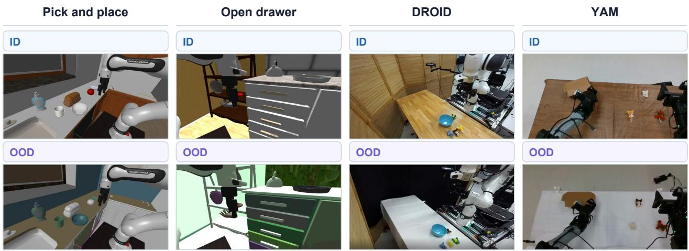  
Figure 4 | Evaluation scenes. Representative in-distribution (ID) and out-of-distribution (OOD) observations, l<sub>e</sub>ft t<sub>o</sub> <sub>r</sub>i<sub>g</sub>ht<sub>:</sub> <sub>s</sub>i<sub>mu</sub>l<sub>a</sub>t<sub>e</sub>d <sub>p</sub>i<sub>c</sub>k <sub>an</sub>d <sub>p</sub>l<sub>ace,</sub> <sub>s</sub>i<sub>mu</sub>l<sub>a</sub>t<sub>e</sub>d <sub>open</sub> d<sub>rawer,</sub> <sub>p</sub>h<sub>ys</sub>i<sub>ca</sub>l DROID <sub>p</sub>i<sub>c</sub>k <sub>an</sub>d <sub>p</sub>l<sub>ace,</sub> <sub>an</sub>d th<sub>e</sub> <sub>p</sub>h<sub>ys</sub>i<sub>ca</sub>l YAM t<sub>wo-s</sub>t<sub>age</sub> t<sub>as</sub>k<sub>.</sub> Th<sub>e</sub> OOD <sub>pane</sub>l<sub>s s</sub>h<sub>ow</sub> t<sub>ex</sub>t<sub>ure c</sub>h<sub>anges</sub> i<sub>n s</sub>i<sub>mu</sub>l<sub>a</sub>ti<sub>on an</sub>d b<sub>ac</sub>k<sub>groun</sub>d <sub>c</sub>h<sub>anges on</sub> th<sub>e</sub> <sub>p</sub>h<sub>ys</sub>i<sub>ca</sub>l <sub>ro</sub>b<sub>o</sub>t<sub>s.</sub> Th<sub>e</sub> f<sub>u</sub>ll <sub>se</sub>t <sub>o</sub>f <sub>eva</sub>l<sub>ua</sub>t<sub>e</sub>d <sub>s</sub>hift<sub>s</sub> i<sub>s</sub> <sub>s</sub>h<sub>own</sub> i<sub>n</sub> Fi<sub>g.</sub> 20<sub>.</sub>

su<sub>p</sub>ervised fine-tunin<sub>g</sub> (SFT) on the task demonstrations [23, 24]:

$$
\theta ^ { \star } = \arg \operatorname* { m i n } _ { \theta } \underbrace { \mathbb { E } _ { ( s , a , T ) \sim \mathcal { D } _ { \eta } } \left[ \ell _ { S \mathrm { F T } } ( \pi _ { \theta , \phi ^ { \star } } ; s , a , T ) \right] } _ { \mathcal { L } _ { \mathrm { B C } } ( \theta ; \mathcal { D } _ { \eta } , \phi ^ { \star } ) } .\tag{2}
$$

Here $\ell _ { \mathrm { S F T } }$ is the underlying policy’s action-supervision objective. Stage II updates the language model, action expert, and projection layers while the adapter and SigLIP vision tower remain frozen. At d<sub>ep</sub>l<sub>oymen</sub>t<sub>,</sub> th<sub>e</sub> <sub>resu</sub>lti<sub>ng</sub> <sub>po</sub>li<sub>cy</sub> i<sub>s</sub> $\pi _ { \theta ^ { \star } , \phi ^ { \star } }$ . The ada<sub>p</sub>ter ablation in the a<sub>pp</sub>endix (Sec. C.2) evaluates th<sub>e</sub> b<sub>ene</sub>fit <sub>o</sub>f f<sub>reez</sub>i<sub>ng</sub> th<sub>e reason</sub>i<sub>ng a</sub>d<sub>ap</sub>t<sub>er</sub> d<sub>ur</sub>i<sub>ng ac</sub>ti<sub>on</sub> l<sub>earn</sub>i<sub>ng.</sub> Att<sub>en</sub>ti<sub>on an</sub>d li<sub>near-pro</sub>b<sub>e</sub> anal<sub>y</sub>ses (Sec. 4.3) <sub>p</sub>rovide em<sub>p</sub>irical evidence of retained task <sub>g</sub>roundin<sub>g</sub> in the resultin<sub>g</sub> <sub>p</sub>olic<sub>y</sub>.

## 4 Experiments

Th<sub>e</sub> <sub>goa</sub>l <sub>o</sub>f <sub>our</sub> <sub>exper</sub>i<sub>men</sub>t<sub>s</sub> i<sub>s</sub> t<sub>o</sub> <sub>eva</sub>l<sub>ua</sub>t<sub>e</sub> RAFT’<sub>s</sub> <sub>a</sub>bilit<sub>y</sub> t<sub>o</sub> <sub>re</sub>t<sub>a</sub>i<sub>n</sub> t<sub>as</sub>k<sub>-re</sub>l<sub>evan</sub>t i<sub>n</sub>f<sub>orma</sub>ti<sub>on</sub> <sub>an</sub>d im<sub>p</sub>rove downstream robustness. Concretel<sub>y</sub>, we aim to answer: (1) does RAFT <sub>g</sub>eneralize better than baselines under distribution shift, in simulation and on <sub>p</sub>h<sub>y</sub>sical robots? (2) do RAFT’s re<sub>p</sub>resentations <sub>re</sub>t<sub>a</sub>i<sub>n more</sub> t<sub>as</sub>k<sub>-re</sub>l<sub>evan</sub>t i<sub>n</sub>f<sub>orma</sub>ti<sub>on</sub> th<sub>an a p</sub>l<sub>a</sub>i<sub>n</sub>l<sub>y</sub> fi<sub>ne-</sub>t<sub>une</sub>d <sub>po</sub>li<sub>cy, an</sub>d d<sub>oes</sub> thi<sub>s</sub> t<sub>rac</sub>k d<sub>owns</sub>t<sub>ream</sub> success? (3) how does downstream <sub>p</sub>erformance scale with the amount of reasonin<sub>g</sub> data used in Sta<sub>g</sub>e I? and (4) How freezin<sub>g</sub> Sta<sub>g</sub>e-I ada<sub>p</sub>ted com<sub>p</sub>ares with common a<sub>pp</sub>roaches like co-trainin<sub>g</sub> <sub>s</sub>i<sub>mu</sub>l<sub>a</sub>t<sub>enous</sub>l<sub>y</sub>?

## 4.1 Experimental setup

Baselines We com<sub>p</sub>are RAFT with standard su<sub>p</sub>ervised fine-tunin<sub>g</sub> (Plain FT), RETAIN [39], which mer<sub>g</sub>es <sub>p</sub>retrained and fine-tuned wei<sub>g</sub>hts, and DeLock [17], which re<sub>g</sub>ularizes visual-encoder wei<sub>g</sub>ht d<sub>r</sub>ift d<sub>ur</sub>i<sub>ng</sub> fi<sub>ne-</sub>t<sub>un</sub>i<sub>ng an</sub>d <sub>app</sub>li<sub>es con</sub>t<sub>ras</sub>ti<sub>ve promp</sub>t <sub>gu</sub>id<sub>ance a</sub>t i<sub>n</sub>f<sub>erence.</sub> W<sub>e a</sub>dditi<sub>ona</sub>ll<sub>y repor</sub>t B<sub>ase,</sub> th<sub>e pre</sub>t<sub>ra</sub>i<sub>ne</sub>d <sub>genera</sub>li<sub>s</sub>t <sub>po</sub>li<sub>cy eva</sub>l<sub>ua</sub>t<sub>e</sub>d <sub>w</sub>ith<sub>ou</sub>t <sub>pos</sub>t<sub>-</sub>t<sub>ra</sub>i<sub>n</sub>i<sub>ng.</sub> All fi<sub>ne-</sub>t<sub>une</sub>d <sub>po</sub>li<sub>c</sub>i<sub>es are</sub> <sub>eva</sub>l<sub>ua</sub>t<sub>e</sub>d <sub>a</sub>ft<sub>er</sub> 5<sub>,</sub>000 <sub>ac</sub>ti<sub>on-</sub>t<sub>ra</sub>i<sub>n</sub>i<sub>ng s</sub>t<sub>eps.</sub> S<sub>ec.</sub> A<sub>.</sub>3 <sub>g</sub>i<sub>ves</sub> th<sub>e</sub> b<sub>ase</sub>li<sub>ne se</sub>tti<sub>ngs;</sub> S<sub>ec.</sub> 4<sub>.</sub>5 <sub>a</sub>bl<sub>a</sub>t<sub>es</sub> th<sub>e</sub> trainin<sub>g</sub> desi<sub>g</sub>n, with full ada<sub>p</sub>ter and co-trainin<sub>g</sub> results in the a<sub>pp</sub>endix (Secs. C.2 and C.3).

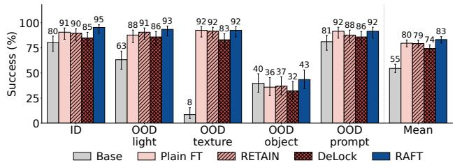

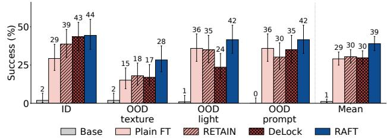  
Figure 5 | Simulation results under distribution shift. Success rates for pick and place (left) and open drawer (ri<sub>g</sub>ht), with 106 trials <sub>p</sub>er s<sub>p</sub>lit. RAFT uses full reasonin<sub>g</sub> for <sub>p</sub>ick and <sub>p</sub>lace and boundin<sub>g</sub>-box su<sub>p</sub>ervision for o<sub>p</sub>en drawer (Sec. C.1). RAFT has the hi<sub>g</sub>hest mean success on both tasks: 83% versus 80% for Plain FT on <sub>p</sub>ick and <sub>p</sub>lace<sub>,</sub> and 39% versus 29% on o<sub>p</sub>en drawer.

## 4.2 RAFT generalizes under distribution shift

W<sub>e</sub> <sub>eva</sub>l<sub>ua</sub>t<sub>e</sub> RAFT <sub>on</sub> <sub>p</sub>i<sub>c</sub>k<sub>-an</sub>d<sub>-p</sub>l<sub>ace</sub> <sub>an</sub>d <sub>open-</sub>d<sub>rawer</sub> t<sub>as</sub>k<sub>s</sub> i<sub>n</sub> <sub>s</sub>i<sub>mu</sub>l<sub>a</sub>ti<sub>on</sub> <sub>an</sub>d <sub>on</sub> t<sub>wo</sub> <sub>rea</sub>l<sub>-wor</sub>ld <sub>p</sub>latforms: the sin<sub>g</sub>le-arm DROID setu<sub>p</sub> [22] and the dexterous, dual-arm YAM setu<sub>p</sub> [10], under the visual, object, and instruction or geometric shifts described below.

Simulation We evaluate MolmoBot [8] in the MolmoS<sub>p</sub>aces simulator [25] on <sub>p</sub>ick-and-<sub>p</sub>lace and <sub>open-</sub>d<sub>rawer</sub> t<sub>as</sub>k<sub>s.</sub> F<sub>or eac</sub>h t<sub>as</sub>k<sub>, we use</sub> 106 <sub>success</sub>f<sub>u</sub>l d<sub>emons</sub>t<sub>ra</sub>ti<sub>ons</sub> f<sub>rom one</sub> l<sub>ayou</sub>t <sub>prov</sub>id<sub>e</sub>d i<sub>n</sub> th<sub>e</sub> M<sub>o</sub>l<sub>mo</sub>S<sub>paces</sub> b<sub>enc</sub>h<sub>mar</sub>k f<sub>or</sub> <sub>pos</sub>t<sub>-</sub>t<sub>ra</sub>i<sub>n</sub>i<sub>ng.</sub> W<sub>e</sub> <sub>measure</sub> <sub>ro</sub>b<sub>us</sub>t<sub>ness</sub> <sub>us</sub>i<sub>ng</sub> <sub>per</sub>t<sub>ur</sub>b<sub>a</sub>ti<sub>ons</sub> <sub>a</sub>b<sub>sen</sub>t f<sub>rom</sub> th<sub>e</sub> d<sub>emons</sub>t<sub>ra</sub>ti<sub>ons.</sub> OOD<sub>-</sub>li<sub>g</sub>ht <sub>c</sub>h<sub>anges</sub> th<sub>e num</sub>b<sub>er, pos</sub>iti<sub>on, an</sub>d i<sub>n</sub>t<sub>ens</sub>it<sub>y o</sub>f li<sub>g</sub>ht sources; OOD-texture replaces table and scene textures; OOD-object substitutes a semantically similar manipulation object unseen during post-training and is evaluated only for pick and place; and OOD-<sub>promp</sub>t <sub>parap</sub>h<sub>rases</sub> th<sub>e</sub> i<sub>ns</sub>t<sub>ruc</sub>ti<sub>on</sub> <sub>w</sub>ith<sub>ou</sub>t <sub>c</sub>h<sub>ang</sub>i<sub>ng</sub> it<sub>s</sub> <sub>mean</sub>i<sub>ng.</sub> ID <sub>uses</sub> th<sub>e</sub> d<sub>emons</sub>t<sub>ra</sub>ti<sub>on</sub> l<sub>ayou</sub>t<sub>.</sub> Each evaluation split contains � = 106 trials with matched seeds across methods.

RAFT has the highest simulated success, with the largest margin on novel objects On pick and place, RAFT achieves 83% mean success across the five evaluation s<sub>p</sub>lits<sub>,</sub> com<sub>p</sub>ared with 80% for Plain FT<sub>,</sub> 79% for RETAIN, and 74% for DeLock (Fi<sub>g</sub>. 5). The lar<sub>g</sub>est mar<sub>g</sub>in is under object shift: 43% for RAFT versus 36% for Plain FT and 37% for RETAIN. On the o<sub>p</sub>en drawer task<sub>,</sub> RAFT reaches 44% <sub>success</sub> i<sub>n</sub> ID <sub>an</sub>d 28% <sub>un</sub>d<sub>er</sub> t<sub>ex</sub>t<sub>ure s</sub>hift<sub>, versus</sub> 29% <sub>an</sub>d 15% f<sub>or</sub> Pl<sub>a</sub>i<sub>n</sub> FT<sub>, an</sub>d it <sub>a</sub>l<sub>so</sub> l<sub>ea</sub>d<sub>s un</sub>d<sub>er</sub> li<sub>g</sub>hti<sub>ng an</sub>d i<sub>ns</sub>t<sub>ruc</sub>ti<sub>on s</sub>hift<sub>s.</sub>

Real-world: DROID We <sub>p</sub>ost-train MolmoBot [8] on 50 <sub>p</sub>ick-and-<sub>p</sub>lace demonstrations and evaluate on a <sub>p</sub>h<sub>y</sub>sical DROID robot under four axes: the demonstration setu<sub>p</sub> (ID; blue, <sub>y</sub>ellow, and brown to<sub>y</sub>s), novel object colors (OOD-Object, e.<sub>g</sub>., a white to<sub>y</sub> in <sub>p</sub>lace of the brown one), added distractors (OOD-Distractor), and a chan<sub>g</sub>ed tableto<sub>p</sub> surface (OOD-Back<sub>g</sub>round). On out-of-distribution DROID trials, RAFT succeeds in 75.0% of trials versus 27.9% for Plain FT (Fi<sub>g</sub>. 6): 83% versus 33% with novel object colors, 75% versus 25% with distractors, and 65% versus 25% on the changed tabletop. In the demonstration setu<sub>p</sub>, the two are close (63% versus 60%).

Real-world: YAM For the dual-arm YAM <sub>p</sub>latform<sub>,</sub> we <sub>p</sub>ost-train $\pi _ { 0 . 5 }$ [4] on 100 demonstrations of a long-horizon task: open a hinged box, pick up an object, and place it inside. Because placement d<sub>epen</sub>d<sub>s on</sub> th<sub>e</sub> b<sub>ox</sub> b<sub>e</sub>i<sub>ng open,</sub> th<sub>e</sub> t<sub>as</sub>k <sub>separa</sub>t<sub>es comp</sub>l<sub>e</sub>ti<sub>ng</sub> th<sub>e</sub> fi<sub>rs</sub>t i<sub>n</sub>t<sub>erac</sub>ti<sub>on</sub> f<sub>rom comp</sub>l<sub>e</sub>ti<sub>ng</sub> th<sub>e</sub> <sub>w</sub>h<sub>o</sub>l<sub>e</sub> <sub>sequence.</sub> W<sub>e</sub> <sub>eva</sub>l<sub>ua</sub>t<sub>e</sub> i<sub>n</sub> th<sub>e</sub> d<sub>emons</sub>t<sub>ra</sub>ti<sub>on</sub> <sub>se</sub>t<sub>up</sub> <sub>an</sub>d <sub>un</sub>d<sub>er</sub> f<sub>our</sub> <sub>s</sub>hift<sub>s:</sub> <sub>c</sub>l<sub>u</sub>tt<sub>er,</sub> b<sub>ox</sub> <sub>pose,</sub> object color, and background. On the bimanual YAM task, RAFT completes the full sequence in 70.0% of trials <sub>p</sub>ooled over the five axes<sub>,</sub> versus 36% for DeLock<sub>,</sub> 35% for Plain FT<sub>,</sub> and 29% for RETAIN

DROID Pick up the brown toy and place it in the bowl

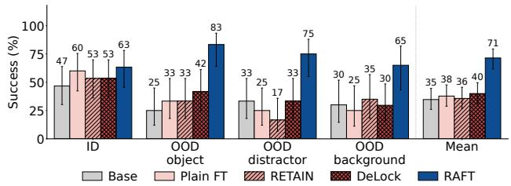

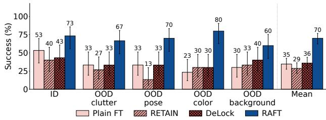  
Figure 6 | Real-robot results under distribution shift. Left: DROID pick and place. Right: YAM box opening <sub>an</sub>d <sub>p</sub>l<sub>ace</sub> i<sub>ns</sub>id<sub>e</sub> b<sub>ox.</sub> RAFT h<sub>as</sub> th<sub>e</sub> hi<sub>g</sub>h<sub>es</sub>t <sub>success on</sub> b<sub>o</sub>th <sub>p</sub>l<sub>a</sub>tf<sub>orms:</sub> 75% <sub>versus</sub> 28% f<sub>or</sub> Pl<sub>a</sub>i<sub>n</sub> FT <sub>on</sub> out-of-distribution DROID trials and 70% versus 35% on YAM.

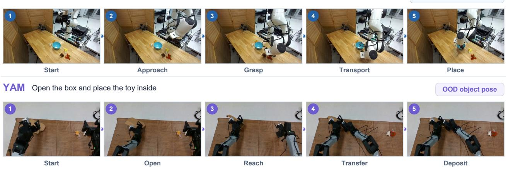  
Figure 7 | Successful physical-robot rollouts. Ordered frames show DROID picking up the brown toy and <sub>p</sub>lacin<sub>g</sub> it in the bowl (to<sub>p</sub>) and YAM o<sub>p</sub>enin<sub>g</sub> the box and <sub>p</sub>lacin<sub>g</sub> the to<sub>y</sub> inside (bottom). Numbers indicate temporal order; circles and arrows mark the manipulated object and motion.

(Fi<sub>g</sub>. 6), and it has the hi<sub>g</sub>hest success on ever<sub>y</sub> axis (73% in-distribution and 60%–80% under the four shifts). Plain FT usually opens the box but then fails to place the object.

## 4.3 Representation Analysis

W<sub>e</sub> <sub>exam</sub>i<sub>ne</sub> <sub>represen</sub>t<sub>a</sub>ti<sub>on</sub> di<sub>mens</sub>i<sub>ona</sub>lit<sub>y,</sub> li<sub>near</sub>l<sub>y</sub> d<sub>eco</sub>d<sub>a</sub>bl<sub>e</sub> t<sub>as</sub>k i<sub>n</sub>f<sub>orma</sub>ti<sub>on,</sub> <sub>an</sub>d <sub>v</sub>i<sub>sua</sub>l <sub>a</sub>tt<sub>en</sub>ti<sub>on</sub> to assess what RAFT <sub>p</sub>reserves durin<sub>g</sub> <sub>p</sub>ost-trainin<sub>g</sub>. The measurement <sub>p</sub>rotocol is in Sec. E.

L<sub>a</sub>t<sub>e-</sub>l<sub>ayer</sub> di<sub>mens</sub>i<sub>ona</sub>lit<sub>y corre</sub>l<sub>a</sub>t<sub>es w</sub>ith d<sub>owns</sub>t<sub>ream success</sub> W<sub>e measure</sub> th<sub>e e</sub>f<sub>ec</sub>ti<sub>ve</sub> di<sub>mens</sub>i<sub>ona</sub>lit<sub>y</sub> of the backbone’s hidden states with the <sub>p</sub>artici<sub>p</sub>ation ratio (PR) [13, 19, 32]:

$$
\mathrm { P R } \ = \ \frac { ( \sum _ { i } \lambda _ { i } ) ^ { 2 } } { \sum _ { i } \lambda _ { i } ^ { 2 } } ,\tag{3}
$$

<sub>w</sub>h<sub>ere</sub> $\lambda _ { i }$ <sub>are</sub> th<sub>e e</sub>i<sub>genva</sub>l<sub>ues o</sub>f th<sub>e covar</sub>i<sub>ance o</sub>f <sub>mean-poo</sub>l<sub>e</sub>d hidd<sub>en s</sub>t<sub>a</sub>t<sub>es across</sub> f<sub>rames.</sub> A<sub>cross</sub> <sub>s</sub>i<sub>x</sub> St<sub>age-</sub>I <sub>reason</sub>i<sub>ng</sub> <sub>var</sub>i<sub>an</sub>t<sub>s,</sub> l<sub>a</sub>t<sub>e-</sub>l<sub>ayer</sub> PR <sub>corre</sub>l<sub>a</sub>t<sub>es</sub> <sub>w</sub>ith <sub>success</sub> <sub>on</sub> <sub>eac</sub>h t<sub>as</sub>k<sub>-ma</sub>t<sub>c</sub>h<sub>e</sub>d <sub>eva</sub>l<sub>ua</sub>ti<sub>on</sub> axis; at la<sub>y</sub>er 15, absolute PR has mean S<sub>p</sub>earman <sub>�</sub> = 0.76 (Fi<sub>g</sub>. 19).

Object identity and task progress are more linearly decodable from RAFT’s late layers We fit linear probes on the same late layers to predict object identity (seven classes, chance 1/7) and episode-time quartile (four bins, chance 1/4). In layers 14–17, probes on RAFT reach 0.51–0.53 balanced accuracy for object identity, against 0.45 for Plain FT and 0.40 for the base policy, and 0.62–0.65 for episode <sub>q</sub>uartile, a<sub>g</sub>ainst 0.55 and 0.51 (Fi<sub>g</sub>. 9). Object-identit<sub>y</sub> decodin<sub>g</sub> also rises shar<sub>p</sub>l<sub>y</sub> between la<sub>y</sub>ers 13 and 15 for RAFT<sub>,</sub> but barel<sub>y</sub> chan<sub>g</sub>es for Plain FT or the base <sub>p</sub>olic<sub>y</sub>. The la<sub>y</sub>ers where PR tracks <sub>success are</sub> th<sub>e same</sub> l<sub>ayers w</sub>h<sub>ere</sub> thi<sub>s</sub> i<sub>n</sub>f<sub>orma</sub>ti<sub>on</sub> b<sub>ecomes</sub> d<sub>eco</sub>d<sub>a</sub>bl<sub>e.</sub>

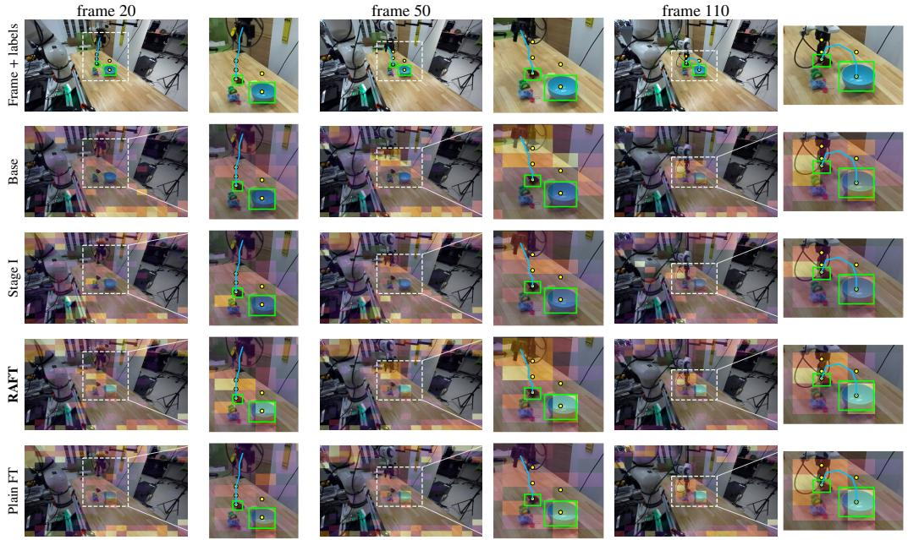  
Figure 8 | Attention maps along one trajectory. Columns show successive observations; rows compare Base, St<sub>age</sub> I<sub>,</sub> RAFT<sub>, an</sub>d Pl<sub>a</sub>i<sub>n</sub> FT<sub>.</sub> O<sub>ver</sub>l<sub>ays</sub> id<sub>en</sub>tif<sub>y anno</sub>t<sub>a</sub>t<sub>e</sub>d t<sub>as</sub>k <sub>reg</sub>i<sub>ons, an</sub>d <sub>co</sub>l<sub>or sca</sub>l<sub>es are s</sub>h<sub>are</sub>d <sub>w</sub>ithi<sub>n eac</sub>h <sub>co</sub>l<sub>umn.</sub> RAFT <sub>p</sub>l<sub>aces more a</sub>tt<sub>en</sub>ti<sub>on on</sub> th<sub>e anno</sub>t<sub>a</sub>t<sub>e</sub>d <sub>reg</sub>i<sub>ons</sub> th<sub>an</sub> Pl<sub>a</sub>i<sub>n</sub> FT<sub>;</sub> Fi<sub>g.</sub> 10 <sub>quan</sub>tifi<sub>es</sub> thi<sub>s across</sub> <sup>l</sup>a<sub>y</sub>ers.

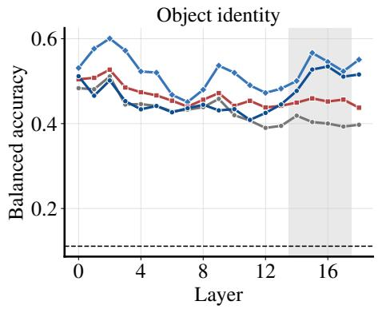

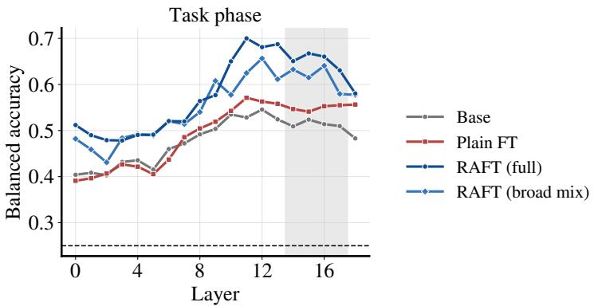  
Figure 9 | Layer-wise linear probes. Balanced accuracy for object identity (left; chance 1/7) and episode-time quartile (right; chance 1/4). Policies use the same 414 frames; episodes are held out from probe fitting, not policy training. Shading marks layers 14–17. In these layers, RAFT reaches 0.51–0.53 object-identity accuracy versus 0.45 for Plain FT<sub>,</sub> and 0.62–0.65 <sub>q</sub>uartile accurac<sub>y</sub> versus 0.55.

RAFT h<sub>as</sub> hi<sub>g</sub>h<sub>e</sub>r <sub>a</sub>tt<sub>en</sub>ti<sub>on en</sub>ri<sub>c</sub>h<sub>men</sub>t <sub>on anno</sub>t<sub>a</sub>t<sub>e</sub>d t<sub>as</sub>k r<sub>eg</sub>i<sub>ons</sub> W<sub>e</sub> m<sub>easu</sub>r<sub>e</sub> h<sub>o</sub>w m<sub>uc</sub>h <sub>o</sub>f th<sub>e po</sub>li<sub>cy</sub>’<sub>s</sub> visual attention falls on annotated task regions, such as the manipulated object, the target, and the <sub>g</sub>ri<sub>pp</sub>er, relative to their share of the ima<sub>g</sub>e (enrichment; values above one mean attention is concentrated there). At la<sub>y</sub>er 11, RAFT <sub>g</sub>ives these re<sub>g</sub>ions 3.2–3.4 times their uniform share of attention, a<sub>g</sub>ainst 1.9–2.1 for Plain FT, while attention to the back<sub>g</sub>round sta<sub>y</sub>s near uniform (Fi<sub>g</sub>s. 8 and 10); the se<sub>p</sub>aration narrows in later la<sub>y</sub>ers. The concentration <sub>p</sub>ersists throu<sub>g</sub>h Sta<sub>g</sub>e-II action t<sub>ra</sub>i<sub>n</sub>i<sub>ng an</sub>d <sub>s</sub>t<sub>ays a</sub>b<sub>ove</sub> th<sub>a</sub>t <sub>o</sub>f <sub>p</sub>l<sub>a</sub>i<sub>n</sub> fi<sub>ne-</sub>t<sub>un</sub>i<sub>ng.</sub> Th<sub>e s</sub>i<sub>ze o</sub>f th<sub>ese e</sub>f<sub>ec</sub>t<sub>s</sub> d<sub>epen</sub>d<sub>s on</sub> th<sub>e reason</sub>i<sub>ng</sub> <sub>mo</sub>d<sub>a</sub>lit<sub>y use</sub>d i<sub>n</sub> St<sub>age</sub> I<sub>;</sub> S<sub>ec.</sub> C<sub>.</sub>1 <sub>repor</sub>t<sub>s</sub> th<sub>e</sub> f<sub>u</sub>ll <sub>mo</sub>d<sub>a</sub>lit<sub>y a</sub>bl<sub>a</sub>ti<sub>on.</sub>

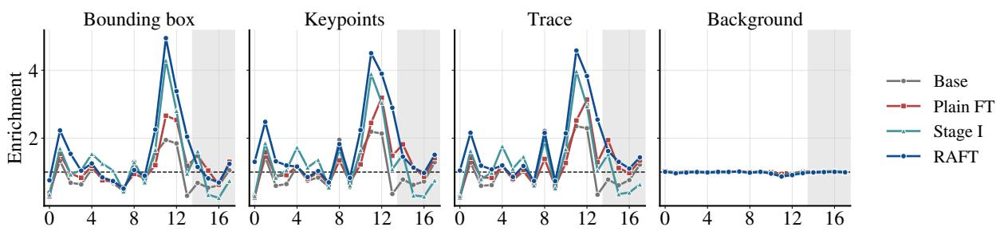  
Figure 10 | Layer-wise attention enrichment. Enrichment for object boxes, keypoints, traces, and background; <sub>va</sub>l<sub>ues a</sub>b<sub>ove one</sub> i<sub>n</sub>di<sub>ca</sub>t<sub>e a</sub>tt<sub>en</sub>ti<sub>on excee</sub>di<sub>n a re</sub> i<sub>on</sub>’<sub>s</sub> i<sub>ma e-area s</sub>h<sub>are.</sub> C<sub>urves com are</sub> B<sub>ase,</sub> Pl<sub>a</sub>i<sub>n</sub> FT<sub>,</sub> Sta<sub>g</sub>e I<sub>,</sub> and RAFT<sub>;</sub> shadin<sub>g</sub> marks la<sub>y</sub>ers 14–17. At la<sub>y</sub>er 11<sub>,</sub> RAFT <sub>g</sub>ives task re<sub>g</sub>ions 3.2–3.4 times their area <sub>s</sub>h<sub>are,</sub> <sub>versus</sub> 1<sub>.</sub>9<sub>–</sub>2<sub>.</sub>1 f<sub>or</sub> Pl<sub>a</sub>i<sub>n</sub> FT<sub>,</sub> <sub>w</sub>hil<sub>e</sub> b<sub>ac</sub>k<sub>groun</sub>d <sub>a</sub>tt<sub>en</sub>ti<sub>on</sub> <sub>s</sub>t<sub>ays</sub> <sub>near</sub> <sub>un</sub>if<sub>orm.</sub>

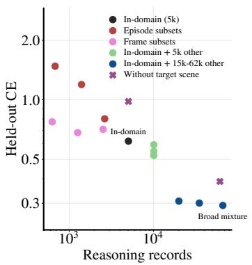

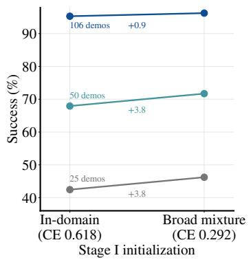

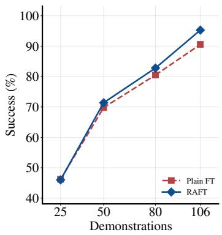  
Figure 11 | Efect of reasoning data and demonstration budget. Left: held-out reasoning loss across corpus <sub>s</sub>i<sub>zes an</sub>d <sub>cons</sub>t<sub>ruc</sub>ti<sub>ons.</sub> Middl<sub>e:</sub> i<sub>n-</sub>di<sub>s</sub>t<sub>r</sub>ib<sub>u</sub>ti<sub>on p</sub>i<sub>c</sub>k<sub>-an</sub>d<sub>-p</sub>l<sub>ace success a</sub>ft<sub>er</sub> 5<sub>,</sub>000 St<sub>age-</sub>II <sub>s</sub>t<sub>eps</sub> f<sub>rom</sub> i<sub>n-</sub>d<sub>oma</sub>i<sub>n</sub> <sub>an</sub>d b<sub>roa</sub>d<sub>er-m</sub>i<sub>x</sub>t<sub>ure</sub> St<sub>age-</sub>I i<sub>n</sub>iti<sub>a</sub>li<sub>za</sub>ti<sub>ons.</sub> Ri<sub>g</sub>ht<sub>:</sub> RAFT <sub>versus</sub> Pl<sub>a</sub>i<sub>n</sub> FT <sub>across</sub> d<sub>emons</sub>t<sub>ra</sub>ti<sub>on</sub> b<sub>u</sub>d<sub>ge</sub>t<sub>s, w</sub>ith 106 evaluation e<sub>p</sub>isodes <sub>p</sub>er bud<sub>g</sub>et. The broader mixture lowers held-out loss (0.29 versus 0.62) and im<sub>p</sub>roves this success b<sub>y</sub> 0.9–3.8 <sub>p</sub>oints at ever<sub>y</sub> bud<sub>g</sub>et.

## 4.4 Efect of reasoning data on held-out loss and downstream success

M<sub>ore reason</sub>i<sub>ng</sub> d<sub>a</sub>t<sub>a</sub> l<sub>owers</sub> h<sub>e</sub>ld<sub>-ou</sub>t l<sub>oss</sub> O<sub>n a common</sub> 560<sub>-recor</sub>d h<sub>e</sub>ld<sub>-ou</sub>t <sub>sp</sub>lit<sub>, cross-en</sub>t<sub>ropy on</sub> f<sub>u</sub>ll<sub>-reason</sub>i<sub>ng</sub> t<sub>arge</sub>t<sub>s</sub> f<sub>a</sub>ll<sub>s</sub> <sub>as</sub> th<sub>e</sub> <sub>num</sub>b<sub>er</sub> <sub>o</sub>f <sub>reason</sub>i<sub>ng</sub> <sub>recor</sub>d<sub>s</sub> <sub>grows,</sub> i<sub>n</sub> b<sub>o</sub>th f<sub>rame-</sub> <sub>an</sub>d <sub>ep</sub>i<sub>so</sub>d<sub>e-</sub> subsam<sub>p</sub>led series (Fi<sub>g</sub>. 11, left). Cor<sub>p</sub>us com<sub>p</sub>osition also matters: 628 frame-subsam<sub>p</sub>led records r<sub>eac</sub>h <sub>a</sub> l<sub>oss</sub> <sub>o</sub>f 0<sub>.</sub>77<sub>,</sub> whil<sub>e</sub> 680 <sub>ep</sub>i<sub>so</sub>d<sub>e</sub>-<sub>su</sub>b<sub>sa</sub>m<sub>p</sub>l<sub>e</sub>d r<sub>eco</sub>rd<sub>s</sub> r<sub>eac</sub>h <sub>o</sub>nl<sub>y</sub> 1<sub>.</sub>48<sub>.</sub> Th<sub>e</sub> br<sub>oa</sub>d<sub>e</sub>r mixt<sub>u</sub>r<sub>e,</sub> which adds rou<sub>g</sub>hl<sub>y</sub> 60,000 records to the 5,000-record in-domain cor<sub>p</sub>us, <sub>g</sub>ives the lowest loss (0.29, versus 0.62 in-domain) and still reaches 0.39 with tar<sub>g</sub>et-simulator records removed.

B<sub>roa</sub>d<sub>er reason</sub>i<sub>ng</sub> d<sub>a</sub>t<sub>a a</sub>l<sub>so</sub> h<sub>e</sub>l<sub>ps</sub> d<sub>owns</sub>t<sub>ream</sub> I<sub>n</sub>iti<sub>a</sub>li<sub>z</sub>i<sub>ng</sub> St<sub>age</sub> II f<sub>rom</sub> th<sub>e</sub> b<sub>roa</sub>d<sub>er-m</sub>i<sub>x</sub>t<sub>ure a</sub>d<sub>ap</sub>t<sub>er</sub> i<sub>ns</sub>t<sub>ea</sub>d <sub>o</sub>f th<sub>e</sub> i<sub>n-</sub>d<sub>oma</sub>i<sub>n one</sub> i<sub>mproves</sub> i<sub>n-</sub>di<sub>s</sub>t<sub>r</sub>ib<sub>u</sub>ti<sub>on success</sub> b<sub>y</sub> 0<sub>.</sub>9<sub>–</sub>3<sub>.</sub>8 <sub>po</sub>i<sub>n</sub>t<sub>s a</sub>t <sub>eac</sub>h <sub>o</sub>f th<sub>e</sub> th<sub>ree</sub> demonstration bud<sub>g</sub>ets (Fi<sub>g</sub>. 11, middle). A<sub>g</sub>ainst Plain FT at matched bud<sub>g</sub>ets (ri<sub>g</sub>ht <sub>p</sub>anel), the two methods tie with 25 demonstrations (46.2% success each), and RAFT leads modestl<sub>y</sub> at intermediate bud<sub>g</sub>ets. With all demonstrations, RAFT reaches 95.3% ID success a<sub>g</sub>ainst 90.6% for Plain FT (Fi<sub>g</sub>. 5).

## 4.5 Efect of unfrozen adapter

W<sub>e a</sub>bl<sub>a</sub>t<sub>e</sub> t<sub>wo</sub> d<sub>es</sub>i<sub>gn c</sub>h<sub>o</sub>i<sub>ces o</sub>f RAFT <sub>on s</sub>i<sub>mu</sub>l<sub>a</sub>t<sub>e</sub>d <sub>p</sub>i<sub>c</sub>k <sub>an</sub>d <sub>p</sub>l<sub>ace:</sub> h<sub>ow reason</sub>i<sub>ng an</sub>d <sub>ac</sub>ti<sub>on</sub> <sub>superv</sub>i<sub>s</sub>i<sub>on</sub> <sub>are</sub> <sub>com</sub>bi<sub>ne</sub>d<sub>,</sub> <sub>an</sub>d <sub>w</sub>h<sub>e</sub>th<sub>er</sub> th<sub>e</sub> <sub>reason</sub>i<sub>ng</sub> <sub>a</sub>d<sub>ap</sub>t<sub>er</sub> i<sub>s</sub> <sub>up</sub>d<sub>a</sub>t<sub>e</sub>d d<sub>ur</sub>i<sub>ng</sub> <sub>ac</sub>ti<sub>on</sub> l<sub>earn</sub>i<sub>ng</sub> (Fi<sub>g</sub>. 12). Co-train trains on reasonin<sub>g</sub> and action exam<sub>p</sub>les jointl<sub>y</sub>, sam<sub>p</sub>lin<sub>g</sub> them e<sub>q</sub>uall<sub>y</sub> and <sub>we</sub>i<sub>g</sub>hti<sub>ng</sub> th<sub>e</sub>i<sub>r</sub> l<sub>osses</sub> 1<sub>:</sub>1<sub>.</sub> Ad<sub>ap</sub>t<sub>er</sub> t<sub>ra</sub>i<sub>na</sub>bl<sub>e</sub> <sub>runs</sub> b<sub>o</sub>th <sub>s</sub>t<sub>ages</sub> b<sub>u</sub>t k<sub>eeps</sub> th<sub>e</sub> St<sub>age-</sub>I <sub>a</sub>d<sub>ap</sub>t<sub>er</sub> t<sub>ra</sub>i<sub>na</sub>bl<sub>e</sub> i<sub>n</sub> St<sub>age</sub> II<sub>, an</sub>d St<sub>age</sub> I <sub>on</sub>l<sub>y app</sub>li<sub>es</sub> th<sub>e a</sub>d<sub>ap</sub>t<sub>er w</sub>ith<sub>ou</sub>t <sub>ac</sub>ti<sub>on</sub> fi<sub>ne-</sub>t<sub>un</sub>i<sub>ng.</sub>

A<sub>c</sub>r<sub>oss</sub> fiv<sub>e</sub> m<sub>a</sub>t<sub>c</sub>h<sub>e</sub>d <sub>sp</sub>lit<sub>s</sub> with 106 <sub>ep</sub>i<sub>so</sub>d<sub>es eac</sub>h<sub>, co</sub>- t<sub>ra</sub>i<sub>n</sub>i<sub>ng reac</sub>h<sub>es</sub> 63<sub>.</sub>21% <sub>mean success,</sub> b<sub>e</sub>l<sub>ow</sub> b<sub>o</sub>th Pl<sub>a</sub>i<sub>n</sub> FT (79.62%) and RAFT (83.21%). U<sub>p</sub>datin<sub>g</sub> the ada<sub>p</sub>ter in Sta<sub>g</sub>e II lowers success to 73.96%<sub>,</sub> and Sta<sub>g</sub>e I alone <sub>reac</sub>h<sub>es</sub> 48<sub>.</sub>30%<sub>.</sub> Pl<sub>a</sub>i<sub>n</sub> FT <sub>w</sub>ith <sub>a</sub> f<sub>rozen v</sub>i<sub>s</sub>i<sub>on enco</sub>d<sub>er</sub> <sub>a</sub>l<sub>so s</sub>t<sub>ays a</sub>t 79<sub>.</sub>62%<sub>, so</sub> fr<sub>ee</sub>zin<sub>g</sub> th<sub>e p</sub>r<sub>e</sub>tr<sub>a</sub>in<sub>e</sub>d vi<sub>s</sub>i<sub>o</sub>n <sub>we</sub>i<sub>g</sub>ht<sub>s a</sub>l<sub>one</sub> d<sub>oes no</sub>t <sub>accoun</sub>t f<sub>or</sub> th<sub>e ga</sub>i<sub>n.</sub> S<sub>p</sub>lit<sub>-</sub>l<sub>eve</sub>l <sub>resu</sub>lt<sub>s are</sub> i<sub>n</sub> T<sub>a</sub>bl<sub>es</sub> 3 <sub>an</sub>d 4<sub>.</sub>

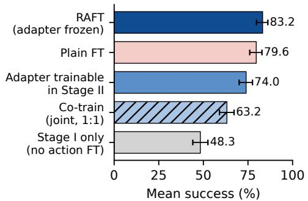

## 5 Conclusion

W<sub>e presen</sub>t<sub>e</sub>d RAFT<sub>, w</sub>hi<sub>c</sub>h fi<sub>rs</sub>t t<sub>ra</sub>i<sub>ns a</sub> l<sub>ow-ran</sub>k <sub>a</sub>d<sub>ap</sub>t<sub>er</sub> <sub>on</sub> t<sub>as</sub>k<sub>-re</sub>l<sub>evan</sub>t <sub>reason</sub>i<sub>ng anno</sub>t<sub>a</sub>ti<sub>ons,</sub> f<sub>reezes</sub> it<sub>, an</sub>d <sub>on</sub>l<sub>y</sub> th<sub>en</sub> fi<sub>ne-</sub>t<sub>unes</sub> th<sub>e pre</sub>t<sub>ra</sub>i<sub>ne</sub>d VLA <sub>on ac</sub>ti<sub>ons.</sub> A<sub>cross</sub> t<sub>wo s</sub>i<sub>mu</sub>l<sub>a</sub>t<sub>e</sub>d t<sub>as</sub>k<sub>s an</sub>d t<sub>wo rea</sub>l <sub>ro</sub>b<sub>o</sub>t<sub>s,</sub> thi<sub>s s</sub>t<sub>ag</sub>i<sub>ng</sub> i<sub>mprove</sub>d <sub>success</sub> <sub>un</sub>d<sub>er</sub> di<sub>s</sub>t<sub>r</sub>ib<sub>u</sub>ti<sub>on</sub> <sub>s</sub>hift <sub>re</sub>l<sub>a</sub>ti<sub>ve</sub> t<sub>o</sub> <sub>p</sub>l<sub>a</sub>i<sub>n</sub> fine-tunin<sub>g,</sub> RETAIN<sub>,</sub> and DeLock. We also show how t<sub>ra</sub>i<sub>n</sub>i<sub>ng reason</sub>i<sub>ng a</sub>d<sub>ap</sub>t<sub>er on</sub> dif<sub>eren</sub>t <sub>mo</sub>d<sub>a</sub>liti<sub>es can</sub>

Figure 12 | Training-scheme ablation on simulated pick and place. Mean suc-<sub>cess over</sub> t<sub>r</sub>i<sub>a</sub>l<sub>s.</sub> St<sub>age</sub>d t<sub>ra</sub>i<sub>n</sub>i<sub>ng w</sub>ith <sub>a</sub> f<sub>rozen</sub> <sub>a</sub>d<sub>ap</sub>t<sub>er</sub> <sub>ac</sub>hi<sub>eves</sub> th<sub>e</sub> hi<sub>g</sub>h<sub>es</sub>t <sub>success</sub> (83.2%), above Plain FT (79.6%), a trainable ada<sub>p</sub>ter (74.0%), and co-trainin<sub>g</sub> (63.2%).

l<sub>ea</sub>d t<sub>o var</sub>i<sub>e</sub>d <sub>per</sub>f<sub>ormance ga</sub>i<sub>ns an</sub>d <sub>se</sub>l<sub>ec</sub>ti<sub>on o</sub>f <sub>op</sub>ti<sub>ma</sub>l <sub>reason</sub>i<sub>ng mo</sub>d<sub>a</sub>lit<sub>y</sub> f<sub>or a spec</sub>ifi<sub>c</sub> t<sub>as</sub>k remains an o<sub>p</sub>en <sub>q</sub>uestion. Since<sub>,</sub> RAFT a<sub>pp</sub>roaches <sub>p</sub>ost-trainin<sub>g</sub> from a diferent <sub>p</sub>ers<sub>p</sub>ective to <sub>curren</sub>t <sub>approac</sub>h<sub>es,</sub> it <sub>ma</sub>k<sub>es</sub> RAFT <sub>compa</sub>tibl<sub>e w</sub>ith th<sub>ese approac</sub>h<sub>es an</sub>d f<sub>u</sub>t<sub>ure wor</sub>k <sub>cou</sub>ld <sub>exp</sub>l<sub>ore</sub> <sub>u</sub>tli<sub>z</sub>i<sub>ng</sub> <sub>a</sub> <sub>com</sub>bi<sub>na</sub>ti<sub>on</sub> <sub>o</sub>f RAFT <sub>an</sub>d <sub>ex</sub>i<sub>s</sub>ti<sub>ng</sub> <sub>me</sub>th<sub>o</sub>d<sub>s</sub> t<sub>o</sub> d<sub>o</sub> <sub>more</sub> <sub>ro</sub>b<sub>us</sub>t <sub>pos</sub>t<sub>-</sub>t<sub>ra</sub>i<sub>n</sub>i<sub>ng.</sub>

## Acknowledgments

Thi<sub>s researc</sub>h <sub>was par</sub>ti<sub>a</sub>ll<sub>y suppor</sub>t<sub>e</sub>d b<sub>y</sub> th<sub>e</sub> T<sub>oyo</sub>t<sub>a</sub> R<sub>esearc</sub>h I<sub>ns</sub>tit<sub>u</sub>t<sub>e an</sub>d Mi<sub>croso</sub>ft R<sub>esearc</sub>h<sub>, w</sub>ith com<sub>p</sub>ute su<sub>pp</sub>ort from Goo<sub>g</sub>le TPU Research Cloud<sub>,</sub> NVIDIA Academic Grant Pro<sub>g</sub>ram<sub>,</sub> and Gemini A<sub>ca</sub>d<sub>em</sub>i<sub>c</sub> P<sub>rogram.</sub> Th<sub>e au</sub>th<sub>ors a</sub>l<sub>so</sub> th<sub>an</sub>k S<sub>amue</sub>l M<sub>.</sub> B<sub>a</sub>t<sub>eman an</sub>d Lih<sub>an</sub> Zh<sub>a</sub> f<sub>or</sub> h<sub>e</sub>l<sub>p</sub>f<sub>u</sub>l di<sub>scuss</sub>i<sub>ons.</sub>

## References

[1] Rohan Anil, Andrew M Dai, Orhan Firat, Melvin Johnson, Dmitr<sub>y</sub> Le<sub>p</sub>ikhin, Alexandre Passos, Siamak Shakeri<sub>,</sub> Emanuel Taro<sub>p</sub>a<sub>,</sub> Pai<sub>g</sub>e Baile<sub>y,</sub> Zhifen<sub>g</sub> Chen<sub>,</sub> et al. PaLM 2 technical re<sub>p</sub>ort. arXiv <sub>p</sub>re<sub>p</sub>rint arXiv:2305.10403<sub>,</sub> 2023.

[2] Johan Bjorck, Fernando Castañeda, Nikita Cherniadev, Xin<sub>gy</sub>e Da, Run<sub>y</sub>u Din<sub>g</sub>, Linxi Fan, Yu Fan<sub>g</sub>, Dieter Fox<sub>,</sub> Fen<sub>gy</sub>uan Hu<sub>,</sub> S<sub>p</sub>encer Huan<sub>g,</sub> et al. GR00T N1: An o<sub>p</sub>en foundation model for <sub>g</sub>eneralist humanoid robots. arXiv <sub>p</sub>re<sub>p</sub>rint arXiv:2503.14734<sub>,</sub> 2025.

[3] Kevin Black, Noah Brown, Dann<sub>y</sub> Driess, Adnan Esmail, Michael E<sub>q</sub>ui, Chelsea Finn, Niccolo Fusai, Lach<sub>y</sub> G<sub>room,</sub> K<sub>aro</sub>l H<sub>ausman,</sub> B<sub>r</sub>i<sub>an</sub> I<sub>c</sub>ht<sub>er, e</sub>t <sub>a</sub>l<sub>. �0:</sub> A <sub>v</sub>i<sub>s</sub>i<sub>on-</sub>l<sub>anguage-ac</sub>ti<sub>on</sub> fl<sub>ow mo</sub>d<sub>e</sub>l f<sub>or genera</sub>l <sub>ro</sub>b<sub>o</sub>t control. arXiv <sub>p</sub>re<sub>p</sub>rint arXiv:2410.24164<sub>,</sub> 2024.

[4] Kevin Black, Noah Brown, James Dar<sub>p</sub>inian, Karan Dhabalia, Dann<sub>y</sub> Driess, Adnan Esmail, Michael Robert E<sub>qu</sub>i<sub>,</sub> Ch<sub>e</sub>l<sub>sea</sub> Fi<sub>nn,</sub> Ni<sub>cco</sub>l<sub>o</sub> F<sub>usa</sub>i<sub>,</sub> M<sub>anue</sub>l Y<sub>.</sub> G<sub>a</sub>llik<sub>er,</sub> Dib<sub>ya</sub> Gh<sub>os</sub>h<sub>,</sub> L<sub>ac</sub>h<sub>y</sub> G<sub>room,</sub> K<sub>aro</sub>l H<sub>ausman,</sub> Brian Ichter<sub>,</sub> Sz<sub>y</sub>mon Jakubczak<sub>,</sub> Tim Jones<sub>,</sub> Li<sub>y</sub>imin<sub>g</sub> Ke<sub>,</sub> Devin LeBlanc<sub>,</sub> Ser<sub>g</sub>e<sub>y</sub> Levine<sub>,</sub> Adrian Li-Bell<sub>,</sub> Mohith Mothukuri, Suraj Nair, Karl Pertsch, Allen Z. Ren, Lucy Xiaoyang Shi, Laura Smith, Jost Tobias Springenberg, Kyle Stachowicz, James Tanner, Quan Vuong, Homer Walke, Anna Walling, Haohuan W<sub>ang,</sub> Lili Y<sub>u, an</sub>d U<sub>ry</sub> Zhili<sub>ns</sub>k<sub>y. �0 5: a v</sub>i<sub>s</sub>i<sub>on-</sub>l<sub>anguage-ac</sub>ti<sub>on mo</sub>d<sub>e</sub>l <sub>w</sub>ith <sub>open-wor</sub>ld <sub>genera</sub>li<sub>za</sub>ti<sub>on.</sub> In Joseph Lim, Shuran Song, and Hae-Won Park, editors, Proceedings of The 9th Conference on Robot Learning, volume 305 of Proceedings of Machine Learning Research, pages 17–40. PMLR, 27–30 Sep 2025. URL https://proceedings.mlr.press/v305/black25a.html.

[5] Konstantinos Bousmalis, Giulia Vezzani, Dush<sub>y</sub>ant Rao, Coline Devin, Alex X Lee, Maria Bauzá, Todor Davchev, Yuxiang Zhou, Agrim Gupta, Akhil Raju, et al. Robocat: A self-improving generalist agent for robotic mani<sub>p</sub>ulation. arXiv <sub>p</sub>re<sub>p</sub>rint arXiv:2306.11706<sub>,</sub> 2023.

[6] William Chen, Ja<sub>g</sub>dee<sub>p</sub> Sin<sub>g</sub>h Bhatia, Catherine Glosso<sub>p</sub>, Nikhil Mathihalli, Ria Doshi, And<sub>y</sub> Tan<sub>g</sub>, Dann<sub>y</sub> D<sub>r</sub>i<sub>ess,</sub> K<sub>ar</sub>l P<sub>er</sub>t<sub>sc</sub>h<sub>, an</sub>d S<sub>ergey</sub> L<sub>ev</sub>i<sub>ne.</sub> St<sub>eera</sub>bl<sub>e v</sub>i<sub>s</sub>i<sub>on-</sub>l<sub>anguage-ac</sub>ti<sub>on po</sub>li<sub>c</sub>i<sub>es</sub> f<sub>or em</sub>b<sub>o</sub>di<sub>e</sub>d <sub>reason</sub>i<sub>ng</sub> and hierarchical control. arXiv <sub>p</sub>re<sub>p</sub>rint arXiv:2602.13193<sub>,</sub> 2026.

[7] O<sub>p</sub>en X-Embodiment Collaboration, Abb<sub>y</sub> O’Neill, Abdul Rehman, Abhinav Gu<sub>p</sub>ta, Abhiram Maddukuri, Abhishek Gupta, Abhishek Padalkar, Abraham Lee, Acorn Pooley, Agrim Gupta, Ajay Mandlekar, Ajinkya Jain<sub>,</sub> Albert Tun<sub>g,</sub> Alex Bewle<sub>y,</sub> Alex Herzo<sub>g,</sub> Alex Ir<sub>p</sub>an<sub>,</sub> Alexander Khazatsk<sub>y,</sub> Anant Rai<sub>,</sub> Anchit Gu<sub>p</sub>ta<sub>,</sub> A<sub>n</sub>d<sub>rew</sub> W<sub>ang,</sub> A<sub>n</sub>d<sub>rey</sub> K<sub>o</sub>l<sub>o</sub>b<sub>ov,</sub> A<sub>n</sub>ik<sub>a</sub>it Si<sub>ng</sub>h<sub>,</sub> A<sub>n</sub>i<sub>mes</sub>h G<sub>arg,</sub> A<sub>n</sub>i<sub>ru</sub>ddh<sub>a</sub> K<sub>em</sub>bh<sub>av</sub>i<sub>,</sub> A<sub>nn</sub>i<sub>e</sub> Xi<sub>e,</sub> A<sub>n</sub>th<sub>ony</sub> B<sub>ro</sub>h<sub>an,</sub> A<sub>n</sub>t<sub>on</sub>i<sub>n</sub> R<sub>a</sub>fi<sub>n,</sub> A<sub>rc</sub>hit Sh<sub>arma,</sub> A<sub>re</sub>f<sub>e</sub>h Y<sub>avary,</sub> A<sub>r</sub>h<sub>an</sub> J<sub>a</sub>i<sub>n,</sub> A<sub>s</sub>h<sub>w</sub>i<sub>n</sub> B<sub>a</sub>l<sub>a</sub>k<sub>r</sub>i<sub>s</sub>h<sub>na,</sub> A<sub>yzaan</sub> W<sub>a</sub>hid<sub>,</sub> Ben Burgess-Limerick, Beomjoon Kim, Bernhard Schölkopf, Blake Wulfe, Brian Ichter, Cewu Lu, Charles Xu<sub>,</sub> Charlotte Le<sub>,</sub> Chelsea Finn<sub>,</sub> Chen Wan<sub>g,</sub> Chenfen<sub>g</sub> Xu<sub>,</sub> Chen<sub>g</sub> Chi<sub>,</sub> Chen<sub>g</sub>uan<sub>g</sub> Huan<sub>g,</sub> Christine Chan<sub>,</sub> Christo<sub>p</sub>her A<sub>g</sub>ia<sub>,</sub> Chuer Pan<sub>,</sub> Chu<sub>y</sub>uan Fu<sub>,</sub> Coline Devin<sub>,</sub> Danfei Xu<sub>,</sub> Daniel Morton<sub>,</sub> Dann<sub>y</sub> Driess<sub>,</sub> Da<sub>p</sub>hne Ch<sub>en,</sub> D<sub>eepa</sub>k P<sub>a</sub>th<sub>a</sub>k<sub>,</sub> Dh<sub>ruv</sub> Sh<sub>a</sub>h<sub>,</sub> Di<sub>e</sub>t<sub>er</sub> Bü<sub>c</sub>hl<sub>er,</sub> Di<sub>nes</sub>h J<sub>ayaraman,</sub> D<sub>m</sub>it<sub>ry</sub> K<sub>a</sub>l<sub>as</sub>h<sub>n</sub>ik<sub>ov,</sub> D<sub>orsa</sub> S<sub>a</sub>di<sub>g</sub>h<sub>,</sub> Edward Johns, Ethan Foster, Fangchen Liu, Federico Ceola, Fei Xia, Feiyu Zhao, Felipe Vieira Frujeri, Freek Stul<sub>p,</sub> Gao<sub>y</sub>ue Zhou<sub>,</sub> Gaurav S. Sukhatme<sub>,</sub> Gautam Salhotra<sub>,</sub> Ge Yan<sub>,</sub> Gilbert Fen<sub>g,</sub> Giulio Schiavi<sub>,</sub> Glen Berseth<sub>,</sub> Gre<sub>g</sub>or<sub>y</sub> Kahn<sub>,</sub> Guan<sub>g</sub>wen Yan<sub>g,</sub> Guanzhi Wan<sub>g,</sub> Hao Su<sub>,</sub> Hao-Shu Fan<sub>g,</sub> Haochen Shi<sub>,</sub> Hen<sub>g</sub>hui Bao, Heni Ben Amor, Henrik I Christensen, Hiroki Furuta, Homanga Bharadhwaj, Homer Walke, Hongjie Fang, Huy Ha, Igor Mordatch, Ilija Radosavovic, Isabel Leal, Jacky Liang, Jad Abou-Chakra, Jaehyung Kim, Jaim<sub>y</sub>n Drake<sub>,</sub> Jan Peters<sub>,</sub> Jan Schneider<sub>,</sub> Jasmine Hsu<sub>,</sub> Ja<sub>y</sub> Vakil<sub>,</sub> Jeannette Boh<sub>g,</sub> Jefre<sub>y</sub> Bin<sub>g</sub>ham<sub>,</sub> Jefre<sub>y</sub> Wu, Jensen Gao, Jiaheng Hu, Jiajun Wu, Jialin Wu, Jiankai Sun, Jianlan Luo, Jiayuan Gu, Jie Tan, Jihoon Oh, Jimmy Wu, Jingpei Lu, Jingyun Yang, Jitendra Malik, João Silvério, Joey Hejna, Jonathan Booher, Jonathan Tom<sub>p</sub>son<sub>,</sub> Jonathan Yan<sub>g,</sub> Jordi Salvador<sub>,</sub> Jose<sub>p</sub>h J. Lim<sub>,</sub> Junh<sub>y</sub>ek Han<sub>,</sub> Kai<sub>y</sub>uan Wan<sub>g,</sub> Kanishka Rao<sub>,</sub> Karl Pertsch<sub>,</sub> Karol Hausman<sub>,</sub> Kee<sub>g</sub>an Go<sub>,</sub> Keerthana Go<sub>p</sub>alakrishnan<sub>,</sub> Ken Goldber<sub>g,</sub> Kendra B<sub>y</sub>rne<sub>,</sub> K<sub>enne</sub>th O<sub>s</sub>l<sub>un</sub>d<sub>,</sub> K<sub>en</sub>t<sub>o</sub> K<sub>awa</sub>h<sub>arazu</sub>k<sub>a,</sub> K<sub>ev</sub>i<sub>n</sub> Bl<sub>ac</sub>k<sub>,</sub> K<sub>ev</sub>i<sub>n</sub> Li<sub>n,</sub> K<sub>ev</sub>i<sub>n</sub> Zh<sub>ang,</sub> Ki<sub>ana</sub> Eh<sub>san</sub>i<sub>,</sub> Ki<sub>ran</sub> L<sub>e</sub>kk<sub>a</sub>l<sub>a,</sub> Kirst<sub>y</sub> Ellis<sub>,</sub> Krishan Rana<sub>,</sub> Krishnan Srinivasan<sub>,</sub> Kuan Fan<sub>g,</sub> Kunal Prata<sub>p</sub> Sin<sub>g</sub>h<sub>,</sub> Kuo-Hao Zen<sub>g,</sub> K<sub>y</sub>le Hatch<sub>,</sub> K le Hsu Laurent Itti Lawrence Yunlian Chen Lerrel Pinto Li Fei-Fei Liam Tan Linxi "Jim" Fan Lionel Ott<sub>,</sub> Lisa Lee<sub>,</sub> Luca Weihs<sub>,</sub> Ma<sub>g</sub>num Chen<sub>,</sub> Marion Le<sub>p</sub>ert<sub>,</sub> Marius Memmel<sub>,</sub> Masa<sub>y</sub>oshi Tomizuka<sub>,</sub> Masha Itkina<sub>,</sub> Mateo Guaman Castro<sub>,</sub> Max S<sub>p</sub>ero<sub>,</sub> Maximilian Du<sub>,</sub> Michael Ahn<sub>,</sub> Michael C. Yi<sub>p,</sub> Min<sub>g</sub>ton<sub>g</sub> Zhan<sub>g,</sub> Min<sub>gy</sub>u Din<sub>g,</sub> Minho Heo<sub>,</sub> Mohan Kumar Srirama<sub>,</sub> Mohit Sharma<sub>,</sub> Moo Jin Kim<sub>,</sub> Muhammad Zubair

I<sub>rs</sub>h<sub>a</sub>d<sub>,</sub> N<sub>aoa</sub>ki K<sub>anazawa,</sub> Ni<sub>c</sub>kl<sub>as</sub> H<sub>ansen,</sub> Ni<sub>co</sub>l<sub>as</sub> H<sub>eess,</sub> Nikhil J J<sub>os</sub>hi<sub>,</sub> Nik<sub>o</sub> S<sub>uen</sub>d<sub>er</sub>h<sub>au</sub>f<sub>,</sub> Ni<sub>ng</sub> Li<sub>u,</sub> N<sub>orman</sub> Di P<sub>a</sub>l<sub>o,</sub> N<sub>ur</sub> M<sub>u</sub>h<sub>amma</sub>d M<sub>a</sub>hi Sh<sub>a</sub>fi<sub>u</sub>ll<sub>a</sub>h<sub>,</sub> Oi<sub>er</sub> M<sub>ees,</sub> Oli<sub>ver</sub> K<sub>roemer,</sub> O<sub>s</sub>b<sub>er</sub>t B<sub>as</sub>t<sub>an</sub>i<sub>,</sub> P<sub>annag</sub> R S<sub>an</sub>k<sub>e</sub>ti<sub>,</sub> P<sub>a</sub>t<sub>r</sub>i<sub>c</sub>k "T<sub>ree</sub>" Mill<sub>er,</sub> P<sub>a</sub>t<sub>r</sub>i<sub>c</sub>k Yi<sub>n,</sub> P<sub>au</sub>l W<sub>o</sub>hlh<sub>ar</sub>t<sub>,</sub> P<sub>eng</sub> X<sub>u,</sub> P<sub>e</sub>t<sub>er</sub> D<sub>av</sub>id F<sub>agan,</sub> P<sub>e</sub>t<sub>er</sub> Mit<sub>rano,</sub> Pierre Sermanet, Pieter Abbeel, Priya Sundaresan, Qiuyu Chen, Quan Vuong, Rafael Rafailov, Ran Tian, Ria Doshi, Roberto Martín-Martín, Rohan Baijal, Rosario Scalise, Rose Hendrix, Roy Lin, Runjia Qian, Ruohan Zhang, Russell Mendonca, Rutav Shah, Ryan Hoque, Ryan Julian, Samuel Bustamante, S<sub>ean</sub> Ki<sub>rman</sub>i<sub>,</sub> S<sub>ergey</sub> L<sub>ev</sub>i<sub>ne,</sub> Sh<sub>an</sub> Li<sub>n,</sub> Sh<sub>erry</sub> M<sub>oore,</sub> Shikh<sub>ar</sub> B<sub>a</sub>hl<sub>,</sub> Shi<sub>v</sub>i<sub>n</sub> D<sub>ass,</sub> Sh<sub>u</sub>bh<sub>am</sub> S<sub>onawan</sub>i<sub>,</sub> Sh<sub>u</sub>bh<sub>am</sub> T<sub>u</sub>l<sub>s</sub>i<sub>an</sub>i<sub>,</sub> Sh<sub>uran</sub> S<sub>ong,</sub> Si<sub>c</sub>h<sub>un</sub> X<sub>u,</sub> Siddh<sub>an</sub>t H<sub>a</sub>ld<sub>ar,</sub> Siddh<sub>ar</sub>th K<sub>aramc</sub>h<sub>e</sub>ti<sub>,</sub> Si<sub>meon</sub> Ad<sub>e</sub>b<sub>o</sub>l<sub>a,</sub> Si<sub>mon</sub> G<sub>u</sub>i<sub>s</sub>t<sub>,</sub> S<sub>orous</sub>h N<sub>as</sub>i<sub>r</sub>i<sub>any,</sub> St<sub>e</sub>f<sub>an</sub> S<sub>c</sub>h<sub>aa</sub>l<sub>,</sub> St<sub>e</sub>f<sub>an</sub> W<sub>e</sub>lk<sub>er,</sub> St<sub>ep</sub>h<sub>en</sub> Ti<sub>an,</sub> S<sub>u</sub>b<sub>raman</sub>i<sub>an</sub> R<sub>amamoor</sub>th<sub>y,</sub> Sudeep Dasari, Suneel Belkhale, Sungjae Park, Suraj Nair, Suvir Mirchandani, Takayuki Osa, Tanmay Gu<sub>p</sub>ta<sub>,</sub> Tatsu<sub>y</sub>a Harada<sub>,</sub> Tatsu<sub>y</sub>a Matsushima<sub>,</sub> Ted Xiao<sub>,</sub> Thomas Kollar<sub>,</sub> Tianhe Yu<sub>,</sub> Tianli Din<sub>g,</sub> Todor Davchev<sub>,</sub> Ton<sub>y</sub> Z. Zhao<sub>,</sub> Travis Armstron<sub>g,</sub> Trevor Darrell<sub>,</sub> Trinit<sub>y</sub> Chun<sub>g,</sub> Vidhi Jain<sub>,</sub> Vikash Kumar<sub>,</sub> Vi<sub>ncen</sub>t V<sub>an</sub>h<sub>ouc</sub>k<sub>e,</sub> Vit<sub>or</sub> G<sub>u</sub>i<sub>z</sub>ili<sub>n</sub>i<sub>,</sub> W<sub>e</sub>i Zh<sub>an,</sub> W<sub>enxuan</sub> Zh<sub>ou,</sub> W<sub>o</sub>lf<sub>ram</sub> B<sub>urgar</sub>d<sub>,</sub> Xi Ch<sub>en,</sub> Xi<sub>angyu</sub> Ch<sub>en,</sub> Xiaolon<sub>g</sub> Wan<sub>g,</sub> Xin<sub>g</sub>hao Zhu<sub>,</sub> Xin<sub>y</sub>an<sub>g</sub> Gen<sub>g,</sub> Xi<sub>y</sub>uan Liu<sub>,</sub> Xu Lian<sub>g</sub>wei<sub>,</sub> Xuanlin Li<sub>,</sub> Yanson<sub>g</sub> Pan<sub>g,</sub> Yao Lu, Yecheng Jason Ma, Yejin Kim, Yevgen Chebotar, Yifan Zhou, Yifeng Zhu, Yilin Wu, Ying Xu, Yixuan Wan<sub>g,</sub> Yonatan Bisk<sub>,</sub> Yon<sub>gq</sub>ian<sub>g</sub> Dou<sub>,</sub> Yoon<sub>y</sub>oun<sub>g</sub> Cho<sub>,</sub> Youn<sub>g</sub>woon Lee<sub>,</sub> Yuchen Cui<sub>,</sub> Yue Cao<sub>,</sub> Yueh-Hua Wu, Yujin Tang, Yuke Zhu, Yunchu Zhang, Yunfan Jiang, Yunshuang Li, Yunzhu Li, Yusuke Iwasawa, Yutaka Matsuo<sub>,</sub> Zehan Ma<sub>,</sub> Zhuo Xu<sub>,</sub> Zichen Jef Cui<sub>,</sub> Zichen Zhan<sub>g,</sub> Zi<sub>p</sub>en<sub>g</sub> Fu<sub>,</sub> and Zi<sub>p</sub>en<sub>g</sub> Lin. O<sub>p</sub>en X-Embodiment: Robotic learning datasets and RT-X models. https://arxiv.org/abs/2310.08864, 2023.

[8] Abha<sub>y</sub> Desh<sub>p</sub>ande, Ma<sub>y</sub>a Guru, Rose Hendrix, Snehal Jauhri, Ainaz Eftekhar, Rohun Tri<sub>p</sub>athi, Max Ar<sub>g</sub>us, J<sub>or</sub>di S<sub>a</sub>l<sub>va</sub>d<sub>or,</sub> H<sub>aoquan</sub> F<sub>ang,</sub> M<sub>a</sub>tth<sub>ew</sub> W<sub>a</sub>lli<sub>ng</sub>f<sub>or</sub>d<sub>, e</sub>t <sub>a</sub>l<sub>.</sub> M<sub>o</sub>l<sub>mo</sub>B0T<sub>:</sub> L<sub>arge-sca</sub>l<sub>e s</sub>i<sub>mu</sub>l<sub>a</sub>ti<sub>on ena</sub>bl<sub>es</sub> zero-shot mani<sub>p</sub>ulation. arXiv <sub>p</sub>re<sub>p</sub>rint arXiv:2603.16861<sub>,</sub> 2026.

[9] Sombit De<sub>y</sub>, Jan-Nico Zaech, Nikola<sub>y</sub> Nikolov, Luc Van Gool, and Danda Pani Paudel. ReVLA: Revertin<sub>g</sub> visual domain limitation of robotic foundation models. In IEEE International Conference on Robotics and Automation (ICRA) 2025.

[10] Hao uan Fan , Jiafei Duan, Donovan Cla , Sam Wan , Shuo Liu, Weikai Huan , Xian Fan, Wei-Chuan T<sub>sa</sub>i<sub>,</sub> Shi<sub>ru</sub>i Ch<sub>en,</sub> Yi R<sub>u</sub> W<sub>ang, e</sub>t <sub>a</sub>l<sub>.</sub> M<sub>o</sub>l<sub>mo</sub>A<sub>c</sub>t2<sub>:</sub> A<sub>c</sub>ti<sub>on reason</sub>i<sub>ng mo</sub>d<sub>e</sub>l<sub>s</sub> f<sub>or rea</sub>l<sub>-wor</sub>ld d<sub>ep</sub>l<sub>oymen</sub>t<sub>.</sub> arXiv <sub>p</sub>re<sub>p</sub>rint arXiv:2605.02881<sub>,</sub> 2026.

[11] Sen<sub>y</sub>u Fei, Si<sub>y</sub>in Wan<sub>g</sub>, Junhao Shi, Zihao Dai, Jikun Cai, Pen<sub>g</sub>fan<sub>g</sub> Qian, Li Ji, Xinzhe He, Shiduo Zhan<sub>g,</sub> Zhao<sub>y</sub>e Fei<sub>,</sub> et al. LIBERO-Plus: A <sub>p</sub>ro<sub>g</sub>ressive robustness benchmark for visual-lan<sub>g</sub>ua<sub>g</sub>e-action models. In Proceedings of the IEEE/CVF Conference on Computer Vision and Pattern Recognition, pages 38574–38583<sub>,</sub> 2026.

[12] Jensen Gao, Suneel Belkhale, Sudee<sub>p</sub> Dasari, Ashwin Balakrishna, Dhruv Shah, and Dorsa Sadi<sub>g</sub>h. A t<sub>a</sub>x<sub>o</sub>n<sub>o</sub>m<sub>y</sub> f<sub>o</sub>r <sub>e</sub>v<sub>a</sub>l<sub>ua</sub>tin<sub>g</sub> <sub>ge</sub>n<sub>e</sub>r<sub>a</sub>li<sub>s</sub>t r<sub>o</sub>b<sub>o</sub>t m<sub>a</sub>ni<sub>pu</sub>l<sub>a</sub>ti<sub>o</sub>n <sub>po</sub>li<sub>c</sub>i<sub>es.</sub> IEEE R<sub>o</sub>b<sub>o</sub>ti<sub>cs</sub> <sub>an</sub>d A<sub>u</sub>t<sub>oma</sub>ti<sub>on</sub> L<sub>e</sub>tt<sub>e</sub>r<sub>s,</sub> 2026.

[13] Peiran Gao, Eric Trautmann, B<sub>y</sub>ron Yu, Go<sub>p</sub>al Santhanam, Ste<sub>p</sub>hen R<sub>y</sub>u, Krishna Sheno<sub>y</sub>, and Sur<sub>y</sub>a G<sub>angu</sub>li<sub>.</sub> A th<sub>eory o</sub>f <sub>mu</sub>lti<sub>neurona</sub>l di<sub>mens</sub>i<sub>ona</sub>lit<sub>y,</sub> d<sub>ynam</sub>i<sub>cs an</sub>d <sub>measuremen</sub>t<sub>.</sub> bi<sub>o</sub>R<sub>x</sub>i<sub>v,</sub> 2017<sub>.</sub> d<sub>o</sub>i<sub>:</sub> 10.1101/214262.

[14] Shresth Grover, Aksha<sub>y</sub> Go<sub>p</sub>alkrishnan, Bo Ai, Henrik I Christensen, Hao Su, and Xuanlin Li. Enhancin<sub>g</sub> <sub>genera</sub>li<sub>za</sub>ti<sub>on</sub> i<sub>n v</sub>i<sub>s</sub>i<sub>on-</sub>l<sub>anguage-ac</sub>ti<sub>on mo</sub>d<sub>e</sub>l<sub>s</sub> b<sub>y preserv</sub>i<sub>ng pre</sub>t<sub>ra</sub>i<sub>ne</sub>d <sub>represen</sub>t<sub>a</sub>ti<sub>ons. ar</sub>Xi<sub>v prepr</sub>i<sub>n</sub>t arXiv:2509.11417<sub>,</sub> 2025.

[15] Yanjian<sub>g</sub> Guo, Jianke Zhan<sub>g</sub>, Xiao<sub>y</sub>u Chen, Xian<sub>g</sub> Ji, Yen-Jen Wan<sub>g</sub>, Yuchen<sub>g</sub> Hu, and Jian<sub>y</sub>u Chen. Im<sub>p</sub>rovin<sub>g</sub> vision-lan<sub>gu</sub>a<sub>g</sub>e-action model with online reinforcement learnin<sub>g</sub>. In 2025 IEEE Int<sub>e</sub>rn<sub>a</sub>ti<sub>o</sub>n<sub>a</sub>l Conference on Robotics and Automation (ICRA), <sub>p</sub>a<sub>g</sub>es 15665–15672. IEEE, 2025.

[16] Edward J Hu, Yelon<sub>g</sub> Shen, Philli<sub>p</sub> Wallis, Ze<sub>y</sub>uan Allen-Zhu, Yuanzhi Li, Shean Wan<sub>g</sub>, Lu Wan<sub>g</sub>, and Weizhu Chen. LoRA: Low-rank adaptation of large language models. In International Conference on Learning Representations, 2022. URL https://openreview.net/forum?id=nZeVKeeFYf9.

[17] Sunin<sub>g</sub> Huan<sub>g</sub>, Jia<sub>q</sub>i Shao, Ke Wan<sub>g</sub>, Qianzhon<sub>g</sub> Chen, Jiankai Sun, Yanjian<sub>g</sub> Guo, Mac Schwa<sub>g</sub>er, and

Jeannette Boh<sub>g</sub>. Breakin<sub>g</sub> lock-in: Preservin<sub>g</sub> steerabilit<sub>y</sub> <sub>u</sub>nder low-data VLA <sub>p</sub>ost-trainin<sub>g</sub>. <sub>a</sub>rXiv <sub>p</sub>r<sub>ep</sub>rint arXiv:2604.23121<sub>,</sub> 2026.

[18] Don<sub>g</sub>-Hwan Jan<sub>g</sub>, San<sub>g</sub>doo Yun, and Don<sub>gy</sub>oon Han. Model stock: All we need is just a few fine-tuned models. In European Conference on Computer Vision, pages 207–223. Springer, 2024.

[19] Li Jin<sub>g</sub>, Pascal Vincent, Yann LeCun, and Yuandon<sub>g</sub> Tian. Understandin<sub>g</sub> dimensional colla<sub>p</sub>se in contrastive self-su<sub>p</sub>ervised learnin<sub>g</sub>. In International Conference on Learnin<sub>g</sub> Re<sub>p</sub>resentations (ICLR), 2022.

[20] Nikita Kachaev, Mikhail Kolosov, Daniil Zelezetsk<sub>y</sub>, Alexe<sub>y</sub> K Kovalev, and Aleksandr I Panov. Don’t blind <sub>y</sub>our VLA: Ali<sub>g</sub>nin<sub>g</sub> visual re<sub>p</sub>resentations for OOD <sub>g</sub>eneralization. arXiv <sub>p</sub>re<sub>p</sub>rint arXiv:2510.25616<sub>,</sub> 2025.

[21] Christos Ka<sub>p</sub>lanis, Murra<sub>y</sub> Shanahan, and Claudia Clo<sub>p</sub>ath. Polic<sub>y</sub> consolidation for continual reinforcement learnin<sub>g</sub>. arXiv <sub>p</sub>re<sub>p</sub>rint arXiv:1902.00255<sub>,</sub> 2019.

[22] Alexander Khazatsk Karl Pertsch Suraj Nair Ashwin Balakrishna Sudee Dasari Siddharth Karamcheti Soroush Nasirian<sub>y,</sub> Mohan Kumar Srirama<sub>,</sub> Lawrence Yunlian<sub>g</sub> Chen<sub>,</sub> Kirst<sub>y</sub> Ellis<sub>,</sub> et al. DROID: A lar<sub>g</sub>e-scale in-the-wild robot mani<sub>p</sub>ulation dataset. arXiv <sub>p</sub>re<sub>p</sub>rint arXiv:2403.12945<sub>,</sub> 2024.

[23] Moo Jin Kim, Karl Pertsch, Siddharth Karamcheti, Ted Xiao, Ashwin Balakrishna, Suraj Nair, Rafael Rafailov<sub>,</sub> Ethan Foster<sub>,</sub> Grace Lam<sub>,</sub> Panna<sub>g</sub> Sanketi<sub>,</sub> et al. O<sub>p</sub>enVLA: An o<sub>p</sub>en-source vision-lan<sub>g</sub>ua<sub>g</sub>e-action model. arXiv <sub>p</sub>re<sub>p</sub>rint arXiv:2406.09246<sub>,</sub> 2024.

[24] Moo Jin Kim, Chelsea Finn, and Perc<sub>y</sub> Lian<sub>g</sub>. Fine-tunin<sub>g</sub> vision-lan<sub>g</sub>ua<sub>g</sub>e-action models: O<sub>p</sub>timizin<sub>g</sub> s<sub>p</sub>eed and success. arXiv <sub>p</sub>re<sub>p</sub>rint arXiv:2502.19645<sub>,</sub> 2025.

[25] Yejin Kim, Wilbert Pumaca<sub>y</sub>, Omar Ra<sub>yy</sub>an, Max Ar<sub>g</sub>us, Winson Han, Eli VanderBilt, Jordi Salvador, Abha<sub>y</sub> D<sub>es</sub>h<sub>pan</sub>d<sub>e,</sub> R<sub>ose</sub> H<sub>en</sub>d<sub>r</sub>i<sub>x,</sub> S<sub>ne</sub>h<sub>a</sub>l J<sub>au</sub>h<sub>r</sub>i<sub>, e</sub>t <sub>a</sub>l<sub>.</sub> M<sub>o</sub>l<sub>mo</sub>S<sub>paces:</sub> A l<sub>arge-sca</sub>l<sub>e open ecosys</sub>t<sub>em</sub> f<sub>or ro</sub>b<sub>o</sub>t navi<sub>g</sub>ation and mani<sub>p</sub>ulation. arXiv <sub>p</sub>re<sub>p</sub>rint arXiv:2602.11337<sub>,</sub> 2026.

[26] Fuhao Li, Wenxuan Son<sub>g</sub>, Han Zhao, Jin<sub>g</sub>bo Wan<sub>g</sub>, Pen<sub>g</sub>xian<sub>g</sub> Din<sub>g</sub>, Don<sub>g</sub>lin Wan<sub>g</sub>, Lon<sub>g</sub> Zen<sub>g</sub>, and H<sub>aoang</sub> Li<sub>.</sub> S<sub>pa</sub>ti<sub>a</sub>l f<sub>orc</sub>i<sub>ng:</sub> I<sub>mp</sub>li<sub>c</sub>it <sub>spa</sub>ti<sub>a</sub>l <sub>represen</sub>t<sub>a</sub>ti<sub>on a</sub>li<sub>gnmen</sub>t f<sub>or v</sub>i<sub>s</sub>i<sub>on-</sub>l<sub>anguage-ac</sub>ti<sub>on mo</sub>d<sub>e</sub>l<sub>.</sub> In International Conference on Learnin<sub>g</sub> Re<sub>p</sub>resentations (ICLR), 2026.

[27] Haozhan Li, Yuxin Zuo, Jiale Yu, Yuhao Zhan<sub>g</sub>, Zhaohui Yan<sub>g</sub>, Kai<sub>y</sub>an Zhan<sub>g</sub>, Xuekai Zhu, Yuchen Zhan<sub>g</sub>, Tianxin<sub>g</sub> Chen<sub>,</sub> Gan<sub>q</sub>u Cui<sub>,</sub> et al. Sim<sub>p</sub>leVLA-RL: Scalin<sub>g</sub> VLA trainin<sub>g</sub> via reinforcement learnin<sub>g</sub>. In International Conference on Learnin<sub>g</sub> Re<sub>p</sub>resentations (ICLR), 2026.

[28] Puhao Li, Yin<sub>gy</sub>in<sub>g</sub> Wu, Zihen<sub>g</sub> Xi, Wanlin Li, Yuzhe Huan<sub>g</sub>, Zhi<sub>y</sub>uan Zhan<sub>g</sub>, Yin<sub>g</sub>han Chen, Jianan Wang, Song-Chun Zhu, Tengyu Liu, et al. ControlVLA: Few-shot object-centric adaptation for pre-trained vision-lan<sub>g</sub>ua<sub>g</sub>e-action models. arXiv <sub>p</sub>re<sub>p</sub>rint arXiv:2506.16211<sub>,</sub> 2025.

[29] Shuo Liu, Ishneet Sukhvinder Sin<sub>g</sub>h, Yi<sub>q</sub>in<sub>g</sub> Xu, Jiafei Duan, and Ranja<sub>y</sub> Krishna. VLS: Steerin<sub>g</sub> <sub>p</sub>retrained robot <sub>p</sub>olicies via vision-lan<sub>g</sub>ua<sub>g</sub>e models. arXiv <sub>p</sub>re<sub>p</sub>rint arXiv:2602.03973<sub>,</sub> 2026.

[30] Mingjie Pan, Siyuan Feng, Qinglin Zhang, Xinchen Li, Jianheng Song, Chendi Qu, Yi Wang, Chuankang Li<sub>,</sub> Zi<sub>yu</sub> Xi<sub>ong,</sub> Zhi Ch<sub>en,</sub> <sub>e</sub>t <sub>a</sub>l<sub>.</sub> SOP<sub>:</sub> A <sub>sca</sub>l<sub>a</sub>bl<sub>e</sub> <sub>on</sub>li<sub>ne</sub> <sub>pos</sub>t<sub>-</sub>t<sub>ra</sub>i<sub>n</sub>i<sub>ng</sub> <sub>sys</sub>t<sub>em</sub> f<sub>or</sub> <sub>v</sub>i<sub>s</sub>i<sub>on-</sub>l<sub>anguage-ac</sub>ti<sub>on</sub> models. arXiv <sub>p</sub>re<sub>p</sub>rint arXiv:2601.03044<sub>,</sub> 2026.

[31] Karl Pertsch, K<sub>y</sub>le Stachowicz, Brian Ichter, Dann<sub>y</sub> Driess, Suraj Nair, Quan Vuon<sub>g</sub>, Oier Mees, Chelsea Fi<sub>nn, an</sub>d S<sub>ergey</sub> L<sub>ev</sub>i<sub>ne.</sub> FAST<sub>:</sub> Efi<sub>c</sub>i<sub>en</sub>t <sub>ac</sub>ti<sub>on</sub> t<sub>o</sub>k<sub>en</sub>i<sub>za</sub>ti<sub>on</sub> f<sub>or v</sub>i<sub>s</sub>i<sub>on-</sub>l<sub>anguage-ac</sub>ti<sub>on mo</sub>d<sub>e</sub>l<sub>s. ar</sub>Xi<sub>v</sub> <sub>p</sub>re<sub>p</sub>rint arXiv:2501.09747<sub>,</sub> 2025.

[32] Stefano Recanatesi, Serena Bradde, Vija<sub>y</sub> Balasubramanian, Nicholas A. Steinmetz, and Eric Shea Brown. A scale-de<sub>p</sub>endent measure of s<sub>y</sub>stem dimensionalit<sub>y</sub>. Patterns, 3(8):100555, 2022. doi: 10.1016/j.patter.2022.100555.

[33] Mohit Sharma, Claudio Fantacci, Yuxian<sub>g</sub> Zhou, Skanda Ko<sub>pp</sub>ula, Nicolas Heess, Jon Scholz, and Y<sub>usu</sub>f A<sub>y</sub>t<sub>ar.</sub> L<sub>oss</sub>l<sub>ess a</sub>d<sub>ap</sub>t<sub>a</sub>ti<sub>on o</sub>f <sub>pre</sub>t<sub>ra</sub>i<sub>ne</sub>d <sub>v</sub>i<sub>s</sub>i<sub>on mo</sub>d<sub>e</sub>l<sub>s</sub> f<sub>or ro</sub>b<sub>o</sub>ti<sub>c man</sub>i<sub>pu</sub>l<sub>a</sub>ti<sub>on. ar</sub>Xi<sub>v prepr</sub>i<sub>n</sub>t arXiv:2304.06600<sub>,</sub> 2023.

[34] Octo Model Team, Dib<sub>y</sub>a Ghosh, Homer Walke, Karl Pertsch, Kevin Black, Oier Mees, Sudee<sub>p</sub> Dasari, Joe<sub>y</sub> Hejna, Tobias Kreiman, Charles Xu, et al. Octo: An open-source generalist robot policy. arXiv preprint arXiv:2405.12213<sub>,</sub> 2024.

[35] Yixiao Wan<sub>g</sub>. Generalization ca<sub>p</sub>abilit<sub>y</sub> for imitation learnin<sub>g</sub>. arXiv <sub>p</sub>re<sub>p</sub>rint arXiv:2504.18538, 2025.

[36] Mitchell Wortsman, Gabriel Ilharco, Jon<sub>g</sub> Wook Kim, Mike Li, Simon Kornblith, Rebecca Roelofs, Raphael Gontijo Lopes, Hannaneh Hajishirzi, Ali Farhadi, Hongseok Namkoong, et al. Robust finetuning of zero-shot models. In 2022 IEEE/CVF Conference on Computer Vision and Pattern Recognition (CVPR), <sub>p</sub>a<sub>g</sub>es 7949–7961. IEEE, 2022.

[37] Tian-Yu Xian<sub>g</sub>, Ao-Qun Jin, Xiao-Hu Zhou, Mei-Jian<sub>g</sub> Gui, Xiao-Lian<sub>g</sub> Xie, Shi-Qi Liu, Shuan<sub>g</sub>-Yi Wan<sub>g</sub>, Sh<sub>eng-</sub>Bi<sub>n</sub> D<sub>uan,</sub> F<sub>u-</sub>Ch<sub>ao</sub> Xi<sub>e,</sub> W<sub>en-</sub>K<sub>a</sub>i W<sub>ang, e</sub>t <sub>a</sub>l<sub>.</sub> P<sub>ara</sub>ll<sub>e</sub>l<sub>s</sub> b<sub>e</sub>t<sub>ween v</sub>l<sub>a mo</sub>d<sub>e</sub>l <sub>pos</sub>t<sub>-</sub>t<sub>ra</sub>i<sub>n</sub>i<sub>ng an</sub>d human motor learnin<sub>g</sub>: Pro<sub>g</sub>ress<sub>,</sub> challen<sub>g</sub>es<sub>,</sub> and trends. arXiv <sub>p</sub>re<sub>p</sub>rint arXiv:2506.20966<sub>,</sub> 2025.

[38] You<sub>g</sub>uan<sub>g</sub> Xin<sub>g</sub>, Xu Luo, Junlin Xie, Lianli Gao, Hen<sub>g</sub>tao Shen, and Jin<sub>g</sub>kuan Son<sub>g</sub>. Shortcut learnin<sub>g</sub> in <sub>g</sub>eneralist robot <sub>p</sub>olicies: The role of dataset diversit<sub>y</sub> and fra<sub>g</sub>mentation. <sub>a</sub>rXiv <sub>p</sub>r<sub>ep</sub>rint <sub>a</sub>rXiv:2508.06426<sub>,</sub> 2025.

[39] Yajat Yadav, Zhi<sub>y</sub>uan Zhou, Andrew Wa<sub>g</sub>enmaker, Karl Pertsch, and Ser<sub>g</sub>e<sub>y</sub> Levine. Robust fine-tunin<sub>g</sub> of vision-language-action robot policies via parameter merging. In International Conference on Learning Re resentations (ICLR), 2026.

[40] Hongzhi Zang, Mingjie Wei, Si Xu, Yongji Wu, Zhen Guo, Yuanqing Wang, Hao Lin, Peihong Wang, Li<sub>angz</sub>hi Shi<sub>,</sub> Y<sub>uq</sub>i<sub>ng</sub> Xi<sub>e,</sub> <sub>e</sub>t <sub>a</sub>l<sub>.</sub> RLi<sub>n</sub>f<sub>-</sub>VLA<sub>:</sub> A <sub>un</sub>ifi<sub>e</sub>d <sub>an</sub>d <sub>e</sub>fi<sub>c</sub>i<sub>en</sub>t f<sub>ramewor</sub>k f<sub>or</sub> <sub>re</sub>i<sub>n</sub>f<sub>orcemen</sub>t l<sub>earn</sub>i<sub>ng</sub> of vision-lan<sub>g</sub>ua<sub>g</sub>e-action models. arXiv <sub>p</sub>re<sub>p</sub>rint arXiv:2510.06710<sub>,</sub> 2025.

[41] Michał Zawalski, William Chen, Karl Pertsch, Oier Mees, Chelsea Finn, and Ser<sub>g</sub>e<sub>y</sub> Levine. Robotic control via embodied chain-of-thou<sub>g</sub>ht reasonin<sub>g</sub>. In Conference on Robot Learnin<sub>g</sub> (CoRL), 2024.

[42] Lihan Zha, Asher J Hancock, Min<sub>g</sub>ton<sub>g</sub> Zhan<sub>g</sub>, Tenn<sub>y</sub> Yin, Yixuan Huan<sub>g</sub>, Dhruv Shah, Allen Z Ren, and Anirudha Majumdar. LAP: Language-action pre-training enables zero-shot cross-embodiment transfer. arXiv <sub>p</sub>re<sub>p</sub>rint arXiv:2602.10556<sub>,</sub> 2026.

[43] Wenbo Zhan<sub>g</sub>, Yan<sub>g</sub> Li, Yan<sub>y</sub>uan Qiao, Si<sub>y</sub>uan Huan<sub>g</sub>, Jiajun Liu, Feras Da<sub>y</sub>oub, Xiao Ma, and Lin<sub>gq</sub>iao Liu. Efective tunin<sub>g</sub> strate<sub>g</sub>ies for <sub>g</sub>eneralist robot mani<sub>p</sub>ulation <sub>p</sub>olicies. In 2025 IEEE International Conference on Robotics and Automation (ICRA), <sub>p</sub>a<sub>g</sub>es 7255–7262. IEEE, 2025.

[44] Xue<sub>y</sub>an<sub>g</sub> Zhou, Yan<sub>g</sub>min<sub>g</sub> Xu, Gui<sub>y</sub>ao Tie, Yon<sub>g</sub>chao Chen, Guowen Zhan<sub>g</sub>, Duanfen<sub>g</sub> Chu, Pan Zhou, and Li<sub>c</sub>h<sub>ao</sub> S<sub>un.</sub> LIBERO<sub>-</sub>P<sub>ro:</sub> T<sub>owar</sub>d<sub>s ro</sub>b<sub>us</sub>t <sub>an</sub>d f<sub>a</sub>i<sub>r eva</sub>l<sub>ua</sub>ti<sub>on o</sub>f <sub>v</sub>i<sub>s</sub>i<sub>on-</sub>l<sub>anguage-ac</sub>ti<sub>on mo</sub>d<sub>e</sub>l<sub>s</sub> b<sub>eyon</sub>d memorization. arXiv <sub>p</sub>re<sub>p</sub>rint arXiv:2510.03827<sub>,</sub> 2025.

Table 1 | Training configuration for the two stages of RAFT.
<table><tr><td colspan="2">Stage I: reasoning alignment</td><td>Stage II: action fine-tuning</td></tr><tr><td>Trainable com- LoRA adapters only ponents</td><td></td><td>Language model, action expert, and projec- tion layers; SigLIP vision tower and Stage-I LoRA frozen</td></tr><tr><td></td><td>LoRA placement All 18 language-model layers: q/k/v/o at- The Stage-I LoRA remains attached and tention projections and gate/up/down MLP frozen; no adapter parameters are opti- projections (126 modules); all 27 vision lay- mized in Stage II ers: q/k/v projections (81 modules)</td><td></td></tr><tr><td>LoRA configura- Rank tion</td><td> $r = 6 4 ,$  scaling α = 128 (α/r = 2.0), — dropout 0.05</td><td></td></tr><tr><td>eters</td><td>Trainable param- 90.4M (78.4M language-model and 11.9M 3.09B of 3.50B parameters vision-adapter parameters)</td><td></td></tr><tr><td>Optimizer</td><td>AdamW, β = (0.9, 0.999), weight decay AdamW,  $1 0 ^ { - 6 } ,$  gradient clipping 1.0</td><td> $\beta = ( 0 . 9 , 0 . 9 5 )$  , gradient clipping 1.0</td></tr><tr><td>Learning rate</td><td>Peak  $2 \times 1 0 ^ { - 4 }$  ; 100 warmup steps; cosine Peak schedule (2,010-step horizon), 1,000 steps after effectively constant at</td><td> $5 \times 1 0 ^ { - 5 }$  ; 1,000 warmup steps; there-  $\dot { 5 } \times 1 \dot { 0 } ^ { - 5 }$ </td></tr><tr><td>size</td><td>Effective batch 12 samples/GPU × accumulation 4 = 48</td><td>16 samples/GPU × 4 GPUs × accumulation 8 = 512</td></tr><tr><td>Optimization steps</td><td>1,000</td><td>5,000</td></tr><tr><td>Numerics Hardware</td><td>bfloat16 with gradient checkpointing 1× NVIDIA L40 (46 GB)</td><td>bfloat16 with gradient checkpointing 4× NVIDIA L40 (46 GB), one node with</td></tr></table>

## Appendix

## A Training and implementation details

Table 1 re orts the trainin confi uration RAFT uses in simulation and on DROID (Si LIP vision encoder and an 18-la<sub>y</sub>er Gemma-2B decoder). The YAM ex<sub>p</sub>eriments instead ada<sub>p</sub>t �<sub>0.5</sub> usin<sub>g</sub> a similar setu<sub>p</sub>. In RAFT<sub>,</sub> the <sub>p</sub>retrained Si<sub>g</sub>LIP wei<sub>g</sub>hts remain frozen in both sta<sub>g</sub>es. Sta<sub>g</sub>e I o<sub>p</sub>timizes <sub>reason</sub>i<sub>ng</sub> L<sub>o</sub>RA <sub>mo</sub>d<sub>u</sub>l<sub>es</sub> i<sub>n</sub> th<sub>e</sub> l<sub>anguage mo</sub>d<sub>e</sub>l <sub>an</sub>d <sub>v</sub>i<sub>s</sub>i<sub>on enco</sub>d<sub>er.</sub>

## A.1 Annotation format

For each observation and task instruction, Gemini 3.1 Pro is asked to return a JSON object in the following format. Coordinates are normalized to the [0, 1000] image frame; boxes are $\left[ x _ { 1 } , y _ { 1 } , x _ { 2 } , y _ { 2 } \right]$ and points are (�, �). The format below is for pick-and-place; the open drawer task uses the same structure with handle\_point, pre\_grasp\_point, grasp\_point, pull\_start\_point, and pull\_end\_- point as keypoints.

{   
"reasoning": "<one or two sentences about relevant objects and positions>",   
"objects": [   
{"name": "<label>", "bbox": [x1, y1, x2, y2]}   
],   
"keypoints": {

"grasp\_point": [x, y],   
"target\_point": [x, y],   
"lift\_point": [x, y],   
"pre\_grasp\_point": [x, y],   
"pre\_place\_point": [x, y]   
},   
"trace": [[x, y], ...]   
}

Bimanual (YAM). For the bimanual box-loadin<sub>g</sub> task, one arm holds the lid o<sub>p</sub>en while the other loads the object, so the keypoints are split by arm rather than by motion stage, and the response adds <sub>a</sub> <sub>per-arm</sub> bl<sub>oc</sub>k<sub>:</sub>

```jsonl
{
"reasoning": "<one or two sentences about relevant objects and positio
"objects": [
{"name": "<label>", "bbox": [x1, y1, x2, y2]}
],
"keypoints": {
"left_ee_point": [x, y],
"lid_point": [x, y],
"right_ee_point": [x, y],
"object_point": [x, y],
"drop_point": [x, y]
},
"trace": [[x, y], ...],
"arms": {
"left": {"motion": "<what the LEFT arm is doing in this frame>",
"trace": [[x, y], ...]},
"right": {"motion": "<what the RIGHT arm is doing in this frame>",
"trace": [[x, y], ...]}
}
}
```

## A.2 Stage-I supervision targets by modality

T<sub>a</sub>bl<sub>e</sub> 2 ill<sub>us</sub>t<sub>ra</sub>t<sub>es</sub> th<sub>e</sub> t<sub>arge</sub>t f<sub>orma</sub>t<sub>s</sub> f<sub>or a mug-</sub>i<sub>n</sub>t<sub>o-</sub>b<sub>ow</sub>l <sub>p</sub>i<sub>c</sub>k<sub>-an</sub>d<sub>-p</sub>l<sub>ace examp</sub>l<sub>e.</sub> E<sub>very row uses</sub> th<sub>e</sub> same pick-and-place observation and instruction; only the response format changes. VQA and spatial <sub>superv</sub>i<sub>s</sub>i<sub>on</sub> <sub>con</sub>t<sub>a</sub>i<sub>n</sub> l<sub>anguage</sub> <sub>on</sub>l<sub>y,</sub> <sub>w</sub>hil<sub>e</sub> <sub>geome</sub>t<sub>r</sub>i<sub>c</sub> <sub>var</sub>i<sub>an</sub>t<sub>s</sub> <sub>use</sub> th<sub>e</sub> <sub>correspon</sub>di<sub>ng</sub> <sub>coor</sub>di<sub>na</sub>t<sub>es</sub> <sub>an</sub>d<sub>,</sub> where applicable, object or keypoint labels.

## A.3 Baseline implementation details

Plain FT. Plain fine-tuning optimizes the SigLIP vision encoder, language model, action expert, and projection layers without Stage-I reasoning alignment.

RETAIN and DeLock. We follow the methods as defined in their original papers [17, 39]. For our evaluations, RETAIN uses the merge coeficient � = 0.9 reported by its authors. Both baselines use t<sub>ra</sub>i<sub>na</sub>bl<sub>e</sub> Si<sub>g</sub>LIP <sub>we</sub>i<sub>g</sub>ht<sub>s</sub> d<sub>ur</sub>i<sub>ng</sub> fi<sub>ne-</sub>t<sub>un</sub>i<sub>ng.</sub> D<sub>e</sub>L<sub>oc</sub>k <sub>regu</sub>l<sub>ar</sub>i<sub>zes</sub> th<sub>e</sub> d<sub>r</sub>ift <sub>o</sub>f th<sub>ose</sub> <sub>we</sub>i<sub>g</sub>ht<sub>s</sub> f<sub>rom</sub> th<sub>e</sub>i<sub>r</sub>

Table 2 | Modality-specific Stage-I targets for a mug-into-bowl pick-and-place example. Coordinates use the normalized [0, 1000] image frame.
<table><tr><td>Variant</td><td>Target response</td></tr><tr><td>VQA</td><td>The robot should grasp the glossy beige ceramic mug on the left side of the counter and place it into the white bowl on its right.</td></tr><tr><td>Spatial</td><td>The beige mug is left of the white bowl. The gripper begins above and to the right of the mug, moves to the mug, lifts it, then moves rightward to the bowl.</td></tr><tr><td>Bounding box</td><td>glossy beige ceramic mug: [310, 600, 380, 740]; white bowl: [410, 570, 520, 720]</td></tr><tr><td>Keypoints</td><td>grasp_point: [340, 670]; target_point: [460, 650]; lift_point: [340, 500]; pre_grasp_point: [340, 550]; pre_place_point: [460, 500]</td></tr><tr><td>Trajectory trace Full reasoning</td><td>[[600, 400], [470, 470], [340, 550], [340, 670], [400, 580], [460, 650]] The VQA plan together with the two object boxes, five semantic keypoints, and six-point trajectory trace shown above.</td></tr></table>

<sub>pre</sub>t<sub>ra</sub>i<sub>ne</sub>d <sub>va</sub>l<sub>ues</sub> <sub>w</sub>ith <sub>coe</sub>fi<sub>c</sub>i<sub>en</sub>t $1 0 ^ { - 2 }$ <sub>.</sub> W<sub>e</sub> t<sub>une</sub> it<sub>s</sub> <sub>con</sub>t<sub>ras</sub>ti<sub>ve-promp</sub>t <sub>coe</sub>fi<sub>c</sub>i<sub>en</sub>t <sub>over</sub> th<sub>e</sub> <sub>va</sub>l<sub>ues</sub> d<sub>escr</sub>ib<sub>e</sub>d b<sub>e</sub>l<sub>ow.</sub>

Contrastive prompt. We sweep the contrastive-prompt coeficient over {0.5, 2, 3} and report the <sub>se</sub>tti<sub>ng</sub> <sub>w</sub>ith th<sub>e</sub> hi<sub>g</sub>h<sub>es</sub>t <sub>average</sub> <sub>success</sub> <sub>across</sub> <sub>eva</sub>l<sub>ua</sub>ti<sub>on</sub> <sub>axes.</sub>

## A.4 Evaluation protocol

Si<sub>mu</sub>l<sub>a</sub>ti<sub>on</sub> t<sub>as</sub>k d<sub>e</sub>fi<sub>n</sub>iti<sub>ons,</sub> <sub>rese</sub>t <sub>proce</sub>d<sub>ure,</sub> <sub>ma</sub>t<sub>c</sub>h<sub>e</sub>d i<sub>n</sub>iti<sub>a</sub>l <sub>s</sub>t<sub>a</sub>t<sub>es,</sub> <sub>an</sub>d <sub>success</sub> <sub>cr</sub>it<sub>er</sub>i<sub>a</sub> f<sub>o</sub>ll<sub>ow</sub> th<sub>e</sub> MolmoS<sub>p</sub>aces evaluation <sub>p</sub>rotocol [25]. Within each evaluation axis, methods are com<sub>p</sub>ared on <sub>ma</sub>t<sub>c</sub>h<sub>e</sub>d <sub>ep</sub>i<sub>so</sub>d<sub>e</sub> ID<sub>s.</sub> Ph<sub>ys</sub>i<sub>ca</sub>l<sub>-ro</sub>b<sub>o</sub>t <sub>rese</sub>t<sub>s preserve</sub> th<sub>e</sub> t<sub>as</sub>k <sub>con</sub>fi<sub>gura</sub>ti<sub>on an</sub>d <sub>s</sub>t<sub>ar</sub>t <sub>s</sub>t<sub>a</sub>t<sub>e.</sub> DROID used 30 ID trials and 24, 24, and 20 trials for the object, distractor, and background shifts; YAM used 30 trials <sub>p</sub>er OOD axis.

## B Qualitative real-robot comparisons

Fi<sub>g</sub>ures 13–15 com<sub>p</sub>are <sub>p</sub>olicies on matched DROID evaluation cases in which RAFT com<sub>p</sub>letes the t<sub>as</sub>k <sub>an</sub>d th<sub>e compar</sub>i<sub>son po</sub>li<sub>c</sub>i<sub>es</sub> f<sub>a</sub>il b<sub>e</sub>f<sub>ore comp</sub>l<sub>e</sub>ti<sub>on.</sub> E<sub>ac</sub>h <sub>me</sub>th<sub>o</sub>d i<sub>s s</sub>h<sub>own a</sub>t f<sub>our or</sub>d<sub>ere</sub>d <sub>po</sub>i<sub>n</sub>t<sub>s</sub> in its rollout. Episode names and initial object configurations are matched across methods.

Fi<sub>g</sub>ures 16–18 show matched YAM evaluations under three OOD shifts. Rows corres<sub>p</sub>ond to RAFT<sub>,</sub> Pl<sub>a</sub>i<sub>n</sub> FT<sub>,</sub> RETAIN<sub>,</sub> <sub>an</sub>d D<sub>e</sub>L<sub>oc</sub>k<sub>;</sub> <sub>co</sub>l<sub>umns</sub> f<sub>o</sub>ll<sub>ow</sub> <sub>eac</sub>h <sub>ro</sub>ll<sub>ou</sub>t i<sub>n</sub> t<sub>empora</sub>l <sub>or</sub>d<sub>er.</sub>

## C Additional ablations and controls

Section C.1 varies the format of the Sta<sub>g</sub>e-I su<sub>p</sub>ervision tar<sub>g</sub>et<sub>;</sub> Section C.2 ablates how the Sta<sub>g</sub>e-I reasonin<sub>g</sub> ada<sub>p</sub>ter is treated durin<sub>g</sub> Sta<sub>g</sub>e II<sub>;</sub> Section C.3 com<sub>p</sub>ares sta<sub>g</sub>ed trainin<sub>g</sub> with co-trainin<sub>g</sub> and with frozen-vision fine-tunin<sub>g;</sub> and Section C.4 tests whether RAFT com<sub>p</sub>oses with RETAIN we<sup>i</sup><sub>g</sub><sup>h</sup>t mer<sub>g</sub><sup>i</sup>n<sub>g</sub>.

DROID· OOD background  
ordered real-robot rollout frames  
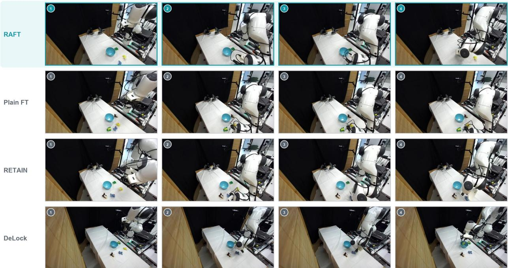  
Figure 13 | DROID rollout comparison under an OOD background. Rows show RAFT, Plain FT, RETAIN, <sub>an</sub>d D<sub>e</sub>L<sub>oc</sub>k <sub>a</sub>t f<sub>our or</sub>d<sub>ere</sub>d <sub>po</sub>i<sub>n</sub>t<sub>s</sub> i<sub>n ma</sub>t<sub>c</sub>h<sub>e</sub>d <sub>rea</sub>l<sub>-ro</sub>b<sub>o</sub>t <sub>ep</sub>i<sub>so</sub>d<sub>es.</sub> RAFT <sub>comp</sub>l<sub>e</sub>t<sub>es</sub> th<sub>e man</sub>i<sub>pu</sub>l<sub>a</sub>ti<sub>on, w</sub>hil<sub>e</sub> th<sub>e compar</sub>i<sub>son po</sub>li<sub>c</sub>i<sub>es</sub> f<sub>a</sub>il b<sub>e</sub>f<sub>ore</sub> t<sub>as</sub>k <sub>comp</sub>l<sub>e</sub>ti<sub>on.</sub>

## C.1 Efect of the reasoning modality

S<sub>e</sub>t<sub>up.</sub> W<sub>e vary</sub> th<sub>e</sub> St<sub>age-</sub>I <sub>superv</sub>i<sub>s</sub>i<sub>on</sub> t<sub>arge</sub>t <sub>across s</sub>i<sub>x</sub> f<sub>orma</sub>t<sub>s:</sub> f<sub>u</sub>ll <sub>reason</sub>i<sub>ng, v</sub>i<sub>sua</sub>l <sub>ques</sub>ti<sub>on</sub> answerin<sub>g</sub> (VQA), s<sub>p</sub>atial descri<sub>p</sub>tions, boundin<sub>g</sub> boxes, ke<sub>yp</sub>oints, and trajector<sub>y</sub> traces; Table 2 <sub>g</sub>ives <sub>an examp</sub>l<sub>e o</sub>f <sub>eac</sub>h<sub>.</sub> E<sub>ac</sub>h <sub>var</sub>i<sub>an</sub>t <sub>c</sub>h<sub>anges on</sub>l<sub>y</sub> th<sub>e</sub> f<sub>orma</sub>t <sub>o</sub>f th<sub>e</sub> St<sub>age-</sub>I t<sub>arge</sub>t<sub>, w</sub>hil<sub>e</sub> St<sub>age-</sub>II <sub>ac</sub>ti<sub>on</sub> t<sub>ra</sub>i<sub>n</sub>i<sub>ng</sub> <sub>an</sub>d th<sub>e</sub> <sub>eva</sub>l<sub>ua</sub>ti<sub>on</sub> <sub>pro</sub>t<sub>oco</sub>l <sub>are</sub> h<sub>e</sub>ld fi<sub>xe</sub>d<sub>.</sub> Th<sub>e</sub> <sub>ma</sub>i<sub>n-</sub>t<sub>ex</sub>t <sub>resu</sub>lt<sub>s</sub> <sub>use</sub> f<sub>u</sub>ll <sub>reason</sub>i<sub>ng</sub> f<sub>or</sub> <sub>p</sub>i<sub>c</sub>k <sub>an</sub>d <sub>p</sub>l<sub>ace an</sub>d b<sub>oun</sub>di<sub>ng-</sub>b<sub>ox superv</sub>i<sub>s</sub>i<sub>on</sub> f<sub>or</sub> th<sub>e open</sub> d<sub>rawer</sub> t<sub>as</sub>k<sub>, w</sub>ith th<sub>e mo</sub>d<sub>a</sub>lit<sub>y</sub> fi<sub>xe</sub>d <sub>across</sub> <sub>eva</sub>l<sub>ua</sub>ti<sub>on per</sub>t<sub>ur</sub>b<sub>a</sub>ti<sub>ons w</sub>ithi<sub>n eac</sub>h t<sub>as</sub>k<sub>;</sub> th<sub>e rema</sub>i<sub>n</sub>i<sub>ng mo</sub>d<sub>a</sub>liti<sub>es are repor</sub>t<sub>e</sub>d h<sub>ere.</sub> Fi<sub>gure</sub> 19 <sub>summar</sub>i<sub>zes success on</sub> b<sub>o</sub>th t<sub>as</sub>k<sub>s</sub> t<sub>oge</sub>th<sub>er w</sub>ith <sub>a</sub> l<sub>ayer-w</sub>i<sub>se par</sub>ti<sub>c</sub>i<sub>pa</sub>ti<sub>on-ra</sub>ti<sub>o ana</sub>l<sub>ys</sub>i<sub>s.</sub>

Results. On the open drawer task, trajectory-trace supervision achieves the highest ID success (49.06% vs. 29.25% for Plain FT). Under the visual shift, spatial descriptions, bounding boxes, and trajectory traces reach 29.25%<sub>,</sub> 28.30%<sub>,</sub> and 23.58%<sub>,</sub> res<sub>p</sub>ectivel<sub>y</sub>. On <sub>p</sub>ick and <sub>p</sub>lace<sub>,</sub> full reasonin<sub>g</sub> achieves the highest ID success (95.28%), whereas trajectory traces achieve the highest OOD-object success (45.28%), followed b<sub>y</sub> VQA and full reasonin<sub>g</sub> (43.40% each). Boundin<sub>g</sub>-box and ke<sub>yp</sub>oint su<sub>p</sub>ervision each reach 34.91%, com<sub>p</sub>arable to Plain FT (35.85%).

## C.2 Trainable reasoning adapter in Stage II

Setu<sub>p</sub>. We evaluate the same Sta<sub>g</sub>e-I reasonin<sub>g</sub> LoRA under three settin<sub>g</sub>s: (i) attached to the base <sub>p</sub>olic<sub>y</sub> without Sta<sub>g</sub>e-II action fine-tunin<sub>g</sub>, (ii) u<sub>p</sub>dated durin<sub>g</sub> Sta<sub>g</sub>e II, and (iii) frozen durin<sub>g</sub> Sta<sub>g</sub>e II<sub>,</sub> as in RAFT. Table 3 re<sub>p</sub>orts <sub>p</sub>ick-and-<sub>p</sub>lace success over 106 e<sub>p</sub>isodes <sub>p</sub>er s<sub>p</sub>lit.

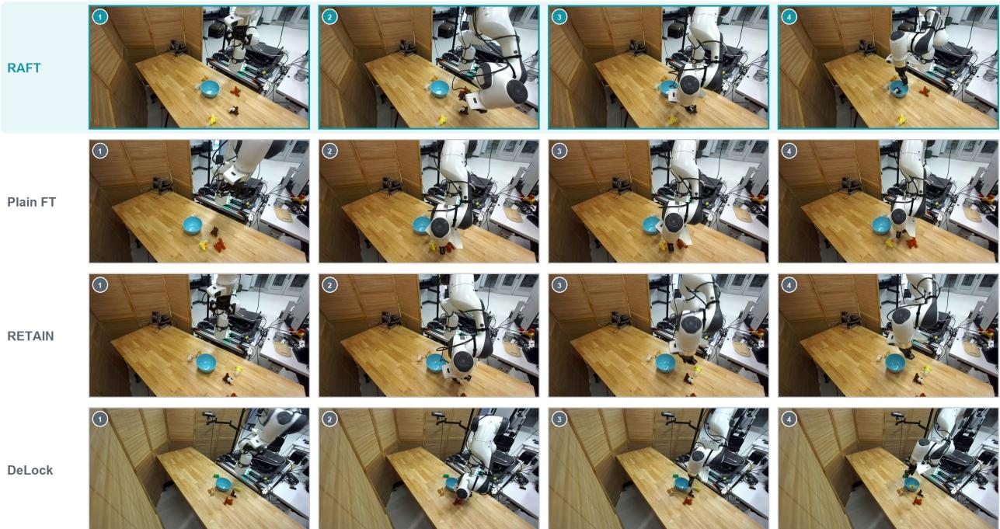  
Figure 14 | DROID rollout comparison under OOD clutter. Rows show RAFT, Plain FT, RETAIN, and DeLock <sub>a</sub>t f<sub>our or</sub>d<sub>ere</sub>d <sub>po</sub>i<sub>n</sub>t<sub>s</sub> i<sub>n ma</sub>t<sub>c</sub>h<sub>e</sub>d <sub>rea</sub>l<sub>-ro</sub>b<sub>o</sub>t <sub>ep</sub>i<sub>so</sub>d<sub>es.</sub> RAFT <sub>comp</sub>l<sub>e</sub>t<sub>es</sub> th<sub>e man</sub>i<sub>pu</sub>l<sub>a</sub>ti<sub>on, w</sub>hil<sub>e</sub> th<sub>e compar</sub>i<sub>son</sub> <sub>po</sub>li<sub>c</sub>i<sub>es</sub> f<sub>a</sub>il b<sub>e</sub>f<sub>ore</sub> t<sub>as</sub>k <sub>comp</sub>l<sub>e</sub>ti<sub>on.</sub>

Table 3 | Stage-II reasoning-adapter ablation on pick and place. Success rate (%) when the Stage-I reasoning LoRA is a<sub>pp</sub>lied without Sta<sub>g</sub>e II, u<sub>p</sub>dated durin<sub>g</sub> Sta<sub>g</sub>e II, or frozen durin<sub>g</sub> Sta<sub>g</sub>e II (RAFT). Each s<sub>p</sub>lit contains 106 e<sub>p</sub>isodes.
<table><tr><td>Adapter setting</td><td>ID</td><td>OOD-light</td><td>OOD-texture</td><td>OOD-object</td><td>OOD-prompt</td><td>Mean</td></tr><tr><td>LoRA on base (no Stage II)</td><td>72.64</td><td>60.38</td><td>9.43</td><td>33.02</td><td>66.04</td><td>48.30</td></tr><tr><td>LoRA trainable in Stage II</td><td>90.57</td><td>86.79</td><td>65.09</td><td>34.91</td><td>92.45</td><td>73.96</td></tr><tr><td>LoRA frozen in Stage II (RAFT)</td><td>95.28</td><td>93.40</td><td>92.45</td><td>43.40</td><td>91.51</td><td>83.21</td></tr></table>

Results. Attachin<sub>g</sub> the LoRA to the base <sub>p</sub>olic<sub>y</sub> without Sta<sub>g</sub>e II <sub>y</sub>ields 48.30% mean success. U<sub>p</sub>datin<sub>g</sub> the LoRA durin<sub>g</sub> Sta<sub>g</sub>e II raises mean success to 73.96%<sub>,</sub> and freezin<sub>g</sub> it raises it further to 83.21%. The <sub>g</sub>a<sub>p</sub> between the trainable and frozen settin<sub>g</sub>s is lar<sub>g</sub>est under the texture shift (65.09% vs. 92.45%).

## C.3 Comparison with co-training and frozen-vision fine-tuning

S<sub>e</sub>t<sub>up.</sub> W<sub>e</sub> <sub>compare</sub> <sub>s</sub>t<sub>age</sub>d t<sub>ra</sub>i<sub>n</sub>i<sub>ng</sub> <sub>w</sub>ith <sub>co-</sub>t<sub>ra</sub>i<sub>n</sub>i<sub>ng,</sub> i<sub>n</sub> <sub>w</sub>hi<sub>c</sub>h <sub>reason</sub>i<sub>ng</sub> <sub>an</sub>d <sub>ac</sub>ti<sub>on</sub> <sub>superv</sub>i<sub>s</sub>i<sub>on</sub> <sub>are</sub> <sub>app</sub>li<sub>e</sub>d <sub>w</sub>ithi<sub>n a s</sub>i<sub>ng</sub>l<sub>e</sub> t<sub>ra</sub>i<sub>n</sub>i<sub>ng run.</sub> R<sub>eason</sub>i<sub>ng an</sub>d <sub>ac</sub>ti<sub>on examp</sub>l<sub>es are samp</sub>l<sub>e</sub>d i<sub>n a</sub> 50/50 <sub>ra</sub>ti<sub>o,</sub> <sub>an</sub>d th<sub>e</sub>i<sub>r</sub> l<sub>osses are we</sub>i<sub>g</sub>ht<sub>e</sub>d <sub>equa</sub>ll<sub>y.</sub> Th<sub>e pr</sub>i<sub>mary</sub> Pl<sub>a</sub>i<sub>n</sub> FT <sub>an</sub>d <sub>co-</sub>t<sub>ra</sub>i<sub>n</sub>i<sub>ng</sub> b<sub>ase</sub>li<sub>nes</sub> fi<sub>ne-</sub>t<sub>une</sub> th<sub>e</sub> Si<sub>g</sub>LIP <sub>v</sub>i<sub>s</sub>i<sub>on enco</sub>d<sub>er.</sub> W<sub>e a</sub>l<sub>so eva</sub>l<sub>ua</sub>t<sub>e</sub> Pl<sub>a</sub>i<sub>n</sub> FT <sub>w</sub>ith <sub>a</sub> f<sub>rozen v</sub>i<sub>s</sub>i<sub>on enco</sub>d<sub>er, ma</sub>t<sub>c</sub>hi<sub>ng</sub> RAFT<sub>, w</sub>hi<sub>c</sub>h ada<sub>p</sub>ts vision onl<sub>y</sub> throu<sub>g</sub>h the Sta<sub>g</sub>e-I LoRA and kee<sub>p</sub>s that LoRA frozen in Sta<sub>g</sub>e II. Table 4 re<sub>p</sub>orts <sub>p</sub>i<sub>c</sub>k<sub>-an</sub>d<sub>-p</sub>l<sub>ace success on</sub> th<sub>e same</sub> 106 <sub>eva</sub>l<sub>ua</sub>ti<sub>on ep</sub>i<sub>so</sub>d<sub>es per sp</sub>lit<sub>.</sub>

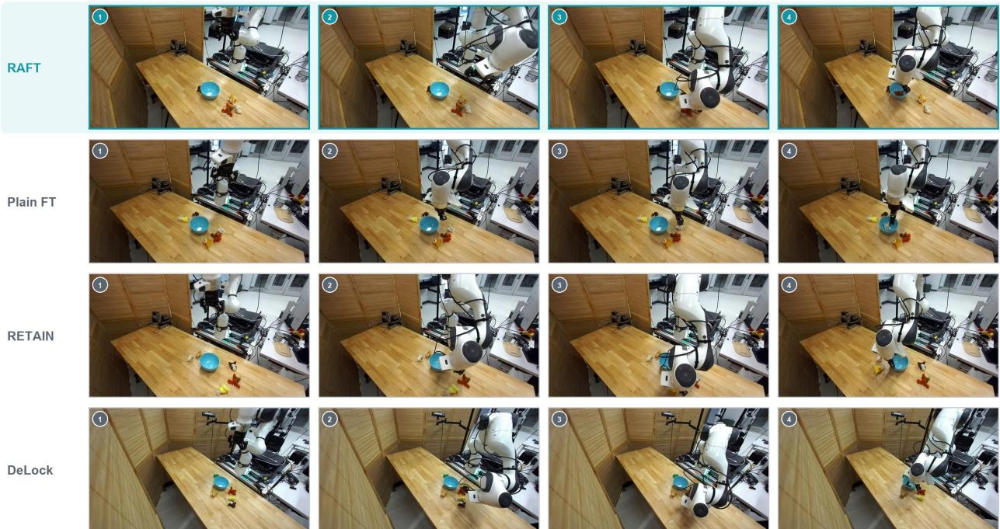  
Figure 15 | DROID rollout comparison with an OOD object. Rows show RAFT, Plain FT, RETAIN, and D<sub>e</sub>L<sub>oc</sub>k <sub>a</sub>t f<sub>our or</sub>d<sub>ere</sub>d <sub>po</sub>i<sub>n</sub>t<sub>s</sub> i<sub>n ma</sub>t<sub>c</sub>h<sub>e</sub>d <sub>rea</sub>l<sub>-ro</sub>b<sub>o</sub>t <sub>ep</sub>i<sub>so</sub>d<sub>es.</sub> RAFT <sub>comp</sub>l<sub>e</sub>t<sub>es</sub> th<sub>e man</sub>i<sub>pu</sub>l<sub>a</sub>ti<sub>on, w</sub>hil<sub>e</sub> th<sub>e</sub> <sub>compar</sub>i<sub>son po</sub>li<sub>c</sub>i<sub>es</sub> f<sub>a</sub>il b<sub>e</sub>f<sub>ore</sub> t<sub>as</sub>k <sub>comp</sub>l<sub>e</sub>ti<sub>on.</sub>

Table 4 | Co-training and frozen-vision controls on simulated pick and place. Success rate (%) on five matched evaluation s<sub>p</sub>lits (� = 106 <sub>p</sub>er cell).
<table><tr><td>Method</td><td>ID</td><td>OOD-light</td><td>OOD-texture</td><td>OOD-object</td><td>OOD-prompt</td><td>Mean</td></tr><tr><td>Plain FT</td><td>90.57</td><td>87.74</td><td>92.45</td><td>35.85</td><td>91.51</td><td>79.62</td></tr><tr><td>Plain FT (frozen vision)</td><td>91.51</td><td>86.79</td><td>87.74</td><td>40.57</td><td>91.51</td><td>79.62</td></tr><tr><td>Co-train</td><td>79.25</td><td>70.75</td><td>72.64</td><td>17.92</td><td>75.47</td><td>63.21</td></tr><tr><td>RAFT</td><td>95.28</td><td>93.40</td><td>92.45</td><td>43.40</td><td>91.51</td><td>83.21</td></tr></table>

Results. Co-trainin<sub>g</sub> reaches 63.21% mean success<sub>,</sub> com<sub>p</sub>ared with 79.62% for Plain FT and 83.21% for RAFT; its lar<sub>g</sub>est deficit is under the object shift (17.92% vs. 43.40% for RAFT). Freezin<sub>g</sub> the <sub>v</sub>i<sub>s</sub>i<sub>on enco</sub>d<sub>er</sub> i<sub>n</sub> Pl<sub>a</sub>i<sub>n</sub> FT <sub>c</sub>h<sub>anges</sub> it<sub>s sp</sub>lit<sub>-</sub>l<sub>eve</sub>l <sub>resu</sub>lt<sub>s</sub> b<sub>u</sub>t l<sub>eaves</sub> it<sub>s mean success unc</sub>h<sub>ange</sub>d <sub>a</sub>t 79.62%. Its OOD-object success is 40.57%, compared with 35.85% for the primary Plain FT and 43.40% for RAFT.

## C.4 Compatibility with weight merging

Setu<sub>p</sub>. We test whether RAFT can serve as the ada<sub>p</sub>ted check<sub>p</sub>oint in RETAIN wei<sub>g</sub>ht mer<sub>g</sub>in<sub>g</sub>. Both merged policies interpolate with the same pretrained base at � = 0.9: one uses Plain FT as the <sub>a</sub>d<sub>ap</sub>t<sub>e</sub>d <sub>en</sub>d<sub>po</sub>i<sub>n</sub>t<sub>,</sub> <sub>an</sub>d th<sub>e</sub> <sub>o</sub>th<sub>er</sub> <sub>uses</sub> RAFT <sub>w</sub>ith b<sub>oun</sub>di<sub>ng-</sub>b<sub>ox</sub> <sub>superv</sub>i<sub>s</sub>i<sub>on.</sub> W<sub>e</sub> <sub>a</sub>l<sub>so</sub> <sub>eva</sub>l<sub>ua</sub>t<sub>e</sub> th<sub>e</sub> <sub>s</sub>t<sub>an</sub>d<sub>a</sub>l<sub>one</sub> RAFT <sub>po</sub>li<sub>cy.</sub> T<sub>a</sub>bl<sub>e</sub> 5 <sub>repor</sub>t<sub>s resu</sub>lt<sub>s on</sub> th<sub>e</sub> F<sub>ran</sub>k<sub>a open</sub> d<sub>rawer</sub> t<sub>as</sub>k<sub>; every ce</sub>ll <sub>con</sub>t<sub>a</sub>i<sub>ns</sub> 106 tri<sub>a</sub>l<sub>s.</sub>

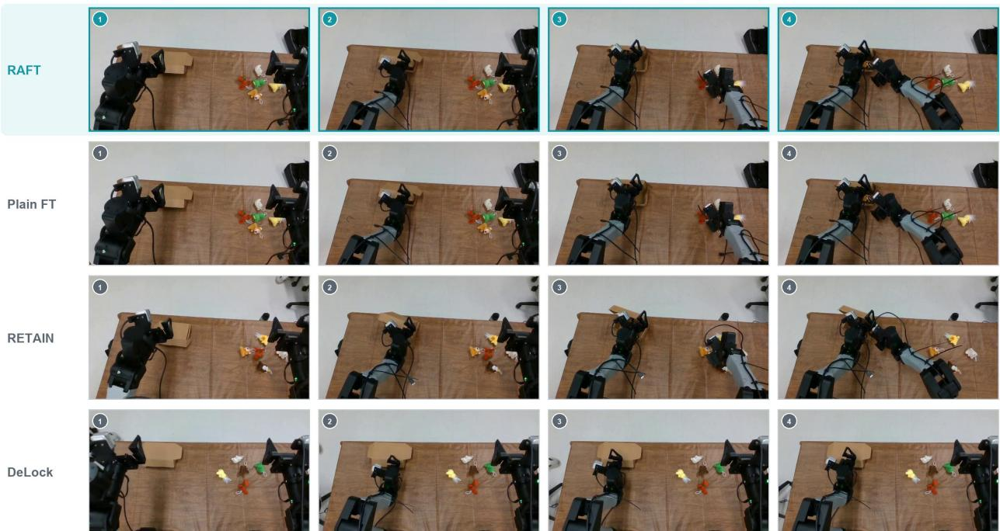  
Figure 16 | YAM rollout comparison under OOD clutter. Rows show RAFT, Plain FT, RETAIN, and DeLock <sub>on ma</sub>t<sub>c</sub>h<sub>e</sub>d t<sub>as</sub>k i<sub>ns</sub>t<sub>ances; co</sub>l<sub>umns s</sub>h<sub>ow or</sub>d<sub>ere</sub>d <sub>ro</sub>ll<sub>ou</sub>t f<sub>rames.</sub> RAFT <sub>comp</sub>l<sub>e</sub>t<sub>es</sub> th<sub>e</sub> t<sub>wo-s</sub>t<sub>age</sub> t<sub>as</sub>k<sub>, w</sub>hil<sub>e</sub> th<sub>e compar</sub>i<sub>son po</sub>li<sub>c</sub>i<sub>es</sub> d<sub>o no</sub>t<sub>.</sub>

Table 5 | RETAIN applied to Plain FT and RAFT on the Franka open drawer task. Success rate (%) for each axis. RETAIN a<sub>pp</sub>lied to RAFT out<sub>p</sub>erforms RETAIN a<sub>pp</sub>lied to Plain FT.
<table><tr><td>Policy</td><td>ID</td><td>OOD-light</td><td>OOD-texture</td><td>Overall</td></tr><tr><td>RETAIN on Plain FT (α = 0.9)</td><td>38.68</td><td>34.91</td><td>17.92</td><td>30.50</td></tr><tr><td>RETAIN on RAFT (bbox, α = 0.9)</td><td>41.51</td><td>37.74</td><td>29.25</td><td>36.16</td></tr><tr><td>RAFT (bbox) alone</td><td>44.34</td><td>41.51</td><td>28.30</td><td>38.05</td></tr></table>

R<sub>esu</sub>lt<sub>s.</sub> U<sub>s</sub>i<sub>ng</sub> RAFT i<sub>ns</sub>t<sub>ea</sub>d <sub>o</sub>f Pl<sub>a</sub>i<sub>n</sub> FT <sub>as</sub> th<sub>e a</sub>d<sub>ap</sub>t<sub>e</sub>d <sub>en</sub>d<sub>po</sub>i<sub>n</sub>t i<sub>ncreases poo</sub>l<sub>e</sub>d <sub>success</sub> f<sub>rom</sub> 30.50% to 36.16%. Standalone RAFT reaches 38.05%<sub>,</sub> the hi<sub>g</sub>hest overall<sub>,</sub> with the hi<sub>g</sub>hest ID and li<sub>g</sub>htin<sub>g</sub> success (44.34% and 41.51%).

## D Evaluation environments

Fi<sub>g</sub>ure 20 illustrates the in-distribution (ID) and out-of-distribution (OOD) conditions used in our <sub>s</sub>i<sub>mu</sub>l<sub>a</sub>t<sub>e</sub>d <sub>an</sub>d <sub>p</sub>h<sub>ys</sub>i<sub>ca</sub>l<sub>-ro</sub>b<sub>o</sub>t <sub>exper</sub>i<sub>men</sub>t<sub>s;</sub> th<sub>e eva</sub>l<sub>ua</sub>ti<sub>on pro</sub>t<sub>oco</sub>l i<sub>s</sub> d<sub>escr</sub>ib<sub>e</sub>d i<sub>n</sub> A<sub>ppen</sub>di<sub>x</sub> A<sub>.</sub>4<sub>.</sub> Si<sub>m-</sub> ulation task construction, resets, initial-state matchin<sub>g</sub>, and success criteria follow MolmoS<sub>p</sub>aces [25]. Withi<sub>n eac</sub>h <sub>per</sub>t<sub>ur</sub>b<sub>a</sub>ti<sub>on, a</sub>ll <sub>me</sub>th<sub>o</sub>d<sub>s are eva</sub>l<sub>ua</sub>t<sub>e</sub>d <sub>on</sub> id<sub>en</sub>ti<sub>ca</sub>l <sub>ep</sub>i<sub>so</sub>d<sub>es.</sub> O<sub>n</sub> th<sub>e p</sub>h<sub>ys</sub>i<sub>ca</sub>l <sub>ro</sub>b<sub>o</sub>t<sub>s,</sub> <sub>rese</sub>t<sub>s preserve</sub> th<sub>e</sub> t<sub>as</sub>k <sub>con</sub>fi<sub>gura</sub>ti<sub>on an</sub>d i<sub>n</sub>iti<sub>a</sub>l <sub>s</sub>t<sub>a</sub>t<sub>e.</sub>

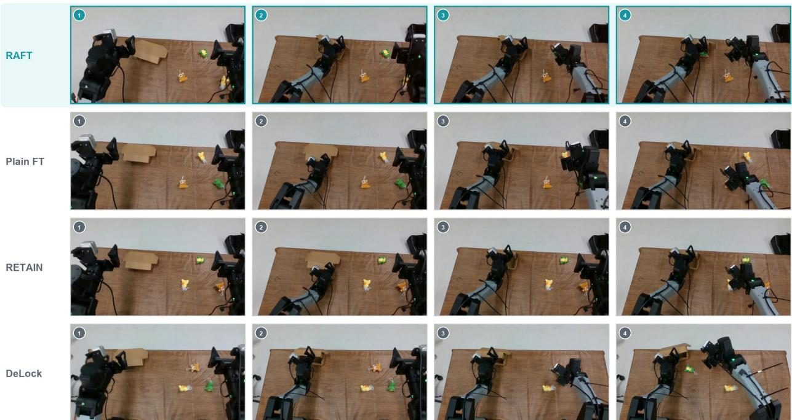  
Figure 17 | YAM rollout comparison under an OOD color shift. Rows show RAFT, Plain FT, RETAIN, and D<sub>e</sub>L<sub>oc</sub>k <sub>on ma</sub>t<sub>c</sub>h<sub>e</sub>d t<sub>as</sub>k i<sub>ns</sub>t<sub>ances; co</sub>l<sub>umns s</sub>h<sub>ow or</sub>d<sub>ere</sub>d <sub>ro</sub>ll<sub>ou</sub>t f<sub>rames.</sub> RAFT <sub>comp</sub>l<sub>e</sub>t<sub>es</sub> th<sub>e</sub> t<sub>wo-s</sub>t<sub>age</sub> t<sub>as</sub>k<sub>,</sub> <sub>w</sub>hil<sub>e</sub> th<sub>e compar</sub>i<sub>son po</sub>li<sub>c</sub>i<sub>es</sub> d<sub>o no</sub>t<sub>.</sub>

## E Representation and attention analysis protocol

Model and ca<sub>p</sub>tured frames. The <sub>p</sub>artici<sub>p</sub>ation-ratio (PR) anal<sub>y</sub>sis in Fi<sub>g</sub>ure 19 uses the first 400 <sub>recor</sub>d<sub>s o</sub>f th<sub>e</sub> h<sub>e</sub>ld<sub>-ou</sub>t iTHOR Fl<sub>oor</sub>Pl<sub>an</sub>13 <sub>va</sub>lid<sub>a</sub>ti<sub>on sp</sub>lit<sub>, spann</sub>i<sub>ng</sub> fi<sub>ve ep</sub>i<sub>so</sub>d<sub>es.</sub> Th<sub>e</sub> li<sub>near-</sub> <sub>pro</sub>b<sub>e resu</sub>lt<sub>s</sub> i<sub>n</sub> Fi<sub>gure</sub> 9 <sub>use a cap</sub>t<sub>ure o</sub>f 414 f<sub>rames: n</sub>i<sub>ne even</sub>l<sub>y space</sub>d f<sub>rames</sub> f<sub>rom eac</sub>h <sub>o</sub>f 46 <sub>po</sub>li<sub>cy-</sub>t<sub>ra</sub>i<sub>n</sub>i<sub>ng</sub> <sub>ep</sub>i<sub>so</sub>d<sub>es.</sub>

Participation ratio and correlations. For each <sup>f</sup>rame and decoder layer ℓ, we mean-pool hidden\_- states[ℓ] over non-padding positions to obtain a 400 × 2048 matrix $X _ { \ell }$ <sub>.</sub> Aft<sub>er</sub> <sub>cen</sub>t<sub>er</sub>i<sub>ng</sub> th<sub>e</sub> <sub>co</sub>l<sub>umns, we compu</sub>t<sub>e</sub> th<sub>e covar</sub>i<sub>ance e</sub>i<sub>genva</sub>l<sub>ues</sub> $\lambda _ { i }$ f<sub>rom</sub> th<sub>e square</sub>d <sub>s</sub>i<sub>ngu</sub>l<sub>ar va</sub>l<sub>ues an</sub>d d<sub>e</sub>fi<sub>ne</sub> $\mathrm { P R } _ { \ell } = ( \sum _ { i } \lambda _ { i } ) ^ { 2 } / \sum _ { i } \lambda _ { i } ^ { 2 }$ . PR thus measures the efective dimensionality of across-frame variance. Each <sub>eva</sub>l<sub>ua</sub>ti<sub>on ax</sub>i<sub>s pa</sub>i<sub>rs one</sub> d<sub>owns</sub>t<sub>ream</sub> b<sub>enc</sub>h<sub>mar</sub>k <sub>w</sub>ith <sub>one</sub> PR <sub>pro</sub>b<sub>e</sub> d<sub>oma</sub>i<sub>n.</sub> Fi<sub>gure</sub> 19 <sub>poo</sub>l<sub>s</sub> th<sub>e</sub> th<sub>ree</sub> t<sub>as</sub>k<sub>-ma</sub>t<sub>c</sub>h<sub>e</sub>d <sub>axes.</sub> F<sub>or eac</sub>h l<sub>ayer an</sub>d <sub>ax</sub>i<sub>s, we compu</sub>t<sub>e</sub> th<sub>e</sub> S<sub>pearman corre</sub>l<sub>a</sub>ti<sub>on across</sub> th<sub>e same s</sub>i<sub>x</sub> St<sub>age-</sub>I <sub>arms an</sub>d <sub>assess s</sub>i<sub>gn</sub>ifi<sub>cance w</sub>ith <sub>a</sub> t<sub>wo-s</sub>id<sub>e</sub>d <sub>exac</sub>t <sub>permu</sub>t<sub>a</sub>ti<sub>on</sub> t<sub>es</sub>t <sub>over a</sub>ll 6! = 720 assignments, applying Benjamini–Hochberg FDR correction across the 19 layers.

Linear probes. Episode-time labels are defined as min(3, ⌊4 frame<sub>\_</sub>idx/total<sub>\_</sub>frames⌋), giving a chance balanced accuracy of 1/4. The labels reach, grasp, transport, and place denote the four <sub>p</sub>ositional (timeste<sub>p</sub>) <sub>q</sub>uartiles of each e<sub>p</sub>isode. Within each leave-one-e<sub>p</sub>isode-out fold, we fit StandardScaler, PCA(64), and LogisticRegression(C=0.5). Layer-band uncertainty and di<sup>f</sup>erences from Plain FT are estimated with a <sub>p</sub>aired bootstra<sub>p</sub> over e<sub>p</sub>isodes (� = 1000).

YAM· OOD box pose  
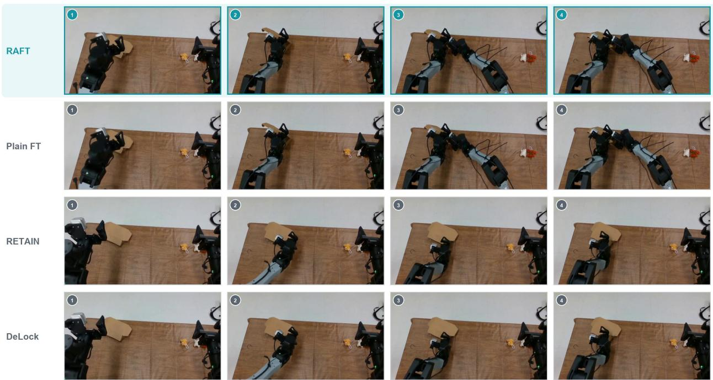  
Figure 18 | YAM rollout comparison under an OOD initial pose. Rows show RAFT, Plain FT, RETAIN, and D<sub>e</sub>L<sub>oc</sub>k <sub>on ma</sub>t<sub>c</sub>h<sub>e</sub>d t<sub>as</sub>k i<sub>ns</sub>t<sub>ances; co</sub>l<sub>umns s</sub>h<sub>ow or</sub>d<sub>ere</sub>d <sub>ro</sub>ll<sub>ou</sub>t f<sub>rames.</sub> RAFT <sub>comp</sub>l<sub>e</sub>t<sub>es</sub> th<sub>e</sub> t<sub>wo-s</sub>t<sub>age</sub> t<sub>as</sub>k<sub>,</sub> <sub>w</sub>hil<sub>e</sub> th<sub>e compar</sub>i<sub>son po</sub>li<sub>c</sub>i<sub>es</sub> d<sub>o no</sub>t<sub>.</sub>

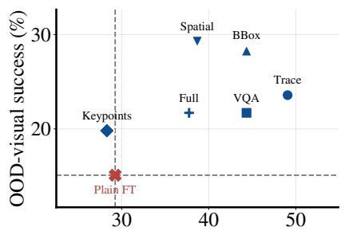  
ID success (%)

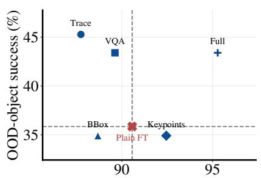  
ID success (%)

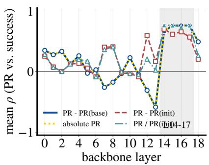  
Figure 19 | Efect of reasoning modality on success and representation dimensionality. Left: ID and OOD-visual success on the open drawer task for six reasoning modalities. Center: ID and OOD-object success <sub>on p</sub>i<sub>c</sub>k <sub>an</sub>d <sub>p</sub>l<sub>ace</sub> f<sub>or</sub> fi<sub>ve mo</sub>d<sub>a</sub>liti<sub>es.</sub> R<sub>e</sub>d <sub>crosses</sub> d<sub>eno</sub>t<sub>e no-reason</sub>i<sub>ng con</sub>t<sub>ro</sub>l<sub>s, an</sub>d d<sub>as</sub>h<sub>e</sub>d li<sub>nes mar</sub>k Pl<sub>a</sub>i<sub>n</sub> FT<sub>.</sub> Each <sub>po</sub>lic<sub>y</sub> i<sub>s e</sub>val<sub>u</sub>at<sub>e</sub>d <sub>o</sub>n 106 trial<sub>s pe</sub>r axi<sub>s.</sub> Ri<sub>g</sub>ht: La<sub>ye</sub>r-wi<sub>se</sub> m<sub>e</sub>an S<sub>pe</sub>arman c<sub>o</sub>rr<sub>e</sub>lati<sub>o</sub>n b<sub>e</sub>tw<sub>ee</sub>n <sub>par</sub>ti<sub>c</sub>i<sub>pa</sub>ti<sub>on</sub> <sub>ra</sub>ti<sub>o</sub> <sub>an</sub>d <sub>success,</sub> <sub>poo</sub>l<sub>e</sub>d <sub>over</sub> th<sub>ree</sub> t<sub>as</sub>k<sub>-ma</sub>t<sub>c</sub>h<sub>e</sub>d <sub>eva</sub>l<sub>ua</sub>ti<sub>on</sub> <sub>axes</sub> <sub>an</sub>d <sub>s</sub>i<sub>x</sub> <sub>reason</sub>i<sub>ng</sub> <sub>var</sub>i<sub>an</sub>t<sub>s,</sub> f<sub>or</sub> f<sub>our</sub> <sub>par</sub>ti<sub>c</sub>i<sub>pa</sub>ti<sub>on-ra</sub>ti<sub>o</sub> <sub>measures.</sub> Fill<sub>e</sub>d <sub>mar</sub>k<sub>ers</sub> d<sub>eno</sub>t<sub>e</sub> <sub>s</sub>i<sub>gn</sub>ifi<sub>cance</sub> <sub>a</sub>ft<sub>er</sub> FDR <sub>correc</sub>ti<sub>on;</sub> <sub>s</sub>h<sub>a</sub>di<sub>ng</sub> <sub>mar</sub>k<sub>s</sub> la<sub>y</sub>ers 14–17.

Pick and place  
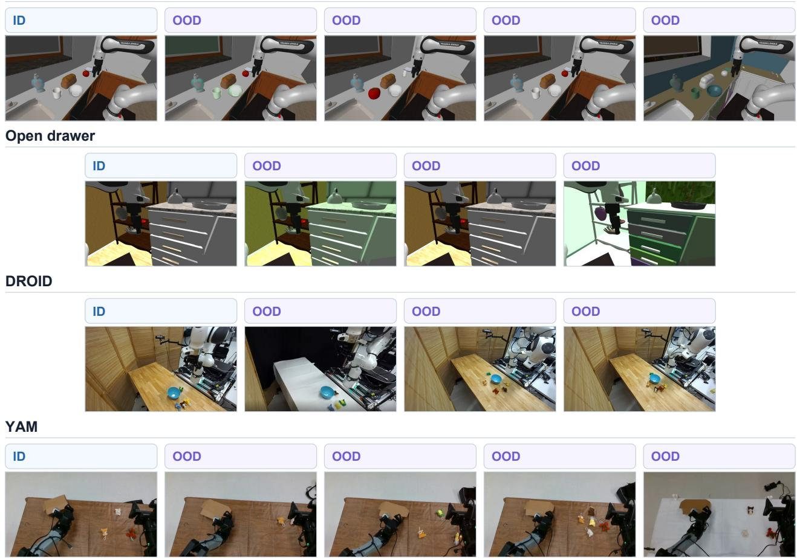  
Figure 20 | Evaluation setup across the four robot tasks. Each row begins with an in-distribution observation, followed by its OOD variants. Pick and place varies lighting, target object, instruction, and scene texture; the open drawer task varies lighting, instruction, and scene texture; DROID varies background, clutter, and object appearance; and YAM varies box pose, object color, clutter, and background. Instruction shifts reuse the ID i<sub>mage</sub> b<sub>ecause</sub> <sub>on</sub>l<sub>y</sub> th<sub>e</sub> t<sub>as</sub>k <sub>promp</sub>t <sub>c</sub>h<sub>anges.</sub>

Vi<sub>sua</sub>l <sub>a</sub>tt<sub>en</sub>ti<sub>on an</sub>d <sub>reg</sub>i<sub>on mas</sub>k<sub>s.</sub> At <sub>eac</sub>h l<sub>ayer, we ex</sub>t<sub>rac</sub>t th<sub>e a</sub>tt<sub>en</sub>ti<sub>on</sub> f<sub>rom</sub> t<sub>ex</sub>t <sub>quer</sub>i<sub>es</sub> t<sub>o</sub> i<sub>mage</sub> keys, �[:, 256 :, : 256], average it uniformly over heads and text queries, and $L _ { 1 } .$ <sub>-norma</sub>li<sub>ze</sub> it <sub>over</sub> th<sub>e</sub> 256 i<sub>mage pa</sub>t<sub>c</sub>h<sub>es; no</sub> i<sub>n</sub>di<sub>v</sub>id<sub>ua</sub>l h<sub>ea</sub>d <sub>or</sub> l<sub>as</sub>t<sub>-</sub>t<sub>o</sub>k<sub>en rea</sub>d<sub>ou</sub>t i<sub>s se</sub>l<sub>ec</sub>t<sub>e</sub>d<sub>.</sub> B<sub>an</sub>d<sub>-</sub>l<sub>eve</sub>l <sub>maps average</sub> th<sub>e</sub> <sub>norma</sub>li<sub>ze</sub>d <sub>per-</sub>l<sub>ayer</sub> <sub>maps.</sub> B<sub>ecause</sub> thi<sub>s</sub> <sub>norma</sub>li<sub>za</sub>ti<sub>on</sub> <sub>removes</sub> th<sub>e</sub> t<sub>o</sub>t<sub>a</sub>l <sub>a</sub>tt<sub>en</sub>ti<sub>on</sub> <sub>mass</sub> <sub>on</sub> th<sub>e</sub> i<sub>mage,</sub> we report that quantity separately as img\_mass. For visualization, patch values are upsampled by <sub>neares</sub>t<sub>-ne</sub>i<sub>g</sub>hb<sub>or</sub> tili<sub>ng, an</sub>d <sub>a</sub>ll <sub>arms s</sub>h<sub>are a co</sub>l<sub>or sca</sub>l<sub>e cappe</sub>d <sub>a</sub>t th<sub>e</sub> 99th <sub>percen</sub>til<sub>e o</sub>f i<sub>n</sub>t<sub>er</sub>i<sub>or-pa</sub>t<sub>c</sub>h <sub>a</sub>tt<sub>en</sub>ti<sub>on;</sub> th<sub>e</sub> b<sub>or</sub>d<sub>er r</sub>i<sub>ng</sub> i<sub>s exc</sub>l<sub>u</sub>d<sub>e</sub>d f<sub>rom</sub> thi<sub>s sca</sub>l<sub>e</sub> b<sub>ecause</sub> it <sub>ex</sub>hibit<sub>s a</sub>tt<sub>en</sub>ti<sub>on-s</sub>i<sub>n</sub>k/<sub>reg</sub>i<sub>s</sub>t<sub>er</sub> b<sub>e</sub>h<sub>a</sub>vi<sub>o</sub>r<sub>.</sub> B<sub>ou</sub>ndin<sub>g</sub> b<sub>o</sub>x<sub>es</sub> <sub>a</sub>r<sub>e</sub> m<sub>appe</sub>d t<sub>o</sub> <sub>pa</sub>t<sub>c</sub>h<sub>es</sub> <sub>us</sub>in<sub>g</sub> fl<sub>oo</sub>r/<sub>ce</sub>ilin<sub>g</sub> b<sub>ou</sub>nd<sub>a</sub>ri<sub>es</sub> <sub>a</sub>nd m<sub>ay</sub> in<sub>c</sub>l<sub>u</sub>d<sub>e</sub> <sub>up</sub> t<sub>o one ex</sub>t<sub>ra pa</sub>t<sub>c</sub>h <sub>on eac</sub>h <sub>e</sub>d<sub>ge; eac</sub>h k<sub>eypo</sub>i<sub>n</sub>t <sub>or</sub> t<sub>race po</sub>i<sub>n</sub>t i<sub>s mappe</sub>d t<sub>o</sub> th<sub>e pa</sub>t<sub>c</sub>h th<sub>a</sub>t <sub>con</sub>t<sub>a</sub>i<sub>ns</sub> it<sub>,</sub> <sub>an</sub>d th<sub>e</sub> b<sub>ac</sub>k<sub>groun</sub>d i<sub>s</sub> th<sub>e comp</sub>l<sub>emen</sub>t <sub>o</sub>f <sub>a</sub>ll <sub>anno</sub>t<sub>a</sub>t<sub>e</sub>d <sub>pa</sub>t<sub>c</sub>h<sub>es.</sub> A f<sub>rame en</sub>t<sub>ers a g</sub>i<sub>ven reg</sub>i<sub>on ana</sub>l<sub>ys</sub>i<sub>s</sub> <sub>on</sub>l<sub>y</sub> if it <sub>con</sub>t<sub>a</sub>i<sub>ns a</sub>t l<sub>eas</sub>t t<sub>wo</sub> b<sub>oun</sub>di<sub>ng-</sub>b<sub>ox pa</sub>t<sub>c</sub>h<sub>es, one</sub> k<sub>eypo</sub>i<sub>n</sub>t<sub>, or one</sub> t<sub>race po</sub>i<sub>n</sub>t<sub>, as app</sub>li<sub>ca</sub>bl<sub>e.</sub> F<sub>or a pa</sub>t<sub>c</sub>h <sub>mas</sub>k � <sub>an</sub>d <sub>norma</sub>li<sub>ze</sub>d <sub>a</sub>tt<sub>en</sub>ti<sub>on</sub> $p _ { j } ,$ <sub>we</sub> d<sub>e</sub>fi<sub>ne enr</sub>i<sub>c</sub>h<sub>men</sub>t <sub>as</sub> $\textstyle \left( 2 5 6 / | M | \right) \sum _ { j \in M } p _ { j } .$ <sub>, so</sub> th<sub>a</sub>t <sub>a va</sub>l<sub>ue o</sub>f 1 <sub>correspon</sub>d<sub>s</sub> t<sub>o un</sub>if<sub>orm a</sub>tt<sub>en</sub>ti<sub>on.</sub> B<sub>oun</sub>di<sub>ng-</sub>b<sub>ox,</sub> k<sub>eypo</sub>i<sub>n</sub>t<sub>, an</sub>d t<sub>race mas</sub>k<sub>s may over</sub>l<sub>ap</sub> <sub>an</sub>d th<sub>ere</sub>f<sub>ore</sub> d<sub>o no</sub>t <sub>par</sub>titi<sub>on</sub> th<sub>e</sub> i<sub>mage; on</sub>l<sub>y</sub> th<sub>e</sub> b<sub>ac</sub>k<sub>groun</sub>d <sub>mas</sub>k i<sub>s</sub> d<sub>e</sub>fi<sub>ne</sub>d b<sub>y comp</sub>l<sub>emen</sub>t<sub>a</sub>ti<sub>on.</sub>

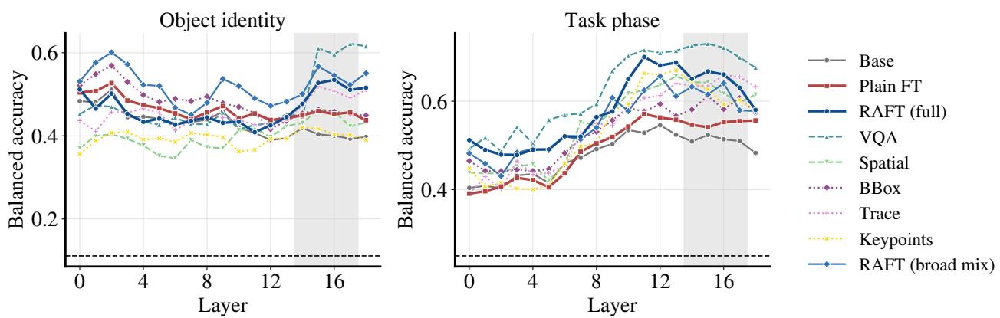  
Figure 21 | Late-layer probes for all nine model arms. Leave-one-episode-out balanced accuracy for object id<sub>en</sub>tit<sub>y an</sub>d <sub>ep</sub>i<sub>so</sub>d<sub>e-</sub>ti<sub>me quar</sub>til<sub>e across</sub> b<sub>ac</sub>kb<sub>one</sub> l<sub>ayers.</sub> Th<sub>e s</sub>h<sub>a</sub>d<sub>e</sub>d b<sub>an</sub>d <sub>mar</sub>k<sub>s</sub> l<sub>ayers</sub> 14<sub>–</sub>17<sub>.</sub> Thi<sub>s expan</sub>d<sub>s</sub> th<sub>e</sub> f<sub>our-arm compar</sub>i<sub>son</sub> i<sub>n</sub> th<sub>e ma</sub>i<sub>n</sub> t<sub>ex</sub>t t<sub>o</sub> th<sub>e</sub> f<sub>u</sub>ll <sub>se</sub>t <sub>o</sub>f <sub>reason</sub>i<sub>ng-mo</sub>d<sub>a</sub>lit<sub>y var</sub>i<sub>an</sub>t<sub>s.</sub>

## F Extended late-layer probe analysis

Figure 21 expands the main-text probe comparison to all nine model arms. VQA and trace show the largest late-layer recovery in object-identity decoding and the strongest novel-object results; spatial, b<sub>oun</sub>di<sub>ng-</sub>b<sub>ox,</sub> <sub>an</sub>d k<sub>eypo</sub>i<sub>n</sub>t <sub>var</sub>i<sub>an</sub>t<sub>s</sub> <sub>s</sub>h<sub>ow</sub> <sub>no</sub> <sub>compara</sub>bl<sub>e</sub> <sub>recovery</sub> <sub>an</sub>d <sub>are</sub> th<sub>e</sub> <sub>wea</sub>k<sub>es</sub>t <sub>on</sub> th<sub>a</sub>t <sub>s</sub>hift<sub>.</sub>