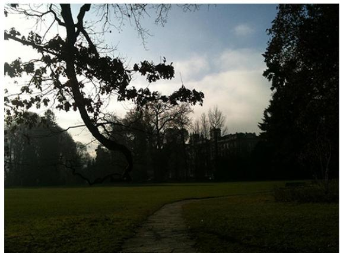
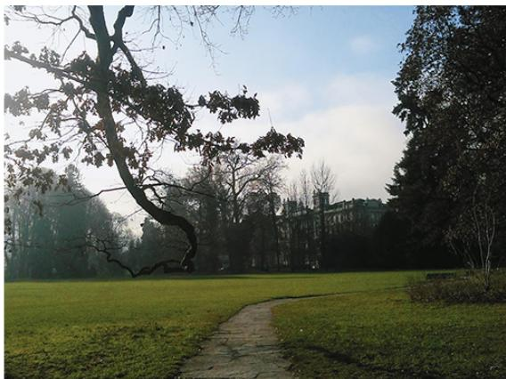
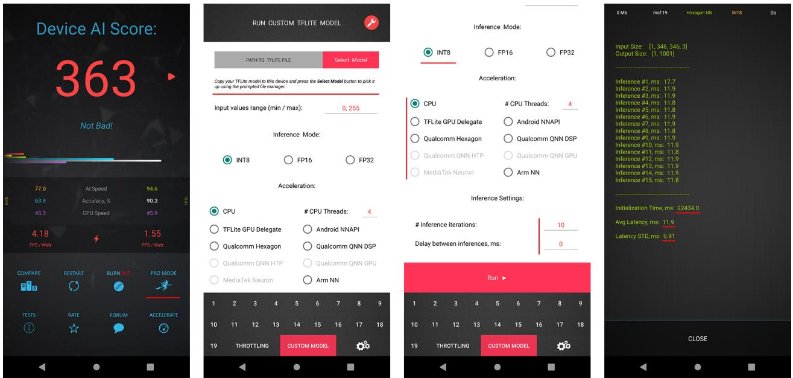
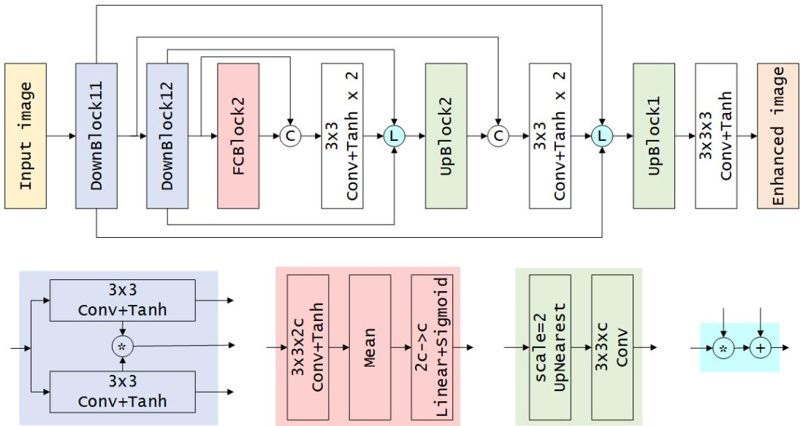
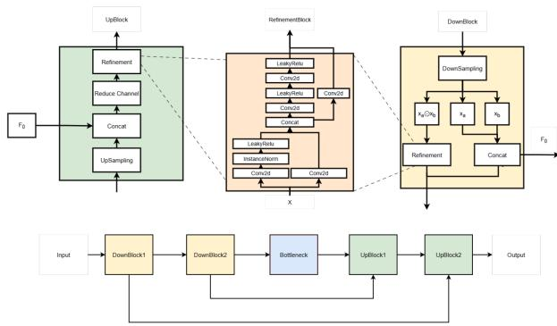
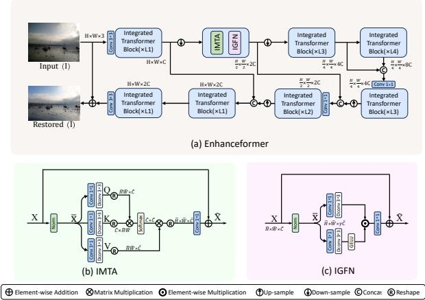
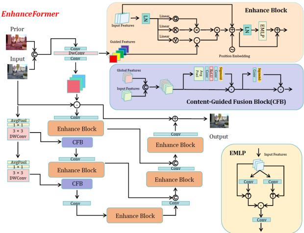

# RGB Photo Enhancement with Deep Learning on Smartphone GPUs: Mobile AI 2026 Challenge Report

Andrey Ignatov C Yang Zhang   
Nguyen Nhu Tinh Anh h Bui Minh Hieu Faming Fang

Georgy Perevozchikov OV Xiaochen Li To Thanh Dat Qiuhai Yan Su Runhua Deng Z

Radu Timofte Dong Zhang Zhao Ran Shichang Ju Yiqin Cao Yang Lu Nguyen Ngoc Ky Duyen Nguyen Trong Nghia nzhe Yang Kang Chen Tingting Wang Zhifeng Wang Long Peng Aiwen Jiang

## Abstract

On-device RGB photo enhancement is a popular task that is needed for quality improvement ofphotos captured with mobile devices as well as for retouching of images acquired through other sources. This creates a need for efficient deep learning models for this problem that are not only performant but can also be deployed on constrained mobile hardware. In this Mobile AI challenge, we address this problem and propose participants to design fast solutions that can perform comprehensive enhancement ofRGB photos while running on popular smartphone GPUs from Qualcomm and Arm. For this, the participants were provided with a large-scale DPED dataset consisting of RGB image pairs captured with an old iPhone 3GS smartphone and a professional Canon 70D DSLR camera. The runtime ofall models was evaluated on the Snapdragon 8 Elite Gen 5 and Dimensity 9500 chipsets with the Adreno and Mali GPUs, respectively. Top solutions proposed in this challenge are able to enhance Full HD resolution RGB images on both platforms under 300 milliseconds. A comprehensive description ofthe models developed in the challenge is provided in this paper.

## 1. Introduction

Image restoration and enhancement are fundamental problems in computer vision that aim to improve various aspects of image quality, including denoising, deblurring, super-resolution, color correction, contrast enhancement, dynamic range reconstruction and artifact removal. These research areas have attracted significant attention from the computer vision and graphics communities in recent years due to their broad practical relevance and inherent technical challenges. With the rapid growth of mobile photography, enhancing images captured by compact mobile camera sensors has become an active area of research, driving the development of advanced image enhancement techniques for smartphones and other resource-constrained devices. Tackling this problem as an end-to-end photo enhancement task was first proposed in [22, 23], where the authors presented a deep learning model for mapping low-quality smartphone photos to superior-quality images obtained with a highend DSLR camera. The collected DPED dataset was later used in a number of subsequent challenges [21, 25] and works [13, 19, 20, 63, 66, 79] that proposed numerous performant solutions for this problem. In this competition, we use the same dataset and propose the participants to design even more efficient RGB image enhancement models that can run on recent smartphone GPUs.

Designing deep learning models that run efficiently on mobile devices — especially across different AI accelerators like NPUs — is a complex challenge. It demands careful analysis of hardware constraints such as limited operator support, restricted memory capacity and bandwidth, reduced accuracy for quantized models and specific driver behavior of NPUs. Even when certain layers or operations are technically supported, they may be executed inefficiently due to constraints related to NPU hardware architecture or its driver implementation, and thus create performance bottlenecks during inference. A striking example here would be the Google Tensor NPU present in all recent Google Pixel smartphones that, despite having quite high theoretical peak performance, is unable to efficiently accelerate the vast majority of even simplistic CNN-based models [46]. As a result, achieving low latency and energy efficiency often requires partial or complete redesigns of model architectures. For a more detailed discussion of these challenges and the performance of modern mobile AI accelerators we refer to [24, 28]. Overall, all these limitations require various adaptations of the standard deep learning models for their efficient deployment on mobile NPUs, including conventional optimizations like 16-bit / 8- bit [5, 10, 53, 54, 61, 62, 69, 73, 74, 86] and low-bit [3, 4, 6, 8, 14, 52, 56, 59, 64, 78, 90] quantization, network pruning and compression [10, 16, 55, 57, 60, 65, 70, 81, 85, 89], NPU-specific adaptations, platform-aware neural architecture search [11, 12, 18, 68, 75, 80, 83, 84, 87, 88], etc.

  
Figure 1. The original iPhone 3GS photo (left) and the same image enhanced by the DPED network [22] (right).

In this Mobile AI Challenge, the participants were proposed to develop efficient deep learning models that can enhance Full HD resolution RGB images while running on smartphone GPUs. For this, the participating teams were provided with the DPED dataset [22] consisting of thousands of paired photos captured with a low-end 3.15MP iPhone camera and a professional Canon 70D DSLR. The runtime of the models was evaluated on mobile GPUs present in the Snapdragon 8 Elite Gen 5 and the Dimensity 9500 chipsets. Each submission was evaluated based on both image fidelity and runtime efficiency, thus balancing reconstruction quality with model efficiency. All solutions developed during this challenge are fully compatible with the LiteRT [71] (former TensorFlow Lite) framework, enabling deployment on a variety of Linux and Androidbased IoT platforms, smartphones, and edge devices.

This challenge is a part of the MAI 2026 Workshop and Challenges consisting of the following competitions:

• 4K Image Super-Resolution on Mobile NPUs [50]

• Real-Time Video Super-Resolution on Smartphone GPUs [51]

• Efficient Image Denoising on Smartphone GPUs [47]

• RGB Photo Enhancement on Smartphone GPUs

• Learned Smartphone ISP on Mobile GPUs [49]

• Bokeh Effect Rendering on Smartphone GPUs [48]

• Efficient LLMs for On-Device Deployment • Adapting Stable Diffusion for Efficient On-Device Inference

The results and solutions obtained in the previous Mobile AI Challenges are described in the following papers:

• Image Super-Resolution on Mobile NPUs [37, 38, 46]

• Learned ISP on Mobile NPUs and GPUs [33, 42, 44]

• Video Super-Resolution on Mobile GPUs [36, 41]

• Image Denoising on Mobile GPUs [32]

• Bokeh Effect Rendering on Mobile GPUs [43]

• Camera Scene Detection on Smartphones [35, 72]

• RGB Photo Enhancement on Mobile GPUs [45]

• Depth Estimation on Mobile Devices [34, 38]

## 2. Challenge

To design an efficient and practical solution for mobilerelated tasks, the following key components are essential:

1. A high-quality and large-scale dataset that can be used to train and evaluate the solution;

2. An efficient way to check the runtime and debug the model locally without any constraints;

This challenge addresses the above issues. Real training data, tools, and runtime evaluation options provided to the challenge participants are described in the next sections.

## 2.1. Dataset

In this challenge, we use a popular DPED dataset [22] that consists of photos taken in the wild synchronously by three smartphones and one DSLR camera. In total, the dataset provides over 22K photos, including 4549 photos from Sony smartphone, 5727 from iPhone and 6015 photos from each Canon and BlackBerry cameras. The dataset also provides aligned phone-DSLR paired patches of resolution 100×100 px for training neural networks. In this challenge, we consider only a subtask of mapping photos from a very old iPhone 3GS device into the photos from Canon 70D DSLR, one such sample photo pair is shown in Fig. 1.

  
Figure 2. Loading and running custom TensorFlow Lite models with AI Benchmark application. The currently supported acceleration options include Qualcomm QNN, Hexagon NN, MediaTek Neuron, TFLite GPU, Android NNAPI and ARM NN delegates as well as CPU inference (LiteRT / XNNPACK backends). The latest app version can be downloaded at https://ai-benchmark.com/download

## 2.2. Local Runtime Evaluation

When developing AI solutions for mobile devices, it is vital to be able to test the designed models and debug all emerging issues locally on available devices. For this, the participants were provided with the AI Benchmark application [24, 28] that allows users to load any custom TensorFlow Lite model and run it on any Android device with all supported acceleration options. This tool contains the latest versions of the Qualcomm QNN, MediaTek Neuron, Hexagon NN, TFLite GPU, Android NNAPI, Samsung ENN, Amlogic AML and Arm NN delegates, therefore supporting all current mobile platforms and providing the users with the ability to execute neural networks on smartphone NPUs, APUs, DSPs, GPUs and CPUs.

To load and run a custom TensorFlow Lite (LiteRT) model, one needs to follow the next steps:

1. Download AI Benchmark from the official website1 or from Google Play2 and run its standard tests.

2. After the end of the tests, enter the PRO Mode and select the Custom Model tab there.

3. Put the exported TFLite (LiteRT) model into the Download folder of the device.

4. Select mode type (INT8, FP16, or FP32), the desired acceleration / inference options and run the model.

These steps are also illustrated in Fig. 2. The instructions on how to generate TFLite model from PyTorch, Tensor-Flow and Keras pre-trained models were provided in the MAI Workshop GitHub repository 3.

## 2.3. Runtime Evaluation on the Target Platform

In this challenge, we use two flagship mobile SoCs as our target evaluation platforms: Qualcomm Snapdragon 8 Elite Gen 5 and MediaTek Dimensity 9500 chipsets with the Adreno 840 and Arm Mali G1-Ultra MC12 GPUs, respectively, that can be found in numerous flagship smartphones. The models were parsed and accelerated using the TFLite GPU delegate [58] that demonstrated the best runtime results on both platforms. NPU runtimes provided for the reference were obtained by running the models with the Qualcomm QNN and MediaTek Neuron TFLite delegates on the Snapdragon 8 Elite Gen 5 and the Dimensity 9500 SoCs. All final solutions were tested using the aforementioned AI Benchmark application.

## 2.4. Challenge Phases

The challenge consisted of the following phases:

I. Development: the participants get access to the data and AI Benchmark app, and are able to train the models and evaluate their runtime locally;

II. Validation: the participants can upload their models to the remote server to check the fidelity scores on the validation dataset, and to compare their results on the validation leaderboard;

<table><tr><td rowspan="2">Team</td><td rowspan="2">Author</td><td rowspan="2">Framework</td><td rowspan="2">Model Size, KB</td><td rowspan="2">PSNR↑</td><td rowspan="2">SSIM↑</td><td rowspan="2">MOS↑</td><td colspan="2">Snapdragon 8 Elite Gen 5</td><td colspan="2">Dimensity 9500</td><td rowspan="2">Avg. GPU Runtime, ms ↓</td><td rowspan="2">Final Score</td></tr><tr><td>GPU, ms ↓</td><td>NPU, ms ↓</td><td>GPU, ms ↓</td><td>NPU, ms ↓</td></tr><tr><td>DaHua-IIG</td><td>morty0229</td><td>PyTorch</td><td>3240</td><td>22.20</td><td>0.7881</td><td>4.1</td><td>23.8</td><td>21.8</td><td>60.4</td><td>Failed</td><td>38</td><td>164</td></tr><tr><td>Capybara</td><td>genai4e_cvpr2</td><td>PyTorch</td><td>3692</td><td>21.82</td><td>0.7653</td><td>3.2</td><td>291</td><td>87</td><td>266</td><td>73.7</td><td>278</td><td>3.8</td></tr><tr><td>Mivlab</td><td>yqh616</td><td>PyTorch</td><td>1127</td><td>22.19</td><td>0.7768</td><td>3.3</td><td>3373</td><td>Failed</td><td>5086</td><td>Failed</td><td>4142</td><td>0.49</td></tr><tr><td>Raytrontek Image</td><td>zjjforever</td><td>PyTorch</td><td>3585</td><td>20.59</td><td>0.7380</td><td>2.3</td><td>113</td><td>39.2</td><td>146</td><td>29.6</td><td>128</td><td>0.43</td></tr><tr><td>DH-XHDL-Team</td><td>dzyxwyk</td><td>TensorFlow</td><td>8662</td><td>20.55</td><td>0.7601</td><td>1.2</td><td>30.8</td><td>30.4</td><td>52.4</td><td>12.7</td><td>40</td><td>0.28</td></tr><tr><td>MotongAI</td><td>Alex_Fall</td><td>PyTorch</td><td>7344</td><td>22.17</td><td>0.7808</td><td>3.6</td><td>21119</td><td>Failed</td><td>22772</td><td>Failed</td><td>21930</td><td>0.14</td></tr></table>

Table 1. Mobile AI 2026 RGB Image Enhancement challenge results and final rankings. During the runtime measurements, the models were processing photos of resolution 1920×1088 pixels on the Snapdragon 8 Elite Gen 5 and Dimensity 9500 SoCs. Team DaHua-IIG is the challenge winner.

III. Testing: the participants submit their final results, codes, TensorFlow Lite models, and factsheets.

## 2.5. Scoring System

All solutions were evaluated using the following metrics:

• Peak Signal-to-Noise Ratio (PSNR) measuring fidelity score,

• Structural Similarity Index Measure (SSIM) as proxy for perceptual score,

• Mean Opinion Score (MOS) obtained from a user study and used to evaluate the perceived aesthetic quality of the enhanced images,

• The runtime on the target Snapdragon 8 Elite Gen 5 and Dimensity 9500 GPU.

The score of each final submission was evaluated based on the next formula (C is a constant normalization factor):

$$
{ \mathrm { F i n a l ~ S c o r e } } = { \frac { 2 ^ { 2 \cdot ( { \mathrm { P S N R } } + { \mathrm { M O S } } ) } } { C \cdot { \mathrm { r u n t i m e } } } } ,
$$

During the final challenge phase, the participants did not have access to the test dataset. Instead, they had to submit their final TensorFlow Lite models that were subsequently used by the challenge organizers to check both the runtime and the fidelity results of each submission under identical conditions. This approach solved all the issues related to model overfitting, reproducibility of the results, and consistency of the obtained runtime / accuracy values.

## 3. Challenge Results

In this challenge, 6 teams entered the final phase and submitted their results, TFLite models, codes, executables and factsheets. Table 1 summarizes the final challenge results for both tracks and report PSNR, SSIM and runtime numbers for the valid solutions on the final test dataset and on the target evaluation platform. The proposed methods are described in section 4, and the team members and affiliations are listed in Appendix A.

## 3.1. Results and Discussion

Almost all submitted solutions demonstrated very high efficiency: the majority of models are able to process one

Full HD resolution (1920×1088 px) image under 300 ms on the target mobile GPUs. Team DaHua-IIG is the challenge winner: it achieved both the best perceptual image reconstruction results and an exceptionally good runtime of 23.8 ms and 60.4 ms on the Adreno and Arm GPUs, respectively. This team used a knowledge distillation strategy to overcome the misalignment of the input-target image pairs and trained a relatively shallow student CNN model for actual on-device inference. Several teams used ideas and blocks from transformer architectures in this challenge, however, despite their efficiency, they also significantly increased the latency of the resulting models.

A notable progress that should be highlighted is the ease of model conversion to the target TFLite format. Table 1 shows that the majority of solutions in this challenge were developed using the PyTorch ML framework. Due to the recently presented litert-torch plugin 4 developed by the LiteRT team, one can now directly convert the majority of PyTorch models to the TFLite format without the need for TensorFlow / Keras model re-implementation or use of ONNX as an intermediary format. This significantly simplifies the development process of mobile-friendly deep learning architectures for the majority of researchers using Py-Torch as their main framework for AI model development and training.

## 4. Challenge Methods

This section describes solutions submitted by top teams participating in the final stage of the MAI 2026 RGB Image Enhancement challenge.

## 4.1. DaHua-IIG

Team DaHua-IIG proposed the DENet architecture illustrated in Figure 3. Since the input and ground-truth image pairs in the DPED dataset are not always perfectly aligned at the pixel level, the authors first trained a teacher model on this dataset with strong representational capacity, and then used the outputs of this model as pseudo ground truth for the student model [17]. Through this distillation strategy they were able to achieve a favorable trade-off between the enhancement quality and computational efficiency of the student model.

  
Figure 3. DENet architecture proposed by team DaHua-IIG

For the teacher model, the authors adopted the Retinex-Former [9] model that effectively integrates the Retinex theory with a transformer-based architecture. It achieves the state-of-the-art performance in low-light image enhancement, excelling in detail recovery and color fidelity, making it well-suited for the sRGB image enhancement task. As shown in Figure 3, the student model is derived from a modified version of the PLUnet [45] — the winning method in the 2025 sRGB image enhancement challenge, known for its outstanding performance in this domain. The authors added two specific modifications to the PLUnet. First, to further reduce the inference time, one FCBlock was removed from the original architecture. Second, the authors applied channel pruning to decrease the model’s computational complexity, making it more suitable for practical deployment.

During the training of both the teacher and student models, the authors employed a combination of Multi-Scale $L _ { 2 }$ loss, Multi-Scale Structural Similarity (MS-SSIM) loss, and VGG-19-based Content loss. The Multi-Scale $L _ { 2 }$ loss was defined as:

$$
\begin{array} { c } { { \mathcal { L } _ { M S M S E } \left( { X , Y } \right) = \displaystyle \sum _ { i } \mathcal { L } _ { M S E } \left( { X } _ { i } , { Y } _ { i } \right) , } } \\ { { \mathcal { L } _ { M S E } \left( { X } , { Y } \right) = \| { X } - { Y } \| _ { 2 } ^ { 2 } , } } \end{array}
$$

where $X _ { i }$ and $Y _ { i }$ are the representations of the image pair at different bilinear sampling scales $i \in [ 1 , 0 . 5 , 0 . 2 5 ]$ . For the teacher model, the weighting factors for these three losses were set to 1, 500, and 1, respectively. For the student model, the corresponding weights were 1, 400, and 10.

The parameters of the teacher model were optimized using the Adam optimizer $( \beta _ { 1 } = 0 . 9$ and $\beta _ { 2 } = 0 . 9 9 9 )$ with a batch size of 32. The learning rate was initially set to $2 \times 1 0 ^ { - 4 }$ and then gradually reduced to $1 \times 1 0 ^ { - 6 }$ by the cosine annealing scheme after 1000000 iterations. For training the student model, the batch size was set to 96, and the learning rate was initially set to $1 \times 1 0 ^ { - 3 }$

## 4.2. Capybara

  
Figure 4. Model architecture proposed by team Capybara

Team Capybara proposed a hybrid architecture consisting of a lightweight gated multi-scale encoder-decoder and a set of UNet-style refinement blocks (Fig. 4). The encoder-decoder branch provides efficient feature extraction, whereas the refinement blocks improve detail reconstruction, color restoration, and structural consistency at multiple spatial scales [77].

The training objective is defined as a weighted combination of three loss functions: 1) a PSNR-based loss that is computed on the luminance channel Y in order to emphasize perceptual brightness fidelity; 2) MS-SSIM loss, and 3) OutlierAwareLoss used to reweight pixel-wise errors according to per-image deviation statistics, thereby assigning greater emphasis to more challenging regions.

The model was implemented in PyTorch Lightning, its parameters were optimized using Adam with a learning rate of 10e–4. For scheduling, cosine annealing with warm restarts was adopted.

## 4.3. Mivlab

  
Figure 5. Enhanceformer model proposed by team Mivlab

Team Mivlab presented the Enhanceformer model which architecture is demonstrated in Figure 5. It adopts a 4-level encoder-decoder U-Net like architecture that uses transformer blocks and transposed attention modules to reduce the number of parameters and the model’s computational complexity. From level 1 to level 4, the number of Integrated Transformer Blocks are [1, 1, 1, 2], the number of attention heads in IMTA are [1, 2, 4, 8], and the number of channels are [8, 16, 32, 64]. The refinement stage contains 1 blocks. The channel expansion factor in GDFN is $\gamma = 2 . 6 6$

The model was trained to minimize $L _ { 1 }$ loss with the AdamW optimizer $( \beta _ { 1 } = 0 . 9 , \ \beta _ { 2 } = 0 . 9 9 9 .$ , weight decay 1e–4) for 510K iterations with the initial learning rate 3e–4 gradually reduced to 1e–6 with the cosine annealing strategy. The model was trained on patches of size 128×128 with a batch size of 960. For data augmentation, the authors used horizontal and vertical flips.

## 4.4. MotongAI

Team MotongAI presented the Enhanceformer model which architecture is demonstrated in Figure 6. Its design is also inspired by the Retinexformer [9] architecture. The model has a U-Net-like structure and consists of multiple Enhance Blocks and Content-Guided Fusion Block (CFB) processing the image at different scales. Each Enhance Block consists of a LayerNorm, a self-attention mechanism and an EMLP block. The CFB block effectively combines the extracted global information with the input features at both channel attention and spatial attention scales.

  
Figure 6. Model architecture proposed by team MotongAI

The model was trained to minimize $L _ { 1 }$ loss using the Adam optimizer with $\beta _ { 1 } = 0 . 9 , \beta _ { 2 } = 0 . 9 9$ , and a batch size of 512. Cosine annealing learning rate scheduler was employed to control the variation of the learning rate. The initial learning rate was set to 1e–3, decreasing during the training to 5e–6.

## 5. Additional Literature

An overview of the past challenges on mobile-related tasks together with the proposed solutions can be found in the following papers:

• Image Super-Resolution: [7, 25, 67, 76]

• Learned End-to-End ISP: [27, 31, 39, 40, 82]

• RGB Image Enhancement: [21–23, 25]

• Bokeh Effect Rendering: [26, 29, 30]

• Image Denoising: [1, 2, 15]

## Acknowledgements

We thank AI Witchlabs, ETH Zurich, and the University of¨ Wurzburg (Computer Vision Lab), the organizers and spon-¨ sors of this Mobile AI 2026 challenge.

## A. Teams and Affiliations

## Mobile AI 2026 Team

Title:   
Mobile AI 2026 RGB Photo Enhancement Challenge   
Members:   
Andrey Ignatov1,3 (andrey@vision.ee.ethz.ch), Georgy Perevozchikov2 (georgii.perevozchikov@uni-wuerzburg. de), Radu Timofte2,3 (radu.timofte@uni-wuerzburg.de) Affiliations:   
1 Computer Vision Lab, ETH Zurich, Switzerland   
Computer Vision Lab, University of Wurzburg, Germany¨ 3 AI Witchlabs, Switzerland

## DaHua-IIG

Title:   
Distillation-Based Efficient Network for sRGB Image Enhancement on Smartphones   
Members:   
Dong Zhang (zxdwe@qq.com), Zhao Ran, Yang Zhang, Xiaochen Li, Shichang Ju, Yiqin Cao, Yang Lu   
Affiliations:   
Zhejiang Dahua Technology Co., Ltd.

## Capybara

## Title:

Bridging the Training–Deployment Gap: Gated Encoding and Multi-Scale Refinement for Efficient Quantization-Aware Image Enhancement [77]   
Members:   
Nguyen Nhu Tinh Anh1 (anh.nguyennhu2306@hcmut. edu.vn), To Thanh Dat1, Nguyen Ngoc Ky Duyen2, Nguyen Trong Nghia1, Bui Minh Hieu3   
Affiliations:   
1 Ho Chi Minh City University of Technology - VNUHCM 2 Carleton University   
3 Da Nang University of Economics (DUE)

## Mivlab

Title:   
Lightweight image enhancement network based on trans  
former   
Members:   
Qiuhai Yan (yanqiuhai16@163.com), Sunzhe Yang, Kang   
Chen, Tingting Wang, Faming Fang   
Affiliations:   
East China Normal University

## Raytrontek Image

Title:   
A Lightweight Mobile Image Enhancement Network   
Members:   
Jinjie Zhou (1943035411@qq.com), Yanglu Fengduo   
Affiliations:   
Raytron Technology

## DH-XHDL-Team

Members:   
MoHao Wu (email:1025331980@qq.com), Lin Wang Affiliations:   
Zhejiang Dahua Technology Co., Ltd.

## MotongAI

Members:   
Runhua Deng (2312666252@qq.com), Zhifeng Wang,   
Long Peng, Aiwen Jiang   
Affiliations:   
Independent Researchers

## References

[1] Abdelrahman Abdelhamed, Radu Timofte, and Michael S Brown. Ntire 2019 challenge on real image denoising: Methods and results. In Proceedings of the IEEE/CVF Conference on Computer Vision and Pattern Recognition Workshops, pages 0–0, 2019. 6

[2] Abdelrahman Abdelhamed, Mahmoud Afifi, Radu Timofte, and Michael S Brown. Ntire 2020 challenge on real image denoising: Dataset, methods and results. In Proceedings of the IEEE/CVF Conference on Computer Vision and Pattern Recognition Workshops, pages 496–497, 2020. 6

[3] Ron Banner, Yury Nahshan, and Daniel Soudry. Post training 4-bit quantization of convolutional networks for rapid deployment. Advances in neural information processing systems, 32, 2019. 2

[4] Yash Bhalgat, Jinwon Lee, Markus Nagel, Tijmen Blankevoort, and Nojun Kwak. Lsq+: Improving low-bit quantization through learnable offsets and better initialization. In Proceedings of the IEEE/CVF conference on com puter vision and pattern recognition workshops, pages 696– 697, 2020. 2

[5] Yelysei Bondarenko, Markus Nagel, and Tijmen Blankevoort. Understanding and overcoming the challenges of efficient transformer quantization. arXiv preprint arXiv:2109.12948, 2021. 2

[6] Yelysei Bondarenko, Riccardo Del Chiaro, and Markus Nagel. Low-rank quantization-aware training for llms. arXiv preprint arXiv:2406.06385, 2024. 2

[7] Jianrui Cai, Shuhang Gu, Radu Timofte, and Lei Zhang. Ntire 2019 challenge on real image super-resolution: Meth-

ods and results. In Proceedings of the IEEE/CVF Conference on Computer Vision and Pattern Recognition Workshops, pages 0–0, 2019. 6

[8] Yaohui Cai, Zhewei Yao, Zhen Dong, Amir Gholami, Michael W Mahoney, and Kurt Keutzer. Zeroq: A novel zero shot quantization framework. In Proceedings of the IEEE/CVF Conference on Computer Vision and Pattern Recognition, pages 13169–13178, 2020. 2

[9] Yuanhao Cai, Hao Bian, Jing Lin, Haoqian Wang, Radu Timofte, and Yulun Zhang. Retinexformer: One-stage retinexbased transformer for low-light image enhancement. In Proceedings of the IEEE/CVF international conference on computer vision, pages 12504–12513, 2023. 5, 6

[10] Cheng-Ming Chiang, Yu Tseng, Yu-Syuan Xu, Hsien-Kai Kuo, Yi-Min Tsai, Guan-Yu Chen, Koan-Sin Tan, Wei-Ting Wang, Yu-Chieh Lin, Shou-Yao Roy Tseng, et al. Deploying image deblurring across mobile devices: A perspective of quality and latency. In Proceedings of the IEEE/CVF Conference on Computer Vision and Pattern Recognition Workshops, pages 502–503, 2020. 2

[11] Krishna Teja Chitty-Venkata and Arun K Somani. Neural architecture search survey: A hardware perspective. ACM Computing Surveys, 55(4):1–36, 2022. 2

[12] Grace Chu, Okan Arikan, Gabriel Bender, Weijun Wang, Achille Brighton, Pieter-Jan Kindermans, Hanxiao Liu, Berkin Akin, Suyog Gupta, and Andrew Howard. Discovering multi-hardware mobile models via architecture search. In Proceedings of the IEEE/CVF Conference on Computer Vision and Pattern Recognition, pages 3022–3031, 2021. 2

[13] Etienne de Stoutz, Andrey Ignatov, Nikolay Kobyshev, Radu Timofte, and Luc Van Gool. Fast perceptual image enhancement. In Proceedings of the European Conference on Computer Vision (ECCV) Workshops, pages 0–0, 2018. 1

[14] Tim Dettmers and Luke Zettlemoyer. The case for 4-bit precision: k-bit inference scaling laws. In International Conference on Machine Learning, pages 7750–7774. PMLR, 2023. 2

[15] Roman Flepp, Andrey Ignatov, Radu Timofte, and Luc Van Gool. Real-world mobile image denoising dataset with efficient baselines. In Proceedings of the IEEE/CVF Conference on Computer Vision and Pattern Recognition, pages 22368–22377, 2024. 6

[16] Benjamin Hawks, Javier Duarte, Nicholas J Fraser, Alessandro Pappalardo, Nhan Tran, and Yaman Umuroglu. Ps and qs: Quantization-aware pruning for efficient low latency neural network inference. Frontiers in Artificial Intelligence, 4: 676564, 2021. 2

[17] Geoffrey Hinton, Oriol Vinyals, and Jeff Dean. Distilling the knowledge in a neural network. arXiv preprint arXiv:1503.02531, 2015. 4

[18] Andrew Howard, Mark Sandler, Grace Chu, Liang-Chieh Chen, Bo Chen, Mingxing Tan, Weijun Wang, Yukun Zhu, Ruoming Pang, Vijay Vasudevan, et al. Searching for mobilenetv3. In Proceedings of the IEEE/CVF International Conference on Computer Vision, pages 1314–1324, 2019. 2

[19] Jie Huang, Pengfei Zhu, Mingrui Geng, Jiewen Ran, Xingguang Zhou, Chen Xing, Pengfei Wan, and Xiangyang Ji.

Range scaling global u-net for perceptual image enhancement on mobile devices. In Proceedings of the European Conference on Computer Vision (ECCV) Workshops, pages 0–0, 2018. 1

[20] Zheng Hui, Xiumei Wang, Lirui Deng, and Xinbo Gao. Perception-preserving convolutional networks for image enhancement on smartphones. In Proceedings ofthe European Conference on Computer Vision (ECCV) Workshops, pages 0–0, 2018. 1

[21] Andrey Ignatov and Radu Timofte. Ntire 2019 challenge on image enhancement: Methods and results. In Proceedings of the IEEE/CVF Conference on Computer Vision and Pattern Recognition Workshops, pages 0–0, 2019. 1, 6

[22] Andrey Ignatov, Nikolay Kobyshev, Radu Timofte, Kenneth Vanhoey, and Luc Van Gool. Dslr-quality photos on mobile devices with deep convolutional networks. In Proceedings of the IEEE International Conference on Computer Vision, pages 3277–3285, 2017. 1, 2

[23] Andrey Ignatov, Nikolay Kobyshev, Radu Timofte, Kenneth Vanhoey, and Luc Van Gool. Wespe: weakly supervised photo enhancer for digital cameras. In Proceedings of the IEEE Conference on Computer Vision and Pattern Recognition Workshops, pages 691–700, 2018. 1, 6

[24] Andrey Ignatov, Radu Timofte, William Chou, Ke Wang, Max Wu, Tim Hartley, and Luc Van Gool. Ai benchmark: Running deep neural networks on android smartphones. In Proceedings of the European Conference on Computer Vi sion (ECCV) Workshops, pages 0–0, 2018. 2, 3

[25] Andrey Ignatov, Radu Timofte, Thang Van Vu, Tung Minh Luu, Trung X Pham, Cao Van Nguyen, Yongwoo Kim, Jae-Seok Choi, Munchurl Kim, Jie Huang, et al. Pirm challenge on perceptual image enhancement on smartphones: Report. In Proceedings of the European Conference on Computer Vision (ECCV) Workshops, pages 0–0, 2018. 1, 6

[26] Andrey Ignatov, Jagruti Patel, Radu Timofte, Bolun Zheng, Xin Ye, Li Huang, Xiang Tian, Saikat Dutta, Kuldeep Purohit, Praveen Kandula, et al. Aim 2019 challenge on bokeh effect synthesis: Methods and results. In 2019 IEEE/CVF International Conference on Computer Vision Workshop (IC CVW), pages 3591–3598. IEEE, 2019. 6

[27] Andrey Ignatov, Radu Timofte, Sung-Jea Ko, Seung-Wook Kim, Kwang-Hyun Uhm, Seo-Won Ji, Sung-Jin Cho, Jun-Pyo Hong, Kangfu Mei, Juncheng Li, et al. Aim 2019 challenge on raw to rgb mapping: Methods and results. In 2019 IEEE/CVF International Conference on Computer Vi sion Workshop (ICCVW), pages 3584–3590. IEEE, 2019. 6

[28] Andrey Ignatov, Radu Timofte, Andrei Kulik, Seungsoo Yang, Ke Wang, Felix Baum, Max Wu, Lirong Xu, and Luc Van Gool. Ai benchmark: All about deep learning on smartphones in 2019. In 2019 IEEE/CVF International Conference on Computer Vision Workshop (ICCVW), pages 3617– 3635. IEEE, 2019. 2, 3

[29] Andrey Ignatov, Jagruti Patel, and Radu Timofte. Rendering natural camera bokeh effect with deep learning. In Proceedings of the IEEE/CVF Conference on Computer Vision and Pattern Recognition Workshops, pages 418–419, 2020. 6

[30] Andrey Ignatov, Radu Timofte, Ming Qian, Congyu Qiao, Jiamin Lin, Zhenyu Guo, Chenghua Li, Cong Leng, Jian

Cheng, Juewen Peng, et al. Aim 2020 challenge on rendering realistic bokeh. In European Conference on Computer Vision, pages 213–228. Springer, 2020. 6

[31] Andrey Ignatov, Radu Timofte, Zhilu Zhang, Ming Liu, Haolin Wang, Wangmeng Zuo, Jiawei Zhang, Ruimao Zhang, Zhanglin Peng, Sijie Ren, et al. Aim 2020 challenge on learned image signal processing pipeline. arXiv preprint arXiv:2011.04994, 2020. 6

[32] Andrey Ignatov, Kim Byeoung-su, and Radu Timofte. Fast camera image denoising on mobile gpus with deep learning, mobile ai 2021 challenge: Report. In Proceedings of the IEEE/CVF Conference on Computer Vision and Pattern Recognition Workshops, pages 0–0, 2021. 2

[33] Andrey Ignatov, Jimmy Chiang, Hsien-Kai Kuo, Anastasia Sycheva, and Radu Timofte. Learned smartphone isp on mobile npus with deep learning, mobile ai 2021 challenge: Report. In Proceedings of the IEEE/CVF Conference on Computer Vision and Pattern Recognition Workshops, pages 0–0, 2021. 2

[34] Andrey Ignatov, Grigory Malivenko, David Plowman, Samarth Shukla, and Radu Timofte. Fast and accurate singleimage depth estimation on mobile devices, mobile ai 2021 challenge: Report. In Proceedings of the IEEE/CVF Conference on Computer Vision and Pattern Recognition Workshops, pages 0–0, 2021. 2

[35] Andrey Ignatov, Grigory Malivenko, and Radu Timofte. Fast and accurate quantized camera scene detection on smartphones, mobile ai 2021 challenge: Report. In Proceedings of the IEEE/CVF Conference on Computer Vision and Pattern Recognition Workshops, pages 0–0, 2021. 2

[36] Andrey Ignatov, Andres Romero, Heewon Kim, and Radu Timofte. Real-time video super-resolution on smartphones with deep learning, mobile ai 2021 challenge: Report. In Proceedings of the IEEE/CVF Conference on Computer Vision and Pattern Recognition Workshops, pages 0–0, 2021. 2

[37] Andrey Ignatov, Radu Timofte, Maurizio Denna, and Abdel Younes. Real-time quantized image super-resolution on mobile npus, mobile ai 2021 challenge: Report. In Proceedings of the IEEE/CVF Conference on Computer Vision and Pat tern Recognition Workshops, pages 0–0, 2021. 2

[38] Andrey Ignatov, Grigory Malivenko, Radu Timofte, Lukasz Treszczotko, Xin Chang, Piotr Ksiazek, Michal Lopuszynski, Maciej Pioro, Rafal Rudnicki, Maciej Smyl, et al. Efficient single-image depth estimation on mobile devices, mobile ai & aim 2022 challenge: report. In European Conference on Computer Vision, pages 71–91. Springer, 2022. 2

[39] Andrey Ignatov, Grigory Malivenko, Radu Timofte, Yu Tseng, Yu-Syuan Xu, Po-Hsiang Yu, Cheng-Ming Chiang, Hsien-Kai Kuo, Min-Hung Chen, Chia-Ming Cheng, and Luc Van Gool. Pynet-v2 mobile: Efficient on-device photo processing with neural networks. In 2021 26th International Conference on Pattern Recognition (ICPR). IEEE, 2022. 6

[40] Andrey Ignatov, Anastasia Sycheva, Radu Timofte, Yu Tseng, Yu-Syuan Xu, Po-Hsiang Yu, Cheng-Ming Chiang, Hsien-Kai Kuo, Min-Hung Chen, Chia-Ming Cheng, and Luc Van Gool. Microisp: Processing 32mp photos on mo-

bile devices with deep learning. In European Conference on Computer Vision, 2022. 6

[41] Andrey Ignatov, Radu Timofte, Cheng-Ming Chiang, Hsien-Kai Kuo, Yu-Syuan Xu, Man-Yu Lee, Allen Lu, Chia-Ming Cheng, Chih-Cheng Chen, Jia-Ying Yong, et al. Power efficient video super-resolution on mobile npus with deep learn ing, mobile ai & aim 2022 challenge: Report. In European Conference on Computer Vision, pages 130–152. Springer, 2022. 2

[42] Andrey Ignatov, Radu Timofte, Shuai Liu, Chaoyu Feng, Furui Bai, Xiaotao Wang, Lei Lei, Ziyao Yi, Yan Xiang, Zibin Liu, et al. Learned smartphone isp on mobile gpus with deep learning, mobile ai & aim 2022 challenge: report. In European Conference on Computer Vision, pages 44–70. Springer, 2022. 2

[43] Andrey Ignatov, Radu Timofte, Jin Zhang, Feng Zhang, Gaocheng Yu, Zhe Ma, Hongbin Wang, Minsu Kwon, Hao tian Qian, Wentao Tong, et al. Realistic bokeh effect ren dering on mobile gpus, mobile ai & aim 2022 challenge: report. In European Conference on Computer Vision, pages 153–173. Springer, 2022. 2

[44] Andrey Ignatov, Georgy Perevozchikov, and Radu Timofte. Learned smartphone isp on mobile gpus, mobile ai 2025 challenge: Report. In Proceedings of the IEEE/CVF Conference on Computer Vision and Pattern Recognition Work shops, pages 0–0, 2025. 2

[45] Andrey Ignatov, Georgy Perevozchikov, and Radu Timofte. Rgb photo enhancement on mobile gpus, mobile ai 2025 challenge: Report. In Proceedings of the IEEE/CVF Conference on Computer Vision and Pattern Recognition Work shops, pages 0–0, 2025. 2, 5

[46] Andrey Ignatov, Georgy Perevozchikov, and Radu Timofte. Quantized image super-resolution on mobile npus, mobile ai 2025 challenge: Report. In Proceedings of the IEEE/CVF Conference on Computer Vision and Pattern Recognition Workshops, pages 0–0, 2025. 1, 2

[47] Andrey Ignatov, Georgy Perevozchikov, Timofte, et al. Efficient image denoising on smartphone gpus: Mobile ai 2026 challenge report. In Proceedings of the Computer Vision and Pattern Recognition Conference, 2026. 2

[48] Andrey Ignatov, Georgy Perevozchikov, Timofte, et al. Bokeh effect rendering with deep learning on smartphone gpus: Mobile ai 2026 challenge report. In Proceedings of the Computer Vision and Pattern Recognition Conference, 2026. 2

[49] Andrey Ignatov, Georgy Perevozchikov, Timofte, et al. Learned smartphone isp on mobile gpus: Mobile ai 2026 challenge report. In Proceedings of the Computer Vision and Pattern Recognition Conference, 2026. 2

[50] Andrey Ignatov, Georgy Perevozchikov, Timofte, et al. 4k image super-resolution on mobile npus: Mobile ai 2026 challenge report. In Proceedings of the Computer Vision and Pattern Recognition Conference, 2026. 2

[51] Andrey Ignatov, Georgy Perevozchikov, Timofte, et al. Realtime video super-resolution on smartphone gpus: Mobile ai 2026 challenge report. In Proceedings of the Computer Vision and Pattern Recognition Conference, 2026. 2

[52] Dmitry Ignatov and Andrey Ignatov. Controlling information capacity of binary neural network. Pattern Recognition Letters, 138:276–281, 2020. 2

[53] Benoit Jacob, Skirmantas Kligys, Bo Chen, Menglong Zhu, Matthew Tang, Andrew Howard, Hartwig Adam, and Dmitry Kalenichenko. Quantization and training of neural networks for efficient integer-arithmetic-only inference. In Proceedings of the IEEE Conference on Computer Vision and Pattern Recognition, pages 2704–2713, 2018. 2

[54] Sambhav R Jain, Albert Gural, Michael Wu, and Chris H Dick. Trained quantization thresholds for accurate and efficient fixed-point inference of deep neural networks. arXiv preprint arXiv:1903.08066, 2019. 2

[55] Jangho Kim, Simyung Chang, and Nojun Kwak. Pqk: model compression via pruning, quantization, and knowledge distillation. arXiv preprint arXiv:2106.14681, 2021. 2

[56] Jeonghoon Kim, Jung Hyun Lee, Sungdong Kim, Joonsuk Park, Kang Min Yoo, Se Jung Kwon, and Dongsoo Lee. Memory-efficient fine-tuning of compressed large language models via sub-4-bit integer quantization. Advances in Neural Information Processing Systems, 36:36187–36207, 2023. 2

[57] Andrey Kuzmin, Markus Nagel, Mart Van Baalen, Arash Behboodi, and Tijmen Blankevoort. Pruning vs quantization: Which is better? Advances in neural information processing systems, 36:62414–62427, 2023. 2

[58] Juhyun Lee, Nikolay Chirkov, Ekaterina Ignasheva, Yury Pisarchyk, Mogan Shieh, Fabio Riccardi, Raman Sarokin, Andrei Kulik, and Matthias Grundmann. On-device neural net inference with mobile gpus. arXiv preprint arXiv:1907.01989, 2019. 3

[59] Jingyang Li, Kuangyu Ding, Kim-Chuan Toh, and Pan Zhou. Memory-efficient 4-bit preconditioned stochastic optimization. In Proceedings of the IEEE/CVF International Conference on Computer Vision, pages 22633–22643, 2025. 2

[60] Yawei Li, Shuhang Gu, Luc Van Gool, and Radu Timofte. Learning filter basis for convolutional neural network compression. In Proceedings of the IEEE/CVF International Conference on Computer Vision, pages 5623–5632, 2019. 2

[61] Yuhang Li, Mingzhu Shen, Jian Ma, Yan Ren, Mingxin Zhao, Qi Zhang, Ruihao Gong, Fengwei Yu, and Junjie Yan. Mqbench: Towards reproducible and deployable model quantization benchmark. arXiv preprint arXiv:2111.03759, 2021. 2

[62] Ji Lin, Jiaming Tang, Haotian Tang, Shang Yang, Guangxuan Xiao, and Song Han. Awq: Activation-aware weight quantization for on-device llm compression and acceleration. GetMobile: Mobile Computing and Communications, 28(4): 12–17, 2025. 2

[63] Hanwen Liu, Pablo Navarrete Michelini, and Dan Zhu. Deep networks for image-to-image translation with mux and demux layers. In Proceedings of the European Conference on Computer Vision (ECCV) Workshops, pages 0–0, 2018. 1

[64] Zechun Liu, Baoyuan Wu, Wenhan Luo, Xin Yang, Wei Liu, and Kwang-Ting Cheng. Bi-real net: Enhancing the performance of 1-bit cnns with improved representational capability and advanced training algorithm. In Proceedings of

the European conference on computer vision (ECCV), pages 722–737, 2018. 2

[65] Zechun Liu, Haoyuan Mu, Xiangyu Zhang, Zichao Guo, Xin Yang, Kwang-Ting Cheng, and Jian Sun. Metapruning: Meta learning for automatic neural network channel pruning. In Proceedings of the IEEE/CVF International Conference on Computer Vision, pages 3296–3305, 2019. 2

[66] Andreas Lugmayr, Martin Danelljan, and Radu Timofte. Un supervised learning for real-world super-resolution. In 2019 IEEE/CVF International Conference on Computer Vision Workshop (ICCVW), pages 3408–3416. IEEE, 2019. 1

[67] Andreas Lugmayr, Martin Danelljan, and Radu Timofte. Ntire 2020 challenge on real-world image super-resolution: Methods and results. In Proceedings ofthe IEEE/CVF Con ference on Computer Vision and Pattern Recognition Workshops, pages 494–495, 2020. 6

[68] Keith G Mills, Fred X Han, Jialin Zhang, Seyed Saeed Changiz Rezaei, Fabian Chudak, Wei Lu, Shuo Lian, Shangling Jui, and Di Niu. Profiling neural blocks and design spaces for mobile neural architecture search. In Proceedings of the 30th ACM International Conference on Information & Knowledge Management, pages 4026–4035, 2021. 2

[69] Markus Nagel, Marios Fournarakis, Rana Ali Amjad, Yelysei Bondarenko, Mart Van Baalen, and Tijmen Blankevoort. A white paper on neural network quantization. arXiv preprint arXiv:2106.08295, 2021. 2

[70] Anton Obukhov, Maxim Rakhuba, Stamatios Georgoulis, Menelaos Kanakis, Dengxin Dai, and Luc Van Gool. T-basis: a compact representation for neural networks. In International Conference on Machine Learning, pages 7392–7404. PMLR, 2020. 2

[71] LiteRT overview. https://ai.google.dev/edge/ litert, 2025. 2

[72] Angeline Pouget, Sidharth Ramesh, Maximilian Giang, Ramithan Chandrapalan, Toni Tanner, Moritz Prussing, Radu Timofte, and Andrey Ignatov. Fast and accurate camera scene detection on smartphones. In Proceedings of the IEEE/CVF Conference on Computer Vision and Pattern Recognition, pages 2569–2580, 2021. 2

[73] Sangeetha Siddegowda, Marios Fournarakis, Markus Nagel, Tijmen Blankevoort, Chirag Patel, and Abhijit Khobare. Neural network quantization with ai model efficiency toolkit (aimet). arXiv preprint arXiv:2201.08442, 2022. 2

[74] Fuwen Tan, Royson Lee, Shell Xu Hu, Sourav Bhat tacharya, Timothy Hospedales, Georgios Tzimiropoulos, Brais Martinez, et al. Mobilequant: Mobile-friendly quan tization for on-device language models. arXiv preprint arXiv:2408.13933, 2024. 2

[75] Mingxing Tan, Bo Chen, Ruoming Pang, Vijay Vasudevan, Mark Sandler, Andrew Howard, and Quoc V Le. Mnasnet: Platform-aware neural architecture search for mobile. In Proceedings of the IEEE/CVF Conference on Computer Vision and Pattern Recognition, pages 2820–2828, 2019. 2

[76] Radu Timofte, Shuhang Gu, Jiqing Wu, and Luc Van Gool. Ntire 2018 challenge on single image super-resolution: Methods and results. In Proceedings of the IEEE conference on computer vision and pattern recognition workshops, pages 852–863, 2018. 6

[77] Nguyen-Nhu Tinh-Anh, To Thanh Dat, Nguyen Ngoc Ky Duyen, Nguyen Trong Nghia, and Bui Minh Hieu. Bridging the training–deployment gap: Gated encoding and multiscale refinement for efficient quantization-aware image enhancement. In Proceedings of the IEEE/CVF Conference on Computer Vision and Pattern Recognition (CVPR) Workshops, 2026. 5, 7

[78] Stefan Uhlich, Lukas Mauch, Fabien Cardinaux, Kazuki Yoshiyama, Javier Alonso Garcia, Stephen Tiedemann, Thomas Kemp, and Akira Nakamura. Mixed precision dnns: All you need is a good parametrization. arXiv preprint arXiv:1905.11452, 2019. 2

[79] Thang Vu, Cao Van Nguyen, Trung X Pham, Tung M Luu, and Chang D Yoo. Fast and efficient image quality enhancement via desubpixel convolutional neural networks. In Proceedings of the European Conference on Computer Vision (ECCV) Workshops, pages 0–0, 2018. 1

[80] Alvin Wan, Xiaoliang Dai, Peizhao Zhang, Zijian He, Yuandong Tian, Saining Xie, Bichen Wu, Matthew Yu, Tao Xu, Kan Chen, et al. Fbnetv2: Differentiable neural architecture search for spatial and channel dimensions. In Proceedings of the IEEE/CVF Conference on Computer Vision and Pattern Recognition, pages 12965–12974, 2020. 2

[81] Zhiyuan Wang and Haisheng Tan. Towards efficient inference on mobile device via pruning. In 2024 10th International Conference on Big Data Computing and Communications (BigCom), pages 26–33. IEEE, 2024. 2

[82] Daniel Wirzberger Raimundo, Andrey Ignatov, and Radu Timofte. Lan: Lightweight attention-based network for rawto-rgb smartphone image processing. In 2022 IEEE/CVF Conference on Computer Vision and Pattern Recognition Workshops (CVPRW), pages 807–815. IEEE, 2022. 6

[83] Bichen Wu, Xiaoliang Dai, Peizhao Zhang, Yanghan Wang, Fei Sun, Yiming Wu, Yuandong Tian, Peter Vajda, Yangqing Jia, and Kurt Keutzer. Fbnet: Hardware-aware efficient convnet design via differentiable neural architecture search. In Proceedings of the IEEE/CVF Conference on Computer Vision and Pattern Recognition, pages 10734–10742, 2019. 2

[84] Yushu Wu, Yifan Gong, Pu Zhao, Yanyu Li, Zheng Zhan, Wei Niu, Hao Tang, Minghai Qin, Bin Ren, and Yanzhi Wang. Compiler-aware neural architecture search for onmobile real-time super-resolution. In European Conference on Computer Vision, pages 92–111. Springer, 2022. 2

[85] Haitao Xu, Songwei Liu, Yuyang Xu, Shuai Wang, Jiashi Li, Chenqian Yan, Liangqiang Li, Lean Fu, Xin Pan, and Fangmin Chen. Sparsebytenn: A novel mobile inference acceleration framework based on fine-grained group sparsity. arXiv preprint arXiv:2310.19509, 2023. 2

[86] Jiwei Yang, Xu Shen, Jun Xing, Xinmei Tian, Houqiang Li, Bing Deng, Jianqiang Huang, and Xian-sheng Hua. Quantization networks. In Proceedings of the IEEE/CVF Conference on Computer Vision and Pattern Recognition, pages 7308–7316, 2019. 2

[87] Yutaka Yoshihama, Kenichi Yadani, and Shota Isobe. Hardware-aware zero-shot neural architecture search. In 2023 18th International Conference on Machine Vision and Applications (MVA), pages 1–5. IEEE, 2023. 2

[88] Zheng Zhan, Yifan Gong, Pu Zhao, Geng Yuan, Wei Niu, Yushu Wu, Tianyun Zhang, Malith Jayaweera, David Kaeli, Bin Ren, et al. Achieving on-mobile real-time superresolution with neural architecture and pruning search. In Proceedings of the IEEE/CVF international conference on computer vision, pages 4821–4831, 2021. 2

[89] Yu-Jie Zheng, Si-Bao Chen, Chris HQ Ding, and Bin Luo. Model compression based on differentiable network channel pruning. IEEE Transactions on Neural Networks and Learn ing Systems, 34(12):10203–10212, 2022. 2

[90] Shaojie Zhuo, Hongyu Chen, Ramchalam Kinattinkara Ramakrishnan, Tommy Chen, Chen Feng, Yicheng Lin, Parker Zhang, and Liang Shen. An empirical study of low precision quantization for tinyml. arXiv preprint arXiv:2203.05492, 2022. 2