# FlashRelight: Portrait Video Relighting with Dynamic Lighting

Jiahui Sheng1∗ Le Li2† Limin Lin2 Jiahao Li2 Wansen Feng2 Hong Gu2 Shuhan Chen1 Xiaorun Li1‡ Rui Hu2‡ 1 Zhejiang University, China

2 vivo BlueImage Lab, vivo Mobile Communication Co., Ltd., China

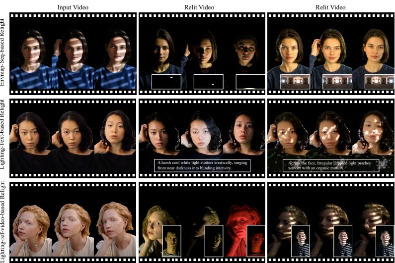

Figure 1: FlashRelight enables portrait video relighting with dynamic lighting through three lighting control modalities: envmap sequences, lighting text, and lighting reference videos.

## Abstract

Portrait video relighting aims to modify the illumination of a portrait video while preserving photorealism and temporal stability. The task becomes particularly challenging under dynamic lighting, where illumination direction, intensity, and color vary over time. To tackle this problem, we introduce FlashRelight, a novel two-stage framework for dynamic portrait video relighting. FlashRelight first suppresses the source illumination through delighting, and then synthesizes the target dynamic lighting on an illumination-neutral portrait video. FlashRelight supports three complementary control modalities: envmap sequences for explicit frame-level lighting control, dynamic lighting text for semantic illumination editing, and lighting reference videos for visual lighting transfer. Training follows a low-cost hybrid strategy that combines static one-light-at-a-time (OLAT) data with generated dynamic-lighting portrait videos, covering both controlled illumination variation and realistic portrait motion. Extensive experiments show that FlashRelight achieves temporally coherent and photorealistic dynamic relighting while enabling flexible cross-video lighting transfer. Code is available at https://github.com/vivoCameraResearch/FlashRelight.

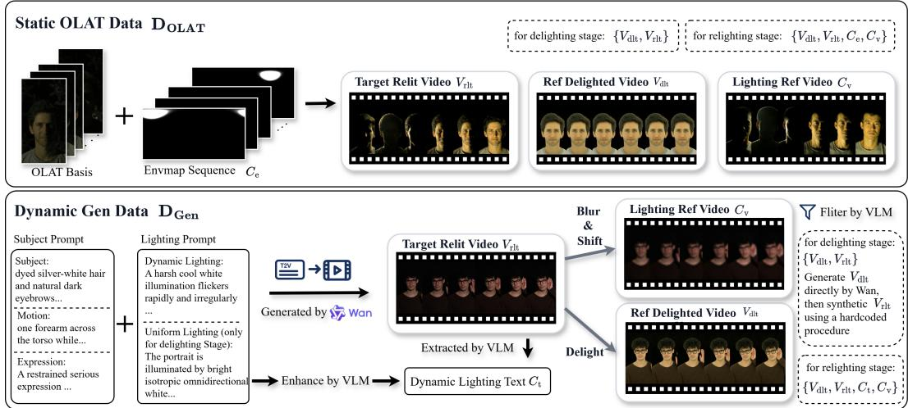  
Figure 2: Data curation pipeline. Hybrid Dynamic Portrait Video Dataset $\mathbf { D } _ { \mathrm { H y b r i d } }$ includes two data sources: Static OLAT Data $\mathbf { D } _ { \mathrm { O L A T } }$ and Dynamic Gen Data $\mathbf { D } _ { \mathrm { G e n } }$

## 1 Introduction

Dynamic lighting is one of the most expressive tools in visual storytelling, shaping the mood, style, and visual impact of portrait videos. Effects such as strobing flashes, drifting shadows, moving highlights, and rapid illumination transitions are widely used in professional production, yet remain difficult to create without specialized equipment or extensive post-processing. Portrait video relighting offers a computational alternative by modifying the illumination of an existing portrait video while preserving identity, motion, and visual realism.

Existing methods have made notable progress in portrait video relighting, ranging from real-time approaches [1, 2, 3] that process portrait videos frame by frame to video diffusion model-based methods [4, 5] that improve temporal coherence and visual fidelity. However, most prior works focus on static illumination or only mild lighting variations [1, 5, 6]. In real-world videos and practical editing scenarios, lighting may change over time in direction, intensity, color, and spatial distribution, producing complex dynamic effects such as alternating colored lights, localized flicker, moving highlights, and evolving shadows. Dynamic portrait video relighting under complex time-varying illumination therefore remains an important but insufficiently explored problem.

Training such a model requires paired data under dynamic lighting conditions, which is difficult to obtain at scale. Conventional data pipelines rely on dynamic OLAT capture [1] or fully rendered paired data [7, 8]; however, dynamic OLAT requires expensive light-stage setups and scales poorly to unconstrained portrait motion, while rendered data is costly to construct and often suffers from a non-negligible synthetic-to-real domain gap. Static OLAT data is more affordable and provides rich relighting supervision, but it is limited to static portraits and cannot capture the interaction between portrait dynamics and time-varying illumination [9, 10]. Leveraging recent advances in large-scale video generation models [11, 12, 13], we adopt a low-cost hybrid data strategy that combines static OLAT data with generated dynamic-lighting portrait videos, providing scalable supervision for both controlled illumination variation and realistic portrait motion.

Building on this hybrid data strategy, we propose FlashRelight, a unified framework for portrait video relighting under dynamic lighting conditions. Conceptually, FlashRelight treats dynamic portrait relighting not as frame-wise illumination editing, but as controllable video generation under time-varying lighting conditions. To reduce the ambiguity caused by unknown source illumination, FlashRelight adopts a practical two-stage formulation: a delighting model first suppresses the source lighting to obtain an approximately illumination-neutral portrait video, and a DiT-based relighting model then synthesizes a relit video under the target dynamic illumination by leveraging a pre-trained video generative prior [14, 11]. This design allows the model to preserve portrait identity and motion while generating temporally coherent lighting effects over time.

FlashRelight supports three complementary lighting controls: envmap sequences, dynamic lighting text, and lighting reference videos. Envmap sequences provide explicit frame-level lighting control [15, 16], dynamic lighting text provides a semantic conditioning signal [17], and lighting reference videos provide direct visual guidance for cross-video lighting transfer. These modalities offer different ways to specify target lighting, with envmap sequences and lighting reference videos serving as our primary means of dynamic lighting control.

In summary, our contributions are as follows:

• We propose a novel method, FlashRelight, for portrait video relighting under dynamic lighting conditions, which produces high-fidelity relit videos while maintaining strong temporal stability.

• FlashRelight supports multiple lighting control modalities, including envmap sequences, dynamic lighting text, and lighting reference videos. Reference-video conditioning further enables direct lighting transfer across portrait videos.

• We propose a scalable hybrid supervision strategy that combines static OLAT data with generated dynamic-lighting portrait videos, enabling scalable training without large-scale dynamic light-stage capture or fully rendered paired datasets.

## 2 Related Work

Portrait Video Relighting. Portrait relighting has been studied for decades, with light-stage systems capturing OLAT reflectance fields and recombining them to synthesize novel illumination [18]. Follow-up works extend this paradigm to dynamic performances using time-multiplexed illumination [19, 20], reflectance transfer [21], and volumetric capture [22, 23]. Although these methods can produce high-quality relit performances, they require specialized capture systems and per-subject acquisition, limiting their applicability to unconstrained portrait videos.

Learning-based methods reduce this capture burden by training relighting models from multiillumination data. Representative image-based approaches achieve realistic portrait relighting with learned light transport [24, 25], explicit 3D priors [6, 26, 27], or diffusion models [28, 29, 8]. However, these methods are primarily designed for still images and often suffer from flickering when applied frame by frame to videos. Video-specific methods improve temporal consistency through consistency modeling [1], 3D-aware representations [2], or relightable avatar reconstruction [30, 31]. Nevertheless, they often rely on simplified lighting assumptions, per-subject reconstruction, or scarce dynamic OLAT data.

Recent work explores conditional video diffusion for portrait performance relighting. Lux Post Facto trains a video diffusion model for portrait video relighting under a static environment map, showing strong photorealism and temporal stability [5]. Different from prior portrait relighting methods that mainly focus on static or mildly varying illumination, FlashRelight targets dynamic portrait relighting under more complex time-varying illumination, which further supports cross-video lighting transfer.

Video Diffusion Models. Video diffusion models have recently shown strong capability in generating realistic and temporally coherent videos from text or image conditions [32, 33, 34, 11]. Beyond text-to-video synthesis, recent works improve controllability by conditioning generation on signals such as poses [35, 36], image prompts [37], depth maps, and other structural cues [38, 39]. These advances make video diffusion models powerful priors for video editing tasks that require both photorealism and temporal consistency.

Recent relighting methods also exploit video diffusion priors for temporally coherent lighting editing. DiffusionRenderer studies neural inverse and forward rendering with video diffusion models [16], while Light-A-Video, RelightVid, LightCtrl, and UniLumos study video or unified image-video relighting with diffusion-based models [40, 4, 41, 42]. Similarly, FlashRelight leverages a DiT-based video generative prior for dynamic portrait video relighting, where the target illumination evolves over time and can be specified through multiple lighting controls.

Lighting Control and Transfer. The choice of lighting representation largely determines the controllability and usability of relighting systems. Explicit representations, such as environment maps or HDR lighting, provide physically meaningful control and have been widely used in portrait and video relighting [25, 6, 8, 5, 16, 15]. However, they are difficult for non-expert users to edit directly. Recent diffusion-based methods improve usability with text prompts, background guidance, or structured lighting attributes [43, 17, 42, 44], while reference-driven methods specify the desired illumination through another image or video [45, 40, 4]. These interfaces are intuitive, but most existing methods still focus on a single control form and are primarily designed for static lighting.

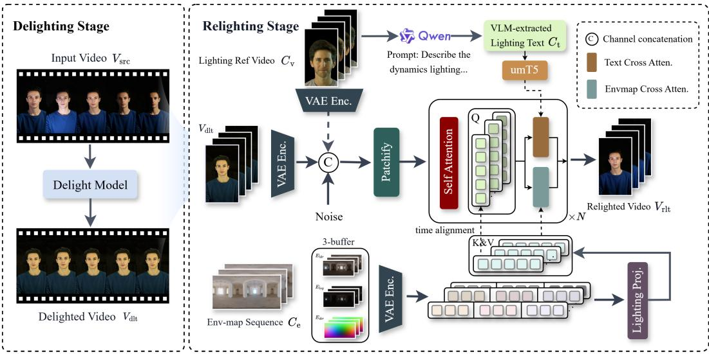  
Figure 3: Overview of FlashRelight. Our framework consists of a delighting stage and a relighting stage. The delighting model suppresses source illumination and shadows from the input video, producing an illumination-neutral portrait video. The delighted video, together with one active dynamic lighting condition, is then used by the relighting model to synthesize the final relit video.

In contrast, portrait video relighting with dynamic lighting requires the target illumination to be time-varying. FlashRelight unifies complementary dynamic lighting controls in one framework: environment-map sequences provide precise frame-level control, dynamic lighting text offers a semantic interface, and lighting reference videos enable cross-video lighting transfer. This unified design supports both explicit dynamic relighting and flexible cross-video lighting transfer within a single portrait video relighting framework.

## 3 Method

## 3.1 Overview

FlashRelight formulates dynamic portrait video relighting as a conditional video generation problem with a delighting-relighting decomposition [25, 26, 46, 5]. Given a source portrait video $V _ { \mathrm { s r c } } .$ our goal is to generate a relit video that preserves the subject identity, appearance, expression, and motion, while following a target dynamic lighting condition c.

We denote by $V _ { \mathrm { a p p } }$ the ideal illumination-neutral appearance video of the source portrait. Since $V _ { \mathrm { a p p } }$ is not directly observable, we use a delighting model D to estimate it:

$$
\begin{array} { r } { V _ { \mathrm { d l t } } = \mathcal { D } ( V _ { \mathrm { s r c } } ) \approx V _ { \mathrm { a p p } } , } \end{array}\tag{1}
$$

where $V _ { \mathrm { d l t } } \in \mathbb { R } ^ { T \times C \times H \times W }$ serves as a practical appearance carrier with the source illumination suppressed.

Conditioned on this estimated appearance, relighting is modeled as video generation under the target lighting control:

$$
V _ { \mathrm { r l t } } \sim p _ { \theta } ( V \mid V _ { \mathrm { d l t } } , c ) ,\tag{2}
$$

where the lighting condition $c \in \{ C _ { \mathrm { e } } , C _ { \mathrm { t } } , C _ { \mathrm { v } } \}$ can be instantiated as an environment-map sequence, dynamic lighting text, or a lighting reference video. This formulation decouples appearance estimation from lighting synthesis, allowing the relighting model to focus on generating the desired illumination

dynamics. Built upon a pre-trained DiT-based video generative model [11], FlashRelight further benefits from its spatiotemporal prior for temporally coherent video generation.

Next, we introduce the two-stage relighting model, followed by our OLAT-Gen hybrid training data.

## 3.2 Two-stage Relighting Model

Delighting Stage. The source video $V _ { \mathrm { s r c } } \in \mathbb { R } ^ { T \times C \times H \times W }$ contains portrait appearance entangled with unknown source illumination. Direct one-stage relighting must implicitly remove the original lighting while synthesizing the target lighting, which is ambiguous under complex or temporally varying illumination. Therefore, the delighting stage estimates $\bar { V } _ { \mathrm { d l t } }$ as an approximation of the ideal appearance video $V _ { \mathrm { a p p } }$ . We do not require $V _ { \mathrm { d l t } }$ to be a physically exact intrinsic decomposition; it only needs to provide a stable appearance representation that preserves identity and motion for subsequent relighting. The source-video latent is concatenated with the noisy target latent along the channel dimension to condition the delighting model.

Relighting Stage. As shown in Fig. 3, the relighting model R is built upon a pre-trained DiT-based video generative model [11]. Given the delighted video $V _ { \mathrm { d l t } }$ and a target lighting condition $c ,$ it generates the relit portrait video:

$$
V _ { \mathrm { r l t } } = { \mathcal { R } } ( V _ { \mathrm { d l t } } , c ) .\tag{3}
$$

The latent of the delighted video is concatenated with the noisy target latent along the channel dimension at each denoising step, providing temporally aligned appearance and motion guidance. The lighting condition c provides the target illumination, supporting three control signals. Unlike frame-wise relighting, the model generates the output jointly across space and time, inheriting temporal consistency from the underlying video generative prior.

Unified Dynamic Lighting Controls. As shown in Fig. 3, FlashRelight supports three dynamic lighting controls: envmap sequences, lighting text, and lighting reference videos, offering different trade-offs between precise frame-level control and flexible semantic or reference-based editing.

Environment-map sequence. Environment-map sequences $C _ { \mathrm { e } }$ provide the most explicit frame-level lighting control in our framework. Following prior works $[ 1 6 , 1 5 ] .$ , we encode each HDR environment map $E _ { t }$ using three complementary buffers: an LDR panorama $E _ { t } ^ { \mathrm { l d r } } \in \mathbb { R } ^ { 3 \times H ^ { \prime } \times W ^ { \prime } }$ , a log-intensity map $E _ { t } ^ { \mathrm { l o g } } \in \bar { \mathbb { R } } ^ { 3 \times H ^ { \prime } \times W ^ { \prime } }$ , and a directional encoding $E _ { t } ^ { \mathrm { d i r } } \in \mathbb { R } ^ { 3 \times H ^ { \prime } \times W ^ { \prime } }$ . These buffer sequences are passed through the VAE encoder to obtain compact spatiotemporal lighting latents, which are then concatenated and projected into envmap tokens $\dot { Z } .$

To preserve frame-level correspondence, we perform token-level temporal alignment before envmap cross-attention. For video tokens at temporal index t in the latent sequence, attention is computed only with envmap tokens from the same temporal index:

$$
\mathrm { A t t n } _ { \mathrm { e n v } } ( X _ { t } , Z _ { t } ) = \mathrm { S o f t m a x } \left( \frac { Q _ { t } K _ { t } ^ { \top } } { \sqrt { d } } \right) V _ { t } ,\tag{4}
$$

where $Q _ { t }$ is projected from the self-attention features, and $K _ { t } , V _ { t }$ are projected from the aligned envmap tokens $\bar { Z } _ { t }$

Dynamic lighting text. Dynamic lighting text $C _ { \mathrm { t } }$ provides semantic guidance for dynamic lighting conditions, such as moving lights, color transitions, intensity changes, and flicker. The lighting text is encoded by T5 and injected through text cross-attention. At inference, this branch accepts either a user-provided lighting prompt or a VLM-extracted lighting description from a reference video as the text condition.

Lighting reference video. A lighting reference video $C _ { \mathrm { v } }$ provides visual evidence of the desired illumination dynamics for cross-video lighting transfer. We encode it as a dense spatiotemporal condition and fuse it with the relighting input through channel-wise concatenation at the latent input layer. This enables FlashRelight to perform more fine-grained and direct dynamic lighting transfer.

## 3.3 Hybrid Training Data

As shown in Fig. 2, our Hybrid Dynamic Portrait Video Dataset $\mathbf { D } _ { \mathrm { H y b r i d } }$ combines two complementary data sources: Static OLAT Data $\mathbf { D } _ { \mathrm { O L A T } }$ and Dynamic Gen Data $\mathbf { D } _ { \mathrm { G e n } }$ . Static OLAT data provides controlled and fine-grained lighting supervision, while Dynamic Gen Data scales the distribution to moving subjects and temporally varying illumination.

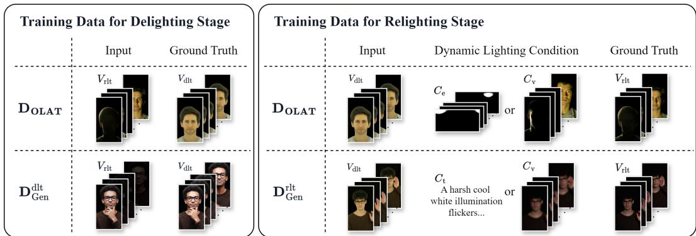  
Figure 4: Training data for the two stages. Both the delighting stage and the relighting stage are trained with hybrid data. However, the Dynamic Gen Data $\mathbf { D } _ { \mathrm { G e n } }$ used for training the delighting model and that used for training the relighting model are constructed in different ways.

Static OLAT Data $\mathbf { D } _ { \mathrm { O L A T } }$ . Static OLAT Data is synthesized by linearly combining OLAT basis images with envmap sequences. We collect OLAT basis images from FaceOLAT, an open-source portrait OLAT dataset, using 60 subjects, each with 2–4 expressions. Our lighting set includes 600 synthetic environment-map sequences with diverse lighting dynamics and 200 real environment maps collected from Poly Haven [47]. The real environment maps are further augmented by rotation and temporal transformations to construct dynamic environment-map sequences. This results in 24,000 paired videos in total. Each data pair is denoted as $\{ V _ { \mathrm { d l t } } , V _ { \mathrm { r l t } } , { \dot { C } } _ { \mathrm { e } } , { \dot { C _ { \mathrm { v } } } } \}$ , where $V _ { \mathrm { r l t } }$ is the synthetic video under envmap sequence, $\bar { V _ { \mathrm { d l t } } }$ is synthesized under a uniform illumination map and serves as the illumination-neutral target, $C _ { \mathrm { e } }$ is the envmap sequence, and $C _ { \mathrm { v } }$ is the lighting reference video, which is the synthetic video under the same envmap sequence with another subject.

Dynamic Gen Data $\mathbf { D } _ { \mathrm { G e n } }$ . Dynamic Gen Data is synthesized using Wan2.2 [11] to complement Static OLAT Data with moving subjects and temporally varying illumination. Because the delighting and relighting stages require different supervision, we construct two stage-specific variants, $\mathbf { \bar { D } } _ { \mathrm { G e n } } ^ { \mathrm { d l t } ^ { - } }$ and $\mathbf { D } _ { \mathrm { G e n } } ^ { \mathrm { r l t } }$ , which are detailed below.

Each relighting pair in $\mathbf { D } _ { \mathrm { G e n } } ^ { \mathrm { r l t } }$ is denoted as $\{ V _ { \mathrm { d l t } } , V _ { \mathrm { r l t } } , C _ { \mathrm { t } } , C _ { \mathrm { v } } \}$ , where $V _ { \mathrm { r l t } }$ is the dynamic-lighting video, $V _ { \mathrm { d l t } }$ is its delighted counterpart, $C _ { \mathrm { t } }$ is the dynamic lighting text, and $C _ { \nu }$ is the lighting reference video. The text condition $C _ { \mathrm { t } }$ is built from both VLM-enhanced lighting text and VLM-extracted lighting descriptions using Qwen3.5-27B [48]. To construct the lighting reference condition while reducing content leakage, we obtain $C _ { \mathrm { v } }$ from $V _ { \mathrm { r l t } }$ using strong Gaussian blurring, spatial shifting, and intensity scaling. These operations suppress identity and structural details while preserving low-frequency illumination dynamics. To ensure data quality, we use a VLM-based filter to remove samples with impure backgrounds, incorrect lighting dynamics, or visible light sources. In total, Dynamic Gen Data contains over 10,000 paired videos. Detailed VLM prompts are provided in Appendix C.2.

Training Data for Delighting Stage. As shown in Fig. 4, when training the delighting model, we use paired videos $( V _ { \mathrm { r l t } } , V _ { \mathrm { d l t } } )$ from both $\mathbf { D } _ { \mathrm { O L A T } }$ and $\mathbf { D } _ { \mathrm { G e n } }$ , where $V _ { \mathrm { r l t } }$ is used as the input and $V _ { \mathrm { d l t } }$ serves as the ground truth. It is worth noting that, for the delighting stage, $V _ { \mathrm { d l t } }$ in $\mathbf { D } _ { \mathrm { G e n } }$ is directly generated as an illumination-neutral video, while $V _ { \mathrm { r l t } }$ is obtained by applying hard-coded dynamic lighting transformations to $V _ { \mathrm { d l t } }$ , including global brightness alternation, moving bright or dark patterns, and local intensity variations.

Training Data for Relighting Stage. In contrast, during the training of the relighting model, $V _ { \mathrm { d l t } }$ is used as the input and $V _ { \mathrm { r l t } }$ serves as the ground truth. For $\mathbf { D } _ { \mathrm { G e n } } , V _ { \mathrm { r l t } }$ is directly generated, while $V _ { \mathrm { d l t } }$ is obtained by applying the trained delighting model to $V _ { \mathrm { r l t } }$ . Each relighting sample is trained with one active lighting condition selected from the available controls, while inactive branches are masked. For $\mathbf { D } _ { \mathrm { O L A T } }$ , the available controls include $C _ { \mathrm { e } }$ and $C _ { \mathrm { v } } ;$ for $\mathbf { D } _ { \mathrm { G e n } } ^ { \mathrm { r l t } }$ , they include $C _ { \mathrm { t } }$ and $C _ { \mathrm { v } }$

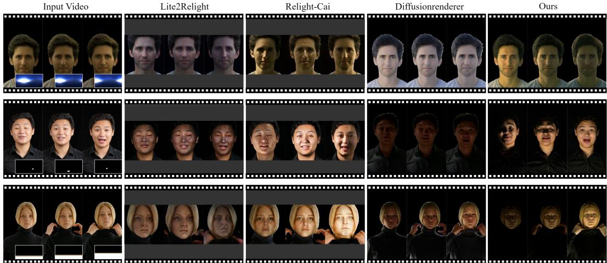  
Figure 5: Qualitative comparison for envmap-sequence-based relighting.

Table 1: Quantitative results for envmap-sequence-based relighting.
<table><tr><td rowspan="2">Method</td><td rowspan="2">Lighting Acc. LE↓</td><td colspan="3">Visual Quality</td><td rowspan="2">Video Smoothness</td></tr><tr><td>LPIPS↓</td><td>ID↑</td><td>PSNR ↑</td></tr><tr><td>Lite2Relight (SIGGRAPH&#x27;24) [27]</td><td>0.1423</td><td>0.4154</td><td>0.5653</td><td>15.6086</td><td>tLPIPS ↓ 0.2721</td></tr><tr><td>Relighting-Cai (CVPR&#x27;24) [2]</td><td>0.1585</td><td>0.4051</td><td>0.5193</td><td>14.2131</td><td>0.2684</td></tr><tr><td>DiffusionRenderer (CVPR’25) [16]</td><td>0.1120</td><td>0.3781</td><td>0.6143</td><td>17.3683</td><td>0.2458</td></tr><tr><td>Ours</td><td>0.0584</td><td>0.1635</td><td>0.8097</td><td>23.1099</td><td>0.1303</td></tr></table>

## 4 Experiments

We evaluate FlashRelight as a unified framework for dynamic portrait video relighting. Our experiments are organized around the three lighting conditions: envmap-sequence-based relighting, lighting-text-based relighting, and lighting-reference-video-based relighting.

## 4.1 Experimental Setup

Datasets. For quantitative evaluation of envmap-sequence-based relighting, we use the D test set, which contains 10 subjects and 16 envmap sequences that are not included in the training set. For evaluating lighting-text-based relighting and lighting-reference-video-based relighting, we reserve 50 generated videos and collect 50 in-the-wild portrait videos from Pexels [49]. None of these videos is used for training or fine-tuning FlashRelight.

Baselines. Our evaluation focuses on three tasks: envmap-sequence-based relighting, lightingtext-based relighting, and lighting-reference-video-based relighting. For envmap-sequence-based relighting, we use Lite2Relight [27], Real-time 3D-aware Portrait Video Relighting [2], denoted as Relighting-Cai, and DiffusionRenderer [16] as baselines. For lighting-text-based relighting, we compare with IC-Light [43], Light-A-Video [40], and Light-X [50]. Implementation details can be found in the Appendix B.3.

Metrics. Following previous works [5, 50], we evaluate paired envmap-sequence relighting using LE, LPIPS, ID similarity, tLPIPS, and PSNR. For lighting-text-based relighting, we use FID for overall visual quality, ID similarity for identity preservation, and tLPIPS for temporal stability.

Implementation Details. FlashRelight (including the delighting and relighting models) is built on Wan2.1-1.3B [11]. We train the relighting model on 49-frame videos at a resolution of 832 × 480 for 40,000 steps using a three-stage training schedule, with a batch size of 8 on 8 H20 GPUs. Similarly, the corresponding delighting model is trained for 30,000 steps with a three-stage training schedule. More training details are provided in the Appendix B.1.

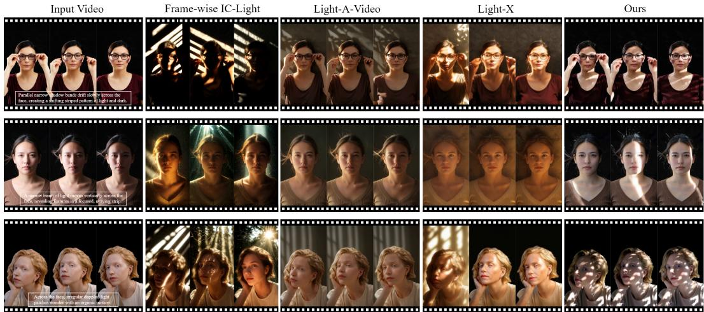  
Figure 6: Qualitative comparison for lighting-text-based relighting.

## 4.2 Video Relighting Result

Envmap-sequence-based relighting. Fig. 5 shows qualitative comparisons under envmap sequences. Frame-wise Lite2Relight and Relighting-Cai struggle to maintain temporal consistency, leading to flickering illumination and unstable appearance. DiffusionRenderer improves general relighting quality, but still fails to consistently preserve fine-grained temporal lighting evolution. In contrast, FlashRelight closely follows the target envmap sequence while preserving subject identity, motion, and temporally coherent shadows and highlights. Quantitative results in Table 1 further confirm these observations: FlashRelight achieves the best performance across all metrics.

Lighting-text-based relighting. Fig. 6 shows qualitative comparisons for the evaluated dynamic lighting descriptions. In these examples, frame-wise IC-Light exhibits flickering illumination and unstable appearance across frames. Light-A-Video and Light-X leverage video priors, but show residual source-lighting effects and struggle to reproduce some of the target lighting changes. FlashRelight uses the delighting stage to suppress source-lighting effects and then performs text-conditioned dynamic relighting with a DiT-based video model. For the lighting descriptions evaluated here, the qualitative results suggest that FlashRelight better reproduces the illustrated light ing changes while preserving portrait identity and temporal coherence. On this evaluation set, the quantitative results in Table 2 show that FlashRelight achieves the best FID and ID similarity, indicating better visual quality and identity preservation, while maintaining temporal stability comparable to the strongest video-based baseline.

Table 2: Quantitative results for text-based relighting.
<table><tr><td>Method</td><td>FID↓ ID↑</td><td>tLPIPS ↓</td></tr><tr><td>IC-Light [43]</td><td>134.98 0.4332</td><td>0.5715</td></tr><tr><td>Light-A-Video [40]</td><td>51.78 0.7126</td><td>0.1395</td></tr><tr><td>Light-X [50]</td><td>66.27 0.6762</td><td>0.2224</td></tr><tr><td>Ours</td><td>31.16 0.7973</td><td>0.1417</td></tr></table>

Lighting-reference-video-based relighting. As shown in Fig. 7, FlashRelight supports referencevideo-guided portrait relighting. Since paired ground truth is unavailable for this setting, we evaluate reference-video-guided lighting transfer qualitatively. Given another portrait video as the lighting reference, FlashRelight transfers the dynamic illumination patterns from the reference video to the source video while preserving the source identity and motion. Compared with text-based relighting, the lighting reference video provides more direct and fine-grained visual cues, including the temporal evolution of highlights, shadows, color changes, and flickering effects. This enables more detailed dynamic lighting transfer across portrait videos. Additional visual results for delighting, relighting, and cross-domain generalization are provided in the appendix.

## 4.3 Ablation on Hybrid Training Data

We conduct ablation studies to assess the contribution of our hybrid training data design in Sec. 3.3. We compare three variants trained with different data sources: Static OLAT Data only DOLAT,

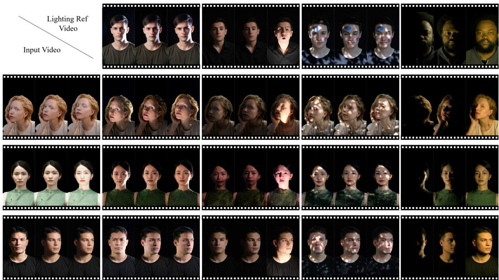  
Figure 7: Reference-video-guided lighting transfer. FlashRelight transfers illumination dynamics from a lighting reference video while preserving the identity and motion of the source portrait video.

Dynamic Gen Data only $\mathbf { D } _ { \mathrm { G e n } } .$ , and the full hybrid data $\mathbf { D } _ { \mathrm { H y b r i d } }$ . The reported metrics are computed over the combined evaluation set covering three relighting settings: envmap-sequence-based relighting, lighting-text-based relighting, and lighting-reference-video-based relighting.

Table 3: Ablation study on hybrid training data.
<table><tr><td>DOLAT</td><td> $\mathbf { D } _ { \mathrm { G e n } }$ </td><td>FID↓</td><td>ID↑</td><td>tLPIPS ↓</td></tr><tr><td></td><td>√</td><td>87.9401</td><td>0.5538</td><td>0.2380</td></tr><tr><td>√</td><td></td><td>86.9547</td><td>0.5470</td><td>0.2543</td></tr><tr><td>√</td><td>√</td><td>55.8078</td><td>0.6734</td><td>0.1906</td></tr></table>

As shown in Fig. 8 and Table 3, training with only $\mathbf { D } _ { \mathrm { O L A T } }$ benefits from controlled relighting supervision, but struggles with complex portrait motion and diverse dynamic lighting effects. Training with only $\mathbf { D } _ { \mathrm { G e n } }$ improves motion and illumination diversity, but lacks the physically grounded constraints provided by OLAT data. In contrast, the model trained on the hybrid data $\mathbf { D } _ { \mathrm { H y b r i d } }$ achieves the best overall performance across FID, ID sim-

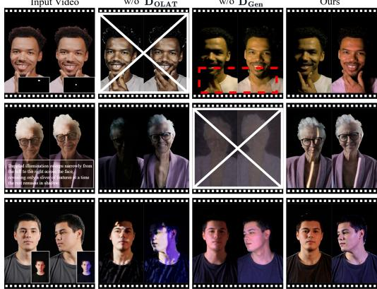  
Figure 8: Ablation on Hybrid Data.

ilarity, and tLPIPS. These results validate that controlled OLAT data and generated dynamic data provide complementary supervision for dynamic portrait video relighting.

## 5 Conclusion

We introduce FlashRelight, a unified framework for portrait video relighting under dynamic lighting conditions. The two-stage design first suppresses source illumination with a delighting model, and then leverages a DiT-based relighting model to synthesize relit videos under target lighting conditioned on environment-map sequences, dynamic lighting text, or lighting reference videos. To enable training without costly dynamic OLAT capture or fully rendered paired datasets, we further construct a hybrid dataset that combines controlled static OLAT-based data $\mathbf { D } _ { \mathrm { O L A T } }$ with scalable generated dynamic-lighting data $\mathbf { D } _ { \mathrm { G e n } }$ . Extensive experiments demonstrate strong performance in environment-map-sequence relighting and reference-video-guided lighting transfer, while preserving portrait identity, motion, and temporal coherence. Text-conditioned relighting is also demonstrated for the evaluated lighting descriptions. This work provides a practical step toward flexible and controllable dynamic portrait relighting in real-world videos.

## Acknowledgements

We sincerely thank the anonymous area chair and reviewers for their insightful feedback. We also thank vivo for providing computational resources.

This work was supported by research project KM20230861.

## References

[1] Longwen Zhang, Qixuan Zhang, Minye Wu, Jingyi Yu, and Lan Xu. Neural video portrait relighting in real-time via consistency modeling. In Proceedings ofthe IEEE/CVF international conference on computer vision, pages 802–812, 2021.

[2] Ziqi Cai, Kaiwen Jiang, Shu-Yu Chen, Yu-Kun Lai, Hongbo Fu, Boxin Shi, and Lin Gao. Real-time 3d-aware portrait video relighting. In Proceedings of the IEEE/CVF Conference on Computer Vision and Pattern Recognition, pages 6221–6231, 2024.

[3] Haonan Qiu, Zhaoxi Chen, Yuming Jiang, Hang Zhou, Xiangyu Fan, Lei Yang, Wayne Wu, and Ziwei Liu. Relitalk: Relightable talking portrait generation from a single video. International Journal ofComputer Vision, 132(8):2713–2728, 2024.

[4] Ye Fang, Zeyi Sun, Shangzhan Zhang, Tong Wu, Yinghao Xu, Pan Zhang, Jiaqi Wang, Gordon Wetzstein, and Dahua Lin. Relightvid: Temporal-consistent diffusion model for video relighting. arXiv preprint arXiv:2501.16330, 2025.

[5] Yiqun Mei, Mingming He, Li Ma, Julien Philip, Wenqi Xian, David M George, Xueming Yu, Gabriel Dedic, Ahmet Levent Ta¸sel, Ning Yu, et al. Lux post facto: Learning portrait performance relighting with conditional video diffusion and a hybrid dataset. In Proceedings ofthe Computer Vision and Pattern Recognition Conference, pages 5510–5522, 2025.

[6] Hoon Kim, Minje Jang, Wonjun Yoon, Jisoo Lee, Donghyun Na, and Sanghyun Woo. Switchlight: Co-design of physics-driven architecture and pre-training framework for human portrait relighting. In Proceedings ofthe IEEE/CVF Conference on Computer Vision and Pattern Recognition, pages 25096– 25106, 2024.

[7] Weikang Bian, Xiaoyu Shi, Zhaoyang Huang, Jianhong Bai, Qinghe Wang, Xintao Wang, Pengfei Wan, Kun Gai, and Hongsheng Li. Relightmaster: Precise video relighting with multi-plane light images. arXiv preprint arXiv:2511.06271, 2025.

[8] Sumit Chaturvedi, Mengwei Ren, Yannick Hold-Geoffroy, Jingyuan Liu, Julie Dorsey, and Zhixin Shu. Synthlight: Portrait relighting with diffusion model by learning to re-render synthetic faces. In Proceedings of the IEEE/CVF Conference on Computer Vision and Pattern Recognition, pages 369–379, 2025.

[9] Zhuo Chen, Chengqun Yang, Zhuo Su, Zheng Lv, Jingnan Gao, Xiaoyuan Zhang, Xiaokang Yang, and Yichao Yan. Polar: A portrait olat dataset and generative framework for illumination-aware face modeling. arXiv preprint arXiv:2512.13192, 2025.

[10] Pramod Rao, Abhimitra Meka, Xilong Zhou, Gereon Fox, Mallikarjun BR, Fangneng Zhan, Tim Weyrich, Bernd Bickel, Hanspeter Pfister, Wojciech Matusik, et al. 3dpr: Single image 3d portrait relighting with generative priors. In Proceedings of the SIGGRAPH Asia 2025 Conference Papers, pages 1–12, 2025.

[11] Team Wan, Ang Wang, Baole Ai, Bin Wen, Chaojie Mao, Chen-Wei Xie, Di Chen, Feiwu Yu, Haiming Zhao, Jianxiao Yang, et al. Wan: Open and advanced large-scale video generative models. arXiv preprint arXiv:2503.20314, 2025.

[12] Zhuoyi Yang, Jiayan Teng, Wendi Zheng, Ming Ding, Shiyu Huang, Jiazheng Xu, Yuanming Yang, Wenyi Hong, Xiaohan Zhang, Guanyu Feng, et al. Cogvideox: Text-to-video diffusion models with an expert transformer. arXiv preprint arXiv:2408.06072, 2024.

[13] Weijie Kong, Qi Tian, Zijian Zhang, Rox Min, Zuozhuo Dai, Jin Zhou, Jiangfeng Xiong, Xin Li, Bo Wu, Jianwei Zhang, et al. Hunyuanvideo: A systematic framework for large video generative models. arXiv preprint arXiv:2412.03603, 2024.

[14] Jonathan Ho, Tim Salimans, Alexey Gritsenko, William Chan, Mohammad Norouzi, and David J Fleet. Video diffusion models. Advances in neural information processing systems, 35:8633–8646, 2022.

[15] Kai He, Ruofan Liang, Jacob Munkberg, Jon Hasselgren, Nandita Vijaykumar, Alexander Keller, Sanja Fidler, Igor Gilitschenski, Zan Gojcic, and Zian Wang. Unirelight: Learning joint decomposition and synthesis for video relighting. arXiv preprint arXiv:2506.15673, 2025.

[16] Ruofan Liang, Zan Gojcic, Huan Ling, Jacob Munkberg, Jon Hasselgren, Chih-Hao Lin, Jun Gao, Alexander Keller, Nandita Vijaykumar, Sanja Fidler, et al. Diffusion renderer: Neural inverse and forward rendering with video diffusion models. In Proceedings ofthe Computer Vision and Pattern Recognition Conference, pages 26069–26080, 2025.

[17] Junuk Cha, Mengwei Ren, Krishna Kumar Singh, He Zhang, Yannick Hold-Geoffroy, Seunghyun Yoon, HyunJoon Jung, Jae Shin Yoon, and Seungryul Baek. Text2relight: Creative portrait relighting with text guidance. In Proceedings of the AAAI Conference on Artificial Intelligence, volume 39, pages 1980–1988, 2025.

[18] Paul Debevec, Tim Hawkins, Chris Tchou, Haarm-Pieter Duiker, Westley Sarokin, and Mark Sagar. Acquiring the reflectance field of a human face. In Proceedings ofthe 27th annual conference on Computer graphics and interactive techniques, pages 145–156, 2000.

[19] Andreas Wenger, Andrew Gardner, Chris Tchou, Jonas Unger, Tim Hawkins, and Paul Debevec. Performance relighting and reflectance transformation with time-multiplexed illumination. ACM Transactions on Graphics (TOG), 24(3):756–764, 2005.

[20] Charles-Félix Chabert, Per Einarsson, Andrew Jones, Bruce Lamond, Wan-Chun Ma, Sebastian Sylwan, Tim Hawkins, and Paul Debevec. Relighting human locomotion with flowed reflectance fields. In ACM SIGGRAPH 2006 Sketches, pages 76–es. 2006.

[21] Pieter Peers, Naoki Tamura, Wojciech Matusik, and Paul Debevec. Post-production facial performance relighting using reflectance transfer. ACM Transactions on Graphics (TOG), 26(3):52–es, 2007.

[22] Kaiwen Guo, Peter Lincoln, Philip Davidson, Jay Busch, Xueming Yu, Matt Whalen, Geoff Harvey, Sergio Orts-Escolano, Rohit Pandey, Jason Dourgarian, et al. The relightables: Volumetric performance capture of humans with realistic relighting. ACM Transactions on Graphics (ToG), 38(6):1–19, 2019.

[23] Abhimitra Meka, Rohit Pandey, Christian Haene, Sergio Orts-Escolano, Peter Barnum, Philip David-Son, Daniel Erickson, Yinda Zhang, Jonathan Taylor, Sofien Bouaziz, et al. Deep relightable textures: volumetric performance capture with neural rendering. ACM Transactions on Graphics (TOG), 39(6):1–21, 2020.

[24] Tiancheng Sun, Jonathan T Barron, Yun-Ta Tsai, Zexiang Xu, Xueming Yu, Graham Fyffe, Christoph Rhemann, Jay Busch, Paul Debevec, and Ravi Ramamoorthi. Single image portrait relighting. ACM Trans. Graph, 38(4):1–12, 2019.

[25] Rohit Pandey, Sergio Orts-Escolano, Chloe Legendre, Christian Haene, Sofien Bouaziz, Christoph Rhemann, Paul E Debevec, and Sean Ryan Fanello. Total relighting: learning to relight portraits for background replacement. ACM Trans. Graph., 40(4):43–1, 2021.

[26] Yiqun Mei, Yu Zeng, He Zhang, Zhixin Shu, Xuaner Zhang, Sai Bi, Jianming Zhang, HyunJoon Jung, and Vishal M Patel. Holo-relighting: Controllable volumetric portrait relighting from a single image. In Proceedings ofthe IEEE/CVF Conference on Computer Vision and Pattern Recognition, pages 4263–4273, 2024.

[27] Pramod Rao, Gereon Fox, Abhimitra Meka, Mallikarjun BR, Fangneng Zhan, Tim Weyrich, Bernd Bickel, Hanspeter Pfister, Wojciech Matusik, Mohamed Elgharib, et al. Lite2relight: 3d-aware single image portrait relighting. In ACM SIGGRAPH 2024 Conference Papers, pages 1–12, 2024.

[28] David Futschik, Kelvin Ritland, James Vecore, Sean Fanello, Sergio Orts-Escolano, Brian Curless, Daniel Sykora, and Rohit Pandey. Controllable light diffusion for portraits. In\` Proceedings of the IEEE/CVF Conference on Computer Vision and Pattern Recognition, pages 8412–8421, 2023.

[29] Puntawat Ponglertnapakorn, Nontawat Tritrong, and Supasorn Suwajanakorn. Difareli: Diffusion face relighting. In Proceedings of the IEEE/CVF international conference on computer vision, pages 22646– 22657, 2023.

[30] Sai Bi, Stephen Lombardi, Shunsuke Saito, Tomas Simon, Shih-En Wei, Kevyn Mcphail, Ravi Ramamoorthi, Yaser Sheikh, and Jason Saragih. Deep relightable appearance models for animatable faces. ACM Transactions on Graphics (ToG), 40(4):1–15, 2021.

[31] Junxuan Li, Chen Cao, Gabriel Schwartz, Rawal Khirodkar, Christian Richardt, Tomas Simon, Yaser Sheikh, and Shunsuke Saito. Uravatar: Universal relightable gaussian codec avatars. In SIGGRAPH Asia 2024 Conference Papers, pages 1–11, 2024.

[32] Uriel Singer, Adam Polyak, Thomas Hayes, Xi Yin, Jie An, Songyang Zhang, Qiyuan Hu, Harry Yang, Oron Ashual, Oran Gafni, et al. Make-a-video: Text-to-video generation without text-video data. arXiv preprint arXiv:2209.14792, 2022.

[33] Andreas Blattmann, Robin Rombach, Huan Ling, Tim Dockhorn, Seung Wook Kim, Sanja Fidler, and Karsten Kreis. Align your latents: High-resolution video synthesis with latent diffusion models. In Proceedings ofthe IEEE/CVF conference on computer vision and pattern recognition, pages 22563–22575, 2023.

[34] Andreas Blattmann, Tim Dockhorn, Sumith Kulal, Daniel Mendelevitch, Maciej Kilian, Dominik Lorenz, Yam Levi, Zion English, Vikram Voleti, Adam Letts, et al. Stable video diffusion: Scaling latent video diffusion models to large datasets. arXiv preprint arXiv:2311.15127, 2023.

[35] Di Chang, Yichun Shi, Quankai Gao, Jessica Fu, Hongyi Xu, Guoxian Song, Qing Yan, Yizhe Zhu, Xiao Yang, and Mohammad Soleymani. Magicpose: Realistic human poses and facial expressions retargeting with identity-aware diffusion. arXiv preprint arXiv:2311.12052, 2023.

[36] Zhongcong Xu, Jianfeng Zhang, Jun Hao Liew, Hanshu Yan, Jia-Wei Liu, Chenxu Zhang, Jiashi Feng, and Mike Zheng Shou. Magicanimate: Temporally consistent human image animation using diffusion model. In Proceedings ofthe IEEE/CVF Conference on Computer Vision and Pattern Recognition, pages 1481–1490, 2024.

[37] Hu Ye, Jun Zhang, Sibo Liu, Xiao Han, and Wei Yang. Ip-adapter: Text compatible image prompt adapter for text-to-image diffusion models. arXiv preprint arXiv:2308.06721, 2023.

[38] Lvmin Zhang, Anyi Rao, and Maneesh Agrawala. Adding conditional control to text-to-image diffusion models. In Proceedings ofthe IEEE/CVF international conference on computer vision, pages 3836–3847, 2023.

[39] Shihao Zhao, Dongdong Chen, Yen-Chun Chen, Jianmin Bao, Shaozhe Hao, Lu Yuan, and Kwan-Yee K Wong. Uni-controlnet: All-in-one control to text-to-image diffusion models. Advances in neural information processing systems, 36:11127–11150, 2023.

[40] Yujie Zhou, Jiazi Bu, Pengyang Ling, Pan Zhang, Tong Wu, Qidong Huang, Jinsong Li, Xiaoyi Dong, Yuhang Zang, Yuhang Cao, et al. Light-a-video: Training-free video relighting via progressive light fusion. In Proceedings ofthe IEEE/CVF International Conference on Computer Vision, pages 13315–13325, 2025.

[41] Yizuo Peng, Xuelin Chen, Kai Zhang, and Xiaodong Cun. Lightctrl: Training-free controllable video relighting. arXiv preprint arXiv:2603.27083, 2026.

[42] Ropeway Liu, Hangjie Yuan, Bo Dong, Jiazheng Xing, Jinwang Wang, Rui Zhao, Yan Xing, Weihua Chen, and Fan Wang. Unilumos: Fast and unified image and video relighting with physics-plausible feedback. arXiv preprint arXiv:2511.01678, 2025.

[43] Lvmin Zhang, Anyi Rao, and Maneesh Agrawala. Scaling in-the-wild training for diffusion-based illumination harmonization and editing by imposing consistent light transport. In The Thirteenth International Conference on Learning Representations, 2025.

[44] Sumit Chaturvedi, Yannick Hold-Geoffroy, Mengwei Ren, Jingyuan Liu, He Zhang, Yiqun Mei, Julie Dorsey, and Zhixin Shu. Tokenlight: Precise lighting control in images using attribute tokens. arXiv preprint arXiv:2604.15310, 2026.

[45] Zongming Li, Lianghui Zhu, Haocheng Shen, Longjin Ran, Wenyu Liu, and Xinggang Wang. Translight: Image-guided customized lighting control with generative decoupling. arXiv preprint arXiv:2508.14814, 2025.

[46] Yiqun Mei, He Zhang, Xuaner Zhang, Jianming Zhang, Zhixin Shu, Yilin Wang, Zijun Wei, Shi Yan, HyunJoon Jung, and Vishal M Patel. Lightpainter: Interactive portrait relighting with freehand scribble. In Proceedings ofthe IEEE/CVF conference on computer vision and pattern recognition, pages 195–205, 2023.

[47] Poly Haven. Poly haven. https://polyhaven.com, 2026.

[48] Qwen Team. Qwen3.5: Towards native multimodal agents, February 2026.

[50] Tianqi Liu, Zhaoxi Chen, Zihao Huang, Shaocong Xu, Saining Zhang, Chongjie Ye, Bohan Li, Zhiguo Cao, Wei Li, Hao Zhao, et al. Light-x: Generative 4d video rendering with camera and illumination control. arXiv preprint arXiv:2512.05115, 2025.

[49] Pexels. Pexels. https://www.pexels.com, 2026.

## Appendix – FlashRelight: Portrait Video Relighting with Dynamic Lighting

## A Supplementary Videos

We provide additional video demos in the supplementary material.

## B More Implementation Details

## B.1 Training Setting of FlashRelight

Both the delighting model and the relighting model are initialized from Wan2.1-1.3B. Unless otherwise specified, the remaining training hyperparameters follow the default setting of Wan2.1-1.3B. During inference, we use 50 sampling steps with a shift value of 5.0.

Delighting model. The delighting model is trained with a three-stage schedule. As shown in Table 4, we first train the model on the static OLAT data $\mathbf { D } _ { \mathrm { O L A T } }$ for 10,000 steps with a learning rate of $1 \times 1 0 ^ { - 4 }$ . We then train it on the dynamic generated data $\mathbf { D } _ { \mathrm { G e n } }$ for another 10,000 steps with a learning rate of $5 \times 1 0 ^ { - 5 }$ . Finally, we fine-tune the model again on $\mathbf { D } _ { \mathrm { O L A T } }$ for 10,000 steps with a learning rate of $1 \times 1 0 ^ { - 5 }$ . The global batch size is 8. We use LoRA fine-tuning with rank 16 and alpha 16, applying LoRA to the feed-forward network (FFN), self-attention, and cross-attention layers.

Table 4: Training schedule of the delighting model.
<table><tr><td>Stage</td><td>Training data</td><td>Steps</td><td>Learning rate</td></tr><tr><td>1</td><td> $\mathbf { D } _ { \mathrm { O L A T } }$ </td><td>10,000</td><td> $1 \times 1 0 ^ { - 4 }$ </td></tr><tr><td>2</td><td> $\mathbf { D } _ { \mathrm { G e n } }$ </td><td>10,000</td><td> $5 \times 1 0 ^ { - 5 }$ </td></tr><tr><td>3</td><td> $\mathbf { D } _ { \mathrm { O L A T } }$ </td><td>10,000</td><td> $1 \times 1 0 ^ { - 5 }$ </td></tr></table>

Relighting model. The relighting model is also trained with a three-stage schedule. As shown in Table 5, we first train the model on $\mathbf { D } _ { \mathrm { O L A T } }$ for 10,000 steps with a learning rate of $1 \times 1 0 ^ { - 4 }$ . We then train it on $\mathbf { D } _ { \mathrm { G e n } }$ for $1 0 { , } 0 0 0$ steps with a learning rate of $5 \times 1 0 ^ { - 5 }$ . In the final stage, we fine-tune the model on the hybrid data $\mathbf { D } _ { \mathrm { H y b r i d } }$ for 20,000 steps with a learning rate of $1 \times 1 0 ^ { - 5 }$ . The global batch size is 8. We use LoRA fine-tuning with rank 32 and alpha 32, applying LoRA to the FFN, self-attention, and cross-attention layers. In addition, the lighting projector and the newly added envmap cross-attention layers are trained with full-parameter optimization.

Table 5: Training schedule of the relighting model.
<table><tr><td>Stage</td><td>Training data</td><td>Steps</td><td>Learning rate</td></tr><tr><td>1</td><td> $\scriptstyle \mathbf { D } _ { \mathrm { O L A T } }$ </td><td>10,000</td><td> $1 \times 1 0 ^ { - 4 }$ </td></tr><tr><td>2</td><td> $\mathbf { D } _ { \mathrm { G e n } }$ </td><td>10,000</td><td> $5 \times 1 0 ^ { - 5 }$ </td></tr><tr><td>3</td><td> $\mathbf { D } _ { \mathrm { H y b r i d } }$ </td><td>20,000</td><td> $1 \times 1 0 ^ { - 5 }$ </td></tr></table>

## B.2 Inference Cost

Table 6 reports inference cost on a single NVIDIA H20 GPU for 49-frame clips at $8 3 2 \times 4 8 0$ FlashRelight uses 50 sampling steps per stage, compared with 15 for the evaluated DiffusionRenderer configuration. The FlashRelight timing covers generation calls for one measured clip after a warm-up clip, excluding external preprocessing, visualization, and video saving. Memory is measured as PyTorch peak reserved GPU memory.

Under these settings, FlashRelight takes 185.9 s with a peak reserved memory of 15.23 GiB.

## B.3 Implementation of Baselines

All baselines are implemented using their official repositories and recommended inference settings. For a fair comparison, the source videos are represented as 49-frame clips at $8 3 2 \times 4 8 0$ resolution before baseline-specific preprocessing. For videos whose background is not pure black, we first segment the portrait foreground using BiRefNet-Portrait and use the resulting masks for foregroundaware evaluation. When a baseline requires a different input resolution or aspect ratio, we apply the same geometric transformation to the source video, the ground-truth video, and the foreground mask, and map the baseline output back to the evaluation resolution when needed. All quantitative metrics are computed on the foreground regions.

Table 6: Stage-wise inference time and peak reserved memory. Total time sums both stages; peak memory is the maximum of their peaks.
<table><tr><td>Method</td><td>Component</td><td>Steps</td><td>Time (s)</td><td>Memory (GiB)</td></tr><tr><td>FlashRelight</td><td>Delighting</td><td>50</td><td>87.5</td><td>15.17</td></tr><tr><td>FlashRelight</td><td>Relighting</td><td>50</td><td>98.4</td><td>15.23</td></tr><tr><td>FlashRelight</td><td>Total</td><td>50 + 50</td><td>185.9</td><td>15.23</td></tr><tr><td>DiffusionRenderer</td><td>Total</td><td>15</td><td>503.3</td><td>44.22</td></tr></table>

• Lite2Relight. Lite2Relight only supports 512 × 512 inputs. We therefore adapt each 832 × 480 frame to a 512 × 512 square input and run the method frame by frame. For quantitative evaluation, the ground-truth video and mask video are transformed with the same parameters as the source video, so all metrics are computed in the aligned 512 × 512 crop.

• Relighting-Cai. Relighting-Cai is also limited to 512 × 512 inputs. We use the same square adaptation protocol as Lite2Relight and apply the identical transformation to the groundtruth video and mask video for metric computation. Since this method takes low-order spherical harmonics as the lighting representation, we convert the target environment maps to SH coefficients before inference. The official implementation does not support colored relighting, and we therefore evaluate it under its supported monochromatic relighting setting.

• DiffusionRenderer. We use the Cosmos-Transfer1-DiffusionRenderer implementation. To match its required input size, we first pad the input frames with black borders and resize them to 1280 × 704. After relighting, we remove the padded region and resize the result back to 832 × 480 for visual comparison and quantitative evaluation.

• IC-Light. We use the official IC-Light implementation and apply it independently to each frame. The resulting frame-wise outputs are assembled back into 49-frame videos for evaluation.

• Light-A-Video. We use the official Light-A-Video implementation with its default video relighting pipeline.

• Light-X. Following the official implementation, we adapt each input video to 384 × 672 by black-border padding and resizing. After relighting, we crop the valid image region and resize the output back to 832 × 480.

## C Details of Data Curation

## C.1 Preprocessing of Static OLAT Data

Static OLAT Data requires preprocessing of the OLAT observations, including alignment, color correction, and other steps. The detailed procedure can be found in the official FaceOLAT repository [10].

## C.2 VLM Prompt for Dynamic Gen Data Curation

VLM Prompt for Lighting Extraction   
"You are a portrait-video dynamic lighting annotator. "   
"The input is a portrait video with dynamic lighting. "   
"Your task is to give one short but correct English description of the visible dynamic lighting on the   
portrait over time. "   
"Focus only on the lighting behavior on the face, hair, ears, jawline, chin, and neck. "

"If flicker is visible, mention it explicitly. "

"The description should be clear, and correct. "

"If two sides flicker differently, describe both sides separately. "

"Use subject-relative positions such as front, front-left, front-right, left, right, top, and bottom.

"Assume the person faces the camera. "

"The most important goal is to correctly describe: "

"(1) where the visible light comes from relative to the person, "

"(2) whether there are one or multiple light components, "

"(4) whether each light component is stable, flickering, pulsing, alternating, sweeping, or changing color over time. " n "

"Always prioritize light position and flicker behavior. "

"If one side has a stable warm light while another side has a colorful flickering light, describe them separately and clearly.

"If a light is at the subject-front-right, say subject-front-right. "

"Do not merge multiple distinct light components into one vague mixed description. "

"If flashing is visible, mention it explicitly. "

"If a light is at the subject-front-left, say subject-front-left. "

"Output description of the dynamic lighting, with no JSON, no bullet points, and no extra explanation

## Prompt for Lighting Text Enhancement

SYSTEM\_PROMPT = ( "You are a portrait-video dynamic-lighting text rewriter. " "Rewrite lighting descriptions into concise, diverse, natural English. " "Only describe the visible lighting behavior on the portrait. " "Preserve the lighting semantics exactly, including temporal change, direction, brightness, color, shadow pattern, and affected facial regions. " "Remove all dataset or capture constraints, such as invisible light source, off-camera source, black background, no objects, or frame/camera comments. " "Do not invent new lighting effects, objects, emotions, scenes, or camera motion. " "Do not output any thinking process, reasoning steps, analysis, explanation, or numbered list. " "Your response must contain exactly one line in this format: FINAL: <rewritten sentence>"   
)

## USER\_PROMPT = (

"Rewrite the following portrait lighting description into one natural English sentence.\n\n" "Core goal:\n"

"- Make the wording more diverse and fluent.\n"

"- Keep only the dynamic lighting content.\n"

"- Preserve the original lighting meaning faithfully.\n\n"

## "Must preserve if present:\n"

"- Temporal behavior: starts, gradually changes, flickers, pulses, sweeps, alternates, intensifies, fades.\n"

"- Direction or position: front, side, left/right, above, below, overhead, under-face.\n"

"- Brightness or contrast changes.\n"

"- Shadow behavior and affected regions such as brows, eyes, nose, cheeks, chin, jawline, hair, or neck.\n\n"

## "Must remove:\n"

"- Any mention that the light source is invisible, unseen, hidden, off-camera, or outside the frame.\n

"- Any mention of black background, empty background, no visible objects, no scene objects, or dataset constraints.\n"

"Important diversity rules:\n"

"- If the input is short or common, do not use the most obvious compressed rewrite.\n"

"- Change the sentence structure, subject phrase, and main verb while preserving the lighting meaning.\ n"

"- Avoid returning a sentence that is nearly identical to the input.\n"

"- Avoid generic rewrites such as: ’Irregular dappled light patches drift organically across the face \n"

"- Avoid using the same wording as any forbidden previous rewrite listed below.\n\n"

"Forbidden previous rewrites:\n"

"{forbidden\_outputs\_block}\n\n"

## "Do not:\n"

"- Do not add new light sources, colors, directions, objects, emotions, scene details, or camera motion.\n"

"- Do not return JSON, bullets, quotes, explanations, reasoning, thinking process, or labels other than FINAL.\n\n"

"FINAL: <one rewritten sentence>\n\n"

"Now rewrite this description:\n"

## VLM Prompt for Quality Filtering

"You are a strict portrait-video quality evaluator. "

"Evaluate whether this video is suitable for portrait dynamic-lighting dataset training.\n\n"

"Evaluation dimensions (score each from 0 to 10, one decimal place):\n"

"1) background\_clean\_score: background is pure black / clean, no visible environment objects, and no light-beam spill on background.\n"

"Output ONLY one JSON object with these keys exactly:\n"

"background\_clean\_score, no\_visible\_light\_source\_score, "

"- background\_clean\_score, no\_visible\_light\_source\_score: decimal in [0,10], one decimal place.\n"

"- Beam confinement constraint: light beams must stay on the person only. If a beam illuminates background, detaches from the person, or exists independently away from the person, treat as invalid for this dataset.\n"

"- When beam confinement is violated, set background\_clean\_score<=3.0, overall\_score<=60, pass=false, and explain in reasons.\n"

"- has\_visible\_light\_source: boolean.\n"

"- overall\_score: integer 0-100.\n"

"- pass: boolean (true only when both dimension scores >= 8.0, has\_visible\_light\_source=false, and overall\_score >= 80).\n"

"- reasons: concise English string, one sentence.\n"

"- No markdown, no extra text outside JSON."

## D More Experimental Results

## D.1 Additional Results on Delighting

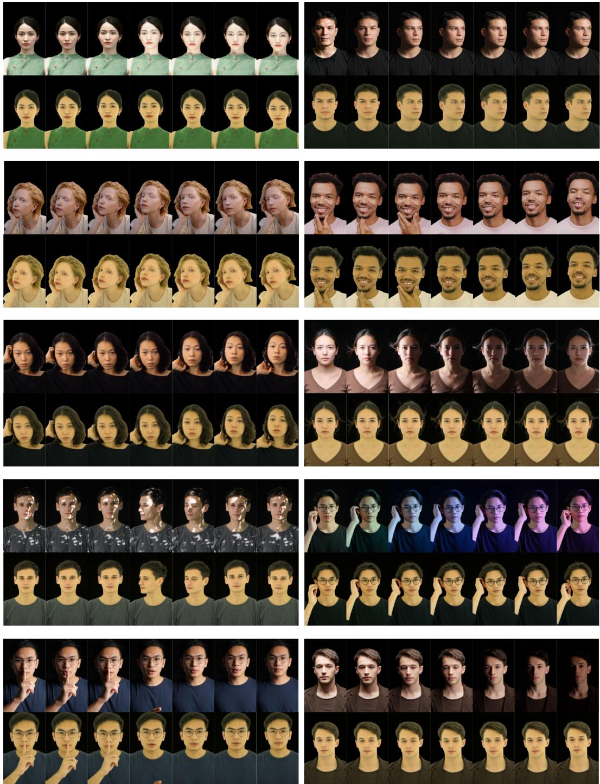  
Figure 9: Additional delighting results. The first row shows source videos, and the second row shows the corresponding delighted results.  
Fig. 9 shows additional results of the delighting stage.

## D.2 Additional Results on Relighting

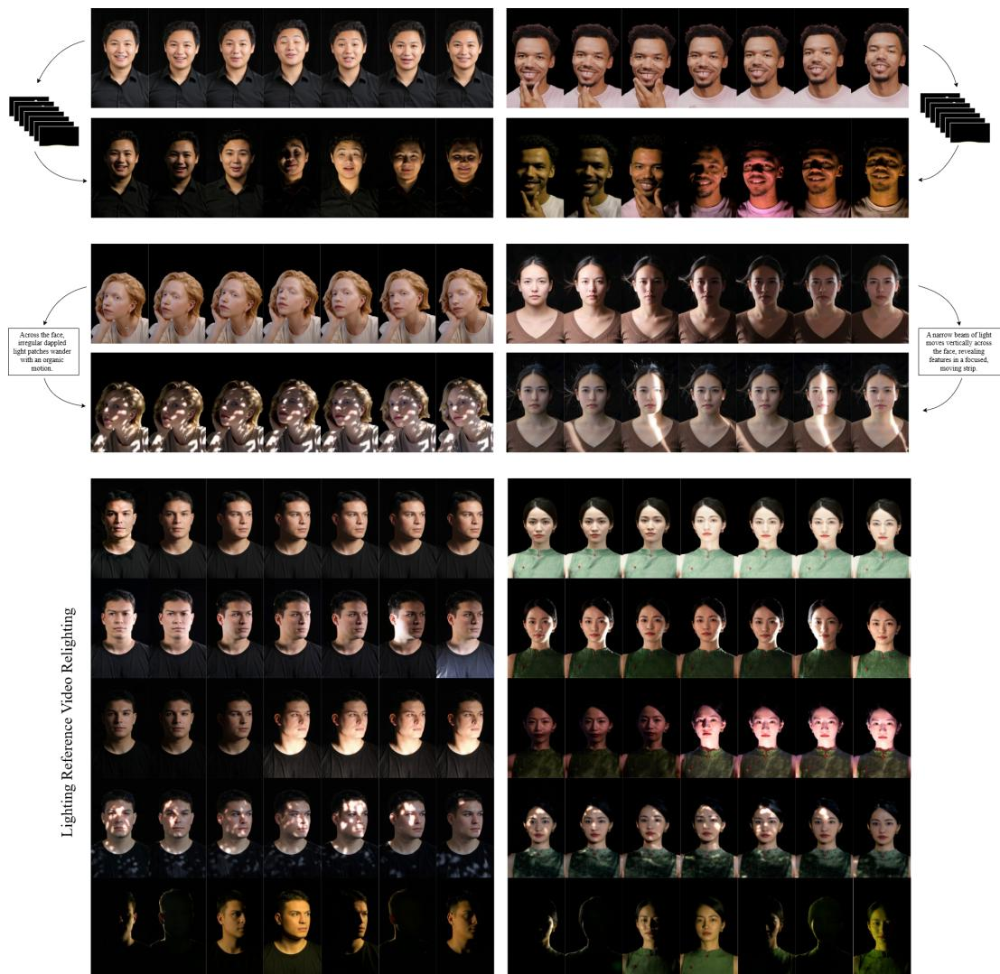  
Figure 10: Additional relighting results. FlashRelight produces temporally coherent relit videos under diverse dynamic lighting conditions.

More relighting results are provided in the supplementary video.

## E Generalization and Robustness

## E.1 Cross-Domain Generalization

We present visual results of FlashRelight on generated portrait videos, in-the-wild videos from Pexels, mobile-selfie videos from the Selfies and Videos Dataset (public Hugging Face samples), and digital-human clips extracted from HeyGen demo videos. Figure 11 shows seven aligned input and relit frames per example, together with the corresponding target environment maps.

## E.2 Robustness to Dynamic and Extreme Lighting

We present additional visual results under dynamic and extreme illumination, including moving directional light, overhead flicker, lightning-like flashes, TV-like lighting changes, and uplighting. Figure 12 shows seven aligned input, ground-truth, and relit frames per example, together with the target environment maps. The paired ground-truth frames are constructed from OLAT captures.

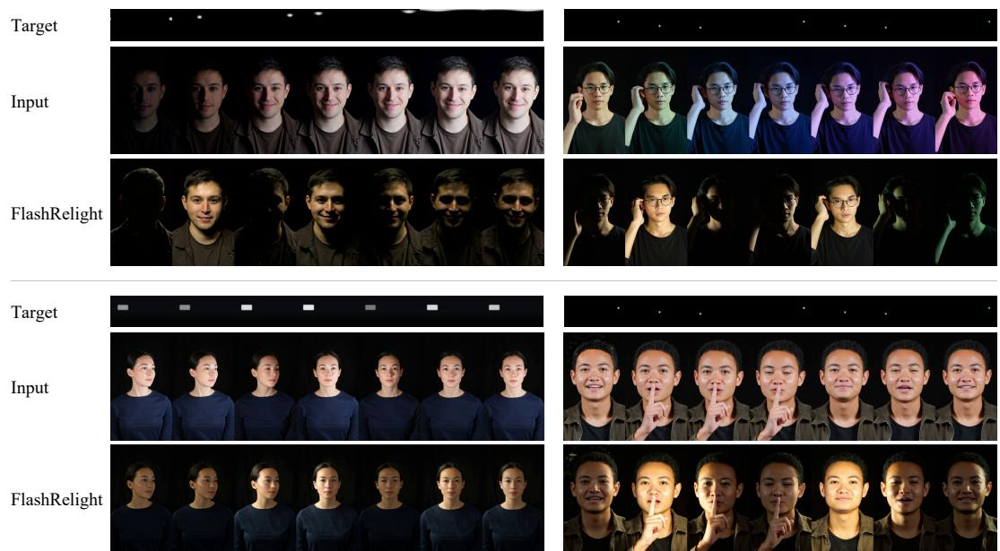  
Figure 11: Cross-domain relighting: generated portrait videos. Four examples are arranged in two columns and two rows. Each example shows seven aligned input and relit frames at t = 1, 9, 17, 25, 33, 41, 49, together with the target environment maps. Target maps are tone-mapped with fixed exposure within each sequence.

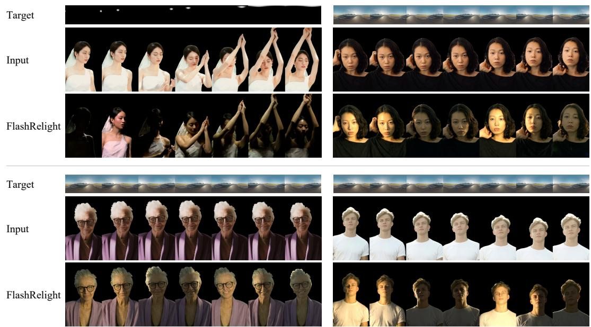  
Figure 11: Cross-domain relighting (continued): in-the-wild portrait videos. Four examples are arranged in two columns and two rows. Each example shows seven aligned input and relit frames at t = 1, 9, 17, 25, 33, 41, 49, together with the target environment maps. Target maps are tone-mapped with fixed exposure within each sequence.

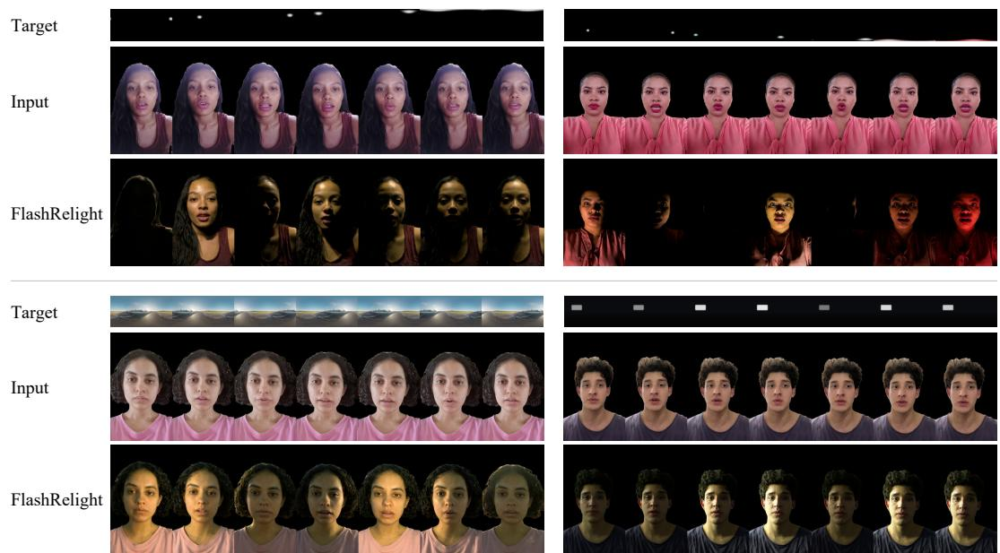  
Figure 11: Cross-domain relighting (continued): mobile-selfie portrait videos. Four examples are arranged in two columns and two rows. Each example shows seven aligned input and relit frames at t = 1, 9, 17, 25, 33, 41, 49, together with the target environment maps. Target maps are tone-mapped with fixed exposure within each sequence.

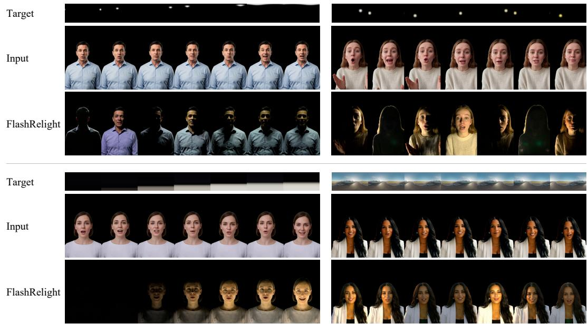  
Figure 11: Cross-domain relighting (continued): digital-human portrait videos. Four examples are arranged in two columns and two rows. Each example shows seven aligned input and relit frames at t = 1, 9, 17, 25, 33, 41, 49, together with the target environment maps. Target maps are tone-mapped with fixed exposure within each sequence.

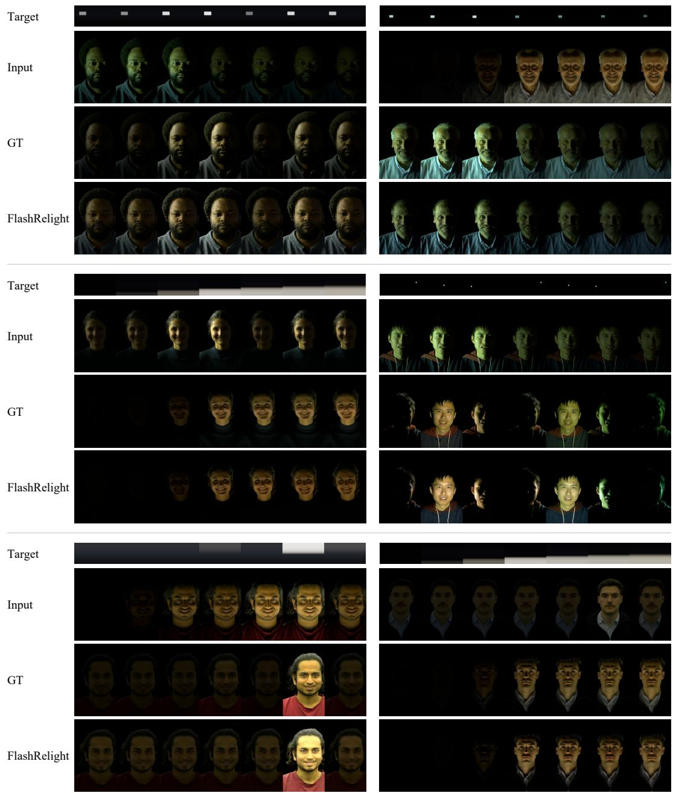  
Figure 12: Relighting under dynamic illumination. From left to right and top to bottom, the examples show flickering overhead light, TV-like lighting changes, uplighting, colored moving directional light, lightning-like illumination, and uplighting. Within each example, rows show target environment maps, input frames, paired ground truth (GT), and FlashRelight outputs. Seven aligned frames are shown at t = 1, 9, 17, 25, 33, 41, 49, except the bottom-left lightning example, which uses t = 1, 17, 33, 42, 44, 46, 49 to capture the flash. Target maps are tone-mapped with fixed exposure within each sequence.

## F Limitations and Future Work

## F.1 Limitations

FlashRelight is limited by the accuracy of the intermediate delighting representation. In particular, inputs with strong projected patterns, fast head motion, facial paint, motion blur, or severe image degradation can make source-light removal ambiguous. In these cases, the delighting model may suppress not only illumination but also useful appearance cues such as skin tone, facial detail, or motion structure, and these errors can propagate to the relighting stage. The hybrid data strategy also has finite coverage. Although it avoids the cost of large-scale dynamic OLAT capture, the resulting training distribution is still shaped by the diversity of the available OLAT subjects, the design of the environment-map sequences, and the quality of the generated dynamic videos. The current text-conditioned branch is effective for a limited set of lighting descriptions, but does not reliably follow general free-form lighting prompts. The lighting captions produced by Qwen3.5-27B often do not accurately describe the illumination in the corresponding videos, introducing noise into text–video supervision. These annotation inaccuracies may contribute to the limited generalization of text-based lighting control. Finally, our current formulation primarily relights the portrait foreground. Without explicit background relighting, foreground and background illumination may become inconsistent in unconstrained scenes. The model can also lose temporal stability or fine shadow detail under severe occlusion and very rapid motion, and its diffusion-based implementation is better suited to offline high-quality editing than real-time use.

## F.2 Future Work

One natural extension is to build FlashRelight on stronger video foundation models, such as newer Wan-series models, which may provide better motion priors and more faithful long-range lighting dynamics. Another important direction is scene-level relighting, where the foreground portrait and background are edited jointly to maintain global illumination consistency. On the data side, richer lighting programs and more diverse portrait captures could improve data coverage. A promising direction is to use more capable video-language models to improve the annotation of lighting attributes and their temporal evolution. Rebuilding the text–video training pairs with more accurate annotations and more diverse lighting descriptions could improve text-conditioned relighting and its generalization to free-form lighting prompts. The robustness of the system could also be improved by explicitly training on blur, occlusion, accessories, extreme expressions, and non-standard facial appearances. Finally, model distillation, temporal feature caching, and lightweight video diffusion backbones are promising routes toward interactive or real-time portrait relighting while retaining the visual quality of the current offline system.

## G Societal Considerations

FlashRelight targets authorized portrait video editing, where controllable lighting can make postproduction and virtual production workflows more accessible. Since the method can alter how a person and scene are perceived, inappropriate use may obscure the original capture conditions, modify a subject’s appearance without consent, or make edited footage harder to distinguish from an unmodified recording. We therefore encourage use on consented or properly licensed videos, clear disclosure when relighting has been applied, and provenance support such as metadata, watermarking, or forensic detection tools for public-facing content.