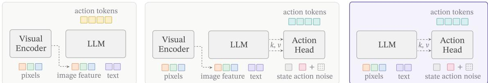
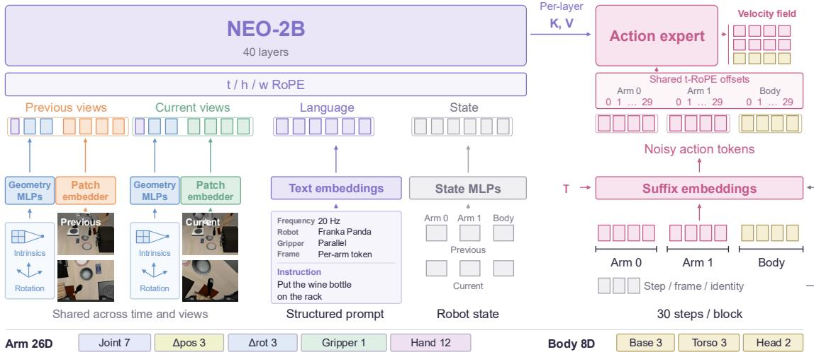
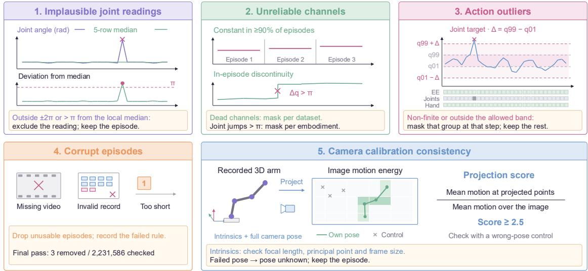
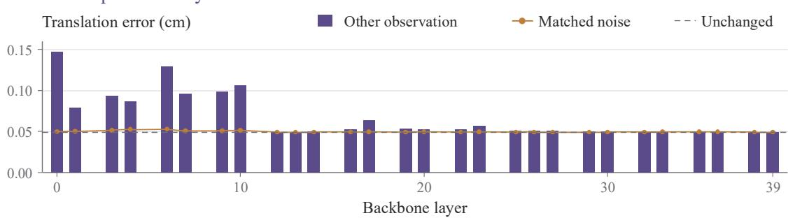
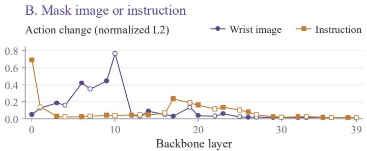
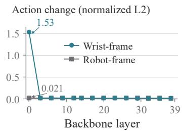
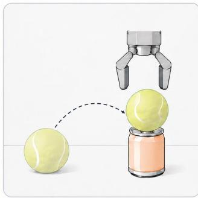
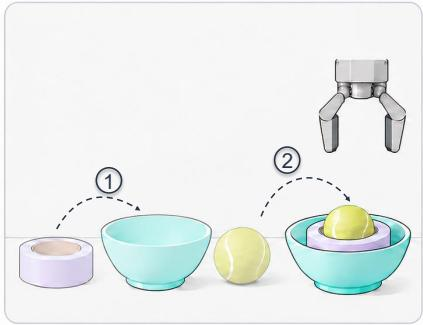
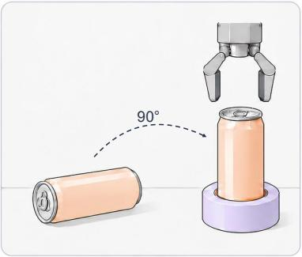
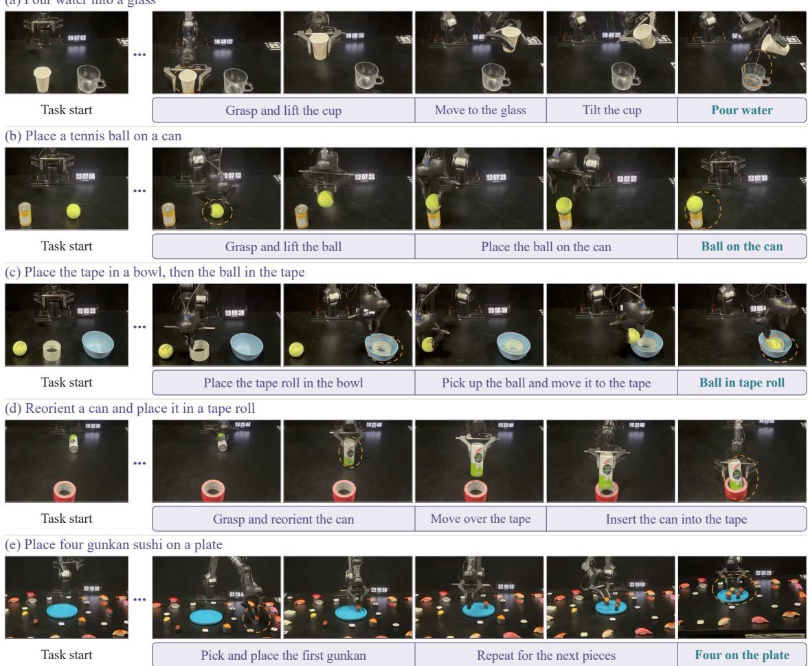

# From Pixels to Actions – Towards Native Vision-Language-Action Policies

Weichen Fan1,\*, Haiwen Diao1,\*,♯, Penghao Wu1, Siyuan Hu1, Ziqi Huang1, Tianqi Liu1,3, Mingze Sun1, Ziyi Wang1, Zhongang Cai2, Hanming Deng2, Quan Wang2, Lei Yang2, Lewei Lu2, Fangzhou Hong3, Zhaoxi Chen3, Dahua Lin2, Ziwei Liu1,†

1S-Lab, Nanyang Technological University, 2SenseTime Research, 3Ropedia \*Equal contribution. ♯Project Lead. †Corresponding author.

Vision-language-action models are typically built on a simple premise: perception is first compressed by visual encoders, and action reasoning begins only afterwards. Yet manipulation often hinges on precisely the visual signals most vulnerable to this abstraction, e.g., local geometry, boundaries, depth, and subtle state changes. This raises a fundamental question: should action policies inherit a fixed visual endpoint, or directly access evolving visual computation? We introduce NEO-VLA, a structurally encoder-free vision-language-action framework. Images are tokenized by lightweight patch convolutional layers and evolve jointly with language throughout the backbone, allowing a flow-matching action expert to draw from instruction-conditioned visual representations at different depths. This simple change reveals a consistent pattern. Native architectures outperform encoder-based counterparts under controlled comparisons; full fine-tuning reduces but does not erase the gap, and additional scale alone cannot recover it. More strikingly, layer-wise probing shows that the action-critical signals often peak well before the final visual representation. Across diverse manipulation settings and distribution shifts, NEO-VLA consequently achieves stronger and more robust control. Together, these results suggest that embodied control benefits from access to visual representations across the computational hierarchy, rather than a fixed encoder output.

Correspondence: ziwei.liu@ntu.edu.sg

Project Page: https://www.lmms-lab.com/posts/neo\_vla/   
GitHub Repo: https://github.com/EvolvingLMMs-Lab/NEO   
Model Weight: https://huggingface.co/weepiess2383/NEO-VLA   
Dataset Link: https://huggingface.co/datasets/weepiess2383/NEO-VLA-Action-Pretrain

## 1 INTRODUCTION

Robotic manipulation demands both semantic understanding and fine-grained spatial reasoning. A policy must identify what an instruction refers to, infer where the target lies, and determine how the gripper should move relative to it. This raises a fundamental question for vision-language-action (VLA) models: should action prediction rely only on the final visual representation, or also on the intermediate visual computation?

Most existing VLAs make this choice implicitly. Images are first compressed by pretrained vision encoders, such as CLIP, SigLIP, or DINOv2 (Radford et al., 2021; Zhai et al., 2023; Oquab et al., 2023), before the resulting features are passed to the language backbone and action model (Brohan et al., 2023; Kim et al., 2024; Black et al., 2024; Bjorck et al., 2025). This interface exposes the encoder output while hiding the visual hierarchy that produced it. Growing evidence suggests that this separation may constrain embodied control: visual processing is critical to VLA performance (Zhang et al., 2026b), visual components are disproportionately sensitive to pruning (Zhang et al., 2026a), and action fine-tuning can degrade pretrained visual representations (Kachaev et al., 2025). We instead reconsider the interface itself, enabling action prediction to directly exploit the evolving visual representations within the backbone.

We introduce NEO-VLA, a structurally native VLA policy built directly on pixels and words, requiring no separately pretrained vision encoder, image codebook, or autoencoder. Following encoder-free models (Bavishi et al., 2023; Diao et al., 2024; 2025; 2026a;c), a lightweight convolutional patch embedder maps raw pixels

  
(a) Encoder-based VLA + Quantised Actions  
(b) Encoder-based VLA + Action Flow  
(c) Encoder-free VLA + Action Flow

Figure 1: Three VLA designs: encoder-based vs. encoder-free backbones, and discrete vs. continuous actions. (a) A separate visual encoder converts pixels into image features, which are consumed by the language backbone together with text tokens; actions are generated as discrete tokens. (b) The same encoder-based visual interface is retained, while a separate action head predicts continuous actions conditioned on the backbone. (c) NEO-VLA removes the separately pretrained visual encoder: a lightweight patch embedder maps pixels directly into the backbone token space, while text tokens enter the backbone jointly. A narrow action expert then reads cached keys and values from selected backbone layers and predicts a flow-matching velocity field.

into the backbone token space, where image patches and instruction words are processed jointly within a single holistic architecture in Figure 1. A flow-matching action expert then reads cached keys and values from diverse backbone layers with different representation hierarchies to predict continuous action chunks.

This design makes visual readout depth an explicit policy choice: the action expert can draw from early, late, or multiple stages of visual computation without introducing a separate visual pathway. In conventional encoderbased VLAs, by contrast, accessing different language-backbone layers still places the policy downstream of a fixed visual endpoint. NEO-VLA thus enables a direct investigation of where action-relevant visual information emerges and which stages of visual computation are most valuable for control.

Our analysis reveals a clear depth-dependent pattern. With the backbone frozen, readouts that include early layers consistently outperform those restricted to later representations; after full fine-tuning, combining early and late features performs best. Targeted interventions lead to the same conclusion: swapping early-layer activations across observations induces substantially larger prediction errors than perturbing later layers. Together, these results indicate that action-critical information emerges well before the final representations, when fine-grained spatial and geometric cues remain more directly accessible. Preserving access to these intermediate computations therefore provides a strong basis for precise and generalizable control.

We further compare NEO-VLA with Qwen3-VL-2B and Gemma-3-4B, which offer comparable understanding capabilities, using the same action expert and robot-training corpus. NEO-VLA consistently achieves higher LIBERO success rates under both frozen-backbone and full-finetuning settings, with the advantage particularly pronounced when the backbone is frozen and policy learning must rely directly on pretrained visual representations. Although differences in pretraining and model capacity preclude attributing the gains solely to encoder removal, these results establish the native backbone as a strong and transferable foundation for action learning.

We then evaluate NEO-VLA on LIBERO, LIBERO-plus, and RoboTwin 2.0, covering both standard manipulation and challenging distribution shifts in visual appearance, language, and environment. NEO-VLA achieves strong in-distribution performance while maintaining robust control under these shifts, with particularly pronounced gains under camera perturbations and image noise. These results complement the layer-wise analysis by showing that preserving access to intermediate visual computation is not only useful in controlled ablations, but also translates into practical robustness across diverse manipulation settings. Taken together, our findings point to a broader principle for embodied intelligence: effective control depends not only on what the backbone represents, but also on which stages of its visual computation remain accessible to action.

Our main contributions are summarised as follows.

• A structurally native VLA policy. We introduce NEO-VLA, which combines a lightweight pixelto-token embedder, a shared vision-language backbone, and a flow-matching action expert with configurable access to backbone layers with diverse visual hierarchies.

• A systematic empirical study of action readout depth. Layer-map comparisons with matched expert capacity, together with attachment-point interventions, show that early visual representations are pretty effective for control, particularly when the backbone is frozen.

• Evaluation across backbone families and manipulation benchmarks. We compare native and encoder-based backbones using the same action-expert design and robot-training corpus, and show strong performance on LIBERO, LIBERO-plus, and RoboTwin 2.0.

## 2 RELATED WORK

Vision-Language-Action Models. Existing VLA policies typically attach an action decoder to a pretrained vision-language model. Early systems emit actions as discrete text tokens (Brohan et al., 2023; Kim et al., 2024), while later work uses continuous diffusion or flow-matching decoders over backbone features (Black et al., 2024; Intelligence et al., 2025; Bjorck et al., 2025); Team et al. (2024) instead trains a transformer policy from scratch with a diffusion head. Our design differs along two axes: whether the visual pathway introduces a separately pretrained vision encoder, and whether actions are represented discretely or continuously. Most prior work has focused on the action side while leaving the visual pathway largely unchanged. Images are commonly processed by pretrained encoders such as CLIP, SigLIP, or DINOv2 (Radford et al., 2021; Zhai et al., 2023; Oquab et al., 2023), often at a fixed resolution and sometimes with the encoder frozen during policy training. Recent studies suggest that this front end can limit control: Zhang et al. (2026b) identify the visual module as a major bottleneck, Zhang et al. (2026a) find the vision encoder, language backbone, and projector among the components most sensitive to pruning, and Kachaev et al. (2025) show that action finetuning can degrade visual representations. Recent unified systems also tend to preserve the visual front end, adding modality-specific experts for generation, foresight, or world modelling above a shared attention stream (Liang et al., 2024; Cai et al., 2026; Ma et al., 2026; Lv et al., 2025; Qu et al., 2025; Hu et al., 2026; Cen et al., 2025; Liang et al., 2026; Liu et al., 2026). Zhang et al. (2026c) instead adds a second visual pathway, arguing that one encoder may not serve both language grounding and control well. Our focus is different: we vary the visual pathway itself while keeping the action expert, the layers it reads, the training data.

Native Multimodal Models. A separate line of work removes the vision encoder itself, mapping pixels through a lightweight learned patch embedder directly into the language backbone (Bavishi et al., 2023; Diao et al., 2024; 2025; Luo et al., 2025; Diao et al., 2026a;c;d;b; Lab, 2026). In this literature, native can refer to different ideas: removing a separate vision module, training multimodally from the start (Tong et al., 2026; Han et al., 2026), or preserving the backbone’s original format and objectives during policy training (Ma et al., 2026). We use the term only in the structural sense: no separately trained vision module, image codebook, or autoencoder. Control models have evolved along related lines. Wang et al. (2026) represent vision, language, and action as unified discrete token sequences, and Xie et al. (2026) replace the transformer-based vision encoder with a convolutional alternative. Concurrent work studies understanding and generation without a separately trained vision module (Wu et al., 2026). Our focus is narrower: we compare visual pathways under a matched action expert and study which backbone depths the expert should read.

## 3 MODEL

## 3.1 STRUCTURALLY NATIVE VISUAL INTERFACE

Following NEO (Diao et al., 2026a), NEO-VLA adopts a structurally native visual interface that projects raw images directly into the backbone token space through a lightweight two-stage convolutional embedder with an overall stride of 32, producing one visual token for each 32 × 32 image region. Visual and language tokens are then jointly processed throughout the decoder backbone, while continuous actions are generated by a flow-matching expert, avoiding explicit action tokenization.

Besides, we employ Native Rotary Position Embedding (Diao et al., 2026a) to factorize positions into temporal, height, and width coordinates with decoupled rotary frequencies. Note that image tokens retain explicit two-dimensional spatial coordinates, while videos additionally advance along the temporal axis, enabling a unified treatment of images, videos, and interleaved multimodal sequences.

The backbone further adopts modality-aware multimodal attention: text tokens follow causal attention, while visual tokens interact bidirectionally within each visual block. This enables dense spatial modeling while visual and linguistic representations co-evolve across layers. Consequently, the action expert can read from different stages of the visual hierarchy from fine-grained early features to more semantic later representations, rather than being restricted to a single, fixed encoder output.

Notably, we train the 40-layer encoder-free vision-language backbone with 2B parameters through three-stage training. We first establish visual perception through large-scale image-text pretraining while preserving the linguistic capabilities of the pretrained language model. Mid-training then deepens vision-language alignment using diverse captioning, conversation, OCR, and detection data, followed by supervised instruction tuning on high-quality multimodal interactions. This gradually advances the model from multimodal perception to reasoning, yielding a strong foundation for downstream action learning.

  
Figure 2: NEO-VLA: pixels in, continuous actions out. Previous and current multi-view observations preserve their aspect ratios within a fixed token budget and enter patch embedder shared across time and views. The visual path uses no vision transformer, autoencoder, or vector-quantised codebook. Shared MLPs embed camera intrinsics and rotations, while state MLPs embed previous and current robot states. These tokens join a structured prompt describing control frequency, embodiment, frame reference, and task instruction. A separate, narrow, randomly initialised action expert jointly attends to cached prefix keys and values from selected backbone layers and its own action-token keys and values. Its suffix embeddings combine projected noisy actions and flow time τ with additive step, frame, and identity embeddings. Both arm blocks and the body block share temporal rotary offsets 0–29, with identity embeddings distinguishing the blocks. Trained by flow matching, the expert predicts a velocity field that covers both arm and body action chunks.

## 3.2 MULTIMODAL PREFIX

In Figure 2, NEO-VLA converts robot observations into a unified multimodal prefix composed of previous and current multi-view images, structured language, and robot states. Each temporal block contains up to three camera views, with every view represented by a camera-identity token, projected camera geometry, and patch-level visual tokens. Camera intrinsics and rotations are encoded by lightweight geometry MLPs, while a single patch embedder is shared across all cameras, views, and time steps. Images preserve their native aspect ratios and are dynamically patchified under a fixed budget of up to 88 visual tokens per view, with padded positions masked from attention. This design keeps the visual pathway fully native: pixels enter the language backbone directly, without an external vision transformer, autoencoder, or discrete visual tokenizer.

The visual blocks are followed by a structured prompt specifying the control frequency, robot embodiment, gripper configuration, action-frame reference, and task instruction. Robot proprioception is represented by six additional tokens corresponding to the previous and current states of Arm 0, Arm 1, and the shared body. State MLPs jointly encode the measured values and their validity masks, while additive embeddings identify temporal role and arm/body identity. Components absent from a particular embodiment are simply masked, allowing the same token interface to accommodate different robot configurations.

All prefix tokens are processed jointly by the native backbone using three-dimensional rotary positions over time, height, and width. Visual tokens from the same image share a temporal coordinate, while their spatial coordinates follow the corresponding patch grid; text and state tokens advance along the temporal axis with zero spatial coordinates. Rather than collapsing this computation into a single final visual representation, NEO-VLA exposes the layer-wise keys and values of the backbone directly to a lightweight action expert. The expert then combines this multimodal prefix with noisy action tokens and flow time τ, augmented by step, frame, and identity embeddings, to model action chunks for both arms and the body. The three action blocks share temporal rotary offsets over the prediction horizon, while identity embeddings distinguish their semantic roles. Note that the expert predicts a unified velocity field over the continuous action trajectory.

## 3.3 ACTION READOUT ACROSS VISUAL DEPTHS

The action expert reads from a configurable subset of backbone layers. Let $\mathcal { M } = ( m _ { 1 } , \ldots , m _ { d } )$ denote the layer map, where expert layer j attends to the cached keys and values from backbone layer $m _ { j }$ . This formulation makes the depth of visual readout an explicit architectural choice as follows:

Table 1: Pretraining corpus. Nine public dataset families contribute 2,231,583 episodes and 9,927 hours. As held is the share of stored rows; As sampled is the share of robot-row draws during training.
<table><tr><td></td><td></td><td colspan="5">Corpus as built</td><td colspan="3">Share of rows (%)</td></tr><tr><td>Family</td><td>Arm slots Scenes</td><td></td><td>Episodes</td><td>Rows</td><td>Views</td><td>Hours†</td><td>As held</td><td>As sampled</td><td></td></tr><tr><td>AgiBot-World</td><td>2</td><td>198</td><td>158,100</td><td>282.65M</td><td>594</td><td>2,617.1</td><td>30.44</td><td></td><td>22.86</td></tr><tr><td>Bimanual YAM</td><td>2</td><td>1</td><td>32,184</td><td>75.97M</td><td>3</td><td>703.5</td><td>8.18</td><td></td><td>12.99</td></tr><tr><td>RoboCOIN</td><td>2</td><td>417</td><td>98,797</td><td>74.05M</td><td>1,179</td><td>679.0</td><td>7.98</td><td></td><td>12.85</td></tr><tr><td>Open X-Embodiment</td><td>1</td><td>120</td><td>1,210,137</td><td>30.28M</td><td>154</td><td>1,161.3</td><td>3.26</td><td></td><td>8.75</td></tr><tr><td>Galaxea Open-World</td><td>2</td><td>226</td><td>20,911</td><td>26.73M</td><td>678</td><td>495.0</td><td>2.88</td><td></td><td>8.29</td></tr><tr><td>RoboMIND</td><td>1-2</td><td>18</td><td>53,097</td><td>19.61M</td><td>33</td><td></td><td>2.11</td><td></td><td>7.26</td></tr><tr><td>RH20T</td><td>1</td><td>210</td><td>32,323</td><td>14.56M</td><td>518</td><td>426.5</td><td>1.57</td><td></td><td>6.39</td></tr><tr><td>DROID</td><td>1</td><td>41</td><td>40,081</td><td>10.75M</td><td>123</td><td>199.0</td><td>1.16</td><td></td><td>5.60</td></tr><tr><td>InternData-A1 (sim.)</td><td>1-2</td><td>1,473</td><td>585,953</td><td>393.80M</td><td>4,162</td><td>3,646.3</td><td>42.42</td><td></td><td>15.00</td></tr><tr><td>Total</td><td></td><td></td><td>2,704 2,231,583 928.40M</td><td></td><td></td><td>7,444 9,927.7‡</td><td>100.00</td><td></td><td>100.00</td></tr></table>

$\operatorname { f i r s t } - 2 8 \colon { \mathcal { M } } = ( 0 , \ldots , 2 7 )$ , reading only early backbone layers.  
• skip-28: 28 layers sampled approximately uniformly across all 40 backbone layers.  
• end-28: $\mathcal { M } = ( 1 2 , \dots , 3 9 )$ , reading only late backbone layers.  
• full-40: all 40 backbone layers, paired with a 40-layer action expert.  
The first three settings use the same 28-layer expert and hidden width, closely matching parameters while isolating action readout. full-40 uses deeper experts and is treated separately as a higher-capacity setting.

## 3.4 CONTINUOUS ACTION POLICY MODELING

Following Black et al. (2024), NEO-VLA uses a separate action expert to predict continuous action chunks. Each expert layer jointly attends to prefix keys and values cached at its mapped backbone layer and to the action tokens’ own keys and values. The prefix C contains the camera observations and geometry, language instruction, and robot state. During full fine-tuning, the action loss updates both the backbone and the expert.

Each target a contains an arm chunk in $\mathbb { R } ^ { 2 \times 3 0 \times 2 6 }$ and a shared body chunk in R30×8. Each arm has 7 joint targets, 3 translation increments, 3 rotation-vector increments, 1 gripper value, and 12 hand-joint targets. The body has 3 base-motion, 3 torso, and 2 head channels. End-effector increments are expressed in centimetres and radians per step, in a camera or robot-base frame. Joint and hand targets are absolute, and body actions use the robot-base frame. Targets are normalized per embodiment. Given a, we sample Gaussian noise $\epsilon \sim \mathcal { N } ( 0 , I )$ and a time $\tau = 0 . 9 9 9 u .$ , where u ∼ Beta(1, 1.5). On valid dimensions, we construct

$$
\mathbf { \delta } \mathbf { a } _ { \tau } = ( 1 - \tau ) { \boldsymbol { \epsilon } } + \tau \mathbf { a } .\tag{1}
$$

The expert predicts the velocity v $_ { \theta } ( \pmb { a } _ { \tau } , \tau , \mathcal { C } )$ with target a−ϵ. We mask missing steps and channels, and exclude target groups that fall outside the normalization range. The training objective balances four action groups: end-effector motion and gripper, arm joints, hand joints, and body actions, with weights $w _ { g } = ( 2 , 1 , 1 , 1 )$ . Let $\ell _ { g }$ denote the mean squared velocity error over valid entries in group g, and let G be the set of groups with valid supervision. We minimize the training objective as follows:

$$
\mathcal { L } _ { \mathrm { a c t i o n } } = \mathbb { E } \left[ \frac { \sum _ { g \in \mathcal { G } } w _ { g } \ell _ { g } } { \sum _ { g \in \mathcal { G } } w _ { g } } \right] .\tag{2}
$$

Samples without valid targets contribute zero loss. During inference, we solve the learned flow from $\tau = 0$ to 1 using 10 Euler steps while keeping the prefix KV cache fixed. The resulting action chunk is then de-normalized back to the original action space for execution. We do not apply classifier-free guidance.

## 4 TRAINING

## 4.1 PRETRAIN DATA OVERVIEW

In Table 1, we build the pretrain data from AgiBot-World (Team, 2026), Bimanual YAM (Fang et al., 2026), RoboCOIN (Wu et al., 2025b), Open X-Embodiment (OXE Team et al., 2023), Galaxea Open-World (Team, 2025a), RH20T (Fang et al., 2024), RoboMIND (Wu et al., 2025a), InternData-A1 (contributors, 2025), and DROID (Khazatsky et al., 2024), covering diverse embodiments, tasks, and visual conditions.

  
Figure 3: Data quality filtering. Illustrative checks cover implausible joint readings, unreliable channels, action outliers, corrupt episodes, and camera calibration, removing only affected data. Joint and projection checks are source-specific; episode retention is determined in the final corpus pass.

## 4.2 DATA PIPELINE

We first apply source checks to exclude unreliable measurements and corrupt episodes in Figure 3. Joint readings outside ±2π, or more than π from a five-row local median, are marked invalid. Joint and hand channels that remain constant throughout at least 90% of a dataset’s recorded episodes are masked. Unresolved joint discontinuities larger than π are masked for the corresponding embodiment. Action outliers are checked against expanded per-embodiment bounds; an out-of-band or non-finite value masks only its field group at that step, leaving other targets available. Episodes with missing or unreadable data, inconsistent record shapes, invalid recorded values, or too few steps are dropped. We also check camera calibration where the required signals are available. Recorded 3D arm positions are projected using the intrinsics and full camera pose. We score image motion at the projected points relative to motion over the image, and compare scores with wrong-pose controls. Untrusted poses are marked unknown while their episodes remain. Intrinsics undergo separate checks for focal length, principal point, field of view and consistency with the stored image size.

## 4.3 TRAINING DETAILS

Our training recipe has three progressive stages. In stage 1, we freeze the pretrained vision-language backbone and train the action expert and conditioning modules. This stage uses 113,400 optimizer steps, a global batch size of 8192, and a peak learning rate of $2 \times 1 0 ^ { - 4 }$ . In stage 2, we unfreeze the full model and continue training on the same robot pretrain corpus for 75,000 steps with the same batch size. The action expert and conditioning modules use a peak learning rate of $2 \times 1 0 ^ { - 4 }$ , while the vision-language parameters use $5 \times 1 0 ^ { - 5 }$ . We co-train with multi-modal understanding data to retain vision-language perception and reasoning capabilities. Packed understanding examples are added on every other optimizer step, with an auxiliary next-token prediction loss weighted by 0.1 on those steps. In stage 3, we continue the full-parameter finetune initialized from stage-2 with our in-house action data for another 75,000 steps with the same batch size, all the other settings are consistent with stage-2. Both stages use AdamW with $\beta _ { 1 } = 0 . 9 , \beta _ { 2 } = 0 . 9 5 , { \epsilon } = 1 0 ^ { - 8 }$ and weight decay $1 0 ^ { - 1 0 }$ . Learning rates increase linearly over 2,000 warmup steps, then follow cosine decay to 10% of their respective peaks. We use bfloat16 mixed precision and clip the gradient norm at 1.0.

## 5 EXPERIMENTS

We organize the experiments around four questions. First, what does a native-input backbone bring over encoder-based ones under matched settings (5.1)? Second, which depths does the action expert read, and what does it extract from them (5.2)? Third, how does retaining multimodal understanding affect action learning (5.3)? Finally, how does NEO-VLA perform on in- and out-of-distribution benchmarks (5.4)?

Table 2: Backbone comparison on LIBERO. Success rates (%) at the final 30,000-step checkpoint, averaged over 2,000 episodes. Size refers to the backbone, excluding the action expert. Frozen updates only the expert; full FT updates the whole stack. Native-input rows use the linear-depth layer map. Encoder unfrozen updates the vision encoder and action expert with other layers frozen.
<table><tr><td>Backbone</td><td>Size</td><td>Adaptation</td><td>Spatial</td><td>Object</td><td>Goal</td><td>Long</td><td>Average</td></tr><tr><td rowspan="3">Qwen3-VL</td><td rowspan="3">2B</td><td>Frozen</td><td>71.4</td><td>89.8</td><td>92.8</td><td>64.0</td><td>79.5</td></tr><tr><td>Full FT</td><td>92.2</td><td>96.6</td><td>95.8</td><td>78.6</td><td>90.8</td></tr><tr><td>Encoder unfrozen</td><td>91.8</td><td>92.0</td><td>94.0</td><td>79.0</td><td>89.2</td></tr><tr><td rowspan="2">Gemma-3</td><td>4B</td><td>Frozen</td><td>80.2</td><td>93.6</td><td>92.6</td><td>71.6</td><td>84.5</td></tr><tr><td>Full FT</td><td></td><td>89.0</td><td>97.6</td><td>94.8</td><td>82.8</td><td>91.0</td></tr><tr><td rowspan="2">NEO-VLA 2B</td><td></td><td>Frozen</td><td>89.2</td><td>95.8</td><td>93.2</td><td>85.4</td><td>90.9</td></tr><tr><td>Full FT</td><td></td><td>95.6</td><td>97.8</td><td>96.0</td><td>92.0</td><td>95.3</td></tr></table>

## 5.1 WHAT THE NATIVE-INPUT BACKBONE BRINGS TO NEO-VLA?

We compare the native-input backbone of NEO-VLA with Qwen3-VL-2B (Bai et al., 2025) and Gemma-3-4B (Team, 2025b) to examine how effectively their representations support policy learning. For fair comparisons, all the models are pretrained with Open X-Embodiment for 75k iters under the same setting. Table 2 reports frozen-backbone training, which updates only the action expert, and full fine-tuning, which updates both the backbone and expert. Results use the final 30,000-step checkpoints, with 500 episodes per LIBERO suite. Pretraining configurations and action-expert construction are detailed in the appendix.

The clearest benefit of the native backbone appears before backbone adaptation. With only its action expert trained, NEO-VLA reaches 90.9% average success, compared with 79.5% for Qwen3-VL and 84.5% for Gemma-3. Its frozen-backbone score is also comparable to both fully fine-tuned encoder-based models. On LIBERO-Long, it reaches 85.4%, exceeding their full-FT results. This suggests that the native backbone already provides representations the expert can use effectively for control, reducing the need to reshape the backbone during policy learning. Full fine-tuning provides improvements, bringing the average to 95.3%.

Direct access to visual features alone does not reproduce this advantage. In a separate Qwen3-VL experiment, we route 13 expert layers to intermediate vision-tower features. Table 3 compares this interface under the same setting. Encoder access lowers frozenbackbone performance from 79.5% to 64.9%, while full fine-tuning brings the two interfaces to similar scores, 90.9% and 90.8%. These results highlight the

Table 3: Direct encoder access in Qwen3-VL. Average LIBERO success (%) with the same setting. Encoder access adds no parameters.
<table><tr><td>Adaptation</td><td>Original interface Encoder access</td><td></td></tr><tr><td>Frozen backbone</td><td>79.5</td><td>64.9</td></tr><tr><td>Full FT</td><td>90.8</td><td>90.9</td></tr></table>

importance of how representations are presented to, and aligned with, demonstrating that the action expert only access to the intermediate features is not sufficient. Taken together, the results support a practical contribution of NEO’s native backbone: its low-level representations that transfer well to action related tasks naturally, while retaining room for improvement through full fine-tuning.

Finding. NEO’s advantage lies not simply in accessing earlier visual features, but in how encoder-free pretraining shapes them into control-ready representations. Its frozen backbone already transfers strongly to policy learning, whereas direct access to intermediate encoder features fails to reproduce this benefit.

## 5.2 WHICH BACKBONE LAYERS DOES THE ACTION EXPERT USE?

For a fair comparison, all NEO variants evaluated in this subsection are pretrained on Open X-Embodiment for 75k iterations under identical training settings.

Access to early layers. Each expert layer reads cached keys and values from a selected backbone layer. Table 4 compares different choices of these layers. skip-28 reads 28 layers spread across the backbone, whereas end-28 reads layers 12–39. Both retain all 40 backbone layers and use 28 expert layers. With a frozen backbone, skip-28 scores 90.9% compared with 86.7% for end-28. It also scores higher with full fine-tuning (95.3% versus 92.5%). These comparisons favor keeping early backbone layers accessible. The disjoint first-14 and last-14 maps show the same trend, but first-14 also shortens the backbone. Like first-28, it changes depth and compute as well as readout position.

Table 4: Layer-map ablation on LIBERO. Success rate (%) over 2,000 rollouts per configuration at training step 30k. Depth is the number of backbone layers retained. skip-28 and end-28 both use a 40-layer backbone and a 28-layer expert. first-28 and first-14 also shorten the backbone, so the disjoint first-14/last-14 comparison changes backbone depth as well as readout position. Higher is better.
<table><tr><td rowspan="2">Adaptation</td><td rowspan="2">Layer map</td><td rowspan="2">Depth</td><td colspan="4">LIBERO suites ↑</td><td rowspan="2">Average</td></tr><tr><td>Spatial</td><td>Object</td><td>Goal</td><td>Long</td></tr><tr><td rowspan="3">FROZEN</td><td>first-28 [0..27]</td><td>28</td><td>94.8</td><td>98.4</td><td>97.6</td><td>88.8</td><td>94.9</td></tr><tr><td>skip-28 [uniform]</td><td>40</td><td>89.2</td><td>95.8</td><td>93.2</td><td>85.4</td><td>90.9</td></tr><tr><td>end-28 [12..39]</td><td>40</td><td>78.4</td><td>93.6</td><td>94.2</td><td>80.4</td><td>86.7</td></tr><tr><td rowspan="2">FROZEN, disjoint</td><td>first-14 [0..13]</td><td>14</td><td>95.6</td><td>97.2</td><td>96.2</td><td>85.4</td><td>93.6</td></tr><tr><td>last-14 [26..39]</td><td>40</td><td>92.2</td><td>95.2</td><td>89.4</td><td>81.8</td><td>89.6</td></tr><tr><td rowspan="3">FINETUNED</td><td>first-28</td><td>28</td><td>95.0</td><td>96.8</td><td>96.6</td><td>90.0</td><td>94.6</td></tr><tr><td>skip-28</td><td>40</td><td>95.6</td><td>97.8</td><td>96.0</td><td>92.0</td><td>95.3</td></tr><tr><td>end-28</td><td>40</td><td>94.6</td><td>95.2</td><td>95.8</td><td>84.2</td><td>92.5</td></tr></table>

  
Figure 4: Interventions at the expert’s attachment points. (A) Translation error after swapping one attachment’s prefix keys and values with another observation’s (purple), adding matched-magnitude residual noise (orange), or making no change (gray). (B) Action change when masking the wrist image or instruction; filled and open markers denote separate even- and odd-attachment runs. (C) Wrist-pose masking in the robot-frame model from B and a wrist-frame model.

Sensitivity at each attachment point. We then intervene at one attachment point at a time on diagnostic skip-28 models in Figure 4. In panel A, we replace the cached keys and values read by one expert layer with those from another observation and task. Swaps at layers 0–10 increase translation error most. Noise matched to the resulting change in the expert’s residual has little effect, staying within 0.004 cm of the unchanged error. The swap effect therefore depends on the content being replaced, rather than just the size of the disturbance.

Panel B probes input sensitivity by masking one input span at a single attachment point. The wrist-image response is strongest around layers 6–10, whereas instruction sensitivity peaks at layer 0, with a smaller rise near layer 17. Masking the wrist-camera pose has little effect in the robot-frame model. To confirm that this reflects task dependence rather than probe insensitivity, panel C evaluates a model predicting actions in the wrist-camera frame, where pose masking produces a strong response at layer 0. Together, these results reveal distinct depth profiles for visual, linguistic, and geometric information.

Finding. Action-relevant information is organized across depth rather than only in the final representation. Early layers dominate frozen transfer, while fine-tuned policies benefit from distributed readouts, with language, appearance, and geometry exerting their strongest influence at different backbone stages.

Table 5: LIBERO-plus by perturbation axis. Open indicates whether both code and weights are publicly available, other results follow Yuan et al. (2026). The total is task-weighted rather than the mean of the seven axes; bold marks the best value in each column.
<table><tr><td>Model</td><td>Size</td><td>Open</td><td>Camera Robot Language</td><td></td><td></td><td></td><td>Light Background Noise Layout</td><td></td><td></td><td>Total</td></tr><tr><td>π0</td><td>3B</td><td>√</td><td>13.8</td><td>6.0</td><td>58.8</td><td>85.0</td><td>81.4</td><td>79.0</td><td>68.9</td><td>53.6</td></tr><tr><td>StarVLA</td><td>4B</td><td>√</td><td>52.5</td><td>49.8</td><td>88.5</td><td>95.7</td><td>95.7</td><td>73.0</td><td>76.9</td><td>74.1</td></tr><tr><td>ABot-M0</td><td>4B</td><td>√</td><td>60.4</td><td>67.9</td><td>86.4</td><td>96.2</td><td>91.6</td><td>86.4</td><td>82.6</td><td>80.5</td></tr><tr><td>Cosmos-Policy</td><td>2B</td><td>√</td><td>75.8</td><td>63.3</td><td>81.7</td><td>96.5</td><td>88.9</td><td>92.7</td><td>82.2</td><td>82.2</td></tr><tr><td>π0.5</td><td>3B</td><td>√</td><td>78.4</td><td>73.6</td><td>80.8</td><td>96.2</td><td>94.1</td><td>89.0</td><td>84.5</td><td>84.4</td></tr><tr><td>Qwen-RobotManip-scratch</td><td>4B</td><td>X</td><td>70.4</td><td>44.9</td><td>88.1</td><td>95.8</td><td>95.5</td><td>84.4</td><td>79.1</td><td>78.3</td></tr><tr><td>Being-H0.7</td><td>3B</td><td>X</td><td>82.0</td><td>59.0</td><td>82.8</td><td>97.8</td><td>90.0</td><td>93.5</td><td>88.5</td><td>84.8</td></tr><tr><td>Qwen-RobotManip</td><td>4B</td><td>X</td><td>87.2</td><td>75.5</td><td>85.6</td><td>96.6</td><td>97.7</td><td>97.7</td><td>87.3</td><td>89.0</td></tr><tr><td>NEO-VLA</td><td>2B</td><td>√</td><td>94.5</td><td>72.6</td><td>91.7</td><td>96.2</td><td>96.6</td><td>96.9</td><td>82.4</td><td>89.7</td></tr></table>

## 5.3 HOW MULTI-MODAL UNDERSTANDING AFFECT ACTION POLICY TRAINING?

VLA post-training typically either fine-tunes on action data alone or co-trains with general understanding data. Table 6 compares the two against the checkpoint before post-training. Co-training with common understanding corpora keeps understanding within 1.5 points of the baseline on MMBench-EN (Liu et al., 2023b), RealWorldQA (xAI, 2024), AI2D (Kembhavi et al., 2016), TextVQA (Singh et al., 2019) and ChartQA (Masry et al., 2022), and reaches 69.4% on RoboTwin 2.0 clean-torandomized (C2R). Action-only fine-tuning loses the ability to produce valid text, and its policy falls to 10.7% on C2R. Cotraining therefore preserves the backbone’s understanding and gives the strongest policy under scene randomization.

Finding. Multimodal understanding and robust action are not independent capabilities. Preserving the backbone’s pretrained understanding during post-training leads to substantially stronger policy generalization, while eroding it causes action robustness to collapse.

Table 6: Preserving multimodal understanding enables robust VLA posttraining. Understanding scores (%) and RoboTwin 2.0 clean-to-randomized (C2R) success (%) before post-training (Baseline), after co-training with diverse understanding corpus (+ Co-training), and after action-only fine-tuning (+ Action-only). The action-only model cannot produce valid text, while cotraining keeps understanding capability and gives the best manipulation policy.

<table><tr><td></td><td>Baseline + Co-training + Action-only</td><td></td></tr><tr><td>MMB</td><td>82.7</td><td>81.2</td></tr><tr><td>RWQA</td><td>66.8</td><td>68.4</td></tr><tr><td>AI2D</td><td>82.9</td><td>82.3</td></tr><tr><td>TextVQA</td><td>76.6</td><td>76.4</td></tr><tr><td>ChartQA</td><td>80.8</td><td>80.4</td></tr><tr><td>RoboTwin C2R</td><td>一</td><td>69.4 10.7</td></tr></table>

## 5.4 STANDARD BENCHMARK RESULTS

Simulator versions, camera setups, training data, and evaluation protocols differ across prior work, so these results should be viewed as benchmark context rather than controlled comparisons.

LIBERO (Liu et al., 2023a). In Table 7, NEO-VLA reaches an average success rate of 97.4. Here EO-1 and MMaDA-VLA obtain similarly high scores, at 98.4 and 98.0, respectively, while Qwen-RobotManip reports a single aggregate score of 99.1 without a persuite breakdown. The small differences among the strongest methods make LIBERO increasingly difficult

Table 7: LIBERO. NEO-VLA is evaluated over 2,000 episodes per suite at step 27,500. Size denotes parameter scale. Open indicates public weights.
<table><tr><td>Model</td><td>Size Open Spatial</td><td></td><td></td><td>Object</td><td>Goal</td><td>Long</td><td>Average</td></tr><tr><td>OpenVLA</td><td>7B</td><td>√</td><td>84.7</td><td>88.4</td><td>79.2</td><td>53.7</td><td>76.5</td></tr><tr><td>π0.5</td><td>3B</td><td>√</td><td>98.8</td><td>98.2</td><td>98.0</td><td>92.4</td><td>96.8</td></tr><tr><td>MMaDA-VLA</td><td>8B</td><td>√</td><td>98.8</td><td>99.8</td><td>98.0</td><td>95.2</td><td>98.0</td></tr><tr><td>EO-1</td><td>3B</td><td>√</td><td>99.7</td><td>99.8</td><td>99.2</td><td>94.8</td><td>98.4</td></tr><tr><td>Qwen-RobotManip</td><td>4B</td><td>×</td><td></td><td></td><td></td><td></td><td>99.1</td></tr><tr><td>NEO-VLA</td><td>2B</td><td>√</td><td>98.4</td><td>99.4</td><td>95.6 96.2</td><td></td><td>97.4</td></tr></table>

to use for distinguishing current policies. We therefore report it mainly to show that NEO-VLA retains strong in-distribution performance rather than to draw conclusions from small cross-paper differences.

LIBERO-Plus (Fei et al., 2025) provides a more informative view by evaluating seven types of distribution shift separately. As shown in Table 5, NEO-VLA achieves an overall score of 89.7, the highest among models in the table with both code and weights publicly available. Its robustness is particularly strong under camera and language perturbations, reaching 94.5 and 91.7, respectively. The gains are less pronounced under robot and layout changes, which alter the embodiment or scene configuration rather than the visual observation itself. This suggests that NEO-VLA is especially robust to changes in how the scene is perceived, rather than to all forms of distribution shift. This pattern is consistent with the layer analysis in Section 5.2, where the action expert relies heavily on early visual representations.

  
(a) Task 1: Tennis on can

  
(b) Task 2: Tape in bowl, Tennis in tape

  
(c) Task 3: Stand can in tape

Figure 5: Real-world manipulation benchmark. (a) Place a tennis ball on a can. (b) Place a tape roll in a bowl, then place a tennis ball inside the roll. (c) Reorient a horizontal can and insert it upright into a tape roll. The tasks test placement precision, multi-step execution, and object reorientation. Each model is fine-tuned on 50 episodes per scene and evaluated over 20 trials.

LIBERO-Pro (Zhou et al., 2025) probes generalization under four distinct perturbations: object appearance, object position, instruction semantics, and task goals. As shown in Table 8, NEO-VLA performs particularly well under semantic variation, achieving 98.0, the highest score in the table. It also remains competitive under object changes, but degrades substantially when object positions or task goals are altered. This contrast is informative: NEO-VLA is robust to changes in visual appearance and instruction wording, yet still struggles when successful execution requires adapting to unfamiliar spatial configurations or action goals. To-

Table 8: LIBERO-Pro. Evaluation of VLA models under Object, Position, Semantic, and Task perturbations. Size denotes parameter scale.
<table><tr><td>Model</td><td>Size</td><td></td><td></td><td>Object Position Semantic Task Avg.</td><td></td></tr><tr><td>OpenVLA</td><td>7B</td><td>93.0</td><td>0.0</td><td>97.3</td><td>0.047.6</td></tr><tr><td>π0</td><td>3B</td><td>90.5</td><td>0.0</td><td>90.5</td><td>0.045.3</td></tr><tr><td>π0.5</td><td>3B</td><td>96.0</td><td>20.8</td><td>95.8</td><td>0.8 53.3</td></tr><tr><td>X-VLA</td><td>0.9B</td><td>79.0</td><td>0.8</td><td>96.8</td><td>6.8 45.8</td></tr><tr><td>NEO-VLA 2B</td><td></td><td>84.3</td><td>3.0</td><td>98.0</td><td>6.3 47.9</td></tr></table>

gether with the LIBERO-Plus results, this suggests that the native backbone provides strong perceptual and semantic robustness, while flexible spatial and task-level adaptation remains a key challenge.

RoboTwin 2.0 (Chen et al., 2025) further evaluates robustness to distribution shift through randomized environments in Table 9. We report results under the official 2.5K-episode setting. NEO-VLA achieves 75.78 on the clean split and retains 69.40 under Clean2Rand evaluation. Although its clean performance trails the strongest closed models, it exhibits only a modest degradation under randomization, indicating that the learned policy transfers reliably beyond the training distribution. Among methods with both training code and model weights publicly available, we can discover that NEO-VLA achieves the strongest Clean2Rand result. This result suggests that the native backbone does more than support strong in-distribution manipulation control: it also preserves stable visual representations and action predictions as the environment changes, leading to stronger robustness under distribution shift.

Table 9: RoboTwin 2.0. We report the official setting with 2.5K episodes. Size denotes parameter scale. Open indicates public weights.
<table><tr><td>Model</td><td>Size Open</td><td>Clean</td><td>Clean2Rand</td></tr><tr><td>FastWAM</td><td>6B √</td><td>77.80</td><td>1.90</td></tr><tr><td>StarVLA-OFT</td><td>3B √</td><td>46.52</td><td>3.16</td></tr><tr><td>π0.5</td><td>3B √</td><td>70.70</td><td>46.00</td></tr><tr><td>OLA-Sem</td><td>8B ×</td><td>75.12</td><td>67.56</td></tr><tr><td>Qwen-RobotManip</td><td>4B ×</td><td>89.58</td><td>68.12</td></tr><tr><td>NEO-VLA</td><td>2B √</td><td>75.78</td><td>69.40</td></tr></table>

## 5.5 REAL-WORLD EVALUATION

## 5.5.1 REAL-WORLD SETUP

To evaluate real-world manipulation comprehensively, we construct a small benchmark with three tasks, as illustrated in Figure 5: (a) pick up a tennis ball and place it on top of a can; (b) pick up a roll of sellotape and place it into a bowl, then pick up the tennis ball and place it inside the sellotape; and (c) pick up a horizontally placed can and insert it into the sellotape. These tasks are designed to test both fine-grained manipulation precision and long-horizon execution. For each task, models are fine-tuned on only 50 demonstration episodes and evaluated over 20 trials, including 10 in-domain trials and 10 out-of-domain trials.

  
Figure 6: Real-world NEO-VLA demonstrations. (a) Pick up a paper cup and pour water into a glass. (b) Place a tennis ball on a can. (c) Place a tape roll in a bowl, then place the ball inside the roll. (d) Reorient a horizontal can and insert it upright into a tape roll. (e) Pick four gunkan sushi pieces, one at a time, from a table of mixed sushi and place them on a plate. Frames are arranged chronologically from left to right, with dashed circles highlighting key interaction moments and critical manipulation steps.

## 5.5.2 EVALUATION RESULTS

As shown in Table 10, we compare NEO-VLA with $\pi _ { 0 . 5 }$ (Intelligence et al., 2025) and StarVLA (StarVLA Community, 2026) using the same real-world training data and each method’s recommended post-training setup. Task 1 and Task 3 emphasize precise object interaction and placement, while Task 2 requires sustained long-horizon execution across multiple sequential manipulation steps. NEO-VLA achieves the strongest overall performance after the same fine-tuning process, with success rates of 12/20, 17/20, and 13/20 across three real-world tasks. It substantially outperforms StarVLA and matches or exceeds $\pi _ { 0 . 5 }$ in every setting, despite its smaller model scale. More

Table 10: Real-World evluation. We report task success rate over 20 episodes per task, with 10 trials in domain and the other 10 trials out-of-domain.
<table><tr><td>Model Size</td><td>Task1 Task2 Task3</td></tr><tr><td>StarVLA</td><td>3B 1/20 2/20 0/20</td></tr><tr><td>3B 10/20</td><td>14/20 13/20</td></tr><tr><td>π0.5 NEO-VLA2</td><td>2B 12/20 17/20 13/20</td></tr></table>

importantly, NEO-VLA maintains strong performance when object configurations deviate from those seen during training, indicating that the learned policy captures transferable visual-action structure rather than simply memorizing demonstrated layouts. The qualitative examples in Figure 6 further illustrate this capability across diverse interaction patterns, including precise placement, object reorientation, sequential manipulation, and multi-step execution. Taken together, these results show that the native VLA design transfers effectively to real-world control, supporting both fine-grained manipulation and long-horizon behavior under limited real-world supervision, while retaining robustness to changes in the observed scene.

## 5.5.3 INFERENCE LATENCY

We also measure latency on the real robot (pika), with the policy served on a single NVIDIA RTX 3090 (24 GB) in bf16. Each query returns one raw 30-step action chunk, which we execute as predicted without real-time chunking (Black et al., 2026). Table 11 reports our default of 10 Euler steps and, for reference, a 2-step setting. With 10 steps, a compiled forward pass takes 282.5 ms. Most of it goes to the action expert, whose 10 Euler steps take 163.4 ms. The backbone prefix pass takes 84.8 ms and runs only once per query, since every step reuses its key–value cache. The convolutional patch embedder costs 3.1ms. Compiling the backbone and expert layers with torch.compile, together with caching the conditioning inputs within each request, cuts the forward pass from 515.4 to 282.5ms and changes predicted positions by at most 0.002cm. On the robot, a query takes 261.9 ms from request to the returned chunk, and 286.2ms until an executable plan is ready after inverse kinematics. Cutting sampling to 2 steps shortens the expert to 32.4ms and the full query to 178.5ms, so the prefix pass becomes the main cost. Fewer steps also change the sampled actions; note that all success rates in Table 10 use 10 steps.

Table 11: Inference latency summary. We report milliseconds per query on one RTX 3090 in BF16, with raw 30-step chunks.
<table><tr><td>Stage</td><td>10 steps 2 steps</td><td></td></tr><tr><td>Policy</td><td></td><td></td></tr><tr><td>Patch embedder</td><td>3.1</td><td>2.7</td></tr><tr><td>Backbone prefix (40 layers)</td><td>84.8</td><td>84.7</td></tr><tr><td>Action expert sampling</td><td>163.4</td><td>32.4</td></tr><tr><td>Forward pass, eager</td><td>515.4</td><td>210.7</td></tr><tr><td>Forward pass, compiled</td><td>282.5</td><td>147.8</td></tr><tr><td>Robot (compiled)</td><td></td><td></td></tr><tr><td>Request → action chunk</td><td>261.9</td><td>153.5</td></tr><tr><td>Request → executable plan</td><td>286.2</td><td>178.5</td></tr></table>

## 6 CONCLUSION

NEO-VLA challenges a common assumption in modern VLA design: that action should operate on visual representations already distilled for semantic understanding. Our results instead suggest that effective control benefits from retaining access to the visual computation before it collapses into a final semantic representation. A native backbone is already highly transferable to action when frozen, early-layer access is consistently valuable, and simply exposing an encoder-based VLM to intermediate visual features does not recover the same benefit. This indicates that what matters is not encoder removal alone, but how visual representations are formed and exposed to the policy throughout the backbone. The broader picture is equally revealing. NEO-VLA is highly robust when the appearance or observation of a scene changes, yet remains challenged when the spatial configuration or task goal itself changes. This asymmetry suggests that the next bottleneck in embodied intelligence may no longer be perception alone, but converting perceptual understanding into flexible action under changing geometry and intent. We therefore view native VLA modeling as a step toward representations that are not only semantically meaningful, but intrinsically useful for control.

## REFERENCES

Shuai Bai, Yuxuan Cai, Ruizhe Chen, Keqin Chen, Xionghui Chen, Zesen Cheng, Lianghao Deng, Wei Ding, Chang Gao, Chunjiang Ge, Wenbin Ge, Zhifang Guo, Qidong Huang, Jie Huang, Fei Huang, Binyuan Hui, Shutong Jiang, Zhaohai Li, Mingsheng Li, Mei Li, Kaixin Li, Zicheng Lin, Junyang Lin, Xuejing Liu, Jiawei Liu, Chenglong Liu, Yang Liu, Dayiheng Liu, Shixuan Liu, Dunjie Lu, Ruilin Luo, Chenxu Lv, Rui Men, Lingchen Meng, Xuancheng Ren, Xingzhang Ren, Sibo Song, Yuchong Sun, Jun Tang, Jianhong Tu, Jianqiang Wan, Peng Wang, Pengfei Wang, Qiuyue Wang, Yuxuan Wang, Tianbao Xie, Yiheng Xu, Haiyang Xu, Jin Xu, Zhibo Yang, Mingkun Yang, Jianxin Yang, An Yang, Bowen Yu, Fei Zhang, Hang Zhang, Xi Zhang, Bo Zheng, Humen Zhong, Jingren Zhou, Fan Zhou, Jing Zhou, Yuanzhi Zhu, and Ke Zhu. Qwen3-vl technical report. arXiv preprint arXiv:2511.21631, 2025.

Rohan Bavishi, Erich Elsen, Curtis Hawthorne, Maxwell Nye, Augustus Odena, Arushi Somani, and Sagnak˘ Tas¸ırlar. Introducing our multimodal models, 2023. URL https://www.adept.ai/blog/fuyu-8b.

Johan Bjorck, Fernando Castaneda, Nikita Cherniadev, Xingye Da, Runyu Ding, Linxi Fan, Yu Fang, Dieter˜ Fox, Fengyuan Hu, Spencer Huang, et al. Gr00t n1: An open foundation model for generalist humanoid robots. arXiv preprint arXiv:2503.14734, 2025.

Kevin Black, Noah Brown, Danny Driess, Adnan Esmail, Michael Equi, Chelsea Finn, Niccolo Fusai, Lachy Groom, Karol Hausman, Brian Ichter, et al. π0: A Vision-Language-Action Flow Model for General Robot Control. arXiv preprint arXiv:2410.24164, 2024.

Kevin Black, Manuel Galliker, and Sergey Levine. Real-time execution of action chunking flow policies. Advances in Neural Information Processing Systems, 38:33383–33407, 2026.

Anthony Brohan, Noah Brown, Justice Carbajal, Yevgen Chebotar, Xi Chen, Krzysztof Choromanski, Tianli Ding, Danny Driess, Avinava Dubey, Chelsea Finn, et al. Rt-2: Vision-language-action models transfer web knowledge to robotic control. arXiv preprint arXiv:2307.15818, 2023.

Junhao Cai, Zetao Cai, Jiafei Cao, Yilun Chen, Zeyu He, Lei Jiang, Hang Li, Hengjie Li, Yang Li, Yufei Liu, et al. Internvla-a1: Unifying understanding, generation and action for robotic manipulation. arXiv preprint arXiv:2601.02456, 2026.

Jun Cen, Siteng Huang, Yuqian Yuan, Kehan Li, Hangjie Yuan, Chaohui Yu, Bohan Hou, Yuming Jiang, Jiayan Guo, Xin Li, et al. Rynnvla-002: A unified vision-language-action and world model. arXiv preprint arXiv:2511.17502, 2025.

Tianxing Chen, Zanxin Chen, Baijun Chen, Zijian Cai, Yibin Liu, Zixuan Li, Qiwei Liang, Xianliang Lin, Yiheng Ge, Zhenyu Gu, et al. Robotwin 2.0: A scalable data generator and benchmark with strong domain randomization for robust bimanual robotic manipulation. arXiv preprint arXiv:2506.18088, 2025.

InternData-A1 contributors. Interndata-a1. https://github.com/InternRobotics/ InternManip, 2025.

Haiwen Diao, Yufeng Cui, Xiaotong Li, Yueze Wang, Huchuan Lu, and Xinlong Wang. Unveiling encoder-free vision-language models. Advances in Neural Information Processing Systems, 37:52545–52567, 2024.

Haiwen Diao, Xiaotong Li, Yufeng Cui, Yueze Wang, Haoge Deng, Ting Pan, Wenxuan Wang, Huchuan Lu, and Xinlong Wang. Evev2: Improved baselines for encoder-free vision-language models. arXiv preprint arXiv:2502.06788, 2025.

Haiwen Diao, Mingxuan Li, Silei Wu, Linjun Dai, Xiaohua Wang, Hanming Deng, Lewei Lu, Dahua Lin, and Ziwei Liu. From pixels to words–towards native vision-language primitives at scale. In International Conference on Learning Representations, volume 2026, pp. 109909–109929, 2026a.

Haiwen Diao, Jiahao Wang, Chenjing Ding, Hanming Deng, Jiangnan Chen, Ruixi Zhang, Ruohui Wang, Wenwen Tong, Xiangyu Fan, Yubo Wang, et al. Sensenova-u1. 5: Towards native unified visual intelligence. arXiv preprint arXiv:2609.11929, 2026b.

Haiwen Diao, Jiahao Wang, Penghao Wu, Yuhao Dong, Yuwei Niu, Yue Zhu, Zhongang Cai, Weichen Fan, Linjun Dai, Silei Wu, et al. From pixels to words–towards native one-vision models at scale. arXiv preprint arXiv:2605.28820, 2026c.

Haiwen Diao, Penghao Wu, Hanming Deng, Jiahao Wang, Shihao Bai, Silei Wu, Weichen Fan, Wenjie Ye, Wenwen Tong, Xiangyu Fan, et al. Sensenova-u1: Unifying multimodal understanding and generation with neo-unify architecture. arXiv preprint arXiv:2605.12500, 2026d.

Hao-Shu Fang, Hongjie Fang, Zhenyu Tang, Jirong Liu, Chenxi Wang, Junbo Wang, Haoyi Zhu, and Cewu Lu. Rh20t: A comprehensive robotic dataset for learning diverse skills in one-shot. In 2024 IEEE International Conference on Robotics and Automation (ICRA), pp. 653–660. IEEE, 2024.

Haoquan Fang, Jiafei Duan, Donovan Clay, Sam Wang, Shuo Liu, Weikai Huang, Xiang Fan, Wei-Chuan Tsai, Shirui Chen, Yi Ru Wang, Shanli Xing, Jaemin Cho, Jae Sung Park, Ainaz Eftekhar, Peter Sushko, Karen Farley, Angad Wadhwa, Cole Harrison, Winson Han, Ying-Chun Lee, Eli VanderBilt, Rose Hendrix, Suveen Ellawela, Lucas Ngoo, Joyce Chai, Zhongzheng Ren, Ali Farhadi, Dieter Fox, and Ranjay Krishna. Molmoact2: Action reasoning models for real-world deployment, 2026. URL https://arxiv.org/ abs/2605.02881.

Senyu Fei, Siyin Wang, Junhao Shi, Zihao Dai, Jikun Cai, Pengfang Qian, Li Ji, Xinzhe He, Shiduo Zhang, Zhaoye Fei, et al. Libero-plus: In-depth robustness analysis of vision-language-action models. arXiv preprint arXiv:2510.13626, 2025.

Junlin Han, Shengbang Tong, David Fan, Minghao Chen, Philip Torr, Filippos Kokkinos, and Mike Lewis. Towards physics of multimodal pretraining: Knowledge flow, modality synergy, early unification, and recipes. arXiv preprint arXiv:2608.05000, 2026.

Yucheng Hu, Jianke Zhang, Yuanfei Luo, Yanjiang Guo, Xiaoyu Chen, Xinshu Sun, Kun Feng, Qingzhou Lu, Sheng Chen, Yangang Zhang, et al. Bagelvla: Enhancing long-horizon manipulation via interleaved vision-language-action generation. arXiv preprint arXiv:2602.09849, 2026.

Physical Intelligence, Kevin Black, Noah Brown, James Darpinian, Karan Dhabalia, Danny Driess, Adnan Esmail, Michael Equi, Chelsea Finn, Niccolo Fusai, et al. π0.5: A vision-language-action model with open-world generalization. arXiv preprint arXiv:2504.16054, 2025.

Nikita Kachaev, Mikhail Kolosov, Daniil Zelezetsky, Alexey K Kovalev, and Aleksandr I Panov. Don’t blind your vla: Aligning visual representations for ood generalization. arXiv preprint arXiv:2510.25616, 2025.

Aniruddha Kembhavi, Mike Salvato, Eric Kolve, Minjoon Seo, Hannaneh Hajishirzi, and Ali Farhadi. A diagram is worth a dozen images, 2016.

Alexander Khazatsky, Karl Pertsch, Suraj Nair, Ashwin Balakrishna, Sudeep Dasari, Siddharth Karamcheti, Soroush Nasiriany, Mohan Kumar Srirama, Lawrence Yunliang Chen, Kirsty Ellis, et al. Droid: A large-scale in-the-wild robot manipulation dataset. arXiv preprint arXiv:2403.12945, 2024.

Moo Jin Kim, Karl Pertsch, Siddharth Karamcheti, Ted Xiao, Ashwin Balakrishna, Suraj Nair, Rafael Rafailov, Ethan Foster, Grace Lam, Pannag Sanketi, et al. Openvla: An open-source vision-language-action model. arXiv preprint arXiv:2406.09246, 2024.

Thinking Machines Lab. Interaction models: A scalable approach to human-ai collaboration. Thinking Machines Lab: Connectionism, May 2026. doi: 10.64434/tml.20260511. https://thinkingmachines.ai/blog/interaction-models/.

Haotian Liang, Xinyi Chen, Bin Wang, Mingkang Chen, Yitian Liu, Yuhao Zhang, Zanxin Chen, Tianshuo Yang, Yilun Chen, Jiangmiao Pang, et al. Mm-act: Learn from multimodal parallel generation to act. In Proceedings of the IEEE/CVF Conference on Computer Vision and Pattern Recognition, pp. 35080–35090, 2026.

Weixin Liang, Lili Yu, Liang Luo, Srinivasan Iyer, Ning Dong, Chunting Zhou, Gargi Ghosh, Mike Lewis, Wen-tau Yih, Luke Zettlemoyer, et al. Mixture-of-transformers: A sparse and scalable architecture for multi-modal foundation models. arXiv preprint arXiv:2411.04996, 2024.

Bo Liu, Yifeng Zhu, Chongkai Gao, Yihao Feng, Qiang Liu, Yuke Zhu, and Peter Stone. Libero: Benchmarking knowledge transfer for lifelong robot learning. Advances in Neural Information Processing Systems, 36: 44776–44791, 2023a.

Yang Liu, Pengxiang Ding, Tengyue Jiang, Xudong Wang, Wenxuan Song, Minghui Lin, Han Zhao, Hongyin Zhang, Zifeng Zhuang, Wei Zhao, et al. Mmada-vla: Large diffusion vision-language-action model with unified multi-modal instruction and generation. arXiv preprint arXiv:2603.25406, 2026.

Yuan Liu, Haodong Duan, Yuanhan Zhang, Bo Li, Songyang Zhang, Wangbo Zhao, Yike Yuan, Jiaqi Wang, Conghui He, Ziwei Liu, Kai Chen, and Dahua Lin. Mmbench: Is your multi-modal model an all-around player? arXiv:2307.06281, 2023b.

Gen Luo, Xue Yang, Wenhan Dou, Zhaokai Wang, Jiawen Liu, Jifeng Dai, Yu Qiao, and Xizhou Zhu. Monointernvl: Pushing the boundaries of monolithic multimodal large language models with endogenous visual pre-training. In 2025 IEEE/CVF Conference on Computer Vision and Pattern Recognition (CVPR), pp. 24960–24971. IEEE, 2025.

Qi Lv, Weijie Kong, Hao Li, Jia Zeng, Zherui Qiu, Delin Qu, Haoming Song, Qizhi Chen, Xiang Deng, and Jiangmiao Pang. F1: A vision-language-action model bridging understanding and generation to actions. arXiv preprint arXiv:2509.06951, 2025.

Haoxiang Ma, Junhao Cai, Xiaoxu Xu, Hao Li, Yuyin Yang, Yang Tian, Jiafei Cao, Hongrui Zhu, Zherui Qiu, Yuqiang Yang, et al. Internvla-a1. 5: Unifying understanding, latent foresight, and action for compositional generalization. arXiv preprint arXiv:2607.04988, 2026.

Ahmed Masry, Jia Qing Tan, Shafiq Joty, Enamul Hoque, et al. Chartqa: A benchmark for question answering about charts with visual and logical reasoning. In Findings of the association for computational linguistics: ACL 2022, pp. 2263–2279, 2022.

Maxime Oquab, Timothee Darcet, Th´ eo Moutakanni, Huy Vo, Marc Szafraniec, Vasil Khalidov, Pierre´ Fernandez, Daniel Haziza, Francisco Massa, Alaaeldin El-Nouby, et al. Dinov2: Learning robust visual features without supervision. arXiv preprint arXiv:2304.07193, 2023.

OXE Team et al. Open X-Embodiment: Robotic learning datasets and RT-X models. https://arxiv. org/abs/2310.08864, 2023.

Delin Qu, Haoming Song, Qizhi Chen, Zhaoqing Chen, Xianqiang Gao, Dong Wang, Xinyi Ye, Qi Lv, Modi Shi, Guanghui Ren, et al. Eo-1: An open unified embodied foundation model for general robot control. arXiv preprint arXiv:2508.21112, 2025.

Alec Radford, Jong Wook Kim, Chris Hallacy, Aditya Ramesh, Gabriel Goh, Sandhini Agarwal, Girish Sastry, Amanda Askell, Pamela Mishkin, Jack Clark, et al. Learning transferable visual models from natural language supervision. In International conference on machine learning, pp. 8748–8763. PmLR, 2021.

Amanpreet Singh, Vivek Natarajan, Meet Shah, Yu Jiang, Xinlei Chen, Dhruv Batra, Devi Parikh, and Marcus Rohrbach. Towards vqa models that can read. In Proceedings ofthe IEEE/CVF conference on computer vision and pattern recognition, pp. 8317–8326, 2019.

StarVLA Community. Starvla: A lego-like codebase for vision-language-action model developing. arXiv preprint arXiv:2604.05014, 2026.

AgiBot World Team. Agibot world 2026. https://huggingface.co/datasets/agibot-world/ AgiBotWorld2026, 2026.

Galaxea Team. Galaxea g0: Open-world dataset and dual-system vla model. arXiv preprint arXiv:2509.00576, 2025a.

Gemma Team. Gemma 3. 2025b. URL https://goo.gle/Gemma3Report.

Octo Model Team, Dibya Ghosh, Homer Walke, Karl Pertsch, Kevin Black, Oier Mees, Sudeep Dasari, Joey Hejna, Tobias Kreiman, Charles Xu, et al. Octo: An open-source generalist robot policy. arXiv preprint arXiv:2405.12213, 2024.

Shengbang Tong, David Fan, John Nguyen, Ellis Brown, Gaoyue Zhou, Shengyi Qian, Boyang Zheng, Theophane Vallaeys, Junlin Han, Rob Fergus, et al. Beyond language modeling: An exploration of ´ multimodal pretraining. arXiv preprint arXiv:2603.03276, 2026.

Yuqi Wang, Xinghang Li, Wenxuan Wang, Junbo Zhang, Yingyan Li, Yuntao Chen, Xinlong Wang, and Zhaoxiang Zhang. Unified vision-language-action model. In International Conference on Learning Representations, volume 2026, pp. 80929–80944, 2026.

Kun Wu, Chengkai Hou, Jiaming Liu, Zhengping Che, Xiaozhu Ju, Zhuqin Yang, Meng Li, Yinuo Zhao, Zhiyuan Xu, Guang Yang, et al. Robomind: Benchmark on multi-embodiment intelligence normative data for robot manipulation. In Robotics: Science and Systems (RSS) 2025. Robotics: Science and Systems Foundation, 2025a. URL https://www.roboticsproceedings.org/rss21/p152.pdf.

Penghao Wu, Haiwen Diao, Weichen Fan, Lewei Lu, Dahua Lin, and Ziwei Liu. Uncovering understandinggeneration synergy in native unified multimodal models: From representation, task to system. arXiv preprint arXiv:2609.01607, 2026.

Shihan Wu et al. Robocoin: An open-sourced bimanual robotic data collection for integrated manipulation. arXiv preprint arXiv:2511.17441, 2025b. URL https://arxiv.org/abs/2511.17441.

xAI. Realworldqa, 2024. URL https://huggingface.co/datasets/xai-org/RealworldQA.

Haozhe Xie, Beichen Wen, Jiarui Zheng, Zhaoxi Chen, Fangzhou Hong, Haiwen Diao, and Ziwei Liu. Dynamicvla: A vision-language-action model for dynamic object manipulation. arXiv preprint arXiv:2601.22153, 2026.

Haoqi Yuan, Zhixuan Liang, Anzhe Chen, Ye Wang, Haoyang Li, Pei Lin, Yiyang Huang, Zixing Lei, Tong Zhang, Jiazhao Zhang, et al. Qwen-robotmanip technical report: Alignment unlocks scale for robotic manipulation foundation models. arXiv preprint arXiv:2606.17846, 2026.

Xiaohua Zhai, Basil Mustafa, Alexander Kolesnikov, and Lucas Beyer. Sigmoid loss for language image pre-training. In 2023 IEEE/CVF International Conference on Computer Vision (ICCV), pp. 11941–11952. IEEE, 2023.

Fengnian Zhang, Tao Huang, Siyu Xu, Zhong Jin, and Chang Xu. Revisiting parameter redundancy in vision-language-action models: Insights from vlm-to-vla adaptation. arXiv preprint arXiv:2606.31382, 2026a.

Jianke Zhang, Xiaoyu Chen, Qiuyue Wang, Mingsheng Li, Yanjiang Guo, Yucheng Hu, Jiajun Zhang, Shuai Bai, Junyang Lin, and Jianyu Chen. Vlm4vla: Revisiting vision-language-models in vision-language-action models. arXiv preprint arXiv:2601.03309, 2026b.

Jianke Zhang, Yuanfei Luo, Yucheng Hu, Xiaoyu Chen, Yanjiang Guo, Ziyang Liu, Hongbin Xu, Tian Lan, and Jianyu Chen. Uam: A dual-stream perspective on forgetting in vla training. arXiv preprint arXiv:2605.15735, 2026c.

Xueyang Zhou, Yangming Xu, Guiyao Tie, Yongchao Chen, Guowen Zhang, Duanfeng Chu, Pan Zhou, and Lichao Sun. Libero-pro: Towards robust and fair evaluation of vision-language-action models beyond memorization. [arXiv preprint arXiv:2510.03827], 2025.