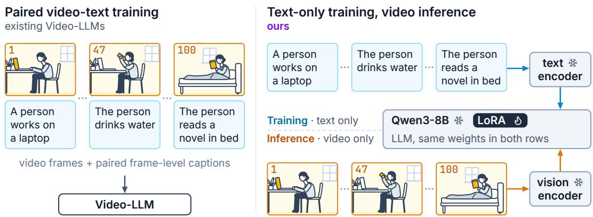
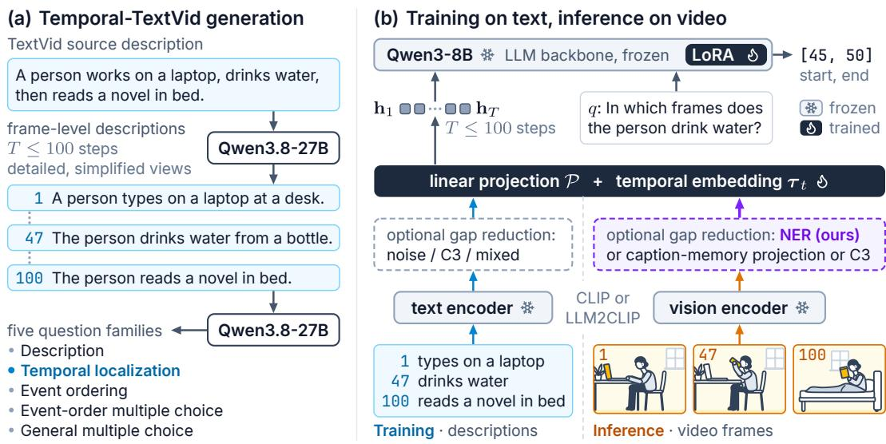
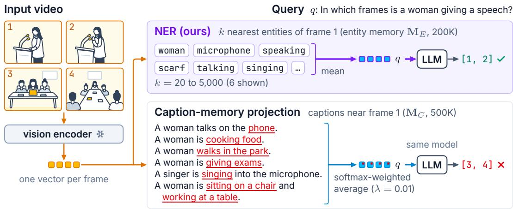
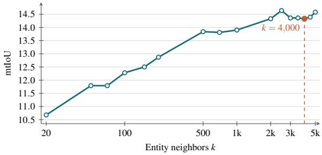
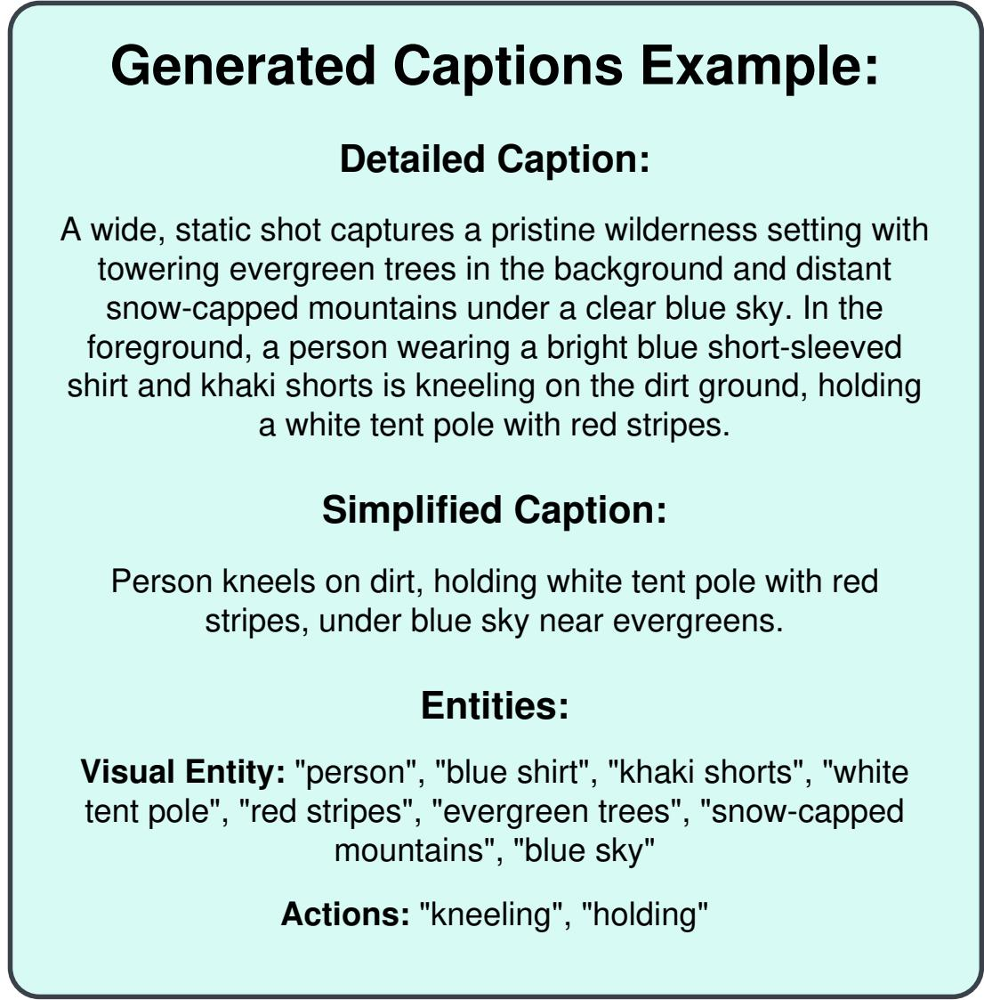

# Grounding in the Dark: Text-Only Training for Zero-Shot Video Temporal Localization

Divyanshu Mishra1,2∗ Sabine Sternig1 Rakshith Shetty1 Erhan Gundogdu1 1Amazon 2University of Oxford

## Abstract

Video-LLMs are typically trained on paired video-text data for temporal tasks, yet collecting precise temporal annotations and training on large-scale video datasets are both costly. We investigate whether a text-only LLM, with no vision-language pretraining, can be trained on textual video descriptions alone to perform temporal grounding and receive video only at inference time. This setting removes paired video data from training altogether and is a step toward training multimodal models without paired annotations. We generate a 134K-example corpus of textual sequences with up to 100 time steps, adapt Qwen3-8B with LoRA on CLIP or LLM2CLIP text embeddings, and evaluate on Charades-STA and QV-Highlights without training on videos from either benchmark. LLM2CLIP, whose text encoder supports longer inputs, represents detailed descriptions better than CLIP (61.54 versus 53.86 mtIoU on Temporal-TextVid) and transfers them better to video. Still, replacing text with frame embeddings at inference yields only 4.99 mtIoU on Charades-STA and 11.12 on QV-Highlights, revealing a large modality gap. To bridge it, we propose Nearest Entity Replacement (NER), a training-free mapping that represents each video frame by the normalized mean of its nearest text-entity embeddings, so that the model receives the kind of input it was trained on. NER reaches 14.45 mtIoU on Charades-STA and 20.72 on QV-Highlights, outperforming the strongest of four families of modality-gap baselines by 5.00 and 1.71 points. NER thus enables partial transfer from text to video, while more reliable grounding will likely require encoders with better-aligned text and visual representations.

## 1 Introduction

Video large language models (Video-LLMs) can describe videos, answer questions about them, and localize events in time [9, 21, 35, 40]. Recent trained temporal-grounding variants encode time with dedicated tokens [39], numbered frames [41], sequential transfer from images and short clips [2], or reinforcement-learning objectives [1]. Although their architectures differ, these systems learn from paired video and language (Fig. 1). Marking event boundaries requires close inspection by annotators, while storing and repeatedly decoding long videos adds training cost.

We ask whether a language model can learn a video task from text alone and still operate on video. We start from the Qwen3-8B language checkpoint rather than a pretrained Video-LLM and adapt it with LoRA [8, 43]. A frozen contrastive encoder provides the only pre-existing image-text alignment. During training, its text encoder processes one description per time step; at inference, the corresponding visual encoder processes sampled frames. The downstream projection and LLM remain unchanged. This setup tests whether a temporal model trained on text embeddings can use visual embeddings without retraining.

Temporal localization provides a demanding transfer test because the query specifies what event to find but not when. Some VideoQA datasets admit language shortcuts or strong text-only performance

  
Figure 1: Paired video-text training versus our text-only training and video-inference setting.

[16, 36, 44], whereas our setting replaces every textual position with a frame embedding at inference.   
The model must find both boundaries among up to 100 positions.

Prior work gives some reason to expect this transfer to work. The Platonic Representation Hypothesis argues that models trained on different modalities recover increasingly similar relational structure as they scale [12], while CLIP explicitly draws matching images and text together [34]. Yet retrieval alignment does not require identical distributions. Multimodal representation spaces have been shown to exhibit a modality gap, with text and visual embeddings retaining modality-specific offsets and geometry despite being mapped into a shared space [26, 48]. As a result, a model trained only on text embeddings may struggle to process visual embeddings, since they occupy different regions of the shared representation space.

The text encoder comes with a separate challenge. CLIP accepts at most 77 text tokens, with an effective context that can be considerably shorter [46]. Even descriptions that fit must compress several objects, actions, and relations into one vector. LLM2CLIP is designed to retain richer language information [11]. Because existing video captions are typically short and at the clip level, we generate detailed and simplified views of the same descriptions to quantify the value of detail and test how existing multimodal encoders represent each.

Our experiments use 134K synthetically generated training examples and evaluate zero-shot performance on Charades-STA [5] and QV-Highlights [19], without using any videos from either benchmark to train the temporal-localization model. We first examine whether the base LLMs can localize events from textual sequences and find that they are capable of doing so (Table 1). The next challenge is transferring this ability to video, where textual descriptions are replaced by visual embeddings. We find that the choice of encoder plays an important role in this transfer. While CLIP struggles with detailed descriptions, LLM2CLIP represents them more effectively, achieving 61.54 mtIoU compared to 53.86 on Temporal-TextVid, and also transfers better to video (Table 2). Based on these results, we adopt LLM2CLIP with detailed descriptions as our main configuration. However, the gap between text and visual representations remains substantial. When evaluated directly on video, the text-trained model achieves only 4.99 mtIoU on Charades-STA and 11.12 mtIoU on QV-Highlights. This motivates us to explore methods for bridging the modality gap. We evaluate four families of approaches and introduce Nearest Entity Replacement (NER), which retrieves fine-grained text entities for each video frame. NER improves performance to 14.45 mtIoU on Charades-STA and 20.72 mtIoU on QV-Highlights (Table 4). While these gains show that the modality gap can be reduced, substantial errors in temporal localization remain. Our contributions are:

• We introduce text-only training for video temporal grounding, using sequences of up to 100 textual time steps. To our knowledge, this is the first work to train a temporal-localization model entirely on text, starting from a text-only LLM rather than a video-aligned one, and transfer it to video without visual fine-tuning or test-time adaptation.

• We study two challenges that arise in text-to-video transfer: preserving fine-grained descriptions in fixed-dimensional embeddings and the modality gap encountered when replacing the text embeddings used during training with visual embeddings at inference.

  
Figure 2: (a) Generation of frame-level textual sequences and questions. (b) Training from text embeddings and inference from video frames, with an optional modality-gap reduction step.

• We propose Nearest Entity Replacement (NER), a training-free mapping that replaces each frame embedding with the mean of its nearest text-entity embeddings (Eq. 4). Across the matched encoder and caption configurations, NER improves mtIoU over raw visual features and caption-memory projection on both video benchmarks.

## 2 Related Work

Representation convergence and cross-modal gaps. Joint embedding models make cross-modal transfer possible by preserving semantic neighborhoods across modalities. CLIP learns this structure through image-text contrastive training [34], and the Platonic Representation Hypothesis places it within a broader trend toward convergent representations across models and modalities [12]. However, semantic agreement does not mean that a downstream model can use raw text and visual embeddings in the same way. Contrastively aligned modalities can occupy distinct regions of the shared space [26]. C3 models part of this difference with a modality-specific mean shift [48], while recent work finds that the remaining gap varies across the embedding space and cannot be corrected with a single average shift [45]. We test this directly by training a temporal model on the text encoder’s outputs and applying it to the visual encoder’s outputs without retraining.

Cross-modal learning from a single modality. Shared spaces have enabled cross-modal tasks to be learned without paired examples for the target task. Noise-injected text training transfers an image captioning decoder from CLIP text embeddings to image embeddings [32], while DeCap first projects image embeddings through a text memory [23]. LinCIR learns composed image retrieval from language alone [6]. The reverse direction is also possible: LAFITE trains text-to-image generation without text by constructing text-space conditions from images [51]. C3 applies modality-specific centering and corruption across captioning and generation tasks [48]. For video, TOPA pre-aligns a base LLM with textual videos before multiple-choice evaluation [24]. T3 [22] instead transfers -temporal reasoning learned in text to an already multimodal Video-LLM, and its grounding questions classify an event as occurring at the beginning, middle, or end rather than predicting its boundaries. TD-VAD similarly trains on text sequences and applies the model to CLIP frame features, but for query-free anomaly detection, while concurrent captioning work synthesizes video latents from text [4, 47]. We instead train a Video-LLM for temporal localization entirely from text sequences and introduce video only at inference.

Video temporal grounding. Video-LLMs usually learn temporal grounding from paired video and language, and they differ mainly in how they represent time: discrete temporal tokens with multistage video training [39], numbered frames [41], timestamp embeddings with token compression [7], or sequential transfer from images and short clips [2]. Other work improves the training data and objectives through grounding datasets, reinforcement fine-tuning, and comparisons of temporal output formats [1, 14, 25]. A second line of work avoids task-specific annotation. Language-free grounding learns from unlabelled videos and visual pseudo-queries [15], and zero-shot methods apply frozen visual or multimodal models directly to test videos through temporal coherence, visual markers, structured reasoning, self-similarity, or clip-level recognition [3, 10, 13, 17, 18, 20, 29, 42, 49, 50]. Zero-shot temporal action localization targets unseen action classes and may still use video supervision or per-video test-time adaptation [27, 28, 31, 38]. None of these approaches learns the temporalgrounding model itself from text alone.

## 3 Method

## 3.1 Problem formulation and text-only training

For a sequence of $T$ sampled positions, let $D = ( d _ { 1 } , \ldots , d _ { T } )$ denote the frame-level textual descriptions, q a query, and $a = ( a _ { 1 } , \dotsc , a _ { L } )$ its answer. In temporal-localization examples, a contains the start and end indices of the queried event. Let $f _ { T }$ and $f _ { V }$ be the text and vision encoders of a pretrained multimodal model, both mapping into $\mathbb { R } ^ { d }$ . A learned projection $\mathcal { P } : \mathbb { R } ^ { d }  \mathbb { R } ^ { h }$ maps their outputs to the token dimension of an LLM $g .$

Our model follows TOPA’s text-only pre-alignment architecture [24]. We adapt Qwen3-8B with LoRA [8, 43], using sequences of up to 100 positions for query-conditioned temporal localization. The original backbone weights and multimodal encoders remain frozen, and no Video-LLM checkpoint is used. A trainable linear projection maps each 768-dimensional CLIP or 1,280-dimensional LLM2CLIP feature to the 4,096-dimensional language-model space, and a learned temporal embed ding $\tau _ { t }$ marks each position. Training updates the projection, temporal embeddings, and rank-16 LoRA matrices on the query, key, value, and output projections of the attention layers, with LoRA alpha 32 and zero dropout. Features are normalized before the learned projection.

During training, each textual position becomes $\mathbf { h } _ { t } ^ { T } = \mathcal { P } ( f _ { T } ( d _ { t } ) ) + \pmb { \tau } _ { t }$ . The sequence $( \mathbf { h } _ { 1 } ^ { T } , \ldots , \mathbf { h } _ { T } ^ { T } )$ followed by the tokenized query, conditions the autoregressive answer:

$$
\mathcal { L } = - \sum _ { \ell = 1 } ^ { L } \log p _ { g } \left( a _ { \ell } \mid \mathbf { h } _ { 1 : T } ^ { T } , q , a _ { < \ell } \right) .\tag{1}
$$

At inference, a video $V = ( F _ { 1 } , \dots , F _ { T } )$ is sampled at the same number of positions and supplies $\mathbf { h } _ { t } ^ { V } = \mathcal { P } ( f _ { V } ( F _ { t } ) ) + \pmb { \tau } _ { t }$ . No parameter is updated at inference. This lets us measure how well a model trained on the outputs of $f _ { T }$ transfers to the outputs of $f _ { V }$

## 3.2 Synthetic training corpus

To replace video frames with textual descriptions while preserving frame-level details and temporal information, we need a description for each sampled frame rather than a single description for the entire video. Existing video-caption datasets generally describe clips or coarse segments, so we generate Temporal-TextVid from TextVid [24]. As illustrated in Fig. 2(a), Qwen3.8-27B [33] expands each source description into a plausible sequence of up to 100 detailed textual time steps. It also generates questions from five families: description, temporal localization, event ordering, event-order multiple choice, and general multiple choice. Temporal-TextVid contains 134K examples. On average, each example has 29 questions across the five families, giving 3.9M generated questions.

Caption simplification. Existing video captions are typically short, so we generate two views of every sequence to quantify the value of detail and to test how existing multimodal encoders represent it. Detailed descriptions preserve more scene information, but they place more content into a single fixed-dimensional embedding and can exceed the text encoder’s input length. For the simplified view, Qwen3.8-27B shortens each detailed description while retaining its principal events and temporal order. Both views therefore contain the same 134K underlying examples rather than two independently sampled corpora. Appendix Fig. 5 shows both views.

## 3.3 Modality-gap reduction baselines

Gaussian noise injection. We independently perturb each text embedding during training, $\widetilde { \mathbf { e } } _ { t } ^ { T } =$ $f _ { T } ( d _ { t } ) + \epsilon _ { t }$ , where $\boldsymbol \epsilon _ { t } \sim \mathcal { N } ( \mathbf 0 , \sigma ^ { 2 } \mathbf I )$ . The perturbation exposes the downstream model to randomly modified versions of each text embedding. The same zero-mean Gaussian distribution is used for every caption, so the perturbation does not depend on caption content. No noise is applied at inference. This baseline follows prior single-modality cross-modal training [32, 48, 51].

Collapse and corrupt. Let $\mathcal { D } _ { T }$ be the training descriptions and $\mathcal { D } _ { V }$ a reference set of visual inputs. C3 estimates one mean for each modality:

$$
\mu _ { T } = \frac { 1 } { | \mathscr { D } _ { T } | } \sum _ { d \in \mathscr { D } _ { T } } f _ { T } ( d ) , \qquad \mu _ { V } = \frac { 1 } { | \mathscr { D } _ { V } | } \sum _ { F \in \mathscr { D } _ { V } } f _ { V } ( F ) .\tag{2}
$$

C3 centers and corrupts text during training, $\widetilde { \mathbf { e } } _ { t } ^ { T } = f _ { T } ( d _ { t } ) - \mu _ { T } + \epsilon _ { t }$ , and centers visual inputs at inference, $\widetilde { \mathbf { e } } _ { t } ^ { V } = f _ { V } ( \dot { F } _ { t } ) - \pmb { \mu } _ { V } \left[ 4 8 \right]$ . With a fixed visual reference, the same pair of means is used for every sample, so $\mathbf { C } 3$ treats the modality difference as a single dataset-level offset. We compare four estimates of $\pmb { \mu } _ { V } \pmb { \mathrm { : } }$ the current video, the complete inference split, a similarly sized video dataset, and a large LAION reference sample. Appendix Table 7 reports the full sensitivity analysis.

Mixed-modality training. We encode approximately six million LAION-400M images [37] with the vision encoder to form a visual memory. After 35 epochs, the curriculum selects 10% of training examples for replacement. Within a selected example, the variants replace a subset of positions with a nearest visual feature or an average of 10 visual neighbors, or replace every position. These experiments test whether exposure to retrieved visual vectors prepares the LLM for video inference.

Caption-memory projection. The DeCap/TOPA baseline [23, 24] stores caption embeddings in a support memory $\mathbf { M } _ { C } = \{ \mathbf { c } _ { i } \} _ { i = 1 } ^ { K _ { C } }$ . A visual embedding v is mapped back to the text space by a temperature-controlled weighted average:

$$
\widehat { \mathbf { v } } _ { C } = \sum _ { i = 1 } ^ { K _ { C } } \frac { \exp ( \mathbf { c } _ { i } ^ { \top } \mathbf { v } / \lambda ) } { \sum _ { j = 1 } ^ { K _ { C } } \exp ( \mathbf { c } _ { j } ^ { \top } \mathbf { v } / \lambda ) } \mathbf { c } _ { i } .\tag{3}
$$

We refer to this as caption-memory projection in the experiments.

## 3.4 Nearest Entity Replacement

NER can be viewed as soft semantic quantization. A frame embedding selects a set of nearby text entities, and their mean replaces the visual vector. The mapping is soft because each frame is represented by an average over many entities rather than one discrete entry. Unlike a single global offset, this replacement depends on the frame content and gives the temporal model the same type of text representation used during training.

Entity extraction and memory. A caption-memory entry can bind several concepts into one vector. For example, “a woman is sitting on a chair and working at a table” combines the woman, chair, sitting, working, and table. A frame containing only one of these concepts may retrieve the complete caption and introduce the others (Fig. 3). We call this concept bleed: the matching part of a caption brings unrelated caption content into the frame representation. NER instead extracts nouns, verbs, and action phrases from the training descriptions. It encodes each phrase separately with the text encoder and stores the resulting 200K entries in an entity memory $\mathbf { M } _ { E } = \{ \mathbf { m } _ { i } \} _ { i = 1 } ^ { K _ { E } }$

Frame-to-entity retrieval. For each frame F , NER obtains $\mathbf { v } _ { t } = f _ { V } ( F _ { t } )$ , selects the k entity vectors with the highest cosine similarity, and records their indices in $\mathcal { N } _ { k } ( t )$

Aggregation and replacement. NER replaces the visual vector with the mean of the retrieved text entities:

$$
\mathcal { N } _ { k } ( t ) = \mathrm { T o p K } _ { i } \ \frac { \mathbf { v } _ { t } ^ { \top } \mathbf { m } _ { i } } { \| \mathbf { v } _ { t } \| \left\| \mathbf { m } _ { i } \right\| } , \qquad \widehat { \mathbf { v } } _ { t } ^ { E } = \mathrm { M e a n } \{ \mathbf { m } _ { i } : i \in \mathcal { N } _ { k } ( t ) \} .\tag{4}
$$

The averaging makes the replacement less dependent on any single cross-modal match. The LLM then receives $\{ \mathcal { \overline { P } } ( \mathcal { \overline { v } } _ { t } ^ { E } ) + \tau _ { t } \} _ { t = 1 } ^ { T }$ . The visual embedding is used only to retrieve a text-space neighborhood, and no video-side parameter is updated.

## 4 Experimental Setup

Models and protocol. All trained temporal models use Qwen3-8B with LoRA and Temporal-TextVid as their training data. CLIP and LLM2CLIP provide the paired text and vision encoders. The main raw-input, caption-projection, and NER configuration uses LLM2CLIP with detailed descriptions. Gaussian, C3, and mixed-modality training use CLIP ViT-L/14 with simplified descriptions, and we also report NER with this CLIP configuration. We evaluate text-side behavior on Temporal-TextVid and video transfer on Charades-STA and the QV-Highlights validation split. No videos from either benchmark are used for training. NER’s neighbor count k is selected separately for each encoder and caption view on labelled development videos from each benchmark’s training split (Appendix A.5). The main configuration uses $k = 1 , 0 0 0$ on Charades-STA and $k = 2 0$ on QV-Highlights, and NER with CLIP uses $k = 4 { , } 0 0 0$ and $k = 1 { , } 0 0 0$ Training uses 100 epochs, an effective batch size of 1,536, AdamW (peak learning rate $6 \times 1 0 ^ { - 4 }$ , one warmup epoch, cosine decay), and seed 0. Checkpoints are selected on a separate text monitor.

Metrics. Temporal intersection over union (tIoU) divides the intersection of the predicted and reference intervals by their union. We report its dataset mean (mtIoU) and the percentage of examples reaching tIoU thresholds of 0.1, 0.3, and 0.5. All reported values are on a 0–100 scale. We use the archived preprocessing and all-row scoring (Appendix A.5): Charades-STA has 2,572 query–interval examples, and QV-Highlights averages over 2,701 query–reference-window rows (1,486 queries) rather than the best reference per query. Published rows retain their original protocols.

## 5 Results

## 5.1 Temporal localization from text

Before replacing text with video, we test whether frozen Qwen3-8B, prompted without LoRA, and Qwen3.8-27B can localize events directly from Temporal-TextVid descriptions. Each prompt either labels descriptions with frame indices or presents them in order without explicit indices. This isolates temporal reasoning from losses introduced by the embedding encoder and the text-to-video switch. Since Qwen3.8-27B generated the corpus, its score measures consistency with the synthetic descriptions rather than independent generalization.

Frame indices are important for both models (Table 1). Removing them lowers Qwen3-8B’s mtIoU from 45.47 to 13.82 and Qwen3.8-27B’s from 55.69 to 28.72. This suggests that neither model can reliably identify frame positions from sequence order alone.

## 5.2 Effect of caption detail

We next compress each description into one embedding and compare CLIP with LLM2CLIP (Table 2).

For CLIP, simplifying the descriptions raises Temporal-TextVid mtIoU from 53.86 to 56.64, although both views contain the same examples. The detailed view places more objects, actions, and relations into each fixed-dimensional representation. LLM2CLIP instead scores higher with detailed descriptions (61.54 versus 59.34), consistent with its LLM-based text encoder accepting longer inputs than CLIP’s 77 tokens [11].

On video, CLIP fails with detailed descriptions: its raw transfer falls from 7.02 to 2.64 on Charades-STA and from 9.25 to 3.29 on QV-Highlights. LLM2CLIP is much less sensitive to the caption view, moving from 5.61 and 10.83 to 4.99 and 11.12. We therefore keep detailed descriptions with LLM2CLIP, which gives the best text score and avoids CLIP’s failure on video. Even so, these scores fall far below its 61.54 text score, highlighting the substantial domain gap.

  
Figure 3: NER avoids concept bleed from unrelated caption content (red).

Table 1: Direct text localization with and without frame IDs on Temporal-TextVid.
<table><tr><td>Model</td><td>Frame IDs</td><td>mtIoU</td><td>R@0.1</td><td>R@0.3</td><td>R@0.5</td></tr><tr><td>Qwen3-8B</td><td>Yes</td><td>45.47</td><td>64.71</td><td>57.91</td><td>41.48</td></tr><tr><td>Qwen3-8B</td><td>No</td><td>13.82</td><td>25.81</td><td>20.46</td><td>11.47</td></tr><tr><td>Qwen3.8-27B</td><td>Yes</td><td>55.69</td><td>68.44</td><td>64.88</td><td>53.84</td></tr><tr><td>Qwen3.8-27B</td><td>No</td><td>28.72</td><td>42.02</td><td>36.89</td><td>27.02</td></tr></table>

Table 2: Caption-view and embedding-model ablation (mtIoU). TTV denotes Temporal-TextVid.
<table><tr><td>View</td><td>Embedding</td><td>TTV</td><td>Char. QV-H.</td></tr><tr><td>Detailed</td><td>CLIP</td><td>53.86</td><td>2.64 3.29</td></tr><tr><td>Detailed</td><td>LLM2CLIP</td><td>61.54</td><td>4.99 11.12</td></tr><tr><td>Simplified CLIP</td><td></td><td>56.64</td><td>7.02 9.25</td></tr><tr><td></td><td>Simplified LLM2CLIP 59.34</td><td></td><td>5.61 10.83</td></tr></table>

## 5.3 Improving text-to-video transfer

Table 4 compares NER with four families of methods for closing the text-to-video gap. The trainingside baselines use CLIP. Gaussian noise injection and C3 alter the text embeddings independently of frame content and reach only 5.46 and 5.10 mtIoU on Charades-STA, and C3 is also sensitive to the visual reference used for its mean (Table 3). Mixing retrieved image features into training helps more and gives the strongest training baselines, with 9.45 mtIoU on Charades-STA for partial and 12.74 on QV-Highlights for full replacement (Appendix Table 6). At inference, caption-memory projection raises the detailed LLM2CLIP model from 4.99 to 7.95 mtIoU on Charades-STA and from 11.12 to 19.01 on QV-Highlights.

NER outperforms every baseline on both benchmarks. With detailed LLM2CLIP, it reaches 14.45 mtIoU on Charades-STA and 20.72 on QV-Highlights, 9.46 and 9.60 points above raw visual features and 6.50 and 1.71 above caption-memory projection, whose R@0.1 and R@0.3 it more than doubles on Charades-STA. With CLIP, NER reaches 14.33 and 21.85, 4.88 and 9.11 points above the strongest CLIP training baseline.

We attribute the gain over caption projection to the retrieval unit. A caption binds several concepts into one vector, so a frame that matches part of a caption also inherits the rest (Fig. 3). Averaging many single-concept entities instead gives a vector that follows the frame content while staying in the text distribution seen during training. Across encoder and caption configurations, simplified LLM2CLIP + NER scores highest, at 15.57 and 22.29 (Appendix Table 9). However, models trained on paired video-text data still achieve up to 36.80 mtIoU under their original protocols, highlighting the performance gap between single-modality and paired-data approaches.

## 5.4 Sensitivity to the entity-neighbor count

The neighbor count k sets how many entities are averaged for each frame, and larger neighborhoods average out individual wrong matches. For CLIP + NER on Charades-STA (Fig. 4), mtIoU rises from 10.68 at k = 20 to 14.33 at the selected k = 4,000 and varies by less than 0.4 points beyond k = 2,000, so performance is stable over a wide range of k. Development and confirmation results for every configuration are in Appendix A.5.

Table 3: C3 sensitivity to the visual-mean reference with CLIP (mtIoU).
<table><tr><td>Reference</td><td>Char.</td><td>QV-H.</td></tr><tr><td>Current video</td><td>5.78</td><td>11.55</td></tr><tr><td>Evaluation split</td><td>5.09</td><td>10.76</td></tr><tr><td>Other benchmark</td><td>4.74</td><td>7.31</td></tr><tr><td>LAION (5.99M)</td><td>5.10</td><td>10.16</td></tr></table>

  
Figure 4: NER (CLIP) on Charades-STA across neighbor counts, with the selected k = 4,000 marked.

Table 4: Transfer results and published context under original protocols. CLIP rows use simplified descriptions and LLM2CLIP rows detailed descriptions. †: values reproduced from VTimeLLM [9].
<table><tr><td>Dataset</td><td>Training</td><td>Method</td><td>Encoder</td><td>mtIoU</td><td>R@0.1</td><td>R@0.3</td><td>R@0.5</td></tr><tr><td rowspan="4">Charades</td><td rowspan="4">Video trained</td><td>VideoChat-7B† [21]</td><td></td><td>6.50</td><td></td><td>9.00</td><td>3.30</td></tr><tr><td>VideoChatGPT-7B† [30]</td><td></td><td>13.70</td><td></td><td>20.00</td><td>7.70</td></tr><tr><td>VTimeLLM-7B [9]</td><td></td><td>31.20</td><td></td><td>51.00</td><td>27.50</td></tr><tr><td>Grounded-VideoLLM (Phi3.5, 4B) [39]</td><td></td><td>36.80</td><td></td><td>54.20</td><td>36.40</td></tr><tr><td rowspan="6">Charades</td><td rowspan="6">Text + image memory Text only</td><td>Mixed, full Gaussian noise injection [32]</td><td>CLIP</td><td>8.78</td><td>22.78</td><td>9.33 3.69</td><td>4.39</td></tr><tr><td></td><td>CLIP</td><td>5.46</td><td>17.19</td><td></td><td>1.01</td></tr><tr><td>C3 [48]</td><td>CLIP</td><td>5.10</td><td>15.36</td><td>3.46</td><td>1.05</td></tr><tr><td>Raw visual features</td><td>LLM2CLIP</td><td>4.99</td><td>12.99</td><td>5.75</td><td>2.29</td></tr><tr><td>Caption projection [23, 24]</td><td>LLM2CLIP</td><td>7.95</td><td>18.93</td><td>9.18</td><td>3.97</td></tr><tr><td>NER (ours) NER (ours)</td><td>CLIP</td><td>14.33</td><td>36.39</td><td>20.53</td><td>7.08</td></tr><tr><td rowspan="6">QV-Highlights</td><td rowspan="6">Text + image memory Text only</td><td>Mixed, full</td><td>LLM2CLIP</td><td>14.45</td><td>40.01</td><td>20.49</td><td>6.07</td></tr><tr><td>Gaussian noise injection [32]</td><td>CLIP</td><td>12.74</td><td>29.62</td><td>15.81</td><td>9.29</td></tr><tr><td>C3 [48]</td><td>CLIP</td><td>11.14</td><td>26.95</td><td>14.18</td><td>7.74</td></tr><tr><td>Raw visual features</td><td>CLIP LLM2CLIP</td><td>10.16 11.12</td><td>25.51 24.51</td><td>12.88 14.07</td><td>6.85 8.03</td></tr><tr><td>Caption projection [23, 24]</td><td>LLM2CLIP</td><td>19.01</td><td>39.76</td><td>24.21</td><td>15.59</td></tr><tr><td>NÉR (ours) NER (ours)</td><td>CLIP</td><td>21.85 20.72</td><td>45.65 44.17</td><td>26.69 26.10</td><td>17.18 16.14</td></tr></table>

## 6 Discussion and Limitations

Contrastive training aligns image and text embeddings well enough for retrieval, but our experiments show that this does not make them interchangeable. A model that localizes events well from text loses most of its accuracy when frame embeddings replace the descriptions, even with the stronger LLM2CLIP encoder.

We believe our simple method, NER, works because the temporal model never directly processes visual embeddings. Instead, frame embeddings are used to retrieve nearby text entities, allowing the model to work with the same type of input it was trained on. This lets NER benefit from the retrieval capabilities of existing encoders without requiring their image and text embedding spaces to be perfectly aligned. In contrast, Gaussian noise and C3 apply the same adjustment to every input regardless of frame content, while C3 also depends on its visual reference. This is consistent with evidence that the modality gap varies across the embedding space [45]. Caption-memory projection accounts for individual frames but can introduce information from captions that is not actually present in the frame.

NER is still better at identifying the general region of an event than its precise boundaries, leaving several directions for improvement. Retrieved entities could be weighted by similarity rather than averaged equally, or the number of neighbors could be adjusted for each frame. The mapping could also be learned from unpaired frames and text, while the synthetic corpus could better reflect the timing and duration of events in real videos. Better-aligned encoders may eventually allow direct transfer without retrieval. Finally, evaluation on more diverse benchmarks is needed to understand how well these findings generalize.

## References

[1] Ruizhe Chen, Tianze Luo, Zhiting Fan, Heqing Zou, Zhaopeng Feng, Guiyang Xie, Hansheng Zhang, Zhuochen Wang, Zuozhu Liu, and Huaijian Zhang. Datasets and recipes for video temporal grounding via reinforcement learning. In Proceedings ofthe 2025 Conference on Empirical Methods in Natural Language Processing: Industry Track, pages 983–992. Association for Computational Linguistics, 2025. doi: 10. 18653/v1/2025.emnlp-industry.66. URL https://aclanthology.org/2025.emnlp-industry.66/.

[2] Andong Deng, Zhongpai Gao, Anwesa Choudhuri, Benjamin Planche, Meng Zheng, Bin Wang, Terrence Chen, Chen Chen, and Ziyan Wu. Seq2Time: Sequential knowledge transfer for video LLM temporal grounding. In Proceedings ofthe IEEE/CVF Conference on Computer Vision and Pattern Recognition, pages 13766–13775, 2025. doi: 10.1109/CVPR52734.2025.01285.

[3] Pengcheng Fang, Yuxia Chen, and Xiaohao Cai. MarkIt: Training-free visual markers for precise video temporal grounding. arXiv preprint arXiv:2604.25886, 2026. doi: 10.48550/arXiv.2604.25886.

[4] Liangyu Fu, Junbo Wang, Yuke Li, Ya Jing, Xuecheng Wu, and Zhiyong Wang. Watching synthetic videos: Aligning cross-modal representations with visual synthesis for zero-shot video captioning. arXiv preprint arXiv:2608.11013, 2026. doi: 10.48550/arXiv.2608.11013.

[5] Jiyang Gao, Chen Sun, Zhenheng Yang, and Ram Nevatia. TALL: Temporal activity localization via language query. In Proceedings ofthe IEEE International Conference on Computer Vision, pages 5277– 5285, 2017. doi: 10.1109/ICCV.2017.563.

[6] Geonmo Gu, Sanghyuk Chun, Wonjae Kim, Yoohoon Kang, and Sangdoo Yun. Language-only efficient training of zero-shot composed image retrieval. In Proceedings ofthe IEEE/CVF Conference on Computer Vision and Pattern Recognition, pages 13225–13234, 2024. doi: 10.1109/CVPR52733.2024.01256.

[7] Yongxin Guo, Jingyu Liu, Mingda Li, Dingxin Cheng, Xiaoying Tang, Dianbo Sui, Qingbin Liu, Xi Chen, and Kevin Zhao. VTG-LLM: Integrating timestamp knowledge into video LLMs for enhanced video temporal grounding. In Proceedings ofthe AAAI Conference on Artificial Intelligence, volume 39, pages 3302–3310, 2025. doi: 10.1609/aaai.v39i3.32341.

[8] Edward J. Hu, Yelong Shen, Phillip Wallis, Zeyuan Allen-Zhu, Yuanzhi Li, Shean Wang, Lu Wang, and Weizhu Chen. LoRA: Low-rank adaptation of large language models. In International Conference on Learning Representations, 2022.

[9] Bin Huang, Xin Wang, Hong Chen, Zihan Song, and Wenwu Zhu. VTimeLLM: Empower LLM to grasp video moments. In Proceedings of the IEEE/CVF Conference on Computer Vision and Pattern Recognition, pages 14271–14280, 2024. doi: 10.1109/CVPR52733.2024.01353.

[10] Ji Huang, Barry Devereux, and Hui Wang. Your VLM already knows when: Training-free temporal grounding by asking yes or no. arXiv preprint arXiv:2608.08315, 2026. doi: 10.48550/arXiv.2608.08315.

[11] Weiquan Huang, Aoqi Wu, Yifan Yang, Xufang Luo, Yuqing Yang, Usman Naseem, Chunyu Wang, Qi Dai, Xiyang Dai, Dongdong Chen, Chong Luo, Lili Qiu, and Liang Hu. LLM2CLIP: Powerful language model unlocks richer cross-modality representation. In Proceedings ofthe AAAI Conference on Artificial Intelligence, volume 40, pages 5131–5139, 2026. doi: 10.1609/aaai.v40i7.37427.

[12] Minyoung Huh, Brian Cheung, Tongzhou Wang, and Phillip Isola. Position: The Platonic representation hypothesis. In Proceedings of the 41st International Conference on Machine Learning, volume 235 of Proceedings of Machine Learning Research, pages 20617–20642. PMLR, 2024. URL https:// proceedings.mlr.press/v235/huh24a.html.

[13] Mingyu Jeon, Sunjae Yoon, Jonghee Kim, and Junyeong Kim. GranAlign: Granularity-aware alignment framework for zero-shot video moment retrieval. In Proceedings of the AAAI Conference on Artificial Intelligence, volume 40, pages 5287–5295, 2026. doi: 10.1609/aaai.v40i7.37444.

[14] Shengji Jin, Yuanhao Zou, Victor Zhu, Zhengping Ji, and Chen Chen. How should video LLMs output time? An analysis of efficient temporal grounding paradigms. arXiv preprint arXiv:2604.08966, 2026. doi: 10.48550/arXiv.2604.08966. CVPR 2026 Workshop paper.

[15] Dahye Kim, Jungin Park, Jiyoung Lee, Seongheon Park, and Kwanghoon Sohn. Language-free training for zero-shot video grounding. In Proceedings of the IEEE/CVF Winter Conference on Applications of Computer Vision, pages 2538–2547, 2023. doi: 10.1109/WACV56688.2023.00257.

[16] Sena Korkut, María Alejandra Bravo Sarmiento, Sanghwan Kim, and Zeynep Akata. From accuracy to visual dependence: Auditing and filtering modality collapse in traffic VideoQA. arXiv preprint arXiv:2606.30220, 2026. doi: 10.48550/arXiv.2606.30220.

[17] Jihyun Lee, Cheol-Ho Cho, Woojin Jun, Woojin Jeong, and Jae-Pil Heo. Mitigating modality and language-style gaps for zero-shot video moment retrieval. arXiv preprint arXiv:2607.19027, 2026. doi: 10.48550/arXiv.2607.19027. Accepted at ECCV 2026.

[18] Jin-Seop Lee, SungJoon Lee, Jaehan Ahn, YunSeok Choi, and Jee-Hyong Lee. TAG: A simple yet effective temporal-aware approach for zero-shot video temporal grounding. arXiv preprint arXiv:2508.07925, 2025. doi: 10.48550/arXiv.2508.07925.

[19] Jie Lei, Tamara L. Berg, and Mohit Bansal. Detecting moments and highlights in videos via natural language queries. In Advances in Neural Information Processing Systems, volume 34, pages 11846–11858, 2021.

[20] Boyang Li, Chenhui Gou, and Jianfei Cai. REZE: Recognition-based zero-shot extraction for video temporal grounding. arXiv preprint arXiv:2608.04480, 2026. doi: 10.48550/arXiv.2608.04480.

[21] Kunchang Li, Yinan He, Yi Wang, Yizhuo Li, Wenhai Wang, Ping Luo, Yali Wang, Limin Wang, and Yu Qiao. VideoChat: Chat-centric video understanding. arXiv preprint arXiv:2305.06355, 2023.

[22] Lei Li, Yuanxin Liu, Linli Yao, Peiyuan Zhang, Chenxin An, Lean Wang, Xu Sun, Lingpeng Kong, and Qi Liu. Temporal reasoning transfer from text to video. In International Conference on Learning Representations, 2025. URL https://openreview.net/forum?id=sHAvMp5J4R.

[23] Wei Li, Linchao Zhu, Longyin Wen, and Yi Yang. DeCap: Decoding CLIP latents for zero-shot captioning via text-only training. In International Conference on Learning Representations, 2023.

[24] Wei Li, Hehe Fan, Yongkang Wong, Mohan Kankanhalli, and Yi Yang. TOPA: Extending large language models for video understanding via text-only pre-alignment. In Advances in Neural Information Processing Systems, volume 37, pages 5697–5738, 2024. doi: 10.52202/079017-0185.

[25] Yunheng Li, Jing Cheng, Shaoyong Jia, Hangyi Kuang, Shaohui Jiao, Qibin Hou, and Ming-Ming Cheng. TempSamp-R1: Effective temporal sampling with reinforcement fine-tuning for video LLMs. arXiv preprint arXiv:2509.18056, 2025. doi: 10.48550/arXiv.2509.18056.

[26] Victor Weixin Liang, Yuhui Zhang, Yongchan Kwon, Serena Yeung, and James Y. Zou. Mind the gap: Understanding the modality gap in multi-modal contrastive representation learning. In Advances in Neural Information Processing Systems, volume 35, pages 17612–17625, 2022.

[27] Benedetta Liberatori, Alessandro Conti, Paolo Rota, Yiming Wang, and Elisa Ricci. Test-time zero-shot temporal action localization. In Proceedings of the IEEE/CVF Conference on Computer Vision and Pattern Recognition, pages 18720–18729, 2024. doi: 10.1109/CVPR52733.2024.01771.

[28] Benedetta Liberatori, Alessandro Conti, Lorenzo Vaquero, Paolo Rota, Yiming Wang, and Elisa Ricci. Zeroshot temporal action localization through textual guidance. In 2026 IEEE 20th International Conference on Automatic Face and Gesture Recognition, pages 1–9, 2026. doi: 10.1109/FG67764.2026.11557050.

[29] Dezhao Luo, Jiabo Huang, Shaogang Gong, Hailin Jin, and Yang Liu. Zero-shot video moment retrieval from frozen vision-language models. In Proceedings of the IEEE/CVF Winter Conference on Applications ofComputer Vision, pages 5452–5461, 2024. doi: 10.1109/WACV57701.2024.00538.

[30] Muhammad Maaz, Hanoona Rasheed, Salman Khan, and Fahad Shahbaz Khan. Video-ChatGPT: Towards detailed video understanding via large vision and language models. In Proceedings ofthe 62nd Annual Meeting ofthe Associationfor Computational Linguistics, pages 12585–12602, 2024. doi: 10.18653/v1/ 2024.acl-long.679.

[31] Sauradip Nag, Xiatian Zhu, Yi-Zhe Song, and Tao Xiang. Zero-shot temporal action detection via visionlanguage prompting. In European Conference on Computer Vision, pages 681–697. Springer, 2022. doi: 10.1007/978-3-031-20062-5\_39.

[32] David Nukrai, Ron Mokady, and Amir Globerson. Text-only training for image captioning using noiseinjected CLIP. In Findings of the Association for Computational Linguistics: EMNLP 2022, pages 4055–4063, 2022. doi: 10.18653/v1/2022.findings-emnlp.299.

[33] Qwen Team. Qwen3.8-Max: A new bar for coding and cowork. Qwen release announcement, 2026. URL https://qwen.ai/blog?id=qwen3.8.

[34] Alec Radford, Jong Wook Kim, Chris Hallacy, Aditya Ramesh, Gabriel Goh, Sandhini Agarwal, Girish Sastry, Amanda Askell, Pamela Mishkin, Jack Clark, Gretchen Krueger, and Ilya Sutskever. Learning transferable visual models from natural language supervision. In Proceedings ofthe 38th International Conference on Machine Learning, volume 139, pages 8748–8763. PMLR, 2021.

[35] Shuhuai Ren, Linli Yao, Shicheng Li, Xu Sun, and Lu Hou. TimeChat: A time-sensitive multimodal large language model for long video understanding. In Proceedings ofthe IEEE/CVF Conference on Computer Vision and Pattern Recognition, pages 14313–14323, 2024. doi: 10.1109/CVPR52733.2024.01357.

[36] Arka Sadhu, Kan Chen, and Ram Nevatia. Video question answering with phrases via semantic roles. In Proceedings ofthe 2021 Conference ofthe North American Chapter ofthe Associationfor Computational Linguistics: Human Language Technologies, pages 2460–2478, 2021. doi: 10.18653/v1/2021.naacl-main. 196.

[37] Christoph Schuhmann, Richard Vencu, Romain Beaumont, Robert Kaczmarczyk, Clayton Mullis, Aarush Katta, Theo Coombes, Jenia Jitsev, and Aran Komatsuzaki. LAION-400M: Open dataset of CLIP-filtered 400 million image-text pairs. arXiv preprint arXiv:2111.02114, 2021.

[38] Onkar Kishor Susladkar, Gayatri Sudhir Deshmukh, Vandan Gorade, and Sparsh Mittal. GRIZAL: Generative prior-guided zero-shot temporal action localization. In Proceedings ofthe 2024 Conference on Empirical Methods in Natural Language Processing, pages 19046–19059. Association for Computational Linguistics, 2024. doi: 10.18653/v1/2024.emnlp-main.1061. URL https://aclanthology.org/2024. emnlp-main.1061/.

[39] Haibo Wang, Zhiyang Xu, Yu Cheng, Shizhe Diao, Yufan Zhou, Yixin Cao, Qifan Wang, Weifeng Ge, and Lifu Huang. Grounded-VideoLLM: Sharpening fine-grained temporal grounding in video large language models. In Findings of the Association for Computational Linguistics: EMNLP 2025, pages 959–975. Association for Computational Linguistics, 2025. doi: 10.18653/v1/2025.findings-emnlp.50. URL https://aclanthology.org/2025.findings-emnlp.50/.

[40] Yueqian Wang, Xiaojun Meng, Jianxin Liang, Yuxuan Wang, Qun Liu, and Dongyan Zhao. HawkEye: Training video-text LLMs for grounding text in videos. arXiv preprint arXiv:2403.10228, 2024.

[41] Yongliang Wu, Xinting Hu, Yuyang Sun, Yizhou Zhou, Wenbo Zhu, Fengyun Rao, Bernt Schiele, and Xu Yang. Number it: Temporal grounding videos like flipping manga. In Proceedings ofthe IEEE/CVF Conference on Computer Vision and Pattern Recognition, pages 13754–13765, 2025. doi: 10.1109/ CVPR52734.2025.01284.

[42] Yifang Xu, Yunzhuo Sun, Benxiang Zhai, Ming Li, Wenxin Liang, Yang Li, and Sidan Du. Zero-shot video moment retrieval via off-the-shelf multimodal large language models. In Proceedings ofthe AAAI Conference on Artificial Intelligence, volume 39, pages 8978–8986, 2025. doi: 10.1609/aaai.v39i9.32971.

[43] An Yang, Anfeng Li, Baosong Yang, et al. Qwen3 technical report. arXiv preprint arXiv:2505.09388, 2025.

[44] Antoine Yang, Antoine Miech, Josef Sivic, Ivan Laptev, and Cordelia Schmid. Just ask: Learning to answer questions from millions of narrated videos. In Proceedings of the IEEE/CVF International Conference on Computer Vision, pages 1666–1677, 2021. doi: 10.1109/ICCV48922.2021.00171.

[45] Xiaomin Yu, Yijiang Li, Yuhui Zhang, Hanzhen Zhao, Yue Yang, Hao Tang, Yue Song, Xiaobin Hu, Cheng wei Qin, Shuicheng Yan, and Hui Xiong. Anisotropic modality align. arXiv preprint arXiv:2605.07825, 2026. doi: 10.48550/arXiv.2605.07825.

[46] Beichen Zhang, Pan Zhang, Xiaoyi Dong, Yuhang Zang, and Jiaqi Wang. Long-CLIP: Unlocking the long-text capability of CLIP. In European Conference on Computer Vision, pages 310–325. Springer, 2024. doi: 10.1007/978-3-031-72983-6\_18.

[47] Shuangqing Zhang, Lei-Lei Ma, Zhao Wang, Wen Dong, Xinyi Xu, Guo-Sen Xie, Caifeng Shan, and Fang Zhao. TD-VAD: Breaking visual dependence in video anomaly detection with text-driven learning. arXiv preprint arXiv:2608.11820, 2026. doi: 10.48550/arXiv.2608.11820. Accepted at ICML 2026.

[48] Yuhui Zhang, Elaine Sui, and Serena Yeung-Levy. Connect, collapse, corrupt: Learning cross-modal tasks with uni-modal data. In International Conference on Learning Representations, 2024.

[49] Zhengbo Zhang, Mark He Huang, Zhigang Tu, and Ming-Hsuan Yang. DART: Difficulty-adaptive routing for zero-shot video temporal grounding. arXiv preprint arXiv:2607.00672, 2026. doi: 10.48550/arXiv. 2607.00672. Accepted at ECCV 2026.

[50] Minghang Zheng, Xinhao Cai, Qingchao Chen, Yuxin Peng, and Yang Liu. Training-free video temporal grounding using large-scale pre-trained models. In European Conference on Computer Vision, pages 20–37. Springer, 2024. doi: 10.1007/978-3-031-73007-8\_2.

[51] Yufan Zhou, Ruiyi Zhang, Changyou Chen, Chunyuan Li, Chris Tensmeyer, Tong Yu, Jiuxiang Gu, Jinhui Xu, and Tong Sun. Towards language-free training for text-to-image generation. In Proceedings ofthe IEEE/CVF Conference on Computer Vision and Pattern Recognition, pages 17907–17917, 2022.

## A Additional Results

## A.1 Published QV-Highlights Video-LLM results

Video-LLMs commonly evaluate QV-Highlights as highlight detection, using mAP and HIT@1 rather than the interval metrics reported for NER. Table 5 therefore presents these results separately.

Table 5: Published QV-Highlights highlight-detection results. The first three values are reproduced from VTG-LLM [7] and NumPro-FT from Number It [41]. NumPro-FT uses video fine-tuning, and the other rows are zero-shot. These saliency metrics are not directly comparable to NER.
<table><tr><td>Method</td><td>mAP</td><td>HIT@1</td></tr><tr><td>VideoChat-7B [21]</td><td>13.1</td><td>18.1</td></tr><tr><td>TimeChat-7B [35]</td><td>14.5</td><td>23.9</td></tr><tr><td>VTG-LLM-7B [7]</td><td>16.5</td><td>33.5</td></tr><tr><td>NumPro-FT [41]</td><td>25.0</td><td>37.2</td></tr></table>

## A.2 Mixed-modality variants

Table 6: Full mixed-modality training results with CLIP.
<table><tr><td>Dataset</td><td>Variant</td><td>mtIoU</td><td>R@0.1</td><td>R@0.3</td><td>R@0.5</td></tr><tr><td>Charades</td><td>Partial</td><td>9.45</td><td>21.77</td><td>11.86</td><td>5.56</td></tr><tr><td></td><td>Partial + neighbors</td><td>7.07</td><td>17.19</td><td>8.20</td><td>3.65</td></tr><tr><td></td><td>Full</td><td>8.78</td><td>22.78</td><td>9.33</td><td>4.39</td></tr><tr><td>QV-Highlights</td><td>Partial</td><td>12.41</td><td>26.47</td><td>15.66</td><td>9.55</td></tr><tr><td></td><td>Partial + neighbors</td><td>9.35</td><td>22.25</td><td>11.48</td><td>6.26</td></tr><tr><td></td><td>Full</td><td>12.74</td><td>29.62</td><td>15.81</td><td>9.29</td></tr></table>

## A.3 Sensitivity to the C3 visual mean

C3 requires a visual mean at inference. Table 7 compares a current-video estimate, a transductive estimate from the full evaluation split, a different video dataset, and a 5.99M-image LAION sample. The current-video estimate gives the highest mtIoU on both datasets. LAION is the fixed C3 configuration in Table 4. Neither reference is uniformly best across recall thresholds: on Charades-STA, the evaluation-split estimate has higher R@0.3 and R@0.5 than both. A different video dataset of similar size performs worst on both benchmarks, so the source of the reference matters.

Table 8 reports all recall thresholds for the caption-view and encoder comparison in Table 2.

Table 7: C3 sensitivity to the visual-mean reference with CLIP. The evaluation-split mean uses the full target split and is therefore transductive. The other video set is the other benchmark.
<table><tr><td>Dataset</td><td>Visual-mean reference</td><td>mtIoU</td><td>R@0.1</td><td>R@0.3</td><td>R@0.5</td></tr><tr><td rowspan="4">Charades</td><td>Current video</td><td>5.78</td><td>18.74</td><td>3.34</td><td>1.17</td></tr><tr><td>Eval split (133.4K)</td><td>5.09</td><td>14.74</td><td>3.50</td><td>1.28</td></tr><tr><td>Other video set (145.5K)</td><td>4.74</td><td>14.15</td><td>2.95</td><td>0.89</td></tr><tr><td>LAION (5.99M)</td><td>5.10</td><td>15.36</td><td>3.46</td><td>1.05</td></tr><tr><td rowspan="4">QV-Highlights</td><td>Current video</td><td>11.55</td><td>28.40</td><td>15.29</td><td>7.77</td></tr><tr><td>Eval split (145.5K)</td><td>10.76</td><td>26.14</td><td>14.07</td><td>7.18</td></tr><tr><td>Other video set (133.4K)</td><td>7.31</td><td>19.62</td><td>9.07</td><td>4.07</td></tr><tr><td>LAION (5.99M)</td><td>10.16</td><td>25.51</td><td>12.88</td><td>6.85</td></tr></table>

Table 8: Full caption-view and embedding-model results. TTV denotes Temporal-TextVid.
<table><tr><td>View</td><td>Embedding</td><td>Dataset</td><td>mtIoU</td><td>R@0.1</td><td>R@0.3</td><td>R@0.5</td><td>R@0.7</td></tr><tr><td>Detailed</td><td>CLIP</td><td>TTV</td><td>53.86</td><td>69.78</td><td>65.72</td><td>51.85</td><td>43.93</td></tr><tr><td></td><td></td><td>Charades</td><td>2.64</td><td>6.53</td><td>3.27</td><td>0.93</td><td>0.62</td></tr><tr><td></td><td></td><td>QV-Highlights</td><td>3.29</td><td>8.66</td><td>3.30</td><td>1.59</td><td>0.78</td></tr><tr><td>Detailed</td><td>LLM2CLIP</td><td>TTV</td><td>61.54</td><td>76.18</td><td>72.68</td><td>60.18</td><td>52.31</td></tr><tr><td></td><td></td><td>Charades</td><td>4.99</td><td>12.99</td><td>5.75</td><td>2.29</td><td>1.01</td></tr><tr><td></td><td></td><td>QV-Highlights</td><td>11.12</td><td>24.51</td><td>14.07</td><td>8.03</td><td>4.96</td></tr><tr><td>Simplified CLIP</td><td></td><td>TTV</td><td>56.64</td><td>73.18</td><td>67.95</td><td>54.39</td><td>46.27</td></tr><tr><td></td><td></td><td>Charades</td><td>7.02</td><td>16.25</td><td>8.98</td><td>4.00</td><td>2.33</td></tr><tr><td></td><td></td><td>QV-Highlights</td><td>9.25</td><td>20.84</td><td>11.14</td><td>6.92</td><td>4.63</td></tr><tr><td>Simplified LLM2CLIP</td><td></td><td>TTV</td><td>59.34</td><td>74.66</td><td>70.59</td><td>57.34</td><td>50.13</td></tr><tr><td></td><td></td><td>Charades</td><td>5.61</td><td>12.79</td><td>6.42</td><td>3.30</td><td>1.98</td></tr><tr><td></td><td></td><td>QV-Highlights</td><td>10.83</td><td>24.44</td><td>14.55</td><td>7.92</td><td>4.44</td></tr></table>

## A.4 Matched encoder and retrieval comparison

Table 9 applies raw features, caption projection (CP), and NER to each text-trained checkpoint. NER, with k selected per configuration on development videos, gives the highest mtIoU in all eight rows.

Table 9: Raw features, caption projection (CP), and NER for each encoder and caption view (mtIoU).
<table><tr><td>Dataset</td><td>Encoder</td><td>View</td><td>Raw</td><td>CP</td><td>NER</td></tr><tr><td>Charades</td><td>CLIP</td><td>Simplified</td><td>7.02</td><td>5.31</td><td>14.33</td></tr><tr><td></td><td>CLIP</td><td>Detailed</td><td>2.64</td><td>3.42</td><td>7.67</td></tr><tr><td></td><td>LLM2CLIP</td><td>Simplified</td><td>5.61</td><td>9.37</td><td>15.57</td></tr><tr><td></td><td>LLM2CLIP</td><td>Detailed</td><td>4.99</td><td>7.95</td><td>14.45</td></tr><tr><td>QV-Highlights</td><td>CLIP</td><td>Simplified</td><td>9.25</td><td>8.85</td><td>21.85</td></tr><tr><td></td><td>CLIP</td><td>Detailed</td><td>3.29</td><td>6.23</td><td>15.28</td></tr><tr><td></td><td>LLM2CLIP</td><td>Simplified</td><td>10.83</td><td>19.89</td><td>22.29</td></tr><tr><td></td><td>LLM2CLIP</td><td>Detailed</td><td>11.12</td><td>19.01</td><td>20.72</td></tr></table>

## A.5 Implementation details

Model and training. The temporal backbone is Qwen3-8B with frozen weights. LoRA (rank 16, alpha 32, dropout 0) is applied to the query, key, value, and output projections. The linear feature projection (768-dimensional CLIP or 1,280-dimensional LLM2CLIP features to 4,096 dimensions) and the temporal embeddings are trained, and features are normalized before the projection. We train for 100 epochs with batch size 1,536 using AdamW (learning rate $6 \times 1 0 ^ { - 4 }$ , weight decay 0.1) with one warmup epoch and cosine decay, and select the checkpoint on a held-out text set.

Retrieval. The entity memory has 200K entries and the caption memory 500K entries. Caption projection uses λ = 0.01 and keeps its original settings.

Neighbor selection. Model weights stay fixed, and only NER’s k is selected with video. For each benchmark, we use 200 source videos from the training split for development and a disjoint 200 for confirmation. Neither overlaps the reported cohorts. For each encoder and caption view, we choose the k with the highest development mtIoU from 16 values between 20 and 5,000. Table 10 compares the selected values with the earlier k = 3,000 (Charades-STA) and k = 2,000 (QV-Highlights). Intervals are 95% paired bootstrap intervals over source videos.

Table 10: NER neighbor counts selected on development videos (mtIoU). Reported: full evaluation sets. Confirmation: 200 separate videos per benchmark, with a 95% bootstrap interval for the change.
<table><tr><td>Dataset</td><td>Encoder</td><td>View</td><td>k</td><td>Reported</td><td>Confirmation</td><td>Conf. 95%CI</td></tr><tr><td rowspan="4">Charades</td><td>CLIP</td><td>Simplified</td><td>3,000→4,000</td><td>14.36→14.33</td><td>12.67→13.42</td><td>[-0.24, 1.73]</td></tr><tr><td>CLIP</td><td>Detailed</td><td>3,000→5,000</td><td>7.64→7.67</td><td>6.63→7.86</td><td>[0.54, 2.02]</td></tr><tr><td>LLM2CLIP</td><td>Simplified</td><td>3,000→500</td><td>15.48→15.57</td><td>16.46→16.39</td><td>[-2.25, 2.06]</td></tr><tr><td>LLM2CLIP</td><td>Detailed</td><td>3,000→1,000</td><td>13.91→14.45</td><td>14.07→15.37</td><td>[-0.31, 2.97]</td></tr><tr><td rowspan="4">QV-Highlights</td><td>CLIP</td><td>Simplified</td><td>2,000→1,000</td><td>21.20→21.85</td><td>20.93→22.02</td><td>[-0.35, 2.56]</td></tr><tr><td>CLIP</td><td>Detailed</td><td>2,000→5,000</td><td>15.52→15.28</td><td>16.00→14.55</td><td>[-3.12,0.18]</td></tr><tr><td>LLM2CLIP</td><td>Simplified</td><td>2,000→100</td><td>18.63→22.29</td><td>17.53→21.80</td><td>[1.99, 6.82]</td></tr><tr><td>LLM2CLIP</td><td>Detailed</td><td>2,000→20</td><td>16.00→20.72</td><td>16.71→22.70</td><td>[3.39, 8.78]</td></tr></table>

Evaluation. The Temporal-TextVid evaluation contains about 2K examples, Charades-STA 2,572 query–interval examples, and QV-Highlights 2,701 query–window rows from 1,486 queries. Scores average over all rows, and the rare unparseable predictions count as zero.

Compute. All experiments ran on AWS p5.48xlarge instances with eight NVIDIA H100 80GB GPUs each. Generating Temporal-TextVid with Qwen3.8-27B (FP8, vLLM) took about five hours on six such instances. Each temporal model trained on four GPUs for 20 to 26 hours, about 830 GPU-hours for the nine training runs, and the 216 evaluations, including the neighbor-selection sweeps, took about 39 GPU-hours on single GPUs.

## A.6 Broader impact

Text-only training can reduce paired-video data collection. Predicted intervals can still be incorrect, so downstream systems require task-specific reliability evaluation.

  
Figure 5: Detailed and simplified caption views for one Temporal-TextVid example.