# LONGBANANA: An Expert-Verified Benchmark for Long-Context Multi-Reference Image Synthesis

Haoxiang Cao1,7,\*,§ Yuxuan Zhang2,3,\* Penghui Du7,\* Bo Li7 Jiajiong Cao7 Yingying Fan8 Zimeng Wu7,§ Yifu Luo9 Mingzhe Zheng10 Junwen Miao5 Huaisong Zhang7,9,§ Yang Yao11 Yu Wang9 Dongfu Jiang6 Ping Nie6 Wenhu Chen6,† Chaoqun Wang1,† Changqian Yu7,‡ Kelsey R. Allen2,3,4,†

1South China Normal University 2University of British Columbia 3Vector Institute 4Canada CIFAR AI Chair 5Carnegie Mellon University 6University of Waterloo 7KlingAI Research 8University of Maryland 9Tsinghua University 10HKUST 11HKU

## Abstract

We introduce LONGBANANA, to our knowledge the first expert-designed and expert-verified benchmark for long-context multi-reference image synthesis in the age of agent-driven image generation. The task requires retrieving dispersed visual evidence, rejecting distractors, binding entities and relations, and composing one coherent final image from multiple references. LONGBANANA contains 90 carefully designed tasks organized by a 3-by-3 taxonomy; each task includes about 32 reference images, 20 constraints, and 50 evaluation items, yielding 4,670 expertspecified atomic evaluation items in total. Its graph-grounded evaluation design instantiates each task with reference images and an entity–relation graph, then converts node, edge, and whole-graph obligations into checklist items for Content Fidelity, Relational Binding, and Global Constraint Satisfaction. Reviewed expert labels include a 15% double-labeled subset with 89.4% exact agreement and 0.83 quadratic weighted kappa. We further introduce LONGBANANA-Gen, an agent-harness framework for long-horizon image generation; experiments show that minimal agent harnesses improve over direct generation, while a ReAct–Plan– Exec–Reflect (RPR) workflow yields harness-dependent gains by strengthening evidence grounding and repair. Together, LONGBANANA provides an auditable testbed for measuring dense visual evidence use and a shared target for developing stronger agent-driven image-generation systems. Code and data are available at the project page: https://long-banana.com/.

## 1 Introduction

A useful image-generation system [4, 6, 16, 36] should be able to synthesize a new image from the visual evidence provided by the user, even when that evidence is spread across many references. Consider an accessories retailer preparing an advertisement for all handbags with dual parallel top handles (Figure 1). The system must inspect a large inventory, select the relevant bags, reject visually similar distractors, preserve appearance details, and arrange the selected items according to the requested composition. The output may look realistic while still being wrong: it may use the wrong handbag, bind a handle style to the wrong object, violate a count or layout constraint, or introduce unsupported details. The central capability is therefore not visual plausibility alone, but reference-grounded synthesis across retrieval, rejection, binding, and composition.

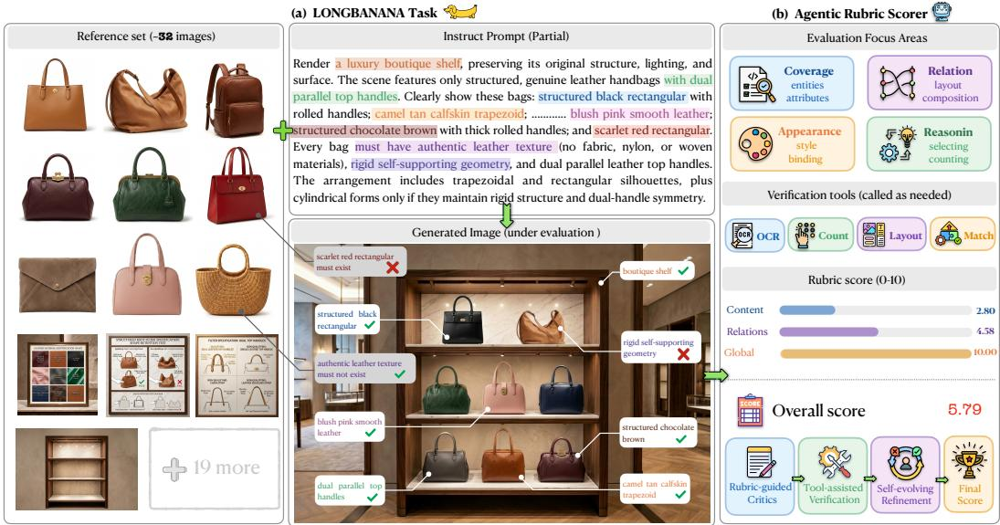  
Figure 1: LONGBANANA task overview. (a) Each case pairs a heterogeneous reference set and structured synthesis prompt with the generated image under evaluation. (b) LONGBANANA-Eval converts graph-grounded checklist items into dimension-level scores and auditable evidence traces. The score labels Content, Relations, and Global denote Content Fidelity, Relational Binding, and Global Constraint Satisfaction, respectively.

Evaluating this capability raises a central question: how can we tell whether an image-generation system has synthesized a correct image from long, multi-reference visual context? The difficulty is not only that such tasks contain more images or longer prompts. The required evidence is distributed across references, entities, attributes, relations, hard negatives, unsupported-content rules, and intermediate decisions. Success can only be judged by checking whether the final image satisfies the reference-grounded obligations. A benchmark therefore needs dense multi-reference tasks and scoring that localizes errors rather than a holistic score.

Current image-generation benchmarks [14, 29] capture important parts of this problem, but leave the full measurement target under-specified. Research on instruction-guided editing, personalization, and prompt following addresses local edits and textual requirements [2, 10, 14, 45, 51, 56]. Recent multi-reference benchmarks move closer to reference-based synthesis [3, 23, 37], and automatic evaluation methods support systematic assessment [39, 47, 53]. What remains difficult to measure is dense evidence use: whether the model selected the right references, rejected plausible distractors, attached attributes and relations to the correct entities, and avoided content that is unsupported by either the instruction or the references. A realistic image can pass a surface-level inspection while failing exactly these obligations.

These failures are typically provenance errors rather than rendering errors, where provenance is the source—a specific reference, or the instruction itself—to which each piece of generated content should be attributed: a system may render the right object category while copying appearance from the wrong reference, place the correct entities while violating their relation, or produce a polished composition that leaks a hard negative into the scene. To make such errors measurable, we model each task as an entity–relation graph. Its nodes are the entities, attributes, and text elements that must (or must not) appear; its edges are the spatial, interaction, ordering, and local-appearance relations that bind those entities; and its whole-graph constraints are scene-level obligations—layout, counts, temporal state, and reference selection—that no single node or edge captures. We refer to a node, an edge, or a whole-graph constraint as a graph unit. These three levels define the three graph-grounded scoring dimensions used throughout the paper: Content Fidelity (node level), Relational Binding (edge level), and Global Constraint Satisfaction (whole-graph level). We derive a checklist of atomic, visually verifiable items, each tied to one graph unit, to localize failures.

To make this benchmark auditable at scale, we design LONGBANANA-Eval, a graph-grounded checklist evaluation pipeline whose scorer LONGBANANAEVAL acts as an agentic checklistjudge (Section 3): rather than judging the final image with one undifferentiated score, it routes each checklist item to a rubric-guided critic, invokes deterministic tools—OCR, counting, layout, and identity checks—when an item benefits from an executable check, and records evidence traces for quality control and reproducibility. We validate this measurement target on a human-audited pool of 900 generated outputs with 46,700 reviewed checklist labels. An independently double-labeled subset of 7,005 labels (15%) reaches 89.4% exact agreement and 0.83 quadratic weighted κ, and these reviewed expert checklist scores serve as the reference standard against which we validate LONGBANANAEVAL.

We also use LONGBANANA to study agent-driven image-generation workflows. Each system wraps a fixed image generator in an agent harness [30, 40, 54]: the harness maintains reference state, selects evidence, schedules prompts, invokes the generator, and revises requests, while the image generator only synthesizes pixels. We evaluate direct generation, minimal agent harnesses, and RPRenabled harnesses, where RPR is a serial workflow combining ReAct evidence grounding, Plan–Exec decomposition, and Reflect-based revision (Section 4), and we compare multiple image generators under a fixed harness. Across these settings, agent harnesses improve the aggregate profile over direct generation, yet no single harness dominates: the best per-subclass scores remain distributed across direct prompting, minimal harnesses, and RPR. RPR itself yields harness-dependent gains, helping only when the harness reliably exploits retrieved evidence and revision feedback, and otherwise introducing drift.

## Contributions

• Benchmark setting and dataset. We introduce LONGBANANA-Bench for long-context multi-reference image synthesis, with 90 expert-designed cases, dense references, hard negatives, unsupported-content rules, and a 3 × 3 taxonomy.

• Graph-grounded evaluation. We introduce LONGBANANA-Eval, mapping entity–relation graphs to atomic checklist items over Content Fidelity, Relational Binding, and Global Constraint Satisfaction.

• Expert verification and audit protocol. We provide reviewed expert checklist labels, agreement statistics, evidence traces, and scorer validation against human labels.

• Agent-driven generation study. We evaluate direct, harness-based, and RPR workflows to show that current systems fail in structured, diagnosable ways rather than along a single image-quality axis.

## 2 The LONGBANANA Benchmark

## 2.1 Goal and Scope

LONGBANANA is an evaluation benchmark for long-horizon multi-reference image synthesis. A system is given a heterogeneous reference set and a structured synthesis instruction, and must render one coherent image that satisfies the obligations of the task’s entity–relation graph (Section 1): its required and forbidden nodes, the edges that bind them, and the whole-graph constraints on the scene. The setting differs from low-reference editing because the decisive evidence is distributed across many images, and correctness is measured by the graph-derived checklist of atomic, visually verifiable items rather than by a single holistic quality score. LONGBANANA contains 90 cases: 10 cases for each subclass in a 3 × 3 taxonomy. A typical case contains approximately 32 references and more than 20 cross-reference constraints, and across the benchmark experts specify 4,670 atomic checklist items. Because every item is tied to a single graph unit, each failure is localized to a specific obligation rather than absorbed into an overall score.

## 2.2 Task Taxonomy and Evaluation Rubric

We organize LONGBANANA tasks into a three-suite taxonomy that captures their primary synthesis demands (Figure 2). Across these tasks, a shared graph-grounded rubric evaluates whether the generated image preserves the required content, relations, and scene-level constraints.

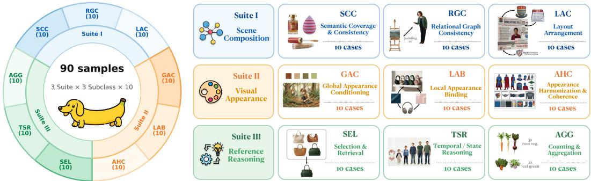  
Figure 2: The 3 × 3 taxonomy used to organize LONGBANANA. Rows group cases into Scene Composition, Visual Appearance, and Reference Reasoning, while columns expose subclass-level demands used for diagnostic reporting. Each subclass contributes 10 cases.

The three suites are Scene Composition (semantic coverage, relational graph consistency, and layout arrangement), Visual Appearance (global appearance conditioning, local appearance binding, and appearance harmonization), and Reference Reasoning (selection and retrieval, temporal/state reasoning, and counting/aggregation). All tasks require a final image output; subclasses differ in the evidence-integration behavior being tested.

For each case, checklist items assess correctness at three levels of the entity–relation graph: nodes, edges, and the whole graph. Content Fidelity measures node-level correctness: required entities, attributes, text elements, and supported semantic nodes must appear, while forbidden or unsupported nodes must be absent. Relational Binding measures edge-level correctness, including spatial relations, interactions, ordering, support, containment, and local bindings such as texture, material, color, pose, or state assigned to a specific entity. Global Constraint Satisfaction measures whole-graph correctness, including composition, layout, scene-level style, count and aggregation constraints, temporal/state constraints, and reference-selection constraints.

This graph-grounded rubric localizes failures to specific content, bindings, or scene-level obligations, supporting consistent diagnosis across task categories and generation systems.

## 2.3 Benchmark Construction

We construct each case around a shared entity–relation graph that connects the synthesis instruction, reference images, and evaluation checklist (Figure 3). Construction proceeds from a scenario description to structured constraints, then to the visual references and instruction that express the task, and finally to the checklist used to evaluate its result.

Scenario and graph construction. Expert authors design scenarios aligned with the task taxonomy, drawing on storyboard, product, and scene-composition use cases. A scenario specifies what the final image should depict and which entities, visual attributes, and interactions must be preserved. An LLM then structures the scenario into an entity–relation graph: nodes represent entities and their attributes, edges encode spatial relations, interactions, and local appearance bindings, and whole-graph constraints specify requirements such as composition and counts. This representation makes the dependencies explicit. For example, an appearance requirement identifies both the visual property and the entity to which it belongs, while a relational requirement identifies the entities that must participate in the requested configuration. These constraints guide both task synthesis and checklist derivation.

Instruction and reference construction. The graph guides the creation of the target instruction and reference images, including entity, appearance, and optional background references. The instruction expresses the requested composition and the relationships to be realized; the references supply the visual identities, local details, and appearance cues needed to instantiate it. Discriminative visual attributes are retained in the references and omitted from text where possible. Because these cues are distributed across images, the generator must associate each relevant reference with the intended graph entity and combine their evidence while maintaining the requested relations. At least 30 cases also include two or more hard-negative references that are visually plausible but irrelevant to the requested output. Their exclusion is encoded in the checklist, allowing distractor leakage to be assessed alongside the inclusion of required content.

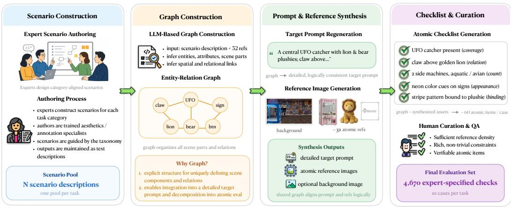  
Figure 3: LONGBANANA construction pipeline. (1) Scenario Construction: experts design scenarios aligned with the task taxonomy. (2) Graph Construction: an LLM structures each scenario into entities, attributes, relations, and whole-scene constraints. (3) Prompt & Reference Synthesis: the graph guides the creation of the target instruction and visual references. (4) Checklist & Curation: graph constraints are translated into evidence-linked checklist items, and human curators review the instruction, references, and checklist for consistency, visual feasibility, and verifiability.

Checklist derivation. We translate graph constraints into atomic checklist items using the rubric introduced in Section 2.2. Node-level items check required entities and attributes; edge-level items check relations and appearance bindings; whole-graph items check scene-wide requirements such as layout and counts. Each item records an observable condition, the graph unit it evaluates, the relevant reference images, and its scoring criteria. This links a judgment about the output to the evidence needed to make it. Positive items test whether a required condition is satisfied, while negative items check for the absence of distractor or unsupported content. Each completed case therefore pairs an instruction and reference set with a checklist derived from the same task constraints. Section 3 describes how these items are scored.

Case curation. Human curators review the instruction, reference images, and checklist together, checking their correspondence to the task graph. They inspect whether the references visibly support the required identities and attributes, whether the requested relations and composition are visually feasible, and whether checklist items express clear, individually verifiable conditions. They also check reference density, constraint coverage, and overlapping or ambiguous items. Requirements that cannot be judged from the references and a candidate output are revised or rejected before inclusion. Appendix B provides the detailed construction protocol and case specifications. Section 4 describes human labeling of generated outputs to establish reference judgments for evaluator validation.

## 3 LONGBANANA-Eval: Graph-Grounded Checklist Evaluation

LONGBANANA-Eval evaluates a generated image against the case’s graph-derived checklist. Its agentic checklist judge, LONGBANANAEVAL, prepares item-specific reference evidence, routes each check to a dimension-specific critic, and combines the resulting judgments into dimension-level and overall scores. As shown in Figure 4, the pipeline also records the evidence supporting each item judgment.

## 3.1 Checklist Scoring Protocol

Evidence preparation and routing. For each item, the parser reads the condition to verify, its rubric dimension, reference identifiers, and scoring criteria from the case specification. It assembles the generated image and relevant reference images into an evidence packet, with optional crops to localize the region under inspection. Negative-content checks additionally receive the identifiers and roles of applicable hard-negative references. The router assigns the packet to the critic corresponding to the item’s rubric dimension.

Dimension-specific checks and tools. The Content Fidelity critic checks required entities, attributes, and text, together with the absence of forbidden or distractor content. The Relational Binding critic checks spatial and interaction relations and the assignment of local appearance cues to their intended entities. The Global Constraint Satisfaction critic checks scene-wide requirements, including layout, global style, counts, and temporal or state constraints. Each critic compares the output with the item’s reference evidence and may invoke verification tools: OCR for readable text, detection or counting for multiplicity, layout routines for spatial constraints, and identity or feature matching for consistency. The critic combines these observations with the visual evidence to determine whether the item is satisfied.

Item judgments and evidence traces. Each check produces a label $s _ { j } \in \{ 0 , 1 , 2 \}$ : 2 for a satisfied requirement, 1 for partial satisfaction or uncertain evidence, and 0 for an unsatisfied requirement. For negative items, the requirement is the absence of forbidden or unsupported content: complete absence scores 2, ambiguous or suspicious leakage scores 1, and clear erroneous appearance scores 0. The evidence trace associates the label with the relevant references, the critic’s findings, and any tool observations. Traces are organized by the same three rubric dimensions, linking each reported judgment to the evidence used to reach it.

Score aggregation. For a generated image with N checklist items, the overall score is the mean item label scaled to 0–10. Dimension scores apply the same calculation to the item set $J _ { d }$ assigned to dimension d:

$$
S _ { \mathrm { o v e r a l l } } = \frac { 5 } { N } \sum _ { j = 1 } ^ { N } s _ { j } , \qquad S _ { d } = \frac { 5 } { | J _ { d } | } \sum _ { j \in J _ { d } } s _ { j } .
$$

The dimension scores provide a diagnostic profile, while the overall score summarizes the full checklist. The main generation tables express checklist-average scores on a 0–100 scale; Section 4 separately defines the difficulty-weighted task pass rate, P@70%.

Baseline and validation. The VLM-as-judge baseline receives the generated image, relevant references, and checklist in a single judging call and returns item labels for the same score aggregation. It shares the judging backbone and item-level criteria with LONGBANANAEVAL, whose execution organizes evidence and tool use around individual checks. Section 4 evaluates both judges against reviewed human labels at the item and output-score levels; implementation details appear in Appendix C.

## 4 Experiments

Our experiments connect evaluator validation with a study of long-context image generation. We first establish agreement between automatic checklist judgments and reviewed human labels. We then ask how much explicit graph structure helps a non-agentic generator, what adaptive agentic workflows add beyond an optimized static plan, and how those gains interact with the image backend.

## 4.1 Protocol and Metrics

Generation conditions. We evaluate all systems on the held-out 90-case LONGBANANA benchmark. Table 2 fixes Nano Banana 2 and compares two direct baselines, three minimal agent harnesses, and their RPR-enabled variants. Table 3 fixes OpenClaw + RPR and compares three image backends. The shared OpenClaw + RPR with Nano Banana 2 configuration connects the two comparisons, yielding ten distinct generation conditions.

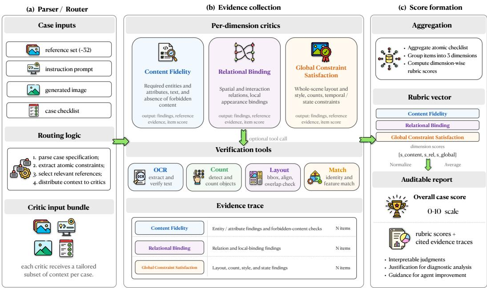  
Figure 4: LONGBANANA-Eval scoring pipeline. The parser assembles item-specific reference evidence and routes each check to one of three rubric critics. Critics inspect the evidence, call verification tools as needed, and return item labels with supporting traces. Item labels are averaged to produce dimension-level and overall scores.

FP-Direct (full-prompt direct) keeps the full target prompt fixed and slides an eight-reference window over the inventory. PD-Direct (prompt-decomposed direct) tests how far non-agentic generation can go with explicit task structure and optimal composition scheduling. We give it privileged access to the entity–relation graph used to construct each case, including entity-to-reference correspondences. Under the same eight-reference backend budget as FP-Direct, it batches graph nodes and constructs relation-aware prompts. Its prompts expose relations incident to each batch, and each generated intermediate becomes the input for the next composition step. Integer programming solves the staging schedule exactly: first maximize relations whose anchors are composed no later than their dependents, then minimize total relational stretch $\textstyle \sum _ { ( u , v ) \in E } | b ( u ) - b ( v )$ |, where b(·) is the batch index. PD-Direct thus exploits the construction graph through a fixed, optimized execution plan; the agentic systems do not receive this graph or the evaluation checklist.

The agentic conditions use Hermes-Agent, OpenCode, and OpenClaw, with Claude Sonnet 4.6 as their shared agent model. A minimal harness maintains reference state, organizes prompts, calls the image backend, and records revisions. RPR coordinates three stages: ReAct retrieves and reasons over reference evidence; Plan–Exec decomposes the grounded request into generation or editing steps; and Reflect lets the agent inspect drafts and decide on further retrieval or revision. Appendix D provides the direct-baseline and workflow implementations.

Human reference labels. The human evaluation pool (the audit pool) covers all 90 benchmark cases under 10 generation conditions, yielding 90 × 10 = 900 generated outputs. The case-specific checklists contain 4,670 items in total across the 90 cases. Applying each case’s checklist to its outputs under all 10 conditions produces 4,670 × 10 = 46,700 item-level judgments, for which human annotators provide reviewed labels.

Human labels undergo primary annotation, second-pass review, and expert adjudication. To assess annotator consistency, 15% of the item-level judgments—46,700 × 0.15 = 7,005—receive independent labels from two annotators. On this subset, exact label agreement is 89.4%, and quadratic weighted κ is 0.83. Appendix B provides the annotation protocol, audit-correction results, and rank-stability analyses.

Generation scoring. The subclass and Overall Avg. columns measure the extent of constraint satisfaction through the unweighted checklist-average score. Each item label $s _ { j } ~ \in ~ \{ 0 , 1 , 2 \}$ is normalized as $r _ { j } ~ = ~ s _ { j } / 2 .$ , and the mean normalized label over the relevant checklist items is expressed on a 0–100 scale. The subclass columns follow the nine task categories; Content Fidelity, Relational Binding, and Global Constraint Satisfaction provide the complementary item-level grading axis.

P@70% measures task-level coverage: the percentage of the 90 case–subclass tasks whose difficultyweighted score reaches 70. Each case contributes one task in its primary subclass. For strategy a and task $t ,$

$$
\mathrm { T a s k S c o r e } ( a , t ) = 1 0 0 \cdot \frac { \sum _ { j \in t } w _ { j } r _ { a , j } } { \sum _ { j \in t } w _ { j } } .
$$

For the main comparisons, each item’s difficulty weight $w _ { j }$ is computed once from human scores for a fixed reference-system pool, versioned, and held fixed for subsequent systems. The overall average therefore summarizes checklist fulfillment, while P@70% highlights how often a system reaches the task-level threshold with greater emphasis on difficult requirements. Together, they reveal whether an improvement is spread across checklist items or carries more tasks past the threshold. Appendix C.4 specifies the weighting rule and aggregation details.

## 4.2 Evaluator Validation

Judge–human agreement. Table 1 compares the single-pass VLM-as-judge baseline and LONG-BANANAEVAL, our agentic checklist judge, against the 900 audit-pool outputs with 46,700 reviewed human labels. Both judges use Gemini 3 Flash and produce item labels under the scoring protocol of Section 3. We report Pearson, Spearman, and Kendall correlations between judge checklist-derived overall scores $\hat { s } _ { o }$ and reviewed expert overall scores $s _ { o } .$ Because this pool covers every case and every reported generation condition, these agreement measures test whether automatic judges preserve expert score trends across the complete reported output set, and provide the validation basis for reporting LONGBANANAEVAL machine scores in Tables 2 and 3.

Table 1: Judge–human agreement on the fully covered 90-case LONGBANANA audit pool. Correlations compare each judge’s checklist-average output-level Overall score with the reviewed human Overall score; higher values indicate closer alignment.
<table><tr><td>Judge</td><td>Pearson</td><td>Spearman</td><td>Kendall</td></tr><tr><td>VLM-as-judge</td><td>0.8413</td><td>0.8248</td><td>0.6437</td></tr><tr><td>LONGBANANAEvAL (agentic checklist judge)</td><td>0.8707</td><td>0.8602</td><td>0.6727</td></tr></table>

The agentic checklist judge achieves higher agreement on all three output-level correlation measures. At the item level, it also increases exact ternary agreement by 15.82 percentage points and reduces opposite-end $0  2$ errors by 19.28 points (Table 10). Output-level correlations establish closer alignment with expert score trends, while the item-level comparison shows improved decisions about individual requirements. These complementary results support using LONGBANANAEVAL to measure generation performance and produce evidence-linked diagnostic reports.

## 4.3 Generation Results and Analysis

Generation result pattern. Table 2 establishes PD-Direct as a strong non-agentic baseline. Graphinformed staging substantially improves on FP-Direct, with the best Global Appearance Conditioning (GAC) score and the second-best Layout Arrangement Consistency (LAC) score across all compared systems. Its improvements also extend to local appearance binding, reference selection, and aggregation. These results demonstrate the practical value of exploiting known task structure: organizing entities and their relations into a precomputed composition schedule can support competitive multireference synthesis. The direct baseline remains competitive on these subclasses even against systems equipped with retrieval and reflection. PD-Direct’s strengths make the subsequent agentic comparison meaningful, since its task structure is supplied directly and its scheduling objective is solved exactly.

Agentic systems nevertheless achieve broader success without direct access to the construction graph. Most agentic configurations exceed PD-Direct in overall average, and OpenClaw + RPR surpasses it on eight of nine subclasses, with a 3.8-point average-score gain and a 12.2-percentage-point gain in task pass rate. This advantage reaches beyond scene composition to reference selection, state reasoning, and aggregation. The comparison exposes a gap between knowing the intended constraint structure and realizing it through successive image-generation steps. The graph specifies desired relations, while intermediate images reveal which constraints have actually survived the latest generation step. A fixed graph schedule organizes what should be composed; adaptive workflows can additionally inspect evidence, maintain reference bindings, and revise execution as synthesis unfolds. Their advantage over a structurally privileged baseline provides strong evidence for the value of agentic orchestration in long-context image generation.

Table 2: Harness and workflow comparison on the held-out 90-case LONGBANANA benchmark. The foundation image model is fixed to Nano Banana 2, and the compared component is the generation harness/workflow. Subclass columns and Overall Avg. report the unweighted checklist-average score (0–100); P@70% is the difficulty-weighted task pass rate. Higher is better for all reported metrics. Boldface and underlining mark the best and second-best values in each column.
<table><tr><td>Image generator= Nano Banana2</td><td colspan="3">Scene Composition</td><td colspan="3">Visual Appearance</td><td colspan="3">Reference Reasoning</td><td colspan="2">Overall</td></tr><tr><td>Strategy ↓</td><td colspan="3">SCC RGC</td><td colspan="3">GAC LAB AHC</td><td colspan="3">SEL TSR</td><td colspan="2">Avg. P@70%</td></tr><tr><td></td><td></td><td></td><td>LAC</td><td></td><td></td><td></td><td></td><td></td><td>AGG</td><td></td><td></td></tr><tr><td colspan="10">Direct generation with Nano Banana 2</td><td></td><td></td><td></td></tr><tr><td>FP-Direct PD-Direct</td><td>69.6 69.9</td><td>61.8</td><td>62.0</td><td>88.7</td><td>77.5 87.0</td><td>71.1 72.1</td><td>56.4 68.5</td><td>73.4 67.2</td><td>55.1 83.6</td><td>68.4 74.6</td><td>24.4 35.6</td></tr><tr><td></td><td></td><td>61.9</td><td>62.6</td><td>98.8</td><td></td><td></td><td></td><td></td><td></td><td></td><td></td></tr><tr><td colspan="10">Agent harness + Nano Banana 2</td><td colspan="3"></td></tr><tr><td>1Hermes-Agent</td><td>70.1</td><td>61.5</td><td>57.9</td><td>93.2</td><td>87.2</td><td>65.4</td><td>72.1</td><td>75.1</td><td>83.1</td><td>73.9</td><td>43.3</td></tr><tr><td>OpenCode</td><td>71.9</td><td>62.3</td><td>62.1</td><td>96.3</td><td>90.1</td><td>74.2</td><td>75.4</td><td>77.8</td><td>85.2</td><td>77.3</td><td>47.8</td></tr><tr><td>OpenClaw</td><td>71.8</td><td>63.3</td><td>60.8</td><td>96.8</td><td>88.3</td><td>74.7</td><td>70.3</td><td>78.7</td><td>80.3</td><td>76.1</td><td>40.0</td></tr><tr><td colspan="10">Agent harness + RPR + Nano Banana 2</td></tr><tr><td>Hermes-Agent + RPR</td><td>72.0</td><td>64.0</td><td>61.0</td><td>94.5</td><td>85.5</td><td>69.5</td><td>71.9</td><td>76.1</td><td>86.2</td><td>75.6</td><td>35.6</td></tr><tr><td>OpenCode + RPR</td><td>76.3</td><td>64.6</td><td>64.1</td><td>92.6</td><td>86.8</td><td>78.2</td><td>75.5</td><td>76.5</td><td>85.3</td><td>77.8</td><td>43.3</td></tr><tr><td>OpenClaw + RPR</td><td>76.1</td><td>64.5</td><td>64.1</td><td>97.1</td><td>88.6</td><td>75.6</td><td>79.8</td><td>73.6</td><td>86.4</td><td>78.4</td><td>47.8</td></tr></table>

Within the agentic configurations, RPR gives OpenClaw the strongest overall average and a joint-best task pass rate. Its clearest improvements over the minimal harness occur in scene composition, reference selection, and aggregation, consistent with a workflow that links evidence acquisition to execution and repair. The minimal OpenClaw harness remains stronger on temporal and state reasoning. OpenCode and Hermes-Agent also improve their average scores with RPR, while their task pass rates decline. These profiles identify reliable coordination as the next design priority: retrieved evidence must remain attached to the correct entities and constraints through planning, generation, and revision.

Workflow component analysis. The RPR ablation in Table 11 isolates retrieval, planning, and reflection with OpenClaw and Nano Banana 2 fixed. Plan–Exec alone is strongest on global appearance conditioning and local appearance binding; ReAct alone improves reference selection over the minimal harness; and Reflect alone improves layout, aggregation, and task pass rate. The full workflow achieves the strongest overall result and pass rate among the component variants.

These profiles give a concrete direction for agent design. Evidence retrieval supplies the relevant references, planning organizes their use, and reflection checks the realized composition against the task. Their combined workflow turns these operations into a coordinated generation process, extending the benefits of decomposition with evidence inspection and feedback. The component results reinforce the main comparison: static organization is useful, and its integration with grounding and repair produces the strongest overall configuration in this study.

Image-backend comparison. With OpenClaw + RPR fixed, Nano Banana 2 leads across all nine subclasses (Table 3). Seedream 4 is stronger than GPT Image 1 on scene composition, temporal and state reasoning, and aggregation, whereas GPT Image 1 is more competitive on visual appearance and reference selection. The fixed workflow makes these differences informative about each backend’s ability to realize reference-grounded instructions.

Table 3: Foundation image-model comparison on the same 90-case LONGBANANA benchmark. The generation harness/workflow is fixed to OpenClaw + RPR, and the compared component is the foundation image model. Subclass columns and Overall Avg. use the same unweighted checklistaverage score as Table 2 (0–100); P@70% is the difficulty-weighted task pass rate. Higher is better for all reported metrics. Boldface and underlining mark the best and second-best values in each column.
<table><tr><td>Strategy =</td><td colspan="3"></td><td colspan="3"></td><td colspan="3"></td><td colspan="2"></td></tr><tr><td>OpenClaw + RPR</td><td colspan="3">Scene Composition</td><td colspan="3">Visual Appearance</td><td colspan="3">Reference Reasoning</td><td colspan="2">Overall</td></tr><tr><td>Image generator ↓</td><td>SCC</td><td>RGC</td><td>LAC</td><td>GAC</td><td>LAB</td><td>AHC</td><td>SEL</td><td>TSR</td><td>AGG</td><td>Avg.</td><td>P@70%</td></tr><tr><td>Seedream 4</td><td>60.0</td><td>52.6</td><td>51.2</td><td>92.3</td><td>82.0</td><td>46.6</td><td>50.9</td><td>67.8</td><td>68.7</td><td>63.6</td><td>18.9</td></tr><tr><td>GPT Image 1</td><td>54.3</td><td>47.1</td><td>49.3</td><td>94.0</td><td>87.2</td><td>47.4</td><td>54.0</td><td>62.1</td><td>60.5</td><td>61.8</td><td>17.8</td></tr><tr><td>GNano Banana 2</td><td>76.1</td><td>64.5</td><td>64.1</td><td>97.1</td><td>88.6</td><td>75.6</td><td>79.8</td><td>73.6</td><td>86.4</td><td>78.4</td><td>47.8</td></tr></table>

Backend capability and agentic orchestration offer complementary paths to improvement. The harness controls evidence selection, constraint organization, and revision, while the image model determines how faithfully these decisions become pixels. A stronger workflow improves the use of the available visual evidence; a stronger backend improves its realization in the generated image. The broad Nano Banana 2 advantage shows that backend capability remains consequential even under the strongest evaluated workflow.

Diagnostic implications. The comparison with PD-Direct highlights the distinction between planning a composition and controlling its realization. PD-Direct uses privileged graph information to optimize reference grouping and ordering, then executes that schedule in stages. The resulting images can still depart from the intended constraints as entities are added or edited. Agentic workflows can inspect intermediate outputs, revisit reference evidence, and adjust subsequent actions. Their broader advantage motivates treating the evolving visual state, alongside the task structure, as central to generation control.

The checklist turns this control problem into inspectable requirements. PD-Direct’s strong appearance conditioning alongside its weaker reference selection and state reasoning directs attention to evidence use across composition steps. Item judgments and evidence traces can distinguish an incorrect reference choice from an incorrect entity binding or an unmet scene-wide requirement. For future agent designs, these diagnostics offer a basis for choosing what to revisit and what to preserve during revision. The resulting research target is evidence-guided adaptation: connect inspection of the current image to the next retrieval, generation, or repair action while preserving satisfied constraints.

Further analyses. Appendix D reports the workflow ablation and case-paired score diagnostics. The generation comparisons, component study, and item-level traces together connect aggregate performance to the decisions made during synthesis, providing a basis for developing more capable reference-grounded image-generation agents.

## 5 Conclusion

LONGBANANA establishes long-context multi-reference image synthesis as a benchmark for integrating dispersed visual evidence, rejecting distractors, and satisfying coupled content and relational constraints. LONGBANANA-Bench provides 90 expert-designed and expert-verified cases across a 3 × 3 taxonomy, with 4,670 atomic checklist items. LONGBANANA-Eval turns these constraints into evidence-linked judgments, validated against human labels, to measure constraint fulfillment and localize generation failures.

The generation study highlights the distinction between optimizing a composition plan and adaptively controlling its realization. PD-Direct combines privileged access to the construction graph with exactly optimized staging, establishing a competitive non-agentic baseline. Agentic workflows achieve broader success without direct access to that graph, showing the value of adaptive evidence use and generation control beyond a fixed schedule. The RPR component study further supports coordinating retrieval, execution, and repair within one workflow. These findings point toward agents that reason over both task structure and the evolving visual state, preserve reference bindings across steps, and target unmet requirements during revision.

## Acknowledgments and Disclosure of Funding

This work was supported by the Guangdong Basic and Applied Basic Research Foundation (Grant No. 2024A1515140109), the Youth S&T Talent Support Programme of the Guangdong Provincial Association for Science and Technology (Grant No. SKXRC2026779), and KlingAI Research.

The authors declare no competing interests beyond the affiliations and funding disclosed in this paper.

## References

[1] Yushi Bai, Xin Lv, Jiajie Zhang, Hongchang Lyu, Jiankai Tang, Zhidian Huang, Zhengxiao Du, Xiao Liu, Aohan Zeng, Lei Hou, et al. Longbench: A bilingual, multitask benchmark for long context understanding. In Proceedings of the 62nd annual meeting of the association for computational linguistics (volume 1: Long papers), pages 3119–3137, 2024.

[2] Haoxiang Cao, Jiajiong Cao, Xuanpu Zhang, Changqian Yu, and Chaoqun Wang. Dars: Duallevel credit assignment rl with structured reasoning for instruction-based image editing, 2026. URL https://arxiv.org/abs/2608.20161.

[3] Ruoxi Chen, Dongping Chen, Siyuan Wu, Sinan Wang, Shiyun Lang, Peter Sushko, Gaoyang Jiang, Yao Wan, and Ranjay Krishna. Multiref: Controllable image generation with multiple visual references. In Proceedings ofthe 33rd ACM International Conference on Multimedia, pages 13325–13331, 2025.

[4] Yufeng Cui, Honghao Chen, Haoge Deng, Xu Huang, Xinghang Li, Jirong Liu, Yang Liu, et al. Emu3.5: Native multimodal models are world learners. CoRR, abs/2510.26583, 2025.

[5] Jinlan Fu, See Kiong Ng, Zhengbao Jiang, and Pengfei Liu. Gptscore: Evaluate as you desire. In Proceedings ofthe 2024 Conference ofthe North American Chapter ofthe Associationfor Computational Linguistics: Human Language Technologies (Volume 1: Long Papers), pages 6556–6576, 2024.

[6] Jiahao Guo, Sinan Du, Jingfeng Yao, Wenyu Liu, Bo Li, Haoxiang Cao, Kun Gai, Chun Yuan, Kai Wu, and Xinggang Wang. Visual generation tuning, 2025. URL https://arxiv.org/ abs/2511.23469.

[7] Xuan He, Dongfu Jiang, Ping Nie, Minghao Liu, Zhengxuan Jiang, Mingyi Su, Wentao Ma, Junru Lin, Chun Ye, Yi Lu, Keming Wu, Benjamin Schneider, Quy Duc Do, Zhuofeng Li, Yiming Jia, Yuxuan Zhang, Guo Cheng, Haozhe Wang, Wangchunshu Zhou, Qunshu Lin, Yuanxing Zhang, Ge Zhang, Wenhao Huang, and Wenhu Chen. Videoscore2: Think before you score in generative video evaluation, 2025. URL https://arxiv.org/abs/2509.22799.

[8] Xuan He, Cong Wei, Yuhao Cheng, Linrui Ma, Yuxuan Zhang, Zuojun Li, Yuhao Wen, Jize Jiang, Zeyi Liu, Yuren Hao, Songcheng Cai, Keming Wu, Penghui Du, Kai Zou, Rui Yang, Chenkai Sun, Ke Yang, Ping Nie, Kelsey R Allen, Chenglong Wang, Michel Galley, Jianfeng Gao, and ChengXiang Zhai. Vgi-bench: Probing visual intelligence in video generation models, 2026. URL https://arxiv.org/abs/2608.19583.

[9] Ting-Yao Hsu, Chieh-Yang Huang, Ryan Rossi, Sungchul Kim, C Giles, and Ting-Hao Huang. Gpt-4 as an effective zero-shot evaluator for scientific figure captions. In Findings of the Association for Computational Linguistics: EMNLP 2023, pages 5464–5474, 2023.

[10] Xiwei Hu, Rui Wang, Yixiao Fang, Bin Fu, Pei Cheng, and Gang Yu. Ella: Equip diffusion models with llm for enhanced semantic alignment. arXiv preprint arXiv:2403.05135, 2024.

[11] Yushi Hu, Benlin Liu, Jungo Kasai, Yizhong Wang, Mari Ostendorf, Ranjay Krishna, and Noah A. Smith. Tifa: Accurate and interpretable text-to-image faithfulness evaluation with question answering. In Proceedings ofthe IEEE/CVF International Conference on Computer Vision (ICCV), pages 20406–20417, 2023.

[12] Anil K Jain. Fundamentals ofdigital image processing. Prentice-Hall, Inc., 1989.

[13] Joseph James. Counting on consensus: Selecting the right inter-annotator agreement metric for nlp annotation and evaluation. arXiv preprint arXiv:2603.06865, 2026.

[14] Zhangqi Jiang, Zheng Sun, Xianfang Zeng, Yufeng Yang, Xuanyang Zhang, Yongliang Wu, Wei Cheng, Gang Yu, Xu Yang, and Bihan Wen. Geditbench v2: A human-aligned benchmark for general image editing. arXiv preprint arXiv:2603.28547, 2026.

[15] Seungone Kim, Juyoung Suk, Shayne Longpre, Bill Yuchen Lin, Jamin Shin, Sean Welleck, Graham Neubig, Moontae Lee, Kyungjae Lee, and Minjoon Seo. Prometheus 2: An open source language model specialized in evaluating other language models. In Proceedings of the 2024 Conference on Empirical Methods in Natural Language Processing, pages 4334–4353, 2024.

[16] Black Forest Labs, Stephen Batifol, Andreas Blattmann, Frederic Boesel, Saksham Consul, et al. FLUX.1 kontext: Flow matching for in-context image generation and editing in latent space. CoRR, abs/2506.15742, 2025.

[17] Wenhao Li, Zimeng Wu, Yu Wu, Zehua Fu, and Jiaxin Chen. Visual prototype conditioned focal region generation for uav-based object detection. arXiv preprint arXiv:2604.02966, 2026.

[18] Pengyiang Liu, Junbo Niu, Xiaoyang Hu, Zhongyue Shi, Zitian Wang, Linjiang Huang, and Si Liu. Trace: Temporal retrieval with anchored and convergent evidence for long-horizon video understanding. In Proceedings ofthe 2026 Conference on Empirical Methods in Natural Language Processing, pages 59693–59708, 2026.

[19] Pengyiang Liu, Zhongyue Shi, Hongye Hao, Qi Fu, Xueting Bi, Siwei Zhang, Xiaoyang Hu, Zitian Wang, Linjiang Huang, and Si Liu. Svcbench: A streaming video counting benchmark for spatial-temporal state maintenance. In European Conference on Computer Vision, pages 522–538. Springer, 2026.

[20] Runzhou Liu, Hailey Weingord, Sejal Mittal, Prakhar Dungarwal, Anusha Nandula, Bo Ni, Samyadeep Basu, Hongjie Chen, Nesreen K Ahmed, Li Li, et al. Human-aligned mllm judges for fine-grained image editing evaluation: A benchmark, framework, and analysis. arXiv preprint arXiv:2602.13028, 2026.

[21] Xin Luo, Jiahao Wang, Chenyuan Wu, Shitao Xiao, Xiyan Jiang, Defu Lian, Jiajun Zhang, Dong Liu, et al. Editscore: Unlocking online rl for image editing via high-fidelity reward modeling. arXiv preprint arXiv:2509.23909, 2025.

[22] Yiwei Ma, Jiayi Ji, Ke Ye, Weihuang Lin, Zhibin Wang, Yonghan Zheng, Qiang Zhou, Xiaoshuai Sun, and Rongrong Ji. I2ebench: A comprehensive benchmark for instruction-based image editing. Advances in Neural Information Processing Systems, 37:41494–41516, 2024.

[23] Yuta Oshima, Daiki Miyake, Kohsei Matsutani, Yusuke Iwasawa, Masahiro Suzuki, Yutaka Matsuo, and Hiroki Furuta. Multibanana: A challenging benchmark for multi-reference text-to image generation. arXiv preprint arXiv:2511.22989, 2025.

[24] Yulin Pan, Xiangteng He, Chaojie Mao, Zhen Han, Zeyinzi Jiang, Jingfeng Zhang, and Yu Liu. Ice-bench: A unified and comprehensive benchmark for image creating and editing. In Proceedings ofthe IEEE/CVF International Conference on Computer Vision, pages 16586–16596, 2025.

[25] Karl Pearson. Vii. mathematical contributions to the theory of evolution.—iii. regression, heredity, and panmixia. Philosophical Transactions ofthe Royal Society ofLondon. Series A, containing papers ofa mathematical or physical character, 187:253–318, 1896.

[26] Hao Peng, Yunjia Qi, Xiaozhi Wang, Zijun Yao, Bin Xu, Lei Hou, and Juanzi Li. Agentic reward modeling: Integrating human preferences with verifiable correctness signals for reliable reward systems. In Proceedings of the 63rd Annual Meeting of the Association for Computational Linguistics (Volume 1: Long Papers), pages 15934–15949, 2025.

[27] Yongchang Peng, Qingshui Gu, Liya Zhu, Ge Zhang, Duo Wang, Haodong Wang, Jingzhe Ding, Tianhao Yu, Letian Gao, Yongjie Zhong, et al. xdailybench: Benchmarking llms on professional consultation for real-life problems. arXiv preprint arXiv:2609.07784, 2026.

[28] Nataniel Ruiz, Yuanzhen Li, Varun Jampani, Yael Pritch, Michael Rubinstein, and Kfir Aberman. Dreambooth: Fine tuning text-to-image diffusion models for subject-driven generation. In Proceedings of the IEEE/CVF conference on computer vision and pattern recognition, pages 22500–22510, 2023.

[29] Shelly Sheynin, Adam Polyak, Uriel Singer, Yuval Kirstain, Amit Zohar, Oron Ashual, Devi Parikh, and Yaniv Taigman. Emu edit: Precise image editing via recognition and generation tasks. In Proceedings ofthe IEEE/CVF Conference on Computer Vision and Pattern Recognition, pages 8871–8879, 2024.

[30] Dingjie Song, Hanrong Zhang, Dawei Liu, Yixin Liu, Zongxia Li, Zhengqing Yuan, Siqi Zhang, Henry Peng Zou, Zhiling Yan, Yuxuan Zhang, et al. Dr. claw: An ai scientist workspace for vibe research. arXiv preprint arXiv:2609.00365, 2026.

[31] C. Spearman. The proof and measurement of association between two things. The American Journal of Psychology, 15(1):72–101, 1904. ISSN 00029556. URL http://www.jstor.org/ stable/1412159.

[32] Alex Su, Haozhe Wang, Weiming Ren, Fangzhen Lin, and Wenhu Chen. Pixel reasoner: Incentivizing pixel space reasoning via curiosity-driven reinforcement learning. In The Thirtyninth Annual Conference on Neural Information Processing Systems, 2025.

[33] Chonghuinan Wang, Zihan Chen, Yuxiang Wei, Tianyi Jiang, Xiaohe Wu, Fan Li, Wangmeng Zuo, and Hongxun Yao. Creval: An automated interpretable evaluation for creative image manipulation under complex instructions. arXiv preprint arXiv:2603.26174, 2026.

[34] Qunzhong Wang, Jie Liu, Jiajun Liang, Yilei Jiang, Yuanxing Zhang, Yaozhi Zheng, Xintao Wang, Pengfei Wan, Xiangyu Yue, and Jiaheng Liu. Vr-thinker: Boosting video reward models through thinking-with-image reasoning. arXiv preprint arXiv:2510.10518, 2025.

[35] Zhou Wang, Alan C Bovik, Hamid R Sheikh, and Eero P Simoncelli. Image quality assessment: from error visibility to structural similarity. IEEE transactions on image processing, 13(4): 600–612, 2004.

[36] Chenfei Wu, Jiahao Li, Jingren Zhou, Junyang Lin, Kaiyuan Gao, Kun Yan, Shengming Yin, et al. Qwen-image technical report. CoRR, abs/2508.02324, 2025.

[37] Chenyuan Wu, Pengfei Zheng, Ruiran Yan, Shitao Xiao, Xin Luo, Yueze Wang, Wanli Li, Xiyan Jiang, Yexin Liu, Junjie Zhou, et al. Omnigen2: Exploration to advanced multimodal generation. arXiv preprint arXiv:2506.18871, 2025.

[38] Keming Wu, Sicong Jiang, Max Ku, Ping Nie, Minghao Liu, and Wenhu Chen. Editreward: A human-aligned reward model for instruction-guided image editing. arXiv preprint arXiv:2509.26346, 2025.

[39] Mingrui Wu, Hang Liu, Jiayi Ji, Xiaoshuai Sun, and Rongrong Ji. Micon-bench: Benchmarking and enhancing multi-image context image generation in unified multimodal models. arXiv preprint arXiv:2602.19497, 2026.

[40] Yuhao Wu, Jingyuan Zhang, Jiajun Shi, Xinping Lei, Qingshui Gu, Yuxuan Zhang, Zexuan Wang, Chen He, Chen Huang, Maojia Song, et al. Harnessdev: Can llms create and evolve their own agent harness? arXiv preprint arXiv:2609.01437, 2026.

[41] Zimeng Wu, Donghao Wang, Chaozhe Jin, Jiaxin Chen, and Yunhong Wang. Probe and skip: Self-predictive token skipping for efficient long-context llm inference. arXiv preprint arXiv:2601.13155, 2026.

[42] Bin Xia, Bohao Peng, Yuechen Zhang, Junjia Huang, Jiyang Liu, Jingyao Li, Haoru Tan, Sitong Wu, Chengyao Wang, Yitong Wang, et al. Dreamomni2: Multimodal instruction-based editing and generation. arXiv preprint arXiv:2510.06679, 2025.

[43] Jialin Yang, Dongfu Jiang, Lipeng He, Sherman Siu, Yuxuan Zhang, Disen Liao, Zhuofeng Li, Huaye Zeng, Yiming Jia, Haozhe Wang, Benjamin Schneider, Chi Ruan, Wentao Ma, Zhiheng Lyu, Yifei Wang, Yi Lu, Quy Duc Do, Ziyan Jiang, Ping Nie, and Wenhu Chen. Structeval: Benchmarking llms’ capabilities to generate structural outputs, 2026. URL https: //arxiv.org/abs/2505.20139.

[44] Yang Yao, Yixu Wang, Yuxuan Zhang, Yi Lu, Tianle Gu, Lingyu Li, Dingyi Zhao, Keming Wu, Haozhe Wang, Ping Nie, Yan Teng, and Yingchun Wang. Dr. bench: A multidimensional evaluation for deep research agents, from answers to reports, 2026. URL https://arxiv. org/abs/2510.02190.

[45] Yang Ye, Xianyi He, Zongjian Li, Bin Lin, Shenghai Yuan, Zhiyuan Yan, Bohan Hou, and Li Yuan. Imgedit: A unified image editing dataset and benchmark. arXiv preprint arXiv:2505.20275, 2025.

[46] Qifan Yu, Wei Chow, Zhongqi Yue, Kaihang Pan, Yang Wu, Xiaoyang Wan, Juncheng Li, Siliang Tang, Hanwang Zhang, and Yueting Zhuang. Anyedit: Mastering unified high-quality image editing for any idea. In Proceedings of the Computer Vision and Pattern Recognition Conference, pages 26125–26135, 2025.

[47] Huaisong Zhang, Hao Yu, Yuxuan Zhang, Jiahe Wang, Xinrui Chen, Haoxiang Cao, Feng Lu, Wendong Zhang, Changqian Yu, and Chun Yuan. Where, what, why, and importance: Structured defect grounding for text-to-image feedback, 2026. URL https://arxiv.org/ abs/2606.06113.

[48] Kai Zhang, Lingbo Mo, Wenhu Chen, Huan Sun, and Yu Su. Magicbrush: A manually annotated dataset for instruction-guided image editing. Advances in Neural Information Processing Systems, 36:31428–31449, 2023.

[49] Richard Zhang, Phillip Isola, Alexei A. Efros, Eli Shechtman, and Oliver Wang. The unreasonable effectiveness of deep features as a perceptual metric. In Proceedings of the IEEE Conference on Computer Vision and Pattern Recognition (CVPR), June 2018.

[50] Xiaoyi Zhang, Zhaoyang Jia, Zongyu Guo, Jiahao Li, Bin Li, Houqiang Li, and Yan Lu. Deep video discovery: Agentic search with tool use for long-form video understanding. arXiv preprint arXiv:2505.18079, 2025.

[51] Xuanpu Zhang, Xuesong Niu, Ruidong Chen, Dan Song, Jianhao Zeng, Penghui Du, Haoxiang Cao, Kai Wu, and An an Liu. Group relative attention guidance for image editing, 2025. URL https://arxiv.org/abs/2510.24657.

[52] Yuxuan Zhang, Yubo Wang, Yipeng Zhu, Penghui Du, Junwen Miao, Xuan Lu, Zhuofeng Li, Xingwei Qu, Zhengkang Guo, Yuanzhe Shen, Dingjie Song, Han Zhou, Tuney Zheng, Xian Wu, Hao Yu, Songcheng Cai, Yi Lu, Yunzhuo Hao, Minyi Lei, Liang Chen, Kai Zou, Huifeng Yin, Wendong Xu, Dongfu Jiang, Ping Nie, Jiaheng Liu, Wenhu Chen, and Kelsey R. Allen. Clawbench: Can ai agents complete everyday online tasks?, 2026. URL https: //arxiv.org/abs/2604.08523.

[53] Yuxuan Zhang, Cong Wei, Penghui Du, Bo Li, Junwen Miao, Huaisong Zhang, Songcheng Cai, Yubo Wang, Dongfu Jiang, Yuyu Zhang, Changqian Yu, Ping Nie, Wenhu Chen, and Kelsey R. Allen. Rewardharness: Self-evolving agentic post-training, 2026. URL https: //arxiv.org/abs/2605.08703.

[54] Zelin Zhao, Xinyu Guo, Jingyuan Zhang, Yuxuan Zhang, and Yongxin Chen. Harnessing llms as agents: What does it cost? arXiv preprint arXiv:2610.02488, 2026.

[55] Jeffrey Zhou, Tianjian Lu, Swaroop Mishra, Siddhartha Brahma, Sujoy Basu, Yi Luan, Denny Zhou, and Le Hou. Instruction-following evaluation for large language models. arXiv preprint arXiv:2311.07911, 2023.

[56] Dawei Zhu, Rui Meng, Yale Song, Xiyu Wei, Sujian Li, Tomas Pfister, and Jinsung Yoon. Paperbanana: Automating academic illustration for ai scientists. arXiv preprint arXiv:2601.23265, 2026.

[57] Liya Zhu, Jingzhe Ding, Jian Zhang, Jianbo Xue, Shihao Liang, Ge Zhang, Yi Zhu, Duju Zeng, Xiang Gao, Qingshui Gu, et al. Workflow-gym: Towards long-horizon evaluation of computer-use agentic tasks in real-world professional fields. arXiv preprint arXiv:2606.11042, 2026.

[58] Liya Zhu, Xin Ma, Tao Liu, Haodong Wang, Ge Zhang, Jingzhe Ding, Qingshui Gu, Yongjie Zhong, Jinxiang Meng, Yuan Gao, et al. Startupbench: Benchmarking general-purpose agents on market-validated end-to-end workflows. arXiv preprint arXiv:2608.17800, 2026.

## Appendix Contents

1. Appendix A: Related work. Image-synthesis benchmarks, atomic constraint evaluation, and automatic judges.

2. Appendix B: Benchmark and dataset details. Taxonomy, construction rationale, benchmark statistics, provenance, machine-readable evaluation schema, and expert-label quality control.

3. Appendix C: LONGBANANAEVAL details. Model and agent declarations, judge–human agreement, tool aggregation rules, and difficulty-weighted scoring.

4. Appendix D: Additional generation experiments and diagnostics. Direct baselines, agentorchestrator ablations, and case-paired score diagnostics.

5. Appendix E: Responsible release and safeguards. Limitations, impact considerations, and release safeguards.

## A Related Work

Image Synthesis Benchmarks. Image-generation benchmarks cover instruction-guided editing, personalization, human alignment, and reasoning-oriented synthesis [22, 24, 28, 29, 46, 48] but generally focus on creating a single image from a single prompt. Recent multi-reference benchmarks [3, 23, 37, 42] are closer to our setting, but they typically use fewer references or lower-density cross-image constraints. LONGBANANA targets final-image synthesis in which correctness depend on retrieving, rejecting, binding, and integrating evidence distributed across dozens of references.

Atomic Constraint Evaluation. Long-context tasks have long been a central challenge across language and vision domains [1, 18, 19, 23, 41]. Instruction-following benchmarks in NLP often convert open-ended tasks into verifiable atomic requirements. IFEval [55] emphasizes directly checkable constraints, and TIFA [11] converts text-to-image faithfulness into question-answer checks. LONGBANANA transfers this principle to long-horizon multi-reference synthesis. Each checklist item links the output to a graph node, graph edge, or whole-graph constraint, so failures can be traced to missing content, incorrect relations, hard-negative leakage, unsupported content, or global constraint violations.

Automatic Judges. Low-level metrics such as PSNR, SSIM, and LPIPS [12, 35, 49] are poorly matched to reference faithfulness, motivating model-based judges and rubric evaluators [5, 7–9, 15, 20, 26, 27, 33, 38, 43, 44, 52, 53, 57, 58]. However, a holistic judge can conflate realism with correctness when many references are present [17, 21, 32, 34, 50]. LONGBANANAEVAL evaluates checklist-level evidence with routed critics and tools, and we report its validity through Pearson, Spearman, and Kendall agreement with reviewed expert labels [13, 25, 31].

## B Benchmark and Dataset Details

## B.1 Detailed Taxonomy

Table 4 gives the full $3 \times 3$ taxonomy used to organize LONGBANANA. The suites separate scene composition, visual appearance, and reference reasoning demands, while the subclasses specify the dominant checklist requirement for each group of cases.

## B.2 Construction Rationale

Table 5 expands the construction choices summarized in Section 2.

Table 4: The 3 × 3 task taxonomy of LONGBANANA. All tasks require synthesizing a final image from multiple references; subclasses differ in their dominant evaluative demand rather than output modality. LONGBANANA contains 10 cases per subclass, for 90 cases in total.
<table><tr><td>Suite</td><td></td><td>Code Subclass</td><td>Dominant evaluative demand</td><td>Held-out cases</td></tr><tr><td>Suite I</td><td>SCC</td><td>tency</td><td>Semantic Coverage &amp; Consis- Preserve all required entities, attributes, and semantic elements from the reference</td><td>10</td></tr><tr><td>Suite I</td><td></td><td></td><td>set. RGC Relational Graph Consistency Satisfy required interactions, spatial re- lations, and topology-level constraints</td><td>10</td></tr><tr><td>Suite I</td><td></td><td>tency</td><td>among referenced entities. LAC Layout Arrangement Consis- Render the correct global compo- sition, scale, occlusion, and fore- ground/background organization.</td><td>10</td></tr><tr><td>Suite II</td><td></td><td>ing</td><td>GAC Global Appearance Condition- Apply scene-level appearance cues such as style, palette, lighting, or atmosphere to the whole image.</td><td>10</td></tr><tr><td>Suite II</td><td></td><td>LAB Local Appearance Binding</td><td>Bind different appearance references to specific entities, regions, or materials with- out cross-talk.</td><td>10</td></tr><tr><td>Suite II</td><td></td><td>Coherence</td><td>AHC Appearance Harmonization &amp; Merge multiple appearance references into a visually coherent and physically plausi- ble final image.</td><td>10</td></tr><tr><td>Suite III</td><td></td><td>SEL Selection &amp; Retrieval</td><td>Select the correct subset of references re- quired by the case and reflect that selection</td><td>10</td></tr><tr><td>Suite III</td><td></td><td>TSR Temporal / State Reasoning</td><td>in the output. Infer state changes, temporal order, or ac- tion outcomes from references before syn- thesis.</td><td>10</td></tr><tr><td>Suite III</td><td></td><td>AGG Counting &amp; Aggregation</td><td>Count, summarize, or aggregate evidence from references and render the result in the final image.</td><td>10</td></tr><tr><td>Total</td><td></td><td></td><td></td><td>90</td></tr></table>

Table 5: Construction rationale for LONGBANANA. Each step has an explicit input, operation, purpose, and quality-control check so that benchmark cases are grounded in auditable reference-based synthesis requirements.
<table><tr><td>Step</td><td>Input / operation</td><td>Why it is needed</td><td>Quality control</td></tr><tr><td>Scenario authoring</td><td>board, product, or scene- random prompt</td><td>grounded in realistic story- crete and long-horizon rather than a sibility, and taxonomy fit</td><td>Expert scenario description Ensures each task is visually con- Screen for reference density, scene fea-</td></tr><tr><td>Graph construction</td><td>composition use cases edges, and whole-graph generation constraints extracted from</td><td></td><td>Entity and attribute nodes, Provides the source of truth for Human audit removes ambiguous en- relation and binding prompt construction and checklist tities, weak relations, and unverifiable constraints</td></tr><tr><td>Reference genera- tion</td><td>the scenario styles, local attributes, and optional distractors</td><td>for objects, backgrounds, dence rather than text shortcuts</td><td>Clean reference images Forces systems to use visual evi- Discriminative attributes are visible in references and omitted from text when possible</td></tr><tr><td>tion</td><td>but visually plausible refer- tic workflows ences</td><td></td><td>Hard-negative inser- At least 30 cases include Tests resistance to distractors, a Checklists contain forbidden-use items two or more irrelevant common failure amplifier in agen- and annotators mark distractor leakage</td></tr><tr><td>Checklist derivation</td><td>erated from graph nodes, ditable ordinal decisions graph edges, whole-graph constraints, counts, and for- bidden content</td><td>Atomic requirements gen- Converts complex synthesis into au- Items must be reference-dependent, vi-</td><td>sually verifiable, and non-overlapping where possible</td></tr><tr><td>Reported- evaluation isolation</td><td>from the reported bench- mark</td><td>Case identifiers and quality- Keeps benchmark design checks Human labels and scorer outputs are check records kept separate separate from reported results</td><td>reported for the fixed 90-case bench- mark</td></tr></table>

## B.3 Benchmark Statistics

Table 6 summarizes the fixed benchmark scale and annotation load. These quantities describe the benchmark design itself, including the number of suites, cases, references, constraints, checklist items, and hard-negative settings, rather than model performance.

Table 6: LONGBANANA benchmark statistics by design. Entries describe the fixed benchmark specification rather than model outcomes.
<table><tr><td>Statistic</td><td>Value</td></tr><tr><td>Major suites</td><td>3</td></tr><tr><td>Subclasses</td><td>9</td></tr><tr><td>Cases per subclass</td><td>10</td></tr><tr><td>Total cases</td><td>90</td></tr><tr><td>Typical reference count per case</td><td>approximately 32</td></tr><tr><td>Typical cross-reference constraints per case</td><td>20+</td></tr><tr><td>Mean atomic checklist items per case</td><td>51.9</td></tr><tr><td>Total atomic checklist items</td><td>4,670</td></tr><tr><td>Hard-negative robustness cases</td><td>at least 30</td></tr><tr><td>Hard-negative references per robustness case</td><td>at least 2</td></tr></table>

## B.4 Benchmark Comparison

Table 7 positions LONGBANANA relative to representative image-editing and image-synthesis benchmarks. The comparison emphasizes why LONGBANANA targets long-horizon multi-reference synthesis: dense reference sets, many cross-reference constraints, atomic checklist evaluation, and explicit human-label quality control.

Table 7: Comparison of LONGBANANA to representative image-editing and image-synthesis benchmarks. LONGBANANA is positioned as a high-density, expert-verifiable benchmark for long-horizon multi-reference synthesis with explicit expert-label quality-control reporting.
<table><tr><td>Benchmark</td><td>Date</td><td>Human scale</td><td>Label QA / agreement</td><td>Code open?</td><td>Dense multi-ref?</td></tr><tr><td>TIEdit</td><td>2026-03</td><td>20 raters; 307K ratings</td><td>SRCC/PLCC/KRCC</td><td>x</td><td>x</td></tr><tr><td>CREval</td><td>2026-03</td><td>18 raters; &gt;200 cases</td><td>not central</td><td>√</td><td>x</td></tr><tr><td>HumanAligned-MLLM-J.</td><td>2026-02</td><td>25 raters; 100 tasks</td><td>ICC(2,k)</td><td>√</td><td>x</td></tr><tr><td>GEditBench v2</td><td>2026-03</td><td>experts; 3,506 pairs</td><td>accuracy</td><td>√</td><td>x</td></tr><tr><td>EditHF-1M</td><td>2026-03</td><td>pros; 29.1M pairs</td><td>not reported</td><td>√</td><td>x</td></tr><tr><td>Co-EditBench</td><td>2025-09</td><td>34 raters; 800 cases</td><td>SROCC/PLCC/KLCC</td><td>x</td><td>x</td></tr><tr><td>LONGBANANA</td><td>2026</td><td>expert protocol; 90 cases second/third review + audit accuracy</td><td></td><td>public release</td><td>√</td></tr></table>

## B.5 Asset Provenance, Licenses, and Consent

Each source image or generated asset is tracked with source, creator when known, access date, intended use, redistribution status, and privacy/safety screening status. Assets with uncertain provenance, personal-data concerns, unsafe content, or incompatible redistribution terms are excluded from unrestricted release or handled through controlled access.

## B.6 Evaluation Specification Schema

Each case serializes the evaluation specification in a machine-readable schema:

• Case fields: case\_id, suite, subclass, instruction, reference\_inventory, evidence\_graph (the entity–relation graph), hard\_negative\_references, unsupported\_content\_rules, checklist\_items, rubric\_dimensions, and provenance\_status.

• Checklist-item fields: item\_id, dimension, graph\_unit, polarity, required\_references, observable\_condition, label\_set, and human\_evidence\_notes.

• Rubric dimensions: content\_fidelity, relational\_binding, and global\_constraint\_satisfaction.

## B.7 Checklist Item Template

A checklist item is valid only if it is visually verifiable, reference-grounded, and non-redundant where possible. Positive items evaluate whether a required fact is present and correctly bound. Negative items are Content Fidelity checks that evaluate whether a distractor or unsupported element is absent: completely absent is labeled 2, visually suspicious or ambiguous leakage is labeled 1, and full erroneous appearance is labeled 0. Items requiring specialist interpretation include a short reference note identifying the evidence to inspect.

## B.8 Annotation Interface and Protocol

Annotators view the reference set, target instruction, generated output, checklist item evidence, and explicit 0/1/2 scoring instructions. The human-audited multi-system output pool covers all 90 cases and all 10 reported generation conditions, yielding 900 generated outputs. Human reviewers assign 46,700 reviewed checklist labels by applying all 4,670 benchmark checklist items to every reported condition. The three rubric dimensions are computed from the corresponding checklist labels. The protocol uses primary annotation, second-pass review, third-pass expert adjudication, an independently double-labeled subset of 7,005 labels, stratified audit sampling, schema validation, and score-stability checks. The annotation audit records include qualification and training criteria, review status, correction logs, adjudication logs, audit outcomes, and stability summaries without exposing annotator identities. Figures 5 and 6 show screenshots from the checklist annotation platform used for these human reviews.

## B.9 Expert Label Quality Control

Table 8 summarizes label quality control. All 46,700 judgments undergo review and adjudication, with difficult items receiving further review to establish final labels. Errors found in the random audit trigger expanded checks of related labels, and the label set is frozen after all revisions. Table 9 compares scores and rankings for the same ten generation conditions across label versions using the same checklist-average aggregation.

Table 8: Expert annotation quality for the 90-case LONGBANANA benchmark. Human reviewers label all 4,670 benchmark checklist items for all 10 reported generation conditions, yielding 46,700 reviewed output-level checklist labels. The table reports the quality-control records behind those human labels, including independent double labeling, adjudication, audit, and schema validation.
<table><tr><td>Quality check</td><td>Scope</td><td>Reported value</td></tr><tr><td>Held-out test cases</td><td>90 cases</td><td>90</td></tr><tr><td>Audited generation conditions</td><td>all reported generation conditions</td><td>10</td></tr><tr><td>Audited generated outputs</td><td>90 × 10 outputs</td><td>900</td></tr><tr><td>Benchmark checklist items</td><td>90 cases total</td><td>4,670</td></tr><tr><td>Reviewed human checklist labels</td><td>4,670 × 10 conditions</td><td>46,700 labels</td></tr><tr><td>Independently double-labeled subset</td><td>15% of reviewed labels</td><td>7,005 labels</td></tr><tr><td>Exact annotator agreement</td><td>double-labeled subset</td><td>89.4%</td></tr><tr><td>Quadratic weighted κ</td><td>double-labeled subset</td><td>0.83</td></tr><tr><td>Expert adjudication rate</td><td>double-labeled subset</td><td>9.2%</td></tr><tr><td>Random audit sample</td><td>final labels</td><td>5,604 labels</td></tr><tr><td>Audit correction rate</td><td>random audit sample</td><td>3.34%</td></tr><tr><td>Schema validation errors</td><td>released label table</td><td>0</td></tr></table>

Table 9: Score stability under label correction for the ten reported generation conditions. The pre-audit to post-audit correction rate uses the full 46,700-label pool and includes expanded checks beyond the random audit sample. Checklist-average score changes are expressed in percentage points; Kendall τ and Top-1 compare condition rankings before and after revision.
<table><tr><td>Comparison</td><td>Corrected labels</td><td>Mean score delta</td><td>Max score delta</td><td>Rank Kendall τ</td><td>Top-1 changed?</td></tr><tr><td>Primary → Reviewed</td><td>4.5%</td><td>1.2 pp</td><td>2.8 pp</td><td>0.96</td><td>No</td></tr><tr><td>Reviewed → Adjudicated</td><td>1.8%</td><td>0.5 pp</td><td>1.4 pp</td><td>0.99</td><td>No</td></tr><tr><td>Pre-audit → Post-audit</td><td>1.3%</td><td>0.3 pP</td><td>0.9 pP</td><td>1.00</td><td>No</td></tr><tr><td>Primary → Final</td><td>5.7%</td><td>1.5 pp</td><td>3.1 pp</td><td>0.95</td><td>No</td></tr></table>

## B.10 Human Annotation Platform and Audit Trail

Figures 5 and 6 show representative checklist-item screens from the human annotation platform. Each item is evaluated as an atomic visual verification task rather than as a holistic image preference: the annotator sees the target image, the relevant reference images, the generation prompt, the item-specific question, labeling guidance, option definitions, and the allowed ternary labels. The platform records the case metadata, checklist category, label result identifier, annotator submission, timestamp, selected score, and review outcome. Final labels are accepted only after the review/adjudication process described above, yielding an auditable item-level trail for the 46,700 human-reviewed checklist labels used in the judge validation.

  
Figure 5: Human checklist annotation platform examples for count-oriented items. Top: a count\_check item asks whether the target image contains exactly two luxury handbags, with the relevant handbag references, prompt, item question, scoring guidance, submitted score, and first-review approval visible in the same audit record. Bottom: a count\_check item asks whether the full target image contains exactly four specified people, again tying the target output, references, item text, label submission and review result to a single checklist record.

  
Figure 6: Human checklist annotation platform example for a relation item. The relation\_check screen asks whether the warrior ally stands beside the protagonist, requiring the reviewer to compare the target image with the relevant character references and apply the predefined ternary labels. The stored record includes metadata, category, guidance text, submitted score, and first-review approval, supporting strict post-hoc audit of each checklist decision.

## Case RGC-001

Suite I · Relational Graph Consistency

44/76 passed · OpenClaw harness, gemini backend

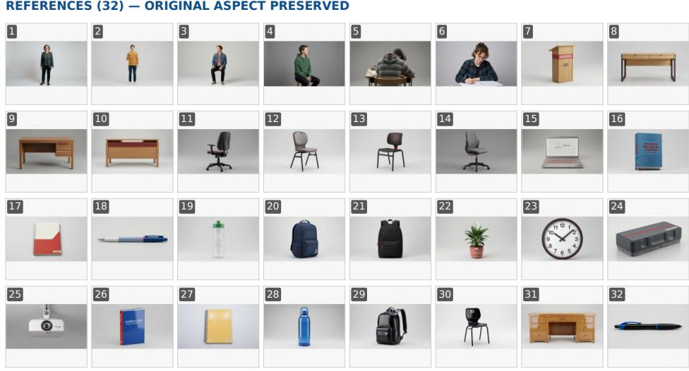

## TARGET INSTRUCTION (TRUNCATED)

Capture a bustling university classroom scene using a Wide-angle classroom shot, medium height, slightly elevated looking down to show rows of desks and varied depth. Sunlight streams through large windows, illuminating the polished floor. The main visual focus is the teacher in the grey blazer and spectacles, who is standing next to the light oak lectern while presenting to the standing student in the yellow sweater. Near the teacher are a grey felt whiteboard eraser with red accents and a potted peace lily with a white flower in the left background, while an analog wall clock with a white face and black numbers and a matte white digital projector with a lens can be seen behind them. The standing student in t...

## GENERATED OUTPUT · OPENCLAW HARNESS · GEMINI BACKEND (MODEL IDENTIFIERS PENDING)

  
Figure 7: An example from the Relational Graph Consistency (RGC) subclass, with the input reference images, prompt, and a representative generated result.

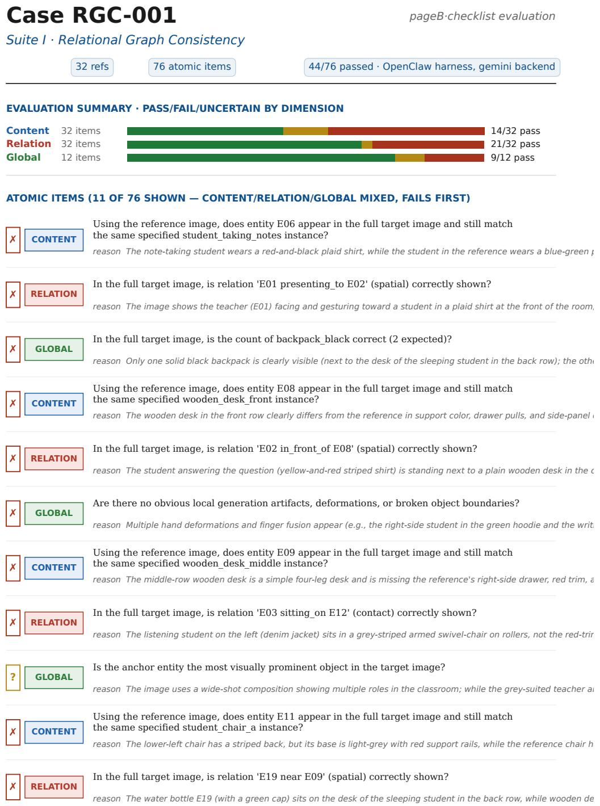  
Figure 8: Partial evaluation checklist for an example from the Relational Graph Consistency (RGC) subclass.

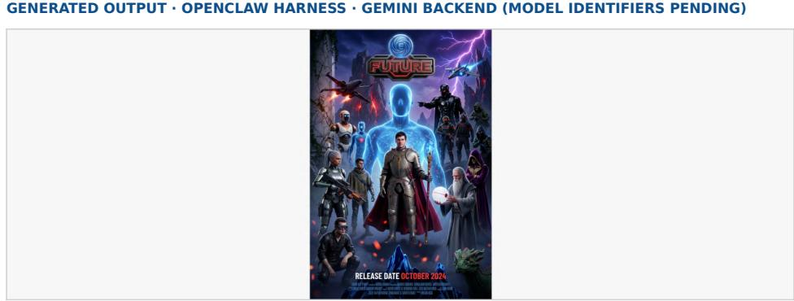  
Suite I · Layout Arrangement Consistency  
Figure 9: An example from the Layout Arrangement Consistency (LAC) subclass, with the input reference images, prompt, and a representative generated result.

## Case LAC-002

48/77 passed · OpenClaw harness, gemini backend

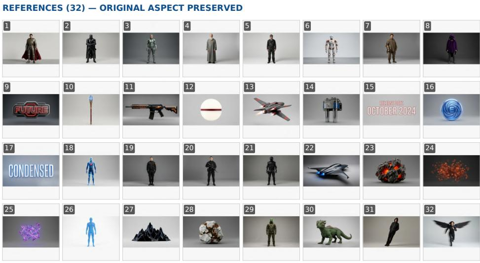

## TARGET INSTRUCTION (TRUNCATED)

This grandiose cinematic sci-fi fantasy movie poster features a Grand cinematic poster wide shot, centered on hero, low-angle perspective with high verticality, dramatic volumetric lighting. The visual anchor is the hero in golden-etched armor and a crimson cape in the center, who is positioned inside the translucent blue avatar with a hexagonal grid in the midground. Furthermore, the hero in golden-etched armor and a crimson cape in the center is holding the staff with the pulsating blue crystal and gold wire wrapping in the center. Hovering directly above the hero in golden-etched armor and a crimson cape in the center is the central metallic title with a neon internal glow. Placed below the central metallic...

Case LAC-002 Suite I · Layout Arrangement Consistency  
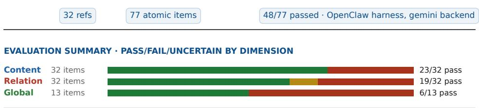

<table><tr><td rowspan=1 colspan=1></td></tr></table>

Figure 10: Partial evaluation checklist for an example from the Layout Arrangement Consistency (LAC) subclass.

33/39 passed · OpenClaw harness, gemini backend

## Case LAB-007

Suite II · Local Appearance Binding  

## TARGET INSTRUCTION (TRUNCATED)

Present a beautiful flat-lay, editorial composition in skincare photography. The main visual focus is the tall slim glass bottle with transparent golden-yellow serum. Arranged in a neat sequence from left to right, this tall slim glass bottle with transparent golden-yellow serum sits to the left of the slim frosted glass serum bottle with a matte white pump cap; both rest gracefully on a smooth pale grey limestone slab in the background. Continuing the sequence, the slim frosted glass serum bottle with a matte white pump cap is positioned to the left of the glass bottle of pale rose-pink serum with a rose gold metallic cap, which in turn lies to the left of the cobalt blue glass serum bottle with a matte black...

## GENERATED OUTPUT · OPENCLAW HARNESS · GEMINI BACKEND (MODEL IDENTIFIERS PENDING)

  
Figure 11: An example from the Local Appearance Binding (LAB) subclass, with the input reference images, prompt, and a representative generated result.

Case LAB-007  
Suite II · Local Appearance Binding  
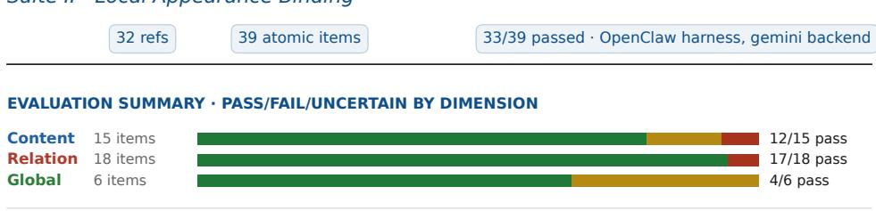

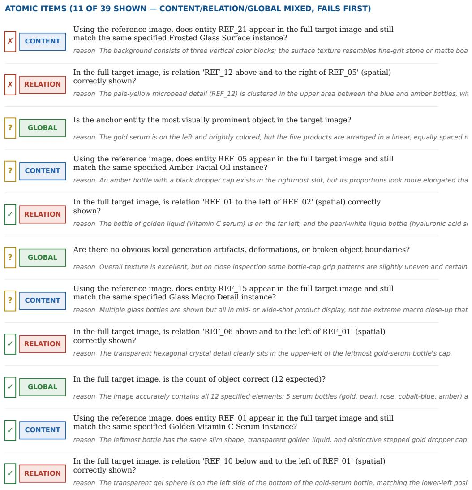  
Figure 12: Partial evaluation checklist for an example from the Local Appearance Binding (LAB) subclass.

## Case TSR-008

Suite III · Temporal / State Reasoning

61 atomic items

38/61 passed · OpenClaw harness, gemini backend

REFERENCES (32) — ORIGINAL ASPECT PRESERVED  
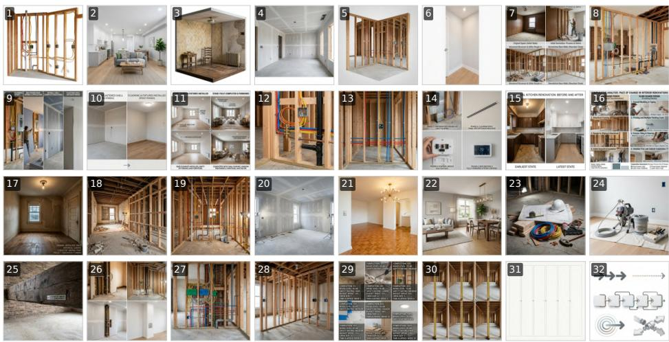

## TARGET INSTRUCTION (TRUNCATED)

Construct a completely photorealistic 6-panel timeline using an editorial composite composition to capture a residential or commercial interior renovation project. Presented as a side-by-side splitscreen comparison that illustrates the gradual layering of sequential progression, the scene is set against a project state showing a clear architectural layout in neutral lighting. It includes an infographic style chart showing visual properties across 6 sequential stages and a fixed scale reference with proportional indicators. The visual journey flows from left to right. On the far left, the predemolition room with original wallpaper and worn flooring features a historical interior context with its pre-renovatio...

## GENERATED OUTPUT · OPENCLAW HARNESS · GEMINI BACKEND (MODEL IDENTIFIERS PENDING)

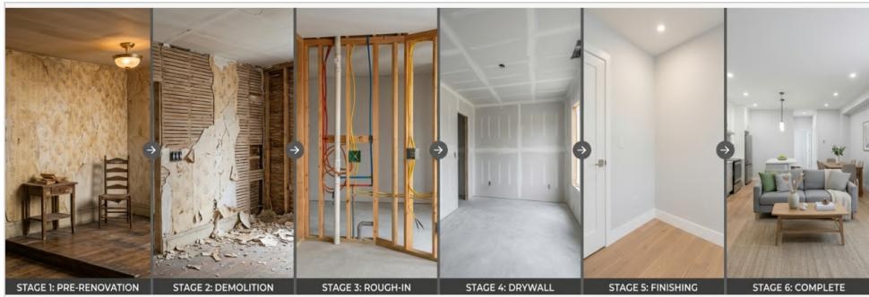  
Figure 13: An example from the TSR task, with the input reference images, prompt and a representative generated result.

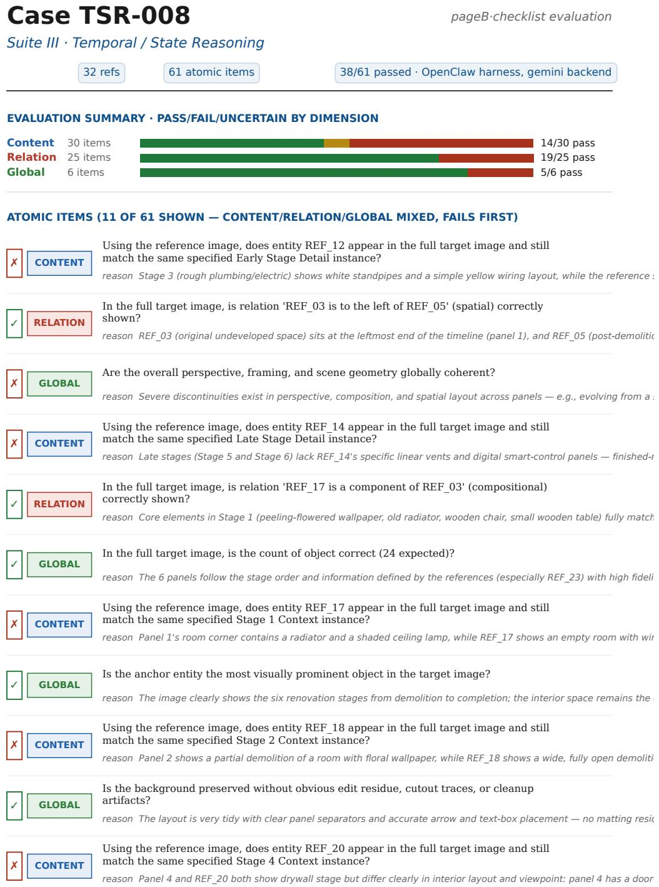  
Figure 14: Partial evaluation checklist for an example from the TSR task.

## Case AGG-004

Suite III · Counting & Aggregation

61/71 passed · OpenClaw harness, gemini backend

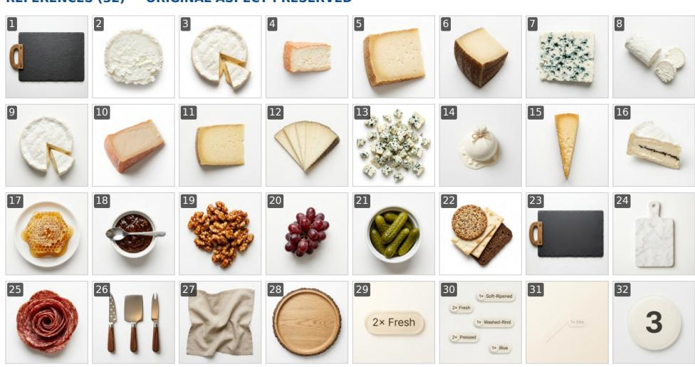

## TARGET INSTRUCTION (TRUNCATED)

Render a photorealistic photograph captured from an overhead viewpoint of a curated artisan cheese board in warm restaurant ambient light. The main visual focus is the slate cheese board with an aged oak handle, elegantly placed on the loosely draped oatmeal-colored linen napkin. Surrounding the main arrangement, you can see the rectangular dark grey slate board with a natural wood handle, the rectangular white Carrara marble paddle, and the rustic round wooden board with natural bark on the rim. A beautiful array of cheeses and accompaniments is placed on the slate cheese board with an aged oak handle, including the bright white sliced chèvre log with two cut rounds at the top left, the quartercut brie wheel...

## GENERATED OUTPUT · OPENCLAW HARNESS · GEMINI BACKEND (MODEL IDENTIFIERS PENDING)

  
Figure 15: An example from the AGG task, with the input reference images, prompt and a representative generated result.

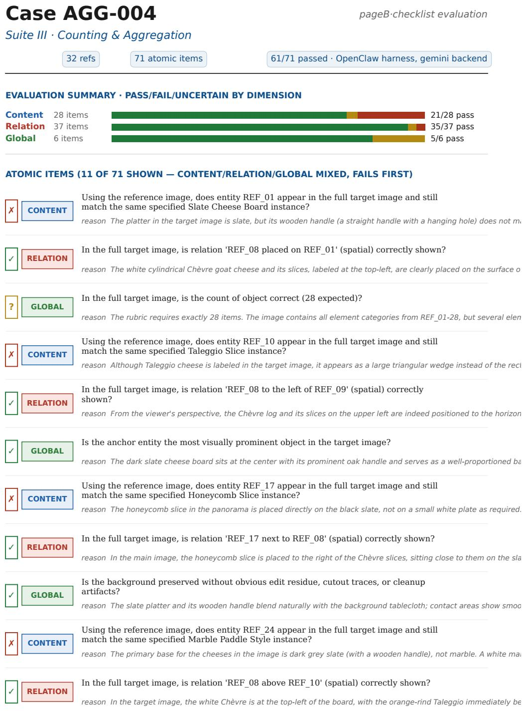  
Figure 16: Partial evaluation checklist for an example from the AGG task.

## C LONGBANANA-Eval Details

## C.1 LLM and Agent Usage Declaration

LONGBANANAEVAL uses LLM or MLLM components as rubric critics, tool routers, and evidenceanalysis modules. All automatic judging runs use Gemini 3 Flash as the shared judging backbone for both the agentic checklist judge and the single-pass VLM judge; in the agentic checklist judge, Gemini 3 Flash also drives tool routing and evidence analysis. LONGBANANA-Gen uses OpenCode, OpenClaw, and Hermes-Agent as harnesses. All three harnesses use Claude Sonnet 4.6 as the shared underlying agent model for planning, tool selection, and prompt revision. The harness versions are Hermes-Agent 0.10.0, OpenCode 1.4.9, and OpenClaw 2026.4.16. These harnesses call reference browsing, OCR/count/layout, image-generation, and file or prompt-management tools, while Nano Banana 2, GPT Image 1, or Seedream 4 produces image pixels according to the experimental setting.

## C.2 Human Agreement and Opposite-End Error Reduction

The full-pool comparison uses all 46,700 reviewed checklist decisions from 900 generated outputs across 10 generation conditions. We compare VLM-as-judge with LONGBANANAEVAL against the reviewed human labels. Each atomic check uses 2 for satisfied/correct, 1 for partially satisfied or uncertain, and 0 for unsatisfied/incorrect; when absence is required, correct omission scores 2. For a human label y and evaluator label $\hat { y } ,$ exact ternary agreement requires ${ \hat { y } } = y ,$ , within-one agreement requires $| \hat { y } - y | \le 1$ , and opposite-end error occurs when $| \hat { y } - y | = 2$

Table 10: Full-pool agreement with 46,700 reviewed human checklist labels from 900 generated outputs across 10 generation conditions. Higher is better for exact ternary and within-one agreement; lower is better for opposite-end error. Changes are LONGBANANAEVAL minus VLM-as-judge, in percentage points (pp).
<table><tr><td>Metric</td><td></td><td>VLM-as-judge LONGBANANAEVAL</td><td>Change</td></tr><tr><td>Exact ternary agreement</td><td>50.99%</td><td>66.81%</td><td>+15.82 pp</td></tr><tr><td>Within-one agreement</td><td>55.91%</td><td>75.19%</td><td>+19.28 pp</td></tr><tr><td>Opposite-end  $0  2$  error</td><td>44.09%</td><td>24.81%</td><td>-19.28 pp</td></tr></table>

Table 10 shows that exact ternary agreement increases by 15.82 percentage points, from 50.99% to 66.81%, while within-one agreement increases by 19.28 points, from 55.91% to 75.19%. Oppositeend 0 ↔ 2 errors decrease from 44.09% to 24.81%, reducing complete satisfaction–failure reversals by 19.28 points. Within-one agreement and opposite-end error are complementary for ternary labels, so these two changes describe the same reduction in severe errors. These item-level results complement the output-level score correlations in Table 1 and support finer-grained diagnosis of reference-grounded failures.

## C.3 Tool Configuration and Aggregation

The tool inventory covers OCR, object counting or detection, layout checking, and identity or feature matching. Tool calls produce observations rather than final labels. Item judgments use item-specific labels in {0, 1, 2}; for negative Content Fidelity items, absence is $\mathrm { p a s s } = 2$ , suspicious or ambiguous leakage is partial = 1, and full erroneous appearance is fail = 0. Checklist-average diagnostics multiply the mean label by 5, yielding a 0–10 score (rescaled to 0–100 for the subclass and Overall Avg. columns of the main generation tables) used for judge agreement and the main checklist-average columns; in the main generation tables, difficulty weighting is used only for the P@70% column. No polarity inversion is applied after labeling.

## C.4 Difficulty-Weighted Generation Scoring

The P@70% column of the main generation tables uses a difficulty-weighted checklist score computed at the case–subclass task level; the subclass and Overall Avg. columns instead report the unweighted checklist-average score (the per-item mean rescaled to 0–100). Each checklist judgment is first mapped to a ternary item score $s _ { j } ~ \in ~ \{ 0 , 1 , 2 \}$ : pass/match/correct is $^ { 2 , }$ partial satisfaction or uncertainty is 1, and fail/mismatch/incorrect/invalid is 0. Let $r _ { j } = s _ { j } / 2$ be the normalized item score. We calibrate difficulty once using the reviewed human labels for the fixed reference pool of ten generation conditions. For each checklist item key (case, subclass, item), $q _ { j }$ is the mean normalized human label over this reference pool, defining the difficulty weight

$$
w _ { j } = \left\{ \begin{array} { l l } { 3 , } & { q _ { j } < 0 . 6 5 , } \\ { 2 , } & { 0 . 6 5 \leq q _ { j } < 0 . 9 0 , } \\ { 1 , } & { q _ { j } \geq 0 . 9 0 . } \end{array} \right.
$$

The resulting weight map is saved as a versioned benchmark configuration and used unchanged in the main comparisons and for subsequent benchmark systems. The task score for strategy a on case–subclass task t is

$$
\mathrm { T a s k S c o r e } ( a , t ) = 1 0 0 \cdot \frac { \sum _ { j \in t } w _ { j } s _ { a , j } } { \sum _ { j \in t } 2 w _ { j } } = 1 0 0 \cdot \frac { \sum _ { j \in t } w _ { j } r _ { a , j } } { \sum _ { j \in t } w _ { j } } .
$$

P@70% is the percentage of the 90 case–subclass tasks whose weighted score is at least $7 0 ;$ each benchmark case contributes one task in its primary subclass. The subclass and Overall Avg. columns of the main tables instead report the unweighted checklist-average score over the same tasks. For judge–human agreement, we separately use output-level checklist-average scores

$$
s _ { o } = 5 \cdot \frac { 1 } { n _ { o } } \sum _ { j = 1 } ^ { n _ { o } } y _ { o , j } , \qquad \hat { s } _ { o } = 5 \cdot \frac { 1 } { n _ { o } } \sum _ { j = 1 } ^ { n _ { o } } \hat { y } _ { o , j } ,
$$

to correlate reviewed labels $y$ with judge predictions $\hat { y }$ over the 900-output human-audited pool.

## D Additional Generation Experiments and Diagnostics

Figure 17 visualizes the two main result comparisons from Tables 2 and 3. The radar profiles are intended as compact diagnostics of subclass-level failure patterns, not as additional statistical tests.

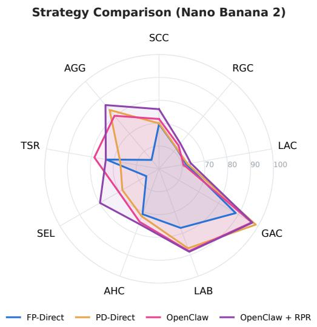

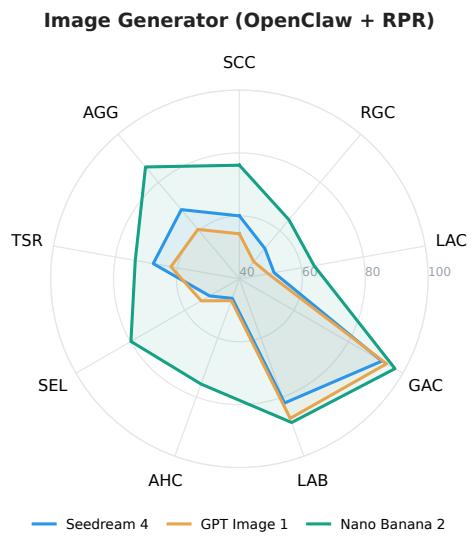  
Figure 17: Radar profiles for the two primary result comparisons. Left: strategy comparison with Nano Banana 2 fixed as the image generator. Right: image-generator comparison with OpenClaw + RPR fixed as the harness. Axes are LONGBANANA taxonomy subclasses; values are the checklistaverage subclass scores (0–100) reported in the main tables.

## D.1 Direct Baseline Implementations

FP-Direct uses the full target prompt throughout generation and varies only the visible reference window. Because a case may contain more reference images than the backend can consume at once, the implementation uses a window of eight references and iterates over the ordered reference inventory, e.g., ref1–ref8, ref9–ref16, and so on until all non-background references have been exposed. Each round receives the same complete target prompt; there is no entity-level batching, graph-conditioned relation filtering, explicit state memory, or repair step.

PD-Direct is a deterministic staged-composition baseline rather than a free-form planning agent. It uses the same eight-reference backend budget as FP-Direct, but allocates that budget by graph structure rather than by inventory order. Each non-background entity node is represented by one reference image. Starting from the pre-generated background image, PD-Direct composes nonbackground entities in ordered batches of at most eight entity references, following the staging schedule that is optimal for the case’s entity–relation graph. Let $b ( v ) \in \{ 1 , \ldots , K \}$ be the batch index of entity v, with $K = \lceil N / 8 \rceil$ , at most eight entity references per batch, and the background fixed at batch 0. Over the (unweighted, directed, possibly cyclic) entity–relation graph $G = \mathsf { \bar { ( } } V , E )$ the schedule minimizes a lexicographic objective: first the number of relations $( u , v )$ whose anchor is composed later than its dependent, $| \{ ( u , \bar { v } ) \in E : b ( u ) > b ( v ) \}$ |, a capacity-constrained feedback arc count that we minimize exactly by integer programming, and, among schedules attaining that minimum, the total relational stretch $\textstyle \sum _ { ( u , v ) \in E } \left| b ( { \overline { { u } } } ) - b ( v ) \right|$ . We solve it exactly with an integer program (Pass 1 minimizes the feedback count $F ^ { \star }$ ; Pass 2 minimizes the stretch subject to the feedback count equal to $F ^ { \star } ) ;$ each case has a small number of composed entities $( N \leq 3 2 )$ , so the integer program solves in seconds. At step zero the backend receives the background image plus the first batch’s reference images and produces intermediate\_00.png; at each later step it receives the previous intermediate image plus the next batch’s references, and the final intermediate is saved as target/target\_image.png. For a case with $N = 3 2$ composed entities this yields $K = \lceil N / 8 \rceil = \overline { { 4 } }$ batches and four intermediate images. The prompt at each step is constructed deterministically from fixed staged-composition instructions, the scene prompt, the entity types in the current batch, and all graph edges incident to that batch (there is no per-step cap on edges, so every relation is presented at the step of its later endpoint), followed by constraints to preserve existing content and maintain consistent lighting, scale, and perspective. Reference images and the background are generated upstream from the entity catalog, scene specification, and entity–relation graph; PD-Direct only stages their use during target construction.

## D.2 Agent-Orchestrator Component Ablation

Figure 18 summarizes the ReAct, Plan–Exec, and Reflect stages used by the full RPR workflow. Table 11 isolates these stages with OpenClaw and Nano Banana 2 fixed, comparing the minimal OpenClaw harness, each single-stage variant, and the full OpenClaw + RPR stack. For this ablation, item difficulty is computed from the mean normalized item score across the five configurations in this table, using the thresholds in Appendix C.4. The resulting weights are shared across all five rows. Subclass scores, Overall Avg., and P@70% therefore use this within-table relative difficulty calibration rather than the main benchmark’s frozen reference-pool weights.

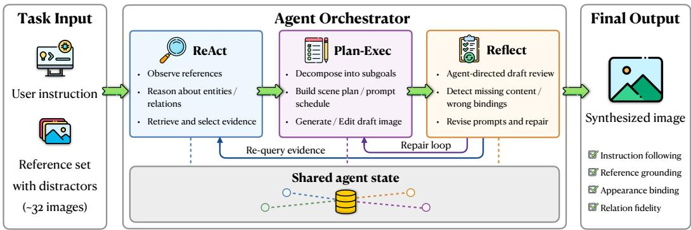  
Figure 18: Agent-orchestrator workflow used in LONGBANANA-Gen. ReAct retrieves and reasons over reference evidence, Plan–Exec decomposes synthesis into executable subgoals, and Reflect inspects drafts to guide revision.

Table 11: OpenClaw agent-generation component ablation on the 90-case LONGBANANA benchmark with Nano Banana 2 fixed as the image generator. Subclass scores and Overall Avg. are difficultyweighted task scores (0–100), with difficulty calibrated across the five configurations shown; P@70% is the corresponding task pass rate. Boldface and underlining mark the best and second-best values in each column.
<table><tr><td>Strategy</td><td colspan="3">Scene Composition</td><td colspan="3">Visual Appearance</td><td colspan="3">Reference Reasoning</td><td colspan="2">Overall ↑</td></tr><tr><td></td><td>SCC ↑</td><td>RGC↑</td><td>LAC ↑</td><td>GAC ↑</td><td>LAB ↑</td><td>AHC↑</td><td>SEL ↑</td><td>TSR ↑</td><td>AGG↑</td><td>Avg. ↑</td><td>P@70% ↑</td></tr><tr><td>OpenClaw</td><td>58.6</td><td>51.6</td><td>47.8</td><td>95.4</td><td>83.3</td><td>65.6</td><td>59.6</td><td>69.4</td><td>72.5</td><td>67.1</td><td>40.0</td></tr><tr><td>Plan-Exec only</td><td>56.6</td><td>45.7</td><td>46.5</td><td>96.5</td><td>88.3</td><td>63.7</td><td>59.0</td><td>58.4</td><td>66.8</td><td>64.6</td><td>35.6</td></tr><tr><td>ReAct only</td><td>54.5</td><td>48.1</td><td>41.5</td><td>92.0</td><td>71.8</td><td>52.1</td><td>62.0</td><td>57.0</td><td>72.8</td><td>61.3</td><td>36.7</td></tr><tr><td>Reflect only</td><td>58.7</td><td>46.4</td><td>50.6</td><td>96.4</td><td>79.8</td><td>52.0</td><td>59.7</td><td>64.4</td><td>75.7</td><td>64.9</td><td>44.4</td></tr><tr><td>OpenClaw + RPR</td><td>64.3</td><td>54.5</td><td>50.3</td><td>95.9</td><td>83.8</td><td>66.6</td><td>72.6</td><td>62.0</td><td>79.6</td><td>70.0</td><td>47.8</td></tr></table>

The ablation shows that the three agentic stages are complementary rather than individually monotonic. Plan–Exec alone gives the strongest Visual Appearance scores on GAC and LAB, consistent with decomposition helping product, style, and material organization, but it weakens relation control and structured reasoning when evidence retrieval and repair are not coupled to the plan. ReAct alone improves selection relative to the minimal OpenClaw harness, but its overall score drops because evidence selection without explicit execution control does not reliably preserve spatial and appearance bindings through generation. Reflect alone raises LAC, AGG, and P@70%, indicating that revision helps repair visible layout and aggregation errors, but it can also over-correct or drift when missing evidence is not re-grounded.

The full RPR stack gives the best overall score and pass rate because the stages close each other’s failure modes: ReAct grounds the reference set, Plan–Exec turns the grounded state into an executable synthesis schedule, and Reflect supports revision based on the generated result. The remaining TSR drop relative to minimal OpenClaw suggests that temporal and state-reasoning cases are sensitive to over-revision: once a physically plausible final state is found, additional repair can shift pose or event timing away from the intended state. Thus, RPR is best interpreted as an evidence-preserving orchestration pattern, not as a uniformly beneficial amount of extra reasoning.

## D.3 Case-Level Uncertainty and Paired Inference on the Checklist-Average Score

Table 12: Checklist-average generation summary with case-level uncertainty and paired-inference diagnostics. Scores use the same 0–100 scale as the main generation tables; mean differences are computed from the reported overall scores and expressed in percentage points (pp).
<table><tr><td>Comparison</td><td>Score / diff.</td><td>Bootstrap 95% CI</td><td>Paired p</td></tr><tr><td colspan="4">Minimal harness vs. RPR, with Nano Banana 2 fixed as backend</td></tr><tr><td>Hermes-Agent: RPR – minimal</td><td>+1.7 pp</td><td>[+0.1, +3.7] pp</td><td>0.0239</td></tr><tr><td>OpenCode: RPR – minimal</td><td>+0.5 pp</td><td>[-1.3, +2.1] pp</td><td>0.1823</td></tr><tr><td>OpenClaw: RPR — minimal</td><td>+2.3 pp</td><td>[+0.6, +4.2] pp</td><td>0.0032</td></tr><tr><td colspan="4">Image backend comparison, with OpenClaw + RPR fixed as the harness</td></tr><tr><td>Nano Banana 2 Overall</td><td>78.4</td><td>[76.7, 80.1]</td><td></td></tr><tr><td>Seedream 4 Overall</td><td>63.6</td><td>[61.5, 65.6]</td><td></td></tr><tr><td>GPT Image 1 Overall</td><td>61.8</td><td>[59.5, 64.0]</td><td></td></tr><tr><td>Nano Banana 2 – Seedream 4 paired diff.</td><td>+14.8 pp</td><td>[+12.9, +16.8] pp</td><td>≈10−5</td></tr><tr><td>Nano Banana 2 – GPT Image 1 paired diff.</td><td>+16.6 pp</td><td>[+14.5, +18.8] pp</td><td>≈10−5</td></tr><tr><td colspan="4">Suite scores for OpenClaw + RPR + Nano Banana 2</td></tr><tr><td>Scene Composition</td><td>68.2</td><td>[65.7, 70.7]</td><td></td></tr><tr><td>Visual Appearance</td><td>87.1</td><td>[83.9, 90.1]</td><td></td></tr><tr><td>Reference Reasoning</td><td>79.9</td><td>[76.6, 82.9]</td><td></td></tr></table>

## E Responsible Release and Safeguards

## E.1 Limitations

The 3×3 taxonomy covers a meaningful subset of long-horizon multi-reference synthesis, but does not cover video generation, 3D scene composition, or unrestricted multimodal planning. The benchmark is intentionally high-density, which improves diagnostic resolution but makes expert annotation expensive. LONGBANANAEVAL depends on backbone multimodal models and verification tools, so model identifiers and tool versions must accompany final results.

## E.2 Broader Impact Details

The benchmark is designed for measurement rather than deployment, but it evaluates systems capable of generating realistic composite images from many references. Positive uses include model auditing and failure diagnosis. Risks include deceptive media, impersonation, privacy leakage, biased reference coverage, and copyright-sensitive reuse. Mitigations include filtering unsafe content, documenting provenance, restricting problematic assets, and providing a project issue tracker for reporting release problems at https://github.com/TIGER-AI-Lab/LongBanana/issues.

## NeurIPS Paper Checklist

## 1. Claims

Question: Do the main claims made in the abstract and introduction accurately reflect the paper’s contributions and scope?

Answer: [Yes]

Justification: The abstract and Section 1 state the benchmark, evaluator, and empirical claims, while Sections 2 to 5 define the scope and required evidence. Run-specific factual details are provided in the anonymized OpenReview artifacts and associated run records.

Guidelines:

• The answer [N/A] means that the abstract and introduction do not include the claims made in the paper.

• The abstract and/or introduction should clearly state the claims made, including the contributions made in the paper and important assumptions and limitations. A [No] or [N/A] answer to this question will not be perceived well by the reviewers.

• The claims made should match theoretical and experimental results, and reflect how much the results can be expected to generalize to other settings.

• It is fine to include aspirational goals as motivation as long as it is clear that these goals are not attained by the paper.

## 2. Limitations

Question: Does the paper discuss the limitations of the work performed by the authors? Answer: [Yes] Answer: [Yes]

Justification: Appendix E discusses benchmark scope, annotation expense, and evaluator dependence.

Guidelines:

• The answer [N/A] means that the paper has no limitation while the answer [No] means that the paper has limitations, but those are not discussed in the paper.

• The authors are encouraged to create a separate “Limitations” section in their paper.

• The paper should point out any strong assumptions and how robust the results are to violations of these assumptions (e.g., independence assumptions, noiseless settings, model well-specification, asymptotic approximations only holding locally). The authors should reflect on how these assumptions might be violated in practice and what the implications would be.

• The authors should reflect on the scope of the claims made, e.g., if the approach was only tested on a few datasets or with a few runs. In general, empirical results often depend on implicit assumptions, which should be articulated.

• The authors should reflect on the factors that influence the performance of the approach. For example, a facial recognition algorithm may perform poorly when image resolution is low or images are taken in low lighting. Or a speech-to-text system might not be used reliably to provide closed captions for online lectures because it fails to handle technical jargon.

• The authors should discuss the computational efficiency of the proposed algorithms and how they scale with dataset size.

• If applicable, the authors should discuss possible limitations of their approach to address problems of privacy and fairness.

• While the authors might fear that complete honesty about limitations might be used by reviewers as grounds for rejection, a worse outcome might be that reviewers discover limitations that aren’t acknowledged in the paper. The authors should use their best judgment and recognize that individual actions in favor of transparency play an important role in developing norms that preserve the integrity of the community. Reviewers will be specifically instructed to not penalize honesty concerning limitations.

## 3. Theory assumptions and proofs

Question: For each theoretical result, does the paper provide the full set of assumptions and a complete (and correct) proof?

## Answer: [N/A]

Justification: The paper does not present theoretical theorems or formal proof claims.

• The answer [N/A] means that the paper does not include theoretical results.

• All the theorems, formulas, and proofs in the paper should be numbered and crossreferenced.

• All assumptions should be clearly stated or referenced in the statement of any theorems.

• The proofs can either appear in the main paper or the supplemental material, but if they appear in the supplemental material, the authors are encouraged to provide a short proof sketch to provide intuition.

• Inversely, any informal proof provided in the core of the paper should be complemented by formal proofs provided in appendix or supplemental material.

• Theorems and Lemmas that the proof relies upon should be properly referenced.

## 4. Experimental result reproducibility

Question: Does the paper fully disclose all the information needed to reproduce the main experimental results of the paper to the extent that it affects the main claims and/or conclusions of the paper (regardless of whether the code and data are provided or not)?

Answer: [No]

Justification: The paper describes benchmark construction, scoring, model and harness identifiers, and baseline implementations in Sections 2 to D, but does not include executable reproduction commands or environment files.

Guidelines:

• The answer [N/A] means that the paper does not include experiments.

• If the paper includes experiments, a [No] answer to this question will not be perceived well by the reviewers: Making the paper reproducible is important, regardless of whether the code and data are provided or not.

• If the contribution is a dataset and/or model, the authors should describe the steps taken to make their results reproducible or verifiable.

• Depending on the contribution, reproducibility can be accomplished in various ways. For example, if the contribution is a novel architecture, describing the architecture fully might suffice, or if the contribution is a specific model and empirical evaluation, it may be necessary to either make it possible for others to replicate the model with the same dataset, or provide access to the model. In general. releasing code and data is often one good way to accomplish this, but reproducibility can also be provided via detailed instructions for how to replicate the results, access to a hosted model (e.g., in the case of a large language model), releasing of a model checkpoint, or other means that are appropriate to the research performed.

• While NeurIPS does not require releasing code, the conference does require all submissions to provide some reasonable avenue for reproducibility, which may depend on the nature of the contribution. For example

(a) If the contribution is primarily a new algorithm, the paper should make it clear how to reproduce that algorithm.

(b) If the contribution is primarily a new model architecture, the paper should describe the architecture clearly and fully.

(c) If the contribution is a new model (e.g., a large language model), then there should either be a way to access this model for reproducing the results or a way to reproduce the model (e.g., with an open-source dataset or instructions for how to construct the dataset).

(d) We recognize that reproducibility may be tricky in some cases, in which case authors are welcome to describe the particular way they provide for reproducibility. In the case of closed-source models, it may be that access to the model is limited in some way (e.g., to registered users), but it should be possible for other researchers to have some path to reproducing or verifying the results.

## 5. Open access to data and code

Question: Does the paper provide open access to the data and code, with sufficient instructions to faithfully reproduce the main experimental results, as described in supplemental material?

## Answer: [No]

Justification: This preprint does not provide a public data/code access link with executable reproduction instructions.

Guidelines:

• The answer [N/A] means that paper does not include experiments requiring code.

• Please see the NeurIPS code and data submission guidelines (https://neurips.cc/ public/guides/CodeSubmissionPolicy) for more details.

• While we encourage the release of code and data, we understand that this might not be possible, so [No] is an acceptable answer. Papers cannot be rejected simply for not including code, unless this is central to the contribution (e.g., for a new open-source benchmark).

• The instructions should contain the exact command and environment needed to run to reproduce the results. See the NeurIPS code and data submission guidelines (https: //neurips.cc/public/guides/CodeSubmissionPolicy) for more details.

• The authors should provide instructions on data access and preparation, including how to access the raw data, preprocessed data, intermediate data, and generated data, etc.

• The authors should provide scripts to reproduce all experimental results for the new proposed method and baselines. If only a subset of experiments are reproducible, they should state which ones are omitted from the script and why.

• At submission time, to preserve anonymity, the authors should release anonymized versions (if applicable).

• Providing as much information as possible in supplemental material (appended to the paper) is recommended, but including URLs to data and code is permitted.

## 6. Experimental setting/details

Question: Does the paper specify all the training and test details (e.g., data splits, hyperparameters, how they were chosen, type of optimizer) necessary to understand the results?

Answer: [Yes]

Justification: The experimental design, 90-case benchmark, evaluator configuration, metrics, and ablations are described in Sections 2 to 4. Appendix C identifies the agent and judging models and the harness versions.

Guidelines:

• The answer [N/A] means that the paper does not include experiments.

• The experimental setting should be presented in the core of the paper to a level of detail that is necessary to appreciate the results and make sense of them.

• The full details can be provided either with the code, in appendix, or as supplemental material.

## 7. Experiment statistical significance

Question: Does the paper report error bars suitably and correctly defined or other appropriate information about the statistical significance of the experiments?

Answer: [Yes]

Justification: Section 4 reports checklist-average generation scores and the secondary difficulty-weighted P@70% diagnostic. Appendix D reports case-level bootstrap confidence intervals and paired tests for the checklist-average scores; judge–human agreement is reported as correlation diagnostics.

Guidelines:

• The answer [N/A] means that the paper does not include experiments.

• The authors should answer [Yes] if the results are accompanied by error bars, confidence intervals, or statistical significance tests, at least for the experiments that support the main claims of the paper.

• The factors of variability that the error bars are capturing should be clearly stated (for example, train/test split, initialization, random drawing of some parameter, or overall run with given experimental conditions).

• The method for calculating the error bars should be explained (closed form formula, call to a library function, bootstrap, etc.)

• The assumptions made should be given (e.g., Normally distributed errors).

• It should be clear whether the error bar is the standard deviation or the standard error of the mean.

• It is OK to report 1-sigma error bars, but one should state it. The authors should preferably report a 2-sigma error bar than state that they have a 96% CI, if the hypothesis of Normality of errors is not verified.

• For asymmetric distributions, the authors should be careful not to show in tables or figures symmetric error bars that would yield results that are out of range (e.g., negative error rates).

• If error bars are reported in tables or plots, the authors should explain in the text how they were calculated and reference the corresponding figures or tables in the text.

## 8. Experiments compute resources

Question: For each experiment, does the paper provide sufficient information on the computer resources (type of compute workers, memory, time of execution) needed to reproduce the experiments?

Answer: [No]

Justification: The paper identifies the generation and judging models but does not report per-run compute resources, runtime, or API costs.

Guidelines:

• The answer [N/A] means that the paper does not include experiments.

• The paper should indicate the type of compute workers CPU or GPU, internal cluster, or cloud provider, including relevant memory and storage.

• The paper should provide the amount of compute required for each of the individual experimental runs as well as estimate the total compute.

• The paper should disclose whether the full research project required more compute than the experiments reported in the paper (e.g., preliminary or failed experiments that didn’t make it into the paper).

## 9. Code of ethics

Question: Does the research conducted in the paper conform, in every respect, with the NeurIPS Code of Ethics https://neurips.cc/public/EthicsGuidelines?

Answer: [Yes]

Justification: Asset provenance and privacy screening are discussed in Appendix B; broader impacts and responsible-release safeguards are discussed in Appendix E.

Guidelines:

• The answer [N/A] means that the authors have not reviewed the NeurIPS Code of Ethics.

• If the authors answer [No], they should explain the special circumstances that require a deviation from the Code of Ethics.

• The authors should make sure to preserve anonymity (e.g., if there is a special consideration due to laws or regulations in their jurisdiction).

## 10. Broader impacts

Question: Does the paper discuss both potential positive societal impacts and negative societal impacts of the work performed?

Answer: [Yes]

Justification: Appendix E discusses positive impacts for evaluation rigor and negative risks related to deceptive media, privacy, copyright, and biased coverage, together with mitigation measures.

## Guidelines:

• The answer [N/A] means that there is no societal impact of the work performed.

• If the authors answer [N/A] or [No], they should explain why their work has no societal impact or why the paper does not address societal impact.

• Examples of negative societal impacts include potential malicious or unintended uses (e.g., disinformation, generating fake profiles, surveillance), fairness considerations (e.g., deployment of technologies that could make decisions that unfairly impact specific groups), privacy considerations, and security considerations.

• The conference expects that many papers will be foundational research and not tied to particular applications, let alone deployments. However, if there is a direct path to any negative applications, the authors should point it out. For example, it is legitimate to point out that an improvement in the quality of generative models could be used to generate Deepfakes for disinformation. On the other hand, it is not needed to point out that a generic algorithm for optimizing neural networks could enable people to train models that generate Deepfakes faster.

• The authors should consider possible harms that could arise when the technology is being used as intended and functioning correctly, harms that could arise when the technology is being used as intended but gives incorrect results, and harms following from (intentional or unintentional) misuse of the technology.

• If there are negative societal impacts, the authors could also discuss possible mitigation strategies (e.g., gated release of models, providing defenses in addition to attacks, mechanisms for monitoring misuse, mechanisms to monitor how a system learns from feedback over time, improving the efficiency and accessibility of ML).

## 11. Safeguards

Question: Does the paper describe safeguards that have been put in place for responsible release of data or models that have a high risk for misuse (e.g., pre-trained language models, image generators, or scraped datasets)?

Answer: [Yes]

Justification: Appendix B describes asset screening and redistribution restrictions; Appendix E describes responsible-release safeguards and takedown/contact procedures.

Guidelines:

• The answer [N/A] means that the paper poses no such risks.

• Released models that have a high risk for misuse or dual-use should be released with necessary safeguards to allow for controlled use of the model, for example by requiring that users adhere to usage guidelines or restrictions to access the model or implementing safety filters.

• Datasets that have been scraped from the Internet could pose safety risks. The authors should describe how they avoided releasing unsafe images.

• We recognize that providing effective safeguards is challenging, and many papers do not require this, but we encourage authors to take this into account and make a best faith effort.

## 12. Licenses for existing assets

Question: Are the creators or original owners of assets (e.g., code, data, models), used in the paper, properly credited and are the license and terms of use explicitly mentioned and properly respected?

Answer: [Yes]

Justification: Asset provenance and licensing are documented in Sections 2 and B, covering source images, models, tools, and external benchmarks. Source citations, license/TOS audit results, and redistribution decisions are included in the submitted artifact metadata.

Guidelines:

• The answer [N/A] means that the paper does not use existing assets.

• The authors should cite the original paper that produced the code package or dataset.

• The authors should state which version of the asset is used and, if possible, include a URL.

• The name of the license (e.g., CC-BY 4.0) should be included for each asset.

• For scraped data from a particular source (e.g., website), the copyright and terms of service of that source should be provided.

• If assets are released, the license, copyright information, and terms of use in the package should be provided. For popular datasets, paperswithcode.com/datasets has curated licenses for some datasets. Their licensing guide can help determine the license of a dataset.

• For existing datasets that are re-packaged, both the original license and the license of the derived asset (if it has changed) should be provided.

• If this information is not available online, the authors are encouraged to reach out to the asset’s creators.

## 13. New assets

Question: Are new assets introduced in the paper well documented and is the documentation provided alongside the assets?

Answer: [Yes]

Justification: The benchmark, manifests, annotation schema, scorer configuration, and documentation are described in Sections 2 to C. The dataset card, manifest, release license, and anonymized artifact access information are provided in the submitted OpenReview artifacts.

Guidelines:

• The answer [N/A] means that the paper does not release new assets.

• Researchers should communicate the details of the dataset/code/model as part of their submissions via structured templates. This includes details about training, license, limitations, etc.

• The paper should discuss whether and how consent was obtained from people whose asset is used.

• At submission time, remember to anonymize your assets (if applicable). You can either create an anonymized URL or include an anonymized zip file.

## 14. Crowdsourcing and research with human subjects

Question: For crowdsourcing experiments and research with human subjects, does the paper include the full text of instructions given to participants and screenshots, if applicable, as well as details about compensation (if any)?

Answer: [Yes]

Justification: The annotation workflow, adjudication plan, compensation reporting, and instruction/screenshot requirements are described in Sections 2 and B. Instructions, UI screenshots, rater counts, qualification criteria, compensation rate, and annotation time are reported as annotation metadata.

Guidelines:

• The answer [N/A] means that the paper does not involve crowdsourcing nor research with human subjects.

• Including this information in the supplemental material is fine, but if the main contribution of the paper involves human subjects, then as much detail as possible should be included in the main paper.

• According to the NeurIPS Code of Ethics, workers involved in data collection, curation, or other labor should be paid at least the minimum wage in the country of the data collector.

## 15. Institutional review board (IRB) approvals or equivalent for research with human subjects

Question: Does the paper describe potential risks incurred by study participants, whether such risks were disclosed to the subjects, and whether Institutional Review Board (IRB) approvals (or an equivalent approval/review based on the requirements of your country or institution) were obtained?

## Answer: [Yes]

Justification: Participant-risk and review-status reporting are specified in Sections B and E while preserving submission anonymity. The IRB exemption or equivalent review status is reported in anonymized form where applicable.

## Guidelines:

• The answer [N/A] means that the paper does not involve crowdsourcing nor research with human subjects.

• Depending on the country in which research is conducted, IRB approval (or equivalent) may be required for any human subjects research. If you obtained IRB approval, you should clearly state this in the paper.

• We recognize that the procedures for this may vary significantly between institutions and locations, and we expect authors to adhere to the NeurIPS Code of Ethics and the guidelines for their institution.

• For initial submissions, do not include any information that would break anonymity (if applicable), such as the institution conducting the review.

## 16. Declaration of LLM usage

Question: Does the paper describe the usage of LLMs if it is an important, original, or non-standard component of the core methods in this research? Note that if the LLM is used only for writing, editing, or formatting purposes and does not impact the core methodology, scientific rigor, or originality of the research, declaration is not required.

Answer: [Yes]

Justification: LLM and MLLM usage in generation harnesses, rubric critics, tool routing, and evidence analysis is described in Sections 3 and C. The appendix reports the shared underlying agent model for generation harnesses, harness versions, and the Gemini 3 Flash judging backbone used by both the agentic checklist judge and the single-pass VLM judge.

## Guidelines:

• The answer [N/A] means that the core method development in this research does not involve LLMs as any important, original, or non-standard components.

• Please refer to our LLM policy in the NeurIPS handbook for what should or should not be described.