# METRIC-GS: Selective Metric-Scale Estimation for 3D Gaussian Splatting

Sooyeun Yang2 Jongseong Brad Choi1,2,3\* 1Department of Mechanical Engineering, SUNY Korea 2Department of Mechanical Engineering, Stony Brook University 3Department of Computer Science, SUNY Korea

sooyeun.yang@stonybrook.edu, jongseong.choi@sunykorea.ac.kr

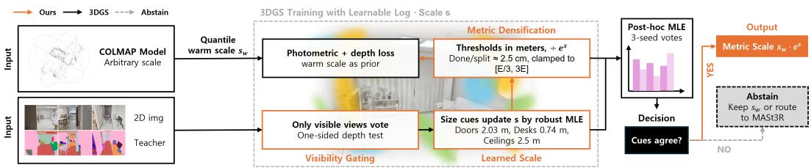  
Figure 1. Overview. A quantile warm scale $s _ { w }$ initializes the COLMAP model; 3DGS trains with a global log-scale s. A frozen 2D teacher labels Gaussians by visibility-aware projection voting (one-sided depth test); instance-level size cues update s by a robust MLE under architectural priors, and densification thresholds are meter-valued, converted through $e ^ { s } .$ . After training, a multi-seed post-hoc MLE reports the final metric scale $s _ { w } e ^ { s }$ , or abstains, keeping $s _ { w }$ or routing the scene to a heavyweight metric model.

## Abstract

A 3D Gaussian Splatting (3DGS) reconstruction inherits arbitrary units from structure-from-motion, so it cannot be measured or used to place AR content until someone supplies a scale. Both standard recipes are fragile on real captures: on five indoor scenes with tape-measured ceilings a quantile floor-to-ceiling heuristic errs by 27% and metric-depth alignment by 35–71% across three networks. We present METRIC-GS, a selective scale estimator for real photographs of indoor scenes: it reads the scale off the reconstruction’s own semantic content and, just as importantly, refuses when the evidence is thin. A frozen 2D teacher labels Gaussians by visibility-aware voting; instance-level size priors for architectural and furniture classes (doors, tables, the floor-to-ceiling gap) are fused by a robust maximum-likelihood step; and an inliermass test turns thin evidence into an explicit abstention that doubles as a router to a heavyweight metric model. On 47 ScanNet++ scenes with laser ground truth, under a configurationfrozen before any public evaluation, the estimator alone cuts the heuristic’s mean error from 21.1% to 16.6% (9.3% on the 28 scenes it acts on) at ∼11 s per scene. MASt3R remains the more accurate standalone estimator (9.9%), but routing only our refusals to it matches running it everywhere with 60% fewer invocations; this selective hybrid is the configuration we advocate. Visibilityaware voting is what makes the estimator actionable, raising the scenes it can act on from 16 to 28 without changing deployed accuracy. Applied unchanged to 13 phone and drone captures of our own, on which MASt3R fails its own registration gate 12 times, the system improves all five captures it acts on and degrades none. We also report that a currentfeed-forward metric model scores 2.3% on a benchmark inside its training mixture and 28–35% on ordinary captures it has never seen: a published metric-scale number is a best case, not a deployment estimate.

## 1. Introduction

3D Gaussian Splatting (3DGS) [10] reconstructs an interior beautifully, but in whatever units structure-from-motion happened to produce. For novel-view synthesis the ambiguity is harmless. The moment the reconstruction has to support a measurement, a robot’s path, or an AR object placed at the right size, someone has to supply a scale — and today that someone is a human with a tape measure. A phone that keeps its inertial stream answers this for free, so the problem belongs to the captures that cannot: DSLR sessions, photo collections, drone surveys, and any pipeline reconstructing from images alone.

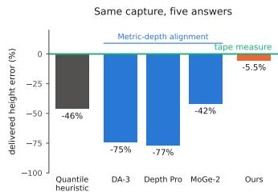  
Figure 2. Scale recovery is not solved. Delivered ceiling height on one tape-measured capture (room2; all five in the supplement): the quantile heuristic and metric-depth alignment disagree with the tape measure and, across three networks, with each other by a factor of 2.5. Our robust fusion of semantic size cues is within 6%.

Two off-the-shelf recipes exist. A geometric heuristic scales the reconstruction so that its floor-to-ceiling extent matches a known room height; a learned alternative aligns SfM depth to a monocular metric-depth network. Both are fragile on real captures: on five indoor scenes with tapemeasured ceiling heights, the quantile heuristic errs by 27% on average and metric-depth alignment by 35–71% across three networks, a systematic indoor depth bias rather than one model’s flaw; the three networks also disagree with each other by up to a factor of 2.5 (Fig. 2).

Our key observation is that an indoor reconstruction contains many semantic metric anchors (doors, furniture, the floor-to-ceiling gap) whose real-world sizes are standardized or tightly distributed; measured per instance on semantically labeled Gaussians, they over-constrain the global scale. This fixes the operating regime, and we state it upfront: METRIC-GS targets real photographs of indoor scenes whose architecture is visible, with hand-specified size priors drawn from building standards and a frozen 2D segmenter as the only learned component. Outside that regime (outdoor, synthetic appearance, close-ups that never frame a wall) there is nothing to fuse, and the method’s contract is to say so rather than to guess.

Concretely, a frozen 2D teacher labels Gaussians by projection voting, instance clusters are measured, and a robust maximum-likelihood step fuses the measurements under the size priors (Sec. 3). Two design decisions carry the system. First, reliable labeling requires the reconstruction itself: naive projection voting degrades as views are added, because occluded points inherit their occluders’ labels. Our visibility-aware voting filters each vote by the model’s own rendered depth. Its effect is one of coverage, not accuracy: over all 47 test scenes it lifts the number the estimator can act on from 16 to 28, while the deployed mean error is statistically unchanged (Sec. 4.5). Second, an inlier-mass test refuses the correction when too few cues agree, so thin evidence becomes an explicit abstention rather than a confident wrong answer; the same signal routes the scene to a heavyweight metric model.

On 47 ScanNet++ scenes with laser-derived metric ground truth, under a configuration frozen before public evaluation, the estimator alone improves the quantile heuristic’s mean error from 21.1% to 16.6% (median $1 7 . 5 \% \to 1 0 . 6 \% ;$ Wilcoxon $p { = } 2 . 6 { \times } 1 0 ^ { - 3 } )$ , reaching 9.3% on the 28 scenes it acts on at ∼11 s overhead. We are explicit about where the result is strongest: MASt3R is more accurate as a standalone estimator (9.9%) at over 20× the estimation cost, but on scenes where we act the two are statistically indistinguishable, and routing only our 19 refusals to MASt3R matches running it everywhere with 60% fewer invocations. That selective hybrid, not the standalone accuracy, is the contribution we advocate deploying. Applied unchanged to 13 captures we recorded with consumer phones and a drone, the frozen system improves every capture it acts on, abstains on the rest, and degrades none, while MASt3R fails its own registration gate on 12 of the 13.

Our contributions are:

• a robust fusion of instance-level semantic size cues that reads a metric reference off an indoor reconstruction itself; its measured contribution is robustness, removing the catastrophic failures single-cue estimators cannot defend against;

• visibility-aware voting, which restricts votes to views that actually observe each Gaussian; it raises the scenes the estimator can act on from 16 to 28 at unchanged deployed accuracy, i.e. a coverage gain;

• abstention as a first-class output: an inlier-mass test that converts insufficient evidence into an explicit refusal and doubles as a router, matching a heavyweight metric model’s accuracy at 60% fewer invocations;

• a measurement worth reporting independently of our estimator: a current feed-forward metric model scores 2.3% on a benchmark inside its training mixture, 5.6% on one it was evaluated against, and 28–35% on captures it has never seen;

• a deployment study under development/test discipline: a configuration frozen before public evaluation, preregistered held-out predictions, significance tests and negative results, on ScanNet++ (47 scenes), four further public benchmarks, and 13 captures of our own.

## 2. Related Work

3D Gaussian Splatting. 3DGS [10] represents a scene as anisotropic Gaussians optimized with photometric losses and grown by densification heuristics; numerous variants refine its sampling and densification behavior [14, 32]. These heuristics (gradient thresholds, world-size pruning, learning-rate schedules) are expressed in world units, so they silently depend on the arbitrary scale that structurefrom-motion [19] assigns to the scene. We make this dependence explicit and turn it into a feature: densification thresholds defined in meters couple scale accuracy to re-

Recovering metric scale. Monocular metric depth estimators [2, 29, 31] enable a standard alignment recipe: fit a scale (and shift) between predicted depth and SfM depth [7, 13]. We show this recipe carries the depth network’s systematic indoor bias (Sec. 4.4). Feed-forward reconstruction models trained with metric supervision, such as DUSt3R [26], MASt3R [11], VGGT [24], and more recently MapAnything [9] and AMB3R [23], recover impressive metric geometry from images alone, but replace rather than augment an existing SfM/3DGS pipeline, and provide no self-assessment of their scale reliability. We compare empirically to MASt3R’s metric checkpoint; MapAnything and AMB3R, its direct successors, are not evaluated here, so the MASt3R error we report is an upper bound on that family’s error on curated benchmarks; its successors may do better. Others in this family are explicitly scale-free: $\pi ^ { 3 }$ [28] predicts scale-invariant point maps, so a metric anchor of the kind we supply remains necessary downstream. MoGe-2 [25] shares our factorization into relative geometry plus a separate global scale, but predicts that scalar from a learned image prior, whereas we read it off the reconstruction’s own semantic content, which is what makes an evidence-based refusal possible. Monocular systems have long recovered scale from a geometric anchor such as known object sizes or a ground plane at calibrated camera height [5, 15, 18]; a single anchor is precise where it applies but fails when unobserved, whereas we fuse many redundant anchors. Aligning monocular depth priors instead, as HI-SLAM2 does [34], imports the depth network’s metric bias, which our scale-invariant use of depth avoids.

Semantics in 3DGS. Distilling 2D semantics into Gaussians supports open-vocabulary querying and editing [17, 36]; structural priors (planes, layout) regularize indoor geometry [8, 12, 33]. These works target geometry quality or semantic access; none address the metric scale. Closest to our voting are LabelGS [35], which lifts 2D masks with explicit occlusion analysis so occluded Gaussians do not inherit foreground labels, and VALA [27], which gates each ray by a Gaussian’s marginal contribution. Both address the same pathology, but solve it for segmentation quality. Ours is a cheaper one-sided test against rendered depth, aimed at unbiased instance extents; their finer visibility reasoning is a natural front-end for our partial-instance failure mode.

## 3. Method

## 3.1. Problem, notation and overview

3DGS optimizes a set of anisotropic Gaussians $\Theta \ =$ $\{ ( \pmb { \mu _ { i } } , \pmb { \Sigma _ { i } } , o _ { i } , c _ { i } ) \}$ against photometric losses, growing and pruning the set with heuristics whose thresholds are expressed in world units [10]. The COLMAP reconstruction it consumes is defined only up to a global scale; our task is to recover that scalar sˆ (meters per model unit), or to state explicitly that the evidence does not support one.

We use the following terms throughout. The warm estimate $s _ { w }$ is a cheap geometric guess applied once, before training (Sec. 3.2); the residual log-scale s is the correction we estimate, so the delivered scale is $\hat { s } = s _ { w } e ^ { s }$ . A cue is one measured size paired with a size prior; the inlier mass M is the weight of cues that agree with the fitted scale. A scene is active if M passes the gate and the estimator reports its own sˆ, and abstained if it refuses and returns $s _ { w }$ unchanged; the router is the deployment that sends exactly the abstained scenes to a heavyweight metric model. Deployed error is the scale error of whatever the system returns, active or not. Figure 1 overviews the pipeline: after the warm start, 3DGS trains while a frozen 2D teacher periodically labels the Gaussians (Sec. 3.3), instance sizes are measured (Sec. 3.4) and fused into s (Sec. 3.5), which keeps densification in meters (Sec. 3.6); after training, a post-hoc fit of the same objective reports sˆ or abstains (Sec. 3.7).

## 3.2. Warm start

The warm scale maps the reconstruction’s dominant vertical extent, the robust median over multi-quantile floor/ceiling spans of the point heights, to a nominal room height (2.5 m). This heuristic is fragile (outlier points corrupt the span; Sec. 4.2), so we keep it only as the initialization and quadratic prior of the residual s.

## 3.3. Visibility-aware semantic voting

A frozen 2D teacher (Mask2Former R50 on ADE20K [4]) labels training views; projecting Gaussian centers into V views and letting each view vote yields per-Gaussian labels. Naively, more views make this worse: an occluded Gaussian projects into views that do not see it and inherits its occluder’s label, so the winner’s vote share drops below the ambiguity threshold as V grows (in our diagnostics, usable cues fell from 22 to 8 when doubling V). We therefore let a view vote only if the model itself confirms visibility: with rendered depth $D _ { v }$ at the projection $( u _ { i } ^ { v } , v _ { i } ^ { v } )$ and camera depth zv, the vote requires

$$
z _ { i } ^ { v } < D _ { v } ( u _ { i } ^ { v } , v _ { i } ^ { v } ) ( 1 + \tau _ { \mathrm { v i s } } ) , \qquad \tau _ { \mathrm { v i s } } = 0 . 0 5 .\tag{1}
$$

The test is deliberately one-sided: a symmetric $| z - D |$ test also rejects points at grazing incidence, i.e. floors, where per-pixel depth blending shifts $D _ { v }$ off the surface, and silently starves the floor cues (15,856→146 votes on one scene). A Gaussian keeps the winning class if it holds at least half of its visibility-filtered votes. The schedule is fixed: every 200 training iterations, 24 randomly drawn views vote; the post-hoc estimate uses 48 views under each of three fixed seeds. If fewer than 5% of Gaussians end up labeled, the tolerance is tripled once and then the test is dropped, so a degenerate depth render cannot starve the estimator. Both design choices are ablated over all 47 test scenes in Sec. 4.5; the gain is in coverage, not accuracy.

## 3.4. Instance-level metric size cues

Classes with standardized or tightly distributed physical sizes (doors, tables, toilets, the floor-to-ceiling gap) act as metric anchors. A class is measured only if at least 50 Gaussians carry its label. Its Gaussians are split into spatial instances by voxel-grid connected components (26- neighborhood, voxel size 4× the class’ median nearestneighbor distance), keeping at most the four largest and discarding fragments below half the largest instance’s extent; each instance yields a [0.02, 0.98] quantile-trimmed extent along the vertical axis. Measurement biases are structural and we exploit their opposing signs: a cluster extent (the whole labeled set) is biased up by label spillover, an instance extent is biased down by partial reconstruction, so the hybrid set lets the robust estimator settle between them. Cluster cues are kept only for classes with at most one instance (the union of several measures the room, not the object), and instance and cluster cues share the class weight equally. The floor→ceiling gap is measured between histogram modes of the two height distributions, since contamination lies strictly on one side of a planar surface, and is rejected if it falls below 15% of the labeled height span. The vertical axis itself is semantic: among the floor-plane normal, ceiling-plane normal, and global-PCA candidates we keep the one maximizing the floor–ceiling separation, since any tilt attenuates it by the cosine; tilts up to $5 ^ { \circ }$ cost nothing measurable and larger ones drive the estimator into abstention (supplement). The structural limitation of this cue model, and the principal residual failure, is that a partially reconstructed or partially labeled instance measures short, and nothing in the measurement itself distinguishes that from a scale error (Sec. 4.2).

## 3.5. Robust fusion

Each cue c contributes a measurement $m _ { c }$ (model units) with prior $\mathcal { N } ( \mu _ { c } , \sigma _ { c } ^ { 2 } )$ (meters) and weight $w _ { c }$ set once from public architectural standards and never tuned per dataset. The 19 anchors fall into three reliability tiers: code-regulated dimensions carry $w { = } 1$ (door 2.03±0.10 m, floor→ceiling 2.50±0.30 m), ergonomically constrained furniture w∈[0.4, 0.6] (table 0.74±0.08, counter 0.90±0.10), and style-dependent objects $w { \leq } 0 . 3$ (wardrobe 2.00±0.30, television 0.70±0.30); the full catalog is in the supplement. Since $\sigma _ { c }$ is the spread of the published range, a frequent class can still be nearly uninformative. Cues are fused as if independent, which is conservative: correlated under-measurement is precisely the failure mode above. With $\rho$ the Geman–McClure penalty $\left( c { = } 3 \right)$ the scale objective is

$$
E ( s ) = \sum _ { c } w _ { c } \rho \Big ( { \textstyle \frac { e ^ { s } m _ { c } - \mu _ { c } } { \sigma _ { c } } } \Big ) + \lambda \Big ( { \textstyle \frac { s } { \sigma _ { w } } } \Big ) ^ { 2 } ,\tag{2}
$$

where the second term is the warm prior on the residual $( \sigma _ { w } = 0 . 3 5$ in log-space, λ=1). It is deliberately quadratic: a robust prior saturates for far-away modes and stops resisting when protection is needed.

## 3.6. Scale in the training loop

The complete training problem is the standard 3DGS objective plus a scale-invariant depth term,

$$
\mathcal { L } ( \Theta ) = \mathcal { L } _ { \mathrm { p h o t o } } ( \Theta ) + \lambda _ { \mathrm { d } } \mathcal { L } _ { \mathrm { d e p t h } } ( \Theta ) , \qquad \lambda _ { \mathrm { d } } = 0 . 0 5 ,\tag{3}
$$

where $\mathcal { L } _ { \mathrm { p h o t o } }$ is the unmodified $\mathcal { L } _ { 1 } + \mathbf { D }$ -SSIM loss of [10]. ${ \mathcal { L } } _ { \mathrm { d e p t h } }$ is a Huber loss in log-space between rendered depth and cached monocular depth with each image’s median removed, so it shapes local geometry without letting the depth network’s metric bias touch the scale. $\mathcal { L }$ is invariant to s (a global rescale of scene and cameras leaves every render unchanged), so the two unknowns are optimized in alternation: Θ descends L at every iteration, and every 200 iterations, after a vote, s is re-fitted by 25 Adam steps on Eq. (2) over measurements buffered from the last $K { = } 5$ votes. The coupling runs the other way: densification is anchored in meters. We fix the scene extent $E _ { m } = E e ^ { s _ { 0 } }$ at initialization and pass $E _ { m } / e ^ { s }$ , clamped to $[ E / 3 , 3 E ]$ so a runaway scale cannot destroy geometry, wherever 3DGS uses the extent, so the clone/split threshold is 1% and the prune threshold 10% of a metric extent (0.95–7.4 m, median 2.5 m, on ScanNet++, i.e. a 2.5 cm median split threshold).

This is also why the estimator is coupled to 3DGS rather than run on the SfM point cloud. The cue measurement is a post-hoc operation on any labeled point set, and the in-loop scale adds no accuracy (Sec. 4.5). What 3DGS supplies is (i) a dense surface whose rendered depth makes the visibility test of Eq. (1) possible, which a sparse SfM cloud cannot, and (ii) meter-valued densification, which makes the delivered model metric rather than a model plus a number.

## 3.7. Post-hoc estimate and abstention

After training, the reported scale minimizes Eq. (2) on cues pooled over three vote seeds, scanned exhaustively at 2001 log-spaced points over $e ^ { s } \in [ 0 . 0 5 , 2 0 ] \colon$ a scan rather than a descent, since E is non-convex under a robust loss; it is deterministic and costs under 10 ms. A correction is only trustworthy if enough cues agree, so we measure the inlier mass $\begin{array} { r } { M \ = \ \sum _ { c : | r _ { c } | < 2 } w _ { c } } \end{array}$ at the minimizer, with $r _ { c }$ the normalized residual of Eq. (2), and refuse the semantic correction when $M \ < \ M _ { \mathrm { m i n } } { = } 1 . 5$ , returning s=0 (the warm estimate). The threshold sits on a wide plateau and needs no per-teacher recalibration (Sec. 4.5); across capture regimes the decision tracks the teacher’s 2D anchorclass coverage, within a regime it reflects cue disagreement (Sec. 4.6); and it is validated pre-registered on held-out scenes (Sec. 4.3). Abstention also acts as the router: scenes it flags are delegated to a heavyweight metric reconstruction model (Tab. 1).

## 4. Experiments

## 4.1. Setup

Development/test discipline. The method was designed and configured on five self-captured indoor scenes (phone room-scans with tape-measured ceiling heights); every threshold in Sec. 3 was frozen there, before any public evaluation. The first 19 ScanNet++ scenes were then evaluated once and serve as the ablation split (Sec. 4.5, supplement); the remaining 28 and every held-out study ran afterwards, unchanged.

Protocols. We use three ground-truth protocols. (P1) Controlled ambiguity: a random sim(3) (log-uniform scale in [0.25, 4] and a random rotation, seeded by a hash of the scene name) is applied to a laser-registered metric model (ScanNet++ [30], ETH3D [20], Replica [21]); the applied scale is the exact ground truth, and the rotation removes gravity alignment so the semantic vertical axis is genuinely exercised. (P2) Real SfM: COLMAP [19] is run from the images; ground truth is the Umeyama-alignment scale of its camera centers against the metric trajectory, gated at 20 cm RMSE (TUM [22], ARKitScenes [1], ScanNet++). (P3) Delivered height: on the development captures, the semantic floor-to-ceiling gap of every method’s final model against the tape measure, with one shared measurement operator.

Baselines. The quantile floor/ceiling heuristic (our warm start, run standalone); metric-depth alignment (median ratio between monocular metric depth and SfM depth), run with three networks, Depth Anything 3 [13], Depth Pro [3] and MoGe-2 [25], so the reported failure reflects the recipe’s indoor calibration bias, common to all three (two also appear in Tab. 1; other metric-depth models exist [6, 16]); and MASt3R [11] with its metric checkpoint, reconstructing k=12 evenly sampled frames by sparse global alignment and reading the scale off a Umeyama fit to ground truth (|s−1|). VGGT [24] predicts in a scale-normalized frame and is therefore not a metric baseline. All timings are on one RTX 4080; training runs 30k iterations (∼6–16 min per scene), the post-hoc estimator takes ∼11 s (teacher inference, visibility renders, and the seed ensemble all included; full breakdown in the supplement), and the scale machinery adds no measurable training overhead (one

Table 1. Metric scale error on 47 ScanNet++ scenes (laseraligned GT; configuration frozen before any public evaluation, the last 28 scenes held out). The estimator acts on 28 scenes and abstains on 19; 9 scenes end worse than the heuristic (3 by >9 pp, worst +15 pp). The router sends only the abstained scenes to MASt3R. The last column is one fixed scene set on every row (the 28 scenes our frozen estimator acts on), so it can be read vertically. †Non-frozen sensitivity study: post-hoc estimator rerun with a stronger segmenter, nothing else changed. ‡ScanNet++ is in MoGe-2’s training corpus, so this row is in-domain and not comparable with the rest (outside it MoGe-2 errs by 28–35% on our captures and 5.6% on ETH3D).
<table><tr><td></td><td>mean</td><td>median</td><td>on our 28</td></tr><tr><td>Quantile heuristic</td><td>21.1%</td><td>17.5%</td><td>16.8%</td></tr><tr><td>DA-3 alignment</td><td>28.8%</td><td>22.5%</td><td>30.2%</td></tr><tr><td>MoGe-2 alignment‡</td><td>2.3%</td><td>1.9%</td><td>2.1%</td></tr><tr><td>MASt3R (metric)</td><td>9.9%</td><td>7.9%</td><td>10.2%</td></tr><tr><td>Ours (frozen)</td><td>16.6%</td><td>10.6%</td><td>9.3%</td></tr><tr><td>Ours (Swin-L teacher)†</td><td>15.7%</td><td>8.7%</td><td>7.4%</td></tr><tr><td>Ours + MASt3R router</td><td>9.4%</td><td>7.0%</td><td>9.3%</td></tr><tr><td colspan="4">real-SfM condition (COLMAP from images, 14 scenes)</td></tr><tr><td>Quantile heuristic</td><td>19.7%</td><td>13.7%</td><td>17.8%</td></tr><tr><td>Ours (frozen)</td><td>16.8%</td><td>7.8%</td><td>12.0%</td></tr></table>

scene: 5.6 vs. 6.2 min baseline). Nor does it cost rendering quality: on the 19-scene development split the full system reaches 32.62 dB PSNR, 0.951 SSIM and 0.119 LPIPS, within 0.07 dB, 0.0006 and 0.001 of every training-loop ablation (supplement); the renderings shown are ordinary 3DGS quality for these captures, which the method neither depends on nor improves. Cost comparisons treat the reconstruction as sunk and compare only the added cost of scale estimation; a user who needs only a scale is better served by MASt3R end to end.

Reporting conventions. Unless stated otherwise, mean and median are deployed errors $\left| \hat { s } / s ^ { * } - 1 \right|$ over all scenes of a set, abstained scenes contributing the warm estimate’s error; “on our 28” is the fixed set of ScanNet++ scenes the frozen estimator acts on. p-values are paired Wilcoxon signed-rank tests; intervals are 95% bootstrap CIs of the paired difference.

## 4.2. Main results: ScanNet++

Table 1 and Fig. 3 summarize the flagship benchmark. Against the in-pipeline heuristic, our estimator reduces the mean error from 21.1% to 16.6% (median 17.5%→10.6%; Wilcoxon signed-rank $p { = } 2 . 6 { \times } 1 0 ^ { - 3 } )$ and, on the 28 scenes where it acts, from 16.8% to 9.3%. The distributions are heavy-tailed, so comparative claims rest on paired tests and we report the confidence interval of the paired difference: the reduction against the heuristic is 4.5 pp (95% CI [1.9, 7.2]) over all 47 scenes and 7.5 pp ([3.3, 11.6]) on the 28 it acts on. Single-image metric models under the alignment recipe split sharply. Depth Anything 3 lands at 28.8%, worse than the heuristic it would replace. MoGe-2 reaches 2.3%, ahead of everything here — but ScanNet++ is in its own training corpus (176K frames, 4.6% sampling weight), so those scenes are in-domain for it and held out for us. Outside that mixture it errs by 34.8% on our development scenes and 28.4% on the in-the-wild captures of Sec. 4.7, against our 7.7% and 12.3%, while on ETH3D it is the better estimator (5.6% against our 21.1%; one of its four scenes is in regime). MASt3R is more accurate overall (9.9%; its reconstruction replaces the whole pipeline and it never ab stains). On the scenes our estimator handles itself, the two are statistically indistinguishable (9.3% vs. 10.2%, 14/28 per-scene wins with one tie, p=0.19), at over 20× lower estimation cost and inside the existing COLMAP/3DGS pipeline. Our gate also carries a confidence signal MASt3R does not: routing exactly the abstained scenes to MASt3R matches running MASt3R everywhere (9.4% vs. 9.9%; the margin is insignificant, paired ∆=−0.5 pp, 95% CI [−2.9, +2.0], p=0.36, TOST-equivalent at ±3 pp; supple ment) at 60% fewer invocations. This routed configuration is the deployment we advocate and the paper’s strongest result: our estimator answers where its evidence is suffi cient, and its refusals identify the scenes worth a heavy weight model’s cost. The saving alone does not justify the system: at ∼4 min per abstained scene it is modest beside a 6–16 min reconstruction. The fixed column is a set our own gate chose, but not simply the easy scenes: MASt3R is marginally more accurate on the scenes we abstain from (9.4%) than on those we act on (10.2%). Under the real SfM protocol (bottom rows; COLMAP on 16 scenes fixed before evaluation, 14 passing the 20 cm alignment gate) the same pattern holds against genuine COLMAP ambiguity: the median error halves, and the known partial-cue failure scene recurs.

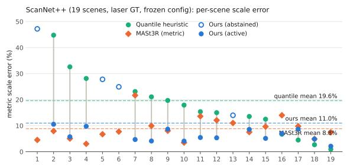

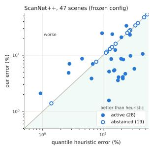  
Figure 3. Per-scene metric scale error on ScanNet++ (sorted by quantile error). Gray bars connect the quantile estimate to ours; open circles mark abstained scenes, which inherit the warm estimate. Left: the initial 19-scene set. Right: all 47 scenes against the identity line; active corrections mostly land below the diagonal, abstentions sit on it, and 9/47 end above. Left-panel indices map to scene IDs in the supplement.

Failure analysis. Nine active corrections end worse than the heuristic, three by more than 9 pp. The supplement dissects the worst (+15 pp): at the true scale nearly every object cue measures only 10–60% of its prior (no full door is ever seen, 41–50%) while the room-height anchor sits at 82%; dozens of partial-object lower bounds outvote the one correct anchor, and the gate cannot catch it because those partial cues agree with each other (inlier mass 1.7– 1.9). This is the principal open failure mode, the partialinstance limitation stated in Sec. 3.4, but only partly a geometric one: swapping in a stronger segmenter (Swin-L, 57.3 vs. 47.2 mIoU), nothing else changed, repairs this scene (24.6% → 8.6%) and cuts error from 9.7% to 6.3% on the 24 scenes both teachers act on (a paired reduction of 3.5 pp, 95% CI [1.5, 5.9], p=0.01), so much of what looks like partial reconstruction is partial labeling (supplement). We report it as a sensitivity study, having frozen the configuration before public evaluation.

## 4.3. Held-out safety: pre-registered abstention

Fifty additional ARKitScenes videos, the handheld-video regime in which development-time studies showed the cue mass collapsing, were processed with the frozen pipeline after we logged the prediction “mostly abstain, match the baseline.” Outcome: 50/50 abstentions, estimate equal to the heuristic on every video, zero degradations; ScanNet++ iPhone video behaves the same (3/3).

## 4.4. Development-set results

On the five development captures (real COLMAP, tapemeasured heights), the delivered room height errs by 27.4% for the quantile heuristic and, under an identical protocol, 66.3%, 70.9% and 34.8% for metric-depth alignment with Depth Anything 3, Depth Pro and MoGe-2 [25] (Fig. 2), versus 7.7% for the full system. The configuration was tuned here and one marginal scene is unstable across re-runs (±20 pp), which is why headline claims rest on the frozen benchmarks.

## 4.5. What the accuracy rests on

The fusion buys robustness. A gap-only or prior-meanonly estimator matches our median but its mean balloons to ∼40%, because it has no defense where the gap cue fails; full fusion cuts that mean by 2.4×. Accuracy therefore does not come from the room-height prior alone. It is also insensitive to how the priors are set: shifting every prior mean by ±10% moves the mean only to 17.9– 18.5%, and perturbing the anchors independently, as a regional catalog would, is cheaper still (200 draws: 17.1% median, 18.7% worst). Discarding the reliability weights costs 31 pp. Visibility gating buys coverage, not accuracy. Removing it leaves the deployed mean unchanged (16.4%, p=0.82) but pushes 12 more scenes below the cuemass threshold (31/47 abstain), cutting the set it can correct from 28 to 16 and raising the router’s MASt3R bill from 19 calls to 31; the symmetric |z−D| test is strictly worse on every metric $\scriptstyle ( p = 0 . 0 3 )$ , since grazing-incidence culling starves floor cues. A softer contribution-weighted gate in the spirit of [27, 35] is also worse (17.6%, 22 abstentions; supplement). The training loop delivers the scale; it does not improve it. Retraining all 47 scenes with the scale pinned at the warm start and running the same frozen estimator gives 16.5%/9.2% against our 16.6%/10.6% (paired 0.2 pp, 95% CI [−1.8, +1.4], p=0.28), and no single loop component moves the development split either (paired CIs all cross zero, p≥0.23). The accuracy is the fusion’s; the loop delivers a model that is already metric and keeps densification in meters, since forced training at 0.1× the metric scale loses 0.7–4.1 dB and destabilizes the Gaussian budget by 31–40%, while nominal to 10× sits at seed-noise level. The frozen thresholds are imperfect in hindsight: $M _ { \mathrm { m i n } } { = } 1 . 2 5$ would have given 15.2% against our 16.6%. A segmenter ten mIoU stronger peaks at the same threshold, so the gate needs no per-teacher calibration (supplement).

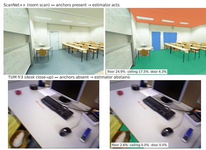  
Figure 4. Abstention tracks capture content across regimes. Teacher segmentations of raw frames: a ScanNet++ room scan shows the anchor classes on a quarter of its pixels (top); a TUM desk sequence shows essentially none (bottom).

## 4.6. Operating regime and negative results

The estimator’s territory is real photographs of rooms whose architecture is visible. Outside it, the system refuses predictably: sequences whose images barely contain the anchor classes (TUM desk close-ups: 0.0% ceiling/door pixels, Fig. 4); handheld video sweeps (ARKitScenes: 50/50

Table 2. Frozen system on 13 captures we recorded ourselves (phones and a drone; no tuning, no per-dataset configuration). Delivered floor→ceiling height in meters, signed error against a nominal per-venue height. Captures with no floor→ceiling cue have no delivered height. MoGe-2: identical protocol and operator. MASt3R fails the 20 cm registration gate on 12 of 13 captures (supplement).
<table><tr><td>capture</td><td>nom.</td><td>quantile</td><td>MoGe-2</td><td>ours</td><td></td><td></td><td>mass cues decision</td></tr><tr><td>Apartment A, session 1</td><td>2.3</td><td>2.90 (+26)</td><td>1.77 (-23)</td><td>2.65 (+15)</td><td>2.03</td><td>45</td><td>act</td></tr><tr><td>Apartment A, session 2</td><td>2.3</td><td>3.03 (+32)</td><td>2.40 (+4)</td><td>2.36(+3)</td><td>1.89</td><td>57</td><td>act</td></tr><tr><td>Apartment A, session 3</td><td>2.3</td><td></td><td></td><td>2.75 (+20)3.48 (+52) 2.75 (+20)</td><td>0.73</td><td>21</td><td>abstain</td></tr><tr><td>Home B, phone 1</td><td>2.3</td><td></td><td></td><td></td><td>0.98</td><td>33</td><td>abstain</td></tr><tr><td>Home B, phone 2</td><td>2.3</td><td></td><td></td><td>2.62 (+14) 2.04 (-11) 2.62 (+14)</td><td>0.84</td><td>30</td><td>abstain</td></tr><tr><td>Home C, stills</td><td>2.3</td><td></td><td>1.91 (-17) 1.34 (-42)</td><td>1.91 (-17)</td><td>0.52</td><td>37</td><td>abstain</td></tr><tr><td>Home C, video</td><td>2.3</td><td></td><td></td><td>3.08 (+34) 2.04 (-11) 2.67 (+16)</td><td>1.53</td><td>39</td><td>act</td></tr><tr><td>Show flat</td><td>2.3</td><td>2.63 (+14)</td><td>2.22 (-3)</td><td>2.63 (+14)</td><td>1.46</td><td>39</td><td>abstain</td></tr><tr><td>House corridor</td><td>2.3</td><td>1.24(-46)</td><td>0.70 (-70)</td><td>2.12(-8)</td><td>2.40</td><td>39</td><td>act</td></tr><tr><td>Robotics lab</td><td>3.0</td><td></td><td></td><td></td><td>0.03</td><td>9</td><td>abstain</td></tr><tr><td>Office floor</td><td>3.0</td><td></td><td>2.29 (-24) 1.82 (-39) 3.12 (+4)</td><td></td><td>1.50</td><td>28</td><td>act</td></tr><tr><td>Aerial (drone)</td><td></td><td></td><td></td><td></td><td>0.00</td><td>0</td><td>abstain</td></tr><tr><td>Sports field</td><td></td><td></td><td></td><td></td><td>0.00</td><td>6</td><td>abstain</td></tr></table>

abstain; ScanNet++ iPhone: 3/3); and synthetic appearance, which breaks the frozen teacher outright (Replica).

A refuted explanation. We attributed the video failures to resolution and pre-registered that re-running ten held-out videos at 640×480 (only the pixels change) would convert some to active. It did not: 6.25× the pixel count leaves 10/10 abstentions, moving mean cue mass from 0.33 to 0.41 against the 1.5 gate. Labels survive (16–43 cues per scene) but the measurements disagree, scattering at a median 5.3σ with only 20% inside 2σ: handheld sweeps fragment instances, and fragmented cues contradict each other. This unifies the two failure modes: when partial cues agree we get the confident error of the failure analysis, and when they disagree the gate fires. The operative variable is cue disagreement, not resolution.

Two levels of evidence. ETH3D probes the boundary: one of its four scenes is in regime and the estimator acts there (16.5% → 9.1%), abstaining on the outdoor and industrial ones (supplement). Abstention evidence is twolevel: between regimes the teacher’s 2D anchor coverage separates acting from abstaining; within ScanNet++ it does not (p=0.96). That second level is why coverage cannot replace the gate: routing by coverage instead of cue mass yields 14.5–15.3% at the same 19-call budget against the gate’s 9.4%, and needs 37–47 of the 47 scenes sent out to reach 9.6%, by which point the saving is gone.

## 4.7. Deployment on captures of our own

To see what happens on captures nobody designed the system around, we recorded 13 of our own with consumer phones and a drone (Tab. 2), reconstructed from images alone by COLMAP so that no inertial signal survives into the reconstruction, the regime Sec. 1 identifies. Nothing else changed: same nominal height, thresholds, teacher and seeds as the ScanNet++ runs. Ground truth is weaker here and we say so: the reference is a nominal ceiling height per venue class (2.3 m for dwellings, 3.0 m for institutional interiors), so it sets a floor on the error any method can show and these percentages are not comparable with the laserreferenced ones; we read the study as a transfer test of the frozen configuration, not as a second accuracy result. It does not decide the comparison, though: over an assumed true dwelling height of 2.1–2.7 m our mean error stays below MoGe-2’s throughout (19.6% vs. 26.3% at worst), with 2.3 m nearer our unfavorable end (supplement).

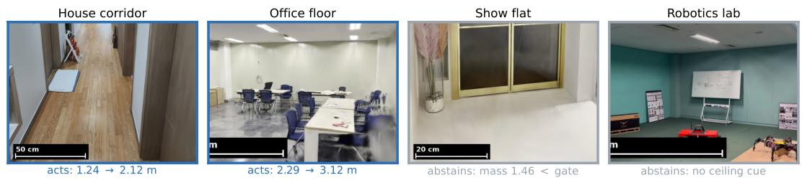  
Figure 5. What the frozen system does on captures of our own. Renderings from four of the 13 reconstructions, each with a reference bar at the delivered metric scale. Blue: the estimator acts and corrects the ceiling height. Gray: it refuses — the show flat’s cues disagree just below the gate, the lab capture never frames a ceiling — and returns the warm estimate.

The behavior transfers (Fig. 5; per-capture detail in the supplement). The estimator acts on five captures and improves every one, and the largest corrections are where the heuristic is worst: a corridor whose vertical span is truncated (−45.9% → −7.9%) and an office floor where the quantile heuristic imposes a 2.5 m room on a 3.0 m hall (−23.8% → +4.1%). That last correction runs away from the nominal prior, so the measured cues and not the assumed height carry it. Eight captures abstain and inherit their warm baseline exactly; none degrades. The regime boundary holds on data that never informed it: the sports field and the aerial survey abstain at mass 0.00.

What the error means in practice. A 1.70 m mannequin composited at the heuristic’s scale becomes a +48% giant where ours is visually correct, and a door measured in the model errs by 21 cm at the median under our scale versus 35 cm under the heuristic (supplement). A global scale presumes no spatial drift: over our longest real-SfM trajectory (703 frames) the per-region floor-to-ceiling gap varies by only 3% (CV).

## 5. Limitations

Our cue set presumes indoor scenes photographed as real images, with hand-specified size priors (regional catalogs: supplement): synthetic appearance breaks the frozen teacher, and captures that never show architecture leave nothing to fuse. Abstention turns these into explicit refusals, though it then returns the warm estimate unchanged, and only the no-anchor case is predictable in advance: handheld video has anchors and still fails, on cue disagreement visible only after measurement (Sec. 4.6). Partial instances remain the open technical limitation (Sec. 3.4): a completeness filter converts degradations into refusals (9 to 4 degraded scenes, 12 more abstentions) but, held out, leaves deployed error where it was (p=0.75; supplement). The assumed room height is the one sensitive input: retraining all 47 scenes at 2.1 and 3.0 m gives 13.8% and 25.3% against 16.6% at 2.5 m, all below the heuristic (supplement). Accuracy is bounded by the teacher, which is also an upgrade path: a stronger segmenter cuts error by a third at the same gate threshold (Sec. 4.2). The positive evidence is concentrated on captures of our own because no public indoor benchmark we know of is both in regime and outside this generation’s training data: ScanNet++ sits inside MoGe-2’s mixture, ETH3D offers one in-regime scene, Replica is synthetic, TUM shows no architecture, and ARKitScenes carries the inertial signal that makes the problem moot.

## 6. Conclusion

We presented a selective metric-scale estimator for indoor 3DGS: it reads the scale off the reconstruction’s own semantic content, visibility-aware voting lifts the scenes it can act on from 16 to 28 (a coverage gain at unchanged accuracy), and an inlier-mass test turns weak evidence into a refusal rather than a confident wrong answer. Frozen before first contact, it cuts the heuristic’s mean error by a fifth; its strongest result is the selective hybrid, which routes its refusals to match MASt3R at 60% fewer calls. On benchmark-grade imagery a strong feed-forward model is the better estimator; our case rests on ordinary captures, where ours is more reliable and says when it is not confident. The same model scores 2.3% inside its training mixture and 28–35% on unseen captures: a published number is a best case, not a deployment estimate.

Acknowledgments. This work was supported by Institute for Information & communications Technology Promotion (IITP) grant funded by the Korea government (MSIT) (No. RS-2026-25522152).

## References

[1] Gilad Baruch, Zhuoyuan Chen, Afshin Dehghan, Tal Dimry, Yuri Feigin, Peter Fu, Thomas Gebauer, Brandon Joffe, Daniel Kurz, Arik Schwartz, and Elad Shulman. Arkitscenes: A diverse real-world dataset for 3d indoor scene understanding using mobile rgb-d data. In NeurIPS Datasets, 2021. 5

[2] Shariq Farooq Bhat, Reiner Birkl, Diana Wofk, Peter Wonka, and Matthias Muller. Zoedepth: Zero-shot transfer by com-¨ bining relative and metric depth. arXiv:2302.12288, 2023. 3

[3] Aleksei Bochkovskii, Amael Delaunoy, Hugo Germain,¨ Marcel Santos, Yichao Zhou, Stephan R. Richter, and Vladlen Koltun. Depth pro: Sharp monocular metric depth in less than a second. In ICLR, 2025. 5

[4] Bowen Cheng, Ishan Misra, Alexander G. Schwing, Alexander Kirillov, and Rohit Girdhar. Masked-attention mask transformer for universal image segmentation. In CVPR, 2022. 3

[5] Duncan Frost, Victor Prisacariu, and David Murray. Recovering stable scale in monocular slam using objectsupplemented bundle adjustment. IEEE Transactions on Robotics, 2018. 3

[6] Mu Hu, Wei Yin, Chi Zhang, Zhipeng Cai, Xiaoxiao Long, Kaixuan Wang, Hao Chen, Gang Yu, Chunhua Shen, and Shaojie Shen. Metric3d v2: A versatile monocular geometric foundation model for zero-shot metric depth and surface normal estimation. IEEE TPAMI, 2024. 5

[7] Jiahui Huang, Qunjie Zhou, Hesam Rabeti, Aleksandr Korovko, Huan Ling, Xuanchi Ren, Tianchang Shen, Jun Gao, Dmitry Slepichev, Chen-Hsuan Lin, Jiawei Ren, Kevin Xie, Joydeep Biswas, Laura Leal-Taixe, and Sanja Fidler.´ Vipe: Video pose engine for 3d geometric perception. arXiv:2508.10934, 2025. 3

[8] Xirui Jin, Renbiao Jin, Boying Li, Danping Zou, and Wenxian Yu. Planargs: High-fidelity indoor 3d gaussian splatting guided by vision-language planar priors. arXiv:2510.23930, 2025. 3

[9] Nikhil Keetha, Norman Muller, Johannes Sch ¨ onberger,¨ Lorenzo Porzi, Yuchen Zhang, Tobias Fischer, Arno Knapitsch, Duncan Zauss, Ethan Weber, Nelson Antunes, Jonathon Luiten, Manuel Lopez-Antequera, Samuel Rota Bulo, Christian Richardt, Deva Ramanan, Sebastian\` Scherer, and Peter Kontschieder. Mapanything: Universal feed-forward metric 3d reconstruction. arXiv:2509.13414, 2025. 3

[10] Bernhard Kerbl, Georgios Kopanas, Thomas Leimkuhler,¨ and George Drettakis. 3d gaussian splatting for real-time radiance field rendering. ACM Transactions on Graphics, 42 (4), 2023. 1, 2, 3, 4

[11] Vincent Leroy, Yohann Cabon, and Jerome Revaud. Grounding image matching in 3d with mast3r. In ECCV, 2024. 3, 5

[12] Guibiao Liao, Qing Li, Zhenyu Bao, Guoping Qiu, and Kanglin Liu. Spc-gs: Gaussian splatting with semantic-prompt consistency for indoor open-world free-view synthesis from sparse inputs. In CVPR, 2025. 3

[13] Haotong Lin, Sili Chen, Junhao Liew, Donny Y. Chen, Zhenyu Li, Guang Shi, Jiashi Feng, and Bingyi Kang. Depth anything 3: Recovering the visual space from any views. arXiv:2511.10647, 2025. 3, 5

[14] Saswat Mallick, Rahul Goel, Bernhard Kerbl, Markus Steinberger, Francisco Vicente Carrasco, and Fernando De La Torre. Taming 3dgs: High-quality radiance fields with limited resources. In SIGGRAPH Asia, 2024. 2

[15] Hewei Pan, Weiye Zhu, Zekai Zhang, Zitong Huang, Rongtao Xu, Jinbao Wang, and Feng Zheng. Vgp-nav: Metricaware visual geometric perception for robot navigation. arXiv:2606.09268, 2026. 3

[16] Luigi Piccinelli, Yung-Hsu Yang, Christos Sakaridis, Mattia Segu, Siyuan Li, Luc Van Gool, and Fisher Yu. Unidepth: Universal monocular metric depth estimation. In CVPR, 2024. 5

[17] Minghan Qin, Wanhua Li, Jiawei Zhou, Haoqian Wang, and Hanspeter Pfister. Langsplat: 3d language gaussian splatting. In CVPR, 2024. 3

[18] Renato F. Salas-Moreno, Richard A. Newcombe, Hauke Strasdat, Paul H. J. Kelly, and Andrew J. Davison. Slam++: Simultaneous localisation and mapping at the level of objects. In CVPR, 2013. 3

[19] Johannes L. Schonberger and Jan-Michael Frahm. Structure-¨ from-motion revisited. In CVPR, 2016. 2, 5

[20] Thomas Schops, Johannes L. Sch¨ onberger, Silvano Galliani,¨ Torsten Sattler, Konrad Schindler, Marc Pollefeys, and An dreas Geiger. A multi-view stereo benchmark with high resolution images and multi-camera videos. In CVPR, 2017. 5

[21] Julian Straub, Thomas Whelan, Lingni Ma, Yufan Chen, Erik Wijmans, Simon Green, Jakob J. Engel, Raul Mur-Artal, Carl Ren, Shobhit Verma, Anton Clarkson, Mingfei Yan, Brian Budge, Yajie Yan, Xiaqing Pan, June Yon, Yuyang Zou, Kimberly Leon, Nigel Carter, Jesus Briales, Tyler Gillingham, Elias Mueggler, Luis Pesqueira, Manolis Savva, Dhruv Batra, Hauke M. Strasdat, Renzo De Nardi, Michael Goesele, Steven Lovegrove, and Richard Newcombe. The replica dataset: A digital replica of indoor spaces. In arXiv:1906.05797, 2019. 5

[22] Jurgen Sturm, Nikolas Engelhard, Felix Endres, Wolfram¨ Burgard, and Daniel Cremers. A benchmark for the eval uation of rgb-d slam systems. In IROS, 2012. 5

[23] Hengyi Wang and Lourdes Agapito. Amb3r: Accurate feed-forward metric-scale 3d reconstruction with backend. arXiv:2511.20343, 2025. 3

[24] Jianyuan Wang, Minghao Chen, Nikita Karaev, Andrea Vedaldi, Christian Rupprecht, and David Novotny. Vggt: Visual geometry grounded transformer. In CVPR, 2025. 3, 5

[25] Ruicheng Wang, Sicheng Xu, Yue Dong, Yu Deng, Jianfeng Xiang, Zelong Lv, Guangzhong Sun, Xin Tong, and Jiaolong Yang. Moge-2: Accurate monocular geometry with metric scale and sharp details. In NeurIPS, 2025. 3, 5, 6

[26] Shuzhe Wang, Vincent Leroy, Yohann Cabon, Boris Chidlovskii, and Jerome Revaud. Dust3r: Geometric 3d vision made easy. In CVPR, 2024. 3

[27] Sen Wang, Kunyi Li, Siyun Liang, Elena Alegret, Jing Ma, Nassir Navab, and Stefano Gasperini. Visibility-aware language aggregation for open-vocabulary segmentation in 3d gaussian splatting. In 3DV, 2026. 3, 7

[28] Yifan Wang, Jianjun Zhou, Haoyi Zhu, Wenzheng Chang, Yang Zhou, Zizun Li, Junyi Chen, Jiangmiao Pang, Chunhua Shen, and Tong He. π3: Permutation-equivariant visual geometry learning. In ICLR, 2026. 3

[29] Lihe Yang, Bingyi Kang, Zilong Huang, Zhen Zhao, Xiaogang Xu, Jiashi Feng, and Hengshuang Zhao. Depth anything v2. NeurIPS, 2024. 3

[30] Chandan Yeshwanth, Yueh-Cheng Liu, Matthias Nießner, and Angela Dai. Scannet++: A high-fidelity dataset of 3d indoor scenes. In ICCV, 2023. 5

[31] Wei Yin, Chi Zhang, Hao Chen, Zhipeng Cai, Gang Yu, Kaixuan Wang, Xiaozhi Chen, and Chunhua Shen. Metric3d: Towards zero-shot metric 3d prediction from a single image. In ICCV, 2023. 3

[32] Zehao Yu, Anpei Chen, Binbin Huang, Torsten Sattler, and Andreas Geiger. Mip-splatting: Alias-free 3d gaussian splatting. In CVPR, 2024. 2

[33] Wanting Zhang, Haodong Xiang, Zhichao Liao, Xiansong Lai, Xinghui Li, and Long Zeng. 2dgs-room: Seed-guided 2d gaussian splatting with geometric constraints for highfidelity indoor scene reconstruction. arXiv:2412.03428, 2024. 3

[34] Wei Zhang, Qing Cheng, David Skuddis, Niclas Zeller, Daniel Cremers, and Norbert Haala. Hi-slam2: Geometryaware gaussian slam for fast monocular scene reconstruction. IEEE Transactions on Robotics, 41:6478–6493, 2025. 3

[35] Yupeng Zhang, Dezhi Zheng, Ping Lu, Han Zhang, Lei Wang, Liping Xiang, Cheng Luo, Kaijun Deng, Xiaowen Fu, Linlin Shen, and Jinbao Wang. Labelgs: Label-aware 3d gaussian splatting for 3d scene segmentation. In PRCV, 2025. 3, 7

[36] Shijie Zhou, Haoran Chang, Sicheng Jiang, Zhiwen Fan, Zehao Zhu, Dejia Xu, Pradyumna Chari, Suya You, Zhangyang Wang, and Achuta Kadambi. Feature 3dgs: Supercharging 3d gaussian splatting to enable distilled feature fields. In CVPR, 2024. 3

# Supplementary Material

# METRIC-GS: Selective Metric-Scale Estimation for 3D Gaussian Splatting

<table><tr><td>claim (main paper)</td><td>evidence</td></tr><tr><td>Frozen system: 16.6%/10.6% on 47 laser-GT Tab. 1; per scene supp. Tab. S2 ScanNet++ scenes; acts on 28, abstains on 19</td><td></td></tr><tr><td>Router parity: routing only abstentions §4.2; supp. §N, Tabs. S17-S18 to MASt3R matches MASt3R everywhere</td><td></td></tr><tr><td>(−0.5 pp, n.s.; TOST-equivalent at ±3 pp) Prior sensitivity: uniform ±10% shifts, het- §4.5; supp. §H, Tabs. S9–S10 erogeneous and regional catalogs, MC worst</td><td></td></tr><tr><td>case Abstention threshold: frozen Mmin=1.5 on §4.5; supp. Tab. S8 the mean plateau; 1.25 would score 15.2% (re-</td><td></td></tr><tr><td>ported) Gate needs no per-teacher recalibration (opti- §4.5; supp. §K, Tab. S14 mum static under a +10 mIoU teacher)</td><td></td></tr><tr><td>Visibility gate: one-sided culling; removal or §4.5; supp. §L, Tab. S16 softening costs actionability or accuracy</td><td></td></tr><tr><td>In-loop scale is delivery, not accuracy: post- §4.5 (47-scene retrain, aggre- hoc-only retrain 16.5% vs. 16.6% (p=0.28)</td><td>gate only); per-component ab- lation on the 19-scene split: supp. §J, Tabs. S12–S13</td></tr><tr><td>Teacher bound: a stronger segmenter alone Tab. 1 (†); supp. §R, Tab. S21 reaches 6.3% on the both-act subset (signifi-</td><td></td></tr><tr><td>cant) Held-out abstention: ARKitScenes at two res- §4.3; supp. §I, Tab. S11 olutions; ScanNet++ iPhone 3/3; zero degrada-</td><td></td></tr><tr><td>tions Nominal-GT sensitivity: capture conclusions supp. §Y, Tab. S27 invariant to the assumed per-venue height</td><td></td></tr><tr><td>Benchmark contamination: MoGe-2 2.3% in- §4.2; supp. §U, Tabs. S23-S24 side its training mixture, 28–35% on unseen</td><td></td></tr><tr><td>captures In-the-wild captures: acts on 5/13 and im- §4.7, Tab. 2; supp. §Y proves every one; abstentions inherit the warm</td><td></td></tr><tr><td>baseline, none degrades Rendering quality neutral on average (mean supp. §M, Tab. S15 ∆PSNR within 0.07 dB), per-scene moves up</td><td></td></tr><tr><td>to 1.3 dB both ways Cost: ~11 s post-hoc estimation (the MLE it- §4.2; supp. §V, Tab. S25 self &lt;10 ms); router saves 60% of MASt3R invocations</td><td></td></tr><tr><td>Negative results, kept: render-to-measure, supp. §§B, G, L, O, W asymmetric loss, soft visibility, completeness filter, scoped directions</td><td></td></tr></table>

## Where each claim is substantiated

Every comparative claim in the main paper is backed by a paired test and a stated protocol; this index maps each claim to its evidence so that a reviewer question can be answered from the submission itself.

## A. Per-scene results

Table S2 lists the per-scene metric scale errors behind the main table. Scene 5f99900f09 is excluded: its densification exhausts a 16 GB GPU at full and half resolution; we report this rather than silently dropping it. Table S1 maps the scene indices of the main paper’s Fig. 3 left panel to their ScanNet++ IDs.

Table S1. Scene indices of the main paper’s Fig. 3 left panel (the initial 19-scene set, sorted by quantile error).
<table><tr><td></td><td># scene</td><td>#</td><td>scene</td><td>#</td><td>scene</td><td>#</td><td>scene</td></tr><tr><td></td><td>1 40aec5fffa</td><td>6</td><td></td><td></td><td></td><td></td><td>fb5a96b1a2 11 a24f64f7fb163e8bba0176</td></tr><tr><td></td><td>2 38d58a7a31</td><td>7</td><td>7831862f02</td><td>12</td><td></td><td></td><td>1ada7a0617 175eb31827b7</td></tr><tr><td></td><td>3 bdele479ad</td><td>8</td><td></td><td></td><td></td><td></td><td>acd95847c5 13 f9f95681fd 18 cc5237fd77</td></tr><tr><td></td><td>421d970d8de</td><td>9</td><td></td><td></td><td></td><td></td><td>c50d2d1d42 14 5ee7c22ba0 19 3f15a9266d</td></tr><tr><td></td><td>5 c4c04e6d6c 10 5748ce6f01 15 7b6477cb95</td><td></td><td></td><td></td><td></td><td></td><td></td></tr></table>

Table S2. ScanNet++ per-scene scale error (%).
<table><tr><td>scene</td><td>quantile</td><td>MASt3R</td><td>ours</td><td>decision</td></tr><tr><td>09c1414f1b</td><td>2.8</td><td>25.3</td><td>7.0</td><td>active</td></tr><tr><td>0d2ee665be</td><td>9.6</td><td>9.2</td><td>24.6</td><td>active</td></tr><tr><td>13c3e046d7</td><td>13.9</td><td>13.8</td><td>13.9</td><td>abstain</td></tr><tr><td>1ada7a0617</td><td>15.0</td><td>12.1</td><td>5.3</td><td>active</td></tr><tr><td>21d970d8de</td><td>28.1</td><td>3.0</td><td>9.8</td><td>active</td></tr><tr><td>25f3b7a318</td><td>14.1</td><td>35.3</td><td>23.7</td><td>active</td></tr><tr><td>27dd4da69e</td><td>12.9</td><td>4.6</td><td>12.9</td><td>abstain</td></tr><tr><td>286b55a2bf</td><td>37.2</td><td>5.7</td><td>37.2</td><td>abstain</td></tr><tr><td>31a2c91c43</td><td>7.7</td><td>15.9</td><td>7.7</td><td>abstain</td></tr><tr><td>38d58a7a31</td><td>44.8</td><td>7.9</td><td>10.6</td><td>active</td></tr><tr><td>3db0a1c8f3</td><td>24.1</td><td>2.4</td><td>33.4</td><td>active</td></tr><tr><td>3e8bba0176</td><td>6.7</td><td>14.0</td><td>7.0</td><td>active</td></tr><tr><td>3f15a9266d</td><td>0.9</td><td>7.4</td><td>2.1</td><td>active</td></tr><tr><td>40aec5fffa</td><td>47.2</td><td>4.5</td><td>47.2</td><td>abstain</td></tr><tr><td>45b0dac5e3</td><td>11.5</td><td>7.4</td><td>11.5</td><td>abstain</td></tr><tr><td>5748ce6f01</td><td>17.9</td><td>3.5</td><td>4.1</td><td>active</td></tr><tr><td>578511c8a9</td><td>19.9</td><td>16.7</td><td>20.9</td><td>active</td></tr><tr><td>5eb31827b7</td><td>4.5</td><td>9.8</td><td>8.7</td><td>active</td></tr><tr><td>5ee7c22ba0</td><td>13.6</td><td>7.5</td><td>8.6</td><td>active</td></tr><tr><td>6115eddb86</td><td>6.4</td><td>9.9</td><td>3.9</td><td>active</td></tr><tr><td>7831862f02</td><td>23.1</td><td>21.7</td><td>4.7</td><td>active</td></tr><tr><td>7b6477cb95</td><td>12.5</td><td>9.7</td><td>5.1</td><td>active</td></tr><tr><td>7bc286c1b6</td><td>71.6</td><td>1.0</td><td>71.6</td><td>abstain</td></tr><tr><td>825d228aec</td><td>20.1</td><td>6.8</td><td>0.7 1.6</td><td>active</td></tr><tr><td>9071e139d9</td><td>12.4</td><td>22.4</td><td></td><td>active</td></tr><tr><td>99fa5c25e1</td><td>70.0</td><td>4.2</td><td>70.0</td><td>abstain</td></tr><tr><td>a24f64f7fb</td><td>15.4</td><td>13.6</td><td>5.5</td><td>active</td></tr><tr><td>a8bf42d646 a980334473</td><td>1.4</td><td>25.6</td><td>1.4</td><td>abstain</td></tr><tr><td></td><td>27.9</td><td>2.5</td><td>27.9</td><td>abstain</td></tr><tr><td>ac48a9b736</td><td>21.4</td><td>14.4</td><td>8.4</td><td>active</td></tr><tr><td>acd95847c5</td><td>21.1</td><td>9.9</td><td>4.1</td><td>active</td></tr><tr><td>b0a08200c9</td><td>53.2</td><td>3.1</td><td>53.2</td><td>abstain</td></tr><tr><td>bcd2436daf</td><td>15.8</td><td>1.5</td><td>12.4</td><td>active</td></tr><tr><td>bde1e479ad</td><td>32.6</td><td>5.0</td><td>5.7</td><td>active</td></tr><tr><td>c49a8c6cff</td><td>27.6</td><td>0.8</td><td>23.1</td><td>active</td></tr><tr><td>c4c04e6d6c c50d2d1d42</td><td>27.8</td><td>6.7</td><td>27.8</td><td>abstain</td></tr><tr><td></td><td>19.7</td><td>8.0</td><td>8.7</td><td>active</td></tr><tr><td>c5439f4607</td><td>26.8</td><td>18.2</td><td>26.8</td><td>abstain</td></tr><tr><td>cc5237fd77</td><td>2.7</td><td>4.9</td><td>4.9</td><td>active</td></tr><tr><td>d755b3d9d8</td><td>17.5</td><td>3.5</td><td>3.6</td><td>active</td></tr><tr><td>e398684d27</td><td>11.6</td><td>11.8</td><td>11.6</td><td>abstain</td></tr><tr><td>e7af285f7d</td><td>16.0</td><td>2.4</td><td>16.0</td><td>abstain</td></tr><tr><td>f2dc06b1d2</td><td>33.9</td><td>8.0</td><td>33.9</td><td>abstain</td></tr><tr><td>f3685d06a9</td><td>11.1</td><td>24.8</td><td>11.1</td><td>abstain</td></tr><tr><td>f3d64c30f8</td><td>21.1</td><td>0.3</td><td>3.9</td><td>active</td></tr><tr><td>f9f95681fd</td><td>14.0</td><td>11.0</td><td>14.0</td><td>abstain</td></tr><tr><td>fb5a96b1a2</td><td>24.9</td><td>7.7</td><td>24.9</td><td>abstain</td></tr></table>

## B. Negative result: fronto-parallel render-tomeasure

Synthesizing a fronto-parallel view of each detected instance and re-measuring it with the teacher is appealing: the reconstruction can ”re-photograph” objects the capture only saw obliquely. In practice the virtual viewpoints fall off the training-view manifold and the renders collapse into floater fields (Fig. S1); constraining the camera toward the nearest training view and gating on depth coverage and mask truncation does not rescue it, because floaters occupy plausible depths. The surviving form of render-based supervision is the visibility-aware voting of the main paper.

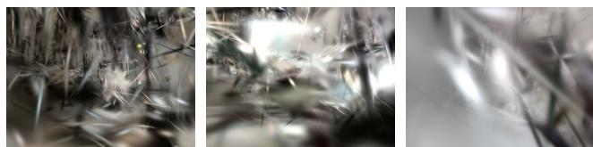  
Figure S1. Fronto-parallel virtual views of door/wardrobe instances, including a view-manifold-constrained attempt (right): the renders degrade into floater fields away from the training trajectory, and depth-coverage gates cannot reject them because floaters occupy plausible depths.

## C. Priors and hyperparameters

Table S3 lists every size prior; means and standard deviations follow public architectural standards and typical furniture dimensions and were never tuned per dataset; weights encode how standardized a class is (doors and room height highest). The rules below are the complete specification; with the table, they determine every number in the paper.

Voting. Every 200 training iterations over 24 randomly selected training views (48 views and three seed ensembles {12345, 23456, 34567} for the reported post-hoc estimate; view subsets come from fixed generators). A view votes for a Gaussian only if the projection is in frame, camera depth $z > 0 . 2$ , and $z < D _ { v } ( 1 + 0 . 0 5 )$ for the rendered depth $D _ { v }$ A Gaussian keeps the winning class if it holds ≥50% of that Gaussian’s votes (≥1 vote). If fewer than 5% of Gaussians end up labeled, the tolerance is tripled once and then the visibility test is dropped, so a degenerate depth render cannot starve the estimator.

Instances and extents. A class is measured only $\mathrm { i f } \geq 5 0$ Gaussians carry its label. Instances come from voxel-grid connected components (26-neighborhood) at voxel size 4× the median nearest-neighbor distance of that class’s points (subsampled to 1500 points with a fixed seed), keeping at most the 4 largest; instances below 0.5× the largest instance’s extent are discarded as fragments. Extents are [0.02, 0.98] quantile-trimmed spans along the vertical axis. A whole-cluster extent is added only when the class has at most one instance, with half weight; each surviving instance also carries half weight, split equally among instances of that class.

Vertical axis and planes. Candidates are the floor-plane normal, the ceiling-plane normal (each from a PCA on points within the 90th percentile of distance from the class median, requiring ≥30 points) and the global PCA minor axis; we keep whichever maximizes the floor-to-ceiling separation. Plane heights are the modes of 60-bin height histograms. A floor→ceiling gap is rejected if it is below 15% of the 5–95 percentile span of labeled heights, which removes degenerate gaps from mislabeled ceilings.

Fusion. Geman–McClure with c=3 on $( e ^ { s } m _ { c } - \mu _ { c } ) / { \sigma _ { c } } ,$ plus the quadratic warm prior $( \sigma _ { w } = 0 . 3 5 , ~ \lambda { = } 1 ) ;$ the posthoc estimate is the minimum over 2001 log-spaced points in $e ^ { s } \in [ 0 . 0 5 , 2 0 ]$ . In training the same objective is minimized by 25 Adam steps at learning rate $5 \times 1 0 ^ { - 3 }$ every 200 iterations, over measurements buffered from the last $K { = } 5$ votes. Abstention triggers at inlier mass below $M _ { \mathrm { m i n } } { = } 1 . 5 .$

Table S3. Complete anchor catalog (meters). what is the measured quantity: V = vertical extent of the instance, G = gap between two plane modes. Every extent is the [0.02, 0.98] quantile-trimmed span along the semantic vertical axis; instance cues come from voxel connected components, cluster cues from the whole labeled set and only when the class has at most one instance. Weights encode how standardized a class is and were set once from public building standards and furniture dimensions.

<table><tr><td>class</td><td>what</td><td>µ</td><td>σ</td><td>w</td></tr><tr><td>bed</td><td>V</td><td>0.55</td><td>0.15</td><td>0.30</td></tr><tr><td>chair</td><td>V</td><td>0.88</td><td>0.15</td><td>0.40</td></tr><tr><td>coffee table</td><td>V</td><td>0.45</td><td>0.10</td><td>0.30</td></tr><tr><td>counter</td><td>V</td><td>0.90</td><td>0.10</td><td>0.50</td></tr><tr><td>countertop</td><td>V</td><td>0.90</td><td>0.08</td><td>0.50</td></tr><tr><td>desk</td><td>V</td><td>0.75</td><td>0.08</td><td>0.60</td></tr><tr><td>door</td><td>V</td><td>2.03</td><td>0.10</td><td>1.00</td></tr><tr><td>monitor</td><td>V</td><td>0.45</td><td>0.15</td><td>0.20</td></tr><tr><td>person</td><td>V</td><td>1.70</td><td>0.15</td><td>0.30</td></tr><tr><td>radiator</td><td>V</td><td>0.60</td><td>0.20</td><td>0.20</td></tr><tr><td>refrigerator</td><td>V</td><td>1.70</td><td>0.25</td><td>0.40</td></tr><tr><td>sink</td><td>V</td><td>0.85</td><td>0.12</td><td>0.40</td></tr><tr><td>stool</td><td>V</td><td>0.65</td><td>0.15</td><td>0.30</td></tr><tr><td>swivel chair</td><td>V</td><td>1.00</td><td>0.20</td><td>0.30</td></tr><tr><td>table</td><td>V</td><td>0.74</td><td>0.08</td><td>0.60</td></tr><tr><td>television</td><td>V</td><td>0.70</td><td>0.30</td><td>0.15</td></tr><tr><td>toilet</td><td>V</td><td>0.76</td><td>0.10</td><td>0.50</td></tr><tr><td>wardrobe</td><td>V</td><td>2.00</td><td>0.30</td><td>0.30</td></tr><tr><td>floor→ceiling gap</td><td>G</td><td>2.50</td><td>0.30</td><td>1.00</td></tr></table>

## D. Qualitative results and diagnostics

This section collects the visual evidence behind the main paper’s claims: that the scale machinery is quality-neutral on the scenes it trains (render grid), that the in-loop estimate converges early and stays put (trajectories), that the real-SfM condition reproduces the sim3 pattern scene-byscene (scatter), what the forced-scale degradation (Tab. S4; Sec. 4.5 of the main paper) looks like at full resolution (frame pair), and what the teacher actually sees in each abstention regime (gallery). The last is the qualitative counterpart of the two-level coverage evidence in Sec. 4.6 of the main paper.

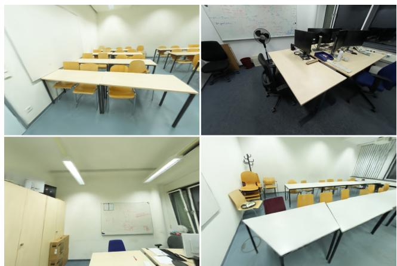  
Figure S2. Renders of four ScanNet++ scenes trained with the full scale-in-the-loop pipeline; the scale machinery costs no visible quality (mean ∆PSNR within 0.07 dB of the ablated baselines; Tab. S15).

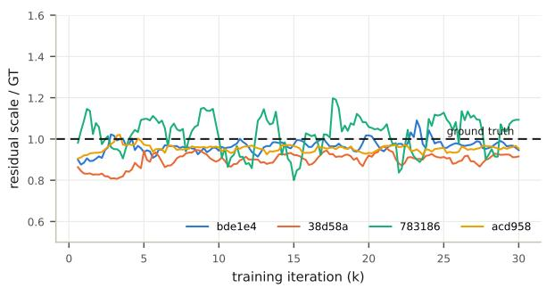  
Figure S3. In-loop residual-scale trajectories (normalized by ground truth) for four scenes: the estimate stabilizes within the first third of training; the reported value is the post-hoc multi-seed MLE.

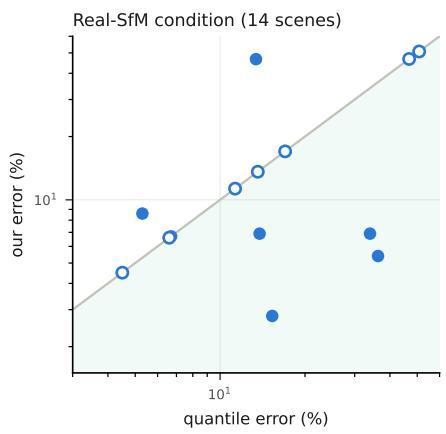  
Figure S4. Real-SfM condition, per scene (open circles = abstentions).

## E. Mechanism visualizations

The following figures visualize the individual mechanisms in place: the 3D anchors and the vertical axis they define, the one-sided visibility test that keeps grazing-incidence floor votes alive, the abstention gate over the empirical inlier-mass distribution (shown with the degraded actives it fails to separate; consistent with the failure analysis, their cues agree while being collectively biased), the two-level coverage evidence, and the cost–accuracy landscape the router operates in (the nominal-height sensitivity curve is shown with its retraining study, Fig. S12).

Table S4. Forced-scale training (fixed hyperparameters, 3 development scenes; Sec. 4.5 of the main paper). Gross under-scaling is uniformly harmful in quality and destabilizes the Gaussian budget in a scene-dependent direction; differences within the nominal-to-10× range are at seed-noise level.
<table><tr><td></td><td>0.1×</td><td>nominal</td><td>≈GT</td><td>10×</td></tr><tr><td>PSNR↑</td><td></td><td></td><td></td><td></td></tr><tr><td>room1</td><td>26.73</td><td>27.39</td><td>27.67</td><td>27.61</td></tr><tr><td>room2</td><td>28.86</td><td>29.89</td><td>29.97</td><td>29.58</td></tr><tr><td>studio1</td><td>22.56</td><td>26.70</td><td>26.33</td><td>26.45</td></tr><tr><td colspan="5">Gaussians (k)↓</td></tr><tr><td>room1</td><td>376</td><td>299</td><td>286</td><td>287</td></tr><tr><td>room2</td><td>442</td><td>316</td><td>316</td><td>320</td></tr><tr><td>studio1</td><td>251</td><td>370</td><td>373</td><td>356</td></tr></table>

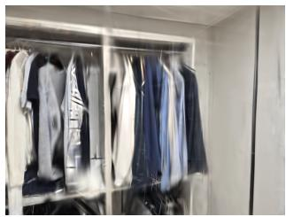

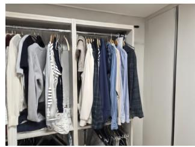  
Figure S5. Full frames behind the forced-scale experiment (Tab. S4; Sec. 4.5 of the main paper): the same view trained at 0.1× the metric scale (left) and at the metric scale (right).

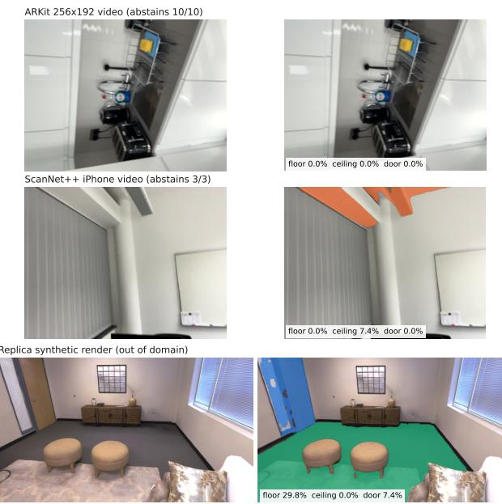  
Figure S6. Abstention regimes with the teacher’s own output. Top: ARKitScenes 256×192 video, where anchors are labeled and survive into 3D, but the resulting measurements disagree (Sec. I). Middle: ScanNet++ iPhone video with motion blur. Bottom: a Replica synthetic render, where the real-image teacher fails outright. In all three the estimator abstains.

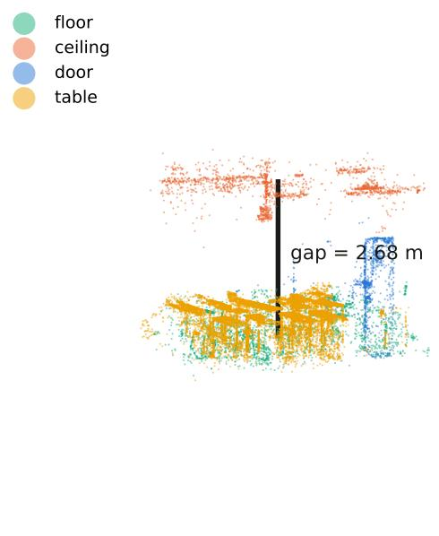

Figure S7. Labeled Gaussians of a ScanNet++ scene in 3D (subsampled), with the semantically derived vertical axis and the measured floor→ceiling gap under the recovered scale.  
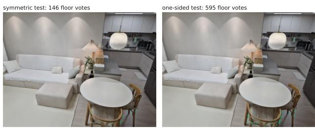  
Figure S8. Why the visibility test must be one-sided: on the same model and identical votes, the symmetric |z − D| test keeps only 146 floor-labeled Gaussians (grazing-incidence rejections), the one-sided test 595: the difference between a collapsed and a usable gap cue.

## F. Cue composition and prior sensitivity

Across the 28 active ScanNet++ scenes, the floor→ceiling gap carries ∼54% of the inlier mass regardless of outcome; the discriminative difference is doors (15% of inlier mass on improved scenes vs. 6% on degraded ones). Table S5 gives the cue-composition ablation referenced in the main paper: single-cue estimators match the full system’s median while their mean collapses, because neither has any defense on the scenes where its one cue fails.

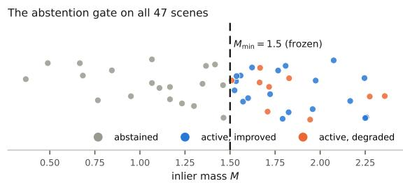  
Figure S9. Inlier mass of every scene against the frozen threshold. Degraded actives (orange) sit inside the accepted region — the gate cannot separate them, matching the failure analysis: their cues agree with each other while being collectively biased.

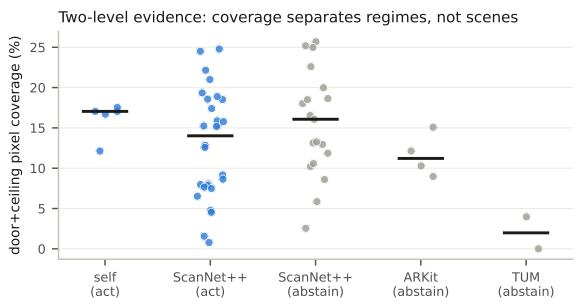  
Figure S10. Two-level abstention evidence: the teacher’s 2D anchor coverage separates capture regimes (right three columns) but not individual ScanNet++ scenes.

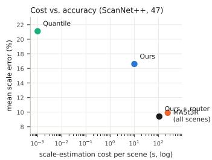  
Figure S11. Cost–accuracy trade-off among the estimators that run inside the reconstruction pipeline; the router occupies the corner. Single-image metric models are not plotted: on ScanNet++ MoGe-2 would sit below and left of every point here, but that benchmark is inside its training mixture (Sec. U), so the position would not be comparable. The x-axis is scale-estimation cost per scene and excludes 3DGS training, which the deployment scenario of the main paper (Sec. 4.1) treats as sunk: the reconstruction is built regardless.

Table S5. Cue-composition ablation, ScanNet++ 47 (deployed scale error). Single-cue variants track the median but not the mean.
<table><tr><td>estimator</td><td>mean</td><td>median</td></tr><tr><td>room-height prior only</td><td>40.5%</td><td>10.7%</td></tr><tr><td>gap cue only</td><td>39.6%</td><td>9.4%</td></tr><tr><td>uniform cue weights</td><td>47.9%</td><td>13.1%</td></tr><tr><td>full fusion</td><td>16.6%</td><td>10.6%</td></tr></table>

Leave-one-anchor-out. Table S6 removes one anchor class at a time from the frozen cue sets and re-runs only the

MLE and gate. No single furniture anchor is load-bearing: the largest movement is doors at +1.8 pp, and dropping person reproduces the 16.6→16.8% figure of Sec. Y. Removing the floor→ceiling gap does not degrade the estimate; it removes the estimate. All 47 scenes abstain and inherit the warm start (21.1%), which is the gate behaving as designed: the failure mode of losing the load-bearing cue is refusal, not a confident wrong answer. The complementary question — whether the gap alone would suffice — is answered above (gap-only, 39.6% mean against 16.6% for the full fusion).

Table S6. Leave-one-anchor-out on the frozen ScanNet++ cue sets (47 scenes, deployed protocol: abstentions inherit the warm estimate). Each row removes every measurement of one anchor class and re-runs only the MLE and gate.
<table><tr><td>removed</td><td>mean</td><td>med.</td><td>abst.</td><td>removed</td><td>mean</td><td>med.</td><td>abst.</td></tr><tr><td>none (frozen)</td><td>16.6</td><td>10.6</td><td>19</td><td>person</td><td>16.8</td><td>10.6</td><td>18</td></tr><tr><td>floor→ceil. gap</td><td>21.1</td><td>17.5</td><td>47</td><td>stool</td><td>16.7</td><td>10.6</td><td>20</td></tr><tr><td>door</td><td>18.5</td><td>13.8</td><td>25</td><td>refrigerator</td><td>16.7</td><td>10.6</td><td>19</td></tr><tr><td>chair</td><td>18.1</td><td>12.0</td><td>22</td><td>swivel chair</td><td>16.7</td><td>10.6</td><td>22</td></tr><tr><td>bed</td><td>17.7</td><td>11.5</td><td>20</td><td>toilet</td><td>16.7</td><td>11.1</td><td>19</td></tr><tr><td>table</td><td>17.6</td><td>12.4</td><td>22</td><td>counter</td><td>16.6</td><td>10.6</td><td>19</td></tr><tr><td>television</td><td>17.5</td><td>11.5</td><td>22</td><td>radiator</td><td>16.6</td><td>10.6</td><td>21</td></tr><tr><td>desk</td><td>17.3</td><td>11.6</td><td>25</td><td>sink</td><td>16.4</td><td>10.3</td><td>17</td></tr><tr><td>wardrobe</td><td>17.1</td><td>11.1</td><td>19</td><td>countertop</td><td>16.4</td><td>9.8</td><td>18</td></tr><tr><td>monitor</td><td>17.1</td><td>11.1</td><td>21</td><td>coffee table</td><td>17.0</td><td>11.1</td><td>20</td></tr></table>

Nominal room height, measured. The nominal height is an input to the quantile warm start, which rescales the source before training, so its effect can only be measured by retraining. We retrained all 47 scenes at 2.1 m and 3.0 m and evaluated them with the unchanged estimator (Tab. S7, Fig. S12). Three things follow. First, most of the effect is inherited rather than introduced: the heuristic itself moves from 21.3% to 29.5% across the range, and our error tracks it. Second, the improvement over the warm start survives every setting, from −36% relative at 2.1 m to −14% at 3.0 m. Third, contrary to the concern that a 2.5 m prior is quietly matched to this dataset, 2.5 m is not the bestperforming choice here: 2.1 m would have been better on all three aggregates. We kept 2.5 m because it is the architectural standard we froze before looking, and report that a tuned choice would have flattered us.

Table S7. Assumed room height, all 47 scenes retrained at each setting. “active” is the mean over scenes the estimator acts on.
<table><tr><td>height</td><td>quantile</td><td>ours</td><td>median</td><td>active</td><td>abstain</td></tr><tr><td>2.1 m</td><td>21.3%</td><td>13.8%</td><td>9.5%</td><td>7.4%</td><td>23</td></tr><tr><td>2.5 m (frozen)</td><td>21.1%</td><td>16.6%</td><td>10.6%</td><td>9.3%</td><td>19</td></tr><tr><td>3.0m</td><td>29.5%</td><td>25.3%</td><td>12.3%</td><td>13.1%</td><td>20</td></tr></table>

Adapting the priors to another region. The catalog encodes one building tradition, and a practitioner elsewhere should expect to edit it. Two measurements bound what that costs. Shifting every prior mean by ±10%, a larger move than the difference between most national door standards, changes the 47-scene mean only from 16.6% to 17.9– 18.5%; the robust fusion absorbs a uniform prior shift because the cues outvote it. Discarding the reliability weights, by contrast, costs 31 pp. Our recommendation is therefore to keep the weighting tiers as they are and edit only the two code-regulated means (µ for door and the floor→ceiling gap) to local standards; the ergonomic and style-dependent classes carry little mass and are not worth regionalising. The one input that does warrant local calibration is the nominal room height of the warm start, whose effect is measured above.

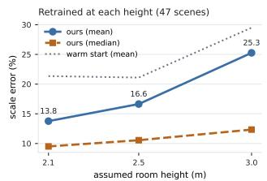

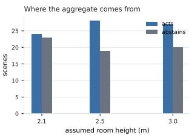  
Figure S12. Measured sensitivity to the assumed room height (47 scenes retrained per setting). Left: the estimator tracks its warm start and beats it everywhere. Right: the active/abstained split, which is what moves the aggregates.

Changing the size prior’s center rather than the warm start is a separate, milder knob. Refitting the post-hoc estimator with the floor-to-ceiling prior re-centered (warm start untouched) moves the 47-scene mean from 16.6% to 19.2% at 2.1 m and 20.5% at 3.0 m; the result is likewise insensitive to that prior’s width.

## G. A tried-and-rejected variant: asymmetric robust loss

Because instance extents are lower bounds and cluster extents upper bounds, an asymmetric Geman–McClure penalty (early saturation on the expected side of each cue type) appears principled. We implemented it and it regressed both our development scenes and the public benchmarks: the asymmetry double-counts the bias cancellation that the hybrid cluster+instance cue set already provides, and weakens the anchors exactly where mode selection needs them. We report this as a negative design result; learned per-cue reliabilities remain future work.

## H. Additional robustness data

Tables S8–S9 give the full abstention-threshold sweep and the prior-perturbation results on all 47 scenes. Seedensemble repeats vary the estimate by ±0.13 pp over three evaluation repeats; training re-runs vary active corrections by < 1.5 pp and occasionally convert a borderline scene to abstention. Per-scene cue-coverage statistics ship with the code release.

Table S8. Abstention-threshold sweep, ScanNet++ 47 (deployed protocol: abstentions inherit the warm estimate). The frozen $M _ { \mathrm { { m i n } } } { = } 1 . !$ 5 sits on the mean plateau; pushing the threshold up converts the benchmark into the warm baseline.
<table><tr><td> $M _ { \mathrm { m i n } }$ </td><td>mean</td><td>median</td><td>#abstain</td></tr><tr><td>0.50</td><td>17.1%</td><td>8.7%</td><td>2</td></tr><tr><td>0.75</td><td>17.3%</td><td>8.7%</td><td>4</td></tr><tr><td>1.00</td><td>15.5%</td><td>8.7%</td><td>7</td></tr><tr><td>1.25</td><td>15.2%</td><td>9.8%</td><td>13</td></tr><tr><td>1.50 (frozen)</td><td>16.6%</td><td>10.6%</td><td>19</td></tr><tr><td>1.75</td><td>17.9%</td><td>12.9%</td><td>32</td></tr><tr><td>2.00</td><td>19.2%</td><td>15.0%</td><td>40</td></tr><tr><td>2.50</td><td>21.1%</td><td>17.5%</td><td>47</td></tr></table>

Table S9. Prior perturbations, ScanNet++ 47.
<table><tr><td>variant</td><td>mean</td><td>median</td><td>#abstain</td></tr><tr><td>frozen configuration</td><td>16.6%</td><td>10.6%</td><td>19</td></tr><tr><td>all prior means +10%</td><td>17.9%</td><td>13.7%</td><td>22</td></tr><tr><td>all prior means —10%</td><td>18.5%</td><td>13.9%</td><td>17</td></tr><tr><td>gap prior  $\sigma { = } 0 . 4 5$ </td><td>17.3%</td><td>9.8%</td><td>16</td></tr><tr><td>gap prior  $\sigma { = } 0 . 6 0$ </td><td>16.9%</td><td>10.2%</td><td>17</td></tr><tr><td>gap prior  $\sigma { = } 0 . 9 0$ </td><td>17.0%</td><td>11.1%</td><td>16</td></tr><tr><td>uniform cue weights</td><td>47.9%</td><td>13.1%</td><td>0</td></tr></table>

Heterogeneous prior perturbation. The perturbation rows of Tab. S9 shift every anchor mean by the same factor. That is the easy case: a common multiplicative shift on every µ is exactly a shift of the global scale the estimator is solving for, so the fusion only has to move its single free variable. A practitioner working from a different regional catalog faces something harder — door leaves at 1.80–2.00 m against the 2.03 m we assume, ceilings at 2.40 m against 2.50 m, table heights barely moving — that is, cue-specific shifts of differing sign which cannot be absorbed by one scalar and instead appear as genuine disagreement between cues.

Tab. S10 measures that. Only the prior means are changed; sigmas and reliability weights are untouched, and the estimator, the gate and the trained models are the frozen ones. Everything is recomputed from the saved cue sets, so the frozen and uniform rows reproduce Tab. S9 exactly and act as a check on the recomputation.

Two named catalogs (EU and JP conventions) and a signed adversarial example all cost less than the uniform shifts. Drawing every anchor mean independently from U[±10%], 200 times, gives a median mean-error of 17.1% (90% interval [16.2, 17.9], worst draw 18.7%), and none of the 200 draws is worse than the quantile heuristic it would replace. Widening to $U [ \pm 2 0 \% ]$ gives median 18.1% and worst 21.7%, with 2% of draws worse than the heuristic. Independent shifts partly cancel where a common one does not, and the robust loss downweights the disagreeing minority.

## I. Resolution ladder on held-out video

Table S11 reports the paired resolution experiment behind the refuted explanation in the main paper. The two conditions share each video’s trajectory, depth-seeded points and sim(3) seed, so only the image resolution differs; the warm start differs slightly because it is computed on the resulting reconstruction. Cue mass rises in six of ten videos and reaches 1.43 in one, but no video crosses the frozen 1.5 gate, and the median cue residual is essentially unchanged $( 5 . 3 1 \sigma  5 . 5 5 \sigma )$ We report this as a negative result: it refutes our resolution hypothesis and relocates the cause to cue disagreement under fragmented, handheld-video reconstruction.

Table S10. Heterogeneous prior perturbation, ScanNet++ 47.
<table><tr><td>catalog</td><td>mean</td><td>median</td><td>#abstain</td></tr><tr><td>frozen configuration</td><td>16.6%</td><td>10.6%</td><td>19</td></tr><tr><td>all means +10% (uniform)</td><td>17.9%</td><td>13.7%</td><td>22</td></tr><tr><td>all means —10% (uniform)</td><td>18.5%</td><td>13.9%</td><td>17</td></tr><tr><td>EU catalog (heterogeneous)</td><td>16.9%</td><td>11.1%</td><td>19</td></tr><tr><td>JP catalog (heterogeneous)</td><td>17.3%</td><td>11.9%</td><td>18</td></tr><tr><td>signed adversarial example</td><td>17.2%</td><td>12.2%</td><td>17</td></tr></table>

Scaling the held-out study to 50 videos. After the ten pre-registered videos, we extended the study by forty more ARKitScenes Validation videos selected blind — SHA-1 of the video id, ascending, over the videos not previously downloaded; no attribute filtering, no content inspection — with the frozen pipeline verbatim and one evaluation per video, after logging the same prediction (overwhelming abstention, zero degradation). The outcome: 40/40 abstain, the delivered estimate equals the warm start on every video, and no video degrades. Cues are present (median 32 per video, none cue-less); the inlier mass simply never approaches the gate (mean 0.67, maximum 1.24 against the frozen 1.5). Across all fifty held-out videos the abstention rate is 50/50 and the inherited warm error averages 14.1%.

Table S11. Held-out ARKitScenes at two resolutions (frozen configuration). Every video abstains in both conditions, so the delivered error equals the warm start’s.
<table><tr><td></td><td colspan="3">256×192</td><td colspan="3">640×480</td></tr><tr><td>video</td><td>mass</td><td>cues</td><td>err</td><td>mass</td><td>cues</td><td>err</td></tr><tr><td>41125709</td><td>0.53</td><td>27</td><td>15.5</td><td>0.53</td><td>27</td><td>7.4</td></tr><tr><td>41125718</td><td>0.36</td><td>23</td><td>6.8</td><td>0.22</td><td>28</td><td>7.3</td></tr><tr><td>41125722</td><td>0.16</td><td>33</td><td>6.9</td><td>0.24</td><td>28</td><td>5.4</td></tr><tr><td>41125731</td><td>0.38</td><td>26</td><td>10.5</td><td>0.05</td><td>19</td><td>11.9</td></tr><tr><td>41125756</td><td>0.28</td><td>25</td><td>0.5</td><td>0.68</td><td>33</td><td>0.5</td></tr><tr><td>41125760</td><td>0.38</td><td>35</td><td>3.4</td><td>1.43</td><td>34</td><td>13.2</td></tr><tr><td>41125763</td><td>0.27</td><td>39</td><td>11.5</td><td>0.30</td><td>43</td><td>6.4</td></tr><tr><td>41142278</td><td>0.40</td><td>35</td><td>33.1</td><td>0.50</td><td>24</td><td>52.1</td></tr><tr><td>41142280</td><td>0.35</td><td>31</td><td>0.7</td><td>0.00</td><td>21</td><td>4.5</td></tr><tr><td>41142281</td><td>0.12</td><td>16</td><td>5.2</td><td>0.17</td><td>16</td><td>5.7</td></tr><tr><td>mean</td><td>0.33</td><td>29</td><td>9.4</td><td>0.41</td><td>27</td><td>11.4</td></tr></table>

## J. Training-component ablation

Table S12 gives the aggregate training-loop component ablation referenced in the main paper, with the paired bootstrap CIs behind the reported null: no component changes deployed scale error significantly on the 19-scene development split (the ScanNet++ scenes evaluated first; the configuration itself was frozen on the five self-captured scenes, main paper Sec. 4.1). Table S13 gives the per-scene numbers. They show directly why we withdrew the ordering our earlier 3-scene version suggested: the largest per-scene gaps are abstention flips (fb5a96b1a2: the full system abstains at 24.9% where the no-in-loop variant acts at 2.3%; 1ada7a0617: the reverse), not consistent accuracy differences. The one qualitative asymmetry is f9f95681fd, where removing the depth regularizer produces a confidently wrong 47.0% active correction on a scene every other variant abstains from.

Table S12. Training-loop component ablation, aggregate (Scan-Net++ 19-scene development split, deployed scale error). Paired bootstrap 95% CIs of the difference vs. full; none excludes zero (all p≥0.23).
<table><tr><td>variant</td><td>mean</td><td>median</td><td>CI vs. full (pp)</td></tr><tr><td>full</td><td>11.0%</td><td>7.0%</td><td></td></tr><tr><td>no in-loop scale</td><td>9.8%</td><td>5.5%</td><td> $[ - 4 . 1 , + 1 . 1 ]$ </td></tr><tr><td>no depth reg.</td><td>12.7%</td><td>9.7%</td><td>[−2.5, +6.3]</td></tr><tr><td>no metric densif.</td><td>11.2%</td><td>8.1%</td><td>[−0.3, +0.8]</td></tr></table>

Table S13. Per-scene deployed scale error (%), 19-scene development split. † marks abstention (estimate inherited from the warm start).
<table><tr><td>scene</td><td>full</td><td>no in-loop</td><td>no depth reg.</td><td>no metric dens.</td></tr><tr><td>1ada7a0617</td><td>5.3</td><td>15.0†</td><td>15.0†</td><td>5.6</td></tr><tr><td>21d970d8de</td><td>9.8</td><td>7.8</td><td>5.3</td><td>10.0</td></tr><tr><td>38d58a7a31</td><td>10.6</td><td>8.4</td><td>11.6</td><td>10.3</td></tr><tr><td>3e8bba0176</td><td>7.0</td><td>9.2</td><td>11.4</td><td>8.1</td></tr><tr><td>3f15a9266d</td><td>2.1</td><td>2.4</td><td>1.8</td><td>1.8</td></tr><tr><td>40aec5fffa</td><td>47.2†</td><td>47.2†</td><td>47.2†</td><td>47.2†</td></tr><tr><td>5748ce6f01</td><td>4.1</td><td>2.3</td><td>4.4</td><td>3.8</td></tr><tr><td>5eb31827b7</td><td>8.7</td><td>4.5†</td><td>12.2</td><td>8.4</td></tr><tr><td>5ee7c22ba0</td><td>8.6</td><td>5.4</td><td>14.2</td><td>6.9</td></tr><tr><td>7831862f02</td><td>4.7</td><td>5.2</td><td>0.2</td><td>4.3</td></tr><tr><td>7b6477cb95</td><td>5.1</td><td>4.8</td><td>10.4</td><td>7.6</td></tr><tr><td>a24f64f7fb</td><td>5.5</td><td>5.5</td><td>3.9</td><td>3.3</td></tr><tr><td>acd95847c5</td><td>4.1</td><td>3.5</td><td>3.8</td><td>4.1</td></tr><tr><td>bde1e479ad</td><td>5.7</td><td>5.7</td><td>7.7</td><td>8.5</td></tr><tr><td>c4c04e6d6c</td><td>27.8†</td><td>27.8†</td><td>27.8†</td><td>27.8†</td></tr><tr><td>c50d2d1d42</td><td>8.7</td><td>10.8</td><td>9.7</td><td>11.6</td></tr><tr><td>cc5237fd77</td><td>4.9</td><td>4.6</td><td>6.1</td><td>4.6</td></tr><tr><td>f9f95681fd</td><td>14.0†</td><td>14.0†</td><td>47.0</td><td>14.0†</td></tr><tr><td>fb5a96b1a2</td><td>24.9†</td><td>2.3</td><td>2.0</td><td>24.9†</td></tr><tr><td>mean / median</td><td>11.0 /7.0</td><td>9.8 / 5.5</td><td>12.7/ 9.7</td><td>11.2 /8.1</td></tr></table>

## K. Does the abstention gate need recalibrating per teacher?

The gate is a fixed threshold on a quantity (inlier cue mass) that a better segmenter should inflate, so it is fair to ask whether $M _ { \mathrm { m i n } } { = } 1 . 5$ is specific to the R50 teacher and whether a teacher-agnostic calibration is needed. We swept the threshold under both teachers on the same 47 trained models, recording the estimate before the gate is applied so the sweep can run in both directions (Tab. S14).

Table S14. Abstention threshold under two teachers (ScanNet++ 47, deployed protocol: abstentions inherit the warm estimate). The optimum does not move with teacher strength.
<table><tr><td></td><td colspan="2">R50 (47.2 mIoU)</td><td colspan="2">Swin-L (57.3 mIoU)</td></tr><tr><td>Mmin</td><td>mean</td><td>#abstain</td><td>mean</td><td>#abstain</td></tr><tr><td>0.50</td><td>17.1%</td><td>2</td><td>18.5%</td><td>1</td></tr><tr><td>0.75</td><td>17.3%</td><td>4</td><td>17.8%</td><td>3</td></tr><tr><td>1.00</td><td>15.5%</td><td>7</td><td>16.7%</td><td>4</td></tr><tr><td>1.25</td><td>15.2%</td><td>13</td><td>15.2%</td><td>14</td></tr><tr><td>1.50 (frozen)</td><td>16.6%</td><td>19</td><td>15.7%</td><td>17</td></tr><tr><td>1.75</td><td>17.9%</td><td>32</td><td>17.6%</td><td>30</td></tr><tr><td>2.00</td><td>19.2%</td><td>40</td><td>19.1%</td><td>39</td></tr><tr><td>2.50</td><td>21.1%</td><td>47</td><td>21.1%</td><td>47</td></tr></table>

The answer is that no per-teacher calibration is required. Both curves are shallow basins with the same minimum at $M _ { \mathrm { m i n } } { = } 1 . 2 5$ and the same value there (15.2%), and both degrade in the same way above 1.5. Swapping in a segmenter ten mIoU stronger shifts the individual scene masses but not the operating point, so a temperature scaling on inlier mass would be correcting a drift that does not occur.

What does change is the price of our conservatism. The frozen 1.5 costs 1.4 pp against the best threshold under R50 and only 0.5 pp under Swin-L: a better teacher produces cue sets that agree more, so a slightly-too-strict gate throws away less. We report this rather than retuning, and it is the second place in this paper where freezing before evaluation cost us accuracy.

One caveat on how this table was produced. Sweeping below the frozen threshold requires the estimate the fusion would have delivered on scenes it actually refused, which the deployed code discards. We added a read-only field recording the pre-gate estimate; no decision reads it and the deployed numbers elsewhere in this paper are unaffected. An earlier version of this analysis mistakenly swept the post-gate estimate, which reproduces the warm baseline on every refused scene and makes the curve look flat below 1.5; the table above is the corrected version.

## L. Does softer visibility reasoning help?

Occlusion-aware label lifting for 3DGS has been treated far more carefully elsewhere: LabelGS runs an explicit occlusion analysis, and VALA weights each ray by a Gaussian’s marginal contribution. Our gate is a single hard depth comparison, which invites the question of whether a softer, contribution-style test would recover more usable cues. We tested the closest variant we can implement without modifying the rasterizer: instead of admitting a vote only when $z < D _ { v } ( 1 + \tau _ { \mathrm { v i s } } )$ , every projection votes with a transmittance-style weight

$$
\begin{array} { r } { w = \exp \biggl ( - \frac { 1 } { 2 } \Bigl [ \frac { \operatorname* { m a x } \bigl ( 0 , z - D _ { v } \bigr ) } { \tau _ { \mathrm { v i s } } D _ { v } } \Bigr ] ^ { 2 } \biggr ) , } \end{array}\tag{S1}
$$

so a Gaussian at or in front of the rendered surface votes fully and one behind it votes with exponentially decaying weight rather than not at all. We stress that this is our own soft gate and not a reimplementation of either published method: both operate on language features and VALA’s marginal contribution requires per-ray transmittance that the stock rasterizer does not expose.

Softening does not help (Tab. S16). It is worse than the hard one-sided test on every deployed number: mean 17.6% against 16.6%, median 11.6% against 10.6%, three more abstentions, three fewer actionable scenes, and a router that costs more calls for a worse result (9.8% at 22 calls against 9.4% at 19). It lands between the one-sided and symmetric tests, which is what the mechanism predicts: partial votes from points behind the surface are exactly the occludercontaminated votes the gate exists to remove, and readmitting them at reduced weight readmits a fraction of the label spillover.

The reason a hard gate suits this task is that we measure extents, not appearance. A soft weight is well matched to feature aggregation, where a slightly wrong blend degrades gracefully. An extent is a quantile of a point set, so a small number of occluder-labeled points at an instance’s extremes moves the measurement by far more than their weight suggests. We therefore keep the hard test, and note that the principled visibility machinery of LabelGS and VALA remains the natural front-end for the partial-instance failure mode of the main paper — a direction we have not combined with ours.

## M. Reconstruction quality under metric densification

Anchoring densification in meters changes what the reconstruction does during training, so it is fair to ask what it costs. We compare the full system against each training-component ablation on the 19-scene development split, reading the final metrics of runs that already exist (Tab. S15); no retraining was performed.

Table S15. Rendering quality and Gaussian budget, full system vs. each training-component ablation (ScanNet++ 19, paired, final iteration). Means over scenes; ∆ is full minus ablated.
<table><tr><td></td><td>PSNR</td><td>SSIM</td><td>LPIPS</td><td>Gauss. (k)</td><td>∆PSNR</td></tr><tr><td>full system</td><td>32.62</td><td>0.9508</td><td>0.1194</td><td>320</td><td></td></tr><tr><td>no in-loop scale</td><td>32.55</td><td>0.9506</td><td>0.1197</td><td>322</td><td>+0.07</td></tr><tr><td>no depth reg.</td><td>32.66</td><td>0.9510</td><td>0.1191</td><td>321</td><td>-0.04</td></tr><tr><td>no metric densif.</td><td>32.68</td><td>0.9514</td><td>0.1185</td><td>322</td><td>-0.06</td></tr></table>

Three points. The aggregate is neutral: every mean ∆PSNR sits within 0.07 dB, SSIM within 0.0006 and LPIPS within 0.001, so metric densification neither buys nor costs rendering quality at the scale these scenes are reconstructed at. The per-scene picture is noisier than the aggregate suggests and we state it rather than the mean alone: individual scenes move by up to 1.3 dB in either direction (8 of 19 favor the full system against metric densification,

11 against it), which is the ordinary seed-level variability of 3DGS training and not a systematic effect. The Gaussian budget is likewise stable: the median per-scene difference against the no-densification ablation is 1.1% (max 11.4%), and the across-scene coefficient of variation is essentially unchanged (19.7% with, 18.8% without), i.e. anchoring the thresholds in meters does not by itself compress the budget spread at benchmark scales — its value is the protection against gross mis-scale documented above, which these scenes never experience.

We deliberately do not report a training-time comparison from these runs. The full-system and ablation batches were executed at different times under different machine load (per-scene wall clock ranges 6.4–32.0 min for one condition and 5.3–8.9 min for another on the same scenes), so any timing difference here would measure the queue, not the method. The controlled same-session measurement reported in the main paper stands.

## N. Statistical detail

The error distributions are heavy-tailed (two abstained scenes inherit ∼70% warm errors), so Table S18 reports bootstrap 95% confidence intervals (10,000 resamples) for every headline statistic, and all comparative claims in the main paper rest on paired tests. The router-vs-MASt3R-everywhere margin is −0.5 pp with CI [−2.9, +2.0] (p=0.36, Wilcoxon): the router’s contribution is the 60% invocation saving at statistically equal accuracy, and we note MASt3R is itself marginally better on our abstained scenes (9.4%) than on active ones (10.2%).

An insignificant difference is not by itself evidence of equivalence, so we additionally run a paired two-one-sided test (TOST) on the same 47 per-scene differences. We pre-specify an equivalence margin of ±3 pp, twice the < 1.5 pp variation our own training re-runs induce (Sec. H): a difference smaller than twice the pipeline’s own rerun noise is not one a practitioner could act on. Under TOST both one-sided nulls are rejected (p=0.028; 90% CI [−2.65, +1.58]), so the router is statistically equivalent to running MASt3R everywhere within that margin, not merely not-significantly-different. At ±2.5 pp the test does not pass, and we report the margin at which the claim holds rather than the smallest one we could find.

Paired differences rather than marginal intervals. Reporting our bootstrap interval beside the baseline’s invites an unpaired reading of a paired result: the two marginal intervals overlap heavily even where the paired difference excludes zero. The comparison the claims actually rest on is therefore given directly. Against the quantile heuristic the paired reduction is 4.5 pp (95% CI [1.9, 7.2], Wilcoxon $p { = } 2 . 6 \times 1 0 ^ { - 3 } )$ over all 47 scenes, and 7.5 pp ([3.3, 11.6], $\scriptstyle { p = 1 . 9 \times 1 0 ^ { - 3 } ) }$ over the 28 scenes the estimator acts on. The last column of the main table is that same fixed 28-scene set on every row, so it can be read vertically; each method’s own active set differs and is reported in the text instead.

Table S16. Visibility-gate ablation, ScanNet++ 47 (same trained models, post-hoc estimator re-run per variant; deployed protocol). “active err” is the mean over the scenes each variant chooses to act on, so it is not comparable across rows: removing the gate looks excellent on that column precisely because it only acts on the 16 easiest scenes.
<table><tr><td>voting variant</td><td>mean</td><td>median</td><td>abstain</td><td>active</td><td>router @calls</td></tr><tr><td>one-sided (ours)</td><td>16.6%</td><td>10.6%</td><td>19</td><td>28</td><td>9.4% @19</td></tr><tr><td>contribution-weighted</td><td>17.6%</td><td>11.6%</td><td>22</td><td>25</td><td>9.8% @22</td></tr><tr><td>symmetric |z−D|</td><td>18.7%</td><td>13.6%</td><td>27</td><td>20</td><td>9.9% @27</td></tr><tr><td>no gating</td><td>16.4%</td><td>12.4%</td><td>31</td><td>16</td><td>9.0% @31</td></tr></table>

Table S17. Coverage-only routing cannot replace the inliermass gate (ScanNet++ 47): routing the lowest-coverage scenes to MASt3R at the same invocation budget (19 calls) is far worse, and matching the gate’s accuracy requires invoking MASt3R on nearly every scene.
<table><tr><td>router statistic</td><td>mean @19 calls</td><td>best mean</td><td>calls at best</td></tr><tr><td>door coverage</td><td>15.3%</td><td>9.6%</td><td>37</td></tr><tr><td>ceiling coverage</td><td>14.5%</td><td>9.9%</td><td>47</td></tr><tr><td>door+ceiling coverage</td><td>14.6%</td><td>9.6%</td><td>45</td></tr><tr><td>inlier mass (ours)</td><td>9.4%</td><td></td><td>19</td></tr></table>

Table S18. Bootstrap 95% CIs, ScanNet++ 47.
<table><tr><td>statistic</td><td>value [95% CI]</td></tr><tr><td>quantile mean</td><td>21.1 [16.9, 25.7]</td></tr><tr><td>quantile median</td><td>17.5 [13.9, 21.4]</td></tr><tr><td>ours mean</td><td>16.6 [12.2, 21.6]</td></tr><tr><td>ours median</td><td>10.6 [7.7, 13.9]</td></tr><tr><td>ours active mean (28)</td><td>9.3 [6.6, 12.4]</td></tr><tr><td>quantile active mean (28)</td><td>16.8 [13.3, 20.5]</td></tr><tr><td>quantile abstained mean (19)</td><td>27.4 [19.1, 37.0]</td></tr><tr><td>MASt3R mean</td><td>9.9 [7.8, 12.2]</td></tr><tr><td>router mean</td><td>9.4 [7.3, 11.7]</td></tr></table>

## O. Instance completeness as a cue-level filter

The principal residual failure is correlated partial measurement: truncated instances measure short, several of them agree, and together they outvote the correct anchor, which the cue-mass gate cannot detect, precisely because they agree. We tested whether completeness can be estimated directly instead. Classes that rest on the floor should have their lowest points on the floor, so for each such instance we take its clearance: the height of its lowest trimmed point above the semantic floor plane, divided by its own vertical extent. The ratio is scale-free, which matters because the scale is the unknown, and it is independent of whether the cue agrees with the others, which is the property the inlier mass lacks.

The signal is present in quantity: across the 47 scenes the median clearance is 0.37 extents and 53% of floorstanding instance cues exceed 0.25, i.e. they are truncated from below. Filtering on it gives a precision/coverage dial (Tab. S19; every variant is refit on one shared set of votes, so the rows are exactly paired and the unfiltered row reproduces the main table exactly). A mild filter is free: dropping cues above 1.0 improves every aggregate slightly at unchanged coverage. An aggressive filter trades hard: at 0.1 the error on scenes the system still acts on falls from 9.3% to 7.2% and the number of degraded scenes is more than halved, from 9 to 4, at the cost of 12 additional abstentions.

Two caveats we can state precisely. The test only detects truncation from below: the worst failure scene, whose doors are cut off at the top, is essentially unaffected (24.6% → 24.3%). And this is an analysis of a frozen system, and adopting it would mean re-freezing and re-validating, so we report it as a validated direction rather than folding it into the results.

Table S19. Completeness filtering, ScanNet++ 47 (paired: all rows refit on one shared vote draw). “degraded” counts active scenes ending worse than the warm start.
<table><tr><td>clearance rule</td><td>mean</td><td>median</td><td>active</td><td>abstain</td><td>degraded</td></tr><tr><td>none (frozen)</td><td>16.6%</td><td>10.6%</td><td>9.3%</td><td>19</td><td>9</td></tr><tr><td>drop &gt; 1.00</td><td>16.1%</td><td>10.3%</td><td>8.7%</td><td>18</td><td>9</td></tr><tr><td> $\mathrm { d r o p } > 0 . 5 0$ </td><td>16.3%</td><td>11.1%</td><td>8.5%</td><td>21</td><td>7</td></tr><tr><td> $\mathrm { d r o p } > 0 . 2 5$ </td><td>17.4%</td><td>12.5%</td><td>9.1%</td><td>26</td><td>7</td></tr><tr><td> $\mathrm { d r o p } > 0 . 1 0$ </td><td>17.8%</td><td>12.9%</td><td>7.2%</td><td>31</td><td>4</td></tr></table>

Adopting the filter and re-freezing. The paper does not adopt this filter, because its rule was chosen while looking at all 47 scenes. To say what adopting it would actually buy, we ran the selection honestly: the rule (scope, dropor-downweight, τ) is chosen on the 19 development scenes alone and then applied unchanged to the 28 held-out scenes. Two selection criteria were run rather than the flattering one — fewest degraded scenes, and lowest deployed mean — since they are different questions and only the first is what the filter was designed for.

Under the ‘fewest degraded’ criterion the selected rule (all/drop/tau=0.1) reproduces on held-out data exactly the trade the paper reports: degraded scenes fall from 5 to 2, but abstentions rise from 15 to 20 and the deployed mean does not move (20.5% to 20.2%, paired -0.28 pp, 95% CI [-1.97, +1.51], p=0.75). Under the ‘lowest deployed mean criterion the selected rule is a near no-op on held-out data (20.5% to 20.5%, p=0.86). Over all 47 scenes the first rule turns 9 degraded scenes into 4 at the cost of 12 additional abstentions while the deployed mean moves from 16.6% to 17.8%.

The conclusion we draw is stronger than the discipline argument we could have made: the completeness signal converts degradations into refusals rather than into accuracy, so adopting it would not have changed the headline.

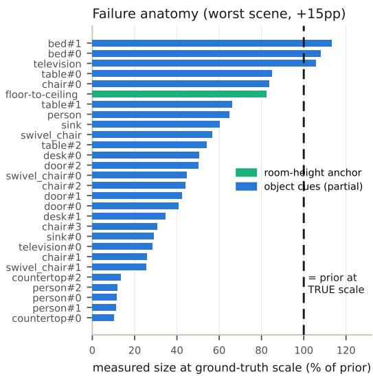  
Figure S13. Anatomy of the worst failure. Cue sizes at the ground-truth scale, as a fraction of their priors: nearly all object cues are partial (doors at 41–50%), so the robust fusion inflates the scale past the one correct anchor (room height, 82%).

## P. Cost of a wrong vertical axis

Every extent is measured along one axis, so a tilted axis attenuates all of them by the cosine. To measure what that costs we perturbed the selected axis by a controlled angle and re-measured everything else identically, reusing each scene’s votes across angles so the rows are exactly paired; the zero-tilt row reproduces the main table to 0.00 pp.

Small tilts are free and large ones are caught rather than silently absorbed (Tab. S20). Up to $5 ^ { \circ }$ the aggregates move within their own noise. At $1 0 ^ { \circ }$ the mean rises 1.4 pp, and beyond that the degradation is real: +3.5 pp at $1 5 ^ { \circ }$ and +9.2 pp at $2 5 ^ { \circ }$ , the latter close to the 9.4% attenuation 1−cos 25◦ predicts. Crucially, abstentions rise with it, from 19 to 29: a wrong axis shrinks every extent at once, the cues stop agreeing with the room-height prior, and the gate fires. Axis error therefore surfaces mainly as additional refusals, which is the behavior the gate exists to provide.

Table S20. Vertical-axis tilt vs. scale error (ScanNet++ 47, paired: votes computed once per scene and reused across angles).
<table><tr><td>tilt</td><td>mean</td><td>median</td><td>abstain</td></tr><tr><td>0° (selected)</td><td>16.6%</td><td>10.6%</td><td>19</td></tr><tr><td>2°</td><td>17.4%</td><td>11.5%</td><td>19</td></tr><tr><td>5°</td><td>16.8%</td><td>10.2%</td><td>18</td></tr><tr><td>10°</td><td>18.0%</td><td>12.4%</td><td>22</td></tr><tr><td> $1 \dot { 5 } ^ { \circ }$ </td><td>20.1%</td><td>13.9%</td><td>29</td></tr><tr><td> $2 \hat { 5 } ^ { \circ }$ </td><td>25.8%</td><td>16.8%</td><td>29</td></tr></table>

## Q. Modeling the dependency between cues

Our fusion treats cues as independent, which is wrong in exactly the way that hurts: partial reconstruction biases them together. We tested the simplest dependency model that captures this: a single latent per-scene coverage factor $\kappa \in ( 0 , 1 ]$ shared by all instance-extent cues, so an instance is expected to measure $\kappa \mu _ { c }$ rather than $\mu _ { c } .$ , fitted jointly with the scale on a 2D grid under a prior pulling κ toward 1. Room-height cues are excluded from κ: a gap between two planes is not an object extent and is not truncated the same way, and that asymmetry is what keeps the model identifiable at all.

What it buys is coverage: with a moderate prior $( \sigma _ { \kappa } { = } 0 . 2 )$ the fitted factor is 0.94 in the median (0.74 at the extreme), so the model does detect systematic undermeasurement, and abstentions fall from 19 to 15 while the mean improves from 16.6% to 15.7%; but degraded scenes do not fall (9 to 10). Loosening the prior further $( \sigma _ { \kappa } { = } 0 . 4 )$ continues that trade, reaching 13 abstentions at 16.2%.

The reason is structural, and it sharpens the contrast with Sec. O: a scene-global κ is nearly degenerate with the scale itself (shrinking every object prior by κ and enlarging s by $1 / \kappa$ is almost the same fit), so only the room-height cue breaks the tie, and in exactly the scenes that fail, that cue is the one being outvoted. Because the bias is fitted from the same cues that carry it, the fit cannot recover the truth; the completeness signal works better because it brings external geometric evidence about whether an instance is whole.

## R. How much is the result bounded by the teacher?

Every label in the paper comes from one frozen segmenter (Mask2Former R50, 47.2 mIoU on ADE20K). To separate “limited by its teacher” from “limited by partial reconstruction” we re-ran the post-hoc estimator on the same trained models, with the same seeds, priors and gate, swapping in Mask2Former Swin-L (57.3 mIoU). Nothing else changed.

The stronger teacher helps, and it helps most where the method is weakest (Tab. S21). On the 24 scenes both teachers act on, the like-for-like comparison, the mean error falls from 9.7% to 6.3%. It repairs the failure case dissected in the main paper, whose doors were measuring 41–50% of their prior: that scene goes from 24.6% (a 15 pp degradation) to 8.6%, and degraded scenes overall fall from 9 to 6 while abstentions fall from 19 to 17. Interestingly the cue count barely moves (41 to 39 per scene on average); the gain comes from the completeness of each labeled instance.

This qualifies the failure analysis in the main paper: we attributed the worst errors to partial reconstruction, but they are partly partial labeling, and a better segmenter recovers much of the gap. The all-scene mean improves less dramatically $( 1 6 . 6 \%  1 5 . 7 \% , p { = } 0 . 1 6 )$ because it is dominated by abstained scenes, which inherit the warm start under either teacher. We report this as a sensitivity study rather than adopting Swin-L: the configuration was frozen before public evaluation, and swapping a component would forfeit

that.

Table S21. Teacher sensitivity, ScanNet++ 47 (same models, same seeds, same gate; only the segmenter differs).
<table><tr><td></td><td>R50 (47.2 mIoU)</td><td>Swin-L (57.3 mIoU)</td></tr><tr><td>mean</td><td>16.6%</td><td>15.7%</td></tr><tr><td>median</td><td>10.6%</td><td>8.7%</td></tr><tr><td>both-act subset (24)</td><td>9.7%</td><td>6.3%</td></tr><tr><td>active mean (28 / 30 scenes)</td><td>9.3%</td><td>10.3%</td></tr><tr><td>worst failure scene</td><td>24.6%</td><td>8.6%</td></tr><tr><td>scenes acted on</td><td>28</td><td>30</td></tr><tr><td>degraded</td><td>9</td><td>6</td></tr></table>

## S. Uncertainty calibration beyond the gate

The abstention gate is a binary decision; a natural question is whether a continuous confidence would serve better. We bootstrap each scene’s cue set (200 resamples, refitting the robust MLE each time) and take the relative width of the resulting 95% interval on the residual scale as a per-scene confidence.

The interval behaves sensibly across regimes (its median width is 0.403 on abstained scenes versus 0.137 on active ones) and correlates with the true error over all 47 scenes $( \rho { = } \mathrm { + 0 . 4 0 , } p { = } 0 . 0 0 5 )$ . It is nonetheless a worse signal than the inlier mass we already use $( \rho { = } { - } 0 . 5 7 , p { < } 0 . 0 0 1 )$ , and routing by interval width at the gate’s own budget of 19 MASt3R calls gives 11.0% mean error against the gate’s 9.4% (the two selections agree on only 11 of 19 scenes).

The more important negative is that within the 28 active scenes neither statistic predicts the error (interval width $\rho { = } { + } 0 . 1 8 , \ p { = } 0 . 3 6 ;$ inlier mass $\rho { = } { - } 0 . 1 1 , p { = } 0 . 5 9 )$ . This is the same two-level structure reported for coverage in the main paper, and it is consistent with the failure anatomy: a scene whose partial cues agree with one another is confident and wrong, so no statistic computed from cue agreement, including a bootstrap interval, can separate it. Calibrated per-scene confidence therefore needs evidence the fusion does not currently have: a signal for whether an instance is complete, independent of whether its measurement agrees with the others.

## T. Other benchmarks: ETH3D per scene

ETH3D (sim3 protocol, frozen configuration) probes the regime boundary (Table S22): one indoor office is corrected actively; the outdoor courtyard and the two industrial rooms abstain, the outdoor scene with inlier mass 0.5, far below the gate. One of the four falls inside the operating regime the main paper defines — real photographs of a room whose architecture is visible — and that is office; the courtyard is outdoor and the other two are industrial halls, and the gate refuses all three. On that one in-regime scene MoGe-2 is the more accurate estimator (1.9% against our 9.1%). We report the whole table rather than the single row (pipes)

that favors us. One in-regime scene is not a benchmark verdict and we do not treat it as one, but it is the only uncontaminated public test of this kind available to us and it did not go our way.

Table S22. ETH3D per-scene scale error (%). MoGe-2 runs the same alignment recipe; ETH3D is outside its training mixture. delivery area is the outdoor scene.
<table><tr><td>scene</td><td>quantile</td><td>ours</td><td>MoGe-2</td><td>mass</td><td>decision</td></tr><tr><td>delivery_area</td><td>51.3</td><td>51.3</td><td>3.7</td><td>0.5</td><td>abstain</td></tr><tr><td>kicker</td><td>14.4</td><td>14.4</td><td>0.3</td><td>1.4</td><td>abstain</td></tr><tr><td>office</td><td>16.5</td><td>9.1</td><td>1.9</td><td>1.9</td><td>active</td></tr><tr><td>pipes</td><td>9.6</td><td>9.6</td><td>16.5</td><td>1.0</td><td>abstain</td></tr></table>

## U. A benchmark inside a model’s training set

Run as a scale estimator on ScanNet++, MoGe-2 reaches 2.3% mean and 1.9% median error, ahead of every other method in this paper by a wide margin, with 45 of 47 scenes under 5%. That result is real but it is not a like-forlike comparison, and reading it as one would be a mistake: ScanNet++ appears in MoGe-2’s own training mixture (its Tab. A.1 lists it at 176K frames and 4.6% sampling weight). Those scenes are in-domain for MoGe-2 and held out for us.

The comparison that matters is therefore on data outside that mixture, and we run MoGe-2 unchanged on three such sets rather than argue from one. Tab. S24 gives the five development captures against all three metric-depth networks under the identical alignment protocol and shared measurement operator; Tab. S23 summarizes the picture across every set we can evaluate.

The result is not a clean win for either side and we report it as it came out. On ETH3D — DSLR imagery, laser reference, and not in MoGe-2’s training list — MoGe-2 is clearly better than us (5.6% against our 21.1%, and we act on only one of its four scenes). On ordinary captures nobody curated it is not: 34.8% against 7.7% on the development captures, and 28.4% against 12.3% on the 13 in-thewild captures of Sec. 4.7, where it wins 3 of 9 scenes, lands level with the quantile heuristic it would replace (25.2%), and produces outright failures a practitioner would notice (a corridor at −69.7%, an apartment at +51.5%). Its error grows by an order of magnitude moving from a benchmark inside its training corpus to consumer captures outside it.

Two conclusions. The three sets form an exposure ladder — inside the training mixture (2.3%), a benchmark the model was evaluated against (5.6%), and captures it has never seen (28–35%) — but exposure and capture grade covary along it (ScanNet++ is DSLR and phone, ETH3D is DSLR, ours are phones) and we cannot separate the two. Under either reading a published metric-scale number is a best case rather than a deployment estimate. And on benchmark-grade imagery a strong feed-forward model is the better choice than what we propose; our estimator’s case rests on the ordinary captures, where it is the more reliable of the two and, unlike MoGe-2, says when it is not confident.

Table S23. MoGe-2 as a scale estimator, in and out of its training distribution. Mean |error|; “ours” is the deployed frozen system on the same scenes. Only the first row is inside MoGe-2’s training mixture. ∗Nine of the 13 captures of the main paper’s Tab. 2: the four excluded ones deliver no floor→ceiling height for any method (the robotics lab and one phone capture never frame a ceiling, the aerial survey yields no cue at all, and the sports field no floor→ceiling cue), so no column can be scored on them. †ETH3D is not training data for MoGe-2 but is one of the benchmarks it reports against, so it sits between the other rows on the exposure ladder rather than at the unseen end.

<table><tr><td>set</td><td>in MoGe-2 training?</td><td>MoGe-2</td><td>ours</td></tr><tr><td>ScanNet++ (47)</td><td>yes (176K fr., 4.6%)</td><td>2.3%</td><td>16.6%</td></tr><tr><td>ETH3D (4)</td><td>no (its eval set)†</td><td>5.6%</td><td>21.1%</td></tr><tr><td>development captures (5)</td><td>no</td><td>34.8%</td><td>7.7%</td></tr><tr><td>in-the-wild captures (9)*</td><td>no</td><td>28.4%</td><td>12.3%</td></tr></table>

Table S24. Metric-depth alignment on the development captures, which no released model has trained on. Signed delivered ceilingheight error against the tape measure; identical protocol and measurement operator for every column.
<table><tr><td>scene</td><td>quantile</td><td>DA-3</td><td>Depth Pro</td><td>MoGe-2</td><td>ours</td></tr><tr><td>room1</td><td>-39.1%</td><td>-62.4%</td><td>-78.1%</td><td>-50.8%</td><td>-15.1%</td></tr><tr><td>living-1</td><td>-15.7%</td><td>-68.9%</td><td>-65.5%</td><td>-25.8%</td><td>+8.5%</td></tr><tr><td>living-2</td><td>-15.7%</td><td>-60.8%</td><td>-65.5%</td><td>-25.8%</td><td>+6.7%</td></tr><tr><td>room2</td><td>-46.3%</td><td>-74.6%</td><td>-77.0%</td><td>-42.1%</td><td>-5.5%</td></tr><tr><td>studiol</td><td>-20.5%</td><td>-64.6%</td><td>-68.5%</td><td>-29.4%</td><td>+3.0%</td></tr><tr><td>mean |err|</td><td>27.4%</td><td>66.3%</td><td>70.9%</td><td>34.8%</td><td>7.7%</td></tr></table>

## V. Cost accounting

Table S25 breaks down the post-hoc estimator’s wall clock on a representative 47-scene model (337k Gaussians, RTX 4080), with nothing amortized: teacher inference is run cold on every unique view drawn by the three seed ensembles, and the visibility test’s depth renders are included. As in the main paper, 3DGS training is excluded as a sunk cost of the assumed deployment; a user who needs only the scale is better served by MASt3R end to end. During training, the same teacher outputs are shared with the in-loop voting through a cache, which is why the scale machinery adds no measurable training overhead. The MASt3R comparison point is its k=12 sparse global alignment (∼4 min on the same GPU); doubling its frame budget quadruples the pairwise cost for a ∼1 pp gain.

## W. Three directions we scoped but did not adopt

A data-driven warm start. The nominal room height is the one sensitive input, so replacing it with a per-scene estimate is tempting. We tried the obvious version (estimate the room height from the object cues alone, shrink the prior center toward it by the object cue mass, and refit) and it does not remove the sensitivity: across assumed heights of 2.1– 3.0 m the spread of the mean error widens slightly (12.4 to 13.4 pp) while medians and abstention counts improve. The failure has the same cause as Sec. Q: object cues carry the very truncation bias that the room-height prior is there to stabilize, so deriving the prior from them removes the independent evidence.

Table S25. Post-hoc estimator cost breakdown (single scene, cold).
<table><tr><td>component</td><td>wall clock</td></tr><tr><td>model + camera loading</td><td>6.2s</td></tr><tr><td>teacher 2D inference (127 unique views)</td><td>3.9 s (31 ms/view)</td></tr><tr><td>rendered-depth visibility (3 × 48 renders)</td><td>0.2s</td></tr><tr><td>vote projection + instance measurement (3 seeds)</td><td>0.6s</td></tr><tr><td>robust MLE (2001-point grid)</td><td>&lt;0.01 s</td></tr><tr><td>total</td><td>~11s</td></tr><tr><td>MASt3R k=12 sparse global alignment</td><td>~240s</td></tr></table>

Finer visibility reasoning. Our gate is a one-sided depth test, deliberately cheap. The mask-level occlusion analysis of LabelGS and the per-ray marginal-contribution weighting of VALA (both cited in the main paper) reason about visibility far more precisely, and Sec. R shows why that is the promising direction: what limits us is not how many instances we find but how complete each labeled instance is. We have not combined them, and we would expect the gain to overlap with the teacher upgrade rather than add to it.

Sub-scene routing. Routing is currently per scene. Routing per region, invoking the heavy model only where local cue mass is low, is attractive, but our drift measurement bounds the benefit: over a 703-frame corridor the per-region floor-to-ceiling gap varies by only 3% (CV), so within a room-to-corridor extent there is little spatial heterogeneity for sub-scene routing to exploit. Multi-floor or multibuilding captures, where a single global scale is itself the wrong model, are the case that would justify it.

## X. What the error means in practice

Two figures translate a percentage scale error into the terms an application actually cares about. Fig. S14 composites a 1.70 m mannequin into a reconstruction at each scale hypothesis: under the quantile heuristic the figure renders as a +48% giant, while under ours it matches the true height. This is the error an AR placement inherits directly. Fig. S15 converts the 47 per-scene errors into absolute terms by length: because a global similarity leaves relative error length-independent, a door measured in the model errs by 21 cm at the median under our scale against 35 cm under the heuristic, and a 10 cm object by 11 mm against 17 mm.

Converting scale error into decisions. Table S26 plays out a concrete task on the saved per-scene delivered scales: for each of the 47 scenes and five object/aperture pairs, the aperture is read off each method’s delivered model and the fit decision is compared with the ground-truth-scale decision. The router flips 24.7% of clearance judgements against 37.0% for the quantile heuristic, 28.5% for MASt3R everywhere, and 43.0% for Depth Anything 3: it removes a third of the errors the heuristic makes and still edges out the heavy fallback it invokes. None of the methods is yet accurate enough for a clearance decision to be taken unsupervised — the 2.5%-margin pair (78 cm against an 80 cm doorway) defeats every method, which is consistent with Fig. S15.

Table S26. Decision flips over five object/aperture pairs per scene (an 80 cm doorway against objects of 60/75/78/85/90 cm; true verdicts pass/pass/pass/fail/fail), ScanNet++ 47. Signed delivered scales; abstentions inherit the warm estimate (ours) or are routed to MASt3R (router). ‡ScanNet++ is in MoGe-2’s training corpus (Sec. U); its row is in-domain and not comparable.
<table><tr><td>method</td><td>flipped decisions</td><td>scenes with any flip</td></tr><tr><td>quantile heuristic</td><td>87/235 (37.0%)</td><td>44/47</td></tr><tr><td>DA-3 alignment</td><td>101/235 (43.0%)</td><td>43/47</td></tr><tr><td>MoGe-2 alignment‡</td><td>11/235 (4.7%)</td><td>9/47</td></tr><tr><td>MASt3R (metric)</td><td>67/235 (28.5%)</td><td>38/47</td></tr><tr><td>Ours (frozen)</td><td>69/235 (29.4%)</td><td>40/47</td></tr><tr><td>Ours + MASt3R router</td><td>58/235 (24.7%)</td><td>36/47</td></tr></table>

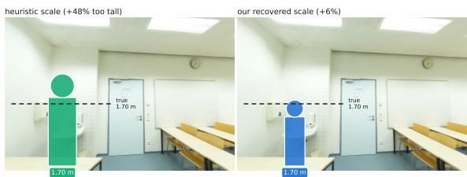  
Figure S14. Metric scale is what AR sees. A 1.70 m mannequin composited into the reconstruction at each hypothesis’ scale: the heuristic renders a +48% giant; ours matches the true height (dashed).

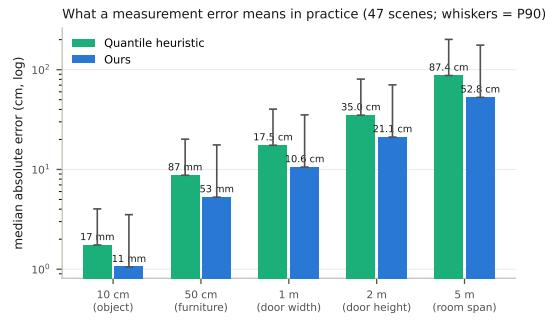  
Figure S15. Measurement error by length scale, derived from the 47 per-scene scale errors.

## Y. Custom captures: protocol and per-capture detail

This section backs Sec. 4.7 of the main paper. The 13 captures were recorded with two Android handsets, two iPhones and a consumer drone, and reconstructed with the same COLMAP settings as every other real-SfM condition in this paper. Training and estimation used the frozen configuration verbatim: nominal height 2.5 m, $\lambda { = } 1 , \sigma _ { w } { = } 0 . 3 5 ,$ $M _ { \mathrm { m i n } } { = } 1 . 5$ , the R50 teacher, three vote seeds, and the depth regularizer at 0.05. No per-capture tuning of any kind was performed, and the captures were evaluated once.

Why Tab. 2 has no MASt3R column. We ran MASt3R’s metric checkpoint on all 13 captures under the paper’s own protocol (evenly sampled frames, sparse global alignment, the shared measurement operator). At the frame budgets we could afford (k=12 and k=24) its sparse global alignment meets the 20 cm registration gate of protocol P2 on only one of the 13 captures (RMSE 0.5–4.1 m on the other twelve at k=24, against ∼0.07 m on ScanNet++ at k=12), so no scale of ours-versus-its kind is measurable on them under our own protocol, and tabulating the resulting numbers (mean |error| 66–71%, every capture under-scaled) would score a reconstruction that never registered rather than MASt3R’s scale. On the one capture that does pass the gate (a single-dwelling session, RMSE 6.6 cm at k=24) its error is +13.1% — consistent with its ScanNet++ behavior — against our +2.6%. The heavy fallback the router assumes therefore has a scene-extent precondition that roomscale benchmarks do not expose: a multi-room walkthrough needs a frame budget that grows with scene extent, and the pairwise cost grows quadratically with it.

On the ground truth. The capture owner reports a nominal ceiling height per venue class rather than measuring each room: 2.3 m for the dwellings and show flat, 3.0 m for the lab and office floor. This is the same kind of approximate reference as the development captures of the main paper, and it is weaker than the laser ground truth used for ScanNet++, so we report delivered height rather than scale error and we do not aggregate these numbers with the public benchmarks. Real ceilings vary within a class, which sets a floor on the error any method can show here.

Repeat captures. Three of the venues were recorded more than once, which gives a ground-truth-free consistency check. Apartment A was captured in three separate sessions: the two richer sessions clear the gate and deliver 2.65 and 2.36 m, while the sparsest (167 images against 376) abstains at mass 0.73 and inherits 2.75 m. Home C was captured as stills and as video; the video clears the gate and is corrected to 2.67 m while the stills abstain. Coverage, not venue, decides: within one dwelling the decision tracks how much of the architecture the capture actually shows.

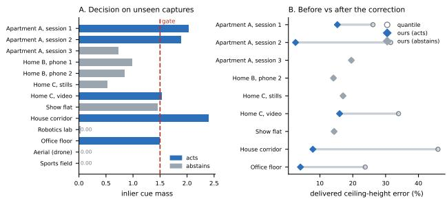  
Figure S16. Frozen system on our own captures. Left: inlier cue mass against the frozen gate. Right: delivered ceiling-height error before (circles) and after (diamonds) the semantic correction. With only a nominal per-venue reference these are transfer evidence, not an accuracy result.

Why the refusals happen. The eight abstentions split into three mechanisms. The sports field and the aerial survey end at mass 0.00: the drone capture yields no measurement to fuse at all (the degenerate limit of the same test), and the six cues the sports field does yield are all outliers to the warm prior, so none contributes mass. The robotics lab never frames its ceiling, leaving nine cues and mass 0.03. The remaining five are cue disagreement rather than cue absence: 21–39 cues survive, but partial furniture and mislabeled instances scatter them, exactly the mechanism dissected for handheld video in Sec. 4.6 of the main paper. In one apartment capture a coat stand is labeled person and measures 3.7 m against a 1.70 m prior; the gate fires instead of absorbing it. That anchor is the weakest in the catalog and a fair thing to question. Post hoc, on the frozen cue sets, dropping person entirely moves ScanNet++ from 16.6% to 16.8% mean with the median unchanged and one fewer abstention: it is close to inert on that benchmark, it costs nothing to keep, and removing it now would break the freeze the rest of the paper depends on. We keep it and report the failure it can produce, since it shares its 1.70 m mean with refrigerator and the two can reinforce each other under misclassification.

Does the weak reference decide the comparison? The captures of Sec. 4.7 are scored against a nominal per-venue ceiling rather than a tape measure, and real ceilings vary within a class. The honest question is not what the exact error is but whether the comparison survives the reference being wrong, so we sweep the assumed true dwelling height across the range ordinary dwellings span and rescore both methods against it. Nothing is re-estimated: the delivered heights are fixed outputs and only the reference moves.

Table S27 gives the result. Our mean error is below MoGe-2’s at every point in the range, and the two never come closer than 6.7 pp. The 2.3 m we report is nearer the unfavorable end for us than the favorable one: at 2.5–2.6 m we would report 8–10% rather than 13%. Per capture, the height at which the two methods are equally close lies outside the plausible range in seven of the nine scoreable captures — the eight dwellings of this table plus the office floor, which carries the 3.0 m nominal — so the pairwise verdict is not a function of the reference either. This does not turn a nominal reference into a measurement — a tape measure would still be worth having — but it does mean the in-thewild conclusion is not an artefact of it.

Table S27. Delivered ceiling-height error on the dwelling captures as a function of the assumed true height. Both columns are rescored from fixed delivered heights; nothing is re-estimated.
<table><tr><td>assumed truth (m)</td><td>ours</td><td>MoGe-2</td><td>ours closer</td></tr><tr><td>2.1</td><td>19.6%</td><td>26.3%</td><td>4/8</td></tr><tr><td>2.2</td><td>16.2%</td><td>26.2%</td><td>4/8</td></tr><tr><td>2.3</td><td>13.3%</td><td>27.1%</td><td>5/8</td></tr><tr><td>2.4</td><td>11.1%</td><td>28.0%</td><td>6/8</td></tr><tr><td>2.5</td><td>9.7%</td><td>29.9%</td><td>7/8</td></tr><tr><td>2.6</td><td>8.4%</td><td>31.6%</td><td>7/8</td></tr><tr><td>2.7</td><td>9.2%</td><td>33.2%</td><td>7/8</td></tr></table>

Limitations of this study. Five acting captures is a small sample, the ground truth is class-level, and the two largest wins are both cases where the warm start fails badly, which is where any correction has the most room to help. We report the study as evidence that the frozen configuration transfers, not as a second benchmark.

## Z. Reproducibility

Every reported number derives from a manifest mapping (condition, scene) → trained model, shipped with the code, together with the evaluation scripts and the seeded benchmark converters (the applied sim(3) transforms are reproducible from scene-name hashes).