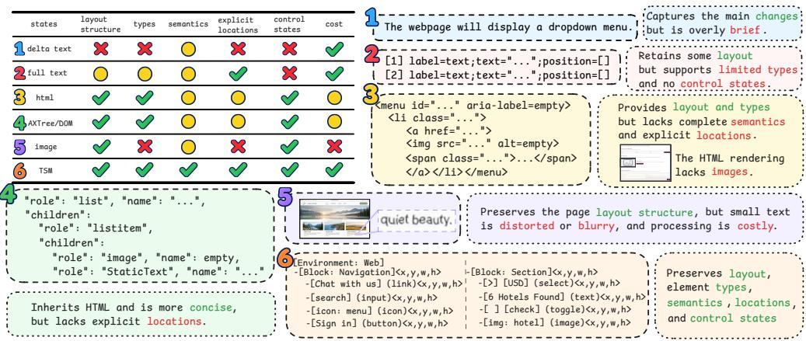
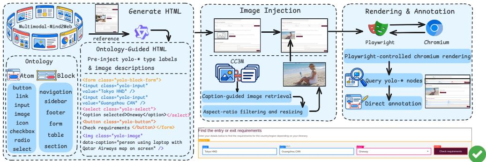
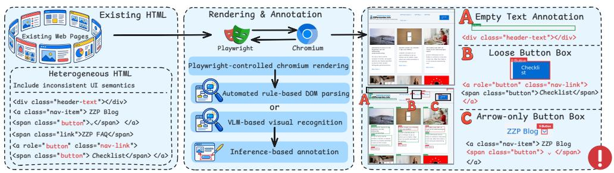
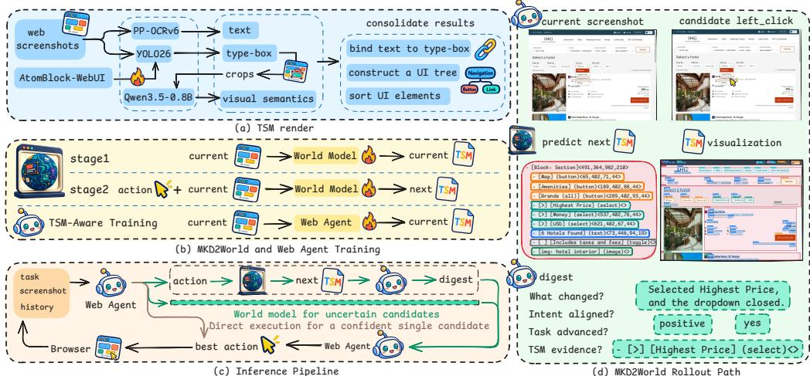
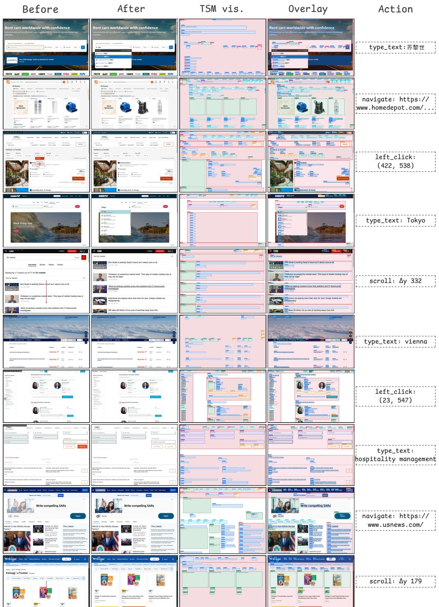
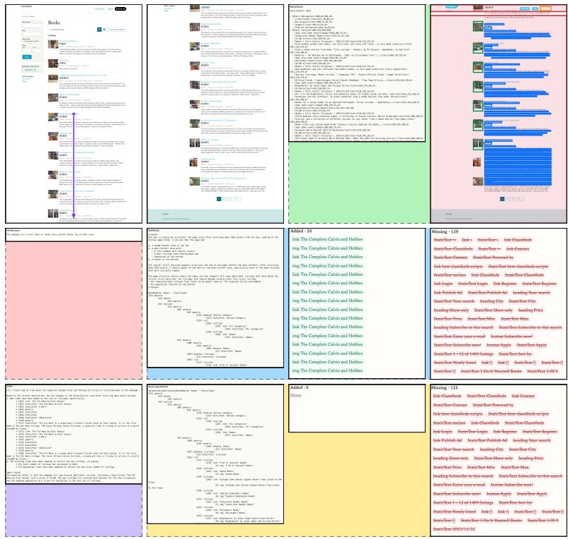
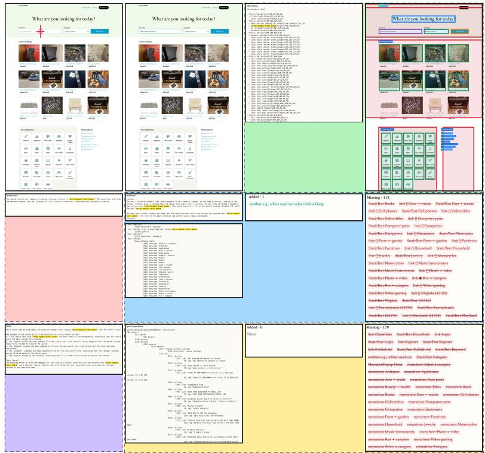
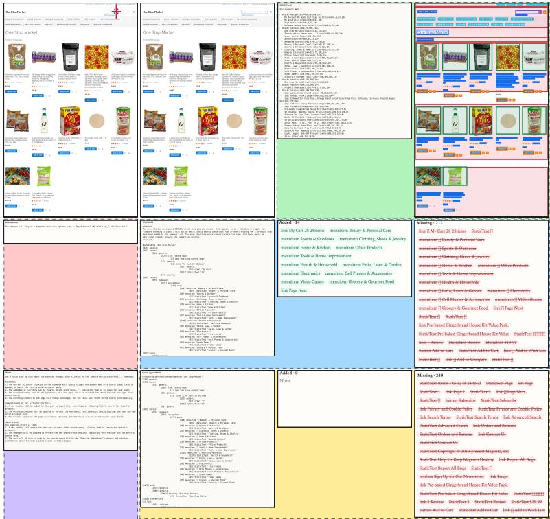

# MKD2WORLD: A TYPED SPATIAL MARKDOWN WORLD MODEL FOR WEB AGENTS

Zhihao Nan<sup>1,2,∗</sup>, Sifan Zhou<sup>3,∗</sup>, Yiming Cheng<sup>4</sup>, Jinkai Zheng<sup>5</sup> Zheng Zhu<sup>6</sup>, Si Shi<sup>1,†</sup>, Ming Li<sup>7,†</sup>, Fei Yu<sup>1</sup>

<sup>1</sup>Guangming Laboratory <sup>2</sup>Shenzhen University <sup>3</sup>Southeast University <sup>4</sup>Tsinghua University <sup>5</sup>Hangzhou Dianzi University <sup>6</sup>GigaAI <sup>7</sup>The Chinese University of Hong Kong, Shenzhen <sup>∗</sup>Equal contribution. <sup>†</sup>Corresponding authors.

## ABSTRACT

Graphical user interface (GUI) agents can improve decision-making with worldmodel foresight, provided that predicted states accurately reflect post-action interfaces. Existing state representations fail to jointly capture interface layout, UI semantics, and explicit locations. We introduce Typed Spatial Markdown (TSM), a Markdown-style textual state representation for desktop web interfaces. TSM serializes block-level and atomic-level UI elements according to their spatial relationships, jointly encoding their types, visual semantics, explicit locations, optional control states, and hierarchical membership. To train a screenshot-to-TSM renderer, we construct AtomBlock-WebUI, a dataset with precise annotations at both granularities. By injecting element-type labels into HTML and directly extracting bounding boxes after rendering, we avoid annotation errors caused by post-hoc inference from webpage structures. Building on TSM, we propose MKD2World, a desktop web world model trained in two stages for current-state description and action-conditioned next-state prediction. During inference, the web agent queries MKD2World as needed and performs a “digest” step, in which it interprets each predicted state and extracts task-relevant evidence for selecting the best action. Experiments show that MKD2World-9B achieves an EleF1 score of 26.50 on the out-of-domain test set, outperforming GPT-5.6- Sol(14.98) by 11.52 points. Across Online-Mind2Web tasks, MKD2World-9B improves the success rate of the Qwen3.5-35B web agent from 22.94% to 37.61%, achieving competitive performance among leading open-source GUI world models. Code is available at https://github.com/OmniAI-Lab-CUHKSZ/ MKD2World.

## 1 INTRODUCTION

With the development of vision-language models (VLMs), graphical user interface (GUI) agents have become capable of completing interactive tasks in real-world scenarios (Cao et al., 2026a; Hu et al., 2026; Zhou et al., 2026). At each decision step, an agent generates an executable action based on the task objective, current interface, and historical information. However, without sufficient un derstanding of webpage dynamics—including the functions of user interface (UI) controls and the logic of interface transitions—it may generate ineffective actions that increase interaction costs or cause irreversible errors, such as accidentally deleting important data or leaking private information (Shen et al., 2026b; Liu et al., 2026). Action-conditioned world models offer a promising way to anticipate future interface states before execution, helping agents assess whether candidate actions advance the task while reducing risky real interactions (Mei et al., 2026; Gu et al., 2025).

The usefulness of such foresight depends on what state a world model predicts. Figure 1 compares representative GUI state representations and highlights the desired trade-off: preserving a complete, structured interface state without incurring the cost of pixel-level reconstruction. We argue that, to distinguish the consequences of candidate actions, a predicted state should preserve a complete yet structured account of the post-action interface, including both the elements that change and the surrounding context needed to interpret those changes—their semantics, locations, control states, and structural relations. At the same time, it should avoid the cost and instability of reconstructing every visual detail of a webpage. Existing GUI world models represent states as free-form descriptions of interface changes, structured interface representations such as the Accessibility Tree (AXTree) and Document Object Model (DOM) (Zuo et al., 2026), HTML rendered into webpages (Koh et al., 2026), or images generated directly by image generation models (Guan et al., 2026). Free-form text concisely conveys major changes but loses layout structure and substantial information from the next interface. Common AXTree and DOM serializations preserve parts of the interface structure, yet often omit explicit element locations and have incomplete visual semantics (Wu et al., 2023). Other structured textual representations retain some layout and locations, but support limited element types and omit UI control states, complete visual semantics, or interface block structure (Cao et al., 2026b). HTML-rendered images may omit actual images or deviate from the real layout, whereas pure image-generation approaches are costly and often distort fine-grained text (Zheng et al., 2026; Luo et al., 2025). Thus, these representations do not adequately balance preserving a complete, structured interface state with avoiding the burden of full visual reconstruction. This limits the completeness of the interface information available to a world model and, in turn, to downstream agent reasoning.

  
Figure 1: Comparing GUI state representations for world models. TSM better balances a complete, structured interface state with low reconstruction cost.

To address this bottleneck, we introduce Typed Spatial Markdown (TSM), a structured and spatially grounded state representation for desktop Web interfaces. TSM organizes rendered Web UIs into block-level and atomic-level elements according to their spatial relationships. Each entry encodes its type, visual semantics, bounding box, optional control state, and hierarchical membership, jointly capturing what an element is, where it appears, what it conveys, and how it is organized. Markdown provides a readable hierarchical serialization of this structured state. By retaining the interface information needed to compare action-induced changes without reconstructing the full pixellevel interface, TSM provides a compact and directly comparable state space for action-conditioned world modeling and downstream agent reasoning.

Learning this state space from screenshots requires reliable UI element types and locations. Existing desktop Web UI datasets often extract them from the DOM or AXTree through rule-based parsing (Wu et al., 2023; Gurbuz et al., 2026). However, HTML structures are highly heterogeneous across webpages: tags and class names are typically tied to page styling and interactions, while role attributes are often incomplete, making unified and reliable semantic annotations difficult to obtain (Gou et al., 2025). Post-hoc DOM parsing can therefore assign types to visually invisible elements or yield misaligned bounding boxes; visual models may likewise localize elements away from their actual positions (Fu et al., 2026). To reduce ambiguities introduced by such post-hoc semantic inference, we construct AtomBlock-WebUI. A VLM generates HTML with reference to real webpage layouts and explicitly injects predefined UI element types. After rendering, we directly extract the coordinates of the corresponding typed DOM nodes. This pipeline provides visually aligned type and location supervision for the dual-granularity UI detector in our TSM renderer.

Building on TSM and AtomBlock-WebUI, we introduce MKD2World, an action-conditioned desktop Web world model that predicts future TSM states from screenshots and candidate actions. MKD2World first learns to reconstruct the current interface in the TSM state space, and then learns action-conditioned state transitions with transition-aware objectives that emphasize the elements changed by an action. At inference time, it simulates a next TSM state for each candidate action. We further train the GUI agent to understand TSM and design a digest-based inference strategy, through which the agent interprets predicted typed, spatial, and stateful changes to select the action that best advances the user objective. The main contributions of this work are as follows:

• Typed Spatial Markdown (TSM). We propose TSM, a structured and spatially grounded Web UI state representation that encodes UI semantics, explicit spatial information, control states, and hierarchical structures, together with a screenshot-to-TSM renderer.

• AtomBlock-WebUI Dataset. We construct a 9.7k-scale desktop Web UI annotation dataset using a pre-injected automated annotation pipeline, providing element types and bounding boxes for both block-level and atomic-level UI elements to train the dual-granularity UI detector in the screenshot-to-TSM renderer.

• MKD2World: A TSM World Model for Web Agents. We propose MKD2World, an actionconditioned desktop Web world model that predicts future TSM states from screenshots and candidate actions. MKD2World uses a two-stage training scheme with transition-aware objectives, and supports uncertainty-triggered, digest-based action selection by TSM-aware Web agents.

• Comprehensive Evaluation and Online Validation. We propose EleF1 to evaluate TSM prediction accuracy, and demonstrate strong out-of-domain prediction and consistent decision-making gains on Online-Mind2Web and VisualWebArena.

## 2 RELATED WORK

## 2.1 WEB UI UNDERSTANDING AND DATASETS

Existing datasets obtain UI annotations either from webpage structure metadata or directly from screenshots. Structure-derived datasets—including WebUI (Wu et al., 2023), SeeClick (Cheng et al., 2024), and PixelWeb (Yang et al., 2025)—scale efficiently by leveraging AXTree or DOM information, but their labels depend on heterogeneous HTML, DOM, or accessibility conventions and often require page-specific heuristics to obtain unified semantic types and visually aligned boundaries. Screenshot-based methods such as OmniParser (Lu et al., 2024) and ScreenAI (Baechler et al., 2024) avoid dependence on webpage structure but can suffer from category ambiguity, coordinate offsets, or errors inherited from individual recognition components; high-quality manually annotated datasets (Nayak et al., 2025; Dicu et al., 2025) are limited in scale. AtomBlock-WebUI differs from both lines by injecting a predefined semantic taxonomy into webpage HTML before rendering and extracting bounding boxes from the corresponding rendered nodes, providing visually aligned, dual-granularity (block-level and atomic-level) supervision for screenshot-to-TSM rendering.

## 2.2 GUI WORLD MODELS AND STATE REPRESENTATIONS

GUI world models support either inference-time action selection (Mei et al., 2026; Gu et al., 2025) or training-trajectory synthesis (Xiao et al., 2026; Zuo et al., 2026). Across both settings, the choice of state representation fundamentally determines which interface information can be predicted, compared, and used for action selection (Figure 1). Existing state spaces include: (1) free-form change descriptions (Chae et al., 2025; Gu et al., 2025; Shen et al., 2026a), which are compact but lack explicit spatial layouts and hierarchical structure; (2) structured text or AXTree representations (Cao et al., 2026b; Zuo et al., 2026; Xiao et al., 2026), which preserve partial structure but do not consistently expose element locations, visually grounded types, and control states in a unified form; (3) executable HTML code (Zheng et al., 2026; Koh et al., 2026), which can retain page structure but whose rendered outputs may deviate from the target layout or content; and (4) future images (Guan et al., 2026; Luo et al., 2025), which retain rich visual information but incur high generation cost and are unreliable for fine-grained text and small elements. These representations typically trade off spatial and hierarchical fidelity against prediction cost and visual grounding. TSM targets this gap by representing visible UI states as typed, spatially explicit, hierarchically organized elements with control states and visual semantics, remaining efficient for action-conditioned prediction and downstream candidate-action comparison. AtomBlock-WebUI provides visually aligned supervision for rendering screenshots into this state space, while MKD2World models action-conditioned transitions within it for Web-agent reasoning. Detailed discussion refer to Appendix D.



(a) AtomBlock-WebUI: Direct Annotation  
  
(b) Conventional Methods: Inference-based Annotation  
Figure 2: Comparison of AtomBlock-WebUI’s direct annotation vs. conventional inference-based annotation. (a) AtomBlock-WebUI injects yolo-<sub>\*</sub> labels into HTML, renders in Chromium, and reads boxes straight from those DOM nodes. (b) Inference-based annotation (DOM rules or VLMs) on heterogeneous pages yields misaligned boxes.

## 3 METHOD

## 3.1 PROBLEM FORMULATION

Given the current screenshot $I _ { t }$ and the task objective $^ { g , }$ a web agent generates a candidate action set $\boldsymbol { A } _ { t }$ . For each candidate action $a \in A _ { t } ,$ the world model $f _ { \theta }$ predicts a future TSM state $\hat { S } _ { t + 1 }$ . Let $V _ { \psi }$ denote a value model that scores predicted TSM states for action selection. The web agent then selects the best action $a _ { t } ^ { * }$

$$
\hat { S } _ { t + 1 } = f _ { \theta } ( I _ { t } , a ) , \qquad a _ { t } ^ { * } = \underset { a \in \mathcal { A } _ { t } } { \arg \operatorname* { m a x } } V _ { \psi } \Bigl ( \hat { S } _ { t + 1 } ; g , I _ { t } , a \Bigr ) .\tag{1}
$$

## 3.2 TYPED SPATIAL MARKDOWN REPRESENTATION

Typed Spatial Markdown Definition. We represent a TSM state as $M _ { t } = ( B _ { t } , \mathcal { E } _ { t } , \rho _ { t } )$ , where $B _ { t }$ and $\mathcal { E } _ { t }$ are the sets of block-level and atomic-level elements, respectively, and $\rho _ { t }$ denotes the hierarchical membership relations among UI elements. We define 6 block-level types and 8 atomiclevel types. A block-level element is written as $b = ( \tau ^ { b } , p )$ , and an atomic-level element as $e =$ $( u , c , \tau ^ { e } , p )$ . Here, u denotes the optional control state, c denotes visible text or visual semantics, and τ denotes the semantic type. The bounding box is defined as $\boldsymbol { p } = ( x , y , w , h )$ , representing the center coordinates, width, and height of a UI element, with values normalized to [0, 999]. More details are provided in Appendix E.

AtomBlock-WebUI Construction. As shown in Figure 2, we first deduplicate the webpage screenshots in Multimodal-Mind2Web (Zheng et al., 2024) using fingerprint-based filtering. We then use the screenshots as layout reference and employ Qwen3.6-Plus to generate HTML with explicit $\scriptstyle \ Y \bigcirc \bot \bigcirc - { \star }$ labels and image descriptions. We retrieve semantically matched images from the CC3M (Sharma et al., 2018) image–text dataset and inject the image into HTML. Finally, we use Playwright to drive Chromium and render full-page screenshots. The annotation program directly retrieves the yolo- DOM nodes to obtain bounding boxes. Figure 3 compares AtomBlock-WebUI with existing Web UI datasets in annotation source, viewport controllability, viewport element density, and category balance. We evaluate annotation quality against existing datasets in Section 4. More details are provided in Appendix C.

<table><tr><td rowspan="2">Dataset</td><td rowspan="2"></td><td rowspan="2">Image Annotation Source</td><td rowspan="2">Viewport Controllable Elements</td><td rowspan="2">Viewport</td><td colspan="3">Instance share (%)</td></tr><tr><td>Head20%</td><td>Mid25%</td><td>Tail55%</td></tr><tr><td>ScreenParse-v2(Gurbuz et al., 2026)</td><td>1447k</td><td>DOM/AXTree</td><td>X</td><td>17.7</td><td>93.33</td><td>5.91</td><td>0.76</td></tr><tr><td>WebUI-CHI23(Wu et al., 2023)</td><td>350k</td><td>DOM/AXTree</td><td>X</td><td>39.1</td><td>99.05</td><td>0.84</td><td>0.11</td></tr><tr><td>WebUI-COCO(Jílek, 2026)</td><td>876</td><td>DOM/AXTree</td><td>X</td><td>33.6</td><td>63.08</td><td>29.56</td><td>7.36</td></tr><tr><td>UI-Elements(Jain, 2024)</td><td>544</td><td>DOM/AXTree</td><td>X</td><td>55.2</td><td>90.23</td><td>9.04</td><td>0.73</td></tr><tr><td>AtomBlock-WebUI (Ours)</td><td></td><td>9.7k Pre-injected Label</td><td>√</td><td>48.7</td><td>61.42</td><td>30.02</td><td>8.56</td></tr></table>


Figure 3: Left: comparison of WebUI datasets. Head/Mid/Tail report the instance share among types sorted by count, split into the top 20%, next 25%, and last 55%. Right: viewport-controllable renderings of the same page with consistent annotations.  
  
Figure 4: Overview of MKD2World. (a) The TSM renderer combines text, type-box, and visual semantics to convert screenshots into TSM. (b) MKD2World learns current-state reconstruction and next-state prediction in two stages, followed by TSM-aware web agent training. (c) A confident single candidate is executed directly; otherwise, MKD2World predicts next states, and the web agent turns them into digests for action selection. (d) MKD2World rollout path for one candidate.

Screenshot-to-TSM Renderer. Given a webpage screenshot, the renderer converts it into TSM using a YOLO26 (Jocher et al., 2026) UI detector trained on AtomBlock-WebUI, PP-OCRv6 (Zhang et al., 2026), and Qwen3.5-0.8B. It first uses the UI detector to identify element types and coordinates and PP-OCRv6 to recognize text, then binds the recognized text to the corresponding elements. Some regions are cropped and passed to Qwen3.5-0.8B for visual semantics. Finally, the renderer constructs a UI Element Tree with containment relationships and sorts the elements according to their spatial relationships to obtain the TSM representation. Details are in Appendix E.2.

## 3.3 ACTION-CONDITIONED GUI WORLD MODEL

Dataset Construction. We extract $\left( I _ { t } , a _ { t } , I _ { t + 1 } \right)$ from WebChain (Fan et al., 2026) and MolmoWeb-HumanTrajs (Gupta et al., 2026), and use the renderer to obtain $\left( I _ { t } , a _ { t } , I _ { t + 1 } , M _ { t } , M _ { t + 1 } \right)$ We then perform quality filtering on the transition pairs and categorize them into exact noop, near noop, and changed according to the visual differences between the current and next screenshots. To optimize the MKD2World supervised fine-tuning (SFT) loss, we annotate add and update elements in each transition as focus elements. We use the VLM diagnose failure cases and refine rule-based matching criteria; final focus labels are generated by the deterministic rules. We manually audit a stratified sample across all action types. Labels of whether each transition changed and which elements are in focus ultimately supervise MKD2World learning. Details are in Appendix G.

World Model Training. We use Qwen3.5-9B as the base model and fine-tune it using LoRA. Training consists of two stages, as shown in Figure 4. In the first SFT stage, the model learns to describe the interface, $I _ { t } \to M _ { t }$ , using token-level causal cross entropy. In the second SFT stage, the model learns to predict the next state, $( I _ { t } , a _ { t } ) \to M _ { t + 1 }$ , with the loss for each element e defined as element-level cross entropy:

$$
\mathrm { C E } _ { \mathrm { E l e } } ( e ) = - \frac { 1 } { | e | } \sum _ { j \in e } \log p _ { \theta } ( y _ { j } \mid I _ { t } , a _ { t } , y _ { < j } ) .\tag{2}
$$

We introduce the Base–Focus Element Loss to emphasize add and update elements while retaining supervision over the full visible interface state. For each sample i, let ${ \mathcal { N } } _ { i }$ be the set of all elements on the page and $\mathcal { F } _ { i } \subseteq \mathcal { N } _ { i }$ be the set of focus elements annotated as add and update. The loss is

$$
\mathcal { L } _ { \mathrm { B F - E l e } } ^ { ( i ) } = \frac { \displaystyle \sum _ { e \in N _ { i } } \mathrm { C E } _ { \mathrm { E l e } } ^ { ( i ) } ( e ) + \lambda _ { i } \displaystyle \sum _ { e \in \mathcal { F } _ { i } } \mathrm { C E } _ { \mathrm { E l e } } ^ { ( i ) } ( e ) } { | N _ { i } | + \lambda _ { i } | \mathcal { F } _ { i } | } , \qquad \lambda _ { i } = \left\{ \begin{array} { l l } { 0 , } & { | \mathcal { F } _ { i } | = 0 , } \\ { \operatorname* { m i n } \left( 3 , \sqrt { \frac { | N _ { i } | } { | \mathcal { F } _ { i } | } } \right) , } & { | \mathcal { F } _ { i } | > 0 . } \end{array} \right.\tag{3}
$$

where $\lambda _ { i }$ is an adaptive weight that upweights focus elements. When focus elements are sparse, optimizing the average loss over all elements can underemphasize the localized changes induced by an action. We therefore scale their contribution according to the ratio $| \mathcal { N } _ { i } | / | \mathcal { F } _ { i } |$ . The square-root scaling provides a correction, while the cap of 3 prevents a small focus set from dominating the page-level objective. When no focus element is present, $\lambda _ { i } = 0$ and the objective reduces to the average element-level loss over the page.

To further distinguish action-induced transitions from reproducing the current interface, we introduce a margin-ranking objective ${ \mathcal { L } } _ { \mathrm { m a r g i n } }$ . For a transition with a clear visible change, the true next state should be assigned a lower teacher-forced prediction loss than the current state under the same conditioning input $\left( I _ { t } , a _ { t } \right)$ . Let $\mathrm { C E _ { p a g e } } ( M )$ denote the average element-level cross-entropy incurred when teacher forcing a TSM sequence M conditioned on $\left( I _ { t } , a _ { t } \right)$ , and let C denote the set of changed transitions. For each sample $i ,$ we define

$$
\mathcal { L } _ { \mathrm { m a r g i n } } ^ { ( i ) } = \mathbb { I } [ i \in \mathcal { C } ] \left[ m + \mathrm { C E } _ { \mathrm { p a g e } } \Big ( M _ { t + 1 } ^ { ( i ) } \Big ) - \mathrm { C E } _ { \mathrm { p a g e } } \Big ( M _ { t } ^ { ( i ) } \Big ) \right] _ { + } .\tag{4}
$$

where $\mathbb { I } [ \cdot ]$ is the indicator function and $[ \cdot ] _ { + }$ denotes the hinge operator. Thus, for a changed transition, the loss is active only when the model does not prefer the true next state over the current-state counterfactual by a margin of at least m. We apply this objective only to changed transitions, since treating the current state as a negative target is not appropriate for exact noop or near noop samples. The final training objective is

$$
\mathcal { L } _ { \mathrm { f i n a l } } = \frac { 1 } { B } \sum _ { i = 1 } ^ { B } \left( \mathcal { L } _ { \mathrm { B F - E l e } } ^ { ( i ) } + \beta ( s ) \mathcal { L } _ { \mathrm { m a r g i n } } ^ { ( i ) } \right) ,\tag{5}
$$

where B is the batch size and $\beta ( s )$ gradually increases the weight of ${ \mathcal { L } } _ { \mathrm { m a r g i n } }$ as the training step s increases. ${ \mathcal { L } } _ { \mathrm { f i n a l } }$ encourages MKD2World to learn both local focus elements and global page changes, improving next-state prediction.

Evaluation Metrics. We propose EleF1 to measure the similarity between the TSM representations of two interfaces. Let $\mathcal { P }$ and G denote the element sets parsed from the predicted and groundtruth TSM. For an element pair $( p _ { i } , g _ { j } )$ , we define the matching score as

$$
s _ { i j } = s _ { \mathrm { s e m } } ( p _ { i } , g _ { j } ) \cdot s _ { \mathrm { t y p e } } ( p _ { i } , g _ { j } ) \cdot s _ { \mathrm { s p a } } ( p _ { i } , g _ { j } ) .\tag{6}
$$

Here, $s _ { \mathrm { s e m } }$ measures the semantic similarity of element content, $s _ { \mathrm { t y p e } }$ measures element-type compatibility, and $s _ { \mathrm { s p a } }$ measures spatial consistency by jointly considering bounding-box overlap and center distance. We perform maximum-weight bipartite matching between the two element sets and denote the optimal total matching score by $S ^ { * }$ . EleF1 is then defined as

$$
\mathrm { E l e F 1 } ( { \mathcal { P } } , { \mathcal { G } } ) = { \frac { 2 S ^ { * } } { | { \mathcal { P } } | + | { \mathcal { G } } | } } .\tag{7}
$$

## 3.4 WORLD MODEL ENHANCED WEB AGENT

At each decision step, the web agent first generates a candidate action set $\mathcal { A } _ { t } ~ = ~ \{ ( a _ { k } , i _ { k } ) \} _ { k = 1 } ^ { K } ,$ where $a _ { k }$ is a candidate action and $i _ { k }$ is its intent. The web agent decides whether to invoke the world model based on its confidence. For each candidate action, MKD2World takes the current screenshot $I _ { t }$ and the candidate action $a _ { k }$ as input and predicts the interface state $\hat { S } _ { k }$ . The web agent compresses each prediction into a structured digest $d _ { k } = \mathrm { D i g e s t } ( I _ { t } , a _ { k } , i _ { k } , \hat { S } _ { k } )$ , which includes a textual description of the main changes, their consistency with the action intent, their effectiveness in advancing the task, and evidence from $\hat { S } _ { k }$ . Finally, the web agent aggregates all digests $d _ { k }$ and selects the best action to execute. In addition, we conduct TSM-aware training for the web agent, training it to describe interface states in TSM and improve interaction ability with MKD2World.

Table 1: Annotation quality comparison among Web UI datasets.
<table><tr><td rowspan="2">Dataset</td><td colspan="4">VLM judge</td><td colspan="4">Human</td></tr><tr><td>Obj. Val. ↑</td><td>Bound. Align. ↑</td><td>Label Sem. ↑</td><td>Complexity ↑</td><td>Obj. Val. ↑</td><td>Bound. Align. ↑</td><td>Label Sem. ↑</td><td>Complexity ↑</td></tr><tr><td>ScreenParse-v2</td><td>95.93</td><td>85.87</td><td>96.75</td><td>53.39</td><td>90.00</td><td>89.25</td><td>91.25</td><td>55.75</td></tr><tr><td>WebUI-CHI23</td><td>90.00</td><td>83.68</td><td>97.36</td><td>52.91</td><td>93.25</td><td>95.25</td><td>84.25</td><td>60.00</td></tr><tr><td>WebUI-COCO</td><td>99.57</td><td>93.99</td><td>84.26</td><td>71.45</td><td>99.25</td><td>98.00</td><td>78.25</td><td>73.00</td></tr><tr><td>UI-Elements</td><td>82.91</td><td>89.02</td><td>94.71</td><td>62.54</td><td>71.00</td><td>90.50</td><td>85.00</td><td>67.75</td></tr><tr><td>AtomBlock-Top (Ours)</td><td>98.82</td><td>96.52</td><td>99.62</td><td>74.14</td><td>100.00</td><td>97.50</td><td>94.50</td><td>81.00</td></tr><tr><td>AtomBlock-Full (Ours)</td><td>98.51</td><td>95.53</td><td>99.60</td><td>68.02</td><td>99.47</td><td>98.37</td><td>99.16</td><td>75.75</td></tr></table>

## 4 EXPERIMENTS

In this section, we first evaluate the annotation quality of AtomBlock-WebUI. We then assess the prediction accuracy of MKD2World. Finally, we enhance web agents with MKD2World and evaluate their performance on GUI tasks.

## 4.1 ATOMBLOCK-WEBUI EVALUATION

Comparison Datasets. We compare AtomBlock-WebUI with four desktop Web UI annotation datasets: ScreenParse-v2, WebUI-CHI23, WebUI-COCO, and UI-Elements. We first deduplicate each dataset. For ScreenParse-v2 and WebUI-CHI23, we randomly sample 1,000 viewport pages from their training sets. WebUI-COCO and UI-Elements use all 618 and 508 pages. AtomBlock-WebUI uses the same set of 1,000 full webpages and reports two evaluation settings: AtomBlock-Top evaluates only the top 16:9 viewport of each page, while AtomBlock-Full averages the evaluation results over all viewports of the same page. Each dataset uses its native viewport resolution and retains only desktop viewports, predominantly 1920 × 1080.

Evaluation. Each dataset is annotated under its own category taxonomy. We use GPT-5.6-Sol with low thinking effort to evaluate annotation quality. Given the original screenshot, the annotated screenshot, and script-computed statistics comprising drawable-box count in the current viewport, distinct-category count, occupied cells in a 4 × 4 grid of annotation centers, and HSV color entropy of the original image, the evaluator scores four dimensions: object validity assesses whether recognizable UI elements appear inside the boxes; boundary alignment assesses whether element boundaries align with the annotation boxes; label semantics assesses whether annotated categories are compatible with the element semantics; page complexity is judged from the original image alone and reflects how richly structured the interface is. We randomly sample 20 pages from each dataset and score them with humans to validate the GPT judge against human ratings. Raters score independently with the same prompt, blinded to dataset identity and GPT scores (Appendix I; Table 1).

Annotation Quality. AtomBlock-Top leads the VLM judge by 2.53 / 2.26 / 2.69 points on boundary alignment, label semantics, and page complexity, and also ranks top under human evaluation with object validity and the best complexity. AtomBlock-Full stays close, leading human boundary alignment and label semantics, with only a mild drop in complexity on full pages.

Community Adoption. AtomBlock-WebUI is released on Hugging Face and has accrued over 7K downloads; it also ranked Top-5 on the Hugging Face dataset trending leaderboard. These signals suggest that the dataset addresses a clear community need for well-annotated Web UI resources.

## 4.2 MKD2WORLD PREDICTION ACCURACY

Datasets and Metrics. We extract interface transitions from WebChain and MolmoWeb HumanTrajs. After quality filtering, domain-based splitting, TSM rendering, and focus annotation, we obtain a 100k Current-State reconstruction training set and a 31k Next-State prediction training set. We reserve 500 validation transitions for model selection and result analysis, and evaluate all models on in-domain (ID) and out-of-domain (OOD) test sets. Each test set contains 1,000 transitions across five action categories: click, text/key, scroll, navigation, and other, with 200 transitions per category. We further maintain a balanced website distribution as much as possible (see Appendix G.1). For metrics, EleF1 measures the similarity between the predicted TSM and the ground-truth TSM. We report EleF1 for five action categories and use Overall to denote the average value. Format Success measures the ratio of generated TSM outputs that can be successfully parsed.

Model Settings. MKD2World is built on Qwen3.5-9B and trained with the same LoRA configuration in two-stage SFT. Across both stages, we apply LoRA to all 32 language-model layers and to the attention and MLP modules in each of the 27 vision-encoder blocks, with rank r = 32,

Table 2: Prediction accuracy comparison among world models.
<table><tr><td>Split</td><td>Model</td><td>Click</td><td>Text/Key</td><td>Scroll</td><td>Navigation</td><td>Other</td><td>Overall</td><td>Format Success</td></tr><tr><td>ID</td><td>GPT-5.6-Sol</td><td>16.42</td><td>19.16</td><td>12.67</td><td>7.14</td><td>17.52</td><td>14.58</td><td>96.70</td></tr><tr><td></td><td>Qwen3.7-Plus</td><td>19.74</td><td>22.99</td><td>12.75</td><td>7.97</td><td>21.92</td><td>17.08</td><td>92.30</td></tr><tr><td></td><td>GLM-5V-Turbo</td><td>17.59</td><td>21.19</td><td>12.11</td><td>8.06</td><td>20.63</td><td>15.92</td><td>54.80</td></tr><tr><td></td><td>MiniMax-M3</td><td>13.31</td><td>17.41</td><td>8.86</td><td>6.78</td><td>14.60</td><td>12.19</td><td>82.40</td></tr><tr><td></td><td>MKD2World (Ours)</td><td>29.94</td><td>38.02</td><td>19.40</td><td>13.41</td><td>39.69</td><td>28.09</td><td>97.90</td></tr><tr><td>OOD</td><td>GPT-5.6-Sol</td><td>15.02</td><td>15.88</td><td>12.16</td><td>11.22</td><td>20.63</td><td>14.98</td><td>96.20</td></tr><tr><td></td><td>Qwen3.7-Plus</td><td>17.47</td><td>20.90</td><td>13.10</td><td>9.06</td><td>19.18</td><td>15.94</td><td>92.50</td></tr><tr><td></td><td>GLM-5V-Turbo</td><td>16.43</td><td>19.73</td><td>11.97</td><td>9.02</td><td>16.59</td><td>14.75</td><td>58.60</td></tr><tr><td></td><td>MiniMax-M3</td><td>12.66</td><td>14.53</td><td>9.30</td><td>8.10</td><td>12.53</td><td>11.43</td><td>83.50</td></tr><tr><td></td><td>MKD2World (Ours) 29.37</td><td></td><td>39.43</td><td>18.02</td><td>13.80</td><td>31.88</td><td>26.50</td><td>98.00</td></tr></table>

$\alpha = 6 4 ,$ and dropout 0.05. We optimize with AdamW at a learning rate of $2 \times 1 0 ^ { - 5 }$ , use seed 0, cap supervised outputs at 6,000 tokens, and train on A800 GPUs. We compare MKD2World with four general-purpose multimodal models, including GPT-5.6-Sol, Qwen3.7-Plus, GLM-5V-Turbo, and MiniMax-M3. For all models, we set temperature to 0, use low thinking effort, and require predictions in the TSM format.

Results and Analysis. As shown in Table 2, MKD2World achieves the highest EleF1 on both ID and OOD test sets. Navigation remains the most challenging category for all methods, likely because its target interface can change substantially beyond the visible context of the source page. These results demonstrate the strong prediction ability.

## 4.3 MKD2WORLD ENHANCED WEB AGENT

Datasets and Metrics. We evaluate the effectiveness of MKD2World in improving web agent performance on Online-Mind2Web (Xue et al., 2025; Deng et al., 2023) and VisualWebArena (Koh et al., 2024). Online-Mind2Web contains 300 real-time website tasks. After removing unavailable tasks and tasks heavily affected by network instability, we select 109 relatively stable tasks as our test set, including 25 Easy, 48 Medium, and 36 Hard tasks (see Appendix H). The interaction trajectories are reviewed by GPT-5.6-Sol under a unified criterion to determine whether each task is successfully completed. The judge receives the task instruction, the full trajectory of screenshots in temporal order, the action history, the agent’s final answer, and runtime error logs. An early stop by the web agent does not count as success. We set success = 1 only when the screenshots and action records show that all task requirements are completed; ambiguous, incomplete evidence, or termination at the 50-step budget yields 0. Additionally, we use 233 tasks from VisualWebArena as a supplementary benchmark to further evaluate the generalization ability of MKD2World. Success on VisualWebArena is determined by the benchmark’s official checkers rather than trajectory quality. After the agent stops, the checkers inspect the final page and the last submitted answer and return a binary score under rules.

Model Settings. We enhance four web agents with MKD2World: Qwen3.5-35B-A3B, Qwen3.5- 9B, GUI-Owl-1.5-8B (Xu et al., 2026), and deepseek-v4.1-flash. We use WMA, WebDreamer, Qwen-AgentWorld, and WebWorld as world model baselines. When comparing different world models, we hold the agent fixed to Qwen3.5-35B-A3B on Online-Mind2Web and to Qwen3.5-9B on VisualWebArena. All web agents follow the same policy: the input is the current screenshot, the action history, and the task goal; the output is only one action type with normalized coordinates. With world-model support, a web agent may emit one or more candidate actions according to its confidence. We set the context length to 32K tokens, the output length to 5K tokens, and thinking effort to medium. We cap each episode at 50 steps and stop after 4 consecutive repeated actions. All world models make predictions under their official prompting strategies. We cap world-model outputs at 6K tokens, disable thinking mode, and set temperature to 0. For MKD2World, we further fine-tune all web agents except DeepSeek-V4.1-Flash for TSM awareness, using a 50K subset of the Current-State reconstruction training set at a learning rate of $2 \times 1 0 ^ { - 6 }$ ; all other settings match those used to train MKD2World for Current-State reconstruction in the previous subsection. We further add a digest step in which the web agent consolidates the MKD2World’s predictions before acting. This adaptation strengthens collaboration between the web agent and MKD2World.

Results and Analysis. As shown in Tables 3 and 4, MKD2World improves Overall success over the Base agent across most backbones on both benchmarks. Specifically, on Online-Mind2Web with Qwen3.5-35B, MKD2World reaches 37.61%, improving over the Base agent by 14.67 points and

Table 3: Performance on Online-Mind2Web.
<table><tr><td colspan="4">Easy Medium Hard Overall</td></tr><tr><td>Qwen3.5-35B</td><td></td><td></td><td></td></tr><tr><td>Base</td><td>44.00</td><td>22.92 8.33</td><td>22.94</td></tr><tr><td>WMA</td><td>64.00</td><td>33.3316.67</td><td>34.86</td></tr><tr><td>WebDreamer</td><td>40.00</td><td>35.42 13.89</td><td>29.36</td></tr><tr><td>Qwen-AgentWorld 44.00</td><td></td><td>27.0816.67</td><td>27.52</td></tr><tr><td>WebWorld</td><td>52.00</td><td>35.42 25.00</td><td>35.78</td></tr><tr><td>MKD2World</td><td>60.00</td><td>35.42 25.00</td><td>37.61</td></tr><tr><td colspan="4">Qwen3.5-9B</td></tr><tr><td>Base</td><td>32.00</td><td>10.42 5.56</td><td>13.76</td></tr><tr><td>MKD2World</td><td>36.00</td><td>20.83 8.33</td><td>20.18</td></tr><tr><td colspan="4">GUI-Owl-1.5-8B</td></tr><tr><td>Base</td><td>24.00</td><td>10.42</td><td>5.56 11.93</td></tr><tr><td>MKD2World</td><td>24.00</td><td>16.67 2.78</td><td>13.76</td></tr><tr><td colspan="4">deepseek-v4.1-flash</td></tr><tr><td>Base</td><td>60.00</td><td>18.75 2.78</td><td>22.94</td></tr><tr><td>MKD2World</td><td>68.00</td><td>35.42 5.56</td><td>33.03</td></tr></table>

Table 4: Performance on VisualWebArena.
<table><tr><td></td><td>Easy Medium</td><td></td><td>Hard Overall</td></tr><tr><td>Qwen3.5-35B</td><td></td><td></td><td></td></tr><tr><td>Base</td><td>37.25</td><td>19.5912.94</td><td>21.03</td></tr><tr><td>MKD2World</td><td>49.02</td><td>19.59 16.47</td><td>24.89</td></tr><tr><td>Qwen3.5-9B</td><td></td><td></td><td></td></tr><tr><td>Base</td><td>31.37</td><td>11.34 9.41</td><td>15.02</td></tr><tr><td>WMA</td><td>27.45</td><td>8.25 5.88</td><td>11.59</td></tr><tr><td>WebDreamer</td><td>39.22</td><td>13.40 4.71</td><td>15.88</td></tr><tr><td>Qwen-AgentWorld 23.53</td><td></td><td>7.22 4.71</td><td>9.87</td></tr><tr><td>WebWorld</td><td>27.45</td><td>4.12 7.06</td><td>10.30</td></tr><tr><td>MKD2World</td><td>45.10</td><td>16.49 10.59</td><td>20.60</td></tr><tr><td>GUI-Owl-1.5-8B</td><td></td><td></td><td></td></tr><tr><td>Base</td><td>9.80</td><td>7.22</td><td>5.58</td></tr><tr><td>MKD2World</td><td>17.65</td><td>1.18 4.12 1.18</td><td>6.01</td></tr><tr><td>deepseek-v4.1-flash</td><td></td><td></td><td></td></tr><tr><td>Base</td><td>31.37</td><td>17.53 8.24</td><td>17.17</td></tr><tr><td>MKD2World</td><td>33.33</td><td>13.4010.59</td><td>16.74</td></tr></table>

surpassing the strongest prior world model, WebWorld, by 1.83 points. On VisualWebArena with Qwen3.5-9B, MKD2World also achieves the best results. Under the same condition, world models yield different next-state predictions, and the TSM from MKD2World is more concise and complete (see Appendix B). The gains also transfer across backbones, suggesting that TSM predictions supply useful evidence for action selection. How much of this evidence is realized, however, still depends on the agent backbone’s own decision making.

## 4.4 ABLATION STUDY

Ablation Study. We ablate the components of MKD2World on Online-Mind2Web with Qwen3.5- 35B as the web agent. As shown in Table 5, we vary TSM-aware agent training, the losses L<sub>BF-Ele</sub> and ${ \mathcal { L } } _ { \mathrm { m a r g i n } } ,$ and the digest stage. Removing all components yields a

Table 5: Ablation study of MKD2World.
<table><tr><td rowspan="2">TSM-Aware</td><td colspan="2">MKD2World</td><td rowspan="2">Digest</td><td rowspan="2">Easy</td><td rowspan="2">Medium</td><td rowspan="2">Hard</td><td rowspan="2">Overall</td></tr><tr><td> $\mathcal { L } _ { \mathrm { B F - E l e } }$ </td><td> ${ \mathcal { L } } _ { \mathrm { m a r g i n } }$ </td></tr><tr><td>一</td><td>一</td><td>一</td><td></td><td>44.00</td><td>22.92</td><td>8.33</td><td>22.94</td></tr><tr><td>√</td><td>一</td><td>一</td><td></td><td>32.00</td><td>12.50</td><td>2.78</td><td>13.76</td></tr><tr><td>一</td><td>√</td><td>一</td><td></td><td>56.00</td><td>25.00</td><td>16.67</td><td>29.36</td></tr><tr><td>一</td><td>√</td><td>√</td><td></td><td>56.00</td><td>29.17</td><td>19.44</td><td>32.11</td></tr><tr><td>一</td><td>√</td><td>√</td><td>√</td><td>56.00</td><td>37.50</td><td>19.44</td><td>35.78</td></tr><tr><td>y</td><td>√</td><td>√</td><td>√</td><td>60.00</td><td>35.42</td><td>25.00</td><td>37.61</td></tr></table>

base agent with 22.94% overall success. Adding $\mathcal { L } _ { \mathrm { B F - E l e } }$ alone raises overall success to 29.36%. Further adding ${ \mathcal { L } } _ { \mathrm { m a r g i n } }$ raises it to 32.11%. This shows that the loss design lets the world model learn both locally changing elements and global interface changes, improving prediction accuracy. Enabling digest then reaches 35.78%, consistent with letting the agent consolidate MKD2World’s predictions before acting. TSM-aware training alone, however, drops overall success to 13.76%. This shows that adapting the agent to TSM is not helpful by itself; without MKD2World predictions to condition on, the adaptation harms decision making. Combining TSM-aware training with the full world-model stack recovers and further improves performance to 37.61%, especially on Hard (25.00%), indicating that TSM-aware training strengthens collaboration with MKD2World.

## 5 CONCLUSION

In this paper, we presented TSM, a complete structured interface state, and constructed viewportcontrollable AtomBlock-WebUI with balanced types and precise boxes. We further introduced MKD2World and proposed digest and TSM-awareness to strengthen WebAgent–MKD2World collaboration. Empirically, MKD2World outperforms GPT-5.6-Sol on prediction accuracy and boosts Qwen3.5-35B by +14.67% on Online-Mind2Web. Despite the improvements, due to the complexity and frequent updates of web interfaces, MKD2World cannot achieve pixel-level aligned prediction. Our current setting targets static pages; it does not yet perform temporal understanding of audio, video, or animation, nor predict audiovisual changes over the next time interval.

In this work, we used generative AI tools to generate part of the dataset metadata, followed by manual quality checks; to score dataset annotation quality and Online-Mind2Web task completion, with randomly sampled human judgments to assess agreement; to generate icons for figures; and to adjust LAT<sub>E</sub>X formatting. We have reviewed all AI-assisted work and take responsibility for the final content of this work.

## REPRODUCIBILITY STATEMENT

We provide additional details in the appendix. Construction of AtomBlock-WebUI is described in Appendix C, TSM renderer processing in Appendix E.2, and EleF1 evaluation in Appendix F. Appendix G.1 details the construction of the MKD2World training and evaluation datasets and reports their distributions. Focus-element annotation rules for transition samples are given in Appendix G.2. For Online-Mind2Web, after excluding unavailable tasks and those heavily affected by network instability, we evaluate on a relatively stable subset of 109 tasks; the task list is provided in Appendix H. The main prompts used in this work are listed in Appendix I. Our code is provided in the supplementary materials.

## REFERENCES

Gilles Baechler, Srinivas Sunkara, Maria Wang, Fedir Zubach, Hassan Mansoor, Vincent Etter, Victor Carbune, Jason Lin, Jindong Chen, and Abhanshu Sharma. Screenai: A vision-language˘ model for ui and infographics understanding, 2024. URL https://arxiv.org/abs/ 2402.04615.

Wanxia Cao, Chengzhen Duan, Pei Fu, Pengzhi Gao, Niu Lian, Fazhan Liu, Hui Liu, Heng Qu, Qinzhuo Wu, Zhehao Yu, Tongbo Chen, Shiqi Cui, Anan Du, Shukai Jia, Yuanfa Li, Wei Liu, Yike Liu, Wenchao Lu, Zhenbo Luo, Haoyuan Sun, Jiatong Sun, Cheng Tan, Yajie Wang, Changqiao Wu, Tao Xiong, Jiahui Yang, Yuxuan Yuan, Ruoceng Zhang, Shaojie Zhang, Jian Zhu, Jian Luan, and Cong Zou. Xiaomi-gui-0 technical report, 2026a. URL https://arxiv.org/abs/ 2606.31410.

Yilin Cao, Yufeng Zhong, Zhixiong Zeng, Siran Dai, Liming Zheng, Jing Huang, Haibo Qiu, Peng Shi, and Wenji Mao. Mobiledreamer: Generative sketch world model for gui agent, 2026b. URL https://arxiv.org/abs/2601.04035.

Hyungjoo Chae, Namyoung Kim, Kai Tzu iunn Ong, Minju Gwak, Gwanwoo Song, Jihoon Kim, Sunghwan Kim, Dongha Lee, and Jinyoung Yeo. Web agents with world models: Learning and leveraging environment dynamics in web navigation, 2025. URL https://arxiv.org/ abs/2410.13232.

Kanzhi Cheng, Qiushi Sun, Yougang Chu, Fangzhi Xu, Yantao Li, Jianbing Zhang, and Zhiyong Wu. Seeclick: Harnessing gui grounding for advanced visual gui agents, 2024. URL https: //arxiv.org/abs/2401.10935.

Xiang Deng, Yu Gu, Boyuan Zheng, Shijie Chen, Samuel Stevens, Boshi Wang, Huan Sun, and Yu Su. Mind2web: Towards a generalist agent for the web. In Thirty-seventh Conference on Neural Information Processing Systems Datasets and Benchmarks Track, 2023. URL https: //openreview.net/forum?id=kiYqbO3wqw.

Madalina Dicu, Enol Garc´ıa Gonzalez, Camelia Chira, and Jos´ e R Villar. Gengui: A dataset for´ automatic generation of web user interfaces using chatgpt. In ICAART (3), pp. 707–714, 2025.

Sicheng Fan, Rui Wan, Yifei Leng, Gaoning Liang, Li Ling, Yanyi Shang, and Dehan Kong. Webchain: A large-scale human-annotated dataset of real-world web interaction traces, 2026. URL https://arxiv.org/abs/2603.05295.

Tianqing Fang, Hongming Zhang, Zhisong Zhang, Kaixin Ma, Wenhao Yu, Haitao Mi, and Dong Yu. Webevolver: Enhancing web agent self-improvement with coevolving world model, 2025. URL https://arxiv.org/abs/2504.21024.

Zichuan Fu, Shirong Wang, Wenlin Zhang, Guojing Li, Yimin Deng, Jingtong Gao, Junjia Qi, Hanyu Yan, Yefeng Zheng, Xiaopeng Li, Wanyu Wang, Xian Wu, and Xiangyu Zhao. Gui-lens: Coarseto-fine cropping for gui grounding with general-purpose vlms, 2026. URL https://arxiv. org/abs/2608.03270.

Boyu Gou, Ruohan Wang, Boyuan Zheng, Yanan Xie, Cheng Chang, Yiheng Shu, Huan Sun, and Yu Su. Navigating the digital world as humans do: Universal visual grounding for gui agents, 2025. URL https://arxiv.org/abs/2410.05243.

Yu Gu, Kai Zhang, Yuting Ning, Boyuan Zheng, Boyu Gou, Tianci Xue, Cheng Chang, Sanjari Srivastava, Yanan Xie, Peng Qi, Huan Sun, and Yu Su. Is your llm secretly a world model of the internet? model-based planning for web agents, 2025. URL https://arxiv.org/abs/ 2411.06559.

Yiming Guan, Rui Yu, John Zhang, Lu Wang, Chaoyun Zhang, Liqun Li, Bo Qiao, Si Qin, He Huang, Fangkai Yang, Pu Zhao, Lukas Wutschitz, Samuel Kessler, Huseyin A Inan, Robert Sim, Saravan Rajmohan, Qingwei Lin, and Dongmei Zhang. Computer-using world model, 2026. URL https://arxiv.org/abs/2602.17365.

Yi Gui, Zhen Li, Yao Wan, Yemin Shi, Hongyu Zhang, Bohua Chen, Yi Su, Dongping Chen, Siyuan Wu, Xing Zhou, Wenbin Jiang, Hai Jin, and Xiangliang Zhang. Webcode2m: A real-world dataset for code generation from webpage designs. In Proceedings of the ACM on Web Conference 2025, WWW ’25, pp. 1834–1845. ACM, April 2025. doi: 10.1145/3696410.3714889. URL http://dx.doi.org/10.1145/3696410.3714889.

Tanmay Gupta, Piper Wolters, Zixian Ma, Peter Sushko, Rock Yuren Pang, Diego Llanes, Yue Yang, Taira Anderson, Boyuan Zheng, Zhongzheng Ren, Harsh Trivedi, Taylor Blanton, Caleb Ouellette, Winson Han, Ali Farhadi, and Ranjay Krishna. Molmoweb: Open visual web agent and open data for the open web, 2026. URL https://arxiv.org/abs/2604.08516.

A. Said Gurbuz, Sunghwan Hong, Ahmed Nassar, Marc Pollefeys, and Peter Staar. Screenparse: Moving beyond sparse grounding with complete screen parsing supervision, 2026. URL https: //arxiv.org/abs/2602.14276.

Haowen Hu, Pengzhou Cheng, Zheng Wu, Lingzhong Dong, Gongshen Liu, and Zhuosheng Zhang. Faithful mobile gui agents with guided advantage estimator, 2026. URL https://arxiv. org/abs/2605.01208.

Yash Jain. Ui-elements-detection-dataset, 2024. URL https://huggingface.co/ datasets/YashJain/UI-Elements-Detection-Dataset.

Glenn Jocher, Jing Qiu, Mengyu Liu, Shuai Lyu, Fatih Cagatay Akyon, and Muhammet Esat Kalfaoglu. Ultralytics yolo26: Unified real-time end-to-end vision models, 2026. URL https: //arxiv.org/abs/2606.03748.

Luka´s Jˇ ´ılek. Webui-coco-876: Annotated webpage screenshots for ui region and landmark detection, 2026. URL https://huggingface.co/datasets/jileklu/WebUI-COCO-876.

Jing Yu Koh, Robert Lo, Lawrence Jang, Vikram Duvvur, Ming Chong Lim, Po-Yu Huang, Graham Neubig, Shuyan Zhou, Ruslan Salakhutdinov, and Daniel Fried. Visualwebarena: Evaluating multimodal agents on realistic visual web tasks, 2024. URL https://arxiv.org/abs/ 2401.13649.

Woosung Koh, Sungjun Han, Segyu Lee, Se-Young Yun, and Jamin Shin. Generative visual code mobile world models, 2026. URL https://arxiv.org/abs/2602.01576.

Guohong Liu, Jialei Ye, Jiacheng Liu, Wei Liu, Pengzhi Gao, Jian Luan, Yuanchun Li, and Yunxin Liu. Mobile gui agents under real-world threats: Are we there yet? In Proceedings of the 24th Annual International Conference on Mobile Systems, Applications and Services, MobiSys ’26, pp. 960–978. ACM, 2026. doi: 10.1145/3745756.3809249. URL http://dx.doi.org/10. 1145/3745756.3809249.

Junpeng Liu, Tianyue Ou, Yifan Song, Yuxiao Qu, Wai Lam, Chenyan Xiong, Wenhu Chen, Graham Neubig, and Xiang Yue. Harnessing webpage uis for text-rich visual understanding, 2024. URL https://arxiv.org/abs/2410.13824.

Yadong Lu, Jianwei Yang, Yelong Shen, and Ahmed Awadallah. Omniparser for pure vision based gui agent, 2024. URL https://arxiv.org/abs/2408.00203.

Dezhao Luo, Bohan Tang, Kang Li, Georgios Papoudakis, Jifei Song, Shaogang Gong, Jianye Hao, Jun Wang, and Kun Shao. Vimo: A generative visual gui world model for app agents, 2025. URL https://arxiv.org/abs/2504.13936.

Kai Mei, Jiang Guo, Shuaichen Chang, Mingwen Dong, Dongkyu Lee, Xing Niu, and Jiarong Jiang. R-wom: Retrieval-augmented world model for computer-use agents, 2026. URL https:// arxiv.org/abs/2510.11892.

Shravan Nayak, Xiangru Jian, Kevin Qinghong Lin, Juan A. Rodriguez, Montek Kalsi, Rabiul Awal, Nicolas Chapados, M. Tamer Ozsu, Aishwarya Agrawal, David Vazquez, Christopher Pal, Perouz<sup>¨</sup> Taslakian, Spandana Gella, and Sai Rajeswar. Ui-vision: A desktop-centric gui benchmark for visual perception and interaction, 2025. URL https://arxiv.org/abs/2503.15661.

Piyush Sharma, Nan Ding, Sebastian Goodman, and Radu Soricut. Conceptual captions: A cleaned, hypernymed, image alt-text dataset for automatic image captioning. In Proceedings of the 56th Annual Meeting of the Association for Computational Linguistics (Volume 1: Long Papers), pp. 2556–2565, 2018.

Zhouzhou Shen, Xueyu Hu, Xiyun Li, Tianqing Fang, Juncheng Li, and Shengyu Zhang. Worldmodel-augmented web agents with action correction, 2026a. URL https://arxiv.org/ abs/2602.15384.

Zhouzhou Shen, Xueyu Hu, Xiyun Li, Tianqing Fang, Juncheng Li, and Shengyu Zhang. Worldmodel-augmented web agents with action correction, 2026b. URL https://arxiv.org/ abs/2602.15384.

Jason Wu, Siyan Wang, Siman Shen, Yi-Hao Peng, Jeffrey Nichols, and Jeffrey P. Bigham. Webui: A dataset for enhancing visual ui understanding with web semantics, 2023. URL https:// arxiv.org/abs/2301.13280.

Zikai Xiao, Jianhong Tu, Chuhang Zou, Yuxin Zuo, Zhi Li, Peng Wang, Bowen Yu, Fei Huang, Junyang Lin, and Zuozhu Liu. Webworld: A large-scale world model for web agent training, 2026. URL https://arxiv.org/abs/2602.14721.

Haiyang Xu, Xi Zhang, Haowei Liu, Junyang Wang, Zhaozai Zhu, Shengjie Zhou, Xuhao Hu, Feiyu Gao, Junjie Cao, Zihua Wang, Zhiyuan Chen, Jitong Liao, Qi Zheng, Jiahui Zeng, Ze Xu, Shuai Bai, Junyang Lin, Jingren Zhou, and Ming Yan. Mobile-agent-v3.5: Multi-platform fundamental gui agents, 2026. URL https://arxiv.org/abs/2602.16855.

Tianci Xue, Weijian Qi, Tianneng Shi, Chan Hee Song, Boyu Gou, Dawn Song, Huan Sun, and Yu Su. An illusion of progress? assessing the current state of web agents, 2025. URL https: //arxiv.org/abs/2504.01382.

Qi Yang, Weichen Bi, Haiyang Shen, Yaoqi Guo, and Yun Ma. Pixelweb: The first web gui dataset with pixel-wise labels, 2025. URL https://arxiv.org/abs/2504.16419.

Yubo Zhang, Xueqing Wang, Manhui Lin, Yue Zhang, Penglongyi Deng, Ting Sun, Tingquan Gao, Zelun Zhang, Jiaxuan Liu, Changda Zhou, Hongen Liu, Suyin Liang, Cheng Cui, Yi Liu, Dianhai Yu, and Yanjun Ma. Pp-ocrv6: From 1.5m to 34.5m parameters, surpassing billion-scale vlms on ocr tasks, 2026. URL https://arxiv.org/abs/2606.13108.

Boyuan Zheng, Boyu Gou, Jihyung Kil, Huan Sun, and Yu Su. Gpt-4v(ision) is a generalist web agent, if grounded, 2024. URL https://arxiv.org/abs/2401.01614.

Yuhao Zheng, Li’an Zhong, Yi Wang, Rui Dai, Kaikui Liu, Xiangxiang Chu, Linyuan Lv, Philip Torr, and Kevin Qinghong Lin. Code2world: A gui world model via renderable code generation, 2026. URL https://arxiv.org/abs/2602.09856.

Hanzhang Zhou, Panrong Tong, Xu Zhang, Quyu Kong, Chenglin Cai, Tianyu Xia, Gongjie Zhang, Jianan Zhang, Long Li, Long Chen, Lei Wang, Gaole Dai, Pengxiang Li, Liangyu Chen, Yue Wang, and Steven Hoi. Qwen-ui-agent technical report: Toward next-generation real-world centric foundation gui agents, 2026. URL https://arxiv.org/abs/2607.28227.

Yuxin Zuo, Zikai Xiao, Li Sheng, Fei Huang, Jianhong Tu, Yuxuan Liu, Tianyi Tang, Xiaomeng Hu, Yang Su, Qingfeng Lan, Yantao Liu, Qin Zhu, Yinger Zhang, Bowen Yu, Haiquan Zhao, Haiyang Xu, Jianxin Yang, Jiayang Cheng, Junyang Wang, Lianghao Deng, Mingfeng Xue, Tianyi Bai, Yang Fan, Yubo Ma, Yucheng Li, Zeyu Cui, Zhihai Wang, Zhihui Xie, Zhuorui Ye, An Yang, Dayiheng Liu, Jingren Zhou, and Ning Ding. Qwen-agentworld: Language world models for general agents, 2026. URL https://arxiv.org/abs/2606.24597.

  
Figure 5: MKD2World prediction examples. Each row shows the before/after screenshots, the TSM visualization, its overlay on the after screenshot, and the action.

## B COMPARISON OF WORLD MODELS



Figure 6: Comparison of world models under the same observation and action. The action is scrolling down the Books listings on Classifieds.  
  
Figure 7: Comparison of world models under the same observation and action. The action is typing “white Google Pixel phone” into the search box on Classifieds.

  
Figure 8: Comparison of world models under the same observation and action. The action is clicking the search box on the Market homepage.

## C ATOMBLOCK-WEBUI CONSTRUCTION AND STATISTICS

We perform fingerprint-based near-duplicate filtering on screenshots from Multimodal-Mind2Web. Each image is converted to grayscale, resized to 17 × 16 with Lanczos interpolation, and encoded as a 256-bit difference hash (dHash) by comparing adjacent pixels in each row. Screenshots whose hashes have Hamming distance $d _ { H } ( h _ { i } , h _ { j } ) = \mathrm { p o p c o u n t } ( h _ { i } \oplus h _ { j } ) \leq 5$ are connected in a graph; each connected component keeps one randomly selected image. Subsequently, we use the filtered screenshots as layout references and generate HTML with Qwen3.6-Plus. We require the model to cover 8 atomic and 6 block types, inject yolo-<sub>\*</sub> category labels and vary color schemes for visual diversity. Each image node is an  tag with a data-caption attribute. We next inject CC3M images into pages. For each  node, we encode its data-caption with MiniLM-L6-v2 and retrieve the top-50 candidates via FAISS. We then re-rank by aspect-ratio mismatch with the target region and randomly pick one of the top-5. The chosen image is resized to the node and written back to the HTML. We render pages with Playwright-driven Chromium and collect bounding boxes from nodes tagged with yolo-<sub>\*</sub> labels. We retain the original image-injected HTML, so each page can be re-rendered under different viewports while producing consistent annotations. AtomBlock-WebUI comprises 9,683 full-page screenshots and 1,321,234 type–bounding box annotations, split into 6,906, 1,388, and 1,389 pages for training, validation, and testing. Table 6 summarizes AtomBlock-WebUI’s category distribution: 8 atomic categories account for 1,195,520 instances(90.49%), and 6 block categories for 125,714(9.51%).

## D RELATED WORK

## D.1 WEB UI UNDERSTANDING AND DATASETS

Web UI understanding requires identifying visible interface elements together with their semantic types and spatial extents. Existing datasets and methods obtain such annotations primarily from webpage structure metadata or from visual recognition.

1. Structure-derived annotations. WebUI (Wu et al., 2023) constructs UI datasets through rulebased parsing of the AXTree, extracting UI elements and their corresponding bounding boxes. SeeClick (Cheng et al., 2024) and MultiUI (Liu et al., 2024) similarly derive annotations from webpage structural metadata, but are commonly used for task-oriented grounding rather than dense full-page annotation of all visible UI elements. WebCode2M (Gui et al., 2025) collects real webpage screenshots and DOM-node information to annotate webpage structures, whereas PixelWeb (Yang et al., 2025) obtains visible element boundaries through DOM information and pixel-level rendering, with its public release including substantial mobile-web data. These approaches benefit from available webpage metadata, but their labels depend on heterogeneous HTML, DOM, or accessibility structures; obtaining a unified semantic taxonomy and visually aligned element boundaries therefore often requires page-specific heuristics. 2. Screenshot-based UI understanding. Visual methods instead infer UI elements directly from screenshots. OmniParser (Lu et al., 2024) detects interactive regions but covers a limited set of categories and can be sensitive to model parameters. ScreenAI (Baechler et al., 2024) combines OCR, UI detectors, and image captioning models to generate large-scale annotations, whose quality may inherit errors from individual recognition components. ScreenParse (Gurbuz et al., 2026) uses VLMs for UI-element category prediction and quality filtering. UICVD (Nayak et al., 2025) and GenGUI (Dicu et al., 2025) rely on manual annotation and provide high-quality labels, but at limited scale. While screenshot-based approaches avoid dependence on webpage structure, they may still suffer from category ambiguity and coordinate offsets. AtomBlock-WebUI differs from both lines of work by injecting a predefined semantic taxonomy into webpage HTML before rendering and extracting bounding boxes from the corresponding rendered nodes. It thereby provides visually aligned, dual-granularity annotations over both block-level and atomic-level elements. Rather than targeting only task-relevant grounding or generic UI detection, it is designed to supervise screenshot-to-structured-state rendering for TSM construction.

Table 6: Category distribution of AtomBlock-WebUI.
<table><tr><td>ID</td><td>Category</td><td>Granularity</td><td>Instances</td><td>Proportion (%)</td></tr><tr><td>0</td><td>button</td><td>Atomic</td><td>113,089</td><td>8.56</td></tr><tr><td>1</td><td>link</td><td>Atomic</td><td>626,321</td><td>47.40</td></tr><tr><td>2</td><td>input</td><td>Atomic</td><td>18,520</td><td>1.40</td></tr><tr><td>3</td><td>image</td><td>Atomic</td><td>184,878</td><td>13.99</td></tr><tr><td>4</td><td>icon</td><td>Atomic</td><td>185,215</td><td>14.02</td></tr><tr><td>5</td><td>checkbox</td><td>Atomic</td><td>42,887</td><td>3.25</td></tr><tr><td>6</td><td>radio</td><td>Atomic</td><td>4,431</td><td>0.34</td></tr><tr><td>7</td><td>select</td><td>Atomic</td><td>20,179</td><td>1.53</td></tr><tr><td>8</td><td> $\mathtt { b l o c k - n a v }$ </td><td>Block</td><td>11,424</td><td>0.86</td></tr><tr><td>9</td><td> $\mathtt { b l o c k - s i d e b a r }$ </td><td>Block</td><td>3,712</td><td>0.28</td></tr><tr><td>10</td><td> $\mathtt { b l o c k - f o o t e r }$ </td><td>Block</td><td>9,058</td><td>0.69</td></tr><tr><td>11</td><td> $\mathtt { b l o c k - f o r m }$ </td><td>Block</td><td>2,109</td><td>0.16</td></tr><tr><td>12</td><td> $\mathtt { b l o c k - t a b l e }$ </td><td>Block</td><td>697</td><td>0.05</td></tr><tr><td>13</td><td> $_ { \mathrm { b 1 0 C k } }$ </td><td>Block</td><td>98,714</td><td>7.47</td></tr><tr><td>Total</td><td colspan="4">1,321,234</td></tr></table>

## D.2 GUI WORLD MODELS AND STATE REPRESENTATIONS

GUI world models follow two broad paradigms. For inference-time decision enhancement, a world model predicts the next interface state conditioned on each candidate action, and a value model scores the predictions to select the best action (Mei et al., 2026; Gu et al., 2025). For training data synthesis, agents interact with world models over multiple steps to produce interaction trajectories that are then used for agent training (Xiao et al., 2026; Fang et al., 2025; Zuo et al., 2026). Across both settings, the choice of state representation fundamentally determines which interface information can be predicted, compared, and used for action selection. Figure 1 summarizes the central trade-off among representative GUI state representations: preserving rich, structured interface information while avoiding the cost and instability of pixel-level reconstruction. 1. Free-form textual change descriptions. WMA (Chae et al., 2025), WebDreamer (Gu et al., 2025), and WAC (Shen et al., 2026a) describe post-action interface changes as free-form natural-language text. This representation is compact and easy for language models to generate, but typically does not explicitly encode element-level spatial layouts, does not provide a structured, comparable state, and makes it difficult to evaluate prediction accuracy or directly compare candidate outcomes. 2. Structured textual and accessibility representations. MobileDreamer (Cao et al., 2026b) uses structured text to describe mobile Web interfaces, capturing some hierarchical layout but supporting only a limited set of element types and omitting many interactive elements and block-level structures. Qwen-AgentWorld (Zuo et al., 2026) and WebWorld (Xiao et al., 2026) predict AXTree representations in Web environments, and more broadly, AXTree and DOM have been widely adopted as structured observations for GUI agents. However, these representations do not consistently expose explicit element locations or visually grounded semantics in a form suitable for state comparison, hindering direct use for pixel-aligned state prediction and candidate-action evaluation. 3. Code and image state representations. Code2World (Zheng et al., 2026) and gWorld (Koh et al., 2026) predict fu ture states as HTML code that is subsequently rendered into images; however, the rendered pages often lack realistic visual assets and can diverge from real webpage layouts. CUWM (Guan et al., 2026) predicts future states directly as interface images, but incurs high generation cost and tends to produce distorted or blurry small text. ViMo (Luo et al., 2025) masks text regions, predicts a text-free image, and uses an LLM to infill text, but this decoupled generation lacks tight semantic grounding in spatial elements and can produce inaccurate fine-grained content.

Table 7: TSM syntax mapping.
<table><tr><td>UI Element</td><td>TSM Representation</td></tr><tr><td>Text</td><td>[content](text)&lt;cx,cy,w,h&gt;</td></tr><tr><td>Link</td><td> $[ \mathtt { c o n t e n t } ] \ ( \mathtt { l i n k } ) < \mathtt { c x } , \mathtt { c y } , \mathtt { w } , \mathtt { h } >$ </td></tr><tr><td>Button</td><td>[content] (button) &lt;cx,cy,w,h&gt;</td></tr><tr><td>Input</td><td> $\mathtt { [ c o n t e n t ] \Psi ( i n p u t ) < c x , c y , w , h > }$ </td></tr><tr><td>Icon</td><td>[icon:semantics](icon) &lt;cx,cy,w,h&gt;</td></tr><tr><td>Image</td><td>[img:semantics](image) &lt;cx,cy,w,h&gt;</td></tr><tr><td>Unchecked toggle</td><td>[ ] [content](toggle)&lt;cx,cy,w,h&gt;</td></tr><tr><td>Checked toggle</td><td>[x] [content](toggle)&lt;cx,cy,w,h&gt;</td></tr><tr><td>Expanded dropdown</td><td>[v] [content](select)&lt;cx,cy,w,h&gt;</td></tr><tr><td>Collapsed dropdown</td><td>[&gt;] [content](select)&lt;cx,cy,w,h&gt;</td></tr><tr><td>Semantic block</td><td>[Block:semantics]&lt;cx,cy,w,h&gt;</td></tr><tr><td>Environment</td><td>[Environment:Web]</td></tr></table>

Prior work has studied UI understanding datasets, GUI element grounding, and action-conditioned world modeling, but these lines have not jointly provided a state space that is spatially explicit, hierarchically structured, and efficient to predict. TSM fills this gap by serializing complete UI states into typed spatial elements. AtomBlock-WebUI supplies aligned supervision for rendering screenshots into this state space, and MKD2World models action-conditioned transitions within it.

## E TSM

## E.1 TSM SYNTAX MAPPING

UI Detector labels are mapped to TSM types by merging checkbox/radio into toggle, renaming block-<sub>\*</sub> to Navigation/Sidebar/Footer/Form/Table, and mapping block to Section. Table 7 lists the TSM representation of each element type.

## E.2 TSM RENDERER DETAILS

The screenshot renderer converts a webpage screenshot into a TSM state using a YOLO26 detector trained on AtomBlock-WebUI, PP-OCRv6, and Qwen3.5-0.8B. A child block is contained in a parent if its center lies inside the parent and the parent covers more than 85% of its area. The block priorities are 0 for Navigation, Sidebar, and Footer, 1 for Form and Table, and 2 for Section (lower is high priority). So generic Section do not override function-specific blocks. For each atomic element, we first take blocks that contain its center; otherwise those covering at least 50% of its area. Among candidates, we keep the smallest block with the highest priority; unmatched elements stay at the TSM top level. Qwen3.5-0.8B describes images and icons, and judges states of checkboxes, radios, and selects. For checkboxes and radios, we enlarge the crop to capture the same line. For selects, we extend the crop downward and treat the dropdown as open if options appear.

## F ELEF1 METRICS

EleF1 measures element-level agreement between the predicted and the ground-truth states. Let P and G be the element sets of the predicted and ground-truth TSM. For $p _ { i } ~ \in { \mathcal { P } }$ and $g _ { j } \in { \mathcal { G } }$ , the

Table 8: Type compatibility matrix for atomic elements.
<table><tr><td></td><td>text</td><td>link</td><td>button</td><td>image</td><td>icon</td><td>toggle</td><td>select</td><td>input</td></tr><tr><td>text</td><td>1.0</td><td>0.5</td><td>0</td><td>0</td><td>0</td><td>0</td><td>0</td><td>0</td></tr><tr><td>link</td><td>0.5</td><td>1.0</td><td>0.5</td><td>0.5</td><td>0.5</td><td>0</td><td>0</td><td>0</td></tr><tr><td>button</td><td>0</td><td>0.5</td><td>1.0</td><td>0.5</td><td>0.5</td><td>0</td><td>0</td><td>0</td></tr><tr><td>image</td><td>0</td><td>0.5</td><td>0.5</td><td>1.0</td><td>0.5</td><td>0</td><td>0</td><td>0</td></tr><tr><td>icon</td><td>0</td><td>0.5</td><td>0.5</td><td>0.5</td><td>1.0</td><td>0</td><td>0</td><td>0</td></tr><tr><td>toggle</td><td>0</td><td>0</td><td>0</td><td>0</td><td>0</td><td>1.0</td><td>0</td><td>0</td></tr><tr><td>select</td><td>0</td><td>0</td><td>0</td><td>0</td><td>0</td><td>0</td><td>1.0</td><td>0</td></tr><tr><td>input</td><td>0</td><td>0</td><td>0</td><td>0</td><td>0</td><td>0</td><td>0</td><td>1.0</td></tr></table>

matching score is

$$
s _ { i j } = s _ { \mathrm { s e m } } ( p _ { i } , g _ { j } ) \cdot s _ { \mathrm { t y p e } } ( p _ { i } , g _ { j } ) \cdot s _ { \mathrm { s p a } } ( p _ { i } , g _ { j } ) ,
$$

where $s _ { \mathrm { s e m } } , s _ { \mathrm { t y p e } } ,$ and $s _ { \mathrm { s p a } }$ measure semantic, type and spatial consistency. We embed the element content $t _ { i } ^ { p }$ and $\mathbf { \bar { \it t } } _ { j } ^ { g }$ with M $\mathrm { \dot { \Omega } } \mathrm { n i I M - I } . 1 2 \mathrm { - v } 2$ and compute their cosine similarity

$$
c _ { i j } = \cos ( \mathrm { E m b } ( t _ { i } ^ { p } ) , \mathrm { E m b } ( t _ { j } ^ { g } ) ) ,
$$

which is mapped to a semantic score by a piecewise-linear function:

$$
s _ { \mathrm { s e m } } ( p _ { i } , g _ { j } ) = \left\{ \begin{array} { l l } { 0 , } & { c _ { i j } < 0 . 5 5 , } \\ { 0 . 5 \cdot \displaystyle \frac { c _ { i j } - 0 . 5 5 } { 0 . 6 5 - 0 . 5 5 } , } & { 0 . 5 5 \leq c _ { i j } < 0 . 6 5 , } \\ { 0 . 5 + 0 . 5 \cdot \displaystyle \frac { c _ { i j } - 0 . 6 5 } { 1 - 0 . 6 5 } , } & { c _ { i j } \geq 0 . 6 5 . } \end{array} \right.
$$

Type compatibility for atomic types is given in Table 8. Every semantic block is parsed as type block: $s _ { \mathrm { t y p e } } = 1$ when both elements are blocks, and $s _ { \mathrm { t y p e } } = 0 . 5$ when exactly one is a block. Spatial consistency combines IoU and center distance:

$$
s _ { \mathrm { s p a } } ( p _ { i } , g _ { j } ) = \alpha \sqrt { \mathrm { I o U } ( p _ { i } , g _ { j } ) } + ( 1 - \alpha ) \exp \left( - \frac { d _ { i j } ^ { 2 } } { 2 \sigma ^ { 2 } } \right) ,
$$

where $d _ { i j }$ is the normalized center distance, $\alpha = 0 . 5$ , and $\sigma = 0 . 0 5$ . The distance term avoids over-penalizing small, nearby elements with non-overlapping boxes. With Ω a one-to-one matching obtained by maximum-weight bipartite matching,

$$
\mathrm { E l e F 1 } ( \mathcal { P } , \mathcal { G } ) = \frac { 2 } { | \mathcal { P } | + | \mathcal { G } | } \operatorname* { m a x } _ { \Omega } \sum _ { ( i , j ) \in \Omega } s _ { i j } .
$$

The normalization penalizes both missing and redundant elements.

## G TRANSITION DATASET AND FOCUS ANNOTATION

## G.1 TRANSITION DATASET CONSTRUCTION AND STATISTICS

Table 9: Statistics of transition labels in the MKD2World Stage 2 and evaluation splits.
<table><tr><td>Split</td><td>Samples</td><td>changed</td><td>near_noop</td><td>exact_noop</td></tr><tr><td>Stage 2</td><td>31,245</td><td>25,007</td><td>4,296</td><td>1,942</td></tr><tr><td>Validation</td><td>500</td><td>450</td><td>45</td><td>5</td></tr><tr><td>ID test</td><td>1,000</td><td>900</td><td>90</td><td>10</td></tr><tr><td>OOD test</td><td>1,000</td><td>900</td><td>90</td><td>10</td></tr></table>

Table 12: Sub-action distribution in the evaluation splits. Numbers indicate percentages (%).
<table><tr><td>Action Type</td><td>Sub-Action</td><td>Validation</td><td>In-Domain</td><td>Out-of-Domain</td></tr><tr><td>click</td><td>left_click</td><td>15.00</td><td>15.00</td><td>15.90</td></tr><tr><td></td><td>double_click</td><td>2.60</td><td>2.50</td><td>1.20</td></tr><tr><td></td><td>right_click</td><td>2.40</td><td>2.50</td><td>2.90</td></tr><tr><td>text_key</td><td>type_text</td><td>6.60</td><td>6.70</td><td>9.20</td></tr><tr><td></td><td>key-press</td><td>6.80</td><td>6.60</td><td>9.10</td></tr><tr><td></td><td>hotkey</td><td>6.60</td><td>6.70</td><td>1.70</td></tr><tr><td>scroll</td><td>scroll</td><td>20.00</td><td>20.00</td><td>20.00</td></tr><tr><td>navigation</td><td>navigate</td><td>18.60</td><td>18.70</td><td>18.30</td></tr><tr><td></td><td>page_focus</td><td>1.40</td><td>1.30</td><td>1.70</td></tr><tr><td>other</td><td>drag</td><td>10.00</td><td>10.00</td><td>14.60</td></tr><tr><td></td><td>hover</td><td>10.00</td><td>10.00</td><td>5.40</td></tr></table>

Table 10: URL and domain statistics across data splits.
<table><tr><td>Split</td><td>Samples</td><td>Unique URLs</td><td>Max URL Frequency</td><td>Domains</td><td>Max Samples per Domain</td></tr><tr><td>Stage 1</td><td>100,000</td><td>17,367</td><td>762</td><td>886</td><td>1,864</td></tr><tr><td>Stage 2</td><td>31,245</td><td>4,776</td><td>953</td><td>727</td><td>1,771</td></tr><tr><td>Validation</td><td>500</td><td>500</td><td>1</td><td>441</td><td>5</td></tr><tr><td>ID Test</td><td>1,000</td><td>1,000</td><td>1</td><td>441</td><td>10</td></tr><tr><td>OOD Test</td><td>1,000</td><td>1,000</td><td>1</td><td>303</td><td>31</td></tr></table>

Table 11: Action distribution across data splits. Numbers indicate percentages (%).
<table><tr><td>Split</td><td>click</td><td>text_key</td><td>scroll</td><td>navigation</td><td>other</td></tr><tr><td>Stage 2</td><td>35.40</td><td>29.64</td><td>23.79</td><td>8.13</td><td>3.04</td></tr><tr><td>Validation</td><td>20.00</td><td>20.00</td><td>20.00</td><td>20.00</td><td>20.00</td></tr><tr><td>ID Test</td><td>20.00</td><td>20.00</td><td>20.00</td><td>20.00</td><td>20.00</td></tr><tr><td>OOD Test</td><td>20.00</td><td>20.00</td><td>20.00</td><td>20.00</td><td>20.00</td></tr></table>

We filter samples with missing screenshots, unparseable actions, invalid coordinate parameters, invalid TSM states, or more than 5,000 Unicode characters. Because Stage 1 has single screenshots for TSM description rather than action transitions, We report transition-type statistics only for Stage 2 and the evaluation splits. Transitions are exact noop when screenshot hashes match; otherwise they are near noop if grayscale $\mathrm { S S I M } \geq 0 . 9 8 .$ , RGB- $\mathrm { \cdot M A E } \leq 0 . 0 0 2 .$ , and Edge- $\mathrm { F 1 \geq 0 . 9 8 }$ (thresholds chosen by manual inspection of minor changes), and changed otherwise. We retain no-op transitions to avoid the prior that every action changes the interface (Table 9).

The url field stores the original URL, while canonical domain is obtained by lowercasing the hostname and is used for domain isolation and statistics. Table 10 summarizes the distributions of original URLs and canonical domains. Max URL frequency denotes the maximum number of occurrences of an identical URL within a split, and Max samples per domain denotes the maximum number of samples from a single canonical domain. The canonical domains in the OOD test set are disjoint from those in all other splits.

We group actions into five types: click, text key, scroll, navigation, and other (Table 11). Stage 2 follows the natural mix of the source trajectories, while the validation and test splits are stratified to 20% per type. Table 12 breaks each type into sub-actions on the evaluation splits.

## G.2 FOCUS ANNOTATION

Focus annotations exist only for changed transitions. Given states $S _ { t }$ and $S _ { t + 1 }$ , we mark add and update elements in $S _ { t + 1 }$ and record their spans to compute the Base–Focus Element Loss. Directly comparing $S _ { t }$ and $S _ { t + 1 }$ may confuse rendering noise or minor positional shifts with actual changes. We therefore match elements between the two TSM states. For each element, we parse content, type, state, and bbox, and record its span in the TSM string. For text-input actions, we first match the element at the action location. If multiple nearby elements share a similar shift, we keep them matched. We then match elements with aligned semantics and bboxes, then those with aligned semantics but shifted bboxes. Unmatched elements are labeled add only if they pass a reliability filter. A matched element is update if any of content, state, or bbox changes reliably.

## H ONLINE MIND2WEB TASKS

Tables 13–15 list the 109 Online-Mind2Web tasks used in our experiments, with official Task IDs and instructions.

Table 13: Online-Mind2Web Easy tasks.
<table><tr><td>#</td><td>Task ID</td><td>Instruction</td></tr><tr><td>1</td><td>0632e496d37badee 0350dad358f047c5</td><td>Browse recipes for gluten-free chocolate chip cookies that can be made without nuts.</td></tr><tr><td>2</td><td>16200f51d63f0a47 a58fa17acd49e368</td><td>Find a recipe that includes eggplant and mushrooms.</td></tr><tr><td>3</td><td>bb314cb80f0f8489 135cbf59074d11e2</td><td>Open the page for the first Best Paper Award video recording of talks from ICLR 2016.</td></tr><tr><td>4</td><td>34ccd15a8ea8fd38 95af83f5ccf62369</td><td>Find out what to do when I lose an item on a bus on us.megabus.</td></tr><tr><td>5</td><td>f00e7accfb4a5e09 680bdb326e6274ad</td><td>Check the hourly forecast for Boston.</td></tr><tr><td>6</td><td>c521933dad9c0ef9 f1dfa2f38b8e4405</td><td>See the monthly forecast for Atlanta, GA.</td></tr><tr><td>7</td><td>26810ed9c123a629 92e3eed31db3c5ee</td><td>Show daily weather for New York City</td></tr><tr><td>8</td><td>4e0f5561a76478da 87995dee00b09572</td><td>Show me the monthly weather forecast for Florida City.</td></tr><tr><td>9</td><td>d71be72aa25c3eab 8eea47a0e60382e2</td><td>Find technical specs for the latest Macbook Air on Apple</td></tr><tr><td>10</td><td>f2097f92a10d42a8 42c14179f422311e</td><td>Add a $50 Uber gift card to the cart.</td></tr><tr><td>11</td><td>a11ecdff735b5137 2d536c866011af6f</td><td>Explore courses related to Psychology.</td></tr><tr><td>12</td><td>9829f3087ab1f9c8 eba6b6dd2b831d25</td><td>Can you play the recap from the most recent NBA game?</td></tr><tr><td>13</td><td>-112325 783ce6a3499fa7cf 25bc12f8f0ecbbbb</td><td>Find Florida internship programs in the Mayo Clinic College of Medicine and Science.</td></tr><tr><td>14</td><td>96afb3c51146b0c2</td><td>Find the most frequent word that rhymes with "thought" and has</td></tr><tr><td>15</td><td>a9c55f039a5ea6d6 3f312ae3efc3c3e9</td><td>three syllables. Find the current NFL standings for the AFC East division on</td></tr><tr><td>16</td><td>0ababe050dd4e7ae 3621b099326c7aeb</td><td>NFL.com and go to the page on which team is in first place. Open the profile page of the leader of the Nvidia Learning and</td></tr><tr><td>17</td><td>d2e2dac6be3b52d1 461ab9b0c7b20ac5</td><td>Perception Lab. Find the NYSE Rule 605 Market Center Files data for July 2024.</td></tr><tr><td>18</td><td>f912704480979c65 52efbab520734ef9</td><td>Find the app for iOS.</td></tr><tr><td>19</td><td>bf7c09ba0f62cdc8 c09721cc937d4dcf</td><td>Find the next available date for Albion Basin.</td></tr><tr><td>20</td><td>b391a0bc2c574b28 e3ab665e01e7632c</td><td>Find the next available dates for Alley Creek Camp.</td></tr><tr><td>21</td><td>246d654fab7c31d9 651007e39e75f74f</td><td>Open the most helpful 5-star reviews of Alpine Ridge.</td></tr><tr><td>22</td><td>73d08420706ae205 a9c5be28b6d4e80f</td><td>Show me the rules and cancellation for Alley Spring.</td></tr><tr><td>23</td><td>95cad96f2e43f3c0 d8efad1331c77c8c</td><td>View the list of the Most Popular TV on rotten tomatoes.</td></tr><tr><td>24</td><td>20a460a8fe1971b8 4411c5b1e6ac4186</td><td>Show theatre events for Las Vegas and select one.</td></tr><tr><td>25</td><td>92160852a6bbbc16 5cee4e14ab0b1d59</td><td>Find the shipping cost of a Common medium-sized box in flat-rate shipping and compare it with other parcel services.</td></tr></table>

Table 14: Online-Mind2Web Medium tasks.
<table><tr><td>#</td><td>Task ID</td><td>Instruction</td></tr><tr><td>1</td><td>0059adc6b12a3822 305deb68929b2de8</td><td>Find support services jobs in Bentonville, in the state of Arkansas.</td></tr><tr><td>2</td><td>a69d2934fe54fef1 65490a5a2d95bf38</td><td>Show me recipes for pancakes with wheat and without beetroot.</td></tr><tr><td>3</td><td>5d542a7ec1fa142b a73cc87d970caf39</td><td>Find the most cited publication at the 2022 CVPR main conference.</td></tr><tr><td>4</td><td>b922508886ded315 c9835457a6eb43ea</td><td>Browse tenured/tenure-track faculty positions in Computer Sciences &amp; Technology in California.</td></tr><tr><td>5</td><td>15be05973fba714e 490cd9c884e4f072</td><td>Find the procedure to get the license for Athletic Trainer.</td></tr><tr><td>6</td><td>d1807551297ac60e caaabbd2a2ed301a</td><td>Show me a Dallas-based divorce lawyer who was once included in Top 50 Women Texas Super Lawyers list.</td></tr><tr><td>7</td><td>_110325 07bdc595306729a0 28ba06cc7451a80a</td><td>Select a high speed train ticket with a departure time before 23:00 from Shanghai to Beijing.</td></tr><tr><td>8</td><td>63d6866fc000fcb1 f153e07604bd1395</td><td>What are the Nearby Attractions from the most popular attraction in Hong Kong?</td></tr><tr><td>9</td><td>644a856c3897665e 475e0dce50bf217d</td><td>Find a pair of wireless headphones on Amazon with active noise canceling for $100 or less and add them to the cart.</td></tr><tr><td>10</td><td>7072d09436972a5d 5fe7476e3e9f1559</td><td>Show me the comparison of the first two personal credit cards that do not charge foreign transaction fees.</td></tr><tr><td>11</td><td>8689af4d33ce00bf 2cdd8987d3bbfd86</td><td>Add the cheapest certified refurbished iPad Air with 256GB of storage in any shade of blue to my bag.</td></tr><tr><td>12</td><td>ab6ee3b83aab6cd2 83320f5e01003cff</td><td>Find the tech specs of the MacBook Pro 16-inch introduced in November 2023.</td></tr><tr><td>13</td><td>4d3157aab34b54e5 f0c4b965dfe930f3</td><td>Show me community posts about pregnancy fever from the past 30 days.</td></tr><tr><td>14</td><td>d392e154c1c6ffbb 26e2331c3afafc67</td><td>Add a $100 Best Buy gift card for a birthday to my cart.</td></tr><tr><td>15</td><td>515f2e5811cfdd5e</td><td>Search for a new internal M2 Samsung SSD drive between $25 and</td></tr><tr><td>16</td><td>0e669e40f17886d8 87f4c5128e36cdb9</td><td>$200. View the speakers that are bluetooth and wireless and filter the</td></tr><tr><td>17</td><td>0a0fa834ce41b529 7c6474293383759d _110325</td><td>What are the onboard activities of the cheapest cruise, departing from Los Angeles that lasts at least 8 days?</td></tr><tr><td>18</td><td>01abae9608f2d875 2a83e08f136f720c</td><td>Show me the code for the company that is the top mover in the Cboe Europe Technology Sector Index (BEPTEC) as of the latest market close.</td></tr><tr><td>19</td><td>a48e2f1ee8d87eae ea56fe5e730427e6</td><td>Pass the first trending chess puzzle.</td></tr><tr><td>20</td><td>ba2a469af584f16d a93ce6a7430cf7e5</td><td>Search for a beginner's course in computer science that includes advertisement skills</td></tr><tr><td>21</td><td>c698ff3fc0f6cbce 39947c597ab5749b -121425</td><td>Help me find a list of school activity events in New York for this month.</td></tr><tr><td>22</td><td>608c595eec271fa5 dc03506923519994</td><td>Calculate a FedEx Ground shipping rate for a 3-pound package from zip code 10019 to zip code 90028.</td></tr><tr><td>23</td><td>a8b9edd598561d2d e901864d5f40fe67</td><td>Calculate the shipping cost for 4 pound package from Texas to New York.</td></tr><tr><td>24</td><td>6ca20f1da01edeb4 9a7a42c816d8c6fe</td><td>Find the Eligibility to get the child benefit and How it works and how to claim</td></tr><tr><td>25</td><td>b320c68bffc1f3c7 f2a8dc9d5478fb27</td><td>Find a walkthrough for the game "The Legend of Zelda: Breath of the Wild” on ign.</td></tr><tr><td>26</td><td>aa4b5cb7114fcc13 8ade82b4b9716d24</td><td>Find an editor's choice review with a score of 10 in the boardgame category on ign.</td></tr><tr><td>27</td><td>da8f3823a827c7d3 a492f383808e7912</td><td>Find and open the earliest press release.</td></tr><tr><td>28</td><td>2c20d87a046fadcb 6ff07ee877bfbf37</td><td>Open the form 8843 for tax year 2022.</td></tr><tr><td>29</td><td>65c4030f22fb6eb1 01acfee4825f1318</td><td>Find a female MD Cardiologist in Jacksonville, Florida.</td></tr><tr><td>30</td><td>c94551d2b18f9ad0 ab31b0bd98ca42e3</td><td>Find cats available for adoption within 25 miles of zip code 94587, Young or adult-age cats, sorted by Oldest Addition.</td></tr><tr><td>31</td><td>_121125 b1ce968a361e1088 ce8d2ade6c2c9af0</td><td>Find young cats in Seattle and show off the newest additions.</td></tr><tr><td>32</td><td>2fc51dd3febd447f 0fdcdabca8d944ce</td><td>Locate a self-storage unit near zip code 60538 that can fit the contens of two small bedrooms and is climate-controlled.</td></tr><tr><td>33</td><td>-110325 502e864440283214 e0180645015f568b</td><td>Check permit availability for a group of 4 in Brooks Camp, Katmai National Park for next Saturday.</td></tr><tr><td>34</td><td>-110325 6174e5ddd40cfbdc</td><td>Find a day-use park that offers horseback riding near Nashville.</td></tr><tr><td>35</td><td>33ee1502f40bac39 47e314cc452c5405</td><td>Find the park that offers the cheapest paddling permits.</td></tr><tr><td>36</td><td>24ffb7cf520285a3 78f397336b6fd1cb</td><td>Browse the upcoming SuperBike events taking place in Italy.</td></tr><tr><td>37</td><td>ba0127db7a8cd502 753f372c189d3b30 6623cb0c65b50320</td><td>Compare the U.S. ETP Odd Lot Rate (%) between Quartile 1 and Quartile 4, viewing quartiles by price, and display the chart with a</td></tr><tr><td>38</td><td>9d09bc948462db03</td><td>logarithmic scale on the vertical axis. Find NHL events occurring in Boston.</td></tr><tr><td>39</td><td>85b284c18d7e78c9 b5a9e074e7aa3b98 _051526</td><td>View the cheapest apartment available for students at New York University with bills that include WIFI and cleaning services.</td></tr><tr><td>40</td><td>733f1d8bf79d5bc2 240c5357f928ffff</td><td>Find the cheapest travel deal or discount to Thailand that lasts more than 10 days, departs in next month, and show the total price.</td></tr><tr><td>41</td><td>9b5dfe54a1c14c5c 6336bae7374c3bb5</td><td>Find a UPS Access Point near SPRING, TX and services provided by them.</td></tr><tr><td>42</td><td>9c04b71bb8db6cf8 e743b2290cbc8797</td><td>Find a UPS drop-off point near Miami Florida.</td></tr><tr><td>43</td><td>9d46ccb915eff39e e1ae1e7328f5f20d</td><td>Get a quote for the fastest shipping available for 5 lbs with dimensions of 4 inches in length, width, and height from New York, NY 10001, USA to Truckee, California 96162, USA.</td></tr><tr><td>44</td><td>3084bc225219fcb7 3dc1cb0f97276c1c</td><td>Get quotes for a package weighing 10 lbs with dimensions of 2 inches in length, width, and height, being shipped from Long Beach, 90802 to Portland, 97201.</td></tr><tr><td>45</td><td>7abdceee212151f1 87ee1a1744c57606</td><td>Can you show me the page with the filing fee for a self-petitioned I-140 application?</td></tr><tr><td>46</td><td>ce616721ce9aeda6 9890fbccb29677a6</td><td>Calculate the price to ship a large flat-rate box from 77449 to 77084 at the first available date and time. Find the nearest location to zip code 54620 that offers size 4 P.O.</td></tr><tr><td>47</td><td>7562d9b4e4829a44 245aafce2e1f62db</td><td>Boxes.</td></tr><tr><td>48</td><td>c7c07ec10c668625 a21ba64165d719bb</td><td>Find the total monthly price for four prepaid unlimited lines without autopay discounts.</td></tr></table>

Table 15: Online-Mind2Web Hard tasks.
<table><tr><td>#</td><td>Task ID</td><td>Instruction</td></tr><tr><td>1</td><td>f158345f8489e0d1 d91e28768c39bca1</td><td>Estimate the total cost (with basic support) of using 5 million input tokens and 5 million output tokens each for GPT-4o and GPT-4o Mini, both deployed in the US/EU Data Zones under Standard (On-Demand) in the East US region.</td></tr><tr><td>2</td><td>d1970c16271496cb be166ecbecc0a1d8</td><td>I'm 25 and located in Texas. Shop for 2020 made dry red wine made in United States priced between 15-20 dollars and add 5 bottles to the cart.</td></tr><tr><td>3</td><td>1ab384fb3a791edf b410213cc6b82151 -110325</td><td>Show me the result of a proton emission decay for a Beryllium nucleus with 4 protons and 2 neutrons in the simulation.</td></tr><tr><td>4</td><td>824eb7bb0ef1ce40 bfd49c12182d9428 -110325</td><td>Get the women's black one-piece swimsuit, size large, with the highest discount percentage, and add it to my cart.</td></tr><tr><td>5</td><td>a5c87cc1c94a090c 9a8dc2c8b6a125d0</td><td>Find the SO2 air quality over the past hour for Maine North, County Cork, Ireland.</td></tr><tr><td></td><td>a13e4231a3d6a700 0c622c56448d97ba</td><td>Find an Airbnb in Cleveland for three nights. The check-in date is the day after tomorrow. We have 2 adults, 2 kids, and 1 pet. The budget is $100 to $300 per night. Essential amenities include free parking, a washer, and a gym.</td></tr><tr><td>7</td><td>1b867afecf072cb8 77ebfa4069263746</td><td>Display the figure comparing unemployment trends among women in Illinois and Michigan.</td></tr><tr><td>8</td><td>d4fb78b7e74508cd 3b33f01cf9200997</td><td>Show the figure comparing Occupational Fatalities Trends between Ohio and New York.</td></tr><tr><td>9</td><td>50d91eabde542906 937ab4c5b6f8f23a _121425</td><td>My baby boy was born on Dec 1, 2025. His weight is 7 lb 8 oz, height is 20 inches, and head circumference is 35 cm. The measurement date is Dec 1, 2025. Can you calculate his growth percentiles using a calculator?</td></tr><tr><td>10</td><td>7680a920359cb1a5 08fbddb001b98167</td><td>See the prediction about the girl child's height, whose current height at seven years is 4 feet and whose weight is 55 lbs, her mother is 5 feet 2, and her father is 5 feet 8.</td></tr><tr><td>11</td><td>4464a8421f8bc878 6524a499258dfad3</td><td>Check the specifications of the best-selling HP FHD laptop with 16 GB RAM and core i7 running on Windows 11.</td></tr><tr><td>12</td><td>7e1047f4803237f3 19c004f7a7f6bccb -121125</td><td>Discover the trade-in value of my Intel 10th generation i5, 2021, HP laptop in fair condition, which has 8 GB memory and can be powered on, proceed for the in-store trade-in.</td></tr><tr><td>13</td><td>fc53ddd3421411a4 1c1020a3fdc84ec4 -051526</td><td>I want to purchase an open-box Samsung Galaxy S25 Plus in excellent condition and trade in a gray Galaxy S20 5G (Verizon), with a perfect screen, in good condition. How much would it cost?</td></tr><tr><td>14</td><td>5dec0e6620849459 f29e6465982c597e</td><td>Search for 33 to 49inch Qled gaming monitor with a 240hz refresh rate that is within $1000 to $2000.</td></tr><tr><td>15</td><td>b2f4fde2fce122a9 3c7b578086cb0585</td><td>Find the cheapest hotel + flight + car package from New York to San Francisco, departing tomorrow and returning on the fourth day from departure, for two adults and a six-year-old child. The package should be one room with free breakfast and spa access.</td></tr><tr><td>16</td><td>0e5536aaad9d3462 b06cf725e6ed535a</td><td>Show me the page with average wait times for U.S. citizens arriving at Raleigh-Durham International Airport on 2025-03-12.</td></tr><tr><td>17</td><td>9ed3827266b3b804 f485859c3d00401e</td><td>If I'm 30, plan to retire at 65, and can save $300/month, with a 3% annual return, 13% current tax rate, and 24% retirement tax rate, show the comparison chart between Traditional and Roth IRA.</td></tr><tr><td>18</td><td>eb323dc584156d0e b3a2b90bb8c4b791 -110325</td><td>Find the cheapest 2 bed and 3+ bath apartment listing for rent in New York.</td></tr><tr><td>19</td><td>1223b07536a87e01 70ff87cbbebd1d3c</td><td>Complete a multiplication quiz on https://www.coolmath4kids.com/, covering multiplication facts for 11-12. The quiz should consist of 10 questions, with unlimited time allowed for each. The goal is to achieve a perfect score of 10 out of 10.</td></tr><tr><td>20</td><td>949dc965a6c23a95 663b3bc2ca2c3a8a</td><td>Find UA or AA flights from London to New York that arrive between 8:00 PM and 11:00 PM on FlightAware</td></tr><tr><td>21</td><td>0170ca95038b05fa 58d463fe627ac605</td><td>Check if a visa is required to work in the UK for longer than 6 months in Healthcare as an American citizen.</td></tr><tr><td>22</td><td>ec78d3a635e417bc 2a80d03ca93d7165</td><td>What are the benefits and financial support a single person living in England, over the state pension age, unemployed, with no health conditions, or caring for someone with one, can get?</td></tr><tr><td>23</td><td>c6c9dc6079677cef 594cec2fa6b16602</td><td>Add the cheapest black sofa with at least three seats, a leather finish, and at least four stars to my cart.</td></tr><tr><td>24</td><td>1c3b747ae12ccee8 95745f82e3f2ef8a</td><td>Identify the ongoing competition that offers the highest prize and find the code that received the most votes in that competition.</td></tr><tr><td>25</td><td>b4aa7315e31dfcdc 52baf7771be260c9</td><td>Find the HGX H100 driver for Ubuntu 22.04 on AMD64 CPU.</td></tr><tr><td>26</td><td>0b2623e9fa5cea99 7f76490bcbc5220f</td><td>Find a list of shorthaired dogs available for adoption within 100 miles of zip code 94587 that are good with kids and cats, and have been on Petfinder for over 30 days.</td></tr></table>

Continued on next page

Table 15: Online-Mind2Web Hard tasks (continued).
<table><tr><td>#</td><td>Task ID</td><td>Instruction</td></tr><tr><td>27</td><td>f707d765bca66883 0745d20807d7bee6</td><td>Show me the list of young female English Spot rabbits available for adoption in Chicago, IL, within 50 miles.</td></tr><tr><td>28</td><td>c3a333968fc3c43d 7f2688f425a0d633</td><td>Find the cheapest certified pre-owned Porsche 911 with a model year of 2019 or newer, within a 200-mile radius of ZIP code 97007.</td></tr><tr><td>29</td><td>59912927c1fddee6 ded8a49986896bc2</td><td>Look for the most useful reviews of the highest-rated anti-reflective TVs with screen sizes from 55” to 64” and prices ranging from $300 to $1500.</td></tr><tr><td>30</td><td>27fa3ac20745d3d3 5e89fae157f63069</td><td>Browse the class schedule of graduate-level chemistry courses on Monday afternoons in the winter of 2023.</td></tr><tr><td>31</td><td>78baf9dbe7c3532f 7d7ef4cc22a7f065 -051526</td><td>Find the latest available digital trends to market insights in China (2026 focus).</td></tr><tr><td>32</td><td>1bc154377120ec15 b18dbabdba49c741 -051526</td><td>Book 4 tickets in the upper for any BTS show near New York in the next six months and view ticket prices with estimated fees.</td></tr><tr><td>33</td><td>9d090a15c214eb07 0d9caa8a034d03c1</td><td>Find the lowest-priced Student housing near Liverpool International College which has been priced between 100 to 300 pounds and has a private bathroom.</td></tr><tr><td>34</td><td>8ae510355d978424 f490798f900bfa2c -051526</td><td>Show me the private rooms in New York that has a private bathroom, wifi, and gas included in the bills.</td></tr><tr><td>35</td><td>bb5d90e6f2fbc0ae 146f7c1998c2b4a1</td><td>Find the most viewed TED talk on the topic of robots that lasts between 12 and 18 minutes.</td></tr><tr><td>36</td><td>b7a9a6b5d451164c 09bbd27b670bc2ae</td><td>Show me the list of Men&#x27;s Blazers, Black, Size M on Uniqlo.</td></tr></table>

## I PROMPTS

## I.1 WEB AGENT GENERATES CANDIDATE ACTIONS

You are a GUI Agent operating a web browser from the current   
screenshot. Generate candidate actions that advance the task.   
## Input   
‘goal\_text‘: final user task.   
‘current\_url‘: current browser URL.   
‘current\_subgoal\_trace‘: actions already attempted.   
- ‘supported\_unified\_actions‘: allowed action types.   
- The attached image is the current viewport screenshot.   
## Candidate policy   
- Return one direct-execution candidate at confidence 8-10.   
- Return two or three complementary candidates at confidence 0-7,   
including exploratory actions for unfamiliar interfaces.   
- Set ‘confidence‘ to an integer from 0 to 10 indicating confidence   
that the candidate is the correct next action.   
## Action contract   
- Express coordinates on a ‘0..999‘ grid relative to the screenshot.   
- Choose action types from ‘supported\_unified\_actions‘.   
- Ground coordinate actions in visible screenshot evidence.   
- Use ‘type\_text‘ for a focused input; use a click candidate to   
establish focus.

```jsonl
- Use ‘finish‘ when the screenshot or action history shows task
completion.
Use the parameters defined for each action type:
- ‘left_click‘, ‘double_click‘, ‘right_click‘, ‘toggle_check‘,
‘hover‘, ‘move_to‘: ‘{"type":"...","coordinate":[x,y]}‘.
- ‘type_text‘: ‘{"type":"type_text","text":"..."}‘; ‘coordinate‘,
‘clear‘, and ‘enter‘ are optional.
- ‘scroll‘: ‘{"type":"scroll","delta_x":0,"delta_y":500}‘ with integer
deltas in ‘[-999,999]‘; positive ‘delta_y‘ scrolls down.
‘key_press‘: ‘{"type":"key_press","key":"Enter"}‘.
‘hotkey‘: ‘{"type":"hotkey","keys":["ctrl","l"]}‘.
1 ‘navigate‘: ‘{"type":"navigate","url":"https://..."}‘ with an
absolute HTTP(S) URL.
‘go_back‘, ‘go_forward‘, ‘refresh‘, ‘wait‘: ‘{"type":"..."}‘.
‘select_option‘:
‘{"type":"select_option","coordinate":[x,y],"option_text":"..."}‘.
- ‘drag‘:
‘{"type":"drag","from_coordinate":[x1,y1],"to_coordinate":[x2,y2]}‘.
- ‘clear‘: ‘{"type":"clear"}‘ or ‘{"type":"clear","coordinate":[x,y]}‘.
- ‘finish‘: ‘{"type":"finish","answer":"..."}‘.
- ‘fail‘: ‘{"type":"fail","reason":"..."}‘.
## Output
Return a valid JSON object in this format:
{
"candidate_actions": [
{
"unified_action": {
"type": "left_click",
"coordinate": [500, 500]
},
"action_intent": "Open the filter panel",
"confidence": 8
}
]
}
```

## I.2 WEB AGENT DIGEST

You are a GUI Agent in Digest mode. Analyze one candidate action and   
convert its World Model forecast into a concise, grounded record for   
the action selector.   
## Input   
‘goal\_text‘: final user task.   
The attached image is the current viewport screenshot.   
‘candidate\_action‘: one proposed unified action.   
‘candidate\_action\_intent‘: the candidate’s intended visible effect.   
‘predicted\_next\_md‘: the complete predicted Markdown state after   
executing this candidate.   
## Action contract   
Coordinates in candidate\_action use the 0..999 grid.   
Use the parameters defined for each action type:

```csv
- ‘left_click‘, ‘double_click‘, ‘right_click‘, ‘toggle_check‘,
‘hover‘, ‘move_to‘: ‘{"type":"...","coordinate":[x,y]}‘.
- ‘type_text‘: ‘{"type":"type_text","text":"..."}‘; ‘coordinate‘,
‘clear‘, and ‘enter‘ are optional.
- ‘scroll‘: ‘{"type":"scroll","delta_x":0,"delta_y":500}‘ with integer
deltas in ‘[-999,999]‘; positive ‘delta_y‘ scrolls down.
‘key_press‘: ‘{"type":"key_press","key":"Enter"}‘.
- ‘hotkey‘: ‘{"type":"hotkey","keys":["ctrl","l"]}‘.
‘navigate‘: ‘{"type":"navigate","url":"https://..."}‘ with an
absolute HTTP(S) URL.
‘go_back‘, ‘go_forward‘, ‘refresh‘, ‘wait‘: ‘{"type":"..."}‘.
- ‘select_option‘:
‘{"type":"select_option","coordinate":[x,y],"option_text":"..."}‘.
- ‘drag‘:
‘{"type":"drag","from_coordinate":[x1,y1],"to_coordinate":[x2,y2]}‘.
‘clear‘: ‘{"type":"clear"}‘ or ‘{"type":"clear","coordinate":[x,y]}‘.
‘finish‘: ‘{"type":"finish","answer":"..."}‘.
- ‘fail‘: ‘{"type":"fail","reason":"..."}‘.
## Markdown Grammar
Markdown uses the same ‘0..999‘ relative coordinate grid as
‘candidate_action‘.
Each UI element uses center-box coordinates:
‘[content](type)<cx,cy,w,h>‘
Meaning:
‘cx,cy‘ are the element center point.
- ‘w,h‘ are the element width and height.
- All four numbers are integers on the ‘0..999‘ grid.
Valid line formats:
‘[text](text)<cx,cy,w,h>‘
‘[text](link)<cx,cy,w,h>‘
‘[text](button)<cx,cy,w,h>‘
‘[visible value or placeholder](input)<cx,cy,w,h>‘
‘[icon: semantic description](icon)<cx,cy,w,h>‘
‘[img: semantic description](image)<cx,cy,w,h>‘
‘[ ] [label](toggle)<cx,cy,w,h>‘
‘[x] [label](toggle)<cx,cy,w,h>‘
‘[>] [label](select)<cx,cy,w,h>‘
‘[v] [label](select)<cx,cy,w,h>‘
‘- [Block: description]<cx,cy,w,h>‘
‘[Environment: Web]‘
Element type definitions:
‘text‘: visible non-interactive text.
‘link‘: visible text or content that navigates when activated.
- ‘button‘: An element with a visible border and a color that clearly
contrasts with the webpage background. Its content is usually text,
and it is generally larger than an icon.
- ‘input‘: a visible editable field; use its current value, otherwise
its visible placeholder.
- ‘icon‘: A small graphical symbol whose background color usually
matches the webpage background. It may optionally have a black outline.
- ‘image‘: A photograph or visual depicting natural scenes, people, or
similar content, with boundaries clearly distinguishable from the
webpage background.
‘toggle‘: Any checkable element, such as a checkbox or radio button.
‘select‘: A dropdown or expandable selection control.
```

```markdown
### Toggle State
- ‘[ ]‘ indicates unchecked, off, or unselected.
‘[x]‘ indicates checked, on, or selected.
- Clicking a toggle usually switches between ‘[ ]‘ and ‘[x]‘.
- When a toggle state changes, keep the same label and coordinates.
### Select State
- ‘[>]‘ indicates collapsed or closed.
‘[v]‘ indicates expanded or open.
- Clicking a closed select usually expands it and displays options
nearby.
- Clicking an open select closes it.
### Block
Block description must be one of:
‘Navigation‘
‘Sidebar‘
‘Footer‘
‘Form‘
‘Table‘
‘Section‘
## Digest rules
1. Use the screenshot as the current state and ‘predicted_next_md‘ as
the forecasted next state.
2. Compare both states and summarize the single most task-relevant
visible change.
3. Evaluate ‘candidate_action_intent‘ as a hypothesis against visible
forecast evidence.
4. Set ‘intent_alignment‘ to:
- ‘yes‘: the forecast visibly supports the intended effect;
- ‘partial‘: the forecast visibly supports part of the intended
effect;
- ‘no‘: the forecast visibly contradicts the intended effect;
- ‘unclear‘: the forecast leaves intent alignment ambiguous.
5. Set ‘task_progress‘ to:
- ‘positive‘: the forecast visibly advances or completes
‘goal_text‘;
‘neutral‘: the forecast preserves the task-relevant state;
- ‘negative‘: the forecast visibly moves away from or blocks the
task;
‘unclear‘: the forecast leaves task progress ambiguous.
6. Cite up to three short, exact excerpts from ‘predicted_next_md‘
that support the digest.
7. Infer element removal from explicit replacement or navigation
evidence.
8. Map ambiguous grounded task evidence to ‘"predicted_change":
"unclear"‘, ‘unclear‘ for both labels, and an empty ‘evidence_refs‘
list.
## Output
Return valid JSON with exactly these top-level keys:
{
"predicted_change": "One concise sentence describing the
task-relevant visible change",
"intent_alignment": "yes",
```

"task\_progress": "positive",   
"evidence\_refs": [   
"exact substring copied from predicted\_next\_md"   
]   
}   
‘predicted\_change‘ contains at most 40 words.   
‘intent\_alignment‘ uses ‘yes‘, ‘partial‘, ‘no‘, or ‘unclear‘.   
‘task\_progress‘ uses ‘positive‘, ‘neutral‘, ‘negative‘, or ‘unclear‘.   
‘evidence\_refs‘ contains zero to three short exact excerpts like   
‘[text](text)<cx,cy,w,h>‘.

## I.3 WEB AGENT SELECTS THE BEST ACTION

You are a GUI Agent operating a web browser from the current   
screenshot. Select the candidate action most likely to advance the   
task.   
Each ‘candidate\_digests[i]‘ summarizes the World Model forecast for   
‘candidate\_actions[i]‘.   
## Input   
‘goal\_text‘: final user task.   
‘current\_url‘: current browser URL.   
‘current\_subgoal\_trace‘: actions already attempted.   
‘supported\_unified\_actions‘: allowed action types.   
The attached image is the current viewport screenshot.   
‘candidate\_actions‘: candidate actions in their original order.   
‘candidate\_actions\_intent‘: intended visible effect of each   
candidate action.   
‘candidate\_digests‘: Digest outputs in candidate order.   
## Selection rules   
1. Align actions, intents, and digests by index.   
2. Use the screenshot and action history as current evidence and each   
digest as forecast evidence.   
3. Evaluate ‘intent\_alignment‘ and ‘task\_progress‘ independently.   
4. Rank candidates by likely useful task progress, grounded by   
‘predicted\_change‘, ‘intent\_alignment‘ and ‘task\_progress‘.   
5. Resolve an ‘unclear‘ digest using the current state, action   
history, and candidate intent.   
6. Prefer candidates that break repeated ineffective attempts recorded   
in the action history.   
7. Select exactly one existing candidate and copy its action and   
intent by index.   
## Output   
Return a valid JSON object in this format:   
{   
"best\_action": {   
"candidate\_index": 0,   
"unified\_action": {   
"type": "left\_click",   
"coordinate": [500, 500]   
},   
"action\_intent": "Expected visible change"   
}

- ‘candidate\_index‘ is a zero-based integer in ‘[0,   
number\_of\_candidates - 1]‘.   
‘unified\_action‘ equals ‘candidate\_actions[candidate\_index]‘.   
‘action\_intent‘ equals ‘candidate\_actions\_intent[candidate\_index]‘.

## I.4 VANILLA WEB AGENT

You are a GUI Agent operating a web browser from the current   
screenshot. Generate exactly one next action that best advances the   
task.   
## Input   
‘goal\_text‘: final user task.   
‘current\_url‘: current browser URL.   
‘current\_subgoal\_trace‘: actions already attempted.   
‘supported\_unified\_actions‘: allowed action types.   
The attached image is the current viewport screenshot.   
## Coordinate and action contract   
- All coordinates use a ‘0..999‘ grid relative to the screenshot.   
- Use only action types listed in ‘supported\_unified\_actions‘.   
- Coordinate actions must target visible screenshot evidence.   
- ‘type\_text‘ assumes the intended input is already focused; otherwise   
propose a click separately.   
- Use ‘finish‘ only when the screenshot or action history shows the   
task is complete.   
Each ‘unified\_action‘ must use exactly the parameters for its action   
type:   
‘left\_click‘, ‘double\_click‘, ‘right\_click‘, ‘toggle\_check‘,   
‘hover‘, ‘move\_to‘: ‘{"type":"...","coordinate":[x,y]}‘.   
- ‘type\_text‘: ‘{"type":"type\_text","text":"..."}‘; ‘coordinate‘,   
‘clear‘, and ‘enter‘ are optional.   
- ‘scroll‘: ‘{"type":"scroll","delta\_x":0,"delta\_y":500}‘ with integer   
deltas in ‘[-999,999]‘; positive ‘delta\_y‘ scrolls down.   
‘key\_press‘: ‘{"type":"key\_press","key":"Enter"}‘.   
- ‘hotkey‘: ‘{"type":"hotkey","keys":["ctrl","l"]}‘.   
‘navigate‘: ‘{"type":"navigate","url":"https://..."}‘ with an   
absolute HTTP(S) URL.   
‘go\_back‘, ‘go\_forward‘, ‘refresh‘, ‘wait‘: only ‘{"type":"..."}‘;   
never add ‘coordinate‘.   
‘select\_option‘:   
‘{"type":"select\_option","coordinate":[x,y],"option\_text":"..."}‘.   
‘drag‘:   
‘{"type":"drag","from\_coordinate":[x1,y1],"to\_coordinate":[x2,y2]}‘.   
‘clear‘: ‘{"type":"clear"}‘ or ‘{"type":"clear","coordinate":[x,y]}‘.   
‘finish‘: ‘{"type":"finish","answer":"..."}‘.   
‘fail‘: ‘{"type":"fail","reason":"..."}‘.   
Before returning, validate the selected action against this table.   
## Output   
Output only JSON.   
{   
"selected\_action": {   
"unified\_action": {

"type": "left\_click",   
"coordinate": [500, 500]   
},   
"action\_intent": "expected visible change"   
}   
}   
Requirements:   
Return exactly one ‘selected\_action‘.

## I.5 MKD2WORLD RECONSTRUCTS THE TSM

```markdown
Given the current screenshot, generate the complete visible interface
Markdown.
## Input
‘current_screenshot‘: the current webpage screenshot.
## Output Format
Output Markdown directly:
[Environment: Web]
Rules:
- Markdown must start with ‘[Environment: Web]‘.
## Markdown Grammar
Markdown uses a 0..999 coordinate grid relative to current_screenshot.
Each UI element uses center-box coordinates:
‘[content](type)<cx,cy,w,h>‘
Meaning:
‘cx,cy‘ are the element center point.
‘w,h‘ are the element width and height.
All four numbers are integers on the ‘0..999‘ grid.
Valid line formats:
‘[text](text)<cx,cy,w,h>‘
‘[text](link)<cx,cy,w,h>‘
‘[text](button)<cx,cy,w,h>‘
‘[visible value or placeholder](input)<cx,cy,w,h>‘
‘[icon: semantic description](icon)<cx,cy,w,h>‘
‘[img: semantic description](image)<cx,cy,w,h>‘
‘[ ] [label](toggle)<cx,cy,w,h>‘
‘[x] [label](toggle)<cx,cy,w,h>‘
‘[>] [label](select)<cx,cy,w,h>‘
‘[v] [label](select)<cx,cy,w,h>‘
‘- [Block: description]<cx,cy,w,h>‘
‘[Environment: Web]‘
Element type definitions:
‘text‘: visible non-interactive text.
‘link‘: visible text or content that navigates when activated.
```

```markdown
‘button‘: An element with a visible border and a color that clearly
contrasts with the webpage background. Its content is usually text,
and it is generally larger than an icon.
- ‘input‘: a visible editable field; use its current value, otherwise
its visible placeholder.
- ‘icon‘: A small graphical symbol whose background color usually
matches the webpage background. It may optionally have a black outline.
- ‘image: A photograph or visual depicting natural scenes, people, or
similar content, with boundaries clearly distinguishable from the
webpage background.
一 ‘toggle‘: Any checkable element, such as a checkbox or radio button.
- ‘select‘: A dropdown or expandable selection control.
### Toggle State
‘[ ]‘ indicates unchecked, off, or unselected.
‘[x]‘ indicates checked, on, or selected.
### Select State
- ‘[>]‘ indicates collapsed or closed.
- ‘[v]‘ indicates expanded or open.
### Block
Block description must be one of:
一 ‘Navigation‘
- ‘Sidebar‘
‘Footer‘
‘Form‘
‘Table‘
‘Section‘
### Concrete Example
[Environment: Web]
- [Block: Navigation]<500,40,960,60>
- [Home](link)<80,40,80,30>
[icon: menu](icon)<950,40,30,30>
[Block: Sidebar]<110,350,180,520>
- [ ] [Dark](toggle)<100,150,120,30>
- [x] [Sync](toggle)<100,200,120,30>
- [>] [More](select)<100,250,120,30>
[Block: Form]<590,210,720,200>
[Query](input)<520,190,480,35>
- [Go](button)<850,190,100,35>
[Block: Section]<590,410,720,160>
- [v] [Mode](select)<340,370,160,30>
[sample1](text)<340,415,160,30>
[sample2](text)<340,460,160,30>
[Block: Table]<590,600,720,160>
- [Row](text)<360,580,200,25>
[Block: Footer]<500,960,960,60>
- [img: blue mountain lake at sunset](image)<160,960,240,30>
## Rules
```

The top-to-bottom order of elements in the prediction should roughly   
match their order in the webpage viewport.   
Prioritize correct semantics and element types, then infer reasonable   
coordinate positions.

## I.6 MKD2WORLD PREDICTS THE TSM

Given the current screenshot and one candidate GUI action, predict the   
complete visible interface Markdown after that action is executed.   
## Input   
‘current\_screenshot‘: screenshot before the action is executed.   
‘candidate\_action‘: one candidate action generated by the GUI Agent.   
## Output Format   
Output Markdown directly:   
[Environment: Web]   
Rules:   
Markdown must be the complete visible UI state after the action.   
Markdown must start with ‘[Environment: Web]‘.   
## Markdown Grammar   
Markdown uses the same ‘0..999‘ relative coordinate grid as   
‘candidate\_action‘.   
Each UI element uses center-box coordinates:   
‘[content](type)<cx,cy,w,h>‘   
Meaning:   
‘cx,cy‘ are the element center point.   
‘w,h‘ are the element width and height.   
All four numbers are integers on the ‘0..999‘ grid.   
Valid line formats:   
‘[text](text)<cx,cy,w,h>‘   
‘[text](link)<cx,cy,w,h>‘   
‘[text](button)<cx,cy,w,h>‘   
‘[visible value or placeholder](input)<cx,cy,w,h>‘   
‘[icon: semantic description](icon)<cx,cy,w,h>‘   
‘[img: semantic description](image)<cx,cy,w,h>‘   
‘[ ] [label](toggle)<cx,cy,w,h>‘   
‘[x] [label](toggle)<cx,cy,w,h>‘   
‘[>] [label](select)<cx,cy,w,h>‘   
‘[v] [label](select)<cx,cy,w,h>‘   
‘- [Block: description]<cx,cy,w,h>‘   
‘[Environment: Web]‘   
Element type definitions:   
‘text‘: visible non-interactive text.   
‘link‘: visible text or content that navigates when activated.   
‘button‘: An element with a visible border and a color that clearly   
contrasts with the webpage background. Its content is usually text,   
and it is generally larger than an icon.   
- ‘input‘: a visible editable field; use its current value, otherwise   
its visible placeholder.

```markdown
- ‘icon‘: A small graphical symbol whose background color usually
matches the webpage background. It may optionally have a black outline.
- ‘image‘: A photograph or visual depicting natural scenes, people, or
similar content, with boundaries clearly distinguishable from the
webpage background.
‘toggle‘: Any checkable element, such as a checkbox or radio button.
- ‘select‘: A dropdown or expandable selection control.
### Toggle State
- ‘[ ]‘ indicates unchecked, off, or unselected.
- ‘[x]‘ indicates checked, on, or selected.
- Clicking a toggle usually switches between ‘[ ]‘ and ‘[x]‘.
- When a toggle state changes, keep the same label and coordinates.
### Select State
- ‘[>]‘ indicates collapsed or closed.
‘[v]‘ indicates expanded or open.
- Clicking a closed select usually expands it and displays options
nearby.
- Clicking an open select closes it.
### Block
Block description must be one of:
‘Navigation‘
‘Sidebar‘
‘Footer‘
‘Form‘
‘Table‘
‘Section‘
### Concrete Example
[Environment: Web]
- [Block: Navigation]<500,40,960,60>
- [Home](link)<80,40,80,30>
- [icon: menu](icon)<950,40,30,30>
[Block: Sidebar]<110,350,180,520>
- [ ] [Dark](toggle)<100,150,120,30>
- [x] [Sync](toggle)<100,200,120,30>
- [>] [More](select)<100,250,120,30>
[Block: Form]<590,210,720,200>
[Query](input)<520,190,480,35>
- [Go](button)<850,190,100,35>
[Block: Section]<590,410,720,160>
[v] [Mode](select)<340,370,160,30>
[sample1](text)<340,415,160,30>
[sample2](text)<340,460,160,30>
[Block: Table]<590,600,720,160>
- [Row](text)<360,580,200,25>
- [Block: Footer]<500,960,960,60>
- [img: blue mountain lake at sunset](image)<160,960,240,30>
## Prediction Rules
```

The top-to-bottom order of elements in the prediction should roughly   
match their order in the webpage viewport.   
Prioritize correct semantics and element types, then infer reasonable   
coordinate positions.   
For ‘left\_click‘ / ‘double\_click‘ / ‘right\_click‘:   
- Locate the target element based on coordinates.   
- Predict visible navigation, pop-ups, menus, forms or selected states   
after the click.   
- right\_click may open a context menu.   
For ‘type\_text‘:   
- Write ‘text‘ into the currently focused or target input.   
For ‘scroll‘:   
- Predict visible content changes from signed relative-screen   
‘delta\_x‘ and ‘delta\_y‘ integers in ‘[-999,999]‘; magnitude ‘999‘ is   
one full screen. Positive ‘delta\_y‘ scrolls down, negative scrolls up;   
positive ‘delta\_x‘ scrolls right, negative scrolls left.   
For ‘key\_press‘ / ‘hotkey‘:   
‘ENTER‘ is often used to submit forms, search, or confirm.   
‘ESC‘ is often used to close pop-ups, menus, or dropdowns.   
‘CTRL/CMD+L‘ often focuses the address bar; ‘CTRL/CMD+T‘ often opens   
a new tab.   
For ‘navigate‘ / ‘go\_back‘ / ‘go\_forward‘ / ‘refresh‘:   
Predict the visible page after browser navigation.   
For ‘select\_option‘:   
- Update the visible value of the select, close the options list, and   
remove the old expanded options.   
For ‘drag‘:   
- Predict sorting, slider position or drag-and-drop result caused by   
dragging.   
For ‘hover‘ / ‘move\_to‘:   
- A tooltip, hover menu, or highlighted state may appear.   
For ‘wait‘:   
- Predict natural changes such as loading completion, asynchronous   
results, or pop-ups appearing/disappearing.   
For ‘clear‘:   
- Clear the target input or the currently focused input area.   
For ‘finish‘ / ‘fail‘:   
Finish and fail do not change the visible interface.

## I.7 ONLINE-MIND2WEB TRAJECTORY JUDGMENT

# Independent Online-Mind2Web trajectory judgment   
You are an independent strict judge. Inspect this one trajectory only.   
The attached screenshots are ordered chronologically and correspond   
exactly to:   
["0000.png", "0001.png", "..."]

Use the screenshots and action log as evidence. The agent’s final   
answer and ‘agent\_finish‘ status are untrusted claims, not proof of   
success.   
## Success rule   
- Return success=1 only when the visual/action evidence proves every   
material requirement in the task instruction was completed.   
- For cart/form/state-changing tasks, require evidence of the   
resulting state; reaching a relevant page or merely attempting the   
last action is insufficient.   
- For comparison or information tasks, require that the requested   
information was actually reached and visible/readable enough to answer   
the instruction.   
- If evidence is ambiguous, incomplete, contradicted, or ends at max   
steps, use 0.   
- Do not award success just because an action has   
action\_status=SUCCESS; that only means browser execution returned, not   
that the benchmark goal was achieved.   
## Technical-failure rule   
- environment\_technical\_failure=true only for objective environment   
failures such as DNS/network/browser failure, persistent server error,   
inaccessible page, or an external blocking challenge that prevents   
evaluation.   
- model\_technical\_failure=true only for model/pipeline failures such   
as empty or malformed model output, generation/API failure, action   
parse failure, or an execution\_error attributable to the agent   
pipeline.   
- Ordinary bad planning, wrong clicks, repetition, premature finish,   
and max\_steps are task failures but are NOT model technical failures.   
- A successful task may still have a transient technical failure only   
if the trajectory clearly recovered and ultimately proves completion.   
## Evidence payload   
{   
"task\_id": "<task\_id>",   
"task\_instruction": "<task instruction>",   
"agent\_final\_answer": "<agent final answer>",   
"reference\_length": "<reference length>",   
"run\_metadata": {},   
"action\_history": [],   
"runtime\_diagnostics": {   
"raw\_step\_count": 0,   
"execution\_errors": []   
## Output contract   
Return exactly one JSON object and nothing else:   
"task\_id": "<task\_id>",   
"success": 0,   
"reason": "one concise evidence-based sentence",   
"key\_evidence\_steps": [0],   
"key\_evidence\_screenshots": ["0000.png"],   
"environment\_technical\_failure": false,   
"model\_technical\_failure": false,   
"technical\_failure\_type": "none",   
"technical\_failure\_reason": ""

}   
The success value must be integer 0 or 1. Evidence steps/screenshots   
must exist in the supplied trajectory. technical\_failure\_type must be   
one of none, environment, model, both and must agree with the two   
booleans.

## I.8 WEB UI DATASETS’ ANNOTATION JUDGMENT

TASK CONTRACT   
Evaluate exactly one desktop Web UI screenshot sample. Return four   
independent quality scores from 0 to 100.   
Judge only the evidence in this call. Do not identify or guess the   
dataset, collection method, author, website, or benchmark.   
IMAGE ROLES   
Image A is the unannotated screenshot. Use Image A only for   
page\_complexity.   
Image B is the same screenshot with thin black-and-white annotation   
outlines and small numeric box identifiers.   
SCORING RUBRIC   
1. annotation\_object\_validity   
Definition: The proportion of evaluable annotations that correspond to   
a visually recognizable UI element or meaningful UI region. Atomic   
controls, text, images, groups, containers, navigation regions,   
content regions, and other structural blocks can be valid targets.   
Anchors:   
- 0: No usable annotation corresponds to a recognizable intended   
target, or annotation\_state fixes this score at zero.   
- 25: Only a small minority of annotations have recognizable intended   
targets; empty or background-only boxes dominate.   
- 50: Recognizable and unrecognizable intended targets are roughly   
balanced.   
- 75: Most annotations have recognizable intended targets, with a   
noticeable minority of empty, background-only, or unusable annotations.   
- 100: Essentially every evaluable annotation has a clearly   
recognizable intended target and source-level machine issues are   
absent or negligible.   
2. boundary\_alignment   
Definition: How well assessable original sides represent reasonable   
boundaries for recognizable target semantics. Atomic visual elements   
should have visually tight or appropriate interaction boundaries. Text   
or CSS-content labels may use content-oriented boxes. Structural   
regions may use semantic grouping boundaries.   
Anchors:   
- 0: Assessable sides are almost entirely unrelated to, or severely   
displaced from, their recognizable targets.

- 25: Major displacement, excessive extent, or severe clipping affects   
most assessable original sides.   
- 50: Assessable original sides show a roughly even mix of reasonable   
and materially inaccurate placement.   
- 75: Most assessable original sides reasonably delimit their targets,   
with a noticeable minority that are loose, shifted, clipped, or   
undersized.   
- 100: Essentially all assessable sides closely match reasonable   
atomic, interaction, content, or structural boundaries for their   
targets.   
3. label\_semantic\_reasonableness   
Definition: Whether each valid, recognizable target’s complete   
provided label set is semantically compatible with that target under   
the supplied ‘classes‘ table. Broad functional, visual,   
accessibility-role, atomic, and structural labels can all be   
reasonable. Compatible multi-label descriptions are valid.   
Anchors:   
- 0: Equal-weight semantic contributions are essentially all zero;   
supplied labels are incompatible with their visible targets.   
- 25: Equal-weight semantic contributions average near one quarter;   
most annotations have incompatible or largely incompatible label sets.   
- 50: Equal-weight semantic contributions average near one half,   
reflecting a roughly balanced mixture of compatible and incompatible   
labels within annotations.   
- 75: Equal-weight semantic contributions average near three quarters;   
most annotations have fully or mostly compatible label sets, with a   
noticeable minority of mismatches.   
- 100: Equal-weight semantic contributions are essentially all one;   
every supplied label is compatible with its visible target and   
supplied ontology.   
4. page\_complexity   
Definition: The amount, diversity, and depth of visible UI structure   
in Image A. Consider layout hierarchy, visible regions, component   
variety, information density, spatial relationships, typography,   
imagery, color relationships, and interaction affordances together.   
Anchors:   
- 0: Almost blank or visually empty, with essentially no discernible   
page structure or content.   
- 25: A sparse page with one simple region, few visible component   
types, and little hierarchy or information.   
- 50: A moderately structured page with several regions or component   
types and ordinary information density.   
- 75: Many visible regions and component types, with substantial   
hierarchy or dense spatial relationships.   
- 100: Exceptionally many diverse UI regions and components with very   
deep or dense visible relationships, regardless of presentation   
quality.   
OUTPUT CONTRACT   
Return exactly one JSON object and nothing else:   
{   
"sample\_id": "<sample\_id>",   
"annotation\_object\_validity": 0,   
"boundary\_alignment": 0,

"label\_semantic\_reasonableness": 0,   
"page\_complexity": 0   
}   
Each score is an integer from 0 to 100. Copy sample\_id from the   
supplied sample.