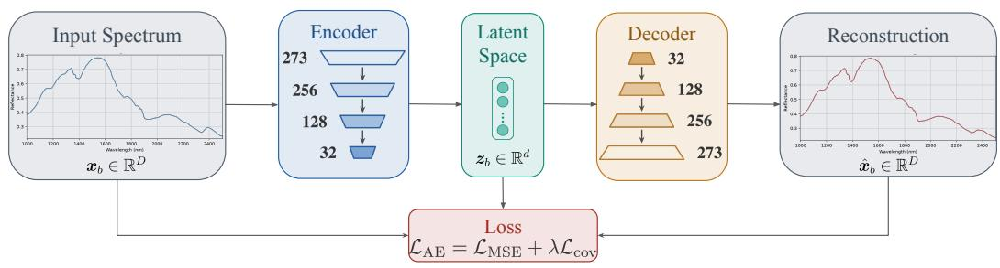
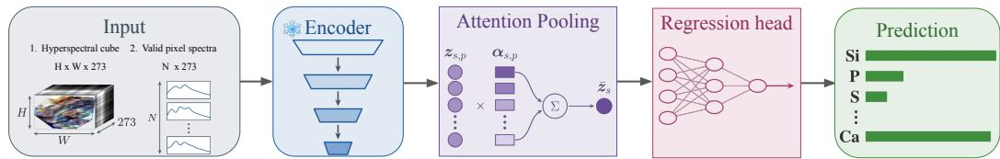
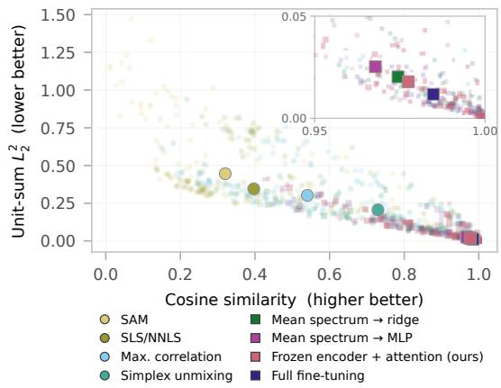
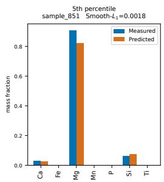
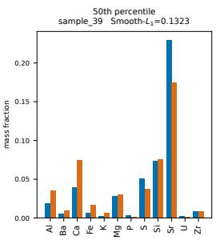
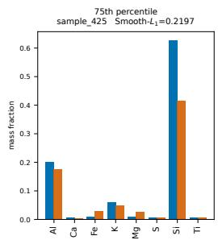
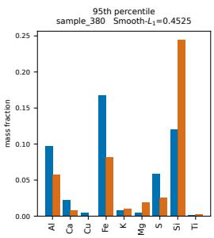
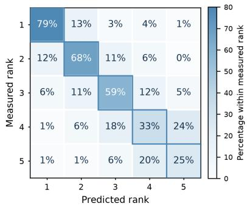

# Many Pixels, One Composition: Self-Supervised Spectra for Specimen-Level Prediction

Eleftheria Tetoula-Tsonga Institute of Communication and Computer Systems Athens, Greece

George Arvanitakis Geonova Athens, Greece

Theodoros Giannakas Institute of Communication and Computer Systems Athens, Greece

## Abstract

Can hyperspectral (HS) imaging be used to predict the elemental composition of physical specimens found on the Earth’s surface? We approach this problem as a supervised regression task, using an open dataset of specimens, each comprising a HS cube and elemental characterization. In particular, we train an encoder in a self-supervised fashion that operates on pixel-level; then freeze the encoder and train a lightweight attention-based regression head in a supervised manner, by pairing many representations of a given specimen with its corresponding elemental label. In test specimens, our approach significantly outperforms traditional spectral matching and unmixing baselines. It also outperforms supervised learning models based on the mean spectrum (of similar model capacity), while full model finetuning achieves the strongest performance, at substantially higher model capacity.

## 1 Introduction

Inferring the elemental composition of physical specimens found on the Earth’s surface typically relies on techniques, such as X-ray-based sensing, which can be slow and difficult to scale. To circumvent this, non-destructive estimation from hyperspectral short wave infrared (SWIR) imagery could directly exploit surface spectra: a single hyperspectral scan is fast, requires no sample preparation, and can be repeated on the same specimen.

A conventional first step is to match pixel spectra against reference libraries such as the USGS, using either hard assignment or spectral unmixing [Kokaly et al., 2017, Heinz and Chang, 2001, Iordache et al., 2011]. These methods are unsupervised by nature. However, an advantage they have over a supervised learning counterpart is that they can rely on a prior library of well-selected spectral signatures, without requiring paired HS observations and composition labels from target specimens.

In the hyperspectral ML domain, learned encoders have been applied for tasks such as land-cover classification and scene reconstruction on satellite or airborne imagery [Hong et al., 2024, Wang et al., 2025, Zhu et al., 2023], under acquisition conditions (spatial context, illumination, sensor band configuration) that differ substantially from close-range specimen scans. These models, nonetheless, operate on a different pixel scale (in the order of many meters) and solve problems with different supervision signals.

A recently released dataset, “Minerals in the Wild” [Tetoula-Tsonga et al., 2026], is a collection of specimens, each accompanied by a hyperspectral cube and a corresponding XRF measurement providing the elemental composition of the specimen. We treat a specimen as a bag of unordered pixels (spectra) paired with its XRF supervision, essentially casting the problem as a multiple instance regression. To this end, we pretrain a spectrum/pixel-level encoder, freeze it, and sample many pixel embeddings per specimen. Finally, a permutation-invariant gated attention [Zaheer et al., 2017, Ilse et al., 2018] pools these into a specimen-level representation from which a regression head computes the elemental composition of the whole specimen.

## 2 Predicting elemental composition from hyperspectral cubes

## 2.1 Problem statement

The dataset consists of 1,132 rock specimens with 2,587,554 valid pixels, in total; each specimen has a different pixel count. Pixels are arranged as an image for each specimen. Each pixel’s spectrum lies in $\mathbb { R } ^ { D }$ , where $D = 2 7 3$ are the light reflectance values in the SWIR range (1000–2500 nm); while each specimen s has an associated XRF label $y _ { s } \in \mathbb { R } ^ { M }$ , a vector of concentrations across the $M = 4 8$ elements measured by the sensor. We use a fixed 905/113/114 train/validation/test specimen split, with all pixels of a given specimen kept in the same partition to avoid pixel-level leakage.

Task. Let specimen s be represented as a set of $n _ { s }$ unordered valid pixels, $i . e . , \ X _ { s } =$ $\{ x _ { s , 1 } , \ldots , x _ { s , n _ { s } } \}$ , where $\boldsymbol { x } _ { s , p } \in { \bf \widehat { \mathbb { R } } } ^ { D }$ is the spectrum of pixel $p$ and specimen s. We seek to learn a function that predicts the specimen composition vector directly from $X _ { s } ,$ , using only specimen-level supervision. That is, to learn:

$$
f : X _ { s } \in \mathbb { R } ^ { n _ { s } \times D } \to \hat { y } _ { s } \in \mathbb { R } ^ { M }\tag{1}
$$

Metrics. To evaluate the performance of $f ,$ we compute the $L _ { 2 }$ distance and cosine similarity between predicted $\hat { y } _ { s }$ and ground-truth $y$ composition vectors. The former captures whether predictions are close in absolute magnitude. The latter quantifies whether a prediction has the same nonzero elements as the true measurement.

## 2.2 Solution: embeddings-based prediction

Self-supervision on pixels. To exploit the large number of pixels, we leverage self-supervised learning. Each specimen is represented by $N = 5 1 2$ randomly selected pixels. Each training batch contains $K = 8$ specimens. Let a training batch contain $B \doteq K \cdot N$ spectra from the training set, that is, $X = [ x _ { 1 } , \dot { \textrm { -- } } , x _ { B } ] ^ { \top } \in \mathbb { R } ^ { B \times D }$ , where each $\boldsymbol { x } _ { b } \in \mathbb { R } ^ { D }$ is a pixel spectrum. An encoder maps each spectrum to a d-dimensional representation, $z _ { b } = e ( x _ { b } ) \in \mathbb { R } ^ { d }$ , and a decoder reconstructs the input spectrum as ${ \hat { x } } _ { b }$ . We collect the representations into $\boldsymbol { Z } = [ z _ { 1 } , \ldots , z _ { B } ] ^ { \top } \in \mathbb { R } ^ { B \times d }$ . We train the autoencoder using a reconstruction loss together with a covariance regularizer:

$$
\mathcal { L } _ { \mathrm { A E } } = \frac { 1 } { B D } \sum _ { b = 1 } ^ { B } \left. x _ { b } - \hat { x } _ { b } \right. _ { 2 } ^ { 2 } + \frac { \lambda } { d ^ { 2 } - d } \sum _ { i \neq j } \left[ C ( Z ) \right] _ { i j } ^ { 2 } ,\tag{2}
$$

where $[ C ( Z ) ] _ { i j }$ is the entry $( i , j )$ of the covariance matrix, evaluated on the $B$ representations. The first term measures reconstruction error across the B pixels and their spectral bands in the batch, while the second penalizes correlations between latent dimensions, encouraging a non-redundant representation [Bardes et al., 2022]. After pretraining, the decoder is discarded and the encoder is frozen for the subsequent specimen-level prediction task. The self-supervised stage of the proposed approach is illustrated in Figure 1(a).

Supervised learning: from specimen representations to specimen label. Each specimen contains multiple heterogeneous pixel spectra but only one XRF composition vector. For a given s, each pixel is projected independently by the frozen encoder, yielding representations $z _ { s , p } \in \mathbb { R } ^ { \breve { d } }$ (where we chose $d = 3 2 )$ ). We then aggregate these using the gated attention pooling operator of Ilse et al. [2018]. The attention weights and the pooled representation are computed, respectively, as follows:

$$
\alpha _ { s , p } = \frac { \exp \big ( w ^ { \top } \left[ \operatorname { t a n h } ( V z _ { s , p } ) \odot \sigma ( U z _ { s , p } ) \right] \big ) } { \sum _ { q } \exp ( w ^ { \top } \left[ \operatorname { t a n h } ( V z _ { s , q } ) \odot \sigma ( U z _ { s , q } ) \right] ) } , \qquad \bar { z } _ { s } = \sum _ { p } \alpha _ { s , p } z _ { s , p } ,\tag{3}
$$

where $p , q$ run over the $N$ pixels of specimen $s ;$ and $V , U \in \mathbb { R } ^ { 6 4 \times 3 2 }$ and $w \in \mathbb { R } ^ { 6 4 }$ are the learnable matrices. This pooling operation allows the model to assign different weights to individual spectra rather than averaging them uniformly. A 32 → 128 → 48 MLP maps $\bar { z } _ { s }$ to the specimen-level composition $\hat { y } _ { s }$ , and the trainable components are optimized using as loss ${ \mathcal { L } } _ { \mathrm { H } } =$ smooth $L _ { 1 } ( \hat { y } _ { s } - y _ { s } )$ applied element-wise. The subsequent supervised specimen-level regression stage is illustrated in Figure 1(b).

(a) Self-supervised pretraining  

(b) Supervised specimen-level training  
  
Figure 1: Two-stage model: self-supervised pixel encoding followed by gated-attention pooling and specimen-level regression.

Table 1: Performance on 114 test specimens. Results for neural-network-based methods are mean $\pm$ standard deviation over five seeds. $\mathbf { \bar { \rho } } _ { L _ { 2 } ^ { 2 } }$ is computed after unit-sum normalization.
<table><tr><td>Method</td><td>Trainable Params</td><td>Cosine ↑</td><td> $L _ { 2 } ^ { 2 } \downarrow$ </td></tr><tr><td>SAM</td><td></td><td>0.4013</td><td>0.5251</td></tr><tr><td>SLS/NNLS</td><td></td><td>0.4601</td><td>0.3850</td></tr><tr><td>Max. correlation</td><td></td><td>0.5639</td><td>0.3344</td></tr><tr><td>Simplex unmixing</td><td></td><td>0.6820</td><td>0.2267</td></tr><tr><td>Mean spectrum + ridge</td><td>13.1k</td><td>0.9041</td><td>0.0568</td></tr><tr><td>Mean spectrum + MLP</td><td>14.5k</td><td>0.9011±0.0021</td><td>0.0654±0.0021</td></tr><tr><td>Frozen enc. + attn. (ours)</td><td>14.8k</td><td>0.9282±0.0042</td><td>0.0479±0.0021</td></tr><tr><td>Full fine-tuning</td><td>122.7k</td><td>0.9415±0.0011</td><td>0.0394±0.0011</td></tr></table>

## 3 Performance evaluation: results and discussion

Comparison. We consider two groups of baselines. First consists of four unsupervised methods: SAM, Max. correlation, and two methods based on convex optimization, found in Tetoula-Tsonga et al. [2026]. All four perform spectral matching or unmixing without using the XRF measurements. Second, it is supervised learning methods. We consider two models trained on specimen-level XRF measurements, using the mean spectrum of each specimen as input, as well as a model that fine-tunes the spectral encoder jointly with the specimen-level predictor. We evaluated them on the fixed 114 specimen test set using cosine similarity and unit-sum $L _ { 2 } ^ { 2 } .$ . The unsupervised methods exhibit broad specimen-level variation, whereas the XRF-supervised models are concentrated near the high-cosine, low-error region (Fig. 2).

  
Figure 2: Specimen-level performance. XRF-supervised models cluster in the high-cosine, low-error region, whereas the spectral matching and unmixing baselines show broader errors.3

  
Figure 4: Measured and predicted compositions at four percentiles of specimen-level Smooth ${ \bf \nabla } \cdot { \cal L } _ { 1 }$ error. Values are shown in mass-fraction units.

Our model also outperforms both mean-spectrum models, reducing unit-sum $L _ { 2 } ^ { 2 }$ from 0.0568 to 0.0479 relative to the ridge baseline (Table 1). Replacing ridge with a similarly sized nonlinear MLP does not improve the mean-spectrum baseline, suggesting that the gain does not arise simply from additional nonlinearity or parameter count. This result is consistent with the hypothesis that retaining the pixel spectra and pooling them as a set preserves specimen-level information lost through global averaging. Full encoder fine-tuning achieves the highest accuracy, but the frozen model remains close while requiring approximately 88% fewer trainable parameters (Table 1). This suggests that the frozen representation already contains much of the spectral information required for elemental prediction.

How accurate is our prediction? We switch gears and focus on the prediction produced by our model and discuss its distance to the true XRF targets. In Fig. 4 we show the specimen’s true and predicted composition, for the 5th, 50th, 75th and 95th percentiles; these are ranked based on Smooth- $. L _ { 1 }$ error. In the 5th, the $\hat { y } _ { s }$ closely follows the $y _ { s }$ dominant and secondary elements. The median specimen retains all constituents, and, encouragingly, achieves accurate predictions. At the 95th percentile, the model still identifies all elements present in the specimen, but their relative magnitudes are less accurately but their relative magnitudes are less accurately

Figure 3: Measured versus predicted ranks for the five leading elements. Cells show specimen counts and colour indicates row percentage.recovered. The main limitation for difficult specimens therefore lies in estimating elemental proportions rather than detecting their presence.

Fig. 3 depicts a variant of a confusion matrix, which shows the number of specimens where the rank between $y _ { s }$ and $\hat { y } _ { s }$ was preserved, in the first five positions of the composition vector. Ideally, this matrix should contain the value 114 in its diagonal; it would suggest perfect ranking. Interestingly, the first row suggests that out of 114 test specimens, we predicted the same dominant element 90 times, or predicted the correct dominant element as second. In fact, looking at the second (and the third row), we can realize that, typically, when an element was measured in the second (and the third) position, we mostly predict correctly the position, or we are off by a position, over or under but not much less. Overall, the model preserves the ordering of the most important elements (Fig. 3): the dominant element is recovered exactly in 79% of specimens and falls within the predicted top three in 95%, which is important for identifying a specimen’s principal constituents.

## 4 Conclusion and limitations

We show that elemental composition can be predicted accurately from hyperspectral imagery, given enough labeled samples. Framing the task as multiple-instance regression lets one label-free spectral encoder support a compact supervised head, which outperforms mean-spectrum models at matched downstream trainable capacity and approaches full fine-tuning.

The main limitation of this study is the range of specimens represented in the dataset. The proposed models perform well on the held-out specimens, but their ability to generalize to specimens with different compositions, geological origins, or acquisition conditions remains unknown. Evaluating the models on a broader and more diverse collection of specimens, ideally acquired with different instruments and under different conditions, is an important direction for future work.

## References

Adrien Bardes, Jean Ponce, and Yann LeCun. VICReg: Variance-invariance-covariance regularization for self-supervised learning. In International Conference on Learning Representations, 2022. URL https://openreview.net/forum?id=xm6YD62D1Ub.

Daniel C. Heinz and Chein-I Chang. Fully constrained least squares linear spectral mixture analysis method for material quantification in hyperspectral imagery. IEEE Transactions on Geoscience and Remote Sensing, 39(3):529–545, 2001.

Danfeng Hong, Bing Zhang, Xuyang Li, Yuxuan Li, Chenyu Li, Jing Yao, Naoto Yokoya, et al. SpectralGPT: Spectral remote sensing foundation model. IEEE Transactions on Pattern Analysis and Machine Intelligence, 46(8), 2024.

Maximilian Ilse, Jakub M. Tomczak, and Max Welling. Attention-based deep multiple instance learning. In Proceedings of the 35th International Conference on Machine Learning, volume 80 of Proceedings ofMachine Learning Research, pages 2127–2136. PMLR, 2018.

Marian-Daniel Iordache, José M. Bioucas-Dias, and Antonio Plaza. Sparse unmixing of hyperspectral data. IEEE Transactions on Geoscience and Remote Sensing, 49(6):2014–2039, 2011.

Raymond F. Kokaly, Roger N. Clark, Gregg A. Swayze, K. Eric Livo, Todd M. Hoefen, Neil C. Pearson, et al. USGS spectral library version 7. Technical Report Data Series 1035, U.S. Geological Survey, 2017.

Eleftheria Tetoula-Tsonga, George Arvanitakis, and Theodoros Giannakas. Minerals in the wild: A hyperspectral-XRF dataset for elemental composition estimation, 2026. URL https://arxiv. org/abs/2608.30537.

Di Wang et al. HyperSIGMA: Hyperspectral intelligence comprehension foundation model. IEEE Transactions on Pattern Analysis and Machine Intelligence, 2025.

Manzil Zaheer, Satwik Kottur, Siamak Ravanbakhsh, Barnabas Poczos, Ruslan Salakhutdinov, and Alexander J. Smola. Deep sets. In Advances in Neural Information Processing Systems, volume 30, pages 3391–3401, 2017.

Lingxuan Zhu, Jiaji Wu, Wang Biao, Yi Liao, and Dandan Gu. SpectralMAE: Spectral masked autoencoder for hyperspectral remote sensing image reconstruction. Sensors, 23(7):3728, 2023.