# Modality-Aware Expert Pruning for MoE-Based Multimodal Large Language Models

Donggeun Kim Nota Inc. donggeun.kim@nota.ai

## Abstract

Mixture-of-Experts (MoE) enables multimodal large language models (MLLMs) to scale capacity efficiently, but expert parameters dominate memory even though only a few experts are activated per token: they account for over 90% of model size in modern MoE-MLLMs (e.g., 54 GB out of ∼58 GB in BF16 for InternVL3.5- 30B-A3B and Qwen3-VL-30B-A3B). Expert pruning has emerged as an effective compression strategy, but existing methods aggregate importance uniformly across tokens, ignoring that the same expert may serve different roles for vision versus language processing. To address this, we propose MAEP (Modality-Aware Expert Pruning), a training-free framework that decomposes expert importance by modality in a single forward pass. MAEP introduces (1) Delta-H Output (∆H), a redistribution-aware metric measuring the MoE output change when an expert is removed, and (2) low-attention vision tokens as a vision-side pruning signal that is dataset-stable: its expert-importance ranking remains stable across different datasets. Text-side importance serves as a preservation signal while vision-side importance serves as a pruning signal, and experts are ranked globally across layers. Experiments on three MoE-based MLLMs across multimodal and text benchmarks show that MAEP outperforms modality-agnostic baselines on the majority of multimodal benchmarks while remaining competitive on text-only tasks, reducing the BF16 expert weight footprint by ∼27 GB (∼47% of total memory) so that the full weight footprint of a ∼58 GB model fits within a single 40 GB GPU. Code is available at https://github.com/nota-github/MAEP.

## 1 Introduction

Recent advances in large language models (LLMs) have increasingly adopted the Mixture-of-Experts (MoE) architecture as a key strategy for scaling model capacity while maintaining computational efficiency [11, 23, 57]. By activating only a subset of experts per token through sparse routing, MoE models achieve a favorable trade-off between total parameter count and inference cost. This paradigm has naturally extended to multimodal LLMs (MLLMs) [1, 3, 16, 25, 42, 49, 51], where MoE layers handle the joint processing of vision and language inputs.

However, while sparse MoE reduces computation by activating only a few experts per token, all expert parameters must remain in memory regardless of activation—making the MoE architecture inherently memory-intensive. In models such as InternVL3.5-30B-A3B and Qwen3-VL-30B-A3B, expert parameters account for 93–94% of the total model size (54 GB out of ∼58 GB in BF16; see Appendix C), despite only 8 of 128 experts being activated per token. This gap between memory footprint and effective utilization motivates expert compression—reducing the number or size of experts through techniques such as pruning, merging, or quantization. For instance, pruning 50% of experts can reduce the BF16 routed-expert weight footprint by ∼27 GB (47% of total weight memory), bringing the BF16 weight footprint of a 58 GB model below the nominal capacity of a single 40 GB GPU, thereby enabling deployment in memory-constrained settings.

Existing expert compression approaches, including merging [5, 30, 31], pruning [2, 27], and decomposition/quantization [20, 34], have proven effective for text-only MoE LLMs. However, these methods aggregate importance statistics uniformly across all input tokens without distinguishing token modality, making their direct application to MoE-based MLLMs inadequate. Indeed, recent analysis [22] reveals a consistent distributional gap between text and vision tokens in expert layers, with each modality interacting with experts differently, highlighting the need for a modality-aware expert compression strategy.

To this end, we propose MAEP (Modality-Aware Expert Pruning), a training-free framework with two key components. Given only a small calibration set, MAEP computes all importance scores in a single forward pass without any gradient computation or weight updates:

First, we propose Delta-H Output (∆H, where H denotes the MoE layer’s hidden-state output) as the expert importance metric, defined as the squared L2 change in this output when an expert is removed with routing redistribution. Unlike metrics based on routing frequency or an expert’s isolated contribution, ∆H captures the residual output change after redistributing weight to the remaining experts; smaller values indicate higher functional redundancy among co-activated experts. Because ∆H averages over a token subset, it can be computed separately for text and vision tokens, yielding per-modality importance scores.

Second, we find that not all vision tokens are equally reliable for importance estimation. Evaluating ∆H over the full set of vision tokens yields dataset-dependent rankings because vision content is tied to image-specific objects, making the resulting importance estimates domain-sensitive. Instead, lowattention vision tokens—those receiving minimal attention from text tokens—provide a substantially more dataset-stable signal.

We evaluate MAEP across multiple MoE-based MLLMs, pruning ratios, and benchmarks. Our results suggest that modality-aware importance scoring outperforms modality-agnostic baselines, supporting the value of modality decomposition for expert compression in vision-language models.

## 2 Related Work

## 2.1 Expert Compression for MoE Models

Prior work on compressing MoE-based LLMs has explored several directions. Among methods that reduce the expert pool, two prominent strategies are merging, which combines similar experts [5, 30, 31, 43–45], and pruning, which removes redundant experts based on estimated importance. Pruning methods differ mainly in how they identify redundant experts—e.g., routerweighted activation norms [27], differentiable non-uniform layer-wise expert pruning [2], secondorder atomic-expert removal [29], or calibration-based search over preserved expert subsets [39]. At the weight level, MoE-Pruner [55] extends activation-aware weight pruning to LLMs by scaling weight-activation scores with router weights. Complementary strategies include replacing pruned experts with lightweight replacement modules [60], neuron-level recombination [64], and quantization [20] or low-rank decomposition [17, 34, 58]. However, most prior pruning and merging methods have been developed primarily for LLMs, leaving expert-compression strategies for MoE-MLLMs relatively underexplored.

Moreover, many importance-based criteria—particularly those derived from activation frequency or routing statistics [39, 55]—aggregate signals uniformly over tokens without distinguishing modality, which can obscure modality-specific expert roles in vision-language models. Vision tokens are themselves substantially redundant [6, 62], which raises the concern that frequency-aggregated importance may overweight non-essential tokens; indeed, calibrating weight pruning on all text tokens but only a subset of visual tokens has been shown to improve pruning quality [33]. This motivates modality-aware importance measures that decompose expert contributions by token type rather than aggregating uniformly across all tokens.

## 2.2 Efficient MLLMs

As MLLMs grow larger, their memory and compute demands increasingly constrain real-world deployment. Prior work has improved inference efficiency by reducing the number of visual token forwarded to the language model [6, 40, 62], lowering weight precision through quantization [32, 59], and compressing the KV cache to reduce runtime memory [19, 48].

As MoE architectures—which scale model capacity while keeping per-token computation fixed—have also become common in MLLMs [1, 36, 49], improving efficiency for MoE-based architectures has been explored. FastMMoE [53] combines expert activation reduction for visual tokens with routingaware visual token pruning, while RoE [50] and SMAR [54] optimize expert routing strategies. MoDES [22] is closest in motivation to our work: it accounts for modality-dependent expert utility and applies modality-specific thresholds to skip experts during inference. Existing MoE-MLLM efficiency methods mainly reduce inference-time computation through expert skipping or visualtoken pruning; the expert parameters themselves, however, persist in GPU memory. MAEP targets this complementary but underexplored problem: permanent routed-expert pruning for MoE-based MLLMs, using modality-decomposed importance scores.

## 3 Preliminaries

## 3.1 Mixture-of-Experts Layers

Within each transformer block, the Mixture-of-Experts (MoE) architecture replaces the dense feedforward network (FFN) with a set of N parallel expert networks $\{ E _ { 1 } , \dots , \dot { E _ { N } } \}$ and a lightweight router network G. For an input hidden state $h \in \mathbb { R } ^ { d }$ , the router applies a linear projection and a scoring function—typically softmax or sigmoid—to produce per-expert scores $p _ { i } ( h )$ . Only the top-k highest-scoring experts are activated for each token, and the MoE layer output is their weighted sum:

$$
H _ { \mathrm { M o E } } ^ { ( l ) } ( h ) = \sum _ { i \in \mathrm { t o p } \cdot k ( p ( h ) ) } w _ { i } \cdot E _ { i } ( h )\tag{1}
$$

where $w _ { i } = p _ { i } / \sum _ { j \in \mathrm { t o p } { - } k } p _ { j }$ are the routing weights. This sparse activation enables MoE models to scale total parameters while maintaining the per-token computation cost of a much smaller model.

## 3.2 MoE-based MLLM Architecture

MoE-based MLLMs use a vision encoder and a modality projector to map images into vision tokens, which are concatenated with text tokens and passed through the shared MoE backbone. Crucially, the router dispatches both vision and text tokens to the same pool of experts based solely on the hidden state, without explicit modality conditioning. After the final MoE layer, the model applies an LM head $W \in \mathbb { R } ^ { V \times d }$ that maps the last hidden state h to the output distribution $p ( y \mid h ) = \operatorname { s o f t m a x } ( W h )$ over a vocabulary of size V. This shared-pool design raises a fundamental question: is expert importance uniform across modalities, or does it differ between text and vision tokens? We investigate this empirically in Section 4.

## 4 Empirical Motivation

## 4.1 Why We Need a Modality-Aware Proxy Metric

Following OBD [28]’s principle, which measures a component’s importance by the loss change upon removal, a direct way to score an expert is to remove it and measure the induced change in the model’s next-token distribution. This change can be captured by the LM-head KL divergence $D _ { \mathrm { K L } } ( p _ { \mathrm { o r i g } } \| p _ { \mathrm { p r u n e d } } )$ between the unpruned and pruned output distributions. Directly measuring this KL for every expert would capture the effect on output but is prohibitively expensive: with N experts per layer and L MoE layers, it requires $N \times L$ full forward passes per calibration sample (e.g., $1 2 8 \times 4 8 = 6 , 1 4 4$ passes for InternVL3.5-30B-A3B). We therefore use Delta-H Output $( \Delta H )$ , the MoE-output perturbation induced by expert removal, as a lightweight proxy. We formalize this proxy in Section 5.1.

Furthermore, a proxy aggregating uniformly over tokens is insufficient. Prior work has observed modality-dependent expert behavior in MoE-based MLLMs [22, 54, 56]; we find that this extends to expert importance: when ranked by $\Delta H$ on text tokens versus vision tokens, the resulting expert importance rankings show limited agreement (Spearman $\rho$ between −0.11 and 0.05 at specific layers;

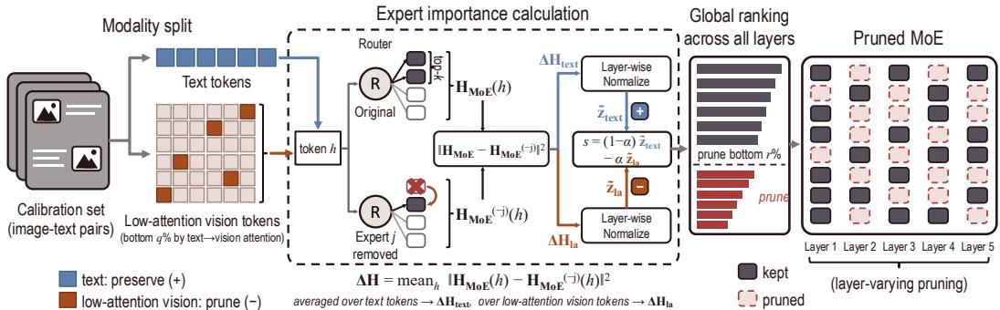  
Figure 1: Pipeline of MAEP. Text and low-attention vision tokens are scored separately via $\Delta H ^ { ( l , j ) }$ layer-wise normalized, combined with asymmetric signs—text preservation (+) and low-attention vision pruning (−); see Eq. 4—and ranked globally.

Appendix F). The expert removal also induces an asymmetric output-side perturbation: the LM-head output distribution shifts up to 29× more on vision-token positions than on text-token positions, indicating modality-asymmetric representational sensitivity to expert removal. These observations imply that an effective metric must be computationally efficient and modality-decomposable.

## 4.2 Vision Token Heterogeneity and Signal Stability

Prior work on vision token pruning [6, 40, 62] has shown that not all vision tokens contribute equally. This suggests that modality decomposition alone is not sufficient on the vision side: the choice of vision tokens used to estimate expert importance also matters. We compute the attention score of a vision token as the average text-to-vision attention weight, averaged across all heads at each layer (a single scalar per token, layer, and sample), and compare token subsets by cross-dataset ranking stability.

Specifically, cross-dataset Spearman ρ (between ShareGPT4V [7] and ChartNet [26], averaged across layers; Appendix G) reveals a clear hierarchy: full vision (≈ 0.0), high-attention vision (top q≈20%, ≈ 0.2), text (≈ 0.5), and low-attention vision (≈ 0.6). In particular, expert importance ranked by ∆H computed from the full or high-attention vision tokens is sensitive to the calibration dataset. By construction, cross-modal attention highlights tokens relevant to the current text query—a property that text-guided token pruning methods such as SparseVLM [62] rely on. Different calibration datasets carry different content and queries, so high-attention selections drift across datasets. Moreover, not all high-attention tokens are informative: some are visual attention sinks [24] that attract attention despite carrying little semantic content. By contrast, low-attention vision tokens (bottom q-th percentile of text-to-vision attention) yield the most stable expert importance rankings across calibration datasets, suggesting they reflect the model’s visual processing rather than domain-specific content.

## 5 Proposed Method

Building on the observations in Section 4, this section formally defines the ∆H proxy and presents the pruning framework (Figure 1). The overall pipeline is entirely training-free: given a small calibration set1, the full pipeline (importance scoring, modality decomposition, and global pruning) completes within a single forward pass per sample.

Scope. MAEP applies to MoE architectures with top-k routing $( k \geq 2 ,$ , required by the redistribution counterfactual; Section 5.1). For architectures that additionally employ always-active shared experts (e.g., DeepSeek-VL2 [51], Kimi-VL [25]), MAEP targets only the routed experts: shared experts are excluded from importance scoring and pruning. The memory savings reported in this paper refer exclusively to the removal of routed expert parameters.

Notation. We distinguish two levels of indexing: $h \in \mathbb { R } ^ { d }$ denotes a single token’s hidden state, while x denotes a calibration sample (image-text pair) of |x| tokens. At the token level, $H _ { \mathrm { M o E } } ^ { ( l ) } ( h )$ is the

MoE layer output (Section $3 . 1 ) , p _ { i } ( h )$ is the router score, and $w _ { i }$ is the routing weight. Sample-level and dataset-level aggregation of importance scores is defined in Section 5.1.

## 5.1 Delta-H Output: Expert Importance Metric

We define the importance of expert j in layer l as the expected change in the MoE output when expert $j$ is removed:

$$
\Delta H ^ { ( l , j ) } = \mathbb { E } _ { x \sim \mathcal { D } } \left[ \frac { 1 } { | x | } \sum _ { h \in x } \left. H _ { \mathrm { M o E } } ^ { ( l ) } ( h ) - H _ { \mathrm { M o E } } ^ { ( l , - j ) } ( h ) \right. _ { 2 } ^ { 2 } \right]\tag{2}
$$

where $H _ { \mathrm { M o E } } ^ { ( l , - j ) }$ denotes the MoE output with expert $j$ excluded via router redistribution: expert $j ^ { \circ } \mathrm { s }$ router logit is masked and the top-k experts are re-selected and renormalized, as in the pruned model. Formally, the redistributed weight for each remaining expert $i \neq j$ is $w _ { i } ^ { ( - j ) } = w _ { i } / ( 1 - w _ { j } + w _ { ( k + 1 ) } )$ where $w _ { ( k + 1 ) }$ is the $\left( k { + } 1 \right)$ )-th ranked expert’s router score normalized in the same way as the top-k weights, preserving the relative ratios among the remaining experts.

Redistribution operates on renormalized top-k weights, making it structurally agnostic to the underlying scoring function. We adopt a fixed top-k counterfactual (the promoted $( k { + } 1 ) { - } \operatorname { t h }$ expert is not evaluated and contributes no output) to avoid an additional expert computation during calibration; this is nearly identical to the promotion variant (mean $\rho > 0 . 9 8$ across modalities; Appendix H).

The entire computation requires only a single forward pass through the model: cached top-k weights and expert outputs let us evaluate all counterfactuals analytically. Restricting the token set to a specific modality yields per-modality variants of $\Delta H$ , supporting fine-grained importance estimation while capturing functional redundancy among co-activated experts.

## 5.1.1 Why $\Delta H ;$ : Connection to KL Divergence

The following bound shows that $\| \hat { h } - \hat { h } ^ { ( - j ) } \| _ { 2 } ^ { 2 }$ (the squared $L _ { 2 }$ change in the MoE output, with $\hat { h } : = H _ { \mathrm { M o E } } ^ { ( l ) } ( h ) )$ arises naturally in a KL upper bound, motivating $\Delta H$ as a within-layer ranking proxy. It does not itself justify the cross-layer normalization, modality decomposition, or global ranking in Section 5.3; those are described and validated separately.

Proposition 1. Let $\Phi _ { l } : \mathbb { R } ^ { T \times d }  \mathbb { R } ^ { T \times | V | }$ map MoE layer l’s outputsfor a T-token sequence through subsequent transformer blocks and the LM head to pre-softmax logits, on a compact activation domain (approximately ensured by RMSNorm/LayerNorm). For the pre-MoE hidden states $h _ { t } \in \mathbb { R } ^ { d }$ of the sequence at layer l, let $\hat { h } _ { t } : = H _ { M o E } ^ { ( l ) } ( h _ { t } )$ and $\hat { h } _ { t } ^ { ( - j ) } : = H _ { M o E } ^ { ( l , - j ) } ( h _ { t } )$ denote the MoE output before/after removing expert j, and let $p _ { t }$ and $p _ { t } ^ { ( - j ) }$ denote the resulting next-token distributions at position t. Then

$$
\frac { 1 } { T } \sum _ { t = 1 } ^ { T } D _ { \mathrm { K L } } \big ( p _ { t } \| p _ { t } ^ { ( - j ) } \big ) \leq \frac { L _ { \Phi _ { l } } ^ { 2 } } { 4 } \cdot \frac { 1 } { T } \sum _ { t = 1 } ^ { T } \| \hat { h } _ { t } - \hat { h } _ { t } ^ { ( - j ) } \| _ { 2 } ^ { 2 } ,\tag{3}
$$

where $\begin{array} { r } { L _ { \Phi _ { l } } = \Vert W \Vert _ { \mathrm { o p } } L _ { \mathrm { n o r m } } \prod _ { i = l + 1 } ^ { L } ( 1 + L _ { g _ { i } } ) } \end{array}$ absorbs the LM head, the pre-LM-head normalization, and the local Lipschitz constants ofsubsequent attention+FFN branches $g _ { i }$ in $f _ { i } ( X ) = X + g _ { i } ( X )$ .

The proof (Appendix B) composes Lipschitz post-MoE blocks with the $\textstyle { \frac { 1 } { 2 } }$ -smoothness of $A ( z ) =$ log $\textstyle \sum _ { i } e ^ { z _ { i } }$ . Averaging over the calibration distribution yields $\begin{array} { r } { \mathbb { E } _ { x \sim \mathcal { D } } \Big [ \frac { 1 } { | x | } \sum _ { h \in x } D _ { \mathrm { K L } } \Big ] \leq C _ { l } \cdot \Delta H ^ { ( l , j ) } } \end{array}$ with $C _ { l } = L _ { \Phi _ { l } } ^ { 2 } / 4$

Role of the bound. Since $C _ { l }$ is layer-dependent but expert-independent, ranking experts by the bound within a layer is equivalent to ranking them by $\Delta \bar { H }$ . The bound motivates $\Delta H$ —rather than routing frequency or gating entropy—as the quantity that emerges naturally from the Lipschitz– softmax composition of the post-MoE network. Since $C _ { l }$ is a layer-shared constant, within-layer ranking depends only on relative magnitudes of $\Delta H$ across experts; $L _ { \Phi _ { l } }$ thus does not affect ranking outcomes and need not be estimated.

Empirical validation. Per-layer Spearman rank correlation between $\Delta H$ and actual KL divergence increases with depth overall for both modalities, reaching ${ > } 0 . 8$ in deeper layers (vision) and ∼0.89 (text) (Appendix I). This pattern is qualitatively consistent with the depth dependence in Proposition 1:

deeper layers admit a tighter bound and thus a more reliable proxy. The weaker correlation in shallow layers reflects the bound’s depth dependence in Proposition 1; in practice, the global pruning decision aggregates across all layers via the combined score (Eq. 4).

## 5.2 Low-Attention Vision Scoring

Motivated by the observation in Section 4.2 that full-vision and high-attention signals are datasetdependent, we use low-attention vision tokens as the basis for the vision-side pruning signal. Per sample and per layer, tokens in the bottom q-th percentile $( q = 2 \% )$ ; ablated in Section 6.3.1) of the attention score (Section 4.2) are classified as low-attention; this per-sample selection adapts to varying image resolutions and aspect ratios. We then compute ∆H (Eq. 2) over these tokens only (with |x| rescoped to the subset cardinality), yielding the vision-side score $\Delta H _ { \mathrm { l a } } ^ { ( l , j ) }$ (“la” denoting low-attention; same subscript convention used for $\tilde { z } _ { \mathrm { l a } }$ in Eq. 4). A high value indicates that expert j is heavily engaged with vision tokens that receive little text-to-vision attention—i.e., experts that specialize in non-salient background visual content. In contrast to text-side $\Delta H$ , where a high value marks an essential expert to preserve, a high $\Delta H _ { \mathbf { l a } } ^ { ( l , j ) }$ identifies experts that allocate capacity to less informative tokens and are therefore favorable pruning candidates (verified at the model output in Appendix I.1); we make this asymmetric usage explicit in Section 5.3. This signal is also more dataset-stable than full or high-attention alternatives (Section 4.2), since low-attention tokens reflect non-salient background content rather than domain-specific features (Appendix G.2).

## 5.3 Combined Scoring and Global Pruning

The two signals play asymmetric roles: text-side $\Delta H$ acts as a preservation signal (high → retain), while low-attention vision-side $\Delta H$ acts as a pruning signal (high → remove). Since raw $\Delta H$ values follow a heavy-tailed distribution and vary in magnitude across layers by up to $1 0 ^ { 3 } –$ $1 0 ^ { 4 } \times$ (Appendix J), we first apply a log-transform followed by layer-wise z-score normalization: $\tilde { z } ^ { ( l , j ) } = ( \log ( \Delta H ^ { ( l , j ) } + \epsilon ) - \mu _ { l } ) / \sigma _ { l } , \epsilon = 1 0 ^ { - 8 }$ . Here $\mu _ { l }$ and $\sigma _ { l }$ denote the mean and standard deviation of $\log ( \Delta H ^ { ( l , j ) } + \epsilon )$ over experts j in layer l. The final score for expert $j$ in layer l is:

$$
s ( l , j ) = ( 1 - \alpha ) \cdot \tilde { z } _ { \mathrm { t e x t } } ^ { ( l , j ) } - \alpha \cdot \tilde { z } _ { \mathrm { l a } } ^ { ( l , j ) }\tag{4}
$$

where α controls the modality balance. Experts with the lowest $s ( l , j )$ are pruned first.

Correlation-based α selection. Since models exhibit varying degrees of text–vision importance ranking correlation, the modality balance α is model-specific; we obtain it from a closed-form expression on calibration statistics. Let $\begin{array} { r } { \bar { \rho } _ { x , y } = \frac { 1 } { L } \sum _ { l } \rho _ { l } ( \Delta H _ { x } ^ { ( l ) } , \Delta H _ { y } ^ { ( l ) } ) } \end{array}$ ) denote the layer-averaged Spearman correlation between expert rankings under modalities $x , \overset { \cdot } { y } \in \left. { \mathrm { t } } , { \mathrm { v } } , { \mathrm { l a } } \right.$ , where t, v, and la index $\Delta H$ on text, full-vision, and low-attention vision token subsets respectively. We adopt $\alpha = a / ( a + b )$ with $a : = \bar { \rho } _ { \mathrm { t , v } } - \bar { \rho } _ { \mathrm { t , l a } }$ and $b : = \bar { \rho } _ { \mathrm { v , l a } }$ (both positive on the evaluated models, keeping $\alpha \in [ 0 , 1 ]$ ; Table 8). Intuitively, a captures the differential alignment of text-side importance with the full-vision versus low-attention signal: when text and full-vision experts overlap but text and low-attention experts do not, low-attention vision is complementary to text and α tends to be larger. b captures within-vision redundancy: when full-vision and low-attention rankings agree, favoring low-attention adds little new information and α tends to be smaller. Section 6.3.3 reports the closedform α for each model and verifies that these values lie within the empirical safe range; per-model ρ¯ values are reported in Appendix F.

Global pruning. Expert redundancy varies across layers and modalities [2, 22], suggesting that a fixed per-layer budget is suboptimal. We instead rank all experts across all layers by $s ( \bar { l } , \bar { j } )$ and prune the bottom $\lfloor r \cdot N _ { \mathrm { t o t a l } } \rfloor$ entries, so that no layer is forced to prune experts that its own score distribution does not mark as redundant (Section 6.3.1, Appendix K). We compare this against uniform per-layer pruning in Section 6.3.1.

Proposition 1 justifies ∆H only as a within-layer ranking, since $C _ { l } = L _ { \Phi _ { l } } ^ { 2 } / 4$ differs across layers and is not estimated. The z-score above serves a separate purpose: it makes the per-layer score distributions comparable in shape so that $\Delta H$ can be used as a global ranking signal without recovering $C _ { l }$ (Section 6.3.1, Appendix K). The asymmetric text/vision combination reflects the modality gap of Section 4.1.

Table 1: Main results at 25% and 50% expert pruning ratios. †Unpruned-model results are reproduced with our evaluation pipeline. “Avg. (%)” is the mean retention of each method’s per-benchmark score relative to the unpruned baseline, averaged over all 11 benchmarks.
<table><tr><td colspan="10"></td><td colspan="3">Text-only</td><td rowspan="2">Avg. (%)</td></tr><tr><td>Model</td><td>Ratio</td><td>Method</td><td>MME</td><td>MMBench</td><td>MMStar</td><td>ChartQA</td><td>TextVQA</td><td>RealWorldQA</td><td>CV-Bench</td><td>POPE</td><td>MMLU-Redux</td><td>IFEval ARC-C</td></tr><tr><td rowspan="8">InternVL3.5</td><td></td><td>Original† 2442.2</td><td>85.2</td><td></td><td>71.4 87.3</td><td>80.2</td><td>72.2</td><td>84.6</td><td>89.4</td><td>80.9</td><td>78.9</td><td>95.2</td><td>100.0</td></tr><tr><td></td><td>HC-SMoE 2344.8</td><td>79.8</td><td>67.1</td><td>87.0</td><td>76.2 78.8</td><td>71.6 72.5</td><td>84.5</td><td>89.8</td><td>67.4</td><td>45.6</td><td>87.4</td><td>91.9</td></tr><tr><td>25%</td><td>REAP</td><td>2326.6</td><td>84.0</td><td>68.9</td><td>83.2</td><td></td><td>83.6</td><td>89.3</td><td>69.3</td><td>69.7</td><td>92.7</td><td>95.9</td></tr><tr><td></td><td>MAEP</td><td>2364.9</td><td>83.2</td><td>69.3</td><td>87.0</td><td>78.9</td><td>84.3</td><td>89.7</td><td>72.3</td><td>77.1</td><td>94.1</td><td>97.7</td></tr><tr><td></td><td>HC-SMoE</td><td>1907.5</td><td>66.1</td><td>56.2</td><td>75.3</td><td>68.0 71.2</td><td>79.8</td><td>88.3</td><td>33.9</td><td>20.9</td><td>53.2</td><td>74.1</td></tr><tr><td>50%</td><td>REAP</td><td>2109.6</td><td>78.7</td><td>63.3</td><td>65.3</td><td>66.5 74.4</td><td>83.9</td><td>89.1</td><td>53.9</td><td></td><td>66.4 85.7</td><td>88.5</td></tr><tr><td></td><td>MAEP</td><td>2160.3</td><td>80.7</td><td>63.3</td><td>76.7</td><td>75.6</td><td>71.6</td><td>83.3</td><td>89.7</td><td>59.8</td><td>64.9 90.6</td><td>91.2</td></tr><tr><td></td><td>Original†</td><td>2416.6</td><td>87.3</td><td>66.9</td><td>85.3</td><td>84.6</td><td>73.5</td><td>86.0</td><td>88.5</td><td>79.0</td><td>86.0</td><td>100.0</td></tr><tr><td rowspan="8">Qwen3-VL</td><td></td><td></td><td>83.9</td><td></td><td></td><td></td><td></td><td></td><td></td><td></td><td></td><td>96.7</td><td>96.0</td></tr><tr><td>25% REAP</td><td>HC-SMoE 2085.4 2133.5</td><td>83.3</td><td>65.3 65.7</td><td>84.3 84.2</td><td>83.0 82.9</td><td>71.9 68.4</td><td>81.3 73.9</td><td>88.8 88.3</td><td>73.6 73.3</td><td>81.7 80.9</td><td>94.9 95.1</td><td>94.8</td></tr><tr><td></td><td>MAEP</td><td>2287.3</td><td>84.4</td><td>65.7</td><td></td><td>72.5</td><td>82.8</td><td>88.4</td><td>68.7</td><td>83.0</td><td>95.3</td><td>96.6</td></tr><tr><td></td><td>HC-SMoE</td><td></td><td></td><td>82.5</td><td>83.9 76.1</td><td></td><td></td><td></td><td></td><td></td><td></td><td></td></tr><tr><td>50% REAP</td><td></td><td>1923.9 2026.6</td><td>75.1</td><td>59.9</td><td>74.3</td><td>69.4 66.0</td><td>80.5 70.1</td><td>85.2 88.2</td><td>56.0 56.0</td><td>65.2 73.8</td><td>74.8 85.9</td><td>85.5 86.6</td></tr><tr><td></td><td>MAEP</td><td>2042.8</td><td>80.3 80.3</td><td>59.9 60.2</td><td>67.1 69.6</td><td>78.1 79.7</td><td></td><td>89.5</td><td>53.0</td><td></td><td>69.3 83.1</td><td>88.3</td></tr><tr><td></td><td>Original†</td><td>2333.2</td><td>88.9</td><td>71.1</td><td></td><td></td><td>69.7</td><td>85.2</td><td></td><td></td><td></td><td></td></tr><tr><td rowspan="8">Gemma4</td><td></td><td></td><td></td><td></td><td>69.2</td><td>71.8</td><td>76.3</td><td>85.1</td><td>88.1</td><td>80.3</td><td>88.2</td><td>97.1</td><td>100.0</td></tr><tr><td>HC-SMoE REAP</td><td>1970.1 2204.9</td><td>22.0 84.9</td><td>37.4 65.8</td><td>66.7</td><td>63.8</td><td>53.1</td><td>71.3</td><td>85.5</td><td>62.2</td><td>67.3</td><td>94.9</td><td>77.2</td></tr><tr><td>25% MAEP</td><td></td><td></td><td></td><td>66.6</td><td>72.1 70.8</td><td>75.1 76.2</td><td>82.6 84.0</td><td>88.3 88.2</td><td>70.6 64.5</td><td>83.7 86.5</td><td>95.9 95.5</td><td>96.0 96.0</td></tr><tr><td></td><td></td><td>2224.9</td><td>85.8</td><td>64.6</td><td>68.4</td><td></td><td>49.0</td><td></td><td></td><td></td><td></td><td></td></tr><tr><td></td><td>HC-SMoE</td><td>553.4</td><td>9.8</td><td>27.6</td><td>35.6</td><td>14.0</td><td></td><td>49.6 87.9</td><td>25.5</td><td>26.1</td><td>58.7 77.7</td><td>39.3</td></tr><tr><td>50%</td><td>REAP MAEP</td><td>1939.3 1975.4</td><td>61.0 78.2</td><td>50.7 52.3</td><td>63.4 54.4</td><td>65.2 70.7</td><td>66.8 72.3</td><td>75.9 82.7</td><td>88.4</td><td>41.0 51.8</td><td>67.8 73.6</td><td>80.9</td></tr><tr><td></td><td></td><td></td><td></td><td></td><td></td><td></td><td></td><td></td><td></td><td></td><td>88.1</td><td>86.7</td></tr></table>

## 6 Experiments

## 6.1 Experimental Setup

Models and baselines. We evaluate on three MoE-based MLLMs: InternVL3.5-30B-A3B [49], Qwen3-VL-30B-A3B-Instruct [1], and Gemma4-26B-A4B-Instruct [15].2 All three share the same expert pool for both vision and text tokens; detailed model configurations are provided in Appendix C. We compare against (1) HC-SMoE [5], which merges similar experts via hierarchical clustering, and (2) REAP [27], which prunes experts by router-weighted activation norms.

Benchmarks. We report results on several multimodal benchmarks—ChartQA [41], TextVQA [46], MMStar [8], MMBench [38], RealWorldQA [52], MME [13], POPE [35], and CV-Bench [47] (average of 2D and 3D splits)— covering chart understanding, visual question answering, hallucination evaluation, and 2D/3D vision-centric perception. To measure the effect of pruning on language-only capabilities, we additionally evaluate on three text-only benchmarks: MMLU-Redux [14], IFEval [63], and ARC-Challenge [9]. Further details on hardware and evaluation pipeline are provided in Appendix D.

## 6.2 Main Results

As shown in Table 1, MAEP retains near-original performance at 25% pruning and achieves the best or tied-best average retention on every model–ratio configuration, with the gap widening as the pruning ratio increases.

Multimodal benchmarks. At 25% pruning, MAEP stays close to the unpruned baseline across models, with the best or tied-best average retention on every configuration (“Avg.” column in Table 1). At 50%, MAEP maintains the highest average retention across all three models, while HC-SMoE drops sharply and REAP trails consistently. The advantage of modality-aware pruning grows with sparsity: at 25% REAP stays within ∼2 points of MAEP, while at 50% the gap widens to 2–6 points, reflecting that the cost of modality-uniform treatment grows with sparsity. HC-SMoE’s similarity-based merging is competitive at 25% on InternVL3.5 and Qwen3-VL but drops sharply on Gemma4, where its modality-uniform clustering conflates experts with distinct modality roles. REAP’s router-weighted activation scoring degrades more gradually but treats vision and text tokens uniformly, missing the asymmetric importance documented in Section 4 and yielding consistently lower multimodal retention than MAEP. MAEP’s text/vision decomposition addresses both: text-side preservation protects language-critical experts, while low-attention vision scoring isolates vision-side redundancy.

Table 2: Ablation studies. (a) Scoring components and pruning strategy on InternVL3.5 (50% pruned). (b) Calibration set design on Qwen3-VL (50% pruned): composition and number of samples. Bold marks the best value per column; collapse indicates average retention below 30% of the unpruned baseline. †α re-tuned for the uniform budget (Section 6.3.1).  
(a) Scoring components and pruning strategy (InternVL3.5, 50% pruned)
<table><tr><td>Configuration</td><td>MME</td><td>MMStar</td><td>ChartQA</td><td>TextVQA</td></tr><tr><td>Default</td><td>2160</td><td>63.3</td><td>76.7</td><td>75.6</td></tr><tr><td>Modality decomposition w/o modality split</td><td>2034</td><td>51.1</td><td>41.2</td><td>66.0</td></tr><tr><td>Vision-side signal</td><td></td><td></td><td></td><td></td></tr><tr><td>w/ high-attn (top {2, 5, 10}%)</td><td></td><td>collapse</td><td></td><td></td></tr><tr><td>w/ high-attn (top 20%)</td><td>2226</td><td>55.5</td><td>54.5</td><td>76.1</td></tr><tr><td>w/ full vision</td><td>2152</td><td>48.3</td><td>38.8</td><td>66.9</td></tr><tr><td>Pruning strategy</td><td></td><td></td><td></td><td></td></tr><tr><td>w/ uniform per-layer budget (α=0.5)†</td><td>2104</td><td>62.2</td><td>72.1</td><td>76.5</td></tr></table>

(b) Calibration set design (Qwen3-VL, 50% pruned)
<table><tr><td>P</td></tr><tr><td>Calibration setting MME</td><td>MMStar</td><td>ChartQA</td><td>TextVQA 79.7</td></tr><tr><td>Default (ShareGPT4V, 1K)</td><td>2042.8</td><td>60.2</td><td>69.6</td></tr><tr><td>Varying composition (1K) + ChartNet (7:3)</td><td>2034.2</td><td>64.3 83.5</td><td>79.4</td></tr><tr><td colspan="2">Varying # samples (ShareGPT4V) 100</td><td></td><td></td></tr><tr><td></td><td>2006.0 58.7</td><td>68.2</td><td>78.9</td></tr><tr><td>2047.2</td><td>60.7</td><td>66.1</td><td>80.3</td></tr></table>

Text-only benchmarks. While all methods suffer substantial degradation on text-only benchmarks at 50% pruning, MAEP remains competitive on most cells and achieves the highest aggregate retention despite trailing REAP on the three Qwen3-VL text-only benchmarks (separate multimodal and text-only averages are given in Appendix E.1).

## 6.3 Ablation Study and Analysis

## 6.3.1 Modality Decomposition, Vision Signal, and Pruning Strategy

Modality decomposition. Table 2(a) shows that the modality decomposition itself is essential: aggregating ∆H uniformly over all tokens (no text/vision split) substantially degrades MMStar, ChartQA, and TextVQA, indicating that the asymmetric text-preserve / vision-prune signaling cannot be recovered from a single undifferentiated importance score.

Vision signal alternatives. Table 2(a) confirms that low-attention’s dataset-stability advantage over the high-attention and full-vision alternatives is reflected in downstream performance: replacing it with either alternative substantially degrades visual reasoning benchmarks. For these alternatives we flip the sign in Eq. $4 ~ ( - \alpha \tilde { z } _ { \mathrm { l a } }  + \alpha \tilde { z } _ { \mathrm { v i s i o n / h a } } )$ because high-attention and full-vision signals capture important vision tokens (preservation signal), whereas low-attention captures unimportant ones (pruning signal). Overall, high-attention is comparable on benchmarks close to the calibration distribution (MME, TextVQA) but drops substantially on distant benchmarks like ChartQA (−22.2). Appendix G.1 extends this comparison to representation-drift and diversity-based token selectors.

Low-attention threshold. We vary the quantile threshold q used to define low-attention vision tokens, considering q ∈ {2%, 5%, 10%, 20%, 30%}. As q increases, more semantically relevant tokens enter the low-attention set, making the vision-side ranking converge toward the text-side ranking. Figure 2 (left) confirms this: $\rho$ rises from negative correlation at $q { = } 2 \%$ to near zero at q=30%, with TextVQA accuracy tending to decrease as q grows—modality-decomposed scoring (Eq. 4) relies on the two signals carrying distinct information. The right panel further shows that low-attention vision tokens yield the most dataset-stable expert rankings: cross-dataset $\rho$ (ShareGPT4V vs. ChartNet) reaches 0.54 at q=2%, compared to 0.33 for the size-matched high-attention subset (top 2%) and ≈0 for full vision tokens. This suggests that the strictest threshold isolates vision tokens whose expert importance is both modality-discriminative and dataset-stable.

Global vs. uniform pruning. Prior work has shown that pruning sensitivity is highly non-uniform across layers [21, 61], and expert redundancy likewise varies substantially across MoE layers [2]. Uniform pruning, which removes the same number of experts from every layer, ignores this nonuniformity; in contrast, our global ranking exploits per-layer differences in score-distribution shape (layer-wise z-scoring centers each layer’s z˜ at zero, so the cross-layer pruning rate reflects skewness and tail thickness, not absolute magnitude). Table 2(a) shows that global allocation still leads uniform pruning on MME and ChartQA on InternVL3.5, even with α re-tuned for the uniform budget (α=0.5;

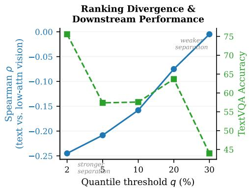

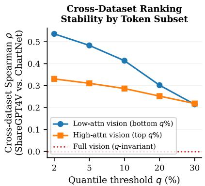  
Figure 2: Effect of quantile threshold q on InternVL3.5 at 50% pruning. Left: Spearman $\rho$ between text and low-attention vision rankings (more negative = more distinct) and TextVQA accuracy. Right: cross-dataset Spearman $\rho$ (ShareGPT4V vs. ChartNet) by token subset under matched-size symmetric quantiles (low-attn = bottom $q \% .$ , high-attn = top q%).

a forced per-layer quota leaves more of the protection to the text term, so it calls for a smaller α; full sweep in Appendix L). Appendix K visualizes the resulting per-layer distribution.

## 6.3.2 Calibration Set Design: Domain and Size

With the default ShareGPT4V calibration, Qwen3-VL and Gemma4 at 50% pruning show a pronounced weakness on ChartQA. We trace this to calibration domain mismatch: ShareGPT4V contains primarily natural-image conversations with little chart or document content, so experts specialized for chart reasoning receive limited activation during calibration and are consequently under-scored by ∆H. This implies that MAEP’s importance scores are responsive to deployment-domain signal in the calibration set—a property practitioners can exploit to target a specific deployment distribution.

To demonstrate this, we construct a mixed calibration set of 700 ShareGPT4V [7] and 300 Chart-Net [26] reasoning samples, where ChartNet pairs chart images with extended reasoning text that matches ShareGPT4V’s text-token density. Under this mixed calibration, MAEP on Qwen3-VL at 50% pruning (Table 2(b)) recovers 13.9 points on ChartQA, while also improving MMStar by 4.1 points; MME and TextVQA are nearly identical. The absence of a substantial trade-off supports two claims: (i) the ChartQA gap is attributable to calibration domain mismatch; and (ii) MAEP can be targeted at a deployment domain by augmenting calibration with in-domain data.

This is consistent with the REAP’s [27] strategy of combining general pre-training corpora with domain-specific data for calibration: a diverse mixture prevents catastrophic drops on specialized distributions and, as we observe, can further improve in-domain performance. We leave to future work calibration-mixing strategies and extension to reasoning-heavy generative benchmarks (e.g., coding, mathematical problem solving).

Calibration size. Beyond composition, we test how far the calibration budget can be reduced by subsampling ShareGPT4V from the default 1,000 down to 100 samples (Table 2(b), bottom block). These results suggest MAEP is robust to calibration set size: even at 100 samples, MAEP retains most of the default-1K performance, with some fluctuation on individual benchmarks (e.g., ChartQA).

## 6.3.3 α Sensitivity and Safe Range

Section 5 fixes α deterministically, which yields 0.75/0.33/0.08 for InternVL3.5 / Qwen3-VL / Gemma4—rounded to 0.8/0.3/0.1 (the “Used $\alpha ^ { \prime \prime }$ column in Table 3) for simplicity. We verify that these values lie within an empirically stable range by sweeping α at both pruning ratios and reporting the average performance retention over MME, MMStar, ChartQA, and TextVQA. Table 3 shows that the empirical safe range narrows for models with higher within-vision redundancy (the $b : = \bar { \rho } _ { \mathrm { v , l a } }$ feature in Section 5): InternVL3.5 tolerates a wide range of $\alpha ,$ Qwen3-VL exhibits a sharp degradation once α exceeds its operating point, and Gemma4 degrades gradually as α grows.

This is consistent with the redundancy interpretation of b: when full-vision and lowattention rankings agree, a large α overemphasizes a vision-side signal that offers little additional information. Across all three models, the closed-form α lies within a stable region of the sensitivity sweep: it coincides with the row’s top-performing swept value for Qwen3-VL and Gemma4, and for InternVL3.5 it lies at the upper end of the stable region $( \alpha \leq 0 . 7$ in the sweep; retention collapses at $\alpha { = } 0 . 9 )$ , consistent

Table 3: α sensitivity at 25/50% pruning. Cells: % retention of unpruned baseline (avg. over MME, MMStar, ChartQA, TextVQA).
<table><tr><td>Model</td><td>Used α Ratio</td><td></td><td colspan="3">α sweep (% retention)</td></tr><tr><td></td><td></td><td></td><td>0.1</td><td>0.3 0.5</td><td>0.7 0.9</td></tr><tr><td rowspan="2">InternVL3.5</td><td rowspan="2">0.8</td><td>25%</td><td>97.5</td><td>98.3 98.1</td><td>98.0 98.1</td></tr><tr><td>50%</td><td>84.3</td><td>85.9 86.9</td><td>89.1 65.1</td></tr><tr><td rowspan="2">Qwen3-VL</td><td rowspan="2">0.3</td><td>25%</td><td>96.4</td><td>97.1</td><td>97.1 29.0 26.0</td></tr><tr><td>50%</td><td>84.4</td><td>87.6</td><td>25.4 29.6 23.0</td></tr><tr><td rowspan="2">Gemma4</td><td rowspan="2">0.1</td><td>25%</td><td>95.9</td><td>91.1 72.5</td><td>67.6 66.7</td></tr><tr><td>50%</td><td></td><td></td><td>83.8 74.1 60.9 51.1 41.0</td></tr></table>

with the main results in Table 1. We adopt a single fixed α per model for simplicity; exploring layer-wise modality weights is a promising direction, since modality sensitivity may vary across layers.

## 7 Conclusion

We presented MAEP, a training-free framework for pruning MoE experts in MLLMs by decomposing their importance into text and vision contributions. By combining a redistribution-aware importance metric (∆H) with low-attention vision tokens as a stable pruning signal, MAEP helps identify which experts can be removed with reduced risk of disproportionately degrading either modality. Experiments across multiple models and benchmarks show that this modality-aware approach retains near-original performance at 25% pruning and generally outperforms modality-agnostic baselines at 50% pruning, reducing the expert-weight footprint while preserving stronger performance than competing compression methods. This work inspires further research on modality-aware compression strategies for MoE-based MLLMs and enables deployment in resource-constrained settings.

## Acknowledgments and Disclosure of Funding

The author thanks KyungHwan Shim, Huiseong Gim, and JinHyeok Park of the NetsPresso team for their help and valuable discussions. This work was supported by Nota Inc. and by the Technology Innovation Program (RS-2024-00468747, Development of AI and Lightweight Technology for Embedding Multisensory Intelligence Modules) funded by the Ministry of Trade Industry & Energy (MOTIE, Korea).

## References

[1] Shuai Bai et al. Qwen3-VL technical report, 2025. URL https://arxiv.org/abs/2511. 21631.

[2] Sikai Bai, Haoxi Li, Jie Zhang, Zicong Hong, and Song Guo. DiEP: Adaptive mixture-ofexperts compression through differentiable expert pruning. In Advances in Neural Information Processing Systems, 2025. URL https://nips.cc/virtual/2025/poster/116036.

[3] Baidu ERNIE Team. ERNIE 4.5 technical report. Technical report, 2025. URL https: //ernie.baidu.com/blog/publication/ERNIE\_Technical\_Report.pdf.

[4] Arindam Banerjee, Srujana Merugu, Inderjit S. Dhillon, and Joydeep Ghosh. Clustering with Bregman divergences. Journal of Machine Learning Research, 6:1705–1749, 2005.

[5] I-Chun Chen, Hsu-Shen Liu, Wei-Fang Sun, Chen-Hao Chao, Yen-Chang Hsu, and Chun-Yi Lee. Retraining-free merging of sparse MoE via hierarchical clustering. In Proceedings of the 42nd International Conference on Machine Learning, volume 267 of Proceedings of Machine Learning Research, pages 8594–8620. PMLR, 2025. URL https://proceedings. mlr.press/v267/chen25aq.html.

[6] Liang Chen, Haozhe Zhao, Tianyu Liu, Shuai Bai, Junyang Lin, Chang Zhou, and Baobao Chang. An image is worth 1/2 tokens after layer 2: Plug-and-play inference acceleration for large vision-language models. In European Conference on Computer Vision, 2024.

[7] Lin Chen, Jinsong Li, Xiaoyi Dong, Pan Zhang, Conghui He, Jiaqi Wang, Feng Zhao, and Dahua Lin. ShareGPT4V: Improving large multi-modal models with better captions, 2023. URL https://arxiv.org/abs/2311.12793.

[8] Lin Chen, Jinsong Li, Xiaoyi Dong, Pan Zhang, Yuhang Zang, Zehui Chen, Haodong Duan, Jiaqi Wang, Yu Qiao, Dahua Lin, and Feng Zhao. Are we on the right way for evaluating large vision-language models?, 2024. URL https://arxiv.org/abs/2403.20330.

[9] Peter Clark, Isaac Cowhey, Oren Etzioni, Tushar Khot, Ashish Sabharwal, Carissa Schoenick, and Oyvind Tafjord. Think you have solved question answering? Try ARC, the AI2 reasoning challenge, 2018. URL https://arxiv.org/abs/1803.05457.

[10] OpenCompass Contributors. OpenCompass: A universal evaluation platform for foundation models. https://github.com/open-compass/opencompass, 2023.

[11] DeepSeek-AI et al. DeepSeek-V3 technical report, 2024. URL https://arxiv.org/abs/ 2412.19437.

[12] Haodong Duan, Junming Yang, Yuxuan Qiao, Xinyu Fang, Lin Chen, Yuan Liu, Xiaoyi Dong, Yuhang Zang, Pan Zhang, Jiaqi Wang, et al. VLMEvalKit: An open-source toolkit for evaluating large multi-modality models. In Proceedings ofthe 32nd ACM International Conference on Multimedia, pages 11198–11201, 2024.

[13] Chaoyou Fu, Peixian Chen, Yunhang Shen, Yulei Qin, Mengdan Zhang, Xu Lin, Jinrui Yang, Xiawu Zheng, Ke Li, Xing Sun, Yunsheng Wu, Rongrong Ji, Caifeng Shan, and Ran He. MME: A comprehensive evaluation benchmark for multimodal large language models, 2023. URL https://arxiv.org/abs/2306.13394.

[14] Aryo Pradipta Gema, Joshua Ong Jun Leang, Giwon Hong, Alessio Devoto, Alberto Carlo Maria Mancino, Rohit Saxena, Xuanli He, Yu Zhao, Xiaotang Du, Mohammad Reza Ghasemi Madani, et al. Are we done with MMLU? In Proceedings of the 2025 Conference of the Nations of the Americas Chapter of the Association for Computational Linguistics: Human Language Technologies (Volume 1: Long Papers), pages 5069–5096, 2025.

[15] Gemma Team. Gemma 4 model card. Hugging Face model card, 2026. URL https:// huggingface.co/google/gemma-4-26B-A4B-it.

[16] GLM-V Team, Wenyi Hong, Wenmeng Yu, et al. GLM-4.5V and GLM-4.1V-Thinking: Towards versatile multimodal reasoning with scalable reinforcement learning, 2025. URL https://arxiv.org/abs/2507.01006.

[17] Hao Gu, Wei Li, Lujun Li, Zhu Qiyuan, Mark G. Lee, Shengjie Sun, Wei Xue, and Yike Guo. Delta decompression for MoE-based LLMs compression. In Proceedings of the 42nd International Conference on Machine Learning, volume 267 of Proceedings of Machine Learning Research, pages 20497–20514. PMLR, 2025. URL https://proceedings.mlr.press/ v267/gu25c.html.

[18] Edward J. Hu, Yelong Shen, Phillip Wallis, Zeyuan Allen-Zhu, Yuanzhi Li, Shean Wang, Lu Wang, and Weizhu Chen. LoRA: Low-rank adaptation of large language models. In International Conference on Learning Representations, 2022. URL https://openreview. net/forum?id=nZeVKeeFYf9.

[19] Kai Huang, Hao Zou, Bochen Wang, Ye Xi, Zhen Xie, and Hao Wang. AirCache: Activating inter-modal relevancy KV cache compression for efficient large vision-language model inference, 2025. URL https://arxiv.org/abs/2503.23956.

[20] Wei Huang, Yue Liao, Jianhui Liu, Ruifei He, Haoru Tan, Shiming Zhang, Hongsheng Li, Si Liu, and Xiaojuan Qi. Mixture compressor for mixture-of-experts LLMs gains more, 2024. URL https://arxiv.org/abs/2410.06270.

[21] Weizhong Huang, Yuxin Zhang, Xiawu Zheng, Fei Chao, and Rongrong Ji. Determining layerwise sparsity for large language models through a theoretical perspective. In Proceedings of the 42nd International Conference on Machine Learning, volume 267 of Proceedings of Machine Learning Research, pages 26175–26201. PMLR, 2025. URL https://proceedings.mlr. press/v267/huang25ax.html.

[22] Yushi Huang et al. MoDES: Accelerating mixture-of-experts multimodal large language models via dynamic expert skipping, 2025. URL https://arxiv.org/abs/2511.15690.

[23] Albert Q. Jiang et al. Mixtral of experts, 2024. URL https://arxiv.org/abs/2401.04088.

[24] Seil Kang, Jinyeong Kim, Junhyeok Kim, and Seong Jae Hwang. See what you are told: Visual attention sink in large multimodal models, 2025. URL https://arxiv.org/abs/ 2503.03321.

[25] Kimi Team et al. Kimi-VL technical report, 2025. URL https://arxiv.org/abs/2504. 07491.

[26] Jovana Kondic, Pengyuan Li, Dhiraj Joshi, et al. ChartNet: A million-scale, high-quality multimodal dataset for robust chart understanding. arXiv preprint arXiv:2603.27064, 2026.

[27] Mike Lasby, Ivan Lazarevich, Nish Sinnadurai, Sean Lie, Yani Ioannou, and Vithursan Thangarasa. REAP the experts: Why pruning prevails for one-shot MoE compression. In International Conference on Learning Representations, 2026. URL https://openreview. net/forum?id=ukGxWd2aDG.

[28] Yann LeCun, John S. Denker, and Sara A. Solla. Optimal brain damage. In Advances in Neural Information Processing Systems 2, pages 598–605, 1989. URL https://proceedings. neurips.cc/paper/1989/hash/6c9882bbac1c7093bd25041881277658-Abstract. html.

[29] Ke Li, Zheng Yang, Zhongbin Zhou, Feng Xue, Zhonglin Jiang, and Wenxiao Wang. HEAPr: Hessian-based efficient atomic expert pruning in output space, 2025. URL https://arxiv. org/abs/2509.22299.

[30] Lujun Li, Qiyuan Zhu, Jiacheng Wang, Wei Li, Hao Gu, Sirui Han, and Yike Guo. Sub-MoE: Efficient mixture-of-expert LLMs compression via subspace expert merging, 2025. URL https://arxiv.org/abs/2506.23266.

[31] Pingzhi Li, Zhenyu Zhang, Prateek Yadav, Yi-Lin Sung, Yu Cheng, Mohit Bansal, and Tianlong Chen. Merge, then compress: Demystify efficient SMoE with hints from its routing policy, 2024. URL https://arxiv.org/abs/2310.01334.

[32] Shiyao Li, Yingchun Hu, Xuefei Ning, Xihui Liu, Ke Hong, Xiaotao Jia, Xiuhong Li, Yaqi Yan, Pei Ran, Guohao Dai, et al. MBQ: Modality-balanced quantization for large vision-language models. In Proceedings ofthe Computer Vision and Pattern Recognition Conference, pages 4167–4177, 2025.

[33] Sijie Li, Biao Qian, and Jungong Han. Mostly text, smart visuals: Asymmetric text-visual pruning for large vision-language models. In IEEE/CVF Conference on Computer Vision and Pattern Recognition, 2026. URL https://arxiv.org/abs/2603.16001.

[34] Wei Li, Lujun Li, Hao Gu, You-Liang Huang, Mark G. Lee, Shengjie Sun, Wei Xue, and Yike Guo. MoE-SVD: Structured mixture-of-experts LLMs compression via singular value decomposition. In Proceedings of the 42nd International Conference on Machine Learning, volume 267 of Proceedings ofMachine Learning Research, pages 35209–35230. PMLR, 2025. URL https://proceedings.mlr.press/v267/li25az.html.

[35] Yifan Li, Yifan Du, Kun Zhou, Jinpeng Wang, Wayne Xin Zhao, and Ji-Rong Wen. Evaluating object hallucination in large vision-language models. In Proceedings ofthe 2023 Conference on Empirical Methods in Natural Language Processing, 2023. URL https://arxiv.org/abs/ 2305.10355.

[36] Bin Lin et al. MoE-LLaVA: Mixture of experts for large vision-language models, 2024. URL https://arxiv.org/abs/2401.15947.

[37] Haotian Liu, Chunyuan Li, Qingyang Wu, and Yong Jae Lee. Visual instruction tuning. In Advances in Neural Information Processing Systems, 2023.

[38] Yuan Liu, Haodong Duan, Yuanhan Zhang, Bo Li, Songyang Zhang, Wangbo Zhao, Yike Yuan, Jiaqi Wang, Conghui He, Ziwei Liu, Kai Chen, and Dahua Lin. MMBench: Is your multi-modal model an all-around player? In European Conference on Computer Vision, 2024.

[39] Xudong Lu, Qi Liu, Yuhui Xu, Aojun Zhou, Siyuan Huang, Bo Zhang, Junchi Yan, and Hongsheng Li. Not all experts are equal: Efficient expert pruning and skipping for mixture of experts large language models. In Proceedings ofthe 62nd Annual Meeting ofthe Association for Computational Linguistics, 2024. URL https://arxiv.org/abs/2402.14800.

[40] Bozhi Luan, Wengang Zhou, Hao Feng, Zhe Wang, Xiaosong Li, and Houqiang Li. Multicue adaptive visual token pruning for large vision-language models, 2025. URL https: //arxiv.org/abs/2503.08019.

[41] Ahmed Masry, Do Xuan Long, Jia Qing Tan, Shafiq Joty, and Enamul Hoque. ChartQA: A benchmark for question answering about charts with visual and logical reasoning. In Findings of the Association for Computational Linguistics: ACL, 2022. URL https://aclanthology. org/2022.findings-acl.177/.

[42] Meta AI Team. The Llama 4 herd: The beginning of a new era of natively multimodal AI innovation. Blog post, 2025. URL https://ai.meta.com/blog/ llama-4-multimodal-intelligence/.

[43] Ruijie Miao, Yilun Yao, Zihan Wang, Zhiming Wang, Bairen Yi, LingJun Liu, Yikai Zhao, and Tong Yang. MergeMoE: Efficient compression of MoE models via expert output merging, 2025. URL https://arxiv.org/abs/2510.14436.

[44] Dung Viet Nguyen, Anh Nguyen Thi, Minh Hoang Nguyen, Luc Nguyen, Shiqi Jiang, Ethan Fetaya, Linh Duy Tran, Gal Chechik, and Tan Minh Nguyen. Expert merging in sparse mixture of experts with Nash bargaining. In International Conference on Learning Representations, 2026. URL https://openreview.net/forum?id=JLe9xfd0ln.

[45] Viet Dung Nguyen, Minh Nguyen Hoang, Luc Nguyen, Rachel Teo, Tan Minh Nguyen, and Linh Duy Tran. CAMEx: Curvature-aware merging of experts. In International Conference on Learning Representations, 2025. URL https://openreview.net/forum?id=nT2u0M0nf8.

[46] Amanpreet Singh, Vivek Natarajan, Meet Shah, Yu Jiang, Xinlei Chen, Dhruv Batra, Devi Parikh, and Marcus Rohrbach. Towards VQA models that can read. In Proceedings of the IEEE/CVF Conference on Computer Vision and Pattern Recognition, 2019. URL https: //textvqa.org/assets/paper/TextVQA.pdf.

[47] Shengbang Tong, Ellis Brown, Penghao Wu, Sanghyun Woo, Manoj Middepogu, Sai Charitha Akula, Jihan Yang, Shusheng Yang, Adithya Iyer, Xichen Pan, Austin Wang, Rob Fergus, Yann LeCun, and Saining Xie. Cambrian-1: A fully open, vision-centric exploration of multimodal LLMs. In Advances in Neural Information Processing Systems, 2024.

[48] Dezhan Tu, Danylo Vashchilenko, Yuzhe Lu, and Panpan Xu. VL-Cache: Sparsity and modalityaware KV cache compression for vision-language model inference acceleration. In International Conference on Learning Representations, 2025. URL https://openreview.net/forum? id=HMrcv7Q4Ub.

[49] Weiyun Wang et al. InternVL3.5: Advancing open-source multimodal models in versatility, reasoning, and efficiency, 2025. URL https://arxiv.org/abs/2508.18265.

[50] Qiong Wu, Zhaoxi Ke, Yiyi Zhou, Xiaoshuai Sun, and Rongrong Ji. Routing experts: Learning to route dynamic experts in multi-modal large language models, 2024. URL https://arxiv. org/abs/2407.14093.

[51] Zhiyu Wu et al. DeepSeek-VL2: Mixture-of-experts vision-language models for advanced multimodal understanding, 2024. URL https://arxiv.org/abs/2412.10302.

[52] xAI Corp. Grok-1.5 vision preview: Connecting the digital and physical worlds with our first multimodal model. xAI news post, 2024. URL https://x.ai/news/grok-1.5v.

[53] Guoyang Xia, Yifeng Ding, Fengfa Li, Lei Ren, Wei Chen, Fangxiang Feng, and Xiaojie Wang. FastMMoE: Accelerating multimodal large language models through dynamic expert activation and routing-aware token pruning, 2025. URL https://arxiv.org/abs/2511.17885.

[54] Guoyang Xia, Yifeng Ding, Fengfa Li, Lei Ren, Wei Chen, Fangxiang Feng, and Xiaojie Wang. SMAR: Soft modality-aware routing strategy for MoE-based multimodal large language models preserving language capabilities, 2025. URL https://arxiv.org/abs/2506.06406.

[55] Yanyue Xie, Zhi Zhang, Ding Zhou, Cong Xie, Ziang Song, Xin Liu, Yanzhi Wang, Xue Lin, and An Xu. MoE-Pruner: Pruning mixture-of-experts large language model using the hints from its router, 2024. URL https://arxiv.org/abs/2410.12013.

[56] Haolei Xu, Haiwen Hong, Hongxing Li, Rui Zhou, Yang Zhang, Longtao Huang, Hui Xue, Yongliang Shen, Weiming Lu, and Yueting Zhuang. Seeing but not thinking: Routing distraction in multimodal mixture-of-experts, 2026. URL https://arxiv.org/abs/2604.08541.

[57] An Yang et al. Qwen3 technical report, 2025. URL https://arxiv.org/abs/2505.09388.

[58] Cheng Yang, Yang Sui, Jinqi Xiao, Lingyi Huang, Yu Gong, Yuanlin Duan, Wenqi Jia, Miao Yin, Yu Cheng, and Bo Yuan. MoE-I2: Compressing mixture of experts models through inter-expert pruning and intra-expert low-rank decomposition. In Findings ofthe Association for Computational Linguistics: EMNLP 2024, pages 10456–10466, 2024. URL https:// aclanthology.org/2024.findings-emnlp.612/.

[59] Jiangyong Yu, Sifan Zhou, Dawei Yang, Shuo Wang, Shuoyu Li, Xing Hu, Chen Xu, Zukang Xu, Changyong Shu, and Zhihang Yuan. MQuant: Unleashing the inference potential of multimodal large language models via full static quantization, 2025. URL https://arxiv.org/abs/ 2502.00425.

[60] Geng Zhang, Yuxuan Han, Yuxuan Lou, Yiqi Zhang, Wangbo Zhao, and Yang You. MoNE: Replacing redundant experts with lightweight novices for structured pruning of MoE, 2025. URL https://arxiv.org/abs/2507.00390.

[61] Yang Zhang, Yawei Li, Xinpeng Wang, Qianli Shen, Barbara Plank, Bernd Bischl, Mina Rezaei, and Kenji Kawaguchi. FinerCut: Finer-grained interpretable layer pruning for large language models. In Compression Workshop at NeurIPS, 2024. URL https://openreview.net/ forum?id=jrSWzgno4W.

[62] Yuan Zhang, Chun-Kai Fan, Junpeng Ma, Wenzhao Zheng, Tao Huang, Kuan Cheng, Denis Gudovskiy, Tomoyuki Okuno, Yohei Nakata, Kurt Keutzer, and Shanghang Zhang. SparseVLM: Visual token sparsification for efficient vision-language model inference, 2024. URL https: //arxiv.org/abs/2410.04417.

[63] Jeffrey Zhou, Tianjian Lu, Swaroop Mishra, Siddhartha Brahma, Sujoy Basu, Yi Luan, Denny Zhou, and Le Hou. Instruction-following evaluation for large language models, 2023. URL https://arxiv.org/abs/2311.07911.

[64] Yixiao Zhou, Ziyu Zhao, Dongzhou Cheng, Zhiliang Wu, Jie Gui, Yi Yang, Fei Wu, Yu Cheng, and Hehe Fan. Dropping experts, recombining neurons: Retraining-free pruning for sparse mixture-of-experts LLMs, 2025. URL https://arxiv.org/abs/2509.10377.

## A Limitations

MAEP applies a fixed prune mask per layer, without modeling the joint removal of experts that back each other up or input-conditional sparsity. Moreover, the adaptive α rule is empirically validated rather than derived from a theoretical optimum. Finally, MAEP also targets the training-free setting; fine-tuning (e.g., LoRA [18]) is orthogonal and could recover residual gaps.

Pairwise redundancy and one-shot scoring. $\Delta H$ is not a fully independent score: its redistribution counterfactual (Section 5.1) measures the residual output change after the remaining co-activated experts absorb the removed expert’s routing mass, so first-order redundancy among co-activated experts is captured implicitly. What it does not model is the joint removal of experts that back each other up. To quantify how much this matters at our operating ratio, we compared the one-shot 50% prune mask on InternVL3.5 against a two-stage variant that prunes $2 5 \%$ , re-scores $\Delta H$ on the pruned model, and then prunes to $50 \%$ in total. The two masks differ substantially (Jaccard 0.77; 800 of the 3,472 experts in their union differ), but the two-stage variant is strictly worse (one-shot → two-stage: MME $2 \bar { 1 } 6 0 . 3  1 9 5 6 . 7$ , MMStar 63.3 → 53.9, ChartQA $7 6 . 7  \mathrm { { 5 4 . 3 } } ,$ TextVQA $7 5 . 6  6 4 . { \overset { \cdot } { 9 } } )$ We attribute this to re-scoring on an already-redistributed model: $\Delta H$ re-measured after partial pruning no longer reflects the original model’s redundancy structure, whereas the one-shot score models that redistribution analytically without altering the model it measures. This experiment therefore does not isolate interaction effects, and we leave them, as well as input-adaptive or iterative pruning at more aggressive ratios, open.

Calibration-domain sensitivity. As with other calibration-based post-training compression methods, MAEP’s prune decisions depend on the calibration distribution: domains that the calibration set under-represents can lead to under-scored experts (Section 6.3.2). This sensitivity is confined to the text-side preservation signal, whereas the low-attention vision signal is stable across calibration datasets (Appendix G.3); it is therefore controllable rather than intrinsic, and we do not claim domain invariance. We recommend (i) a diverse calibration mixture as the default; (ii) augmenting it with in-domain data when the deployment domain is known (Table 2(b)); and (iii) when the domain is unknown, broadening the mixture with chart-, document-, and OCR-style data as an inexpensive safeguard against under-coverage.

Promising future directions include layer-wise α adaptation, calibration-domain mixing strategies for deployment specialization, and stacking with orthogonal compression families (quantization, intra-expert decomposition).

## B Proof of the Motivational Bound (Proposition 1)

Proposition. Let $\Phi _ { l } : \mathbb { R } ^ { T \times d }  \mathbb { R } ^ { T \times | V | }$ map the layer-l MoE outputs ofa T-token sequence to the pre-softmax logits, with Lipschitz constant $\boldsymbol { L } _ { \Phi _ { l } }$ (Frobenius norm) on the activation domain induced by RMSNorm/LayerNorm. With $\hat { h } _ { t } : = H _ { M o E } ^ { ( l ) } ( h _ { t } )$ and $\hat { h } _ { t } ^ { ( - j ) } : = H _ { M o E } ^ { ( l , - j ) } ( h _ { t } )$ the MoE outputs at position t before/after removing expert j $, \hat { H } : = ( \hat { h } _ { 1 } , \dots , \hat { h } _ { T } )$ and $\hat { H } ^ { ( - j ) }$ the corresponding sequences, and $p _ { t } : =$ softmax $( \Phi _ { l } ( \hat { H } ) _ { t } ) , p _ { t } ^ { ( - j ) }$ := softmax $\big ( \Phi _ { l } \big ( \hat { H } ^ { ( - j ) } \big ) _ { t } \big )$

$$
\frac { 1 } { T } \sum _ { t = 1 } ^ { T } D _ { \mathrm { K L } } \big ( p _ { t } \| p _ { t } ^ { ( - j ) } \big ) \leq \frac { L _ { \Phi _ { l } } ^ { 2 } } { 4 } \frac { 1 } { T } \sum _ { t = 1 } ^ { T } \| \hat { h } _ { t } - \hat { h } _ { t } ^ { ( - j ) } \| _ { 2 } ^ { 2 } .
$$

Proof. Set $\Delta \hat { H } : = \hat { H } - \hat { H } ^ { ( - j ) } \in \mathbb { R } ^ { T \times d }$ , whose rows are $\hat { h } _ { t } \mathrm { ~ - ~ } \hat { h } _ { t } ^ { ( - j ) }$ , and $\Delta Z : = \Phi _ { l } ( \hat { H } ) -$ $\Phi _ { l } \bigl ( \hat { H } ^ { ( - j ) } \bigr ) \in \mathbb { R } ^ { T \times | V | }$ , whose rows $\Delta z _ { t }$ are the logit perturbations at position t.

Step 1 (logit perturbation). Self-attention couples tokens within a sequence, so we view $\Phi _ { l }$ as a sequence-level map $\mathbb { R } ^ { T \times d } \to \mathbb { R } ^ { T \times | V | }$ and bound $\| \Delta Z \| _ { F }$ in terms of $\| \Delta \hat { H } \| _ { F }$ . Each subsequent residual block $f _ { i } ( X ) { \dot { = } } X + g _ { i } ( X )$ is $\left( 1 + { \cal L } _ { g _ { i } } \right)$ -Lipschitz in the Frobenius norm on the bounded activation domain, where $L _ { g _ { i } }$ is the local Lipschitz constant of the attention+FFN branch $g _ { i }$ as a map on the whole sequence; the final RMSNorm/LayerNorm before the LM head acts row-wise and is locally $L _ { \mathrm { n o r m } ^ { - 1 } }$ Lipschitz there, and the LM head acts row-wise with constant $\| W \| _ { \mathrm { o p } }$ (for row-wise maps the per-row $\ell _ { 2 }$ Lipschitz constant is also the Frobenius constant); composing,

$$
\| \Delta Z \| _ { F } \le \| W \| _ { \mathrm { o p } } \cdot L _ { \mathrm { n o r m } } \prod _ { i = l + 1 } ^ { L } \left( 1 + L _ { g _ { i } } \right) \| \Delta \hat { H } \| _ { F } = : L _ { \Phi _ { l } } \| \Delta \hat { H } \| _ { F } ,\tag{5}
$$

where $\begin{array} { r } { \| \Delta Z \| _ { F } ^ { 2 } = \sum _ { t } \| \Delta z _ { t } \| _ { 2 } ^ { 2 } } \end{array}$ and $\begin{array} { r } { \| \Delta \hat { H } \| _ { F } ^ { 2 } = \sum _ { t } \| \hat { h } _ { t } - \hat { h } _ { t } ^ { ( - j ) } \| _ { 2 } ^ { 2 } } \end{array}$

Step 2 (logit-to-KL, per position). Let $\begin{array} { r } { A ( z ) : = \log { \sum _ { i } e ^ { z _ { i } } } , p : = \mathrm { s o f t m a x } ( z ) , q : = \mathrm { s o f t m a x } ( z ^ { \prime } ) } \end{array}$ Then $\nabla A ( z ) = p$ and $\nabla ^ { 2 } A ( z ) = \mathrm { d i a g } ( p ) - p p ^ { \top }$ . For any unit v, Popoviciu’s inequality gives $\begin{array} { r } { \mathrm { V a r } _ { p } [ v ] \le \frac { 1 } { 4 } } \end{array}$ (max v − min v)2, and (max v − min $v ) ^ { 2 } \leq \bar { 2 ( a ^ { 2 } + b ^ { 2 } ) } \dot { \leq } 2 \| v \| _ { 2 } ^ { 2 } = 2$ (a := max v, $b : =$ min v; the first step uses $( a - b ) ^ { 2 } \leq 2 ( a ^ { 2 } + b ^ { 2 } )$ and the second that a, b are two coordinates of the unit vector v), so A is $\frac { 1 } { 2 }$ -smooth. By Bregman/KL duality [4] and the descent lemma,

$$
\begin{array} { r } { D _ { \mathrm { K L } } ( p \| q ) = A ( z ^ { \prime } ) - A ( z ) - \nabla A ( z ) ^ { \top } ( z ^ { \prime } - z ) \leq \frac { 1 } { 4 } \| \Delta z \| _ { 2 } ^ { 2 } . } \end{array}\tag{6}
$$

Applied at position t with $z = \Phi _ { l } ( { \hat { H } } )$ t and $z ^ { \prime } = \Phi _ { l } \bigl ( \hat { H } ^ { ( - j ) } \bigr )$ t, this gives $\begin{array} { r } { D _ { \mathrm { K L } } ( p _ { t } \| p _ { t } ^ { ( - j ) } ) \leq \frac { 1 } { 4 } \| \Delta z _ { t } \| _ { 2 } ^ { 2 } } \end{array}$ for every t.

Step 3 (combine). Summing the per-position bound of Step 2 over the T positions and applying (5),

$$
\begin{array} { r } { \displaystyle \sum _ { t = 1 } ^ { T } D _ { \mathrm { K L } } \big ( p _ { t } \| p _ { t } ^ { ( - j ) } \big ) \leq \frac { 1 } { 4 } \| \Delta Z \| _ { F } ^ { 2 } \leq \frac { L _ { \Phi _ { l } } ^ { 2 } } { 4 } \| \Delta \hat { H } \| _ { F } ^ { 2 } = \frac { L _ { \Phi _ { l } } ^ { 2 } } { 4 } \displaystyle \sum _ { t = 1 } ^ { T } \| \hat { h } _ { t } - \hat { h } _ { t } ^ { ( - j ) } \| _ { 2 } ^ { 2 } , } \end{array}
$$

which, divided by T, is the proposition. Averaging over the calibration distribution (samples $x \sim \mathcal { D }$ with |x| tokens $h \in x )$ ), for each expert $j$

$$
\mathbb { E } _ { \boldsymbol { x } \sim \mathcal { D } \Big [ \frac { 1 } { | x | } \sum _ { h \in \boldsymbol { x } } D _ { \mathrm { K L } } \Big ] } \le \frac { L _ { \Phi _ { l } } ^ { 2 } } { 4 } \mathbb { E } _ { \boldsymbol { x } \sim \mathcal { D } \Big [ \frac { 1 } { | x | } \sum _ { h \in \boldsymbol { x } } \| \hat { h } - \hat { h } ^ { ( - j ) } \| _ { 2 } ^ { 2 } \Big ] } = \frac { L _ { \Phi _ { l } } ^ { 2 } } { 4 } \Delta H ^ { ( l , j ) } ,\tag{7}
$$

where $L _ { \Phi _ { l } } : = \operatorname* { s u p } _ { x } L _ { \Phi _ { l } ( { } \cdot { } ; x ) } < \infty$ on the bounded activation domain.

Remark (layer-depth effect). $L _ { \Phi _ { i } }$ contains $\textstyle \prod _ { i = l + 1 } ^ { L } ( 1 + L _ { g _ { i } } )$ , which contracts as $l  L$ (with $\boldsymbol { L } _ { \Phi _ { L } } =$ $\| W \| _ { \mathrm { o p } } L _ { \mathrm { n o r m } } ) ;$ the bound tightens for deeper layers and the spectral-norm bound $\lambda _ { \mathrm { m a x } } ( \mathrm { d i a g } ( p ) -$ $p p ^ { \top } ) \leq 1 / 2$ is loose for sharp vocabulary distributions, both consistent with the empirical findings of Section 5.1.1 and Appendix I.

## C Model Configurations and Memory Analysis

Table 4: MoE model configurations and memory footprint under expert pruning (BF16).
<table><tr><td colspan="7">Configuration</td><td colspan="3">Memory (GB)</td></tr><tr><td>Model</td><td>Total</td><td>Expert</td><td>Layers</td><td>E/L</td><td>Top-k</td><td>Router</td><td>BF16</td><td>25%</td><td>50%</td></tr><tr><td>InternVL3.5</td><td>30.8B</td><td>29.0B (94%)</td><td>48</td><td>128</td><td>8</td><td>softmax</td><td>57.5</td><td>44.0 (-23%)</td><td>30.5 (-47%)</td></tr><tr><td>Qwen3-VL</td><td>31.1B</td><td>29.0B (93%)</td><td>48</td><td>128</td><td>8</td><td>softmax</td><td>57.9</td><td>44.4 (-23%)</td><td>30.9 (-47%)</td></tr><tr><td>Gemma4-26B-A4B</td><td>25.8B</td><td>22.8B (88%)</td><td>30</td><td>128</td><td>8</td><td>softmax</td><td>48.1</td><td></td><td>37.4 (-22%) 26.8 (-44%)</td></tr></table>

In Table 4, memory columns are reported in GB (BF16 weights). Expert parameters constitute the dominant share of total model size across all three models. For InternVL3.5 and Qwen3-VL, 50% pruning reduces the BF16 weight footprint from ∼58 GB to ∼31 GB, placing model weights within the nominal capacity of a single 40 GB GPU. Actual deployment capacity additionally depends on KV-cache size, the vision tower and projector, activations, framework overhead, context length, and batch size. Gemma4-26B-A4B shares a similar MoE configuration (128 experts, top-8) with a shallower backbone (30 layers), providing architectural diversity for validating MAEP across different model scales.

## C.1 Measured Deployment Metrics

Table 5 reports end-to-end measurements for InternVL3.5-30B-A3B on a single NVIDIA A100 80GB (HuggingFace Transformers with accelerate; greedy decoding). Since top-k is unchanged by pruning, per-token FLOPs and single-sequence latency are invariant by design, and we confirm this empirically: the B=1 decode-throughput ratio (50%-pruned / unpruned) is at parity within run-to-run noise. The memory saving translates into throughput in two serving regimes. (a) Memory-capped serving: under a 40 GB device-map cap, the unpruned model must offload ∼33% of its parameters to CPU, whereas the 50%-pruned model fits fully resident and decodes 3.9× faster. (b) Large-batch serving: MoE decode is bandwidth-bound, and the per-step cost tracks the number of unique activated experts, which grows with the batch size and is bounded by the size of the expert pool; halving the pool lowers this ceiling, and the decode-throughput ratio rises from parity at B=1 to 1.37× at B=64 with diverse-prompt batches (identical-prompt batches keep the per-step expert union at top-k and show parity, consistent with the mechanism). These measurements use HuggingFace’s non-fused MoE kernels; fused grouped-GEMM engines are more strictly bandwidth-bound and would likely amplify effect (b). Loading time is dominated by weight I/O and shrinks with the serialized checkpoint, which is 27 GB smaller at 50% pruning.

Table 5: Measured deployment metrics for InternVL3.5-30B-A3B (A100 80GB; HuggingFace Transformers + accelerate). Protocol: greedy decoding of a fixed short prompt (∼25 tokens after the chat template), generating 128 new tokens when resident and 32 when offloaded (tok/s is rate-normalized; the wall clock includes the single prefill pass); the batch sweep generates 64 new tokens per sequence; warm-up runs excluded, CUDA-synchronized timing, averaged over 2–3 runs.

Metric Measured   
Resident weight memory at 0 / 25% / 50% pruning 57.5 / 44.0 / 30.5 GB (−47% at 50%)   
B=1 decode-throughput ratio (50%-pruned / unpruned) 0.96–1.02 (parity within run-to-run noise)   
Decode under a 40 GB memory cap unpruned (∼33% CPU-offloaded): 1.52 tok/s; 50%-pruned (fully resident): 5.88 tok/s (3.9×)   
Large-batch decode-throughput ratio (50%-pruned / unpruned) 1.13 (B=8) / 1.29 (B=16, B=32) / 1.37 (B=64)   
Unique activated experts per laver per decode step at B=64 ∼55 (unpruned) vs. ∼39 (50%-pruned)

## D Experimental Settings

## D.1 Implementation Details

Hardware. All experiments are conducted on a single NVIDIA A100 80GB GPU. Calibration requires a single forward pass over the 1K calibration samples per model (no back-propagation or optimizer state); the remaining compute is benchmark inference.

Calibration Data. Following [32], which shows that image captioning data provides balanced coverage of both visual and linguistic processing, we construct the calibration set from ShareGPT4V [7]. Samples are sorted in descending order of text length; the top 1K samples form the calibration set used for modality-decomposed importance scoring. The set does not overlap with the downstream evaluation benchmarks. Longer text sequences provide richer token-level statistics for expert importance estimation, as they activate a broader range of expert routing patterns during the prefill stage. We report cross-calibration-source variants in Section 6.3.2.

HC-SMoE Configuration. We use HC-SMoE with hierarchical agglomerative clustering on expert-output similarity, average linkage, and frequency-weighted merging (similarity-base=expert-output, cluster-method=hierarchical, linkage=average, merge-method=freq). This corresponds to the default configuration in [5], applied to MoE-MLLM backbones in our setting.

REAP Configuration. We follow the original REAP [27] formulation, sharing the same calibration set as MAEP, and apply uniform per-layer pruning at the target ratio.

DiEP Configuration (Appendix E.2). DiEP [2] is reimplemented in our pipeline; on synthetic MoE blocks, the reimplementation reproduces the reference code’s MoE forward outputs and router logits bit-exactly and selects the same prune map for a given budget. We use DiEP’s published hyperparameters (128 calibration sequences drawn from the same ShareGPT4V calibration set as MAEP, 10 epochs, learning rate 5×10−3 with a cosine schedule, sparsity weight λ=0.01) and the identical evaluation pipeline and judge. DiEP’s differentiable search is ratio-independent, so a single search yields both the 25% and 50% masks; every layer keeps at least top-k experts. Text-only benchmarks were not run for DiEP.

## D.2 Evaluation Details

We evaluate on 11 benchmarks spanning two categories:

Multimodal Benchmarks.

• ChartQA [41]: Chart understanding with extractive and reasoning questions. Metric: relaxed accuracy.

• TextVQA [46]: Visual question answering requiring OCR of scene text. Metric: VQA accuracy.

• MMStar [8]: Hand-curated, vision-indispensable multi-discipline reasoning samples with minimal data leakage. Metric: accuracy.

• MMBench [38]: Comprehensive multimodal evaluation across 20 ability dimensions. We use the MMBENCH\_DEV\_EN\_V11 split (English dev set, version 1.1) Metric: accuracy.

• RealWorldQA [52]: Real-world spatial understanding and reasoning from natural images. Metric: accuracy.

• MME [13]: Perception and cognition evaluation via yes/no questions. Metric: perception + reasoning score.

• CV-Bench [47]: Vision-centric perception benchmark with 2D (object counting, relation, spatial relations) and 3D (depth, distance) splits; we report the average of the 2D and 3D scores. Metric: accuracy.

• POPE [35]: Object hallucination evaluation via polling-based binary questions. Metric: F1 score.

Text-Only Benchmarks. We additionally include text-only benchmarks to measure the effect of expert pruning guided by multimodal signals on language-only capabilities.

• MMLU-Redux [14]: A manually re-annotated subset of MMLU across 30 subjects with corrected or removed erroneous ground-truth labels, yielding a cleaner multi-domain knowledge benchmark. We use the corrected subset and follow the OpenCompass 0-shot no-CoT protocol. Metric: accuracy.

• IFEval [63]: Instruction-following benchmark composed of prompts with verifiable constraints. Metric: prompt-strict accuracy.

• ARC Challenge [9]: Science exam questions requiring multi-step reasoning beyond simple retrieval. Metric: accuracy.

Evaluation Pipeline. All benchmarks are evaluated using VLMEvalKit [12], with the OpenCompass [10] protocol for text-only benchmarks. For MCQ benchmarks (MMBench, MMStar, Real-WorldQA, CV-Bench, MMLU-Redux, ARC), we use GPT-3.5-TURBO-0125 as the answer-extraction judge. We evaluate the standard INSTRUCT variants of InternVL3.5-30B-A3B and Qwen3-VL-30B-A3B (the explicit THINKING variants are not used), so no model-level chain-of-thought reasoning is engaged. All pruned models—MAEP, HC-SMoE, and REAP—share the same calibration set, and all models, including the unpruned baselines, are evaluated under identical protocols.

## E Additional Results

## E.1 Separate Multimodal and Text-Only Averages

Table 6 splits the “Avg.” column of Table 1 into the mean retention over the eight multimodal benchmarks and over the three text-only benchmarks. At 50%, MAEP attains the best multimoda average on all three models; on text-only benchmarks it leads on InternVL3.5 and Gemma4 and trails REAP on Qwen3-VL. At 25%, MAEP again has the best multimodal average on all three models; where its text-only average trails, the gap is at most 1.7 points, and its 11-benchmark average remains best or tied on every model.

Table 6: Mean performance retention (%) over the eight multimodal benchmarks (MM), the three text-only benchmarks (Text), and all eleven (All; the “Avg.” column of Table 1). Bold marks the best method per model, ratio, and column.
<table><tr><td>Model</td><td>Ratio</td><td>Method</td><td>MM</td><td>Text</td><td>All</td></tr><tr><td rowspan="3">InternVL3.5-30B-A3B</td><td rowspan="2">25%</td><td>HC-SMoE</td><td>97.2</td><td>77.6</td><td>91.9</td></tr><tr><td>REAP MAEP</td><td>97.9 98.6</td><td>90.5 95.3</td><td>95.9 97.7</td></tr><tr><td></td><td>HC-SMoE</td><td>86.4</td><td>41.4</td><td>74.1</td></tr><tr><td rowspan="3"></td><td rowspan="3">50%</td><td>REAP</td><td>91.6</td><td>80.3</td><td>88.5</td></tr><tr><td>MAEP</td><td>94.0</td><td>83.8</td><td>91.2</td></tr><tr><td>HC-SMoE</td><td>96.2</td><td>95.4</td><td>96.0</td></tr><tr><td rowspan="3">Qwen3-VL-30B-A3B</td><td>25%</td><td>REAP MAEP</td><td>94.7</td><td>95.1</td><td>94.8</td></tr><tr><td rowspan="2">50%</td><td></td><td>97.5</td><td>94.0</td><td>96.6</td></tr><tr><td>HC-SMoE</td><td>89.6</td><td>74.7</td><td>85.5</td></tr><tr><td rowspan="5">Gemma4-26B-A4B</td><td rowspan="2"></td><td>REAP MAEP</td><td>88.4 92.2</td><td>81.8 77.9</td><td>86.6 88.3</td></tr><tr><td></td><td></td><td></td><td></td></tr><tr><td rowspan="2">25%</td><td>HC-SMoE</td><td>74.7</td><td>83.8</td><td>77.2</td></tr><tr><td>REAP MAEP</td><td>96.9 97.4</td><td>93.9 92.2</td><td>96.0</td></tr><tr><td rowspan="3">50%</td><td>HC-SMoE</td><td>38.9</td><td>40.6</td><td>96.0</td></tr><tr><td>REAP</td><td>85.2</td><td>69.3</td><td></td><td>39.3 80.9</td></tr><tr><td>MAEP</td><td></td><td>89.4</td><td>79.6</td><td>86.7</td></tr></table>

## E.2 Comparison with DiEP

DiEP [2] learns a non-uniform, layer-wise expert budget by differentiable search while scoring experts in a modality-agnostic way; it therefore shares MAEP’s allocation axis (global, non-uniform) but not its scoring. Table 7 compares the two on InternVL3.5-30B-A3B under the identical calibration set, pipeline, and total budget (configuration in Appendix D). MAEP leads at both ratios and on nearly every benchmark, and the gap widens with sparsity; DiEP’s one win is MME at 50% (the two are essentially tied on MME at 25%, and POPE separates no method). DiEP’s largest deficit is ChartQA, the benchmark most sensitive to which experts survive (Section 6.3.2). DiEP’s learned allocation is far more depth-skewed than MAEP’s (averaged within depth quartiles it prunes 11/11/50/56 experts per layer at 25%, removing up to 69 of 128 experts from a single layer, and leaves as few as 37 experts in a layer at 50%), yet under the same budget its retention falls short. Combined with the decomposition in Appendix L, this indicates that the operative factor is which experts are selected rather than the non-uniform budget itself. DiEP additionally requires gradient-based search over its relaxation parameters, whereas every MAEP score comes from a single forward pass.

Table 7: DiEP vs. MAEP on InternVL3.5-30B-A3B (each cell: 25% / 50% expert pruning; identical calibration set, pipeline, and judge). MM-Ret. is the mean retention over these eight multimodal benchmarks. HC-SMoE and REAP are reported in Table 1.
<table><tr><td>Benchmark</td><td>DiEP</td><td>MAEP (ours)</td></tr><tr><td>MME</td><td>2364.3 / 2195.6</td><td>2364.9 / 2160.3</td></tr><tr><td>MMBench</td><td>79.2 / 66.7</td><td>83.2 / 80.7</td></tr><tr><td>MMStar</td><td>61.8 / 49.7</td><td>69.3 / 63.3</td></tr><tr><td>ChartQA</td><td>54.0 / 40.4</td><td>87.0 / 76.7</td></tr><tr><td>TextVQA</td><td>74.6 / 67.1</td><td>78.9 / 75.6</td></tr><tr><td>RealWorldQA</td><td>70.6 / 64.7</td><td>71.6 / 71.6</td></tr><tr><td>CV-Bench</td><td>81.3 / 69.4</td><td>84.3 / 83.3</td></tr><tr><td>POPE</td><td>89.2 / 89.5</td><td>89.7 / 89.7</td></tr><tr><td>MM-Ret. (%)</td><td>90.6 / 79.9</td><td>98.6 / 94.0</td></tr><tr><td>Parameter optimization</td><td>gradient search</td><td>none (single forward pass)</td></tr></table>

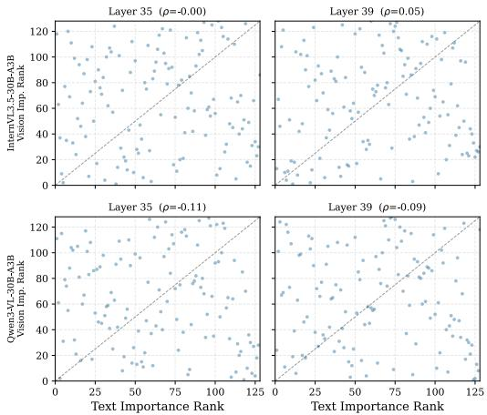  
Figure 3: Text vs. vision expert importance ranking (∆H) for InternVL3.5-30B-A3B and Qwen3- VL-30B-A3B at layers 35 and 39 (selected for their near-zero or negative Spearman $\rho )$ . Each point is one expert; the dashed line indicates perfect agreement.

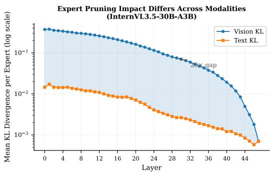  
Figure 4: Mean per-expert KL divergence at the LM-head output, on vision-token (blue) vs. text-token (orange) positions, per layer for InternVL3.5-30B-A3B. Each curve averages over experts removed one at a time within the layer; the gap reaches up to 29×, indicating that expert removal perturbs vision-position outputs substantially more than text.

## F Modality Gap in Expert Importance

We provide empirical evidence that expert importance is modality-dependent. Figure 3 plots text-side vs. vision-side ∆H for each expert at layers 35 and 39. If experts served both modalities equally, all points would lie on the diagonal; the observed scatter indicates that experts tend to specialize by modality to varying degrees.

Figure 4 further quantifies this gap by measuring the actual KL divergence at the LM head when each expert is removed. The vision-side KL (blue) consistently exceeds the text-side KL (orange) across all layers, with the gap reaching 29× in shallow layers.

The per-model heterogeneity in Table 8 reflects differences in modality-decomposed importance structure: Qwen3-VL exhibits near-zero $\bar { \rho } _ { \mathrm { t , v } }$ (rankings essentially independent across modalities), while Gemma4 shows high $\bar { \rho } _ { \mathrm { v , l a } }$ (vision and low-attention vision rankings are strongly aligned), driving its small α.

Table 8: Layer-averaged Spearman correlation between expert importance rankings under three modality views (text, full vision, low-attention vision) on the ShareGPT4V calibration set, computed per layer and averaged across all MoE layers. The closed-form expression $\alpha = a / ( a + b )$ with $a : = \bar { \rho } _ { \mathrm { t , v } } - \bar { \rho } _ { \mathrm { t , l a } }$ and $b : = \bar { \rho } _ { \mathrm { v , l a } }$ recovers the per-model values used in the main results.
<table><tr><td>Model</td><td> $\bar { \rho } _ { \mathrm { t , v } }$ </td><td> $\bar { \rho } _ { \mathrm { t , l a } }$ </td><td> $\bar { \rho } _ { \mathrm { v , l a } }$ </td><td>closed-form α</td></tr><tr><td>InternVL3.5-30B-A3B</td><td>+0.38</td><td>-0.27</td><td>+0.22</td><td>0.75</td></tr><tr><td>Qwen3-VL-30B-A3B-Instruct</td><td>+0.01</td><td>-0.22</td><td>+0.46</td><td>0.33</td></tr><tr><td>Gemma4-26B-A4B-Instruct</td><td>+0.63</td><td>+0.55</td><td>+0.91</td><td>0.08</td></tr></table>

This modality gap motivates decomposing importance by modality in our combined scoring (Eq. 4), where text-side ∆H acts as a preservation signal and low-attention vision-side ∆H acts as a pruning signal (Section 5.2; the sign convention is verified in Appendix I.1).

## G Cross-Dataset Stability of Expert Rankings

A key design choice in MAEP is to use low-attention vision tokens rather than all vision tokens or high-attention ones. Figure 5 validates this choice by measuring the cross-dataset stability of expert importance rankings: we compute $\Delta H$ -based rankings using ShareGPT4V and ChartNet as separate calibration sets and report the Spearman $\rho$ between them. The chart-domain source (ChartNet) is disjoint from the evaluation suite and matches the setup used in Section 6.3.2 and Figure 2.

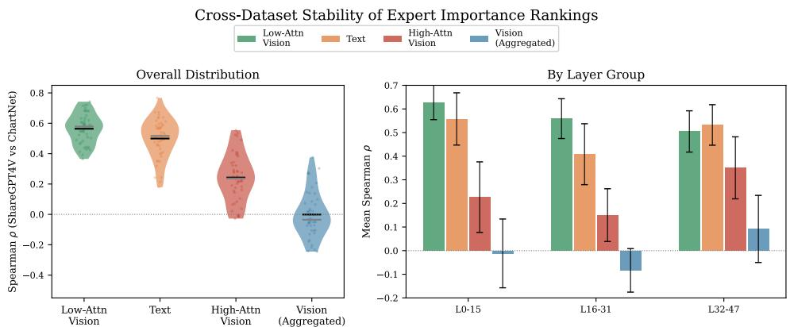  
Figure 5: Cross-dataset stability of expert importance rankings (Spearman $\rho$ between ShareGPT4V and ChartNet calibration sets) for InternVL3.5-30B-A3B. Left: overall distribution of per-layer $\rho$ by token type (violins with mean and median markers). Right: mean $\rho$ by layer group (L0–15, L16–31, L32–47). Low-attention vision tokens yield the most stable rankings across calibration sources $( \bar { \rho } { \approx } 0 . 5 6 )$ , substantially exceeding text (≈ 0.50), high-attention vision (≈ 0.24 at $q { = } 2 0 \% ;$ the matched-size $q { = } 2 \%$ value reported in §6.3.1 is higher), and full vision $( \approx 0 ) ;$ ; this supports their use as the vision-side pruning signal.

## G.1 Alternative Vision-Token Selectors

Since expert pruning operates in the MoE blocks, attention is not the only conceivable signal for selecting the visual calibration tokens. Table 9 screens seven selectors on the two properties a calibration signal needs: stability of the induced expert ranking across calibration datasets $( \rho _ { \mathrm { { s t a b } } } ;$ ShareGPT4V vs. ChartQA images, the latter used only as a held-out image set and not for calibrating any pruned model in this paper) and distinctness from the text signal $( \rho _ { \mathrm { d i s t } } ;$ lower is more distinct). Besides the three attention-based signals, we include representation drift (one minus the cosine similarity between a token’s input and output representations across the MoE layers; keeping the highest-drift tokens is also the selection rule of Li et al. [33]), diversity (farthest-point sampling), and random selection. For tractability the screening uses routing-mass importance rather than the exact $\Delta H ;$ it reproduces the $\Delta H$ -based ordering of Figure 5 for the attention-based signals, so only the relative comparison is used.

Low-attention is the only selector that is both the most stable and the most distinct from the text signal; full-vision and random are unstable, drift-low is only weakly stable, and high-attention, drift-high, and diversity produce text-like importance. Run end-to-end through the full $\Delta H$ calibration (InternVL3.5, $5 0 \% ;$ only the vision-token subset changed), the drift-high rule selects a very different expert set (Jaccard 0.33 against $\mathrm { M A E P ^ { \prime } s ) }$ and loses on all four ablation benchmarks (MAEP → drift-high: MME $2 1 6 0  1 4 9 0$ , MMStar $6 3 . 3  4 9 . 9$ , TextVQA 75.6 → 41.9, ChartQA $7 6 . 7  7 1 . 5 )$ . Attention received from the answer-generating text stream measures whether a token’s content reaches the output, which is what pruning must decide; drift and diversity instead measure how strongly a token is transformed or how it spreads in representation space.

## G.2 Spatial Location of Low-Attention Tokens

To verify that bottom-2% low-attention tokens correspond to non-salient content, we mapped them onto the whole-image thumbnail grid of InternVL3.5-30B-A3B (ShareGPT4V calibration images; 60 images $\times 4 8$ layers; per-layer bottom 2%) and compared them with a spectral-residual saliency map of each image (Table 10). Low-attention tokens fall overwhelmingly outside salient regions: a bottom-2% token is about 2.9× less likely than an average vision token to lie in the top-50% saliencymass region, and about 2.8× less likely to lie in the Otsu-thresholded foreground. A purely geometric border measure is uninformative here, because the image border attracts the highest-attention tokens (top-2% tokens are about 1.8× over-represented on the border ring, a fixed-position pattern consistent with attention-sink behavior), whereas bottom-2% tokens are under-represented there (0.69× the area expectation).

Table 9: Vision-token selector screening on InternVL3.5-30B-A3B (routing-mass importance; ShareGPT4V vs. ChartQA images as a held-out set, 60 samples each; every subset selector keeps 2% of the vision tokens). Higher $\rho _ { \mathrm { s t a b } }$ is better; lower $\rho _ { \mathrm { d i s t } }$ means more distinct from the text signal.
<table><tr><td>Selector</td><td> $\rho _ { \mathrm { s t a b } }$  (stability)</td><td> $\rho _ { \mathrm { d i s t } }$  (vs. text; low = distinct)</td></tr><tr><td>Low-attention (ours)</td><td>0.51</td><td>-0.12</td></tr><tr><td>High-attention</td><td>0.30</td><td>0.47</td></tr><tr><td>Full vision (no subset)</td><td>-0.23</td><td>0.30</td></tr><tr><td>Drift-low</td><td>0.19</td><td>0.01</td></tr><tr><td>Drift-high</td><td>0.29</td><td>0.34</td></tr><tr><td>Diversity (farthest-point)</td><td>0.36</td><td>0.36</td></tr><tr><td>Random (3 seeds)</td><td>-0.23</td><td>0.30</td></tr><tr><td>Text signal (reference)</td><td>0.30</td><td></td></tr></table>

Table 10: Saliency statistics of bottom-2% low-attention vision tokens (InternVL3.5-30B-A3B, ShareGPT4V calibration; 60 images × 48 layers). Base rate: the same statistic over all vision tokens.
<table><tr><td>Statistic</td><td>Low-attention tokens</td><td>Base rate</td></tr><tr><td>Fraction outside the top-50% saliency mass</td><td>92.0%</td><td>76.5%</td></tr><tr><td>Fraction in the saliency-map background (Otsu threshold)</td><td>89.5%</td><td>70.1%</td></tr></table>

## G.3 Which Signal Carries Calibration-Domain Sensitivity

Table 2(b) shows that changing the calibration domain changes the prune decisions. To locate where this sensitivity enters, we swapped the calibration data of each signal separately on Qwen3-VL at 50% pruning and compared the resulting prune map with the original ShareGPT4V map (Table 11). Swapping only the text-side calibration to the ChartNet mixture moves the prune map about 3× more than swapping only the vision-side signal (as the ratio of decision-flip rates) and reproduces most of the mask movement of the full mixture: of the experts whose prune/keep decision flips under the full mixture, 82% also flip under the text-only swap, vs. 13% under the vision-only swap. Domain composition is thus carried by the text-side preservation signal, while the low-attention vision signal stays stable, consistent with Figure 5; the practical guidance that follows is given in Appendix A.

Table 11: 2×2 calibration swap on Qwen3-VL-30B-A3B (50% pruning): Jaccard similarity of the resulting prune map to the original ShareGPT4V map, and the number of prune/keep decisions that flip (of 6,144 experts; each rescued expert pairs with a newly pruned one).
<table><tr><td>Calibration swapped to the ChartNet mixture</td><td>Jaccard vs. original</td><td>Decisions flipped</td></tr><tr><td>Vision (low-attention) side only</td><td>0.922</td><td>248</td></tr><tr><td>Text side only</td><td>0.776</td><td>776</td></tr><tr><td>Both (full mixture; Table 2(b))</td><td>0.780</td><td>760</td></tr></table>

## H Validation of Fixed Top-k Counterfactual

Our importance metric (Eq. 2) uses a fixed top-k counterfactual that does not evaluate the promoted (k+1)-th expert, whose output is set to zero. An alternative is to evaluate the promoted (k+1)-th expert so that exactly k experts remain active, matching the router’s actual behavior in the pruned

model. We compare the two counterfactuals on InternVL3.5-30B-A3B by computing $\Delta H$ under each variant for every expert in every layer.

Table 12 shows that the two counterfactuals produce nearly identical rankings and pruning decisions across all modalities. We therefore adopt the simpler fixed top-k variant, which avoids evaluating the promoted (k+1)-th expert at negligible cost in ranking fidelity or prune-mask selection.

Table 12: Agreement between the fixed top-k and promote- $( k { + } 1 )$ counterfactuals on InternVL3.5- 30B-A3B. Spearman $\rho$ is the mean across 48 layers; Jaccard is computed at 50% per-layer pruning of the lowest-score experts.
<table><tr><td>Modality</td><td>Spearman  $\rho$ </td><td>Jaccard @ 50%</td></tr><tr><td>Text</td><td>0.999</td><td>0.97</td></tr><tr><td>Low-attn vision</td><td>0.987</td><td>0.92</td></tr><tr><td>High-attn vision</td><td>0.994</td><td>0.93</td></tr><tr><td>Full vision</td><td>0.981</td><td>0.89</td></tr></table>

## I Validating $\Delta H$ as an Importance Proxy

To validate $\Delta H$ as an importance proxy, we compare it against two baselines. The first is the routing-KL when expert j is masked—a principled distributional distance that quantifies how much the router distribution shifts when expert j is removed:

$$
\Delta \mathrm { K L } _ { \mathrm { r o u t i n g } } ^ { ( l , j ) } = \mathbb { E } _ { x } \Big [ D _ { \mathrm { K L } } \big ( p ^ { ( l ) } ( x ) \| p ^ { ( l , - j ) } ( x ) \big ) \Big ] ,\tag{8}
$$

where $p ^ { ( l , - j ) }$ is obtained by zeroing $p _ { j }$ and renormalizing the remaining entries, matching the redistribution used in $\Delta H$ (we additionally apply Laplace smoothing with $\epsilon _ { \mathrm { K L } } = 1 0 ^ { - 1 2 }$ to prevent numerical infinities without affecting rank ordering). A larger $\Delta \mathrm { K L } _ { \mathrm { r o u t i n g } }$ indicates that expert j carries a more distinctive routing pattern. The second is REAP’s [27] router-weighted activation norm, which captures each expert’s magnitude contribution:

$$
s _ { \mathtt { R E A P } } ^ { ( l , j ) } = \mathbb { E } _ { x } \big [ p _ { j } ^ { ( l ) } ( x ) \cdot \| E _ { j } ^ { ( l ) } ( x ) \| _ { 2 } \big ] ,\tag{9}
$$

where $p _ { i } ^ { ( l ) } ( x )$ is the post-softmax router gate value (defined in Section 3.1) and $E _ { i } ^ { ( l ) } ( x )$ is expert $j ^ { \circ } \mathrm { s }$ output. Figure 6 reports the per-layer Spearman rank correlation between each of these proxies and the actual KL divergence at the LM head caused by expert removal. For computational tractability, the ground-truth KL is averaged over $n { = } 1 0$ calibration samples per (layer, expert) pair, since exact computation requires re-running the post-MoE network once per ablated expert.

## I.1 Causal Check of the Vision-Side Sign Convention

Section 5.2 treats a high $\Delta H _ { \mathrm { l a } }$ as evidence for removal. To verify this sign direction at the model output, we isolated the low-attention signal (α=1, 25% pruning, InternVL3.5-30B-A3B), ranked experts by $\Delta H _ { \mathrm { l a } }$ , and compared three removal orders, measuring the per-token LM-head KL divergence each induces against the unpruned model (same protocol as above; n=10 calibration samples, 3,948 text and 17,152 vision positions). Table 13 shows that removing the highest- $\Delta H _ { \mathrm { l a } }$ experts first perturbs the output-generating text positions least, random removal is intermediate, and the inverted order perturbs them most, which confirms that high- $- \Delta H _ { \mathrm { l a } }$ experts contribute least to the output distribution.

## J Cross-Layer Magnitude Variation of $\Delta H$

Raw $\Delta H$ values exhibit two properties that necessitate the log-transform and layer-wise z-score normalization described in Section 5.3.

Cross-layer magnitude variation. Figure 7 shows the mean $\Delta H$ per layer for InternVL3.5-30B-A3B and Qwen3-VL-30B-A3B on the ShareGPT4V calibration set. The deepest layer exceeds the shallowest by ∼1,900× (InternVL) and ∼9,200× (Qwen), spanning nearly four orders of magnitude. Without layer-wise normalization, global ranking would be dominated by deep-layer experts regardless of their relative importance within each layer.

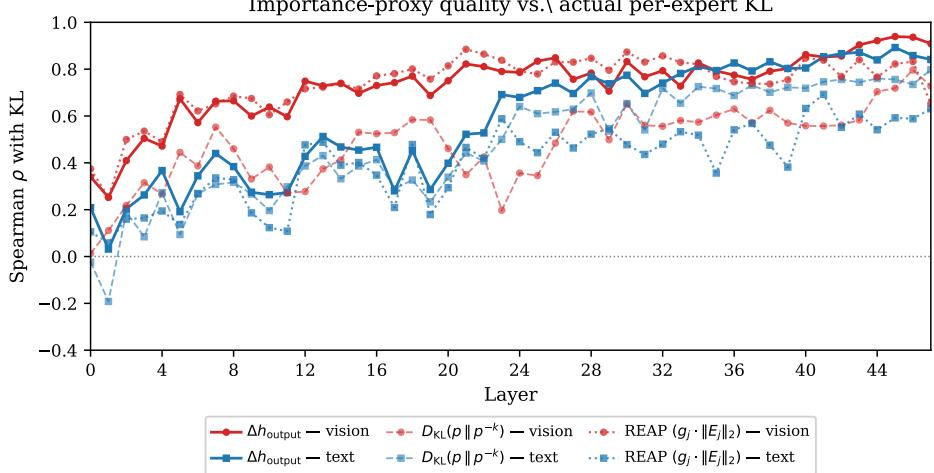  
Figure 6: Per-layer Spearman ρ between importance proxies and actual KL divergence for InternVL3.5-30B-A3B. $\Delta H$ (solid) is the strongest proxy on text tokens, substantially exceeding both routing-KL (dashed) and $\mathrm { R E A P ^ { \prime } s }$ activation-norm product (dotted); on vision tokens, $\Delta H$ and REAP are comparable, while routing-KL trails both. For vision tokens, $\Delta H$ correlation exceeds 0.8 in deep layers (L36–L47); for text tokens, ∆H rises from ∼0.05 in shallow layers to ∼0.89 in deep layers, suggesting that $\Delta H$ is a tighter proxy where it matters most.

Table 13: Mean per-token LM-head KL divergence against the unpruned model at the outputgenerating (text) positions, by expert-removal order on InternVL3.5-30B-A3B (α=1; 25% of experts removed from the indicated end of the $\Delta H _ { \mathrm { l a } }$ ranking; n=10). At vision positions, which generate no tokens and are perturbed strongly by any removal (Figure 4), the three orders give 1.24, 1.01, and 1.30; that our order exceeds random removal there shows that the removed experts are not inert.
<table><tr><td>Removal order</td><td>KL at text positions</td></tr><tr><td>Highest-∆H1a experts first (our sign)</td><td>0.30</td></tr><tr><td>Randomly selected experts</td><td>0.48</td></tr><tr><td>Lowest-  $\Delta H _ { \mathrm { l a } }$  experts first (inverted)</td><td>1.13</td></tr></table>

Within-layer heavy-tailed distribution. Figure 8 shows the per-expert $\Delta H$ distribution within representative layers, sorted in descending order. In both models, a small number of experts account for a disproportionate share of the total importance (e.g., the top-10 experts contribute 35–70% of the layer’s total ∆H). The log-transform compresses this heavy tail, ensuring that the z-score normalization produces well-separated scores across all experts rather than being dominated by a few outliers.

## K Per-Layer Pruning Distribution under Global Pruning

We highlight three observations from Figure 9. (1) Global pruning distributes the budget adaptively— some layers contribute more pruning candidates than others, rather than enforcing a fixed quota. (2) Although our algorithm does not enforce a per-layer minimum, no layer is stripped below the top-k threshold (k=8) in practice: the minimum number of remaining experts across all layers is 56 for InternVL and 59 for Qwen at 50% pruning, ensuring that sparse routing remains meaningful. At higher sparsities where a layer might lose all experts, this would correspond to our score identifying that layer’s MoE as redundant; the layer naturally falls back to its residual identity path (still a valid transformer block), rather than constituting a routing failure. (3) In Qwen3-VL, the final layers (L44– L47) are pruned less aggressively under 25% pruning, reflecting a more concentrated z˜ distribution in deep layers (§6.3.1).

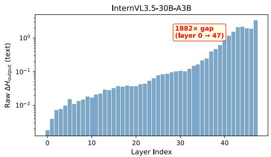

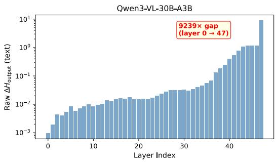  
Figure 7: Mean $\Delta H$ (text tokens) per layer for InternVL3.5-30B-A3B and Qwen3-VL-30B-A3B. Y-axis is log-scaled. Deep layers produce values $1 0 ^ { 3 } – 1 0 ^ { 4 } \times$ larger than shallow layers, necessitating layer-wise normalization before cross-layer comparison.

Within-Layer Heavy-Tailed Distribution of $\Delta H _ { \mathsf { o u t p u t } }$ (text)

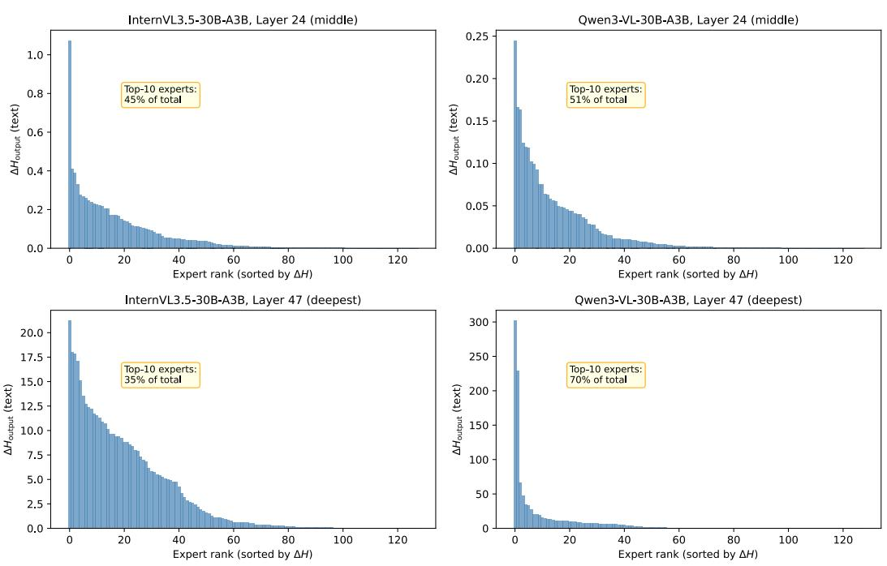  
Figure 8: Within-layer distribution of $\Delta H$ (text tokens) for selected layers of InternVL3.5-30B-A3B and Qwen3-VL-30B-A3B. Expert importance follows a heavy-tailed distribution, with the top-10 experts contributing 35–70% of total $\bar { \Delta } H$ per layer.

## L Scoring vs. Allocation and α under a Uniform Budget

MAEP differs from the uniform baselines in Table 1 along two axes: the modality-aware score and the global, non-uniform allocation. Table 14 crosses the two on InternVL3.5-30B-A3B at 50% pruning. Applying REAP’s scores under a global budget changes essentially nothing: after the same per-layer log+z-score normalization, its scores induce a near-uniform allocation (the global and uniform REAP masks agree at Jaccard 0.955; 140 of the 6,144 prune/keep decisions flip), and performance is unchanged within noise. Within the global column, the modality-aware score is ahead on all four benchmarks and decisively so on ChartQA. The DiEP comparison (Appendix E.2) holds the allocation axis fixed and varies only the scoring, so the two analyses isolate the scoring contribution from both directions.

InternVL3.5-30B-A3B 25% pruning

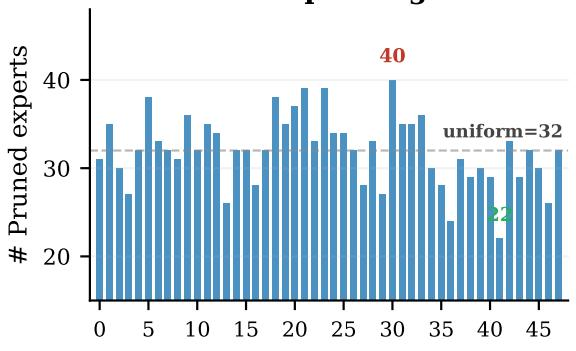  
Qwen3-VL-30B-A3B 25%pruning

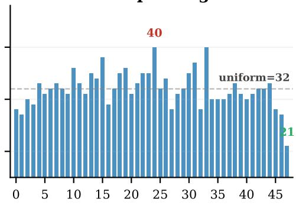

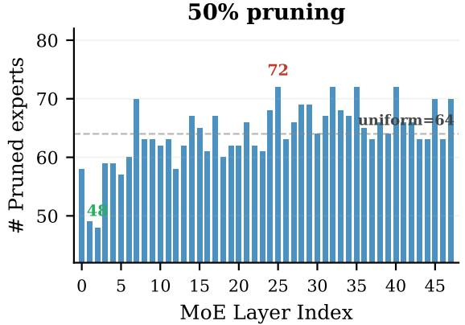

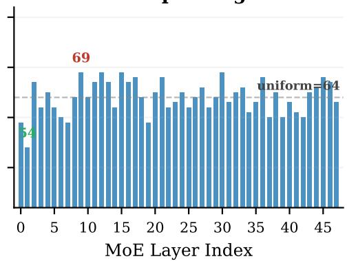  
Figure 9: Per-layer pruned expert count under global pruning for InternVL3.5-30B-A3B and Qwen3- VL-30B-A3B at 25% and 50% pruning ratios. Gray dashed lines indicate the uniform per-layer baseline (32 and 64 experts, respectively); red and green annotations mark the layers with the maximum and minimum pruned-expert counts.

Why the uniform variant needs a different α. A uniform per-layer quota uses the composite score of Eq. 4 as a within-layer ordering. That score is a removability score whose terms are weighted for the global operating point: on InternVL3.5, text-side and low-attention importance are anti-correlated (Table 8), so removing the $\mathrm { \ h i g h e s t { - } } \Delta H _ { \mathrm { l a } }$ experts already steers clear of text-critical ones, and the global cut stops early enough for this to hold. A forced per-layer 50% cut instead runs past the experts the low-attention signal clearly flags; from there, protection falls to the text term, whose weight 1−α is only 0.2 at $\alpha { = } 0 . 8 ,$ too little to keep text-critical experts out of the cut. The mechanism predicts that a uniform budget requires a smaller $\alpha ,$ which Table 15 confirms: at $\alpha { = } 0 . 5$ , uniform MAEP is at least competitive with uniform REAP on every benchmark (within about one point on MME and MMStar, ahead on ChartQA and TextVQA); TextVQA stays flat and high across the whole band $\alpha \leq 0 . 5$ ChartQA improves with more vision-side evidence up to $\alpha { = } 0 . 5$ , and $\alpha \ge 0 . 7$ is unstable under a uniform quota. The recovery is not a convergence to $\mathrm { R E A P ^ { \prime } s }$ selection: the re-tuned masks remain far from REAP’s (Jaccard 0.47–0.49 across the band). We therefore report the re-tuned $\alpha { = } 0 . 5$ variant as the uniform baseline in Table 2(a). Global allocation still leads the re-tuned uniform variant clearly on MME and ChartQA (MMStar and TextVQA are within about one point either way), so we retain the global operating point.

Table 14: Scoring × allocation on InternVL3.5-30B-A3B at 50% pruning (MME / MMStar / ChartQA / TextVQA).
<table><tr><td></td><td>Uniform per-layer budget</td><td>Global non-uniform budget</td></tr><tr><td>REAP scoring</td><td>2109.6 / 63.3 / 65.3 / 74.4 (Table 1)</td><td>2085.7 / 63.0 / 65.1 / 74.6</td></tr><tr><td>MAEP scoring</td><td>2103.9 / 62.2 / 72.1 / 76.5 (α=0.5; Table 2(a))</td><td>2160.3 / 63.3 / 76.7 / 75.6 (Table 1)</td></tr></table>

Table 15: Uniform per-layer 50% pruning on InternVL3.5-30B-A3B with α re-tuned for the uniform budget. All rows were evaluated with the same, final version of our evaluation pipeline.
<table><tr><td>Score (uniform per-layer budget)</td><td>MME</td><td>MMStar</td><td>ChartQA</td><td>TextVQA</td></tr><tr><td>MAEP, α=0.0</td><td>2144.1</td><td>60.1</td><td>56.2</td><td>76.5</td></tr><tr><td> $\mathbf { M A E P , } \alpha { = } 0 . 1$ </td><td>2155.9</td><td>59.8</td><td>56.8</td><td>76.8</td></tr><tr><td>MAEP, α=0.2</td><td>2138.0</td><td>61.4</td><td>60.9</td><td>76.9</td></tr><tr><td> $\mathbf { M A E P , } \alpha { = } 0 . 3$ </td><td>2124.6</td><td>60.9</td><td>61.2</td><td>76.6</td></tr><tr><td>MAEP, α=0.5 (Table 2(a))</td><td>2103.9</td><td>62.2</td><td>72.1</td><td>76.5</td></tr><tr><td> $\mathbf { M A E P , } \alpha { = } 0 . 7$ </td><td>1675.4</td><td>49.3</td><td>44.8</td><td>58.2</td></tr><tr><td>MAEP, α=0.8 (global operating point)</td><td>1918.4</td><td>52.8</td><td>61.6</td><td>61.2</td></tr><tr><td>REAP (uniform; Table 1)</td><td>2109.6</td><td>63.3</td><td>65.3</td><td>74.4</td></tr></table>

  
Q: How many uncut fruits are in the image?  
Unpruned: Four uncut fruits. A detailed breakdown: top-left, top-center, top-right, and bottom-left—each whole, dark-purple with green leaves; the remaining two are cut open and excluded.  
HC-SMoE: In the image, there are five uncut fruits.  
MAEP (50%): Three whole mangosteens with intact skins, plus one cut in half revealing the white flesh inside; brief reasoning over each fruit’s state.

  
Q: Do you know who paint this?  
Figure 10: Qualitative comparisons on LLaVA-Bench (in-the-wild) for InternVL3.5-30B-A3B at 50% pruning. Selected as the two samples with the most pronounced output divergence across configurations. Red marks factually incorrect or hallucinated content; bold marks key factual content.

Unpruned: The painting is the Mona Lisa, by Leonardo da Vinci (1452–1519). Discusses sfumato technique, the High-Renaissance period (1503–1517), and the work’s location at the Louvre.

HC-SMoE: The painting is created by the artist known as “InternVL”. This painting is a part of a multimodal language model.

MAEP (50%): The painting is the Mona Lisa, by Leonardo da Vinci. Mentions sfumato (mis-spelled “sfonto”), the High Renaissance, and the Louvre Museum.

## M Qualitative Examples

Figure 10 contrasts model outputs across three conditions on LLaVA-Bench (in-the-wild) [37]: the unpruned baseline, HC-SMoE at 50% pruning, and MAEP at 50% pruning. In the counting case (top), MAEP correctly identifies the fruit composition (three whole mangosteens and one halved fruit), whereas HC-SMoE substantially overcounts and even the unpruned baseline miscounts. In the Mona Lisa case (bottom), MAEP matches the unpruned baseline in correctly attributing the painting and its art-historical context, while HC-SMoE produces a self-referential hallucination of model identity.