# MotoVerse: A Benchmark for Predictive Perception of Motorized Two-Wheelers in Dense Unstructured Traffic

Varun A. Paturkar

Shankar Gangisetty

C.V. Jawahar

IIIT Hyderabad, India

varuna.paturkar@research.iiit.ac.in, shankar.gangisetty@ihub-data.iiit.ac.in, jawahar@iiit.ac.in

## Abstract

Motorized Two-Wheelers (MTWs) dominate personal transport across much ofthe Global South, yet remain largely overlooked in predictive perception researchfor autonomous driving and ADAS. We introduce MotoVerse, a benchmark for predictive perceptionfrom an MTW’s ego-centric perspective. MotoVerse comprises 949 maneuver clips collected in dense, unstructured traffic and trajectory annotationsfor over 31,000 surrounding road agents, including over 16,000 MTWs, enabling two complementary tasks: Ego-Rider Maneuver Anticipation (ERMA) and Traffic Agent Trajectory Prediction (TATP). Each clip isfurther annotated with an MTW-specific challenge taxonomy comprising dynamic ego-motion, weak traffic structure and contextual occlusion, enabling challenge-aware evaluation. We benchmark established conventional prediction models, general-purpose Vision-Language Models (VLMs), driving-specific VLMs and vision-language-action models. Our experiments reveal three key insights: (i) video backbones reach most of their fullobservation accuracyfrom thefirstfifth ofa maneuver, whereas zero-shot VLMs need most ofthe maneuver to be observed; (ii) zero-shot VLMs, whether general-purpose or driving-specific, largely remain close to simple baselines on both tasks; a preliminary LoRA study shows that adaptation lifts anticipation sharply but leaves trajectory prediction behind conventional models; and (iii) the rider’s own motion drivesforecasting difficulty: for every model, including a static baseline, errors are highest during left turns and rise under dynamic ego-motion. We believe MotoVerse will serve as a challenging benchmarkfor safer and more robust predictive AIfor intelligent two-wheelers. The dataset and evaluation code are publicly available at https://github.com/VarunIIITH/MotoVerse.

## 1. Introduction

Autonomous driving and ADAS have advanced rapidly over the last decade, driven largely by the availability of large-scale, diverse driving datasets [5, 13, 39, 49]. However, these datasets predominantly capture four-wheeled vehicles operating on well-structured road infrastructure of the Global North. Traffic environments in the Global South present fundamentally different challenges, characterized by unstructured roads, heterogeneous traffic participants, weak lane discipline, and highly dynamic interactions. Although recent datasets such as IDD [40] and METEOR [8] have begun to address these complexities, they continue to focus primarily on four-wheelers.

In contrast, Motorized Two-Wheelers (MTWs) are the dominant mode of personal transportation across much of the Global South. The riders are significantly more vulnerable due to minimal physical protection and constant close interactions with other traffic agents. Consequently, MTW users account for a disproportionately large share of road traffic deaths in many countries in the Global South [27]. Despite their societal importance and elevated safety risks, the community lacks large-scale datasets and standardized benchmarks tailored to understanding the unique challenges of MTW-centric riding.

The sensing available on an MTW also differs fundamentally from that assumed by existing driving datasets. MTWs in the Global South are low-cost, high-volume vehicles, and the sensor suites used on four-wheelers, including multi-camera rigs, LiDAR, and differential GNSS, cost a substantial fraction of the vehicle and at times more than the MTW itself. Mounting is equally constrained, as a two-wheeler offers no roof or stable chassis surface, exposes any instrumentation to weather and continuous vibration, and competes directly with rider ergonomics. While richer sensor configurations are feasible for research platforms, a single forward-facing camera remains the only configuration with a realistic path to deployment at scale.

Building safe AI systems for MTWs requires the ability to anticipate both the rider’s intent and the behavior of surrounding traffic before critical situations unfold. Accordingly, we focus on two complementary predictive perception tasks: Ego-Rider Maneuver Anticipation (ERMA) [12, 17, 18, 22], which predicts the ego rider’s upcoming maneuver from an early portion of the observed video, and Traffic Agent Trajectory Prediction (TATP) [14, 35, 41, 48], which forecasts the future 2D bounding-box trajectories of surrounding road agents in the image plane of the rider’s ego-centric camera. While recent datasets [8, 21] have begun investigating predictive tasks in unstructured traffic, they remain focused on four-wheelers.

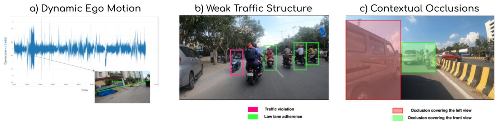  
Figure 1. MTW-specific challenges in unstructured traffic. (a) Dynamic ego-motion: gyroscope measurements illustrating abrupt camera rotations and high-frequency vibrations during rider maneuvers (grey arrow highlights the fluctuations). (b) Weak traffic structure: MTWs frequently deviate from lane structure while navigating dense traffic. (c) Contextual occlusion: close-proximity riding through narrow gaps results in frequent occlusions of surrounding traffic participants.

Existing prediction methods are developed for four-wheelers with stable camera viewpoints and structured traffic. These assumptions do not hold for MTWs, which face three key challenges (Fig. 1). Dynamic ego-motion: unlike rigidly mounted cameras on four-wheelers, MTW-mounted cameras undergo rapid pose and orientation changes due to rider lean, steering corrections and road vibrations, leading to highly non-stationary observations. Weak traffic structure: MTWs frequently navigate narrow gaps and exhibit limited lane adherence in dense mixed traffic, rendering road geometry and lane-based priors unreliable. Contextual occlusion: operating in close proximity to larger vehicles results in persistent, dynamic occlusions that obscure critical cues such as surrounding agents, traffic signals and road boundaries. Collectively, these factors distinguish MTW riding from four-wheeler driving, underscoring the need for datasets and benchmarks tailored to MTW-centric driving in unstructured environments.

Despite growing interest in MTW-centric perception, no benchmark exists for predictive perception on motorized two-wheelers. Existing MTW datasets such as MOTOR [30] support rider action and intention recognition but provide no trajectory annotations for surrounding agents, while trajectory prediction datasets [7, 8] focus on four-wheelers. No dataset jointly supports rider maneuver anticipation and surrounding-agent trajectory prediction from an MTW’s ego-centric perspective, or characterizes the riding conditions under which prediction is evaluated.

To bridge this gap, we introduce MotoVerse, an MTW-centric predictive benchmark. Our main contributions are as follows:

• MotoVerse Benchmark. A large-scale ego-centric benchmark for predictive perception on motorized twowheelers, curated from over 50 hours of collected riding data. MotoVerse comprises 949 maneuver clips and dense trajectory annotations for over 31,000 surrounding road-agent instances, including more than 16,000 MTWs, enabling two complementary tasks: Ego-Rider Maneuver Anticipation (ERMA) and Traffic Agent Trajectory Prediction (TATP).

• MTW Challenge Taxonomy. A challenge-aware benchmark annotating three distinctive characteristics of MTW riding: dynamic ego-motion, weak traffic structure and contextual occlusion, enabling fine-grained evaluation of predictive models under realistic riding conditions.

• Comprehensive Benchmarking and Insights. Strong baselines for both ERMA and TATP across established conventional prediction models, general-purpose VLMs, and recent driving-specific VLMs and vision-language-action models, together with a preliminary study of parameterefficient VLM adaptation, providing the first systematic study of predictive reasoning in MTW-centric unstructured traffic.

## 2. Related Works

## 2.1. Datasets

Advancing predictive perception in autonomous driving requires datasets that jointly capture rider intentions, surrounding agent motion, and their interactions in realistic traffic environments. As summarized in Table 1, existing datasets provide only a partial view of this problem and remain inadequate for benchmarking predictive tasks from the perspective of MTWs. Early intention prediction datasets such as Brain4Cars [17], HDD [32], AIDE [45] and DAAD [43] annotate driver maneuvers, gaze and multimodal perception, but are collected exclusively from four-wheelers, and all but DAAD in structured traffic. More recently, MTW-centric datasets such as MOTOR [30] have introduced ego-centric videos of realistic two-wheeler riding in dense, unstructured traffic. These datasets are designed for rider action and intention recognition, where the full sequence is observed and classified, whereas ERMA targets anticipation, requiring the maneuver to be inferred from an early portion of the clip. This difference also determines the label space, as anticipation requires maneuver classes with identifiable onsets (Sec. 3.5). Separately, existing MTW datasets provide no trajectory annotations for surrounding traffic participants and therefore cannot support TATP, nor do they provide labels characterizing the riding conditions under which prediction is evaluated.

Table 1. Comparison of existing intention and trajectory prediction datasets. MotoVerse is the only dataset providing both ego-rider intention and surrounding-agent trajectory annotations alongside MTWspecific challenge labels. ✓ = available, ✗ = unavailable. Ego: 4W = four-wheeler. Camera: E = ego, S = static. Ego Int.: intention annotations for the ego driver or rider; datasets annotating surrounding-agent intentions are marked ✗. Frame: coordinate frame of the trajectory annotations (Img. = ego-camera image plane, Metric = world or bird’seye-view; – = none). MTW Lbls.: MTW-specific challenge labels.
<table><tr><td rowspan=1 colspan=1>Dataset</td><td rowspan=1 colspan=1>Ego</td><td rowspan=1 colspan=1>Camera</td><td rowspan=1 colspan=1>Ego Int.</td><td rowspan=1 colspan=1>Traj. Ann.</td><td rowspan=1 colspan=1>Frame</td><td rowspan=1 colspan=1>MTW Lbls.</td></tr><tr><td rowspan=1 colspan=1>Structured Traffic</td><td rowspan=1 colspan=1></td><td rowspan=1 colspan=1></td><td rowspan=1 colspan=1></td><td rowspan=1 colspan=1></td><td rowspan=1 colspan=1></td><td rowspan=1 colspan=1></td></tr><tr><td rowspan=1 colspan=1>JAAD [34]</td><td rowspan=1 colspan=1>4W</td><td rowspan=1 colspan=1>E</td><td rowspan=1 colspan=1>X</td><td rowspan=1 colspan=1>√</td><td rowspan=1 colspan=1>Img.</td><td rowspan=1 colspan=1>x</td></tr><tr><td rowspan=1 colspan=1>PIE [35]</td><td rowspan=1 colspan=1>4W</td><td rowspan=1 colspan=1>E</td><td rowspan=1 colspan=1>x</td><td rowspan=1 colspan=1>√</td><td rowspan=1 colspan=1>Img.</td><td rowspan=1 colspan=1>x</td></tr><tr><td rowspan=1 colspan=1>HEV-I [46]</td><td rowspan=1 colspan=1>4W</td><td rowspan=1 colspan=1>E</td><td rowspan=1 colspan=1>x</td><td rowspan=1 colspan=1>√</td><td rowspan=1 colspan=1>Img.</td><td rowspan=1 colspan=1>x</td></tr><tr><td rowspan=1 colspan=1>NGSIM [1]</td><td rowspan=1 colspan=1>4W</td><td rowspan=1 colspan=1>S</td><td rowspan=1 colspan=1>X</td><td rowspan=1 colspan=1>√</td><td rowspan=1 colspan=1>Metric</td><td rowspan=1 colspan=1>x</td></tr><tr><td rowspan=1 colspan=1>KITTI [13]</td><td rowspan=1 colspan=1>4W</td><td rowspan=1 colspan=1>E</td><td rowspan=1 colspan=1>x</td><td rowspan=1 colspan=1>√</td><td rowspan=1 colspan=1>Metric</td><td rowspan=1 colspan=1>x</td></tr><tr><td rowspan=1 colspan=1>Waymo [39]</td><td rowspan=1 colspan=1>4W</td><td rowspan=1 colspan=1>E</td><td rowspan=1 colspan=1>x</td><td rowspan=1 colspan=1>√</td><td rowspan=1 colspan=1>Metric</td><td rowspan=1 colspan=1>x</td></tr><tr><td rowspan=1 colspan=1>Argoverse 2 [44]</td><td rowspan=1 colspan=1>4W</td><td rowspan=1 colspan=1>E</td><td rowspan=1 colspan=1>x</td><td rowspan=1 colspan=1>√</td><td rowspan=1 colspan=1>Metric</td><td rowspan=1 colspan=1>x</td></tr><tr><td rowspan=1 colspan=1>nuPlan [20]</td><td rowspan=1 colspan=1>4W</td><td rowspan=1 colspan=1>E</td><td rowspan=1 colspan=1>x</td><td rowspan=1 colspan=1>√</td><td rowspan=1 colspan=1>Metric</td><td rowspan=1 colspan=1>x</td></tr><tr><td rowspan=1 colspan=1>AIDE [45]</td><td rowspan=1 colspan=1>4W</td><td rowspan=1 colspan=1>E</td><td rowspan=1 colspan=1>√</td><td rowspan=1 colspan=1>x</td><td rowspan=1 colspan=1></td><td rowspan=1 colspan=1>x</td></tr><tr><td rowspan=1 colspan=1>HDD [32]</td><td rowspan=1 colspan=1>4W</td><td rowspan=1 colspan=1>E</td><td rowspan=1 colspan=1>√</td><td rowspan=1 colspan=1>x</td><td rowspan=1 colspan=1>一</td><td rowspan=1 colspan=1>x</td></tr><tr><td rowspan=1 colspan=1>Brain4Cars [17]</td><td rowspan=1 colspan=1>4W</td><td rowspan=1 colspan=1>E</td><td rowspan=1 colspan=1>√</td><td rowspan=1 colspan=1>x</td><td rowspan=1 colspan=1>一</td><td rowspan=1 colspan=1>X</td></tr><tr><td rowspan=1 colspan=1>Unstructured</td><td rowspan=1 colspan=1>Traffic</td><td rowspan=1 colspan=1></td><td rowspan=1 colspan=1></td><td rowspan=1 colspan=1></td><td rowspan=1 colspan=1></td><td rowspan=1 colspan=1></td></tr><tr><td rowspan=1 colspan=1>METEOR [8]</td><td rowspan=1 colspan=1>4W</td><td rowspan=1 colspan=1>E</td><td rowspan=1 colspan=1>x</td><td rowspan=1 colspan=1>7</td><td rowspan=1 colspan=1>Img.</td><td rowspan=1 colspan=1>x</td></tr><tr><td rowspan=1 colspan=1>TRAF [7]</td><td rowspan=1 colspan=1>4W</td><td rowspan=1 colspan=1>S</td><td rowspan=1 colspan=1>x</td><td rowspan=1 colspan=1>√</td><td rowspan=1 colspan=1>Metric</td><td rowspan=1 colspan=1>X</td></tr><tr><td rowspan=1 colspan=1>DAAD [43]</td><td rowspan=1 colspan=1>4W</td><td rowspan=1 colspan=1>E</td><td rowspan=1 colspan=1>√</td><td rowspan=1 colspan=1>x</td><td rowspan=1 colspan=1>-</td><td rowspan=1 colspan=1>X</td></tr><tr><td rowspan=1 colspan=1>MOTOR [30]</td><td rowspan=1 colspan=1>MTW</td><td rowspan=1 colspan=1>E</td><td rowspan=1 colspan=1>V</td><td rowspan=1 colspan=1>x</td><td rowspan=1 colspan=1>一</td><td rowspan=1 colspan=1>X</td></tr><tr><td rowspan=1 colspan=1>MotoVerse</td><td rowspan=1 colspan=1>MTW</td><td rowspan=1 colspan=1>E</td><td rowspan=1 colspan=1>√</td><td rowspan=1 colspan=1>√</td><td rowspan=1 colspan=1>Img.</td><td rowspan=1 colspan=1>√</td></tr></table>

Consequently, no existing dataset jointly supports ERMA and TATP while accounting for the unique challenges of MTW-centric riding. MotoVerse addresses this gap through dense trajectory annotations, rider maneuver labels and challenge-aware metadata for predictive perception in unstructured two-wheeler traffic.

## 2.2. Predictive Methods

Intention Prediction. Early video-based intention prediction methods adapted image recognition architectures to model temporal dynamics. C2D [42] aggregates frame-wise features using 2D convolutions, while I3D [6] extends convolutional kernels into the temporal dimension for joint spatio-temporal learning. More recent architectures such as SlowFast [11] and X3D [10] improve efficiency through multi-pathway and scalable designs. In the driving domain, maneuver anticipation methods further incorporate temporal models such as LSTMs, transformers, and multi-view perception to predict future driver actions [12, 21, 26, 36, 43]. However, these approaches are primarily developed for four-wheelers equipped with multiple synchronized sensors and cameras. Such hardware configurations are rarely available on MTWs, where a single forward-facing camera remains the most practical sensing modality, and their effectiveness under MTW-specific challenges has not been systematically evaluated.

Ego-centric Trajectory Prediction. Beyond world and bird’seye-view formulations [20, 44], a parallel line of work predicts agent trajectories directly in the image plane of an ego-centric camera, where the output is a future bounding box sequence. Yao et al. [46] introduced this setting for surrounding vehicles; it has since supported accident anticipation [47], uncertainty modeling [4] and traffic agent forecasting in risky driving scenarios [19]. Recent methods such as PIETraj [35], SGNet [41], BiTraP [48], and action-aware contrastive learning [14] capture multimodal futures through intention reasoning, goal conditioning, and stochastic prediction. Existing work in this setting, however, remains confined to four-wheelers and pedestrians, where the camera component of apparent motion is comparatively stable [46]. On MTWs, rider lean, steering corrections and road vibrations continuously alter camera pose (Fig. 1), so prediction requires separating agent motion from a large, non-stationary ego component.

VLM-Based Predictions. Recent VLMs have demonstrated remarkable reasoning capabilities and are increasingly being adopted for autonomous driving tasks including traffic scene understanding, visual question answering, and decision making, as exemplified by nuScenes-QA [31], DriveLM [37], CoVLA [2], and OpenDriveVLA [51]. Alongside general-purpose models such as InternVL2.5 [9] and Qwen3-VL [3], driving-specific models have extended this to explicit reasoning over driving scenes [16, 28] and to action prediction [25, 29]. However, existing evaluations are almost exclusively conducted on four-wheeler datasets collected in structured traffic environments, and their ability to reason about MTW intentions and surrounding agent behavior in MTW-centric, unstructured traffic remains to be tested.

## 3. The MotoVerse Benchmark

We present MotoVerse, a dataset and benchmark for predictive perception from the ego-centric perspective of MTWs in dense, unstructured traffic. This section describes our data capture setup and collection, the annotation protocol, the quality assurance process, and the resulting dataset statistics and evaluation splits.

## 3.1. Data Collection

MotoVerse was collected using a single forward-facing GoPro Hero 8 camera mounted on a motorized two-wheeler, recording at 1080p and 30 FPS. A single forward camera is the sensing configuration realistically deployable on production two-wheelers in the Global South (Sec. 1), and no additional sensors were used. The camera’s internal IMU is used only to illustrate the ego-motion characteristics of MTW riding in Fig. 1; both benchmark tasks are defined on the video stream alone. The camera was positioned to capture the rider’s frontal field of view, providing an ego-centric perspective of the surrounding traffic that closely reflects the visual context available to the rider during navigation.

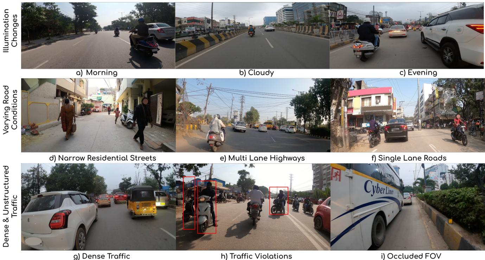  
Figure 2. Representative samples from the MotoVerse dataset. MotoVerse captures the diversity and complexity of MTW-centric driving in dense, unstructured traffic, including varying illumination conditions (top), diverse road types from highways to narrow urban streets (middle), and heterogeneous traffic scenarios characteristic of the Global South (bottom)

The dataset was recorded over more than 50 hours of riding, covering approximately 700 km across diverse urban and suburban environments in India, in dense, unstructured traffic. The recordings span a wide range of traffic densities, road types, varied illumination conditions, and riding scenarios, capturing the heterogeneity of real-world MTW operation. From this corpus, we curated the clips used to construct the MotoVerse benchmark for predictive perception.

Ethical Statement. Prior to data collection, all participants provided informed consent under a protocol reviewed and approved by our Institutional Review Board (IRB). All riders were above 18 years of age and held valid driving licenses. Recordings were captured under naturalistic riding conditions, with participants briefed on potential risks and supervised throughout each session. The released dataset is fully anonymized and intended strictly for research purposes.

## 3.2. MotoVerse Dataset

MotoVerse comprises 949 video clips curated from over 50 hours of riding, each capturing a single ego-rider maneuver, totaling approximately 4.5 hours with an average clip duration of 17 seconds. Every clip carries an ego-rider maneuver label from seven categories, dense frame-level trajectories for the surrounding road agents, and three binary MTW-specific challenge labels describing dynamic ego-motion, weak traffic structure and contextual occlusion. In total, the benchmark provides trajectories for over 31,000 road-agent instances, including more than 16,000 MTWs, alongside cars, buses and trucks (Fig. 2).

## 3.3. Annotation Pipeline

We first annotated each clip with its ego-rider maneuver, and then annotated the surrounding-agent trajectories on the labeled clips, along with the MTW challenge labels. Maneuvers were grouped into seven standard categories: Straight (ST), Left Turn (LT), Right Turn (RT), Left Lane Change (LLC), Right Lane Change (RLC), Slow/Stop (SS), and U-Turn (UT). To efficiently annotate the surrounding-agent trajectories, we adopted a semi-automated pipeline. Vehicle detections for MTWs, cars, buses, and trucks were first generated using YOLOv11 [23], followed by trajectory initialization using the ByteTrack multi-object tracker [50]. Owing to dense interactions and frequent occlusions in unstructured traffic, automatically generated tracks occasionally suffer from fragmented trajectories and identity switches.

To ensure annotation quality, a team of five annotators, supervised by a domain expert, manually verified and corrected all trajectories before converting them into the JAAD annotation format [24], to enable compatibility with existing frameworks. The same team annotated the ego-rider maneuver labels and the video-level MTW challenge labels using predefined annotation guidelines. Specifically, Dynamic ego-motion denotes clips exhibiting pronounced camera motion caused by rider lean, steering, or road vibrations; Weak traffic structure identifies scenes where road agents including the ego vehicle frequently deviate from lane structure through irregular lateral maneuvers; and Contextual occlusion indicates that key traffic participants are substantially obscured by surrounding vehicles. Weak traffic structure was labeled manually. Dynamic ego-motion and contextual occlusion were first scored automatically from camera-motion and occlusion estimates, and every resulting label was then verified by the annotators. Each clip receives an independent binary label for each of the three challenges, so a clip may carry none, one, two, or all three.

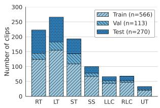  
(a) Maneuver Distribution

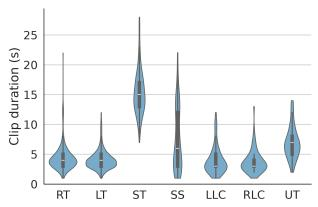  
(b) Maneuver Duration

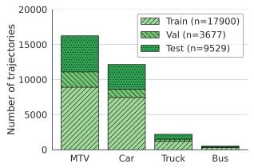  
(c) Agent Distribution

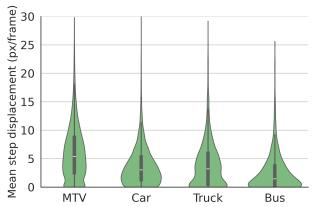  
(d) Motion Variance  
Figure 3. MotoVerse dataset statistics. (a) Distribution of ego-rider maneuver classes. (b) Distribution of maneuver durations. (c) Distribution of surrounding traffic agents. (d) Average frame-to-frame displacement across agent categories, highlighting their distinct motion characteristics. Abbre viations: ST—Straight, LT—Left Turn, RT—Right Turn, LLC—Left Lane Change, RLC—Right Lane Change, UT—U-Turn, and SS—Slow/Stop.

Annotation Quality. To assess the reliability of the annotations, we measured inter-annotator agreement among the five annotators using vote variance. The initial annotation process yielded an ambiguity rate of less than 6%, with disagreements primarily arising in highly occluded or visually challenging scenes. Starting with an initial set of 1,068 annotated clips, we removed ambiguous and corrupted samples through quality control, yielding a final benchmark of 949 clips. Additional details on the annotation protocol and agreement analysis are provided in the Supplementary Material.

## 3.4. Dataset Statistics and Benchmark Splits

MotoVerse captures the diversity and complexity of MTWcentric driving in dense and unstructured traffic. As illustrated in Fig. 3, MTWs and cars constitute the majority of surrounding traffic participants, with MTWs showing the largest average frame-to-frame displacement owing to their agile maneuvers in congested traffic. The maneuver annotations span a wide range of categories and durations, requiring models to anticipate intentions from variable-length observation windows.

Under this taxonomy, 693 clips exhibit dynamic ego-motion, 457 weak traffic structure, and 210 contextual occlusion; as the labels are independent, these counts overlap rather than partition the dataset. These annotations enable fine-grained robustness analysis under challenging riding conditions. To ensure a rigorous evaluation and eliminate session-level data leakage, we partitioned the benchmark according to rider sessions. Specifically, the dataset comprises 16 independent riding sessions from 16 distinct riders, of which 9 are used for training,

3 for validation and 4 for testing (566, 113 and 270 clips, respectively), ensuring that geographic context and ride-specific characteristics remain disjoint across the three splits.

## 3.5. Task Formulation

We define both tasks under a monocular vision-only sensing assumption: models receive a single forward-facing camera stream and no other input, reflecting the sensing configuration realistically deployable on production two-wheelers (Sec. 1). Formal input-output specifications, evaluation protocols and metric definitions are provided in the Supplementary Material. ERMA. Given the first τ fraction of a clip containing a single ego-rider maneuver, the model predicts the maneuver class from the seven categories defined in Sec. 3.3, following the maneuver taxonomies used in prior driver anticipation work [17, 32, 43] and adapted to two-wheeler riding.

The label space is restricted to discrete actions rather than riding behaviors, since τ is defined as the fraction of a maneuver observed and every label therefore requires an identifiable onset. Behaviors defined for MTWs [30] such as weaving through traffic do not satisfy this requirement. The same requirement governs segmentation: clips are cut so that each contains exactly one maneuver, and segments spanning more than one maneuver are not retained.

TATP. Given the observed bounding-box trajectory of a surrounding traffic agent, the model predicts its future boundingbox trajectory in the ego-camera image plane. The formulation follows the future object localization setting established in prior ego-centric work [19, 46, 47], keeping TATP comparable with existing image-plane forecasting benchmarks, and we adopt the displacement and overlap metrics standard in that literature [35, 38].

## 4. Experiments and Analysis

We evaluate MotoVerse on ERMA and TATP, benchmarking conventional prediction models trained on MotoVerse against zero-shot general-purpose and driving-specific VLMs and VLAs, and analyze performance under varying observation horizons and across the proposed MTW challenge taxonomy.

## 4.1. Experimental Settings

Evaluated Methods. For ERMA, we evaluated four widely used video backbones: C2D [42], I3D [6], X3D [10] and Slow-Fast [11]. For TATP, we evaluated PIETraj [35], BiTraP [48], ABC+ [14] and SGNet [41], along with a static baseline that holds the last observed box fixed. We also evaluated four general-purpose VLMs, InternVL2.5 (1B, 4B) [9] and Qwen3-VL (2B, 4B) [3], and four driving-pretrained models: Cosmos-Reason2-8B [28], DriveLMM-o1 [16], UniDriveVLA (Base) [25] and Alpamayo-1.5-10B [29]. Unless stated otherwise, all VLMs and VLAs were evaluated zero-shot on both tasks.

Implementation Details. Each experiment ran on a single NVIDIA L40S GPU. For a given task, all models received identical visual inputs, and all VLMs identical prompts. Conventional models were trained on the MotoVerse training split with the authors’ default hyperparameters; ERMA backbones were trained per τ for 100 epochs, keeping the checkpoint with the best validation accuracy; TATP models kept the checkpoint with the lowest validation loss. VLMs were run in bf16 with greedy decoding. Further details are in the Supplementary Material.

Evaluation Protocol. ERMA is evaluated at four observation ratios, τ ∈{0.2,0.3,0.5,1.0}, using Accuracy (Acc), weighted-F1 and macro-F1. For TATP, models observe 15 frames (0.5 s) and predict the next 45 (1.5 s) [48]. We report Average and Final Displacement Error (ADE/FDE), their scale-normalized counterparts (sADE/sFDE), and Average and Final Bounding-box IoU (AIoU/FIoU). As consecutive windows of a track overlap heavily, our primary TATP set takes the first window of each continuous test track (1,246 windows), giving one sample per agent; results on all 10,133 windows, with largely unchanged rankings, are in the Supplementary Material. Unparsed VLM answers are excluded on ERMA, with the parse rate reported, and scored as the last observed box on TATP.

## 4.2. ERMA Results and Analysis

Main Results. Table 2 reports ERMA performance. The four video backbones perform comparably, and their ranking varies with τ. All clearly exceed the majority-class baseline of 30.7% (always predicting Left Turn). Their macro-F1 is up to 15 points lower than accuracy, as Right Lane Change and U-Turn are rarely recognized. Even at full observation, the best backbone reaches only 58.5%. Most zero-shot VLMs perform near or below the majority-class baseline. InternVL2.5 (1B, 4B) and Qwen3-VL-2B stay near 30% at every τ, predicting only one or two classes. Qwen3-VL-4B, Cosmos-Reason2-8B and UniDriveVLA improve with longer observation. Cosmos-Reason2-8B reaches 60.0% at τ=1.0, exceeding all video backbones in accuracy, but its macro-F1 (35.4) is well below theirs. DriveLMM-o1 and Alpamayo-1.5-10B predict mostly Straight and U-Turn, respectively.

Effect of τ. The video backbones change little between τ=0.2 and τ=0.5 and gain mainly at full observation. At τ=0.2, each already reaches 84–93% of its full-observation accuracy. Predicting from the first fifth of a maneuver thus costs only 4–9 points, while leaving most of the maneuver for a downstream ADAS response. Early accuracy itself, however, remains near 50%. The zero-shot VLMs behave differently. Qwen3-VL-4B, Cosmos-Reason2-8B and UniDriveVLA gain most after τ=0.3, once the maneuver is under way. They recognize maneuvers rather than anticipate them.

Table 2. ERMA performance across different observation ratios (τ). Each entry reports Acc / Weighted-F1 / Macro-F1. The best and second-best results in each column are highlighted in bold and underline, respectively, ranked by Acc.
<table><tr><td>Model</td><td>τ=0.2</td><td>τ=0.3</td><td>τ=0.5</td><td>τ=1.0</td></tr><tr><td colspan="5">Video backbones (fine-tuned)</td></tr><tr><td>C2D [42]</td><td>48.1/43.2/38.7</td><td>48.1/47.1/36.7</td><td>45.2/44.2/36.6</td><td>54.1/52.8/49.6</td></tr><tr><td>I3D [6]</td><td>48.5/48.7/43.3</td><td>41.9/39.1/31.1</td><td>53.3/50.5/38.7</td><td>55.9/53.9/47.0</td></tr><tr><td>SlowFast [11]</td><td>51.1/49.7/43.4</td><td>50.0/46.9/38.1</td><td>46.7/45.0/41.5</td><td>54.8/52.9/44.5</td></tr><tr><td>X3D [10]</td><td>49.3/46.7/40.7</td><td>46.3/44.1/42.9</td><td>48.9/44.7/37.2</td><td>58.5/53.8/43.2</td></tr><tr><td colspan="5">Vision-Language Models (zero-shot)</td></tr><tr><td>InternVL2.5-1B [9]</td><td>31.5/17.9/9.2</td><td>32.2/18.5/9.7</td><td>32.2/18.5/9.7</td><td>30.0/15.6/7.6</td></tr><tr><td>InternVL2.5-4B [9]</td><td>30.0/18.7/12.8</td><td>31.5/17.8/12.1</td><td>32.2/17.2/11.8</td><td>31.5/17.7/14.1</td></tr><tr><td>Qwen3-VL-2B [3]</td><td>28.5/15.7/10.6</td><td>28.9/16.1/10.5</td><td>30.0/16.6/10.8</td><td>29.3/17.1/11.6</td></tr><tr><td>Qwen3-VL-4B [3]</td><td>17.0/13.2/10.1</td><td>22.6/20.3/15.7</td><td>34.1/34.1/23.2</td><td>39.3/39.9/26.0</td></tr><tr><td colspan="5">Driving-specific VLMs / VLAs (zero-shot)</td></tr><tr><td>Cosmos-Reason2-8B [28]</td><td>21.9/14.8/12.4</td><td>26.7/22.9/18.1</td><td>40.7/38.6/29.1</td><td>60.0/57.0/35.4</td></tr><tr><td>UniDriveVLA [25]</td><td>22.2/16.0/12.8</td><td>24.8/19.0/16.1</td><td>33.7/30.1/24.6</td><td>39.6/36.6/23.0</td></tr><tr><td>DriveLMM-o1 [16]</td><td>21.5/12.3/13.6</td><td>21.1/11.1/13.5</td><td>22.6/13.1/14.7</td><td>23.7/14.4/15.8</td></tr><tr><td>Alpamayo-1.5-10B† [29]</td><td>9.0/10.4/5.8</td><td>7.5/8.6/5.1</td><td>9.9/11.9/8.2</td><td>11.4/13.7/10.7</td></tr></table>

†Scores over parsed answers; Alpamayo-1.5-10B returned a parseable answer for 82.2/84.4/86.3/90.7% of test clips at τ=0.2/0.3/0.5/1.0. All other models parse 100%.

Confusion Matrix Analysis. Fig. 4 compares the error structure of the strongest model from each family at full observation (τ=1.0). All three struggle most with the lane-change classes and U-Turns. Lane changes are mostly predicted as Straight (46–85%) or assigned the wrong direction. A likely cause is that, from an MTW-mounted camera, a lane change is a small lateral shift that resembles riding straight. U-Turn is recognized in at most 11% of cases. X3D is biased towards Left Turn, which absorbs 69% of Right Turn and 89% of U-Turn clips. Cosmos-Reason2-8B separates the two turns better (59% vs. 28% Right Turn recall). However, it assigns 77% of Slow/Stop clips to Straight and never recognizes Right Lane Change or U-Turn. Qwen3-VL-4B often predicts the right direction but the wrong maneuver, labeling 33% of Right Turn clips as Right Lane Change. Matrices for all models across observation ratios are in the Supplementary Material.

## 4.3. TATP Results and Analysis

Main Results. Table 3 reports TATP performance. Among the conventional methods, SGNet performs best on every metric, followed by BiTraP and ABC+. This ranking holds for both ADE and sADE. All four methods clearly outperform the static baseline, with SGNet lowering ADE by 45%. Most zero-shot VLMs improve little over the static baseline, and InternVL2.5-1B is worse on every metric. Qwen3-VL-4B is the strongest VLM. It outperforms PIETraj on ADE, sADE and AIoU, but not on the final-step metrics. All VLMs remain well behind SGNet and BiTraP. Alpamayo-1.5-10B answers almost entirely in prose and produces no parseable trajectories (examples in the Supplementary Material).

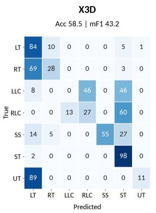

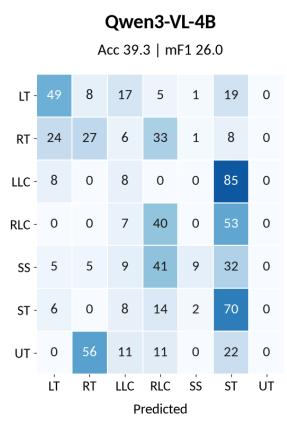

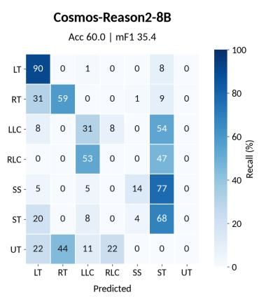  
Figure 4. Row-normalized confusion matrices (%) at τ=1.0 for the strongest model from each family: a fine-tuned backbone (X3D), a general-purpose VLM (Qwen3-VL-4B), and a driving-specific VLM (Cosmos-Reason2-8B).

Table 3. TATP performance comparison. Stochastic methods report the mean over K sampled trajectories; deterministic models and VLMs report a single trajectory. VLMs are evaluated zero-shot. The best and second-best results per metric are shown in bold and underline. A dash (–) denotes that no parseable trajectory was produced.
<table><tr><td>Model</td><td>ADE↓</td><td>FDE↓</td><td>sADE↓</td><td>sFDE↓</td><td>AIoU↑</td><td>FloU↑</td></tr><tr><td>Static (last box held)</td><td>94.3</td><td>193.4</td><td>0.705</td><td>1.259</td><td>0.363</td><td>0.151</td></tr><tr><td colspan="7">Conventional methods (fine-tuned)</td></tr><tr><td>PIETraj [35]</td><td>73.3</td><td>145.4</td><td>0.566</td><td>0.971</td><td>0.405</td><td>0.236</td></tr><tr><td>BiTraP [48]</td><td>55.5</td><td>132.7</td><td>0.423</td><td>0.963</td><td>0.528</td><td>0.249</td></tr><tr><td>ABC+[14]</td><td>58.5</td><td>138.3</td><td>0.474</td><td>1.046</td><td>0.520</td><td>0.252</td></tr><tr><td>SGNet [41]</td><td>51.8</td><td>115.0</td><td>0.389</td><td>0.785</td><td>0.549</td><td>0.312</td></tr><tr><td colspan="7">Vision-Language Models (zero-shot)</td></tr><tr><td>InternVL2.5-1B [9]</td><td>103.4</td><td>194.2</td><td>0.784</td><td>1.274</td><td>0.287</td><td>0.139</td></tr><tr><td>InternVL2.5-4B [9]</td><td>85.6</td><td>179.1</td><td>0.623</td><td>1.167</td><td>0.371</td><td>0.150</td></tr><tr><td>Qwen3-VL-2B [3]</td><td>91.7</td><td>187.2</td><td>0.690</td><td>1.247</td><td>0.370</td><td>0.156</td></tr><tr><td>Qwen3-VL-4B [3]</td><td>70.0</td><td>159.1</td><td>0.523</td><td>1.077</td><td>0.429</td><td>0.168</td></tr><tr><td colspan="7">Driving-specific VLMs / VLAs (zero-shot)</td></tr><tr><td>Cosmos-Reason2-8B [28]</td><td>85.8</td><td>177.1</td><td>0.703</td><td>1.255</td><td>0.401</td><td>0.169</td></tr><tr><td>UniDriveVLA [25]</td><td>95.1</td><td>192.3</td><td>0.693</td><td>1.229</td><td>0.354</td><td>0.147</td></tr><tr><td>DriveLMM-o1 [16]</td><td>89.1</td><td>184.7</td><td>0.656</td><td>1.190</td><td>0.371</td><td>0.152</td></tr><tr><td>Alpamayo-1.5-10B [29]</td><td>一</td><td></td><td></td><td>一</td><td></td><td>一</td></tr></table>

Per-Maneuver Analysis. Fig. 5 shows trajectory prediction performance across ego-rider maneuvers. All models share a similar difficulty profile. Left Turn is the hardest maneuver for every model, and Straight is the easiest for nearly all. The static baseline follows the same profile, so difficulty is driven by the egorider maneuver rather than by the model. Cosmos-Reason2-8B

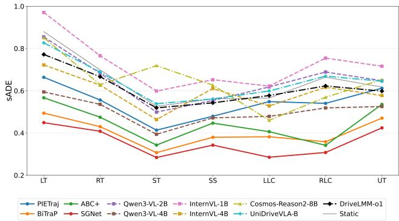  
Figure 5. Per-maneuver TATP performance (sADE, ↓). Results are grouped by the ego-rider maneuver associated with each source clip. The grey line shows the static baseline.

is the main exception, with its second-highest error on Straight.   
SGNet achieves the lowest error on all seven maneuvers.

## 4.4. Challenge-wise Robustness Analysis

ERMA. Table 4 evaluates ERMA under the proposed challenge taxonomy at τ=0.5. The challenge effects are modest. The finetuned backbones lose up to 5 points under weak traffic structure and dynamic ego-motion. Under contextual occlusion, three of the four even score above their full-set accuracy. I3D performs best on every subset. Contextual occlusion lowers the accuracy of every general-purpose VLM, most sharply for Qwen3-VL-4B (34.1% to 19.7%). Most other VLM scores change by only a few points across subsets. Since many of these models default to one or two classes, this stability does not reflect robustness. Alpamayo-1.5-10B stays near 10% throughout.

TATP. Table 5 reports trajectory prediction under the same challenge conditions. Dynamic ego-motion raises sADE for every model. Weak traffic structure and contextual occlusion lower it for every model. The static baseline shows the same pattern. Its error measures how far agents move relative to their size. These differences therefore come from how much agents move in each subset, not from the models: agents move more in the image under dynamic ego-motion, and less in the other two subsets. The ranking is unchanged across subsets, with SGNet best and BiTraP second. Most zero-shot VLMs stay close to the static baseline on every subset.

Table 4. ERMA Acc (%) across MTW-specific challenge subsets at τ = 0.5. Full = all test clips, WTS = weak traffic structure, CO = contextual occlusion, DEM = dynamic ego-motion. The best and second-best results in each column are highlighted in bold and underline, respectively.
<table><tr><td>Model Full</td><td>WTS</td><td>CO</td><td>DEM</td></tr><tr><td>Video backbones (fine-tuned)</td><td></td><td></td><td></td></tr><tr><td>C2D [42] 45.2</td><td>39.8</td><td>42.6</td><td>40.9</td></tr><tr><td>I3D [6] 53.3</td><td>51.6</td><td>57.4</td><td>49.2</td></tr><tr><td>SlowFast [11]</td><td>46.7 43.0</td><td>57.4</td><td>46.4</td></tr><tr><td>X3D [10] 48.9</td><td>45.3</td><td>52.5</td><td>44.2</td></tr><tr><td colspan="4">Vision-Language Models (zero-shot)</td></tr><tr><td>InternVL2.5-1B [9] 32.2</td><td>29.7</td><td>27.9</td><td>32.6</td></tr><tr><td>InternVL2.5-4B [9] 32.2</td><td>33.6</td><td>27.9</td><td>33.1</td></tr><tr><td>Qwen3-VL-2B [3] 30.0</td><td>33.6</td><td>24.6</td><td>32.0</td></tr><tr><td>Qwen3-VL-4B [3] 34.1</td><td>33.6</td><td>19.7</td><td>35.9</td></tr><tr><td colspan="4">Driving-specific VLMs / VLAs (zero-shot)</td></tr><tr><td>Cosmos-Reason2-8B [28]</td><td>40.7</td><td>35.2 39.3</td><td>42.5</td></tr><tr><td>UniDriveVLA [25]</td><td>33.7 32.8</td><td>32.8</td><td>34.3</td></tr><tr><td>DriveLMM-o1 [16]</td><td>22.6 25.0</td><td>23.0</td><td>23.8</td></tr><tr><td>Alpamayo-1.5-10B† [29]</td><td>9.9 9.6</td><td>13.2</td><td>7.5</td></tr></table>

†Over parsed answers only (233 of 270 test clips).

## 4.5. Exploratory Study: Parameter-Efficient Adaptation of VLMs

As a preliminary study, we test whether the zero-shot gap reflects missing adaptation. We fine-tune two VLMs with LoRA [15]: Qwen3-VL-2B [3] and UniDriveVLA [25]. UniDriveVLA is built on Qwen3-VL-2B with the same architecture, so the two models differ mainly in driving pretraining. Training details are in the Supplementary Material.

On ERMA, LoRA raises accuracy at τ=0.5 from 30.0% to 67.8% for Qwen3-VL-2B and from 33.7% to 76.3% for UniDriveVLA. Both exceed the best video backbone (53.3%) and keep improving with longer observation, reaching 80.7% and 85.9% at τ=1.0. For early anticipation, however, adaptation brings these 2B-parameter VLMs only to the level of the much smaller backbones: at τ=0.2, neither exceeds the best backbone (51.1%). On TATP, LoRA lowers ADE from 91.7 to 58.7 and from 95.1 to 59.6. This only matches ABC+ (58.5) and remains behind BiTraP (55.5) and SGNet (51.8). After adaptation, UniDriveVLA leads Qwen3-VL-2B by 4–9 points on ERMA, while the two are comparable on TATP. Adaptation alone therefore leaves clear headroom on both tasks.

Table 5. TATP sADE, ↓ across MTW-specific challenge subsets. Full = all evaluated windows, WTS = weak traffic structure, CO = contextual occlusion, DEM = dynamic ego-motion. The best and second-best results in each column are highlighted in bold and underline, respectively.
<table><tr><td>Model</td><td>Full</td><td>WTS</td><td>CO</td><td>DEM</td></tr><tr><td>Static (last box held)</td><td>0.705</td><td>0.672</td><td>0.601</td><td>0.763</td></tr><tr><td colspan="5">Conventional methods (fine-tuned)</td></tr><tr><td>PIETraj [35]</td><td>0.566</td><td>0.540</td><td>0.492</td><td>0.598</td></tr><tr><td>BiTraP [48]</td><td>0.423</td><td>0.401</td><td>0.371</td><td>0.439</td></tr><tr><td>ABC+ [14]</td><td>0.474</td><td>0.463</td><td>0.417</td><td>0.494</td></tr><tr><td>SGNet [41]</td><td>0.389</td><td>0.372</td><td>0.338</td><td>0.402</td></tr><tr><td colspan="5">Vision-Language Models (zero-shot)</td></tr><tr><td>InternVL2.5-1B [9] InternVL2.5-4B [9] Qwen3-VL-2B [3]</td><td>0.784 0.623</td><td>0.726 0.612</td><td>0.671 0.537</td><td>0.829 0.670</td></tr><tr><td>Qwen3-VL-4B [3]</td><td>0.690 0.523</td><td>0.653 0.496</td><td>0.579 0.436</td><td>0.752 0.547</td></tr><tr><td colspan="5">Driving-specific VLMs / VLAs (zero-shot)</td></tr><tr><td>Cosmos-Reason2-8B [28]</td><td>0.703</td><td>0.697</td><td>0.597</td><td>0.757</td></tr><tr><td>UniDriveVLA [25]</td><td>0.693</td><td>0.657</td><td>0.598</td><td>0.733</td></tr><tr><td>DriveLMM-o1 [16]</td><td>0.656</td><td>0.633</td><td>0.554</td><td>0.706</td></tr></table>

## 5. Conclusion

We introduced MotoVerse, a benchmark for predictive perception from the ego-centric perspective of motorized two-wheelers in dense, unstructured traffic. MotoVerse jointly supports ERMA and TATP through maneuver, trajectory and MTWspecific challenge annotations, with strong baselines established using conventional prediction models, general-purpose VLMs, and recent driving-specific VLMs and VLAs. Our experiments reveal three key insights. First, video backbones reach most of their full-observation accuracy from the first fifth of a maneuver, providing valuable reaction time for downstream ADAS, whereas zero-shot VLMs need most of the maneuver to be observed. Second, zero-shot VLMs, whether general-purpose or driving-specific, largely remain close to simple baselines on both tasks, and a preliminary LoRA study shows that adaptation lifts anticipation sharply but leaves trajectory prediction behind conventional models. Third, challenge-aware evaluation indicates that the rider’s own motion drives forecasting difficulty: for every model, including a static baseline, errors are highest during left turns and rise under dynamic ego-motion. We believe MotoVerse will accelerate research on safer and more robust predictive AI for intelligent two-wheelers.

## Acknowledgments

The project was supported by iHub-Data and Mobility at IIIT Hyderabad. We thank Prasidh Srikumar and Saumya Mundra for helpful discussions and feedback.

## References

[1] U.S. Federal Highway Administration. U.s. highway 101 and i-80 dataset. 3

[2] Hidehisa Arai, Keita Miwa, Kento Sasaki, Kohei Watanabe, Yu Yamaguchi, Shunsuke Aoki, and Issei Yamamoto. Covla: Comprehensive vision-language-action dataset for autonomous driving. In WACV, 2025. 3

[3] Shuai Bai et al. Qwen3-vl technical report. arXiv preprint arXiv:2511.21631, 2025. 3, 6, 7, 8, 12

[4] Apratim Bhattacharyya, Mario Fritz, and Bernt Schiele. Long-term on-board prediction of people in traffic scenes under uncertainty. In Proceedings ofthe IEEE conference on computer vision andpattern recognition, pages 4194–4202, 2018. 3

[5] Holger Caesar, Varun Bankiti, Alex H Lang, Sourabh Vora, Venice Erin Liong, Qiang Xu, Anush Krishnan, Yu Pan, Giancarlo Baldan, and Oscar Beijbom. nuscenes: A multimodal dataset for autonomous driving. In CVPR, 2020. 1

[6] Joao Carreira and Andrew Zisserman. Quo vadis, action recognition? a new model and the kinetics dataset. In CVPR, 2017. 3, 6, 8

[7] Rohan Chandra, Uttaran Bhattacharya, Aniket Bera, and Dinesh Manocha. Traphic: Trajectory prediction in dense and heterogeneous traffic using weighted interactions. In CVPR, 2019. 2, 3

[8] Rohan Chandra, Xijun Wang, Mridul Mahajan, Rahul Kala, Rishitha Palugulla, Chandrababu Naidu, Alok Jain, and Dinesh Manocha. Meteor: A dense, heterogeneous, and unstructured traffic dataset with rare behaviors. In ICRA, 2023. 1, 2, 3

[9] Zhe Chen et al. Expanding performance boundaries of open-source multimodal models with model, data, and test-time scaling. arXiv preprint arXiv:2412.05271, 2024. 3, 6, 7, 8

[10] Christoph Feichtenhofer. X3d: Expanding architectures for efficient video recognition. In CVPR, 2020. 3, 6, 8

[11] Christoph Feichtenhofer, Haoqi Fan, Jitendra Malik, and Kaiming He. Slowfast networks for video recognition. In ICCV, 2019. 3, 6, 8

[12] Patrick Gebert, Alina Roitberg, Monica Haurilet, and Rainer Stiefelhagen. End-to-end prediction of driver intention using 3d convolutional neural networks. In IV, 2019. 1, 3

[13] Andreas Geiger, Philip Lenz, and Raquel Urtasun. Are we ready for autonomous driving? the kitti vision benchmark suite. In CVPR, 2012. 1, 3

[14] Marah Halawa, Olaf Hellwich, and Pia Bideau. Action-based contrastive learning for trajectory prediction. In ECCV, 2022. 1, 3, 6, 7, 8, 13

[15] Edward J Hu, Yelong Shen, Phillip Wallis, Zeyuan Allen-Zhu, Yuanzhi Li, Shean Wang, Lu Wang, and Weizhu Chen. Lora: Low-rank adaptation of large language models. arXiv preprint arXiv:2106.09685, 2021. 8, 12

[16] Ayesha Ishaq, Jean Lahoud, Ketan More, Omkar Thawakar, Ritesh Thawkar, Dinura Dissanayake, Noor Ahsan, Yuhao Li, Fahad Shahbaz Khan, Hisham Cholakkal, et al. Drivelmm-o1: A step-by-step reasoning dataset and large multimodal model for driving scenario understanding. In 2025 IEEE/RSJ International Conference on Intelligent Robots and Systems (IROS), pages 20501–20508. IEEE, 2025. 3, 6, 7, 8

[17] Ashesh Jain, Hema Swetha Koppula, Bharad Raghavan, Shane Soh, and Ashutosh Saxena. Car that knows before you do:

Anticipating maneuvers via learning temporal driving models. In ICCV, 2015. 1, 2, 3, 5, 11

[18] Ashesh Jain, Avi Singh, Hema S Koppula, Shane Soh, and Ashutosh Saxena. Recurrent neural networks for driver activity anticipation via sensory-fusion architecture. In ICRA, 2016. 1

[19] Muhammad Monjurul Karim, Ruwen Qin, and Yinhai Wang. Fusion-gru: A deep learning model for future bounding box prediction of traffic agents in risky driving videos, 2023. 3, 5

[20] Napat Karnchanachari, Dimitris Geromichalos, Kok Seang Tan, Nanxiang Li, Christopher Eriksen, Shakiba Yaghoubi, Noushin Mehdipour, Gianmarco Bernasconi, Whye Kit Fong, Yiluan Guo, et al. Towards learning-based planning: The nuplan benchmark for real-world autonomous driving. In 2024 IEEE International Conference on Robotics and Automation (ICRA), pages 629–636. IEEE, 2024. 3

[21] Mukilan Karuppasamy, Shankar Gangisetty, Shyam Nandan Rai, Carlo Masone, and CV Jawahar. Towards safer and understandable driver intention prediction. In ICCV, 2025. 1, 3

[22] Nima Khairdoost, Mohsen Shirpour, Michael A. Bauer, and Steven S. Beauchemin. Real-time driver maneuver prediction using lstm. IEEE Transactions on Intelligent Vehicles, 2020. 1

[23] Rahima Khanam and Muhammad Hussain. Yolov11: An overview of the key architectural enhancements. arXiv preprint arXiv:2410.17725, 2024. 4

[24] Iuliia Kotseruba, Amir Rasouli, and John K Tsotsos. Joint attention in autonomous driving (jaad). arXiv preprint arXiv:1609.04741, 2016. 4

[25] Yongkang Li, Lijun Zhou, Sixu Yan, Bencheng Liao, Tianyi Yan, Kaixin Xiong, Long Chen, Hongwei Xie, Bing Wang, Guang Chen, et al. Unidrivevla: Unifying understanding, perception, and action planning for autonomous driving. arXiv preprint arXiv:2604.02190, 2026. 3, 6, 7, 8, 12

[26] Yunsheng Ma et al. Cemformer: Learning to predict driver intentions from in-cabin and external cameras via spatial-temporal transformers. In ITSC, 2023. 3

[27] Ministry of Road Transport and Highways, India. Annual report: 2023-2024. 1

[28] NVIDIA. Cosmos-reason2, 2025. https://www.jetsonai-lab.com/models/cosmos-reason2-8b/. 3, 6, 7, 8

[29] NVIDIA, Yan Wang, et al. Alpamayo-R1: Bridging reasoning and action prediction for generalizable autonomous driving in the long tail. arXiv preprint arXiv:2511.00088, 2025. 3, 6, 7, 8

[30] Varun Paturkar et al. Motor: A multimodal dataset for twowheeler rider behavior understanding. In ICRA, 2026. 2, 3, 5

[31] Tianwen Qian, Jingjing Chen, Linhai Zhuo, Yang Jiao, and Yu-Gang Jiang. Nuscenes-qa: A multi-modal visual question answering benchmark for autonomous driving scenario. In AAAI, 2024. 3

[32] Vasili Ramanishka et al. Toward driving scene understanding: A dataset for learning driver behavior and causal reasoning. In CVPR, 2018. 2, 3, 5, 11

[33] Amir Rasouli. A novel benchmarking paradigm and a scaleand motion-aware model for egocentric pedestrian trajectory prediction, 2023. 12

[34] Amir Rasouli et al. Are they going to cross? a benchmark dataset and baseline for pedestrian crosswalk behavior. In ICCV Workshops, 2017. 3

[35] Amir Rasouli et al. Pie: A large-scale dataset and models for pedestrian intention estimation and trajectory prediction. In ICCV, 2019. 1, 3, 5, 6, 7, 8, 13

[36] Yao Rong, Zeynep Akata, and Enkelejda Kasneci. Driver intention anticipation based on in-cabin and driving scene monitoring. In ITSC, 2020. 3

[37] Chonghao Sima, Katrin Renz, Kashyap Chitta, Li Chen, Hanxue Zhang, Chengen Xie, Jens Beißwenger, Ping Luo, Andreas Geiger, and Hongyang Li. Drivelm: Driving with graph visual question answering. In ECCV, 2024. 3

[38] Oliver Styles, Victor Sanchez, and Tanaya Guha. Multiple object forecasting: Predicting future object locations in diverse environments. In Proceedings ofthe IEEE/CVF Winter Conference on Applications ofComputer Vision, pages 690–699, 2020. 5, 12

[39] Pei Sun, Henrik Kretzschmar, Xerxes Dotiwalla, Aurelien Chouard, Vijaysai Patnaik, Paul Tsui, James Guo, Yin Zhou, Yuning Chai, Benjamin Caine, et al. Scalability in perception for autonomous driving: Waymo open dataset. In CVPR, 2020. 1, 3

[40] Girish Varma, Anbumani Subramanian, Anoop Namboodiri, Manmohan Chandraker, and CV Jawahar. Idd: A dataset for exploring problems of autonomous navigation in unconstrained environments. In WACV, 2019. 1

[41] Chuhua Wang, Yuchen Wang, Mingze Xu, and David J. Crandall. Stepwise goal-driven networks for trajectory prediction. RA-L, 2022. 1, 3, 6, 7, 8, 13

[42] Xiaolong Wang et al. Non-local neural networks. In CVPR, 2018. 3, 6, 8

[43] Abdul Wasi et al. Early anticipation of driving maneuvers. In ECCV, 2024. 2, 3, 5, 11

[44] Benjamin Wilson, William Qi, et al. Argoverse 2: Next generation datasets for self-driving perception and forecasting. In NeurIPS Datasets and Benchmarks, 2021. 3

[45] Dingkang Yang et al. Aide: A vision-driven multi-view, multimodal, multi-tasking dataset for assistive driving perception. In ICCV, 2023. 2, 3

[46] Yu Yao, Mingze Xu, Chiho Choi, David J Crandall, Ella M Atkins, and Behzad Dariush. Egocentric vision-based future vehicle localization for intelligent driving assistance systems. In 2019 International Conference on Robotics and Automation (ICRA), pages 9711–9717. IEEE, 2019. 3, 5, 12

[47] Yu Yao, Mingze Xu, Yuchen Wang, David J Crandall, and Ella M Atkins. Unsupervised traffic accident detection in first-person videos. In 2019 IEEE/RSJ International conference on intelligent robots and systems (IROS), pages 273–280. IEEE, 2019. 3, 5, 12

[48] Yu Yao et al. Bitrap: Bi-directional pedestrian trajectory prediction with multi-modal goal estimation. RA-L, 2021. 1, 3, 6, 7, 8, 12, 13

[49] Fisher Yu, Haofeng Chen, Xin Wang, Wenqi Xian, Yingying Chen, Fangchen Liu, Vashisht Madhavan, and Trevor Darrell. Bdd100k: A diverse driving dataset for heterogeneous multitask learning. In CVPR, 2020. 1

[50] Yifu Zhang et al. Bytetrack: Multi-object tracking by associating every detection box. In ECCV, 2022. 4

[51] Xingcheng Zhou, Xuyuan Han, Feng Yang, Yunpu Ma, Volker Tresp, and Alois Knoll. Opendrivevla: Towards end-to-end autonomous driving with large vision language action model. In AAAI, 2026. 3

# MotoVerse: A Benchmark for Predictive Perception of Motorized Two-Wheelers in Dense Unstructured Traffic

Supplementary Material

## A. Dataset Curation and Annotation Quality

MotoVerse was curated from over 50 hours of ego-centric riding data collected across 16 independent riding sessions. From this corpus, we first segmented the recordings into an initial set of 1,068 clips, each containing a single ego-rider maneuver. Segments spanning more than one maneuver were not retained, so every clip in the initial set corresponds to exactly one maneuver, as required by the anticipation setting defined in Sec. 3.5 of the main paper. The temporal boundaries of every maneuver were manually identified by a team of five trained annotators with prior experience in traffic-scene annotation. To ensure annotation consistency, all annotators followed a common guideline focusing on the maneuver duration, rider behavior, surrounding traffic interactions, and road structure.

We subsequently performed a multi-stage quality control process to construct the final benchmark. First, we removed 42 clips corresponding to Straight and Slow/Stop maneuvers recorded in sparse residential environments containing no surrounding traffic agents, as these clips provide limited value for either Ego-Rider Maneuver Anticipation (ERMA) or Traffic Agent Trajectory Prediction (TATP). We further discarded 18 clips affected by corrupted frames or severe frame drops that could compromise trajectory annotation quality. Finally, clips with ambiguous maneuver boundaries or labels were independently reviewed by all annotators. Disagreements were resolved through majority voting under the supervision of a domain expert. A total of 59 clips (5.5%) were identified as ambiguous and removed from the benchmark. Removal targeted label ambiguity rather than scene difficulty, and the retained benchmark preserves the full range of MTW-specific challenges. After quality control, the final Moto-Verse benchmark comprises 949 clips. The final benchmark contains only consensus annotations, ensuring high-quality labels for both maneuver anticipation and trajectory prediction tasks.

## B. Implementation Details

## B.1. Formal Task Definitions

## B.1.1. Ego-Rider Maneuver Anticipation (ERMA)

Task Definition. Given an ego-centric video clip containing a single rider maneuver, the goal is to predict the maneuver class using only an early portion of the observed video. Formally, let a clip be represented by the frame sequence $V = \{ f _ { 1 } , . . . , f _ { T } \}$ with maneuver label $y \in \{ 1 , \ldots , 7 \}$ . For an observation ratio $\tau \in ( 0 , 1 ]$ ], the model observes only the first $\lceil \tau T \rceil$ frames,

$$
V _ { \tau } { = } \{ f _ { 1 } , { \ldots } , f _ { \lceil \tau T \rceil } \} ,\tag{1}
$$

and predicts the maneuver as

$$
\hat { y } { = } \mathrm { a r g m a x } p ( c | V _ { \tau } ) .\tag{2}
$$

Smaller observation ratios correspond to earlier anticipation with less visual evidence, while τ =1.0 reduces the task to fullvideo maneuver recognition. MotoVerse defines seven maneuver classes: Left Turn (LT), Right Turn (RT), Left Lane Change (LLC), Right Lane Change (RLC), Slow/Stop (SS), Straight (ST), and U-Turn (UT), following the maneuver taxonomies used in prior driver anticipation work [17, 32, 43] and adapted to two-wheeler riding as described in Sec. 3.5 of the main paper. Evaluation Protocol. We evaluate anticipation at four observation ratios, $\tau \in \{ 0 . 2 , 0 . 3 , 0 . 5 , 1 . 0 \}$ Following the rider-session-disjoint protocol described in the main paper, the benchmark contains 566 training, 113 validation and 270 test clips, ensuring that no riding session appears in more than one split. For VLMs, accuracy and F1 scores are computed over parsed answers, and the parse rate is reported.

Table 6. ERMA input/output specification.
<table><tr><td></td><td>Video backbones</td><td>Vision-Language Models</td></tr><tr><td>Input</td><td>16 frames sampled within the first-τ window, RGB</td><td>16 frames sampled within the first-τ window and a text prompt listing the 7 classes</td></tr><tr><td>Output</td><td>7-way softmax over maneu- A single class token, parsed ver classes</td><td>to one of the 7 labels</td></tr></table>

Metrics. We report Accuracy, weighted-F1, and macro-F1. Accuracy is the fraction of correctly anticipated maneuvers over the N test clips,

$$
\mathsf { A c c } = \frac { 1 } { N } \sum _ { i = 1 } ^ { N } \mathbb { I } ( \hat { y } _ { i } = y _ { i } ) ,\tag{3}
$$

where $y _ { i }$ and $\hat { y } _ { i }$ are the ground-truth and predicted classes for the i-th clip and I(·) is the indicator function. Given the per-class precision $\mathrm { P } _ { c }$ and recall $\mathrm { R } _ { c }$ over the $C = 7$ classes, the per-class F1 score is $\mathrm { F } 1 _ { c } = 2 \mathrm { P } _ { c } \mathrm { R } _ { c } / ( \mathrm { P } _ { c } + \mathrm { R } _ { c } )$ . We aggregate these into weighted-F1 and macro-F1,

$$
\mathrm { F 1 } _ { w } = \sum _ { c = 1 } ^ { C } w _ { c } \mathrm { F 1 } _ { c } , \qquad \mathrm { F 1 } _ { m } = \frac { 1 } { C } \sum _ { c = 1 } ^ { C } \mathrm { F 1 } _ { c } ,\tag{4}
$$

where $w _ { c }$ is the proportion of true instances in class c. Weighted-F1 scales each class by its frequency, whereas macro-F1 weights every maneuver equally, providing a balanced assessment under the dataset’s class imbalance.

## B.1.2. Traffic Agent Trajectory Prediction (TATP)

Task Definition. Given the observed trajectory of a surrounding traffic agent, the goal is to predict its future bounding-box trajectory from the ego-centric perspective of the motorized two-wheeler. For each agent track, the model observes the past trajectory

$$
O = \{ b _ { t - 1 4 } , . . . , b _ { t } \} ,\tag{5}
$$

consisting of the previous 15 bounding boxes, and predicts the future trajectory

$$
\hat { P } { = } \{ \hat { b } _ { t + 1 } { , } . . . , \hat { b } _ { t { + } 4 5 } \} ,\tag{6}
$$

where each bounding box is represented as $\boldsymbol { b } = [ c _ { x } , c _ { y } , w , h ] ,$ corresponding to its center coordinates, width, and height in the image plane, following the future object localization setting introduced in prior egocentric work [46, 47]. All coordinates are expressed in pixel space for frames of resolution $9 6 0 ~ \times ~ 5 4 0$ , obtained by downsampling the $1 9 2 0 \times 1 0 8 0$ recordings. At 30 FPS, the observation horizon corresponds to 0.5 s and the prediction horizon to 1.5 s. The benchmark includes all annotated road-agent categories, namely motorized two-wheelers (MTWs), cars, buses, and trucks.

Evaluation Protocol. Training and evaluation samples are generated using a sliding-window strategy with a stride of 7 frames over gap-free track segments, with a minimum track length of 61 frames (15 observed frames, 45 prediction frames, and one transition frame), following the observation and prediction horizons used in prior work [48]. Under the rider-session-disjoint split described in the main paper, this results in 21,805 training, 3,827 validation and 10,133 test windows. The primary evaluation set used in Tables 3 and 5 and Fig. 5 of the main paper takes the first window of each of the 1,246 continuous agent tracks in the test set, giving one sample per agent. On this subset, the conventional methods keep their full-test-set ranking on ADE, FDE, sADE and AIoU, and the ADE of every method is about 10% higher (Table 9). Unparsed VLM answers are scored as the last observed box.

Table 7. TATP input/output specification.
<table><tr><td></td><td>Conventional models</td><td>Vision-Language Models</td></tr><tr><td>Input</td><td>15 observed boxes  $[ c _ { x } , c _ { y } , w , h ] .$  normalized</td><td>The 15 observed boxes rendered as text, together with the observation frames</td></tr><tr><td>Output</td><td>45 future boxes; stochastic models emit K samples</td><td>45 future boxes parsed from text</td></tr></table>

Metrics. We evaluate trajectory quality with displacement and overlap metrics, following the protocol established for boundingbox forecasting in the image plane [38]. The Average Displacement Error (ADE) and Final Displacement Error (FDE) measure the $\ell _ { 2 }$ distance between predicted and ground-truth box centers, averaged over the $T = 4 5$ predicted steps and at the final step,

$$
\mathrm { A D E } { = } \frac { 1 } { T } { \sum _ { t = 1 } ^ { T } } \lVert \hat { p } _ { t } { - } p _ { t } \rVert _ { 2 } , \quad \mathrm { F D E } { = } \lVert \hat { p } _ { T } { - } p _ { T } \rVert _ { 2 } ,\tag{7}
$$

where $p _ { t }$ and $\hat { p } _ { t }$ are the ground-truth and predicted centers at step t. As agents appear at widely varying scales under the ego-perspective, raw pixel errors favor distant, small-box agents, an effect previously noted for egocentric prediction [33]. We therefore report the scale-normalized variants sADE and sFDE, which we introduce here and which normalize each displacement by the ground-truth box diagonal $d _ { t }$

$$
\mathrm { s A D E } { = } \frac { 1 } { T } { \sum _ { t = 1 } ^ { T } } \frac { \Vert \hat { p } _ { t } - p _ { t } \Vert _ { 2 } } { d _ { t } } , \mathrm { s F D E } { = } \frac { \Vert \hat { p } _ { T } - p _ { T } \Vert _ { 2 } } { d _ { T } } .\tag{8}
$$

Finally, the Average and Final Bounding-box IoU (AIoU/FIoU) measure box overlap, averaged over the horizon and at the final step,

$$
\mathrm { A I o U } { = } \frac { 1 } { T } \sum _ { t = 1 } ^ { T } \mathrm { I o U } ( \hat { b } _ { t } , b _ { t } ) , \quad \mathrm { F I o U } { = } \mathrm { I o U } ( \hat { b } _ { T } , b _ { T } ) .\tag{9}
$$

ADE, FDE, AIoU, and FIoU follow the definitions used in [38], keeping our results directly comparable with existing image-plane forecasting benchmarks. Lower values are better for the displacement metrics (ADE/FDE, sADE/sFDE), and higher values are better for the overlap metrics (AIoU/FIoU). For stochastic models, the single reported trajectory is the mean over their K samples; deterministic and VLM models output a single trajectory directly.

## C. Additional Studies and Analysis

## C.1. Exploratory Study: Parameter-Efficient Adaptation of VLMs

Sec. 4.5 of the main paper reports a preliminary study in which two VLMs are adapted with Low-Rank Adaptation (LoRA) [15]: Qwen3-VL-2B [3] and UniDriveVLA [25]. UniDriveVLA is built on Qwen3-VL-2B-Instruct with the same architecture and chat template, so the two models differ mainly in driving pretraining. This section gives the training setup and the full results. Experimental Setup. LoRA adapters are applied to the query, key, value, and output projection matrices of the language model with rank $r = 1 6 , \alpha = 3 2$ , and dropout 0.05. For both models, only 6.42M parameters (0.30% of the 2.13B model parameters) are updated. Models are trained for three epochs using AdamW in bf16 precision with a learning rate of $1 \times 1 0 ^ { - 4 }$ cosine learning-rate scheduling, a warmup ratio of $0 . 0 3 ,$ an effective batch size of 8, and gradient checkpointing. The loss is computed on the answer tokens only, and the adapter from the last epoch is used. The visual inputs, prompts, and output formats are identical to those used in the zero-shot evaluation (Tables 6 and 7). For ERMA, a separate adapter is trained for each τ. For TATP, adapters are trained on one full-horizon window per training track (2,544 windows), whereas the conventional models use all 21,805 training windows.

Results. Table 8 reports all metrics; the findings are discussed in Sec. 4.5 of the main paper. Both adapted models parse 100% of their answers on both tasks, and every TATP answer contains all 45 boxes.

Table 8. Zero-shot vs. LoRA-adapted VLMs. ERMA reports Acc / weighted-F1 / macro-F1 (%) on the test set; TATP is evaluated on the 1,246-window subset used in the main paper. The best conventional model is shown for reference.
<table><tr><td colspan="5">ERMA (Acc / weighted-F1 / macro-F1)</td></tr><tr><td>Model</td><td>τ=0.2</td><td>τ=0.3</td><td>τ=0.5</td><td>τ=1.0</td></tr><tr><td>Qwen3-VL-2B + LoRA UniDriveVLA +LoRA</td><td>28.5/15.7/10.6 46.3/44.5/36.0 22.2/16.0/12.8 50.4/49.1/41.3</td><td>28.9/16.1/10.5 47.0/45.5/36.4 24.8/19.0/16.1 55.2/54.0/44.9</td><td>30.0/16.6/10.8 67.8/64.9/46.6 33.7/30.1/24.6 76.3/74.5/58.5</td><td>29.3/17.1/11.6 80.7/78.2/56.5 39.6/36.6/23.0 85.9/84.4/67.3</td></tr><tr><td>Best backbone</td><td>51.1/49.7/43.4 (SlowFast)</td><td>50.0/46.9/38.1 (SlowFast)</td><td>53.3/50.5/38.7 (I3D)</td><td>58.5/53.8/43.2 (X3D)</td></tr><tr><td colspan="5">TATP</td></tr><tr><td>Model</td><td>ADE↓ FDE↓</td><td>sADE↓ 0.690</td><td>sFDE↓</td><td>AIoU↑ FIoU↑</td></tr><tr><td>Qwen3-VL-2B + LoRA UniDriveVLA +LoRA</td><td>91.7 58.7 95.1 59.6</td><td>187.2 140.8 0.439 192.3 0.693 142.9 0.448</td><td>1.247 0.945 1.229 0.969</td><td>0.370 0.156 0.515 0.242 0.354 0.147 0.511 0.238</td></tr><tr><td>SGNet</td><td>51.8</td><td>115.0 0.389</td><td>0.785</td><td>0.549 0.312</td></tr></table>

## C.2. Full-Test-Set TATP Results

Table 9 reports the conventional methods on all 10,133 test windows, together with ADE at three prediction horizons. SGNet remains the best method on every metric, and errors grow steadily with the horizon for all methods. On the 1,246-window subset used in the main paper, every method keeps its rank on ADE, FDE, sADE and AIoU, and its ADE is about 10% higher.

Table 9. TATP results of the conventional methods on all 10,133 test windows. Bottom: ADE per prediction horizon, and full-set vs. subset ADE. Best and second-best per column in bold and underline.
<table><tr><td>Model</td><td>ADE↓</td><td>FDE↓</td><td>sADE↓</td><td>sFDE↓</td><td>AIoU↑</td><td>FIoU↑</td></tr><tr><td>PIETraj [35]</td><td>66.0</td><td>125.0</td><td>0.439</td><td>0.755</td><td>0.474</td><td>0.307</td></tr><tr><td>BiTraP [48]</td><td>51.0</td><td>120.0</td><td>0.347</td><td>0.805</td><td>0.586</td><td>0.305</td></tr><tr><td>ABC+ [14]</td><td>53.2</td><td>126.3</td><td>0.385</td><td>0.901</td><td>0.578</td><td>0.296</td></tr><tr><td>SGNet [41]</td><td>46.9</td><td>103.8</td><td>0.309</td><td>0.648</td><td>0.614</td><td>0.376</td></tr></table>

<table><tr><td></td><td colspan="3">ADE by horizon ↓</td><td colspan="3">ADE: full vs. subset</td></tr><tr><td>Model</td><td>0.5s</td><td>1.0s</td><td>1.5 s</td><td>Full</td><td>Subset</td><td>Ratio</td></tr><tr><td>PIETraj [35]</td><td>40.4</td><td>52.2</td><td>66.0</td><td>66.0</td><td>73.3</td><td>1.11</td></tr><tr><td>BiTraP [48]</td><td>17.5</td><td>33.1</td><td>51.0</td><td>51.0</td><td>55.5</td><td>1.09</td></tr><tr><td>ABC+ [14]</td><td>17.8</td><td>33.9</td><td>53.2</td><td>53.2</td><td>58.5</td><td>1.10</td></tr><tr><td>SGNet [41]</td><td>17.5</td><td>31.2</td><td>46.9</td><td>46.9</td><td>51.8</td><td>1.10</td></tr></table>

## C.3. ERMA Confusion Matrix Analysis

Conventional Models. Fig. 6 presents the row-normalized confusion matrices of the four conventional backbones across all observation ratios, complementing the analysis in the main paper. A consistent error pattern emerges across all architectures. Straight (ST) has the highest recall in every panel, between 60% and 98%. Confusion between opposite turning directions (LT↔RT) persists at every observation ratio. Even at τ =1.0, 40–69% of right turns are predicted as left turns, so turn direction is not resolved by observing the completed maneuver. The lane-change classes are predicted mostly as Straight or as the opposite lane change, even with full observation. Right Lane Change recall never exceeds 33%, making the lane changes a principal contributor to the lower macro-F1 scores. Slow/Stop (SS) is frequently misclassified as a turn at τ = 0.2 (41–59% of clips) and increasingly as Straight with longer observation. Finally, U-Turn (UT) remains the hardest class. Its recall stays at or below 22%, except for C2D at τ =1.0 (67%), and at full observation it is often predicted as Left Turn (up to 89%).

Vision-Language Models. Fig. 7 reveals a markedly different failure mode for zero-shot VLMs. Rather than exhibiting structured inter-class confusion, three of the four models collapse onto one or two classes at every observation ratio. InternVL2.5- 1B predicts Left Turn (LT) for most clips (67–100% of each class). InternVL2.5-4B and Qwen3-VL-2B predict Right Turn (RT) or Right Lane Change (RLC) for over 80% of the clips in every class, and Qwen3-VL-2B never predicts Left Turn. Qwen3-VL-4B is the exception. It predicts mostly Straight (ST) at early observation ratios but diversifies with longer observation, raising its Left Turn recall from 8% to 49%. It never predicts U-Turn, and its discriminative capability remains substantially below that of the fine-tuned conventional models.

To better understand this behavior, we manually inspected the outputs of all four general-purpose zero-shot VLMs on ERMA. Contrary to our initial hypothesis, the poor performance was not caused by malformed responses, prompt-following failures, or parsing errors. Instead, every model consistently produced valid outputs by selecting one of the seven maneuver classes exactly as instructed. The observed degradation therefore stems from a systematic prediction bias, suggesting that current general-purpose VLMs struggle to infer fine-grained rider intentions from short ego-centric MTW videos without domain-specific adaptation. Driving-specific VLMs and VLAs. Fig. 8 shows the corresponding matrices for the four models pretrained on driving data. Cosmos-Reason2-8B develops the clearest diagonal among the zero-shot models, and it does so progressively: left-turn recall rises from 13% at τ =0.2 to 90% at τ =1.0, and right-turn recall from 1% to 59%. Its residual errors are concentrated on Straight, which absorbs 47–93% of both lane-change classes at every ratio, and it never predicts U-Turn. UniDriveVLA recognizes Straight (74–80%) and increasingly Right Turn and Slow/Stop, but rarely Left Turn (at most 13%); most left turns are predicted as Straight or Slow/Stop. The remaining two models collapse toward a single class throughout. DriveLMM-o1 assigns more than half of every true class to Straight, and Alpamayo-1.5-10B assigns 43–83% of every class to U-Turn; both collapses persist at all four observation ratios. Neither model therefore distinguishes between maneuver categories, and their accuracies largely reflect the frequency of the predicted class in the test set.

## C.4. Qualitative Analysis

ERMA. Figs. 9–13 show predictions from all twelve models on five test clips at τ =0.5, ordered by the number of models answering correctly. For readability, each figure displays 8 frames sampled across the observation window; the models received the full 16-frame input specified in Table 6. The examples mirror the error patterns in the confusion matrices. On clips with clear ego-motion cues and sparse surroundings, the fine-tuned backbones agree with the ground truth, while the general-purpose VLMs return the classes they predict for most clips regardless of the scene. On the Left Lane Change example, most zero-shot models predict Right Lane Change or Straight, the two classes into which lane changes most often collapse. On the Left Turn through dense unstructured traffic, only InternVL2.5-1B answers correctly, and its prediction coincides with its bias toward Left Turn rather than reflecting scene interpretation. On the U-Turn example no model is correct, consistent with U-Turn being the hardest class for every model family. Alpamayo-1.5-10B returns no parseable answer on one of the five clips.

TATP. Figs. 14–16 show predicted bounding-box trajectories on three test clips, with two models drawn from each family for legibility. Each figure overlays the prediction on a single frame; the models observed the full 15-frame input specified in Table 7. The examples reflect the findings of Sec. 4.3 and 4.4 of the main paper. On the closely following MTW, the fine-tuned baselines stay closest to the true path, while several zero-shot predictions overshoot it or follow a flat line. On the bus, which barely moves, Cosmos-Reason2-8B has the lowest error, while the fine-tuned baselines predict motion in the wrong direction. Averaging sampled futures can also yield paths that do not correspond to plausible motion, as visible in BiTraP’s prediction for the receding car.

## C.5. Prompts and Model Outputs

ERMA. All eight zero-shot models receive an identical prompt listing the seven maneuver classes with a one-line definition of each and requesting the class name alone (Figs. 17–18). Most responses comply with this format, so the low accuracies reported in Sec. 4.2 reflect the choice of class rather than any difficulty in following the instruction. Alpamayo-1.5-10B is the exception, answering in free-form prose on a subset of clips from which no label can be extracted.

TATP. The TATP prompt supplies the 15 observed frames together with the corresponding boxes in absolute pixel coordinates, and requests exactly 45 lines in the same format (Figs. 19–20). Three response types occur. Most models return the requested 45 boxes. Others return a well-formed but incorrect number of boxes; where more than 45 are produced, the sequence is truncated to the first 45 and scored normally, which is how the affected models still appear in Table 3 of the main paper. Answers that cannot be parsed are scored as the last observed box. One model cannot be scored at all: Alpamayo-1.5-10B produces no boxes, describing the scene in prose instead, and is reported as a dash.

## C.6. Human Baseline

To characterize the difficulty of ERMA independently of any model, we measured human performance on the same task. Five participants who had no prior involvement in the project or the annotation effort, three male and two female, each answered 20 questions drawn at random from a corpus of 50 clips sampled from the test split. Participants were shown 16 frames sampled within the τ = 0.5 observation window and asked to select one of the seven maneuver classes, with no replay and no additional context. The 50 clips and the subset seen by each participant were balanced across the seven classes.

Human accuracy averaged 79.0% with a macro-F1 of 74.5, above every model evaluated on the same 50 clips, including the strongest fine-tuned backbone (X3D, 54.0%). Individual scores ranged from 60% to 90%, so the mean carries substantial uncertainty at five participants. The results indicate that rider intent is recoverable from a half-observed maneuver by an untrained observer. The gap to human performance is large for every model family: 25.0 points for the strongest fine-tuned backbone and 47.0 points for the strongest zero-shot model (UniDriveVLA, 32.0%).

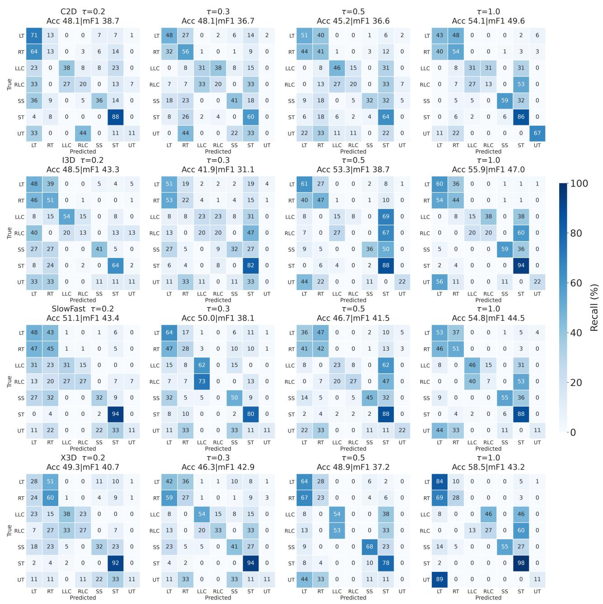  
Figure 6. Row-normalized confusion matrices (%) for all four video backbones across observation ratios τ. Rows correspond to C2D, I3D, SlowFast, and X3D; columns to τ ∈{0.2,0.3,0.5,1.0}. Each panel is titled with its Accuracy and macro-F1.

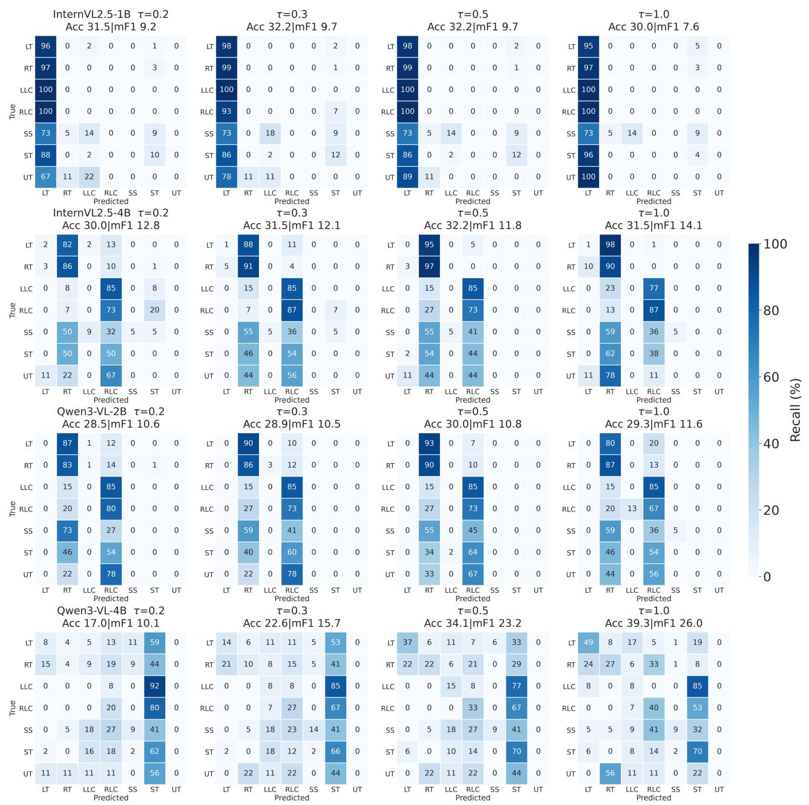  
Figure 7. Row-normalized confusion matrices (%) for all four zero-shot VLMs across observation ratios τ. Rows correspond to InternVL2.5-1B/4B and Qwen3-VL-2B/4B; columns to τ ∈{0.2,0.3,0.5,1.0}. Three of the four models collapse onto one or two classes at every observation ratio, visible as solid predicted columns.

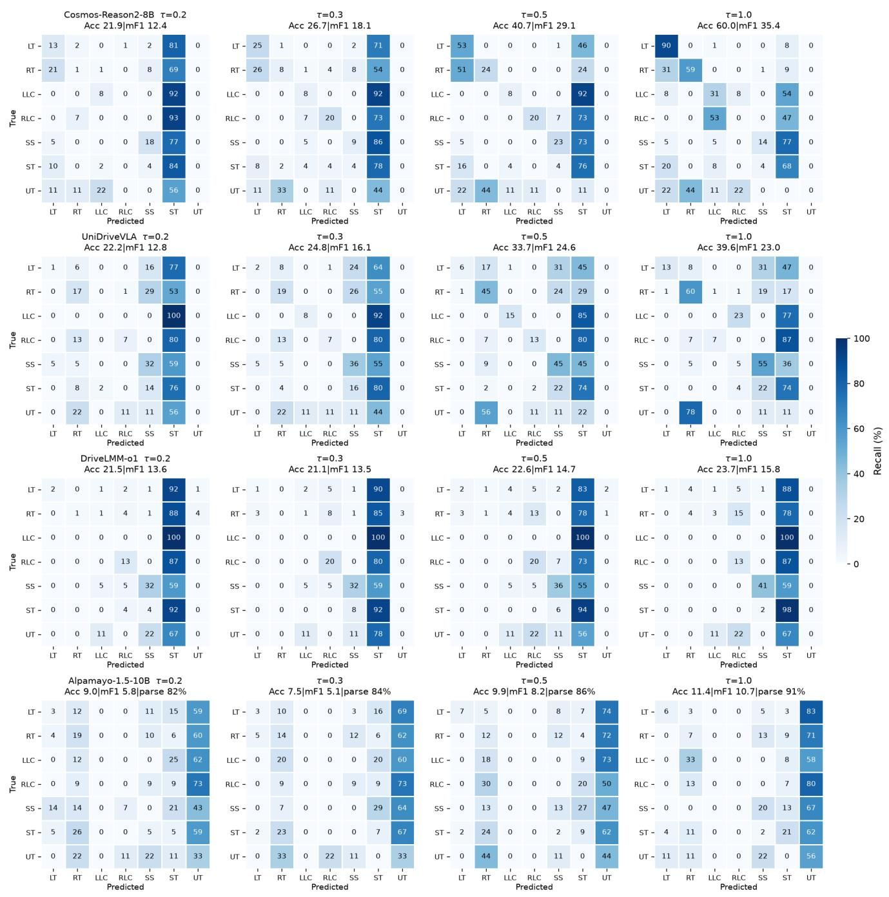  
Figure 8. Row-normalized confusion matrices (%) for the four driving-specific VLMs and VLAs across observation ratios τ. Rows correspond to Cosmos-Reason2-8B, UniDriveVLA, DriveLMM-o1, and Alpamayo-1.5-10B; columns to τ ∈{0.2,0.3,0.5,1.0}. Cosmos-Reason2-8B develops the clearest diagonal, while DriveLMM-o1 and Alpamayo-1.5-10B collapse onto Straight and U-Turn respectively.

Ground truth: Straight

frame 15/16

frame 13/16

General VLMs (zero-shot)  
General VLMs (zero-shot)  
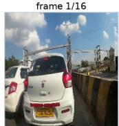

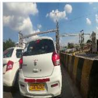

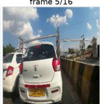

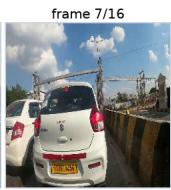

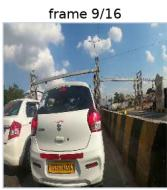

frame 11/16  
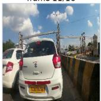

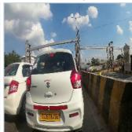

Figure 9. Slow/Stop, dense stopped traffic (τ =0.5). Three of the four general-purpose VLMs fail, despite clear signs of stopped traffic.  
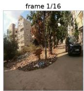

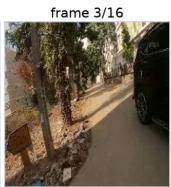

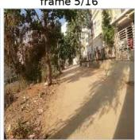

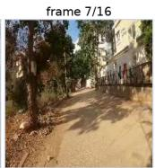

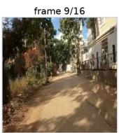

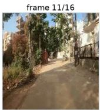

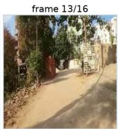

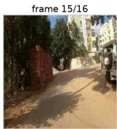  
Figure 10. Straight, sparse traffic (τ =0.5). The fine-tuned backbones are correct. All four general-purpose VLMs predict unrelated classes.

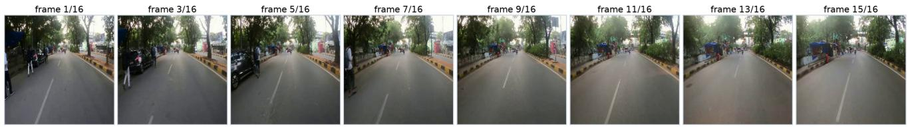

<table><tr><td colspan="2">Video backbones (fine-tuned)</td><td colspan="2">General VLMs (zero-shot)</td><td colspan="2">Driving VLMs / VLAs (zero-shot)</td></tr><tr><td>C2D</td><td>✓ Left Lane Change</td><td>InternVL2.5-1B</td><td>X Left Turn</td><td>Cosmos-Reason2-8B</td><td>X Straight</td></tr><tr><td>I3D</td><td>✓ Left Lane Change</td><td>InternVL2.5-4B</td><td>X Right Lane Change</td><td>DriveLMM-o1</td><td>X Straight</td></tr><tr><td>SlowFast</td><td>✓ Left Lane Change</td><td>Qwen3-VL-2B</td><td>X Right Lane Change</td><td>UniDriveVLA</td><td>X Straight</td></tr><tr><td>X3D</td><td>✓ Left Lane Change</td><td>Qwen3-VL-4B</td><td>X Straight</td><td>Alpamayo-1.5-10B</td><td>x U-Turn</td></tr></table>

Figure 11. Left Lane Change (τ = 0.5). Only the backbones are correct. Most zero-shot models predict Right Lane Change or Straight, as in Figs. 7 and 8.

Ground truth: Left Turn | τ=0.5 observation window | 1/12 models correct  
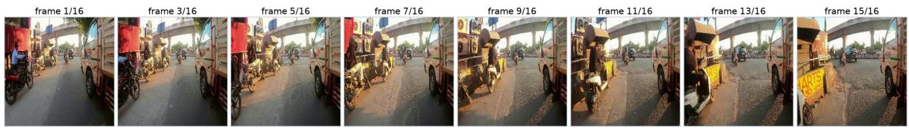  
Figure 12. Left Turn, dense unstructured traffic (τ =0.5). Only InternVL2.5-1B is correct, and Left Turn is the class it predicts for most clips.

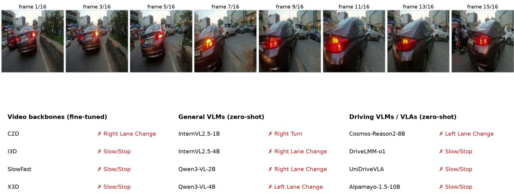  
Figure 13. U-Turn (τ =0.5). No model predicts the correct class. U-Turn is the hardest class for every model family.

TATP — observe 15, predict 45 | 1 agent(s) | best sADE: BiTraP (0.447)  
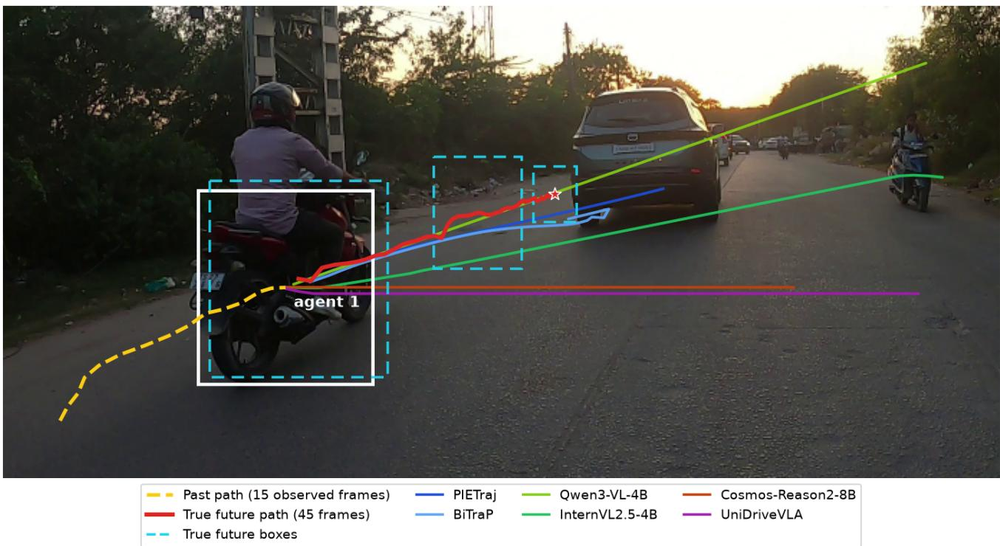  
Figure 14. TATP: closely-following MTW. The fine-tuned baselines stay closest to the true path. Several zero-shot predictions overshoot it or follow a flat line.

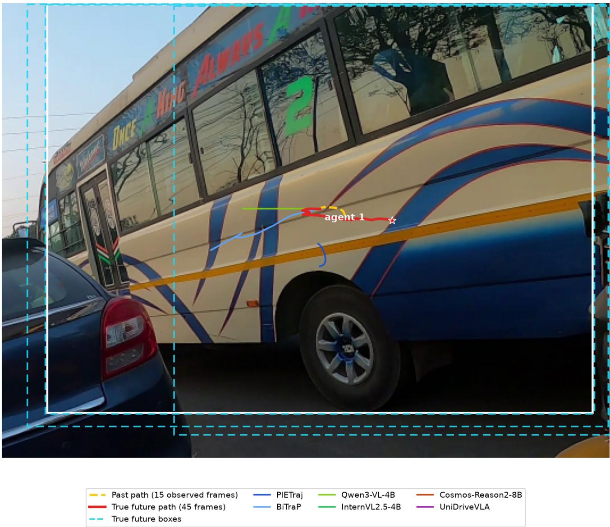  
Figure 15. TATP: bus at close range. The bus barely moves. Cosmos-Reason2-8B has the lowest error, while the fine-tuned baselines predict motion in the wrong direction.

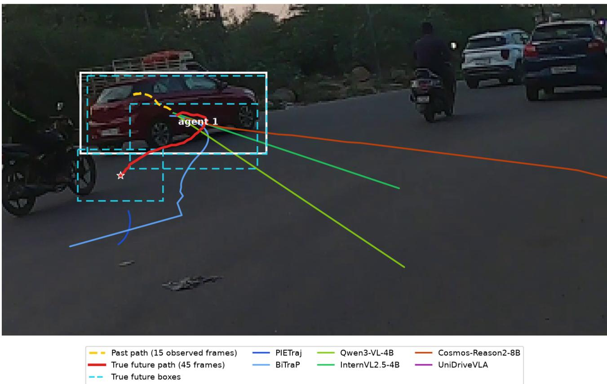  
Figure 16. TATP: receding car. Averaging sampled futures gives BiTraP an implausible path. The zero-shot models predict motion in the wrong direction.

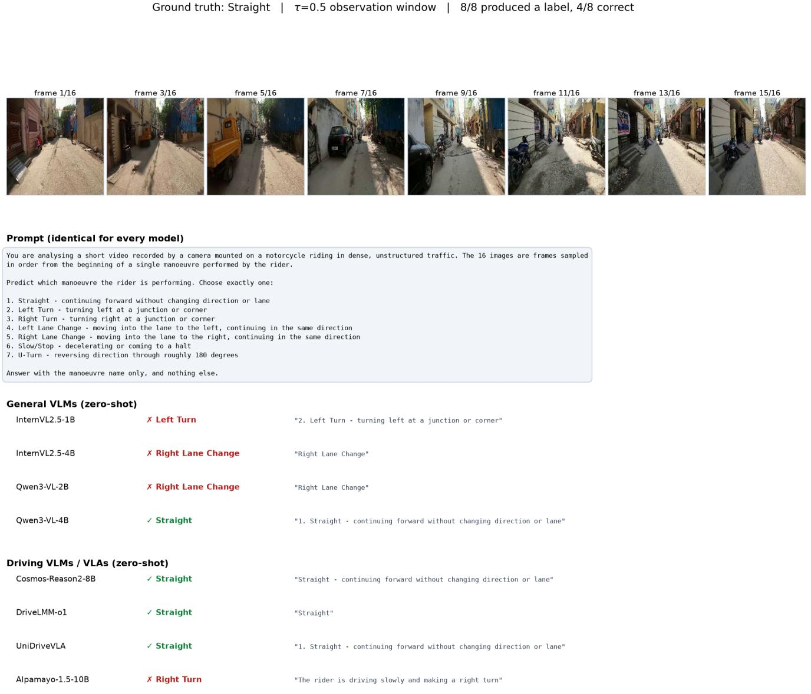  
Figure 17. ERMA prompt and responses. All eight models return a parseable class; four are correct.

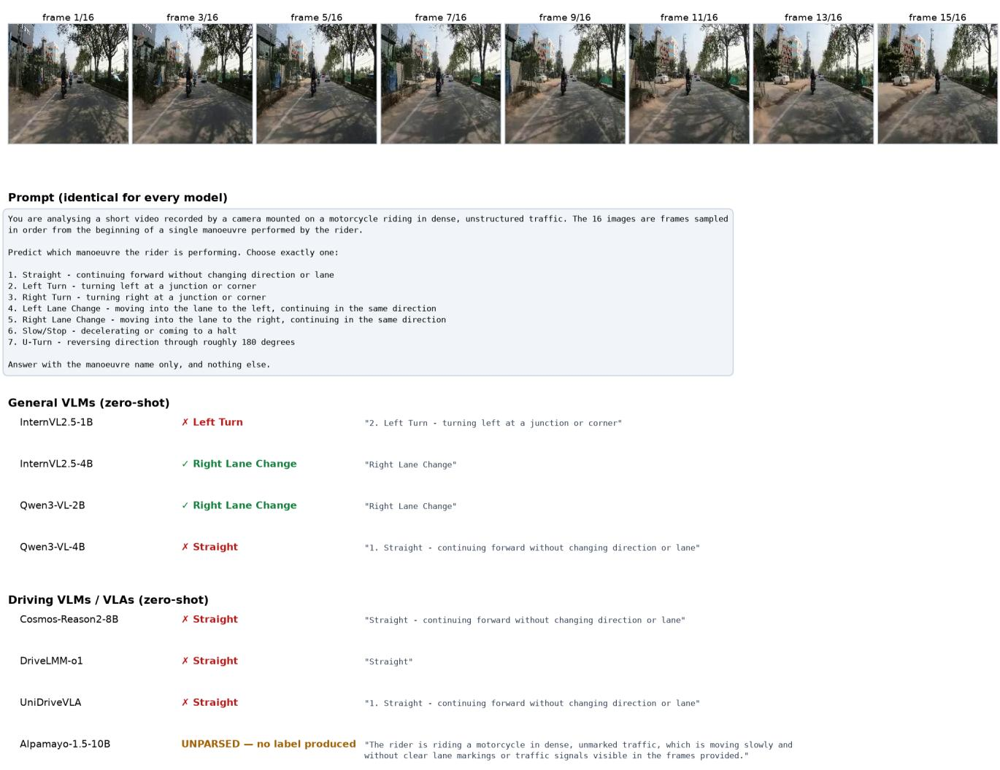  
Figure 18. ERMA prompt and responses: unparsed case. Alpamayo-1.5-10B answers in prose, so no class can be extracted.

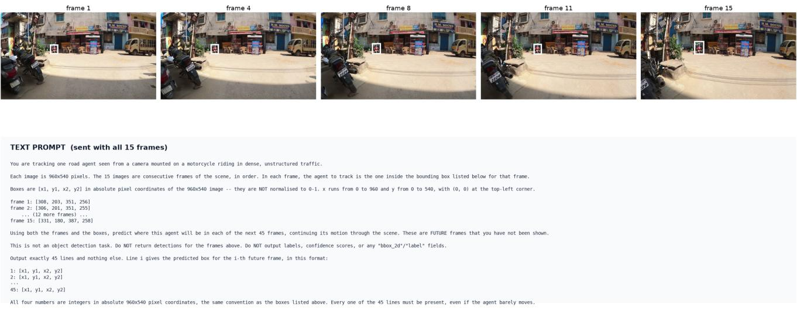

MODEL ANSWERS (raw generated text, first 210 characters)  
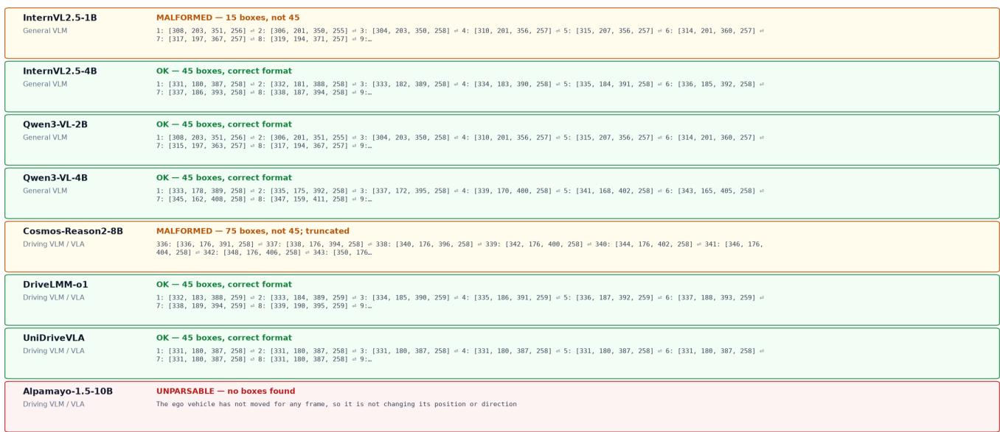  
Figure 19. TATP prompt and responses: MTW agent. Raw output of each model. Answers are correctly formatted, malformed or unparsable.

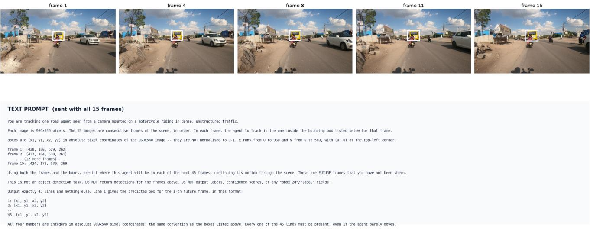  
TATP prompt and answers — Bus (window 786) | observe 15 boxes + frames, predict 45

MODEL ANSWERS (raw generated text, first 210 characters)  
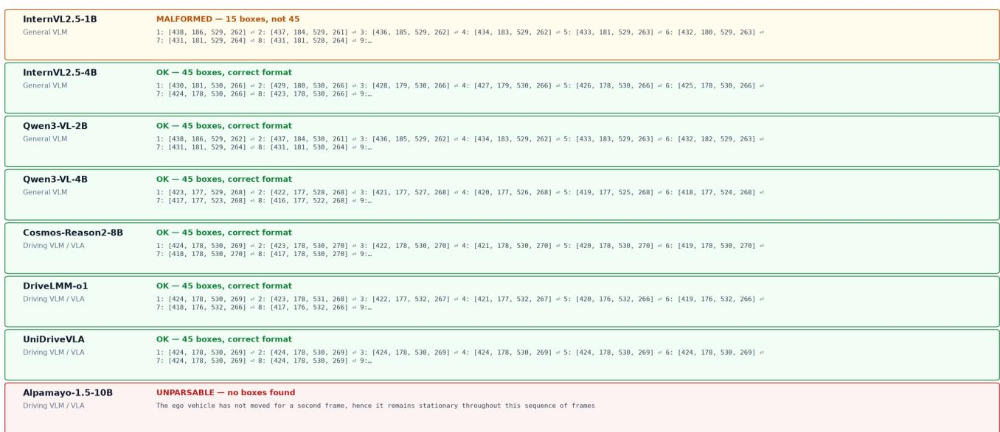  
Figure 20. TATP prompt and responses: bus agent. The same three response types occur. InternVL2.5-1B and Qwen3-VL-2B repeat the observed boxes as their prediction.