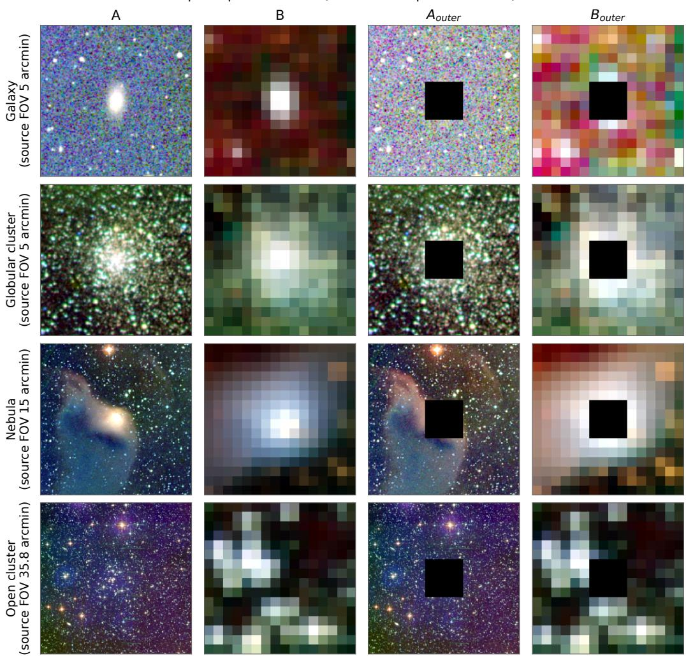
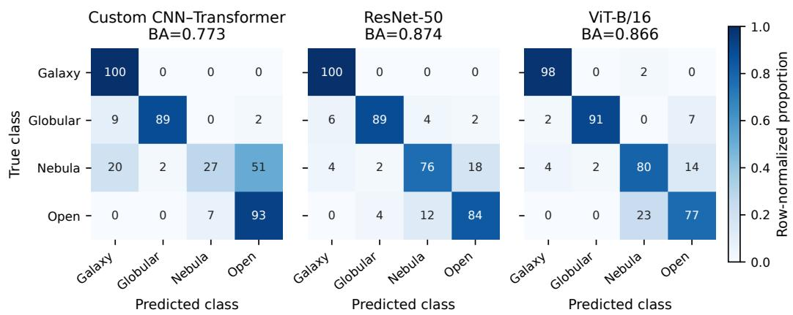
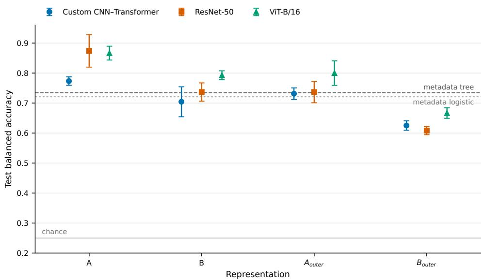

# Object-independent evaluation of small-data astronomical image classifiers: architecture, representation, and acquisition shortcuts

Eraldo Pereira Marinhoa,∗

aInstitute of Geoscience and Exact Sciences, São Paulo State University (UNESP), Av. 24 A, 1515, Rio Claro, 13506-900, São Paulo, Brazil

## Abstract

Reported performance in small astronomical image datasets can reflect object reuse, field-of-view diferences, acquisition settings, and catalogue-derived properties as well as astronomical morphology. We designed AstroClassifier to measure these efects in a four-class task comprising galaxies, globular clusters, nebulae, and open clusters. The dataset contains 370 cataloguesupported physical objects, each represented by three Digitized Sky Survey FITS bands, and uses a group-constrained split of 222 training, 75 validation, and 73 test objects. We compared a custom CNN–Transformer trained from scratch with ImageNet-pretrained ResNet-50 and ViT-B/16 under an adaptive full-field representation, a common angular field, and two central-region-masked controls, using three fixed seeds. In the one-pass object-independent test, mean balanced accuracy on the adaptive view was 0.773±0.014, 0.874±0.054, and 0.866±0.023 for the custom model, ResNet-50, and ViT-B/16, respectively. No primary architecture contrast rejected its null after Holm correction; ResNet-50 and ViT-B/16 difered by 0.007 balanced-accuracy points (95% cluster-bootstrap interval [−0.048, 0.062]). Controls based on acquisition and catalogue metadata reached 0.721–0.735, and central-region-masked adaptive views reached 0.731–0.800. These results demonstrate generalization to unseen physical objects, but also show that image context, acquisition settings, and catalogue-derived object properties carry substantial class information. In this regime, high accuracy cannot be

interpreted as evidence that a classifier learned target morphology, and the comparison does not isolate architecture from pretraining.

Keywords: astronomical image classification, small datasets, object-independent evaluation, shortcut learning, convolutional neural networks, vision transformers

## 1. Introduction

Deep learning is widely used for astronomical image analysis, from galaxy morphology to survey triage Dieleman et al. (2015); Huertas-Company and Lanusse (2018); Baron (2019). Its apparent success can be dificult to interpret when datasets contain many files but few independent astronomical objects. Multiple bands, renders, crops, or observations of the same target do not create independent physical examples. Related products that cross data splits can yield high scores without demonstrating generalization to an unseen object. Class-dependent acquisition choices, including field of view (FOV), pixel scale, and target extent, can also become shortcuts Geirhos et al. (2020); Kapoor and Narayanan (2023).

The AstroClassifier project began by asking whether a hybrid convolutional neural network (CNN) and Transformer could classify astronomical images with few labeled examples. An audit of the original experiment showed that a credible answer required a diferent statistical design. The central question became: how much class information transfers to previously unseen physical objects when object identity, representation, and acquisition cues are explicitly examined?

We make four contributions:

1. a catalogue-supported dataset in which the physical object, rather than a band image or derivative, is the observational unit;

2. a prospectively specified Dataset-v2 comparison of a custom CNN– Transformer, ResNet-50, and ViT-B/16, with configuration selection restricted to development data;

3. matched common-field, central-region-masked, and metadata-only controls that expose class information outside the nominal target morphology; and

4. a one-pass, label-isolated test procedure that records predictions before an independent scoring process accesses the labels.

This manuscript reports the prospectively specified Dataset-v2 evaluation on 73 previously unseen objects. The model families reflect the earlier exploratory history of AstroClassifier; dataset construction, split assignment, model-selection rules, controls, and held-out analyses were specified before test evaluation. The label-isolated results separate evidence of objectindependent prediction from the stronger claim that the models learned target morphology.

## 2. Related work

CNNs exploit local spatial structure and have produced strong results for astronomical morphology Dieleman et al. (2015); Huertas-Company and Lanusse (2018). Residual connections enable deeper convolutional models He et al. (2016). Transformers replace convolutional locality with contentdependent attention Vaswani et al. (2017); ViT applies attention to image patches and benefits strongly from large-scale pretraining Dosovitskiy et al. (2021); Khan et al. (2022).

Small-data comparisons must distinguish architectural capacity from pretraining, augmentation, and model selection. Augmentation can improve generalization Shorten and Khoshgoftaar (2019), but derivatives of one object remain statistically dependent. High validation accuracy may also arise from shortcuts that remain stable within a collection but fail under acquisition or identity shifts Geirhos et al. (2020). Leakage and inappropriate split units are recognized threats to reproducibility in machine-learning-based science Kapoor and Narayanan (2023). We therefore treat the architecture comparison as one component of a group-aware evaluation.

## 3. Dataset and experimental design

## 3.1. Objects, provenance, and split

The candidate list was assembled prospectively after excluding identities recovered from the legacy experiment. It contained 400 primary candidates (100 per class) and 73 reserves. Quality assessment of the primary cohort produced 370 eligible objects, 13 rejected product bundles, and 17 deferred cases; among the reserves, 66 remained unused and seven were ineligible under deterministic checks. Galaxies span broad morphological groupings; the nebula class includes planetary, HII, reflection, dark, and supernova-remnant candidates; open clusters use catalogue open-cluster identifications; and globular clusters draw on the Milky Way globular-cluster catalogue (December 2010 revision) Harris (1996). Object identities and aliases were reconciled against catalogue records, including SIMBAD Wenger et al. (2000), before splitting. No legacy image, prediction, or model outcome entered candidate selection.

Table 1: Composition of the eligible pool and five-number summary of source FOV in arcmin. Values are computed per physical object before splitting.
<table><tr><td>Class</td><td>Objects</td><td>Minimum</td><td>First quartile</td><td>Median</td><td>Third quartile</td><td>Maximum</td></tr><tr><td>Galaxies</td><td>98</td><td>5</td><td>5</td><td>5</td><td>5</td><td>23</td></tr><tr><td>Globular clusters</td><td>92</td><td>5</td><td>5</td><td>5</td><td>6.14</td><td>15.64</td></tr><tr><td>Nebulae</td><td>85</td><td>5</td><td>5</td><td>15</td><td>15</td><td>120</td></tr><tr><td>Open clusters</td><td>95</td><td>5</td><td>15</td><td>27.2</td><td>71.5</td><td>120</td></tr></table>

Table 2: Final object counts by class and split.
<table><tr><td>Split</td><td>Galaxies</td><td>Globular</td><td>Nebulae</td><td>Open</td><td>Total</td></tr><tr><td>Training</td><td>59</td><td>55</td><td>51</td><td>57</td><td>222</td></tr><tr><td>Validation</td><td>20</td><td>19</td><td>17</td><td>19</td><td>75</td></tr><tr><td>Test</td><td>19</td><td>18</td><td>17</td><td>19</td><td>73</td></tr></table>

The resulting eligible pool contains 370 physical objects: 98 galaxies, 92 globular clusters, 85 nebulae, and 95 open clusters. Each has one observation bundle containing DSS2 blue, red, and near-infrared FITS products retrieved through the CDS HiPS2FITS service Fernique et al. (2015); Boch et al. (2020). The pool therefore contains 1,110 FITS files but only 370 distinct astronomical targets. Bands, previews, quality-control renders, and deterministic derivatives inherit the identity of their parent object. Table 1 reports the class-dependent FOV distribution. Its large diferences, especially for nebulae and open clusters, motivate the common-field and metadata controls rather than being treated as incidental preprocessing details.

Quality eligibility was fixed before model training. Same-object relations, derivative ownership, and overlapping-field components were converted into indivisible assignment units. Seventeen non-trivial components were preserved. The allocation is shown in Table 2; test contains 73 objects in 61 units.

## 3.2. Representations and preprocessing

All representations use verified FITS bytes and blue/red/NIR channel order. For each band, first and 99th percentiles are computed on the prescribed view. Values are clipped to [0, 1], transformed as

$$
u = \frac { \mathrm { a s i n h } ( 1 0 z ) } { \mathrm { a s i n h } ( 1 0 ) } ,\tag{1}
$$

and mapped to $[ - 1 , 1 ]$ by $( u \mathrm { ~ - ~ } 0 . 5 ) / 0 . 5$ . Stored tensors are contiguous float32 arrays with shape $3 \times 2 2 4 \times 2 2 4$ . The channels are not conventional RGB; using them with ImageNet models is a fixed transfer policy rather than an assertion of spectral equivalence.

Four deterministic variants isolate diferent information:

Adaptive full field (A). The original $5 1 2 \times 5 1 2$ field, spanning 5 to 120 arcmin, is retained and resized by exact area-overlap averaging. It preserves context and class-dependent FOV and scale.

Common field (B). Each target is resampled to a 4-arcmin tangent-plane field with 15 arcsec pixels and 15 arcsec Gaussian FWHM. The efective $1 6 \times 1 6$ grid is expanded by repeating every cell $1 4 \times 1 4$

Central-region-masked controls. In $A _ { \mathrm { o u t e r } }$ , the central $1 2 8 \times 1 2 8$ region is set to zero; in $B _ { \mathrm { o u t e r } } .$ , the central $4 \times 4$ cells are zeroed. Stretch percentiles use unmasked pixels only. Difuse emission and neighbours may remain, so these are context controls rather than certified blank sky.

Figure 1 shows one validation object per class under all four transformations. Within each class, the example is the object closest to the validationset median source FOV, with object identifier used to break ties. The visible block structure in B and $B _ { \mathrm { o u t e r } }$ is the prescribed $1 6 \times 1 6$ efective sampling, not a rendering artifact.

For every training object and epoch, one of the eight elements of the dihedral group $D _ { 4 }$ is selected deterministically from the physical-object identifier and epoch number. The transformation can therefore change across epochs while remaining exactly reproducible; the same rotation/reflection is applied to all channels. Validation and test use the identity transform. No random crops, colour jitter, test-time augmentation, or family-specific normalization is applied.

Input representations (NIR/red/blue pseudo-colour)  
  
Figure 1: Examples of the four input representations. Rows show one deterministically selected validation object from each class; columns show A, B, $A _ { \mathrm { o u t e r } } .$ and $B _ { \mathrm { o u t e r } }$ . Stored $\mathrm { b l u e / r e d / N I R }$ channels are displayed as NIR/red/blue pseudo-colour for visualization only. Black regions are the prescribed central masks. The source FOV shown at left applies to A and $A _ { \mathrm { o u t e r } } ;$ B uses the common 4-arcmin field for every object.

Table 3: Training settings fixed before test evaluation. Every family uses batch size 16, at most 100 epochs, class-weighted cross-entropy, gradient-norm cap 3, ReduceLROnPlateau (factor 0.1, patience 5), and early stopping with patience 20.
<table><tr><td>Family</td><td>Initialization</td><td></td><td></td><td>Optimizer Base LR Weight decay</td></tr><tr><td>Custom CNN-Transformer</td><td>From scratch</td><td>Adam</td><td> $9 \times 1 0 ^ { - 5 }$ </td><td> $5 \times 1 0 ^ { - 7 }$ </td></tr><tr><td>ResNet-50</td><td>ImageNet-1K</td><td>AdamW</td><td> $1 \times 1 0 ^ { - 4 }$ </td><td> $1 \times 1 0 ^ { - 4 }$ </td></tr><tr><td>ViT-B/16</td><td>ImageNet-1K</td><td>AdamW</td><td> $3 \times 1 0 ^ { - 5 }$ </td><td> $5 \times 1 0 ^ { - 2 }$ </td></tr></table>

## 3.3. Acquisition and catalogue metadata controls

Class membership explains 0.5827 of the descriptive variance of log(FOV) in the curated pool. Two fixed controls use no pixels: multinomial logistic regression with balanced class weights and a depth-3 decision tree. Inputs are log source FOV, log source pixel scale, log catalogue extent, extent missingness, and an FOV-cap indicator. Imputation and scaling are fit on training objects only. Names, catalogue types, aliases, paths, and indices are excluded. These controls measure available non-image signal. FOV, pixel scale, and the cap indicator describe acquisition, whereas catalogue extent and its missingness describe the target. The controls therefore measure their combined predictive information; they are not acquisition-only controls and do not by themselves prove causal leakage.

## 4. Models and training

## 4.1. Model families

The custom model is trained from scratch. Four convolutional stages with 128, 256, 512, and 1,024 channels produce a feature map. Fixed mean-plusgradient pooling reduces it to an $8 \times 8$ grid: 64 tokens with 128-dimensional embeddings. Fixed separable two-dimensional sinusoidal positions precede two Transformer encoder layers with eight attention heads. Mean token pooling and a linear head yield four logits. A deterministic bilinear adapter maps the stored 224 × 224 input to the selected model’s 256 × 256 contract without changing the representation files.

The reference CNN is torchvision ResNet-50 He et al. (2016); the reference Transformer is torchvision ViT-B/16 Dosovitskiy et al. (2021). Both use locally preserved oficial ImageNet-1K weights fixed before training. Their heads are replaced by four-output linear layers.

For pretrained models, the new head uses ten times the backbone learning rate and all layers are trainable from the first epoch. This gives established models their practical transfer-learning advantage; initialization remains part of the comparison.

## 4.2. Pre-specified Dataset-v2 selection

The representation-A search used only 222 training and 75 validation objects. The candidate grid contained six custom, 12 ResNet-50, and 12 ViT-B/16 configurations. Each was trained with seeds 3908274, 3908275, and 3908276, producing 90 fits. One configuration per family was selected by mean validation balanced accuracy, then mean macro-F1, mean weighted loss, sample variance of balanced accuracy, and configuration ID. All three seeds were retained.

Each winner was then applied unchanged to B, $A _ { \mathrm { o u t e r } }$ , and $B _ { \mathrm { o u t e r } } ,$ producing 27 control fits. Including the two metadata controls, development used 119 fits: 117 neural and two metadata-only. Controls could not trigger selection, retuning, or exclusion.

The families themselves were informed by exploratory work that preceded Dataset-v2; the prospective claim applies to this Dataset-v2 selection and held-out evaluation, not to the entire history of architecture development. Because hyperparameters were selected on A and transferred without retuning, the other representations assess the robustness of the A-selected training configurations. Their results do not estimate the best performance attainable after representation-specific optimization.

## 5. Evaluation and statistical analysis

Primary metrics are balanced accuracy, macro-F1, and accuracy, supplemented by per-class metrics and confusion matrices. Neural results are reported per seed and as mean ± sample SD. Seeds describe training variability and are not independent test objects.

Test point metrics use 73 objects; inference resamples keep all 61 assignment units intact. The pre-specified analysis uses 20,000 paired clusterbootstrap replicates and 20,000 paired unit-level randomization replicates from NumPy PCG64 seed 20261021. The same draws are shared across models, representations, metrics, and seeds, with Holm corrections in prespecified comparison families.

Table 4: Validation results on A; mean ± sample SD over three seeds.
<table><tr><td>Family</td><td>Balanced accuracy</td><td>Macro-F1</td></tr><tr><td>Custom CNN-Transformer</td><td> $0 . 7 6 4 \pm 0 . 0 1 6$ </td><td>0.752</td></tr><tr><td>ResNet-50</td><td> $0 . 8 6 0 \pm 0 . 0 0 5$ </td><td>0.859</td></tr><tr><td> $\mathrm { V i T - B } / 1 6$ </td><td> $0 . 8 5 8 \pm 0 . 0 4 5$ </td><td>0.856</td></tr></table>

Final evaluation comprised 38 model evaluations: three families, four representations, and three seeds (36 neural checkpoints), plus two metadata models. A label-isolated inference procedure recorded each set of predictions once before an independent scoring process accessed the labels. No test result triggered retraining, replacement, reselection, or repeated inference.

## 6. Development-stage results

## 6.1. Primary-view selection

Table 4 reports validation results of each selected configuration. These numbers are development evidence, not final test performance. ResNet-50 and ViT-B/16 had similar means; ViT-B/16 varied more across seeds. The custom model trailed both pretrained references.

## 6.2. Representation and outer-field controls

Changing from A to the common field B reduced mean validation performance for every family. Masked views retained substantial signal: $A _ { \mathrm { o u t e r } }$ balanced accuracy ranged from 0.712 to 0.771 and $B _ { \mathrm { o u t e r } }$ from 0.586 to 0.700. These controls do not establish that morphology is unused. They show that context and acquisition-correlated information are too strong to interpret an architecture score in isolation.

Metadata-only logistic regression obtained validation balanced accuracy 0.711, macro-F1 0.709, and accuracy 0.720. The fixed tree obtained 0.713, 0.714, and 0.720. These results corroborate the class–FOV association and justify retaining both controls.

## 7. Object-independent test results

The final held-out evaluation produced 73 predictions for each of the 38 model evaluations. Predictions were recorded before scoring, and the completeness check found no missing, duplicate, or extra evaluation. Table 6 reports the neural results. All models performed well above four-class chance on A, showing transfer to physical objects absent from training and validation.

Table 5: Validation controls; mean ± sample SD over three fixed seeds.
<table><tr><td>Family</td><td></td><td>Representation Balanced accuracy</td><td>Macro-F1</td></tr><tr><td rowspan="3">Custom CNN-Transformer B</td><td></td><td> $0 . 6 8 8 \pm 0 . 0 2 0$ </td><td> $0 . 6 7 6 \pm 0 . 0 2 0$ </td></tr><tr><td> $A _ { \mathrm { o u t e r } }$ </td><td> $0 . 7 2 8 \pm 0 . 0 2 4$ </td><td> $0 . 7 0 7 \pm 0 . 0 3 9$ </td></tr><tr><td> $B _ { \mathrm { o u t e r } }$ </td><td> $0 . 5 8 6 \pm 0 . 0 2 9$ </td><td> $0 . 5 7 5 \pm 0 . 0 3 3$ </td></tr><tr><td rowspan="3">ResNet-50</td><td>B</td><td> $0 . 7 2 0 \pm 0 . 0 4 6$ </td><td> $0 . 7 1 9 \pm 0 . 0 4 6$ </td></tr><tr><td> $A _ { \mathrm { o u t e r } }$ </td><td> $0 . 7 1 2 \pm 0 . 1 0 7$ </td><td> $0 . 7 0 3 \pm 0 . 1 1 3$ </td></tr><tr><td> $B _ { \mathrm { o u t e r } }$ </td><td> $0 . 6 6 0 \pm 0 . 0 8 1$ </td><td> $0 . 6 5 9 \pm 0 . 0 7 9$ </td></tr><tr><td rowspan="3">ViT-B/16</td><td>B</td><td> $0 . 7 7 1 \pm 0 . 0 3 7$ </td><td> $0 . 7 6 6 \pm 0 . 0 3 8$ </td></tr><tr><td> $A _ { \mathrm { o u t e r } }$ </td><td> $0 . 7 7 1 \pm 0 . 0 1 9$ </td><td> $0 . 7 6 9 \pm 0 . 0 2 0$ </td></tr><tr><td> $B _ { \mathrm { o u t e r } }$ </td><td> $0 . 7 0 0 \pm 0 . 0 3 8$ </td><td> $0 . 7 0 0 \pm 0 . 0 3 8$ </td></tr></table>

Figure 2 localizes the largest family diference. The custom model classified only 27.5% of nebulae correctly on average and assigned 51.0% of them to the open-cluster class. The corresponding nebula recalls were 76.5% for ResNet-50 and 80.4% for ViT-B/16. Other class-specific trade-ofs remain: for example, ViT-B/16 more often assigned open clusters to the nebula class.

The two metadata-only controls also generalized: the depth-3 decision tree obtained 0.735 balanced accuracy, 0.732 macro-F1, and 0.740 accuracy; logistic regression obtained 0.721, 0.718, and 0.726. Figure 3 places these single-fit controls beside the neural models. Masking the central region left substantial predictive signal. On $A _ { \mathrm { o u t e r } }$ , balanced accuracy was 0.731–0.800; even $B _ { \mathrm { o u t e r } }$ remained at 0.608–0.667, well above chance.

Table 7 reports the pre-specified A-view architecture comparisons. ResNet-50 and ViT-B/16 were nearly indistinguishable: their balanced accuracy diference was 0.007, with a 95% cluster-bootstrap interval spanning −0.048 to 0.062. The custom model had lower point estimates, most clearly in nebula recall (mean 0.275, versus 0.765 for ResNet-50 and 0.804 for ViT-B/16). Several custom-versus-pretrained bootstrap intervals excluded zero, but none of the nine randomization tests rejected after the prespecified Holm correction. This is not a contradiction: the intervals are unadjusted 95% efect intervals for individual contrasts, whereas Holm controls the family-wise error rate across nine randomization tests. They answer diferent inferential questions. We therefore treat the gaps as descriptive efect estimates rather than multiplicity-adjusted evidence of architectural superiority.

  
Figure 2: Row-normalized confusion matrices for representation A. Each cell is the mean over the three fixed seeds and is labelled as a percentage; rows are true classes and columns are predictions. BA denotes mean balanced accuracy. Rounded entries may not sum to exactly 100.

  
Figure 3: Test balanced accuracy for each model family and image representation. Points show the mean and bars show sample SD over the three fixed seeds. Dashed lines are the two single-fit metadata-only controls. They are reference levels, not uncertainty intervals.

Table 6: Object-independent test results; mean ± sample SD over three fixed seeds. A and B are the adaptive and common-field views; “outer” denotes the corresponding centralmask control.
<table><tr><td>Family</td><td></td><td>Representation Balanced accuracy</td><td>Macro-F1</td><td>Accuracy</td></tr><tr><td rowspan="4">Custom CNN-Transformer A</td><td></td><td> $0 . 7 7 3 \pm 0 . 0 1 4$ </td><td> $0 . 7 4 8 \pm 0 . 0 0 3$ </td><td> $0 . 7 8 5 \pm 0 . 0 1 6$ </td></tr><tr><td>B</td><td> $0 . 7 0 4 \pm 0 . 0 5 0$ </td><td> $0 . 6 9 8 \pm 0 . 0 4 7$ </td><td> $0 . 6 9 9 \pm 0 . 0 4 9$ </td></tr><tr><td> $A _ { \mathrm { o u t e r } }$ </td><td> $0 . 7 3 1 \pm 0 . 0 1 9$ </td><td> $0 . 6 9 4 \pm 0 . 0 4 5$ </td><td> $0 . 7 4 4 \pm 0 . 0 1 6$ </td></tr><tr><td> $B _ { \mathrm { o u t e r } }$ </td><td> $0 . 6 2 5 \pm 0 . 0 1 6$ </td><td> $0 . 6 2 4 \pm 0 . 0 1 4$ </td><td> $0 . 6 2 6 \pm 0 . 0 1 6$ </td></tr><tr><td rowspan="4">ResNet-50</td><td> $\mathrm { A }$ </td><td> $0 . 8 7 4 \pm 0 . 0 5 4$ </td><td> $0 . 8 7 3 \pm 0 . 0 5 6$ </td><td> $0 . 8 7 7 \pm 0 . 0 5 5$ </td></tr><tr><td>B</td><td> $0 . 7 3 7 \pm 0 . 0 3 0$ </td><td> $0 . 7 3 3 \pm 0 . 0 2 9$ </td><td> $0 . 7 3 5 \pm 0 . 0 2 9$ </td></tr><tr><td> $A _ { \mathrm { o u t e r } }$ </td><td> $0 . 7 3 7 \pm 0 . 0 3 6$ </td><td> $0 . 7 3 3 \pm 0 . 0 3 2$ </td><td> $0 . 7 4 0 \pm 0 . 0 4 1$ </td></tr><tr><td> $B _ { \mathrm { o u t e r } }$ </td><td> $0 . 6 0 8 \pm 0 . 0 1 4$ </td><td> $0 . 6 0 5 \pm 0 . 0 2 1$ </td><td> $0 . 6 0 7 \pm 0 . 0 1 6$ </td></tr><tr><td rowspan="4">ViT-B/16</td><td>A</td><td> $0 . 8 6 6 \pm 0 . 0 2 3$ </td><td> $0 . 8 6 6 \pm 0 . 0 2 3$ </td><td> $0 . 8 6 8 \pm 0 . 0 2 1$ </td></tr><tr><td>B</td><td> $0 . 7 9 3 \pm 0 . 0 1 5$ </td><td> $0 . 7 8 7 \pm 0 . 0 1 4$ </td><td> $0 . 7 9 0 \pm 0 . 0 1 6$ </td></tr><tr><td> $A _ { \mathrm { o u t e r } }$ </td><td> $0 . 8 0 0 \pm 0 . 0 4 1$ </td><td> $0 . 7 9 9 \pm 0 . 0 4 1$ </td><td> $0 . 8 0 4 \pm 0 . 0 4 2$ </td></tr><tr><td> $B _ { \mathrm { o u t e r } }$ </td><td> $0 . 6 6 7 \pm 0 . 0 1 7$ </td><td> $0 . 6 6 4 \pm 0 . 0 1 5$ </td><td> $0 . 6 6 2 \pm 0 . 0 1 6$ </td></tr></table>

## 8. Discussion

## 8.1. Generalization and architecture

The test establishes a limited but meaningful result: all three families generalized to catalogue-supported physical objects absent from model development. ResNet-50 and ViT-B/16 retained balanced accuracies near 0.87, while the custom model reached 0.77. Their ranking resembles development, but the corrected tests do not support a claim that one architecture is statistically superior in this test sample.

The custom hybrid therefore did not realize its motivating expectation of an advantage in this small-data setting. Its largest class-specific weakness was nebula recognition, where most errors were assignments to the opencluster class. The experiment provides no evidence that this evaluated hybrid system is preferable to the two pretrained references. Because initialization and training policy difer, it also does not establish that CNN–Transformer hybrids are intrinsically inferior.

Table 7: Paired A-view architecture comparisons. Diferences are first minus second family, averaged over the three seeds. Intervals use the paired assignment-unit bootstrap; p values use paired unit-level randomization. Holm adjustment covers the nine displayed tests.
<table><tr><td>First</td><td>Second</td><td>Metric</td><td>Difference</td><td>95% interval</td><td>Raw p</td><td>Holm p</td></tr><tr><td>Custom</td><td>ResNet-50</td><td>Accuracy</td><td>-0.091</td><td>[−0.169, -0.014]</td><td>0.032</td><td>0.191</td></tr><tr><td>Custom</td><td>ResNet-50</td><td>Balanced accuracy</td><td>-0.101</td><td>[−0.156, -0.043]</td><td>0.016</td><td>0.130</td></tr><tr><td>Custom</td><td>ResNet-50</td><td>Macro-F1</td><td>-0.126</td><td>[−0.201, -0.054]</td><td>0.009</td><td>0.077</td></tr><tr><td>Custom</td><td>ViT-B/16</td><td>Accuracy</td><td>-0.082</td><td>[-0.174,0.009]</td><td>0.101</td><td>0.404</td></tr><tr><td>Custom</td><td>ViT-B/16</td><td>Balanced accuracy</td><td>-0.093</td><td>[−0.159, -0.029]</td><td>0.057</td><td>0.285</td></tr><tr><td>Custom</td><td>ViT-B/16</td><td>Macro-F1</td><td>-0.118</td><td>[-0.206, -0.033]</td><td>0.023</td><td>0.159</td></tr><tr><td>ResNet-50</td><td>ViT-B/16</td><td>Accuracy</td><td>0.009</td><td>[−0.044, 0.066]</td><td>0.873</td><td>1.000</td></tr><tr><td>ResNet-50</td><td>ViT-B/16</td><td>Balanced accuracy</td><td>0.007</td><td>[−0.048, 0.062]</td><td>0.842</td><td>1.000</td></tr><tr><td>ResNet-50</td><td>ViT-B/16</td><td>Macro-F1</td><td>0.008</td><td>[-0.047,0.064]</td><td>0.826</td><td>1.000</td></tr></table>

The comparison is also deliberately practical rather than architecturepure. The custom model was trained from scratch, whereas ResNet-50 and ViT-B/16 received ImageNet initialization. Their advantage combines architecture, parameterization, optimization, and transfer learning. The near-zero ResNet–ViT diferences provide no evidence that convolution or global attention is intrinsically preferable here.

## 8.2. Acquisition, catalogue metadata, and context

The strongest methodological finding is that target identity is not the only source of predictive information. Combined acquisition and catalogue metadata reached balanced accuracy above 0.72. After the fixed central region was masked, the adaptive views remained between 0.73 and 0.80, with ViT-B/16 losing only 0.067 balanced-accuracy points relative to A. These controls show that class labels covary with acquisition choices, cataloguederived object extent, and image content outside the central mask. They do not establish a causal mechanism or demonstrate classification without the target: extended nebulae and open clusters can remain visible outside the mask, alongside neighbours, background structure, and processing signatures.

The common-field representation reduces explicit FOV variation but is not a clean causal intervention on FOV. Its efective 16 × 16 sampling blurs compact targets, can truncate extended structure, and is then repeated to 224 × 224. Consequently, A–B diferences combine angular context, scale normalization, and information loss. The B results should not be read as the cost of removing an acquisition shortcut alone.

## 8.3. Scope and uncertainty

The 73 test objects comprise only 61 independent assignment units after overlapping fields are grouped. This limits power, helps explain the wide intervals, and makes the non-rejections evidence of uncertainty rather than equivalence. The three seeds measure variability of the fixed training runs; they are not independent samples from a model population.

The four catalogue classes are heterogeneous. DSS2 photographic bands are not calibrated multispectral measurements, and independent band stretches suppress absolute photometric ratios. Results apply to this acquisition and preprocessing regime. More diverse surveys and independently collected objects are needed to test whether the observed shortcuts persist under site, instrument, and epoch shifts.

## 9. Reproducibility and data governance

Each phase records data provenance, lineage, split membership, configurations, checkpoints, and execution records. Independent reconstruction of all 1,480 tensors (370 objects times four variants) verified identical numerical representations from the source FITS products. Model selection and control training used no test tensors or labels.

Test inference was performed once with a label-isolated procedure, and all 38 model evaluations recorded complete predictions before the scoring process accessed test labels. No test result triggered retraining, model replacement, reselection, or repeated inference. During infrastructure diagnosis, one potentially inferable test label may have been exposed to an operator after the models, protocols, and analyses had been fixed; no prediction yet existed and no scientific artefact was modified. We retain this event as a documented protocol deviation.

## Data and code availability

The curated AstroClassifier reproducibility archive for this study is publicly available at https://github.com/epmarinho/astroclassifier-r epro. It contains the source code needed to reproduce the analyses, protocols, manifests, configurations, aggregate statistics, and prediction and scoring records. A versioned FITS and tensor dataset release is available from the same repository, with checksums, provenance, and DSS use and attribution terms. Retrieval manifests support independent reconstruction from the source archives. Version 1.0.0 of the software and reproducibility archive is preserved at https://doi.org/10.5281/zenodo.23815956.

## 10. Conclusion

Object-independent splitting changes what can be claimed from a small astronomical image dataset. In AstroClassifier, three neural families generalized to 73 unseen physical objects, with adaptive-view balanced accuracy from 0.773 to 0.874. The two pretrained references had higher point estimates than the custom CNN–Transformer, but no primary contrast survived Holm correction, and pretraining remains inseparable from architecture in this comparison.

The controls change the scientific interpretation more than the architecture ranking. Combined acquisition-and-catalogue metadata and centralregion-masked images retained substantial predictive accuracy, showing that acquisition settings, catalogue-derived properties, and contextual image content are informative even under object-independent testing. Reliable smalldata evaluation therefore requires physical-object split units, explicit shortcut controls, and pre-specified one-pass testing. High accuracy on unseen objects is evidence of generalization within the collection; it is not, by itself, evidence that a model learned the intended astronomical morphology.

Declaration of generative AI and AI-assisted technologies in the manuscript preparation process

The original AstroClassifier was independently developed by the author. Subsequent improvements to the original implementation, extensive experimental testing, and dataset audits were carried out with the assistance of OpenAI Codex.

## References

Baron, D., 2019. Machine learning in astronomy: A practical overview. arXiv e-prints , arXiv:1904.07248URL: https://arxiv.org/abs/1904.07248.

Boch, T., Fernique, P., Bonnarel, F., Chaitra, Bot, C., Pineau, F.X., Baumann, M., Michel, L., 2020. HiPS2FITS: Fast generation of FITS cutouts from HiPS image datasets, in: Astronomical Data Analysis Software and Systems XXIX, pp. 121–124.

Dieleman, S., Willett, K.W., Dambre, J., 2015. Rotation-invariant convolutional neural networks for galaxy morphology prediction. Monthly Notices of the Royal Astronomical Society 450, 1441–1459. doi:10.1093/mnras/stv632.

Dosovitskiy, A., Beyer, L., Kolesnikov, A., Weissenborn, D., Zhai, X., Unterthiner, T., Dehghani, M., Minderer, M., Heigold, G., Gelly, S., Uszkoreit, J., Houlsby, N., 2021. An image is worth 16x16 words: Transformers for image recognition at scale, in: International Conference on Learning Representations, pp. 1–22. URL: https://openreview.net/forum?id=YicbFdNTTy.

Fernique, P., Allen, M.G., Boch, T., Oberto, A., Pineau, F.X., Durand, D., Bot, C., Cambrésy, L., Derriere, S., Genova, F., Bonnarel, F., 2015. Hierarchical progressive surveys: Multi-resolution HEALPix data structures for astronomical images, catalogues, and 3-dimensional data cubes. Astronomy and Astrophysics 578, A114. doi:10.1051/0004-6361/201526075.

Geirhos, R., Jacobsen, J.H., Michaelis, C., Zemel, R., Brendel, W., Bethge, M., Wichmann, F.A., 2020. Shortcut learning in deep neural networks. Nature Machine Intelligence 2, 665–673. doi:10.1038/s42256-020-00257-z.

Harris, W.E., 1996. A catalog of parameters for globular clusters in the milky way. The Astronomical Journal 112, 1487–1488. doi:10.1086/118116. december 2010 catalogue revision used via HEASARC.

He, K., Zhang, X., Ren, S., Sun, J., 2016. Deep residual learning for image recognition, in: 2016 IEEE Conference on Computer Vision and Pattern Recognition, pp. 770–778. doi:10.1109/CVPR.2016.90.

Huertas-Company, M., Lanusse, F., 2018. Deep learning for galaxy morphology classification. Galaxies 6, 1. doi:10.3390/galaxies6010001.

Kapoor, S., Narayanan, A., 2023. Leakage and the reproducibility crisis in machine-learning-based science. Patterns 4, 100804. doi:10.1016/j.patter .2023.100804.

Khan, S., Naseer, M., Hayat, M., Zamir, S.W., Khan, F.S., Shah, M., 2022. Transformers in vision: A survey. ACM Computing Surveys 54, 1–41. doi:10.1145/ 3505244.

Shorten, C., Khoshgoftaar, T.M., 2019. A survey on image data augmentation for deep learning. Journal of Big Data 6, 60. doi:10.1186/s40537-019-0197-0.

Vaswani, A., Shazeer, N., Parmar, N., Uszkoreit, J., Jones, L., Gomez, A.N., Kaiser, L., Polosukhin, I., 2017. Attention is all you need, in: Advances in Neural Information Processing Systems, Curran Associates, Inc.. pp. 5998–6008.

Wenger, M., Ochsenbein, F., Egret, D., Dubois, P., Bonnarel, F., Borde, S., Genova, F., Jasniewicz, G., Laloë, S., Lesteven, S., Monier, R., 2000. The SIMBAD astronomical database: The CDS reference database for astronomical objects. Astronomy and Astrophysics Supplement Series 143, 9–22. doi:10.1051/aas: 2000332.