# PROCEDURAL ADVERSARIAL LEARNING

Jack Nugent & Jia Deng

Department of Computer Science

Princeton University

{jacknugent,jiadeng}@princeton.edu

## ABSTRACT

For many computer vision tasks, neural networks can be trained to produce a low average error, yet they still fail on seemingly simple scenes. Reducing these failures requires first finding them, but they may not be in a fixed dataset. We study procedural adversarial learning (PAL), a framework of minimax training and adversarial evaluation which searches the input space of a procedural generator for difficult instances. The procedural generator is an interpretable program mapping a low-dimensional vector of control parameters (e.g. layout, lighting, pose) to a rendered image and its label. We introduce the Simple-PAT algorithm, which uses zeroth-order optimization in the procedural generator’s parameter space to propose adversarial training samples that are generated on demand. We also create PAL-Dojo, a collection of efficient procedural generators for surface normal estimation, image segmentation, and human pose estimation. Against a cross-model black-box adversary with 50M aggregate queries, Simple-PAT reduces worst-case error by a geometric mean of 3.15× compared to standard training and 2.63× compared to the strongest robust training baseline. Code is available at https://github.com/princeton-vl/ procedural-adversarial-learning.

## 1 INTRODUCTION

Vision models deployed in the wild are often relied on to produce high-quality predictions in all situations. This is particularly important for self-driving cars, surgical robots, and heavy machinery, where failures in perception can lead to dangerous and costly mistakes. However, even well-trained neural networks often fail on simple scenes or natural adversarial examples (Hendrycks et al., 2021; Alcorn et al., 2019). This is not easily solved by scaling data or model size, as foundation VLMs also struggle on examples that are easy for humans (Li et al., 2024). These failures motivate training and evaluation techniques that explicitly account for worst-case error.

How can we train a model that has low worst-case error? A natural and established idea is to define a minimax learning objective: minimizing the worst-case error, defined as the maximum error over all possible instances of the task space. While simple to state, this minimax objective is challenging to operationalize: typically, we are given a fixed finite sample of the task instances such as a set of labeled images. This sample does not allow us to reliably estimate the maximum error over all possible images since failure cases may be unseen. If we cannot reliably measure the worst case error, we cannot reliably improve it.

To discover missed failure modes and reduce worst-case error, prior work in robust and adversarial machine learning has attempted to perturb existing images (e.g. Goodfellow et al. (2015); Engstrom et al. (2019); Hosseini & Poovendran (2018)). However, such perturbations are usually limited to simple transformations such as color jitter and spatial cropping, and cover only a tiny subset of valid image transformations. This is because automatically generating physically valid perturbations of existing images that span viewpoint changes, dynamic lighting, and shape deformation remains an active research challenge plagued by its own failure modes. On the other hand, collecting additional real-world data can be slow and expensive.

Thus, a key challenge of improving worst-case error lies in scalable discovery and generation of failure cases. In this work, we address this with Procedural Adversarial Learning (PAL), a framework consisting of procedural adversarial training (PAT) and procedural adversarial evaluation (PAE); the key idea is to adversarially select samples using a procedural generator. During training, a learner updates the parameters of the network while an adversary searches for the worst case. For evaluation, a strong adversary searches the procedural parameter space for the task configuration that is most challenging for the model.

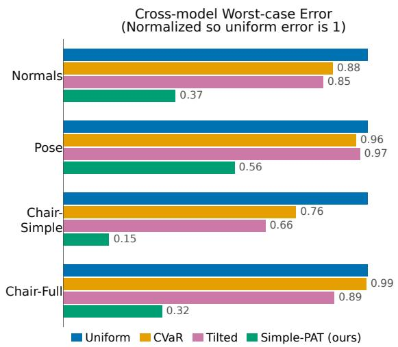

Evaluation on Uniform Model's Worst Case  
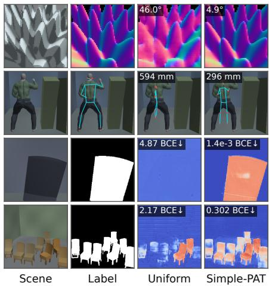  
Figure 1: We compare Simple-PAT to training methods that uniformly sample data for each mini batch. Left: Simple-PAT reduces worst-case error more effectively than uniform training and alternative methods. Right: Simple-PAT models perform much better on cases uniformly trained models found challenging. Uniform refers to the “Uniform (Muon)” setting, which is the stronger of the uniform training methods.

A procedural generator generates data through interpretable code: an image of a tree can be proce durally generated from scratch by code that simulates tree growth, bark material, light transport, and perspective projection. Procedural generation can create diverse photorealistic images (Raistrick et al., 2023; 2024), visual ground truth, and useful training data (Ma et al., 2026; Yan et al., 2026). Importantly, procedural generation enables scalable discovery and generation of failure cases. A well-designed procedural generator can offer a combination of properties unavailable from imagespace perturbation: (1) wide coverage of task instances, (2) physically valid perturbations, (3) a small number of control parameters that help traverse the task space, (4) on-demand generation of new task instances.

These properties make procedural generators an especially strong tool for PAL, since we can effectively search a visually complex collection of scenes. This distinguishes PAL from conventional adversarial learning, which searches a limited set of image perturbations. The evaluation also distinguishes PAL from Adversarial Domain Randomization (Khirodkar & Kitani, 2021), which trains with the same minimax formulation over a simulator’s parameters but evaluates mean performance in a target domain. In PAL, training seeks to minimize the worst case under the generator and eval uation searches for it directly. The challenge lies in developing training algorithms that reliably improve the worst case. This can be particularly difficult when failures occupy only a small region of the parameter space, or when learning one failure causes the model to forget scenes it previously handled.

We propose Simple-PAT, a simple algorithm for procedural adversarial training using adversaries that attack via zeroth-order optimization. Simple-PAT consists of a learner that trains the model through minibatch gradient descent and an adversary that uses Covariance Matrix Adaptation Evo lution Strategy (CMA-ES) Hansen & Ostermeier (2001) to search on procedural controls to generate the next minibatch based on existing cases the model finds challenging.

To analyze PAT algorithms, we develop PAL-Dojo, a suite of procedural generators for three vision tasks: surface normal estimation, human pose estimation, and image segmentation. We design these generators to control the scenes’ layout, lighting, shapes, and poses using between 13 and 69 parameters. We prioritize simplicity and efficiency of generation to facilitate algorithmic development.

We evaluate trained models on PAL-Dojo by treating them as a black box and adversarially attacking with a large query budget. We use a single-model adversary with 2M queries and a cross-model adversary with a total of 50M queries. In Figure 1, we compare Simple-PAT to a naive learner that samples every batch uniformly from the parameter space (uniform training), and to two methods that reweight uniform samples based on their loss (CVaR and tilted ERM). Under the cross-model adversary, Simple-PAT lowers the worst case on every task, by a geometric mean of 3.15× relative to uniform training and 2.63× relative to the strongest other method on each task. We also evaluate the robustness of SOTA foundation models using the PAL-Dojo generators, finding severe failure cases with our adversary. This demonstrates that PAL-Dojo, though visually simple, provides sufficient challenge to SOTA models.

In summary, our contributions are threefold: (1) Procedural Adversarial Learning (PAL), a framework that pairs minimax training under a procedural generator with worst-case evaluation by an adaptive adversary; (2) Simple-PAT, a simple yet effective procedural adversarial training algorithm; (3) PAL-Dojo, a suite of simple, efficient but sufficiently hard procedural generators for vision tasks, designed to facilitate the study of PAL.

## 2 RELATED WORK

Natural Adversarial Examples. Image classifiers and vision-language models are known to fail on unmodified natural images that humans label easily (Hendrycks et al., 2021; Li et al., 2024). Search can also reveal these failures systematically, by adjusting the pose as in Alcorn et al. (2019), or other elements including object placement and lighting (Zeng et al., 2019; Leclerc et al., 2022).

Adversarial training and robust objectives. Classical adversarial examples were defined as small pixel perturbations (Szegedy et al., 2014; Goodfellow et al., 2015), and adversarial training addresses this by minimizing loss under perturbations within an $L ^ { \infty }$ ball around each image (Madry et al., 2017). However, these perturbations are limited and the inner optimization loop during training can be costly. Alternative methods instead emphasize difficult examples through a distributionally robust training objective. CVaR averages the worst α fraction of samples (Rockafellar & Uryasev, 2000; Levy et al., 2020), and tilted ERM weights each example in proportion to exp(βℓ) for a loss ℓ and hyperparameter β (Li et al., 2021).

Adversaries in Reinforcement Learning and Control. Research in reinforcement learning has also searched for challenging training instances. PAIRED trains a level generator to maximize the agent’s regret (Dennis et al., 2020). ACCEL applies random mutations to high-regret levels to generate new difficult instances (Parker-Holder et al., 2022). Importantly, both optimize regret instead of loss since directly optimizing loss would produce impossible tasks in their environments. Neither work attempts to evaluate the worst-case performance over the entire parameter space.

Adversarial game formulations have also been used to develop safe and robust learning-based controllers, through minimax policy training against disturbance forces (Pinto et al., 2017) and safety control against worst-case disturbances (Fisac et al., 2018).

Adversarial Domain Randomization. Adversarial Domain Randomization (ADR) (Khirodkar & Kitani, 2021) trains a learner against a simulator in a minimax game, with a policy over quantized simulation parameters rewarded by the learner’s loss. In ADR’s experiments, this policy controls a few coarse parameters (e.g. object class and placement), while lighting, texture, and pose are randomly sampled. ADR demonstrates that such a policy identifies distributions that produce useful samples, such as occluded objects and difficult placements, and outperforms domain randomization (Tobin et al., 2017) on mean performance in the target domain. In contrast, PAL’s evaluation searches for the worst case in the same parameter space used for training.

## 3 PROCEDURALLY GENERATED TASKS

We define a procedural generator as a deterministic map g from a parameter vector $u \in [ 0 , 1 ] ^ { d }$ to a rendered image $x _ { u }$ and its ground-truth label $y _ { u }$ . We can view this as an infinite source of controllable data for both training and evaluation. In contrast, a fixed dataset can be viewed as N queries of the generator g determined by some unknown selection process. Access to the generator has the following consequences:

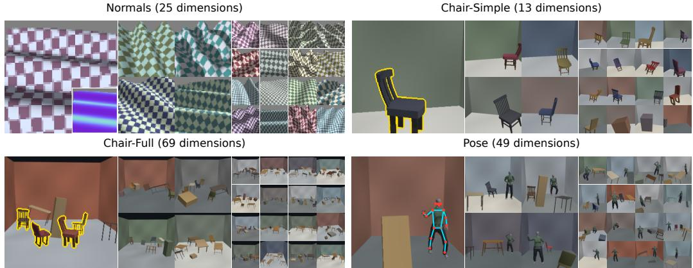  
Figure 2: Samples from our PAL-Dojo procedural generators. The leftmost panel of each task show a visualization of the ground truth labels.

1. The training data need not be fixed in advance. At each training step we select B parameter vectors to form the next batch, and this selection can depend on the current model. A fixed dataset only allows choices among its N members, and must repeat after a number of training steps. If certain regions of the parameter space are particularly valuable, the number of unique useful samples may be quite small. Given access to g, adaptive training can concentrate on these useful regions of the parameter space and present the model with new examples at every step.

2. The worst case can be evaluated over the entire parameter space. We consider the absolute worst-case

$$
W ( \theta ) = \operatorname* { s u p } _ { u \in [ 0 , 1 ] ^ { d } } \ell ( \theta , u ) \qquad \ell ( \theta , u ) = L \bigl ( f _ { \theta } ( x _ { u } ) , y _ { u } \bigr ) .
$$

This loss is consistently estimable, since as we densely sample the parameter space our estimate of the worst-case loss will converge to its true value (under mild conditions 1).

However, the structure of the procedural generator enables more effective search. Each parameter controls a perceptual quality of the scene (e.g. lighting, object shape, layout). Since these qualities also relate to the difficulty of the scene, we expect the difficulty to vary reasonably smoothly in the parameter space. This enables search algorithms to identify the challenging cases much more quickly than random sampling.

In order to make W(θ) meaningful, it must be the case that for every $u \in [ 0 , 1 ] ^ { d } , y _ { u }$ is solvable given $x _ { u } .$ . Otherwise the worst case error will be an ambiguous scene. For PAL-Dojo, we build four procedural generators to represent a variety of vision tasks (samples shown in Figure 2). We design them to be solvable and extremely efficient so that we can generate data before each training step and practically search for the worst cases.

## 3.1 NORMAL ESTIMATION

For the normal estimation task, the model must estimate the 3-dimensional surface normal vector at every pixel on a curved surface. This surface is a heightfield determined by a mixture of sinusoidal waves. The material is a checkerboard pattern rendered with Lambertian shading under a directional light with an ambient term. The presence of a repetitive checkerboard pattern makes normal estimation tractable, since any warping in the pattern is due to surface normal variation. The network must also learn to appropriately handle shadows and lighting cues.

The generator has 25 parameters, with 13 parameters specifying the waves, 2 describing the light azimuth and elevation, and 10 describing the checkerboard texture. This includes 24 continuous parameters, and 1 discrete parameter specifying the number of waves.

We use the metric of average angular error (in degrees) to describe models’ performance.

## 3.2 OBJECT SEGMENTATION

Our object segmentation task asks models to classify each pixel as belonging to a chair object or not. The generator places chairs and distractor objects within a room while ensuring the chair is not occluded excessively. We have a Chair-Simple variant with 13 dimensions and a Chair-Full variant with 69 dimensions.

The procedural objects that can be placed in the room include chairs, tables, desks, and cubes. These objects are adapted from ProcFunc implementations of objects in Infinigen, with a custom backend designed for rapid generation (Raistrick et al., 2026). To keep the dimensionality manageable, we map three parameters to the inputs of each object’s generator: one selects a discrete style, and two set all of its continuous inputs. We design this mapping so that uniform sampling reproduces Infinigen’s distribution of each input (i.e., the marginal distribution of each Infinigen parameter). However, since there are only three parameters, we cover fewer combinations of inputs than Infinigen’s independent sampling.

In the Chair-Simple task, we have 5 parameters for the room shape and camera placement, and we have 8 parameters for the object type, shape, and position.

For the Chair-Full task, we place up to 8 objects on a 16 × 16 grid of positions on the floor. Each object has a parameter $d _ { i }$ that selects a target cell, with cells ordered so that consecutive cells are adjacent on the floor. Objects are placed sequentially. For object i, we identify the valid grid cells given the objects already placed, and place the object in the valid cell nearest to its target cell. We determine cell validity based on criteria of non-intersection, the boundaries of the room, and non-occlusion. We restrict occlusion to avoid the case where an object is visible but its class is not identifiable (e.g. a chair where you can only see its legs). This arrangement procedure ensures that the problem is tractable, but also introduces discontinuities and sensitive parameters.

We evaluate models based on average pixel binary cross entropy (BCE) loss.

## 3.3 HUMAN POSE ESTIMATION

The human pose estimation task builds on the scene generator from the object segmentation task. It includes three object slots, and one human slot.

The human figure uses the Anny model with clothing from MakeHuman (Bregier et al., 2026; Make-´ Human Community). We include five identity coordinates (gender, age, muscle, weight, proportions), and 9 pose coordinates. For pose, we perform archetypal analysis dimensionality reduction on the poses from the CMU mocap database (CMU Graphics Lab), and we remove two archetypes with upside-down poses. The 9 pose coordinates determine the mixing weights on the remaining 10 archetypes. Our goal is to represent plausible poses instead of every possible joint configuration, which would produce self-intersection and other non-physical configurations.

Similar to the object segmentation task, we ensure the human figure is visible and unoccluded by only placing it in valid cells.

For pose estimation, we use root-aligned mean per-joint position error (MPJPE) as our metric: $\begin{array} { r } { M \hat { P J } P E = \frac { 1 } { | V | } \sum _ { j \in V } \| \big ( \hat { p } _ { j } - \hat { p } _ { r o o t } \big ) - \big ( p _ { j } - \hat { p _ { r o o t } } \big ) \| _ { 2 } } \end{array}$ where $p _ { r o o t }$ is the average of the left and right hip positions. We only calculate the error for joints visible in the scene.

<table><tr><td>Task</td><td>Dimension</td><td>Resolution</td><td>Scenes/second</td></tr><tr><td>Normals</td><td>25</td><td> $\overline { { 6 4 ^ { 2 } } }$ </td><td>8700</td></tr><tr><td>Chair-Simple</td><td>13</td><td> $2 5 6 ^ { 2 }$ </td><td>870</td></tr><tr><td>Chair-Full</td><td>69</td><td> $2 5 6 ^ { 2 }$ </td><td>350</td></tr><tr><td>Pose</td><td>49</td><td> $2 5 6 ^ { 2 }$ </td><td>320</td></tr></table>

Table 1: Performance of procedural generators. Mean over 100 batches measured on a NVIDIA RTX4090 GPU at a batch size of 256. The chair and pose generators build scenes using 6 CPU worker processes.

## 3.4 PERFORMANCE CHARACTERISTICS

In Table 1 we show the performance of our procedural generators. Scene generation and rendering are optimized for batched throughput and GPU efficiency, making them ideal for neural network training pipelines.

## 4 ADVERSARIAL TRAINING

We design our adversarial training procedure Simple-PAT around three principles: (1) coverage: the model must be presented with examples near the worst-case example (2) diversity: each batch the model receives should contain maximally distinct examples (3) computation reuse: samples which we render and evaluate should be used to update the network. Though simple, these principles allow us to design an algorithm whose training throughput is comparable to uniform training, while achieving a large reduction in evaluation worst-case error.

Algorithm 1 describes Simple-PAT. We maintain k CMA-ES instances $\pi _ { 1 } , \ldots , \pi _ { k }$ . At each step we select a batch using $n _ { 0 }$ uniform samples and λ samples from each $\pi _ { i } .$ We run a forward pass on every data point and use the results to update the CMA-ES parameters. We then run a backward pass and optimization step, as in standard neural network training. Every R steps we reset the weakest CMA-ES instances as determined by a fitness function.

CMA-ES Optimization. CMA-ES is a zerothorder optimizer that uses a multivariate normal distribution to sample candidate solutions to the optimization problem (Hansen & Ostermeier, 2001). This is amenable to our setup due to batched computation and diversity in samples. At each step, λ points are sampled from $N ( \mu , \Sigma )$ , these points are evaluated by fitness, and µ and Σ are updated. We constrain Σ to be diagonal since λ is relatively small. For fitness, we use the evaluation metric of each task. This may differ from the training loss function due to stability or smoothness reasons.

We also change standard CMA-ES by pooling updates over 2 generation steps (i.e. µ and Σ are updated every other training step). This increases the number of samples used to compute the updates and captures some of the non-

Algorithm 1 Simple-PAT   
Require: generator $g : [ 0 , 1 ] ^ { d }  \mathcal { X } \times \mathcal { Y } _ { }$ , model $f _ { \theta } ,$   
per-scene loss ℓ, reset period R, sampler parame  
ters $n _ { 0 } , \lambda$   
1: init k CMA-ES distributions $\pi _ { 1 } , \ldots , \pi _ { k }$ on $[ 0 , 1 ] ^ { d }$   
2: for $t = 1 , \dots , T$ do   
3: $U \gets \{ u \sim \pi _ { i } \} _ { i \leq k } ^ { \times \lambda } \cup \{ u \sim \mathcal { U } [ 0 , 1 ] ^ { d } \} ^ { \times n _ { 0 } }$   
4: $( x , y )  g ( U )$   
5: ${ \hat { y } } \gets f _ { \theta } ( x )$ ▷ forward, per scene   
6: $f \gets \mathrm { F I T N E S S } ( \hat { y } , y )$   
7: $\mathbf { \bar { \pi } } _ { i } \gets \mathbf { U P D A T E C M A E S } ( \pi _ { i } , f )$ for all i   
8: $\begin{array} { r } { \nabla  \nabla _ { \boldsymbol { \theta } } \frac { 1 } { B } \sum \ell ( \hat { y } , y ) } \end{array}$ ▷ backward   
9: $\theta \gets \mathrm { O p t i m S t e p } ( \theta , \overleftarrow { \nabla } )$   
10: if t mod $R = 0$ then   
11: $\{ \pi _ { i } \} \gets \mathbf { R e s e r W E A K E S T } ( \{ \pi _ { i } \} )$   
12: end if   
13: end for

stationarity in the objective. If worst case is moving in parameter space due to neural network updates, this pooling operation discourages CMA-ES from over-concentrating at an optimum which exists only transiently.

CMA-ES Resets. We find it is helpful to reset the CMA-ES instances periodically. Individual instances may be stuck in a local minimum, or multiple instances could converge to the same point and reduce the batch’s diversity. For each $\pi _ { i }$ we define a fitness function and replace the least fit fraction of $\pi _ { i }$ instances every R training steps.

We define the fitness by $f = f _ { \mathrm { e r r o r } } + f _ { \mathrm { s e p a r a t i o n } }$ . Both terms are normalized between 0 and 1. For the error term, we use the worst error from $\pi _ { i } { } ^ { \prime } { \mathrm { s } }$ last generation, scaled so that the mean error on the uniform samples is 0 and the overall worst found error is 1. For the separation term, we use the distance between $\mu _ { i }$ and its nearest neighbor $\mu _ { j }$ . We scale this by $\sqrt { d / 6 }$ , the RMS distance between two uniform random points in $[ 0 , 1 ] ^ { d }$ , and we clamp it between 0 and 1. Thus, the most fit $\pi _ { i }$ samplers are those in regions with high error and far from others.

## 5 EXPERIMENT SETUP

On the PAL-Dojo tasks, we compare Simple-PAT adaptive training to training techniques that select samples uniformly at random.

## 5.1 EVALUATION

Our primary evaluation, procedural adversarial evaluation (PAE), is a worst-case search against each network after it has completed training; we describe this in the following subsections. The true worst case cannot be computed with a finite number of queries, so we use best-effort adversaries that probe each model as a black box subject to a compute budget, and we refer to the worst case an adversary finds as the evaluation worst case. We consider two PAE adversaries: a single-model adversary that searches against each model separately, and a cross-model adversary that pools the worst cases found across models. We also evaluate every model on the same test set of $^ { 6 5 , 5 3 6 }$ scenes sampled uniformly at random.

## 5.1.1 SINGLE-MODEL EVALUATION

Our single-model evaluation protocol uses a black-box optimizer to search for the procedural parameters that produce the worst loss for a given network. We use a budget of 2 million queries, which represents 39% of the overall training budget of 5.12 million samples. We split this between 1 million samples of a DIRECT-L search (Gablonsky & Kelley, 2001) and 1 million samples of a CMA-ES search. This CMA-ES search differs from the search performed during training in several important ways: (1) it uses a population size of 512 instead of 28 (2) it updates a full covariance matrix instead of a diagonal parameterization (3) IPOP restarts are permitted (4) the objective is stationary, allowing for better convergence (Hansen et al., 2019). Combined, these settings give the evaluation a substantially more powerful search than training.

## 5.1.2 CROSS-MODEL EVALUATION

For our cross-model evaluation, we pool the worst cases across training seeds and training procedures. We evaluate each network on the worst cases found by the black-box optimizer against other networks. We report the overall worst loss among the single-model evaluation and the evaluation on other networks’ worst cases. In our experiments, we have five methods and 5 seeds per method. Thus, the cross-model evaluation has a total of 50M queries, though each model is still only queried 2M times.

## 5.2 BASELINES

We compare Simple-PAT against the following baselines:

Uniform Training. At each batch, the model selects B parameter vectors from a uniform distribution. This is identical to training on an infinite fixed dataset with every point weighted equally.

CVaR. CVaR training draws a uniform batch but considers only the worst α fraction of scenes for backpropagation.

Tilted. Tilted empirical risk minimization likewise draws a uniform batch, but weights each scene’s gradient by softmax $( \beta \ell )$ over the batch. As $\beta  \infty$ this approaches the gradient of the batch’s worst case. Thus, tilted ERM can be viewed as a soft approximation of optimizing the worst case within each batch. We must choose some value of $\beta$ for each task, as it depends on the scale of the loss. To do this, we take a converged model and select $\beta$ so that the effective sample size $\begin{array} { r } { ( E S S ( w ) = ( \sum _ { i } w _ { i } ) ^ { 2 } / \sum _ { i } w _ { i } ^ { 2 } ) } \end{array}$ is close to the ESS of CVaR.

## 5.3 HYPERPARAMETERS

On each task, we train neural networks of size 5M-7.8M parameters for 20,000 steps at a batch size of 256. We use Muon for all settings unless Adam is explicitly stated (Jordan et al., 2024; Kingma & Ba, 2017). Details on the hyperparameters for each training configuration can be found in Appendix A.

## 6 RESULTS

## 6.1 MAIN RESULTS

<table><tr><td rowspan="2">Task</td><td rowspan="2">Method</td><td colspan="2">Cross-model,  $5 \times 1 0 ^ { 7 }$  queries</td><td colspan="2">Test set, 65,536 scenes</td></tr><tr><td>Worst case ↓</td><td> $p \ { \mathrm { v s } } .$  Simple-PAT</td><td> $\overline { { \mathbf { M a x } \downarrow } }$ </td><td>Median ↓</td></tr><tr><td rowspan="5">Normals angle (°)</td><td>Uniform (Adam)</td><td> $4 9 . 7 \pm 1 . 1$ </td><td>0.0079</td><td> $1 0 . 6 3 \pm 0 . 3 2$ </td><td> $1 . 6 3 6 \pm 0 . 0 2 2$ </td></tr><tr><td>Uniform (Muon)</td><td> $4 3 . 4 \pm 3 . 0$ </td><td>0.0079</td><td> $5 . 5 3 \pm 0 . 4 7$ </td><td> $\mathbf { 0 . 8 9 0 4 } \pm 0 . 0 0 4 1$ </td></tr><tr><td>Tilted</td><td> $3 7 . 1 \pm 1 . 4$ </td><td>0.0079</td><td> $8 . 0 6 \pm 0 . 6 4$ </td><td> $3 . 7 3 2 { \scriptstyle \pm 0 . 0 2 0 }$ </td></tr><tr><td>CVaR</td><td> $3 8 . 4 \pm 2 . 2$ </td><td>0.0079</td><td> $5 . 1 8 6 \pm 0 . 0 9 2$ </td><td> $1 . 8 0 9 7 { \scriptstyle \pm 0 . 0 0 8 1 }$ </td></tr><tr><td>Simple-PAT</td><td> ${ \bf 1 6 . 0 \pm } 2 . 3$ </td><td></td><td> ${ \bf 3 . 5 1 \pm 0 . 2 2 }$ </td><td> $1 . 7 1 3 \pm 0 . 0 1 8$ </td></tr><tr><td rowspan="5">Chair-Simple BCE</td><td>Uniform (Adam)</td><td> $\overline { { 4 . 5 8 \pm 0 . 2 2 } }$ </td><td>0.0079</td><td> $\overline { { 0 . 5 0 \pm 0 . 7 3 } }$ </td><td> $\overline { { 2 . 1 3 \mathrm { e } { - } 5 \pm 4 . 3 \mathrm { e } { - } 6 } }$ </td></tr><tr><td>Uniform (Muon)</td><td> $4 . 7 6 6 \pm 0 . 0 5 9$ </td><td>0.0079</td><td> $\mathbf { 0 . 0 0 3 9 4 } \pm 0 . 0 0 0 8 8$ </td><td> $\pm 5 . 5 5 \mathrm { e } { \cdot } 6 { \pm } 6 . 7 \mathrm { e } { \cdot } 7$ </td></tr><tr><td>Tilted</td><td> $3 . 1 6 \pm 0 . 1 6$ </td><td>0.0079</td><td> $0 . 0 0 5 3 { \scriptstyle \pm 0 . 0 0 1 6 }$ </td><td> $3 . 5 \mathrm { e } { - 4 } \pm 1 . 0 \mathrm { e } { - 4 }$ </td></tr><tr><td>CVaR</td><td> $3 . 6 4 \pm 0 . 2 1$ </td><td>0.0079</td><td> $0 . 0 0 8 4 \pm 0 . 0 0 8 6$ </td><td> $8 . 7 \mathrm { e } \mathrm { - } 5 \pm 2 . 3 \mathrm { e } \mathrm { - } 5$ </td></tr><tr><td>Simple-PAT</td><td> ${ \bf 0 . 7 2 \pm 0 . 7 0 }$ </td><td></td><td> $0 . 0 3 0 { \scriptstyle \pm 0 . 0 5 2 }$ </td><td> $1 . 8 8 \mathrm { e } { - 5 } \pm 4 . 7 \mathrm { e } { - 6 }$ </td></tr><tr><td rowspan="5">Chair-Full BCE</td><td>Uniform (Adam)</td><td> $3 . 2 2 \pm 0 . 1 7$ </td><td>0.0079</td><td> $0 . 0 2 6 3 \pm 0 . 0 0 7 3$ </td><td> $7 . 5 \mathrm { e } { - } 5 \pm 1 . 4 \mathrm { e } { - } 5$ </td></tr><tr><td>Uniform (Muon)</td><td> $2 . 5 0 \pm 0 . 2 7$ </td><td>0.0079</td><td> $0 . 0 1 5 6 \pm 0 . 0 0 4 7$ </td><td> $\mathbf { 1 . 8 9 2 e { - } 5 \pm } 7 . 7 \mathrm { e - } 7$ </td></tr><tr><td>Tilted</td><td> $2 . 2 3 \pm 0 . 1 4$ </td><td>0.0079</td><td> $\mathbf { 0 . 0 0 7 3 \bot } 0 . 0 0 1 1$ </td><td> $1 . 7 0 9 \mathrm { e } { - 4 } \pm 6 . 2 \mathrm { e } { - 6 }$ </td></tr><tr><td>CVaR</td><td> $2 . 4 9 \pm 0 . 4 1$ </td><td>0.0079</td><td> $0 . 0 1 0 1 { \scriptstyle \pm 0 . 0 0 4 1 }$ </td><td> $5 . 1 3 \mathrm { e } \mathrm { - } 5 \pm 1 . 2 \mathrm { e } \mathrm { - } 6$ </td></tr><tr><td>Simple-PAT</td><td> ${ \bf 0 . 8 1 \pm 0 . 4 6 }$ </td><td></td><td> $0 . 0 2 9 { \scriptstyle \pm 0 . 0 1 2 }$ </td><td> $5 . 6 \mathrm { e } { - 5 } \pm 2 . 0 \mathrm { e } { - 5 }$ </td></tr><tr><td rowspan="5">Pose MPJPE (mm)</td><td>Uniform (Adam)</td><td> $7 0 0 \pm 1 2 0$ </td><td>0.0079</td><td> $2 0 1 \pm 2 8$ </td><td> $\overline { { 2 6 . 1 4 \pm 0 . 1 6 } }$ </td></tr><tr><td>Uniform (Muon)</td><td> $5 6 9 \pm 5 4$ </td><td>0.0079</td><td> $1 1 4 \pm 1 8$ </td><td> ${ \bf 1 6 . 0 9 } \pm 0 . 1 5$ </td></tr><tr><td>Tilted</td><td> $5 5 4 \pm 6 2$ </td><td>0.0079</td><td> $1 5 1 \pm 2 0$ </td><td> $3 8 . 0 5 \pm 0 . 1 1$ </td></tr><tr><td>CVaR</td><td> $5 4 7 \pm 4 8$ </td><td>0.0079</td><td> $1 5 4 \pm 2 8$ </td><td> $3 9 . 8 4 \pm 0 . 3 3$ </td></tr><tr><td>Simple-PAT</td><td> ${ \bf 3 2 0 } \pm 3 5$ </td><td></td><td> ${ \bf 9 7 \pm 1 5 }$ </td><td> $2 6 . 9 \pm 1 . 4$ </td></tr></table>

Table 2: Cross-model evaluation worst case for various training methods. Each entry is the mean of 5 seeds with ± 1 standard deviation shown. In the $^ { 6 6 } p$ vs. Simple-PAT” column we give the two-sided Mann-Whitney $p \textmd { - }$ value comparing our method to baselines.

Table 2 shows our primary results. We report metrics with the stronger cross-model adversary (Section B.2 discusses the single-model adversary results). Simple-PAT is the most robust on all four tasks. Compared to uniform Muon, it reduces the cross-model worst case error by 2.71× on normals, 6.64× on chair-simple, 3.08× on chair-full, and 1.78× on pose. Against the strongest baseline for each task, the reductions are 2.31×, 4.41×, 2.74×, and 1.71×.

We report p-values computed with a Mann-Whitney test. With the cross-model evaluation, samples are not independent but they are exchangeable under the null hypothesis; thus the Mann-Whitney test is valid. All sixteen comparisons are significant at a $p = 0 . 0 5$ margin. In fact, they all achieve a p-value of 0.0079, indicating that every Simple-PAT seed’s worst case is better than every seed of every other baseline.

Typical case cost. Our primary goal is to improve worst-case performance, but Simple-PAT generally performs well on typical cases as well. On Pose and Normals, Simple-PAT has the best median performance among the robust training methods, and the lowest test set maximum error across all methods. Moreover, the magnitude of the median errors is quite small. On the pose task, Simple-PAT is 1.1cm worse than uniform Muon in the median case while improving the evaluation worst case by 25cm. On Chair-Simple and Chair-Full, Simple-PAT’s median error is comparable to being uncertain about a few pixels (e.g. a model that predicts probability of 0.5 on six pixels in a $2 5 6 ^ { \overline { { 2 } } }$ image has a BCE of at least $6 . 3 \overset { - } { \times } 1 0 ^ { - 5 } )$ .

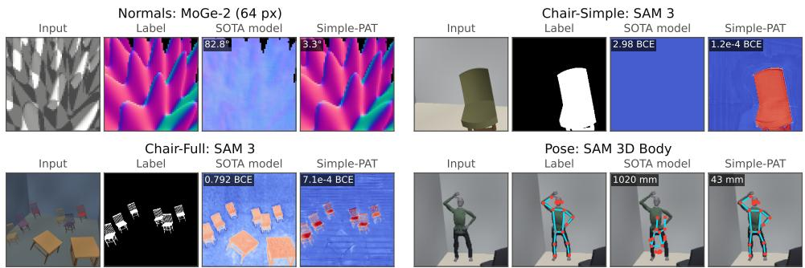  
Figure 3: Failure cases of SOTA foundation models. We show the worst case found from a CMA-ES search against the foundation models with budget $1 0 ^ { 6 }$ (105 for SAM 3D Body).

On the test set maximum of the two chair tasks, Simple-PAT does exhibit higher errors than alternative methods (besides Uniform Adam on Chair-Simple). However, this increase over the baselines (at most 0.026 BCE) is small compared to Simple-PAT’s reduction in cross-model error relative to baselines (at least 1.4 BCE).

## 6.2 WORST CASE EVALUATION OF STATE-OF-THE-ART MODELS

We also use our evaluation framework to understand the robustness of SOTA foundation models. Though these models have not been trained on our data, the images are perceptible to humans and we would expect them to generalize here. Moreover, foundation models benefit from diverse training data and may have learned rules for these tasks that generalize to all settings. We evaluate MoGe-2 (Wang et al., 2025a) for normal estimation, SAM 3 (Carion et al., 2026) for segmentation, and SAM 3D Body (Yang et al., 2026) for pose estimation.

For MoGe-2 and SAM 3, we use the predicted normals and class probabilities of the model to compute our loss. We give SAM 3 the prompt “chair” and clamp each pixel’s predicted probability to $[ 1 \dot { 0 } ^ { - 6 } , 1 - 1 0 ^ { - 6 } ]$ , so that the loss stays finite. For SAM 3D Body, in addition to aligning the root as in MPJPE, we also align the scale of the prediction. This is necessary since the scale of these synthetic scenes is ambiguous without being trained on our specific generator.

In Figure 3 we visualize the worst cases found for the SOTA foundation models on our tasks. For the normals and chair-simple tasks, the search identifies perceptually challenging cases, while for the chair-full and pose tasks the models fail on easier-looking scenes. In every task, a single CMA-ES search of $1 0 ^ { 6 }$ queries $( 1 0 ^ { 5 }$ for SAM 3D Body) finds errors far above each model’s typical error; for example, SAM 3D Body’s worst case has a joint error of over 1 m. For both chair tasks, the worst-case error is greater than 270× the median error. Table 4 in the appendix presents the numeric results. Thus, our tasks are sufficiently challenging to expose severe failures of SOTA models.

## 6.3 TRAINING SAMPLING CONCENTRATION

To quantify how strongly Simple-PAT concentrates samples in particular regions of the parameter space, we examine the distribution of samples from a training run for the normal estimation task. We partition the parameter space into $8 ^ { 6 } = 2 6 2 ,$ 144 bins by selecting six coordinates and dividing each [0, 1] interval into 8 equal-length sections.

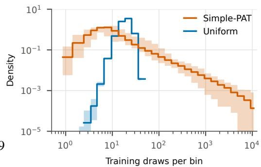

Figure 4 shows the resulting distribution of counts. Under uniform sampling, the distribution is tightly concentrated around its mode of 19 samples per bin, consistent with a Poisson distribution. Under adversarial sampling, the mode is only 5 samples per bin, but with a long tail extending over several orders of magnitude. This concentration is consistent with

these cases being particularly challenging for the network to learn and therefore requiring many more samples.

Compared to uniform sampling, Simple-PAT over-samples the top 1% and 0.1% of bins by factors of 40× and 176×, respectively. Therefore uniform training would need to extend 40× or 176× longer to reach equal exposure to these challenging cases.

## 6.4 COMPARING THE SINGLE-MODEL ADVERSARY AND CROSS-MODEL ADVERSARY

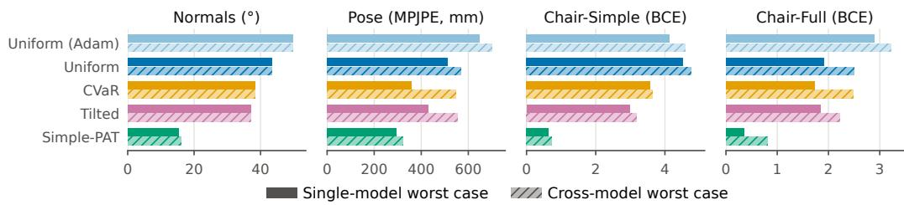  
Figure 5: Cross-model evaluation worst case compared to single-model evaluation worst case.

In Figure 5 we compare the single-model evaluation and cross-model evaluation. Since the crossmodel evaluation pools the worst cases, it reports errors greater than or equal to the single-model evaluation. On normals, the two evaluations nearly agree, with the cross-model adversary increasing the worst case by at most 5% for every method. On pose and chair-simple, the increase is at most 1.54× and 1.69× respectively2.

On the chair-full task, however, single-model searches missed difficult cases for the Simple-PAT models. The cross-model adversary increased Simple-PAT’s worst case by 2.65×, compared with at most 1.58× for the baselines. Given that chair-full is the task with the highest dimensionality (69 parameters), this is not surprising since the optimization problem is more challenging. This reveals the difficulty of evaluating the worst case in complex environments; we therefore report the cross-model evaluation as our primary metric, since pooling searches across models gives a stronger adversary.

## 7 CONCLUSION

We study procedural adversarial learning (PAL), in which a model is trained against an adversary that searches the parameters of a procedural generator, and is then judged by the worst case a strong adversary can find in that same space. We design a Simple-PAT algorithm that realizes this adversarial game with zeroth-order CMA-ES optimization on the parameter space. Across our four PAL-Dojo tasks, Simple-PAT improves the robustness over uniform training and robust reweighting variants. The cross-evaluation results suggest that there is shared structure between various training runs that is sometimes missed by black-box optimizers. Future work might exploit this structure to produce a stronger adversary and more robust models.

## ACKNOWLEDGMENTS

This work was partially supported by the National Science Foundation.

## REFERENCES

Michael A. Alcorn, Qi Li, Zhitao Gong, Chengfei Wang, Long Mai, Wei-Shinn Ku, and Anh Nguyen. Strike (with) a pose: Neural networks are easily fooled by strange poses of familiar objects. In IEEE Conference on Computer Vision and Pattern Recognition, CVPR 2019, Long Beach, CA, USA, June 16-20, 2019, pp. 4845–4854. Computer Vision Foundation / IEEE, 2019. doi: 10.1109/CVPR.2019.00498. URL http://openaccess.thecvf.com/content\_ CVPR\_2019/html/Alcorn\_Strike\_With\_a\_Pose\_Neural\_Networks\_Are\_ Easily\_Fooled\_by\_CVPR\_2019\_paper.html.

Romain Bregier, Gu ´ enol ´ e Fiche, Laura Bravo-S ´ anchez, Thomas Lucas, Matthieu Armando, Philippe ´ Weinzaepfel, Gregory Rogez, and Fabien Baradel. Human mesh modeling for anny body, 2026.´ URL https://arxiv.org/abs/2511.03589.

Nicolas Carion, Laura Gustafson, Yuan-Ting Hu, Shoubhik Debnath, Ronghang Hu, Didac Suris, Chaitanya Ryali, Kalyan Vasudev Alwala, Haitham Khedr, Andrew Huang, Jie Lei, Tengyu Ma, Baishan Guo, Arpit Kalla, Markus Marks, Joseph Greer, Meng Wang, Peize Sun, Roman Radle, Triantafyllos Afouras, Effrosyni Mavroudi, Katherine Xu, Tsung-Han Wu, Yu Zhou, Lil-¨ iane Momeni, Rishi Hazra, Shuangrui Ding, Sagar Vaze, Francois Porcher, Feng Li, Siyuan Li, Aishwarya Kamath, Ho Kei Cheng, Piotr Dollar, Nikhila Ravi, Kate Saenko, Pengchuan´ Zhang, and Christoph Feichtenhofer. Sam 3: Segment anything with concepts, 2026. URL https://arxiv.org/abs/2511.16719.

CMU Graphics Lab. CMU Graphics Lab Motion Capture Database. URL http://mocap.cs. cmu.edu/.

Michael Dennis, Natasha Jaques, Eugene Vinitsky, Alexandre M. Bayen, Stuart Russell, Andrew Critch, and Sergey Levine. Emergent complexity and zero-shot transfer via unsupervised environment design. In Hugo Larochelle, Marc’Aurelio Ranzato, Raia Hadsell, Maria-Florina Balcan, and Hsuan-Tien Lin (eds.), Advances in Neural Information Processing Systems 33: Annual Conference on Neural Information Processing Systems 2020, NeurIPS 2020, December 6-12, 2020, virtual, 2020. URL https://proceedings.neurips.cc/paper/2020/hash/ 985e9a46e10005356bbaf194249f6856-Abstract.html.

Logan Engstrom, Brandon Tran, Dimitris Tsipras, Ludwig Schmidt, and Aleksander Madry. Exploring the landscape of spatial robustness. In Kamalika Chaudhuri and Ruslan Salakhutdinov (eds.), Proceedings of the 36th International Conference on Machine Learning, ICML 2019, 9- 15 June 2019, Long Beach, California, USA, volume 97 of Proceedings of Machine Learning Research, pp. 1802–1811. PMLR, 2019. URL http://proceedings.mlr.press/v97/ engstrom19a.html.

Jaime F. Fisac, Anayo K. Akametalu, Melanie N. Zeilinger, Shahab Kaynama, Jeremy Gillula, and Claire J. Tomlin. A general safety framework for learning-based control in uncertain robotic systems, 2018. URL https://arxiv.org/abs/1705.01292.

Joerg M. Gablonsky and Carl T. Kelley. A locally-biased form of the DIRECT algorithm. J. Glob. Optim., 21(1):27–37, 2001. doi: 10.1023/A:1017930332101. URL https://doi.org/10. 1023/A:1017930332101.

Ian J. Goodfellow, Jonathon Shlens, and Christian Szegedy. Explaining and harnessing adversarial examples. In Yoshua Bengio and Yann LeCun (eds.), 3rd International Conference on Learning Representations, ICLR 2015, San Diego, CA, USA, May 7-9, 2015, Conference Track Proceedings, 2015. doi: 10.48550/ARXIV.1412.6572. URL https://doi.org/10.48550/ arXiv.1412.6572.

Nikolaus Hansen and Andreas Ostermeier. Completely derandomized self-adaptation in evolution strategies. Evol. Comput., 9(2):159–195, 2001. doi: 10.1162/106365601750190398. URL https://doi.org/10.1162/106365601750190398.

Nikolaus Hansen, Youhei Akimoto, and Petr Baudis. CMA-ES/pycma on Github. Zenodo, DOI:10.5281/zenodo.2559634, February 2019. URL https://doi.org/10.5281/ zenodo.2559634.

Dan Hendrycks, Kevin Zhao, Steven Basart, Jacob Steinhardt, and Dawn Song. Natural adversarial examples. In IEEE Conference on Computer Vision and Pattern Recognition, CVPR 2021, virtual, June 19-25, 2021, pp. 15262–15271. Computer Vision Foundation / IEEE, 2021. doi: 10.1109/CVPR46437.2021.01501. URL https://openaccess.thecvf.com/content/CVPR2021/html/Hendrycks\_ Natural\_Adversarial\_Examples\_CVPR\_2021\_paper.html.

Hossein Hosseini and Radha Poovendran. Semantic adversarial examples, 2018. URL https: //arxiv.org/abs/1804.00499.

Keller Jordan, Yuchen Jin, Vlado Boza, Jiacheng You, Franz Cesista, Laker Newhouse, and Jeremy Bernstein. Muon: An optimizer for hidden layers in neural networks, 2024. URL https: //kellerjordan.github.io/posts/muon/.

Rawal Khirodkar and Kris M. Kitani. Adversarial domain randomization, 2021. URL https: //arxiv.org/abs/1812.00491.

Diederik P. Kingma and Jimmy Ba. Adam: A method for stochastic optimization, 2017. URL https://arxiv.org/abs/1412.6980.

Guillaume Leclerc, Hadi Salman, Andrew Ilyas, Sai Vemprala, Logan Engstrom, Vibhav Vineet, Kai Yuanqing Xiao, Pengchuan Zhang, Shibani Santurkar, Greg Yang, Ashish Kapoor, and Aleksander Madry. 3db: A framework for debugging computer vision models. In Sanmi Koyejo, S. Mohamed, A. Agarwal, Danielle Belgrave, K. Cho, and A. Oh (eds.), Advances in Neural Information Processing Systems 35: Annual Conference on Neural Information Processing Systems 2022, NeurIPS 2022, New Orleans, LA, USA, November 28 - December 9, 2022, 2022. URL http://papers.nips.cc/paper\_files/paper/2022/hash/ 3848bc3112429079af85dedb7d369ef4-Abstract-Conference.html.

Daniel Levy, Yair Carmon, John C. Duchi, and Aaron Sidford. Large-scale methods for distributionally robust optimization. In Hugo Larochelle, Marc’Aurelio Ranzato, Raia Hadsell, Maria-Florina Balcan, and Hsuan-Tien Lin (eds.), Advances in Neural Information Processing Systems 33: Annual Conference on Neural Information Processing Systems 2020, NeurIPS 2020, December 6-12, 2020, virtual, 2020. URL https://proceedings.neurips.cc/paper/2020/hash/ 64986d86a17424eeac96b08a6d519059-Abstract.html.

Baiqi Li, Zhiqiu Lin, Wenxuan Peng, Jean de Dieu Nyandwi, Daniel Jiang, Zixian Ma, Simran Khanuja, Ranjay Krishna, Graham Neubig, and Deva Ramanan. Naturalbench: Evaluating vision-language models on natural adversarial samples. In Amir Globersons, Lester Mackey, Danielle Belgrave, Angela Fan, Ulrich Paquet, Jakub M. Tomczak, and Cheng Zhang (eds.), Advances in Neural Information Processing Systems 37: Annual Conference on Neural Information Processing Systems 2024, NeurIPS 2024, Vancouver, BC, Canada, December 10 - 15, 2024, 2024. URL http://papers.nips.cc/paper\_files/paper/2024/ hash/1e69ff56d0ebff0752ff29caaddc25dd-Abstract-Datasets\_and\_ Benchmarks\_Track.html.

Tian Li, Ahmad Beirami, Maziar Sanjabi, and Virginia Smith. Tilted empirical risk minimization. In 9th International Conference on Learning Representations, ICLR 2021, Virtual Event, Austria, May 3-7, 2021. OpenReview.net, 2021. URL https://openreview.net/forum?id= K5YasWXZT3O.

Zeyu Ma, Alexander Raistrick, and Jia Deng. Simpleproc: Fully procedural synthetic data from simple rules for multi-view stereo, 2026. URL https://arxiv.org/abs/2604.04925.

Aleksander Madry, Aleksandar Makelov, Ludwig Schmidt, Dimitris Tsipras, and Adrian Vladu. Towards deep learning models resistant to adversarial attacks. CoRR, abs/1706.06083, 2017. doi: 10.48550/ARXIV.1706.06083. URL https://doi.org/10.48550/arXiv.1706. 06083.

MakeHuman Community. MakeHuman. http://www.makehumancommunity.org.

Jack Parker-Holder, Minqi Jiang, Michael Dennis, Mikayel Samvelyan, Jakob N. Foerster, Edward Grefenstette, and Tim Rocktaschel. Evolving curricula with regret-based environment¨ design. In Kamalika Chaudhuri, Stefanie Jegelka, Le Song, Csaba Szepesvari, Gang Niu,´ and Sivan Sabato (eds.), International Conference on Machine Learning, ICML 2022, 17-23 July 2022, Baltimore, Maryland, USA, volume 162 of Proceedings of Machine Learning Research, pp. 17473–17498. PMLR, 2022. URL https://proceedings.mlr.press/ v162/parker-holder22a.html.

Lerrel Pinto, James Davidson, Rahul Sukthankar, and Abhinav Gupta. Robust adversarial reinforcement learning, 2017. URL https://arxiv.org/abs/1703.02702.

Alexander Raistrick, Lahav Lipson, Zeyu Ma, Lingjie Mei, Mingzhe Wang, Yiming Zuo, Karhan Kayan, Hongyu Wen, Beining Han, Yihan Wang, Alejandro Newell, Hei Law, Ankit Goyal, Kaiyu Yang, and Jia Deng. Infinite photorealistic worlds using procedural generation. In IEEE/CVF Conference on Computer Vision and Pattern Recognition, CVPR 2023, Vancouver, BC, Canada, June 17-24, 2023, pp. 12630–12641. IEEE, 2023. doi: 10.1109/CVPR52729.2023.01215. URL https://doi.org/10.1109/CVPR52729.2023.01215.

Alexander Raistrick, Lingjie Mei, Karhan Kayan, David Yan, Yiming Zuo, Beining Han, Hongyu Wen, Meenal Parakh, Stamatis Alexandropoulos, Lahav Lipson, Zeyu Ma, and Jia Deng. Infinigen indoors: Photorealistic indoor scenes using procedural generation. In IEEE/CVF Conference on Computer Vision and Pattern Recognition, CVPR 2024, Seattle, WA, USA, June 16-22, 2024, pp. 21783–21794. IEEE, 2024. doi: 10.1109/CVPR52733.2024.02058. URL https://doi. org/10.1109/CVPR52733.2024.02058.

Alexander Raistrick, Karhan Kayan, Jack Nugent, David Yan, Lingjie Mei, Meenal Parakh, Hongyu Wen, Dylan Li, Yiming Zuo, Erich Liang, and Jia Deng. Procfunc: Function-oriented abstractions for procedural 3d generation in python, 2026. URL https://arxiv.org/abs/2604. 26943.

R. Tyrrell Rockafellar and Stanislav Uryasev. Optimization of conditional value-at-risk. The Journal ofRisk, 2(3):21–41, 2000. doi: 10.21314/JOR.2000.038.

Christian Szegedy, Wojciech Zaremba, Ilya Sutskever, Joan Bruna, Dumitru Erhan, Ian J. Goodfellow, and Rob Fergus. Intriguing properties of neural networks. In Yoshua Bengio and Yann LeCun (eds.), 2nd International Conference on Learning Representations, ICLR 2014, Banff, AB, Canada, April 14-16, 2014, Conference Track Proceedings, 2014. doi: 10.48550/ARXIV.1312. 6199. URL https://doi.org/10.48550/arXiv.1312.6199.

Josh Tobin, Rachel Fong, Alex Ray, Jonas Schneider, Wojciech Zaremba, and Pieter Abbeel. Domain randomization for transferring deep neural networks from simulation to the real world, 2017. URL https://arxiv.org/abs/1703.06907.

Bhavya Vasudeva, Puneesh Deora, Yize Zhao, Vatsal Sharan, and Christos Thrampoulidis. How muon’s spectral design benefits generalization: A study on imbalanced data, 2025. URL https: //arxiv.org/abs/2510.22980.

Ruicheng Wang, Sicheng Xu, Yue Dong, Yu Deng, Jianfeng Xiang, Zelong Lv, Guangzhong Sun, Xin Tong, and Jiaolong Yang. Moge-2: Accurate monocular geometry with metric scale and sharp details. In Danielle Belgrave, Cheng Zhang, Laura N. Montoya, Hsuan-Tien Lin, Razvan Pascanu, Piotr Koniusz, Marzyeh Ghassemi, Nancy Chen, Ivan Vladimir Meza´ Ru´ız, and Arturo Loaiza-Bonilla (eds.), Advances in Neural Information Processing Systems 38: Annual Conference on Neural Information Processing Systems 2025, NeurIPS 2025, San Diego, CA, USA, December 2-7, 2025 / Mexico City, Mexico, November 30 - December 5, 2025, 2025a. URL http://papers.nips.cc/paper\_files/paper/2025/hash/ 336572db3e99930814d6b328d4220cb6-Abstract-Conference.html.

Shuche Wang, Fengzhuo Zhang, Jiaxiang Li, Cunxiao Du, Chao Du, Tianyu Pang, Zhuoran Yang, Mingyi Hong, and Vincent Y. F. Tan. Muon outperforms adam in tail-end associative memory learning, 2025b. URL https://arxiv.org/abs/2509.26030.

David Yan, Alexander Raistrick, and Jia Deng. What makes good synthetic training data for zeroshot stereo matching?, 2026. URL https://arxiv.org/abs/2504.16930.

Xitong Yang, Devansh Kukreja, Don Pinkus, Anushka Sagar, Taosha Fan, Jinhyung Park, Soyong Shin, Jinkun Cao, Jiawei Liu, Nicolas Ugrinovic, Matt Feiszli, Jitendra Malik, Piotr Dollar, and Kris Kitani. Sam 3d body: Robust full-body human mesh recovery, 2026. URL https:// arxiv.org/abs/2602.15989.

Xiaohui Zeng, Chenxi Liu, Yu-Siang Wang, Weichao Qiu, Lingxi Xie, Yu-Wing Tai, Chi-Keung Tang, and Alan L. Yuille. Adversarial attacks beyond the image space. In IEEE Conference on Computer Vision and Pattern Recognition, CVPR 2019, Long Beach, CA, USA, June 16-20, 2019, pp. 4302–4311. Computer Vision Foundation / IEEE, 2019. doi: 10.1109/CVPR.2019.00443. URL http://openaccess.thecvf.com/content\_CVPR\_2019/html/Zeng\_ Adversarial\_Attacks\_Beyond\_the\_Image\_Space\_CVPR\_2019\_paper.html.

## APPENDIX

## A HYPERPARAMETERS

• Training: each model is trained for 20,000 steps at a batch size of 256.

• Models: for normals and chair tasks we train small unets around 7.5M and 7.8M parameters. They consist of standard blocks with two 3×3 convolutions followed by a GroupNorm and ReLU. We select GroupNorm instead of BatchNorm since our custom sampling procedure may affect the batch statistics. The pose network has a similar structure, but with global average pooling and an output head instead of upsampling layers. Consequently, the pose network has only 5.01M parameters.

• Optimizers: we use Adam with a learning rate of $3 \times 1 0 ^ { - 4 }$ or Muon with a learning rate 0.02. Muon is applied to the matrix and convolution parameters except the output head, and Adam is applied to the remaining parameters. Every training method uses Muon besides “Uniform (Adam)”. We use a cosine learning rate schedule with a warmup of 200 steps.

• Simple-PAT: We use k = 16, λ = 14 and $n _ { 0 } = 3 2 { \mathrm { ~ } }$ . Hence, each batch is composed of 32 uniform samples and 14 samples from 16 CMA-ES instances. Every R = 40 training steps (20 CMA-ES generations) we replace the least fit 25% of instances.

• CVaR Training: for all tasks, we use $\alpha = 0 . 0 5$ , leading to 13 scenes contributing to the loss the network trains on.

• Tilted Training: for each task we use a converged uniform-Muon model to compute the ESS. We select β to match CVaR’s ESS of 13, averaged over 64 batches, finding $\beta = 2 4 9 0$ (normals), 18.8 (pose), 10600 (chair-full), and 21600 (chair-simple).

## B ADDITIONAL ANALYSES

## B.1 ADAM VS MUON FOR WORST CASE PERFORMANCE

Previous studies (Wang et al., 2025b; Vasudeva et al., 2025) have found that the Muon optimizer learns rarely-seen training data better than Adam. Consequently, models trained with Muon might exhibit improved robustness. We evaluate this on the normal estimation task using 15 seeds for each combination of optimizer (Muon or Adam) and training method (uniform or Simple-PAT). In Figure 6 we display these results. On the test-set maximum, Muon reduces the error by 5.1 degrees with uniform training and 2.3 degrees with Simple-PAT. When evaluating the worst case, Muon displays a significant improvement for uniform training but not Simple-PAT. This may be an issue of statistical power. Alternatively, Simple-PAT may concentrate sampling near the worst case.

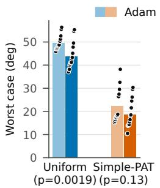

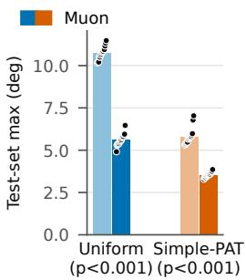  
Figure 6: Muon vs. Adam on the normal estimation task. Worst case is reported by the singlemodel evaluation. Scattered points show results of every seed. p-values are calculated by the twosided Welch’s t-test comparing Muon and Adam.

Then, these cases are no longer rare and Muon’s advantage over Adam may be lessened.

## B.2 EVALUATION WITH A SINGLE-MODEL ADVERSARY

<table><tr><td rowspan="2">Task</td><td rowspan="2">Method</td><td colspan="2">Single-model,  $\overline { { 2 \times 1 0 ^ { 6 } } }$  queries</td><td colspan="2">Test set, 65,536 scenes</td></tr><tr><td> $\mathrm { W o r s t \ c a s e \downarrow }$ </td><td>p vs. Simple-PAT</td><td>Max↓</td><td>Median↓</td></tr><tr><td rowspan="5">Normals angle (°)</td><td>Uniform (Adam)</td><td> $4 9 . 7 \pm 1 . 1$ </td><td>0.0079</td><td> $\overline { { 1 0 . 6 3 \pm 0 . 3 2 } }$ </td><td> $1 . 6 3 6 \pm 0 . 0 2 2$ </td></tr><tr><td>Uniform (Muon)</td><td> $4 3 . 4 \pm 3 . 0$ </td><td>0.0079</td><td> $5 . 5 3 \pm 0 . 4 7$ </td><td>0.8904 ±0.0041</td></tr><tr><td>Tilted</td><td> $3 7 . 1 \pm 1 . 4$ </td><td>0.0079</td><td> $8 . 0 6 \pm 0 . 6 4$ </td><td>3.732 ±0.020</td></tr><tr><td>CVaR</td><td> $3 8 . 4 \pm 2 . 2$ </td><td>0.0079</td><td> $5 . 1 8 6 \pm 0 . 0 9 2$ </td><td>1.8097 ±0.0081</td></tr><tr><td>Simple-PAT</td><td> ${ \bf 1 5 . 4 \pm } 2 . 8 $ </td><td></td><td> ${ \bf 3 . 5 1 \pm 0 . 2 2 }$ </td><td> $1 . 7 1 3 \pm 0 . 0 1 8$ </td></tr><tr><td rowspan="5">Chair-Simple BCE</td><td>Uniform (Adam)</td><td> $4 . 1 3 \pm 0 . 7 9$ </td><td>0.0079</td><td> $0 . 5 0 \pm 0 . 7 3$ </td><td>2.13e-5 ±4.3e-6</td></tr><tr><td>Uniform (Muon)</td><td> $4 . 5 2 \pm 0 . 1 2$ </td><td>0.0079</td><td> $\mathbf { 0 . 0 0 3 9 4 } \pm 0 . 0 0 0 8 8$ </td><td> $\pm 5 . 5 5 \mathrm { e } { \cdot } 6 { \pm } 6 . 7 \mathrm { e } { \cdot } 7$ </td></tr><tr><td>Tilted</td><td> $2 . 9 9 \pm 0 . 2 0$ </td><td>0.0079</td><td> $0 . 0 0 5 3 { \scriptstyle \pm 0 . 0 0 1 6 }$ </td><td> $3 . 5 \mathrm { e } { - 4 } \pm 1 . 0 \mathrm { e } { - 4 }$ </td></tr><tr><td>CVaR</td><td> $3 . 5 8 \pm 0 . 2 5$ </td><td>0.0079</td><td> $0 . 0 0 8 4 \pm 0 . 0 0 8 6$ </td><td> $8 . 7 \mathrm { e } \mathrm { - } 5 \pm 2 . 3 \mathrm { e } \mathrm { - } 5$ </td></tr><tr><td>Simple-PAT</td><td> ${ \bf 0 . 6 4 } \pm 0 . 7 6$ </td><td></td><td> $0 . 0 3 0 { \scriptstyle \pm 0 . 0 5 2 }$ </td><td> $1 . 8 8 \mathrm { e } { - 5 } \pm 4 . 7 \mathrm { e } { - 6 }$ </td></tr><tr><td rowspan="5">Chair-Full BCE</td><td>Uniform (Adam)</td><td> $2 . 9 0 \pm 0 . 8 1$ </td><td>0.0079</td><td> $\overline { { 0 . 0 2 6 3 \pm 0 . 0 0 7 3 } }$ </td><td> $7 . 5 \mathrm { e } \mathrm { - } 5 \pm 1 . 4 \mathrm { e } \mathrm { - } 5$ </td></tr><tr><td>Uniform (Muon)</td><td> $1 . 9 1 \pm 0 . 6 6$ </td><td>0.0079</td><td> $0 . 0 1 5 6 \pm 0 . 0 0 4 7$ </td><td> $\mathbf { 1 . 8 9 2 e { - } 5 \pm } 7 . 7 \mathrm { e - } 7$ </td></tr><tr><td>Tilted</td><td> $1 . 8 5 \pm 0 . 2 4$ </td><td>0.0079</td><td> $\mathbf { 0 . 0 0 7 3 \bot } 0 . 0 0 1 1$ </td><td> $1 . 7 0 9 \mathrm { e } { - 4 } \pm 6 . 2 \mathrm { e } { - 6 }$ </td></tr><tr><td>CVaR</td><td> $1 . 7 3 \pm 0 . 8 3$ </td><td>0.0079</td><td> $0 . 0 1 0 1 { \scriptstyle \pm 0 . 0 0 4 1 }$ </td><td> $5 . 1 3 \mathrm { e } \mathrm { - } 5 \pm 1 . 2 \mathrm { e } \mathrm { - } 6$ </td></tr><tr><td>Simple-PAT</td><td> ${ \bf 0 . 3 5 \pm 0 . 2 3 }$ </td><td></td><td> $0 . 0 2 9 { \scriptstyle \pm 0 . 0 1 2 }$ </td><td> $5 . 6 \mathrm { e } { - 5 } \pm 2 . 0 \mathrm { e } { - 5 }$ </td></tr><tr><td rowspan="5">Pose MPJPE (mm)</td><td>Uniform (Adam)</td><td> $6 5 0 \pm 1 9 0$ </td><td>0.0079</td><td> $2 0 1 \pm 2 8$ </td><td> $2 6 . 1 4 \pm 0 . 1 6$ </td></tr><tr><td>Uniform (Muon)</td><td> $5 1 0 \pm 1 2 0$ </td><td>0.0079</td><td> $1 1 4 \pm 1 8$ </td><td> ${ \bf 1 6 . 0 9 } \pm 0 . 1 5$ </td></tr><tr><td>Tilted</td><td> $4 2 9 \pm 7 1$ </td><td>0.0079</td><td> $1 5 1 \pm 2 0$ </td><td> $3 8 . 0 5 \pm 0 . 1 1$ </td></tr><tr><td>CVaR</td><td> $3 6 0 \pm 7 6$ </td><td>0.095</td><td> $1 5 4 \pm 2 8$ </td><td> $3 9 . 8 4 \pm 0 . 3 3$ </td></tr><tr><td>Simple-PAT</td><td> ${ \bf 2 9 4 \pm } 3 3$ </td><td></td><td> ${ \bf 9 7 \pm 1 5 }$ </td><td> $2 6 . 9 \pm 1 . 4$ </td></tr></table>

Table 3: Single-model evaluation worst case for various training methods. Each entry is the mean of 5 seeds with ± 1 standard deviation shown. In the ${ } ^ { 6 6 } p \ \mathbf { V } \mathbf { S } .$ Simple-PAT” column we give the two-sided Mann-Whitney p-value comparing our method to baselines.

In Table 3 we show the complete single-model evaluation results. These largely follow the trend of the cross-model evaluation. Under single-model evaluation, Simple-PAT’s advantage over the strongest baseline is larger on chair-full $( 4 . 9 5 \times \mathrm { v s . 2 . 7 4 } \times$ cross-model) and smaller on pose (1.22× vs. $1 . { \dot { 7 } } 1 \times )$ . Fifteen of the sixteen comparisons are significant at $p = 0 . 0 5 ,$ , each with $p = 0 . 0 0 7 9 ,$ meaning that every Simple-PAT seed’s worst case is better than every seed of that baseline. The exception is pose against CVaR $( p = 0 . 0 9 5 )$ , where the seeds overlap.

## B.3 PROCEDURAL GENERATOR DESIGN

When designing procedural generators, the searchability of the space impacts both the efficacy of the Simple-PAT algorithm and the evaluation. Here we present results using prototype versions of the environments described in the paper. These environments differ from the versions described in Section 3 in the following ways:

• Object and room color. In the prototype chair environments, each object’s color was a hash of the slot’s other parameters (position, scale, appearance, yaw and tilt), and the floor and wall colors were a hash of the room dimensions and camera azimuth. Any change to those parameters therefore redrew the colors in a seemingly random pattern. In the final environments, object color depends only on that object’s appearance parameter, and room appearance is a single parameter.

• Object class. The prototype chair environments selected objects through shared composition and permutation parameters, so one parameter could exchange the objects in several slots at once. The final environments give each slot its own class parameter.

• Body pose. The prototype pose environment chose a stance with a discrete selector parameter and drew the body from a separate PCA model for each stance. The final environment uses a single archetypal model that allows continuous interpolation between all poses.

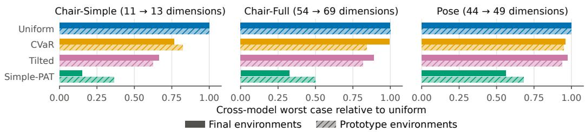  
Figure 7: Cross-model worst case of each method relative to uniform-Muon training, in the prototype (hatched) and final (solid) environments. Each bar is the mean over five seeds divided by the mean for uniform training in the same version.

• Dimension. Chair-simple grows from 11 to 13 dimensions, chair-full from 54 to 69 and pose from 44 to 49.

Training, search, and evaluation of the prototype environments follow the same protocol described in the main paper with very minor implementation differences3.

Figure 7 shows the reduction in cross-model worst-case error by the Simple-PAT algorithm in both versions. Simple-PAT has the lowest worst-case in both versions, but its advantage over the baselines is larger in the final environments. With the prototype environments, Simple-PAT achieves significantly better results at p = 0.05 in fifteen out of sixteen cases. The exception is the comparison with tilted loss on chair-simple (p = 0.15). On the final generators, Simple-PAT is found to be better than alternative methods with p = 0.0079 for all comparisons.

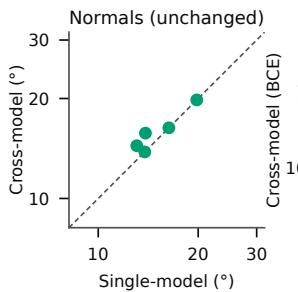

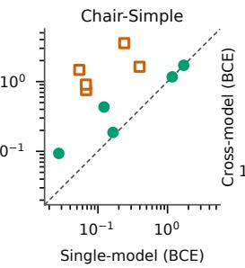

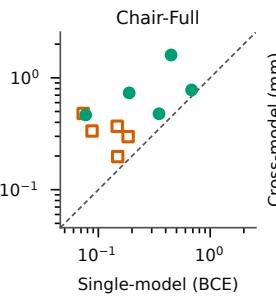

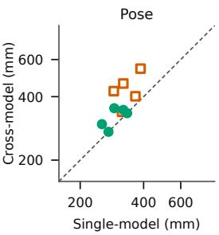  
Prototype environments Final environments Single-model = cross-mode

Figure 8: For each Simple-PAT seed, the worst case found by searching that model alone (horizontal) against the worst case found by the cross-model search (vertical). Points above the dashed line are failures the model’s own search missed. Normals is shown for reference.

Discontinuities in the environment had the effect of hiding model failures from the evaluation search, as shown in Figure 8. In the prototype chair-simple environment, the Simple-PAT single-model evaluation found a mean worst case of 0.17 BCE, but the cross-model search found 1.66 average BCE on the same models. In the final environment, the single-model average worst case was 0.64, compared to 0.72 cross-model evaluation average. Among the final environments, chair-full displays the largest discrepancy between the single-model and cross-model evaluations, which is consistent with the difficulty of searching in 69 dimensions.

## C STATE-OF-THE-ART FOUNDATION MODEL WORST-CASE

<table><tr><td rowspan="2">Task</td><td rowspan="2">Model</td><td>Search</td><td colspan="2">Test set, 65,536 scenes</td></tr><tr><td>Worst case ↓</td><td>Max↓</td><td>Median↓</td></tr><tr><td rowspan="4">Normals angle (°)</td><td>MoGe-2 (64 px)</td><td>82.8</td><td>54.5</td><td>22.2</td></tr><tr><td>MoGe-2 (512 px)</td><td>69.8</td><td>52.0</td><td>18.9</td></tr><tr><td>Simple-PAT (single)</td><td> $1 5 . 4 \pm 2 . 8$ </td><td> $3 . 5 1 \pm 0 . 2 2$ </td><td>1.713 ±0.018</td></tr><tr><td>Simple-PAT (cross)</td><td> $1 6 . 0 \pm 2 . 3$ </td><td></td><td></td></tr><tr><td rowspan="4">Chair-Simple BCE</td><td>SAM 3</td><td>2.98</td><td>3.29</td><td>0.00172</td></tr><tr><td>Simple-PAT (single)</td><td> $0 . 6 4 \pm 0 . 7 6$ </td><td> $0 . 0 3 0 { \scriptstyle \pm 0 . 0 5 2 }$ </td><td> $1 . 8 8 \mathrm { e } { - 5 } \pm 4 . 7 \mathrm { e } { - 6 }$ </td></tr><tr><td>Simple-PAT (cross)</td><td> $0 . 7 2 \pm 0 . 7 0$ </td><td></td><td></td></tr><tr><td>SAM 3</td><td>0.792</td><td>0.321</td><td>0.00291</td></tr><tr><td rowspan="3">BCE</td><td>Simple-PAT (single)</td><td> $0 . 3 5 \pm 0 . 2 3$ </td><td> $0 . 0 2 9 { \scriptstyle \pm 0 . 0 1 2 }$ </td><td> $5 . 6 \mathrm { e } { - 5 } \pm 2 . 0 \mathrm { e } { - 5 }$ </td></tr><tr><td>Simple-PAT (cross)</td><td> $0 . 8 1 \pm 0 . 4 6$ </td><td></td><td></td></tr><tr><td>SAM 3D Body</td><td>1020</td><td>841</td><td>67.7</td></tr><tr><td rowspan="3">Pose MPJPE (mm)</td><td>Simple-PAT (single)</td><td> $2 9 4 \pm 3 3$ </td><td> $9 7 \pm 1 5$ </td><td> $2 6 . 9 \pm 1 . 4$ </td></tr><tr><td></td><td></td><td></td><td></td></tr><tr><td>Simple-PAT (cross)</td><td> $3 2 0 \pm 3 5$ </td><td></td><td></td></tr></table>

Table 4: Worst case evaluation of SOTA foundation models. For normals, we evaluate MoGe-2 at the generator’s standard resolution of $6 4 \times 6 4$ , and a version of the generator rendered at $5 1 2 \times 5 1 2$ to more closely match MoGe-2’s standard input resolution.

In Table 4 we display the worst-case evaluation metrics for SOTA models. The worst case for SOTA models is evaluated with a single CMA-ES search with budget $1 0 ^ { 6 } \colon$ ; for pose we only use a budget of 105 $1 0 ^ { 5 }$ due to the computational expense of SAM 3D Body. We include Simple-PAT worst-case metrics for reference, though these values are not directly comparable since the SOTA models were not trained on our procedural generators. This demonstrates that our tasks are challenging, and the adversary can effectively find failures of SOTA models.

## D SINGLE-MODEL EVALUATION WORST-CASE VISUALIZATIONS

Here we show visualizations of each model’s evaluation worst case found by the single-model search. We select the model with the median loss of the five seeds.

## D.1 NORMALS

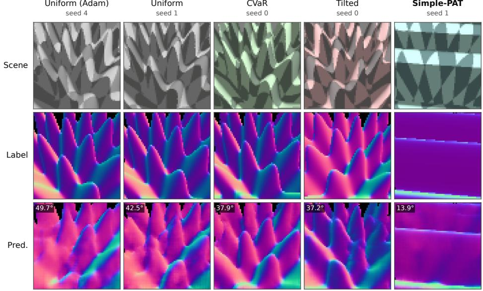  
Figure 9: Single-model evaluation worst case samples on the normals task.

## D.2 CHAIR-SIMPLE

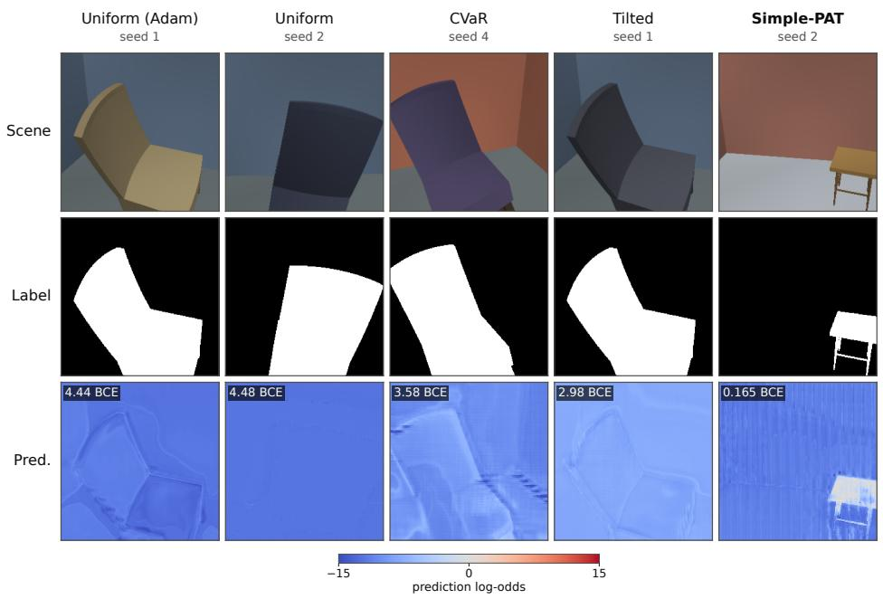  
Figure 10: Single-model evaluation worst case samples on the chair-simple task.

## D.3 CHAIR-FULL

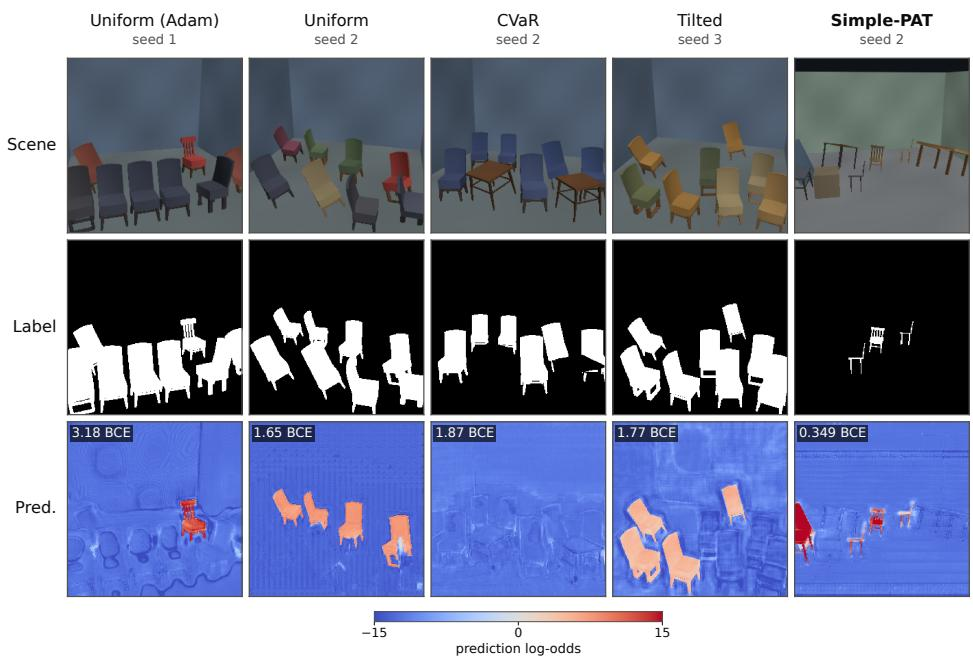  
Figure 11: Single-model evaluation worst case samples on the chair-full task.

## D.4 POSE

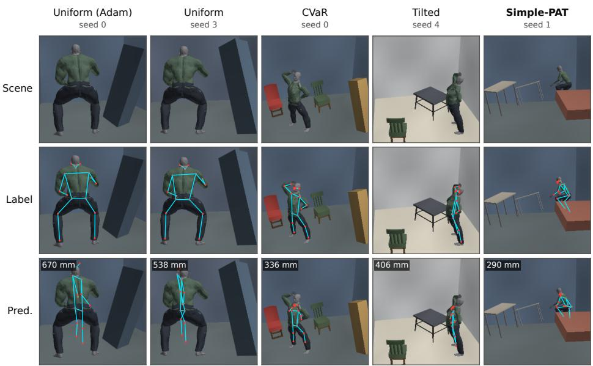  
Figure 12: Single-model evaluation worst case samples on the pose task.

## E CROSS-MODEL EVALUATION WORST-CASE VISUALIZATIONS

Here we show visualizations of each model’s evaluation worst case found by the cross-model search.   
We select the model with the median loss of the five seeds.

## E.1 NORMALS

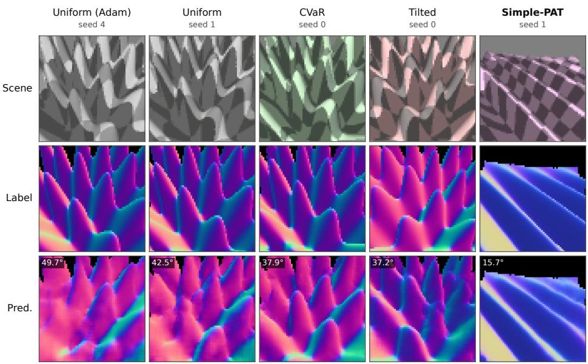  
Figure 13: Cross-model evaluation worst case samples on the normals task.

## E.2 CHAIR-SIMPLE

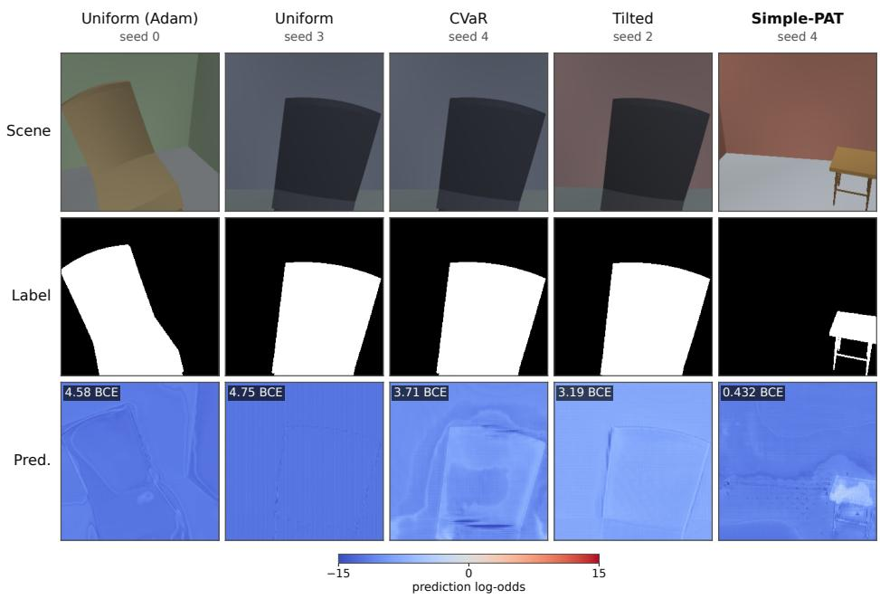  
Figure 14: Cross-model evaluation worst case samples on the chair-simple task.

## E.3 CHAIR-FULL

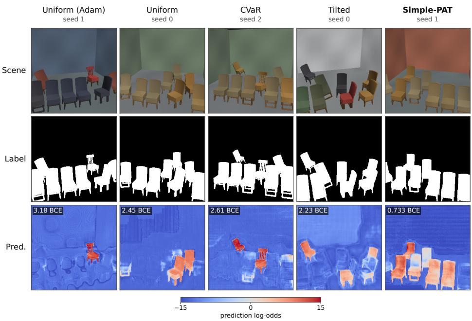  
Figure 15: Cross-model evaluation worst case samples on the chair-full task.

## E.4 POSE

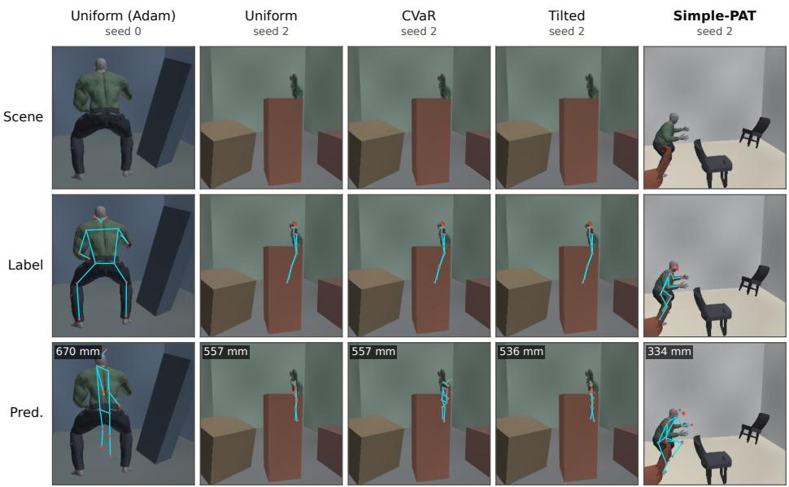  
Figure 16: Cross-model evaluation worst case samples on the pose task.

## F PROCEDURAL GENERATORS

Here we show visualizations of uniform randomly selected points from each procedural generator.

## F.1 NORMALS

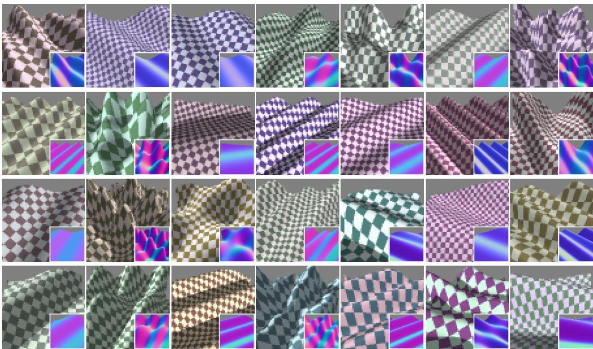  
Figure 17: Uniform random samples from the normals procedural generator.

## F.2 CHAIR-SIMPLE

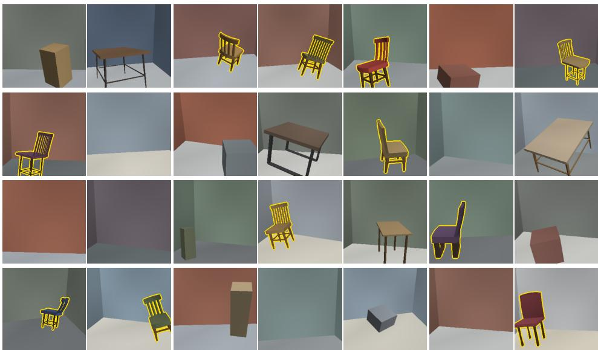  
Figure 18: Uniform random samples from the chair-simple procedural generator.

## F.3 CHAIR-FULL

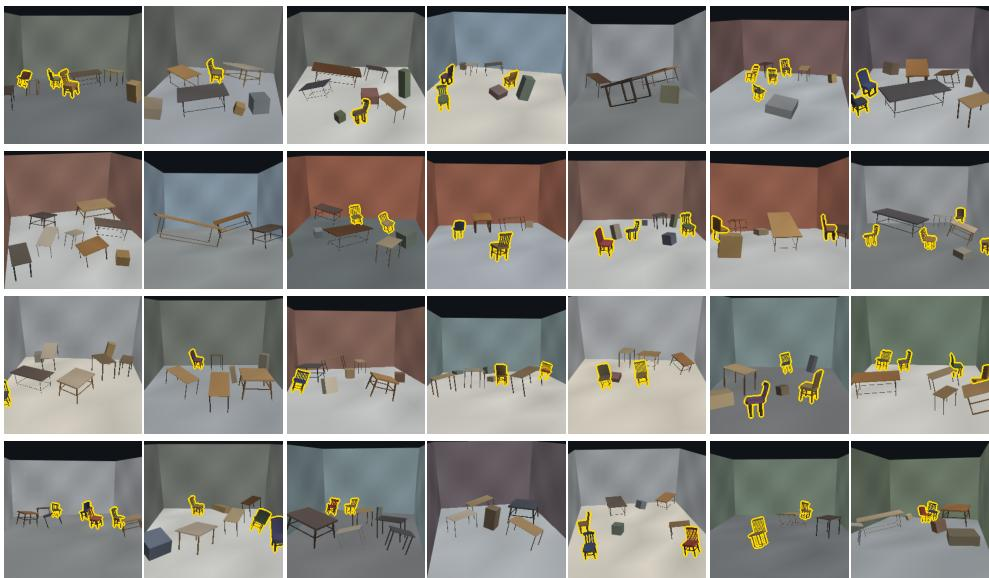  
Figure 19: Uniform random samples from the chair-full procedural generator.

## F.4 POSE

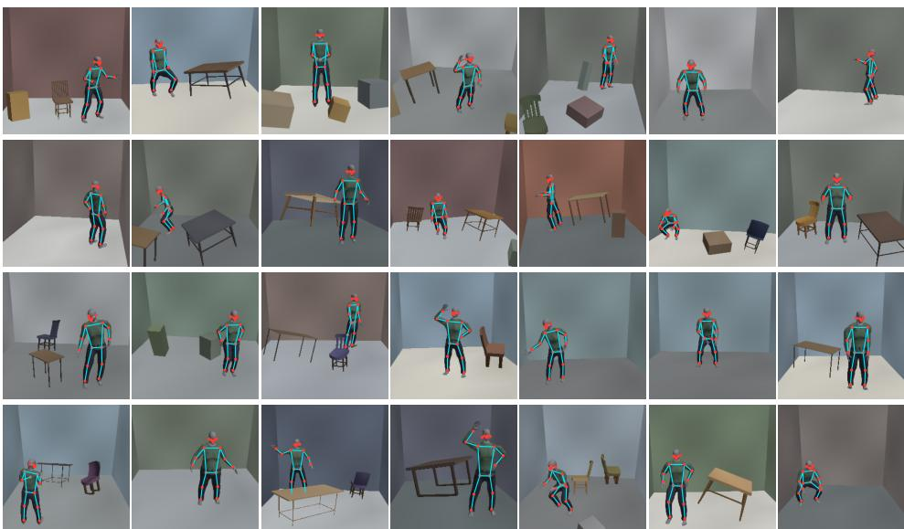  
Figure 20: Uniform random samples from the pose procedural generator.