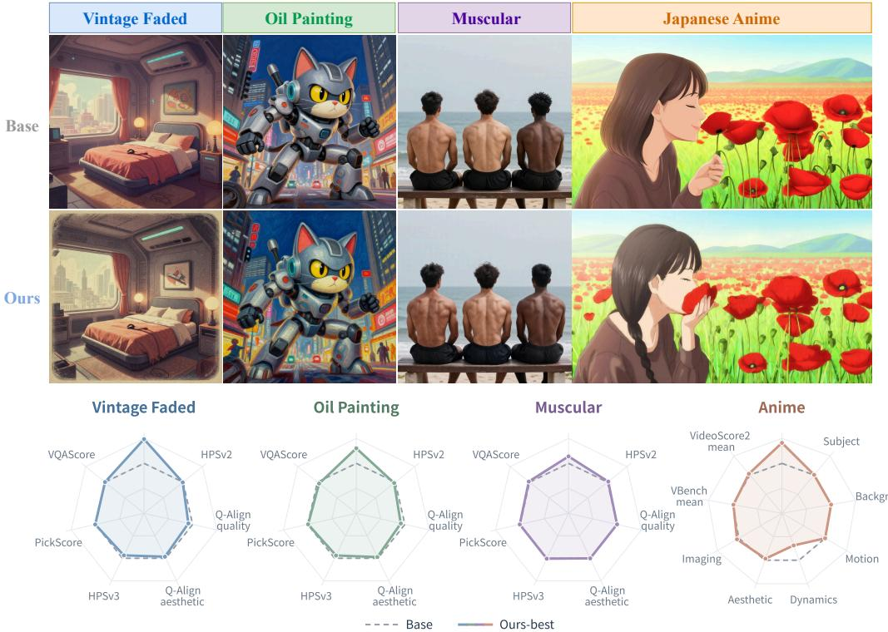
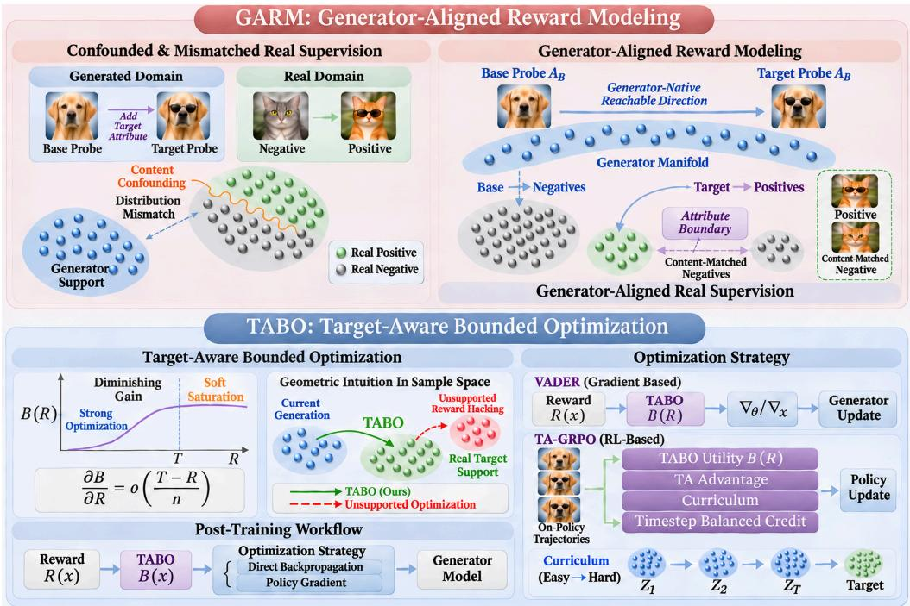
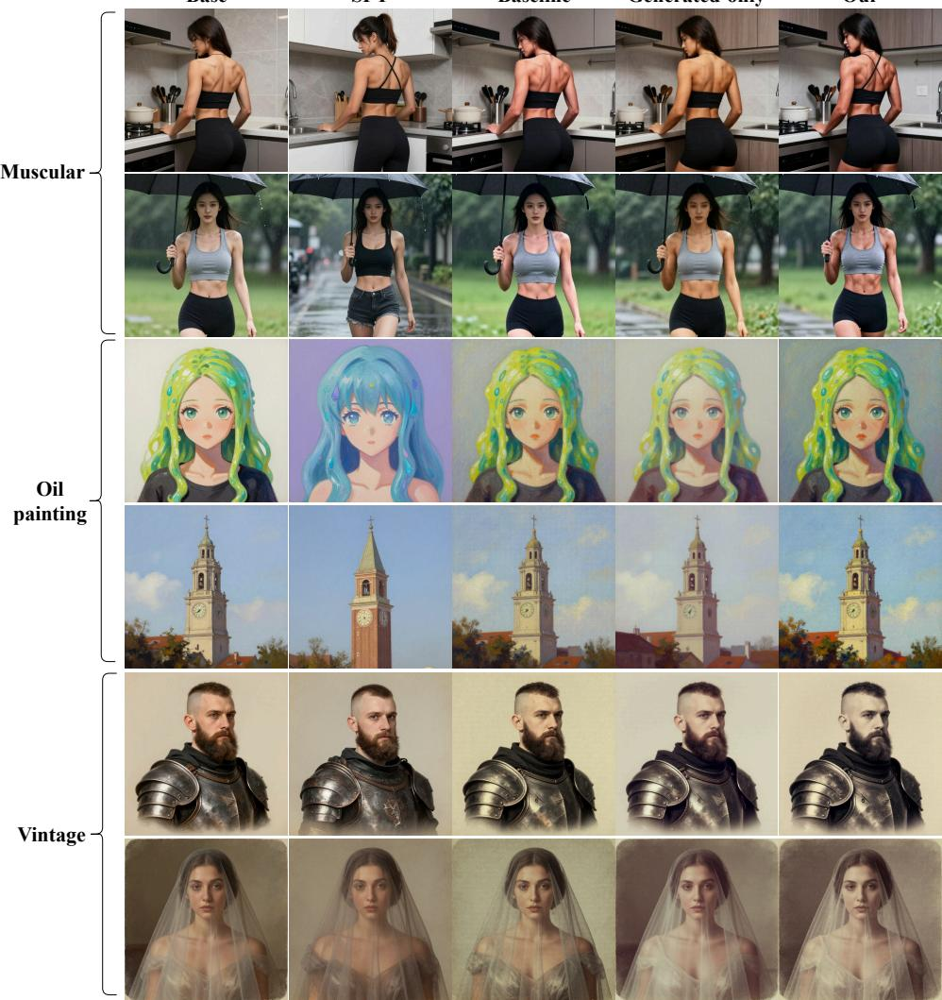
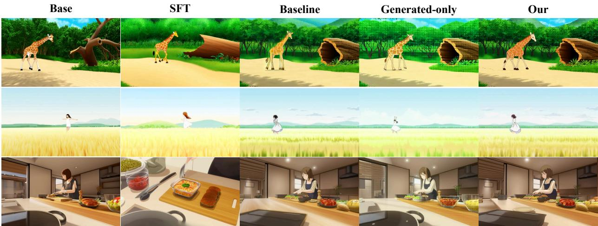
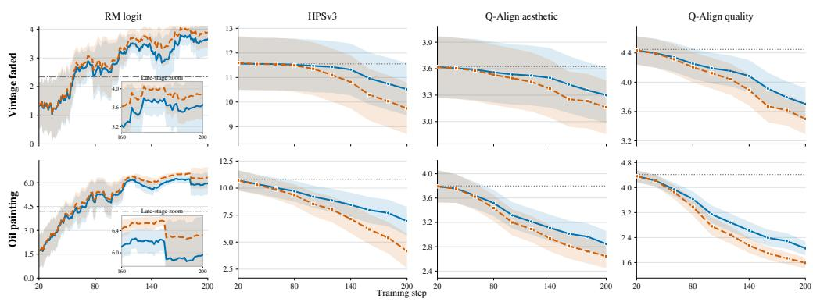
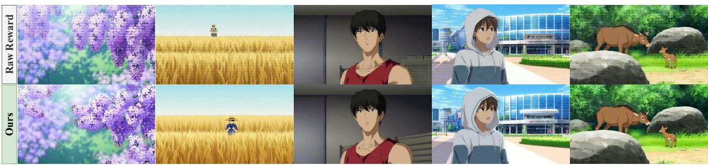
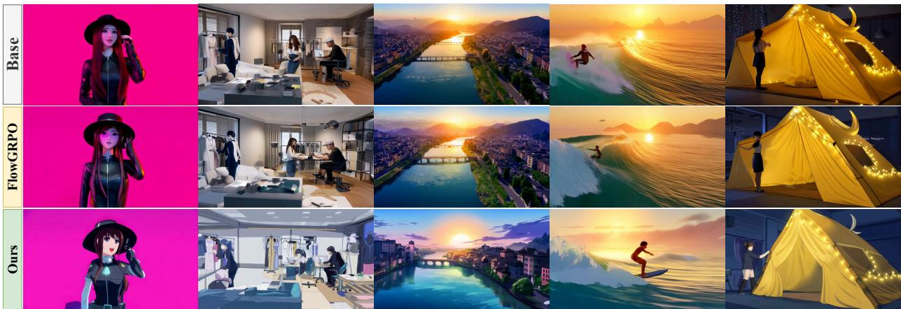

# GENERATOR-ALIGNED REWARD MODELING WITHTARGET-AWARE BOUNDED OPTIMIZATION FOR VISUALGENERATION

A PREPRINT

Ziqiao Weng1,2\*, Yuanzhi Liang1, Haibing Huang1, Weidong Cai2, Xuelong Li1

1 Institute of Artificial Intelligence, China Telecom (TeleAI) 2 The University of Sydney

## ABSTRACT

Post-training visual generative models requires enhancing desired attributes while preserving general generation capabilities. Reward-guided post-training faces two key challenges: real training data may differ substantially from the generator’s output distribution, and attribute supervision can be confounded by unrelated content. Moreover, unbounded reward maximization can lead to reward overoptimization and degraded generation quality. We propose a framework that combines Generator-Aligned Reward Modeling (GARM) and Target-Aware Bounded Optimization (TABO). GARM addresses real-to-generator distribution mismatch through generator-support matching and reduces content confounding through content-matched real contrasts, providing generator-relevant and attribute-focused reward supervision. TABO transforms the learned reward into a smooth, upper-bounded function calibrated from real target-positive examples. Importantly, this reward transformation is independent of the optimization strategy and can be used with both direct rewardgradient and policy-based optimization. To adapt Flow-GRPO to this target-aware objective, we further introduce Target-Aware GRPO (TA-GRPO), which uses fixed stage-wise advantage scaling and a generator-to-target curriculum, together with timestep-balanced credit assignment for flowbased video optimization. Experiments on image and video generation demonstrate that GARM improves target-attribute expression while maintaining competitive generation quality. Evaluations with VADER show that TABO achieves a more favorable balance between attribute enhancement and visual quality than unconstrained reward maximization. TA-GRPO further improves target enhancement over vanilla Flow-GRPO while reducing unintended attribute leakage on neutral prompts. These results highlight the importance of combining generator-aligned reward supervision with controlled, data-calibrated optimization for targeted visual generation.

## 1 Introduction

Visual generative models have made substantial progress in synthesizing images and videos with rich content, appearance, and motion [1]. A pretrained model may already represent many visual properties, yet express a requested attribute weakly or inconsistently. Post-training can build on these existing capabilities through targeted supervision. The goal is to strengthen the requested attribute while preserving prompt fidelity, content structure, and general generation quality.

Reward-guided post-training provides a flexible way to pursue this goal through differentiable reward gradients or policy updates based on sampled generations [2–9]. However, learning a reward model from real data and applying it to generated samples introduces two challenges. First, real training examples and generated outputs follow differ ent distributions. A reward model trained only on real data may therefore score generated samples that are poorly represented in its training set, making its predictions less reliable. This real-to-generator distribution mismatch is the central generator-relevance challenge: real-data supervision must be organized with respect to the generator’s output distribution. The mismatch can become more pronounced as post-training changes the generator’s outputs. Second, real positive and negative examples may differ in subjects, scenes, composition, appearance, or motion in addition to the target attribute. A reward model can exploit these incidental differences rather than learning the intended attribute. Reliable reward supervision must therefore account for the distribution mismatch between real data and generated outputs while separating the target attribute from unrelated content variations.

A separate challenge concerns how strongly the learned reward should be optimized. Unbounded reward maximization continues to favor larger scores without specifying which reward level corresponds to the intended visual outcome. As the generator changes, optimization may exploit reward-model errors and produce higher-scoring samples with worse visual quality or weaker prompt fidelity, a failure mode known as reward overoptimization [2, 10]. Reference constraints can limit drift from pretrained behavior [5], but they do not define an attribute-specific reward target using real examples or determine how optimization pressure should change as that target is approached. Real target-positive examples provide a data-based reference for calibrating such a target.

  
Figure 1: Targeted attribute enhancement with largely preserved general generation performance. Top: Base vs. Ours across four attributes (Vintage Faded, Oil Painting, Muscular, and 2D Japanese anime animation). Bottom: radar comparisons of Base (gray dashed, normalized to 100) and Ours.

We introduce a framework that addresses reward supervision and optimization control as two connected but distinct problems. Generator-Aligned Reward Modeling (GARM) uses generator-derived support information to organize real examples according to their relation to the generator’s output distribution. It further retrieves content-matched real contrasts to help the reward model distinguish the target attribute from correlated content. Together, these components address real-to-generator distribution mismatch and content confounding, respectively, while preserving the original real-data labels.

Target-Aware Bounded Optimization (TABO) transforms the learned reward into a smooth, upper-bounded reward function calibrated from real target-positive examples. Below the calibrated target level, the transformed reward remains sensitive to increases in the raw reward; near and above the target, the marginal benefit of further score increases progressively decreases. Importantly, TABO operates on the scalar reward signal and is decoupled from the specific optimization strategy. It can therefore be integrated with different optimization strategies without prescribing a specific update rule, including direct reward-gradient optimization and policy-based optimization.

To adapt Flow-GRPO to this target-aware optimization setting, we introduce Target-Aware GRPO (TA-GRPO). Standard group-relative normalization can remove the target-dependent scale encoded by the bounded reward, weakening its intended effect on policy updates. TA-GRPO addresses this mismatch through fixed stage-wise advantage scaling and a generator-to-target curriculum. For flow-based video optimization, it further uses timestep-balanced credit assignment to moderate differences in gradient contributions across flow transitions. These changes adapt Flow-GRPO to the target-aware objective defined by TABO.

Experiments evaluate GARM on image and video generation and study TABO with both VADER and TA-GRPO. The GARM comparisons and ablations examine how generator-support matching and content-matched real contrasts contribute to reward supervision. The TABO experiments evaluate its target-quality trade-off under direct reward-gradient optimization, while TA-GRPO tests the adaptation of Flow-GRPO to the same target-aware objective. Together, the results assess both the reliability of the reward direction and the control of optimization pressure.

Our contributions are as follows:

• Generator-Aligned Reward Modeling. We address the mismatch between real training data and generator outputs through generator-support matching, and reduce content confounding through target-masked, content-matched real contrasts. The resulting five-pool construction provides generator-relevant and locally discriminative reward supervision.

• Optimizer-agnostic Target-Aware Bounded Optimization. We calibrate a smooth, upper-bounded reward function from real target-positive examples. Because TABO transforms the reward independently of the optimizer, it supports both direct reward-gradient and policy-based updates. We further adapt Flow-GRPO to this setting through TA-GRPO, using fixed stage-wise advantage scaling and a generator-to-target curriculum, with timestep balancing for video optimization.

• Image and video validation. We evaluate GARM on image and video generation and study TABO with VADER and TA-GRPO, demonstrating the effects of generator-aligned supervision and target-aware optimization on attribute enhancement and generation quality.

## 2 Related Work

## 2.1 Reward Modeling for Visual Generation

Learned reward models provide supervision for evaluating and improving visual generations. ImageReward, PickScore, and HPSv2 learn image preferences from human comparisons [11–13], while HPSv3 extends evaluation across a wider range of generated and real-image quality through a vision-language preference model and uncertaintyaware ranking [14]. Video reward modeling introduces additional temporal and semantic criteria: VideoScore learns fine-grained human assessments, and VisionReward and VideoReward model multiple dimensions of visual preference [15–17]. VideoScore2 further combines scores with explanations of visual quality, text alignment, and physical or common-sense consistency [18]. A complementary direction uses pretrained video generators as latent reward models, providing preference feedback on noisy latent states throughout denoising [19]. These approaches expand the coverage, granularity, and representations available for visual reward supervision.

GARM focuses on a complementary aspect of reward modeling: organizing real attribute supervision for a specified generator. Attribute labels can co-vary with subjects, scenes, composition, appearance, or motion, and real examples can differ from the generator’s output distribution [20]. Multi-dimensional preference models make different assessment criteria explicit [16, 17]; targeted attribute supervision also requires accounting for the generator’s current responses and separating the intended attribute from correlated content. GARM uses the generator’s own distribution geometry under changes in attribute conditioning to organize real examples, then retrieves content-matched real contrasts with similar non-target content and opposing attribute labels. Its focus is the construction of generator-relevant, locally discriminative supervision, which can complement advances in reward representations and preference modeling.

## 2.2 Reward-Guided Post-Training of Diffusion and Flow Models

Optimization with explicit rewards has developed along two broad routes. DRaFT, AlignProp, and VADER propagate differentiable reward gradients through diffusion sampling to update image or video generators [3, 4, 21]. Policygradient methods instead use rewards on sampled generations: DDPO treats denoising as a sequential decision process, while Flow-GRPO adapts online reinforcement learning to flow-matching models [2, 5]. DanceGRPO extends group relative optimization across diffusion and rectified-flow generators for image and video tasks [22], and ViPO structures the learning signal through spatially and temporally aware advantages [23]. Alongside explicit-reward optimization, Diffusion-DPO and D3PO learn directly from pairwise preferences without training a separate reward model [24, 25]; Flow-DPO extends preference-based adaptation to flow video generators [17]. These methods offer different ways to turn feedback into generator updates. Our framework studies the supervision and reward-space objective used within reward-guided updates, with VADER and TA-GRPO serving as realizations under different optimization mechanisms.

Recent system-level studies combine supervised adaptation, reinforcement learning, preference refinement, and inference improvements into broader video alignment pipelines [26, 27, 27–32]. Within such pipelines, controlling reward overoptimization is also an established concern. TDPO-R addresses temporal inductive bias and critic primacy bias in diffusion policy optimization [33], while GRPO-Guard regulates importance-ratio clipping and reweights gradients across denoising timesteps to mitigate overoptimization in flow matching [34]. TABO complements these approaches by calibrating an attribute-specific reward target from real examples and applying a smooth, upper-bounded reward function. The transformation retains sensitivity below the calibrated level while progressively reducing the marginal benefit of score increases around and above it. This objective can guide both direct reward-gradient and policy-optimization updates and can be combined with reference constraints. Together, GARM and TABO connect the construction of generator-relevant supervision with control over how strongly the learned reward is pursued.

## 3 Method

We present a target-aware post-training framework that separates reward-supervision construction from optimization control. Generator-Aligned Reward Modeling (GARM) addresses real-to-generator distribution mismatch through generator-support matching and reduces content confounding through content-matched real contrasts. Target-Aware Bounded Optimization (TABO) transforms the learned reward into a smooth, upper-bounded reward function calibrated from real target-positive examples. Because TABO operates on the reward signal independently of the optimizer’s update rule, it can be integrated with different optimization strategies. We use VADER as a direct reward gradient realization and adapt Flow-GRPO to this target-aware setting through Target-Aware GRPO (TA-GRPO).

## 3.1 Problem Formulation and Overview

Let $G _ { \theta _ { 0 } }$ be a pretrained image or video generator and let a denote a target attribute. For a content condition $c ,$ the generator produces an image or video x from a distribution $p _ { \theta _ { 0 } } ( x \mid c )$ . We are given real attribute supervision

$$
\mathcal { D } _ { a } ^ { \mathrm { r e a l } } = \{ ( x _ { j } , y _ { j } ) \} _ { j = 1 } ^ { N } , \qquad y _ { j } \in \{ 0 , 1 \} ,\tag{1}
$$

where $y _ { j }$ indicates whether the target attribute is present.

The latent reward model is trained on VAE latents of real samples. For a real image or video $x ,$ we write

$$
\mathbf { z } _ { \mathrm { V A E } } ( x ) = E _ { \mathrm { V A E } } ( x ) ,\tag{2}
$$

where $E _ { \mathrm { V A E } }$ is the corresponding VAE encoder. During generator post-training, the same reward model instead receives the final denoised latent produced by the current generator; we denote this latent by $\mathbf { z } _ { \theta } ^ { \mathrm { f i n a l } }$ . Thus, reward-model training uses $R _ { \phi } ^ { a } ( \mathbf { z } _ { \mathrm { V A E } } ( x ) )$ for real examples, whereas post-training evaluates $R _ { \phi } ^ { a } ( \mathbf { z } _ { \theta } ^ { \mathrm { f i n a l } } )$ for generated samples. Both inputs lie in the corresponding VAE latent space, but they come from different stages of the pipeline.

GARM constructs a generator-aligned training set from the real supervision. Post-training then updates the generator to increase the target-attribute reward while preserving content fidelity and general generation quality.

The method has three stages:

1. Construct generator-aligned supervision: generate paired Base/Target anchors, calibrate the corresponding support regions, and retrieve content-matched real contrasts to train $R _ { \phi } ^ { a }$

2. Calibrate the optimization target: estimate a target reward level and transition scale from real positive examples.

3. Post-train the generator: apply TABO through direct reward gradients or target-aware group-relative policy updates, optionally with reference preservation.

## 3.2 Generator-Aligned Reward Modeling

Paired generator-native attribute geometry. For attributes that can be requested through a condition, we expose the generator’s existing attribute-sensitive structure with paired generations. For a content prompt $c _ { i }$ and random seed $\epsilon _ { i } ,$ we keep the checkpoint and sampling configuration fixed and change only the target condition:

$$
\begin{array} { r } { x _ { i } ^ { B } = G _ { \theta _ { 0 } } ( c _ { i } ; \epsilon _ { i } ) , \qquad x _ { i } ^ { T } = G _ { \theta _ { 0 } } ( \mathcal { T } _ { a } ( c _ { i } ) ; \epsilon _ { i } ) . } \end{array}\tag{3}
$$

  
Figure 2: Overview of our framework. GARM aligns real supervision with the generator-relevant regions defined by paired Base/Target anchors and introduces content-matched negatives to form an attribute-focused decision boundary. TABO maps the learned reward to a smooth, upper-bounded reward function, preserving sensitivity below a target level calibrated from real positives while reducing the marginal benefit of further score increases near and above it. Because this reward transformation is independent of the update rule, it can be used with differentiable optimization (VADER) and policy optimization (TA-GRPO).

Here $\mathcal { T } _ { a } ( \cdot )$ inserts the target condition, and $\mathcal { A } _ { B }$ and $\boldsymbol { \mathcal { A } } _ { T }$ denote the resulting Base and Target anchor sets. The anchors probe the generator-native attribute geometry and provide a reference for organizing real supervision; they do not replace real attribute labels.

For support matching, we compare real samples and generated anchors in the VAE latent space. Real samples are represented by z (x), while generated anchors are represented by their final denoised latents $\mathbf { z } ^ { \mathrm { f i n a l } } ( u )$ . A modalityspecific descriptor is extracted from each latent and normalized; we denote the resulting descriptors by $\widehat { \mathbf { h } } ( x )$ and $\widehat { \mathbf { h } } ( u )$ respectively. For $s \in \{ B , T \}$ , the distance from a real sample to an anchor support is

$$
d _ { s } ( \boldsymbol { x } ) = \frac { 1 } { k } \sum _ { \boldsymbol { u } \in \mathrm { k N N } ( \widehat { \mathbf { h } } ( \boldsymbol { x } ) , \mathcal { A } _ { s } ) } \left( 1 - \widehat { \mathbf { h } } ( \boldsymbol { x } ) ^ { \top } \widehat { \mathbf { h } } ( \boldsymbol { u } ) \right) .\tag{4}
$$

Because the Base and Target anchor sets may have different local densities and geometric spreads, we calibrate their support radii independently. For each anchor $u _ { i } \in \mathcal A _ { s }$ , we compute a leave-one-out neighborhood radius

$$
r _ { s } ( u _ { i } ) = \frac { 1 } { k } \sum _ { u \in \mathrm { k N N } ( \widehat { \mathbf { h } } ( u _ { i } ) , \mathcal { A } _ { s } \setminus \{ u _ { i } \} ) } \left( 1 - \widehat { \mathbf { h } } ( u _ { i } ) ^ { \top } \widehat { \mathbf { h } } ( u ) \right) ,\tag{5}
$$

and set $\delta _ { s } = Q _ { q } ( \{ r _ { s } ( u _ { i } ) \} )$ ). This independent calibration allows each support boundary to adapt to its own geometry: a shared radius could be too permissive for a compact support or too restrictive for a more dispersed one. We then define the support gate as

$$
\Gamma _ { s } ( x ) = \mathbf { 1 } [ d _ { s } ( x ) \leq \delta _ { s } ] .\tag{6}
$$

Here, $d _ { s } ( x )$ measures the distance from a real sample to support s, while $\delta _ { s }$ estimates the typical neighborhood scale of that support based on its anchors. Thus, the support gate determines whether a real sample falls within the calibrated region of each anchor distribution.

The two operations have distinct roles: support calibration estimates each radius $\delta _ { s }$ from leave-one-out anchor distances, while generator-support matching uses the resulting gates $\Gamma _ { s } ( x )$ to organize real examples into supervision pools. The resulting support geometry characterizes real-to-generator relevance and empirical reachability, rather than serving as a generic nearest-neighbor quality score. Algorithm 1 summarizes the construction of the five GARM training pools.

Algorithm 1 Construction of the Five GARM Training Pools   
Require: Real positive and negative sets $\overline { { \mathcal { P } _ { a } , \mathcal { N } _ { a } } }$ ; Base and Target anchor sets $\overline { { A _ { B } , A _ { T } } }$   
Ensure: Five disjoint training pools   
1: Independently calibrate support radii $\delta _ { B }$ and $\delta _ { T }$ using leave-one-out anchor distances   
2: for all $x \in \check { \mathcal { P } _ { a } } \cup \mathcal { N } _ { a }$ do   
3: Compute normalized support distances $\rho _ { B } ( x )$ and $\rho _ { T } ( x )$   
4: Compute support indicators $\Gamma _ { s } ( x ) = \mathbf { 1 } \{ \rho _ { s } ( x ) \leq 1 \} , s \in \{ B , T \}$   
5: Compute $m ( x ) = \rho _ { B } ( x ) - \rho _ { T } ( x )$   
6: end for   
Positive pool construction   
7: $\mathcal { P } _ { \mathrm { m a t c h e d } } \hat {  } \{ x \in \mathcal { P } _ { a } : \Gamma _ { T } ( x ) = 1 , \Gamma _ { B } ( x ) = 1 \}$   
8: ${ \mathcal { P } } _ { \mathrm { c o v e r a g e } }  \{ x \in { \mathcal { P } } _ { a } : \Gamma _ { T } ( x ) = 1 , \Gamma _ { B } ( x ) = 0 \}$   
Negative pool construction   
9: $\mathcal { N } _ { \mathrm { g r a y } } ^ { - }  \{ x \in \mathcal { N } _ { a } : \Gamma _ { T } ( x ) = 1 , \Gamma _ { B } ( x ) = 0 \}$   
10: $\mathcal { N } _ { \mathrm { e l i g i b l e } }  \mathcal { N } _ { a } \setminus \mathcal { N } _ { \mathrm { g r a y } }$   
11: Retrieve content-matched hard negatives $\mathcal { N } _ { \mathrm { h a r d } }$ from $\mathcal { N } _ { \mathrm { e l i g i b l e } }$ using $\mathcal { P } _ { a }$ as positive references   
12: $\mathcal { N } _ { \underline { { { r } } } \mathrm { { e m a i n i n g } } }  \mathcal { N } _ { \mathrm { e l i g i b l e } } \setminus \mathcal { N } _ { \mathrm { h a r d } }$   
13: $\mathcal { N } _ { \mathrm { m a t c h e d } } \stackrel { \sim } {  } \{ x \in \mathcal { N } _ { \mathrm { r e m a i n i n g } } : \Gamma _ { B } ( x ) = 1 , m ( x ) \leq 0 \}$   
14: $\mathcal { N } _ { \mathrm { c o v e r a g e } }  \mathcal { N } _ { \mathrm { r e m a i n i n g } } \setminus \sqrt { \mathrm { m a t c h e d } }$   
15: $\mathbf { r e t u r n } \mathcal { P } _ { \mathrm { m a t c h e d } } , \mathcal { P } _ { \mathrm { c o v e r a g e } } , \mathcal { N } _ { \mathrm { h a r d } } , \mathcal { N } _ { \mathrm { m a t c h e d } } , \mathcal { N } _ { \mathrm { c o v e r a g e } }$

Algorithm 1 summarizes the construction of the five GARM training pools.

Generator-aligned supervision pools. Let $\mathcal { P } _ { a }$ and $\textstyle { \mathcal { N } } _ { a }$ denote the real positive and negative sets. We retain the original real labels: support geometry assigns samples to sampling roles and identifies potentially ambiguous gray negatives for exclusion rather than relabeling samples. The matched-positive pool contains all positives supported by the Target anchors,

$$
\mathcal { P } _ { a } ^ { \mathrm { m a t c h } } = \left\{ x \in \mathcal { P } _ { a } : \Gamma _ { T } ( x ) = 1 \right\} .\tag{7}
$$

These matched positives can be described as target-preferred, base-preferred boundary, or target-only according to their relation to the two supports, but this descriptive subdivision does not remove or relabel any positive. Remaining positives form the coverage-positive pool $\mathcal { P } _ { a } ^ { \mathrm { c o v } } \overset { \cdot } { = } \mathcal { P } _ { a } \setminus \mathcal { P } _ { a } ^ { \mathrm { m a t c h } }$

Negative construction is asymmetric and follows a fixed order. We first remove gray negatives supported by Target but not by Base,

$$
\mathcal { N } _ { a } ^ { \mathrm { g r a y } } = \left\{ x \in \mathcal { N } _ { a } : \Gamma _ { T } ( x ) = 1 , \Gamma _ { B } ( x ) = 0 \right\} .\tag{8}
$$

We then retrieve content-matched hard negatives from the remaining negative candidates. Only after this retrieval do we construct the generator-relevant matched-negative pool from the residual negatives. For a negative supported by both anchors, or supported only by Base, we compare normalized support depths

$$
\rho _ { s } ( x ) = \frac { d _ { s } ( x ) } { \delta _ { s } } , \qquad m ( x ) = \rho _ { B } ( x ) - \rho _ { T } ( x ) .\tag{9}
$$

Here $m ( x ) \leq 0$ means that the sample is at least as close to the Base support as it is to the Target support, measured by normalized support distance. After removing gray samples and content-matched hard negatives, the generator-relevant matched-negative pool is

$$
\begin{array} { r } { \mathcal { N } _ { a } ^ { \mathrm { m a t c h } } = \{ { x } \in \mathcal { N } _ { a } ^ { \mathrm { r e m } } : \Gamma _ { B } ( x ) = 1 , [ \Gamma _ { T } ( x ) = 0 \vee m ( x ) \leq 0 ] \} , } \end{array}\tag{10}
$$

where $\mathcal { N } _ { a } ^ { \mathrm { r e m } }$ denotes the negatives remaining after gray-negative removal and content-matched hard-negative selection. All other remaining negatives form the coverage-negative pool $\mathcal { N } _ { a } ^ { \mathrm { c o v } }$ . Thus, the five pools—matched positives, coverage positives, content-matched hard negatives, matched negatives, and coverage negatives—are mutually disjoint. Pool assignment changes sampling exposure, not the original real attribute label.

## 3.2.1 Content-Matched Real Attribute Boundary

Generator-support matching addresses the mismatch between real data and the generator’s output distribution, but opposite attribute labels can still differ in subject, scene, layout, or motion. GARM therefore adds local real contrasts by retrieving negative candidates that resemble trusted positives in non-target content while carrying the opposite target label. The current implementation uses structured tags for semantic matching; captions or other semantic representations can replace this branch when structured tags are unavailable. The detailed coarse-to-fine retrieval and filtering procedure is provided in Appendix B.

Target-masked structured-tag similarity. Each sample is represented by structured tags grouped into semantic fields. Let $\mathcal { F }$ denote the set of fields; a field is a semantic factor such as subject, scene, style, or motion, and its tags describe the values observed for that factor. For example, scene may contain tags such as street and night, while style may contain oil painting. Let $f _ { a }$ be the field containing attribute a. We remove the entire field during semantic matching,

$$
\mathcal { F } _ { - a } = \mathcal { F } \setminus \{ f _ { a } \} ,\tag{11}
$$

so the target field cannot directly determine the retrieved neighbors. A tag t retains its category, subcategory, and tag name when encoded:

$$
{ \bf e } _ { \mathrm { t a g } } ( t ) = \mathrm { N o r m a l i z e } \big ( \mathrm { E n c } _ { \mathrm { t a g } } ( \mathrm { c a t e g o r y } ( t ) ,
$$

$$
\operatorname { s u b c a t e g o r y } ( t ) , \operatorname { n a m e } ( t ) ) \big ) ,\tag{12}
$$

$$
\mathbf { \boldsymbol { s } } ( t , t ^ { \prime } ) = \mathbf { \boldsymbol { e } } _ { \mathrm { t a g } } ( t ) ^ { \top } \mathbf { \boldsymbol { e } } _ { \mathrm { t a g } } ( t ^ { \prime } ) .
$$

For a field f shared by the two samples, let $A _ { f }$ and $B _ { f }$ be their tag sets. We use a bidirectional best-match score,

$$
S _ { f } ( A , B ) = \frac { 1 } { 2 } \left[ \frac { 1 } { \vert A _ { f } \vert } \sum _ { t \in A _ { f } } \operatorname* { m a x } _ { t ^ { \prime } \in B _ { f } } s ( t , t ^ { \prime } ) + \frac { 1 } { \vert B _ { f } \vert } \sum _ { t ^ { \prime } \in B _ { f } } \operatorname* { m a x } _ { t \in A _ { f } } s ( t , t ^ { \prime } ) \right] .\tag{13}
$$

The first term averages the best match for every tag in $A _ { f }$ against $B _ { f }$ , and the second term performs the reverse matching; their average prevents one sample’s richer tag set from being treated as fully matched by a few tags in the other sample. Let $\mathcal { F } ( \bar { A } , \bar { B } )$ be the non-empty fields shared by A and B after masking $f _ { a } ,$ and let ${ \mathcal { F } } _ { A }$ and $\mathcal { F } _ { B }$ be the corresponding non-empty field sets. For eligible candidate pairs with shared fields, the structured similarity and field coverage are

$$
S _ { \mathrm { t a g } } ( A , B ) = \frac { 1 } { | \mathcal { F } ( A , B ) | } \sum _ { f \in \mathcal { F } ( A , B ) } S _ { f } ( A , B ) , \qquad \mathrm { C o v } ( A , B ) = \frac { | \mathcal { F } ( A , B ) | } { | \mathcal { F } _ { A } \cup \mathcal { F } _ { B } | } .\tag{14}
$$

Field coverage measures how broadly two samples overlap in non-target semantics and discourages high similarity scores supported by only a small fraction of their available fields.

Visual similarity. Structured tags do not capture all appearance information, so we also compute a visual similarity from a downsampled VAE-latent feature:

$$
\begin{array} { r } { \mathbf { e } _ { \mathrm { v i s } } ( x ) = \mathrm { N o r m a l i z e } \big ( \mathrm { D o w n s a m p l e } ( \mathrm { V A E } ( x ) ) \big ) , } \\ { S _ { \mathrm { i m g } } ( A , B ) = \mathbf { e } _ { \mathrm { v i s } } ( A ) ^ { \top } \mathbf { e } _ { \mathrm { v i s } } ( B ) . \qquad } \end{array}\tag{15}
$$

where ${ \mathbf { e } } _ { \mathrm { v i s } } ( x )$ is the normalized visual descriptor. The visual feature captures coarse appearance and layout and complements the structured semantic descriptor.

Distribution-calibrated fusion. The raw ranges of $S _ { \mathrm { t a g } }$ and $S _ { \mathrm { i m g } }$ differ. Each candidate pair consists of a trusted positive $p$ and a negative candidate n. We group these pairs according to the sources from which the positive and negative samples are drawn. A distinct combination of positive-source role $r ^ { + }$ and negative-source role $r ^ { - }$ defines an edge type, denoted by $e = ( r ^ { + } , r ^ { - } )$ . For example, for Anime, pairing a trusted positive with a content-near Animation negative defines a different edge type from pairing it with a random negative, because the negative candidates come from different source roles.

For each edge type, we estimate separate empirical CDFs for the structured-tag and visual similarities and map a pair to its within-type quantiles:

$$
\begin{array} { r } { Q _ { \mathrm { t a g } } ^ { e } ( p , n ) = \widehat { F } _ { \mathrm { t a g } } ^ { e } \big ( S _ { \mathrm { t a g } } ( p , n ) \big ) , \qquad Q _ { \mathrm { i m g } } ^ { e } ( p , n ) = \widehat { F } _ { \mathrm { i m g } } ^ { e } \big ( S _ { \mathrm { i m g } } ( p , n ) \big ) . } \end{array}\tag{16}
$$

The calibrated scores are fused by a weighted geometric mean,

$$
S _ { \mathrm { f u s e d } } ^ { e } ( p , n ) = \left( Q _ { \mathrm { t a g } } ^ { e } ( p , n ) \right) ^ { w } \left( Q _ { \mathrm { i m g } } ^ { e } ( p , n ) \right) ^ { 1 - w } .\tag{17}
$$

Here $w \in [ 0 , 1 ]$ controls the contribution of structured-tag similarity, while ${ 1 - w }$ weights visual similarity. The two empirical CDFs are calibrated independently within each edge type, so ${ Q } _ { \mathrm { t a g } } ^ { e }$ and $Q _ { \mathrm { i m g } } ^ { e }$ measure the relative strength of a pair among pairs of the same source combination. Calibration samples are not shared across edge types. This withintype calibration makes the two similarity branches comparable for retrieval without treating raw similarity values from different source combinations as directly comparable.

The highest-scoring eligible positive–negative pairs, after applying the coverage and score filters and removing ambiguous samples and duplicates, form the content-matched hard-negative pool. Since the target field is masked in $S _ { \mathrm { t a g } } ,$ , semantic similarity is computed from non-target fields, encouraging the reward model to distinguish the target attribute from correlated content cues. We use $S _ { \mathrm { i m g } }$ to denote this visual branch for both image and video samples.

The two main components therefore address complementary aspects of supervision construction:

$$
\underbrace { \mathrm { G e n e r a t o r - s u p p o r t ~ m a t c h i n g } } _ { \mathrm { r e a l - t o - g e n e r a t o r ~ d i s t r i b u t i o n ~ a l i g n m e n t } } + \underbrace { \mathrm { C o n t e n t - m a t c h e d ~ r e a l ~ c o n t r a s t } } _ { \mathrm { l o c a l ~ a t t r i b u t e ~ b o u n d a r y } } .\tag{18}
$$

Coverage positives and negatives are additionally retained from the residual real-data distribution, preserving broader content and attribute diversity beyond the support-matched and content-matched regions.

## 3.2.2 Reward Model Training

The construction above is independent of the reward-model backbone. We train a modality-specific latent reward model using binary cross-entropy on five complementary pools: matched positives $\mathcal { P } _ { a } ^ { \mathrm { m a t c h } }$ , coverage positives $\mathcal { P } _ { a } ^ { \mathrm { c o v } }$ content-matched hard negatives $\mathcal { N } _ { a } ^ { \mathrm { h a r d } }$ , generator-relevant matched negatives $\mathcal { N } _ { a } ^ { \mathrm { m a t c h } }$ , and coverage negatives $\mathcal { N } _ { a } ^ { \mathrm { c o v } }$ The matched pools provide examples supported by generator-relevant regions, content-matched hard negatives supply local contrasts with similar non-target content, and coverage pools preserve broader real-data diversity. Pool-specific sampling ratios control training exposure without changing the original real attribute labels; the ratios used in each experiment are reported in Appendix B.

For each real training sample x, the reward model receives its VAE latent $\mathbf { z } _ { \mathrm { V A E } } ( x )$ and is trained with

$$
\mathcal { L } _ { \mathrm { R M } } = - y \log \sigma \big ( R _ { \phi } ^ { a } ( \mathbf { z } _ { \mathrm { V A E } } ( x ) ) \big ) - ( 1 - y ) \log \big ( 1 - \sigma \big ( R _ { \phi } ^ { a } ( \mathbf { z } _ { \mathrm { V A E } } ( x ) ) \big ) \big ) .\tag{19}
$$

Here $R _ { \phi } ^ { a } ( \mathbf { z } _ { \mathrm { V A E } } ( x ) )$ is the raw reward logit, and the sigmoid is used only to convert it to a probability in the binary cross-entropy objective. During generator post-training, the same reward model receives the generated sample’s final denoised latent instead of a real-sample VAE encoding. The reward model is frozen during target calibration and generator post-training.

## 3.3 Target-Aware Bounded Optimization

Upper-bounded reward function. Let R denote the raw reward logit for target attribute a. We transform it using a smooth, upper-bounded reward function:

$$
B _ { a } ( R ; T _ { a } , \eta _ { a } ) = - \eta _ { a } { \mathrm { ~ s o f t p l u s } } \left( \frac { T _ { a } - R } { \eta _ { a } } \right) ,\tag{20}
$$

where $T _ { a }$ is the target reward level and $\eta _ { a } > 0$ controls the width of the transition. Both parameters are calibrated from real target-positive examples, as described below. The transformed reward has an upper bound of zero, and its derivative with respect to the raw reward is

$$
\frac { \partial B _ { a } } { \partial R } = \sigma \left( \frac { T _ { a } - R } { \eta _ { a } } \right) .\tag{21}
$$

When R is well below $T _ { a }$ , the transformed reward is approximately $R - T _ { a }$ , preserving the original reward direction with a slope close to one. As R approaches and exceeds $T _ { a } .$ , the slope decreases smoothly, and the marginal gain approaches zero for large reward values. Thus, $T _ { a }$ is a soft saturation point rather than a hard threshold, while $\eta _ { a }$ controls how gradually the reward saturates.

Calibration from real positive examples. After freezing the reward model $R _ { \phi } ^ { a }$ , we calibrate $T _ { a }$ and $\eta _ { a }$ using real examples labeled positive for the target attribute. Let $\mathcal { D } _ { a } ^ { + }$ denote this set. Since the reward model is trained on VAE-encoded real samples, the calibration scores are computed as

$$
T _ { a } = Q _ { q _ { T } } \left( \left\{ R _ { \phi } ^ { a } ( \mathbf { z } _ { \mathrm { V A E } } ( x ) ) : x \in \mathcal { D } _ { a } ^ { + } \right\} \right) ,\tag{22}
$$

and the transition width is set to half the interquartile range of the same reward distribution:

$$
\eta _ { a } = \frac { 1 } { 2 } \operatorname { I Q R } \left( \left\{ R _ { \phi } ^ { a } ( \mathbf { z } _ { \mathrm { V A E } } ( x ) ) : x \in \mathcal { D } _ { a } ^ { + } \right\} \right) + \epsilon .\tag{23}
$$

Here $q _ { T }$ is a predefined quantile and ϵ ensures numerical stability. The target level reflects the reward distribution of real positive examples, while the interquartile range provides a robust estimate of its spread. Both parameters remain fixed during post-training. Importantly, $T _ { a }$ is a data-calibrated reference, not a hard decision boundary or a guarantee that generated samples lie within the real-data distribution.

TABO transforms the scalar reward before it is used by an optimizer. It is therefore decoupled from the optimizer’s specific update rule: the same bounded reward can be used with direct reward-gradient optimization or with policybased optimization. The optimizer determines how the transformed reward is converted into parameter updates, while TABO controls the reward-dependent optimization pressure.

## 3.4 Optimizer-Specific Realizations

## 3.4.1 Direct Reward-Gradient Realization (VADER)

For a differentiable reward model, TABO enters the generation update through the final denoised latent. Let $\mathbf { z } _ { \theta } ^ { \mathrm { f i n a l } }$ denote this latent for a generated sample. The gradient is

$$
\nabla _ { \boldsymbol { \theta } } B _ { a } = \frac { \partial B _ { a } } { \partial R _ { \boldsymbol { \phi } } ^ { a } } \frac { \partial R _ { \boldsymbol { \phi } } ^ { a } ( \mathbf { z } _ { \boldsymbol { \theta } } ^ { \mathrm { f i n a l } } ) } { \partial \mathbf { z } _ { \boldsymbol { \theta } } ^ { \mathrm { f i n a l } } } \frac { \partial \mathbf { z } _ { \boldsymbol { \theta } } ^ { \mathrm { f i n a l } } } { \partial \boldsymbol { \theta } } .\tag{24}
$$

The first factor attenuates the reward gradient as the generated reward approaches the calibrated target, while the remaining factors are unchanged from the underlying differentiable reward-optimization method.

## 3.4.2 Flow-GRPO Adaptation: TA-GRPO

We adapt Flow-GRPO to the TABO setting and refer to the resulting method as Target-Aware GRPO (TA-GRPO). The adaptation preserves the target-dependent reward scale introduced by TABO when converting group-relative rewards into policy updates.

Target-aware group credit. For a prompt group G with raw reward logits $\{ R _ { i } \} _ { i \in G }$ from the final denoised latents of its generated samples, vanilla GRPO uses

$$
A _ { i } ^ { \mathrm { G R P O } } = \frac { R _ { i } - \overline { { R } } _ { G } } { \mathrm { s t d } _ { G } ( R ) + \epsilon } .\tag{25}
$$

This normalization preserves within-group ranking but removes information about the group’s absolute distance from a target. TA-GRPO first applies the stage-specific TABO reward transformation,

$$
\widetilde { R } _ { i } = B _ { a } ( R _ { i } ; T _ { a , k } , \eta _ { a } ) , \qquad A _ { i } ^ { \mathrm { T A } } = \frac { \widetilde { R } _ { i } - \overline { { { \widetilde { R } } } } _ { G } } { v _ { k } + \epsilon } ,\tag{26}
$$

where $v _ { k }$ is estimated from a calibration rollout at the beginning of stage k and held fixed throughout that stage. We avoid normalizing by the current group’s standard deviation because it would remove the target-dependent scale introduced by TABO.

A local expansion around the group mean gives

$$
\widetilde { R } _ { i } - \overline { { \widetilde { R } } } _ { G } \approx B _ { a } ^ { \prime } ( \overline { { R } } _ { G } ) ( R _ { i } - \overline { { R } } _ { G } ) , \qquad B _ { a } ^ { \prime } ( \overline { { R } } _ { G } ) = \sigma \left( \frac { T _ { a , k } - \overline { { R } } _ { G } } { \eta _ { a } } \right) .\tag{27}
$$

When the group is far below the target, the slope preserves a stronger within-group credit signal; as the group approaches the target, it compresses reward differences and weakens the update. Fixed stage-wise scaling retains this target-dependent magnitude while preserving group-relative ranking.

Generator-to-target curriculum. The saturation center follows a monotone sequence of stage-specific values. The initial center is calibrated from the reward distribution of generated Target anchors,

$$
T _ { a , 0 } = Q _ { q _ { 0 } } \left( \{ R _ { \phi } ^ { a } ( \mathbf { z } ^ { \mathrm { f i n a l } } ( x _ { i } ^ { T } ) ) \} _ { i } \right) ,\tag{28}
$$

and the final center is the real-positive target already defined in TABO:

$$
T _ { a , K } = T _ { a } .\tag{29}
$$

Intermediate centers form a monotone ladder between these endpoints. The curriculum gradually moves the saturation center from the generator-anchor level toward the target level calibrated on real positives, rather than assuming that one policy-gradient update can bridge the full gap.

Timestep-balanced credit assignment. For flow-based video optimization, gradients associated with different denoising timesteps can have substantially different magnitudes, causing certain timesteps to dominate the policy updates. To mitigate this imbalance, TA-GRPO assigns fixed, calibration-derived weights to different timesteps, balancing their contributions to the overall gradient updates. These weights apply only to the policy optimization term and leave the reference-KL contribution unchanged. The full calibration and weighting procedure is provided in Appendix D.

Unified optimization view. GARM learns a reward direction aligned with the generator; TABO determines a datacalibrated reward target and reduces optimization pressure near it; VADER and TA-GRPO provide direct-gradient and adapted group-relative realizations of this objective, respectively.

## 3.4.3 Reference Preservation

Reference preservation is an auxiliary regularizer rather than a component of GARM or TABO. We combine the task loss with a KL penalty,

$$
\begin{array} { r } { \mathcal { L } _ { \mathrm { t o t a l } } = \mathcal { L } _ { \mathrm { t a s k } } + \lambda _ { \mathrm { K L } } \mathcal { L } _ { \mathrm { K L } } ( p _ { \theta } \| p _ { \theta _ { 0 } } ) . } \end{array}\tag{30}
$$

The target branch uses the target-conditioned pretrained model as its reference and receives the target reward, whereas the neutral branch uses the original pretrained model as its reference and receives no target reward. Reference preservation limits deviation from pretrained behavior, while TABO controls optimization pressure in reward space.

## 4 Experimental Setup

We evaluate targeted post-training on image and video generation. We focus this section on the experimental choices that determine how GARM and TABO are used; detailed reward-model training settings, evaluator construction, and validation diagnostics are provided in the appendix.

## 4.1 Tasks, Models, and Data

For images, we use Z-Image and study three target attributes: Vintage Faded, Oil Painting, and Muscular. For videos, we study Anime. Vintage Faded, Oil Painting, and Anime require global style changes, whereas Muscular controls a local detail of the person appearance and is therefore a more demanding task. VADER uses Wan2.1-T2V-14B, while TA-GRPO uses Wan2.1-T2V-1.3B to make group-based policy optimization computationally tractable.

All post-training prompts are drawn from the DanceGRPO prompt collection and are split into non-overlapping training and validation sets with a 9:1 ratio. For final evaluation, we use 300 prompts for each image attribute and 200 prompts for Anime video. The Muscular evaluation prompts are separately filtered to contain a person and to provide suitable conditions for enhancing muscular appearance. Training prompts for Muscular follow the same personfocused restriction.

The image data are constructed from Re-LAION-Caption19M. We first apply quality filters based on image resolution, caption availability, safety, watermark likelihood, aesthetic quality, text-image similarity, and text or screenshot content, then use seeded sampling to obtain approximately 60K image-text pairs. Each sample is annotated from both its caption and image content, and the two tag sources are fused into structured labels used for reward-model supervision. The video corpus is processed into approximately 5.5M videos with complete structured tag annotations. For Anime, all available positive samples are retained; negative samples are drawn from Animation content-near examples, Non-Animation content-near examples, and random examples. Appendix B gives the complete data construction and poo definitions. Table 1 reports the three GARM pools most directly used by the experiments.

Table 1: Core GARM pools used in the image and video experiments. The full pool definitions and sampling ratios are provided in the appendix.
<table><tr><td>Task</td><td>Matched positive</td><td>Matched negative</td><td>Content-matched negative</td></tr><tr><td>Vintage Faded</td><td>1,110</td><td>38,498</td><td>7,092</td></tr><tr><td>Oil Painting</td><td>585</td><td>39,117</td><td>4,169</td></tr><tr><td>Muscular</td><td>616</td><td>37,502</td><td>4,328</td></tr><tr><td>Anime video</td><td>7,737</td><td>52,975</td><td>7,933</td></tr></table>

## 4.2 Latent Reward Models and Anchors

All reward models used for post-training are latent reward models. During reward-model training, real images and videos are encoded with their VAE to obtain $\mathbf { z } _ { \mathrm { V A E } } ( x )$ , which is the reward-model input. During generator posttraining, the same reward model receives the generated sample’s final denoised latent zfinalθ directly, avoiding the cost of decoding and re-encoding each generated sample. The image latent reward model is a lightweight six-layer latent ViT, while the video latent reward model combines local spatial tokenization with temporal attention over Wan latents. Their architectures are detailed in Appendix C.

There is no standalone evaluator that reliably measures every target attribute considered in our experiments. We therefore train one attribute-specific RGB evaluator for each target attribute using real labeled data and evaluate it on held-out real data. These evaluators quantify target-attribute enhancement after post-training, but are independent of the latent reward models and are never used as the optimization reward. Post-training checkpoints are selected using the mean logit of the corresponding RGB evaluator on the validation prompts; the evaluator’s real-data validation split is kept separate from this checkpoint-selection set. The evaluator architectures and validation protocols are detailed in Appendix E.

For each task, we generate Base and Target anchors with matched prompts and random seeds. We use 5K anchor pairs for Vintage Faded and Oil Painting, 2.5K pairs for Muscular, and 5K pairs for Anime video. These anchors are stored as final denoised latents without decoding and provide the generator-native supports used for generator-support matching and the initial target level of the TA-GRPO curriculum. We additionally generate held-out validation pairs, consisting of 2K image pairs and 250 video pairs, for latent reward-model checkpoint selection. These generated validation pairs are distinct from both the anchors used for support matching and the real positive samples used for TABO calibration. For reproducibility, the final target level is instantiated using the 75th percentile of the real-positive reward logits; the transition scale is half the real-positive interquartile range, plus a small numerical constant. Retrieval thresholds and edge-type-specific ECDF construction are detailed in Appendix B.

## 4.3 Evaluation

Target-attribute performance is measured with an attribute-specific RGB evaluator. We report its percentile mean and P20, with the corresponding thresholds calibrated on target anchors. The image experiments additionally report HPSv2, HPSv3, PickScore, VQAScore, and Q-Align quality and aesthetic scores. The video experiments report six VBench dimensions: aesthetic quality, background consistency, dynamic degree, imaging quality, motion smoothness, and subject consistency. We also report physical consistency, text alignment, and visual quality from VideoScore2. The evaluator architectures, data splits, and validation statistics are detailed in Appendix E.

## 5 Experiments

## 5.1 Part I: Generator-Aligned Reward Modeling

## 5.1.1 Comparison Protocol

We first evaluate how the construction of reward supervision affects downstream post-training. All variants use the same generator, latent reward-model architecture, VADER optimizer, prompts, sampling configuration, post-training hyperparameters, and number of optimization steps. Reward models are trained with the same optimization budget, and the only change is the supervision construction. For every post-trained variant, we select the checkpoint with the largest mean logit from the corresponding attribute-specific RGB evaluator on the validation prompts. The pretrained model is reported as Base (ref.) and is used only as a reference.

We compare five supervision constructions. Baseline trains on the original real positive and negative data. Generatedonly uses controlled Base/Target generations. Content-Matched-only uses content-matched real contrasts without generator-support matching. Support-only uses generator-support matching without content-matched boundary construction. GARM combines generator-support matching with content-matched real contrasts and the complete GARM pool construction.

## 5.1.2 Image Results

Table 2 reports target enhancement on the target-conditioned prompts. GARM gives the strongest target improvement on Muscular and Oil Painting across both percentile statistics. On Vintage Faded, Support-only obtains the highest target percentiles, while GARM remains competitive and provides a more balanced combination of target strength and general image quality.

Table 2: Post-target results under different reward-supervision constructions. Target strength is measured by percentile statistics calibrated on the RGB Target-val anchors. Base is shown only as a reference; bold denotes the best post-trained result and underlining denotes the second-best post-trained result for each metric.
<table><tr><td>Method</td><td>Mean ↑</td><td>P20↑</td><td>HPSv3 ↑</td><td>Q-Align Q. ↑ Q-Align Aes. ↑</td><td></td><td>HPSv2 ↑</td><td>PickScore ↑ VQA ↑</td><td></td></tr><tr><td colspan="7">Muscular</td><td></td><td></td></tr><tr><td>Base (ref.)</td><td>51.838 24.835</td><td></td><td>9.469</td><td>4.826</td><td>3.881</td><td>0.307</td><td>20.582</td><td>0.706</td></tr><tr><td>Baseline</td><td>57.341 29.196</td><td></td><td>9.340</td><td>4.753</td><td>3.778</td><td>0.308</td><td>20.554</td><td>0.684</td></tr><tr><td>Generated-only</td><td>55.034 31.043</td><td></td><td>8.983</td><td>4.568</td><td>3.534</td><td>0.305</td><td>20.507</td><td>0.680</td></tr><tr><td>Content-Matched-only</td><td>57.445</td><td>29.880</td><td>9.427</td><td>4.812</td><td>3.915</td><td>0.310</td><td>20.564</td><td>0.700</td></tr><tr><td>Support-only</td><td>59.173</td><td>31.807</td><td>9.551</td><td>4.703</td><td>3.754</td><td>0.310</td><td>20.602</td><td>0.697</td></tr><tr><td>GARM</td><td>62.862</td><td>36.896</td><td>9.549</td><td>4.818</td><td>3.888</td><td>0.312</td><td>20.673</td><td>0.720</td></tr><tr><td colspan="11">Oil Painting</td></tr><tr><td>Base (ref.)</td><td></td><td>51.282 26.436</td><td>10.818</td><td>4.416</td><td>3.798</td><td>0.299</td><td>20.235</td><td>0.730</td></tr><tr><td>Baseline</td><td>74.455</td><td>55.177</td><td>9.787</td><td>3.912</td><td>3.636</td><td>0.282</td><td>19.992</td><td>0.687</td></tr><tr><td>Generated-only</td><td>67.135</td><td>45.234</td><td>9.226</td><td>3.728</td><td>3.474</td><td>0.277</td><td>19.969</td><td>0.684</td></tr><tr><td>Content-Matched-only</td><td>73.529</td><td>55.847</td><td>9.418</td><td>3.887</td><td>3.609</td><td>0.274</td><td>19.938</td><td>0.677</td></tr><tr><td>Support-only GARM</td><td>73.849</td><td>53.438</td><td>9.690</td><td>3.898</td><td>3.640</td><td>0.284</td><td>19.989</td><td>0.683</td></tr><tr><td></td><td>76.102 58.436</td><td></td><td>10.146</td><td>4.043</td><td>3.696</td><td>0.291</td><td>20.074</td><td>0.697</td></tr><tr><td colspan="11">Vintage Faded</td></tr><tr><td>Base (ref.)</td><td></td><td>50.733 22.606</td><td>11.555</td><td>4.447</td><td>3.624</td><td>0.294</td><td>19.857</td><td>0.708</td></tr><tr><td>Baseline</td><td></td><td>72.862 54.527</td><td>10.108</td><td>3.883</td><td>3.377</td><td>0.288</td><td>19.949</td><td>0.710</td></tr><tr><td>Generated-only</td><td>62.153</td><td>33.596</td><td>10.851</td><td>4.146</td><td>3.488</td><td>0.285</td><td>19.987</td><td>0.671</td></tr><tr><td>Content-Matched-only</td><td>67.835 43.120</td><td></td><td>10.842</td><td>4.095</td><td>3.479</td><td>0.291</td><td>19.991</td><td>0.694</td></tr><tr><td>Support-only</td><td>75.614 58.356</td><td></td><td>10.271</td><td>3.929</td><td>3.506</td><td>0.287</td><td>19.997</td><td>0.696</td></tr><tr><td>GARM</td><td>74.425</td><td>54.624</td><td>10.805</td><td>4.056</td><td>3.497</td><td>0.292</td><td>19.971</td><td>0.709</td></tr></table>

The component comparisons explain this pattern. Generated-only provides a clean generator-native direction but lacks a real-data boundary. Content-Matched-only addresses content confounding without generator-support matching, whereas Support-only improves generator relevance without explicitly controlling local content differences. Combining both properties in GARM yields the most stable target-quality trade-off across the three attributes.

Table 3 evaluates the same checkpoints on neutral prompts. GARM generally reduces target leakage while preserving competitive external quality metrics, indicating that the reward supervision improves the requested attribute without broadly changing unrelated generations.

Figure 3 provides qualitative comparisons across the three image attributes. For Muscular, GARM produces more pronounced muscle definition while retaining the subjects’ poses and surrounding scenes. For Oil Painting, the results illustrate differences in painterly appearance and texture. For Vintage Faded, they show differences in color treatment and the degree of fading across methods. Overall, GARM produces outputs that more clearly express the target attributes while maintaining the main subjects and scene composition.

## 5.1.3 Video Results

Table 4 extends the GARM comparison to Anime video. On target-conditioned prompts, Support-only obtains the highest target mean, while Baseline gives the highest P20. GARM provides the strongest aggregate generation quality: it achieves the best VBench mean, subject consistency, dynamic degree, VideoScore2 mean, visual quality, and physical consistency, while remaining competitive in aesthetic quality and text alignment. This indicates that generatoraligned supervision is particularly useful for preserving temporal and structural quality while increasing the target attribute.

On neutral prompts, Support-only gives the lowest target leakage, whereas GARM remains near the lowest leakage and provides strong subject consistency, text alignment, and VideoScore2 mean.

As shown in Fig. 4, the pretrained Wan2.1-T2V-14B model often produces videos with a 3D-rendered or semi-realistic aesthetic, deviating from the target 2D Japanese anime style. SFT alone remains insufficient to reliably capture the desired visual characteristics. While the Baseline and Generated-only methods improve style alignment to some extent, their outputs exhibit limitations in visual quality and temporal consistency. In contrast, GARM generates videos that more faithfully adhere to the target 2D Japanese anime style while better preserving visual fidelity and motion consistency across frames.

Table 3: Post-neutral preservation under different reward-supervision constructions. Leakage measures the increase in target-tag probability relative to Base and is lower-is-better. Base is shown only as a reference; bold denotes the best post-trained result and underlining denotes the second-best post-trained result for each metric.
<table><tr><td>Method</td><td>Leakage ↓</td><td>HPSv3 ↑</td><td>Q-Align Q. ↑ Q-Align Aes. ↑</td><td>HPSv2 ↑</td><td></td><td>PickScore ↑</td><td>VQA↑</td></tr><tr><td colspan="8">Muscular</td></tr><tr><td>Base (ref.)</td><td>0.000</td><td>10.847</td><td>4.751</td><td>3.765</td><td>0.305</td><td>20.356</td><td>0.786</td></tr><tr><td>Baseline</td><td>0.011</td><td>10.678</td><td>4.696</td><td>3.667</td><td>0.306</td><td>20.328</td><td>0.783</td></tr><tr><td>Generated-only</td><td>0.002</td><td>10.584</td><td>4.618</td><td>3.568</td><td>0.304</td><td>20.307</td><td>0.788</td></tr><tr><td>Content-Matched-only</td><td>0.015</td><td>10.779</td><td>4.743</td><td>3.770</td><td>0.308</td><td>20.323</td><td>0.785</td></tr><tr><td>Support-only</td><td>0.020</td><td>10.823</td><td>4.653</td><td>3.628</td><td>0.306</td><td>20.354</td><td>0.786</td></tr><tr><td>GARM</td><td>0.002</td><td>10.811</td><td>4.739</td><td>3.731</td><td>0.308</td><td>20.376</td><td>0.790</td></tr><tr><td colspan="8">Oil Painting</td></tr><tr><td>Base (ref.)</td><td>0.000</td><td>10.385</td><td>4.676</td><td>3.647</td><td>0.295</td><td>20.177</td><td>0.708</td></tr><tr><td>Baseline</td><td>0.043</td><td>10.376</td><td>4.624</td><td>3.628</td><td>0.294</td><td>20.170</td><td>0.714</td></tr><tr><td>Generated-only</td><td>0.026</td><td>10.325</td><td>4.602</td><td>3.595</td><td>0.293</td><td>20.159</td><td>0.722</td></tr><tr><td>Content-Matched-only</td><td>0.042</td><td>10.363</td><td>4.626</td><td>3.626</td><td>0.294</td><td>20.176</td><td>0.712</td></tr><tr><td>Support-only</td><td>0.042</td><td>10.372</td><td>4.613</td><td>3.615</td><td>0.295</td><td>20.164</td><td>0.717</td></tr><tr><td>GARM</td><td>0.036</td><td>10.456</td><td>4.636</td><td>3.640</td><td>0.296</td><td>20.187</td><td>0.721</td></tr><tr><td colspan="8">Vintage Faded</td></tr><tr><td>Base (ref.)</td><td>0.000</td><td>10.385</td><td>4.676</td><td>3.647</td><td>0.295</td><td>20.177</td><td>0.708</td></tr><tr><td>Baseline</td><td>0.046</td><td>10.143</td><td>4.573</td><td>3.591</td><td>0.297</td><td>20.208</td><td>0.715</td></tr><tr><td>Generated-only</td><td>0.040</td><td>10.213</td><td>4.629</td><td>3.612</td><td>0.294</td><td>20.224</td><td>0.723</td></tr><tr><td>Content-Matched-only</td><td>0.057</td><td>10.296</td><td>4.620</td><td>3.641</td><td>0.297</td><td>20.230</td><td>0.723</td></tr><tr><td>Support-only</td><td>0.050</td><td>10.216</td><td>4.630</td><td>3.652</td><td>0.297</td><td>20.224</td><td>0.716</td></tr><tr><td>GARM</td><td>0.029</td><td>10.277</td><td>4.621</td><td>3.624</td><td>0.298</td><td>20.231</td><td>0.728</td></tr></table>

Table 4: Post-target enhancement and post-neutral preservation on Anime video (Wan2.1-T2V-14B). Mean and P20 are RGB target-support percentiles; Leakage is the mean RGB logit increase relative to Base on neutral prompts. SC, DD, and Aes. denote VBench subject consistency, dynamic degree, and aesthetic quality; VQ, TA, and PC denote VideoScore2 visual quality, text alignment, and physical consistency. VBench Mean and VideoScore2 Mean are arithmetic means of the three corresponding metrics. Base is a reference; bold and underlining indicate the best and second-best post-trained values, respectively, with ties determined at the displayed precision.
<table><tr><td></td><td colspan="9">(a) Post-target enhancement</td></tr><tr><td></td><td colspan="2">Attribute</td><td colspan="4">VBench</td><td colspan="4">VideoScore2</td></tr><tr><td>Method</td><td>Mean ↑</td><td>P20 ↑</td><td>SC ↑</td><td>DD↑</td><td>Aes. ↑</td><td>Mean ↑</td><td>VQ↑</td><td>TA↑</td><td>PC↑</td><td>Mean ↑</td></tr><tr><td>Base (ref.)</td><td>59.263</td><td>43.430</td><td>0.9725</td><td>0.2117</td><td>0.6655</td><td>0.6166</td><td>3.9720</td><td>3.8826</td><td>3.7742</td><td>3.8763</td></tr><tr><td>Baseline</td><td>68.579</td><td>55.417</td><td>0.9717</td><td>0.1350</td><td>0.6362</td><td>0.5810</td><td>3.9586</td><td>4.1870</td><td>3.7643</td><td>3.9700</td></tr><tr><td>Generated-only</td><td>68.079</td><td>53.974</td><td>0.9684</td><td>0.1150</td><td>0.6288</td><td>0.5707</td><td>3.9713</td><td>3.9709</td><td>3.7016</td><td>3.8813</td></tr><tr><td>Content-Matched-only</td><td>65.589</td><td>51.195</td><td>0.9770</td><td>0.1400</td><td>0.6444</td><td>0.5871</td><td>3.9384</td><td>4.0143</td><td>3.7400</td><td>3.8976</td></tr><tr><td>Support-only</td><td>69.160</td><td>54.704</td><td>0.9766</td><td>0.0900</td><td>0.6356</td><td>0.5674</td><td>3.9371</td><td>3.9973</td><td>3.8032</td><td>3.9125</td></tr><tr><td>GARM</td><td>68.722</td><td>54.267</td><td>0.9772</td><td>0.1450</td><td>0.6434</td><td>0.5885</td><td>4.0182</td><td>4.1391</td><td>3.8467</td><td>4.0013</td></tr><tr><td colspan="9">(b) Post-neutral preservation</td><td></td><td></td></tr><tr><td></td><td colspan="2">Attribute</td><td colspan="3">VBench</td><td></td><td colspan="3">VideoScore2</td><td></td></tr><tr><td>Method</td><td>Leakage ↓</td><td></td><td>SC↑</td><td>DD↑</td><td>Aes. ↑</td><td>Mean ↑</td><td>VQ↑</td><td>TA↑</td><td>PC↑</td><td>Mean ↑</td></tr><tr><td>Base (ref.)</td><td>0.0000</td><td></td><td>0.9706</td><td>0.3467</td><td>0.6689</td><td>0.6621</td><td>4.3207</td><td>4.4130</td><td>4.1911</td><td>4.3083</td></tr><tr><td>Baseline</td><td>0.0281</td><td></td><td>0.9695</td><td>0.3650</td><td>0.6626</td><td>0.6657</td><td>4.3840</td><td>4.4630</td><td>4.2984</td><td>4.3818</td></tr><tr><td>Generated-only</td><td>0.1033</td><td></td><td>0.9729</td><td>0.2700</td><td>0.6515</td><td>0.6315</td><td>4.3683</td><td>4.3919</td><td>4.1496</td><td>4.3033</td></tr><tr><td>Content-Matched-only</td><td>0.0285</td><td></td><td>0.9736</td><td>0.3050</td><td>0.6546</td><td>0.6444</td><td>4.3807</td><td>4.4385</td><td>4.2003</td><td>4.3398</td></tr><tr><td>Support-only</td><td>0.0052</td><td></td><td>0.9736</td><td>0.2850</td><td>0.6526</td><td>0.6371</td><td>4.3919</td><td>4.3660</td><td>4.1834</td><td>4.3138</td></tr><tr><td>GARM</td><td>0.0101</td><td></td><td>0.9738</td><td>0.3050</td><td>0.6546</td><td>0.6445</td><td>4.3854</td><td>4.4665</td><td>4.2143</td><td>4.3554</td></tr></table>

Generated-only

Baseline

Base

SFT

Our  
  
Figure 3: Qualitative comparison of Base, SFT, Baseline, Generated-only, and GARM on Muscular, Oil Painting, and Vintage Faded. The examples illustrate target-attribute expression and preservation of scene content and overall appearance.

## 5.1.4 SFT Comparison

Table 5 compares SFT with reward-guided post-training. SFT performs LoRA fine-tuning using only real positive examples, without negative supervision or reward optimization. It improves the global style attributes Oil Painting, Vintage Faded, and Anime, but provides little benefit for the finer-grained Muscular attribute. Its target gains are typically smaller than those of the reward-guided Baseline and GARM. Among the reward-guided methods, GARM provides the most reliable target enhancement across the image attributes and achieves the strongest Anime mean and median, with Baseline remaining competitive on the Anime P20 statistic.

  
Figure 4: Qualitative comparison of video generation methods for the target attribute 2D Japanese anime animation using Wan2.1-T2V-14B. GARM enhances the target animation style while preserving semantic content and temporal coherence.

Table 5: SFT versus reward-guided post-training. We report RGB target-strength percentiles for three image attributes and Anime video generated with Wan2.1-T2V-14B. SFT applies LoRA updates using only real positive examples, while Baseline uses the corresponding real supervision to train a reward model for reward-guided post-training. Base is shown only as a reference; bold denotes the best post-trained result and underlining denotes the second-best post-trained result for each metric.
<table><tr><td></td><td colspan="3">Muscular</td><td colspan="3">Oil Painting</td><td colspan="3">Vintage Faded</td><td colspan="3">Anime (video)</td></tr><tr><td>Method</td><td>Median ↑</td><td>Mean ↑</td><td>P20↑</td><td>Median ↑</td><td>Mean ↑</td><td>P20↑</td><td>Median ↑</td><td>Mean ↑</td><td>P20 ↑</td><td>Median ↑</td><td>Mean ↑</td><td>P20 ↑</td></tr><tr><td>Base (ref.)</td><td>48.184</td><td>51.838</td><td>24.835</td><td>48.018</td><td>51.282</td><td>26.436</td><td>49.264</td><td>50.733</td><td>22.606</td><td>60.778</td><td>59.263</td><td>43.430</td></tr><tr><td>SFT</td><td>47.776</td><td>50.460</td><td>24.319</td><td>64.091</td><td>60.614</td><td>33.835</td><td>57.300</td><td>56.889</td><td>26.660</td><td>65.087</td><td>66.774</td><td>50.822</td></tr><tr><td>Baseline</td><td>57.867</td><td>57.341</td><td>29.196</td><td>80.128</td><td>74.455</td><td>55.177</td><td>77.205</td><td>72.862</td><td>54.527</td><td>68.066</td><td>68.579</td><td>55.417</td></tr><tr><td>GARM</td><td>65.802</td><td>62.862</td><td>36.896</td><td>82.459</td><td>76.102</td><td>58.436</td><td>80.903</td><td>74.425</td><td>54.624</td><td>69.045</td><td>68.722</td><td>54.267</td></tr></table>

## 5.2 Part II: Target-Aware Bounded Optimization and TA-GRPO

This part isolates the optimization layer after fixing reward supervision. We evaluate whether TABO improves the target-quality trade-off for direct reward gradients and whether TA-GRPO transfers the same target-aware behavior to group-relative policy optimization. VADER uses Wan2.1-T2V-14B, whereas Flow-GRPO and TA-GRPO use Wan2.1- T2V-1.3B. Comparisons are therefore made within each backbone-specific panel.

For VADER, TABO increases the target percentile mean from 59.263 to 68.722 and P20 from 43.430 to 54.267, while increasing the VideoScore2 mean from 3.876 to 4.001. The VBench mean changes from 0.6166 to 0.5885, showing that stronger target control can involve a quality trade-off. Compared with direct raw-reward maximization, TABO gives a more balanced outcome: raw maximization reaches higher target percentiles of 69.543 and 56.695, but its VBench mean and VideoScore2 mean are lower at 0.5774 and 3.9131. The image diagnostic in Fig. 5 further shows that bounded optimization avoids the late-stage quality degradation associated with unconstrained score maximization.

The qualitative comparison in Fig. 6 further illustrates the effect of bounded reward optimization. Under raw-reward maximization, the generated outputs exhibit more pronounced visual degradation, including weaker preservation of salient subjects and scene details. In contrast, TABO produces visually more stable results while maintaining the intended content. These observations are consistent with the optimization curves: directly maximizing the unbounded reward drives the generator toward high-reward regions more aggressively, leading to earlier signs of reward hacking and a decline in visual quality. By reducing the marginal reward gain near and beyond the calibrated target, TABO provides a more controlled optimization process and mitigates this degradation. Together, the quantitative curves and qualitative comparisons demonstrate the benefit of bounding the reward during post-training.

For policy optimization, TA-GRPO raises the target percentile mean from 67.227 to 71.684 and P20 from 51.002 to 60.401 relative to Vanilla Flow-GRPO. It also increases the VBench mean from 0.5893 to 0.6286, while the

Table 6: Post-target enhancement for target-aware optimization. The metrics follow Table 4: target strength is reported by RGB percentile mean and P20, VBench uses subject consistency (SC), dynamic degree (DD), aesthetic quality (Aes.), and their arithmetic mean, and VideoScore2 uses visual quality (VQ), text alignment (TA), physical consistency (PC), and their arithmetic mean. Results are compared within each optimizer and backbone. VADER uses Wan2.1-T2V-14B and FlowGRPO uses Wan2.1-T2V-1.3B. A dash denotes an experiment that is not yet available. Base is a reference only; bold marks the best post-trained value within each panel.
<table><tr><td></td><td colspan="9">(a) VADER</td></tr><tr><td></td><td colspan="2">Attribute</td><td colspan="4">VBench</td><td colspan="4">VideoScore2</td></tr><tr><td>Method</td><td>Mean ↑</td><td>P20 ↑</td><td>SC↑</td><td>DD↑</td><td>Aes. ↑</td><td>Mean ↑</td><td>VQ↑</td><td>TA↑</td><td>PC↑</td><td>Mean ↑</td></tr><tr><td>Base (ref.)</td><td>59.263</td><td>43.430</td><td>0.9725</td><td>0.2117</td><td>0.6655</td><td>0.6166</td><td>3.9720</td><td>3.8826</td><td>3.7742</td><td>3.8763</td></tr><tr><td>Raw Reward Maximization</td><td>69.543</td><td>56.695</td><td>0.9763</td><td>0.1200</td><td>0.6359</td><td>0.5774</td><td>3.9897</td><td>3.9715</td><td>3.7782</td><td>3.9131</td></tr><tr><td>TABO</td><td>68.722</td><td>54.267</td><td>0.9772</td><td>0.1450</td><td>0.6434</td><td>0.5885</td><td>4.0182</td><td>4.1391</td><td>3.8467</td><td>4.0013</td></tr></table>

<table><tr><td></td><td colspan="9">(b) FlowGRPO</td></tr><tr><td></td><td colspan="2">Attribute</td><td colspan="4">VBench</td><td colspan="4">VideoScore2</td></tr><tr><td>Method</td><td>Mean ↑</td><td>P20 ↑</td><td>SC ↑</td><td>DD↑</td><td>Aes. ↑</td><td>Mean ↑</td><td>VQ↑</td><td>TA↑</td><td>PC↑</td><td>Mean ↑</td></tr><tr><td>Base (ref.)</td><td>61.706</td><td>45.686</td><td>0.9790</td><td>0.1200</td><td>0.6558</td><td>0.5849</td><td>3.9902</td><td>3.8529</td><td>3.7866</td><td>3.8766</td></tr><tr><td>Vanilla FlowGRPO</td><td>67.227</td><td>51.002</td><td>0.9775</td><td>0.1450</td><td>0.6455</td><td>0.5893</td><td>3.9831</td><td>4.0931</td><td>3.7686</td><td>3.9483</td></tr><tr><td>TA-GRPO</td><td>71.684</td><td>60.401</td><td>0.9700</td><td>0.2800</td><td>0.6359</td><td>0.6286</td><td>3.9682</td><td>4.0812</td><td>3.7572</td><td>3.9355</td></tr></table>

Figure 5: Image-space diagnostic of TABO on Vintage Faded and Oil Painting. Bounded reward optimization is compared with direct raw-reward maximization using training reward, HPSv3, Q-Align aesthetic quality, and Q-Align quality.  
  
Figure 6: Qualitative comparison between raw-reward maximization and TABO on 2D Japanese anime. Raw-reward maximization exhibits more pronounced visual degradation, while TABO better preserves subject appearance and scene content. Top: Raw Reward; Bottom: Ours (TABO).

VideoScore2 mean remains close, changing from 3.9483 to 3.9355. These results support the use of target-aware group credit when relative policy updates would otherwise discard the absolute distance to the target.

  
Figure 7: Qualitative comparison of Base, Flow-GRPO, and our TA-GRPO for 2D Japanese anime animation. TA-GRPO strengthens style alignment while preserving scene semantics and composition.

Figure 7 provides qualitative support for the policy-gradient comparison: TA-GRPO produces a more consistent 2D anime appearance across character and environmental prompts while retaining the underlying scene content.

## 6 Conclusion

In this work, we proposed a framework for targeted attribute enhancement in visual generation while preserving general generation capabilities. GARM addresses real-to-generator distribution mismatch and content confounding through generator-support matching and content-matched real contrasts, providing more reliable attribute supervision. Building on this reward model, TABO calibrates a smooth, upper-bounded reward from real target-positive examples to control optimization pressure and mitigate reward overoptimization. Its optimizer-agnostic design supports different optimization strategies. We further introduced TA-GRPO to adapt Flow-GRPO to the target-aware optimization objective through stage-wise advantage scaling and a generator-to-target curriculum.

Experiments on image and video generation demonstrate the effectiveness of the proposed framework. GARM improves target-attribute expression while maintaining competitive generation quality. TABO achieves a more balanced target-quality trade-off than unconstrained reward maximization, reducing visual degradation caused by reward overoptimization. TA-GRPO further improves target enhancement over Vanilla Flow-GRPO while reducing unintended attribute leakage on neutral prompts. Overall, our results highlight the importance of combining generator aligned reward supervision with controlled, data-calibrated optimization for effective and capability-preserving visual post-training.

Table 7: Sampling ratios for the five GARM pools.
<table><tr><td>Pool</td><td>Image</td><td>Video</td></tr><tr><td>Matched positive</td><td>0.380</td><td>0.400</td></tr><tr><td>Coverage positive</td><td>0.120</td><td>0.100</td></tr><tr><td>Content-matched hard negative</td><td>0.075</td><td>0.160</td></tr><tr><td>Matched negative</td><td>0.275</td><td>0.240</td></tr><tr><td>Coverage negative</td><td>0.150</td><td>0.100</td></tr></table>

## Appendix

## A Additional Experimental Details

This appendix gives the complete data construction, reward-model architectures, evaluator protocols, and validation statistics used in the experiments. We distinguish the latent reward models used for post-training from the attributespecific RGB evaluators used only for independent evaluation.

## B Complete GARM Data Construction

GARM samples from five disjoint pools. Matched positives are real positive examples supported by the generator’s Target anchor set, while coverage positives retain positive examples outside that support. For negatives, gray samples are removed first, content-matched hard negatives are selected second, and generator-relevant matched negatives are selected from the residual negatives. Coverage negatives are drawn from the remaining negative distribution. The original real attribute label is preserved for every pool; pool assignment changes sampling exposure only.

The sampling ratios used to train the reward models are shown in Table 7. The candidate sources differ by task: image hard negatives are selected through the coarse-to-fine retrieval procedure below, while Anime negatives include content-near Animation examples, content-near Non-Animation examples, and random coverage examples.

For the Anime task, all available positive samples are retained. Negative samples are drawn from three sources: Animation examples that are close in non-target content, Non-Animation examples that are close in content, and random examples from the full processed corpus. This construction provides both challenging negatives with similar content and broad coverage of the negative distribution.

Coarse-to-fine retrieval. We use a coarse-to-fine procedure to construct content-matched negative candidates. Let $p \in \mathcal { P } _ { a }$ be a trusted positive and let $\mathcal C ( p )$ be its candidate set. The target field is masked in every semantic comparison. The procedure is:

1. Coarse representation. Encode the non-target fields, average their field representations, and apply $\ell _ { 2 }$ normalization to obtain a coarse semantic vector $h ( x )$ . The target field is omitted, so this vector represents non-target content.

2. Approximate retrieval. Retrieve a limited candidate set by cosine similarity of $h ( p )$ and $h ( x )$ . For image data, tag and visual retrieval branches are merged; for video data, candidates are retrieved separately from the positive and unlabeled source roles.

3. Eligibility and fine scoring. For each retained pair, compute the number of shared non-empty non-target fields and field coverage. Remove candidates that do not satisfy the shared-field and coverage criteria. For the remaining pairs, compute the exact bidirectional field score $\dot { S } _ { \mathrm { t a g } } ( p , x )$ and visual score $S _ { \mathrm { i m g } } ( p , x )$

4. Calibration and selection. Within each candidate-pair type, map the semantic and visual scores to empirical quantiles and combine them with

$$
S _ { \mathrm { f u s e d } } ( p , x ) = Q _ { \mathrm { t a g } } ( p , x ) ^ { w } Q _ { \mathrm { i m g } } ( p , x ) ^ { 1 - w } .\tag{31}
$$

Retain the highest-scoring candidates that satisfy the fixed quantile and fused-score criteria, then assign the selected opposite-label pairs to the content-matched hard-negative pool. Gray samples, duplicates, and can didates that violate the pool-disjointness rules are removed before matched-negative construction.

In compact form, for modality m and source role $r ,$ coarse retrieval is

$$
\mathcal { C } _ { \mathrm { c o a r s e } } ^ { ( m , r ) } ( p ) = \mathrm { T o p K } _ { K _ { m , r } } \left[ h _ { m } ( p ) ^ { \top } h _ { m } ( x ) \right] ,\tag{32}
$$

followed by the eligibility set

$$
\mathcal { C } _ { \mathrm { e l i g i b l e } } ^ { ( m , r ) } ( p ) = \left\{ x \in \mathcal { C } _ { \mathrm { c o a r s e } } ^ { ( m , r ) } ( p ) : | \mathcal { F } ( p , x ) | \ge K _ { \mathrm { f i e l d } } , \mathrm { C o v } ( p , x ) \ge \tau _ { \mathrm { c o v } } \right\} .\tag{33}
$$

The score-qualified candidates satisfy

$$
Q _ { \mathrm { t a g } } \geq \tau _ { \mathrm { t a g } } , \qquad Q _ { \mathrm { i m g } } \geq \tau _ { \mathrm { i m g } } , \qquad S _ { \mathrm { f u s e d } } \geq \tau _ { \mathrm { f u s e d } } ,\tag{34}
$$

and the final set is the top $K _ { \mathrm { e d g e } }$ candidates per positive and source role. All numerical values for $K _ { m , r } , K _ { \mathrm { f i e l d } } , \tau _ { \mathrm { c o v } } ,$ τtag, τimg, τfused, $K _ { \mathrm { e d g e } } ,$ , and w are specified in Experimental Setup. The implementation requires structured tags for the semantic branch, while captions or other semantic representations can substitute for the semantic branch when structured tags are not provided.

## C Latent Reward-Model Architectures

## C.1 Image Latent Reward Model

The image reward model operates on the final denoised image latent. The latent is patchified with patch size 4 and processed by a six-layer Transformer encoder with hidden dimension 384, six attention heads, and dropout 0.1. A scalar linear head maps the pooled representation to the raw target-attribute reward logit. The model therefore evaluates the latent representation directly and does not decode the image during reward-model training or post-training.

## C.2 Video Latent Reward Model

The video reward model takes a Wan latent of shape [B, 16, 21, 60, 104]. Its architecture is as follows:

1. A three-dimensional convolutional stem maps the 16 input channels to 96 channels with spatial stride (1, 2, 2), applies normalization and GELU, and then uses a depthwise residual block followed by a projection to 192 channels.

2. A second strided convolution maps 192 channels to 384 channels. Spatial Token Learner then extracts 16 local tokens for each temporal position.

3. Local-slot and temporal positional embeddings are added to the tokens, followed by a three-layer local Transformer.

4. Local tokens are pooled over the spatial slots, a learned video token is prepended, and a three-layer temporal Transformer models the sequence of temporal representations.

5. A learned local query and MultiheadAttention produce a second summary of local content. The global video token and local summary are concatenated and passed to

$$
\mathrm { L a y e r N o r m ( 7 6 8 ) }  \mathrm { L i n e a r } ( 7 6 8 , 3 8 4 )  \mathrm { G E L U }  \mathrm { D r o p o u t }  \mathrm { L i n e a r } ( 3 8 4 , 1 ) .\tag{35}
$$

The local and temporal Transformer blocks use six attention heads, MLP ratio 4, and dropout 0.1. As with the image model, this video RM acts only on the final denoised latent and outputs a scalar raw target-attribute reward logit.

For both modalities, validation anchors are used for checkpoint selection, while the training anchor sets used for matching and calibration are kept separate from that selection protocol. The held-out validation sets contain 2,000 image Base/Target pairs and 250 video Base/Target pairs.

## D TA-GRPO Implementation Details

TA-GRPO estimates transition magnitudes on a frozen calibration run. Let $g _ { t , \mathrm { s e e d } } ^ { \mathrm { r a w } }$ denote the raw policy VJP seed for transition t. We compute

$$
m _ { t } = \mathrm { M e d i a n } _ { \mathrm { c a l } } \left( \left\| g _ { t , \mathrm { s e e d } } ^ { \mathrm { r a w } } \right\| \right) , \qquad m _ { \mathrm { r e f } } = \mathrm { M e d i a n } _ { t } ( m _ { t } ) ,\tag{36}
$$

and use clipped square-root correction with mean-one normalization,

$$
\bar { w } _ { t } = \mathrm { c l i p } \left( \sqrt { \frac { m _ { \mathrm { r e f } } } { m _ { t } + \epsilon } } , w _ { \mathrm { m i n } } , w _ { \mathrm { m a x } } \right) , \qquad w _ { t } = \frac { \bar { w } _ { t } } { | \mathcal { S } | ^ { - 1 } \sum _ { j \in \mathcal { S } } \bar { w } _ { j } } .\tag{37}
$$

The weights are applied once to the policy VJP seeds and do not rescale the KL term. Reference KL is evaluated at the model output used by the corresponding optimizer.

Table 8: Image RGB evaluator train/validation composition.
<table><tr><td rowspan="2">Tag</td><td colspan="3">Train</td><td colspan="3">Validation</td></tr><tr><td>Pos.</td><td>Content-matched hard neg.</td><td>Coverage neg.</td><td>Pos.</td><td>Content-matched hard neg.</td><td>Coverage neg.</td></tr><tr><td>Vintage Faded</td><td>1,108</td><td>10,114</td><td>36,613</td><td>278</td><td>2,476</td><td>9,206</td></tr><tr><td>Oil Painting</td><td>548</td><td>6,010</td><td>41,220</td><td>134</td><td>1,466</td><td>10,297</td></tr><tr><td>Muscular</td><td>621</td><td>6,204</td><td>40,575</td><td>185</td><td>1,529</td><td>10,211</td></tr></table>

Table 9: Video RGB evaluator split composition.
<table><tr><td>Split</td><td>Total</td><td>Positive</td><td>Negative</td></tr><tr><td>Train</td><td>73,069</td><td>7,306</td><td>65,763</td></tr><tr><td>Validation</td><td>9,133</td><td>913</td><td>8,220</td></tr><tr><td>Test</td><td>9,134</td><td>913</td><td>8,221</td></tr><tr><td>Total</td><td>91,336</td><td>9,132</td><td>82,204</td></tr></table>

## E Attribute-Specific RGB Evaluators

Attribute-specific RGB evaluators are frozen classifiers used to measure target-attribute strength after post-training.   
They are independent of the latent reward models and are not used to optimize the generator.

## E.1 Image RGB Evaluator

The image evaluator uses a frozen SigLIP vision encoder and its pooled visual embedding. A single trainable linear layer maps this embedding to a scalar target-attribute logit. This architecture is intentionally separate from the six-layer image latent ViT: the former is an RGB evaluation model, whereas the latter is the post-training reward model.

## E.2 Video RGB Evaluator

Each video is represented by eight canonical frames sampled from a five-second, 16-FPS clip. Frozen SigLIP produces a 768-dimensional feature for each frame. The evaluator applies a linear projection from 768 to 384 dimensions, prepends a learned [VIDEO] token, adds temporal positional embeddings, and applies a two-layer temporal Transformer with six heads, MLP ratio 4, and dropout 0.1. Layer normalization and a linear 384 →1 head produce the final video-level logit. The model uses 8 frames at 832 × 480 resolution, with frame indices [0, 11, 23, 34, 46, 57, 69, 80].

## F Evaluator Data Splits and Validation Protocols

## F.1 Image Evaluator Splits

The image evaluator uses a disjoint 80/20 real-data train/validation split. The three real-data roles and their counts are listed in Table 8. There is no separate real-domain test manifest for these evaluators. Instead, the 2,000 paired Base/Target generations are kept as an independent generated-domain held-out evaluation set and are never used for evaluator training.

The generated-domain evaluation uses matched prompts and seeds for Base and Target generations. Its trigger preference rate is the fraction of pairs for which the Target score is higher than the Base score.

## F.2 Video Evaluator Splits

The video evaluator is split by video identity, so no video group is shared across train, validation, and test. The split is stratified at the group level with an 80/10/10 ratio. The resulting composition is shown in Table 9. Unlabeled samples are treated as baseline negatives for this evaluator while their source role is retained for auditing.

## G Evaluator Validation Results

For images, Table 10 reports the trigger preference rate on the held-out generated pairs and the AUROC on the real validation set. The AUROC is computed by comparing the evaluator scores of positive samples against all real negative samples. For video, we report the validation metrics of the selected evaluator in Table 11.

Table 10: Image RGB evaluator validation results.
<table><tr><td>Tag</td><td>Generated-pair preference</td><td>Real-validation AUROC</td></tr><tr><td>Vintage Faded</td><td>0.9705</td><td>0.955372</td></tr><tr><td>Oil Painting</td><td>0.9580</td><td>0.998553</td></tr><tr><td>Muscular</td><td>0.9715</td><td>0.987122</td></tr></table>

Table 11: Video RGB evaluator validation results for Anime.
<table><tr><td>Metric</td><td>Validation value</td></tr><tr><td>AUROC</td><td>0.997276</td></tr><tr><td>AUPRC</td><td>0.990599</td></tr><tr><td>Balanced accuracy</td><td>0.985641</td></tr></table>

Table 12: Complete post-target and post-neutral VBench and VideoReward results on Anime video (Wan2.1- T2V-14B). SC, BC, MS, DD, Aes., and IQ denote VBench subject consistency, background consistency, motion smoothness, dynamic degree, aesthetic quality, and imaging quality; VQ, MQ, and TA denote VideoReward visual quality, motion quality, and text alignment. Base is a reference; bold and underlining indicate the best and second-best post-trained values within each panel, respectively, with ties determined at the displayed precision.
<table><tr><td></td><td colspan="9">(a) Post-target enhancement VBench</td></tr><tr><td>Method</td><td>SC↑</td><td>BC↑</td><td>MS↑</td><td>DD↑</td><td>Aes. ↑</td><td>IQ↑</td><td>Mean ↑</td><td>VQ↑</td><td>MQ↑</td><td>TA↑</td><td>Mean ↑</td></tr><tr><td>Base (ref.)</td><td>0.9725</td><td>0.9797</td><td>0.9932</td><td>0.2117</td><td>0.6655</td><td>0.6888</td><td>0.7519</td><td>-0.0836</td><td>-0.4643</td><td>0.1657</td><td>-0.1274</td></tr><tr><td>Baseline</td><td>0.9717</td><td>0.9763</td><td>0.9929</td><td>0.1350</td><td>0.6362</td><td>0.6824</td><td>0.7324</td><td>-0.1735</td><td>-0.5249</td><td>0.1437</td><td>-0.1849</td></tr><tr><td>Generated-only</td><td>0.9684</td><td>0.9763</td><td>0.9941</td><td>0.1150</td><td>0.6288</td><td>0.6877</td><td>0.7284</td><td>-0.2787</td><td>-0.4970</td><td>0.1179</td><td>-0.2193</td></tr><tr><td>Graph-only</td><td>0.9770</td><td>0.9803</td><td>0.9940</td><td>0.1400</td><td>0.6444</td><td>0.7218</td><td>0.7429</td><td>-0.1349</td><td>-0.5329</td><td>0.1712</td><td>-0.1656</td></tr><tr><td>Support-only</td><td>0.9766</td><td>0.9808</td><td>0.9944</td><td>0.0900</td><td>0.6356</td><td>0.7113</td><td>0.7314</td><td>-0.2136</td><td>-0.5274</td><td>0.1389</td><td>-0.2007</td></tr><tr><td>GARM</td><td>0.9772</td><td>0.9805</td><td>0.9941</td><td>0.1450</td><td>0.6434</td><td>0.7177</td><td>0.7430</td><td>-0.1575</td><td>-0.5342</td><td>0.1703</td><td>-0.1738</td></tr></table>

<table><tr><td></td><td colspan="7">VBench</td><td colspan="4">VideoReward</td></tr><tr><td>Method</td><td>SC↑</td><td>BC↑</td><td>MS↑</td><td>DD↑</td><td>Aes. ↑</td><td>IQ↑</td><td>Mean ↑</td><td>VQ↑</td><td>MQ↑</td><td>TA↑</td><td>Mean ↑</td></tr><tr><td>Base (ref.)</td><td>0.9706</td><td>0.9785</td><td>0.9890</td><td>0.3467</td><td>0.6689</td><td>0.7025</td><td>0.7760</td><td>-0.0605</td><td>-0.3923</td><td>0.6391</td><td>0.0621</td></tr><tr><td>Baseline</td><td>0.9695</td><td>0.9763</td><td>0.9887</td><td>0.3650</td><td>0.6626</td><td>0.7006</td><td>0.7771</td><td>-0.0862</td><td>-0.3837</td><td>0.6473</td><td>0.0591</td></tr><tr><td>Generated-only</td><td>0.9729</td><td>0.9738</td><td>0.9906</td><td>0.2700</td><td>0.6515</td><td>0.7094</td><td>0.7614</td><td>-0.1643</td><td>-0.4098</td><td>0.6768</td><td>0.0342</td></tr><tr><td>Graph-only</td><td>0.9736</td><td>0.9769</td><td>0.9903</td><td>0.3050</td><td>0.6546</td><td>0.7105</td><td>0.7685</td><td>-0.0709</td><td>-0.3761</td><td>0.6494</td><td>0.0675</td></tr><tr><td>Support-only</td><td>0.9736</td><td>0.9769</td><td>0.9903</td><td>0.2850</td><td>0.6526</td><td>0.7094</td><td>0.7646</td><td>-0.0642</td><td>-0.3695</td><td>0.6582</td><td>0.0748</td></tr><tr><td>GARM</td><td>0.9738</td><td>0.9773</td><td>0.9902</td><td>0.3050</td><td>0.6546</td><td>0.7113</td><td>0.7687</td><td>-0.0651</td><td>-0.3672</td><td>0.6825</td><td>0.0834</td></tr></table>

The image protocol includes a paired generated-domain preference test, while the video protocol reports standard real-domain classification metrics on its validation split.

## H Complete VBench and VideoReward Metrics

Table 12 reports the complete VBench and VideoReward metrics for Anime post-target enhancement and post-neutral preservation with Wan2.1-T2V-14B. The VBench and VideoReward means average all six and all three listed component metrics, respectively. GARM reports the per-metric best values across the six evaluated checkpoints, with each mean computed from these selected component values.

## I TA-GRPO Neutral-Prompt Results

The neutral-prompt comparison for the optimization study is shown in Table 13. It reports target leakage together with the same VBench and VideoScore2 quality dimensions used in the main target-conditioned comparison.

Table 13: Post-neutral preservation for target-aware optimization. The metrics follow Table 4: leakage is the mean increase in the attribute-specific RGB logit relative to Base and is lower-is-better; VBench and VideoScore2 report the same component metrics and arithmetic means as in the post-target table. Results are compared within each optimizer and backbone.
<table><tr><td></td><td colspan="5">(a) VADER VBench</td><td colspan="4">VideoScore2</td></tr><tr><td>Method</td><td>Attribute Leakage ↓</td><td>SC↑</td><td>DD↑</td><td>Aes. ↑</td><td>Mean ↑</td><td>VQ↑</td><td>TA↑</td><td>PC↑</td><td>Mean ↑</td></tr><tr><td>Base (ref.)</td><td>0.0000</td><td>0.9706</td><td>0.3467</td><td>0.6689</td><td>0.6621</td><td>4.3207</td><td>4.4130</td><td>4.1911</td><td>4.3083</td></tr><tr><td>Raw Reward Maximization</td><td>0.0341</td><td>0.9742</td><td>0.3050</td><td>0.6526</td><td>0.6439</td><td>4.3217</td><td>4.3756</td><td>4.1806</td><td>4.2926</td></tr><tr><td>TABO</td><td>0.0101</td><td>0.9738</td><td>0.3050</td><td>0.6546</td><td>0.6445</td><td>4.3854</td><td>4.4665</td><td>4.2143</td><td>4.3554</td></tr></table>

(b) Flow-GRPO
<table><tr><td></td><td>Attribute</td><td colspan="4">VBench</td><td colspan="4">VideoScore2</td></tr><tr><td>Method</td><td>Leakage ↓</td><td>SC↑</td><td>DD↑</td><td>Aes. ↑</td><td>Mean ↑</td><td>VQ↑</td><td>TA↑</td><td>PC↑</td><td>Mean ↑</td></tr><tr><td>Base (ref.)</td><td>0.0000</td><td>0.9742</td><td>0.3250</td><td>0.6568</td><td>0.6520</td><td>4.3037</td><td>4.2798</td><td>4.1059</td><td>4.2298</td></tr><tr><td>Vanilla Flow-GRPO</td><td>0.1425</td><td>0.9728</td><td>0.3700</td><td>0.6402</td><td>0.6610</td><td>4.2099</td><td>4.2785</td><td>4.0987</td><td>4.1957</td></tr><tr><td>TA-GRPO</td><td>0.0631</td><td>0.9668</td><td>0.4400</td><td>0.6437</td><td>0.6835</td><td>4.3409</td><td>4.3494</td><td>4.1422</td><td>4.2775</td></tr></table>

Table 14: Latent reward-model validation and checkpoint-selection statistics.
<table><tr><td>Modality / tag</td><td>Pair count</td><td>Preference rate</td><td>Target-Base AUROC</td></tr><tr><td>Image / Vintage Faded</td><td>2,000</td><td>0.9265</td><td>0.823734</td></tr><tr><td>Image / Oil Painting</td><td>2,000</td><td>0.9395</td><td>0.841797</td></tr><tr><td>Image / Muscular</td><td>2,000</td><td>0.7455</td><td>0.686098</td></tr><tr><td>Video / Anime</td><td>250</td><td>0.9200</td><td>0.871304</td></tr></table>

## J Latent Reward-Model Validation

Table 14 reports the held-out generated-domain validation used to select the latent reward-model checkpoints. Preference rate is the fraction of Target generations that receive a higher reward than their Base counterpart. Target–Base AUROC compares the full Target and Base score distributions on the same paired validation set.

Only these held-out validation anchors participate in latent reward-model checkpoint selection. Anchor sets used for real-data matching, TABO calibration, or curriculum initialization are not used to select the reward-model checkpoint.

## References

[1] Chi Zhang, Yuanzhi Liang, Xi Qiu, Fangqiu Yi, and Xuelong Li. Vast 1.0: A unified framework for controllable and consistent video generation. arXiv preprint arXiv:2412.16677, 2024.

[2] Kevin Black, Michael Janner, Yilun Du, Ilya Kostrikov, and Sergey Levine. Training diffusion models with reinforcement learning. arXiv preprint arXiv:2305.13301, 2023.

[3] Kevin Clark, Paul Vicol, Kevin Swersky, and David J. Fleet. Directly fine-tuning diffusion models on differen tiable rewards. In International Conference on Learning Representations, 2024.

[4] Mihir Prabhudesai, Russell Mendonca, Zheyang Qin, Katerina Fragkiadaki, and Deepak Pathak. Video diffusion alignment via reward gradients. arXiv preprint arXiv:2407.08737, 2024.

[5] Jie Liu, Gongye Liu, Jiajun Liang, Yangguang Li, Jiaheng Liu, Xintao Wang, Pengfei Wan, Di Zhang, and Wanli Ouyang. Flow-GRPO: Training flow matching models via online RL. arXiv preprint arXiv:2505.05470, 2025.

[6] Yuanzhi Liang, Yijie Fang, Rui Li, Ziqi Ni, Ruijie Su, and Chi Zhang. Integrating reinforcement learning with visual generative models: foundations and advances. Vicinagearth, 3(1):2, 2026.

[7] Ziqi Ni, Yuanzhi Liang, Rui Li, Yi Zhou, Haibin Huang, Chi Zhang, and Xuelong Li. Seeing what matters: Visual preference policy optimization for visual generation. In Proceedings of the IEEE/CVF Conference on Computer Vision and Pattern Recognition, pages 27260–27269, 2026.

[8] Rui Li, Ke Hao, Yuanzhi Liang, Haibin Huang, Chi Zhang, Yun Gu, and XueLong Li. Learning to credit the right steps: Objective-aware process optimization for visual generation. arXiv preprint arXiv:2604.19234, 2026.

[9] Rui Li, Bingyu Li, Yuanzhi Liang, Haibin Huang, Chi Zhang, and XueLong Li. Reward-aware trajectory shaping for few-step visual generation. arXiv preprint arXiv:2604.14910, 2026.

[10] Leo Gao, John Schulman, and Jacob Hilton. Scaling laws for reward model overoptimization. arXiv preprint arXiv:2210.10760, 2022.

[11] Jiazheng Xu, Xiao Liu, Yuchen Wu, Yuxuan Tong, Qinkai Li, Ming Ding, Jie Tang, and Yuxiao Dong. Imagereward: Learning and evaluating human preferences for text-to-image generation. arXiv preprint arXiv:2304.05977, 2023.

[12] Yuval Kirstain, Adam Polyak, Uriel Singer, Shahbuland Matiana, Joe Penna, and Omer Levy. Pick-a-pic: An open dataset of user preferences for text-to-image generation. arXiv preprint arXiv:2305.01569, 2023.

[13] Xiaoshi Wu, Yiming Hao, Keqiang Sun, Yixiong Chen, Feng Zhu, Rui Zhao, and Hongsheng Li. Human preference score v2: A solid benchmark for evaluating human preferences of text-to-image synthesis. arXiv preprint arXiv:2306.09341, 2023.

[14] Yuhang Ma, Xiaoshi Wu, Keqiang Sun, and Hongsheng Li. HPSv3: Towards wide-spectrum human preference score. In Proceedings of the IEEE/CVF International Conference on Computer Vision, pages 15086–15095, 2025.

[15] Xuan He, Dongfu Jiang, Ge Zhang, Max Ku, Achint Soni, Sherman Siu, Haonan Chen, Abhranil Chandra, Ziyan Jiang, Aaran Arulraj, Kai Wang, Quy Duc Do, Yuansheng Ni, Bohan Lyu, Yaswanth Narsupalli, Rongqi Fan, Zhiheng Lyu, Yuchen Lin, and Wenhu Chen. Videoscore: Building automatic metrics to simulate fine-grained human feedback for video generation. arXiv preprint arXiv:2406.15252, 2024.

[16] Jiazheng Xu, Yu Huang, Jiale Cheng, Yuanming Yang, Jiajun Xu, Yuan Wang, Wenbo Duan, Shen Yang, Qunlin Jin, Shurun Li, Jiayan Teng, Zhuoyi Yang, Wendi Zheng, Xiao Liu, Dan Zhang, Ming Ding, Xiaohan Zhang, Xiaotao Gu, Shiyu Huang, Minlie Huang, Jie Tang, and Yuxiao Dong. Visionreward: Fine-grained multidimensional human preference learning for image and video generation. arXiv preprint arXiv:2412.21059, 2024.

[17] Jie Liu, Gongye Liu, Jiajun Liang, Ziyang Yuan, Xiaokun Liu, Mingwu Zheng, Xiele Wu, Qiulin Wang, Wenyu Qin, Menghan Xia, Xintao Wang, Xiaohong Liu, Fei Yang, Pengfei Wan, Di Zhang, Kun Gai, Yujiu Yang, and Wanli Ouyang. Improving video generation with human feedback. arXiv preprint arXiv:2501.13918, 2025.

[18] Xuan He, Dongfu Jiang, Ping Nie, Minghao Liu, Zhengxuan Jiang, Mingyi Su, Wentao Ma, Junru Lin, Chun Ye, Yi Lu, Keming Wu, Benjamin Schneider, Quy Duc Do, Zhuofeng Li, Yiming Jia, Yuxuan Zhang, Guo Cheng, Haozhe Wang, Wangchunshu Zhou, Qunshu Lin, Yuanxing Zhang, Ge Zhang, Wenhao Huang, and Wenhu Chen. VideoScore2: Think before you score in generative video evaluation. arXiv preprint arXiv:2509.22799, 2025.

[19] Xiaoyue Mi, Wenqing Yu, Jiesong Lian, Shibo Jie, Ruizhe Zhong, Zijun Liu, Guozhen Zhang, Zixiang Zhou, Zhiyong Xu, Yuan Zhou, Qinglin Lu, and Fan Tang. Video generation models are good latent reward models. arXiv preprint arXiv:2511.21541, 2025.

[20] Yuanzhi Liang, Yalong Bai, Wei Zhang, Xueming Qian, Li Zhu, and Tao Mei. Vrr-vg: Refocusing visuallyrelevant relationships. In 2019 IEEE/CVF International Conference on Computer Vision (ICCV), pages 10402– 10411. IEEE, 2019.

[21] Mihir Prabhudesai, Anirudh Goyal, Deepak Pathak, and Katerina Fragkiadaki. Aligning text-to-image diffusion models with reward backpropagation. arXiv preprint arXiv:2310.03739, 2023.

[22] Zeyue Xue, Jie Wu, Yu Gao, Fangyuan Kong, Lingting Zhu, Mengzhao Chen, Zhiheng Liu, Wei Liu, Qiushan Guo, Weilin Huang, and Ping Luo. DanceGRPO: Unleashing GRPO on visual generation. arXiv preprint arXiv:2505.07818, 2025.

[23] Ziqi Ni, Yuanzhi Liang, Rui Li, Yi Zhou, Haibin Huang, Chi Zhang, and Xuelong Li. Seeing what matters: Visual preference policy optimization for visual generation. In Proceedings of the IEEE/CVF Conference on Computer Vision and Pattern Recognition, 2026.

[24] Bram Wallace, Meihua Dang, Rafael Rafailov, Linqi Zhou, Aaron Lou, Senthil Purushwalkam, Stefano Ermon, Caiming Xiong, Shafiq Joty, and Nikhil Naik. Diffusion model alignment using direct preference optimization. In Proceedings of the IEEE/CVF Conference on Computer Vision and Pattern Recognition, pages 8228–8238, 2024.

[25] Kai Yang, Jian Tao, Jiafei Lyu, Chunjiang Ge, Jiaxin Chen, Weihan Shen, Xiaolong Zhu, and Xiu Li. Using human feedback to fine-tune diffusion models without any reward model. In Proceedings of the IEEE/CVF Conference on Computer Vision and Pattern Recognition, pages 8941–8951, 2024.

[26] Zeyue Xue, Siming Fu, Jie Huang, Shuai Lu, Haoran Li, Yijun Liu, Yuming Li, Xiaoxuan He, Mengzhao Chen, Haoyang Huang, Nan Duan, and Ping Luo. A systematic post-train framework for video generation. arXiv preprint arXiv:2604.25427, 2026.

[27] Yuanzhi Liang, Xuan’er Wu, Yirui Liu, Yijie Fang, Yizhen Fan, Ke Hao, Rui Li, Ruiying Liu, Ziqi Ni, Peng Yu, Yanbo Wang, Haibin Huang, Qizhen Weng, Chi Zhang, and Xuelong Li. Teleboost: A systematic alignment framework for high-fidelity, controllable, and robust video generation. arXiv preprint arXiv:2602.07595, 2026.

[28] Hongjun An, Wenhan Hu, Sida Huang, Siqi Huang, Ruanjun Li, Yuanzhi Liang, Jiawei Shao, Yiliang Song, Zi han Wang, Cheng Yuan, Chi Zhang, Hongyuan Zhang, Wenhao Zhuang, and Xuelong Li. AI Flow: Perspectives, scenarios, and approaches. Vicinagearth, 3:1, 2026. doi: 10.1007/s44336-025-00031-y.

[29] Jiawei Shao and Xuelong Li. Ai flow at the network edge. IEEE Network, 40(1):330–336, 2026. doi: 10.1109/ MNET.2025.3541208.

[30] Cheng Yuan, Zhenyu Jia, Jiawei Shao, and Xuelong Li. Enhancing neural video compression of static scenes with positive-incentive noise, 2026.

[31] Ruiying Liu, Yuanzhi Liang, Haibin Huang, Tianshu Yu, and Chi Zhang. Learning what to trust: Bayesian priorguided optimization for visual generation. In Proceedings ofthe IEEE/CVF Conference on Computer Vision and Pattern Recognition, pages 34408–34417, 2026.

[32] Rui Li, Yuanzhi Liang, Ziqi Ni, Haibing Huang, Chi Zhang, and Xuelong Li. Rethinking reward signals in video grpo: When scores become targets. In European Conference on Computer Vision, pages 419–435. Springer, 2026.

[33] Ziyi Zhang, Sen Zhang, Yibing Zhan, Yong Luo, Yonggang Wen, and Dacheng Tao. Confronting reward overoptimization for diffusion models: A perspective of inductive and primacy biases. In Proceedings of the 41st International Conference on Machine Learning, volume 235 of Proceedings of Machine Learning Research, pages 60396–60413. PMLR, 2024.

[34] Jing Wang, Jiajun Liang, Jie Liu, Henglin Liu, Gongye Liu, Jun Zheng, Wanyuan Pang, Ao Ma, Zhenyu Xie, Xintao Wang, Meng Wang, Pengfei Wan, and Xiaodan Liang. GRPO-Guard: Mitigating implicit over-optimization in flow matching via regulated clipping. arXiv preprint arXiv:2510.22319, 2025.