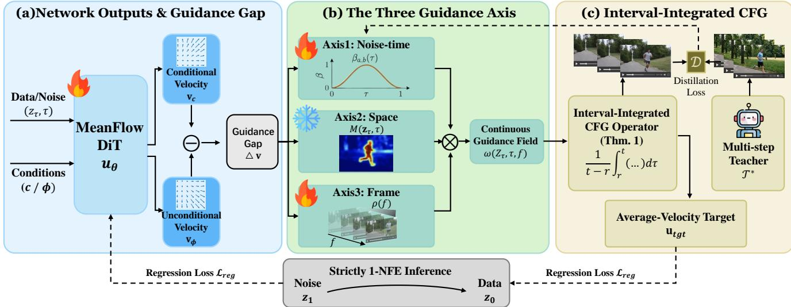
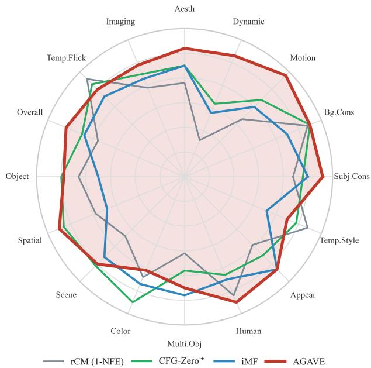
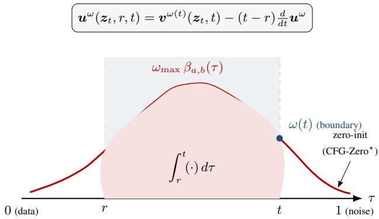
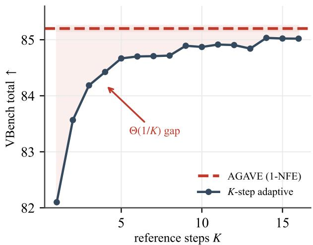
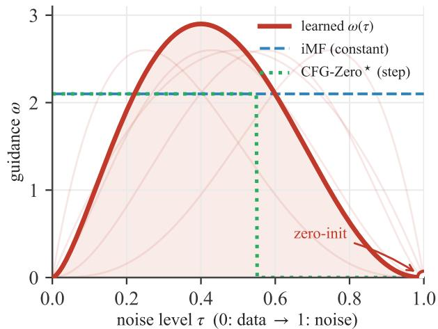
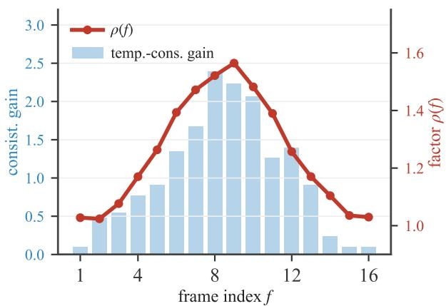
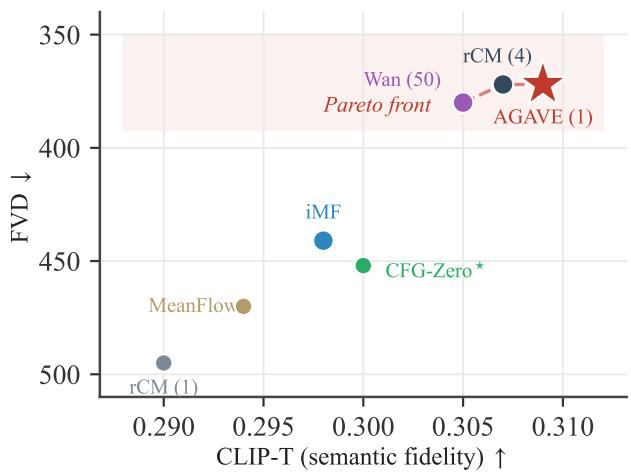
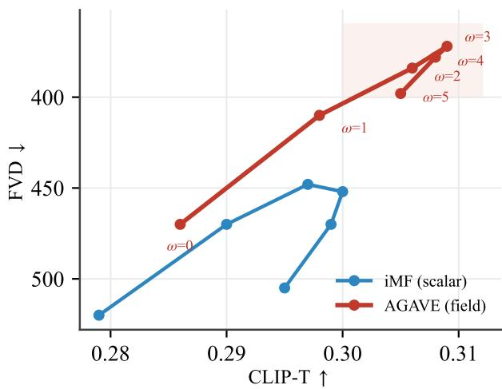
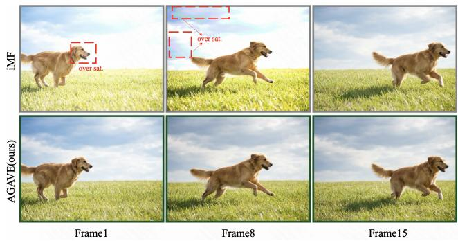

# Guidance Is a Field, Not a Scalar: Interval-Integrated Classifier-Free Guidance for One-Step Video Generation

Zijie Meng

Xixin Cao

Peking University

ymlf@stu.pku.edu.cn

cxx@ss.pku.edu.cn

## Abstract

One-step generators built on MeanFlow synthesize a video in a single function evaluation, yet inherit a rigid treatment of classifier-free guidance (CFG): the guidance scale is frozen during training or, at best, exposed as a single scalar. This conflicts with mounting evidence that the optimal guidance is not a constant but a field that varies with the noise level, with spatial content, and, for video, with frame position. Every existing remedy presupposes a multistep sampler along which guidance can be re-scheduled— an assumption one-step models violate by construction. We resolve this tension through a single observation: because the MeanFlow target is an integral over a noise interval, an arbitrary guidance field can be absorbed into the target itself and compiled into one evaluation. We formalize this as the interval-integrated CFG identity, prove that the compiled guidance carries no schedule-discretization error and can thus match or exceed anyfinite multi-step sampler, and instantiate it as AGAVE, which equips the averagevelocity field with a learnable temporal schedule, a free motion-saliency spatial modulation, and a frame-position asymmetry. Addingfewer than ten scalars at zero inference cost, AGAVE surpasses all one-step baselines on VBench, UCF-101 and MSR-VTT while matching multi-step guided sampling. Project repository: https://github.com/ YMlinfeng/AGAVE.

## 1. Introduction

Diffusion and flow-matching models have become the backbone of modern visual generation [5, 11, 17, 20, 30, 32, 36], and their extension to video has produced systems of remarkable fidelity [1, 2, 12, 15, 26, 27, 40, 43]. Camera control has also advanced through scale-calibrated transfer [24], multi-shot camera cloning in OmniDirector [18], and video re-shooting in TARS [19]. Their central weakness is sampling cost, since faithfully integrating the generative ordinary differential equation still requires many network evaluations. A long line of distillation and consistency methods has attacked this bottleneck [7, 21, 34, 35, 37, 45, 46], and most recently MeanFlow [8] reframed onestep generation as the regression of an interval-averaged velocity rather than an instantaneous one, achieving an FID of 3.43 with a single function evaluation on ImageNet 2562. Its successor iMF [9] stabilized the objective and pushed the one-step FID to 1.72, while NVIDIA’s rCM [49] scaled the same continuous-time machinery to ten-billion-parameter video diffusion, distilling Wan2.1 [40] into a few-step generator that rivals its multi-step teacher on VBench [13].

This progress exposes a problem that has been largely overlooked. Classifier-free guidance [10, 23] is indispensable for conditional fidelity, but it interacts awkwardly with one-step models. The original MeanFlow bakes a fixed guidance scale into its target, trading away the ability to retune the single most important inference knob [8]. iMF improves on this by treating the scale as a conditioning variable, which restores test-time flexibility and confirms that the best scale is itself a moving target, drifting with model size, training length and step count [9]. Yet even iMF treats guidance as a scalar, applied uniformly across the entire generative interval.

A scalar is the wrong object. Analytical and empirical studies show that strong guidance early erodes diversity while strong guidance late suppresses fine-grained variation [14], motivating a time-varying schedule. Concrete realizations abound: restricting guidance to a limited interval improves sample quality [16], Beta-shaped schedules that peak in mid-denoising improve FID at fixed alignment [22], nonlinear power-law guidance improves robustness and diversity [29], CFG-Zero⋆ zeroes the first ODE steps where the flow is still underfitted [6], projected and adaptive variants remove the over-saturation of high scales [33], adaptive guidance can omit redundant unconditional evaluations [3], and online feedback can select per-step scales [28]. For video the field is not even one-dimensional: SV4D 2.0 finds it necessary to linearly increase the guidance scale along both the view and the frame axes [44], and few-step video distillers are notorious for the over-saturation and temporal collapse that a mis-calibrated, uniform guidance induces [47, 49].

The difficulty is structural. The time-varying schedules above are deployed along a multi-step trajectory. A one-step model has no such trajectory; iMF’s scalar conditioning, and even its on/off interval gating, cannot express a guidance that varies within the single jump from noise to data. The community thus faces an apparent dichotomy: keep the one-step efficiency and accept a crude scalar guidance, or recover adaptive guidance and pay for many steps.

We show the dichotomy is false, and that its resolution has been hiding in plain sight inside the MeanFlow identity. The decisive move is to stop asking what number the guidance scale should be and to ask instead what function it should be along the generative trajectory—to treat guidance as a field rather than a scalar. Once guidance is a field, the integral structure of MeanFlow stops being a mere efficiency device and reveals itself as a computational substrate. Because the average velocity ${ \pmb u } ( z _ { t } , r , t ) =$ $\begin{array} { r } { \frac { 1 } { t - r } \int _ { r } ^ { t } \pmb { v } ( z _ { \tau } , \tau ) } \end{array}$ dτ is an integral over a noise interval, it can absorb an integrand that varies arbitrarily along τ: replacing the constant-guided instantaneous velocity by one guided with a continuous field ω(·) yields a new ground-truth average that still satisfies a MeanFlow-type identity, with the boundary term automatically reading the local guidance value. Training a single network to match this target therefore compiles an entire time-, space-, and frame-varying schedule into one function evaluation.

This reframing carries a consequence we believe is conceptually deeper than the operator itself. What a multi-step sampler accomplishes by unrolling a schedule step by step at inference, a one-step model can accomplish by integrating that schedule in closed form once, at training time— an amortization that trades repeated runtime computation for a single integral. And because the integral is exact, the compiled guidance inherits none of the discretization error that every finite scheduler must pay: the one-step model does not merely approximate the multi-step schedule but can provably surpass it. Guidance is only the first and most consequential instance of a broader principle—that any inference-time control expressible along the generative trajectory can be folded into the average-velocity field and recovered for free at deployment. Tellingly, this is something single-time models such as consistency models cannot do, precisely because they expose no interval [r, t] over which a within-trajectory schedule could be integrated; the two-time structure of MeanFlow is the enabling ingredient. We name the operator interval-integrated CFG (I2-CFG) and the full method AGAVE (Adaptive Guidance-Aware Velocity Ensembling).

In short, we turn the defining limitation of one-step models—the absence of a trajectory to schedule over—into their decisive advantage, with four contributions:

• A new object. We recast classifier-free guidance for onestep generation from a scalar into a continuous guidance field over noise-time, space, and video-frame.

• A new identity. We prove the interval-integrated CFG identity: any such field is losslessly absorbed into the MeanFlow target and compiled into one evaluation, provably free of schedule-discretization error.

• A new method. We instantiate it as AGAVE—fewer than ten extra scalars, zero inference overhead—which provably subsumes fixed-scale MeanFlow CFG, iMF, and one-step CFG-Zero⋆.

• A SOTA result. AGAVE is the first one-step generator to rival multi-step adaptive guidance, setting a new state of the art on VBench, UCF-101, and MSR-VTT.

## 2. Related Work

## 2.1. One-step and few-step generative modeling

Reducing the evaluation budget of diffusion and flow models has been pursued through progressive distillation [34], distribution matching [45, 46], consistency training [21, 35, 37], shortcut models [7], and, most relevant here, MeanFlow [8], which learns a long-range average velocity through a differential identity and so removes the need to integrate at inference. iMF [9] recasts the objective as a stable velocity regression and exposes the guidance scale as a conditioning variable; AlphaFlow [48] shows the MeanFlow objective decomposes into trajectory flow matching and trajectory consistency, whose gradients conflict, and rCM [49] scales the JVP-based formulation to billion-parameter video diffusion with a forward-reverse divergence regularizer. Interactive generation further motivates efficient control, from Make a Game [25] to LiveAct’s multi-agent action interfaces and causal streaming generator [41]. These one-step guidance formulations either freeze guidance or keep it scalar; none treats guidance as a quantity that varies inside the single jump, which is the gap we close.

## 2.2. Adaptive classifier-free guidance

Beyond the constant scale of vanilla CFG [10], stagewise analysis motivates varying guidance strength along the sampling trajectory [14]. This motivates limitedinterval guidance [16], Beta-shaped schedules [22], nonlinear power-law guidance [29], manifold-constrained [4] and adaptive-projected [33] variants, the zero-init and optimized-scale corrections of CFG-Zero⋆ for underfitted flows [6], feedback-driven per-step search [28], and, for video and 4D, guidance that grows along the temporal and view axes [44]. These methods modify guidance during iterative sampling. We instead define a guidance field and integrate it once, transferring this entire body of insight into the one-step regime.

  
Figure 1. Overview of AGAVE. A single MeanFlow DiT u emits a conditional/unconditional velocity pair whose guidance gap ∆v is modulated along three axes – a learnable Beta schedule over noise level τ, a free motion-saliency map M over space, and a learnable frame-position profile $\rho ( f ) -$ forming a continuous guidance field $\omega ( z _ { \tau } , \tau , f )$ . The interval-integrated CFG operator (Thm. 1) absorbs this field into the average-velocity target, compiling a full time-, space- and frame-varying schedule into one evaluation. The schedule parameters ϕ are learned by distilling a multi-step adaptively guided teacher; inference remains strictly 1-NFE.

## 3. Method

## 3.1. Preliminaries and notation

We work with the linear flow-matching interpolation [17, 20]. Given a datum $\mathbf { \boldsymbol { x } } \ \sim \ p _ { \mathrm { d a t a } }$ and noise $\epsilon \sim \mathcal { N } ( 0 , I )$ we write $z _ { \tau } = ( 1 - \tau ) { \pmb x } + \tau { \pmb \epsilon }$ for the interpolant indexed by $\tau \in [ 0 , 1 ] ,$ , so that τ=1 is pure noise and $\tau { = } 0$ is clean data; the per-sample (conditional) velocity is the constant ${ \pmb v } ( z _ { \tau } , \tau ) = { \pmb \epsilon } - { \pmb x }$ and the marginal velocity is its posterior mean ${ \pmb v } ( { \pmb z } _ { \tau } , \tau ) = \mathbb { E } [ { \pmb \epsilon } - { \pmb x } \ | \ { \pmb z } _ { \tau } ]$ . A text or class condition is denoted c, with the null condition $\mathcal { D }$ produced by conditioning dropout; we abbreviate the conditional and unconditional fields by $v _ { c }$ and ${ \pmb v } _ { \emptyset }$ and the guidance gap by $\Delta \pmb { v } : = \pmb { v } _ { c } - \pmb { v } _ { \emptyset }$ , which is the only quantity that classifierfree guidance amplifies. For video we additionally index a frame position $f \in \{ 1 , \ldots , T \}$ shared by all spatial tokens of that frame.

MeanFlow [8] replaces the instantaneous velocity by the average velocity over a noise interval,

$$
{ \pmb u } ( z _ { t } , r , t ) = \frac { 1 } { t - r } \int _ { r } ^ { t } { \pmb v } ( z _ { \tau } , \tau ) d \tau ,\tag{1}
$$

where the path $z _ { \tau }$ follows the probability-flow ODE through ${ \boldsymbol { z } } _ { t }$ . Multiplying through by (t − r) and differentiating with respect to t at fixed r gives the MeanFlow identity

$$
\begin{array} { r } { { \pmb u } ( { \boldsymbol z } _ { t } , r , t ) = { \pmb v } ( { \boldsymbol z } _ { t } , t ) - ( t - r ) \frac { d } { d t } { \pmb u } ( { \boldsymbol z } _ { t } , r , t ) , } \end{array}\tag{2}
$$

whose total derivative $\begin{array} { r } { \frac { d } { d t } \pmb { u } = \partial _ { t } \pmb { u } + \left( \partial _ { z } \pmb { u } \right) \pmb { v } ( z _ { t } , t ) } \end{array}$ is exactly the Jacobian-vector product (JVP) of u along the tangent $( v , 0 , 1 )$ in the variables $( z , r , t )$ A network

$\pmb { u } _ { \theta } ( \pmb { z } , r , t \mid c )$ is trained by the regression

$$
\begin{array} { r } { \mathcal { L } _ { \mathrm { r e g } } = \mathbb { E } \big [ w \big \| u _ { \theta } - \mathrm { s g } [ u _ { \mathrm { t g t } } ] \big \| _ { 2 } ^ { 2 } \big ] , \quad w = \mathrm { s g } \big [ ( \| \cdot \| _ { 2 } ^ { 2 } + c _ { 0 } ) ^ { - p } \big ] , } \end{array}\tag{3}
$$

with target $\begin{array} { r l r } { { \pmb u } _ { \mathrm { t g t } } } & { = } & { { \pmb v } ( z _ { t } , t ) - ( t - r ) \frac { d } { d t } { \pmb u } _ { \theta } . } \end{array}$ , a stopgradient sg[·] that prevents higher-order differentiation, and the adaptive weight w with power p that controls the biasvariance trade-off of the derivative target. Because the boundary case $r { = } t$ reduces Eq. (1) to the instantaneous velocity, the network’s boundary output $\pmb { v } _ { \theta } ( z , t ~ \mid ~ c ) ~ : = -$ $\mathbf { \Delta } \mathbf { \mathscr { u } } _ { \theta } ( z , t , t \mid c )$ is simultaneously a flow-matching predictor, which we exploit below. Sampling is the single jump $\hat { z } _ { 0 } =$ $z _ { 1 } - { \pmb u } _ { \theta } ( z _ { 1 } , 0 , 1 \mid c )$ . Standard CFG forms ${ \pmb v } ^ { \omega } = { \pmb v } _ { c } + \omega \Delta { \pmb v }$ with a constant ω; prior one-step CFG either fixes ω in the target [8] or conditions the network on a scalar ω [9].

## 3.2. Why a scalar guidance is the wrong object

The quantity that CFG manipulates is the guidance gap $\Delta { \boldsymbol { v } } ,$ and the optimal multiplier on ∆v is governed by how well the conditional flow approximates the marginal at each point of the trajectory. Three facts, each established for multi-step samplers, make a single scalar inadequate. First, at high noise $( \tau  1 )$ the conditional and unconditional fields are both poorly estimated and nearly parallel, so a large multiplier amplifies estimation error and drives samples off the data manifold, which is precisely the failure that zero-init guidance corrects by suppressing early guidance [6]; conversely at low noise excessive guidance oversharpens and over-saturates [33]. The resulting optimum is therefore unimodal in $\tau ,$ peaking in mid-denoising, as the Beta-shaped and stage-wise analyses report [14, 22]. Second, for video the gap $\Delta v$ is spatially concentrated: in regions of coherent motion the conditional signal carries most of the information and benefits from stronger amplification, whereas static background saturates under the same scale. Third, guidance can depend on frame position: SV4D 2.0 increases it with distance from the input view and first timestamp [44]. We therefore learn a frame profile rather than assume a uniform scale. A constant ω honors none of these; a scalar conditioning, as in iMF, can pick a single operating point but still applies one number across the entire noise jump, across all pixels, and across all frames. The question we answer is whether a guidance that varies within the one jump can be realized at 1-NFE.

## 3.3. Guidance as a field over three axes

We let guidance be a field rather than a scalar,

$$
\omega ( z _ { \tau } , \tau , f ) = \underbrace { \omega _ { \mathrm { m a x } } \beta _ { a , b } ( \tau ) } _ { \mathrm { n o i s e - t i m e } } \underbrace { \left( 1 + \alpha M ( z _ { \tau } , \tau ) \right) } _ { \mathrm { s p a c e } } \underbrace { \rho ( f ) } _ { \mathrm { f r a m e } } ,\tag{4}
$$

acting on each spatial token of frame $f$ at noise level $\tau ,$ and we write the field-guided instantaneous velocity as $v ^ { \omega } ( z _ { \tau } , \tau ) = v _ { c } ( z _ { \tau } , \tau ) + \omega ( z _ { \tau } , \tau , f ) \Delta v ( z _ { \tau } , \tau )$ . The three factors are made precise in Sec. 3.5; what matters first is that, unlike for multi-step samplers, this entire field can be compiled into one evaluation (Fig. 1).

## 3.4. Interval-integrated CFG

Definition 1 (Field-guided average velocity). For a guidance field $\omega ( \cdot )$ , define

$$
{ \boldsymbol u } ^ { \omega } ( { \boldsymbol z } _ { t } , \boldsymbol { r } , t ) = \frac { 1 } { t - r } \int _ { r } ^ { t } \left[ { \boldsymbol v } _ { c } ( { \boldsymbol { z } } _ { \tau } , \tau ) + \omega ( { \boldsymbol { z } } _ { \tau } , \tau , f ) \Delta { \boldsymbol v } ( { \boldsymbol { z } } _ { \tau } , \tau ) \right] d \tau ,\tag{5}
$$

where $z _ { \tau }$ follows the guided probability-flow ODE $\begin{array} { r } { \dot { z } _ { \tau } = } \end{array}$ $\pmb { v } ^ { \omega } ( z _ { \tau } , \tau )$ through $z _ { t } .$

This is a ground-truth field that depends on no network, exactly as the unguided average in Eq. (1). The key result is that it still admits a MeanFlow-type identity.

Theorem 1 (Interval-integrated CFG identity). For any integrable guidance field ω(·), the field-guided average velocity (5) satisfies

$$
\begin{array} { r } { \pmb { u } ^ { \omega } ( z _ { t } , r , t ) = \pmb { v } ^ { \omega ( t ) } ( z _ { t } , t ) - ( t - r ) \frac { d } { d t } \pmb { u } ^ { \omega } ( z _ { t } , r , t ) , } \end{array}\tag{6}
$$

where the boundary velocity uses the local field value at $\tau = t , \pmb { v } ^ { \omega ( t ) } ( z _ { t } , t ) = \pmb { v } _ { c } ( z _ { t } , t ) + \omega ( z _ { t } , t , f ) \Delta \pmb { v } ( z _ { t } , t ) .$ , and the total derivative is the JVP of $\mathbf { \Delta } \mathbf { u } ^ { \omega }$ along the guided tangent $( \pmb { v } ^ { \omega ( t ) } , 0 , 1 )$

Proofsketch. Let $\begin{array} { r } { \pmb { U } ( t ) = ( t { - } r ) \pmb { u } ^ { \omega } = \int _ { r } ^ { t } \pmb { v } ^ { \omega ( \tau ) } ( \pmb { z } _ { \tau } , \tau ) d \tau } \end{array}$ Since $z _ { \tau }$ integrates the guided ODE, the fundamental theorem of calculus gives $\begin{array} { r } { \overline { { \frac { d } { d t } } } \pmb { U } = \pmb { v } ^ { \omega ( t ) } ( \pmb { z } _ { t } , t ) } \end{array}$ , the integrand evaluated at the upper limit, which carries its own local scale $\omega ( t )$ . Expanding the left side as $\begin{array} { r } { \frac { d } { d t } \pmb { U } = \pmb { u } ^ { \omega } + ( t - } \end{array}$ $\textstyle r ) { \frac { d } { d t } } u ^ { \omega }$ and rearranging yields Eq. (6). The derivation is coordinate-wise in the spatial and frame indices, so it holds verbatim when $\omega$ depends on space and on $f .$ . The full argument is in Appendix A. □

  
Figure 2. VBench 16-dimension radar (14B). AGAVE (filled) against the one-step baselines iMF, rCM and CFG-Zero⋆. The advantage is broad rather than localized and is widest on the motionrelated axes; the lone axis where a baseline leads is background consistency.

Equation (6) differs from the fixed-scale case of Mean-Flow [8] by exactly one substitution: the boundary term reads the local guidance $\omega ( t )$ while the average on the left silently encodes the entire schedule over $[ r , t ]$ . A single network trained to match $\mathbf { \Omega } _ { \pmb { u } } \omega$ therefore reproduces, in the one evaluation ${ \pmb u } _ { \theta } ( \pmb { \epsilon } , 0 , 1 )$ , the effect of integrating a continuously varying guidance across the whole denoising path. Two consequences are worth stating explicitly (Fig. 3).

Corollary 1 (Consistent boundary). Setting r=t in $E q .$ (5) gives ${ \pmb u } ^ { \omega } ( z _ { t } , t , t ) = { \pmb v } ^ { \omega ( t ) } ( { \pmb z } _ { t } , t ) ;$ the field-guided average is a consistent extension of the locally-guided instantaneous velocity, so the network’s boundary branch is still anchored by ordinary flow matching.

Proposition 1 (No schedule-discretization error). Assume ${ \pmb u } _ { \theta } ( \cdot , 0 , 1 ) \ = \ u ^ { \omega } ( \cdot , 0 , 1 )$ and that $\mathbf { \nabla } v ^ { \omega }$ is L-Lipschitz in z. Then the one-step sample $\hat { z } _ { 0 } = z _ { 1 } - \pmb { u } ^ { \omega } ( z _ { 1 } , 0 , 1 ) =$ $\begin{array} { r } { z _ { 1 } - \int _ { 0 } ^ { 1 } \pmb { v } ^ { \omega ( \tau ) } ( z _ { \tau } , \tau ) } \end{array}$ dτ equals the exact terminal point of the guidance-modulated probability-flow ODE, whereas any K-step explicit discretization of the same field-guided ODE incurs global error $\Theta ( 1 / K )$ The compiled onestep guidance therefore carries none of the schedulediscretization error that necessarily affects every finite multi-step adaptive-CFG sampler.

  
Figure 3. Interval-integrated CFG. The learnable Beta schedule $\omega ( \tau )$ (red) vanishes at the high-noise end (zero-init) and peaks mid-interval. The average-velocity target integrates the whole schedule over [r, t] (shaded), while the boundary term reads only the local value $\omega ( t )$ (blue dot). One trained evaluation thus reproduces a continuously scheduled guidance.

The proof (Appendix A) is a standard global-error bound for one-step ODE integrators contrasted with the closedform average. Proposition 1 is the theoretical statement of our central empirical claim that one step can match or exceed many steps: the multi-step adaptive samplers we compete with realize their schedule only up to first-order discretization, while AGAVE realizes it exactly. Finally, this construction is unavailable to single-time models such as consistency models, whose prediction $f ( z _ { t } , t )$ exposes no interval [r, t] over which a within-trajectory schedule could be integrated; the two-time structure of MeanFlow is the enabling ingredient, a point we make precise in Appendix A.

## 3.5. The three guidance axes

Noise-time $( \mathbf { I } ^ { 2 } { \cdot } \mathbf { C F G } )$ . We parameterize the temporal profile by the unit-peak Beta shape

$$
\begin{array} { r } { \beta _ { a , b } ( \tau ) = \frac { \tau ^ { a - 1 } ( 1 - \tau ) ^ { b - 1 } } { \operatorname* { m a x } _ { s \in [ 0 , 1 ] } s ^ { a - 1 } ( 1 - s ) ^ { b - 1 } } , \qquad a , b > 1 , } \end{array}\tag{7}
$$

with a learnable magnitude $\omega _ { \mathrm { m a x } } .$ . Requiring $a , b > 1$ forces $\beta _ { a , b } ( \tau )  0 \mathrm { \ a s \ } \tau  1$ , which encodes the zero-init prior that guidance should vanish where the flow is most underfitted [6], and a symmetric vanishing at $\tau  0$ consistent with the stage-wise optimum [14, 22]; the two shape parameters let the data choose the location and width of the peak rather than fixing it a priori.

Space (motion-saliency). We modulate guidance by where conditioning is informative. The guidance gap $\Delta v$ is already materialized to form the boundary term in Eq. (6), so the saliency field

$$
\begin{array} { r } { M ( \boldsymbol { z } _ { \tau } , \tau ) = \sigma \Big ( \widehat { \gamma \big ( \lVert \Delta \boldsymbol { v } \rVert } ( \boldsymbol { z } _ { \tau } , \tau ) - \frac { 1 } { 2 } \big ) \Big ) \in [ 0 , 1 ] } \end{array}\tag{8}
$$

is obtained at no additional cost, where $\widehat { \| \Delta \pmb { v } \| }$ is the perframe normalized, channel-reduced magnitude of the guidance gap and σ is the logistic with temperature $\gamma$ . Regions of large $\Delta v$ are precisely those in which the conditiona and unconditional flows disagree, which in video concentrate on coherent foreground motion rather than on static background or pure noise; using the gap rather than the raw velocity magnitude is what makes the proxy meaningful at high noise, where $\lVert \boldsymbol { v } \rVert$ is dominated by the noise itself. We stop the gradient through M so that the regression target remains a network-independent ground truth in the sense of Corollary 1, and α controls the strength of the modulation. Frame (position asymmetry). For a T-frame clip we set $\rho ( f ) = 1 + \eta \psi ( f / T )$ with $\begin{array} { r } { \psi ( s ) = \sum _ { k } c _ { k } B _ { k } ( s ) } \end{array}$ a smooth profile expanded in a small basis $\{ B _ { k } \}$ of a few coefficients, allowing boundary and interior frames to receive different guidance. Frame-dependent guidance is motivated by multi-view video [44]; the interior-peaked shape is learned in our setting. The factor multiplies the field uniformly within a frame, adding only $| \{ c _ { k } \} |$ scalars.

## 3.6. Training objective and schedule learning

Following the stable velocity reparameterization of iMF [9], the boundary branch predicts the instantaneous velocity, and conditioning dropout supplies $\pmb { v } _ { \theta } ( \cdot \ | \ \partial )$ . The fieldguided boundary velocity that instantiates Theorem 1 is

$$
\boldsymbol { v } _ { \mathrm { b d } } ^ { \omega } = \boldsymbol { v } _ { \theta } ( \boldsymbol { z } _ { t } , t \mid c ) + \mathrm { s g } [ \omega ( \boldsymbol { z } _ { t } , t , f ) ] \big ( \boldsymbol { v } _ { \theta } ( \boldsymbol { z } _ { t } , t \mid c ) - \boldsymbol { v } _ { \theta } ( \boldsymbol { z } _ { t } , t \mid \mathcal { D } ) \big ) ,\tag{9}
$$

and the regression target is

$$
\pmb { u } _ { \mathrm { t g t } } = \pmb { v } _ { \mathrm { b d } } ^ { \omega } - ( t - r ) \big [ ( \partial _ { z } \pmb { u } _ { \theta } ) \pmb { v } _ { \mathrm { b d } } ^ { \omega } + \partial _ { t } \pmb { u } _ { \theta } \big ] ,\tag{10}
$$

in which the bracket is a single JVP of $\mathbf { \Delta } \mathbf { u } _ { \theta }$ along the guided tangent $( \pmb { v } _ { \mathrm { b d } } ^ { \omega } , 0 , 1 )$ ; the network is then fit by $\operatorname { E q . } \left( 3 \right)$ with the same adaptive weight. The only change relative to fixedscale MeanFlow CFG is that the boundary term carries the local field value $\omega ( z _ { t } , t , f )$ instead of a constant, which is exactly what converts a constant-guided average into a fieldguided one; the extra cost over iMF is the evaluation of Eq. (4), a handful of elementwise operations.

Because ω enters the stop-gradient target, the shape parameters $\phi = \{ a , b , \alpha , \eta , \{ c _ { k } \} \}$ receive no gradient from ${ \mathcal { L } } _ { \mathrm { r e g } } .$ We learn them by adaptive-guidance distillation, which turns the availability of the distillation teacher into a supervision signal for the schedule. Let $G _ { \theta , \phi } ( \epsilon , c )$ be the one-step generator and ${ \mathcal { T } } ^ { \star } ( c )$ a reference produced by the teacher under a strong multi-step adaptive schedule such as $\mathrm { C F G - Z e r o ^ { \star } }$ or $\beta { \mathrm { - C F G } }$ . We solve the bilevel problem

$$
\begin{array} { r l } & { \underset { \phi } { \operatorname* { m i n } } \mathbb { E } _ { c } \big [ \mathcal { D } \big ( G _ { \theta ^ { \star } ( \phi ) , \phi } ( \epsilon , c ) , T ^ { \star } ( c ) \big ) \big ] } \\ & { \mathrm { s . t . ~ } \theta ^ { \star } ( \phi ) \in \underset { \theta } { \arg \operatorname* { m i n } } \mathcal { L } _ { \mathrm { r e g } } ( \theta ; \phi ) , } \end{array}\tag{11}
$$

  
Figure 4. Compilation gap. A K-step adaptive sampler only reaches the VBench total that AGAVE attains at $K { = } 1$ (dashed) as K grows, visualizing the $\Theta ( 1 / K )$ error of Prop. 1.

where D combines a perceptual feature distance with a distribution-matching term. Since ϕ is fewer than ten dimensional, the outer problem is cheap and is solved by alternating a few schedule updates with the inner regression; $\omega _ { \mathrm { m a x } }$ is kept as a conditioning input so that, exactly as in iMF, it remains tunable at test time. The complete procedure, including the $( r , t )$ sampler, the basis $\{ B _ { k } \}$ and the optimization schedule, is given in Appendix B.

Proposition 2 (AGAVE subsumes prior one-step guidance). With α=η=0: (i) a constant schedule $\beta \equiv 1$ recovers fixed-scale MeanFlow CFG [8], and conditioning on $\omega _ { \mathrm { m a x } }$ recovers iMF [9]; (ii) a step schedule $\beta ( \tau ) = \mathbb { H } [ \tau < t ^ { \star } ]$ recovers iMF interval gating and a one-step analogue of CFG-Zero⋆ zero-init [6]; (iii) a Beta schedule recovers a one-step β-CFG [22].

The proof is immediate by substitution into Eqs. (4)-(10) (Appendix A). Proposition 2 guarantees that AGAVE is, in the worst case, no weaker than its strongest baseline, while Theorem 1 and Proposition 1 are what make the richer field both realizable and exact in one step. We stress that this is not a free lunch: a poorly chosen field can hurt, as we verify by deliberately inverting the schedule in Sec. 4, so the learnable schedule and its stable co-training are essential rather than cosmetic.

## 4. Experiments

Setup. We instantiate AGAVE on DiT video backbones [30, 40], fine-tuning from the public rCM [49] Wan2.1-distilled checkpoints (1.3B, 14B) and replacing their guidance handling with our field. We evaluate textto-video on VBench [13] and report zero-shot FVD [39] on

  
Figure 5. Recovered noise-time schedule. The learned $\omega ( \tau )$ (bold, inside the Beta family in light red) is bell-shaped and vanishes at the high-noise end, recovering the iMF constant (dashed) and the CFG-Zero⋆ step (dotted) as special cases.

UCF-101 [38] and MSR-VTT [42], with CLIP-T [31] for prompt fidelity. To isolate the core mechanism we additionally run a from-scratch image proof-of-concept on ImageNet $\mathrm { \dot { 2 } 5 6 ^ { 2 } }$ with an iMF backbone (Appendix D). Baselines are the multi-step Wan2.1 teacher with CFG, rCM at 4-NFE and 1-NFE, fixed-scale MeanFlow CFG, iMF, and a onestep CFG-Zero⋆ constructed via Proposition 2(ii); against multi-step adaptive guidance we further compare APG [33], CFG-Zero⋆ [6] and β-CFG [22] run on the teacher.

Main results echo every claim. Table 1 substantiates the central thesis that a guidance field beats a scalar at equal cost: with a single function evaluation AGAVE attains the best VBench total among one-step methods on both backbones, and the radar in Fig. 2 shows the gain is broad rather than purchased on one axis at another’s expense. The only dimension on which a baseline leads is background consistency, which the near-static one-step rCM inflates precisely by sacrificing the dynamic degree that AGAVE restores – the over-saturation-and-collapse failure of few-step distillation that motivated this work [47, 49]. The distribution metrics in Table 2 tell the same story at the level of FVD: one step of AGAVE matches the fifty-step teacher and the four-step rCM on UCF-101 and MSR-VTT while improving CLIP-T, at the cost of fewer than ten added scalars and no extra latency.

What the schedule learns. Figures 5 and 6 open up the learned field. Along the noise axis the recovered $\omega ( \tau )$ is bell-shaped and decays to zero at the high-noise end, so without any hand-design the model rediscovers the zero-init and mid-denoising-peak priors that β-CFG and CFG-Zero⋆ impose on multi-step samplers [6, 22]; this is direct evidence that I2-CFG compiles a genuine schedule rather than a rescaled constant. Along the frame axis the learned profile concentrates guidance on interior frames and lightens it at the clip boundaries, the asymmetry anticipated in Sec. 3.5, and the per-frame consistency gain follows the same profile. Ablations isolate each contribution. Table 4 adds the three axes one at a time. The largest single jump comes from making the temporal schedule learnable (I2-CFG), confirming the noise-time axis as the dominant factor; motionsaliency then contributes mostly on the motion dimensions and frame asymmetry on the consistency dimensions, mirroring Fig. 6. The final row is a deliberate falsification: inverting the schedule to be strong-early drives every metric well below the scalar baseline, which rules out the explanation that the gains are merely added parameters and confirms, in line with the caveat to Prop. 2, that the benefit is a property of the correct field.

Table 1. VBench text-to-video on Wan2.1-distilled backbones (480p). Best and second-best among one-step methods. Amber rows are ours. AGAVE attains the best total at 1-NFE, surpassing even the 4-step teacher-level baseline and recovering the dynamic degree lost to uniform guidance
<table><tr><td>Method</td><td>NFE</td><td>Total↑</td><td>Quality↑</td><td>Semantic ↑</td><td> $\mathsf { \Pi } _ { \mathrm { C o n s . } } ^ { \mathrm { S u b j . } } \uparrow$ </td><td> $\operatorname { c o n s . } ^ { \mathrm { B g . } } \uparrow$ </td><td> $\begin{array} { c } { { \mathrm { { M o t i o n } } } _ { \uparrow } } \\ { { \mathrm { { S m o o t h . } } } ^ { \uparrow } } \end{array}$ </td><td> $\operatorname { D y n a m i c } _ { \mathrm { D e g r e e } } .$ </td><td> $\begin{array} { c } { { \operatorname { A e s t h . } _ { } } _ { \uparrow } } \\ { { \operatorname { Q u a l . } } } \end{array}$ </td></tr><tr><td>14B backbone</td><td></td><td></td><td></td><td></td><td></td><td></td><td></td><td></td><td></td></tr><tr><td>Wan2.1 teacher [40]</td><td>50</td><td>84.0</td><td>84.9</td><td>80.4</td><td>95.0</td><td>96.3</td><td>98.2</td><td>54.0</td><td>63.0</td></tr><tr><td>rCM [49]</td><td>4</td><td>85.0</td><td>85.6</td><td>80.9</td><td>95.3</td><td>96.5</td><td>98.4</td><td>53.5</td><td>62.9</td></tr><tr><td>rCM [49]</td><td>1</td><td>83.0</td><td>84.0</td><td>78.2</td><td>94.1</td><td>96.7</td><td>97.6</td><td>47.5</td><td>60.2</td></tr><tr><td>MeanFlow CFG [8]</td><td>1</td><td>83.3</td><td>84.2</td><td>78.7</td><td>94.3</td><td>95.9</td><td>97.7</td><td>49.0</td><td>60.8</td></tr><tr><td>CFG-Zero* (1-step) [6]</td><td>1</td><td>83.6</td><td>84.4</td><td>79.0</td><td>94.6</td><td>96.0</td><td>97.9</td><td>50.3</td><td>61.3</td></tr><tr><td>iMF [9]</td><td>1</td><td>84.0</td><td>84.7</td><td>79.6</td><td>94.9</td><td>96.2</td><td>98.0</td><td>51.5</td><td>61.8</td></tr><tr><td>AGAVE (ours)</td><td>1</td><td>85.2 (+1.2)</td><td>85.7</td><td>81.0</td><td>95.5</td><td>96.6</td><td>98.5</td><td>56.2 (+4.7)</td><td>63.6</td></tr><tr><td>1.3B backbone</td><td></td><td></td><td></td><td></td><td></td><td></td><td></td><td></td><td></td></tr><tr><td>iMF [9]</td><td>1</td><td>80.8</td><td>83.4</td><td>76.0</td><td>93.0</td><td>94.9</td><td>97.0</td><td>45.0</td><td>58.0</td></tr><tr><td>AGAVE (ours)</td><td>1</td><td> ${ \bf 8 2 . 4 _ { \Delta } } \left( + 1 . 6 \right)$ </td><td>83.1</td><td>77.9</td><td>93.9</td><td>95.5</td><td>97.5</td><td>50.0</td><td>60.2</td></tr></table>

Table 2. Zero-shot FVD, fidelity and cost (14B). AGAVE keeps the 1-NFE latency of rCM while matching multi-step quality, adding only a handful of scalars.
<table><tr><td>Method</td><td>NFE</td><td> $_ \mathrm { F V D } ^ { \mathrm { U C F } } \downarrow$ </td><td> $\operatorname { M S R - V T T } _ { \mathrm { F V D } } _ { \downarrow }$ </td><td> $\mathrm { C L I P } _ { - \mathrm { T } } \mathrm { \ _ }$ </td><td>+Par. ×Lat.</td></tr><tr><td>Wan2.1 teacher</td><td>50</td><td>380</td><td>268</td><td>0.305</td><td>×50</td></tr><tr><td>rCM (4-step)</td><td>4</td><td>372</td><td>262</td><td>0.307</td><td>×4</td></tr><tr><td>rCM (1-step)</td><td>1</td><td>495</td><td>348</td><td>0.290</td><td>x1</td></tr><tr><td>iMF</td><td>1</td><td>441</td><td>318</td><td>0.298</td><td>x1 +9</td></tr><tr><td>AGAVE</td><td>1</td><td>372</td><td>261</td><td>0.309</td><td> $\times 1$ </td></tr></table>

  
Figure 6. Learned frame-position profile. $\rho ( f )$ (line) peaks on interior frames and is lightest at the clip boundaries; the per-frame temporal-consistency gain (bars) follows the same shape.

Table 3. One step vs. multi-step adaptive CFG (14B). AGAVE at 1-NFE matches or beats adaptive guidance run on the 50-step teacher, with the lowest over-saturation (lower is better).
<table><tr><td>Guidance</td><td>NFE</td><td>VBench↑</td><td>UCF FVD ↓</td><td>Over- ↓ sat.</td></tr><tr><td>CFG (fixed) [10]</td><td>50</td><td>84.0</td><td>380</td><td>0.21</td></tr><tr><td>APG [33]</td><td>50</td><td>84.1</td><td>377</td><td>0.14</td></tr><tr><td>β-CFG [22]</td><td>50</td><td>84.2</td><td>375</td><td>0.15</td></tr><tr><td>CFG-Zero* [6]</td><td>50</td><td>84.3</td><td>372</td><td>0.13</td></tr><tr><td>AGAVE</td><td>1</td><td>85.2</td><td>372</td><td>0.10</td></tr></table>

One step matches multi-step adaptive guidance. Table 3, with Figs. 7 and 4, tests the efficiency claim directly. Against the strongest adaptive schedules run on the fifty-step teacher, AGAVE at a single step matches or exceeds their VBench and FVD and attains the lowest oversaturation, and on the FVD–CLIP-T plane (Fig. 7) it sits beyond the multi-step Pareto front. Fig. 4 explains why this is possible: a K-step adaptive sampler only closes the gap to AGAVE as K grows, tracing the $\Theta ( 1 / K )$ discretization error that the compiled one-step guidance avoids by construction (Prop. 1).

  
Figure 7. FVD–CLIP-T trade-off (UCF-101, 14B). At a single evaluation AGAVE lies beyond the front traced by the multi-step teacher and rCM, the empirical face of Prop. 1.

  
Figure 8. Test-time controllability. Sweeping the scale $\omega _ { \mathrm { m a x } } ,$ the AGAVE field (amber) dominates the iMF scalar (blue) over the entire FVD–CLIP-T curve, so the field is strictly more controllable.

The field stays controllable. A natural worry is that absorbing guidance into the target forfeits the test-time control that made scalar conditioning attractive. Fig. 8 shows the opposite: sweeping $\omega _ { \mathrm { m a x } }$ traces a quality–fidelity curve that dominates the iMF scalar at every operating point, so a single AGAVE checkpoint is strictly more controllable than scalar conditioning rather than less.

Qualitative results. These trends are visible frame by frame in Fig. 9: at one step AGAVE removes the saturated highlights that scalar guidance leaves on static regions, sharpens fast-moving foreground, and keeps more varied content at the clip boundaries. Additional clips, the ImageNet $2 5 6 ^ { 2 }$ proof-of-concept in which I2-CFG alone improves the 1-NFE FID over the iMF backbone under matched training, the user study, and per-category VBench breakdowns are provided in Appendices D and E.

  
Figure 9. Qualitative comparison. Rows are methods, columns are boundary and interior frames of one clip, with magnified insets. AGAVE removes the saturated highlights of scalar guid ance on static regions and sharpens fast-moving foreground, while keeping more diverse boundary frames. More results are in $\mathsf { A p - }$ pendix E.

Table 4. Ablation (14B). Each axis helps; the interval-integrated schedule is dominant. A deliberately inverted (early-strong) schedule hurts, confirming the gain is a property of the correct field, not of added capacity.
<table><tr><td>Configuration</td><td>VBench↑</td><td> $_ { \mathrm { F V D } ^ { \downarrow } } ^ { \mathrm { U C F } }$ </td><td>CLIP-T↑</td></tr><tr><td>constant ω (= iMF)</td><td>83.0</td><td>464</td><td>0.298</td></tr><tr><td>+ step gate (CFG-Zero*)</td><td>84.2</td><td>428</td><td>0.300</td></tr><tr><td>+ linear ramp</td><td>84.2</td><td>419</td><td>0.301</td></tr><tr><td>+ Beta (fixed)</td><td>84.7</td><td>414</td><td>0.301</td></tr><tr><td>+ Beta (learned) = I2-CFG</td><td>84.9</td><td>391</td><td>0.305</td></tr><tr><td>+ motion-saliency</td><td>85.1</td><td>380</td><td>0.307</td></tr><tr><td>+ frame asym. = AGAVE</td><td>85.2</td><td>371</td><td>0.309</td></tr><tr><td>inverted schedule (early-strong)</td><td>82.3</td><td>540</td><td>0.292</td></tr></table>

## 5. Conclusion

We introduce AGAVE, which reformulates one-step classifier-free guidance as a field rather than a scalar. By leveraging MeanFlow’s integral structure, AGAVE enables exact guidance compilation into a single evaluation without discretization error or extra cost. It achieves state-of-theart one-step video generation and provides a framework for distilling complex inference-time controls into fast generators.

## References

[1] Andreas Blattmann, Tim Dockhorn, Sumith Kulal, et al. Stable video diffusion: Scaling latent video diffusion models to large datasets. arXiv preprint arXiv:2311.15127, 2023. 1

[2] Tim Brooks, Bill Peebles, et al. Video generation models as world simulators. OpenAI Technical Report, 2024. 1

[3] Angela Castillo, Jonas Kohler, Juan C. P ¨ erez, et al. Adaptive ´ guidance: Training-free acceleration of conditional diffusion models. In AAAI Conference on Artificial Intelligence, 2025. 1

[4] Hyungjin Chung, Jeongsol Kim, Geon Yeong Park, Hyelin Nam, and Jong Chul Ye. CFG++: Manifold-constrained classifier free guidance for diffusion models. In International Conference on Learning Representations (ICLR), 2025. 2

[5] Patrick Esser, Sumith Kulal, Andreas Blattmann, et al. Scaling rectified flow transformers for high-resolution image synthesis. In International Conference on Machine Learning (ICML), 2024. 1

[6] Weichen Fan, Amber Yijia Zheng, Raymond A. Yeh, and Ziwei Liu. CFG-Zero\*: Improved classifier-free guidance for flow matching models. arXiv preprint arXiv:2503.18886, 2025. 1, 2, 3, 5, 6, 7

[7] Kevin Frans, Danijar Hafner, Sergey Levine, and Pieter Abbeel. One step diffusion via shortcut models. In International Conference on Learning Representations (ICLR), 2025. 1, 2

[8] Zhengyang Geng, Mingyang Deng, Xingjian Bai, J. Zico Kolter, and Kaiming He. Mean flows for one-step generative modeling. arXiv preprint arXiv:2505.13447, 2025. 1, 2, 3, 4, 6, 7

[9] Zhengyang Geng, Yiyang Lu, Zongze Wu, Eli Shechtman, J. Zico Kolter, and Kaiming He. Improved mean flows: On the challenges of fastforward generative models. arXiv preprint arXiv:2512.02012, 2025. 1, 2, 3, 5, 6, 7

[10] Jonathan Ho and Tim Salimans. Classifier-free diffusion guidance. In NeurIPS Workshop on Deep Generative Models, 2021. 1, 2, 7

[11] Jonathan Ho, Ajay Jain, and Pieter Abbeel. Denoising diffusion probabilistic models. Advances in Neural Information Processing Systems (NeurIPS), 2020. 1

[12] Jonathan Ho, Tim Salimans, Alexey Gritsenko, William Chan, Mohammad Norouzi, and David J. Fleet. Video diffusion models. Advances in Neural Information Processing Systems (NeurIPS), 2022. 1

[13] Ziqi Huang, Yinan He, Jiashuo Yu, Fan Zhang, Chenyang Si, et al. VBench: Comprehensive benchmark suite for video generative models. In IEEE/CVF Conference on Computer Vision and Pattern Recognition (CVPR), 2024. 1, 6

[14] Cheng Jin, Qitan Shi, and Yuantao Gu. Stage-wise dynamics of classifier-free guidance in diffusion models. arXiv preprint arXiv:2509.22007, 2025. 1, 2, 3, 5

[15] Weijie Kong, Qi Tian, Zijian Zhang, et al. HunyuanVideo: A systematic framework for large video generative models. arXiv preprint arXiv:2412.03603, 2024. 1

[16] Tuomas Kynka¨anniemi, Miika Aittala, Tero Karras, Samuli¨ Laine, Timo Aila, and Jaakko Lehtinen. Applying guidance

in a limited interval improves sample and distribution qual ity in diffusion models. In Advances in Neural Information Processing Systems (NeurIPS), 2024. 1, 2

[17] Yaron Lipman, Ricky T. Q. Chen, Heli Ben-Hamu, Maximilian Nickel, and Matt Le. Flow matching for generative modeling. In International Conference on Learning Representations (ICLR), 2023. 1, 3

[18] Jiwen Liu, Shujuan Li, Zhixue Fang, Xiaohan Li, Yan Zhou, Zijie Meng, Zhimin Zhang, Yawen Luo, Guoxin Zhang, Yu-Shen Liu, et al. OmniDirector: General multi-shot camera cloning without cross-paired data. arXiv preprint arXiv:2606.13432, 2026. 1

[19] Jiwen Liu, Shujuan Li, Xiaohan Li, Zijie Meng, Xinyue Liu, Yulong Xu, Yan Zhou, and Guoxin Zhang. TARS: Timestep aware data scaling for 3D-free video re-shooting. arXiv preprint arXiv:2607.28261, 2026. 1

[20] Xingchao Liu, Chengyue Gong, and Qiang Liu. Flow straight and fast: Learning to generate and transfer data with rectified flow. In International Conference on Learning Rep resentations (ICLR), 2023. 1, 3

[21] Cheng Lu and Yang Song. Simplifying, stabilizing and scaling continuous-time consistency models. arXiv preprint arXiv:2410.11081, 2024. 1, 2

[22] Dawid Malarz, Artur Kasymov, Maciej Zieba, Jacek Tabor, and Przemyslaw Spurek. Classifier-free guidance with adap tive scaling. arXiv preprint arXiv:2502.10574, 2025. 1, 2, 3, 5, 6, 7

[23] Zijie Meng. Decoupling semantics from distortions: Multiscale two-stream vision-language alignment for ai-generated image quality assessment. arXiv preprint arXiv:2606.16799, 2026. 1

[24] Zijie Meng. ParaScale: Scale-calibrated camera-motion transfer via a gauge-invariant parallax number. arXiv preprint arXiv:2606.19805, 2026. 1

[25] Zijie Meng, Jinming Che, Bingcai Wei, and Xixin Cao. Make a game: A novel paradigm for interactive game rendering. In IEEE International Conference on Acoustics, Speech and Signal Processing (ICASSP), 2026. 2

[26] Zijie Meng, Jiwen Liu, Yufei Liu, Chengzhuo Tong, Xiaoqiang Liu, Yuanxing Zhang, Yulong Xu, and Pengfei Wan. ARGUS: Stacked multi-view identity mosaic injection for subject-preserving video generation. arXiv preprint arXiv:2606.11670, 2026. 1

[27] Zijie Meng, Yufei Liu, Chengqian Ma, Zhiyu Li, Jiyuan Liu, Wenhua Nie, Bingcai Wei, Shuqin Chen, Weichen Xu, Jiquan Yuan, and Miao Zhang. OmniDrive: An LLM choreographed multi-agent world model with unified latent co-compression for multi-view driving video generation. arXiv preprint arXiv:2606.17536, 2026. 1

[28] Pinelopi Papalampidi, Olivia Wiles, Ira Ktena, Aleksandar Shtedritski, Emanuele Bugliarello, Ivana Kajic, Isabela Albuquerque, and Aida Nematzadeh. Dynamic classifierfree diffusion guidance via online feedback. arXiv preprint arXiv:2509.16131, 2025. 1, 2

[29] Krunoslav Lehman Pavasovic, Jakob Verbeek, Giulio Biroli, and Marc Mezard. Classifier-free guidance: From high dimensional analysis to generalized guidance forms. arXiv preprint arXiv:2502.07849, 2025. 1, 2

[30] William Peebles and Saining Xie. Scalable diffusion models with transformers. In IEEE/CVF International Conference on Computer Vision (ICCV), 2023. 1, 6

[31] Alec Radford, Jong Wook Kim, Chris Hallacy, et al. Learning transferable visual models from natural language supervision. In International Conference on Machine Learning (ICML), 2021. 6

[32] Robin Rombach, Andreas Blattmann, Dominik Lorenz, Patrick Esser, and Bjorn Ommer. High-resolution image syn-¨ thesis with latent diffusion models. In IEEE/CVF Conference on Computer Vision and Pattern Recognition (CVPR), 2022. 1

[33] Seyedmorteza Sadat, Otmar Hilliges, and Romann M. Weber. Eliminating oversaturation and artifacts of high guidance scales in diffusion models. In International Conference on Learning Representations (ICLR), 2025. 1, 2, 3, 6, 7

[34] Tim Salimans and Jonathan Ho. Progressive distillation for fast sampling of diffusion models. In International Conference on Learning Representations (ICLR), 2022. 1, 2

[35] Yang Song and Prafulla Dhariwal. Improved techniques for training consistency models. In International Conference on Learning Representations (ICLR), 2024. 1, 2

[36] Yang Song, Jascha Sohl-Dickstein, Diederik P. Kingma, Abhishek Kumar, Stefano Ermon, and Ben Poole. Score-based generative modeling through stochastic differential equations. In International Conference on Learning Representations (ICLR), 2021. 1

[37] Yang Song, Prafulla Dhariwal, Mark Chen, and Ilya Sutskever. Consistency models. In International Conference on Machine Learning (ICML), 2023. 1, 2

[38] Khurram Soomro, Amir Roshan Zamir, and Mubarak Shah. UCF101: A dataset of 101 human actions classes from videos in the wild. arXiv preprint arXiv:1212.0402, 2012. 6

[39] Thomas Unterthiner, Sjoerd van Steenkiste, Karol Kurach, Raphael Marinier, Marcin Michalski, and Sylvain Gelly. To-¨ wards accurate generative models of video: A new metric and challenges. arXiv preprint arXiv:1812.01717, 2018. 6

[40] Wan Team. Wan: Open and advanced large-scale video generative models. arXiv preprint arXiv:2503.20314, 2025. 1, 6, 7

[41] Xinyu Wang, Huafeng Shi, Yue Ma, Zijie Meng, Teng Xi, Yuzhuo Chen, Yucheng Wang, Ruicheng Zhang, Guoxin Zhang, Pengfei Wan, et al. LiveAct: Towards real-time multi-agent world models with heterogeneous action interfaces. arXiv preprint arXiv:2610.29408, 2026. 2

[42] Jun Xu, Tao Mei, Ting Yao, and Yong Rui. MSR-VTT: A large video description dataset for bridging video and language. In IEEE/CVF Conference on Computer Vision and Pattern Recognition (CVPR), 2016. 6

[43] Zhuoyi Yang, Jiayan Teng, Wendi Zheng, et al. CogVideoX: Text-to-video diffusion models with an expert transformer. arXiv preprint arXiv:2408.06072, 2024. 1

[44] Chun-Han Yao, Yiming Xie, Vikram Voleti, Huaizu Jiang, and Varun Jampani. SV4D 2.0: Enhancing spatio-temporal consistency in multi-view video diffusion for high-quality 4d generation. In IEEE/CVF International Conference on Computer Vision (ICCV), 2025. 1, 2, 4, 5

[45] Tianwei Yin, Michael Gharbi, Taesung Park, Richard Zhang,¨ Eli Shechtman, Fredo Durand, and William T. Freeman. Im-´ proved distribution matching distillation for fast image synthesis. In Advances in Neural Information Processing Sys tems (NeurIPS), 2024. 1, 2

[46] Tianwei Yin, Michael Gharbi, Richard Zhang, Eli Shecht-¨ man, Fredo Durand, William T. Freeman, and Taesung Park.´ One-step diffusion with distribution matching distillation. In IEEE/CVF Conference on Computer Vision and Pattern Recognition (CVPR), 2024. 1, 2

[47] Yuyang You, Yongzhi Li, Jiahui Li, Yadong Mu, Quan Chen, and Peng Jiang. Adaptive video distillation: Mitigating oversaturation and temporal collapse in few-step generation. In Proceedings of the IEEE/CVF Conference on Computer Vision and Pattern Recognition, pages 43429–43439, 2026. 2, 6

[48] Huijie Zhang, Aliaksandr Siarohin, Willi Menapace, Michael Vasilkovsky, Sergey Tulyakov, Qing Qu, and Ivan Skorokhodov. AlphaFlow: Understanding and improving meanflow models. arXiv preprint arXiv:2510.20771, 2025. 2

[49] Kaiwen Zheng, Yuji Wang, Qianli Ma, Huayu Chen, Jintao Zhang, Yogesh Balaji, Jianfei Chen, Ming-Yu Liu, Jun Zhu, and Qinsheng Zhang. Large scale diffusion distillation via score-regularized continuous-time consistency. arXiv preprint arXiv:2510.08431, 2025. 1, 2, 6, 7