Camera Trajectory

# Householder Motion Embedding: Noise Modulation for Motion-Controllable Video Generation

Tao Jun Lin1,2∗ Jinhong Ni1 Ruyi Zha1 Yifu Wang2 Xibin Song2 Pan Ji2 Hongdong Li1,3

1The Australian National University 2Vertex Lab 3Amazon Inc. {taojun.lin, hongdong.li}@anu.edu.au

(c1) Motion Transfer  
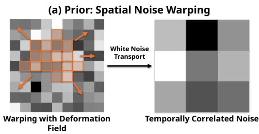

(b) Ours: Householder Motion Embedding  
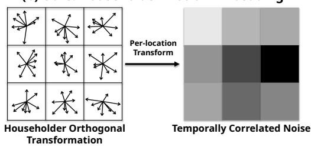

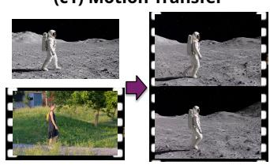  
Reference Video

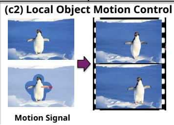

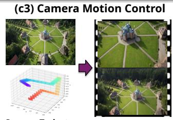  
Figure 1: We propose Householder Motion Embedding (HME), a simple noise-modulation method for motion-controllable diffusion video generation. (a) Prior methods rely on spatial noise warping driven by motion fields. They preserve spatial Gaussianity only through costly correction steps. (b) HME instead applies per-location Householder transformations in channel space to the noise. It preserves spatial Gaussianity by construction, with a 2.7× speed-up and better motion adherence. HME naturally supports (c1) motion transfer, (c2) local object motion control, and (c3) camera motion control.

## Abstract

Diffusion models for video generation have achieved remarkable success, yet precise motion control under explicit user guidance remains challenging. Recent noise-warping methods introduce temporal correlations by warping the noise according to the user-provided motion signal. However, standard spatial warping generally disrupts the noise’s i.i.d. Gaussian structure, requiring distribution correction, such as Jacobian-based correction, but at a substantial computational overhead. We propose Householder Motion Embedding (HME), which encodes the motion signal into the noise through a sequence of Householder reflections that together form an orthogonal transformation applied to each location’s channel vector. HME exactly preserves the spatial Gaussian structure within each frame while introducing cross-frame correlations that promote temporally consistent video. HME is

agnostic to the network architecture and integrates directly into standard video diffusion fine-tuning pipelines. Experiments on different scenarios show that HME matches or outperforms the state of the art, while achieving a 2.7× speedup over noise warping. These results demonstrate that per-location Householder transformations in channel space offer a principled and efficient alternative to noise warping for motion-controllable video generation.

## 1 Introduction

Diffusion based models have recently achieved remarkable success in video generation, demonstrating strong visual fidelity and semantic coherence across temporal dimension [59, 27, 6, 4, 19, 67, 49, 12]. However, generating temporally consistent videos under explicit motion controls (modeling complex camera motion or scene dynamics) remains a fundamental challenge. Existing approaches [64, 45, 24, 35] often suffer from temporal drift, geometric inconsistency, or limited controllability when motion deviates from patterns observed during training.

A common wisdom to inject motion cues into the neural network architecture is through feature modulation [65, 43] or motion conditioning tokens [14, 52, 20, 53], which operate downstream of the stochastic generation process and leave the noise motion-agnostic. An alternative is to modify the noise directly. Building on the observation by PYoCo [13] that shared noise components across frames improve temporal coherence, HIWYN [8], InfRes [10], and GWTF [7] demonstrate that constructing temporally correlated noise by transporting the a priori latent noise via diffeomorphic deformation fields parameterized by optical flow significantly enhances frame-to-frame consistency without modifying model architecture or training objectives. However, spatial resampling during this noise transport inherently destroys the i.i.d. Gaussian structure of the noise, since interpolation induces correlations across neighboring locations and alters the marginal distribution. This matter because the diffusion model is trained to denoise i.i.d. standard Gaussian noise: noise with spatial autocorrelation or altered variance falls outside this training distribution, which prior work has shown degrades generation quality [8, 10, 7]. Consequently, all existing noise-warping methods must introduce additional processing steps to restore spatial Gaussianity at the cost of non-trivial computational overhead.

In this paper, we propose Householder Motion Embedding (HME), a noise-modulation framework that resolves this spatial-Gaussianity bottleneck without sacrificing motion fidelity. Rather than warping noise via spatial deformation fields, we modulate the noise using the intended motion field by per-location orthogonal transformations in channel space, parameterized as the product of Householder reflections [17]. The Householder transformation, composed of a small number of reflections, yields expressive orthogonal operators at low computational cost, while the orthogonality ensures distribution preservation by construction.

Crucially, this distribution preservation guarantee is precisely what spatial noise warping methods lack. Modulating the noise through per-location Householder products therefore eliminates post-hoc correction entirely, requiring no Jacobian adjustments or distribution restoration steps, while inducing structured cross-frame temporal correlations that encode the geometric consistency of the underlying motion. Compared to deformation field based solutions, our method achieves exact spatial Gaussianity by construction, a 2.7× speedup in noise processing time, and improved motion adherence on all three benchmarks.

Similar to existing noise warping methods, HME operates entirely at the noise initialization stage and requires no modifications to the denoising architecture, loss function, or training objective. The motion-embedded noise replaces the standard Gaussian noise at the start of the diffusion process, making the method plug-and-play across UNet-based and transformer-based video diffusion frameworks; we demonstrate it on the transformer-based CogVideoX. Our framework accepts any dense optical flow field as conditioning input regardless of its source: whether extracted from a reference video for motion transfer, rendered from a target camera trajectory for camera-controlled generation, or derived from user-specified drag interactions on the initial frame, thereby unifying diverse motion modalities within a single framework without motion-type-specific architectural modifications.

Contributions of this paper are as follows:

1. We propose a novel noise-modulation method for motion-controllable video diffusion that replaces spatial noise transport with per-location orthogonal transformations in latent channel space, parameterized as products of Householder reflections. Unlike existing noise-warping methods, this construction requires no post-hoc Gaussianity correction and operates in a single forward pass with no learnable parameters, making it a drop-in replacement for the noise initialization step in any video diffusion fine-tuning pipeline.

2. We derive the cross-frame covariance of the proposed noise, showing that the dependence between frames is an orthogonal transformation determined by the local motion, and analyse how the number of reflections controls the expressivity of this encoding.

3. We validate through extensive experiments on spatial Gaussianity preservation, motiontransfer and camera-controlled video generation benchmarks that HME matches or exceeds the state-of-the-art noise-warping baseline on nearly all motion-adherence and generationquality metrics, while achieving a 2.7× speedup in noise processing time.

## 2 Related Work

Motion-controllable video generation. Motion-controllable video generation methods broadly fall into three categories. Local object motion control methods [14, 24, 60] condition generation on user-specified trajectories via feature modulation or latent optimization, including Gaussianfiltered trajectory approaches [61, 53], two-stage sparse-to-dense motion field estimation [45, 37], region-wise trajectory and mask conditioning [65], and training-free latent optimization [36]. Global camera control methods [29, 54, 51] embed camera pose sequences into the denoising network through dedicated conditioning modules [20, 3, 52, 57, 55, 63] or learning Video-to-Video generation directly from imperfect 3D/4D renders [42, 18], which require large posed-video datasets for training. Motion transfer methods [1, 15, 28, 16, 40] propagate motion signals from a reference clip without additional supervision, either through temporal attention cloning [32], zero-shot feature guidance [60], inference-time schedule adaptation [46], motion disentanglement [43], or trajectory and optical flow conditioning [14, 30, 50]. Across all three paradigms, motion signals are injected downstream of the stochastic initialization, leaving the noise distribution motion-agnostic. Our method addresses this by modulating the noise through per-location orthogonal transformations, which preserve the i.i.d. Gaussian structure by construction while inducing cross-frame correlations that align per-frame noise distributions along the motion trajectory.

Noise Warping for Temporally Consistent Video Generation. Regardless of architectural difference between UNet-based and DiT-based video diffusion models, both are initialized from Gaussian noise whose correlation across frames can be influential to the temporal consistency of the generated output. PYoCo [13] first demonstrates that correlating the noise initialization across frames through a mixed noise prior substantially improves temporal coherence, motivating subsequent work on flowguided noise warping. HIWYN [8] introduces integral noise, reinterpreting warped noise samples as integrals of a continuous underlying noise field to preserve spatial Gaussianity during deformation field guided transport, at the cost of higher computational complexity. InfRes [10] resolves this by deriving an equivalent infinite-resolution formulation through Brownian bridge increments, reducing overhead by orders of magnitude while matching HIWYN’s theoretical guarantees. GWTF [7] further improves efficiency with a linear-time warping algorithm and demonstrates motion-controllable fine tuning of modern video diffusion models across object motion, camera control, and motion transfer. Despite these advances, all existing methods share a fundamental limitation: spatial resampling during deformation-field-based transport disrupts the i.i.d. Gaussian noise structure, necessitating costly post-hoc correction at higher resolutions. Our method resolves this bottleneck by replacing spatial transport with per-location orthogonal transformations in channel space that preserve spatial Gaussianity exactly by construction.

Our method makes use of Householder transformations, leveraging their distribution-preserving property. Householder transformations have previously been used for other deep learning problems in very different contexts, ranging from position encoding [58, 33] to parameter-efficient finetuning [2, 11, 62].

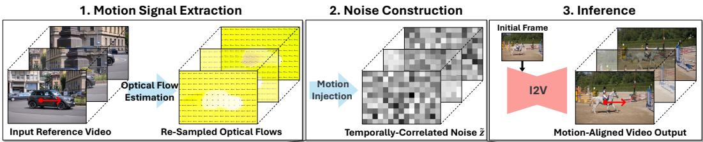

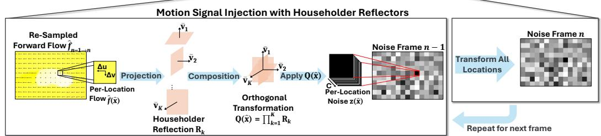  
Figure 2: HME generates motion controlled videos in 3 stages: 1) optical flow estimation and spatial resampling, 2) temporally correlated noise construction via Householder Reflectors (see Section 3.1 for details), 3) diffusion model fine-tuning and inference. At inference time, our method enables motion- and camera-controlled video generation given a text prompt, an initial frame, and a reference video as the motion signal.

## 3 Method

Our goal is to construct motion-embedded noise that preserves spatial Gaussianity while inducing structured temporal correlations across video frames. We achieve this through per-location orthogonal transformations in latent channel space, parameterized as products of Householder reflections.

Householder Reflector. Householder reflectors are a standard, efficient numerical tool for constructing orthogonal transformations, requiring only an inner product and a vector update. Let C denote the base model’s latent channel size. A Householder reflector is a simple orthogonal operator defined by a single non-zero vector $\mathbf { v } \in \mathbb { R } ^ { C }$

$$
\mathbf { R } ( \mathbf { v } ) = \mathbf { I } _ { C } - 2 \bar { \mathbf { v } } \bar { \mathbf { v } } ^ { \top } , \qquad \bar { \mathbf { v } } = \frac { \mathbf { v } } { \| \mathbf { v } \| _ { 2 } } .\tag{1}
$$

Geometrically, $\mathbf { R } ( \mathbf { v } )$ reflects any vector across the hyperplane orthogonal to v. As reflections are orthogonal transformations, they preserve Euclidean norms and, crucially, the Gaussian distribution: if $\mathbf { z } \sim \mathcal { N } ( \mathbf { 0 } , \mathbf { I } _ { C } )$ , then ${ \bf R } ( { \bf v } ) { \bf z } \stackrel {  } { \sim } \bar { \mathcal { N } } ( { \bf 0 } , { \bf I } _ { C } )$ for any choice of v. Composing K such reflections yields a more expressive orthogonal operator, and any orthogonal matrix admits an exact decomposition into at most C reflections [17]. We exploit this property to construct orthogonal transformations that preserve spatial Gaussianity exactly.

As shown in Fig. 2, our framework consists of three stages: (1) optical flow estimation, (2) a trainingfree Householder noise transformation module and (3) video diffusion model fine-tuning. The noise module generates temporally correlated noise during both training and inference, while the denoising architecture and training objective remain unchanged.

## 3.1 Motion-Embedded Noise Construction

## 3.1.1 Problem Formulation and Notation

We distinguish between image space and latent noise space. In image space, a video $V =$ $\{ F _ { 0 } , \ldots , \bar { F } _ { N - 1 } \}$ consists of N frames $F _ { n } ~ \in ~ \mathbb { R } ^ { H \times W \times 3 }$ on the $H \times \breve { W }$ pixel grid, and optical flow assigns each pixel x a displacement $\mathbf { f } ( x ) = ( \Delta u , \Delta v ) \in \mathbb { R } ^ { 2 }$ . The VAE encodes the video into Nˆ latent frames on the $\hat { H } \times \hat { W }$ latent grid and each latent location xˆ covers a pixel footprint Ω(ˆx) $( \mathrm { e } . \mathrm { g } . , 8 \times 8$ pixels for CogVideoX). In latent noise space, each xˆ carries a noise vector z $( \hat { x } ) \in \mathbb { R } ^ { C }$ drawn i.i.d. with $\mathbf { z } ( \hat { x } ) \sim \mathbf { \mathcal { N } } ( \mathbf { 0 } , \mathbf { I } _ { C } )$ . Operations in latent noise space act on the channel dimension only, without modifying spatial coordinates. In our framework, optical flow acts as a conditioning signal that parameterizes per-location orthogonal transformations of latent noise vectors, rather than spatially resampling them.

## 3.1.2 Flow-to-Latent Alignment

The optical flow between consecutive frames, ${ \bf f } _ { n - 1 \to n } = \Phi ( F _ { n - 1 } , F _ { n } )$ , can be obtained with any off-the-shelf flow estimator Φ; we use RAFT [47] in our experiments. Since the diffusion model operates on a spatially down-sampled latent grid, we resample the estimated flow field to match the latent resolution:

$$
\hat { \mathbf { f } } ( \hat { x } ) = \mathrm { R e s a m p l e } ( \mathbf { f } ) ( \hat { x } ) = \sum _ { x \in \Omega ( \hat { x } ) } w ( x ) \mathbf { f } _ { \mathrm { n o r m } } ( x ) ,\tag{2}
$$

where Resample(·) maps the flow field from the $H \times W$ pixel grid to the $\hat { H } \times \hat { W }$ latent grid by computing the weighted average displacement over the pixel footprint $\Omega ( { \hat { x } } )$ of each latent location, and $\mathbf { \check { f } } _ { \mathrm { n o r m } } ( x ) = ( \check { \Delta u } / W , \Delta v / H ) \in [ - 1 , 1 ] ^ { 2 }$ denotes the flow normalized by the image resolution.

## 3.1.3 Optical Flow Conditioned Parameterization

We then convert each flow vector into K transformations by applying fixed random linear projections:

$$
{ \bf v } _ { k } ^ { ( n ) } ( \hat { x } ) = { \bf A } _ { k } \hat { \bf f } _ { n - 1 \to n } ( \hat { x } ) + { \bf b } _ { k } , \qquad k = 1 , \dots , K .\tag{3}
$$

The flow at each latent location is two-dimensional, whereas a Householder reflector acting on the latent noise requires a non-zero vector in $\mathbb { R } ^ { C } ;$ ; the projections therefore lift each flow vector into K distinct reflection directions in channel space, whose composition forms a $C \times C$ orthogonal transformation. The projections $\mathbf { A } _ { k } \in \mathbb { R } ^ { C \times 2 }$ and $\mathbf { b } _ { k } \in \mathbb { R } ^ { C }$ are randomly initialized once and frozen throughout training and inference, introducing no learnable parameters and yielding a deterministic, reproducible mapping from flow to transformation. The only requirement on these parameters is $\mathbf { v } _ { k } ^ { ( n ) } ( \hat { x } ) \neq \mathbf { 0 }$ , since the Householder normalization is undefined for the zero vector; we use a small non-zero bias $\mathbf { b } _ { k }$ to avoid such degenerate projections. No orthogonality constraint on $\mathbf { A } _ { k }$ is needed, as orthogonality of the resulting operator is guaranteed by the Householder construction itself. Learning $\mathbf { A } _ { k }$ and $\mathbf { b } _ { k }$ is possible but unnecessary: their role is only to provide distinct deterministic embeddings of the flow into channel space. Because the projections are shared across spatial locations, the orthogonal transformation constructed below depends on xˆ only through the local flow $\hat { \bf f } _ { n - 1  n } ( \hat { x } )$ The projection parameters total only $K ( 2 C + C ) \stackrel { * } { = } 3 K C$ values, independent of spatial resolution.

## 3.1.4 Per-Location Orthogonal Noise Transformation

The motion-embedded noise is constructed sequentially: the noise at each frame is obtained by applying a flow-conditioned orthogonal transformation to the noise of the preceding frame. Formally, for each frame $n \geq 1$ and latent location xˆ:

$$
\mathbf { \widetilde { z } } _ { n } ( \hat { x } ) = \mathbf { Q } _ { n } ( \hat { x } ) \mathbf { \widetilde { z } } _ { n - 1 } ( \hat { x } ) , \qquad \mathbf { Q } _ { n } ( \hat { x } ) = \prod _ { k = 1 } ^ { K } \mathbf { R } \Bigl ( \mathbf { v } _ { k } ^ { ( n ) } ( \hat { x } ) \Bigr ) ,\tag{4}
$$

where frame 0 retains the unmodified Gaussian noise $\tilde { \mathbf { z } } _ { 0 } ( \hat { x } ) = \mathbf { z } _ { 0 } ( \hat { x } ) \sim \mathcal { N } ( \mathbf { 0 } , \mathbf { I } _ { C } )$ , and the reflection vectors ${ \bf v } _ { k } ^ { ( n ) } ( \hat { x } )$ are obtained from the resampled forward optical flow between frames $n { - } 1$ and n via Eq. (3).

Since each $\mathbf { Q } _ { n } ( { \hat { x } } )$ is a product of Householder reflections and therefore orthogonal, and the product of orthogonal matrices is orthogonal, the noise at frame n is equivalently a single orthogonal transformation of the initial noise:

$$
\mathbf { \tilde { z } } _ { n } ( \hat { x } ) = \mathbf { P } _ { n } ( \hat { x } ) \mathbf { z } _ { 0 } ( \hat { x } ) , \qquad \mathbf { P } _ { n } ( \hat { x } ) = \mathbf { Q } _ { n } ( \hat { x } ) \cdots \mathbf { Q } _ { 1 } ( \hat { x } ) .\tag{5}
$$

This accumulated operator $\mathbf { P } _ { n }$ is orthogonal by construction, which is the key property exploited in Section 3.2. The complete noise construction procedure is given in Algorithm 1.

Number of Reflections and Expressivity. Each Householder reflection $\mathbf { R } ( \mathbf { v } ) = \mathbf { I } _ { C } - 2 \bar { \mathbf { v } } \bar { \mathbf { v } } ^ { \top }$ is a rank-one perturbation of the identity, and the composed transformation $\mathbf { Q } _ { n }$ is a full-rank orthogonal matrix for every $K \geq 1$ . Expanding the product in Eq. (4) yields a series in the number of interacting reflections,

$$
\mathbf { Q } _ { n } ( \hat { x } ) = \mathbf { I } _ { C } + \sum _ { m = 1 } ^ { K } ( - 2 ) ^ { m } \sum _ { k _ { 1 } < \cdots < k _ { m } } \left( \prod _ { j = 1 } ^ { m - 1 } \bar { \mathbf { v } } _ { k _ { j } } ^ { \top } \bar { \mathbf { v } } _ { k _ { j + 1 } } \right) \bar { \mathbf { v } } _ { k _ { 1 } } \bar { \mathbf { v } } _ { k _ { m } } ^ { \top } ,\tag{6}
$$

Algorithm 1 Motion-Embedded Noise via Householder Transformations   
Require: Reference video $V = \{ F _ { 0 } , \dots , F _ { \underline { { N } } - 1 } \}$ , degradation level $\gamma \in [ 0 , 1 ]$ , number of reflections   
K, fixed random projections $\{ \mathbf { A } _ { k } , \mathbf { b } _ { k } \} _ { k = 1 } ^ { K }$   
Ensure: Motion-embedded noise tensor $\tilde { Z } _ { \gamma }$   
1: ${ \bf z } _ { 0 } ( \hat { x } ) \sim \mathcal { N } ( { \bf 0 } , { \bf I } _ { C } )$ for all $\hat { x } ; \quad \tilde { \mathbf { z } } _ { 0 } ( \hat { x } ) \dot {  } \mathbf { z } _ { 0 } ( \hat { x } )$   
2: Step 1: construct per frame noise   
3: for $\mathbf { \bar { \Phi } } n = 1 , \dots , N - 1$ do   
4: a) Estimate flows and resample   
5: $\hat { \mathbf { f } } _ { n - 1 \to n } ( \hat { x } ) \gets \mathrm { R e s a m p l e } ( \Phi ( F _ { n - 1 } , F _ { n } ) )$ ▷ estimate and align flow to latent grid   
6: b) apply orthogonal transformation to noise of previous frame   
7: ${ \bf v } _ { k } ^ { ( n ) } ( \hat { x } ) \left. { \bf A } _ { k } \hat { \bf f } _ { n - 1 \right. n } ( \hat { x } ) + { \bf b } _ { k } , k = 1 , \ldots , K$   
8: $\begin{array} { r } { \mathbf { Q } _ { n } ( \hat { x } ) \gets \prod _ { k = 1 } ^ { K } \mathbf { R } \Big ( \mathbf { v } _ { k } ^ { ( n ) } ( \hat { x } ) \Big ) } \end{array}$ ▷ per-location flow to orthogonal transformation   
9: $\tilde { \mathbf { z } } _ { n } ( \hat { x } ) \gets \mathbf { Q } _ { n } ( \hat { x } ) \tilde { \mathbf { z } } _ { n - 1 } ( \hat { x } )$   
10: end for   
11: Step 2: Stack and apply noise degradation   
12: $\tilde { Z } \gets [ \tilde { \mathbf { z } } _ { 0 } , \mathbf { \Pi } , \mathbf { \Pi } , \mathbf { \tilde { z } } _ { N - 1 } ] ; \quad \zeta \sim \mathcal { N } ( \mathbf { 0 } , \mathbf { I } )$ , same shape as $\tilde { Z }$   
13: $\tilde { Z } _ { \tilde { \mathcal { N } } } \gets \frac { ( 1 - \gamma ) \ \tilde { Z } + \gamma \ \zeta } { - }$   
$\begin{array} { r } { \omega _ { \gamma }  \frac { } { } \sqrt { ( 1 - \gamma ) ^ { 2 } + \gamma ^ { 2 } } } \end{array}$   
14: return $\tilde { Z } _ { \gamma }$

where we omit the arguments $( n , { \hat { x } } )$ of $\bar { \mathbf { v } } _ { k }$ . Analogous to a Taylor series, the order-m term captures interactions among m flow-dependent reflection directions and, through Eq. $( 3 )$ , is a rational function of the flow $\hat { \bf f } _ { n - 1  n } ( \hat { x } )$ of degree 2m; K determines the highest order retained. Since each order-m term is bounded in norm by $2 ^ { m } \prod _ { j } | \bar { \mathbf { v } } _ { k _ { j } } ^ { \top } \bar { \mathbf { v } } _ { k _ { j + 1 } } |$ and the random projections yield reflection directions with small pairwise inner products, higher-order terms are increasingly attenuated and the flow influences ${ \dot { \mathbf { Q } } } _ { n }$ predominantly through the low-order terms. Adding reflections therefore yields diminishing gains in expressivity, while the cost grows linearly with $K ,$ , consistent with the saturation observed in Table 5.

## 3.2 Theoretical Properties

The key theoretical guarantee of our noise construction is that the transformed noise remains exactly spatially Gaussian, regardless of the motion condition; a detailed proof and empirical results are given in Section E.1.

Proposition 1 (Exact Spatial Gaussianity). Let $\tilde { \mathbf { z } } _ { 0 } ( \hat { x } ) = \mathbf { z } _ { 0 } ( \hat { x } ) \sim \mathcal { N } ( \mathbf { 0 } , \mathbf { I } _ { C } )$ be i.i.d. across spatial locations, and let $\begin{array} { r } { \mathbf { \tilde { z } } _ { n } ( \hat { x } ) = \mathbf { Q } _ { n } ( \hat { x } ) \tilde { \mathbf { z } } _ { n - 1 } ( \hat { x } ) f o r n \geq 1 } \end{array}$ , where each $\mathbf { Q } _ { n } ( { \hat { x } } )$ is a product ofHouseholder reflections parameterized by the resampled optical flow $\hat { \bf f } _ { n - 1  n } ( \hat { x } )$ . Then $\tilde { \mathbf { z } } _ { n } ( \hat { x } ) \sim \mathcal { N } ( \mathbf { 0 } , \mathbf { I } _ { C } )$ for all n and all ${ \hat { x } } ,$ and the vectors $\tilde { \mathbf { z } } _ { n } ( \hat { x } )$ are mutually independent across latent locations xˆ.

Temporal Correlation Structure. While Proposition 1 concerns each frame in isolation, the sequential construction couples the frames. Using Eq. (5), the cross-frame covariance of the noise at a latent location xˆ is, for $n > m$

$$
\operatorname { C o v } [ \tilde { \mathbf { z } } _ { n } ( \hat { x } ) , \tilde { \mathbf { z } } _ { m } ( \hat { x } ) ] = \mathbf { P } _ { n } ( \hat { x } ) \mathbf { P } _ { m } ( \hat { x } ) ^ { \top } = \mathbf { Q } _ { n } ( \hat { x } ) \cdot \cdot \cdot \mathbf { Q } _ { m + 1 } ( \hat { x } ) ,\tag{7}
$$

while noise at different locations remains uncorrelated (Section E.2). Equation (7) shows that the dependence between two frames is an orthogonal $C \times { \dot { C } }$ matrix determined entirely by the optical flow at xˆ between frames m and $n \mathrm { : }$ the noise vector at frame n is a flow-dependent orthogonal transformation of the one at frame m. Because the projections $\left\{ \mathbf { A } _ { k } , \mathbf { b } _ { k } \right\}$ are shared across locations, latent locations undergoing the same motion receive the same cross-frame transformation, whereas locations with different motion receive different ones, so the spatial pattern of these transformations mirrors the motion field. The denoising model (the CogVideoX DiT) is trained with this structured noise in place of i.i.d. noise and learns to exploit it as an implicit motion-conditioning signal. A geometric comparison with spatial noise warping is given in Section 5.

GT/Motion Signal  
GWTF  
DisMo  
MotionPro  
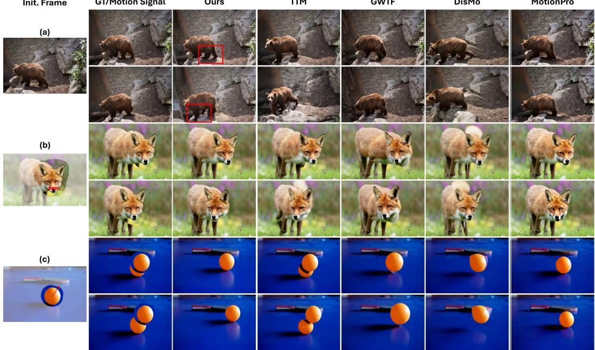  
Figure 3: Qualitative comparison of (a) motion-transfer, (b) fine-grained motion control, and (c) local object motion control I2V generation, evaluated on DAVIS and MC-Bench. We present the intermediate frame and last frame of generated videos by each method. Our method demonstrates strong appearance consistency and high generation fidelity while faithfully adhering to the provided motion control signals. Best viewed zoomed in; videos are provided in the Supplementary Material.

## 3.3 Fine-tuning with Motion-Embedded Noise

The key insight is that the motion conditioning is carried entirely by the cross-frame covariance structure of $\bar { \tilde { Z } } ,$ , not by its marginal distribution. Since each frame’s noise is marginally standard Gaussian (Proposition 1), the model trains with the standard diffusion objective without modification. The structured inter-frame dependencies, encoded by $\mathbf { Q } _ { n } ( { \hat { x } } )$ , act as an implicit motion signal that the denoiser learns to exploit during fine-tuning. More training details are provided in Section C.

## 4 Experiments

## 4.1 Implementation Details

We use the pretrained CogVideoX-5B-I2V as our base I2V model [59]. We fine-tune the base video diffusion model on 100K videos from RealCam-Vid [66], curated from multiple sources including RealEstate10K [68], MiraData [25], and DL3DV-10K [31], using optical flows estimated by RAFT [47] for training. All experiments are conducted at a spatial resolution of $4 8 0 \times 7 2 0$ with 49 frames per video; the latent channel dimension is $C = 1 6$ , determined by the CogVideoX VAE. We follow GWTF [7] to fine-tune the model for 30,000 iterations using a rank-2048 LoRA setup (learning rate $1 \times 1 0 ^ { - 5 }$ , batch size 8), running on 4 NVIDIA A100 80GB GPUs for a total of 40 GPU-days.

## 4.2 Video Generation with Motion Control

Baselines and Evaluation Metrics. We evaluate HME on motion transfer, fine-grained motion control, object-level motion control and camera motion control for I2V generation. The performances on DAVIS [39], MC-Bench [65] are displayed in Table 1 and Table 2, respectively. Following GWTF, we adopt VBench [23] to assess the perceptual quality of generated video with related metrics such as Subject Consistency, Background Consistency, Temporal Flickering, and Motion Smoothness. To assess the motion adherence, we evaluate 1) CoTracker Distance and Background CoTracker distance for MC-Bench samples; 2) Optical Flow EPE, CoTracker mIoU, and PSNR against the reference videos for DAVIS samples. The input for all evaluations is a single reference image paired with a motion signal obtained from either the optical flow estimated from a reference video or derived from a user-dragged mask on the initial frame. We use the resulting forward optical flows between frames to construct the motion-embedded noise $\tilde { Z } _ { \gamma }$ via Algorithm 1 (details in Section D).

Table 1: Quantitative comparison of motion controlled I2V generation on DAVIS. Best performance in Bold, best baseline performance in Underline.
<table><tr><td>Method</td><td>Subject Consist. ↑</td><td>BG Consist. ↑</td><td>Temporal Flicker. ↑</td><td>Motion Smooth. ↑</td><td>FID↓</td><td>FVD  $( \times 1 0 ^ { 3 } ) \downarrow$ </td><td>Optical Flow (EPE)↓</td><td>CoTracker (mIoU)↑</td><td>PSNR (dB)↑</td><td>CLIP Image↑</td></tr><tr><td>MotionClone [32]</td><td>0.754</td><td>0.862</td><td>0.874</td><td>0.928</td><td>133.852</td><td>1.771</td><td>26.451</td><td>0.373</td><td>10.032</td><td>0.814</td></tr><tr><td>ImageConductor [30]</td><td>0.791</td><td>0.891</td><td>0.913</td><td>0.939</td><td>128.087</td><td>1.830</td><td>20.382</td><td>0.372</td><td>12.117</td><td>0.811</td></tr><tr><td> $\mathrm { G W T F } _ { \gamma = 0 . 5 } \ [ 7 ]$ </td><td>0.888</td><td>0.920</td><td>0.942</td><td>0.978</td><td>68.385</td><td>0.987</td><td>5.644</td><td>0.464</td><td>14.748</td><td>0.912</td></tr><tr><td>MotionPro [65]</td><td>0.873</td><td>0.913</td><td>0.932</td><td>0.964</td><td>103.859</td><td>1.253</td><td>19.692</td><td>0.473</td><td>14.257</td><td>0.879</td></tr><tr><td>DisMo [43]</td><td>0.851</td><td>0.903</td><td>0.920</td><td>0.956</td><td>85.201</td><td>1.156</td><td>11.189</td><td>0.428</td><td>11.475</td><td>0.882</td></tr><tr><td>TTM [46]</td><td>0.869</td><td>0.916</td><td>0.935</td><td>0.970</td><td>70.658</td><td>1.093</td><td>13.871</td><td>0.412</td><td>13.942</td><td>0.901</td></tr><tr><td>Oursγ=0.1,K=2</td><td>0.896</td><td>0.924</td><td>0.951</td><td>0.979</td><td>65.343</td><td>0.830</td><td>4.816</td><td>0.540</td><td>15.662</td><td>0.920</td></tr><tr><td> $\scriptstyle \mathrm { O u r s } _ { \gamma = 0 . 3 , K = 2 }$ </td><td>0.898</td><td>0.925</td><td>0.946</td><td>0.979</td><td>61.780</td><td>0.862</td><td>4.433</td><td>0.546</td><td>15.399</td><td>0.923</td></tr><tr><td> $\scriptstyle \mathrm { O u r s } _ { \gamma = 0 . 5 , K = 2 }$ </td><td>0.898</td><td>0.926</td><td>0.945</td><td>0.979</td><td>62.799</td><td>0.855</td><td>4.486</td><td>0.548</td><td>15.162</td><td>0.923</td></tr></table>

Table 2: Quantitative comparison of Fine-grained and Object-level motion control on MC-Bench.
<table><tr><td>Method</td><td>Subject Cons. ↑</td><td>Background Cons. ↑</td><td>Motion Smooth. ↑</td><td>Aesthetic Qual. ↑</td><td>Imaging Qual. ↑</td><td>CTD↓</td><td>Bg-Obj CTD ↑</td></tr><tr><td>MotionPro [65]</td><td>0.980</td><td>0.976</td><td>0.995</td><td>0.586</td><td>0.610</td><td>8.019</td><td>23.30</td></tr><tr><td>TTM [46]</td><td>0.984</td><td>0.981</td><td>0.995</td><td>0.601</td><td>0.645</td><td>8.432</td><td>36.32</td></tr><tr><td>DisMo [43]</td><td>0.985</td><td>0.973</td><td>0.991</td><td>0.608</td><td>0.601</td><td>8.954</td><td>36.16</td></tr><tr><td>Noise-based methods</td><td></td><td></td><td></td><td></td><td></td><td></td><td></td></tr><tr><td> $\mathrm { G W T F } _ { \gamma = 0 . 5 } \ [ 7 ]$ </td><td>0.975 0.976</td><td>0.974 0.977</td><td>0.993 0.995</td><td>0.589 0.594</td><td>0.645 0.645</td><td>15.747 13.879</td><td>42.44 39.53</td></tr><tr><td> $\mathrm { O u r s } _ { \gamma = 0 . 3 , K = 2 }$ </td><td></td><td></td><td></td><td></td><td></td><td></td><td></td></tr></table>

Results on Motion Transfer. We evaluate motion transfer I2V on 45 DAVIS videos, using the motion of each original video as reference. As shown in Table 1, we compare against six baselines: training-free methods (MotionClone [32], TTM [46]), noise-warping (GWTF), and supervised controllers (ImageConductor [30], MotionPro [65], DisMo [43]). Each of our three variants $( \gamma \in$ {0.1, 0.3, 0.5}) outperforms all six baselines on all ten metrics, despite being fine-tuned on 100K videos, compared with approximately 4M for GWTF. It attains the highest scores on all four VBench metrics, as well as the best FID and FVD. $\mathrm { A t } \gamma = 0 . 5$ , Optical Flow EPE decreases from 5.644 to 4.486, CoTracker mIoU increases from 0.464 to 0.548, and PSNR improves from 14.748 to 15.162 dB. These gains require no post-hoc Gaussianity correction, indicating that motion embedding via orthogonal transformations is a more efficient alternative to spatial noise warping. We further evaluate across varying noise degradation levels, where all variants consistently outperform GWTF and other baselines.

Results on Fine-grained and Object-level Control. We evaluate object-level and fine-grained motion control on 965 MC-Bench samples against MotionPro, TTM, DisMo, and GWTF. Our approach outperforms GWTF on five metrics, achieving lower CTD and better Background Consistency and Motion Smoothness, indicating that Householder motion embedding captures motion priors more faithfully than spatial warping. The CTD gap with supervised methods reflects a trade-off between controllability and generative freedom: TTM, MotionPro, and DisMo enforce strict trajectory adherence via explicit supervision but degrade subject-background disentanglement, evidenced by lower Bg-Obj CTD (23.30, 36.32, 36.16) relative to our method (39.53) and GWTF (42.44). Our method also matches the best Motion Smoothness (0.995) without architectural changes, showing that HME is competitive with supervised motion control while better preserving subject–background disentanglement.

Results on Camera Motion Control. We evaluate HME on camera controlled I2V generation under pre-defined camera trajectories using 200 randomly sampled scenes from the DL3DV subset of the RealCam-Vid validation set. Frame-level alignment is assessed via PSNR, LPIPS, and SSIM, and camera motion consistency via Normalized Absolute Trajectory Error (ATE). As shown in Table 3, our method achieves the best performance across all seven metrics, outperforming noise-warping and other baselines. The leading ATE score confirms accurate replication of the target camera trajectory, while the superior PSNR, LPIPS, and SSIM scores demonstrate that our method maintains high visual fidelity alongside strong motion adherence, reflecting a great balance between appearance quality and temporal consistency under explicit camera control.

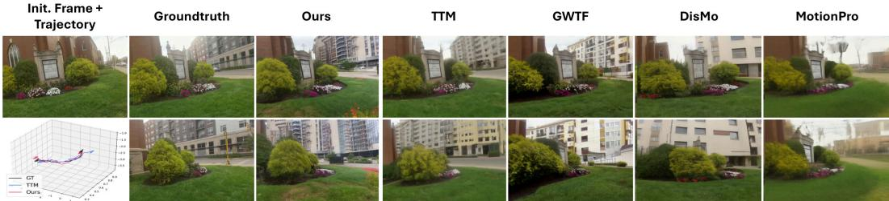  
Figure 4: Qualitative Comparison of camera motion controlled I2V generation, evaluated on DL3DV. We present the intermediate frames and last frames of generated videos by each method. Best viewed zoomed in; videos are provided in the Supplementary Material.

Table 3: Quantitative comparison of DL3DV camera motion control.
<table><tr><td>Method</td><td>FID↓</td><td>FVD↓</td><td>PSNR (dB) ↑</td><td>CLIP Image ↑</td><td>LPIPS ↓</td><td>SSIM ↑</td><td>ATE↓</td></tr><tr><td>MotionPro [65]</td><td>37.195</td><td>291.510</td><td>12.701</td><td>0.814</td><td>0.545</td><td>0.470</td><td>0.825</td></tr><tr><td>DisMo [43]</td><td>22.458</td><td>187.134</td><td>12.255</td><td>0.876</td><td>0.506</td><td>0.446</td><td>1.155</td></tr><tr><td>TTM [46]</td><td>21.367</td><td>196.533</td><td>12.764</td><td>0.881</td><td>0.443</td><td>0.467</td><td>0.464</td></tr><tr><td> $\mathrm { G W T F } _ { \gamma = 0 . 5 } \ [ 7 ]$ </td><td>23.394</td><td>235.260</td><td>12.626</td><td>0.880</td><td>0.431</td><td>0.469</td><td>0.473</td></tr><tr><td> $\scriptstyle \mathrm { O u r s } _ { \gamma = 0 . 3 , K = 2 }$ </td><td>20.338</td><td>175.103</td><td>13.656</td><td>0.885</td><td>0.402</td><td>0.496</td><td>0.421</td></tr></table>

Qualitative Results. In Fig. 3, we present a qualitative comparison between our method and all competing baselines on (a) motion transfer, (b) fine-grained, and (c) object-level motion controlled video generation. For (a), the red box highlights that our method more faithfully replicates the detailed motion of the bear across frames, accurately capturing the displacement of the subject in accordance with the reference motion signal, whereas competing methods fail to preserve fine motions. For (b), our method not only follows the prescribed motion signal faithfully but also maintains high visual fidelity, producing coherent details throughout the sequence, while other baselines exhibit visible artifacts. For (c), our method demonstrates precise spatial awareness by correctly animating the target ball along the intended trajectory while preserving the relative positioning between objects, whereas competing methods either lose track of the motion signal or produce spatially inconsistent object placements across frames.

We further show camera-motion-controlled I2V results in Fig. 4. Compared with the strongest baseline, TTM, our generated videos yield estimated camera trajectories closer to the target trajectory, indicating stronger camera-motion adherence while better preserving viewpoint changes, scene structure, and appearance consistency. Additional results are provided in Section F.

Robustness to the Flow Estimator. We replace RAFT with UniMatch [56] at evaluation time only, while our model remains trained on RAFT flows; GWTF and our method receive identical UniMatch flows. Our method matches or outperforms GWTF on all ten metrics (Table 4), reducing Flow EPE from 5.857 to 4.707.

## 4.3 Ablation and Analysis

Choice of the Number of Householder Reflections. We ablate the number of Householder reflections $K \in \{ 1 , 2 , 4 , 8 , 1 2 \}$ in Table 5. Motion adherence is weakest at $K = 1$ (Flow EPE 4.868) and improves with diminishing returns as K grows (Flow EPE 4.433 → 4.144 from $K = 2$ to $K = 8 ;$ CoTracker mIoU 0.558 and PSNR 15.581 dB at $K = 1 2 )$ , consistent with the attenuation of higher-order terms in Eq. (6), while runtime grows approximately linearly, from 2.27 ms/latent at $K = 1$ to 14.78 ms/latent at $K = 1 2$ (Table 6). $\mathrm { A t } K = 2$ , our method runs at 2.80 ms/latent, a $2 . 7 \times$ speedup over GWTF and 13.6× over HIWYN. It is also memory-light: only 3KC projection values are stored, shared across frames and locations, and neither dense per-location $C \times C$ matrices nor noise upsampling are needed, so the peak additional memory is $\mathrm { 0 . 5 { - } 6 M B }$ , versus 76 MB for GWTF, 285 MB for InfRes and 49,384 MB for HIWYN. We use $\dot { K } = 2$ as the default: it achieves the best FID with only a small latency increase over $K = 1$ , while larger K offers slightly stronger motion adherence at higher cost.

Table 4: Robustness to the flow estimator: DAVIS results with UniMatch [56] flows at evaluation time.
<table><tr><td>Method</td><td>Subject Consist. ↑</td><td>BG Consist. ↑</td><td>Temporal Flicker. ↑</td><td>Motion Smooth.↑</td><td>FID↓</td><td>FVD (×103)↓</td><td> $\mathrm { O p t i c a l F l o w }$  (EPE)↓</td><td> $\mathbf { C o T r a c k e r }$  (mIoU)↑</td><td>PSNR (dB)↑</td><td>CLIP Image ↑</td></tr><tr><td> $\mathrm { G W T F } _ { \gamma = 0 . 5 } \ [ 7 ]$ </td><td>0.882</td><td>0.918</td><td>0.945</td><td>0.979</td><td>73.348</td><td>1.180</td><td>5.857</td><td>0.472</td><td>14.437</td><td>0.901</td></tr><tr><td> $\mathrm { O u r s } _ { \gamma = 0 . 3 , K = 2 }$ </td><td>0.895</td><td>0.926</td><td>0.948</td><td>0.979</td><td>63.619</td><td>0.837</td><td>4.707</td><td>0.541</td><td>15.418</td><td>0.915</td></tr></table>

Table 5: Performance comparison across different numbers of Householder reflections K (all with γ = 0.3), on DAVIS.
<table><tr><td>Method</td><td>Subject ↑</td><td>Background ↑</td><td>Temporal ↑</td><td>Motion ↑</td><td>FID ↓</td><td>FVD ↓</td><td>Flow EPE ↓</td><td>CoTracker mIoU ↑</td><td>PSNR ↑</td><td>CLIP Image ↑</td></tr><tr><td>OursK=1</td><td>0.898</td><td>0.925</td><td>0.946</td><td>0.978</td><td>63.992</td><td>861.121</td><td>4.868</td><td>0.543</td><td>15.300</td><td>0.918</td></tr><tr><td>OursK=2</td><td>0.898</td><td>0.925</td><td>0.946</td><td>0.979</td><td>61.780</td><td>861.740</td><td>4.433</td><td>0.546</td><td>15.399</td><td>0.923</td></tr><tr><td> $\mathrm { O u r s } _ { K = 4 }$ </td><td>0.898</td><td>0.926</td><td>0.948</td><td>0.979</td><td>64.579</td><td>821.749</td><td>4.358</td><td>0.555</td><td>15.424</td><td>0.922</td></tr><tr><td>OursK=8</td><td>0.898</td><td>0.927</td><td>0.948</td><td>0.979</td><td>63.314</td><td>827.664</td><td>4.144</td><td>0.550</td><td>15.512</td><td>0.923</td></tr><tr><td> $\mathrm { O u r s } _ { K = 1 2 }$ </td><td>0.898</td><td>0.927</td><td>0.950</td><td>0.979</td><td>64.699</td><td>831.586</td><td>4.197</td><td>0.558</td><td>15.581</td><td>0.923</td></tr></table>

Table 6: Computational overhead of noise-based methods: GPU time and approximate peak additional GPU memory on an NVIDIA RTX PRO 6000 Blackwell GPU $( 1 0 2 4 \times 1 0 2 4$ resolution, $C = 1 6 ;$ HIWYN with $L = 3 )$ .
<table><tr><td>Method</td><td>HIWYN [8]</td><td>GWTF [7]</td><td>InfRes [10]</td><td> $\mathrm { O u r s } _ { K = 1 }$ </td><td> $\mathrm { O u r s } _ { K = 2 }$ </td><td> $\mathrm { O u r s } _ { K = 4 }$ </td><td> $\mathrm { O u r s } _ { K = 6 }$ </td><td> $\mathrm { O u r s } _ { K = 8 }$ </td><td> $\mathrm { O u r s } _ { K = 1 2 }$ </td></tr><tr><td>GPU Time (ms/Latent) ↓</td><td>38.00</td><td>7.63</td><td>23.94</td><td>2.27</td><td>2.80</td><td>5.18</td><td> $7 . 5 9$ </td><td>10.01</td><td>14.78</td></tr><tr><td>Memory Overhead (MB) ↓</td><td>49,384</td><td>76</td><td>285</td><td>0.5</td><td>1</td><td>2</td><td>3</td><td>4</td><td>6</td></tr></table>

Choice of Noise Degradation Level. The degradation parameter γ trades motion adherence against generative freedom. All three variants, $\gamma \in \{ 0 . 1 , 0 . 3 , 0 . 5 \}$ at $K = 2$ , outperform GWTF on all ten metrics (Table 1); lower γ strengthens motion adherence, while higher γ favours perceptual quality and subject consistency, with small differences overall. We adopt $\gamma = 0 . 3$ for all other experiments; qualitative comparisons are in Section G.

## 5 Discussion

Geometric Analysis of Temporal Noise Correlation. PYoCo [13] shows that correlating noise across frames promotes temporal coherence. GWTF [7] realises this by transporting noise along flow trajectories across locations, whereas our noise stays tied to its location: $\widetilde { \mathbf z } _ { n } ( \hat { x } ) = \mathbf P _ { n } ( \hat { x } ) \mathbf z _ { 0 } ( \hat { x } )$ preserves its norm, and its change between frames, $( \mathbf { \dot { Q } } _ { n } ( \hat { x } ) - \mathbf { I } _ { C } ) \tilde { \mathbf { z } } _ { n - 1 } ( \hat { x } )$ , depends only on the local flow. Since the projections are shared across locations, regions with the same motion receive the same transformation; this includes static regions, since $\mathbf { Q } _ { n } \neq \mathbf { I } _ { C }$ for zero flow when $\mathbf b _ { k } \neq \mathbf 0$ We hypothesise that this per-location encoding of motion in channel space provides a more direct conditioning signal than spatial transport, contributing to the improved motion adherence over GWTF.

Limitations. Despite its effectiveness, our method has several limitations. The choice of the number of reflections K introduces an expressivity-efficiency trade-off and may require tuning for different settings. The method also relies on accurate optical flow for training, so noisy motion estimates can weaken motion adherence. Relatedly, since the motion signal is carried by per-location flow, subjects undergoing complex non-rigid geometric transformations (e.g., the rapidly rotating snowboarder in DAVIS) remain challenging, which we leave for future work. Moreover, while the noise construction is training-free and parameter-free, the video diffusion model still requires fine-tuning to fully exploit the motion-embedded noise. Finally, the baselines are evaluated with their released checkpoint rather than retrained on our training data and RAFT flows.

## 6 Conclusion

We presented Householder Motion Embedding (HME), a noise-modulation framework for motioncontrollable image-to-video generation. By replacing spatial noise transport with per-location Householder orthogonal transformations in latent channel space, our method preserves spatial Gaussianity by construction while encoding motion-aligned temporal correlations. Experiments on motion transfer, object-level control, and camera motion control show that HME improves motion adherence, visual fidelity, and noise-processing efficiency over existing noise-warping methods. Beyond noise construction, we believe that geometric transformation-based conditioning offers a promising way for incorporating structured motion priors into video diffusion models.

## Acknowledgments and Disclosure of Funding

This work was conducted in collaboration with Vertex Lab Technology Limited. This research is funded in part by an Australian Research Council (ARC) Discovery Grant DP220100800. Hongdong Li holds concurrent appointments with The Australian National University (full-time) and with Amazon as an Amazon Scholar (part-time).

## References

[1] Luca Savant Aira, Antonio Montanaro, Emanuele Aiello, Diego Valsesia, and Enrico Magli. Motioncraft: Physics-based zero-shot video generation. In NeurIPS, 2024.

[2] Alejandro Moreno Arcas, Albert Sanchis, Jorge Civera, and Alfons Juan. Hoft: Householder orthogonal fine-tuning. arXiv preprint arXiv:2505.16531, 2025.

[3] Sherwin Bahmani, Ivan Skorokhodov, Aliaksandr Siarohin, Willi Menapace, Guocheng Qian, Michael Vasilkovsky, Hsin-Ying Lee, Chaoyang Wang, Jiaxu Zou, Andrea Tagliasacchi, David B. Lindell, and Sergey Tulyakov. VD3D: Taming large video diffusion transformers for 3D camera control. In ICLR, 2025. URL https://openreview.net/forum?id=0n4bS0R5MM.

[4] Andreas Blattmann, Tim Dockhorn, Sumith Kulal, Daniel Mendelevitch, Maciej Kilian, Dominik Lorenz, Yam Levi, Zion English, Vikram Voleti, Adam Letts, et al. Stable video diffusion: Scaling latent video diffusion models to large datasets. arXiv preprint arXiv:2311.15127, 2023.

[5] Andreas Blattmann, Robin Rombach, Huan Ling, Tim Dockhorn, Seung Wook Kim, Sanja Fidler, and Karsten Kreis. Align your Latents: High-Resolution Video Synthesis with Latent Diffusion Models. In CVPR, 2023.

[6] Tim Brooks, Bill Peebles, Connor Holmes, Will DePue, Yufei Guo, Li Jing, David Schnurr, Joe Taylor, Troy Luhman, Eric Luhman, Clarence Ng, Ricky Wang, and Aditya Ramesh. Video generation models as world simulators. OpenAI technical report, 2024. URL https: //openai.com/research/video-generation-models-as-world-simulators.

[7] Ryan Burgert, Yuancheng Xu, Wenqi Xian, Oliver Pilarski, Pascal Clausen, Mingming He, Li Ma, Yitong Deng, Lingxiao Li, Mohsen Mousavi, et al. Go-with-the-flow: Motioncontrollable video diffusion models using real-time warped noise. In CVPR, pages 13–23, 2025.

[8] Pascal Chang, Jingwei Tang, Markus Gross, and Vinicius C Azevedo. How i warped your noise: a temporally-correlated noise prior for diffusion models. In ICLR. OpenReview, 2024.

[9] Weifeng Chen, Yatai Ji, Jie Wu, Hefeng Wu, Pan Xie, Jiashi Li, Xin Xia, Xuefeng Xiao, and Liang Lin. Control-A-Video: Controllable Text-to-Video Diffusion Models with Motion Prior and Reward Feedback Learning. arXiv preprint arXiv:2305.13840, 2023.

[10] Yitong Deng, Winnie Lin, Lingxiao Li, Dmitriy Smirnov, Ryan D Burgert, Ning Yu, Vincent Dedun, and Mohammad H. Taghavi. Infinite-resolution integral noise warping for diffusion models. In ICLR, 2025. URL https://openreview.net/forum?id=Y6LPWBo2HP.

[11] Wei Dong, Yuan Sun, Yiting Yang, Xing Zhang, Zhijun Lin, Qingsen Yan, Haokui Zhang, Peng Wang, Yang Yang, and Hengtao Shen. Efficient adaptation of pre-trained vision transformer via householder transformation. NeurIPS, 37:102056–102077, 2024.

[12] Yu Gao, Haoyuan Guo, Tuyen Hoang, Weilin Huang, Lu Jiang, Fangyuan Kong, Huixia Li, Jiashi Li, Liang Li, Xiaojie Li, et al. Seedance 1.0: Exploring the boundaries of video generation models. arXiv preprint arXiv:2506.09113, 2025.

[13] Songwei Ge, Seungjun Nah, Guilin Liu, Tyler Poon, Andrew Tao, Bryan Catanzaro, David Jacobs, Jia-Bin Huang, Ming-Yu Liu, and Yogesh Balaji. Preserve Your Own Correlation: A Noise Prior for Video Diffusion Models. In ICCV, 2023.

[14] Daniel Geng, Charles Herrmann, Junhwa Hur, Forrester Cole, Serena Zhang, Tobias Pfaff, Tatiana Lopez-Guevara, Yusuf Aytar, Michael Rubinstein, Chen Sun, et al. Motion prompting: Controlling video generation with motion trajectories. In CVPR, pages 1–12, 2025.

[15] Michal Geyer, Omer Bar-Tal, Shai Bagon, and Tali Dekel. Tokenflow: Consistent diffusion features for consistent video editing. In ICLR, 2024. URL https://arxiv.org/abs/2307. 10373.

[16] Ahmet Berke Gökmen, Yigit Ekin, Bahri Batuhan Bilecen, and Aysegul Dundar. Ropecraft:˘ Training-free motion transfer with trajectory-guided rope optimization on diffusion transformers. In NeurIPS, 2025.

[17] Gene H Golub and Charles F Van Loan. Matrix computations. JHU press, 2013.

[18] Zekai Gu et al. Diffusion as shader. In SIGGRAPH, 2025.

[19] Yuwei Guo, Ceyuan Yang, Anyi Rao, Zhengyang Liang, Yaohui Wang, Yu Qiao, Maneesh Agrawala, Dahua Lin, and Bo Dai. Animatediff: Animate your personalized text-to-image diffusion models without specific tuning. In ICLR, 2024.

[20] Hao He, Yinghao Xu, Yuwei Guo, Gordon Wetzstein, Bo Dai, Hongsheng Li, and Ceyuan Yang. CameraCtrl: Enabling camera control for video diffusion models. In ICLR, 2025.

[21] Jonathan Ho, Tim Salimans, Alexey Gritsenko, William Chan, Mohammad Norouzi, and David J. Fleet. Video Diffusion Models. In NeurIPS, 2022.

[22] Emiel Hoogeboom, Rianne van den Berg, and Max Welling. Emerging convolutions for generative normalizing flows. In ICML, pages 2771–2780. PMLR, 2019.

[23] Ziqi Huang, Yinan He, Jiashuo Yu, Fan Zhang, Chenyang Si, Yuming Jiang, Yuanhan Zhang, Tianxing Wu, Qingyang Jin, Nattapol Chanpaisit, et al. Vbench: Comprehensive benchmark suite for video generative models. In CVPR, 2024.

[24] Yash Jain, Anshul Nasery, Vibhav Vineet, and Harkirat Behl. Peekaboo: Interactive video generation via masked-diffusion. In CVPR, 2024.

[25] Xuan Ju, Yiming Gao, Zhaoyang Zhang, Ziyang Yuan, Xintao Wang, Ailing Zeng, Yu Xiong, Qiang Xu, and Ying Shan. Miradata: A large-scale video dataset with long durations and structured captions. NeurIPS, 37:48955–48970, 2024.

[26] Nikita Karaev, Ignacio Rocco, Benjamin Graham, Natalia Neverova, Andrea Vedaldi, and Christian Rupprecht. Cotracker: It is better to track together. In ECCV, 2024. URL https: //arxiv.org/abs/2307.07635.

[27] Weijie Kong, Qi Tian, Zijian Zhang, Rox Min, Zuozhuo Dai, Jin Zhou, Jiangfeng Xiong, Xin Li, Bo Wu, Jianwei Zhang, et al. Hunyuanvideo: A systematic framework for large video generative models. arXiv preprint arXiv:2412.03603, 2024.

[28] Max Ku, Cong Wei, Weiming Ren, Huan Yang, and Wenhu Chen. AnyV2V: A tuning-free framework for any video-to-video editing tasks. TMLR, 2024.

[29] Zhengfei Kuang, Shengqu Cai, Hao He, Yinghao Xu, Hongsheng Li, Leonidas Guibas, and Gordon Wetzstein. Collaborative video diffusion: Consistent multi-video generation with camera control. In NeurIPS, 2024.

[30] Yaowei Li, Xintao Wang, Zhaoyang Zhang, Zhouxia Wang, Ziyang Yuan, Liangbin Xie, Ying Shan, and Yuexian Zou. Image conductor: Precision control for interactive video synthesis. In AAAI, volume 39, pages 5031–5038, 2025.

[31] Lu Ling, Yichen Sheng, Zhi Tu, Wentian Zhao, Cheng Xin, Kun Wan, Lantao Yu, Qianyu Guo, Zixun Yu, Yawen Lu, et al. Dl3dv-10k: A large-scale scene dataset for deep learning-based 3d vision. In CVPR, pages 22160–22169, 2024.

[32] Pengyang Ling, Jiazi Bu, Pan Zhang, Xiaoyi Dong, Yuhang Zang, Tong Wu, Huaian Chen, Jiaqi Wang, and Yi Jin. MotionClone: Training-free motion cloning for controllable video generation. In ICLR, 2025. URL https://openreview.net/forum?id=aY3L65HgHJ.

[33] Haiping Liu, Lijing Lin, Jingyuan Sun, Zhegong Shangguan, Mauricio A Alvarez, and Hongpeng Zhou. Rethinking rope: A mathematical blueprint for n-dimensional positional embedding. arXiv preprint arXiv:2504.06308, 2025.

[34] Zakaria Mhammedi, Andrew Hellicar, Ashfaqur Rahman, and James Bailey. Efficient orthogonal parametrisation of recurrent neural networks using householder reflections. In ICML, pages 2401–2409. PMLR, 2017.

[35] Chong Mou, Mingdeng Cao, Xintao Wang, Zhaoyang Zhang, Ying Shan, and Jian Zhang. Revideo: Remake a video with motion and content control. arXiv, 2024.

[36] Koichi Namekata, Sherwin Bahmani, Ziyi Wu, Yash Kant, Igor Gilitschenski, and David B. Lindell. SG-I2V: Self-guided trajectory control in image-to-video generation. In ICLR, 2025. URL https://openreview.net/forum?id=uQjySppU9x.

[37] Muyao Niu, Xiaodong Cun, Xintao Wang, Yong Zhang, Ying Shan, and Yinqiang Zheng. MOFA-Video: Controllable Image Animation via Generative Motion Field Adaptions in Frozen Image-to-Video Diffusion Model. In ECCV, 2024.

[38] William Peebles and Saining Xie. Scalable diffusion models with transformers. In ICCV, 2023.

[39] F. Perazzi, J. Pont-Tuset, B. McWilliams, L. Van Gool, M. Gross, and A. Sorkine-Hornung. A benchmark dataset and evaluation methodology for video object segmentation. In CVPR, 2016.

[40] Alexander Pondaven, Aliaksandr Siarohin, Sergey Tulyakov, Philip Torr, and Fabio Pizzati. Video motion transfer with diffusion transformers. In CVPR, 2025.

[41] Zeju Qiu, Weiyang Liu, Haiwen Feng, Yuxuan Xue, Yao Feng, Zhen Liu, Dan Zhang, Adrian Weller, and Bernhard Schölkopf. Controlling text-to-image diffusion by orthogonal finetuning. NeurIPS, 36:79320–79362, 2023.

[42] Xuanchi Ren, Tianchang Shen, Jiahui Huang, Huan Ling, Yifan Lu, Merlin Nimier-David, Thomas Müller, Alexander Keller, Sanja Fidler, and Jun Gao. Gen3c: 3d-informed worldconsistent video generation with precise camera control. In CVPR, pages 6121–6132, 2025.

[43] Thomas Ressler-Antal, Frank Fundel, Malek Ben Alaya, Stefan Andreas Baumann, Felix Krause, Ming Gui, and Björn Ommer. Dismo: Disentangled motion representations for open-world motion transfer. In NeurIPS, 2025.

[44] Johannes Lutz Schönberger and Jan-Michael Frahm. Structure-from-motion revisited. In CVPR, 2016.

[45] Xiaoyu Shi, Zhaoyang Huang, Fu-Yun Wang, Weikang Bian, Dasong Li, Yi Zhang, Manyuan Meng, Ka Chun Cheung, Simon See, Hongwei Qin, Jifeng Dai, and Hongsheng Li. Motioni2v: Consistent and controllable image-to-video generation with explicit motion modeling. In SIGGRAPH, 2024. URL https://arxiv.org/abs/2401.15977.

[46] Assaf Singer, Noam Rotstein, Amir Mann, Ron Kimmel, and Or Litany. Time-to-Move: Training-free motion-controlled video generation via dual-clock denoising. In ICLR, 2026.

[47] Zachary Teed and Jia Deng. RAFT: Recurrent all-pairs field transforms for optical flow. In ECCV, pages 402–419, 2020. URL https://arxiv.org/abs/2003.12039.

[48] Jakub M Tomczak and Max Welling. Improving variational auto-encoders using householder flow. arXiv preprint arXiv:1611.09630, 2016.

[49] Team Wan, Ang Wang, Baole Ai, Bin Wen, Chaojie Mao, Chen-Wei Xie, Di Chen, Feiwu Yu, Haiming Zhao, Jianxiao Yang, et al. Wan: Open and advanced large-scale video generative models. arXiv preprint arXiv:2503.20314, 2025.

[50] Xiang Wang, Hangjie Yuan, Shiwei Zhang, Dayou Chen, Jiuniu Wang, Yingya Zhang, Yujun Shen, Deli Zhao, and Jingren Zhou. Videocomposer: Compositional video synthesis with motion controllability. In NeurIPS, 2024.

[51] Yiming Wang, Qihang Zhang, Shengqu Cai, Tong Wu, Jan Ackermann, Zhengfei Kuang, Yang Zheng, Frano Rajic, Siyu Tang, and Gordon Wetzstein. BulletTime: Decoupled control of timeˇ and camera pose for video generation. In CVPR, 2026.

[52] Zhouxia Wang, Ziyang Yuan, Xintao Wang, Yaowei Li, Tianshui Chen, Menghan Xia, Ping Luo, and Ying Shan. MotionCtrl: A unified and flexible motion controller for video generation. In SIGGRAPH, pages 1–11, 2024.

[53] Weijia Wu, Zhuang Li, Yuchao Gu, Rui Zhao, Yefei He, David Junhao Zhang, Mike Zheng Shou, Yan Li, Tingting Gao, and Di Zhang. DragAnything: Motion control for anything using entity representation. In ECCV, 2024.

[54] Jinbo Xing, Menghan Xia, Yong Zhang, Haoxin Chen, Xintao Wang, Tien-Tsin Wong, and Ying Shan. DynamiCrafter: Animating Open-domain Images with Video Diffusion Priors. In ECCV, 2024.

[55] Dejia Xu, Weili Nie, Chao Liu, Sifei Liu, Jan Kautz, Zhangyang Wang, and Arash Vahdat. Camco: Camera-controllable 3d-consistent image-to-video generation. arXiv preprint arXiv:2406.02509, 2024.

[56] Haofei Xu, Jing Zhang, Jianfei Cai, Hamid Rezatofighi, Fisher Yu, Dacheng Tao, and Andreas Geiger. Unifying flow, stereo and depth estimation. TPAMI, 45(11):13941–13958, 2023.

[57] Shiyuan Yang, Liang Hou, Haibin Huang, Chongyang Ma, Pengfei Wan, Di Zhang, Xiaodong Chen, and Jing Liao. Direct-a-video: Customized video generation with user-directed camera movement and object motion. In SIGGRAPH, 2024.

[58] Songlin Yang, Yikang Shen, Kaiyue Wen, Shawn Tan, Mayank Mishra, Liliang Ren, Rameswar Panda, and Yoon Kim. Path attention: Position encoding via accumulating householder transformations. In NeurIPS, 2025.

[59] Zhuoyi Yang, Jiayan Teng, Wendi Zheng, Ming Ding, Shiyu Huang, Jiazheng Xu, Yuanming Yang, Wenyi Hong, Xiaohan Zhang, Guanyu Feng, Da Dong, et al. CogVideoX: Text-to-video diffusion models with an expert transformer. In ICLR, 2025. URL https://arxiv.org/abs/ 2408.06072.

[60] Danah Yatim, Rafail Fridman, Omer Bar-Tal, Yoni Kasten, and Tali Dekel. Space-time diffusion features for zero-shot text-driven motion transfer. In CVPR, 2024

[61] Shengming Yin, Chenfei Wu, Jian Liang, Jie Shi, Houqiang Li, Gong Ming, and Nan Duan. DragNUWA: Fine-Grained Control in Video Generation by Integrating Text, Image, and Trajectory. arXiv preprint arXiv:2308.08089, 2023.

[62] Shen Yuan, Haotian Liu, and Hongteng Xu. Bridging the gap between low-rank and orthogonal adaptation via householder reflection adaptation. NeurIPS, 37:113484–113518, 2024.

[63] David Junhao Zhang, Roni Paiss, Shiran Zada, Nikhil Karnad, David E. Jacobs, Yael Pritch, Inbar Mosseri, Mike Zheng Shou, Neal Wadhwa, and Nataniel Ruiz. ReCapture: Generative video camera controls for user-provided videos using masked video fine-tuning. In CVPR, 2025.

[64] Yabo Zhang, Yuxiang Wei, Dongsheng Jiang, Xiaopeng Zhang, Wangmeng Zuo, and Qi Tian. ControlVideo: Training-Free Controllable Text-to-Video Generation. In ICLR, 2024.

[65] Zhongwei Zhang, Fuchen Long, Zhaofan Qiu, Yingwei Pan, Wu Liu, Ting Yao, and Tao Mei. Motionpro: A precise motion controller for image-to-video generation. In CVPR, pages 27957–27967, 2025.

[66] Guangcong Zheng, Teng Li, Xianpan Zhou, and Xi Li. Realcam-vid: High-resolution video dataset with dynamic scenes and metric-scale camera movements. arXiv preprint arXiv:2504.08212, 2025.

[67] Zangwei Zheng, Xiangyu Peng, Tianji Yang, Chenhui Shen, Shenggui Li, Hongxin Liu, Yukun Zhou, Tianyi Li, and Yang You. Open-sora: Democratizing efficient video production for all. arXiv preprint arXiv:2412.20404, 2024.

[68] Tinghui Zhou, Richard Tucker, John Flynn, Graham Fyffe, and Noah Snavely. Stereo magnification: Learning view synthesis using multiplane images. ACM TOG (Proc. SIGGRAPH), 37 (4), 2018.

## A Other Related Work

Image-to-Video Diffusion Models. Diffusion-based video generation has progressed rapidly from early UNet-based architectures [21, 5, 4, 19] that append temporal attention layers to pretrained image diffusion backbones, to large-scale Diffusion Transformer (DiT) models [38] that jointly model spatial and temporal dependencies through full spatio-temporal attention [59, 27, 49, 6]. Image-to-video (I2V) models such as Stable Video Diffusion [4] and CogVideoX [59] extend this capability by conditioning generation on a reference frame, enabling content-consistent animation from a single image. Despite their architectural differences, both UNet-based and DiT-based video diffusion models are initialized from Gaussian noise whose correlation across frames can be influential to the temporal consistency of the generated output [13]. Our method exploits this property by modulating the noise with optical flow to induce structured temporal correlations before denoising begins, without modifying the denoising architecture.

Application of Householder Reflections in Deep Learning. Householder reflections provide a numerically stable and efficient parameterization of orthogonal operators, with a growing range of applications in deep learning. Early work uses them to enforce orthogonality in RNN transition matrices as a remedy for vanishing and exploding gradients [34]. In generative modeling, products of Householder reflections serve as volume-preserving transformations in normalizing flows for VAEs [48, 22]. More recently, they have been adopted for parameter-efficient fine-tuning, where orthogonal weight updates preserve hyper-spherical energy during adaptation [41, 62, 2, 11], and for positional encoding, where data-dependent Householder products replace static RoPE rotations to improve positional expressiveness [58, 33]. In all of these settings, Householder products operate on weight matrices, transition operators, or attention mechanisms. Our work applies them to the diffusion noise, where orthogonality guarantees that each frame’s noise remains exactly i.i.d. Gaussian after noise modulation.

## B Preliminaries

Latent Video Diffusion. We build on CogVideoX [59], which encodes a video into a latent $X _ { 0 } \in \mathbb { R } ^ { \hat { N } \times C \times \hat { H } \times \hat { W } }$ with a 3D VAE and learns to reverse the forward process $X _ { t } = \alpha _ { t } X _ { 0 } + \sigma _ { t } \epsilon _ { }$ $\mathbf { \epsilon } \epsilon \sim \mathcal { N } ( \mathbf { 0 } , \mathbf { I } )$ , where $\alpha _ { t } ^ { 2 } + \sigma _ { t } ^ { 2 } = 1$ . A DiT denoiser $D _ { \theta } ( X _ { t } , t , c )$ , conditioned on the first frame and the text prompt c, is trained with the v-prediction objective

$$
\mathcal { L } = \mathbb { E } _ { X _ { 0 } , \epsilon , t } \big \| D _ { \theta } ( X _ { t } , t , c ) - \big ( \alpha _ { t } \epsilon - \sigma _ { t } X _ { 0 } \big ) \big \| ^ { 2 } ,\tag{8}
$$

and sampling starts from $X _ { T } = \epsilon$ . Noise-based motion-control methods, including noise warping and ours, replace ϵ by structured noise both in the training objective and as the initial noise at inference, leaving the architecture and loss unchanged.

## C Fine-tuning with Motion-Embedded Noise

Training Procedure. For each training video clip, we estimate pairwise forward optical flows with RAFT [47], construct $\tilde { Z } _ { \gamma }$ via Algorithm 1, and replace the standard i.i.d. initialization with $\tilde { Z } _ { \gamma }$ . The denoising objective and all other aspects of the training pipeline remain unchanged. At inference, the same noise construction is applied from a reference motion source, which can be obtained from a reference video, a predefined camera trajectory, or user-specified drag interactions on the initial frame.

Noise Degradation. Following GWTF [7], we interpolate between fully structured and fully unstructured noise via a degradation parameter $\gamma \in [ 0 , 1 ]$

$$
\tilde { Z } _ { \gamma } = \frac { ( 1 - \gamma ) \tilde { Z } + \gamma \zeta } { \sqrt { ( 1 - \gamma ) ^ { 2 } + \gamma ^ { 2 } } } , \qquad \zeta \sim \mathcal { N } ( \mathbf { 0 } , \mathbf { I } ) ,\tag{9}
$$

where $\zeta$ has the same shape as $\tilde { Z } , \gamma \to 0$ retains full motion conditioning and $\gamma  1$ approaches standard Gaussian noise. Since $\zeta$ is drawn independently of $\tilde { Z }$ and the denominator normalizes the variance, every frame of $\tilde { Z } _ { \gamma }$ remains exactly i.i.d. $\mathcal { N } ( \mathbf { 0 } , \mathbf { I } )$ across spatial locations and channels for

any γ, so Proposition 1 carries over to the noise the model actually receives. During training, $\gamma$ is sampled uniformly from [0, 1]; at inference it is a user-controlled parameter governing the strength of motion adherence.

## D Evaluation Protocol

DAVIS (motion transfer). We estimate forward optical flows on each reference video with RAFT [47] and use them to construct $\tilde { Z } _ { \gamma }$ . Motion adherence is measured by comparing RAFT flows of the generated video against those of the reference video (Flow EPE), together with Co-Tracker [26] mIoU and PSNR.

MC-Bench (fine-grained and object-level control). For each sample, we render a motion video from the provided mask and drag trajectory, estimate its flow with RAFT, and restrict the flow to the masked region.

DL3DV (camera control). Following TTM [46], we convert each camera trajectory into the corresponding optical flow. For ATE, camera poses are estimated with COLMAP [44] on both the generated and the reference video, and the normalized error is computed between the two trajectories.

Baseline inputs. All flow-conditioned methods (GWTF and ours) receive identical input flows, while the remaining baselines are conditioned on the same reference videos.

## E Extended Details of Spatial Gaussianity Preservation

## E.1 Proof of Proposition 1

To prove Proposition 1, we establish its two claims using the unrolled form $\widetilde { \mathbf z } _ { n } ( \hat { x } ) = \mathbf P _ { n } ( \hat { x } ) \mathbf z _ { 0 } ( \hat { x } )$ where $\mathbf { P } _ { n } \hat { ( x ) } \dot { = } \mathbf { Q } _ { n } \hat { ( x ) } \cdot \cdot \cdot \mathbf { Q } _ { 1 } \hat { ( x ) }$

Proof.

Marginal Gaussianity. Each $\begin{array} { r } { \mathbf { Q } _ { j } ( \hat { x } ) = \prod _ { k = 1 } ^ { K } \mathbf { R } ( \mathbf { v } _ { k } ^ { ( j ) } ( \hat { x } ) ) } \end{array}$ is a product of Householder reflections, each of which is orthogonal by construction. Since a finite product of orthogonal matrices is orthogonal, $\mathbf { Q } _ { j } ( \hat { x } ) ^ { \top } \mathbf { Q } _ { j } ( \breve { x } ) = \mathbf { I } _ { C } ^ { \bullet }$ for all $j ,$ , and hence $\mathbf { P } _ { n } ( \hat { x } ) ^ { \top } \mathbf { P } _ { n } \hat { ( x ) } = \mathbf { I } _ { C }$

For any orthogonal P and $\mathbf { z } \sim \mathcal { N } ( \mathbf { 0 } , \mathbf { I } _ { C } )$

$$
\mathbf P \mathbf z \sim \mathcal N ( \mathbf 0 , \mathbf P \mathbf I _ { C } \mathbf P ^ { \top } ) = \mathcal N ( \mathbf 0 , \mathbf P \mathbf P ^ { \top } ) = \mathcal N ( \mathbf 0 , \mathbf I _ { C } ) .\tag{10}
$$

Applying this to $\tilde { \mathbf { z } } _ { n } ( \hat { x } ) = \mathbf { P } _ { n } ( \hat { x } ) \mathbf { z } _ { 0 } ( \hat { x } )$ yields $\tilde { \mathbf { z } } _ { n } ( \hat { x } ) \sim \mathcal { N } ( \mathbf { 0 } , \mathbf { I } _ { C } )$ for all n and xˆ. For odd $K ,$ det $\mathbf { Q } _ { i } ( \hat { x } ) = - 1$ ; this does not affect Proposition 1, since any orthogonal matrix preserves $\mathcal { N } ( \mathbf { 0 } , \mathbf { I } _ { C } )$ and the ${ \dot { K } } = 1$ results in Table 5 confirm that odd $K$ works in practice.

Spatial independence. The transformation at each location xˆ acts solely on ${ \bf z } _ { 0 } ( \hat { x } )$ without coupling to neighboring locations. For any two distinct locations x $\vdots \neq \hat { x } ^ { \prime } \colon$

$$
\operatorname { C o v } [ \tilde { \mathbf { z } } _ { n } ( \hat { x } ) , \tilde { \mathbf { z } } _ { n } ( \hat { x } ^ { \prime } ) ] = \mathbf { P } _ { n } ( \hat { x } ) \operatorname { C o v } [ \mathbf { z } _ { 0 } ( \hat { x } ) , \mathbf { z } _ { 0 } ( \hat { x } ^ { \prime } ) ] \mathbf { P } _ { n } ( \hat { x } ^ { \prime } ) ^ { \top } = \mathbf { P } _ { n } ( \hat { x } ) \mathbf { 0 } \mathbf { P } _ { n } ( \hat { x } ^ { \prime } ) ^ { \top } = \mathbf { 0 } ,\tag{11}
$$

where $\mathrm { C o v } [ { \bf z } _ { 0 } ( \hat { x } ) , { \bf z } _ { 0 } ( \hat { x } ^ { \prime } ) ] = { \bf 0 }$ follows from the spatial independence of the initial noise. Since the vectors $\tilde { \mathbf { z } } _ { n } ( \hat { x } )$ are jointly Gaussian (each is a linear function of the initial noise) with zero cross-location covariance, they are mutually independent. □

## E.2 Cross-Frame Covariance Derivation

We derive the full covariance structure of the motion-embedded noise. For frames $n ,$ m and latent locations ${ \hat { x } } , { \hat { x } } ^ { \prime } \colon$

$$
\begin{array} { r l } & { \mathrm { C o v } [ \tilde { \mathbf { z } } _ { n } ( \hat { x } ) , \tilde { \mathbf { z } } _ { m } ( \hat { x } ^ { \prime } ) ] = \mathbb { E } \big [ \mathbf { P } _ { n } ( \hat { x } ) \mathbf { z } _ { 0 } ( \hat { x } ) \mathbf { z } _ { 0 } ( \hat { x } ^ { \prime } ) ^ { \top } \mathbf { P } _ { m } ( \hat { x } ^ { \prime } ) ^ { \top } \big ] } \\ & { \quad \quad \quad \quad \quad = \mathbf { P } _ { n } ( \hat { x } ) \mathbb { E } \big [ \mathbf { z } _ { 0 } ( \hat { x } ) \mathbf { z } _ { 0 } ( \hat { x } ^ { \prime } ) ^ { \top } \big ] \mathbf { P } _ { m } ( \hat { x } ^ { \prime } ) ^ { \top } = \delta _ { \hat { x } \hat { x } ^ { \prime } } \mathbf { P } _ { n } ( \hat { x } ) \mathbf { P } _ { m } ( \hat { x } ^ { \prime } ) ^ { \top } , } \end{array}\tag{12}
$$

Table 7: Comparison of Gaussianity preservation and computational efficiency between methods that produce temporally correlated noise (1024×1024 resolution, $C = 1 6 )$ driven by optical flow; statistics for our method are computed on $\tilde { Z } \ ( \mathrm { i . e . , } \gamma = 0 )$ , and all GPU times are measured on an NVIDIA RTX PRO 6000 Blackwell GPU.
<table><tr><td>Method</td><td>Moran&#x27;s I (≈ 0)</td><td>Moran&#x27;s I p-value↑</td><td>K-S Test (index) ↓</td><td>K-S Test p-value ↑</td><td>Std. (≈ 1.0)</td><td>Skewness (≈ 0)</td><td>Ex. Kurtosis (≈ 0)</td><td>GPU Time ms/Latent↓</td></tr><tr><td colspan="9">Warping + Interpolation Operation</td></tr><tr><td>Nearest</td><td>0.1150</td><td>0.012</td><td>0.0107</td><td>0.115</td><td>1.0015</td><td>0.0016</td><td>-0.0116</td><td></td></tr><tr><td>Bilinear</td><td>0.6218</td><td>0.008</td><td>0.3318</td><td>0.000</td><td>0.2179</td><td>0.0720</td><td>0.4753</td><td></td></tr><tr><td>Bicubic</td><td>-0.0671</td><td>0.020</td><td>0.0670</td><td>0.000</td><td>1.0489</td><td>0.0075</td><td>0.2194</td><td></td></tr><tr><td>PYoCo [13]</td><td>0.0002</td><td>0.478</td><td>0.0033</td><td>0.512</td><td>1.000</td><td>0.0005</td><td>0.0000</td><td></td></tr><tr><td colspan="9">Optical Flow Driven Noise Warping Methods</td></tr><tr><td>CaV [9]</td><td>0.6170</td><td>0.004</td><td>0.3379</td><td>0.000</td><td>0.2060</td><td>0.0590</td><td>4.065</td><td></td></tr><tr><td>HIWYN [8]L=3</td><td>0.0001</td><td>0.502</td><td>0.0037</td><td>0.422</td><td>0.9957</td><td>0.0007</td><td>-0.0001</td><td>38.00</td></tr><tr><td>GWTF [7]</td><td>0.0002</td><td>0.507</td><td>0.0035</td><td>0.494</td><td>0.9997</td><td>-0.0006</td><td>0.0037</td><td>7.63</td></tr><tr><td>InfRes [10]</td><td>0.0003</td><td>0.512</td><td>0.0034</td><td>0.496</td><td>1.0001</td><td>0.0004</td><td>0.0011</td><td>23.94</td></tr><tr><td colspan="9">Ours (HME)</td></tr><tr><td> $K = 2$ </td><td>0.0003</td><td>0.482</td><td>0.0032</td><td>0.535</td><td>0.9998</td><td>-0.0006</td><td>0.0014</td><td>2.80</td></tr><tr><td> $K = 4$ </td><td>0.0003</td><td>0.475</td><td>0.0032</td><td>0.531</td><td>0.9999</td><td>-0.0005</td><td>0.0014</td><td>5.18</td></tr><tr><td> $K = 6$ </td><td>0.0003</td><td>0.466</td><td>0.0033</td><td>0.527</td><td>1.0001</td><td>-0.0007</td><td>0.0015</td><td>7.59</td></tr><tr><td> $K = 8$ </td><td>0.0003</td><td>0.493</td><td>0.0033</td><td>0.528</td><td>0.9998</td><td>-0.0004</td><td>0.0011</td><td>10.01</td></tr><tr><td> $K = 1 2$ </td><td>0.0002</td><td>0.534</td><td>0.0032</td><td>0.546</td><td>1.0001</td><td>-0.0005</td><td>0.0013</td><td>14.78</td></tr></table>

where $\delta _ { \hat { x } \hat { x } ^ { \prime } }$ is the Kronecker delta, following from the zero mean and spatial independence of $\mathbf { z } _ { 0 }$ Noise at distinct locations is therefore uncorrelated across all frames, and at the same location the covariance reduces to $\mathrm { E q . } ( 7 )$ ; for $n > m$

$$
\operatorname { C o v } [ \tilde { \mathbf { z } } _ { n } ( \hat { x } ) , \tilde { \mathbf { z } } _ { m } ( \hat { x } ) ] = \mathbf { P } _ { n } ( \hat { x } ) \mathbf { P } _ { m } ( \hat { x } ) ^ { \top } = \mathbf { Q } _ { n } ( \hat { x } ) \cdot \cdot \cdot \mathbf { Q } _ { m + 1 } ( \hat { x } ) ,\tag{13}
$$

an orthogonal matrix determined only by the flows between frames m and n at xˆ. Its Frobenius norm is $\sqrt { C }$ for all n, m and ${ \hat { x } } ,$ so the strength of the cross-frame dependence is reflected not in its norm but in its alignment with the identity: the average channel-wise correlation $\begin{array} { r l } { { \frac { 1 } { C } } \operatorname { t r } \bigl ( \mathbf { P } _ { n } ( { \hat { x } } ) \mathbf { P } _ { m } ( { \hat { x } } ) ^ { \top } \bigr ) = } & { { } } \end{array}$ $\begin{array} { r } { \frac { 1 } { C } \mathbb { E } \left[ \tilde { \mathbf { z } } _ { n } ( \hat { x } ) ^ { \top } \tilde { \mathbf { z } } _ { m } ( \hat { x } ) \right] \in [ - 1 , 1 ] } \end{array}$ equals 1 if and only if $\mathbf { Q } _ { n } ( \hat { x } ) \cdot \cdot \cdot \mathbf { Q } _ { m + 1 } ( \hat { x } ) = \mathbf { I } _ { C }$

## E.3 Experimental Results

Metrics and Baselines. To evaluate the Gaussianity preservation ability of our method, we follow InfRes [10] and GWTF [7] to present Moran’s I and Kolmogorov-Smirnov (K-S) test results. Moran’s I measures spatial autocorrelation of warped noise and the K-S test assesses the distributional fidelity of the warped noise against a standard normal distribution. We further report noise Std., skewness and excess kurtosis to characterize higher-order distributional properties such as the symmetry and shape of the resulting distribution compared to normal distribution. We also evaluate the noise processing efficiency of all methods using GPU time. Baselines mainly include optical flow driven warping methods (CaV, HIWYN [8], GWTF [7], InfRes [10]) designed for Gaussianity preservation. These benchmarks operate on the noise tensor alone and run at 1024 × 1024, C = 16, on an NVIDIA RTX PRO 6000 Blackwell GPU; this setting only measures noise properties, computational overhead and memory, and is independent of the $4 8 \bar { 0 } \times \bar { 7 } 2 0$ video generation experiments in Section 4.

Performance Analysis. As shown in Table 7, HME is successful in generating spatially Gaussian noise with Moran’s I index values close to 0, with corresponding p-values ranging from 0.466 to 0.534, indicating no significant spatial autocorrelation, an important property of i.i.d. noise. Small K-S index values and p-values above 0.05 indicate the spatial distribution of resulting noise matches a standard normal distribution. HME obtains a K-S statistic of $\sim 0 . 0 0 3 2$ and p-value of ∼ 0.53 on average, demonstrating the distributional fit to a standard normal distribution. Furthermore, our method achieves near 1 Std., negligible Skewness and Excess Kurtosis, suggesting substantial normality. In contrast, all interpolation-based operations introduce significant spatial autocorrelation (Moran’s I p-values of 0.008–0.020); bilinear and bicubic interpolation additionally fail the K-S test, while nearest-neighbor sampling preserves the marginal distribution (K-S p-value = 0.115) but not the spatial independence of the noise.

Meanwhile, dedicated flow-based methods also recover near-zero Moran’s I, acceptable K-S p-values, and negligible skewness and excess kurtosis, but at runtimes of 7.63–38.00 ms/latent. Our method reduces the GPU runtime to 2.80 ms/latent at K = 2, a 2.7× speedup over GWTF and 13.6× over HIWYN. All our variants (K = 2 to 12) satisfy the Gaussianity criteria with runtime scaling gracefully from 2.80 to 14.78 ms/latent.

## F Extra Qualitative Comparisons

Video versions of the comparisons in this paper, along with additional results, are provided in the Supplementary Material; differences between methods are easier to spot in the videos.

## F.1 Motion Transfer

For clarity, we show qualitative motion-transfer comparisons with GWTF, DisMo and MotionPro in Fig. 5; quantitative comparisons with all baselines, including TTM, are given in Table 1.

Reference  
Ours  
GWTF  
DisMo  
MotionPro  
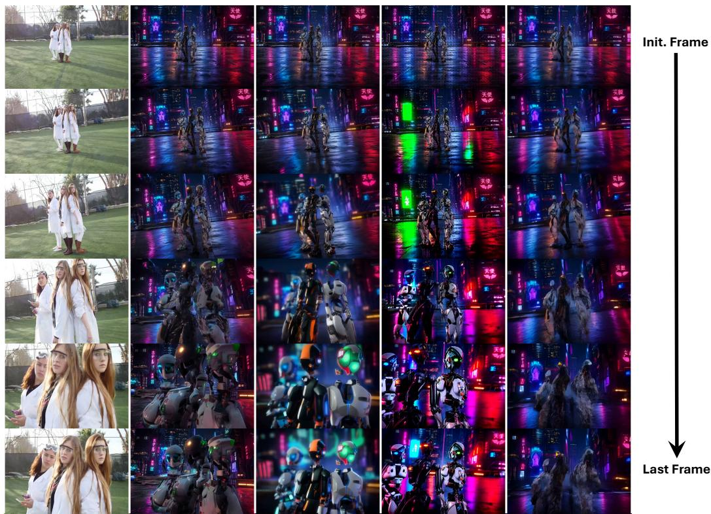  
Figure 5: Motion transfer example: we demonstrate strong motion adherence to the reference video while maintaining high generation quality and fidelity. Prompt used: "Cyberpunk rooftop at night, wet reflective ground, neon city skyline, three humanoid robots standing slightly left of center in a triangular group pose, aligned like three girls in an open field. White-blue robot, black-orange robot, white-red-green robot. Wide composition, large empty foreground and right-side space, glowing Japanese signs, holographic billboards, photorealistic, cinematic, ultra detailed."

## F.2 Qualitative Comparisons From MC-Bench

Following the experiment described in Section 4.2, we present additional results beyond those shown in Fig. 3, further illustrating our method’s performance against leading approaches on the MC-Bench dataset.

Motion Signal  
Ours  
TTM  
GWTF  
DisMo  
MotionPro  
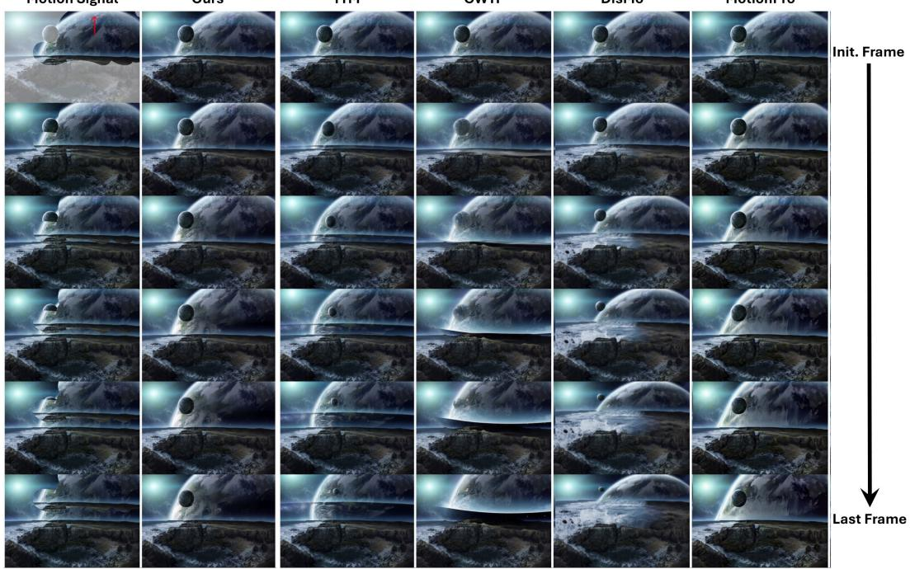  
Figure 6: Example from MC-Bench: we highlight the disentanglement between the moving subject (masked planet) and the background in our method.

Motion Signal  
Ours  
TTM  
GWTF  
DisMo  
MotionPro  
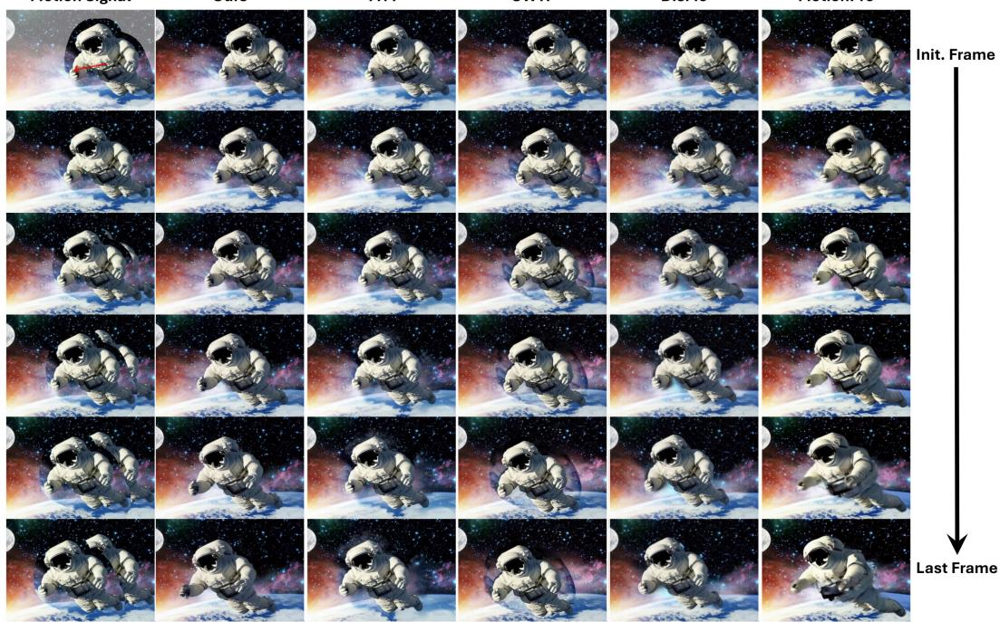  
Figure 7: Example from MC-Bench: we highlight the disentanglement between the moving astronaut and the background in our method.

## F.3 Qualitative Comparisons From DAVIS

Following the experiment described in Section 4.2, we present additional results beyond those shown in Fig. 3, further illustrating our method’s performance against leading approaches on the DAVIS dataset.

MotionPro  
Reference  
Ours  
TTM  
GWTF  
DisMo  
MotionPro  
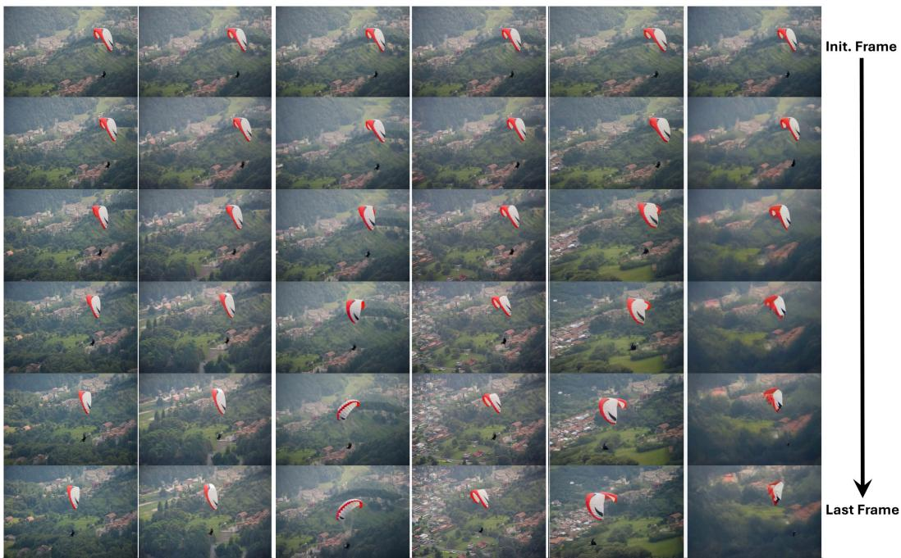  
Figure 8: Example from DAVIS: our method shows better motion adherence.

Ours  
TTM  
GWTF  
DisMo  
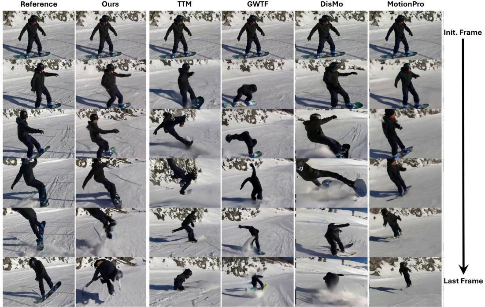  
Figure 9: Example from DAVIS: our method shows better motion adherence.

## F.4 Qualitative Comparisons From DL3DV

Following the experiment described in Section 4.2, we present additional camera-control results beyond those shown in Fig. 4.

Reference  
Ours  
TTM  
GWTF  
DisMo  
MotionPro  
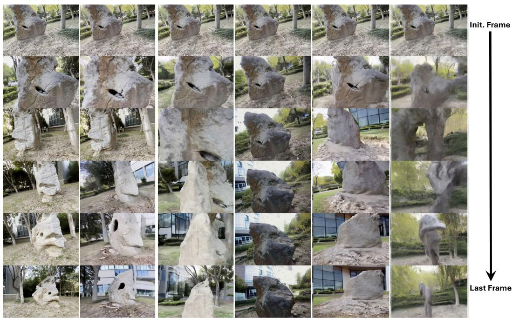  
Figure 10: Example from DL3DV: our method shows better camera motion adherence under optical flow control.

Reference  
Ours  
TTM  
GWTF  
DisMo  
MotionPro  
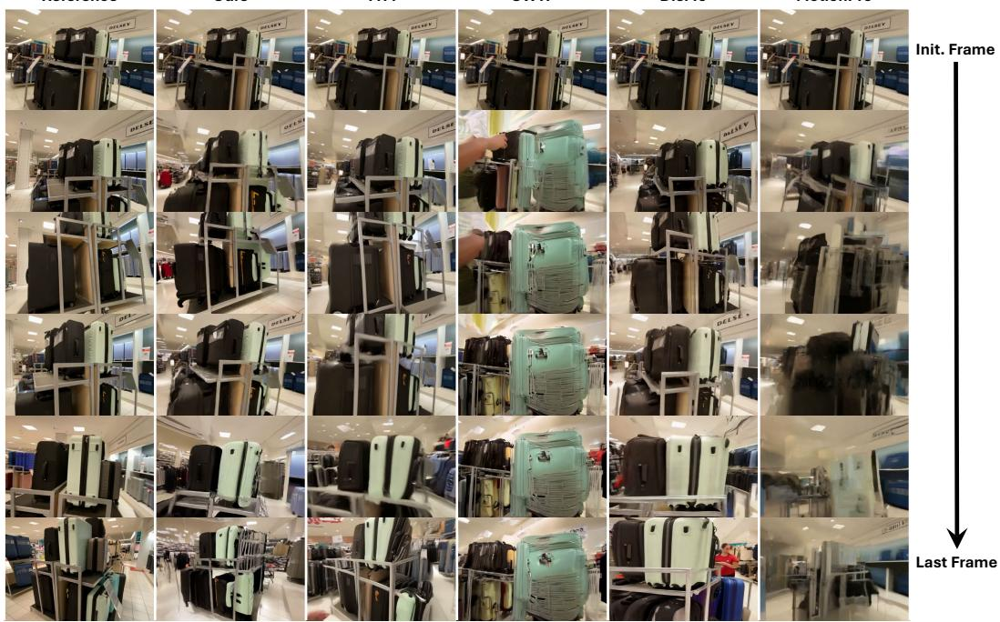  
Figure 11: Example from DL3DV: our method shows better camera motion adherence under optical flow control.

## G Qualitative Results for Different Noise Degradation Levels

We qualitatively ablate the noise degradation level γ, as analyzed in Section 4.3.

Reference  
Optical Flow  
� = �. �  
� = �. �  
� = �. �  
� = �. �  
� = �. �  
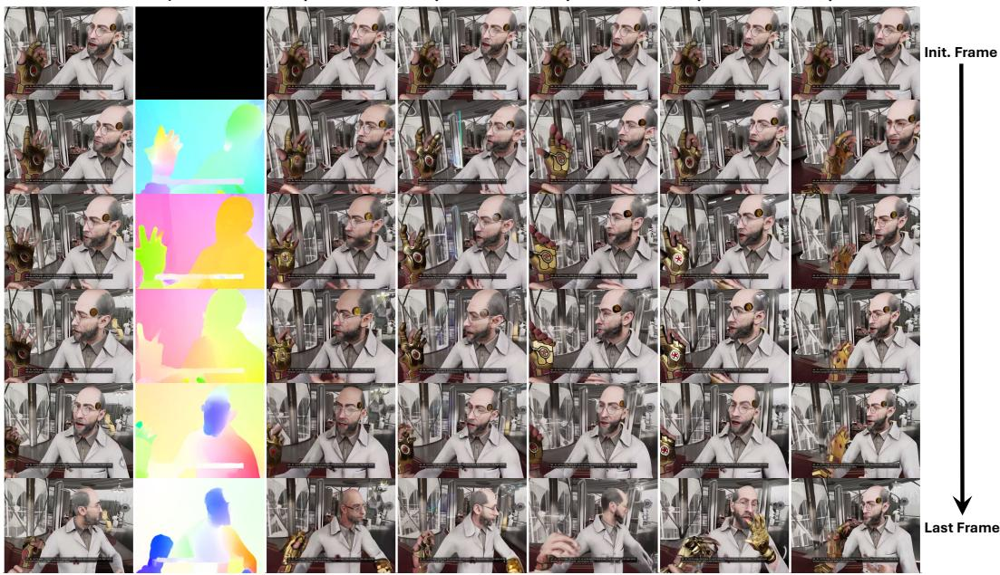  
Figure 12: The effect of noise degradation level γ on generated videos. As degradation decreases, the video adheres more to the input flow.