# IDPrior: Decoupling Identity Generation from Facial Image Synthesis

Fadi Boutros1, Meric¸ Demirors¨ 1 , Darian Tomaseviˇ c´2, Vitomir Strucˇ 2, Naser Damer1, 3,

1Fraunhofer Institute for Computer Graphics Research IGD, Germany

2University of Ljubljana, Slovenia ,3TU Darmstadt, Germany

fadi.boutros@igd.fraunhofer.de

## Abstract

Large-scale identity-labeled face datasets are essential for training modernface recognition models, yet collecting and annotating such data is costly and raises privacy and ethical concerns. Existing synthetic face generation methods typically derive identities from predefined class labels, unconditional image generation, or predefined latent sampling strategies, without explicitly modeling the underlying distribution offacial identities. In this paper, we propose ID-Prior, a two-stage framework that decouples identity generation from image synthesis. We first learn a diffusion prior in the embedding space of a pretrained face recognition model to model the distribution offacial identities and generate novel identity embeddings. These embeddings are then used to condition a pretrained identity-conditioned diffusion model (DM), enabling the synthesis ofmultiple images of the same identity. This modular design provides a scalable approach to identity generation while remaining compatible with existing andfuture identity-conditioned DMs. Experiments indicate that IDPrior generates diverse and well-separated identities while maintaining a closer correspondence to the distribution ofauthentic identities. Face recognition models trained on datasets generated using IDPrior-generated identities achieve competitive or improved performance compared with existing syntheticdata-based methods across multipleface verification benchmarks. Code and generated datasets are publicly available at https://github.com/fdbtrs/IDperturb.

## 1. Introduction

Face recognition (FR) has witnessed remarkable progress over the past decade, driven by advances in deep neural networks, discriminative learning objectives, and large-scale identity-labeled datasets [13, 22, 44]. However, collecting and annotating such datasets remains technically challenging and increasingly constrained by privacy regulations and ethical considerations [7, 15, 43]. The retraction of widely used datasets, including MS-Celeb-1M [16] and

VGGFace2 [11], further highlights the difficulty of acquiring authentic training data.

These challenges have motivated extensive research on synthetic data generation for FR [12, 33, 36]. Recent GANs [21] and diffusion models (DMs) [39] can synthesize realistic faces for FR training. Existing approaches typically generate identities using class-conditional generators with discrete labels [3, 8, 27], unconditional image generation [4, 23, 28], or embedding-space identity generation based on predefined sampling strategies such as PCA [37, 46] and virtual identity construction [24]. However, these approaches do not explicitly learn a generative model of the underlying distribution of facial identities.

In this work, we propose IDPrior, a two-stage framework that decouples identity generation from image synthesis. We first learn a diffusion prior directly in the embedding space of a pretrained FR model to capture the distribution of facial identities and sample novel identity embeddings. These embeddings are then used as conditioning inputs for a pretrained identity-conditioned DM to synthesize multiple photorealistic images of each identity. This separation enables scalable identity generation while allowing the learned prior to be reused with existing and future identityconditioned face generators without modifying their synthesis pipelines.

## Our contributions are:

• We introduce IDPrior, a two-stage framework that decouples identity generation from image synthesis and can be seamlessly integrated with pretrained identityconditioned face generators.

• We propose a diffusion-based generative prior that explicitly learns the distribution of facial identities in the embedding space of a pretrained FR model.

• We demonstrate that IDPrior provides a favorable tradeoff between identity novelty, uniqueness, and distribution fidelity, enabling scalable generation of up to one million identities and improving downstream FR performance across multiple identity-conditioned generators.

## 2. Related Work

Recent advances in GANs [21] and DMs [39] have enabled highly realistic face synthesis and stimulated extensive research on synthetic data for FR [12, 36]. Existing approaches can be broadly categorized by how they generate identities: class-label-based generation, unconditional image generation followed by identity extraction, and latentspace identity sampling.

Class-label-based identity generation. The earliest synthetic face generation methods formulate identity generation as a class-conditional image synthesis problem. SFace [3], SFace2 [8], and IDNet [27] adopt StyleGAN2- ADA [21] to synthesize images conditioned on discrete identity labels. Since identities are represented by training class indices, these methods do not explicitly model the facial identity distribution and are limited by the available class labels (e.g., approximately 10K identities in SFace [3]). ExFaceGAN [6] explores identity directions in the GAN latent space, but does not explicitly model the distribution of FR embeddings.

Unconditional image generation followed by identity extraction. Recent diffusion-based methods generate faces unconditionally and extract identity embeddings using a pretrained FR network. DCFace [23], IDiff-Face [4], ID3 [47], and UIFace [28] follow this paradigm, with additional mechanisms for identity consistency or appearance diversity. However, identities are implicitly determined by the image generator, limiting explicit control over identity distribution, separability, and scalability.

Latent-space identity sampling. Another line of research generates or samples synthetic identities directly in the FR embedding space before image synthesis. Arc2Face [37] trains Principal Component Analysis (PCA) on the embedding space of a pretrained FR model and samples novel identity embeddings from the resulting PCA space, which are then used to condition a pretrained identity-conditioned diffusion model. Vec2Face [46] adopts the same PCA-based identity sampling strategy while introducing a feature-masked autoencoder for image generation. IDiff-Face [4] also explores direct sampling of identity embeddings from a standard Gaussian distribution without explicitly modeling the empirical identity distribution.

VIGFace [24] further explores identity generation in the FR embedding space by explicitly constructing virtual identity prototypes and subsequently using them to condition a diffusion-based face generator. In contrast to sampling from a fixed statistical approximation, VIGFace optimizes virtual prototypes to achieve separation from real identities while maintaining identity consistency. This demonstrates the benefit of explicitly constructing identities in the FR embedding space, but the resulting identity pool consists of a predefined set of learned prototypes.

While these methods establish the importance of generating identities in the FR embedding space, they might be suboptimal for learning identity distribution. PCA represents the identity distribution through a linear subspace and Gaussian sampling assumes a simple isotropic distribution, which may not capture the complex nonlinear structure of facial identity embeddings. VIGFace instead learns individual virtual identity prototypes, resulting in a predefined prototype pool, and expanding the pool requires additional prototype training. IDPrior takes a different approach by learning a generative model directly over the empirical identityembedding distribution and sampling identities from this learned prior. This formulation enables IDPrior to generate new identities without being restricted to a predefined prototype pool while capturing nonlinear distributional structure beyond a fixed PCA approximation.

## 3. Methodology

We propose a two-stage framework for synthesizing novel face identities and their corresponding images. We first learn the distribution of facial identity embeddings in the embedding space of a pretrained FR model. Specifically, we train a denoising diffusion probabilistic model (DDPM) [18] to model the distribution of normalized identity embeddings extracted from real face images. Once trained, the model is used to sample novel identity embeddings. These embeddings are subsequently used to condition a pretrained identity-guided image DM [4, 9, 37, 48], which synthesizes multiple face images belonging to the same identity. By decoupling identity generation from image synthesis, the proposed framework enables scalable generation of large identity-consistent face datasets (Fig. 1).

## 3.1. Problem Formulation

Let $x \in \mathcal { X } \subset \mathbb { R } ^ { H \times W \times \vdots }$ denote a face image sampled from the real image distribution $p _ { \mathrm { d a t a } } ( x )$ . A pretrained FR model $f : \mathcal { X } \to \mathbb { R } ^ { d }$ maps each image to a d-dimensional identity embedding $z = f ( x )$ . Following modern FR models [13, 22, 44], all embeddings are $\ell _ { 2 }$ normalized, $\| z \| _ { 2 } = 1$ , such that the embedding space lies on the unit hypersphere $S ^ { d - 1 }$

Given a training set of face images, we extract the corresponding embeddings:

$$
\mathcal { Z } = \{ z _ { i } = f ( x _ { i } ) \} _ { i = 1 } ^ { N } ,\tag{1}
$$

which induces the empirical distribution of FR embeddings $p _ { \mathrm { d a t a } } ( z )$ . Our objective is to learn a generative model that samples novel embeddings while preserving the statistical properties of this distribution.

We model the synthetic-data generation process as the following two-stage factorization:

$$
\begin{array} { r } { p ( x , z ) = p _ { \theta } ( z ) p _ { \phi } ( x | z ) , } \end{array}\tag{2}
$$

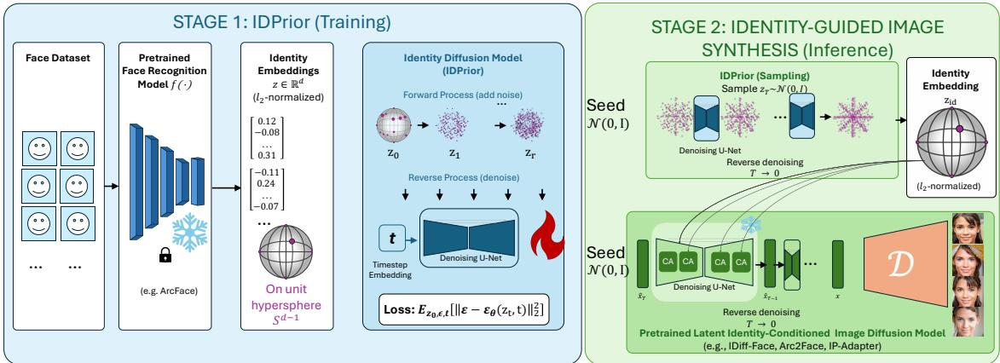  
Figure 1. Overview of IDPrior, a dual diffusion framework that decouples identity generation from image synthesis. Stage 1: A diffusion prior is learned on FR embeddings to model the distribution of facial identities and generate novel identity embeddings. Stage 2: The sampled embeddings are subsequently used to condition a pretrained identity-guided image diffusion model, enabling the synthesis o multiple images per identity.

where $p _ { \theta } ( z )$ models the distribution of facial identity embeddings and $p _ { \phi } ( x | z )$ generates face images conditioned on a sampled identity.

FR embeddings provide a compact representation in which identity similarity is encoded through angular distances, making them a natural domain for modeling facial identity independently of image appearance. IDPrior therefore learns the identity distribution directly in the embedding space, separating identity generation from image synthesis and enabling scalable sampling of novel identity embeddings.

## 3.2. Identity Diffusion Model

To model the distribution of identity embeddings, we employ a DDPM [18]. Let $z _ { \mathrm { 0 } }$ denote a clean identity embedding sampled from $p _ { \mathrm { d a t a } } ( z )$ . The forward diffusion process gradually perturbs the embedding by adding Gaussian noise:

$$
q ( z _ { t } | z _ { t - 1 } ) = \mathcal { N } \left( \sqrt { 1 - \beta _ { t } } z _ { t - 1 } , \beta _ { t } I \right) ,\tag{3}
$$

where $\{ \beta _ { t } \} _ { t = 1 } ^ { T }$ is a predefined variance schedule. Equivalently,

$$
z _ { t } = \sqrt { \bar { \alpha } _ { t } } z _ { 0 } + \sqrt { 1 - \bar { \alpha } _ { t } } \epsilon ,\tag{4}
$$

where

$$
\epsilon \sim { \mathcal N } ( 0 , I ) , \qquad \alpha _ { t } = 1 - \beta _ { t } , \qquad { \bar { \alpha } } _ { t } = \prod _ { s = 1 } ^ { t } \alpha _ { s } .
$$

Although the clean identity embeddings lie on the unit hypersphere, diffusion is performed in the ambient Euclidean space following the standard DDPM formulation. The final generated embeddings are subsequently normalized to ensure compatibility with the FR embedding space.

The reverse diffusion process is parameterized by a neural network $\epsilon _ { \theta } ( z _ { t } , t )$ that predicts the injected Gaussian noise. The reverse transition is defined as

$$
p _ { \theta } ( z _ { t - 1 } | z _ { t } ) = \mathcal { N } \left( z _ { t - 1 } ; \mu _ { \theta } ( z _ { t } , t ) , \sigma _ { t } ^ { 2 } I \right) ,\tag{5}
$$

where

$$
\mu _ { \theta } ( z _ { t } , t ) = \frac { 1 } { \sqrt { \alpha _ { t } } } \left( z _ { t } - \frac { 1 - \alpha _ { t } } { \sqrt { 1 - \bar { \alpha } _ { t } } } \epsilon _ { \theta } ( z _ { t } , t ) \right) .\tag{6}
$$

Training Objective: The identity diffusion model is trained using the standard noise-prediction objective [18]:

$$
\mathcal { L } _ { \mathrm { i d } } = \mathbb { E } _ { z _ { 0 } , \epsilon , t } \left[ \| \epsilon - \epsilon _ { \theta } ( z _ { t } , t ) \| _ { 2 } ^ { 2 } \right] ,\tag{7}
$$

where t is sampled uniformly from $\{ 1 , \ldots , T \}$

## 3.3. Sampling Novel Identity Embeddings

After training, novel identities are generated by sampling $z _ { T } \sim \mathcal { N } ( 0 , I )$ and iteratively applying the learned reverse diffusion process:

$$
z _ { t - 1 } \sim p _ { \theta } ( z _ { t - 1 } | z _ { t } ) , \qquad t = T , \dots , 1 .\tag{8}
$$

The final denoised embedding $\hat { z } _ { 0 }$ is $\ell _ { 2 }$ -normalized:

$$
z _ { \mathrm { i d } } = \frac { \hat { z } _ { 0 } } { \Vert \hat { z } _ { 0 } \Vert _ { 2 } } ,\tag{9}
$$

ensuring compatibility with the normalized embedding space of the pretrained FR model. The resulting embedding represents a novel synthetic identity and is subsequently used as a condition for image generation.

## 3.4. Identity-Conditioned Image Generation

Given an identity embedding $z _ { \mathrm { i d } }$ , we synthesize face images using a pretrained identity-conditioned DM (Stage 2 in Fig. 1). The image generator models the conditional distribution $p _ { \phi } ( x | z _ { \mathrm { i d } } )$ , where the identity embedding is provided as the conditioning signal. Keeping $z _ { \mathrm { i d } }$ fixed while varying the random seed produces multiple images with the same target identity and different appearances.

(a)  
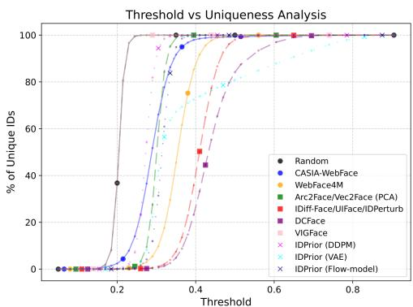  
Figure 2. Identity uniqueness as a function of the cosine-similarity threshold. We report the percentage of unique identities among 10K generated identities. As the threshold becomes stricter, ID-Prior (DDPM) consistently preserves a larger fraction of unique identities than existing approaches.

## 4. Experimental Setup

## 4.1. IDPrior Implementation Details

IDPrior Training: IDPrior is trained on normalized face recognition embeddings extracted from the WF4M [52] dataset (4M images). We train separate IDPrior models using a pretrained ArcFace [14] backbone for integration with Arc2Face and IP-Adapter-FaceID, and a pretrained Elastic-Face [2] backbone for integration with IDiff-Face and ID-PERTURB. Since IDPrior models the identity distribution in the embedding space of a pretrained FR model, its performance and generated identity distribution inherently depend on the underlying FR representation.

To assess whether the effectiveness of IDPrior depends on the diffusion formulation, we additionally instantiate the identity prior using a flow-based model [29] and a variational autoencoder (VAE) [26]. All variants are trained on the same normalized identity embeddings and used to sample identities for image generation. Unless otherwise specified, the DDPM is the main IDPrior model.

Each identity embedding has 512 dimensions and is reshaped into a $1 6 \times 3 2$ feature map to facilitate the use of a commonly utilized two-dimensional U-Net architecture [39]. We adopt the DDPM [18] with a linear noise schedule over $\begin{array} { c c l } { T } & { = } & { 1 0 0 0 } \end{array}$ diffusion timesteps [18, 39]. During training, a timestep is uniformly sampled, Gaussian noise is added according to the forward diffusion process, and the network is optimized to predict the injected noise, as described in Section 3. The U-Net [39] consists of five encoder and five decoder stages with channel dimensions 64, 128, 256, 512, 512. Each stage contains two residual blocks, the attention head dimension is set to 8, and the network uses a dropout rate of 0.1 throughout. The model contains 114M trainable parameters, 342 GFLOPs (171 GMACs) and is trained on four NVIDIA A100 GPUs using mixed-precision training, requiring approximately 14 hours. Training is performed for 100 epochs using the Adam optimizer [25] with a learning rate of $1 \times 1 0 ^ { - 4 }$ a batch size of 512, and a cosine annealing learning-rate schedule [31]. During inference, we generate novel identity embeddings using a DDIM sampler [41] with 50 denoising steps, enabling the synthesis of one million identities, each of dimension 512, in approximately two hours (i.e., 7.2 ms per sample). These costs are incurred offline, and the identity prior is not required during subsequent image synthesis. The generated embeddings can be stored and reused across different pretrained generators, amortizing the upfront cost for large-scale synthetic data generation.

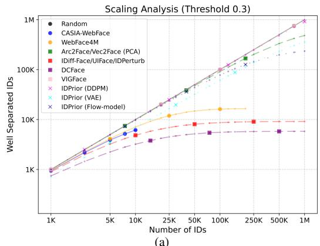  
Figure 3. Number of well-separated identities as the total number of generated identities increases, using a threshold of 0.30.

Image Synthesis: We evaluate IDPrior with IDiff-Face [4], IDPERTURB [9], Arc2Face [37], and IP-Adapter-FaceID [48], replacing their original identity generation mechanisms with IDPrior-sampled embeddings. IP-Adapter-FaceID is a dual-conditional (image/text) DM not originally designed for synthetic FR training. We additionally evaluate a PCA baseline trained on ArcFace embeddings from WF4M.

## 4.2. Face recognition training and evaluation

FR Training Setup: We train ResNet50 [17] with Cos-Face [44] on the synthetic datasets, following [4, 6, 28, 42]. We use SGD optimizer for 25 epochs with batch size 512, momentum 0.9, weight decay $5 \times 1 0 ^ { - 4 }$ , initial learning rate 0.1, and cosine annealing learning rate scheduler. The Cos-Face [44] margin and scale are 0.35 and 64, respectively.

Evaluation Benchmarks: FR performance is reported, following [4, 6, 22, 28], as the verification accuracy on: Labeled Faces in the Wild LFW [19], AgeDB-30 [34], Cross-Age LFW (CA-LFW) [51], Celebrities in Frontal-Profile in the Wild (CFP-FP) [40], and Cross-Pose LFW (CP-LFW) [50], following their official evaluation protocol.

## 5. Results

## 5.1. Unique Identity Generation

To evaluate the identity uniqueness, we compare it with synthetic identity sampling methods, including DC-Face [23], IDiff-Face [4], IDPERTURB [9], UIFace [28], Arc2Face [37], and Vec2Face [46]. DCFace, IDiff-Face, IDPERTURB, and UIFace implicitly generate identities by synthesizing face images and treating each image as a new identity, whereas Arc2Face and Vec2Face explicitly sample identity embeddings from a PCA model learned on FR embeddings. We also evaluate normalized Gaussian vectors, which are used by IDiff-Face [4] as reference identity embeddings. Given a set of generated identity embeddings $\{ z _ { i } \} _ { i = 1 } ^ { N }$ , we define the set of unique identities as:

$$
U = \{ z _ { i } : s i m ( z _ { i } , z _ { j } ) < r , \forall j < i \} ,\tag{10}
$$

where $s i m ( \cdot , \cdot )$ denotes the cosine similarity and $r$ is a similarity threshold. We vary $r \in [ 0 , 1 ]$ to evaluate identity uniqueness under different matching criteria. As references, we additionally report the uniqueness statistics of the authentic CW [49] and WF4M [52]. Figure 2 shows that IDPrior (DDPM) achieves substantially higher identity uniqueness than existing image-generation-based and PCAbased methods across the evaluated similarity thresholds. While random sampling and VIGFace can achieve nearperfect separation, high uniqueness alone does not imply a realistic identity distribution. As shown in the next subsection, these methods exhibit substantially worse distribution fidelity than IDPrior (DDPM).

## 5.2. Scalability of Identity Generation

To evaluate the scalability, we analyze how the number of well-separated identities evolves as more identities are generated. Given a set of generated identity embeddings $z _ { i _ { i = 1 } } ^ { \phantom { + } N } .$ an embedding $z _ { i }$ is considered well-separated if:

$$
\operatorname* { m a x } _ { j \neq i } s i m ( z _ { i } , z _ { j } ) < r .\tag{11}
$$

We progressively increase the number of generated identities up to one million and count the number of embeddings satisfying this criterion.

Figure 3 compares IDPrior with random Gaussian embeddings, DCFace [23], IDiff-Face [4], IDPERTURB [9], UIFace [28], Arc2Face [37], VIGFace [24], Vec2Face [46], and the authentic CW [49] and WF4M [52] datasets using thresholds $r = 0 . 3$ . The threshold $r = 0 . 3$ follows [9, 23] and corresponds to the operating point of the evaluation model [13], which reports a verification accuracy of 97.17% at a threshold of 0.3080 using $T P R @ F P R = 0 . 0 1 \%$ on the IJB-B benchmark [45]. $r = 0 . 2 5$ provides a more stringent criterion.

At one million generated identities and $r = 0 . 3$ , IDPrior retains 91.63% well-separated identities, compared to less than 1% for image-generation-based methods and 48.15% for PCA-based approaches, as shown in Table 1. Although random embeddings yield the highest separability due to their near-uniform hyperspherical distribution, they do not reflect real facial identity distributions, as indicated by their poor ID-FID (Section 5.3). Overall, these results show that explicitly learning the facial identity distribution provides substantially better scalability than image-generationor PCA-based identity sampling. The trends observed in Figure 3 are further quantified in Table 1.

Table 1. Scalability of identity generation from 10K to 1M identities. We report the percentage of unique identities at thresholds 0.25, 0.30, and 0.40. IDPrior (DDPM) maintains substantially higher uniqueness than PCA- and image-generation-based approaches across scales, while random sampling, VIGFace, and the flow-based prior achieve higher separation at the cost of poorer distribution fidelity, as detailed in Table 2.
<table><tr><td rowspan="2">Approach</td><td rowspan="2">#Identities</td><td colspan="3">Unique in (%) @r</td></tr><tr><td>0.25</td><td>0.3</td><td>0.4</td></tr><tr><td rowspan="4">Random (uniform)</td><td>10K</td><td>99.98</td><td>100.00</td><td>100.00</td></tr><tr><td>100K</td><td>99.98</td><td>100.00</td><td>100.00</td></tr><tr><td>500K</td><td>99.88</td><td>100.00</td><td>100.00</td></tr><tr><td>1M</td><td>99.77</td><td>100.00</td><td>100.00</td></tr><tr><td rowspan="4">VIGFace [24]</td><td>10K</td><td>100.00</td><td>100.00</td><td>100.00</td></tr><tr><td>100K</td><td>99.98</td><td>100.00</td><td>100.00</td></tr><tr><td>500K</td><td>99.88</td><td>99.99</td><td>100.00</td></tr><tr><td>1M</td><td>99.76</td><td>99.99</td><td>100.00</td></tr><tr><td>Arc2Face [37] Vec2Face [46]</td><td>10K</td><td>74.35</td><td>99.15</td><td>100.00</td></tr><tr><td rowspan="3"></td><td>100K</td><td>16.55</td><td>91.25</td><td>99.99</td></tr><tr><td>500K</td><td>3.34</td><td>66.48</td><td>99.99</td></tr><tr><td>1M</td><td>1.67</td><td>48.15</td><td>99.99</td></tr><tr><td rowspan="4">DCFace [23] IDiff-Face [4]</td><td>10K</td><td>8.11</td><td>32.10</td><td>83.75</td></tr><tr><td>100K</td><td>0.83</td><td>5.55</td><td>61.42</td></tr><tr><td>500K</td><td>0.17</td><td>1.16</td><td>36.48</td></tr><tr><td>1M</td><td>0.08</td><td>0.58</td><td>26.34</td></tr><tr><td>UIFace [28]</td><td>10K</td><td>11.79</td><td>48.35</td><td>97.6</td></tr><tr><td rowspan="3">IDPERTURB [9]</td><td>100K</td><td>1.23</td><td>8.68</td><td>82.43</td></tr><tr><td>500K</td><td>0.25</td><td>1.82</td><td>54.38</td></tr><tr><td>1M</td><td>0.12</td><td>0.91</td><td>40.43</td></tr><tr><td rowspan="4">IDPrior (VAE)</td><td>10K</td><td>49.87</td><td>68.58</td><td>77.15</td></tr><tr><td>100K</td><td>13.80</td><td>60.97</td><td>75.00</td></tr><tr><td>500K</td><td>2.85</td><td>46.38</td><td>73.56</td></tr><tr><td>1M</td><td>1.42</td><td>35.72</td><td>72.95</td></tr><tr><td rowspan="4">IDPrior (Flow-model)</td><td>10K</td><td>54.05</td><td>97.04</td><td>99.99</td></tr><tr><td>100K</td><td>8.30</td><td>77.60</td><td>99.99</td></tr><tr><td>500K</td><td>1.66</td><td>39.46</td><td>99.97</td></tr><tr><td>1M</td><td>0.83</td><td>23.44</td><td>99.95</td></tr><tr><td rowspan="4">IDPrior (DDPM)</td><td>10K</td><td>93.44</td><td>99.91</td><td>100.00</td></tr><tr><td>100K</td><td>59.39</td><td>98.89</td><td>100.00</td></tr><tr><td>500K</td><td>20.40</td><td>95.39</td><td>99.99</td></tr><tr><td>1M</td><td>10.68</td><td>91.63</td><td>99.99</td></tr></table>

## 5.3. Identity Distribution Similarity

To evaluate how well the generated identities match the distribution of real identities, we compute the Identity Frechet ´ Distance (ID-FID) between real and synthetic embeddings. Unlike the conventional FID, which measures image realism, ID-FID directly evaluates the similarity between identity distributions. Given the real and synthetic embedding sets ${ \mathcal { Z } } _ { r }$ and $\mathcal { Z } _ { s y n }$ with Gaussian statistics $\left( \mu _ { r } , \Sigma _ { r } \right)$ and $( \mu _ { s y n } , \Sigma _ { s y n } )$ , ID-FID is defined as:

Table 2. Identity uniqueness, distribution fidelity, and potential identity leakage on 10K generated identities. We report uniqueness a thresholds of 0.30 and 0.25, ID-FID, unified ID-FID (U-ID-FID) using a common CelebA [30] reference distribution, and nearest-trainingidentity similarity statistics, including the 95th and 99th percentiles $( P _ { 9 5 }$ and $P _ { 9 9 } )$ and leakage rates at $\tau$ of 0.25, 0.3, and 0.4. Lowe $P _ { 9 5 } , P _ { 9 9 }$ , and leakage rates indicate lower similarity to training identities and therefore greater identity novelty, while lower ID-FID and U-ID-FID indicate better distributional fidelity.
<table><tr><td></td><td colspan="2">Unique</td><td colspan="2">ID-FID</td><td colspan="2">Novelty</td><td colspan="4">Identity leakage ↓</td></tr><tr><td>Method</td><td>Unique@0.3 ↑</td><td>Unique@0.25 ↑</td><td>ID-FID↓</td><td>U-ID-FID↓</td><td>Train Sim. ↓</td><td> $\overline { { \frac { P _ { 9 5 } } { P _ { 9 5 } } } }$ </td><td> $\overline { { P _ { 9 9 } } }$ </td><td>Leak@0.25 (%)</td><td>Leak@0.3 (%)</td><td>Leak@0.4 (%)</td></tr><tr><td>CW (Authentic)</td><td>61.50</td><td>16.67</td><td></td><td>0.0309</td><td></td><td></td><td></td><td></td><td></td><td></td></tr><tr><td>WF4M (Authentic)</td><td>70.83</td><td>22.68</td><td></td><td>0.0560</td><td></td><td></td><td></td><td></td><td></td><td></td></tr><tr><td>Random (Uniform)</td><td>100.00</td><td>99.98</td><td>0.6009</td><td>0.3210</td><td>0.1666</td><td>0.1932</td><td>0.2075</td><td>0.00</td><td>0.00</td><td>0.00</td></tr><tr><td>VIGFace</td><td>100.00</td><td>100.00</td><td>0.9166</td><td>0.9987</td><td>0.1605</td><td>0.1903</td><td>0.2052</td><td>0.00</td><td>0.00</td><td>0.00</td></tr><tr><td>Arc2Face /Vec2Face</td><td>99.15</td><td>74.35</td><td>0.6759</td><td>0.6967</td><td>0.1686</td><td>0.1936</td><td>0.2087</td><td>0.01</td><td>0.00</td><td>0.00</td></tr><tr><td>IDiff-Face /UIFace /IDPERTURB</td><td>48.35</td><td>11.79</td><td>0.0271</td><td>0.0421</td><td>0.3159</td><td>0.3810</td><td>0.4240</td><td>98.64</td><td>64.45</td><td>2.47</td></tr><tr><td>DCFace</td><td>32.10</td><td>8.11</td><td>0.0267</td><td>0.0769</td><td>0.3497</td><td>0.4872</td><td>0.5604</td><td>99.07</td><td>78.72</td><td>17.70</td></tr><tr><td>IDPrior (VAE)</td><td>68.58</td><td>49.87</td><td>0.2728</td><td>0.2256</td><td>0.2201</td><td>0.2715</td><td>0.2957</td><td>17.40</td><td>0.74</td><td>0.00</td></tr><tr><td>IDPrior (Flow-model)</td><td>97.04</td><td>54.05</td><td>0.1088</td><td>0.0631</td><td>0.2482</td><td>0.2885</td><td>0.3122</td><td>42.07</td><td>2.21</td><td>0.00</td></tr><tr><td>IDPrior (DDPM)</td><td>99.91</td><td>93.44</td><td>0.0261</td><td>0.0557</td><td>0.2213</td><td>0.2534</td><td>0.2715</td><td>6.64</td><td>0.05</td><td>0.00</td></tr></table>

$$
\mathrm { I D - F I D } = \Vert \mu _ { r } - \mu _ { s y n } \Vert _ { 2 } ^ { 2 } + \mathrm { T r } \left( \Sigma _ { r } + \Sigma _ { s y n } - 2 ( \Sigma _ { r } \Sigma _ { s y n } ) ^ { 1 / 2 } \right) .\tag{12}
$$

The ID-FID values in Table 2 are computed against the authentic training distribution of each method. To remove this dependency on the reference dataset, we additionally report a unified ID-FID (U-ID-FID) using CelebA [30] as a common reference for all methods. IDPrior (DDPM) achieves the lowest ID-FID and second-lowest U-ID-FID of 0.0261 and 0.0557, respectively, while retaining 99.91% uniqueness at $r = 0 . 3 0$ , confirming that its distributional fidelity is not solely due to evaluation against its own training distribution. In contrast, VIGFace and random sampling achieve near-perfect separation, but substantially higher U-ID-FID, illustrating that identity separation alone does not imply a realistic identity distribution. We further compare alternative generative priors under the same identityembedding setting. The flow-based prior achieves 97.04% uniqueness and U-ID-FID of 0.1088, whereas the VAE performs worse in both uniqueness and distribution fidelity. Overall, the IDPrior (DDPM) provides the best combination of separation and fidelity among the evaluated priors.

## 5.4. Novelty with Respect to Training Identities

We evaluate the novelty of generated identities with respect to the training dataset. To this end, we measure their similarity to the identities in the training set.

Let $\mathcal { Z } _ { \mathrm { t r a i n } } = \{ z _ { i } ^ { \mathrm { t r a i n } } \} _ { i = 1 } ^ { N }$ denote the identity embeddings extracted from the training dataset, and $\mathcal { Z } _ { \mathrm { g e n } } = \{ z _ { i } ^ { \mathrm { g e n } } \} _ { i = 1 } ^ { M }$ denote the generated identity embeddings. For each generated identity, we compute its maximum cosine similarity to all training identities,

$$
s _ { i } = \operatorname* { m a x } _ { j } \{ s i m \left( z _ { i } ^ { \mathrm { g e n } } , z _ { j } ^ { \mathrm { t r a i n } } \right) \} .\tag{13}
$$

Lower similarity indicates greater identity novelty and, correspondingly, a lower potential for identity leakage from the training set. Table 2 reveals a trade-off between novelty, uniqueness, and distribution fidelity. PCA, random sampling, and VIGFace exhibit lower training similarity, but their substantially higher ID-FID and U-ID-FID indicate that this novelty partly results from deviating from the authentic identity distribution. Conversely, image-generationbased methods better match the distribution but exhibit substantially higher training similarity and severe identity collisions. IDPrior (DDPM) provides a favorable balance, with 99.91% uniqueness at $r = 0 . 3 0$ and a U-ID-FID of 0.0557.

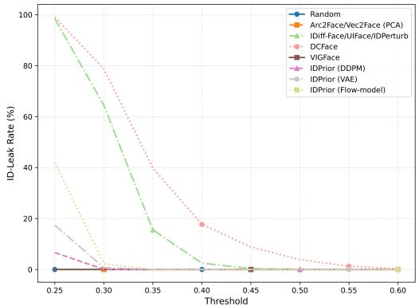  
Figure 4. Identity leakage at different thresholds. We report the percentage of leaked identities among 10K generated identities.

## 5.4.1. Identity leakage analysis

To quantify potential identity leakage, we report the leakage rate at a similarity threshold τ . For each generated identity $z _ { i } ^ { \mathrm { g e n } }$ , we compute its maximum cosine similarity to the training identities and count it as a potential leakage case if this similarity exceeds τ of 0.25, 0.3, or 0.4. The leakage rate is defined as:

$$
\mathrm { L e a k a g e @ \boldsymbol { \tau } } = \frac { 1 } { M } \sum _ { i = 1 } ^ { M } \mathbb { I } \left[ \operatorname* { m a x } _ { z _ { j } ^ { \mathrm { t r a i n } } \in \mathcal { Z } _ { \mathrm { t r a i n } } } \cos ( z _ { i } ^ { \mathrm { g e n } } , z _ { j } ^ { \mathrm { t r a i n } } ) > \tau \right] ,\tag{14}
$$

where $\mathbb { I } [ \cdot ]$ is the indicator function. Lower leakage rates indicate fewer generated identities that are highly similar to individual training identities, suggesting lower potential for identity leakage. We additionally report the 95th and

Table 3. Comparison of identity generation strategies for training FR models. Verification accuracy (%) obtained using different identity sources with identity-conditioned DMs. Replacing the original identity sampling mechanisms with IDPrior generally improves downstream recognition performance across the evaluated identity-conditioned generators, with the largest gains observed for IDiff-Face and IP-Adapter-FaceID. Results marked with \* are reproduced in this work.
<table><tr><td>Face Embeddings</td><td>DGM</td><td>LFW</td><td>AgeDB-30</td><td>CFP-FP</td><td>CA-LFW</td><td>CP-LFW</td><td>Avg</td></tr><tr><td>Uncond. Samples</td><td>IDiff-Face [4]</td><td>98.75</td><td>88.85</td><td>91.61</td><td>90.90</td><td>86.15</td><td>91.25</td></tr><tr><td>Random (Uniform)</td><td>IDiff-Face [4]</td><td>98.00</td><td>87.30</td><td>90.97</td><td>91.25</td><td>86.01</td><td>90.71</td></tr><tr><td>VIGFace</td><td>IDiff-Face [4]</td><td>99.82</td><td>87.48</td><td>91.39</td><td>90.07</td><td>86.53</td><td>91.06</td></tr><tr><td>IDPrior(VAE)</td><td>IDiff-Face [4]</td><td>98.60</td><td>88.72</td><td>91.53</td><td>91.45</td><td>87.27</td><td>91.51</td></tr><tr><td>IDPrior (Flow-model)</td><td>IDiff-Face [4]</td><td>99.03</td><td>90.95</td><td>92.30</td><td>91.90</td><td>87.03</td><td>92.24</td></tr><tr><td>IDPrior (DDPM)</td><td>IDiff-Face [4]</td><td>98.82</td><td>90.80</td><td>92.67</td><td>91.95</td><td>87.07</td><td>92.26</td></tr><tr><td>Uncond. samples</td><td>IDPERTURB [9]</td><td>99.40</td><td>93.20</td><td>93.61</td><td>93.50</td><td>88.37</td><td>93.62</td></tr><tr><td>IDPrior</td><td>IDPERTURB [9]</td><td>99.23</td><td>93.43</td><td>93.97</td><td>93.35</td><td>89.70</td><td>93.94</td></tr><tr><td>PCA*</td><td>Arc2Face* [37]</td><td>96.58</td><td>84.46</td><td>88.62</td><td>86.58</td><td>78.85</td><td>87.02</td></tr><tr><td>IDPrior</td><td>Arc2Face [37]</td><td>97.70</td><td>80.57</td><td>89.17</td><td>84.75</td><td>83.77</td><td>87.19</td></tr><tr><td>PCA*</td><td>IP-Adapter-FaceID*</td><td>93.43</td><td>74.42</td><td>79.41</td><td>78.12</td><td>73.45</td><td>79.77</td></tr><tr><td>IDPrior</td><td>IP-Adapter-FaceID</td><td>94.37</td><td>79.82</td><td>81.76</td><td>81.70</td><td>74.63</td><td>82.46</td></tr></table>

Table 4. FR performance trained on IDPrior (DDPM)-generated datasets of increasing scale. Performance generally improves, approaching the accuracy achieved using authentic training data.
<table><tr><td></td><td>IDs × imgs/ID</td><td>LFW</td><td>AgeDB-30</td><td>CFP-FP</td><td>CA-LFW</td><td>CP-LFW</td><td>Avg</td></tr><tr><td>IDPrior</td><td>50K (1k x 50)</td><td>94.83</td><td>79.82</td><td>79.07</td><td>84.20</td><td>73.80</td><td>82.34</td></tr><tr><td>IDPrior</td><td>0.5M (10k x 50)</td><td>98.82</td><td>90.80</td><td>92.67</td><td>91.95</td><td>87.07</td><td>92.26</td></tr><tr><td>IDPrior</td><td>1.0M (20k x 50)</td><td>99.27</td><td>92.28</td><td>94.03</td><td>92.98</td><td>88.90</td><td>93.49</td></tr><tr><td>IDPrior</td><td>2.0M (40k x 50)</td><td>99.40</td><td>93.72</td><td>94.79</td><td>93.93</td><td>90.20</td><td>94.41</td></tr><tr><td>IDPrior</td><td>4.0M (80k x 50)</td><td>99.52</td><td>94.83</td><td>95.83</td><td>94.48</td><td>90.98</td><td>95.13</td></tr></table>

99th percentile (noted as $P _ { 9 5 }$ and $P _ { 9 9 } )$ of the nearest neighbor (NN) between each item in ${ \mathcal { Z } } _ { \mathrm { g e n } }$ and $\mathcal { Z } _ { \mathrm { t r a i n } }$ . Results for thresholds 0.25 and 0.3 are presented in Table 2 and for the full range [0.25,0.6] quantified in Figure 4. For IDPrior (DDPM), only 0.05% of generated identities exceed a cosine similarity of 0.30 with any training identity, and none exceed 0.40. Thus, although distribution-aware sampling yields higher similarity than purely random, PCA, or virtual prototyping sampling, high-similarity cases indicative of potential identity leakage remain rare.

## 5.5. Synthetic-Data-based Face Recognition

Integration with Identity-Conditioned DMs: To evaluate IDPrior’s compatibility with different identity-conditioned generators, we replace the original identity sampling mechanisms of IDiff-Face [4], IDPERTURB [9] and Arc2Face [37] with identity embeddings sampled from ID-Prior while keeping all other components unchanged. For IDiff-Face, we integrated the three priors, DDPM, VAE, and flow-based models. We further integrate our IDPrior with IP-Adapter-FaceID [48], a dual conditional (text and image) DM model that is not originally designed for generating synthetic data for FR development.

Table 3 shows that IDPrior generally improves downstream FR performance across all image generation models. In particular, replacing the identities sampled by IDiff-Face and Arc2Face with ones generated by IDPrior yields notable gains on most benchmarks. IDPrior (Flow-model) and IDPrior (DDPM) achieve very competitive FR performance, with DDPM obtaining the best results on CFP-FP and CA-LFW. These results demonstrate that the quality of the generated identities plays a crucial role in the effectiveness of synthetic face datasets and validate the modular design of IDPrior as a plug-and-play identity generator for identity-conditioned diffusion models.

Scaling Synthetic FR Training: We progressively increase the number of synthetic identities generated by ID-Prior and train FR models on datasets ranging from 1K to 80K identities. The results, reported in Table 4, show a consistent improvement in recognition performance as the number of generated identities increases. Increasing the dataset scale generally improves FR performance.

Comparison with SOTA Synthetic Face Datasets: We compare our IDPrior with state-of-the-art (SOTA) approaches on common FR benchmarks. The comparison includes both GAN-based and diffusion-based methods trained exclusively on synthetic data. We integrate IDPrior into IDiff-Face [4] and IDPERTURB [9] by replacing their original identity generation strategy with identities sampled from the proposed diffusion prior. We evaluate both models on synthetic datasets with 0.5M and 1M identities to ensure fair, comparable results against SOTA.

Table 5 shows that IDPrior achieves competitive or SOTA performance among the compared synthetic-databased approaches, while using fewer synthetic images in several comparisons. Replacing the original identity sampling mechanism of IDiff-Face and IDPERTURB with ID-Prior generally improves recognition performance for both dataset sizes, 0.5M and 1M (common scale for syntheticbased FR [9, 28]). Few works reported the results of larger scale, and those results are included at the end of Table 5. This demonstrates that identity generation constitutes an independent bottleneck in synthetic face generation pipelines and highlights the effectiveness of decoupling identity generation from image synthesis. We further evaluate IDPrior as a data-augmentation strategy by combining synthetic identities with authentic CASIA-WebFace (CW), following [24]. Adding 0.5M, 1M, and 4M IDPrior samples improves the average verification accuracy from 94.63% for CW alone to 95.56%, 95.81%, and 96.28%, respectively. This demonstrates that IDPrior can effectively complement authentic data. At 1M synthetic images, its performance is comparable to VIGFace augmentation, while scaling ID-Prior to 4M images yields further gains.

## 6. Conclusion

We presented IDPrior, a framework for synthetic face generation that decouples identity generation from image synthesis. Unlike existing approaches that derive identities through image generation or handcrafted latent distributions, IDPrior learns a diffusion prior over FR embeddings and generates novel identities directly in the embedding space. The generated embeddings can be seamlessly integrated into pretrained identity-conditioned DMs, enabling a modular and scalable generation pipeline. Extensive experiments demonstrate that IDPrior (DDPM) provides a favorable balance between identity separation, distribution fidelity, and novelty, substantially outperforming PCA- and image-generation-based approaches in this joint evaluation. When integrated into multiple identity-conditioned DMs,

Table 5. FR verification accuracies of IDPrior and existing synthetic-data-based approaches. At 0.5M and 1M images, IDPrior achieves competitive or SOTA performance among the compared methods. The first and second rows report authentic CW and WF4M as references. Under each setup, the best results are in bold and the second-best ones are underlined. Results in the last block are obtained by augmenting authentic CW[49] with synthetic data, following VIGFace [24]. Results marked with †are obtained from [24].
<table><tr><td>Method</td><td>#imgs (IDs × imgs/ID)</td><td>LFW</td><td>AgeDB-30</td><td>CFP-FP</td><td>CA-LFW</td><td>CP-LFW</td><td>Avg</td></tr><tr><td>CW [4, 49]</td><td>0.49M(~10.5k IDs)</td><td>99.55</td><td>94.55</td><td>95.31</td><td>93.78</td><td>89.95</td><td>94.63</td></tr><tr><td>WF4M [52]</td><td>4M(~206K IDs)</td><td>99.80</td><td>97.80</td><td>99.03</td><td>96.03</td><td>94.27</td><td>97.39</td></tr><tr><td>DigiFace [1] WACV&#x27;22</td><td>0.5M(10k × 50)</td><td>95.40</td><td>76.97</td><td>87.40</td><td>78.62</td><td>78.87</td><td>83.45</td></tr><tr><td>IDnet [27] CVPRW&#x27;23</td><td>0.53M(10.5k × 50)</td><td>92.58</td><td>73.53</td><td>75.40</td><td>79.90</td><td>74.25</td><td>79.13</td></tr><tr><td>SFace [3] IJCB’22</td><td>0.63M(10.5k × 60)</td><td>91.87</td><td>71.68</td><td>73.86</td><td>77.93</td><td>73.20</td><td>77.71</td></tr><tr><td>SFace2+ [8] TBIOM&#x27;24</td><td>0.63M(10.5k × 60)</td><td>95.60</td><td>77.37</td><td>77.11</td><td>83.40</td><td>74.60</td><td>81.62</td></tr><tr><td>SynFace [38] ICCV’21</td><td>0.5M(10k × 50)</td><td>88.98</td><td></td><td></td><td></td><td></td><td></td></tr><tr><td>SynFace (w/IM) [38] ICCV&#x27;21</td><td>0.5M(10k × 50)</td><td>91.93</td><td>61.63</td><td>75.03</td><td>74.73</td><td>70.43</td><td>74.75</td></tr><tr><td>USynthFace [5] FG’23</td><td>0.4M(400k × 1)</td><td>92.23</td><td>71.62</td><td>78.56</td><td>77.05</td><td>72.03</td><td>78.30</td></tr><tr><td>ExFaceGAN(Con) [6] IJCB’23</td><td>0.5M(10k × 50)</td><td>93.50</td><td>78.92</td><td>73.84</td><td>82.98</td><td>71.60</td><td>80.17</td></tr><tr><td>Vec2Face [46] ICLR’25</td><td>0.5M(10k × 50)</td><td>98.87</td><td>93.12</td><td>88.97</td><td>93.57</td><td>85.47</td><td>92.00</td></tr><tr><td>DCFace [23] CVPR’23</td><td>0.5M(10k × 50)</td><td>98.55</td><td>89.70</td><td>85.33</td><td>91.60</td><td>82.62</td><td>89.56</td></tr><tr><td>ID³ [47] NeurIPS’24</td><td>0.5M(10k × 50)</td><td>97.68</td><td>91.00</td><td>86.84</td><td>90.73</td><td>82.77</td><td>89.80</td></tr><tr><td>CemiFace [42] NeurIPS’24</td><td>0.5M(10k × 50)</td><td>99.03</td><td>91.33</td><td>91.06</td><td>92.42</td><td>87.65</td><td>92.30</td></tr><tr><td>NegFaceDiff [10] ICCV-W&#x27;25</td><td>0.5M(10k × 50)</td><td>98.98</td><td>90.02</td><td>91.67</td><td>91.65</td><td>88.82</td><td>92.23</td></tr><tr><td>VIGFace [24] ICCV’25</td><td>0.5M(10k × 50)</td><td>99.02</td><td>90.95</td><td>95.09</td><td>90.00</td><td>87.72</td><td>92.56</td></tr><tr><td>UIFace [28] ICLR’25</td><td>0.5M(10k × 50)</td><td>99.27</td><td>90.95</td><td>94.29</td><td>92.25</td><td>89.58</td><td>93.27</td></tr><tr><td>IDiff-Face [4, 9] ICCV’23</td><td>0.5M(10k × 50)</td><td>98.75</td><td>88.85</td><td>91.61</td><td>90.90</td><td>86.15</td><td>91.25</td></tr><tr><td>HyperFace [35] ICLR’25</td><td>0.5M(10k × 50)</td><td>98.50</td><td>86.53</td><td>88.83</td><td>89.40</td><td>84.23</td><td>89.49</td></tr><tr><td>IDPERTURB [9] CVPR’26</td><td>0.5M(10k × 50)</td><td>99.40</td><td>93.20</td><td>93.61</td><td>93.50</td><td>88.37</td><td>93.62</td></tr><tr><td>IDPrior - IDiff-Face (Ours)</td><td>0.5M(10k × 50)</td><td>98.82</td><td>90.80</td><td>92.67</td><td>91.95</td><td>87.07</td><td>92.26</td></tr><tr><td>IDPrior - IDPERTURB (Ours)</td><td>0.5M(10k × 50)</td><td>99.23</td><td>93.43</td><td>93.97</td><td>93.35</td><td>89.70</td><td>93.94</td></tr><tr><td>DigiFace [1] WACV&#x27;22</td><td>1.2M(10k × 72 + 100k × 5)</td><td>96.17</td><td>81.10</td><td>89.81</td><td>82.55</td><td>82.23</td><td>86.37</td></tr><tr><td>DCFace [23] CVPR’23</td><td>1.2M(20k × 50 + 40k × 5)</td><td>98.58</td><td>90.97</td><td>88.61</td><td>92.82</td><td>85.07</td><td>91.21</td></tr><tr><td>Arc2Face [37] ECCV’24</td><td>1.2M(20k × 50 + 40k × 5)</td><td>98.92</td><td>92.45</td><td>94.58</td><td>93.33</td><td>86.45</td><td>93.14</td></tr><tr><td>CemiFace [42] NeurIPS’24</td><td>1.0M(20k × 50)</td><td>99.18</td><td>91.97</td><td>92.75</td><td>93.01</td><td>88.42</td><td>93.07</td></tr><tr><td>VIGFace [24] ICCV’25</td><td>1.2M(60k × 20)</td><td>99.48</td><td>93.62</td><td>97.07</td><td>92.88</td><td>90.15</td><td>94.64</td></tr><tr><td>Vec2Face [46] ICLR’25</td><td>1.0M(20k × 50 )</td><td>98.87</td><td>93.85</td><td>89.87</td><td>93.65</td><td>86.13</td><td>92.47</td></tr><tr><td>UIFace [28] ICLR’25</td><td>1.0M(20k × 50)</td><td>99.22</td><td>92.45</td><td>95.03</td><td>93.18</td><td>90.42</td><td>94.06</td></tr><tr><td>IDPERTURB [9] CVPR’26</td><td>1.0M(20k × 50)</td><td>99.48</td><td>94.03</td><td>95.01</td><td>93.85</td><td>90.01</td><td>94.48</td></tr><tr><td>IDPrior - IDiff-Face (Ours)</td><td>1.0M(20k × 50)</td><td>99.27</td><td>92.28</td><td>94.03</td><td>92.98</td><td>88.90</td><td>93.49</td></tr><tr><td>IDPrior - IDPERTURB (Ours)</td><td>1.0M(20k × 50)</td><td>99.47</td><td>94.57</td><td>95.07</td><td>94.00</td><td>90.15</td><td>94.65</td></tr><tr><td>UIFace [28] ICLR&#x27;25</td><td>1.5M(30k × 50)</td><td>99.38</td><td>93.28</td><td>95.96</td><td>93.43</td><td>90.67</td><td>94.54</td></tr><tr><td>VIGFace [24] ICCV’25</td><td>6.0M(120k × 50)</td><td>99.33</td><td>93.82</td><td>97.31</td><td>92.95</td><td>91.12</td><td>94.91</td></tr><tr><td>Vec2Face [46] ICLR’25</td><td>5.0M(20k × 50)</td><td>99.25</td><td>94.38</td><td>90.36</td><td>94.12</td><td>86.75</td><td>92.97</td></tr><tr><td>Vec2Face [46] ICLR’25</td><td>20.0M(400k × 50)</td><td>99.37</td><td>94.33</td><td>90.53</td><td>94.60</td><td>87.35</td><td>93.24</td></tr><tr><td>HyperFace [35] ICLR’25</td><td> $3 . 2 \mathrm { M } ( 5 0 \mathrm { k } \times 6 4 )$ </td><td>98.27</td><td>90.40</td><td>92.24</td><td>91.48</td><td>85.60</td><td>91.59</td></tr><tr><td>IDPrior - IDiff-Face (Ours)</td><td> $4 . 0 \mathrm { M } \left( 8 0 \mathrm { K } \mathrm { x } 5 0 \right)$ </td><td>99.52</td><td>94.83</td><td>95.83</td><td>94.48</td><td>90.98</td><td>95.13</td></tr><tr><td>CW + IDiff-Face [4] [24]†</td><td> $\overline { { 0 . 4 9 \mathrm { M } + 0 . 5 \mathrm { M } } }$ </td><td>99.58</td><td>94.78</td><td>97.04</td><td>94.00</td><td>90.40</td><td>95.16</td></tr><tr><td>CW + GANDiffFace [24]†</td><td> $0 . 4 9 \mathrm { M } + 0 . 5 \mathrm { M }$ </td><td>99.52</td><td>93.98</td><td>96.61</td><td>93.57</td><td>90.30</td><td>94.80</td></tr><tr><td>CW + Vec2Face [46] [24]†</td><td> $0 . 4 9 \mathrm { M } + 1 \mathrm { M }$ </td><td>99.60</td><td>95.48</td><td>97.41</td><td>94.40</td><td>91.07</td><td>95.59</td></tr><tr><td>CW + DigiFace [1] [24]†</td><td> $0 . 4 9 \mathrm { M } + 1 . 2 \mathrm { M }$ </td><td>99.37</td><td>94.95</td><td>97.51</td><td>93.77</td><td>90.92</td><td>95.30</td></tr><tr><td> $\mathrm { C W } + \mathrm { D C F a c e } [ 2 3 ] [ 2 4 ] \div$ </td><td> $0 . 4 9 \mathrm { M } + 1 . 2 \mathrm { M }$ </td><td>99.43</td><td>95.20</td><td>96.97</td><td>94.38</td><td>90.33</td><td>95.26</td></tr><tr><td> $\mathbf { C W } + \mathbf { V I G F a c e } \ [ 2 4 ] \ \dagger$ </td><td> $0 . 4 9 \mathrm { M } + 1 \mathrm { M }$ </td><td>99.55</td><td>95.73</td><td>98.03</td><td>94.12</td><td>91.80</td><td>95.85</td></tr><tr><td> $\mathbf { C W } + \mathbf { V I G F a c e } + \mathbf { S y n t h e t i c } \mathbf { C W } \left[ 2 4 \right] \dagger$ </td><td> $0 . 4 9 \mathrm { M } + 1 \mathrm { M } + 0 . 2 \mathrm { M }$ </td><td>99.70</td><td>95.85</td><td>98.10</td><td>94.38</td><td>91.57</td><td>95.92</td></tr><tr><td> $\mathrm { C W + I D P r i o r }$ </td><td> $0 . 4 9 \mathrm { M } + 0 . 5 \mathrm { M }$ </td><td>99.45</td><td>95.43</td><td>97.50</td><td>94.13</td><td>91.28</td><td>95.56</td></tr><tr><td> $\mathrm { C W + I D P r i o r }$ </td><td> $0 . 4 9 \mathrm { M } + 1 \mathrm { M }$ </td><td>99.67</td><td>95.60</td><td>97.73</td><td>94.23</td><td>91.83</td><td>95.81</td></tr><tr><td> $\mathrm { C W + I D P r i o r }$ </td><td> $0 . 4 9 \mathrm { M } + 4 \mathrm { M }$ </td><td>99.62</td><td>96.45</td><td>98.19</td><td>95.08</td><td>92.07</td><td>96.28</td></tr></table>

IDPrior generally improves downstream FR performance, while remaining effective for both synthetic-only training and augmentation of authentic data.

## Acknowledgment

This research work has been funded by the German Federal Ministry of Education and Research and the Hessen State Ministry for Higher Education, Research and the Arts within their joint support of the National Research Center for Applied Cybersecurity ATHENE and the ARIS Research programmes P2-0250 Metrology and Biometric Systems and P2-0214 Computer Vision.

## References

[1] Gwangbin Bae, M. D. L. Gorce, Tadas Baltrusaitis, Charlie´ Hewitt, Dong Chen, Julien P. C. Valentin, Roberto Cipolla, and JingJing Shen. Digiface-1m: 1 million digital face images for face recognition. 2023 IEEE/CVF Winter Conference on Applications of Computer Vision (WACV), pages 3515–3524, 2022. 8

[2] Fadi Boutros, Naser Damer, Florian Kirchbuchner, and Arjan Kuijper. Elasticface: Elastic margin loss for deep face recognition. In Proceedings of the IEEE/CVF Conference on Computer Vision and Pattern Recognition (CVPR) Workshops, pages 1578–1587, 2022. 4, 12

[3] Fadi Boutros, Marco Huber, Patrick Siebke, Tim Rieber, and Naser Damer. Sface: Privacy-friendly and accurate face recognition using synthetic data. 2022 IEEE International Joint Conference on Biometrics (IJCB), pages 1–11, 2022. 1, 2, 8

[4] Fadi Boutros, Jonas Henry Grebe, Arjan Kuijper, and Naser Damer. Idiff-face: Synthetic-based face recognition through fizzy identity-conditioned diffusion models. In IEEE/CVF International Conference on Computer Vision, ICCV 2023, Paris, France, October 1-6, 2023, pages 19593–19604. IEEE, 2023. 1, 2, 4, 5, 7, 8, 14

[5] Fadi Boutros, Marcel Klemt, Meiling Fang, Arjan Kuijper, and Naser Damer. Unsupervised face recognition using unlabeled synthetic data. In 17th IEEE International Conference on Automatic Face and Gesture Recognition, FG 2023, Waikoloa Beach, HI, USA, January 5-8, 2023, pages 1–8. IEEE, 2023. 8

[6] Fadi Boutros, Marcel Klemt, Meiling Fang, Arjan Kuijper, and Naser Damer. Exfacegan: Exploring identity directions in gan’s learned latent space for synthetic identity generation. In IEEE International Joint Conference on Biometrics, IJCB 2023, 2023. 2, 4, 8

[7] Fadi Boutros, Vitomir Struc, Julian Fierrez, and Naser ´ Damer. Synthetic data for face recognition: Current state and future prospects. Image Vis. Comput., 135:104688, 2023. 1

[8] Fadi Boutros, Marco Huber, Anh Thi Luu, Patrick Siebke, and Naser Damer. Sface2: Synthetic-based face recognition with w-space identity-driven sampling. IEEE Transactions on Biometrics, Behavior, and Identity Science, pages 1–1, 2024. 1, 2, 8

[9] Fadi Boutros, Eduarda Caldeira, Tahar Chettaoui, and Naser Damer. Idperturb: Enhancing variation in synthetic face generation via angular perturbations. In Proceedings of the IEEE/CVF Conference on Computer Vision and Pattern

Recognition (CVPR), pages 40119–40129, 2026. 2, 4, 5, 7, 8

[10] Eduarda Caldeira, Naser Damer, and Fadi Boutros. Negfacediff: The power of negative context in identityconditioned diffusion for synthetic face generation. In Proceedings of the IEEE/CVF International Conference on Computer Vision (ICCV) Workshops, pages 5914–5924, 2025. 8

[11] Qiong Cao, Li Shen, Weidi Xie, Omkar M. Parkhi, and Andrew Zisserman. Vggface2: A dataset for recognising faces across pose and age. In 13th IEEE International Conference on Automatic Face & Gesture Recognition, FG 2018, Xi’an, China, May 15-19, 2018, pages 67–74. IEEE Computer So ciety, 2018. 1

[12] Ivan DeAndres-Tame, Ruben Tolosana, Pietro Melzi, Ruben Vera-Rodriguez, Minchul Kim, Christian Rathgeb, Xiaom ing Liu, Luis F. Gomez, Aythami Morales, Julian Fierrez, Javier Ortega-Garcia, Zhizhou Zhong, Yuge Huang, Yuxi Mi, Shouhong Ding, Shuigeng Zhou, Shuai He, Lingzhi Fu, Heng Cong, Rongyu Zhang, Zhihong Xiao, Evgeny Smirnov, Anton Pimenov, Aleksei Grigorev, Denis Timoshenko, Kaleb Mesfin Asfaw, Cheng Yaw Low, Hao Liu, Chuyi Wang, Qing Zuo, Zhixiang He, Hatef Otroshi Shahreza, Anjith George, Alexander Unnervik, Parsa Rahimi, Sebastien Marcel, Pedro C. Neto, Marco Huber,´ Jan Niklas Kolf, Naser Damer, Fadi Boutros, Jaime S. Cardoso, Ana F. Sequeira, Andrea Atzori, Gianni Fenu, Mirko Marras, Vitomir Struc, Jiang Yu, Zhangjie Li, Jichunˇ Li, Weisong Zhao, Zhen Lei, Xiangyu Zhu, Xiao-Yu Zhang, Bernardo Biesseck, Pedro Vidal, Luiz Coelho, Roger Granada, and David Menotti. Second frcsyn-ongoing: Winning solutions and post-challenge analysis to improve face recognition with synthetic data. Information Fusion, page 103099, 2025. 1, 2

[13] Jiankang Deng, Jia Guo, Jing Yang, Niannan Xue, Irene Kotsia, and Stefanos Zafeiriou. Arcface: Additive angular margin loss for deep face recognition. IEEE Transactions on Pattern Analysis and Machine Intelligence, 44(10):5962–5979, 2022. 1, 2, 5

[14] Yu Deng, Jiaolong Yang, Dong Chen, Fang Wen, and Xin Tong. Disentangled and controllable face image genera tion via 3d imitative-contrastive learning. 2020 IEEE/CVF Conference on Computer Vision and Pattern Recognition (CVPR), pages 5153–5162, 2020. 4, 12

[15] Cesar Augusto Fontanillo L´ opez and Abdullah Elbi. On´ synthetic data: a brief introduction for data protection law dummies. https://europeanlawblog.eu/ 2022/09/22/on- synthetic- data- a- briefintroduction - for - data - protection - law - dummies/, 2022. 1

[16] Yandong Guo, Lei Zhang, Yuxiao Hu, Xiaodong He, and Jianfeng Gao. Ms-celeb-1m: A dataset and benchmark for large-scale face recognition. In Computer Vision - ECCV 2016 - 14th European Conference, Amsterdam, The Netherlands, October 11-14, 2016, Proceedings, Part III, pages 87– 102. Springer, 2016. 1

[17] Kaiming He, X. Zhang, Shaoqing Ren, and Jian Sun. Deep residual learning for image recognition. 2016 IEEE Confer-

ence on Computer Vision and Pattern Recognition (CVPR), pages 770–778, 2015. 4

[18] Jonathan Ho, Ajay Jain, and Pieter Abbeel. Denoising diffusion probabilistic models. In Advances in Neural Information Processing Systems 33: Annual Conference on Neural Information Processing Systems 2020, NeurIPS 2020, December 6-12, 2020, virtual, 2020. 2, 3, 4

[19] Gary B. Huang, Manu Ramesh, Tamara Berg, and Erik Learned-Miller. Labeled faces in the wild: A database for studying face recognition in unconstrained environments. Technical Report 07-49, University of Massachusetts, Amherst, 2007. 4, 15

[20] Tero Karras, Samuli Laine, and Timo Aila. A style-based generator architecture for generative adversarial networks. In IEEE Conference on Computer Vision and Pattern Recognition, CVPR 2019, Long Beach, CA, USA, June 16-20, 2019, pages 4401–4410. Computer Vision Foundation / IEEE, 2019. 12, 15

[21] Tero Karras, Miika Aittala, Janne Hellsten, Samuli Laine, Jaakko Lehtinen, and Timo Aila. Training generative adversarial networks with limited data. In Advances in Neural Information Processing Systems 33: Annual Conference on Neural Information Processing Systems 2020, NeurIPS 2020, December 6-12, 2020, virtual, 2020. 1, 2

[22] Minchul Kim, Anil K. Jain, and Xiaoming Liu. Adaface: Quality adaptive margin for face recognition. In CVPR, pages 18729–18738. IEEE, 2022. 1, 2, 4, 15

[23] Minchul Kim, Feng Liu, Anil K. Jain, and Xiaoming Liu. Dcface: Synthetic face generation with dual condition diffusion model. In IEEE/CVF Conference on Computer Vision and Pattern Recognition, CVPR 2023, Vancouver, BC, Canada, June 17-24, 2023, pages 12715–12725. IEEE, 2023. 1, 2, 5, 8

[24] Minsoo Kim, Min-Cheol Sagong, Gi Pyo Nam, Junghyun Cho, and Ig-Jae Kim. Vigface: Virtual identity generation for privacy-free face recognition dataset. In IEEE/CVF International Conference on Computer Vision, ICCV 2025, Honolulu, HI, USA, October 19-25, 2025, pages 10043–10053. IEEE, 2025. 1, 2, 5, 7, 8

[25] Diederik P. Kingma and Jimmy Ba. Adam: A method for stochastic optimization. In 3rd International Conference on Learning Representations, ICLR 2015, San Diego, CA, USA, May 7-9, 2015, Conference Track Proceedings, 2015. 4

[26] Diederik P. Kingma and Max Welling. Auto-encoding variational bayes. In 2nd International Conference on Learning Representations, ICLR 2014, Banff, AB, Canada, April 14- 16, 2014, Conference Track Proceedings, 2014. 4

[27] Jan Niklas Kolf, Tim Rieber, Jurek Elliesen, Fadi Boutros, Arjan Kuijper, and Naser Damer. Identity-driven threeplayer generative adversarial network for synthetic-based face recognition. In IEEE/CVF Conference on Computer Vision and Pattern Recognition, CVPR 2023 - Workshops, Vancouver, BC, Canada, June 17-24, 2023, pages 806–816. IEEE, 2023. 1, 2, 8

[28] Xiao Lin, Yuge Huang, Jianqing Xu, Yuxi Mi, Shuigeng Zhou, and Shouhong Ding. Uiface: Unleashing inherent model capabilities to enhance intra-class diversity in syn-

thetic face recognition. In ICLR. OpenReview.net, 2025. 1, 2, 4, 5, 7, 8, 15

[29] Yaron Lipman, Ricky T. Q. Chen, Heli Ben-Hamu, Maximilian Nickel, and Matthew Le. Flow matching for generative modeling. In The Eleventh International Conference on Learning Representations, ICLR 2023, Kigali, Rwanda, May 1-5, 2023. OpenReview.net, 2023. 4

[30] Ziwei Liu, Ping Luo, Xiaogang Wang, and Xiaoou Tang. Deep learning face attributes in the wild. In Proceedings of International Conference on Computer Vision (ICCV), 2015. 6

[31] Ilya Loshchilov and Frank Hutter. SGDR: stochastic gradient descent with warm restarts. In ICLR (Poster). OpenReview.net, 2017. 4

[32] Brianna Maze, Jocelyn C. Adams, James A. Duncan, Nathan D. Kalka, Tim Miller, Charles Otto, Anil K. Jain, W. Tyler Niggel, Janet Anderson, Jordan Cheney, and Patrick Grother. IARPA janus benchmark - C: face dataset and protocol. In ICB, pages 158–165. IEEE, 2018. 12

[33] Pietro Melzi, Ruben Tolosana, Ruben Vera-Rodr´ ´ıguez, Minchul Kim, Christian Rathgeb, Xiaoming Liu, Ivan DeAndres-Tame, Aythami Morales, Julian Fierrez, Javier´ Ortega-Garcia, Weisong Zhao, Xiangyu Zhu, Zheyu Yan, Xiaoyu Zhang, Jinlin Wu, Zhen Lei, Suvidha Tripathi, Ma hak Kothari, Md Haider Zama, Debayan Deb, Bernardo Biesseck, Pedro Vidal, Roger Granada, Guilherme P. Fickel, Gustavo Fuhr, David Menotti, Alexander Unnervik, Anjith¨ George, Christophe Ecabert, Hatef Otroshi-Shahreza, Parsa Rahimi, Sebastien Marcel, Ioannis Sarridis, Christos Kout-´ lis, Georgia Baltsou, Symeon Papadopoulos, Christos Diou, Nicolo Di Domenico, Guido Borghi, Lorenzo Pellegrini, En-\` rique Mas-Candela, Angela S´ anchez-P´ erez, Andrea Atzori,´ Fadi Boutros, Naser Damer, Gianni Fenu, and Mirko Marras. Frcsyn-ongoing: Benchmarking and comprehensive evaluation of real and synthetic data to improve face recognition systems. Inf. Fusion, 107:102322, 2024. 1

[34] Stylianos Moschoglou, Athanasios Papaioannou, Christos Sagonas, Jiankang Deng, Irene Kotsia, and Stefanos Zafeiriou. Agedb: The first manually collected, in-the-wild age database. In 2017 IEEE Conference on Computer Vision and Pattern Recognition Workshops (CVPRW), pages 1997– 2005, 2017. 4, 15

[35] Hatef Otroshi-Shahreza and Sebastien Marcel. Hyperface:´ Generating synthetic face recognition datasets by exploring face embedding hypersphere. In ICLR. OpenReview.net, 2025. 8

[36] Hatef Otroshi-Shahreza, Christophe Ecabert, Anjith George, Alexander Unnervik, Sebastien Marcel, Nicol´ o Di\` Domenico, Guido Borghi, Davide Maltoni, Fadi Boutros, Julia Vogel, Naser Damer, Angela S ´ anchez-P ´ erez, En-´ rique Mas-Candela, Jorge Calvo-Zaragoza, Bernardo Biesseck, Pedro Vidal, Roger Granada, David Menotti, Ivan DeAndres-Tame, Simone Maurizio La Cava, Sara Concas, Pietro Melzi, Ruben Tolosana, Ruben Vera-Rodr ´ ´ıguez, Gianpaolo Perelli, Giulia Orru, Gian Luca Marcialis, and\` Julian Fierrez. SDFR: synthetic data for face recognition ´ competition. In FG, pages 1–9. IEEE, 2024. 1, 2

[37] Foivos Paraperas Papantoniou, Alexandros Lattas, Stylianos Moschoglou, Jiankang Deng, Bernhard Kainz, and Stefanos Zafeiriou. Arc2face: A foundation model for id-consistent human faces. In ECCV (37), pages 241–261. Springer, 2024. 1, 2, 4, 5, 7, 8, 14

[38] Haibo Qiu, Baosheng Yu, Dihong Gong, Zhifeng Li, Wei Liu, and Dacheng Tao. Synface: Face recognition with synthetic data. In 2021 IEEE/CVF International Conference on Computer Vision, ICCV 2021, Montreal, QC, Canada, October 10-17, 2021, pages 10860–10870. IEEE, 2021. 8

[39] Robin Rombach, A. Blattmann, Dominik Lorenz, Patrick Esser, and Bjorn Ommer. High-resolution image synthesis¨ with latent diffusion models. 2022 IEEE/CVF Conference on Computer Vision and Pattern Recognition (CVPR), pages 10674–10685, 2021. 1, 2, 4

[40] Soumyadip Sengupta, Jun-Cheng Chen, Carlos Domingo Castillo, Vishal M. Patel, Rama Chellappa, and David W. Jacobs. Frontal to profile face verification in the wild. 2016 IEEE Winter Conference on Applications of Computer Vision (WACV), pages 1–9, 2016. 4, 15

[41] Jiaming Song, Chenlin Meng, and Stefano Ermon. Denoising diffusion implicit models. In ICLR. OpenReview.net, 2021. 4

[42] Zhonglin Sun, Siyang Song, Ioannis Patras, and Georgios Tzimiropoulos. Cemiface: Center-based semi-hard synthetic face generation for face recognition. In NeurIPS, 2024. 4, 8

[43] The European Parliament and the Council of the European Union. General data protection regulation, 2016. 1

[44] Hao Wang, Yitong Wang, Zheng Zhou, Xing Ji, Dihong Gong, Jingchao Zhou, Zhifeng Li, and Wei Liu. Cosface: Large margin cosine loss for deep face recognition. In CVPR, pages 5265–5274. Computer Vision Foundation / IEEE Computer Society, 2018. 1, 2, 4

[45] Cameron Whitelam, Emma Taborsky, Austin Blanton, Brianna Maze, Jocelyn C. Adams, Tim Miller, Nathan D. Kalka, Anil K. Jain, James A. Duncan, Kristen Allen, Jordan Cheney, and Patrick Grother. IARPA janus benchmark-b face dataset. In CVPR Workshops, pages 592–600. IEEE Computer Society, 2017. 5

[46] Haiyu Wu, Jaskirat Singh, Sicong Tian, Liang Zheng, and Kevin W. Bowyer. Vec2face: Scaling face dataset generation with loosely constrained vectors. In ICLR. OpenReview.net, 2025. 1, 2, 5, 8

[47] Jianqing Xu, Shen Li, Jiaying Wu, Miao Xiong, Ailin Deng, Jiazhen Ji, Yuge Huang, Guodong Mu, Wenjie Feng, Shouhong Ding, and Bryan Hooi. Id{}^\mbox {3} : Identity-preservingyet-diversified diffusion models for synthetic face recognition. In NeurIPS, 2024. 2, 8

[48] Hu Ye, Jun Zhang, Sibo Liu, Xiao Han, and Wei Yang. Ipadapter: Text compatible image prompt adapter for text-toimage diffusion models. CoRR, abs/2308.06721, 2023. 2, 4, 7, 14

[49] Dong Yi, Zhen Lei, Shengcai Liao, and Stan Z. Li. Learning face representation from scratch. CoRR, abs/1411.7923, 2014. 5, 8, 12

[50] T. Zheng and W. Deng. Cross-pose lfw: A database for studying cross-pose face recognition in unconstrained en-

vironments. Technical Report 18-01, Beijing University of Posts and Telecommunications, 2018. 4, 15

[51] Tianyue Zheng, Weihong Deng, and Jiani Hu. Cross-age LFW: A database for studying cross-age face recognition in unconstrained environments. CoRR, abs/1708.08197, 2017. 4, 15

[52] Zheng Zhu, Guan Huang, Jiankang Deng, Yun Ye, Junjie Huang, Xinze Chen, Jiagang Zhu, Tian Yang, Jiwen Lu, Da long Du, and Jie Zhou. Webface260m: A benchmark unveiling the power of million-scale deep face recognition. In CVPR, pages 10492–10502. Computer Vision Foundation / IEEE, 2021. 4, 5, 8, 12, 15

IJCB - TPR@FPR
<table><tr><td></td><td>1e-5 1e-4</td><td>1e-3</td><td>1e-2</td><td></td></tr><tr><td>CW</td><td>61.41</td><td>85.32</td><td>92.71</td><td>96.73</td></tr><tr><td>DigiFace</td><td>–</td><td>–</td><td>30.01</td><td>44.78</td></tr><tr><td>IDNet</td><td>1</td><td>=</td><td>38.85</td><td>83.25</td></tr><tr><td>ExFaceGAN</td><td></td><td>一</td><td>12.92</td><td>73.28</td></tr><tr><td>IDiff-Face</td><td></td><td></td><td>23.44</td><td>69.69</td></tr><tr><td>NegFaceDiff</td><td></td><td></td><td>77.38</td><td>83.11</td></tr><tr><td>DCFace</td><td></td><td>77.24</td><td>87.51</td><td>94.01</td></tr><tr><td>CemiFace</td><td></td><td>83.11</td><td>90.41</td><td>95.39</td></tr><tr><td>Vec2Face</td><td></td><td>86.10</td><td>91.04</td><td>94.92</td></tr><tr><td>VIGFace</td><td></td><td>80.00</td><td>89.22</td><td>94.99</td></tr><tr><td>UIFace</td><td>81.78</td><td>88.70</td><td></td><td></td></tr><tr><td>IDPerturb</td><td>82.28</td><td>89.49</td><td>93.71</td><td>96.56</td></tr><tr><td>IDPrior (ours)</td><td>82.66</td><td>90.41</td><td>94.23</td><td>96.90</td></tr></table>

Table 6. Verification results on the IJC-B benchmark.

## IJCB Benchmark

We evaluated on the large-scale IARPA Janus Benchmark–C (IJB-C) [32]. We used the official 1:1 mixed verification protocol and reported the verification performance as True Acceptance Rates (TAR) at False Acceptance Rates (FAR) of 1e-2, 1e-3, 1e-4 and 1e-5. The results of IDPrior and other competitors are provided in Table 6.

## Impact of Face recognition backbone and training dataset on IDPrior

The main paper trains IDPrior on WebFace4M using ElasticFace embeddings for integration with IDiff-Face and IDPerturb, and ArcFace embeddings for integration with Arc2Face and IP-Adapter-FaceID. In this section, we investigate the influence of the face recognition backbone used to extract identity embeddings and the dataset used to train IDPrior.

Specifically, we compare IDPrior trained on embeddings extracted by ArcFace [14] and ElasticFace [2]. We further evaluate three training datasets with different characteristics: WebFace4M [52], a large-scale face recognition dataset (4M images of 206K identities), CASIA-WebFace [49], a relatively smaller face recognition dataset (0.5M images of 10K identities), and FFHQ [20], a highquality face generation dataset (70K images) without identity labels.

Figure 6 compares the identity uniqueness obtained by the different training configurations, while Figure 5 reports the scalability analysis.

## Effect of the Sampling Strategy

In the main paper, IDPrior generates identity embeddings using a DDIM sampler with 50 denoising steps. Here, we compare the standard DDPM sampler with 1000 denoising steps against DDIM using 25, 50, and 100 denoising steps. We evaluate the generated identities using the identity uniqueness (Figure 9) and scalability (Figure 9) metrics introduced in the main paper.

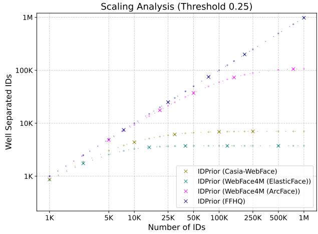  
(a)

Scaling Analysis (Threshold 0.3)  
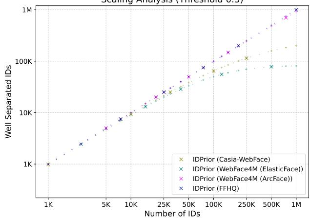  
(b)  
Figure 5. Scalability analysis under different training configurations. The number of well-separated identities vs. the total number of generated identities increases. We compare IDPrior trained on embeddings extracted by ArcFace and ElasticFace, as well as ID-Prior trained on embeddings from WebFace4M, CASIA-WebFace, and FFHQ. ArcFace consistently produces more well-separated identities than ElasticFace. Among the training datasets, FFHQ and WebFace4M achieve comparable scalability and substantially outperform CASIA-WebFace..

## Unconditional Identity Generation with IP-Adapter-FaceID

In the main paper, we compare IDPrior with a PCA-based identity generation baseline for IP-Adapter-FaceID instead of unconditional image generation. Here, we justify this design choice by extending the identity uniqueness and scalability analyses to include identities obtained by unconditional sampling from IP-Adapter-FaceID. Each generated image is treated as a distinct identity and evaluated using the identity uniqueness and scalability metrics, Figure 11, Figure 10 and Tables 7 and 8.

Algorithm 1 Training IDPrior   
Require: Training images $\mathcal { X } = \{ x _ { i } \} _ { i = 1 } ^ { N }$ , pretrained face   
recognition model $f ,$ number of diffusion steps $T$   
1: Extract normalized identity embeddings   
$\mathcal Z = \{ z _ { i } = f ( x _ { i } ) \} _ { i = 1 } ^ { N }$   
2: while not converged do   
3: Sample a mini-batch $\{ z _ { 0 } \} \subset \mathcal { Z }$   
4: Sample timestep $t \sim \mathcal { U } ( \{ 1 , \dots , T \} )$   
5: Sample noise $\epsilon \sim \mathcal { N } ( 0 , I )$   
6: Generate noisy embeddings   
$z _ { t } = \sqrt { \bar { \alpha } _ { t } } z _ { 0 } + \sqrt { 1 - \bar { \alpha } _ { t } } \epsilon$   
7: Predict noise   
$\hat { \boldsymbol { \epsilon } } = \boldsymbol { \epsilon } _ { \boldsymbol { \theta } } ( \boldsymbol { z } _ { t } , t )$   
8: Minimize   
$\mathcal { L } = \| \epsilon - \hat { \epsilon } \| _ { 2 } ^ { 2 }$   
9: Update θ   
10: end while   
11: return learned identity prior $p _ { \theta } ( z )$

Algorithm 2 Sampling Synthetic Face Dataset with IDPrior   
Require: Identity diffusion model $p _ { \theta } ( z )$ , pretrained   
identity-conditioned image generator $p _ { \phi } ( x | z )$ , number   
of identities N, number of images per identity M   
1: Initialize synthetic dataset $\mathcal { D }  \emptyset$   
2: for $i = 1 , \ldots , N$ do   
3: Sample a novel identity embedding   
$z _ { i } \sim p _ { \theta } ( z )$   
4: for $j = 1 , \dots , M$ do   
5: Sample a face image conditioned on z   
$x _ { i , j } \sim p _ { \phi } ( x | z _ { i } )$   
6: $\mathcal { D }  \mathcal { D } \cup \{ ( x _ { i , j } , i ) \}$   
7: end for   
8: end for   
9: return D

Threshold vs Uniqueness Analysis   
100 ×××××××××××x××××××××   
80   
% of Unique IDs 60   
40   
20   
IDPrior (Casia-WebFace)   
IDPrior (WebFace4M (ElasticFace))   
IDPrior (WebFace4M (ArcFace))   
0 XXXXXXXXX+XX IDPrior (FFHQ)   
0.2 0.4 0.6 0.8   
Threshold  
Figure 6. Identity uniqueness under different training configurations. Percentage of unique identities as the cosine-similarity threshold varies from 0 to 1. We compare IDPrior trained using ArcFace and ElasticFace embeddings, as well as IDPrior trained on WebFace4M, CASIA-WebFace, and FFHQ. ArcFace consistently achieves slightly higher identity uniqueness than Elastic-Face, while FFHQ and WebFace4M produce comparable results and substantially outperform CASIA-WebFace.

## Social Impact

This work is part of an ongoing research effort to enable the development of face recognition systems using fully synthetic data, thereby reducing the reliance on authentic biometric data and mitigating the associated legal, ethical, and privacy concerns. By decoupling identity generation from image synthesis, the proposed framework facilitates the scalable generation of synthetic training data while remaining compatible with existing identity-conditioned image generation models.

We envision this research supporting the development of face recognition systems for legitimate applications, such as secure authentication, identity verification, and access control, within applicable legal and regulatory frameworks. At the same time, we recognize that face recognition technologies may be susceptible to misuse. We therefore advocate their responsible development and deployment, accompanied by appropriate safeguards, transparency, and compliance with relevant laws and ethical standards. The proposed method is intended solely to advance privacy-preserving and ethically responsible biometric research and should not be used for unlawful, malicious, or discriminatory purposes.

(a) Samples of identities generated by Arc2Face [37] via PCA approach.  

(b) Samples of identities generated by Arc2Face [37] via IDPrior (Ours).  

(c) Samples of identities generated by IDiff-Face [4] via their corresponding approach.  
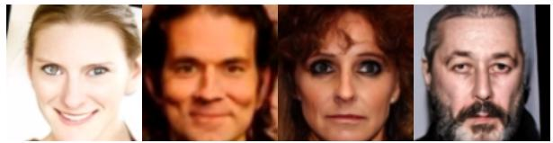

(d) Samples of identities generated by IDiff-Face [4] via IDPrior (Ours).  
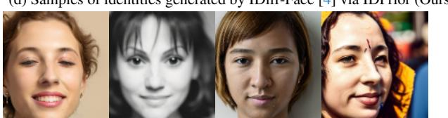

(e) Samples of identities generated by IP-Adapter-FaceID [48] via PCA.  
  
(f) Samples of identities generated by IP-Adapeter-FaceID [48] via ID-Prior.  
Figure 7. Sample images of novel identities generated by different DM models and using different identity generation approaches. Images are generated from different reference identities.

## Use of existing assets and face recognition evaluation benchmarks

## Use of Existing Assets

The results of state-of-the-art face recognition models reported in the main paper are taken directly from their respective publications, unless otherwise stated. We utilize the publicly available pretrained IDiff-Face [4] model trained on CASIA-WebFace, which is released under the Attribution-NonCommercial-ShareAlike 4.0 International (CC BY-NC-SA 4.0) license and available at https:// github.com/EduardaCaldeira/NegFaceDiff.

Arc2Face [37] is available under the MIT license at https://github.com/foivospar/Arc2Face.

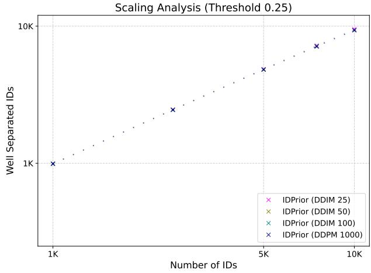

(a)  
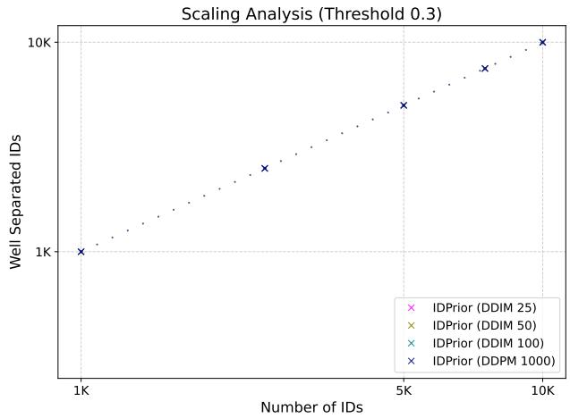  
(b)  
Figure 8. Effect of the sampling strategy on scalability. Number of well-separated identities as the number of generated identities increases for DDPM (1000 steps) and DDIM with 25, 50, and 100 denoising steps. DDIM closely matches the scalability of DDPM while requiring substantially fewer denoising steps. All results are reported using IDPrior trained on embeddings extracted from the ArcFace model of the WebFace4M dataset.

We use the official pretrained image generation model and train the PCA-based identity generator ourselves, as neither a pretrained PCA model nor synthetic identities are publicly available. The PCA training and sampling procedure follows the protocol described in the original Arc2Face paper.

The pretrained IP-Adapter-FaceID [48] model is obtained from the official repository (https : //github.com/tencent-ailab/IP-Adapter). We use the default text prompt "best quality, high quality" and the default negative prompt "monochrome, lowres, bad anatomy, worst quality, low quality" for image generation.

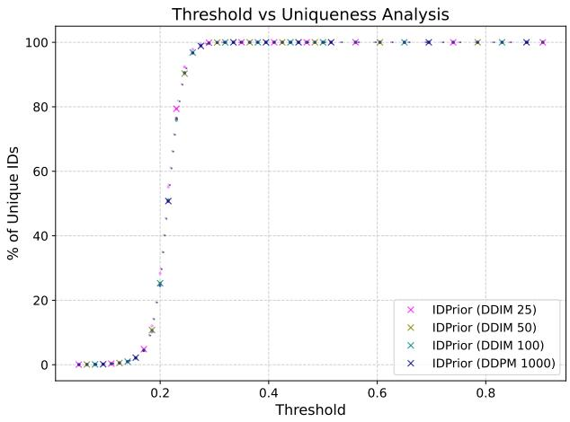  
Figure 9. Effect of the sampling strategy on identity uniqueness. Percentage of unique identities as the cosine-similarity threshold varies from 0 to 1 for DDPM (1000 steps) and DDIM with 25, 50, and 100 denoising steps. All sampling strategies produce nearly identical identity uniqueness across the full range of thresholds. All results are reported using IDPrior trained on embeddings extracted from the ArcFace model of the WebFace4M dataset.

We provide the following details for all datasets used throughout this work.

CASIA-WebFace [22, 28]: CASIA-WebFace consists of 494,141 face images from 10,757 different identities. A preprocessed (aligned and cropped) version of CASIA-WebFace is publicly available in the InsightFace (https : / / insightface . ai/) repository under Dataset-Zoo https : / / github . com / deepinsight / insightface / tree master/recognition/\_datasets\_. The code and the databases of InsightFace are under MIT licence (https : / / github . com / deepinsight / insightface/blob/master/LICENSE).

WebFace4M [52] is subset of WebFace260M contining 4M images with 206K identities. The dataset was officially obtained from [52].

FFHQ [20] Flickr-Faces-HQ Dataset (FFHQ) consists of 70,000 high-quality PNG images. The data is available for research under https://github.com/NVlabs/ ffhq-dataset.

## Evaluation benchmarks

This section presents the description and license informa tion of the FR evaluation datasets used in our work.

AgeDB-30 [34]: AgeDB is an in-the-wild dataset for age-invariant face verification evaluation, containing 16,488 images of 568 identities. Every image is annotated with respect to the identity, age, and gender attribute. In our case, we report the performance for AgeDB-30 (30 years age gap) as it is the most reported and challenging subset of AgeDB. More details on the collection process can be found in [34] and the details on the license are presented in https: //ibug.doc.ic.ac.uk/resources/agedb/.

LFW [19]: Labeled Faces in the Wild (LFW) is an unconstrained face verification dataset. The LFW contains 13,233 images of 5749 identities collected from the web. The LFW is licensed under CC-BY-4.0, and more information on database creation can be found in [19] and http://vis-www.cs.umass.edu/lfw/.

CFP-FP [40]: Celebrities in Frontal-Profile in the Wild (CFP-FP) [40] dataset addresses the comparison between frontal and profile faces. CFP-FP dataset contains 7,000 images across 500 identities, where 10 frontal and 4 profile image per identity. More information can be found in [40] and http://www.cfpw.io/.

CALFW [51]: The Cross-age LFW (CALFW) dataset [51] is based on LFW with a focus on comparison pairs with the age gap, however not as large as AgeDB-30. Age gap distribution of the CALFW is provided in [51]. It contains 3000 genuine comparisons, and the negative pairs are selected of the same gender and race to reduce the effect of attributes. The detailed information on database creation can be found in [51] and http://whdeng.cn/CALFW/.

CPLFW [50]: The Cross-Pose LFW (CPLFW) dataset [50] is based on LFW with a focus on comparison pairs with pose differences. CPLFW contains 3000 genuine comparisons, while the negative pairs are selected of the same gender and race. More information can be found in [50] and http://whdeng.cn/CPLFW/.

Table 7. Scalability of identity generation from 1K to 1M identities, which extends the results of the main submission. We report the percentage of unique identities at thresholds 0.25, 0.30, and 0.40. IDPrior consistently maintains the highest uniqueness across all scales, substantially outperforming image-generation-based and PCA-based approaches. We additionally reported results of authentic datasets, CASIA-WebFace (10K identities) and WebFace4M (206K identities). Identities of unconditional IP-Adapter-FaceID sampling saturated at 10K identities. Given the page size, the other models’ results are provided in Table 8.
<table><tr><td rowspan=1 colspan=6>method              samples r@0.25r@0.30r@0.40</td><td rowspan=1 colspan=6>method               samples 0.25 0.30</td><td rowspan=1 colspan=1>0.40</td></tr><tr><td rowspan=2 colspan=2>10002500</td><td rowspan=1 colspan=4>97.10  99.90  100.00</td><td rowspan=1 colspan=4>1000   44.40</td><td rowspan=1 colspan=2>74.50</td><td rowspan=1 colspan=1>94.30</td></tr><tr><td rowspan=1 colspan=1>2500</td><td rowspan=1 colspan=4>92.96  99.80  100.00</td><td rowspan=1 colspan=1></td><td rowspan=1 colspan=3>2500   25.16</td><td rowspan=1 colspan=2>58.08</td><td rowspan=1 colspan=1>90.84</td></tr><tr><td rowspan=1 colspan=1></td><td rowspan=1 colspan=1>5000</td><td rowspan=1 colspan=4>85.78  99.62  100.00</td><td rowspan=1 colspan=1></td><td rowspan=1 colspan=3>5000   14.84</td><td rowspan=1 colspan=2>44.84</td><td rowspan=1 colspan=1>87.16</td></tr><tr><td rowspan=1 colspan=1></td><td rowspan=1 colspan=1>7500</td><td rowspan=1 colspan=4>79.83  99.39  100.00</td><td rowspan=1 colspan=1></td><td rowspan=1 colspan=3>7500   10.57</td><td rowspan=1 colspan=2>37.56</td><td rowspan=1 colspan=1>85.41</td></tr><tr><td rowspan=1 colspan=1></td><td rowspan=1 colspan=1>10000</td><td rowspan=1 colspan=4>74.35  99.15  100.00</td><td rowspan=1 colspan=1></td><td rowspan=1 colspan=3>10000  8.11</td><td rowspan=1 colspan=2>32.10</td><td rowspan=1 colspan=1>83.75</td></tr><tr><td rowspan=1 colspan=1></td><td rowspan=1 colspan=1>15000</td><td rowspan=1 colspan=4>64.83  98.85  100.00</td><td rowspan=1 colspan=1></td><td rowspan=1 colspan=3>15000  5.47</td><td rowspan=1 colspan=2>25.19</td><td rowspan=1 colspan=1>81.09</td></tr><tr><td rowspan=1 colspan=1></td><td rowspan=1 colspan=1>20000</td><td rowspan=1 colspan=4>57.03  98.28  100.00</td><td rowspan=1 colspan=1></td><td rowspan=1 colspan=3>20000  4.13</td><td rowspan=1 colspan=2>21.04</td><td rowspan=1 colspan=1>78.92</td></tr><tr><td rowspan=1 colspan=1></td><td rowspan=1 colspan=1>25000</td><td rowspan=1 colspan=4>50.52  97.77  100.00</td><td rowspan=1 colspan=1></td><td rowspan=1 colspan=3>25000  3.31</td><td rowspan=1 colspan=2>17.99</td><td rowspan=1 colspan=1>77.26</td></tr><tr><td rowspan=1 colspan=1></td><td rowspan=1 colspan=1>30000</td><td rowspan=1 colspan=4>45.15  97.14  100.00</td><td rowspan=1 colspan=1></td><td rowspan=1 colspan=5>30000  2.76 15.64</td><td rowspan=1 colspan=1>75.52</td></tr><tr><td rowspan=2 colspan=1>Arc2Face/Vec2Face (PCA)</td><td rowspan=1 colspan=1>40000</td><td rowspan=1 colspan=4>36.92  96.19  100.00</td><td rowspan=1 colspan=1>DCFace</td><td rowspan=1 colspan=5>40000  2.08 12.46</td><td rowspan=1 colspan=1>72.59</td></tr><tr><td rowspan=1 colspan=1>50000</td><td rowspan=1 colspan=4>31.00  95.33  100.00</td><td rowspan=1 colspan=1></td><td rowspan=1 colspan=3>50000  1.66</td><td rowspan=1 colspan=2>10.32</td><td rowspan=1 colspan=1>70.08</td></tr><tr><td rowspan=1 colspan=1></td><td rowspan=1 colspan=1>75000</td><td rowspan=1 colspan=4>21.72  93.25  100.00</td><td rowspan=1 colspan=1></td><td rowspan=1 colspan=3>75000  1.11</td><td rowspan=1 colspan=2>7.25</td><td rowspan=1 colspan=1>65.29</td></tr><tr><td rowspan=1 colspan=1></td><td rowspan=1 colspan=1>100000</td><td rowspan=1 colspan=4>16.55  91.25  100.00</td><td rowspan=1 colspan=1></td><td rowspan=1 colspan=3>100000 0.83</td><td rowspan=1 colspan=2>5.55</td><td rowspan=1 colspan=1>61.43</td></tr><tr><td rowspan=1 colspan=1></td><td rowspan=1 colspan=1>125000</td><td rowspan=1 colspan=4>13.30  89.28  100.00</td><td rowspan=1 colspan=1></td><td rowspan=1 colspan=3>125000  0.66</td><td rowspan=1 colspan=2>4.51</td><td rowspan=1 colspan=1>58.15</td></tr><tr><td rowspan=1 colspan=1></td><td rowspan=1 colspan=1>150000</td><td rowspan=1 colspan=4>11.10  87.42  100.00</td><td rowspan=1 colspan=1></td><td rowspan=1 colspan=3>150000 0.55</td><td rowspan=1 colspan=2>3.78</td><td rowspan=1 colspan=1>55.40</td></tr><tr><td rowspan=1 colspan=1></td><td rowspan=1 colspan=1>200000</td><td rowspan=1 colspan=4>8.34  83.86  100.00</td><td rowspan=1 colspan=1></td><td rowspan=1 colspan=3>200000 0.42</td><td rowspan=1 colspan=2>2.86</td><td rowspan=1 colspan=1>50.88</td></tr><tr><td rowspan=1 colspan=1></td><td rowspan=1 colspan=1>250000</td><td rowspan=1 colspan=4>6.67  80.55  100.00</td><td rowspan=1 colspan=1></td><td rowspan=1 colspan=3>250000 0.33</td><td rowspan=1 colspan=2>2.30</td><td rowspan=1 colspan=1>47.35</td></tr><tr><td rowspan=1 colspan=1></td><td rowspan=1 colspan=1>500000</td><td rowspan=1 colspan=4>3.34  66.48  100.00</td><td rowspan=1 colspan=1></td><td rowspan=1 colspan=3>500000 0.17</td><td rowspan=1 colspan=2>1.16</td><td rowspan=1 colspan=1>36.48</td></tr><tr><td rowspan=1 colspan=1></td><td rowspan=1 colspan=1>750000</td><td rowspan=1 colspan=4>2.22   56.10  100.00</td><td rowspan=1 colspan=1></td><td rowspan=1 colspan=5>750000 0.11 0.77</td><td rowspan=1 colspan=1>30.38</td></tr><tr><td rowspan=1 colspan=1></td><td rowspan=1 colspan=1>1000000</td><td rowspan=1 colspan=4>1.67   48.15  100.00</td><td rowspan=1 colspan=1></td><td rowspan=1 colspan=5>10000000.08 0.58</td><td rowspan=1 colspan=1>26.34</td></tr><tr><td rowspan=1 colspan=1></td><td rowspan=1 colspan=1>1000</td><td rowspan=1 colspan=4>99.10  100.00 100.00</td><td rowspan=1 colspan=1></td><td rowspan=1 colspan=5>1000   56.90 89.90</td><td rowspan=1 colspan=1>99.70</td></tr><tr><td rowspan=1 colspan=1></td><td rowspan=1 colspan=1>5000</td><td rowspan=1 colspan=4>96.70  99.98  100.00</td><td rowspan=1 colspan=1></td><td rowspan=1 colspan=1>5000</td><td rowspan=1 colspan=4>21.54 64.52</td><td rowspan=1 colspan=1>98.80</td></tr><tr><td rowspan=1 colspan=1></td><td rowspan=1 colspan=1>7500</td><td rowspan=1 colspan=3>95.16  99.96</td><td rowspan=1 colspan=1>100.00</td><td rowspan=1 colspan=1></td><td rowspan=1 colspan=5>7500   15.33 55.44</td><td rowspan=1 colspan=1>98.15</td></tr><tr><td rowspan=1 colspan=1></td><td rowspan=1 colspan=1>10000</td><td rowspan=1 colspan=3>93.44  99.91</td><td rowspan=1 colspan=1>100.00</td><td rowspan=1 colspan=1></td><td rowspan=1 colspan=5>10000  11.79 48.35</td><td rowspan=1 colspan=1>97.60</td></tr><tr><td rowspan=1 colspan=1></td><td rowspan=1 colspan=1>15000</td><td rowspan=1 colspan=3>90.75  99.87</td><td rowspan=1 colspan=1>100.00</td><td rowspan=1 colspan=1></td><td rowspan=1 colspan=1>15000</td><td rowspan=1 colspan=4>8.09 38.86</td><td rowspan=1 colspan=1>96.55</td></tr><tr><td rowspan=1 colspan=1></td><td rowspan=1 colspan=1>20000</td><td rowspan=1 colspan=3>87.84  99.78</td><td rowspan=1 colspan=1>100.00</td><td rowspan=1 colspan=1></td><td rowspan=1 colspan=1>20000</td><td rowspan=1 colspan=4>6.12 32.22</td><td rowspan=1 colspan=1>95.28</td></tr><tr><td rowspan=1 colspan=1></td><td rowspan=1 colspan=1>25000</td><td rowspan=1 colspan=4>85.41  99.75  100.00</td><td rowspan=1 colspan=1></td><td rowspan=1 colspan=1>25000</td><td rowspan=1 colspan=4>4.91 27.68</td><td rowspan=1 colspan=1>94.25</td></tr><tr><td rowspan=1 colspan=1></td><td rowspan=1 colspan=1>30000</td><td rowspan=1 colspan=4>82.88  99.69  100.00</td><td rowspan=1 colspan=1></td><td rowspan=1 colspan=1>30000</td><td rowspan=1 colspan=4>4.10 24.21</td><td rowspan=1 colspan=1>93.25</td></tr><tr><td></td><td></td><td rowspan=1 colspan=4>78.53  99.56  100.00</td><td rowspan=1 colspan=1>IDiff-Face/UIFace/IDPerturb</td><td rowspan=1 colspan=1>40000</td><td rowspan=1 colspan=4>3.08 19.34</td><td rowspan=1 colspan=1>91.57</td></tr><tr><td rowspan=1 colspan=1>IDPrior (Ours)</td><td rowspan=1 colspan=1>50000</td><td rowspan=1 colspan=4>74.48  99.43  100.00</td><td rowspan=1 colspan=1>IDm-Pace/Unrace/Drerturo</td><td rowspan=1 colspan=1>50000</td><td rowspan=1 colspan=4>2.47  16.11</td><td></td></tr><tr><td rowspan=1 colspan=1></td><td rowspan=1 colspan=1>75000</td><td rowspan=1 colspan=4>66.28  99.17  100.00</td><td rowspan=1 colspan=1></td><td rowspan=1 colspan=1>75000</td><td rowspan=1 colspan=4>1.65 11.31</td><td rowspan=1 colspan=1>85.87</td></tr><tr><td rowspan=1 colspan=1></td><td rowspan=1 colspan=1>100000</td><td rowspan=1 colspan=4>59.39  98.90  100.00</td><td rowspan=1 colspan=1></td><td rowspan=1 colspan=1>100000</td><td rowspan=1 colspan=4>1.23 8.68</td><td rowspan=1 colspan=1>82.43</td></tr><tr><td rowspan=1 colspan=1></td><td rowspan=1 colspan=1>125000</td><td rowspan=1 colspan=4>53.71  98.67  100.00</td><td rowspan=1 colspan=1></td><td rowspan=1 colspan=1>125000</td><td rowspan=1 colspan=4>0.99 7.03</td><td rowspan=1 colspan=1>79.40</td></tr><tr><td rowspan=1 colspan=1></td><td rowspan=1 colspan=1>150000</td><td rowspan=1 colspan=1>48.81</td><td rowspan=1 colspan=2>98.44</td><td rowspan=1 colspan=1>100.00</td><td rowspan=1 colspan=1></td><td rowspan=1 colspan=1>150000</td><td rowspan=1 colspan=2>0.82</td><td rowspan=1 colspan=2>5.92</td><td rowspan=1 colspan=1>76.75</td></tr><tr><td rowspan=1 colspan=1></td><td rowspan=1 colspan=1>200000</td><td rowspan=1 colspan=1>41.21</td><td rowspan=1 colspan=2>97.97</td><td rowspan=1 colspan=1>100.00</td><td rowspan=1 colspan=1></td><td rowspan=1 colspan=1>200000</td><td rowspan=1 colspan=2>0.62</td><td rowspan=1 colspan=2>4.49</td><td rowspan=1 colspan=1>71.90</td></tr><tr><td rowspan=1 colspan=1></td><td rowspan=1 colspan=1>250000</td><td rowspan=1 colspan=1>35.47</td><td rowspan=1 colspan=2>97.51</td><td rowspan=1 colspan=1>100.00</td><td rowspan=1 colspan=1></td><td rowspan=1 colspan=1>250000</td><td rowspan=1 colspan=2>0.49</td><td rowspan=1 colspan=2>3.61</td><td rowspan=1 colspan=1>67.95</td></tr><tr><td rowspan=1 colspan=1></td><td rowspan=1 colspan=1>500000</td><td rowspan=1 colspan=1>20.40</td><td rowspan=1 colspan=2>95.40</td><td rowspan=1 colspan=1>100.00</td><td rowspan=1 colspan=1></td><td rowspan=1 colspan=1>500000</td><td rowspan=1 colspan=2>0.25</td><td rowspan=1 colspan=2>1.82</td><td rowspan=1 colspan=1>54.37</td></tr><tr><td rowspan=1 colspan=1></td><td rowspan=1 colspan=1>750000</td><td rowspan=1 colspan=1>14.07</td><td rowspan=1 colspan=3>93.47  100.00</td><td rowspan=1 colspan=1></td><td rowspan=1 colspan=1>750000</td><td rowspan=1 colspan=2>0.16</td><td rowspan=1 colspan=2>1.22</td><td rowspan=1 colspan=1>46.14</td></tr><tr><td rowspan=1 colspan=1></td><td rowspan=1 colspan=1>1000000</td><td rowspan=1 colspan=4>10.68  91.64  100.00</td><td rowspan=1 colspan=1></td><td rowspan=1 colspan=1>1000000</td><td rowspan=1 colspan=2>0.12</td><td rowspan=1 colspan=2>0.91</td><td rowspan=1 colspan=1>40.43</td></tr><tr><td rowspan=1 colspan=1></td><td rowspan=1 colspan=1>2500</td><td rowspan=1 colspan=3>100.00 100.00</td><td rowspan=1 colspan=1>100.00</td><td rowspan=1 colspan=1></td><td rowspan=1 colspan=1>2500</td><td rowspan=1 colspan=2>0.16</td><td rowspan=1 colspan=2>0.20</td><td rowspan=1 colspan=1>0.28</td></tr><tr><td rowspan=1 colspan=1></td><td rowspan=1 colspan=1>5000</td><td rowspan=1 colspan=3>100.00 100.00</td><td rowspan=1 colspan=1>100.00</td><td rowspan=1 colspan=1></td><td rowspan=1 colspan=1>5000</td><td rowspan=1 colspan=2>0.12</td><td rowspan=1 colspan=2>0.18</td><td rowspan=1 colspan=1>0.22</td></tr><tr><td rowspan=1 colspan=1></td><td rowspan=1 colspan=1>7500</td><td rowspan=1 colspan=1>100.00</td><td rowspan=1 colspan=2>100.00</td><td rowspan=1 colspan=1>100.00</td><td rowspan=1 colspan=1></td><td rowspan=1 colspan=1>7500</td><td rowspan=1 colspan=4>0.08 0.12</td><td rowspan=1 colspan=1>0.15</td></tr><tr><td rowspan=1 colspan=1></td><td rowspan=1 colspan=1>10000</td><td rowspan=1 colspan=1>100.00</td><td rowspan=1 colspan=2>100.00</td><td rowspan=1 colspan=1>100.00</td><td rowspan=1 colspan=1></td><td rowspan=1 colspan=1>10000</td><td rowspan=1 colspan=2>0.06</td><td rowspan=1 colspan=2>0.09</td><td rowspan=1 colspan=1>0.11</td></tr><tr><td rowspan=1 colspan=1></td><td rowspan=1 colspan=1>1500020000</td><td rowspan=1 colspan=1>100.00100.00</td><td rowspan=1 colspan=2>100.00100.00</td><td rowspan=1 colspan=1>100.00100.00</td><td rowspan=1 colspan=1></td><td rowspan=1 colspan=1></td><td rowspan=1 colspan=2></td><td rowspan=1 colspan=2></td><td rowspan=1 colspan=1></td></tr><tr><td rowspan=1 colspan=1></td><td rowspan=1 colspan=1>25000</td><td rowspan=1 colspan=3>100.00 100.00</td><td rowspan=1 colspan=1>100.00</td><td rowspan=1 colspan=1></td><td rowspan=1 colspan=1></td><td rowspan=1 colspan=2></td><td rowspan=1 colspan=2></td><td rowspan=1 colspan=1></td></tr><tr><td rowspan=1 colspan=1></td><td rowspan=1 colspan=1>30000</td><td rowspan=1 colspan=3>99.99  100.00</td><td rowspan=1 colspan=1>100.00</td><td rowspan=1 colspan=1></td><td rowspan=1 colspan=3></td><td rowspan=1 colspan=2></td><td rowspan=1 colspan=1></td></tr><tr><td rowspan=3 colspan=1>Random</td><td rowspan=1 colspan=1>40000</td><td rowspan=1 colspan=3>99.99  100.00</td><td rowspan=1 colspan=1>100.00</td><td rowspan=1 colspan=1>IP-Adapter-FaceID</td><td></td><td></td><td></td><td></td><td></td><td></td></tr><tr><td></td><td></td><td></td><td></td><td></td><td rowspan=2 colspan=1>IP-Adapter-FaceID</td><td></td><td></td><td></td><td></td><td></td><td></td></tr><tr><td></td><td></td><td></td><td></td><td></td><td rowspan=1 colspan=3></td><td rowspan=1 colspan=2></td><td rowspan=1 colspan=1></td></tr><tr><td rowspan=1 colspan=1></td><td rowspan=1 colspan=1>75000</td><td rowspan=1 colspan=3>99.97  100.00</td><td rowspan=1 colspan=1>100.00</td><td rowspan=1 colspan=1></td><td rowspan=1 colspan=3></td><td rowspan=1 colspan=2></td><td rowspan=1 colspan=1></td></tr><tr><td rowspan=1 colspan=1></td><td rowspan=1 colspan=1>100000</td><td rowspan=1 colspan=3>99.96  100.00</td><td rowspan=1 colspan=1>100.00</td><td rowspan=1 colspan=1></td><td rowspan=1 colspan=3></td><td rowspan=1 colspan=2></td><td></td></tr><tr><td rowspan=1 colspan=1></td><td rowspan=1 colspan=1>125000</td><td rowspan=1 colspan=3>99.96  100.00</td><td rowspan=1 colspan=1>100.00</td><td rowspan=1 colspan=1></td><td rowspan=1 colspan=3></td><td rowspan=1 colspan=2></td><td rowspan=1 colspan=1></td></tr><tr><td rowspan=1 colspan=1></td><td rowspan=1 colspan=1>150000</td><td rowspan=1 colspan=3>99.96  100.00</td><td rowspan=1 colspan=1>100.00</td><td rowspan=1 colspan=1></td><td rowspan=1 colspan=3></td><td rowspan=1 colspan=2></td><td rowspan=1 colspan=1></td></tr><tr><td rowspan=1 colspan=1></td><td rowspan=1 colspan=1>200000</td><td rowspan=1 colspan=3>99.95  100.00</td><td rowspan=1 colspan=1>100.00</td><td rowspan=1 colspan=1></td><td rowspan=1 colspan=3></td><td rowspan=1 colspan=2></td><td></td></tr><tr><td></td><td></td><td></td><td></td><td></td><td></td><td></td><td rowspan=3 colspan=3></td><td rowspan=3 colspan=2></td><td></td></tr><tr><td></td><td></td><td></td><td></td><td></td><td></td><td></td><td rowspan=2 colspan=1></td></tr><tr><td rowspan=1 colspan=1></td><td rowspan=1 colspan=1>250000</td><td rowspan=1 colspan=4>99.94  100.00 100.00</td><td rowspan=1 colspan=1></td></tr><tr><td rowspan=1 colspan=1></td><td rowspan=1 colspan=1>500000</td><td rowspan=1 colspan=4>99.88  100.00 100.00</td><td rowspan=1 colspan=1></td><td rowspan=1 colspan=3></td><td rowspan=1 colspan=2></td><td rowspan=1 colspan=1></td></tr><tr><td rowspan=1 colspan=1></td><td rowspan=1 colspan=1>750000</td><td rowspan=1 colspan=4>99.82  100.00 100.00</td><td rowspan=1 colspan=1></td><td rowspan=1 colspan=3></td><td rowspan=1 colspan=2></td><td rowspan=2 colspan=1></td></tr><tr><td rowspan=1 colspan=1></td><td rowspan=1 colspan=1>1000000</td><td rowspan=1 colspan=4>99.76  100.00 100.00</td><td rowspan=1 colspan=1></td><td rowspan=1 colspan=3></td><td rowspan=1 colspan=2></td></tr><tr><td></td><td></td><td></td><td></td><td></td><td></td><td rowspan=1 colspan=1></td><td rowspan=1 colspan=3>1000   69.20</td><td rowspan=1 colspan=2>94.40</td><td rowspan=1 colspan=1>99.70</td></tr><tr><td rowspan=1 colspan=1></td><td rowspan=1 colspan=1>2500</td><td rowspan=1 colspan=4>57.12  90.48  99.84</td><td rowspan=1 colspan=1></td><td rowspan=1 colspan=3>2500   48.28</td><td rowspan=1 colspan=2>87.24</td><td rowspan=1 colspan=1>99.40</td></tr><tr><td rowspan=1 colspan=1></td><td rowspan=1 colspan=1>5000</td><td rowspan=1 colspan=4>38.82  82.56  99.60</td><td rowspan=1 colspan=1></td><td rowspan=1 colspan=3>5000   30.46</td><td rowspan=1 colspan=2>77.82</td><td rowspan=1 colspan=1>98.80</td></tr><tr><td rowspan=1 colspan=1></td><td rowspan=1 colspan=1>7500</td><td rowspan=1 colspan=4>28.91  76.35  99.39</td><td rowspan=1 colspan=1></td><td rowspan=1 colspan=3>7500   21.47</td><td rowspan=1 colspan=2>68.87</td><td rowspan=1 colspan=1>98.51</td></tr><tr><td rowspan=1 colspan=1></td><td rowspan=1 colspan=1>10000</td><td rowspan=1 colspan=4>22.68  70.83  99.32</td><td rowspan=1 colspan=1></td><td rowspan=1 colspan=3>10000  16.67</td><td rowspan=1 colspan=2>61.50</td><td rowspan=1 colspan=1>98.17</td></tr><tr><td rowspan=1 colspan=1></td><td rowspan=1 colspan=1>15000</td><td rowspan=1 colspan=4>15.55  61.43  98.99</td><td rowspan=1 colspan=1></td><td rowspan=1 colspan=1></td><td></td><td rowspan=1 colspan=1></td><td rowspan=2 colspan=2></td><td rowspan=8 colspan=1></td></tr><tr><td rowspan=1 colspan=1></td><td rowspan=1 colspan=1>20000</td><td rowspan=1 colspan=4>11.77  53.68  98.64</td><td rowspan=1 colspan=1></td><td rowspan=1 colspan=1></td><td></td><td rowspan=1 colspan=1></td></tr><tr><td rowspan=3 colspan=1>WebFace4M</td><td rowspan=1 colspan=1>25000</td><td rowspan=1 colspan=4>9.46  47.66  98.29</td><td rowspan=1 colspan=1></td><td rowspan=1 colspan=1></td><td></td><td></td><td></td><td></td></tr><tr><td></td><td></td><td></td><td rowspan=2 colspan=2>42.62  97.94</td><td rowspan=2 colspan=1>CASiA-Webrace</td><td rowspan=2 colspan=1></td><td></td><td></td><td></td><td></td></tr><tr><td></td><td></td><td></td><td></td><td rowspan=1 colspan=1></td><td rowspan=3 colspan=2></td></tr><tr><td rowspan=1 colspan=1></td><td rowspan=1 colspan=1>40000</td><td rowspan=1 colspan=2>5.91</td><td rowspan=1 colspan=2>35.10  97.23</td><td rowspan=1 colspan=1></td><td rowspan=1 colspan=1></td><td></td><td rowspan=1 colspan=1></td></tr><tr><td rowspan=1 colspan=1></td><td rowspan=1 colspan=1>50000</td><td rowspan=1 colspan=2>4.73</td><td rowspan=1 colspan=2>29.62  96.54</td><td rowspan=1 colspan=1></td><td rowspan=1 colspan=1></td><td></td><td rowspan=1 colspan=1></td></tr><tr><td rowspan=1 colspan=1></td><td rowspan=1 colspan=1>75000</td><td rowspan=1 colspan=2>3.15</td><td rowspan=1 colspan=2>21.05  94.98</td><td rowspan=2 colspan=1></td><td rowspan=2 colspan=1></td><td></td><td rowspan=2 colspan=2></td><td rowspan=2 colspan=1></td></tr><tr><td rowspan=1 colspan=1></td><td rowspan=1 colspan=1>100000</td><td rowspan=1 colspan=2>2.37</td><td rowspan=1 colspan=2>16.17  93.54</td><td></td><td></td></tr><tr><td rowspan=1 colspan=1></td><td rowspan=1 colspan=1>125000</td><td rowspan=1 colspan=2>1.89</td><td rowspan=1 colspan=2>13.09  92.06</td><td rowspan=1 colspan=1></td><td rowspan=1 colspan=1></td><td></td><td rowspan=1 colspan=2></td><td rowspan=1 colspan=1></td><td rowspan=2 colspan=1></td></tr><tr><td rowspan=1 colspan=1></td><td rowspan=1 colspan=1>150000</td><td rowspan=1 colspan=2>1.58</td><td rowspan=1 colspan=2>10.97  90.66</td><td rowspan=1 colspan=1></td><td></td><td></td><td></td><td></td><td></td></tr><tr><td rowspan=1 colspan=1></td><td rowspan=1 colspan=1>200000</td><td rowspan=1 colspan=2>1.18</td><td rowspan=1 colspan=3>8.26  88.08</td><td rowspan=1 colspan=1></td><td></td><td rowspan=1 colspan=4></td></tr></table>

inter-ID Max Similarity Histograms  
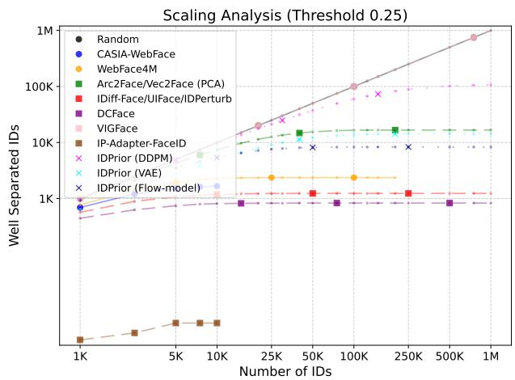

(a)  
Scaling Analysis (Threshold 0.3)  
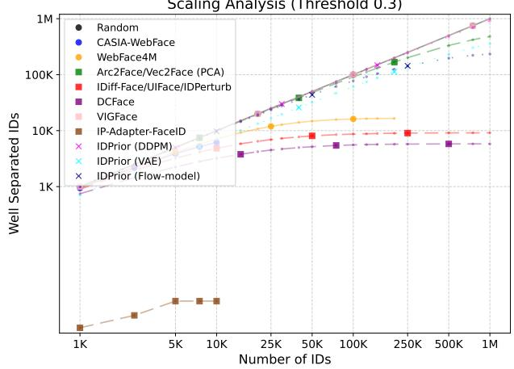  
(b)  
Figure 10. Scalability evaluation, including unconditional IP-Adapter-FaceID. The number of well-separated identities vs. the total number of generated identities increases. Unconditional sampling from IP-Adapter-FaceID quickly saturates, producing fewer than 3% well-separated identities due to severe identity collisions. These results justify the use of a PCA-based baseline for IP-Adapter-FaceID in the main paper.

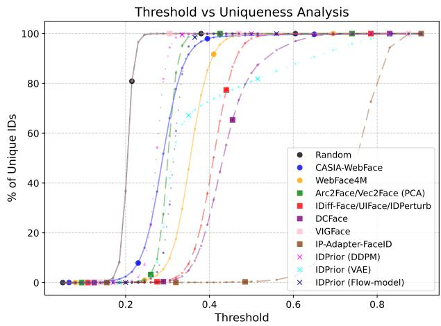  
Figure 11. Identity uniqueness including unconditional IP-Adapter-FaceID. Percentage of unique identities as the cosinesimilarity threshold varies from 0 to 1. Unconditional sampling from IP-Adapter-FaceID produces fewer than 3% unique identities across most thresholds, substantially underperforming other approaches.

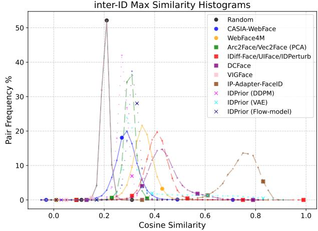  
Figure 12. Histogram of the maximum cosine similarity between each generated identity embedding and all other generated identities within each dataset. Lower similarity indicates better inter-class separation and fewer identity collisions. IDPrior shifts the distribution toward lower similarities compared with imagegeneration-based and PCA-based approaches, demonstrating its ability to generate more distinct identities.

Table 8. Scalability of identity generation from 1K to 1M identities, which extends the results of the main submission. This table is complementary to Table 7.
<table><tr><td colspan="2">method</td><td colspan="3">Samples r@0.25 r@0.30</td></tr><tr><td rowspan="12"></td><td>1000</td><td>92.30</td><td>99.60</td><td>100.00</td></tr><tr><td>2500</td><td>83.56</td><td>98.88</td><td>100.00</td></tr><tr><td>5000</td><td>70.84</td><td>98.10</td><td>99.98</td></tr><tr><td>7500</td><td>61.25</td><td>97.68</td><td>99.99</td></tr><tr><td>10000</td><td>54.05</td><td>97.04</td><td>99.99</td></tr><tr><td>15000</td><td>43.20</td><td>96.04</td><td>99.99</td></tr><tr><td>20000</td><td>35.91</td><td>94.82</td><td>100.00</td></tr><tr><td>25000</td><td>30.28</td><td>93.64</td><td>99.99</td></tr><tr><td>30000</td><td>26.00</td><td>92.43</td><td>99.99</td></tr><tr><td>40000 IDPrior (Flow-model)</td><td>20.15</td><td>89.80</td><td>99.99</td></tr><tr><td>50000</td><td>16.34</td><td>87.54</td><td>99.99</td></tr><tr><td>75000</td><td>11.04</td><td>82.25</td><td>99.99</td></tr><tr><td></td><td>100000 8.30</td><td>77.61</td><td>99.99</td><td></td></tr><tr><td></td><td>125000 6.64</td><td>73.46</td><td></td><td>99.99</td></tr><tr><td></td><td>150000 5.54</td><td></td><td>69.62</td><td>99.99</td></tr><tr><td>200000</td><td>4.15</td><td>63.04</td><td></td><td>99.99</td></tr><tr><td></td><td>250000 3.32</td><td>57.52</td><td></td><td>99.98</td></tr><tr><td></td><td>500000 750000</td><td>1.66</td><td>39.46 29.57</td><td>99.97 99.96</td></tr><tr><td rowspan="3"></td><td></td><td>1.11 0.83</td><td>23.44</td><td>99.95</td></tr><tr><td>1000000 1000</td><td>64.70</td><td>71.20</td><td>79.00</td></tr><tr><td>2500</td><td></td><td></td><td></td></tr><tr><td rowspan="20">IDPrior (VAE)</td><td></td><td>61.00</td><td>69.84</td><td>77.96 77.44</td></tr><tr><td>5000 7500</td><td>56.30</td><td>69.06 68.93</td><td></td></tr><tr><td></td><td>52.99</td><td></td><td>77.29</td></tr><tr><td>10000</td><td>49.87</td><td>68.58</td><td>77.15</td></tr><tr><td>15000</td><td>44.54</td><td>67.52</td><td>76.57</td></tr><tr><td>20000</td><td>39.99</td><td>66.67</td><td>76.25</td></tr><tr><td>25000</td><td>36.41</td><td>66.10</td><td>76.03</td></tr><tr><td>30000</td><td>33.16</td><td>65.59</td><td>75.92</td></tr><tr><td>40000</td><td>28.03</td><td>64.79</td><td>75.74</td></tr><tr><td>50000</td><td>24.15</td><td>63.99</td><td>75.59</td></tr><tr><td>75000</td><td>17.72</td><td>62.42</td><td>75.29</td></tr><tr><td>100000</td><td>13.80</td><td>60.97</td><td>75.00</td></tr><tr><td>125000</td><td>11.21</td><td>59.66</td><td>74.79</td></tr><tr><td>150000 200000</td><td>9.41</td><td>58.56</td><td>74.67</td></tr><tr><td>250000</td><td>7.10</td><td>56.44</td><td>74.42</td></tr><tr><td>500000</td><td>5.69</td><td>54.51 46.38</td><td>74.24</td></tr><tr><td>750000</td><td>2.85</td><td>40.41</td><td>73.56</td></tr><tr><td>1000000</td><td>1.90</td><td>35.72</td><td>73.19</td></tr><tr><td>1000</td><td>1.42</td><td></td><td>72.95</td></tr><tr><td rowspan="20">VIGFace</td><td>2500</td><td>100.00</td><td>100.00</td><td>100.00</td></tr><tr><td>5000</td><td>100.00</td><td>100.00</td><td>100.00</td></tr><tr><td>7500</td><td>100.00</td><td>100.00</td><td>100.00</td></tr><tr><td>10000</td><td>100.00</td><td>100.00</td><td>100.00</td></tr><tr><td></td><td>100.00</td><td>100.00</td><td>100.00</td></tr><tr><td>15000</td><td>100.00</td><td>100.00</td><td>100.00</td></tr><tr><td>20000</td><td>100.00</td><td>100.00</td><td>100.00</td></tr><tr><td>25000</td><td>100.00</td><td>100.00</td><td>100.00</td></tr><tr><td>30000</td><td>100.00</td><td>100.00</td><td>100.00</td></tr><tr><td>40000</td><td>100.00</td><td>100.00</td><td>100.00</td></tr><tr><td>50000</td><td>99.99</td><td>100.00</td><td>100.00</td></tr><tr><td>75000</td><td>99.99</td><td>100.00</td><td>100.00</td></tr><tr><td>100000</td><td>99.98</td><td>100.00</td><td>100.00</td></tr><tr><td>125000</td><td>99.98</td><td>100.00</td><td>100.00</td></tr><tr><td>150000</td><td>99.97</td><td>100.00</td><td>100.00</td></tr><tr><td>200000</td><td>99.96</td><td>100.00</td><td>100.00</td></tr><tr><td>250000</td><td>99.95</td><td>100.00</td><td>100.00</td></tr><tr><td>500000</td><td></td><td></td><td>100.00</td></tr><tr><td>750000</td><td>99.88</td><td>100.00</td><td></td></tr><tr><td>1000000</td><td>99.82 99.77</td><td>100.00 100.00</td><td>100.00 100.00</td></tr></table>