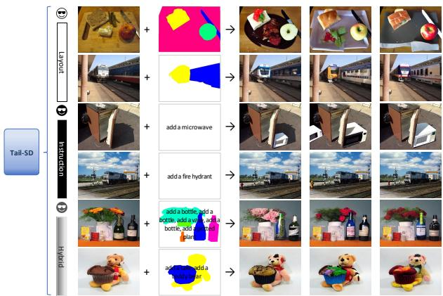
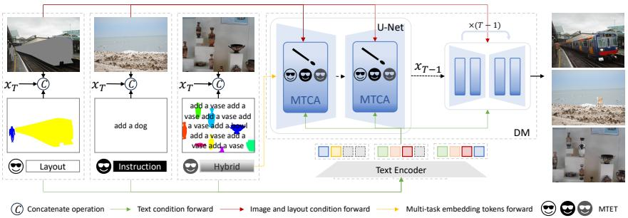
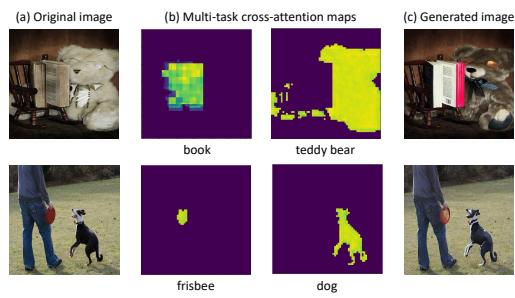
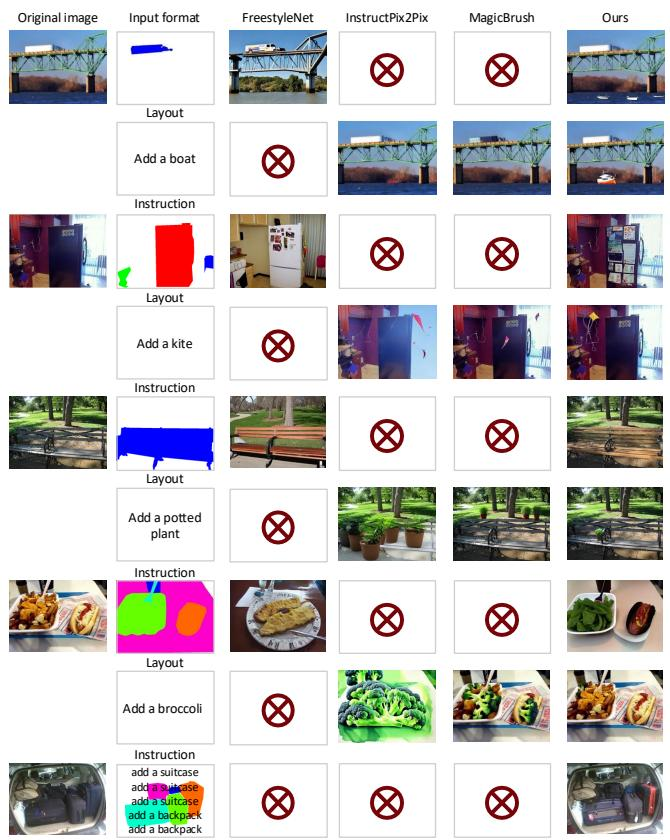

# Improving Long-Tail Detection via Layout–Instruction Conditioned Diffusion Synthesis

Xinyu Zhang1, Xiaodi Wang2, Yanpeng Sun3, Lingfeng Yang4, Jingdong Wang5, Lingqiao Liu6 1 University of Auckland, Auckland, New Zealand 2 Dcar, Beijing, China

3 Singapore University of Technology and Design, Singapore 4 WIZYELAB PTE. LTD., Singapore

5 Baidu Inc., Beijing, China 6 Adelaide University, Adelaide, Australia

xinyu.zhang@auckland.ac.nz; wangxiaodigm@gmail.com; yanpengsun115@gmail.com; ylingfeng98@gmail.com

Abstract—Synthetic data from diffusion models can improve object detection, but long-tail performance is still limited by scarce rare classes and inflexible conditioning (e.g., text-only or layout-only inputs). In this paper, we propose Tail-SD, a layout–instruction conditioned stable diffusion framework that supports text, layouts, or their hybrid, enabling controllable synthesis from boxes, masks, and/or prompts to better cover the long-tail objects. To train a single model across heterogeneous conditions, we introduce a multi-task cross-attention module and multi-task embedding tokens, improving generation quality and diversity. Extensive experiments on COCO and LVIS demonstrate that diffusion synthesis with hybrid conditioning consistently benefits detection, e.g., on LVIS val, it achieves +4.89% / +5.68% rare Box/Mask AP, highlighting strong potential for addressing longtail challenges.

Index Terms—Long-tail object detection, layout–instruction conditioned stable diffusion, controllable synthesis

## I. INTRODUCTION

Stable diffusion models [1]–[13] have demonstrated significant progress in generative technology, presenting advanced capabilities to generate high-fidelity and realistic images. Some works [14]–[26] leverages diffusion-generated images as synthetic data to improve downstream perception tasks [27]– [35], including object detection.

Despite these advances, improving long-tail object detection remains a challenge. Real-world datasets are highly imbalanced: rare categories have limited instances and weak coverage of intra-class variations, causing detectors to underfit rare concepts and overfit head classes. A natural solution is to synthesize additional training samples, but long-tail gains require more than “more images”: effective augmentation must be targeted (to deliberately increase rare-class exposure), controllable (to ensure the desired category appears with correct attributes), and diverse (to enrich backgrounds, poses, viewpoints, and co-occurrences). However, existing diffusionbased synthesis pipelines often constrain conditioning to a single fixed format, limiting their ability to generate reliable and diverse rare-category samples.

Existing diffusion synthesis methods for detection [20], [22], [25], [33]–[38] can be broadly categorized into two lines by their input formats: layout-based and instructionbased. Layout-based approaches [20], [33], [34], [36], [37], [39] take structured layouts (e.g., masks or bounding boxes) to guide object composition and spatial arrangement. While precise, they often require costly manual layout specification and are hard to scale to many rare categories. Moreover, fixed or simplistic layouts can bottleneck diversity, which is crucial for long-tail generalization. Recent attempts [22], [38], [40], [41] try to automatically generate layouts, yet maintaining reliability remains difficult, especially in object size, shape, position, and inter-object relationships. In contrast, instruction-based methods [19], [21], [23], [35] enable flexible prompting without explicit layouts, but may provide weaker spatial control and inconsistent instruction execution, making it difficult to reliably synthesize rare objects with desired attributes and minimal artifacts. These limitations motivate a unified framework that can exploit both the structural controllability of layouts and the semantic flexibility of instructions.

  
Fig. 1: Our Tail-SD is a flexible and versatile image generation pipeline, supporting text, layouts and a hybrid of both as inputs. The last three synthetic images are sampled from different seeds. (Zoom in for best view)

To this end, we propose Tail-SD, a layout-instruction conditioned stable diffusion framework tailored for long-tail detection. Tail-SD supports text, layouts, or their hybrid as inputs, allowing users to generate images based on what they have (boxes/masks) and what they want (instructions), which is particularly useful for targeted rare-class augmentation. Importantly, Tail-SD trains a single diffusion model that can flexibly adapt to different condition types via multi-task learning, so that robust condition-to-image alignment learned from abundant head classes can regularize and transfer to rare classes, improving the reliability of long-tail targeted synthesis. We design a multi-task cross-attention module together with multitask embedding tokens to unify heterogeneous conditions in a simple yet effective way, improving generation fidelity while enhancing diversity across modalities.

We evaluate Tail-SD on object detection task. Following standard settings [33], [34], [42], we augment detector training data by mixing synthetic images generated by Tail-SD with the original data. Experiments show consistent improvements on both COCO and LVIS, and most importantly, substantial gains on LVIS rare categories, demonstrating the effectiveness of layout-instruction hybrid diffusion synthesis for addressing long-tail challenges. Our contributions are summarized as:

• We introduce Tail-SD, a layout-instruction conditioned stable diffusion framework that supports text, layouts, or hybrid inputs for targeted and diverse synthetic augmentation in long-tail detection.

• We propose a multi-task cross-attention module and multitask embedding tokens to enable effective multi-task learning across heterogeneous conditioning modalities within a single diffusion model.

• Extensive experiments on COCO and LVIS demonstrate consistent detection gains, with particularly strong improvements on rare categories, highlighting the potential of Tail-SD for long-tail challenges.

## II. TAIL-SD

As in Introduction, for long-tail augmentation, we often need targeted, controllable and diverse rare-class samples. This raises a key question: can we build one diffusion model that supports layout conditioning, instruction conditioning, and their hybrid, and jointly learns from them to better serve rare categories? We answer this with Tail-SD, a layout-instruction conditioned stable diffusion framework trained with multi-task learning. The core idea is to couple complementary signals (layout for spatial grounding, and instruction for semantic guidance) within a single model so that robust condition-tovisual alignment learned from abundant head-class supervision can regularize and transfer to rare classes, improving the reliability of long-tail targeted synthesis.

## A. Framework

The overview pipeline of Tail-SD is shown in Fig. 2a. Tail-SD extends a standard latent diffusion model with two modules, i.e., multi-task cross attention module (MTCA) (Sec. II-B) and multi-task embedding tokens (MTET) (Sec. II-C) to enable unified training and inference across three conditioning modes: Instruction (text-only), Layout (boxes/masks with class names), and Hybrid (layout + instruction). This design directly matches long-tail augmentation needs: users can synthesize images from what they have (boxes/masks for rare categories) and what they want (semantic instructions for diversity).

## B. Multi-task cross attention module (MTCA)

In original stable diffusion, cross-attention takes noisy latent features as queries and text embeddings as keys/values:

CrossAttn $\begin{array} { r } { ( Q , K , V ) = \ A \cdot V = \mathrm { s o f t m a x } ( \frac { Q K ^ { T } } { \sqrt { d } } ) \cdot V } \end{array}$ , where A is the attention map and d is the key/query dimension. Different channels in cross-attention maps can somewhat reflect the specific text prompt [14], [43], [44]. Building on this property, [39] enforces spatial control by rectifying the attention map of each token with its associated mask, thereby grounding token attention to user-specified regions. Inspired by this, we present a multi-task cross attention module (MTCA) that generalizes attention rectification to multiple conditioning modes: when a layout is provided, MTCA spatially gates token attention to satisfy the layout constraint; when no layout is available, it degenerates to standard cross-attention so the model can fully follow the instruction prompt.

Let $\mathcal { L } \in \mathbb { R } ^ { C \times H \times W }$ denote a layout given by a user, where each channel $\mathcal { L } ^ { k }$ is a binary map indicating the region of the k-th object (from a mask or a box). We align layout channels to a subset of text tokens that correspond to object concepts (e.g., category words); tokens without layout supervision (e.g., padding or non-object words) use an all-one map $J \in \mathbb { R } ^ { H \times \bar { W } }$ We introduce a simple gate $\sigma ~ \in ~ \{ 0 , 1 \}$ indicating whether layout is provided: $\sigma = 1$ for layout and hybrid modes; $\sigma = 0$ for instruction mode. We rewrite the effective layout as

$$
{ \mathcal { L } } ^ { k }  \sigma \cdot { \mathcal { L } } ^ { k } + ( 1 - \sigma ) \cdot J .\tag{1}
$$

When no layout is available, L becomes all-ones and MTCA reduces to standard cross-attention.

We apply L to rectify cross-attention maps, enforcing spatial focus for object-related tokens:

$$
\widehat { \mathcal { A } } = \mathcal { A } \odot \mathcal { L } , \quad \widehat { \mathcal { A } } _ { i , j } ^ { k } = \left\{ \begin{array} { l l } { \mathcal { A } _ { i , j } ^ { k } , } & { \mathcal { L } _ { i , j } ^ { k } = 1 , } \\ { 0 , } & { \mathcal { L } _ { i , j } ^ { k } = 0 , } \end{array} \right.\tag{2}
$$

where ⊙ denotes element-wise multiplication. $\mathcal { A } _ { i , j } ^ { k }$ and $\mathcal { L } _ { i , j } ^ { k }$ denote the value at position (i, j) of the k-th channel of A and ${ \mathcal { L } } ,$ respectively. MTCA is thus $\mathrm { M T C A } ( Q , K , V , \mathcal { L } ) = \widehat { \mathcal { A } } \cdot V$ Intuitively, MTCA provides precise spatial grounding when layouts exist (critical for ensuring rare objects appear), while remaining compatible with instruction-only synthesis. Fig. 2b illustrates examples of multi-task cross-attention maps.

## C. Multi-task embedding tokens

Although MTCA unifies the computation graph, training across heterogeneous conditioning modes can be unstable: the model may confuse “no-layout” samples with “weaklayout” cases, and instruction-only supervision may influence or conflict with layout grounding. To disambiguate modes and stabilize optimization, we introduce learnable multi-task embedding tokens (MTET). Following [45], we learn a small set of mode-specific embedding tokens $\{ v _ { \sigma } \}$ that serve as input gates. In our setting, we use two tokens with $\sigma \in \{ 0 , 1 \}$ : v0 corresponds to layout-driven conditioning (including layout only and layout-instruction hybrid), and $v _ { 1 }$ corresponds to instruction-only conditioning.1

  
(a)  
(b)  
Fig. 2: (a) Overview of Tail-SD. The model supports instruction, layout, and hybrid conditioning, including two components: (i) MTCA that applies format-aware attention control, and (ii) MTET that indicates the conditioning mode to the diffusion model. The autoencoder is omitted for clarity. (b) Visualization of multi-task cross-attention maps in our Tail-SD: for each original image, we show two MTCA maps emphasizing corresponding objects and the generated image.

Given a training sample $y \ = \ ( c _ { T } , c _ { I } , x , \sigma )$ consisting of a text prompt $c _ { T } ,$ , an input image $c _ { I } .$ , a target image $x ,$ and a mode index $\sigma ,$ we inject the selected token $v _ { \sigma }$ into the diffusion model in two places: (i) we add $v _ { \sigma }$ to the timestep embedding, and (ii) we concatenate $v _ { \sigma }$ to the text embeddings fed into cross-attention in the U-Net. This provides an explicit mode indicator, improves separation between conditioning formats, and requires no architectural change to the backbone. The training objective is thus:

$$
\operatorname* { m i n } _ { \theta , \sigma \in \{ 0 , 1 \} } \mathbb { E } _ { y , \epsilon , t } \left[ \left\| \epsilon - \epsilon _ { \theta } ( z _ { t } , t , \mathcal { E } ( c _ { I } ) , c _ { T } , v _ { \sigma } ) \right\| _ { 2 } ^ { 2 } \right] ,\tag{3}
$$

where $\epsilon \sim \mathcal { N } ( 0 , 1 )$ is the noise, $\mathcal { E } ( \cdot )$ denotes the image encoder, θ denotes the U-Net parameters, and $z _ { t }$ is the noisy latent of $z = \mathcal { E } ( x )$ at timestep $t \in T$

At inference time, we directly select $v _ { \sigma }$ according to the chosen input format (layout/hybrid vs. instruction), without any additional mode prediction. This differs from [45], which predicts task indices using an extra fine-tuned large language model; our approach is simpler and faster, and avoids potential task-misclassification errors.

Discussion. The works most closely related to ours include layout-driven methods FreestyleNet [39] and Gen2Det [34], and instruction-based editing methods such as Emu-Edit [45]. Compared with [34], [39], our MTCA is inspired by layout rectification but differs by unifying instruction, layout, and hybrid conditioning in a single model, which is crucial for scalable long-tail augmentation. Compared to [45], Tail-SD provides stronger spatial grounding through layouts, improving the reliability of targeted rare-category synthesis. Finally, while task tokens appear in prior multi-task editing systems [45], our MTET specifically resolves ambiguity across conditioning formats (instruction/layout/hybrid) for detectionoriented synthesis, enabling simpler and more stable inference by directly selecting the mode token.

## III. EXPERIMENTS

## A. Experimental Settings

Datasets. For the training of our Tail-SD, we utilize COCO [46], LVIS [47], Visual Genome [48], and VGPhrase-Cut [49]. Data pre-processing. For instruction-based tasks, we follow the pipeline in [25] to create “removal-instructionoriginal” triples. For the layout-based task, we adopt the approach from [39], where each semantic category (e.g., an object class) is represented by a single word (e.g., “cat”) or a phrase (e.g., “teddy bear”) to describe the concept. Each concept is associated with its own layout, i.e., a binary map, which is utilized in MTCA. Data post-processing. For downstream object detection, we generate synthetic images only from COCO and LVIS to ensure fair comparison. For positioning newly added objects, we follow [25] to use [50] to determine their locations based on object labels as queries.

Implementation details. We adopt SD-v1.5 [3] as the base model and fine-tune Tail-SD for 30 epochs. We set the diffusion steps to 50 during denoising. For detection/instance segmentation, we follow X-Paste [33] with a 4× schedule (90k iterations) using Detectron2 [51]. We evaluate using CenterNet2 [52] and Faster R-CNN [53] with a ResNet-50 [54] backbone. All experiments are conducted on 8× V100 GPUs.

Synthetic data for detection. We mix synthetic images with real images during detector training following [34]. Each minibatch contains either all real or all synthetic images, sampled with a fixed ratio. Unless otherwise specified, we use a 20% synthetic ratio (real:synth = 4:1).

Evaluation metrics. 1) Detection. On COCO val we report Box/Mask AP $( \mathsf { A P } _ { b } / \mathsf { A P } _ { m } )$ . On LVIS val we report Box AP and Mask AP and the long-tail splits $\mathrm { A P _ { r } / A P _ { c } / A P _ { f } }$ (rare/common/frequent), with $\mathsf { A P } _ { \mathrm { r } }$ r as the primary long-tail metric. 2) Image synthesis quality. We follow prior imageediting evaluations and use both pixel-level and feature-level metrics. For pixel-level measurements, we report L1 and L2 distances between the generated image and the ground-truth target image (lower is better). For feature-level measurements, we compute cosine similarity between image features extracted by CLIP [55] and DINO [56] for the generated image and the ground-truth target image, denoted as CLIP-I and DINO (higher is better). For instruction-based inputs, we additionally report CLIP-T, the CLIP text-image similarity between generated image and instruction “add $\mathrm { { a } < o b j > ^ { \prime } }$ (higher is better). We randomly select 2,000 images from COCO for evaluation.

<table><tr><td>Method</td><td> $\mathrm { A P } _ { b }$ </td><td> $\mathrm { A P } _ { m }$ </td></tr><tr><td>Baseline</td><td>46.00</td><td>39.80</td></tr><tr><td>+ Copy-Paste [42]</td><td>46.40</td><td>39.80</td></tr><tr><td>+ X-Paste [33]</td><td>46.60</td><td>39.90</td></tr><tr><td>+ FreeStyleNet [39]</td><td>46.67</td><td>40.33</td></tr><tr><td>+ Gen2Det [34]</td><td>47.18</td><td>40.44</td></tr><tr><td>+ Tail-SD (ours)</td><td>47.06</td><td>40.60</td></tr></table>

TABLE I: Comparison on COCO val using CenterNet2. Synthetic images are used to augment detector training.

<table><tr><td rowspan="2">Method</td><td colspan="4">Box</td><td colspan="4">Mask</td></tr><tr><td>AP</td><td>APr</td><td>APc</td><td> $\boldsymbol { \mathrm { A P } _ { f } }$ </td><td>AP</td><td>APr</td><td>APc</td><td> $\boldsymbol { \mathrm { A P } _ { f } }$ </td></tr><tr><td>Baseline</td><td>33.80</td><td>20.84</td><td>32.84</td><td>40.58</td><td>29.98</td><td>18.36</td><td></td><td>29.6435.46</td></tr><tr><td>+ InstructPix2Pix [19]</td><td>24.88</td><td>17.40</td><td>24.00</td><td>29.16</td><td>22.13</td><td>15.49</td><td></td><td>21.6025.64</td></tr><tr><td>+ Copy-Paste [42]</td><td>34.31</td><td>21.19</td><td>34.32</td><td>40.07</td><td>30.29</td><td>19.97</td><td></td><td>30.4334.67</td></tr><tr><td>+ X-Paste [33]</td><td>34.34</td><td>21.05</td><td>33.86</td><td>40.71</td><td>30.18</td><td>18.77</td><td></td><td>30.11 35.28</td></tr><tr><td>+ Gen2Det [34]</td><td>34.70</td><td>23.78</td><td>33.71</td><td>40.61</td><td>30.82</td><td>21.24</td><td>30.32</td><td>35.59</td></tr><tr><td>+ GLIGEN [20]</td><td>33.8424.93</td><td></td><td>33.15</td><td>38.54</td><td>29.99</td><td>22.11</td><td>29.83</td><td>33.64</td></tr><tr><td>+ Tail-SD (ours)</td><td>34.97 25.73</td><td></td><td>33.69</td><td>40.4731.15</td><td></td><td>24.04</td><td>30.21 35.32</td><td></td></tr></table>

TABLE II: Comparison on LVIS val using CenterNet2. For InstructPix2Pix [19], we generate synthetic images using the same instruction templates as Tail-SD for a fair comparison.

## B. Main results

Comparison on object detection. We evaluate Tail-SD with prior synthetic methods [20], [33], [34], [39], [42], 2. Baseline uses real images only. Following [34], we train detectors with a mixture of real and synthetic images. Tab. I shows that augmenting training with images generated by Tail-SD yields clear improvements on COCO: Tail-SD improves the baseline by +1.06 Box AP and +0.80 Mask AP. Tail-SD achieves the best Mask AP and a comparable Box AP to the strongest prior method [34]. Notably, while Gen2Det primarily relies on layout inputs, Tail-SD additionally supports instruction conditioning, enabling more flexible and practical targeted synthesis, which becomes particularly beneficial in long-tail settings. We further evaluate Tail-SD on the LVIS benchmark [47], which splits categories into frequent/common/rare based on instance frequency. As shown in Tab. II, Tail-SD improves overall performance and delivers substantial gains on rare categories, outperforming layout-only baselines [33], [34] while remaining competitive on common and frequent classes. In particular, Tail-SD improves the baseline by +1.17 Box AP and +4.89 rare Box AP, and surpasses Gen2Det by +1.95 rare Box AP and +2.80 rare Mask AP. These results demonstrate that Tail-SD produces effective synthetic data for detection, with pronounced benefits on long-tailed categories.

Comparison with image-editing baselines. We compare Tail-SD with representative image-editing methods, including instruction-based approaches InstructPix2Pix [19], MagicBrush [23], and MGIE [21], as well as the layout-based method FreestyleNet [39]. Tab. III shows that Tail-SD achieves the best overall performance on most metrics under instruction inputs, obtaining the lowest pixel errors (L1/L2) and the highest feature-level similarities (CLIP-I and DINO) to the ground-truth target images. Although Tail-SD is slightly worse on CLIP-T, this metric mainly measures text-image alignment to the object mention rather than overall fidelity to the full edited target, which can favor methods that over-emphasize the inserted object. Compared to MGIE [21], Tail-SD improves DINO by 0.183, indicating closer perceptual similarity to the ground-truth edited results. For layout-based inputs, Tail-SD substantially outperforms FreestyleNet [39] across all reported metrics. This is largely because [39] relies on panoramic segmentation layouts that tend to alter background content (see Fig. 3), leading to large pixel deviations from the target. In contrast, Tail-SD better preserves the original background while editing the specified objects, producing more realistic and faithful results.

<table><tr><td></td><td>Method</td><td>L1 ↓</td><td>L2 ↓</td><td>CLIP-I ↑</td><td>CLIP-T ↑</td><td>DINO ↑</td></tr><tr><td>Instttion</td><td>InstructPix2Pix [19]</td><td>0.302</td><td>0.311</td><td>0.863</td><td>0.227</td><td>0.780</td></tr><tr><td></td><td>MagicBrush [23]</td><td>0.238</td><td>0.259</td><td>0.900</td><td>0.225</td><td>0.841</td></tr><tr><td></td><td>MGIE [21]</td><td>0.325</td><td>0.421</td><td>0.861</td><td>0.228</td><td>0.783</td></tr><tr><td></td><td>Tail-SD (ours)</td><td>0.195</td><td>0.161</td><td>0.955</td><td>0.221</td><td>0.970</td></tr><tr><td>Layout</td><td>FreestyleNet [39]</td><td>0.946</td><td>1.448</td><td>0.762</td><td>=</td><td>0.633</td></tr><tr><td></td><td>Tail-SD (ours)</td><td>0.355</td><td>0.413</td><td>0.891</td><td></td><td>0.865</td></tr></table>

TABLE III: Quantitative comparison on image editing with instruction-based and layout-based inputs.

  
Fig. 3: Qualitative comparison of Tail-SD with representative image-editing baselines under different conditioning formats. Tail-SD supports both layout- and instruction-based control while better preserving background consistency, producing more realistic edits. (Best viewed in color and with zoom.)

Qualitative evaluation. To qualitatively assess Tail-SD, we compare its editing results with representative baselines: the layout-based FreestyleNet [39] and the instruction-based InstructPix2Pix [19] and MagicBrush [23]. As shown in Fig. 3, Tail-SD can follow both layout and instruction inputs, and further supports their hybrid combination. Compared to instruction-only methods, Tail-SD produces more coherent object insertion with fewer artifacts while maintaining background fidelity, e.g., Tail-SD generates a more realistic and well-situated potted plant than [19], [23]. When using layout inputs, Tail-SD can preserve background elements (e.g., trees) when modifying the bench, whereas [39] tends to alter the background due to its panoramic layout representation. Overall, these visual comparisons highlight that Tail-SD achieves controllable and realistic edits across conditioning formats while better preserving the original image content.

<table><tr><td rowspan="2">Method</td><td rowspan="2">Task</td><td colspan="2">COCO</td><td colspan="2">LVIS</td></tr><tr><td> $\mathrm { A P } _ { b }$ </td><td> $\mathsf { A P } _ { m }$ </td><td>AP</td><td>APr</td></tr><tr><td>Baseline</td><td></td><td>46.00</td><td>39.80</td><td>33.80</td><td>20.84</td></tr><tr><td rowspan="3">+ Tail-SD</td><td>instruction</td><td>46.80</td><td>40.36</td><td>33.96</td><td>22.26</td></tr><tr><td>layout</td><td>46.58</td><td>40.37</td><td>34.05</td><td>19.81</td></tr><tr><td>multi-task</td><td>47.06</td><td>40.60</td><td>34.97</td><td>25.73</td></tr></table>

TABLE IV: Effect of multi-task learning on detection (CenterNet2 [52]). “instruction” and “layout” denote single-format training, while “multi-task” denotes multi-task training.

<table><tr><td rowspan="2">Method</td><td colspan="2">COCO</td><td colspan="2">LVIS</td></tr><tr><td> $\mathrm { A P } _ { b }$ </td><td> $\mathsf { A P } _ { m }$ </td><td> $\mathbf { A P }$ </td><td> $\mathsf { A P } _ { r }$ </td></tr><tr><td>Baseline</td><td>46.00</td><td>39.80</td><td>33.80</td><td>20.84</td></tr><tr><td>+ Tail-SD w/o MTET</td><td>47.02</td><td>40.43</td><td>33.98</td><td>20.51</td></tr><tr><td>+ Tail-SD</td><td>47.06</td><td>40.60</td><td>34.97</td><td>25.73</td></tr></table>

TABLE V: Effect of MTET on detection (CenterNet2 [52]).

## C. Ablation study

Effect of multi-task learning. To verify the benefit of multitask learning in Tail-SD, we train single-format variants using only instruction or layout inputs (each trained with its corresponding data). We remove MTET since the input mode is fixed. As shown in Tab. IV, jointly training on both formats consistently improves detection performance, with the largest gain on LVIS rare classes, indicating that multi-task learning produces more effective synthetic data for long-tail detection.

Effect of MTET. We introduce multi-task embedding tokens (MTET) to indicate the conditioning mode and reduce interference between instruction/layout training. As shown in Tab. V, removing MTET slightly affects COCO but significantly degrades LVIS performance: MTET improves LVIS by +0.99 AP and boosts rare categories by +5.22 AP compared to Tail-SD w/o MTET, demonstrating that MTET is crucial for long-tail gains. We do not ablate MTCA, since without layoutaware attention rectification the model cannot properly ground different instances, making the comparison ill-defined.

Effect of generated images with different input formats. At inference time, Tail-SD can synthesize two types of images depending on whether layout inputs are used. We generate each type separately and use them to augment detector training on COCO. As shown in Tab. VI, both types of generated images are beneficial, and combining them achieves the best performance across Box/Mask AP and $\mathsf { A P } _ { 5 0 }$ , indicating complementary gains from the two conditioning formats.

<table><tr><td colspan="2">Data utilization</td><td colspan="2">Box</td><td colspan="2">Mask</td></tr><tr><td>instruction</td><td>layout</td><td>AP</td><td> $\mathrm { A P _ { 5 0 } }$ </td><td>AP</td><td> $\mathrm { A P _ { 5 0 } }$ </td></tr><tr><td>X</td><td>×</td><td>46.00</td><td></td><td>39.80</td><td></td></tr><tr><td>√</td><td>X</td><td>46.51</td><td>65.40</td><td>40.24</td><td>62.22</td></tr><tr><td>X</td><td>√</td><td>46.72</td><td>65.71</td><td>40.33</td><td>62.58</td></tr><tr><td>√</td><td>√</td><td>47.06</td><td>66.01</td><td>40.60</td><td>62.66</td></tr></table>

TABLE VI: Effect of synthetic images generated with different conditioning formats on COCO [46] using CenterNet2 [52].
<table><tr><td rowspan="2">Model</td><td rowspan="2">Method</td><td colspan="2">Box</td><td colspan="2">Mask</td></tr><tr><td>AP</td><td> $\mathrm { { A P } _ { 5 0 } }$ </td><td>AP</td><td> $\mathrm { A P _ { 5 0 } }$ </td></tr><tr><td>CenterNet2 [52]</td><td>Baseline</td><td>46.00</td><td>=</td><td>39.80</td><td></td></tr><tr><td></td><td>+ Tail-SD Baseline</td><td>47.06 40.22</td><td>66.01 61.02</td><td>40.60</td><td>62.66</td></tr><tr><td>Faster R-CNN [53]</td><td>+ Tail-SD</td><td>40.47</td><td>61.09</td><td>=</td><td></td></tr></table>

TABLE VII: Effect of Tail-SD synthetic augmentation across different detectors on COCO [46].

Generalization across detectors. We evaluate whether synthetic images generated by Tail-SD consistently benefit different detection architectures. As shown in Tab. VII, augmenting COCO training with our generated images improves both CenterNet2 [52] and Faster R-CNN [53], demonstrating that the gains are not detector-specific.

## IV. CONCLUSION

This paper presents Tail-SD, a layout-instruction conditioned diffusion framework designed to improve long-tail object detection via controllable synthetic data generation. Tail-SD supports instruction-only, layout-conditioned, and hybrid inputs, enabling targeted synthesis for rare categories while maintaining high diversity in appearance and context. To unify heterogeneous conditions within a single model, we introduce a multi-task cross-attention module and multi-task embedding tokens, which stabilize multi-format training and improve condition-to-image alignment. Extensive experiments on COCO and LVIS show consistent gains in detection and instance segmentation, with particularly strong improvements on rare categories, demonstrating the effectiveness of hybridconditioned diffusion synthesis for long-tail challenges.

Limitations and societal impact. Our findings are based on public datasets and pretrained diffusion models, which may limit their generalization. Future research could explore more high-quality datasets and various pretrained models to further validate our method.

## REFERENCES

[1] Jonathan Ho, Ajay Jain, and Pieter Abbeel, “Denoising diffusion probabilistic models,” NeurIPS, 2020.

[2] Jiaming Song, Chenlin Meng, and Stefano Ermon, “Denoising diffusion implicit models,” arXiv preprint arXiv:2010.02502, 2020.

[3] Robin Rombach, Andreas Blattmann, Dominik Lorenz, Patrick Esser, and Bjorn Ommer, “High-resolution image synthesis with latent diffu-¨ sion models,” in CVPR, 2022.

[4] Chitwan Saharia, William Chan, Saurabh Saxena, Lala Li, Jay Whang, Emily L Denton, Kamyar Ghasemipour, Raphael Gontijo Lopes, Burcu Karagol Ayan, Tim Salimans, et al., “Photorealistic text-to-image diffusion models with deep language understanding,” NeurIPS, 2022.

[5] Aditya Ramesh, Mikhail Pavlov, Gabriel Goh, Scott Gray, Chelsea Voss, Alec Radford, Mark Chen, and Ilya Sutskever, “Zero-shot text-to-image generation,” in ICML, 2021.

[6] Aditya Ramesh, Prafulla Dhariwal, Alex Nichol, Casey Chu, and Mark Chen, “Hierarchical text-conditional image generation with clip latents,” arXiv preprint arXiv:2204.06125, 2022.

[7] James Betker, Gabriel Goh, Li Jing, Tim Brooks, Jianfeng Wang, Linjie Li, Long Ouyang, Juntang Zhuang, Joyce Lee, Yufei Guo, et al., “Improving image generation with better captions,” Computer Science. https://cdn. openai. com/papers/dall-e-3. pdf, 2023.

[8] Dustin Podell, Zion English, Kyle Lacey, Andreas Blattmann, Tim Dockhorn, Jonas Muller, Joe Penna, and Robin Rombach, “Sdxl:¨ Improving latent diffusion models for high-resolution image synthesis,” arXiv preprint arXiv:2307.01952, 2023.

[9] Jing Yu Koh, Daniel Fried, and Russ R Salakhutdinov, “Generating images with multimodal language models,” NeurIPS, 2024.

[10] Xin Xie and Dong Gong, “Dymo: Training-free diffusion model alignment with dynamic multi-objective scheduling,” in CVPR, 2025, pp. 13220–13230.

[11] Yuze Li, Dong Gong, Xiao Cao, Junchao Yuan, Dongsheng Li, Lei Zhou, Yun Sing Koh, Cheng Yan, and Xinyu Zhang, “Let your image move with your motion!–implicit multi-object multi-motion transfer,” in CVPR, 2026, pp. 11207–11217.

[12] Xin Xie, Jiaxian Guo, and Dong Gong, “Hyperalign: Hypernetwork for efficient test-time alignment of diffusion models,” arXiv preprint arXiv:2601.15968, 2026.

[13] Jintao Rong, Xin Xie, Xinyi Yu, Linlin Ou, Xinyu Zhang, Chunhua Shen, and Dong Gong, “When distillation breaks motion control: Restoring generative trajectories for fast video generators,” in ECCV, 2026, pp. 247–265.

[14] Amir Hertz, Ron Mokady, Jay Tenenbaum, Kfir Aberman, Yael Pritch, and Daniel Cohen-Or, “Prompt-to-prompt image editing with cross attention control,” arXiv preprint arXiv:2208.01626, 2022.

[15] Narek Tumanyan, Michal Geyer, Shai Bagon, and Tali Dekel, “Plugand-play diffusion features for text-driven image-to-image translation,” in CVPR, 2023.

[16] Alex Nichol, Prafulla Dhariwal, Aditya Ramesh, Pranav Shyam, Pamela Mishkin, Bob McGrew, Ilya Sutskever, and Mark Chen, “Glide: Towards photorealistic image generation and editing with text-guided diffusion models,” arXiv preprint arXiv:2112.10741, 2021.

[17] Omri Avrahami, Dani Lischinski, and Ohad Fried, “Blended diffusion for text-driven editing of natural images,” in CVPR, 2022.

[18] Guillaume Couairon, Jakob Verbeek, Holger Schwenk, and Matthieu Cord, “Diffedit: Diffusion-based semantic image editing with mask guidance,” arXiv preprint arXiv:2210.11427, 2022.

[19] Tim Brooks, Aleksander Holynski, and Alexei A Efros, “Instructpix2pix: Learning to follow image editing instructions,” in CVPR, 2023.

[20] Yuheng Li, Haotian Liu, Qingyang Wu, Fangzhou Mu, Jianwei Yang, Jianfeng Gao, Chunyuan Li, and Yong Jae Lee, “Gligen: Open-set grounded text-to-image generation,” in CVPR, 2023.

[21] Tsu-Jui Fu, Wenze Hu, Xianzhi Du, William Yang Wang, Yinfei Yang, and Zhe Gan, “Guiding instruction-based image editing via multimodal large language models,” arXiv preprint arXiv:2309.17102, 2023.

[22] Chun-Hsiao Yeh, Ta-Ying Cheng, He-Yen Hsieh, Chuan-En Lin, Yi Ma, Andrew Markham, Niki Trigoni, HT Kung, and Yubei Chen, “Gen4gen: Generative data pipeline for generative multi-concept composition,” arXiv preprint arXiv:2402.15504, 2024.

[23] Kai Zhang, Lingbo Mo, Wenhu Chen, Huan Sun, and Yu Su, “Magicbrush: A manually annotated dataset for instruction-guided image editing,” NeurIPS, 2024.

[24] Shelly Sheynin, Adam Polyak, Uriel Singer, Yuval Kirstain, Amit Zohar, Oron Ashual, Devi Parikh, and Yaniv Taigman, “Emu edit: Precise image editing via recognition and generation tasks,” arXiv preprint arXiv:2311.10089, 2023.

[25] Lingfeng Yang, Xinyu Zhang, Xiang Li, Jinwen Chen, Kun Yao, Gang Zhang, Errui Ding, Lingqiao Liu, Jingdong Wang, and Jian Yang, “Addsd: Rational generation without manual reference,” arXiv preprint arXiv:2407.21016, 2024.

[26] Zebin You, Xinyu Zhang, Hanzhong Guo, Jingdong Wang, and Chongxuan Li, “Are images indistinguishable to humans also indistinguishable to classifiers?,” in CVPR, 2025, pp. 28790–28800.

[27] Xin Li, Yulin Ren, Xin Jin, Cuiling Lan, Xingrui Wang, Wenjun Zeng, Xinchao Wang, and Zhibo Chen, “Diffusion models for image restoration and enhancement–a comprehensive survey,” arXiv preprint arXiv:2308.09388, 2023.

[28] Junzhong Ji, Runfeng Zhao, and Minglong Lei, “Latent diffusion transformer for point cloud generation,” The Visual Computer, pp. 1–15, 2024.

[29] Shekoofeh Azizi, Simon Kornblith, Chitwan Saharia, Mohammad Norouzi, and David J Fleet, “Synthetic data from diffusion models improves imagenet classification,” arXiv preprint arXiv:2304.08466, 2023.

[30] Ruifei He, Shuyang Sun, Xin Yu, Chuhui Xue, Wenqing Zhang, Philip Torr, Song Bai, and Xiaojuan Qi, “Is synthetic data from generative models ready for image recognition?,” arXiv preprint arXiv:2210.07574, 2022.

[31] Mert Bulent Sariyildiz, Karteek Alahari, Diane Larlus, and Yannis Kalantidis, “Fake it till you make it: Learning transferable representations from synthetic imagenet clones,” in CVPR, 2023.

[32] Yonglong Tian, Lijie Fan, Phillip Isola, Huiwen Chang, and Dilip Krishnan, “Stablerep: Synthetic images from text-to-image models make strong visual representation learners,” NeurIPS, vol. 36, 2024.

[33] Hanqing Zhao, Dianmo Sheng, Jianmin Bao, Dongdong Chen, Dong Chen, Fang Wen, Lu Yuan, Ce Liu, Wenbo Zhou, Qi Chu, et al., “Xpaste: Revisiting scalable copy-paste for instance segmentation using clip and stablediffusion,” in ICML, 2023.

[34] Saksham Suri, Fanyi Xiao, Animesh Sinha, Sean Chang Culatana, Raghuraman Krishnamoorthi, Chenchen Zhu, and Abhinav Shrivastava, “Gen2det: Generate to detect,” arXiv preprint arXiv:2312.04566, 2023.

[35] Navve Wasserman, Noam Rotstein, Roy Ganz, and Ron Kimmel, “Paint by inpaint: Learning to add image objects by removing them first,” arXiv preprint arXiv:2404.18212, 2024.

[36] Binxin Yang, Shuyang Gu, Bo Zhang, Ting Zhang, Xuejin Chen, Xiaoyan Sun, Dong Chen, and Fang Wen, “Paint by example: Exemplarbased image editing with diffusion models,” in CVPR, 2023.

[37] Xi Chen, Lianghua Huang, Yu Liu, Yujun Shen, Deli Zhao, and Hengshuang Zhao, “Anydoor: Zero-shot object-level image customization,” arXiv preprint arXiv:2307.09481, 2023.

[38] Shang Chai, Liansheng Zhuang, and Fengying Yan, “Layoutdm: Transformer-based diffusion model for layout generation,” in CVPR, 2023, pp. 18349–18358.

[39] Han Xue, Zhiwu Huang, Qianru Sun, Li Song, and Wenjun Zhang, “Freestyle layout-to-image synthesis,” in CVPR, 2023, pp. 14256– 14266.

[40] Zecheng Tang, Chenfei Wu, Juntao Li, and Nan Duan, “Layoutnuwa: Revealing the hidden layout expertise of large language models,” in ICLR, 2024.

[41] Jian Chen, Ruiyi Zhang, Yufan Zhou, and Changyou Chen, “Towards aligned layout generation via diffusion model with aesthetic constraints,” arXiv preprint arXiv:2402.04754, 2024.

[42] Golnaz Ghiasi, Yin Cui, Aravind Srinivas, Rui Qian, Tsung-Yi Lin, Ekin D Cubuk, Quoc V Le, and Barret Zoph, “Simple copy-paste is a strong data augmentation method for instance segmentation,” in CVPR, 2021.

[43] Drew A Hudson and Larry Zitnick, “Generative adversarial transformers,” in ICML. PMLR, 2021, pp. 4487–4499.

[44] Bingyan Liu, Chengyu Wang, Tingfeng Cao, Kui Jia, and Jun Huang, “Towards understanding cross and self-attention in stable diffusion for text-guided image editing,” in CVPR, 2024, pp. 7817–7826.

[45] Quan Sun, Qiying Yu, Yufeng Cui, Fan Zhang, Xiaosong Zhang, Yueze Wang, Hongcheng Gao, Jingjing Liu, Tiejun Huang, and Xinlong Wang, “Generative pretraining in multimodality,” arXiv preprint arXiv:2307.05222, 2023.

[46] Tsung-Yi Lin, Michael Maire, Serge Belongie, James Hays, Pietro Perona, Deva Ramanan, Piotr Dollar, and C Lawrence Zitnick, “Microsoft´ coco: Common objects in context,” in ECCV, 2014.

[47] Agrim Gupta, Piotr Dollar, and Ross Girshick, “Lvis: A dataset for large vocabulary instance segmentation,” in CVPR, 2019.

[48] Ranjay Krishna, Yuke Zhu, Oliver Groth, Justin Johnson, Kenji Hata, Joshua Kravitz, Stephanie Chen, Yannis Kalantidis, Li-Jia Li, David A Shamma, et al., “Visual genome: Connecting language and vision using crowdsourced dense image annotations,” IJCV, 2017.

[49] “Vgphrasecut,” https://github.com/ChenyunWu/PhraseCutDataset, 2019.

[50] Shilong Liu, Zhaoyang Zeng, Tianhe Ren, Feng Li, Hao Zhang, Jie Yang, Chunyuan Li, Jianwei Yang, Hang Su, Jun Zhu, et al., “Grounding dino: Marrying dino with grounded pre-training for open-set object detection,” arXiv preprint arXiv:2303.05499, 2023.

[51] Yuxin Wu, Alexander Kirillov, Francisco Massa, Wan-Yen Lo, and Ross Girshick, “Detectron2,” https://github.com/facebookresearch/detectron2, 2019.

[52] Xingyi Zhou, Vladlen Koltun, and Philipp Krahenb¨ uhl, “Probabilistic¨ two-stage detection,” arXiv preprint arXiv:2103.07461, 2021.

[53] Shaoqing Ren, Kaiming He, Ross Girshick, and Jian Sun, “Faster rcnn: Towards real-time object detection with region proposal networks,” NeurIPS, 2015.

[54] Kaiming He, Xiangyu Zhang, Shaoqing Ren, and Jian Sun, “Deep residual learning for image recognition,” in CVPR, 2016.

[55] Alec Radford, Jong Wook Kim, Chris Hallacy, Aditya Ramesh, Gabriel Goh, Sandhini Agarwal, Girish Sastry, Amanda Askell, Pamela Mishkin, Jack Clark, et al., “Learning transferable visual models from natural language supervision,” in ICML, 2021.

[56] Mathilde Caron, Hugo Touvron, Ishan Misra, Herve J´ egou, Julien´ Mairal, Piotr Bojanowski, and Armand Joulin, “Emerging properties in self-supervised vision transformers,” in ICCV, 2021, pp. 9650–9660.