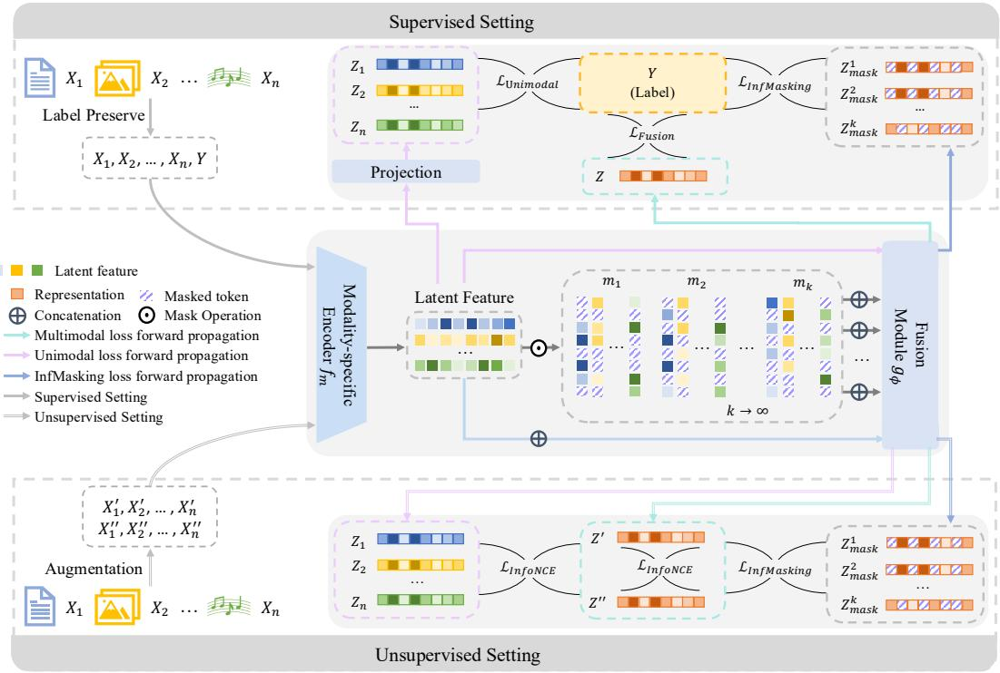

# InfMasking: A Unified Variational Framework for Synergistic Multimodal Learning

Liangjian Wen, Qun Dai, Jiang Duan, Yong Dai, Jianzhuang Liu, Dongkai Wang, Jun Wang, Fuyuan Cao, Zenglin Xu, Zhao Kang

Abstract—Multimodal models are expected to exploit synergistic information, that is, information available only when multiple modalities are observed together. In practice, however, a fusion module can fit the training objective by relying on a dominant modality or on information that modalities share, and the synergy between modalities is often left unused. We propose InfMasking, a unified multimodal learning framework based on Infinite Masking. Before fusion, InfMasking randomly masks the features of each modality; each sampled mask produces a different partial combination of cross-modal evidence and a fused representation of the corresponding modality interactions. All masked fused representations are required to remain consistent with a reference target: the unmasked fused view when training is unsupervised, and the class proxy of the task label when labels are available. Maintaining this consistency across diverse partial combinations discourages reliance on a dominant modality or on shared information alone, and drives the fusion module to learn cross-modal interaction patterns that remain meaningful under partial observations. Since the objective is an expectation over infinitely many masks, we model the masked fused representations as Gaussian and optimize closed-form variational bounds, whose population-moment gaps are controlled by the masking-induced covariance under this model. On the evaluated benchmarks, InfMasking improves predictive performance and yields higher mean PID estimates of task-label synergy in learned modality-specific representations, alongside higher InterSHAP

interaction attribution in the trained predictors. Code is available at https://github.com/brightest66/InfMasking.

Index Terms—Multimodal learning, multimodal fusion, synergistic information, self-supervised learning, modality collaboration, masking.

## I. INTRODUCTION

M ULTIMODAL representation learning aims to learninformative joint representations by integrating hetero- informative joint representations by integrating heterogeneous and complementary information from multiple modalities, such as vision, language, audio, and sensor data [2], [3]. A central challenge is to design a fusion mechanism that integrates heterogeneous features and captures crossmodal interactions. Interactions among modalities can reveal evidence that emerges only from their joint observation and cannot be obtained from any single modality alone. Attentionbased and transformer-based fusion methods have achieved substantial progress in multimodal representation learning by enabling flexible cross-modal interactions [4]–[12]. However, joint training on multimodal data does not guarantee that all modalities are effectively used. A model may exploit redundant correlations or rely on a dominant modality, sometimes performing no better than the strongest unimodal branch while using little of the evidence that emerges only when modalities are combined [13]–[15].

This difficulty is tied to the information structure of multimodal data [16]. Partial Information Decomposition (PID) [17], [18] offers one information-theoretic way to quantify such joint-only evidence: for specified modality sources and a task target, it separates their information into redundant, unique, and synergistic components. Redundant information is comparatively easy to optimize because it can be reinforced through alignment or agreement [19], [20], whereas unique information can be preserved by modality-specific constraints [21], [22]. Synergistic information is more fragile because it emerges from cross-modal interactions and cannot be inferred from any single modality alone. Hateful meme detection is one example: harmful semantics can arise from interactions between visual and textual information rather than from either modality independently [23]. In such cases, the image or the accompanying text may appear innocuous when examined alone, while their combination can encode derogatory, biased, or abusive meanings. Standard multimodal training nevertheless tends to underuse this synergistic information.

Existing fusion methods partially address this issue. In selfsupervised settings, cross-modal contrastive learning strengthens shared information by aligning views from different modalities, but it often relies on the multiview redundancy assumption that shared information across views is sufficient for downstream tasks, thereby primarily capturing redundant information [8], [13], [24]–[26]. In supervised settings, this problem is further amplified. A dominant modality can contribute more to the training objective or converge faster, thereby taking over gradient updates and weakening the optimization of less informative modalities. This often leaves the unimodal representations of less informative modalities underoptimized and prevents the model from capturing synergy that emerges only when modalities are combined [14], [27]– [29]. Consequently, a central challenge is to train a fusion mechanism that exploits synergistic interactions arising from joint observations, rather than relying on a dominant modality or redundant information alone.

To address this challenge, we propose InfMasking, a unified multimodal learning framework based on Infinite Masking. Specifically, InfMasking repeatedly samples masks over tokens of the modality-specific representations before fusion. Each mask retains a different subset of tokens within the modalities, producing fused representations from different partial crossmodal observations. By requiring these masked representations to stay consistent with a learning target (an unmasked view in the unsupervised setting or the task label in the supervised setting), InfMasking encourages the model to learn interaction patterns that remain meaningful across diverse partial observations.

InfMasking applies to both unsupervised and supervised learning. In the unsupervised setting, InfMasking aligns masked fused views with their unmasked counterparts to enhance task-agnostic synergistic representations. In the supervised setting, InfMasking uses a label-proxy objective to require masked fused evidence to remain consistent with the proxy vector of the task label, thereby promoting decisionlevel modality collaboration. The masking operation remains the same in both settings. Unsupervised training preserves view-level information, while supervised training preserves label-relevant decision evidence. Because exhaustively evaluating the masking expectation is impractical, we model the masked fusion distribution as a Gaussian and derive tractable variational bounds: a lower bound for the unsupervised objective and an upper bound for the supervised objective. These bounds serve as surrogate optimization objectives.

Our contributions are threefold: (1) We formulate InfMasking as a unified multimodal fusion principle that regularizes the fusion module through infinitely many partial modality combinations. The formulation covers both unsupervised representation learning and supervised collaborative optimization. (2) By modeling masked fusion states as a Gaussian distribution, we derive tractable variational bounds of the infinite masking objective for both the unsupervised and supervised settings. Beyond deriving these bounds, we prove under the Gaussian model that the slack of each bound is controlled by an anchor-wise (resp. class-wise) quadratic form in the maskinginduced covariance and vanishes as the masked representations concentrate; we measure the corresponding surrogate gaps by Monte-Carlo estimation at the tested configurations. We further show which guarantees survive beyond the Gaussian model: the absolute approximation error is controlled by the masking-induced covariance for arbitrary mask distributions, whereas a directional sub-Gaussian condition is sufficient for the one-sided bound property. (3) Experiments on multiple multimodal datasets in both unsupervised and supervised settings demonstrate that InfMasking consistently improves performance, enhances robustness to corrupted modalities, and facilitates the discovery of synergistic interactions. Our code is available at https://github.com/brightest66/InfMasking.

This paper substantially extends our conference version [1] in four aspects. First, it re-examines InfMasking from a unified perspective, formulating a single framework that covers both unsupervised and supervised learning and introducing a label-proxy masked fusion objective. Second, it derives a tractable variational upper bound for the supervised objective under a Gaussian model of masked fusion states, extending the bound-based analysis of the conference version beyond the unsupervised case. Third, and most importantly from a theoretical standpoint, it establishes, for both the unsupervised and supervised bounds, the tightness guarantees described in contribution (2) under the Gaussian model, together with Monte-Carlo evaluation of the corresponding surrogate gaps, directly assessing, rather than merely assuming, the accuracy of the Gaussian-based approximation at the evaluated configurations. Fourth, it provides broader experimental validation of InfMasking in supervised settings. These extensions show that masked fusion can promote modality collaboration and offer a methodological perspective for future research.

## II. RELATED WORK

## A. Multimodal Interaction and Fusion

Multimodal fusion aims to integrate heterogeneous observations, such as images, text, audio, and sensor data, into representations that preserve task-relevant information across modalities, including redundancy shared by multiple modalities, uniqueness specific to individual modalities, and synergy that emerges only from their joint observation [17], [18], [29], [30]. An information-theoretic survey examines multimodal dependency, task-oriented compression, and synergistic interactions through mutual information, information bottleneck, and PID [31]. Existing strategies are commonly categorized as early fusion, which concatenates modality features before prediction; late fusion, which aggregates modality-specific predictions; and intermediate fusion, which learns cross-modal interactions through adaptive mechanisms such as gating or attention [2], [32], [33]. Recent transformer-based models further strengthen intermediate fusion by enabling tokenor feature-level interactions through self-attention and crossattention [4], [5], [34]. Cooperation of Experts uses specialized encoders and large-margin cooperation to learn heterogeneous relational patterns [35]. Despite these advances, fusion is still often treated as an architectural operation rather than a training objective: a high-capacity fusion module can fit the training objective by exploiting the most stable or predictive modality, especially when redundant information is available across modalities [14], [27], [36], [37]. In contrast, InfMasking treats fusion as a training objective, exposing the fusion module to a distribution of partial modality combinations so that the learned fusion function must remain meaningful under diverse evidence subsets.

## B. Self-Supervised Multimodal Contrastive Learning

Self-supervised multimodal contrastive learning learns joint representations without labels by exploiting cross-modal cor respondences or augmented views. These methods construct positive pairs from multiple views of the same instance or from naturally paired modalities, and optimize contrastive objectives such as InfoNCE to align semantic representations across modalities [19], [20], [25], [38], [39]. From a multiview perspective, their effectiveness is often explained by the assumption that different views preserve shared task relevant information [13], [24], [26], [40]. Beyond contrastive estimators, mutual information gradient estimation has also been explored for representation learning [41]. Multiview clustering methods impose information bottleneck constraints at granular and sample levels [42] or combine self-supervised view weighting with clustering-structure consistency [43]. Other methods combine pseudo-label-guided contrastive learn ing with feature- and cluster-level correlation learning [44], or jointly model uncertainty in the data, model, and predic tions through full-stage trusted multimodal clustering [45]. Another line of multimodal self-supervised learning adopts masked modeling or autoencoding objectives, where models reconstruct missing content from partially observed inputs and thereby learn robust cross-modal representations [46]–[48]. However, both view agreement and reconstruction can still be dominated by redundant or easily recoverable correlations, and neither objective necessarily requires the fusion module to expose interaction patterns that only appear after modalities are combined. Several recent methods explicitly move beyond pure redundancy [8], [49]–[51]. Factorized contrastive learning decomposes shared and unique factors to better model multi view information [51], while contrastive multimodal inter action learning introduces information-theoretic objectives to capture redundant, unique, and synergistic components [8]. HRIL models higher-order interactions through cross-moment tensors, Tucker decomposition, and synergy-aware regular ization [52]. The conference version of InfMasking further showed that masked and unmasked fused views can be aligned to enhance task-agnostic synergistic representations [1]. Inf-Masking generalizes this masked-fusion approach to both learning settings, constraining the same distribution of masked fusion states through view-level consistency in the unsuper vised setting or label-proxy decision evidence in the supervised setting.

## C. Supervised Multimodal Learning

Supervised multimodal learning introduces task labels to the fusion problem, but empirical risk minimization alone does not ensure effective modality collaboration [14], [27]. Task-specific approaches include semantic-anchor-guided data augmentation for low-resource multimodal information extraction [53] and knowledge-induced multimodal reasoning for web agents [54]. The emergence of modality competition, where one modality rapidly minimizes the training loss, prevents the model from fully exploiting cross-modal interactions [15], [55]. This failure mode is particularly harmful when task-relevant information is distributed across modalities, because a dominant-modality shortcut can suppress the interactions that make multimodal learning effective. Existing methods address this issue from different perspectives. Multiloss [56] introduces auxiliary losses on modality-specific branches to preserve unimodal discriminability, while MM-Cosine [57] equalizes modality influence by standardizing features and classifier weights. Other approaches balance multimodal optimization by modulating gradient contributions, coordinating modality-specific objectives, or incorporating alignment regularization [15], [27], [58], [59]. Although these strategies improve robustness and preserve unimodal discriminability, they balance modality contributions without explicitly requiring partial multimodal evidence to support the task decision, and thus may be insufficient for tasks that depend on cross-modal interactions. MSCR addresses both modality imbalance and synergy learning by combining anti-dominance and synergy objectives with sample-adaptive gating [60]. To explicitly promote label-consistent cross-modal synergy, InfMasking requires each partially masked fused representation to remain consistent with the label proxy. This objective encourages complementary interactions among modalities while preserving the predictive strengths of individual modalities.

## III. PRELIMINARIES

Problem Setup. Let $X = ( X _ { 1 } , \ldots , X _ { n } )$ denote an n-modal input, where $X _ { m }$ is the observation from the m-th modality, such as text, image, or audio. Let $Y$ denote the downstream task label. For each modality, a modality-specific encoder $f _ { m } ( \cdot ; \theta _ { m } )$ maps $X _ { m }$ to a latent feature $h _ { m } = f _ { m } ( X _ { m } ; \theta _ { m } )$ where $\theta _ { m }$ denotes the encoder parameters. A fusion module $g _ { \phi }$ then takes the set of modality features $H = \{ h _ { m } \} _ { m = 1 } ^ { n }$ as input and produces a joint representation ${ \cal Z } ~ = ~ g _ { \phi } ( H )$ where $\phi$ denotes the fusion parameters. The goal is to learn the representation parameters $\theta = \{ \theta _ { 1 } , \ldots , \theta _ { n } , \phi \}$ such that $Z$ preserves the task-relevant information contained in the multimodal input and supports downstream prediction. Ideally, $Z$ should be informative for $Y , i . e . , I ( Z ; Y ) = I ( X ; Y )$ . For brevity we also write $f _ { \theta } = g _ { \phi } \circ \{ f _ { m } \} _ { m = 1 } ^ { n }$ for the composition of the modality-specific encoders with the fusion module, so that $Z _ { \theta } ~ = ~ f _ { \theta } ( X ) ~ = ~ g _ { \phi } ( \{ f _ { m } ( X _ { m } ; \theta _ { m } ) \} _ { m = 1 } ^ { n } )$ is the fused representation of X and, for an augmented view $X ^ { \prime } , Z _ { \theta } ^ { \prime } =$ $f _ { \theta } ( X ^ { \prime } ) = g _ { \phi } ( \{ f _ { m } ( X _ { m } ^ { \prime } ; \theta _ { m } ) \} _ { m = 1 } ^ { n } )$ is the fused representation of that view, computed by the same encoders and fusion module. Here θ collects the encoder and fusion parameters of this representation map; any additional classifier or projectionhead parameters are specified separately. The prime denotes an augmented input view, not a different parameter set, and the parameter subscript is omitted when it is clear from context.

## A. Multimodal Interaction

Multimodal fusion must model interactions among modalities as well as aggregate their features. For two modalities

$X _ { 1 }$ and $X _ { 2 } .$ , Partial Information Decomposition (PID) [17], [18] provides a framework to characterize multimodal interactions by decomposing the information that multiple modalities provide about a target variable Y into redundant, unique, and synergistic terms:

$$
I ( X _ { 1 } , X _ { 2 } ; Y ) = R + S + U _ { 1 } + U _ { 2 } ,\tag{1}
$$

where R denotes redundancy shared by both modalities, $U _ { i }$ denotes information unique to $X _ { i }$ , and S is available only through their joint observation. This decomposition is governed by consistency equations derived from the chain rule of mutual information:

$$
I ( X _ { i } ; Y ) = R + U _ { i } , \quad I ( X _ { 1 } ; X _ { 2 } ; Y ) = R - S .\tag{2}
$$

The synergistic information S is particularly relevant to multimodal learning because it captures patterns that arise only from combined modalities and cannot be inferred from any single modality in isolation.

## B. Contrastive Multimodal Learning

This section builds upon Section 2 of [8], on which Inf-Masking is developed, to keep notation consistent. In the unsupervised formulation of multimodal contrastive learning, task labels Y are unavailable during pre-training. To make the objective tractable without label supervision, the following assumption is introduced in [8]:

Assumption 1 (Minimal label-preserving multimodal augmentations). We assume the existence of $\tau ^ { * }$ , a set of multimodal augmentations such that for any $t \in \tau ^ { * }$ and $X ^ { \prime } = t ( X )$ , we have $I ( X ; X ^ { \prime } ) = I ( X ; Y )$ .

Assumption 1 admits a broader class of augmentations than commonly used unimodal transformations, which perturb individual modalities independently. This broader formulation permits joint multimodal augmentations that act on crossmodal settings while preserving label-relevant information. For an augmented view $X ^ { \prime } = t ( X )$ , where $t \in \tau ^ { * }$ , we denote its representation by $Z _ { \theta } ^ { \prime } = f _ { \theta } ( X ^ { \prime } )$ . Since $Z _ { \theta } ^ { \prime }$ is obtained from $X ^ { \prime }$ , the variables satisfy the Markov chain $X  X ^ { \prime }  Z ^ { \prime } ;$ together with $Z ^ { \prime } \to X \to Z$ , the data processing inequality yields

$$
I ( Z ; Z ^ { \prime } ) \leq I ( X ; Z ^ { \prime } ) \leq I ( X ; X ^ { \prime } ) .\tag{3}
$$

Following CoMM [8], maximizing the mutual information between paired representations encourages preserving information shared by the augmented views.

Based on the above, we recall Lemmas 2 and 3 of CoMM [8], which summarize the role of contrastive alignment in modeling multimodal interactions.

Lemma 1. By optimizing $f _ { \theta }$ to maximize $I ( Z _ { \theta } ; Z _ { \theta } ^ { \prime } )$ , and assuming an expressive enough network $f _ { \boldsymbol { \theta } ; }$ , we have at optimum:

$$
I ( Z _ { \theta ^ { \star } } ; Z _ { \theta ^ { \star } } ^ { \prime } ) = I ( X ; X ^ { \prime } ) .\tag{4}
$$

Following CoMM [8], we use paired-view alignment to motivate learning multimodal representations that reflect crossmodal interactions.

For the single-modality input used below, the notation $f _ { \theta } ( X _ { i } )$ denotes $g _ { \phi } ( \{ f _ { i } ( X _ { i } ; \theta _ { i } ) \} )$ : the corresponding encoder supplies its modality features to the same fusion module. This is the single-modality restriction of the representation map in the unsupervised formulation, rather than a supervised projection-head output.

Lemma 2. Let $f _ { \theta ^ { \star } }$ be optimal, i.e., fθ⋆ maximizes $I ( Z _ { \theta } ; Z _ { \theta } ^ { \prime } )$ Then, we have the equality $I ( Z _ { \theta ^ { \star } } ^ { \prime } ; Y ) = I ( X ^ { \prime } ; Y )$ . If we consider the special case $\mathcal { T } = \{ t _ { i } \}$ such that $X ^ { \prime } = t _ { i } ( X ) = X _ { i }$ and $Z _ { \theta ^ { \star } } ^ { \prime } = f _ { \theta ^ { \star } } ( X _ { i } ) = Z _ { i } f o r i \in \{ 1 , 2 \}$ , then it follows:

$$
I ( Z _ { i } ; Y ) = I ( X _ { i } ; Y ) = R + U _ { i } .\tag{5}
$$

Lemma 2 provides the theoretical motivation for introducing unimodal contrastive branches that preserve the label-relevant information carried by an individual modality. Maximizing $I ( Z _ { i } ; Z _ { \theta ^ { \star } } ^ { \prime } )$ thus lets the unimodal representation capture both R and $U _ { i }$ . InfMasking addresses the remaining difficulty: strengthening interaction patterns that require modalities to be fused.

## IV. METHOD

## A. Overview

We propose InfMasking, a unified multimodal learning framework based on the principle of Infinite Masking, which can be applied to both unsupervised and supervised learning to promote synergistic interactions and modality collaboration. The architecture of InfMasking is illustrated in Fig. 1 and consists of two stages: modality-specific encoding and multimodal fusion. For each modality $X _ { m } ,$ , a modality-specific encoder $f _ { m }$ extracts a latent feature $h _ { m }$ . We then sample k binary masks and apply them to the set of modality features $H = \{ h _ { m } \} _ { m = 1 } ^ { n }$ before fusion. Concretely, the masking operator applies a binary mask $\mathbf { \nabla } m _ { m }$ to the token sequence $h _ { m }$ of each modality m, zeroing each token independently with probability ρ (the masking ratio) to form $m _ { m } \odot h _ { m }$ . The mask is applied to tokens after modality-specific encoding and before fusion, rather than by selecting whole modalities for removal. Collecting the masked modality features as $\widetilde { H } = \{ m _ { m } \odot h _ { m } \} _ { m = 1 } ^ { n }$ , the fusion module maps them to a masked fused representation

$$
Z _ { \mathrm { m a s k } } = g _ { \phi } ( \widetilde { \cal H } ) ,\tag{6}
$$

so that each sampled set of per-modality masks exposes the same fusion module $g _ { \phi }$ to a different “partial modality combination,” consisting of the tokens retained within each modality. Whole-modality dropout is evaluated separately as a test-time corruption in the robustness evaluation. Sampling k masks yields k masked fused views $Z _ { \mathrm { m a s k } } ^ { 1 } , \ldots , Z _ { \mathrm { m a s k } } ^ { k }$ (throughout, uppercase Z denotes a representation as a random variable and lowercase z its realization); letting $k  \infty$ defines a distribution over masked fusion states. We define the resulting training objective as follows.

Definition 1 (Infinite Masking). Let $q _ { \rho }$ denote the distribution of the per-modality masks $\{ m _ { m } \} _ { m = 1 } ^ { n } ,$ , under which each token is zeroed independently with probability $\rho ,$ and let

  
Fig. 1. Overview of the proposed InfMasking framework. Given n multimodal inputs $X = \{ X _ { 1 } , X _ { 2 } , \ldots , X _ { n } \}$ , InfMasking uses label-proxy supervision in the supervised setting (upper) and augmented-view alignment in the unsupervised setting (lower). Both settings share the same backbone architecture. Modality-specific encoders $f _ { m } , m = 1 , \ldots , n .$ , extract latent features, and the infinite masking operator samples subsets of their tokens before fusion. The fusion module $g _ { \phi }$ then produces the complete multimodal representation $Z$ from unmasked modality features and masked fused representations $Z _ { \mathrm { m a s k } } ^ { 1 } , Z _ { \mathrm { m a s k } } ^ { 2 } , \ldots , \bar { Z } _ { \mathrm { m a s k } } ^ { k }$ from sampled combinations of retained tokens across modalities. In the unsupervised setting, the fusion module $g _ { \phi }$ additionall produces unimodal representations $\ l { Z _ { 1 } , Z _ { 2 } , \ldots , Z _ { n } }$ from individual modalities, whereas in the supervised setting the corresponding unimodal branches are obtained by projecting modality-specific latent features.

$Z _ { \mathrm { m a s k } } = g _ { \phi } ( \widetilde { H } )$ be the resulting masked fused representation. Infinite Masking trains the encoders and the fusion module on the expectation of a consistency objective over this mask distribution,

$$
\mathcal { L } _ { \mathrm { I n f M a s k i n g } } = \mathbb { E } _ { \mathrm { m a s k } \sim q _ { \rho } } \big [ \delta ( Z _ { \mathrm { m a s k } } , T ) \big ] ,\tag{7}
$$

where the reference target $T$ and the discrepancy $\delta$ are instantiated as the unmasked fused view with the negative InfoNCE alignment in the unsupervised setting (applied to each augmented view; Eq. (10)), and as the class-proxy set with the cross-entropy loss of the target class in the supervised setting (Eq. (15)).

The same fusion module $g _ { \phi }$ produces the complete representation Z from unmasked features and the masked representations $Z _ { \mathrm { m a s k } } ^ { 1 } , Z _ { \mathrm { m a s k } } ^ { 2 } , . . . , Z _ { \mathrm { m a s k } } ^ { k }$ from the sampled token combinations. In the unsupervised setting, the fusion module additionally produces unimodal representations $Z _ { 1 } , Z _ { 2 } , \ldots , Z _ { n }$ from individual modalities, whereas in the supervised setting the corresponding unimodal branches are obtained by projecting modality-specific latent features. In unsupervised learning, where labels are unavailable, augmented views provide the alignment reference; in supervised learning, the class proxies of the task label provide the training target. The training procedures of the two regimes are summarized as pseudocode in the supplementary material.

## B. Infinite Masking: Unsupervised View Alignment

For unlabeled data, we first apply data augmentation to the modality inputs $X = \{ X _ { 1 } , X _ { 2 } , \ldots , X _ { n } \}$ to obtain views for contrastive alignment. Given an augmented fused view $Z ^ { \prime }$ we use the InfoNCE [38] estimator to quantify the mutual information between Z and $Z ^ { \prime }$

$$
\widehat { I } _ { \mathrm { N C E } } ( Z , Z ^ { \prime } ) = \mathbb { E } \left[ \log \frac { \exp ( z ^ { \top } z _ { \mathrm { p o s } } ^ { \prime } / \tau ) } { \exp ( z ^ { \top } z _ { \mathrm { p o s } } ^ { \prime } / \tau ) + \sum z _ { \mathrm { n e g } } ^ { \prime } \exp ( z ^ { \top } z _ { \mathrm { n e g } } ^ { \prime } / \tau ) } \right] .\tag{8}
$$

Based on Lemma 1 and Lemma 2, CoMM [8] introduces a contrastive multimodal interaction objective to align fused views while preserving modality-specific information through unimodal alignment. Its training objective is

$$
\begin{array} { l } { \displaystyle \mathcal { L } _ { \mathrm { C o M M } } = - \widehat { I } _ { \mathrm { N C E } } ( Z ^ { \prime } , Z ^ { \prime \prime } ) } \\ { \displaystyle - \sum _ { i = 1 } ^ { n } \frac { 1 } { 2 } \left[ \widehat { I } _ { \mathrm { N C E } } ( Z _ { i } , Z ^ { \prime } ) + \widehat { I } _ { \mathrm { N C E } } ( Z _ { i } , Z ^ { \prime \prime } ) \right] . } \end{array}\tag{9}
$$

Under the ideal optima and the conditions of Lemmas 1 and 2, fused-view alignment is motivated by preserving taskrelevant joint information, while the unimodal alignment terms motivate retaining the label information available to each modality. The contrastive objective does not directly estimate or decompose the PID components of the learned representations.

To strengthen the synergistic interactions essential for multimodal learning, InfMasking applies infinite masking before fusion, producing masked fused views from diverse partial modality combinations. Aligning each masked view with its unmasked counterpart encourages the fusion module to learn interaction patterns that remain meaningful across these combinations. This objective regularizes the fusion module across partial modality combinations without directly optimizing an estimator of the synergistic component S in Eq. (1). We assess its effect through the controlled Trifeature benchmark (Section V), partial-information-decomposition estimates on the learned representations (Section VII-B), and InterSHAP analysis (Section VII). To capture a broad range of synergistic interaction patterns, we repeat the masking process k times and define the masking loss $\mathcal { L } _ { \mathrm { I n f M a s k i n g } } ^ { \mathrm { u n s u p } }$ as

$$
\begin{array} { r } { - \underset { k  \infty } { \operatorname* { l i m } } \frac { 1 } { k } \sum _ { i = 1 } ^ { k } [ \widehat { I } _ { \mathrm { N C E } } ( Z ^ { \prime } , Z _ { \mathrm { m a s k } } ^ { \prime } ) + \widehat { I } _ { \mathrm { N C E } } ( Z ^ { \prime \prime } , Z _ { \mathrm { m a s k } } ^ { \prime \prime } ) ] } \\ { = - \mathbb { E } _ { \mathrm { m a s k } } [ \widehat { I } _ { \mathrm { N C E } } ( Z ^ { \prime } , Z _ { \mathrm { m a s k } } ^ { \prime } ) + \widehat { I } _ { \mathrm { N C E } } ( Z ^ { \prime \prime } , Z _ { \mathrm { m a s k } } ^ { \prime \prime } ) ] . } \end{array}\tag{10}
$$

This loss instantiates Definition 1 with the unmasked fused view as the reference target. Increasing k exposes the model to a broader range of synergistic interactions, but the expectation in Eq. (10) cannot be evaluated exactly, and a finite-sample Monte-Carlo average provides only a stochastic estimate of it. To obtain a tractable approximation, inspired by [61], we assume that, over the random masks, the masked fused representation $z _ { \mathrm { m a s k } } ^ { \prime }$ follows a Gaussian distribution: $z _ { \mathrm { m a s k } } ^ { \prime } \sim$ $\mathcal { N } ( \pmb { \mu } ^ { \prime } , \pmb { \Sigma } ^ { \prime } )$ , where $\mu ^ { \prime }$ and $\Sigma ^ { \prime }$ denote the mean vector and covariance matrix, estimated in practice as the empirical mean and covariance of the k sampled masked representations. This assumption provides a compact statistical characterization of the masked fused representations: the mean vector summarizes their shared semantic content, whereas the covariance matrix characterizes the variation induced by different partial modality combinations. Under this assumption, we derive the following variational lower bound for the infinite masking objective. The complete proof is provided in the supplementary material.

Lemma 3. Let $\mu ^ { \prime }$ and $\Sigma ^ { \prime }$ denote the mean vector and covariance matrix of the Gaussian approximation to $z _ { \mathrm { m a s k } } ^ { \prime } ,$ respectively, and define $\mathcal { T } ^ { \prime } = \mathbb { E } _ { \operatorname* { m a s k } } [ \widehat { I } _ { N C E } ( Z ^ { \prime } , Z _ { \mathrm { m a s k } } ^ { \prime } ) ]$ . Then

$$
\begin{array} { r l r } & { } & { \mathcal { I } ^ { \prime } \geq \mathbb { E } _ { z ^ { \prime } \sim p ( Z ^ { \prime } ) } \Bigg [ \frac { z ^ { \prime \top } \mu ^ { \prime } } { \tau } - \log \left( \exp \left( \frac { z ^ { \prime \top } \mu ^ { \prime } } { \tau } + \frac { z ^ { \prime \top } \Sigma ^ { \prime } z ^ { \prime } } { 2 \tau ^ { 2 } } \right) \right. } \\ & { } & { \left. ~ + \sum _ { z _ { n e g } ^ { \prime } } \exp ( z ^ { \prime \top } z _ { n e g } ^ { \prime } / \tau ) \right) \Bigg ] . \qquad ( 1 1 } \end{array}
$$

This lower bound provides InfMasking with a tractable approximation to the mutual information between masked and unmasked fused representations without exhaustively sampling all possible masks. Under the Gaussian model, its slack is controlled by the masking-induced covariance and vanishes as the masked representations concentrate; we formalize this property, together with its supervised counterpart, in Section IV-D and measure the observed surrogate gaps in Section VII-A. The full unsupervised objective of InfMasking combines the contrastive interaction baseline with the masking term to further promote synergistic interactions:

$$
\begin{array} { r l } & { \mathcal { L } _ { \mathrm { u n s u p } } = - \widehat { I } _ { \mathrm { N C E } } ( Z ^ { \prime } , Z ^ { \prime \prime } ) } \\ & { \qquad - \displaystyle \sum _ { i = 1 } ^ { n } \frac { 1 } { 2 } \left[ \widehat { I } _ { \mathrm { N C E } } ( Z _ { i } , Z ^ { \prime } ) + \widehat { I } _ { \mathrm { N C E } } ( Z _ { i } , Z ^ { \prime \prime } ) \right] } \\ & { \qquad - \mathbb { E } _ { \mathrm { m a s k } } \left[ \widehat { I } _ { \mathrm { N C E } } ( Z ^ { \prime } , Z _ { \mathrm { m a s k } } ^ { \prime } ) + \widehat { I } _ { \mathrm { N C E } } ( Z ^ { \prime \prime } , Z _ { \mathrm { m a s k } } ^ { \prime \prime } ) \right] . } \end{array}\tag{12}
$$

In practice, the masked term is optimized through the variational lower bound in Lemma 3, with $\mu ^ { \prime }$ and $\Sigma ^ { \prime }$ estimated from a finite set of k sampled masks.

## C. Infinite Masking: Supervised Label-Proxy Alignment

In the supervised setting, the availability of task labels Y enables direct supervision of masked partial modality combinations. The supervised objective uses a label-conditioned target to incorporate task supervision, whereas the unsupervised objective uses label-agnostic consistency between masked and unmasked fused views. InfMasking optimizes a label-proxy objective that requires each masked partial modality combination to align with the correct class proxy. Each masked fused representation is derived from a different combination of retained tokens across modalities. Requiring label-relevant consistency across these partially observed token sequences encourages the model to capture synergistic interactions among modalities.

Given the fused representation Z, we use a linear classifier parameterized by class proxies $\textit { W } = \{ w _ { j } \} _ { j = 1 } ^ { C }$ , where C denotes the number of classes. For an input X, let z be the realization of $Z .$ The logit for class $j$ is computed as $w _ { j } ^ { \top } z$ and the corresponding predictive probability is obtained using the softmax function:

$$
p _ { \theta , W } ( Y = j \mid X ) = \frac { \exp \left( w _ { j } ^ { \top } z _ { \theta } ( X ) \right) } { \sum _ { \ell = 1 } ^ { C } \exp \left( w _ { \ell } ^ { \top } z _ { \theta } ( X ) \right) } .\tag{13}
$$

Following Eq. (13), given the masked fused representation $Z _ { \mathrm { m a s k } }$ , the label-proxy cross-entropy loss for a sample with $Y = c$ is defined as

$$
\mathcal { L } _ { \mathrm { C E } } = - \log \frac { \exp ( w _ { c } ^ { \top } z _ { \mathrm { m a s k } } ) } { \sum _ { j = 1 } ^ { C } \exp ( w _ { j } ^ { \top } z _ { \mathrm { m a s k } } ) } .\tag{14}
$$

We again formulate the objective over the mask distribution to train on diverse partial token combinations across modalities. Accordingly, we define the supervised infinite masking objective $\mathcal { L } _ { \mathrm { I n f M a s k i n g } } ^ { \mathrm { s u p } }$ as the expected cross-entropy loss:

$$
\mathcal { L } _ { \mathrm { I n f M a s k i n g } } ^ { \mathrm { s u p } } = \operatorname* { l i m } _ { k  \infty } \frac { 1 } { k } \sum _ { i = 1 } ^ { k } [ \mathcal { L } _ { \mathrm { C E } } ^ { ( i ) } ] = \mathbb { E } _ { \mathrm { m a s k } } [ \mathcal { L } _ { \mathrm { C E } } ] ,\tag{15}
$$

where $\mathcal { L } _ { \mathrm { C E } } ^ { ( i ) }$ denotes the loss in $\operatorname { E q . }$ (14) evaluated on the masked fused representation produced by the i-th sampled mask. This objective instantiates Definition 1 with the classproxy set as the reference target. Similarly, the above expectation cannot be evaluated exactly, and we approximate it with the same moment-based surrogate. Building on the Gaussian approximation introduced above, $i . e . , z _ { \mathrm { m a s k } } \sim \mathcal { N } ( \pmb { \mu } , \pmb { \Sigma } )$ , we obtain the following variational upper bound for the labelproxy cross-entropy loss. The complete proof is provided in the supplementary material.

Lemma 4. Let µ and Σ denote the mean vector and $c o \mathrm { - }$ variance matrix of the Gaussian approximation to $z _ { \mathrm { m a s k } } ,$ respectively, and let $w _ { j } , \ j = \ 1 , 2 , \ldots , C$ , denote the class proxy vectors in the final fully connected layer, where $w _ { c }$ corresponds to the correct class. Define $\mathcal { I } = \mathbb { E } _ { \mathrm { m a s k } } [ \mathcal { L } _ { \mathrm { C E } } ]$ Then, the following upper bound holds:

$$
\mathcal { I } \leq - w _ { c } ^ { \top } \mu + \log \left( \sum _ { j = 1 } ^ { C } \exp \left( w _ { j } ^ { \top } \mu + \frac { 1 } { 2 } w _ { j } ^ { \top } \Sigma w _ { j } \right) \right)\tag{16}
$$

Lemma 4 gives a tractable surrogate for the label-proxy cross-entropy objective without enumerating all masks. Under the Gaussian model, the slack of this surrogate is controlled by the masking-induced covariance; we formalize this property in Section IV-D and measure the observed surrogate gaps in Section VII-A. To preserve modality-specific discriminative information, we follow the design of MMML [7] and impose an auxiliary cross-entropy loss on each unimodal branch. These auxiliary terms preserve each modality’s predictive contribution during joint training and help the fusion network integrate complementary modality-specific signals. The labelproxy masking objective exposes the same network to partial modality combinations to promote the learning of synergistic interactions. Together with the standard cross-entropy loss on the complete fused representation, these terms yield the complete supervised objective:

$$
\begin{array} { r l } & { \mathcal { L } _ { \mathrm { s u p } } = \left[ - \log \frac { \exp ( w _ { c } ^ { \top } Z ) } { \sum _ { j = 1 } ^ { C } \exp ( w _ { j } ^ { \top } Z ) } \right] } \\ & { \qquad + \displaystyle \sum _ { i = 1 } ^ { n } \left[ - \log \frac { \exp ( w _ { c } ^ { \top } Z _ { i } ) } { \sum _ { j = 1 } ^ { C } \exp ( w _ { j } ^ { \top } Z _ { i } ) } \right] } \\ & { \qquad + \mathbb { E } _ { \mathrm { m a s k } } \left[ - \log \frac { \exp ( w _ { c } ^ { \top } Z _ { \mathrm { m a s k } } ) } { \sum _ { j = 1 } ^ { C } \exp ( w _ { j } ^ { \top } Z _ { \mathrm { m a s k } } ) } \right] . } \end{array}\tag{17}
$$

The first term trains the complete fusion branch to predict the task label from all modalities. The second term preserves the predictive capacity of each unimodal branch. The final term enforces label-proxy consistency across partial modality combinations, thereby facilitating collaborative learning among modalities. In practice, the masked expectation in this term is optimized through the variational upper bound in Lemma $^ { 4 , }$ with $\pmb { \mu }$ and $\pmb { \Sigma }$ estimated from k sampled masks. Note that despite the multiple training terms, the final classification uses only the fused representation of all modalities for prediction. Although we present the supervised objective for classification, it extends directly to regression: with a linear regression head w and the squared loss, the masked objective admits the exact closed form $\mathbb { E } _ { \mathrm { m a s k } } [ ( w ^ { \top } Z _ { \mathrm { m a s k } } - y ) ^ { 2 } ] ~ =$ $( \boldsymbol { w } ^ { \intercal } \pmb { \mu } - \boldsymbol { y } ) ^ { 2 } + \boldsymbol { w } ^ { \intercal } \pmb { \Sigma } \boldsymbol { w }$ , which requires no variational bound; our experiments focus on the classification setting.

## D. Tightness of the Variational Bounds

Both Lemma 3 and Lemma 4 approximate an intractable expectation over infinitely many masks with a closed-form surrogate under a Gaussian model of the masked fusion distribution. We examine the discrepancy between each surrogate and the true masked objective, and whether its characterization requires exact Gaussianity or extends through a directly measurable quantity to other masked-representation distributions.

The two theorems below address both issues under the Gaussian model: each gap is (i) always non-negative and (ii) upper-bounded by a quadratic form of the masking-induced covariance Σ (resp. Σ′) along the class-proxy (resp. anchor) directions, vanishing once masking induces no variation in the fused representation; both facts follow from two applications of Jensen’s inequality. Remark 1 then delineates which parts of these guarantees survive beyond the Gaussian model. The supplementary tightness table reports masking-induced covariance statistics alongside observed surrogate gaps for the tested configurations.

Theorem 1 (Tightness of the unsupervised bound). Let $z _ { \mathrm { m a s k } } ^ { \prime } \sim \mathcal { N } ( \mu ^ { \prime } , \Sigma ^ { \prime } )$ conditionally on the underlying input, with $\mu ^ { \prime } , \Sigma ^ { \prime }$ the input-dependent conditional moments; the expectation $\mathbb { E } _ { z ^ { \prime } }$ below is over the joint distribution of the anchor and these moments. Wefurther assume that this conditional covariance is uniformly bounded in spectral norm, that is, $\bar { \lambda } _ { \mathrm { m a x } } ^ { \prime } : =$ $\begin{array} { r } { \mathrm { e s s } \operatorname* { s u p } _ { x } \lambda _ { \mathrm { m a x } } ( \Sigma ^ { \prime } ( x ) ) < \infty ; } \end{array}$ this assumption is used only for the last, spectral inequality below. Let $\mathcal { L } ^ { \prime }$ denote the lower bound of Lemma 3, and let $\mathcal { J } ^ { \prime } = \mathbb { E } _ { \mathrm { m a s k } } [ \widehat { I } _ { \mathrm { N C E } } ( Z ^ { \prime } , Z _ { \mathrm { m a s k } } ^ { \prime } ) ]$ denote the true masked NCE objective that $\mathcal { L } ^ { \prime }$ approximates. Then

$$
\begin{array} { r } { 0 \leq \mathcal { J } ^ { \prime } - \mathcal { L } ^ { \prime } \leq \underbracket { \mathbb { E } _ { z ^ { \prime } } \left[ \frac { 1 } { 2 \tau ^ { 2 } } z ^ { \prime \top } \Sigma ^ { \prime } z ^ { \prime } \right] } _ { B ^ { \prime \mathrm { q u a d } } } \leq \underbracket { \frac { 1 } { 2 \tau ^ { 2 } } \bar { \lambda } _ { \operatorname* { m a x } } ^ { \prime } \mathbb { E } _ { z ^ { \prime } } [ \| z ^ { \prime } \| _ { 2 } ^ { 2 } ] } _ { B ^ { \prime \mathrm { t h e o r y } } } . } \end{array}\tag{18}
$$

In particular, when thefused views are ℓ -normalized $( \left. z ^ { \prime } \right. _ { 2 } =$ 1) the slack is at most $\bar { \lambda } _ { \operatorname* { m a x } } ^ { \prime } / ( 2 \tau ^ { 2 } )$ , and both bounds vanish as $\bar { \lambda } _ { \operatorname* { m a x } } ^ { \prime }  0$

The supervised bound admits an analogous, symmetric guarantee.

Theorem 2 (Tightness of the supervised bound). Fix an input with correct class c, and let $z _ { \mathrm { m a s k } } \sim \mathcal { N } ( \mu , \Sigma )$ , where $\mu$ and $\Sigma$ denote the conditional mean and covariance of the masked fused representation of this input. Let $W =$ $[ w _ { 1 } , \dots , w _ { C } ] ~ \in ~ \mathbb { R } ^ { d \times \bar { C } }$ collect the class proxies, and define $s _ { i } = w _ { i } ^ { \top } \mu$ and $\begin{array} { r } { a _ { i } = \frac { 1 } { 2 } w _ { i } ^ { \top } \Sigma w _ { i } ~ f o r ~ i = 1 , \dots , C , } \end{array}$ , where $a _ { i }$ quantifies how much masking perturbs the i-th class logit. Let U denote the upper bound established in Lemma 4, and let $\mathcal { I } = \mathbb { E } _ { \mathrm { m a s k } } [ \mathcal { L } _ { \mathrm { C E } } ]$ denote the true masked cross-entropy objective that U approximates. Then

$$
\begin{array} { r } { 0 \leq \mathcal { U } - \mathcal { I } \leq \underbrace { \operatorname* { m a x } a _ { i } } _ { B \mathrm { \# } \mathrm { \# } \mathrm { a n d } } \leq \underbrace { \frac { 1 } { 2 } \lambda _ { \operatorname* { m a x } } ( \Sigma ) \operatorname* { m a x } \| w _ { i } \| _ { 2 } ^ { 2 } } _ { B ^ { \mathrm { t h e o r y } } } \leq \frac { 1 } { 2 } \sigma _ { \operatorname* { m a x } } ^ { 2 } ( W ) \lambda _ { \operatorname* { m a x } } ( \Sigma ) , } \end{array}\tag{19}
$$

where $\sigma _ { \mathrm { m a x } } ( W )$ is the largest singular value of W and $\lambda _ { \operatorname* { m a x } } ( \Sigma )$ the largest eigenvalue ofΣ. In particular, $\mathcal { U } - \mathcal { I }  0$ as $\lambda _ { \operatorname* { m a x } } ( \Sigma ) \to 0 .$

In both theorems, the quadratic bound is no larger than the subsequent spectral relaxation. The quadratic forms expose the dependence of the surrogate gap on masking-induced covariance, while the spectral relaxations summarize this dependence through eigenvalues and vector norms. The proofs also yield intermediate bounds. In the supervised setting, define $B ^ { \mathrm { L S E } } = \mathrm { L S E } ( s + a ) - \mathrm { L S E } ( s )$ , so that $\mathcal { U } - \mathcal { I } \leq B ^ { \mathrm { L S E } } \leq$ $B ^ { \mathrm { q u a d } } \leq B ^ { \mathrm { t h e o r y } }$ . In the unsupervised setting, define $B ^ { \prime \mathrm { L S E } } =$ $\mathbb { E } _ { z ^ { \prime } } [ \log ( e ^ { s ^ { \prime } + a ^ { \prime } } + c _ { z ^ { \prime } } ) - \log ( e ^ { \bar { s } ^ { \prime } } + c _ { z ^ { \prime } } ) ]$ , where $s ^ { \prime } = z ^ { \prime \top } \mu ^ { \prime } / \tau .$ $a ^ { \prime } \overset { \cdot } { = } z ^ { \prime \top } \Sigma ^ { \prime } z ^ { \prime } / ( 2 \tau ^ { 2 } )$ and $\begin{array} { r } { c _ { z ^ { \prime } } = \sum _ { z _ { \mathrm { n e g } } ^ { \prime } } \exp ( z ^ { \prime \top } z _ { \mathrm { n e g } } ^ { \prime } / \tau ) } \end{array}$ . Then $\mathcal { T } ^ { \prime } - \mathcal { L } ^ { \prime } \leq B ^ { \prime \mathrm { L S E } } \leq B ^ { \prime \mathrm { q u a d } } \leq B ^ { \prime \mathrm { t h e o r y } } ;$ the last inequality requires the uniform spectral condition in Theorem 1. The theorem statements use the quadratic bounds to make their dependence on masking-induced covariance explicit. These inequalities use population conditional moments.

Remark 1 (Scope of the guarantees beyond the Gaussian model). Theorems 1 and 2 are stated under the Gaussian model; their conclusions split into two parts with different ranges of validity. (i) The magnitude of the gap is controlled distribution-free: with $\mu , \Sigma$ (resp. $\mu ^ { \prime } , \Sigma ^ { \prime } )$ taken as the true mean and covariance of the masked fused representations under an arbitrary mask distribution, the upper estimates $\mathcal { U } - \mathcal { I } \le B ^ { \mathrm { q u a d } }$ and $\mathcal { J } ^ { \prime } { - } \mathcal { L } ^ { \prime } \leq B ^ { \prime \mathrm { q u a d } }$ invoke only the convexity of the log-sum-exp term, and matching moment-only lower estimates (Proposition 1 in the supplementary material) show that $| \mathcal { U } - \mathcal { I } |$ and $\vert \mathcal { T } ^ { \prime } - \mathcal { L } ^ { \prime } \vert$ vanish with the masking-induced covariance. (ii) The sign of the gap, namely the statements $u \geq \mathcal { I }$ and $\mathcal { T } ^ { \prime } \geq \mathcal { L } _ { \mathrm { ~ } } ^ { \prime }$ , is not distribution-free. A sufficient condition is sub-Gaussianity with variance proxy Σ along the class-proxy directions, $\mathbb { E } _ { \mathrm { m a s k } } [ \exp ( w _ { i } ^ { \top } ( z _ { \mathrm { m a s k } } - \mu ) ) ] \leq$ $\mathrm { e x p } ( \textstyle { \frac { 1 } { 2 } } w _ { i } ^ { \top } \bar { \Sigma } w _ { i } )$ , and analogously along each anchor $z ^ { \prime } .$ This condition is weaker than exact Gaussianity, but remains an assumption on the masked representations. The non-negative mean Monte-Carlo gaps reported in Section VII-A do not establish this directional condition.

Scope and boundary conditions of the surrogate. Small masking-induced covariance along the relevant class-proxy or anchor directions gives a small absolute approximation error, whose relative size depends on the objective scale. For a fixed model and input, this covariance vanishes at both $\rho ~ = ~ 0$ and $\rho \ = \ 1 \mathrm { : }$ ; the sweeps in Section VII-A evaluate intermediate ratios and report larger and more variable gaps on MUStARD. The sampled mask count k affects empirical moment estimates, and the empirical covariance has rank at most $k - 1$ . The surrogate evaluates scalar covariance projections without matrix inversion, so they remain well-defined at low rank; their accuracy depends on finite-sample variability. Absolute-error control with true conditional moments also applies when the sufficient directional condition fails. Gap signs and downstream predictive effects are distinct from this error control.

The complete proofs are provided in the supplementary material. For k masked representations $z _ { 1 } , \ldots , z _ { k } .$ , we use $\widehat { \mu } = k ^ { - 1 } \sum _ { j } z _ { j }$ and $\begin{array} { r } { \widehat { \Sigma } = k ^ { - 1 } \sum _ { i } ( z _ { j } - \widehat { \mu } ) ( z _ { j } - \widehat { \mu } ) ^ { \intercal } } \end{array}$ , with analogous primed estimators in the unsupervised setting. These are the moments of the equal-weight empirical mask distribution.

The $1 / k$ covariance is a plug-in estimate of the population covariance, without a Bessel correction. The supplementary ablations report predictive performance across mask counts; Section VII-A reports finite-mask surrogate gaps.

## V. EXPERIMENTS IN THE UNSUPERVISED SETTING

Evaluation Protocol. To evaluate unsupervised representation learning, we adopt a linear probing protocol that trains a linear classifier (or regressor) on top of the frozen feature extractors after pre-training, so that downstream performance primarily reflects the quality of the learned representations. We first use the synthetic Trifeature dataset [62] to examine the ability of InfMasking to capture different multimodal information components, i.e., redundancy, uniqueness, and synergy, under controlled generative factors. Furthermore, we evaluate the transfer performance of InfMasking on two realworld benchmarks, MultiBench [63] and MM-IMDb [33], which cover realistic modality combinations, label structures, and prediction objectives. Detailed dataset descriptions and experimental settings are provided in the supplementary material. The supplementary material also contains the maskingratio and mask-count ablations, test-time robustness results, and surrogate-gap measurements.

## A. Synthetic Trifeature Benchmark

Following the Trifeature protocol adopted by CoMM [8], we construct paired-image tasks that isolate different multimodal interactions as redundancy, uniqueness, and synergy. Each image is characterized by one of ten shapes, one of ten textures, and one of ten colors, resulting in 1,000 unique combinations. Among them, 800 combinations are used for training and the remaining 200 are reserved for testing. For redundancy and uniqueness, shape is the shared factor across paired images and the texture of one image is a modality-specific factor; the two tasks evaluate whether the representation encodes shared shape and image-specific texture, respectively, both as tenway classification with a 10% random-guessing baseline. For synergy, the CoMM protocol [8] uses a training-set mapping $\mathcal { A }$ between texture and color attributes (e.g., stripes map to red). Unlabeled representation pre-training uses pairs that satisfy this mapping; downstream linear-probe training uses pairs that can satisfy or violate it. The binary probe label is $Y = \mathbf { 1 } \{ ( \mathrm { t e x t u r e } ( X _ { 1 } ) , \mathrm { c o l o r } ( X _ { 2 } ) ) \in \mathcal { A } \}$ . Uniform random guessing between the two classes gives 50% accuracy, but this does not imply balanced class frequencies. The synergy task tests whether a representation of the paired images supports prediction of their texture–color correspondence. The baselines include “Cross” [19], “Cross+Self” [64], FactorCL [51], MAE [46], and CoMM [8]. As shown in Table I, all models achieve near-perfect accuracy on the redundancy task, indicating that shared shape information can be effectively captured under the multiview redundancy assumption. However, their performance differs on the uniqueness and synergy tasks. The “Cross” baseline remains close to chance on both tasks, suggesting that cross-modal alignment alone primarily captures shared factors and does not preserve modality-specific information or synergistic interactions. Although “Cross+Self” and

TABLE I  
LINEAR-PROBING ACCURACY (%) ON THE SYNTHETIC TRIFEATURE DATASET. REDUNDANCY MEASURES SHARED SHAPE RECOGNITION, UNIQUENESS MEASURES TEXTURE RECOGNITION, AND SYNERGY MEASURES TEXTURE–COLOR COMPOSITION. ♣ DENOTES THAT RESULTS ARE FROM [8].
<table><tr><td>Model</td><td>Redundancy↑</td><td>Uniqueness↑</td><td>Synergy↑</td></tr><tr><td> $\mathrm { C r o s s } ^ { \pmb { \mathscr { s } } } \left[ 1 9 \right]$ </td><td>100.0</td><td>11.6</td><td>50.0</td></tr><tr><td> $\mathrm { C r o s s } { + } \mathrm { S e l f } ^ { \pm } \ [ 6 4 ]$ </td><td>99.7</td><td>86.9</td><td>50.0</td></tr><tr><td> $\mathrm { F a c t o r C L ^ { \pm } \ [ 5 1 ] }$ </td><td>99.8</td><td>62.5</td><td>46.5</td></tr><tr><td>MAE [46]</td><td> $9 9 . 8 { \scriptstyle \pm 0 . 1 1 }$ </td><td> $8 2 . 4 { \scriptstyle \pm 3 . 0 9 }$ </td><td> $5 0 . 1 { \scriptstyle \pm 0 . 2 4 }$ </td></tr><tr><td>CoMM [8]</td><td> $9 9 . 9 { \scriptstyle \pm 0 . 0 6 }$ </td><td> $8 6 . 8 { \scriptstyle \pm 2 . 9 9 }$ </td><td> $7 1 . 4 { \scriptstyle \pm 3 . 4 7 }$ </td></tr><tr><td>InfMasking (ours)</td><td> $9 9 . 9 { \scriptstyle \pm 0 . 0 9 }$ </td><td> $\mathbf { 9 0 . 6 { \scriptstyle \pm 2 . 3 1 } }$ </td><td> $7 7 . 0 _ { \pm 4 . 2 2 }$ </td></tr></table>

MAE substantially improve uniqueness, their synergy scores remain close to the 50% random-guessing baseline, indicating that they still struggle to capture compositional information arising from modality interactions. FactorCL exhibits a similar limitation in this controlled setting. CoMM reaches 71.4% on the synergy task. InfMasking further improves uniqueness to 90.6% and synergy to 77.0%, exceeding CoMM by 3.8 and 5.6 percentage points, respectively, while maintaining near-perfect redundancy accuracy. The gains on uniqueness and synergy show that InfMasking retains modality-specific information alongside joint evidence in this controlled task.

## B. Real-World Benchmark Evaluation

We further evaluate InfMasking on real-world multimodal benchmarks from MultiBench [63] and MM-IMDb [33] to assess its effectiveness beyond controlled synthetic settings. These benchmarks cover healthcare, sentiment analysis, robotics, and movie genre classification, with heterogeneous modality combinations such as vision, text, audio, force, and proprioception. They test the learned representations on both regression and classification objectives.

a) Bimodal MultiBench results: Following the preprocessing procedure of previous work [8], [51], we use the same encoders, modality configurations, and encoded inputs to conduct our evaluation. The comparison includes “Cross” [19], “Cross+Self” [64], FactorCL [51], and CoMM [8], as well as MultiMAE-inspired [47] and DCP-inspired [48] masked multimodal self-supervised baselines. MultiMAE reconstructs masked tokens across modalities, whereas DCP combines within-view reconstruction, cross-view contrastive learning, and dual prediction across views. For these fully observed bimodal datasets, our DCP-inspired adaptation treats each modality as a view and applies random token masking during training rather than assuming naturally missing views. Both adaptations use the shared encoders and augmentations and the same training budget as InfMasking.

As shown in Table II, InfMasking achieves the best overall performance across heterogeneous task types, including both regression and classification, and across diverse modality combinations. For classification, InfMasking obtains the highest accuracy on all four datasets, improving over CoMM by 1.7, 5.3, 1.0, and 2.4 percentage points on MIMIC, MOSI, UR-FUNNY, and MUStARD, respectively, and increasing the average classification accuracy from 64.45% to 67.05%. For the Vision&Touch end-effector regression task, InfMasking reduces the MSE from the second-best $7 . 5 6 \times 1 0 ^ { - 4 }$ to 4.23 × $1 0 ^ { - 4 }$ , indicating a substantial improvement in continuous prediction. Because the downstream heads are linear, these gains indicate that the learned representations support both classification and regression more effectively. The MultiMAEinspired and DCP-inspired adaptations average 65.10% and 65.38% over the four classification datasets, against 67.05% for InfMasking; both score lower on each dataset. Both improve on CoMM on MIMIC, and the DCP-inspired variant also improves on CoMM on MOSI. Because the adaptations differ from InfMasking in their objectives and auxiliary modules, these results compare predictive performance without isolating alignment across masks. Implementation details are in the supplementary material.

b) Trimodal MultiBench results: We further evaluate the scalability of InfMasking to more than two modalities on the Vision&Touch (with visual, force, and proprioceptive modalities) contact prediction task and the UR-FUNNY (with visual, text, and audio modalities) humor detection task. CMC [25] and CoMM [8] are included as trimodal baselines.

As shown in Table III, adding the third modality substantially improves both CoMM and InfMasking compared with the bimodal setting. For CoMM, accuracy increases from 87.0% to 94.1% on Vision&Touch and from 63.3% to 64.8% on UR-FUNNY. InfMasking follows the same pattern, improving from 88.5% to 94.1% and from 64.3% to 65.6%, respectively. On UR-FUNNY, InfMasking achieves the highest accuracy and exceeds the three-modality CoMM result by 0.8 percentage points.

c) Bimodal results on MM-IMDb: Multimodal IMDb (MM-IMDb) [33] is a multi-label movie genre classification dataset with poster images and plot descriptions, where frequent genres dominate the label distribution and the two modalities often provide semantically different evidence, making effective fusion critical. We compare InfMasking with SimCLR [39], CLIP [19] evaluated under three modality configurations (V, L, and V+L), CLIP and SLIP [65] variants further trained on unlabeled data, and CoMM [8].

Table IV reports weighted and macro F1-scores for all models. Multimodal CLIP outperforms its single-modality variants, confirming that the two modalities provide complementary genre evidence. CoMM further improves both metrics, and Inf-Masking achieves the strongest result with 62.60% weighted F1 and 55.93% macro F1. Compared with CoMM, the gains are 1.31 and 2.14 percentage points, respectively. The larger macro F1 gain is relevant to MM-IMDb’s imbalanced labels: macro averaging gives equal weight to rare and frequent genres and is therefore more sensitive to under-represented labels. In addition, the publicly released CLIP model outperforms the CLIP variant further trained on unlabeled MM-IMDb data, suggesting that learning redundant image-text agreement alone is insufficient to improve performance on this imbalanced multi-label benchmark. On MM-IMDb, InfMasking’s gains over CoMM support its effectiveness for multi-label genre prediction with imbalanced labels.

TABLE II  
LINEAR-PROBING PERFORMANCE ON BIMODAL MULTIBENCH DATASETS IN THE UNSUPERVISED SETTING. VISION&TOUCH END-EFFECTOR PREDICTION REPORTS MSE $( \times 1 0 ^ { - 4 } ;$ ; ), MIMIC, MOSI, UR-FUNNY, MUS ARD -1 (%). ♣ RESULTS REPORTED IN [51]. ∗ DENOTES THE AVERAGE OVER CLASSIFICATION TASKS ONLY.
<table><tr><td rowspan="2">Model</td><td>Regression</td><td colspan="5">Classification</td></tr><tr><td> $V \& T \ E E \downarrow$ </td><td>MIMIC↑</td><td>MOSI↑</td><td>UR-FUNNY↑</td><td>MUStARD↑</td><td> $\mathbf { A v e r a g e ^ { * } } \uparrow$ </td></tr><tr><td> $\mathrm { C r o s s } ^ { \pmb { \mathscr { s } } } \left[ 1 9 \right]$ </td><td> $3 3 . 0 9 { \scriptstyle \pm 3 . 6 7 }$ </td><td> $6 6 . 7 { \scriptstyle \pm 0 . 1 }$ </td><td> $4 7 . 8 { \scriptstyle \pm 1 . 8 }$ </td><td> $5 0 . 1 { \pm } 1 . 9 $ </td><td> $5 3 . 5 { \pm } 2 . 9$ </td><td>54.53</td></tr><tr><td> $\mathrm { C r o s s } { + } \mathrm { S e l f } ^ { \pm } \ [ 6 4 ]$ </td><td> $7 . 5 6 { \scriptstyle \pm 0 . 3 1 }$ </td><td> $6 5 . 4 9 { \scriptstyle \pm 0 . 0 }$ </td><td> $4 9 . 0 { \scriptstyle \pm 1 . 1 }$ </td><td> $5 9 . 9 { \scriptstyle \pm 0 . 9 }$ </td><td> $5 3 . 9 { \scriptstyle \pm 4 . 0 }$ </td><td>57.07</td></tr><tr><td> $\mathrm { F a c t o r C L ^ { \pm } \ [ 5 1 ] }$ </td><td> $1 0 . 8 2 { \scriptstyle \pm 0 . 5 6 }$ </td><td> $6 7 . 3 { \scriptstyle \pm 0 . 0 }$ </td><td> $5 1 . 2 { \scriptstyle \pm 1 . 6 }$ </td><td> $6 0 . 5 { \scriptstyle \pm 0 . 8 }$ </td><td> $5 5 . 8 { \scriptstyle \pm 0 . 9 }$ </td><td>58.7</td></tr><tr><td>MultiMAE-inspired [47]</td><td> $2 5 . 1 9 { \scriptstyle \pm 1 2 . 6 5 }$ </td><td> $6 7 . 8 { \scriptstyle \pm 0 . 3 }$ </td><td> $6 4 . 2 { \scriptstyle \pm 3 . 0 }$ </td><td> $6 3 . 5 { \scriptstyle \pm 0 . 9 }$ </td><td> $6 4 . 9 { \scriptstyle \pm 4 . 3 }$ </td><td>65.10</td></tr><tr><td>DCP-inspired [48]</td><td> $8 . 0 7 { \scriptstyle \pm 1 . 8 6 }$ </td><td> $6 7 . 7 { \scriptstyle \pm 0 . 4 }$ </td><td> $6 6 . 1 { \scriptstyle \pm 2 . 6 }$ </td><td> $6 4 . 1 { \pm } 1 . 0 $ </td><td> $6 3 . 6 { \scriptstyle \pm 2 . 9 }$ </td><td>65.38</td></tr><tr><td>CoMM [8]</td><td> $7 . 9 6 { \scriptstyle \pm 2 . 1 3 }$ </td><td> $6 6 . 4 { \scriptstyle \pm 0 . 4 1 }$ </td><td> $6 3 . 7 { \scriptstyle \pm 2 . 5 }$ </td><td> $6 3 . 3 { \scriptstyle \pm 0 . 5 1 }$ </td><td> $6 4 . 4 { \pm } 1 . 1$ </td><td>64.45</td></tr><tr><td>InfMasking (ours)</td><td> ${ \bf 4 . 2 3 _ { \pm 0 . 3 7 } }$ </td><td> ${ \bf 6 8 . 1 { \scriptstyle \pm 0 . 4 2 } }$ </td><td> ${ \bf 6 9 . 0 { \scriptstyle \pm 1 . 2 } }$ </td><td> ${ \bf 6 4 . 3 { \scriptstyle \pm 0 . 9 } }$ </td><td> ${ \bf 6 6 . 8 _ { \pm 2 . 5 } }$ </td><td>67.05</td></tr></table>

TABLE III

LINEAR-PROBING TOP-1 ACCURACY (%) ON THE VISION&TOUCH CONTACT PREDICTION AND UR-FUNNY HUMOR DETECTION TASKS IN THE UNSUPERVISED SETTING. #MOD. DENOTES THE NUMBER OF INPUT MODALITIES. ♣ DENOTES RESULTS ARE FROM [8].
<table><tr><td>Model</td><td>#Mod.</td><td>V&amp;T CP↑</td><td>UR-FUNNY↑</td></tr><tr><td>Cross</td><td>2</td><td> $8 6 . 3 { \scriptstyle \pm 0 . 2 5 }$ </td><td> $5 0 . 1 ^ { \ast }$ </td></tr><tr><td>Cross+Self</td><td>2</td><td> $8 7 . 6 { \scriptstyle \pm 0 . 2 6 }$ </td><td> $5 9 . 9 ^ { \# }$ </td></tr><tr><td>CoMM</td><td>2</td><td> $8 7 . 0 { \scriptstyle \pm 1 . 7 7 }$ </td><td> $6 3 . 3 { \scriptstyle \pm 0 . 5 1 }$ </td></tr><tr><td>InfMasking (ours)</td><td>2</td><td> $8 8 . 5 { \scriptstyle \pm 0 . 3 3 }$ </td><td> $6 4 . 3 { \scriptstyle \pm 0 . 9 }$ </td></tr><tr><td> $\mathrm { C M C ^ { \bullet } }$  [25]</td><td>3</td><td>94.1</td><td>59.2</td></tr><tr><td>CoMM</td><td>3</td><td> $\mathbf { 9 4 . 1 { \scriptstyle \pm 0 . 1 7 } }$ </td><td> $6 4 . 8 { \scriptstyle \pm 1 . 1 3 }$ </td></tr><tr><td>InfMasking (ours)</td><td>3</td><td> $\mathbf { 9 4 . 1 { \scriptstyle \pm 0 . 0 9 } }$ </td><td> ${ \bf 6 5 . 6 { \scriptstyle \pm 1 . 1 5 } }$ </td></tr></table>

<table><tr><td>Model</td><td>Modalities</td><td>Weighted F1↑</td><td>Macro F1↑</td></tr><tr><td>SimCLR△ [39]</td><td>V</td><td> $4 0 . 3 5 { \scriptstyle \pm 0 . 2 3 }$ </td><td> $2 7 . 9 9 _ { \pm 0 . 3 3 }$ </td></tr><tr><td rowspan="3">CLIP* [19]</td><td>V</td><td>51.5</td><td>40.8</td></tr><tr><td>L</td><td>51.0</td><td>43.0</td></tr><tr><td>V+L</td><td>58.9</td><td>50.9</td></tr><tr><td>SLIP△ [65]</td><td>V+L</td><td> $5 6 . 5 4 { \scriptstyle \pm 0 . 1 9 }$ </td><td> $4 7 . 3 5 { \scriptstyle \pm 0 . 2 7 }$ </td></tr><tr><td>CLIP△ [19]</td><td>V+L</td><td> $5 4 . 4 9 _ { \pm 0 . 1 9 }$ </td><td> $4 4 . 9 4 { \scriptstyle \pm 0 . 3 0 }$ </td></tr><tr><td>CoMM</td><td>V+L</td><td> $6 1 . 2 9 { \scriptstyle \pm 0 . 7 3 }$ </td><td> $5 3 . 7 9 _ { \pm 0 . 2 2 }$ </td></tr><tr><td>InfMasking (ours)</td><td>V+L</td><td> ${ \bf 6 2 . 6 0 { \scriptstyle \pm 0 . 2 6 } }$ </td><td> ${ \pm } 5 5 . 9 3 _ { \pm 0 . 1 9 }$ </td></tr></table>

LINEAR-PROBING F1-SCORES (%) ON THE MM-IMDB MULTI-LABEL GENRE CLASSIFICATION TASK IN THE UNSUPERVISED SETTING. V AND L DENOTE VISUAL AND LANGUAGE MODALITIES, RESPECTIVELY. △ INDICATES ADDITIONAL TRAINING ON UNLABELED DATA, AND ♣ DENOTES RESULTS ARE FROM [8].  
TABLE IV

We conduct unsupervised ablation studies on the bimodal Trifeature benchmark to isolate the contributions of the objective terms and masking hyperparameters, and, for the comparison between estimators of the masked expectation, on the four bimodal MultiBench classification benchmarks, whose accuracies are directly comparable with Table II. All ablations follow the same linear-probing evaluation protocol as above.

a) Loss terms: Table V compares different combinations of the InfMasking loss, unimodal loss, and fused contrastive loss. The full objective $( \lambda _ { 1 } = \lambda _ { 2 } = \lambda _ { 3 } = 1$ , InfMasking) yields the best average score and the highest synergy accuracy of 77.0%. Removing the InfMasking term, which corresponds to the CoMM objective, lowers synergy to 71.4%, while using only the fused contrastive term decreases it further to 58.7%.

## C. Ablation Studies

Conversely, removing the fused contrastive term slightly improves uniqueness within a fixed training budget but reduces synergy to 69.2%, reflecting its role in learning multiple information components [8]. These trends indicate that the three objective terms play complementary roles: unimodal losses preserve modality-specific factors, fused contrastive alignment stabilizes shared representations, and masked fusion introduces additional view diversity that facilitates the learning of cross-modal interaction patterns.

b) Number of masked views: Increasing the number of sampled masked views yields a more accurate finite-sample approximation to the expectation over masks in Eq. (10), at the expense of additional training cost. On Trifeature, synergy accuracy rises from 2 to 8 masked views and falls at 10 views in the supplementary figure. The Trifeature result favors a moderate number of masked views among the values tested.

c) Masking ratio: The effect of the masking ratio on synergy learning is reported in the supplementary material. At low masking ratios (≤ 50%), each masked view preserves most of the original evidence, providing only weak perturbations and therefore yielding limited gains in synergy accuracy. In contrast, higher masking ratios remove a larger fraction of the input features, encouraging the fusion module to infer cross-modal interactions from complementary cues that remain available across partial observations.

d) RandomMask versus InfMasking: Table VI compares CoMM without masking, RandomMask, and InfMasking. RandomMask randomly masks encoded feature tokens before fusion and directly averages the masked-view InfoNCE losses over k sampled views to estimate Eq. (10). InfMasking uses empirical moments of k masked representations in the variational lower bound of Lemma 3. Both reuse encoder features across masked fusion passes and include a maskedview loss. The four-dataset average linear-probing accuracies are 64.45% without masking, 65.57% with RandomMask, and 67.05% with InfMasking. InfMasking has a higher reported mean on all four datasets. RandomMask improves average accuracy over CoMM by 1.12 percentage points, but its dataset-level effects are mixed: it improves over CoMM on MIMIC, MOSI, and UR-FUNNY and decreases accuracy on MUStARD. These results summarize predictive performance under the reported training configurations.

TABLE V  
ABLATION OF THE UNSUPERVISED OBJECTIVE (EQ. (12)): LINEAR-PROBING ACCURACY (%) ON TRIFEATURE. λ1, λ2, AND λ3 INDICATE WHETHER THE MASKED FUSION, UNIMODAL ALIGNMENT, AND FUSED CONTRASTIVE TERMS ARE INCLUDED (1) OR EXCLUDED (0).
<table><tr><td> $\lambda _ { 1 }$ </td><td> $\lambda _ { 2 }$ </td><td> $\lambda _ { 3 }$ </td><td>R</td><td> $U _ { 1 }$ </td><td> $U _ { 2 }$ </td><td>S</td><td>Average</td></tr><tr><td>0</td><td>0</td><td>1</td><td> $9 5 . 8 { \scriptstyle \pm 1 . 9 1 }$ </td><td> $8 5 . 9 { \scriptstyle \pm 2 . 1 1 }$ </td><td> $8 3 . 8 { \scriptstyle \pm 2 . 9 7 }$ </td><td> $5 8 . 7 { \scriptstyle \pm 7 . 1 1 }$ </td><td>81.1</td></tr><tr><td>0</td><td>1</td><td>1</td><td> $\mathbf { 9 9 . 9 } _ { \pm 0 . 0 6 }$ </td><td> $8 7 . 1 { \scriptstyle \pm 3 . 3 1 }$ </td><td> $8 6 . 5 { \scriptstyle \pm 2 . 6 0 }$ </td><td> $7 1 . 4 { \scriptstyle \pm 3 . 4 7 }$ </td><td>86.2</td></tr><tr><td>1</td><td>1</td><td>0</td><td> $\mathbf { 9 9 . 9 } _ { \pm 0 . 0 8 }$ </td><td> $\mathbf { 9 0 . 7 } _ { \pm 2 . 1 0 }$ </td><td> ${ \bf 9 1 . 4 } _ { \pm 3 . 0 3 }$ </td><td> $6 9 . 2 { \scriptstyle \pm 6 . 2 0 }$ </td><td>87.8</td></tr><tr><td>1</td><td>1</td><td>1</td><td> $\mathbf { 9 9 . 9 } _ { \pm 0 . 0 9 }$ </td><td> $9 0 . 3 { \scriptstyle \pm 1 . 5 2 }$ </td><td> $9 0 . 8 { \scriptstyle \pm 2 . 8 8 }$ </td><td> $7 7 . 0 _ { \pm 4 . 2 2 }$ </td><td>89.5</td></tr></table>

TABLE VI

RANDOMMASK AND INFMASKING IN THE UNSUPERVISED SETTING (LINEAR-PROBING ACCURACY, %). AVERAGE IS TAKEN OVER THE FOUR DATASETS.
<table><tr><td></td><td>Variant</td><td>MIMIC</td><td>MOSI</td><td>UR-FUNNY</td><td>MUStARD</td><td>Average</td></tr><tr><td>(a)</td><td>CoMM objective, no masking</td><td> $6 6 . 4 { \scriptstyle \pm 0 . 4 1 }$ </td><td> $6 3 . 7 { \scriptstyle \pm 2 . 5 }$ </td><td> $6 3 . 3 { \scriptstyle \pm 0 . 5 1 }$ </td><td> $6 4 . 4 { \scriptstyle \pm 1 . 1 }$ </td><td>64.45</td></tr><tr><td>(b)</td><td>RandomMask (k masks, no variational bound)</td><td> $6 7 . 7 { \scriptstyle \pm 0 . 4 }$ </td><td> $6 7 . 8 { \scriptstyle \pm 1 . 4 }$ </td><td> $6 3 . 5 { \scriptstyle \pm 0 . 3 }$ </td><td> $6 3 . 2 6 { \scriptstyle \pm 4 . 1 0 }$ </td><td>65.57</td></tr><tr><td>(c)</td><td>InfMasking (variational bound, k masks)</td><td> ${ \bf 6 8 . 1 { \scriptstyle \pm 0 . 4 2 } }$ </td><td> ${ \bf 6 9 . 0 { \scriptstyle \pm 1 . 2 } }$ </td><td> ${ \bf 6 4 . 3 { \scriptstyle \pm 0 . 9 } }$ </td><td> ${ \bf 6 6 . 8 { \scriptstyle \pm 2 . 5 } }$ </td><td>67.05</td></tr></table>

## VI. EXPERIMENTS IN THE SUPERVISED SETTING

Evaluation Protocol. For supervised evaluation, we train InfMasking with the complete three-term objective in Eq. (17), comprising cross-entropy on the fused representation, auxiliary unimodal cross-entropy losses, and the label-proxy masking objective in Eq. (15), and assess its performance on multimodal prediction tasks. At inference time, predictions are made exclusively from the fused representation of all available modalities, followed by a softmax classifier. We evaluate Inf-Masking on benchmarks spanning diverse domains and modality configurations, including sentiment analysis (MOSI [66] and MOSEI [67]), healthcare prediction (MIMIC [68]) and hate content detection (MAMI [69] and MUTE [70]). For each dataset, we compare InfMasking against unimodal baselines and representative multimodal baselines, including Vanilla MultiTrans (Vanilla MT) with attention fusion, MulT [4], MBT [6], JMT [71], and MMML [7]. For each dataset, the compared methods use the same modality-specific encoders and encoded inputs. The fusion-architecture baselines vary their fusion components, whereas Fusion only, Vanilla MT, and InfMasking use the same fusion backbone with different training losses; the adapted MultiMAE- and DCP-inspired baselines additionally use auxiliary decoders or autoencoders during training. InfMasking introduces no additional learnable parameters over Vanilla MT, and its reported accuracy is higher on the evaluated benchmarks. The supplementary material compares parameter counts, FLOPs, MACs, and peak GPU memory on MAMI, including the adapted masked-learning baselines. Parameter counts refer to the number of parameter elements, independently of storage precision. Adding Inf-Masking to Vanilla MT preserves the 173.7M parameters and increases peak GPU memory from 5.29 to 5.38 GiB (0.09 GiB, approximately 1.7%), while accuracy increases from 63.4% to 69.3% in this comparison. Additionally, dataset descriptions and training details are provided in the supplementary material.

## A. Real-World Benchmark Evaluation

Table VII reports the supervised performance of InfMasking and competing baselines across domain-diverse multimodal benchmark datasets. Throughout the supervised experiments, “Fusion only” denotes the fused cross-entropy loss alone, “Vanilla $\mathbf { M T } ^ { \ast }$ denotes that loss together with the auxiliary unimodal cross-entropy losses, and InfMasking adds the labelproxy masking objective to the latter, so that the three rows correspond to the successive terms of Eq. (17). The MultiMAE-inspired and DCP-inspired rows are the masked multimodal self-supervised objectives of Section V adapted to this supervised setting with the same encoders and training budget; they are the strongest baselines here, the DCP-inspired variant attaining the highest average accuracy and the best result on MAMI. Most multimodal fusion methods improve upon the strongest unimodal branch. On MUTE, however, several fusion baselines remain close to or below the visual unimodal baseline, so adding a fusion module alone does not guarantee a gain.

In contrast, InfMasking achieves consistent improvements over the strongest unimodal baseline across all datasets and improves by 1.8 percentage points on average over the DCPinspired adaptation, which attains the highest average accuracy among the baselines; when the strongest baseline is instead selected separately on each dataset, the margin is 1.4 percentage points. Furthermore, InfMasking consistently improves upon its corresponding supervised backbone across all datasets. Compared with the Vanilla MT backbone, InfMasking improves MOSI, MOSEI, MIMIC, MAMI, and MUTE by 3.0, 1.6, 1.3, 5.9, and 5.9 percentage points, respectively, raising the average classification accuracy from 68.1% to 71.7%. Notably, the largest improvements are observed on MAMI and MUTE, two hate content detection datasets in which the label often depends on the joint interpretation of textual and visual cues rather than either modality alone. Within the shared supervised fusion backbone, these consistent gains over Vanilla MT support the effectiveness of label-proxy masking.

## B. Ablation Studies

To assess InfMasking’s effectiveness in promoting modality collaboration in the supervised setting, we examine the individual terms of Eq. (17) and compare InfMasking with RandomMask. We also use MOSEI to assess how the number

TABLE VII  
SUPERVISED PERFORMANCE (%) ON FIVE MULTIMODAL BENCHMARKS; T/V/A/TS/TAB DENOTE UNIMODAL TEXT, VISUAL, AUDIO, TIME-SERIES, AND TABULAR BASELINES. − DENOTES A RESULT NOT REPORTED AND DENOTES THE BEST PERFORMANCE AMONG BASELINE METHODS.
<table><tr><td>Model</td><td>MOSI</td><td>MOSEI</td><td>MIMIC</td><td>MAMI</td><td>MUTE</td><td>Average</td></tr><tr><td>Unimodal</td><td> $\mathrm { T } \colon 7 2 . 8 { \scriptstyle \pm 0 . 8 3 }$   $\mathrm { V } \colon 5 7 . 6 { \scriptstyle \pm 2 . 1 2 }$   $\mathrm { A } \colon 5 1 . 7 { \pm } 2 . 3 1 $ </td><td> $\mathrm { T } \colon 7 2 . 0 { \scriptstyle \pm 0 . 1 8 }$   $\mathrm { V } \colon 5 9 . 0 { \scriptstyle \pm 0 . 4 6 }$   $\mathrm { A } \colon 5 7 . 3 { \scriptstyle \pm 0 . 2 7 }$ </td><td> $\mathrm { T S } \colon 6 1 . 2 { \scriptstyle \pm 0 . 9 2 }$   $\mathrm { T a b } \colon 5 5 . 2 { \scriptstyle \pm 1 . 1 5 }$ </td><td> $\mathrm { T } \colon 5 8 . 5 { \scriptstyle \pm 6 . 3 9 }$   $\mathrm { V } \colon 6 1 . 8 { \scriptstyle \pm 0 . 4 0 }$ </td><td> $\mathrm { T } \colon 6 3 . 1 { \pm } 1 . 2 3 $   $\mathsf { V } \colon 6 4 . 3 { \scriptstyle \pm 1 . 4 7 }$ </td><td></td></tr><tr><td>Fusion only</td><td> $7 1 . 1 { \scriptstyle \pm 2 . 7 8 }$ </td><td> $7 2 . 8 { \scriptstyle \pm 0 . 4 }$ </td><td> $6 8 . 0 { \scriptstyle \pm 0 . 4 1 }$ </td><td> $6 4 . 7 _ { \pm 4 . 6 1 }$ </td><td> $6 4 . 3 { \scriptstyle \pm 0 . 9 7 }$ </td><td>68.2</td></tr><tr><td>Vanilla MT</td><td> $7 2 . 9 { \scriptstyle \pm 1 . 2 6 }$ </td><td> $7 2 . 2 { \scriptstyle \pm 1 . 1 7 }$ </td><td> $6 8 . 1 { \scriptstyle \pm 0 . 3 4 }$ </td><td> $6 3 . 4 { \scriptstyle \pm 3 . 4 4 }$ </td><td> $6 4 . 1 { \scriptstyle \pm 2 . 3 4 }$ </td><td>68.1</td></tr><tr><td>MulT [4]</td><td> $7 3 . 1 { \scriptstyle \pm 1 . 5 4 }$ </td><td> $7 2 . 4 { \scriptstyle \pm 0 . 2 1 }$ </td><td> $6 7 . 6 { \scriptstyle \pm 0 . 4 0 }$ </td><td> $6 5 . 6 { \scriptstyle \pm 0 . 9 9 }$ </td><td> $6 4 . 2 { \scriptstyle \pm 1 . 5 0 }$ </td><td>68.6</td></tr><tr><td>MBT [6]</td><td> $\underline { { 7 3 . 8 } } _ { \pm 0 . 3 4 }$ </td><td> $\underline { { 7 3 . 4 } } _ { \pm 0 . 2 2 }$ </td><td> $\underline { { 6 8 . 9 } } _ { \pm 0 . 1 9 }$ </td><td> $6 2 . 8 { \scriptstyle \pm 1 . 9 1 }$ </td><td> $\underline { { 6 7 . 5 } } \pm 1 . 4 1$ </td><td>69.3</td></tr><tr><td>JMT [71]</td><td> $7 3 . 7 { \scriptstyle \pm 1 . 0 7 }$ </td><td> $7 2 . 3 { \scriptstyle \pm 0 . 4 8 }$ </td><td> $6 8 . 7 { \scriptstyle \pm 0 . 2 4 }$ </td><td> $6 0 . 3 { \scriptstyle \pm 1 . 4 0 }$ </td><td> $6 5 . 4 { \scriptstyle \pm 1 . 0 5 }$ </td><td>68.1</td></tr><tr><td>MMML [7]</td><td> $7 2 . 9 { \scriptstyle \pm 1 . 0 9 }$ </td><td> $7 3 . 0 { \scriptstyle \pm 0 . 4 5 }$ </td><td> $6 8 . 3 { \scriptstyle \pm 0 . 1 7 }$ </td><td> $6 4 . 0 { \scriptstyle \pm 0 . 9 2 }$ </td><td> $6 4 . 0 { \scriptstyle \pm 1 . 4 1 }$ </td><td>68.4</td></tr><tr><td>MultiMAE-inspired [47]</td><td> $7 3 . 5 { \scriptstyle \pm 1 . 6 }$ </td><td> $7 2 . 4 { \scriptstyle \pm 0 . 8 }$ </td><td> $6 8 . 8 { \scriptstyle \pm 0 . 1 }$ </td><td> $6 6 . 1 _ { \pm 0 . 6 }$ </td><td> $6 6 . 0 { \scriptstyle \pm 0 . 3 }$ </td><td>69.4</td></tr><tr><td>DCP-inspired [48]</td><td> $7 3 . 4 { \pm } 0 . 9$ </td><td> $7 2 . 7 { \scriptstyle \pm 0 . 7 }$ </td><td> $6 8 . 7 { \scriptstyle \pm 0 . 1 }$ </td><td> $\underline { { 6 7 . 7 } } \underline { { + 2 . 5 } }$ </td><td> $6 6 . 7 { \scriptstyle \pm 1 . 3 }$ </td><td>69.8</td></tr><tr><td> $\mathrm { \ V a n i l l a \ M T + I n f M a s k i n g }$ </td><td> $7 5 . 9 { \scriptstyle \pm 0 . 8 9 }$ </td><td> ${ \bf 7 3 . 8 { \scriptstyle \pm 0 . 2 5 } }$ </td><td> ${ \bf 6 9 . 4 } _ { \pm 0 . 0 6 }$ </td><td> ${ \bf 6 9 . 3 { \scriptstyle \pm 1 . 6 0 } }$ </td><td> ${ \bf 7 0 . 0 { \scriptstyle \pm 2 . 8 7 } }$ </td><td>71.7</td></tr></table>

TABLE VIII

ABLATION OF THE SUPERVISED OBJECTIVE IN EQ. (17): CLASSIFICATION ACCURACY (%). λfuse, λuni, AND λmask INDICATE WHETHER THE FUSED CROSS-ENTROPY LOSS, THE AUXILIARY UNIMODAL CROSS-ENTROPY LOSSES, AND THE LABEL-PROXY INFMASKING LOSS ARE INCLUDED (1) OR EXCLUDED (0).
<table><tr><td> $\lambda _ { \mathrm { f u s e } }$ </td><td> $\lambda _ { \mathrm { u n i } }$ </td><td> $\lambda _ { \mathrm { m a s k } }$ </td><td>MOSEI</td><td>MAMI</td><td>MUTE</td><td>Average</td></tr><tr><td>1</td><td>0</td><td>0</td><td> $7 2 . 8 { \scriptstyle \pm 0 . 4 }$ </td><td> $6 4 . 7 _ { \pm 4 . 6 1 }$ </td><td> $6 4 . 3 { \scriptstyle \pm 0 . 9 7 }$ </td><td>67.3</td></tr><tr><td>1</td><td>1</td><td>0</td><td> $7 2 . 2 { \scriptstyle \pm 1 . 1 7 }$ </td><td> $6 3 . 4 { \scriptstyle \pm 3 . 4 4 }$ </td><td> $6 4 . 1 { \scriptstyle \pm 2 . 3 4 }$ </td><td>66.6</td></tr><tr><td>1</td><td>0</td><td>1</td><td> $7 2 . 4 { \scriptstyle \pm 0 . 2 }$ </td><td> $6 8 . 7 \pm 1 . 1$ </td><td> $6 7 . 6 { \scriptstyle \pm 3 . 2 }$ </td><td>69.6</td></tr><tr><td>0</td><td>1</td><td>1</td><td> $7 2 . 4 { \pm } 0 . 9$ </td><td> $6 6 . 9 { \pm } 1 . 2$ </td><td> $6 8 . 6 { \scriptstyle \pm 2 . 0 }$ </td><td>69.3</td></tr><tr><td>1</td><td>1</td><td>1</td><td> $7 3 . 8 { \scriptstyle \pm 0 . 2 5 }$ </td><td> $6 9 . 3 { \scriptstyle \pm 1 . 6 0 }$ </td><td> $7 0 . 0 { \scriptstyle \pm 2 . 8 7 }$ </td><td>71.0</td></tr></table>

a) Loss terms: Table VIII compares five loss-term combinations on MOSEI, MAMI, and MUTE. The three-dataset averages are 67.3% with the fused loss only, 66.6% with fused and unimodal losses, 69.6% with fused and masking losses, 69.3% with unimodal and masking losses, and 71.0% with all three terms. Adding the masking term raises the reported average in both comparisons; the full objective has the highest reported mean on each dataset.

of masked views and the masking ratio affect classification performance.

b) RandomMask versus InfMasking: Table IX compares Vanilla MT without masking, RandomMask, and InfMasking. RandomMask averages cross-entropy losses over k randomly masked feature views to estimate Eq. (15); InfMasking uses the moments of those views in the variational upper bound of Lemma 4. RandomMask adds this directly optimized masked-view cross-entropy loss to the unmasked objective. The five-dataset average accuracy increases from 68.1% without masking to 70.8% with RandomMask and 71.7% with InfMasking. InfMasking has higher reported mean accuracy on four datasets and the same rounded mean on MOSEI. The largest differences from RandomMask occur on MAMI and MUTE, at 1.9 and 1.3 percentage points, respectively. The supplementary MAMI validation-loss figure plots clean (unmasked) validation cross-entropy for RandomMask and InfMasking in three MAMI runs. Both trajectories fluctuate, while RandomMask reaches higher late-stage peaks in each plotted run.

c) Number of masked views: Increasing the number of sampled masked views provides a more accurate finite-sample approximation to the supervised masking objective in Eq. (15), at the expense of additional training cost. On MOSEI, the supplementary figure shows the highest accuracy at 7 masked views and a lower value at 9 views.

d) Masking ratio: The effect of the masking ratio on supervised classification performance is reported in the supplementary material. On MOSEI, accuracy increases over the plotted masking ratios from 40% to 60% and then decreases at higher ratios. This pattern suggests that moderate masking encourages the model to exploit complementary cues across modalities, whereas overly aggressive masking may remove task-relevant evidence needed for accurate prediction. Overall, in the supervised setting, the optimal masking ratio should balance shortcut suppression against the preservation of discriminative multimodal information.

e) Sensitivity to masking hyperparameters: In the supplementary one-factor sweeps, the highest plotted Trifeature synergy accuracy occurs at $k \ = \ 8$ and $\rho \ = \ 0 . 7 ;$ ; MOSEI accuracy is highest at $k = 7$ and $\rho = 0 . 6$ . MOSEI accuracy varies by less than one percentage point in each sweep. Each sweep varies one hyperparameter while holding the other fixed.

## C. Test-time Robustness to a Noisy Dominant Modality

To further assess the robustness of InfMasking against dominant unimodal noise, we conduct a test-time perturbation experiment on the MOSI dataset. We regard the text modality as the dominant unimodal branch, since it achieves the highest accuracy among the three individual modalities. Following [63], we corrupt the textual input with Gaussian noise at varying levels to evaluate performance as the dominant modality is perturbed.

As shown in the supplementary material, the performance of both InfMasking and the Vanilla MT baseline degrades as the noise level increases, but InfMasking retains higher absolute accuracy at every noise level (e.g., 71.7% vs. 66.0% at level 0.25 and 58.6% vs. 55.8% at level 1.00). In addition to its higher absolute accuracy, InfMasking shows smaller relative performance degradation than Vanilla MT at low-to-moderate noise levels, while the relative drop becomes comparable under severe noise (0.75 and 1.00).

TABLE IX  
RANDOMMASK VERSUS THE VARIATIONAL SURROGATE IN THE SUPERVISED SETTING (CLASSIFICATION ACCURACY, %). AVERAGE IS TAKEN OVER THE FIVE DATASETS.
<table><tr><td></td><td>Variant</td><td>MOSI</td><td>MOSEI</td><td>MIMIC</td><td>MAMI</td><td>MUTE</td><td>Average</td></tr><tr><td>(a)</td><td>Vanilla MT (no masking)</td><td> $7 2 . 9 { \scriptstyle \pm 1 . 2 6 }$ </td><td> $7 2 . 2 { \scriptstyle \pm 1 . 1 7 }$ </td><td> $6 8 . 1 { \scriptstyle \pm 0 . 3 4 }$ </td><td> $6 3 . 4 { \scriptstyle \pm 3 . 4 4 }$ </td><td> $6 4 . 1 { \scriptstyle \pm 2 . 3 4 }$ </td><td>68.1</td></tr><tr><td>(b)</td><td>RandomMask (k masks, no variational bound)</td><td> $7 5 . 3 { \scriptstyle \pm 0 . 8 }$ </td><td> ${ 7 3 . 8 _ { \pm 0 . 3 } }$ </td><td> $6 8 . 7 { \scriptstyle \pm 0 . 5 }$ </td><td> $6 7 . 4 { \scriptstyle \pm 2 . 1 }$ </td><td> $6 8 . 7 \pm 0 . 7$ </td><td>70.8</td></tr><tr><td>(c)</td><td>InfMasking (variational bound, k masks)</td><td> $7 5 . 9 { \scriptstyle \pm 0 . 8 9 }$ </td><td> ${ \bf 7 3 . 8 { \scriptstyle \pm 0 . 2 5 } }$ </td><td> ${ \bf 6 9 . 4 } _ { \pm 0 . 0 6 }$ </td><td> ${ \bf 6 9 . 3 { \scriptstyle \pm 1 . 6 0 } }$ </td><td> ${ \bf 7 0 . 0 { \scriptstyle \pm 2 . 8 7 } }$ </td><td>71.7</td></tr></table>

The supplementary robustness table covers MOSI, MOSEI, MAMI, and MUTE, with text and visual corruption at five severities. It includes Gaussian noise, random feature dropout, structured block dropout, and modality dropout. Each perturbation acts on encoded features before fusion, so these results are not directly comparable with the input-level MOSI experiment above. All four datasets use Vanilla MT as the baseline.

In the supplementary table, adding InfMasking to Vanilla MT yields higher absolute accuracy in 32 of 32 nonzeroseverity entries under Gaussian noise, 27 under modality dropout, 28 under random dropout (with one tie), and 29 under structured dropout. At full modality removal, accuracy is lower for MOSI text (47.33% versus 53.21%) and MAMI text (61.53% versus 64.90%), and higher for the other six dataset–modality pairs.

## VII. FURTHER ANALYSIS

## A. Empirical Tightness of the Variational Bounds

For each trained checkpoint, we apply the training-time masking ratio and mask count $k _ { \mathrm { t r a i n } }$ to each of 100 test inputs. The mask counts range from 4 to 8 across datasets. Using the masked representations produced by the trained model, we compute the surrogate from the empirical moments and directly average the masked objective over the same masks. We report the mean and standard deviation across inputs of the supervised gap $\mathcal { U } - \mathcal { I }$ and the unsupervised gap $\mathcal { T } ^ { \prime } - \mathcal { L } ^ { \prime }$

The estimated mean gaps are non-negative on all tested datasets at their training-time mask counts. For unsupervised learning, five benchmarks have mean gaps between 0.0006 and 0.0042. MUStARD has the largest mean gap and across-input standard deviation, $0 . 1 2 0 1 \pm 0 . 4 7 5 5$ , at $k _ { \mathrm { t r a i n } } = 5$ . The supervised mean gaps are $3 . 3 8 \times 1 0 ^ { - 5 }$ on MOSI, 0.0011 on MOSEI, and 0.0005 on MIMIC, compared with $0 . 0 6 4 5 \pm 0 . 0 9 2 9$ on MAMI and $0 . 0 3 6 9 \pm 0 . 0 9 2 6$ on MUTE.

Repeating the evaluation with 512 masks per input, with the checkpoints and masking ratios held fixed, yields higher estimated mean gaps on some datasets and lower gaps on others. The MAMI mean gap increases from 0.0645 at 5 masks to 0.0736 at 512 masks, whereas the MUStARD mean gap decreases from 0.1201 at 5 masks to 0.0967 at 512 masks. At both evaluation counts, MAMI and MUTE have the largest supervised mean gaps, and MUStARD has the largest unsupervised mean gap.

TABLE X  
ESTIMATED SYNERGISTIC INFORMATION (IN NATS) UNDER THE UNSUPERVISED AND SUPERVISED SETTINGS. GROWTH RATES ARE COMPUTED FROM UNROUNDED MEANS.
<table><tr><td>Setting</td><td>Dataset</td><td>Method</td><td>Synergy</td><td>Growth (%)</td></tr><tr><td rowspan="3">Unsupervised</td><td>UR-FUNNY</td><td>CoMM InfMasking</td><td> $0 . 0 3 6 2 \pm 0 . 0 0 3 7$   $\mathbf { 0 . 0 4 6 9 \pm 0 . 0 0 4 9 }$ </td><td rowspan="3">+29.7%</td></tr><tr><td></td><td>CoMM</td><td> $0 . 0 4 9 7 \pm 0 . 0 1 0 8$ </td></tr><tr><td>MOSI</td><td>InfMasking</td><td> $\mathbf { 0 . 0 6 3 5 \pm 0 . 0 1 2 3 }$  +27.9%</td></tr><tr><td rowspan="3">Supervised</td><td>MAMI</td><td>Vanilla MT InfMasking</td><td> $0 . 0 7 3 4 \pm 0 . 0 1 5 9$   $\mathbf { 0 . 0 8 6 8 \pm 0 . 0 0 7 7 }$ </td><td>+18.2%</td></tr><tr><td>MOSEI</td><td>Vanilla MT</td><td> $0 . 0 2 0 5 \pm 0 . 0 0 2 3$ </td><td></td></tr><tr><td></td><td></td><td>InfMasking 0.0249 ± 0.0024 +21.6%</td><td></td></tr></table>

In the 512-mask evaluation, the supervised mean gaps on MOSI, MOSEI, and MIMIC are at least two orders of magnitude below their mean masked cross-entropy. On MAMI, the mean gap of 0.0736 is about 12% of the mean masked cross-entropy, 0.6122. MAMI and MUTE also have larger covariance scales: $\lambda _ { \operatorname* { m a x } } ( \Sigma )$ is 1.2449 and 3.5852, respectively, compared with 0.0020 on MOSI. This comparison is consistent with the covariance-dependent analysis in Remark 1, which gives two-sided approximation-error bounds for arbitrary mask distributions with finite covariance. The supplementary material provides the complete fixed-checkpoint results, objective and covariance statistics, and sweeps in which each masking ratio and mask count is trained separately.

## B. Quantifying Synergy in the Learned Representations

Trifeature (Section V) provides constructed synergy labels, and InterSHAP (Section VII-C) measures interaction attribution in the predictor. For real-world data, we estimate the synergistic information S of Eq. (1) in learned representations using the information-decomposition method of [29]. BROJA synergy [18] is estimated from quantized modality-specific encoder representations and task labels. Values are means with across-seed dispersion in nats; the supplementary material describes the quantization and estimation protocol.

Mean estimated synergy under InfMasking is higher than the corresponding baseline on all four benchmarks (Table X): by 29.7% on UR-FUNNY, 27.9% on MOSI, 18.2% on MAMI, and 21.6% on MOSEI.

## C. Analysis of Cross-Modal Interactions via InterSHAP

Beyond downstream task performance, we examine whether InfMasking is associated with a larger contribution from crossmodal interactions to the predictions of the trained models. We use InterSHAP [72], an attribution-based diagnostic that decomposes model behavior into modality-specific main effects and interaction effects using the Shapley Interaction Index. InterSHAP measures cross-modal interaction attribution in the trained predictor. It differs from the synergistic information S of Eq. (1), estimated in Section VII-B from the joint distribution of the quantized modality-specific encoder representations and the task label. Let $\phi _ { i } ( x )$ denote the main attribution of modality i for sample x, and let $\phi _ { i j } ( x )$ denote the pairwise interaction attribution between modalities i and j. For a test set with N samples and n modalities, the absolute mean interaction between modalities i and $j$ is

TABLE XI  
CROSS-MODAL INTERACTION ANALYSIS WITH INTERSHAP (%) IN THE UNSUPERVISED (UR-FUNNY, MIMIC) AND SUPERVISED (MUTE, MAMI) SETTINGS. RESULTS ARE REPORTED AS THE MEAN ± STANDARD DEVIATION OVER EIGHT INDEPENDENT RUNS TOGETHER WITH PAIRED t-TEST RESULTS.
<table><tr><td></td><td colspan="2">Unsupervised</td><td colspan="2">Supervised</td></tr><tr><td></td><td>UR-FUNNY</td><td>MIMIC</td><td>MUTE</td><td>MAMI</td></tr><tr><td>w/o InfMasking</td><td> $5 . 3 0 { \scriptstyle \pm 1 . 5 6 }$ </td><td> $1 . 1 9 { \scriptstyle \pm 0 . 6 6 }$ </td><td> $0 . 2 5 { \scriptstyle \pm 0 . 2 0 }$ </td><td> $3 . 8 1 { \scriptstyle \pm 2 . 6 8 }$ </td></tr><tr><td>w/ InfMasking</td><td> $\mathbf { 9 . 2 5 { \scriptstyle \pm 2 . 0 5 } }$ </td><td> $\mathbf { 1 . 6 7 _ { \pm 0 . 6 8 } }$ </td><td> $\mathbf { 8 . 9 1 } _ { \pm 6 . 1 0 }$ </td><td> ${ \bf 6 . 7 3 { \scriptstyle \pm 2 . 3 0 } }$ </td></tr><tr><td>Improvement</td><td>+3.95</td><td>+0.48</td><td> $+ 8 . 6 6$ </td><td>+2.92</td></tr><tr><td>t/p</td><td></td><td></td><td>4.36 / 0.003 2.61 / 0.035 3.99 / 0.005</td><td> $4 . 5 5 \mathrm { ~ / ~ } 0 . 0 0 3$ </td></tr></table>

$$
\Phi _ { i j } = \left| { \frac { 1 } { N } } \sum _ { a = 1 } ^ { N } \phi _ { i j } ( m _ { 1 } ^ { a } , \dots , m _ { n } ^ { a } , f ) \right| .\tag{20}
$$

The diagonal term $\Phi _ { i i }$ is defined analogously by replacing $\phi _ { i j }$ with the main attribution $\phi _ { i }$ . InterSHAP is then the fraction of overall model behavior attributed to cross-modal interactions:

$$
\mathrm { I n t e r S H A P } = \frac { \sum _ { i \neq j } \Phi _ { i j } } { \sum _ { i , j } \Phi _ { i j } } .\tag{21}
$$

A larger value indicates that a greater proportion of the model attribution is assigned to joint modality effects rather than to unimodal main effects.

Table XI compares models trained without and with Inf-Masking over eight independent runs with different random seeds. In the unsupervised setting, InfMasking yields a higher mean interaction attribution on both UR-FUNNY (5.30 → 9.25, p = 0.003) and MIMIC $( 1 . 1 9  1 . 6 7 , p = 0 . 0 3 5 ) $ although the magnitude of the difference varies across datasets.

In the supervised setting, InfMasking likewise raises the mean InterSHAP score on both MUTE (0.25 → 8.91, p = 0.005) and MAMI (3.81 → 6.73, p = 0.003), indicating a higher share of cross-modal interaction attribution under the evaluated settings. Absolute InterSHAP levels remain modest on these real-world benchmarks [72].

On MAMI, every baseline unimodal-sufficiency decile has a positive mean change in per-sample interaction share, though individual changes have both signs. The supplementary material contains the sample-level figure, decile analysis, and estimation protocol.

## VIII. CONCLUSION

This paper introduces InfMasking, a unified framework for synergistic multimodal learning that stochastically masks modality-specific features before fusion and models an expectation over infinitely many masked views. Contrastive alignment preserves view-level information in the unsupervised setting, whereas label-proxy objectives promote decision consistency in the supervised setting. We further derive tractable variational bounds for the infinite masking objectives, together with tightness guarantees. Across the evaluated benchmarks, InfMasking improves predictive performance in both learning settings. On the controlled Trifeature benchmark, it improves prediction of modality-specific texture and joint texture–color correspondence, supporting the retention of unique and joint evidence. On the analyzed real-world datasets, mean PID estimates indicate higher task-label synergy in learned modalityspecific representations, while InterSHAP scores indicate increased predictor interaction attribution. The current analysis justifies the optimization surrogates. Future work will characterize the conditions under which masking recovers synergistic interactions. Training on multiple masked views requires more computation and memory. Performance and resource use with more than three modalities remain untested.

## REFERENCES

[1] L. Wen, Q. Dai, J. Liu, J. Zheng, Y. Dai, D. Wang, Z. Kang, J. Wang, Z. Xu, and J. Duan, “Infmasking: Unleashing synergistic information by contrastive multimodal interactions,” in Proc. Adv. Neural Inform. Process. Syst., 2025.

[2] T. Baltrusaitis, C. Ahuja, and L.-P. Morency, “Multimodal machineˇ learning: A survey and taxonomy,” IEEE Trans. Pattern Anal. Mach. Intell., vol. 41, no. 2, pp. 423–443, 2019.

[3] W. Guo, J. Wang, and S. Wang, “Deep multimodal representation learning: A survey,” IEEE Access, vol. 7, pp. 63 373–63 394, 2019.

[4] Y.-H. H. Tsai, S. Bai, P. P. Liang, J. Z. Kolter, L.-P. Morency, and R. Salakhutdinov, “Multimodal transformer for unaligned multimodal language sequences,” in Proc. 57th Annu. Meeting Assoc. Comput. Linguistics, 2019, pp. 6558–6569.

[5] P. Xu, X. Zhu, and D. A. Clifton, “Multimodal learning with transformers: A survey,” IEEE Trans. Pattern Anal. Mach. Intell., vol. 45, no. 10 pp. 12 113–12 132, 2023.

[6] A. Nagrani, S. Yang, A. Arnab, A. Jansen, C. Schmid, and C. Sun, “Attention bottlenecks for multimodal fusion,” in Proc. Adv. Neural Inform. Process. Syst., vol. 34, 2021, pp. 14 200–14 213.

[7] Z. Wu, Z. Gong, J. Koo, and J. Hirschberg, “Multimodal multi-loss fusion network for sentiment analysis,” in Proc. Conf. North Amer Chapter Assoc. Comput. Linguist., 2024, pp. 3588–3602.

[8] B. Dufumier, J. Castillo-Navarro, D. Tuia, and J.-P. Thiran, “What to align in multimodal contrastive learning?” in Proc. Int. Conf. Learn. Representations, 2025.

[9] J. Lu, D. Batra, D. Parikh, and S. Lee, “Vilbert: Pretraining task-agnostic visiolinguistic representations for vision-and-language tasks,” in Proc. Adv. Neural Inform. Process. Syst., vol. 32, 2019.

[10] C. Sun, A. Myers, C. Vondrick, K. Murphy, and C. Schmid, “Videobert: A joint model for video and language representation learning,” in Proc. IEEE Int. Conf. Comput. Vis., 2019, pp. 7464–7473.

[11] Y.-C. Chen, L. Li, L. Yu, A. El Kholy, F. Ahmed, Z. Gan, Y. Cheng, and J. Liu, “Uniter: Universal image-text representation learning,” in Proc. Eur. Conf. Comput. Vis., 2020, pp. 104–120.

[12] X. Li, X. Yin, C. Li, P. Zhang, X. Hu, L. Zhang, L. Wang, H. Hu, L. Dong, F. Wei et al., “Oscar: Object-semantics aligned pre-training for vision-language tasks,” in Proc. Eur. Conf. Comput. Vis., 2020, pp. 121–137.

[13] K. Sridharan and S. M. Kakade, “An information theoretic framework for multi-view learning,” in Annu. Conf. Learn. Theory, 2008.

[14] W. Wang, D. Tran, and M. Feiszli, “What makes training multi-modal classification networks hard?” in Proc. IEEE Conf. Comput. Vis. Pattern Recognit., 2020, pp. 12 695–12 705.

[15] Y. Yao and R. Mihalcea, “Modality-specific learning rates for effective multimodal additive late-fusion,” in Findings Assoc. Comput. Linguist., 2022, pp. 1824–1834.

[16] S. Hu, Z. Lou, X. Yan, and Y. Ye, “A survey on information bottleneck,” IEEE Trans. Pattern Anal. Mach. Intell., vol. 46, no. 8, pp. 5325–5344, 2024.

[17] P. L. Williams and R. D. Beer, “Nonnegative decomposition of multivariate information,” arXiv preprint arXiv:1004.2515, 2010.

[18] N. Bertschinger, J. Rauh, E. Olbrich, J. Jost, and N. Ay, “Quantifying unique information,” Entropy, vol. 16, no. 4, pp. 2161–2183, 2014.

[19] A. Radford, J. W. Kim, C. Hallacy, A. Ramesh, G. Goh, S. Agarwal, G. Sastry, A. Askell, P. Mishkin, J. Clark, G. Krueger, and I. Sutskever, “Learning transferable visual models from natural language supervision,” in Proc. Int. Conf. Mach. Learn., 2021, pp. 8748–8763.

[20] C. Jia, Y. Yang, Y. Xia, Y.-T. Chen, Z. Parekh, H. Pham, Q. Le, Y.- H. Sung, Z. Li, and T. Duerig, “Scaling up visual and vision-language representation learning with noisy text supervision,” in Proc. Int. Conf. Mach. Learn., 2021, pp. 4904–4916.

[21] Z. Guo, Z. Shen, X. Xie, L. Wen, and Z. Kang, “Disentangling homophily and heterophily in multimodal graph clustering,” in Proc. 33rd ACM Int. Conf. Multimedia, 2025, pp. 2044–2053.

[22] Y. Wang, C. M. Albrecht, N. A. A. Braham, C. Liu, Z. Xiong, and X. X. Zhu, “Decoupling common and unique representations for multimodal self-supervised learning,” in Proc. Eur. Conf. Comput. Vis., 2024, pp. 286–303.

[23] D. Kiela, H. Firooz, A. Mohan, V. Goswami, A. Singh, P. Ringshia, and D. Testuggine, “The hateful memes challenge: Detecting hate speech in multimodal memes,” in Proc. Adv. Neural Inform. Process. Syst., vol. 33, 2020, pp. 2611–2624.

[24] Y. H. Tsai, Y. Wu, R. Salakhutdinov, and L. Morency, “Self-supervised learning from a multi-view perspective,” in Proc. Int. Conf. Learn. Representations, 2021.

[25] Y. Tian, D. Krishnan, and P. Isola, “Contrastive multiview coding,” in Proc. Eur. Conf. Comput. Vis., 2020, pp. 776–794.

[26] M. Federici, A. Dutta, P. Forre, N. Kushman, and Z. Akata, “Learning´ robust representations via multi-view information bottleneck,” in Proc. Int. Conf. Learn. Representations, 2020.

[27] X. Peng, Y. Wei, A. Deng, D. Wang, and D. Hu, “Balanced multimodal learning via on-the-fly gradient modulation,” in Proc. IEEE Conf. Comput. Vis. Pattern Recognit., 2022, pp. 8238–8247.

[28] Y. Zhou, X. Wang, H. Chen, X. Duan, and W. Zhu, “Intra-and intermodal curriculum for multimodal learning,” in Proc. 31st ACM Int. Conf. Multimedia, 2023, pp. 3724–3735.

[29] P. P. Liang, Y. Cheng, X. Fan, C. K. Ling, S. Nie, R. Chen, Z. Deng, N. Allen, R. Auerbach, F. Mahmood, R. Salakhutdinov, and L.-P. Morency, “Quantifying & modeling multimodal interactions: An information decomposition framework,” in Proc. Adv. Neural Inform. Process. Syst., vol. 36, 2023, pp. 27 351–27 393.

[30] P. P. Liang, A. Zadeh, and L.-P. Morency, “Foundations & trends in multimodal machine learning: Principles, challenges, and open questions,” ACM Comput. Surv., vol. 56, no. 10, pp. 1–42, 2024.

[31] L. Wen, L. Li, J. Duan, Y. Dai, J. Liu, and Z. Kang, “Dependency, compression, and synergy: A unified information-theoretic view of multimodal learning,” arXiv preprint arXiv:2609.14421, 2026.

[32] S. R. Stahlschmidt, B. Ulfenborg, and J. Synnergren, “Multimodal deep learning for biomedical data fusion: a review,” Briefings in bioinformatics, vol. 23, no. 2, p. bbab569, 2022.

[33] J. Arevalo, T. Solorio, M. Montes-y Gomez, and F. A. Gonz´ alez, “Gated´ multimodal units for information fusion,” in Proc. Int. Conf. Learn. Representations Workshops (ICLR-W), 2017.

[34] G. Barnum, S. Talukder, and Y. Yue, “On the benefits of early fusion in multimodal representation learning,” arXiv preprint arXiv:2011.07191, 2020.

[35] S. Wang, S. Huang, J. Yuan, Z. Shen, and Z. Kang, “Cooperation of experts: Fusing heterogeneous information with large margin,” in Proc. Int. Conf. Mach. Learn., ser. Proceedings of Machine Learning Research, vol. 267, 2025, pp. 63 169–63 185.

[36] X. Zhang, J. Yoon, M. Bansal, and H. Yao, “Multimodal representation learning by alternating unimodal adaptation,” in Proc. IEEE Conf. Comput. Vis. Pattern Recognit., 2024, pp. 27 456–27 466.

[37] A. Chaudhuri, A. Dutta, T. Bui, and S. Georgescu, “A closer look at multimodal representation collapse,” in Proc. Int. Conf. Mach. Learn., 2025.

[38] A. v. d. Oord, Y. Li, and O. Vinyals, “Representation learning with contrastive predictive coding,” arXiv preprint arXiv:1807.03748, 2018.

[39] T. Chen, S. Kornblith, M. Norouzi, and G. Hinton, “A simple framework for contrastive learning of visual representations,” in Proc. Int. Conf. Mach. Learn., 2020, pp. 1597–1607.

[40] L. Wen, X. Wang, J. Liu, and Z. Xu, “Mveb: Self-supervised learning with multi-view entropy bottleneck,” IEEE Trans. Pattern Anal. Mach. Intell., vol. 46, no. 9, pp. 6097–6108, 2024.

[41] L. Wen, Y. Zhou, L. He, M. Zhou, and Z. Xu, “Mutual information gradient estimation for representation learning,” in Proc. Int. Conf. Learn. Representations, 2020.

[42] Z. Lou, M. Lv, Y. Zhan, Y. Li, C. Zhang, and S. Hu, “Granular information bottleneck for deep multi-modal clustering,” IEEE Trans. Image Process., vol. 35, pp. 7307–7318, 2026.

[43] Z. Lou, Y. Wu, K. Zhang, C. Zhang, B. Ji, and S. Hu, “Structureenhanced self-supervised weighted information bottleneck for multiview clustering,” IEEE Trans. Neural Netw. Learn. Syst., vol. 37, no. 8, pp. 3727–3740, 2026.

[44] S. Hu, C. Zhang, G. Zou, Z. Lou, and Y. Ye, “Deep multiview clustering by pseudo-label guided contrastive learning and dual correlation learning,” IEEE Trans. Neural Netw. Learn. Syst., vol. 36, no. 2, pp. 3646–3658, 2025.

[45] S. Hu, J. Fan, Y. Wu, J. Wang, X. Jiang, P. Lv, and M. Xu, “To the best of trust: Full-stage trusted multi-modal clustering,” IEEE Trans. Image Process., vol. 35, pp. 8635–8647, 2026.

[46] K. He, X. Chen, S. Xie, Y. Li, P. Dollar, and R. Girshick, “Masked´ autoencoders are scalable vision learners,” in Proc. IEEE Conf. Comput. Vis. Pattern Recognit., 2022, pp. 16 000–16 009.

[47] R. Bachmann, D. Mizrahi, A. Atanov, and A. Zamir, “MultiMAE: Multimodal multi-task masked autoencoders,” in Proc. Eur. Conf. Comput. Vis., 2022, pp. 348–367.

[48] Y. Lin, Y. Gou, X. Liu, J. Bai, J. Lv, and X. Peng, “Dual contrastive prediction for incomplete multi-view representation learning,” IEEE Trans. Pattern Anal. Mach. Intell., vol. 45, no. 4, pp. 4447–4461, 2023.

[49] S. Hu, Z. Shi, X. Yan, Z. Lou, and Y. Ye, “Multiview clustering with propagating information bottleneck,” IEEE Trans. Neural Netw. Learn. Syst., vol. 35, no. 7, pp. 9915–9929, 2024.

[50] C. Zhang, Z. Lou, Q. Zhou, and S. Hu, “Multi-view clustering via triplex information maximization,” IEEE Trans. Image Process., vol. 32, pp. 4299–4313, 2023.

[51] P. P. Liang, Z. Deng, M. Ma, J. Zou, L.-P. Morency, and R. Salakhutdinov, “Factorized contrastive learning: Going beyond multi-view redundancy,” in Proc. Adv. Neural Inform. Process. Syst., vol. 36, 2023, pp. 32 971–32 998.

[52] Q. Dai, L. Wen, J. Duan, Y. Dai, D. Wang, M. Wang, M. Wang, J. Liu, H. Yan, and Z. Kang, “HRIL: Learning multimodal synergy via higherorder tensor modeling,” in Proc. Adv. Neural Inform. Process. Syst., 2026.

[53] Q. Guo, C. Mu, J. Pan, M. Jia, L. Tian, H. Gao, and Z. Kang, “SAMA: Semantic anchor-aligned augmentation for unified low-resource multimodal information extraction,” IEEE Trans. Multimedia, vol. 28, pp. 13 167–13 179, 2026.

[54] Y. Guo, C. Guo, A. Sun, H. He, X. Yang, Y. Lu, Y. Zhang, X. Guo, D. Zhang, J. Liu, J. Duan, Y. Xiao, L. Wen, H.-M. Xu, and Y. Dai, “Web-CogReasoner: Towards multimodal knowledge-induced cognitive reasoning for web agents,” in Proc. Int. Conf. Learn. Representations, 2026, pp. 36 186–36 210.

[55] Y. Huang, J. Lin, C. Zhou, H. Yang, and L. Huang, “Modality competition: What makes joint training of multi-modal network fail in deep learning? (provably),” in Proc. Int. Conf. Mach. Learn., 2022, pp. 9226– 9259.

[56] V. Vielzeuf, A. Lechervy, S. Pateux, and F. Jurie, “Centralnet: a multilayer approach for multimodal fusion,” in Proc. Eur. Conf. Comput. Vis. Workshops, 2018.

[57] R. Xu, R. Feng, S.-X. Zhang, and D. Hu, “Mmcosine: Multi-modal cosine loss towards balanced audio-visual fine-grained learning,” in Proc. IEEE Int. Conf. Acoust. Speech Signal Process., 2023, pp. 1–5.

[58] Y. Wei and D. Hu, “Mmpareto: Boosting multimodal learning with innocent unimodal assistance,” arXiv preprint arXiv:2405.17730, 2024.

[59] Y. Wei, S. Li, R. Feng, and D. Hu, “Diagnosing and re-learning for balanced multimodal learning,” in Proc. Eur. Conf. Comput. Vis., 2024, pp. 71–86.

[60] X. Chen, L. Wen, J. Duan, D. Wang, Y. Dai, J. Bai, J. Liu, Z. Tian, G. Qiu, and Z. Kang, “MSCR: Jointly balancing utilization across modalities and discovering synergistic information,” in Proc. Adv. Neural Inform. Process. Syst., 2026.

[61] Q. Cai, Y. Wang, Y. Pan, T. Yao, and T. Mei, “Joint contrastive learning with infinite possibilities,” in Proc. Adv. Neural Inform. Process. Syst., vol. 33, 2020, pp. 12 638–12 648.

[62] K. Hermann and A. Lampinen, “What shapes feature representations? exploring datasets, architectures, and training,” in Proc. Adv. Neural Inform. Process. Syst., vol. 33, 2020, pp. 9995–10 006.

[63] P. P. Liang, Y. Lyu, X. Fan, Z. Wu, Y. Cheng, J. Wu, L. Chen, P. Wu, M. A. Lee, Y. Zhu et al., “MultiBench: Multiscale benchmarks for multimodal representation learning,” in Proc. Adv. Neural Inform. Process. Syst. – Track on Datasets and Benchmarks, vol. 1, 2021.

[64] X. Yuan, Z. Lin, J. Kuen, J. Zhang, Y. Wang, M. Maire, A. Kale, and B. Faieta, “Multimodal contrastive training for visual representation learning,” in Proc. IEEE Conf. Comput. Vis. Pattern Recognit., 2021, pp. 6995–7004.

[65] N. Mu, A. Kirillov, D. Wagner, and S. Xie, “SLIP: Self-supervision meets language-image pre-training,” in Proc. Eur. Conf. Comput. Vis., 2022, pp. 529–544.

[66] A. Zadeh, R. Zellers, E. Pincus, and L.-P. Morency, “Multimodal sentiment intensity analysis in videos: Facial gestures and verbal messages,” IEEE Intell. Syst., vol. 31, no. 6, pp. 82–88, 2016.

[67] A. B. Zadeh, P. P. Liang, S. Poria, E. Cambria, and L.-P. Morency, “Multimodal language analysis in the wild: Cmu-mosei dataset and interpretable dynamic fusion graph,” in Proc. 56th Annu. Meeting Assoc. Comput. Linguist., 2018, pp. 2236–2246.

[68] A. E. Johnson, T. J. Pollard, L. Shen, L.-w. H. Lehman, M. Feng, M. Ghassemi, B. Moody, P. Szolovits, L. Anthony Celi, and R. G. Mark, “MIMIC-III, a freely accessible critical care database,” Scientific data, vol. 3, no. 1, pp. 1–9, 2016.

[69] E. Fersini, F. Gasparini, G. Rizzi, A. Saibene, B. Chulvi, P. Rosso, A. Lees, and J. Sorensen, “Semeval-2022 task 5: Multimedia automatic misogyny identification,” in Proc. 16th Int. Workshop Semantic Eval., 2022, pp. 533–549.

[70] E. Hossain, O. Sharif, and M. M. Hoque, “Mute: A multimodal dataset for detecting hateful memes,” in Proc. 2nd Conf. Asia-Pacific Chapter Assoc. Comput. Linguist.: Student Res. Workshop, 2022, pp. 32–39.

[71] P. Waligora, M. H. Aslam, M. O. Zeeshan, S. Belharbi, A. L. Koerich, M. Pedersoli, S. Bacon, and E. Granger, “Joint multimodal transformer for emotion recognition in the wild,” in Proc. IEEE Conf. Comput. Vis. Pattern Recognit. Workshops, 2024, pp. 4625–4635.

[72] L. Wenderoth, K. Hemker, N. Simidjievski, and M. Jamnik, “Measuring cross-modal interactions in multimodal models,” in Proc. AAAI Conf. Artif. Intell., vol. 39, 2025, pp. 21 501–21 509.

  
Liangjian Wen is currently an associate professor with the School of Computing and Artificial Intelligence, Southwestern University of Finance and Economics, Chengdu, China. He received his Ph.D. degree from the University of Electronic Science and Technology of China in July 2021. His research interests include machine learning, deep learning, representation learning, and self-supervised learning.

Qun Dai received the B.E. degree from Southwestern University of Finance and Economics, Chengdu, China, in 2025. He is currently working toward the master’s degree with the School of Computing and Artificial Intelligence, Southwestern University of Finance and Economics, Chengdu, China. His research interests include machine learning, deep learning, and representation learning.

Jiang Duan received the BSc degree in mechanical engineering from Southwest Jiaotong University, Chengdu, China, in 2001, the MSc degree from the University of Derby, Derby, U.K., in 2002, and the Ph.D. degree from the University of Nottingham, U.K., in 2006. He is a professor at the Southwestern University of Finance and Economics, China. He is a recognized national expert, the winner of the first Sichuan Outstanding Talent Award (The Highest Talent Award of

Sichuan Province), the winner of the Sichuan Youth Science and Technology Award, and a standing committee member of the Sichuan Association for Science and Technology.

Yong Dai received his Ph.D. from the University of Electronic Science and Technology of China in 2021. He previously conducted research on large language models at Microsoft Research Asia and at Tencent AI Lab. Since May 2025, he has served as Head of Multimodal Large Models at the Beijing Humanoid Robot Innovation Center, leading research on embodied brain-cerebellum systems and world models.

Jianzhuang Liu (Senior Member, IEEE) received the PhD degree in computer vision from The Chinese University of Hong Kong, in 1997. From 1998 to 2000, he was a research fellow with Nanyang Technological University, Singapore. From 2000 to 2012, he was a postdoctoral fellow, an assistant professor, and an adjunct associate professor with The Chinese University of Hong Kong, Hong Kong. In 2011, he joined the Shenzhen Institutes of Advanced Technology, Chinese

Academy of Sciences, Shenzhen, China, as a professor. He was a principal researcher in Huawei Company from 2012 to 2023. He has authored more than 200 papers in the areas of computer vision, image processing, machine learning, and multimodal AI.

Dongkai Wang received the Ph.D. degree from Peking University and the B.E. degree from the University of Electronic Science and Technology of China. He is currently a professor at Southwestern University of Finance and Economics. His research focuses on human-aware AI, including fine-grained perception, human motion reconstruction, and motion generation. He has received doctoral dissertation awards from CSIG and Peking University and serves on the CCF/CSIG e on Multimedia.

Technical Committe

Jun Wang is a Professor and Doctoral Supervisor at the School of Management Science and Engineering, Southwestern University of Finance and Economics. Jun Wang has long conducted interdisciplinary research in fintech, financial intelligence, and digital-intelligence management, using machine learning, data analytics, and artificial intelligence methods to study financial markets from a big data analytics perspective.

Fuyuan Cao received the M.S. and Ph.D. degrees in computer science from Shanxi University, Taiyuan, China, in 2004 and 2010, respectively. He is currently a professor with the School of Computer and Information Technology, Shanxi University, China. His current research interests include machine learning and clustering analysis.

Zenglin Xu (SM’20) is a Distinguished Professor at the Artificial Intelligence Innovation and Incubation (AI3) Institute, Fudan University, and an AI Scientist at the Shanghai Academy of AI for Science. He earned his Ph.D. in Computer Science and Engineering from The Chinese University of Hong Kong and completed postdoctoral research at Purdue University and the Max Planck Institute for Informatics. Dr. Xu serves as Vice President of the International Neural Network Society (INNS) and is the Editor-in-Chief of Academia AI and Applications. His research centers on trustworthy machine learning and agentic AI, AI for Science, and domain-specific applications in healthcare, finance and education.

Zhao Kang received the Ph.D. degree in computer science from Southern Illinois University Carbondale, Carbondale, IL, USA, in 2017. He is currently a Professor in the School of Computer Science and Engineering, University of Electronic Science and Technology of China, Chengdu, China. His research interests include graph machine learning and large language models. He serves as an Associate Editor for Neural Networks and Pattern Recognition.