# InstantHand: Feed-Forward 3D Gaussian Splatting for Animatable Hand Avatar Reconstruction from a Single Image

Chanho Kim Muhammad Salman Ali Kyeonghwan Gwak Muhammad Shaheryar Incheol Park Jeongwan On Seungryul Baek<sup>∗</sup>

UNIST, South Korea

{coolho1129, salmanali, khgwak, shaheryar, inchulnim, jeongwan.on, srbaek}@unist.ac.kr Project page: https://coolho1129.github.io/InstantHand-page

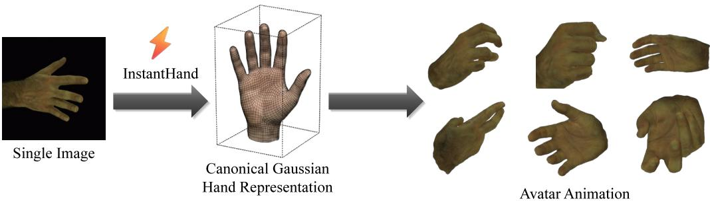

Figure 1: Single-image Feed-forward Gaussian Hand Avatar Reconstruction. InstantHand constructs an animatable 3D Gaussian hand avatar from a single image without per-subject optimization.

## Abstract

Hand avatar reconstruction typically relies on multi-view capture or per-subject optimization, limiting its scalability. We introduce InstantHand, a feed-forward framework that constructs an animatable 3D Gaussian hand avatar from a single image using off-the-shelf MANO, camera, and mask estimates, without test-time optimization. Image-averaged losses provide insufficient supervision for alpha leakage, which thickens thin finger contours. To address this issue, we propose a Soft Alpha Band regularizer that concentrates supervision on silhouette boundaries. Furthermore, colors regressed from image features can drift toward a learned prior even in observed regions. Our Reliability-gated Appearance Transfer preserves observed appearance by transferring source colors according to each Gaussian’s rendering contribution, while completing unobserved regions using the learned prior conditioned on global source identity. InstantHand constructs an avatar in 2.84 seconds and renders at 161 FPS, matching per-subject-optimized baselines on InterHand2.6M and remaining competitive in zero-shot evaluation on HanCo.

## 1 Introduction

The rapid evolution of digital human technologies is transforming immersive interaction across augmented and virtual reality, telepresence, gaming, and social communication. This progress has been driven by the combination of parametric human models, such as FLAME [1] for faces, SMPL [2] and SMPL-X [3] for bodies, and MANO [4] for hands, with high-fidelity neural rendering techniques including NeRF [5] and 3D Gaussian Splatting (3DGS) [6]. Among these components, hands play a central role as the primary interface for fine-grained interaction and dexterous manipulation [7– 11]. However, despite their importance, creating personalized, animatable, and photorealistic hand avatars from minimal input remains a key challenge for scalable digital human systems. While substantial progress has been made in single-image 3D avatar reconstruction for head avatars [12–14] and full-body avatars [15–18], high-fidelity hand avatar modeling from a single image remains comparatively underexplored and particularly challenging. Hands are highly articulated, thin, and frequently self-occluded [7, 8, 19], which makes reconstruction from sparse observations inherently ill-posed. Existing hand avatar pipelines address this ill-posedness through additional observations or per-subject optimization. Most methods rely on multi-view capture or monocular video with subject-specific fitting [20–22]; single-image approaches still require optimization-based inversion at inference [23]; and Gaussian-based methods remain dependent on multi-view or video-based reconstruction [24]. Consequently, scalable single-image hand avatar reconstruction without test-time optimization remains largely unresolved.

To eliminate the dependence on dense observations and costly test-time optimization, we aim to directly predict an animatable hand avatar from a single image, given off-the-shelf MANO, camera, and mask estimates, in a feed-forward manner. We adopt 3DGS [6, 25] as the output representation for its efficient rendering and controllable geometry and appearance. However, feed-forward Gaussian avatar methods developed for heads [14] and bodies [17] do not transfer directly to hands. First, hands are thin, low-volume, and highly articulated, so even minor errors in Gaussian position, scale, or orientation produce over-expanded or overlapping primitives, thickness artifacts, and degraded fidelity under novel poses. Second, appearance from a single image is ambiguous: existing feed-forward pipelines [14, 17] regress appearance directly from image features and tend to fall back on learned priors even in observed regions, weakening input-specific cues such as skin tone and fine texture, while unobserved regions must still be completed plausibly. Feed-forward hand avatar reconstruction therefore requires (i) geometry stabilization for thin, articulated structures and (ii) source-conditioned appearance modeling that preserves reliable input evidence while completing missing regions from priors.

To address these challenges, we propose InstantHand (Fig. 1), a feed-forward 3DGS framework for single-image animatable hand avatar reconstruction. For geometry, we constrain Gaussian placement, scale, and orientation around MANO anchors and supervise rendered alpha on the silhouette band to keep thin fingers compact. For appearance, we introduce Reliability-gated Appearance Transfer, where Gaussians supported by input observations are selectively enhanced with reliable local appearance cues to preserve input-specific details such as skin tone and fine textures. For unobserved regions, appearance is inferred using the learned prior together with a global identity representation, enabling consistent completion under occlusion. Our contributions can be summarized as follows:

• We present InstantHand, a feed-forward framework that reconstructs an animatable canonical 3D Gaussian hand avatar from a single image without per-subject optimization.

• We propose a Soft Alpha Band (SAB) regularizer that concentrates alpha supervision on silhouette boundaries, reducing alpha leakage and preserving thin finger structures.

• We introduce Reliability-gated Appearance Transfer, which preserves observed appearance based on each Gaussian’s rendering contribution while completing unobserved regions using the learned prior and a global source identity.

• InstantHand achieves reconstruction quality comparable to per-subject-optimized baselines and competitive zero-shot performance, with avatar construction in 2.84 s and rendering at 161 FPS.

## 2 Related Work

Hand Pose and Shape Estimation. Monocular 3D hand pose and mesh estimation provides the geometric foundation for many hand-centric vision systems [26–37]. These methods either predict mesh vertices directly or regress the parameters of the MANO model [4] from RGB images [26, 27]. For example, METRO [29] and Mesh Graphormer [30] use transformers to regress the vertices of a MANO-topology hand mesh from a single image. More recent methods, including HaMeR [34] and WiLoR [37], regress MANO parameters together with camera parameters from unconstrained images.

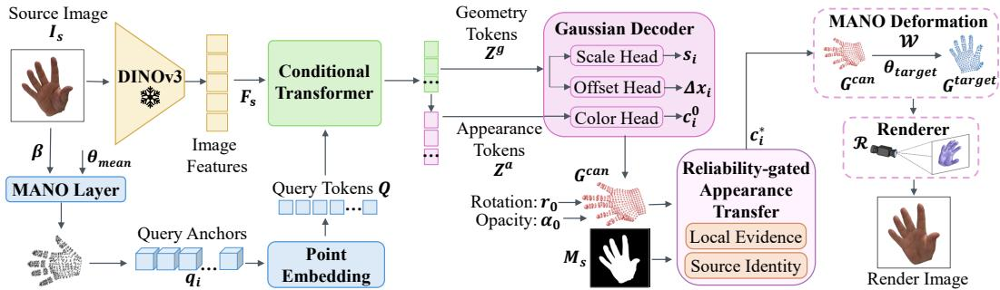  
Figure 2: Overview of InstantHand. A frozen DINOv3 encoder provides image features ${ \bf F } _ { s }$ that serve as keys and values for a conditional transformer, whose query tokens are point-embedded MANO-surface anchors obtained from the MANO layer $( \beta , \theta _ { \mathrm { m e a n } } )$ . The resulting geometry and appearance tokens are decoded by scale, offset, and color heads into a canonical Gaussian hand ${ \bf { \dot { G } } } ^ { c a n }$ with fixed rotation $\mathbf { r } _ { 0 }$ and opacity $\alpha _ { 0 }$ . Reliability-gated Appearance Transfer then composes local source evidence and a global source identity under the source mask $M _ { s }$ to update only the Gaussian colors $( \mathbf { c } _ { i } ^ { 0 } \to \mathbf { c } _ { i } ^ { * } )$ , and the avatar is animated by MANO-driven deformation W and rendered by R.

Our work takes off-the-shelf pose, camera, and mask estimates as input and focuses on reconstructing and rendering an animatable hand avatar.

Hand Avatar Reconstruction. Hand avatar reconstruction aims to recover subject-specific geometry and appearance for rendering under novel viewpoints and poses. Most existing approaches rely on multi-view images or monocular video sequences and employ neural implicit representations [5, 38] or explicit mesh-based pipelines [20–22, 39–41]. Representative methods include HandAvatar [20], HARP [22], and LiveHand [21], which adopt implicit, mesh-based, and multi-view neural rendering formulations, respectively. To reduce dependence on dense observations, single-image approaches such as OHTA [23] incorporate learned priors for one-shot reconstruction, but still require test-time fitting or inversion. Gaussian-based methods, including GaussianHand [24], use explicit 3D Gaussian primitives for efficient rendering. As summarized in Table S5 of the appendix, existing methods require either dense observations or per-subject optimization, regardless of representation. In contrast, our method constructs an animatable Gaussian hand avatar from a single image without test-time optimization.

Feed-Forward 3D Gaussian Avatar Reconstruction. Feed-forward avatar methods predict the parameters of animatable 3D Gaussians from one or a few images, avoiding per-subject optimization. This approach has been applied to full- and upper-body avatars by LHM [17] and GUAVA [42], and to head avatars by GAGAvatar [13] and LAM [14]. However, reconstructing an animatable hand avatar from a single image remains challenging, as thin finger boundaries are sensitive to alpha leakage and the source view provides incomplete appearance information (Sec. 1; Appendix D). We address these challenges with a Soft Alpha Band regularizer that targets boundary leakage and Reliability-gated Appearance Transfer that combines observed appearance with a learned prior and a global source identity.

## 3 Method

Given a single source image I , InstantHand reconstructs an animatable 3D hand in a single forward pass (Fig. 2). Source-image features are fused with MANO-surface query anchors to form per-Gaussian tokens (Sec. 3.1), which parameterize a canonical Gaussian representation with surfaceanchored centers, learned scales, and base colors, while opacity and canonical rotation remain fixed (Sec. 3.2). Reliability-gated Appearance Transfer then refines only the Gaussian colors using contribution-aware local evidence and a global source appearance identity (Sec. 3.3). The resulting Gaussians are animated via MANO-driven deformation and rendered from arbitrary viewpoints. The two-stage training objective is described in Sec. 3.4.

## 3.1 Image–MANO Fusion for Geometry-aligned Tokens

Image features. We extract dense visual features from the source image using a frozen pretrained DINOv3 encoder [43]. Intermediate features are aggregated through a lightweight fusion head to

produce image tokens:

$$
\mathbf { F } _ { s } = E _ { \mathrm { i m g } } \left( I _ { s } \right) \in \mathbb { R } ^ { N _ { f } \times d _ { \mathrm { i m g } } } ,\tag{1}
$$

where $N _ { f }$ denotes the number of image tokens and $d _ { \mathrm { i m g } }$ their dimension; each token captures localized visual evidence, and the resulting tokens are linearly projected to the transformer dimension d when used as keys and values.

MANO-surface query anchors. To anchor Gaussian primitives on an anatomically valid hand surface, we instantiate canonical query anchors from the MANO layer. Given the shape parameter $\beta$ and the mean pose $\theta _ { \mathrm { m e a n } }$ , we define the query anchors as vertices of a subdivided canonical mesh and map them to query tokens via a point-embedding layer $\phi _ { q } \mathbf { \cdot }$

$$
\left\{ \mathbf { q } _ { i } \right\} _ { i = 1 } ^ { N } = \mathrm { V e r t } \left( S _ { k } \left( \mathrm { M A N O } ( \beta , \theta _ { \mathrm { m e a n } } ) \right) \right) , \quad \mathbf { Q } = \phi _ { q } \left( \left\{ \mathbf { q } _ { i } \right\} _ { i = 1 } ^ { N } \right) \in \mathbb { R } ^ { N \times d } .\tag{2}
$$

Here, $\boldsymbol { S _ { k } }$ denotes k-level mesh subdivision, with $k = 0$ corresponding to the original MANO mesh; we use $k = 3 \ : ( N = 4 9 , 2 8 1$ ; ablated in Appendix F.1). These MANO-surface query anchors provide a pose-normalized and anatomically structured prior for Gaussian primitives, constraining the reconstruction space before incorporating image evidence.

Geometry and appearance tokens. We fuse MANO-surface query tokens with image tokens using a conditional transformer (Fig. 2), implemented as two sequential streams $\Phi _ { g }$ and $\Phi _ { a }$ and inspired by recent multi-stream transformer designs [44]. Query tokens encode canonical surface anchors, while image tokens serve as keys and values that provide dense visual evidence from the source image. Given query tokens Q and image tokens ${ \bf F } _ { s }$ , we compute geometry and appearance tokens as:

$$
{ \bf Z } ^ { g } = \Phi _ { g } \left( { \bf Q } ; { \bf F } _ { s } \right) , \qquad { \bf Z } ^ { a } = \Phi _ { a } \left( { \bf Z } ^ { g } ; { \bf F } _ { s } \right) ,\tag{3}
$$

where ${ \bf Z } ^ { g } = \{ { \bf z } _ { i } ^ { g } \} _ { i = 1 } ^ { N }$ and ${ \bf Z } ^ { a } = \{ { \bf z } _ { i } ^ { a } \} _ { i = 1 } ^ { N }$ , with ${ \bf Z } ^ { g } , { \bf Z } ^ { a } \in \mathbb { R } ^ { N \times d }$ . The geometry tokens remain anchored to the canonical surface while aggregating local visual context, whereas the appearance tokens re-attend to image features under the same MANO-surface indexing, allowing fine-grained appearance cues to be captured independently of the geometry stream.

## 3.2 Canonical Gaussian Representation

Given the geometry and appearance tokens, we construct a canonical Gaussian hand representation:

$$
\mathbf { G } ^ { c a n } = \left\{ \left( \mathbf { x } _ { i } , \mathbf { s } _ { i } , \alpha _ { 0 } , \mathbf { r } _ { 0 } , \mathbf { c } _ { i } ^ { 0 } \right) \right\} _ { i = 1 } ^ { N } ,\tag{4}
$$

where $\mathbf { x } _ { i }$ denotes the Gaussian center, $\mathbf { s } _ { i } = ( s _ { i } , s _ { i } , s _ { i } ) ^ { \top }$ is an isotropic scale, $\alpha _ { 0 }$ is a fixed opacity, $\mathbf { r } _ { 0 }$ is a fixed canonical rotation, and ${ \bf c } _ { i } ^ { 0 }$ is the base RGB color. Rather than predicting unconstrained Gaussian parameters, we parameterize each Gaussian relative to a MANO-surface anchor $\mathbf { q } _ { i }$ and decode the tokens with a lightweight Gaussian decoder comprising three prediction heads (Fig. 2): an offset head $f _ { \Delta }$ and a scale head $\check { f _ { s } }$ applied to the geometry token $\mathbf { \bar { z } } _ { i } ^ { g }$ , and a color head $f _ { \mathrm { r g b } }$ applied to the appearance token $\mathbf { z } _ { i } ^ { a }$

$$
\begin{array} { r } { \Delta { \bf x } _ { i } = f _ { \Delta } ( { \bf z } _ { i } ^ { g } ) , \quad s _ { i } = \rho ( f _ { s } ( { \bf z } _ { i } ^ { g } ) ) , \quad { \bf s } _ { i } = ( s _ { i } , s _ { i } , s _ { i } ) ^ { \top } , \quad { \bf x } _ { i } = { \bf q } _ { i } + \Delta { \bf x } _ { i } , \quad { \bf c } _ { i } ^ { 0 } = f _ { \mathrm { r g b } } ( { \bf z } _ { i } ^ { a } ) . } \end{array}\tag{5}
$$

Here, $\rho ( \cdot )$ enforces a positive scalar scale, and $\Delta { { \bf { x } } _ { i } }$ is constrained to remain within a local neighborhood of the anchor. This surface-anchored residual formulation keeps Gaussians close to the canonical MANO surface while allowing controlled deviations beyond the mesh. To reduce ambiguity from a single image, we fix opacity and canonical rotation and restrict each Gaussian to a learned isotropic scale, which removes unstable interactions among opacity, scale, and orientation and prevents the model from compensating for reconstruction errors through arbitrary Gaussian densities, rotations, or anisotropic stretching (ablation in Appendix F.2). The predicted base color ${ \bf c } _ { i } ^ { 0 }$ is geometry-aligned, but since it is inferred from compact tokens under reconstruction supervision, it may miss source-specific cues such as skin tone and fine texture, so we treat it as a stable anchor and refine it with explicit source-view evidence in Sec. 3.3.

## 3.3 Reliability-gated Appearance Transfer

As illustrated in Fig. 3, Reliability-gated Appearance Transfer adapts the canonical appearance to the source image while preserving the underlying 3D geometry. The key idea is to transfer source appearance according to how reliably each Gaussian is observed, using its rendering contribution as a soft reliability cue. Local updates therefore focus on Gaussians that contribute to the source-view rendering and are supported by the foreground mask, while a global source appearance identity token propagates image-level attributes, such as skin tone and illumination bias, across the full Gaussian set, including unobserved regions. The module comprises four steps: Prior Refinement, Identity Conditioning, Appearance Prediction, and Appearance Composition.

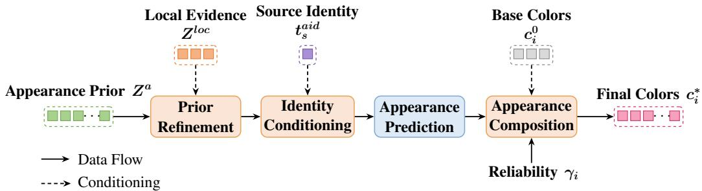  
Figure 3: Reliability-gated Appearance Transfer. The Stage-1 appearance prior is refined with Gaussian footprint-aligned local evidence (Prior Refinement) and conditioned on the global source identity, which also generates a source-conditioned prior bank (Identity Conditioning). The composed representation is decoded into an observed color, an appearance gate, and a source-level shift (Appearance Prediction), and Appearance Composition blends these with the base colors under the reliability $\gamma _ { i }$ to produce the final Gaussian colors $\mathbf { c } _ { i } ^ { * }$ . Dashed arrows denote conditioning. Three further inputs of Eq. 11 are omitted for clarity. The source identity also enters Prior Refinement, and the local evidence and base colors also enter Identity Conditioning.

Gaussian contribution-aware source observation. We first animate the canonical Gaussian hand to the source pose and render it from the source camera:

$$
\mathbf { G } ^ { s } = \mathcal { W } \left( \mathbf { G } ^ { c a n } ; \theta _ { s } , \beta \right) , \qquad \left( \hat { I } _ { s } , \{ \Omega _ { i } \} _ { i = 1 } ^ { N } , \{ C _ { i } \} _ { i = 1 } ^ { N } \right) = \mathcal { R } \left( \mathbf { G } ^ { s } ; \mathbf { K } _ { s } , \mathbf { T } _ { s } \right) .\tag{6}
$$

Here, $\hat { I } _ { s }$ denotes the rendered source view, $\Omega _ { i }$ is the projected footprint of the i-th Gaussian, and $C _ { i }$ is its accumulated rendering contribution. This source-view rendering establishes a Gaussian-to-image correspondence and provides a soft measure of each Gaussian’s participation in forming source-view pixels. Rather than relying on a single projected pixel, we extract local evidence using radius-adaptive Gaussian footprint aggregation. For an image or feature map X and an optional support mask $M .$ , we define:

$$
\mathrm { A g g } _ { \Omega _ { i } } \left( X ; M \right) = \frac { \sum _ { \mathbf { p } \in \Omega _ { i } } w _ { i } ( \mathbf { p } ) M ( \mathbf { p } ) X ( \mathbf { p } ) } { \sum _ { \mathbf { p } \in \Omega _ { i } } w _ { i } ( \mathbf { p } ) M ( \mathbf { p } ) + \epsilon } .\tag{7}
$$

Here, $w _ { i } ( \mathbf { p } )$ denotes a Gaussian kernel centered at the projected center $\mathbf { u } _ { i } ,$ , with bandwidth determined by the projected radius. Setting $M = \mathbf { 1 }$ yields unmasked aggregation. This footprint-weighted sampling aligns the extracted RGB and feature evidence with the projected support of each Gaussian. We estimate the reliability of each projected Gaussian by combining its rendering contribution with source foreground support. Specifically, $m _ { i } = \mathrm { A g g } _ { \Omega _ { i } } ( \bar { M } _ { s } ; { \bf 1 } )$ measures foreground support within the projected footprint. We then define the contribution-aware observation reliability, which gates subsequent appearance transfer, as:

$$
\gamma _ { i } = \operatorname* { m i n } \left( \frac { \sqrt { C _ { i } } m _ { i } } { \mathrm { P } _ { \zeta } \left( \left\{ \sqrt { C _ { j } } m _ { j } \right\} _ { j \in \mathcal { O } } \right) } , 1 \right) \cdot 1 [ i \in \mathcal { O } ] , \qquad \mathcal { O } = \{ j : C _ { j } > \kappa \mathrm { m e d } ( C _ { + } ) , \ m _ { j } > \tau _ { m } \} .\tag{8}
$$

Here, O denotes the observed set, med $( C _ { + } )$ the median of nonzero rendering contributions, and $\mathrm { P } _ { \zeta } ( \cdot )$ the ζ-th percentile operator. We fix $( \kappa , \tau _ { m } , \zeta ) = ( 0 . 5 , 0 . 5 , 9 5 )$ a priori without tuning on evaluation data. The reliability $\gamma _ { i }$ is computed deterministically and is not learned; performance is insensitive to these constants (Appendices A.4 and F.4). A Gaussian receives high reliability only when it both contributes to the source-view rendering and is supported by the foreground mask. Unlike the binary visible/invisible split that FlexiAvatar [45] uses to restrict per-subject optimization to observed body regions, $\gamma _ { i }$ provides graded reliability within O, with a bounded discontinuity at its boundary due to the indicator function.

Contribution-aware local evidence and global source appearance identity. For each Gaussian, we aggregate source evidence over its projected footprint:

$$
\begin{array} { r } { \bar { \mathbf { c } } _ { i } ^ { s r c } = \mathrm { A g g } _ { \Omega _ { i } } \left( I _ { s } ; M _ { s } \right) , \bar { \mathbf { c } } _ { i } ^ { r e n } = \mathrm { A g g } _ { \Omega _ { i } } \left( \hat { I } _ { s } ; M _ { s } \right) , \mathbf { f } _ { i } ^ { x } = \mathrm { A g g } _ { \Omega _ { i } } \left( \mathbf { F } _ { s } ^ { x } ; M _ { s } \right) . } \end{array}\tag{9}
$$

$$
\begin{array} { r } { \mathbf { z } _ { i } ^ { l o c } = f _ { l o c } \left( \left[ \bar { \mathbf { c } } _ { i } ^ { s r c } , \bar { \mathbf { c } } _ { i } ^ { r e n } , \bar { \mathbf { c } } _ { i } ^ { s r c } - \bar { \mathbf { c } } _ { i } ^ { r e n } , \mathbf { f } _ { i } ^ { x } , \gamma _ { i } \right] \right) . } \end{array}
$$

Here, ${ \bf F } _ { s } ^ { x }$ denotes local image features used for footprint aggregation. The local evidence token is encoded as: (10)

(10)

We denote the set of local evidence tokens as ${ \bf Z } ^ { l o c } = \{ { \bf z } _ { i } ^ { l o c } \} _ { i = 1 } ^ { N }$ . The residual term captures the discrepancy between the current Gaussian appearance and the source observation under consistent source-view alignment, while $\gamma _ { i }$ carries the reliability of the observation. Because a single source image observes only part of the hand, we aggregate reliable source information into a global source appearance identity token $\mathbf { t } _ { s } ^ { a i d }$ using masked global and local image features, source and canonical base color statistics, and reliability-weighted local residuals and evidence tokens (Appendix A.5). The token encodes source-level appearance properties, including skin tone, illumination bias, and global color distribution, without describing geometry.

Source-conditioned appearance and color composition. We combine three complementary sources of appearance information: local evidence, the Stage-1 appearance prior $\mathbf { Z } ^ { a }$ , and the global source appearance identity. The Stage-1 appearance prior is updated using local evidence and the global identity (Prior Refinement), while the identity token is expanded into a source-conditioned prior bank for weakly observed regions (Identity Conditioning):

$$
\tilde { \mathbf { Z } } ^ { a } = \mathcal { U } ( \mathbf { Z } ^ { a } ; \mathbf { Z } ^ { l o c } , \mathbf { t } _ { s } ^ { a i d } ) , \qquad \mathcal { D } _ { s } = \mathcal { B } ( \mathbf { t } _ { s } ^ { a i d } ) , \quad \mathbf { h } _ { i } = \mathcal { U } _ { c } ( \mathbf { z } _ { i } ^ { l o c } , \tilde { \mathbf { z } } _ { i } ^ { a } , \mathbf { t } _ { s } ^ { a i d } , \mathbf { c } _ { i } ^ { 0 } , \mathcal { D } _ { s } ) .\tag{11}
$$

This composition enables Gaussians that contribute to rendering to leverage spatially aligned local evidence, while weakly observed or unobserved Gaussians are guided by the base colors and the global source appearance identity. From the composed appearance token, the module predicts a source-observed color candidate, a learnable appearance gate, and an appearance displacement; the displacements are pooled into a source-level appearance shift (Appearance Prediction):

$$
\left( \mathbf { c } _ { i } ^ { o b s } , g _ { i } , \delta _ { i } \right) = f _ { o u t } \left( \mathbf { h } _ { i } \right) , \qquad g _ { i } \in [ 0 , 1 ] , \qquad \Delta _ { s } ^ { a i d } = \mathrm { P o o l } \left( \left\{ \delta _ { i } \right\} _ { i = 1 } ^ { N } \right) .\tag{12}
$$

The predicted color is not directly assigned to the Gaussian. Instead, the observation reliability modulates the reliance on local source evidence (Appearance Composition):

$$
\mathbf { c } _ { i } ^ { * } = g _ { i } \left[ \gamma _ { i } \mathbf { c } _ { i } ^ { o b s } + \left( 1 - \gamma _ { i } \right) \mathbf { c } _ { i } ^ { 0 } \right] + \left( 1 - g _ { i } \right) \mathbf { c } _ { i } ^ { 0 } + \Delta _ { s } ^ { a i d } .\tag{13}
$$

Expanding Eq. 13 gives $\mathbf { c } _ { i } ^ { * } = \mathbf { c } _ { i } ^ { 0 } + g _ { i } \gamma _ { i } ( \mathbf { c } _ { i } ^ { o b s } - \mathbf { c } _ { i } ^ { 0 } ) + \Delta _ { s } ^ { a i d }$ , so $\gamma _ { i }$ and $g _ { i }$ act on the source evidence only through their product; they are nevertheless not interchangeable, since $\gamma _ { i }$ is closed-form and receives no gradient whereas $g _ { i }$ is learned from the evidence (Appendix $\mathbf { A . 4 } )$ . This design separates local evidence transfer from global appearance propagation: local evidence enters only through the reliability-weighted term, whereas global appearance cues are consistently propagated across all Gaussians via the source-level shift. The composed colors $\mathbf { c } _ { i } ^ { * }$ replace ${ \bf c } _ { i } ^ { 0 }$ in ${ \bf G } ^ { c a n }$ , and all non-color attributes are preserved. Novel-pose and novel-view rendering then deform ${ \bf G } ^ { c a n }$ , now carrying $\mathbf { c } _ { i } ^ { * }$ with the same MANO-driven deformation and Gaussian renderer:

$$
\mathbf { G } ^ { t a r g e t } = \mathcal { W } \left( \mathbf { G } ^ { c a n } | _ { \mathbf { c } _ { i } ^ { 0 } \in - \mathbf { c } _ { i } ^ { \circ } } ; \theta _ { \mathrm { t a r g e t } } , \beta \right) , \qquad \hat { I } _ { \mathrm { t a r g e t } } = \mathcal { R } \left( \mathbf { G } ^ { t a r g e t } ; \mathbf { K } _ { \mathrm { t a r g e t } } , \mathbf { T } _ { \mathrm { t a r g e t } } \right) .\tag{14}
$$

Since only the colors of ${ \bf G } ^ { c a n }$ are replaced, the rendering geometry remains governed by the MANOsurface-anchored canonical representation and MANO-driven deformation, while the appearance is determined by the composed colors. Since the predicted colors are independent of viewing direction and driving pose, the model does not capture view- or pose-dependent effects such as self-shadowing. We discuss this limitation and potential extensions to view-dependent appearance modeling in Appendix G.2.

## 3.4 Training Objective

We train the model in two stages. The first stage learns a stable canonical Gaussian hand representation, while the second stage focuses on source-conditioned appearance modeling with the entire Stage-1 canonical predictor, including the base colors ${ \bf c } _ { i } ^ { 0 }$ , kept fixed.

Canonical Gaussian training. In the first stage, we supervise rendered images using mask-aware photometric and perceptual losses, together with regularization on the canonical Gaussian geometry:

$$
\begin{array} { r l } & { \mathcal { L } _ { \mathrm { c a n } } = \mathcal { L } _ { \mathrm { r e c } } + \lambda _ { \mathrm { s i l } } \mathcal { L } _ { \mathrm { s i l } } + \mathcal { L } _ { \mathrm { g e o } } + \mathcal { L } _ { \mathrm { b a n d } } , } \\ & { \mathcal { L } _ { \mathrm { r e c } } = \lambda _ { \mathrm { r g b } } ( \mathcal { L } _ { 1 } + \lambda _ { \mathrm { l p i p s } } \mathcal { L } _ { \mathrm { l p i p s } } ) , \quad \mathcal { L } _ { \mathrm { g e o } } = \lambda _ { \mathrm { o f f } } \mathcal { L } _ { \mathrm { o f f } } + \lambda _ { \mathrm { l a p } } \mathcal { L } _ { \mathrm { l a p } } + \lambda _ { \mathrm { s c a l e } } \mathcal { L } _ { \mathrm { s c a l e } } . } \end{array}\tag{15}
$$

Here, $\mathcal { L } _ { \mathrm { r e c } }$ enforces image reconstruction fidelity, $\mathcal { L } _ { \mathrm { s i l } }$ supervises silhouette consistency, and $\mathcal { L } _ { \mathrm { g e o } }$ regularizes residual Gaussian displacements, local smoothness, and Gaussian scales.

Table 1: Quantitative comparison on InterHand2.6M. Best, second-best, and third-best are marked bold green, underlined blue, and italic orange.
<table><tr><td>Method</td><td>Protocol</td><td>PSNR↑</td><td>SSIM↑</td><td>LPIPS↓</td></tr><tr><td>HARP [22]</td><td>Per-subj. opt.</td><td>19.82</td><td>0.761</td><td>0.225</td></tr><tr><td>LiveHand [21]</td><td>Per-subj. opt.</td><td>23.01</td><td>0.763</td><td>0.186</td></tr><tr><td>HandAvatar [20]</td><td>Per-subj. opt.</td><td>23.79</td><td>0.820</td><td>0.178</td></tr><tr><td>Handy [46]</td><td>Per-subj. opt.</td><td>25.56</td><td>0.794</td><td>0.150</td></tr><tr><td>OHTA [23]</td><td>Per-subj. opt.</td><td>26.11</td><td>0.864</td><td>0.129</td></tr><tr><td>BIGS* [47]</td><td>Per-subj. opt.</td><td>20.46</td><td>0.749</td><td>0.212</td></tr><tr><td>Ours</td><td>Feed-forward</td><td>26.21</td><td>0.866</td><td>0.133</td></tr></table>

Table 2: Single-image reconstruction and efficiency on HanCo. Time is the avatar-acquisition cost; FPS and memory are measured for $2 5 6 \times 2 5 6$ rendering (protocol in Appendix C.6). Best in bold.
<table><tr><td>Method</td><td>Protocol</td><td colspan="3">Reconstruction</td><td colspan="3">Efficiency</td></tr><tr><td></td><td></td><td>PSNR↑</td><td>SSIM↑</td><td>LPIPS↓</td><td>Time (s)↓</td><td>FPS↑</td><td>Mem. (GB)↓</td></tr><tr><td>HandAvatar</td><td>Per-subj. opt.</td><td>20.32</td><td>0.841</td><td>0.198</td><td>5579</td><td>0.32</td><td>14.80</td></tr><tr><td>OHTA</td><td>Per-subj. opt.</td><td>20.06</td><td>0.843</td><td>0.186</td><td>3360</td><td>0.26</td><td>47.80</td></tr><tr><td>BIGS*</td><td>Per-subj. opt.</td><td>17.71</td><td>0.731</td><td>0.246</td><td>1380</td><td>43.11</td><td>1.50</td></tr><tr><td>Ours</td><td>Zero-shot feed-forward</td><td>20.18</td><td>0.836</td><td>0.188</td><td>2.84</td><td>160.71</td><td>1.79</td></tr></table>

Soft Alpha Band regularization. We design a task-specific Soft Alpha Band regularizer $\mathcal { L } _ { \mathrm { b a n d } }$ to stabilize thin articulated fingers. Given the ground-truth silhouette M and the rendered alpha map A, we define an outer band $\mathrm { \bar { \it B } } _ { \mathrm { o u t } }$ via dilation and an inner region $B _ { \mathrm { i n } }$ via erosion. The regularizer encourages compact yet sufficient rendered-alpha support by penalizing alpha leakage near boundaries and insufficient alpha within the silhouette interior:

$$
\begin{array} { r } { \mathcal { L } _ { \mathrm { b a n d } } = \eta ( n ) ( \lambda _ { \mathrm { o u t } } \mathcal { L } _ { \mathrm { o u t } } + \lambda _ { \mathrm { i n } } \mathcal { L } _ { \mathrm { i n } } ) , \quad \mathcal { L } _ { \mathrm { o u t } } = \mathrm { A v g } _ { B _ { \mathrm { o u t } } } [ \psi \left( \left[ A - \tau _ { \mathrm { o u t } } \right] _ { + } \right) ] , \quad \mathcal { L } _ { \mathrm { i n } } = \mathrm { A v g } _ { B _ { \mathrm { i n } } } [ \psi \left( \left[ \tau _ { \mathrm { i n } } - A \right] _ { + } \right) ] . } \end{array}\tag{16}
$$

Here, $\psi ( \cdot )$ denotes a robust Huber penalty and $\eta ( n )$ is a weighting coefficient scheduled over the optimization step n. The outer-band term suppresses alpha spill around finger boundaries, reducing thickened geometry artifacts, while the inner-region term maintains sufficient coverage inside the hand silhouette.

Source-conditioned appearance training. In the second stage, we freeze the entire Stage-1 canonical predictor, including the base-color head $f _ { \mathrm { r g b } }$ , and train only the source-conditioned appearance module. The objective combines source-view reconstruction, feature-statistic alignment, and novelview supervision:

$$
\begin{array} { r } { \mathcal { L } _ { \mathrm { a p p } } = \lambda _ { s 1 } \mathcal { L } _ { 1 } ^ { \mathrm { s r c } } + \lambda _ { s p } \mathcal { L } _ { \mathrm { l p i p s } } ^ { \mathrm { s r c } } + \lambda _ { \mathrm { s t a t } } \mathcal { L } _ { \mathrm { s t a t } } + \lambda _ { n 1 } \mathcal { L } _ { 1 } ^ { \mathrm { n o v e l } } + \lambda _ { n p } \mathcal { L } _ { \mathrm { l p i p s } } ^ { \mathrm { n o v e l } } . } \end{array}\tag{17}
$$

The source-view losses enforce consistency between the rendered output and the input image; $\mathcal { L } _ { \mathrm { { s t a t } } }$ aligns foreground feature statistics between the source image and the rendered source view, and the novel-view losses maintain appearance consistency under MANO-driven deformation. All loss terms are defined in full and all loss weights of both stages are reported in Appendices A.1 and A.2.

## 4 Experiments

Training Data and Preprocessing. We train on InterHand2.6M [48], HO3Dv3 [49, 50], Goliath [51], Hand Appearance [22], and PALM [52]; each sample pairs a source image with multiple target frames of the same subject. For the appearance stage we add synthetic source–target pairs generated following Zhao et al. [53] to widen source appearance variation. Images are cropped to hand-centered 256 × 256 regions with intrinsics updated accordingly; where annotations are unavailable, masks and MANO/camera parameters are estimated with SAM 3 [54] and WiLoR [37] (details in Appendix B).

## 4.1 Comparisons with Prior Methods

Evaluation Protocol and Metrics. We evaluate on InterHand2.6M [48] under the single-image reconstruction protocol of prior hand avatar benchmarks [20, 23]: each method reconstructs a subject-

GT

OHTA

BIGS\*

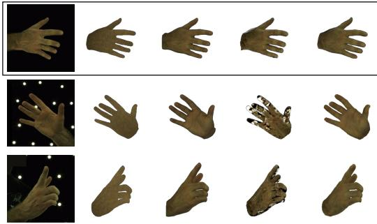

Ours

GT

HandAvatar

OHTA

BIGS\*

Ours

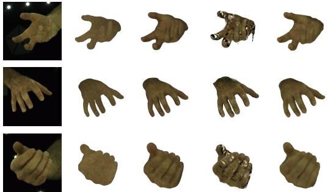  
GT HandAvatar OHTA BIGS\* Ours

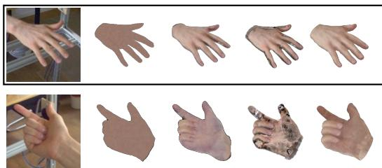

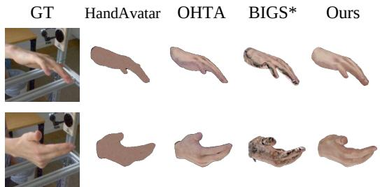  
Figure 4: Qualitative comparison with prior methods on InterHand2.6M [48] (top three rows) and HanCo [55] (bottom two rows). Columns: GT, HandAvatar, OHTA, BIGS<sup>∗</sup>, Ours; the black box marks the input image.

specific hand from one source image and renders novel poses and views. Zero-shot generalization is evaluated on HanCo [55] without HanCo training or test-time optimization. All methods share the same source frame and identical target poses and views; we report PSNR, SSIM, and LPIPS over hand-centered regions defined by bounding-box ray masks. The complete protocol, per-baseline input protocol, and provenance of all baseline numbers are given in Appendix C.

Quantitative Comparisons. Table 1 reports results on InterHand2.6M: without any test-time fitting, InstantHand matches the strongest per-subject-optimized baseline (26.21 vs. 26.11 dB PSNR, 0.866 vs. 0.864 SSIM) and attains the second-best LPIPS. Table 2 presents zero-shot cross-dataset evaluation and efficiency on HanCo, where the baselines are fitted to each test subject and our model is applied without HanCo training subjects or optimization; InstantHand stays within 0.14 dB PSNR, 0.007 SSIM, and 0.002 LPIPS of the best fitted baselines at over 400× lower avatar-acquisition cost. BIGS<sup>∗</sup> denotes our single-hand adaptation of BIGS [47] (Appendix E.1).

Qualitative Comparisons. Figure 4 presents qualitative comparisons on InterHand2.6M and HanCo. Under the single-image setting, the fitted baselines exhibit over-smoothed geometry, distorted fingers, or texture artifacts. InstantHand retains coherent hand geometry, well-defined finger boundaries, and fine details such as wrinkles and skin texture. On HanCo, these results are obtained zero-shot, whereas the baselines are fitted to each subject. Figure 5 applies InstantHand to fully estimated inputs and to edited versions of the same source images. Because each edited image shares the mask, MANO, and camera of its original, comparing their renderings shows how the input appearance is carried to the avatar. Both the local patterns (top) and the global skin tone (bottom) follow the hand through novel poses and views. Figure S9 in the appendix shows novel-pose animations of eight unseen subjects, including the in-the-wild input of Figure 5. The supplementary video (Appendix K) further includes 360<sup>◦</sup> rotations and continuous novel-pose animations.

## 4.2 Ablation Study

Component ablation. Table 3 reports ablations on InterHand2.6M. Removing the Soft Alpha Band regularizer reduces reconstruction quality for thin structures. Reliability gating (γ) and the learned appearance gate (g<sub>i</sub>) play complementary roles: γ weights a Gaussian according to its source-view contribution and foreground support, while $g _ { i }$ predicts how strongly to use the sampled appearance evidence. Removing either produces a substantial drop. Although they appear only as a product in Eq. 13, retraining each variant does not allow the remaining gate to compensate for the removed one. Disabling appearance transfer entirely (the Stage-1 model) yields 26.01 dB, outperforming

Source

Novel poses and views

Original

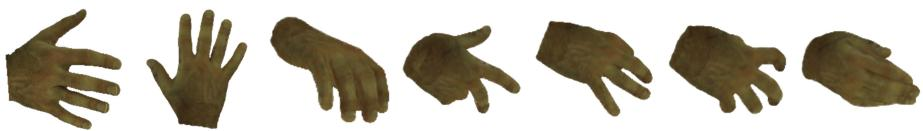

Tribal (edited)

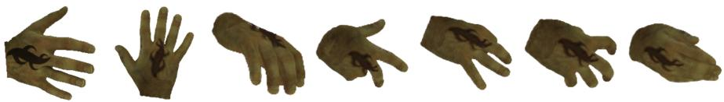

Butterfly (edited)

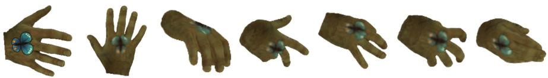

Original


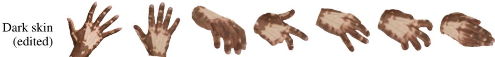

Figure 5: Avatars reconstructed from fully estimated inputs (SAM 3 mask, WiLoR MANO and camera) for original and edited source images. Top: an unseen InterHand2.6M test subject, with hand-drawn tattoos composited onto the source image. Bottom: an in-the-wild image released with OHTA [23], with its skin tone darkened by an image generation model. Edited rows reuse the mask, MANO, and camera of the original row, and each column shows the same pose and view.

Table 3: Ablation and source-cue robustness on InterHand2.6M. Ablation rows remove one component and retrain both stages. Estimated-cue rows keep the trained full model and replace its source inputs with estimates.
<table><tr><td>Setting</td><td>PSNR↑</td><td>SSIM↑</td><td>LPIPS↓</td></tr><tr><td>w/o SAB  $( { \mathcal { L } } _ { \mathrm { b a n d } } )$ </td><td>23.89</td><td>0.825</td><td>0.166</td></tr><tr><td>w/o reliability gating (γ)</td><td>23.18</td><td>0.829</td><td>0.171</td></tr><tr><td>w/o appearance gate (gi)</td><td>24.52</td><td>0.833</td><td>0.152</td></tr><tr><td>w/o appearance transfer</td><td>26.01</td><td>0.865</td><td>0.134</td></tr><tr><td>w/o synthetic data</td><td>26.13</td><td>0.864</td><td>0.134</td></tr><tr><td>Ours (GT cues)</td><td>26.21</td><td>0.866</td><td>0.133</td></tr><tr><td colspan="4">Estimated source cues</td></tr><tr><td>SAM 3 mask</td><td>26.12</td><td>0.865</td><td>0.133</td></tr><tr><td>WiLoR MANO</td><td>26.07</td><td>0.863</td><td>0.134</td></tr><tr><td>Fully estimated</td><td>25.99</td><td>0.863</td><td>0.134</td></tr></table>

both single-gate variants; thus, appearance transfer is beneficial only when both gates are present. Synthetic data provides a modest additional gain. Further analyses are provided in Appendices F and H.

Robustness to source-cue errors. Table 3 (bottom) evaluates sensitivity to estimated source inputs. We replace the ground-truth source mask with a SAM 3 estimate [54], and the source MANO parameters and camera with WiLoR estimates [37], keeping the trained model and evaluation protocol fixed. Target poses and cameras remain ground truth in every setting. When all source inputs are estimated from a single RGB image, PSNR decreases by only 0.22 dB, while SSIM and LPIPS remain essentially unchanged. The decrease arises from the mask and MANO estimates; replacing the source camera with its estimate causes no further PSNR drop. Controlled input perturbations reduce PSNR by at most 0.16 dB. Appendix F.3 provides the per-cue breakdown (Table S8) and perturbation protocol, while Appendix H.5 reports results on unseen FreiHAND images with fully estimated inputs.

Table 4: Controlled comparison with feed-forward avatar recipes on InterHand2.6M. Each recipe swaps its template (FLAME, SMPL-X) for MANO and keeps its published parameterization under otherwise matched training (Appendix E.2); boundary metrics, distinct from the training bands, follow Appendix C.4.
<table><tr><td>Configuration</td><td>PSNR↑</td><td>SSIM↑</td><td>LPIPS↓</td><td>Bound. F↑</td><td>Leakage↓</td><td>Int. cov.↑</td></tr><tr><td>Ours (constrained + SAB)</td><td>26.21</td><td>0.866</td><td>0.133</td><td>0.698</td><td>0.234</td><td>0.999</td></tr><tr><td>Constrained, w/o SAB</td><td>23.89</td><td>0.825</td><td>0.166</td><td>0.366</td><td>0.555</td><td>1.000</td></tr><tr><td>Head-recipe port [14]</td><td>23.60</td><td>0.809</td><td>0.182</td><td>0.299</td><td>0.608</td><td>1.000</td></tr><tr><td>Body-recipe port [17]</td><td>23.36</td><td>0.805</td><td>0.182</td><td>0.267</td><td>0.627</td><td>1.000</td></tr></table>

Source-fidelity diagnostic. Aggregate novel-pose metrics combine source-observed and unobserved regions, obscuring the fidelity of source appearance reconstruction. To isolate the effect of the appearance module, we render each avatar in its source view while keeping all non-color Gaussian attributes fixed at their canonical values, so metric differences reflect only the color update. With each evaluation frame serving in turn as the source, the module improves source-view PSNR by 1.96 dB on InterHand2.6M and 3.41 dB on zero-shot HanCo (Table S2; protocol in Appendix C.5).

Comparison with feed-forward avatar recipes. Table 4 examines whether avatar designs developed for heads and bodies transfer to hands under matched conditions. Compared with InstantHand, the head-recipe port loses 2.61 dB, reduces the boundary F-score from 0.698 to 0.299, and increases alpha leakage from 0.234 to 0.608, while interior coverage remains at 1.000. This pattern localizes the failure to thin, articulated contours rather than the hand interior, consistent with Sec. 1. The headrecipe port also has a lower boundary F-score and greater leakage than the constrained model without SAB, indicating that both the constrained parameterization and boundary-band supervision contribute to boundary quality. Even with boundary supervision retained, freeing per-axis scale, rotation and opacity jointly, or all three reduces PSNR by 0.47–0.71 dB (Appendix F.2). The body-recipe port performs similarly to the head-recipe port, within 0.24 dB in PSNR and with a boundary F-score of 0.267 versus 0.299, despite its canonical-space regularizers.

Pose and temporal diagnostics. Grouping test frames by pose change relative to the source reveals that quality degrades primarily with finger articulation: PSNR drops by 2.69 dB on InterHand2.6M and 1.93 dB on HanCo between the mildest and strongest articulation thirds. Changes in viewing direction have a smaller effect, with drops of at most 0.97 dB. Under continuous pose driving on zero-shot HanCo, frame-to-frame changes in our renderings exceed those in the ground truth by 4.7% on average and at most 8.0% per camera. All views and frames are rendered from a single fixed set of canonical Gaussians, providing a shared representation across views; we assess cross-view and temporal consistency empirically through these diagnostics and the supplementary video. Appendix J provides the full analyses and comparisons with baselines evaluated on the same frames.

## 5 Conclusion

We presented InstantHand, a feed-forward framework for reconstructing an animatable 3D Gaussian hand avatar from a single image without per-subject optimization. A MANO-anchored canonical representation, together with the Soft Alpha Band regularizer, preserves compact, thin articulated structures, while Reliability-gated Appearance Transfer integrates observed source appearance accord ing to each Gaussian’s rendering contribution and completes unobserved regions using the learned prior and a global source identity. Once constructed, the avatar renders at 161 FPS. Its Gaussian colors and scales remain fixed across driving poses, preserving appearance consistency. InstantHand constructs avatars over 400× faster than optimization-based baselines while maintaining competitive reconstruction quality in zero-shot evaluation on HanCo and under fully estimated inputs.

## Acknowledgments and Disclosure of Funding

This work is supported by NRF grants (No. RS-2025-00521013 30%, No. RS-2025-02216916 10%) and IITP grants (No. RS-2020-II201336 Artificial intelligence graduate school program (UNIST) 10%; No. RS-2025-25442824 AI Star Fellowship Program (UNIST) 10%; No. RS-2022-II220264 Comprehensive video understanding and generation with knowledge-based deep logic neural network 10%; No. RS-2025-25442149 LG AI STAR Talent Development Program for Leading Large-Scale Generative AI Models in the Physical AI Domain 10%), funded by the Korean government (MSIT). This work is also supported by the InnoCORE program of the Ministry of Science and ICT (26- InnoCORE-01 10%, UNIST 1.260006.01 10%).

## References

[1] Tianye Li, Timo Bolkart, Michael J. Black, Hao Li, and Javier Romero. Learning a model of facial shape and expression from 4D scans. ACM Transactions on Graphics (Proc. SIGGRAPH Asia), 2017.

[2] Matthew Loper, Naureen Mahmood, Javier Romero, Gerard Pons-Moll, and Michael J. Black. SMPL: A skinned multi-person linear model. ACM Trans. Graph., 34(6), November 2015. doi: 10.1145/2816795.2818013.

[3] Georgios Pavlakos, Vasileios Choutas, Nima Ghorbani, Timo Bolkart, Ahmed A. A. Osman, Dimitrios Tzionas, and Michael J. Black. Expressive body capture: 3D hands, face, and body from a single image. In CVPR, 2019.

[4] Javier Romero, Dimitrios Tzionas, and Michael J. Black. Embodied hands: Modeling and capturing hands and bodies together. ACM Transactions on Graphics (Proc. SIGGRAPH Asia), 2017.

[5] Ben Mildenhall, Pratul P. Srinivasan, Matthew Tancik, Jonathan T. Barron, Ravi Ramamoorthi, and Ren Ng. NeRF: Representing scenes as neural radiance fields for view synthesis. In ECCV, 2020.

[6] Bernhard Kerbl, Georgios Kopanas, Thomas Leimkuehler, and George Drettakis. 3D Gaussian splatting for real-time radiance field rendering. ACM Transactions on Graphics, 2023.

[7] Dimitrios Tzionas, Luca Ballan, Abhilash Srikantha, Pablo Aponte, Marc Pollefeys, and Juergen Gall. Capturing hands in action using discriminative salient points and physics simulation. Int. J. Comput. Vision, 118(2):172–193, June 2016. doi: 10.1007/s11263-016-0895-4.

[8] Yana Hasson, Gül Varol, Dimitrios Tzionas, Igor Kalevatykh, Michael J. Black, Ivan Laptev, and Cordelia Schmid. Learning joint reconstruction of hands and manipulated objects. In CVPR, 2019.

[9] Omid Taheri, Nima Ghorbani, Michael J. Black, and Dimitrios Tzionas. GRAB: A dataset of whole-body human grasping of objects. In ECCV, 2020.

[10] Yu-Wei Chao, Wei Yang, Yu Xiang, Pavlo Molchanov, Ankur Handa, Jonathan Tremblay, Yashraj S. Narang, Karl Van Wyk, Umar Iqbal, Stan Birchfield, Jan Kautz, and Dieter Fox. DexYCB: A benchmark for capturing hand grasping of objects. In CVPR, 2021.

[11] MD Khalequzzaman Chowdhury Sayem, Mubarrat Tajoar Chowdhury, Yihalem Yimolal Tiruneh, Muneeb A. Khan, Muhammad Salman Ali, Binod Bhattarai, and Seungryul Baek. HandVQA: Diagnosing and improving fine-grained spatial reasoning about hands in visionlanguage models. In CVPR, 2026.

[12] Xuangeng Chu, Yu Li, Ailing Zeng, Tianyu Yang, Lijian Lin, Yunfei Liu, and Tatsuya Harada. GPAvatar: Generalizable and precise head avatar from image(s). In ICLR, 2024.

[13] Xuangeng Chu and Tatsuya Harada. Generalizable and animatable Gaussian head avatar. In NeurIPS, 2024.

[14] Yisheng He, Xiaodong Gu, Xiaodan Ye, Chao Xu, Zhengyi Zhao, Yuan Dong, Weihao Yuan, Zilong Dong, and Liefeng Bo. LAM: Large avatar model for one-shot animatable Gaussian head. In SIGGRAPH Conference Papers, 2025. doi: 10.1145/3721238.3730706.

[15] Yiyu Zhuang, Jiaxi Lv, Hao Wen, Qing Shuai, Ailing Zeng, Hao Zhu, Shifeng Chen, Yujiu Yang, Xun Cao, and Wei Liu. IDOL: Instant photorealistic 3D human creation from a single image. In CVPR, 2025.

[16] Lingteng Qiu, Shenhao Zhu, Qi Zuo, Xiaodong Gu, Yuan Dong, Junfei Zhang, Chao Xu, Zhe Li, Weihao Yuan, Liefeng Bo, Guanying Chen, and Zilong Dong. AniGS: Animatable Gaussian avatar from a single image with inconsistent Gaussian reconstruction. In CVPR, 2025.

[17] Lingteng Qiu, Xiaodong Gu, Peihao Li, Qi Zuo, Weichao Shen, Junfei Zhang, Kejie Qiu, Weihao Yuan, Guanying Chen, Zilong Dong, and Liefeng Bo. LHM: Large animatable human reconstruction model for single image to 3D in seconds. In ICCV, 2025.

[18] Geonhee Sim and Gyeongsik Moon. PERSONA: Personalized whole-body 3D avatar with pose-driven deformations from a single image. In ICCV, 2025.

[19] Christian Zimmermann and Thomas Brox. Learning to estimate 3D hand pose from single RGB images. In ICCV, 2017.

[20] Xingyu Chen, Baoyuan Wang, and Heung-Yeung Shum. Hand Avatar: Free-pose hand animation and rendering from monocular video. In CVPR, 2023.

[21] Akshay Mundra, Mallikarjun B R, Jiayi Wang, Marc Habermann, Christian Theobalt, and Mohamed Elgharib. LiveHand: Real-time and photorealistic neural hand rendering. In ICCV, 2023.

[22] Korrawe Karunratanakul, Sergey Prokudin, Otmar Hilliges, and Siyu Tang. HARP: Personalized hand reconstruction from a monocular RGB video. In CVPR, 2023.

[23] Xiaozheng Zheng, Chao Wen, Zhuo Su, Zeran Xu, Zhaohu Li, Yang Zhao, and Zhou Xue. OHTA: One-shot hand avatar via data-driven implicit priors. In CVPR, 2024.

[24] Lizhi Zhao, Xuequan Lu, Runze Fan, Sio Kei Im, and Lili Wang. GaussianHand: Real-time 3D Gaussian rendering for hand avatar animation. IEEE Transactions on Visualization and Computer Graphics, 31(9):6484–6496, 2025.

[25] Muhammad Salman Ali, Chaoning Zhang, Marco Cagnazzo, Giuseppe Valenzise, Enzo Tartaglione, and Sung-Ho Bae. Compression in 3D Gaussian splatting: A survey of methods, trends, and future directions. IEEE Transactions on Circuits and Systemsfor Video Technology, 2026.

[26] Seungryul Baek, Kwang In Kim, and Tae-Kyun Kim. Pushing the envelope for RGB-based dense 3D hand pose estimation via neural rendering. In CVPR, 2019.

[27] Seungryul Baek, Kwang In Kim, and Tae-Kyun Kim. Weakly-supervised domain adaptation via GAN and mesh model for estimating 3D hand poses interacting objects. In CVPR, 2020.

[28] Gyeongsik Moon and Kyoung Mu Lee. I2L-MeshNet: Image-to-lixel prediction network for accurate 3D human pose and mesh estimation from a single RGB image. In ECCV, 2020.

[29] Kevin Lin, Lijuan Wang, and Zicheng Liu. End-to-end human pose and mesh reconstruction with transformers. In CVPR, 2021.

[30] Kevin Lin, Lijuan Wang, and Zicheng Liu. Mesh Graphormer. In ICCV, 2021.

[31] Xingyu Chen, Yufeng Liu, Yajiao Dong, Xiong Zhang, Chongyang Ma, Yanmin Xiong, Yuan Zhang, and Xiaoyan Guo. MobRecon: Mobile-friendly hand mesh reconstruction from monocular image. In CVPR, 2022.

[32] Hoseong Cho, Chanwoo Kim, Jihyeon Kim, Seongyeong Lee, Elkhan Ismayilzada, and Seungryul Baek. Transformer-based unified recognition of two hands manipulating objects. In CVPR, 2023.

[33] Zhishan Zhou, Shihao Zhou, Zhi Lv, Minqiang Zou, Yao Tang, and Jiajun Liang. A simple baseline for efficient hand mesh reconstruction. In CVPR, 2024.

[34] Georgios Pavlakos, Dandan Shan, Ilija Radosavovic, Angjoo Kanazawa, David Fouhey, and Jitendra Malik. Reconstructing hands in 3D with transformers. In CVPR, 2024.

[35] Haoye Dong, Aviral Chharia, Wenbo Gou, Francisco Vicente Carrasco, and Fernando De la Torre. Hamba: Single-view 3D hand reconstruction with graph-guided bi-scanning mamba. In NeurIPS, 2024.

[36] Elkhan Ismayilzada, MD Khalequzzaman Chowdhury Sayem, Yihalem Yimolal Tiruneh, Mubarrat Tajoar Chowdhury, Muhammadjon Boboev, and Seungryul Baek. QORT-Former: Queryoptimized real-time transformer for understanding two hands manipulating objects. In AAAI, 2025.

[37] Rolandos Alexandros Potamias, Jinglei Zhang, Jiankang Deng, and Stefanos Zafeiriou. WiLoR: End-to-end 3D hand localization and reconstruction in-the-wild. In CVPR, 2025.

[38] Ali Haider, Muhammad Salman Ali, Maryam Qamar, Tahir Khalil, Soo Ye Kim, Jihyong Oh, Enzo Tartaglione, and Sung-Ho Bae. I-INR: Iterative implicit neural representations. In AAAI, 2026.

[39] Enric Corona, Tomas Hodan, Minh Vo, Francesc Moreno-Noguer, Chris Sweeney, Richard Newcombe, and Lingni Ma. LISA: Learning implicit shape and appearance of hands. In CVPR, 2022.

[40] Zhiyang Guo, Wengang Zhou, Min Wang, Li Li, and Houqiang Li. HandNeRF: Neural radiance fields for animatable interacting hands. In CVPR, 2023.

[41] Pratik Kalshetti and Parag Chaudhuri. Intrinsic hand avatar: Illumination-aware hand appearance and shape reconstruction from monocular RGB video. In Proceedings of the IEEE/CVF Winter Conference on Applications ofComputer Vision (WACV), 2024.

[42] Dongbin Zhang, Yunfei Liu, Lijian Lin, Ye Zhu, Yang Li, Minghan Qin, Yu Li, and Haoqian Wang. GUAVA: Generalizable upper body 3D Gaussian avatar. In ICCV, 2025.

[43] Oriane Siméoni, Huy V. Vo, Maximilian Seitzer, Federico Baldassarre, Maxime Oquab, Cijo Jose, Vasil Khalidov, Marc Szafraniec, Seung Eun Yi, Michael Ramamonjisoa, Francisco Massa, Daniel Haziza, Luca Wehrstedt, Jianyuan Wang, Timothée Darcet, Théo Moutakanni, Leonel Sentana, Claire Roberts, Andrea Vedaldi, Jamie Tolan, John Brandt, Camille Couprie, Julien Mairal, Herve Jegou, Patrick Labatut, and Piotr Bojanowski. DINOv3. Transactions on Machine Learning Research, 2026. ISSN 2835-8856. URL https://openreview.net/forum?id= 2NlGyqNjns.

[44] Patrick Esser, Sumith Kulal, Andreas Blattmann, Rahim Entezari, Jonas Müller, Harry Saini, Yam Levi, Dominik Lorenz, Axel Sauer, Frederic Boesel, Dustin Podell, Tim Dockhorn, Zion English, Kyle Lacey, Alex Goodwin, Yannik Marek, and Robin Rombach. Scaling rectified flow transformers for high-resolution image synthesis. In ICML, 2024.

[45] Yihalem Yimolal Tiruneh, Muhammad Salman Ali, Uyoung Jeong, Muneeb A. Khan, MD Khalequzzaman Chowdhury Sayem, Allanur Bayramgeldiyev, Binod Bhattarai, and Seungryul Baek. FlexiAvatar: Unified 3D Gaussian human avatars under arbitrary body visibility. In ECCV, 2026.

[46] Rolandos Alexandros Potamias, Stylianos Ploumpis, Stylianos Moschoglou, Vasileios Triantafyllou, and Stefanos Zafeiriou. Handy: Towards a high fidelity 3D hand shape and appearance model. In CVPR, 2023.

[47] Jeongwan On, Kyeonghwan Gwak, Gunyoung Kang, Junuk Cha, Soohyun Hwang, Hyein Hwang, and Seungryul Baek. BIGS: Bimanual category-agnostic interaction reconstruction from monocular videos via 3D Gaussian splatting. In CVPR, 2025.

[48] Gyeongsik Moon, Shoou-I Yu, He Wen, Takaaki Shiratori, and Kyoung Mu Lee. InterHand2.6M: A dataset and baseline for 3D interacting hand pose estimation from a single RGB image. In ECCV, 2020.

[49] Shreyas Hampali, Mahdi Rad, Markus Oberweger, and Vincent Lepetit. HOnnotate: A method for 3D annotation of hand and object poses. In CVPR, 2020.

[50] Shreyas Hampali, Sayan Deb Sarkar, and Vincent Lepetit. HO-3D\_v3: Improving the accuracy of hand-object annotations of the HO-3D dataset. arXiv preprint arXiv:2107.00887, 2021.

[51] Julieta Martinez, Emily Kim, Javier Romero, Timur Bagautdinov, Shunsuke Saito, Shoou-I Yu, Stuart Anderson, Michael Zollhöfer, Te-Li Wang, Shaojie Bai, Chenghui Li, Shih-En Wei, Rohan Joshi, Wyatt Borsos, Tomas Simon, Jason Saragih, Paul Theodosis, Alexander Greene, Anjani Josyula, Silvio Mano Maeta, Andrew I. Jewett, Simon Venshtain, Christopher Heilman, Yueh-Tung Chen, Sidi Fu, Mohamed Ezzeldin A. Elshaer, Tingfang Du, Longhua Wu, Shen-Chi Chen, Kai Kang, Michael Wu, Youssef Emad, Steven Longay, Ashley Brewer, Hitesh Shah, James Booth, Taylor Koska, Kayla Haidle, Matt Andromalos, Joanna Hsu, Thomas Dauer, Peter Selednik, Tim Godisart, Scott Ardisson, Matthew Cipperly, Ben Humberston, Lon Farr, Bob Hansen, Peihong Guo, Dave Braun, Steven Krenn, He Wen, Lucas Evans, Natalia Fadeeva, Matthew Stewart, Gabriel Schwartz, Divam Gupta, Gyeongsik Moon, Kaiwen Guo, Yuan Dong, Yichen Xu, Takaaki Shiratori, Fabian Prada, Bernardo R. Pires, Bo Peng, Julia Buffalini, Autumn Trimble, Kevyn McPhail, Melissa Schoeller, and Yaser Sheikh. Codec Avatar Studio: Paired human captures for complete, driveable, and generalizable avatars. In NeurIPS Datasets and Benchmarks Track, 2024.

[52] Zicong Fan, Edoardo Remelli, David Dimond, Fadime Sener, Liuhao Ge, Bugra Tekin, Cem Keskin, and Shreyas Hampali. PALM: A dataset and baseline for learning multi-subject hand prior. In 3DV, 2026.

[53] Zhuoran Zhao, Linlin Yang, Pengzhan Sun, Pan Hui, and Angela Yao. Analyzing the syntheticto-real domain gap in 3D hand pose estimation. In CVPR, 2025.

[54] Nicolas Carion, Laura Gustafson, Yuan-Ting Hu, Shoubhik Debnath, Ronghang Hu, Didac Suris Coll-Vinent, Chaitanya Ryali, Kalyan Vasudev Alwala, Haitham Khedr, Andrew Huang, Jie Lei, Tengyu Ma, Baishan Guo, Arpit Kalla, Markus Marks, Joseph Greer, Meng Wang, Peize Sun, Roman Rädle, Triantafyllos Afouras, Effrosyni Mavroudi, Katherine Xu, Tsung-Han Wu, Yu Zhou, Liliane Momeni, Rishi Hazra, Shuangrui Ding, Sagar Vaze, Francois Porcher, Feng Li, Siyuan Li, Aishwarya Kamath, Ho Kei Cheng, Piotr Dollar, Nikhila Ravi, Kate Saenko, Pengchuan Zhang, and Christoph Feichtenhofer. SAM 3: Segment anything with concepts. In ICLR, 2026.

[55] Christian Zimmermann, Max Argus, and Thomas Brox. Contrastive representation learning for hand shape estimation. In German Conference on Pattern Recognition, 2021.

[56] Bowen Cheng, Ross Girshick, Piotr Dollár, Alexander C. Berg, and Alexander Kirillov. Boundary IoU: Improving object-centric image segmentation evaluation. In CVPR, 2021.

[57] Liangxiao Hu, Hongwen Zhang, Yuxiang Zhang, Boyao Zhou, Boning Liu, Shengping Zhang, and Liqiang Nie. GaussianAvatar: Towards realistic human avatar modeling from a single video via animatable 3D Gaussians. In CVPR, 2024.

[58] Gyeongsik Moon, Takaaki Shiratori, and Shunsuke Saito. Expressive whole-body 3D Gaussian avatar. In ECCV, 2024.

[59] Hoel Kervadec, Jihene Bouchtiba, Christian Desrosiers, Eric Granger, Jose Dolz, and Ismail Ben Ayed. Boundary loss for highly unbalanced segmentation. In International Conference on Medical Imaging with Deep Learning (MIDL), 2019.

[60] Jeongwan On, Muhammad Salman Ali, Muneeb A. Khan, Sunwoo Park, Inwoong Moon, Hyung Jin Chang, Jaekwang Kim, Seong Jong Ha, and Seungryul Baek. Multi-THuMBS: Multi-person tracking of 3D human meshes beyond video shots. In ECCV, 2026.

[61] Christian Zimmermann, Duygu Ceylan, Jimei Yang, Bryan Russell, Max Argus, and Thomas Brox. FreiHAND: A dataset for markerless capture of hand pose and shape from single RGB images. In ICCV, 2019.

[62] Zicong Fan, Omid Taheri, Dimitrios Tzionas, Muhammed Kocabas, Manuel Kaufmann, Michael J. Black, and Otmar Hilliges. ARCTIC: A dataset for dexterous bimanual handobject manipulation. In CVPR, 2023.

## Appendix

This appendix gives the full implementation, data, and evaluation details of InstantHand. Secs. A and B describe the model and the training data, and Sec. C specifies every evaluation protocol used in the main paper and in this appendix. Sec. D extends the related work, Sec. E describes the baseline adaptations, and Sec. F reports additional ablations. Secs. G–I contain the discussion (including the ethical considerations in Sec. G.3), additional qualitative results, and the failure cases and limitations. Sec. J analyzes the results by pose difficulty and over time and examines the reliability and opacity of the canonical avatar. Sec. K describes the supplementary video, and Sec. L summarizes reproducibility. For a quick overview, we recommend the supplementary video (Sec. K), which shows 360<sup>◦</sup> rotations and continuous novel-pose driving, together with the novel-pose animation of unseen subjects from fully estimated inputs (Fig. S9) and the failure cases (Fig. S10).

## A Implementation Details

## A.1 Training Protocol

We train InstantHand in two stages, canonical representation learning followed by source-conditioned Gaussian appearance modeling. Both stages use AdamW $( \beta _ { 1 } = 0 . \bar { 9 } , \beta _ { 2 } = 0 . 9 5 )$ with a learning-rate schedule of 2,000 warmup steps, 10,000 hold steps, and 8,000 cosine-decay steps, gradient clipping at norm 1.0, and bfloat16 mixed precision. Training is distributed over four NVIDIA RTX A6000 GPUs.

Stage 1: canonical representation learning. We train the MANO-anchored canonical Gaussian representation for 10 epochs of 2,000 optimization steps each (20,000 steps in total), with a per-GPU batch size of 6, gradient accumulation over 2 steps, a learning rate of $3 \times 1 0 ^ { - 4 }$ that decays to 0.1× its peak, and a weight decay of 0.05. This stage takes about 25 hours. The objective of Eq. 15 of the main paper combines mask-aware RGB reconstruction, LPIPS, silhouette supervision, Laplacian, offset, and scale regularization, and the Soft Alpha Band (SAB) regularizer of Eq. 16, with weights $\lambda _ { \mathrm { r g b } } = 1 . 0 , \lambda _ { \mathrm { l p i p s } } = 0 . 2 , \lambda _ { \mathrm { s i l } } = 0 . 6 , \lambda _ { \mathrm { l a p } } = 1 0 , 0 0 0 , \lambda _ { \mathrm { o f f } } = 0 . 1$ , and $\lambda _ { \mathrm { s c a l e } } = 0 . 7 5$ , and with $\lambda _ { \mathrm { o u t } } = 0 . 2 5$ and $\lambda _ { \mathrm { i n } } = 0 . 0 5$ for SAB.

Stage 2: source-conditioned appearance modeling. We initialize from the Stage-1 checkpoint andfreeze the entire Stage-1 canonical predictor, including the base-color head $f _ { \mathrm { r g b } }$ . The canonical geometry and base colors are therefore fixed, and only the source-conditioned appearance module of Sec. 3.3 of the main paper is optimized. We train for 10 epochs of 2,000 steps each with a per-GPU batch size of $^ { 4 , }$ a learning rate of $1 \times 1 0 ^ { - 4 }$ that decays to 0.2× its peak, and a weight decay of 0.01. This stage takes about 13 hours. The objective of Eq. 17 of the main paper combines sourceview reconstruction, novel-view reconstruction, and feature-statistic consistency, with $\lambda _ { s 1 } = 1 . 0$ $\lambda _ { s p } = 0 . 5 , \lambda _ { n 1 } = 1 . 0 , \lambda _ { n p } = 0 . 2 5$ , and $\lambda _ { \mathrm { s t a t } } = 0 . 0 5$ . All loss terms are defined in Sec. A.2.

Data preparation. Each training sample consists of one source image and six target frames of the same subject, which provides supervision under varying poses and viewpoints. All images are cropped around the hand using the bounding box of the 2D keypoints, enlarged by a factor of 1.3, and resized to $2 5 6 \times 2 5 6$ , and the camera intrinsics are adjusted accordingly. When available, we use the provided masks, MANO parameters, and camera annotations. Otherwise, we estimate hand masks with SAM 3 [54] and MANO and camera parameters with WiLoR [37]. Left-hand samples are flipped horizontally to keep a consistent canonical hand orientation. The same flip is applied during training and inference, so a single network serves both hands. Dataset construction and sampling are detailed in Sec. B.

Canonical Gaussian parameterization values. The fixed and bounded attributes of ${ \bf G } ^ { c a n }$ in Eqs. 4 and 5 of the main paper take the following values. The opacity is fixed at $\alpha _ { 0 } = 1$ , and the canonical rotation is fixed to the identity quaternion $\mathbf { r } _ { 0 } = \left( 1 , 0 , 0 , 0 \right)$ . The scale activation ρ is a clamped exponential, $s _ { i } = \rho \big ( f _ { s } ( \mathbf { z } _ { i } ^ { g } ) \big ) = \mathrm { c l a m p } \big ( \exp ( f _ { s } ( \mathbf { z } _ { i } ^ { g } ) ) , 5 \times 1 0 ^ { - 4 } , s _ { \mathrm { m a x } } \big )$ in canonical MANO units, with $s _ { \mathrm { m a x } } = 0 . 0 0 8$ . The offset head $\dot { f } _ { \Delta }$ ends in the per-axis bounded activation $0 . 0 0 8 \left( { \mathrm { s i g m o i d } } ( \cdot ) - 0 . 5 \right)$ on the output of its final linear layer. This bound keeps each center within ±4 mm of its anchor, well below the finger width, so the offsets can refine the local surface but cannot move a center across a finger boundary. Both bounds lie below the finger scale, and the boundary leakage that remains even under these constraints is what the Soft Alpha Band targets (Sec. A.3). Sec. F.2 quantifies the cost of relaxing each of these constraints.

## A.2 Loss Definitions

For completeness, we define every term of Eqs. 15 and 17 of the main paper. Throughout, $\hat { I }$ denotes a render and I the corresponding ground-truth image. All losses are computed at $2 5 6 \times 2 5 6$ resolution, and the reconstruction terms are restricted to the foreground region given by the provided mask.

Stage-1 terms (Eq. 15). $\mathcal { L } _ { 1 }$ is a mask-aware $L _ { 1 }$ reconstruction term on the target views, $\mathcal { L } _ { \mathrm { l p i p s } }$ the perceptual loss on the same renders, and $\mathcal { L } _ { \mathrm { s i l } }$ an $L _ { 1 }$ silhouette term on the rendered alpha against the ground-truth mask. The three geometry regularizers of $\mathcal { L } _ { \mathrm { g e o } }$ are

$$
\mathcal { L } _ { \mathrm { l a p } } = \frac { 1 } { N } \sum _ { i = 1 } ^ { N } \Big \Vert \Delta \mathbf { x } _ { i } - \frac { 1 } { \deg ( i ) } \sum _ { j \sim i } \Delta \mathbf { x } _ { j } \Big \Vert _ { 2 } ^ { 2 } , \qquad \mathcal { L } _ { \mathrm { o f f } } = \frac { 1 } { 3 N } \sum _ { i = 1 } ^ { N } \Vert \Delta \mathbf { x } _ { i } \Vert _ { 2 } ^ { 2 } ,\tag{S1}
$$

$$
\mathcal { L } _ { \mathrm { s c a l e } } = \frac { 1 } { N } \sum _ { i = 1 } ^ { N } \bigl [ s _ { i } - s _ { \mathrm { t h } } \bigr ] _ { + } ^ { 2 } ,\tag{S2}
$$

where $j \sim i$ ranges over the $\deg ( i )$ one-ring neighbors of anchor i on the subdivided canonical mesh and $[ \cdot ] _ { + } = \operatorname* { m a x } ( \cdot , 0 )$ $\mathcal { L } _ { \mathrm { l a p } }$ penalizes the uniform graph Laplacian of the offset field, ${ \mathcal { L } } _ { \mathrm { o f f } }$ keeps the offsets small, and $\mathcal { L } _ { \mathrm { s c a l e } }$ penalizes only scales above the threshold $s _ { \mathrm { t h } } = 0 . 0 0 4$ in canonical MANO units, which is half the hard ceiling $s _ { \mathrm { m a x } } = 0 . 0 0 8$ of Sec. A.1. $\mathcal { L } _ { \mathrm { b a n d } }$ is defined in Sec. A.3.

Stage-2 reconstruction terms (Eq. 17). The source-view terms $\lambda _ { s 1 } \mathcal { L } _ { 1 } ^ { \mathrm { s r c } } + \lambda _ { s p } \mathcal { L } _ { \mathrm { l p i p s } } ^ { \mathrm { s r c } }$ are computed between the rendered source view and the source image, and the novel-view terms $\lambda _ { n 1 } \mathcal { L } _ { 1 } ^ { \mathrm { n o v e l } } +$ $\lambda _ { n p } \mathcal { L } _ { \mathrm { l p i p s } } ^ { \mathrm { n o v e l } }$ apply the same masked $L _ { 1 }$ and LPIPS losses to novel-view renderings against their ground-truth target frames.

Feature-statistic consistency $\mathcal { L } _ { \mathrm { { s t a t } } }$ . This term matches foreground-masked statistics of features from the frozen DINOv3 encoder, the same encoder that conditions our model. Let $F _ { \ell } ( \cdot )$ denote channel ℓ of the DINOv3 feature map of an image, $N _ { \mathrm { c h } }$ the number of feature channels, and M the ground-truth hand mask downsampled to the feature resolution. The per-channel masked mean and standard deviation are

$$
\mu _ { \ell } ( X ; M ) = { \frac { \sum _ { \mathbf { p } } M ( \mathbf { p } ) F _ { \ell } ( X ) ( \mathbf { p } ) } { \sum _ { \mathbf { p } } M ( \mathbf { p } ) } } ,\tag{S3}
$$

$$
\sigma _ { \ell } ( X ; M ) = \sqrt { \frac { \sum _ { \mathbf { p } } M ( \mathbf { p } ) \left( F _ { \ell } ( X ) ( \mathbf { p } ) - \mu _ { \ell } ( X ; M ) \right) ^ { 2 } } { \sum _ { \mathbf { p } } M ( \mathbf { p } ) } } .\tag{S4}
$$

The loss is the mean absolute difference of the two statistics over channels,

$$
\mathcal { L } _ { \mathrm { s t a t } } ( X , Y ) = \frac { 1 } { N _ { \mathrm { c h } } } \sum _ { \ell } \bigl | \mu _ { \ell } ( X ; M _ { X } ) - \mu _ { \ell } ( Y ; M _ { Y } ) \bigr | + \frac { 1 } { N _ { \mathrm { c h } } } \sum _ { \ell } \bigl | \sigma _ { \ell } ( X ; M _ { X } ) - \sigma _ { \ell } ( Y ; M _ { Y } ) \bigr | .\tag{S5}
$$

In Stage 2, it is applied between the rendered source view and the source image with $\lambda _ { \mathrm { s t a t } } = 0 . 0 5$ . The source-image features are detached, so gradients flow only through the render. The term regularizes the global foreground appearance, such as tone and contrast, without requiring pixel alignment.

## A.3 Soft Alpha Band Details

The bands $B _ { \mathrm { o u t } }$ and $B _ { \mathrm { i n } }$ of Eq. 16 of the main paper are constructed from the ground-truth silhouette M by morphological dilation and erosion. $B _ { \mathrm { o u t } }$ is the 2-pixel dilation band outside $M ,$ and $B _ { \mathrm { i n } }$ is the interior eroded by 2 pixels, with all widths defined at $2 5 6 \times 2 5 6$ resolution. We use the tolerances $\tau _ { \mathrm { o u t } } = 0 . 0 3$ and $\tau _ { \mathrm { i n } } = 0 . 6 0$ and smooth- $L _ { 1 }$ (Huber) penalties $\psi ( \cdot )$ whose quadratic-tolinear transition lies at 0.03 for the outer term and at 0.05 for the inner term. The tolerances are deliberately asymmetric. Alpha in the outer band is penalized above a near-zero level, whereas the interior is only required to stay above 0.60, because leakage is the failure mode being targeted while interior coverage only needs a floor.

The schedule $\eta ( n )$ over the optimization step n is zero for the first 5,000 steps and then increases linearly to 1 between steps 5,000 and 12,000 (25% and 60% of the 20,000 Stage-1 steps). The band penalty is thus activated only after a coarse geometry has formed. Applying it from initialization destabilizes early optimization, when the rendered silhouette is still far from the target.

Both bands are constructed per frame from the ground-truth silhouette. Under crossed fingers or near-contact poses, every region inside M, including contact regions between fingers, is therefore untouched by the outer penalty, which acts only on true background. Since hands are opaque, no valid translucency is suppressed, and the interior floor $\tau _ { \mathrm { i n } }$ prevents erosion near contact boundaries. Figure S4 (Sec. H.1) shows the qualitative effect of SAB.

## A.4 Observation Reliability Details

The observation reliability of Eq. 8 of the main paper fuses each Gaussian’s accumulated rendering contribution $C _ { i }$ and foreground support $m _ { i }$ into a confidence $\gamma _ { i } ~ \in ~ [ 0 , 1 ]$ through a square-root transform, median-relative thresholding, and percentile normalization.

Design requirements. The reliability is designed to satisfy four requirements. $( \mathrm { i } ) \gamma _ { i }$ should increase monotonically with the evidence a Gaussian actually contributes to source pixels. (ii) It should be insensitive to changes in projected hand size, camera distance, and image scale. (iii) It should be robust to the heavy-tailed distribution of rendering contributions. (iv) It should be bounded in [0, 1], so that the reliability-weighted term in Eq. 13 of the main paper interpolates convexly between observed and base colors. Each component of Eq. 8 addresses one of these requirements with a standard robust-statistics tool.

Square-root transform. The distribution of $\{ C _ { i } \}$ is heavy-tailed, as a small number of Gaussians near the silhouette and on prominent surface regions accumulate disproportionately large contributions. Using $C _ { i }$ directly would let these few Gaussians dominate the normalization and push the confidence of moderately observed Gaussians toward zero. The square root, the classical variance-stabilizing transform for nonnegative count-like mass, compresses this tail (requirement iii). As a result, $\gamma _ { i }$ reflects whether a Gaussian is reliably observed rather than how strongly it dominates rasterization.

Median-relative thresholding. Thresholding contributions relative to the median of the nonzero contributions, rather than with an absolute cutoff, adapts to each source image and is therefore insensitive to the global scale of the rendering contributions (requirement ii). Absolute thresholds are brittle because the total contribution mass varies with hand pose, projected hand size, and camera distance. A fixed sigmoid or softmax over $C _ { i }$ would instead require a temperature, which is not scale-invariant across images.

Percentile normalization. Normalizing $\sqrt { C _ { i } } m _ { i }$ by its ζ-th percentile over O instead of its maximum amounts to quantile normalization with winsorization at the ζ-th percentile (requirements iii and iv). It is robust to outliers that survive the variance-stabilizing transform, and clipping to [0, 1] gives a bounded confidence that is comparable across poses and image scales.

Hyperparameters. With $( \kappa , \tau _ { m } , \zeta ) = ( 0 . 5 , 0 . 5 , 9 5 )$ , a Gaussian enters O if its rendering contribution exceeds half the median nonzero contribution and more than half of its projected footprint lies on the hand, and the scores are normalized by the 95th percentile. Both thresholds are set to the midpoint 0.5, and the 95th percentile is a conventional choice for robust normalization. Sec. F.4 reports the sensitivity around these values.

Graded weights and the observed-set boundary. Unlike a binary visibility mask, γ assigns graded weights within O and is zero outside it. Gaussians at the edge of O contribute only weakly to the source image, so the transition from source-driven to prior-driven color takes place where the source evidence is weakest. Alpha blending across many overlapping Gaussians with different γ values usually smooths this transition in the rendered image. When the observed tone differs from that of the prior, for example because shading is baked into the source (Sec. I), the transition can remain visible as a seam, most noticeably where the boundary crosses a thin structure. Sec. J.3 quantifies the color step at this boundary. The source-level shift $\Delta _ { s } ^ { a i d }$ is a single per-channel shift shared by all Gaussians $( \mathrm { S e c . } \mathbf { A . } 5 )$ and therefore introduces no spatial variation of its own. The $3 6 0 ^ { \circ }$ rotations in the supplementary video (Sec. K) show the transition between the source-observed and prior-completed sides directly.

Role separation. As noted after Eq. 13 of the main paper, the reliability $\gamma _ { i }$ and the appearance gate $g _ { i }$ act on the source evidence only through their product $g _ { i } \gamma _ { i }$ , but the two factors differ in kind. $\gamma _ { i }$ is a closed-form estimate of how reliably a Gaussian is observed. It is computed from the rasterizer outputs and the source mask, receives no gradient, and does not predict appearance. Appearance itself is predicted by the learned modules, namely the local evidence tokens, the global source identity token, and the source-conditioned prior bank $\mathcal { D } _ { s }$ , and the appearance gate $g _ { i }$ decides how much of the observed color to adopt where evidence exists. We do not learn $\gamma _ { i }$ , since a learned confidence could be satisfied from dataset priors rather than from the observation process. A single learned scalar in place of $g _ { i } \gamma _ { i }$ would lose the one factor that training cannot adjust. The ablations confirm that neither factor absorbs the other. With every variant retrained through the full two-stage pipeline, removing γ costs 3.03 dB and removing $g _ { i }$ costs 1.69 dB (Table 3 of the main paper).

## A.5 Architecture Details

This section specifies every learned module in Eqs. 1–13 and Figs. 2 and 3 of the main paper. In Fig. 2, the conditional transformer consists of $\Phi _ { g }$ and $\Phi _ { a }$ , the point embedding is $\phi _ { q } .$ , and the scale, offset, and color heads are $f _ { s } , f _ { \Delta }$ , and $f _ { \mathrm { r g b } }$ . In Fig. 3, Prior Refinement is $u ,$ Identity Conditioning comprises $\boldsymbol { B }$ and ${ { \mathcal { U } } _ { c } } ,$ Appearance Prediction is $f _ { o u t } .$ , and Appearance Composition is Eq. 13.

Image encoder and fusion head. $E _ { \mathrm { i m g } }$ applies a frozen DINOv3 ViT-L/16 backbone (patch size 16) to the $2 5 6 \times 2 5 6$ crop, giving $\phantom { + } 1 1 6 \times 1 6$ grid of patch tokens. The patch tokens of blocks 4, 11, 17, and 23 are each passed through $\mathbf { a } \ 1 \times 1$ convolution, concatenated along channels, and fused by a second $1 \times 1$ convolution into a $d _ { \mathrm { i m g } } = 1 , 0 2 4$ -channel map at patch resolution. This map is flattened into the $N _ { f } = 2 5 6$ image tokens ${ \bf F } _ { s }$ of Eq. 1. Only this fusion head is trained (in Stage 1), and the backbone stays frozen throughout.

Query embedding and transformer streams (Eqs. 2–5). The query anchors $\mathbf { q } _ { i }$ of $\operatorname { E q . 2 }$ are the $N = \mathrm { \bar { 4 9 } } , 2 8 1$ vertices of the $k = 3$ subdivided $\mathrm { M A } \bar { \mathrm { N O } } ( \beta , \theta _ { \mathrm { m e a n } } )$ mesh. The point-embedding layer $\phi _ { q }$ encodes each anchor with sinusoidal features at eight octaves per axis, concatenates the raw coordinates, and applies a linear layer with LayerNorm to obtain a $d = 5 1 2$ -dimensional token. $\Phi _ { g }$ consists of two SD3-style joint-attention blocks (8 heads, feed-forward ratio 4) in which the N query tokens and the $N _ { f }$ image tokens, linearly projected from $d _ { \mathrm { i m g } }$ to d, attend to one another. The image stream is updated in the first block and serves only as keys and values in the second, and a final LayerNorm yields $\mathbf { Z } ^ { g } , \Phi _ { a }$ is a single cross-attention layer without a feed-forward block (queries $\mathbf { Z } ^ { g }$ keys and values $\mathbf { F } _ { s } ,$ 8 heads) that produces $\mathbf { Z } ^ { a }$ . The Gaussian decoder of Eq. 5 applies one shared trunk MLP (two hidden layers of width 512, SiLU) separately to $\mathbf { z } _ { i } ^ { g }$ and $\mathbf { z } _ { i } ^ { a }$ , followed by one linear output layer per attribute, namely $f _ { \Delta } \left( 3 \right.$ values), $f _ { s } \left( 1 \right)$ value, replicated to the isotropic scale), and $f _ { \mathrm { r g b } }$ (3 values, sigmoid), with the output bounds of Sec. A.1.

Footprint aggregation and local evidence (Eqs. 7, 9, and 10). $\operatorname { A g g } _ { \Omega } .$ samples a $7 \times 7$ -pixel window centered at the projected Gaussian center u with Gaussian weights $w _ { i } ( \mathbf { \bar { p } } ) = \exp \bigl ( - \| \mathbf { p } - \mathbf { u } _ { i } \| ^ { 2 } / 2 \sigma _ { i } ^ { 2 } \bigr )$ , where $\sigma _ { i }$ is half the projected radius reported by the rasterizer, with a minimum of 0.5 pixels. The same window is applied to $I _ { s } , \hat { I } _ { s } , M _ { s } ,$ , and $\mathbf { F } _ { s } ^ { x } . \mathbf { F } _ { s } ^ { x }$ is produced by a ResNet-18 U-Net (ImageNetpretrained encoder) at $1 / 4$ of the input resolution (64 × 64) with 64 channels. It is trained in Stage 2 and is separate from the DINOv3 encoder. $f _ { l o c }$ is a two-layer MLP $( 3 + 3 + 3 + 6 4 + 1  d _ { a }  \bar { d } _ { a } .$ GELU, LayerNorm) followed by a residual MLP block $( d _ { a }  4 d _ { a }  d _ { a }$ , GELU), with $d _ { a } = 3 8 4$

Global source appearance identity. The global source appearance identity token $\mathbf { t } _ { s } ^ { a i d }$ is computed once per source image from the concatenation of (i) the $M _ { s }$ -masked spatial mean of ${ \bf F } _ { s } \left( d _ { \mathrm { i m g } } \right.$ values), (ii) the $M _ { \varepsilon }$ <sub>s</sub>-masked spatial mean of ${ \bf F } _ { s } ^ { x } ~ ( 6 4 )$ , (iii) the M -masked mean and standard deviation of $I _ { s } ( 6 ) , ( \mathrm { i v } )$ the mean and standard deviation of the base colors ${ \bf c } _ { i } ^ { 0 }$ over all N Gaussians (6), (v) the γ-weighted mean and standard deviation over Gaussians of the residuals $\bar { \mathbf { c } } _ { i } ^ { s r c } - \bar { \mathbf { c } } _ { i } ^ { r e n } \left( 6 \right)$ , and (vi) the γ-weighted mean of the local evidence tokens $\mathbf { z } _ { i } ^ { l o c } \left( d _ { a } \right)$ . A two-layer MLP (GELU, LayerNorm) maps this vector to $\mathbf { t } _ { s } ^ { a i d } \in \mathbb { R } ^ { d _ { a } }$

Prior Refinement and Identity Conditioning (Eq. 11). Prior Refinement U projects $\mathbf { Z } ^ { a }$ to width $d _ { a }$ with a two-layer MLP and applies two cross-attention blocks (pre-LayerNorm on queries and memory, 8 heads, residual feed-forward of ratio 4) whose memory is the $N + 1$ tokens $\mathbf { Z } ^ { l o c } \cup \{ \mathbf { t } _ { s } ^ { a i d } \}$ In Identity Conditioning, the bank $\mathcal { D } _ { s } = \mathcal { B } ( \mathbf { t } _ { s } ^ { a i d } )$ consists of 64 learned prototypes in $\mathbb { R } ^ { d _ { a } }$ , each shifted by the same two-layer MLP image of $\mathbf { t } _ { s } ^ { a i d }$ (additive conditioning). $\mathcal { U } _ { c }$ then forms the query $\mathrm { M L P } ( [ \mathbf { z } _ { i } ^ { l o c } , \tilde { \mathbf { z } } _ { i } ^ { a } , \mathbf { t } _ { s } ^ { a i d } , \mathrm { M L P } ( \mathbf { c } _ { i } ^ { 0 } ) ] ) ( 4 d _ { a } \stackrel { - } {  } d _ { a } \stackrel { - } {  } d _ { a } )$ and applies four cross-attention blocks of the same form whose memory is the 65 tokens $\{ \mathbf { t } _ { s } ^ { a i d } \} \cup \mathcal { D } _ { s }$ , giving $\mathbf { h } _ { i }$

Appearance Prediction and Composition (Eqs. 12 and 13). $f _ { o u t }$ consists of three two-layer MLP heads $( d _ { a }  d _ { a } $ output) that produce $\mathbf { c } _ { i } ^ { o b s } \overset { - } { = } \mathrm { s i g m o i d } ( \cdot ) , g _ { i } = \mathrm { s i g m o i d } ( \cdot )$ , and $\delta _ { i } = 0 . 1 \operatorname { t a n h } ( \cdot )$ The output bias of the $g _ { i }$ head is initialized to −1.5 so that transfer starts close to the base colors. Pool in Eq. 12 is the unweighted mean over all N Gaussians, and the composed color of Eq. 13 is clipped to [0, 1]. The cross-attention blocks and the residual MLP of the appearance module use dropout 0.1. Stage 1 trains the fusion head, $\phi _ { q } , \Phi _ { g } , \Phi _ { a } ,$ , and the Gaussian decoder, and Stage 2 trains the appearance module, including the ResNet-18 U-Net.

## B Datasets and Sampling

## B.1 Training Datasets

We train InstantHand using a mixture of real and synthetic hand datasets. The real datasets include PALM [52], InterHand2.6M [48], HO3Dv3 [49, 50], Goliath [51], and Hand Appearance (HARP) [22]. For Goliath and InterHand2.6M, left and right hands are treated as separate subjects after preprocessing. In total, the real training datasets contain 304 subjects and 339,532 frames. For In terHand2.6M, we train only on the official training split, so the evaluation subject (test/Capture0) and all HanCo subjects are unseen during training. Figure S1 shows representative training examples from the real datasets (top row) and from the synthetic appearance set of Sec. B.2 (bottom row). Hand regions are shown segmented on a white background for visualization.

PALM and InterHand2.6M provide large-scale multi-view observations with diverse poses and identities, while HO3Dv3 introduces hand–object interactions and partial occlusions. Goliath and HARP provide additional appearance diversity. Synthetic hand data is used only for training the source-conditioned Gaussian appearance module, as described in Sec. B.2.

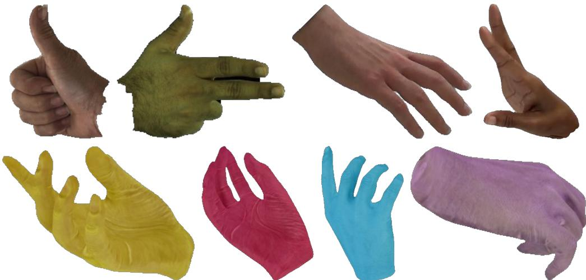  
Figure S1: Examples of real (top) and synthetic (bottom) training data. Synthetic samples are used only in the source-conditioned appearance stage (Sec. B.2).

## B.2 Synthetic Hand Data Generation

For the source-conditioned appearance stage, we augment training with synthetic source–target pairs generated following Zhao et al. [53]. In addition to realistic hand appearances, we sample diverse hand colors to expose the appearance module to a broader range of source appearances (bottom row of Fig. S1). This augmentation is used only for training the source-conditioned Gaussian appearance module, and the canonical Gaussian representation stage is trained on real hand datasets only.

Each synthetic sample is converted into the same source–target format as real training data. A single source image provides the appearance condition, while target frames provide supervision under different poses and viewpoints. All synthetic images are cropped, resized, and processed using the same preprocessing pipeline as real images.

## B.3 Dataset Sampling Strategy

We use a subject-centric sampling strategy to construct source–target training pairs. Each dataset is organized by subject, and each subject contains one or more groups. A group denotes a subjectinternal observation bucket, such as a camera, sequence, session, or multi-camera unit depending on the dataset. For each training iteration, we first sample a dataset according to a stage-specific dataset weight, then uniformly sample a subject from the selected dataset. A source frame is sampled from the subject-level source pool, and six target frames are sampled from the same subject according to dataset-specific self, same-group, and cross-group target counts.

Table S1: Dataset sampling policies used for training. Targets per source image are reported as self / same-group / cross-group.
<table><tr><td>Stage</td><td>Dataset</td><td>Weight</td><td>Source stride</td><td>Targets</td></tr><tr><td>Canonical</td><td>PALM</td><td>0.45</td><td>1</td><td>1/1/4</td></tr><tr><td>Canonical</td><td>InterHand2.6M</td><td>0.30</td><td>1</td><td>1/2/3</td></tr><tr><td>Canonical</td><td>HO3Dv3</td><td>0.10</td><td>10</td><td>1/3/2</td></tr><tr><td>Canonical</td><td>Goliath</td><td>0.10</td><td>5</td><td>1/5/0</td></tr><tr><td>Canonical</td><td>HARP</td><td>0.05</td><td>5</td><td>1/5/0</td></tr><tr><td>Appearance</td><td>PALM</td><td>0.35</td><td>1</td><td>1/1/4</td></tr><tr><td>Appearance</td><td>InterHand2.6M</td><td>0.30</td><td>1</td><td>1/2/3</td></tr><tr><td>Appearance</td><td>Synthetic</td><td>0.15</td><td>1</td><td>1/1/4</td></tr><tr><td>Appearance</td><td>HO3Dv3</td><td>0.08</td><td>10</td><td>1/3/2</td></tr><tr><td>Appearance</td><td>Goliath</td><td>0.08</td><td>5</td><td>1/5/0</td></tr><tr><td>Appearance</td><td>HARP</td><td>0.04</td><td>5</td><td>1/5/0</td></tr></table>

The self target corresponds to the source frame itself and provides source-view supervision. Samegroup targets are sampled from the same subject group as the source, while cross-group targets are sampled from different groups of the same subject. For multi-view datasets, cross-group targets usually correspond to different cameras or observation groups. For monocular datasets, they correspond to different subject-internal sequences when available. This strategy keeps identity and hand shape consistent while exposing the model to varying poses and viewpoints. Table S1 summarizes the sampling weights and target-frame composition used in each stage.

## C Evaluation Protocol

We follow the single-image animatable hand reconstruction protocol established by prior hand avatar benchmarks [20, 23], including their sequence, designated source-frame, cropping, and masking choices, to ensure direct comparability with reported baselines. The InterHand2.6M source frame is the one provided with the official OHTA evaluation configuration. For HanCo, whose protocol leaves the source frame unspecified, we fix one common source frame for all methods (Sec. C.2). Given a single source image, the model reconstructs a canonical Gaussian hand representation, which is then rendered under novel target poses and viewpoints for evaluation. All methods receive the identical source image, ground-truth annotations, and evaluation targets.

## C.1 InterHand2.6M Evaluation

We follow the evaluation protocol used in HandAvatar [20] and OHTA [23]. We use the following sequence and, as the source image, the example provided in the official OHTA repository:

```htaccess
Sequence test/Capture0/ROM03_RT_No_Occlusion
Source image test_Capture0_ROM03_RT_No_Occlusion_cam400272_image15012.jpg
```

Following HandAvatar, the hand region is cropped using the provided evaluation bounding box. The bounding box is converted into a square region with a 1.3× enlargement factor, and the cropped image is resized to $2 5 6 \times 2 5 6$ . Unless otherwise specified, the same cropping protocol is used for all experiments. We use the ground-truth camera parameters and MANO parameters provided by the dataset, and the foreground evaluation masks are ray masks generated following the HandAvatar evaluation protocol. The source image itself is excluded from quantitative evaluation. Table 1 of the main paper reports the results under this protocol. The corresponding evaluation with estimated source-side cues is reported in Table 3 of the main paper and, with boundary-level metrics, in Sec. F.3.

## C.2 HanCo Evaluation

For HanCo we follow the zero-shot cross-dataset evaluation setting of OHTA [23]. We use sequence 0191 and evaluate frames from cam3, cam5, cam6, and cam7, where the cameras are positioned above the hands. Following OHTA, we do not use cameras below the hands due to inconsistent lighting conditions and color calibration. We use the 76th and last frame of cam6 (frame index 75) as the common source image for all methods, together with the ground-truth MANO parameters and hand masks provided by HanCo. Unlike the InterHand2.6M protocol, the HanCo evaluation set retains all 76 frames of each of the four cameras (304 frames), so the source frame itself is one of the evaluation frames. It is retained for every compared method, so relative comparisons are unaffected, and it contributes one of the 304 frames to the aggregate metrics.

Preprocessing and evaluation-mask generation are identical to the InterHand2.6M protocol of Sec. C.1: the hand region is cropped to a square with a 1.3× enlargement factor and resized to 256 × 256, and metrics are computed over ray masks generated following the HandAvatar evaluation protocol, applied consistently to all methods. The only difference is the bounding-box source: since HanCo does not provide the HandAvatar evaluation bounding boxes, the square crop is instead derived from the minimum and maximum coordinates of the ground-truth foreground mask. Because the OHTA HanCo protocol designates the held-out sequence (0191) but not the source frame, absolute numbers are not directly comparable to previously reported HanCo values. All methods are therefore re-evaluated by us from the identical source frame under identical inputs (Sec. C.7). Table 2 of the main paper reports the results under this protocol.

## C.3 Metric Computation

Following the HandAvatar protocol, pixels outside the ray mask are set to the background color in both the rendered and the ground-truth image, and PSNR, SSIM, and LPIPS are computed on the resulting images, which reduces background bias. Because our rasterizer ignores the principal point, we render with a centered principal point and map the render to the original crop with the exact homography, so all methods are scored on the same pixels. All evaluations are performed at 256 × 256 resolution.

## C.4 Boundary-aware Silhouette Metric Definitions

Boundary F-score and boundary IoU are computed between the binarized rendered alpha $( A > 0 . 5 )$ and the ground-truth mask, with boundaries extracted as 1-pixel contours. The boundary F-score is the standard contour-matching F-measure: predicted and ground-truth boundary pixels are matched within a distance tolerance of 2 pixels via distance transforms. Boundary IoU is a variant of the boundary-restricted IoU of Cheng et al. [56]: each 1-pixel contour is dilated by 3 pixels and the IoU is computed between the two resulting bands. The band is thus symmetric about the silhouette rather than restricted to the mask interior, so it also registers outward alpha leakage, which an interior-only band ignores. Alpha leakage is the mean excess of the rendered alpha above a tolerance of 0.1 over the outer band, constructed as a 5-pixel dilation of the ground-truth silhouette excluding the silhouette itself, and interior coverage is the mean rendered alpha over the interior eroded by 5 pixels. The evaluation bands are deliberately wider than, and distinct from, the 2-pixel training bands of Sec. A.3, so the boundary evaluation does not simply re-measure the region that the SAB loss optimizes. All metrics are computed at $2 5 6 \times 2 5 6$ and, unless stated otherwise, averaged over the InterHand2.6M novel-pose/novel-view evaluation set. They are reported in Table 4 of the main paper and in Tables S8 and S11, the latter also on the HanCo evaluation set.

Table S2: Self-reconstruction with geometry fixed (Sec. C.5). w/o transfer renders the Stage-1 base colors, and Ours renders the composed colors.
<table><tr><td>Dataset</td><td>Setting</td><td>PSNR↑</td><td>SSIM↑</td><td>LPIPS↓</td></tr><tr><td>InterHand2.6M</td><td>w/o transfer Ours</td><td>26.58 28.54</td><td>0.869 0.903</td><td>0.133 0.108</td></tr><tr><td rowspan="2">HanCo (zero-shot)</td><td>w/o transfer</td><td>20.47</td><td>0.839</td><td>0.187</td></tr><tr><td>Ours</td><td>23.88</td><td>0.898</td><td>0.153</td></tr></table>

## C.5 Self-reconstruction Protocol

Self-reconstruction is a controlled source-view appearance diagnostic: it measures how faithfully the input image is reflected in the avatar when no pose or viewpoint gap is involved. Each frame of the evaluation data is used in turn as the input: the avatar is reconstructed from that frame and rendered back into the same pose and camera, so the target is the input itself. All non-color attributes are fixed to the Stage-1 canonical values, so any metric difference between the w/o transfer and Ours rows of Table S2 is attributable solely to the source-conditioned color update. The w/o transfer row renders the Stage-1 base colors ${ \bf c } _ { i } ^ { 0 }$ (the w/o appearance transfer configuration of Table 3 in the main paper), and the Ours row renders the composed colors $\mathbf { c } _ { i } ^ { * }$ (Eq. 13 of the main paper). Table S2 reports the average over the evaluation frames of each benchmark (the InterHand2.6M sequence of Sec. C.1 and the HanCo sequence of Sec. C.2), with the same cropping protocol and ray masks as Sec. C.3.

This diagnostic complements the novel-pose/novel-view ablation in Table 3 of the main paper by isolating whether the color update follows the observed source appearance while geometry is fixed. Figure S6 (Sec. H.3) shows representative frames.

## C.6 Timing and Efficiency Measurement

The 2.84 s reported in the main paper is the wall-clock avatar-network inference time on a single NVIDIA A100 (80 GB), covering image encoding, MANO-anchored token computation, Gaussian decoding, source-view rendering, and source-conditioned appearance composition. It excludes disk I/O, data loading, input preprocessing, one-time model loading, and CUDA initialization, and it is averaged over repeated runs after warm-up (standard deviation 0.007 s).

Cost breakdown. Building the canonical Gaussians alone takes 1.38 s under the same protocol. Source-conditioned appearance composition, including the source-view rendering it requires, therefore accounts for the remaining 1.46 s, about half of the avatar-network time.

End-to-end raw image to avatar. Because the reported 2.84 s assumes that MANO, camera, and mask inputs are already available, we additionally report the complete raw-image-to-avatar cost on the same GPU (Table S3). Upstream estimation adds approximately 0.46 s (0.38 s for the SAM 3 foreground mask and 0.08 s for WiLoR MANO and camera estimation), giving an end-to-end construction time of approximately 3.30 s. Upstream estimation is thus about 14% of the end-to-end cost and is not the bottleneck. This entire cost is incurred once per avatar, for example when a user’s hand is enrolled at the start of an AR/VR or telepresence session, and subsequent animation re-runs neither network and renders at 161 FPS. The construction time is therefore not a per-frame latency, and we do not claim real-time acquisition.

All baseline measurements in Table 2 of the main paper (per-subject fitting time, rendering speed, and peak memory) are taken on the same NVIDIA A100 (80 GB). Relative to our 2.84 s avatar-network inference, the fitting times of HandAvatar, OHTA, and BIGS<sup>∗</sup> correspond to speedups of 1964×, 1183×, and 486× (5579/2.84, 3360/2.84, and 1380/2.84). The “over 400×” figure quoted in the main paper is the most conservative of these.

Rendering speed and memory. FPS measures novel-pose rendering (MANO-driven deformation and rasterization) at 256 × 256 with batch size 1 over the HanCo evaluation frames, excluding data loading: 161 FPS (≈ 6.2 ms per frame). Peak GPU memory, including the CUDA context, is 1.79 GB during rendering and 4.78 GB during avatar construction. Since all compared methods receive the same ground-truth inputs (Sec. C.7), upstream cost is identical across the compared systems and orthogonal to the reported comparison.

Table S3: Raw-image-to-avatar runtime on a single NVIDIA A100 (80 GB) under the protocol of Sec. C.6.
<table><tr><td>Stage</td><td>Component</td><td>Time</td></tr><tr><td>Upstream estimation</td><td>SAM 3 foreground mask [54] WiLoR MANO + camera [37] subtotal</td><td>0.38 s 0.08s</td></tr><tr><td>Avatar construction</td><td>Canonical Gaussian construction Source-conditioned appearance composition subtotal (Table 2 of the main paper)</td><td>0.46s 1.38 s 1.46s 2.84 s</td></tr><tr><td>End-to-end</td><td>raw image → animatable avatar</td><td>≈3.30 s</td></tr><tr><td>Animation</td><td>novel-pose rendering (per avatar, repeated)</td><td>160.71 FPS</td></tr></table>

Table S4: Input protocol for every compared method.
<table><tr><td>Method</td><td>Original input</td><td>Input here</td></tr><tr><td>HARP</td><td>Monocular video</td><td>Single frame</td></tr><tr><td>LiveHand</td><td>Multi-view video</td><td>Single frame</td></tr><tr><td>HandAvatar</td><td>Monocular video</td><td>Single frame</td></tr><tr><td>Handy</td><td>Single image</td><td>Single frame</td></tr><tr><td>OHTÁ</td><td>Single image</td><td>Single frame</td></tr><tr><td>BIGS*</td><td>Monocular video</td><td>Single frame</td></tr><tr><td>Ours</td><td>Single image</td><td>Single frame</td></tr></table>

## C.7 Baseline Input Protocols

Table S4 states, for every compared method, its originally intended input modality and the input actually provided in our evaluation. All methods receive the identical single source frame and identical ground-truth MANO, camera, and mask annotations, following the single-image protocol established by prior hand avatar benchmarks [20, 23], and no method receives additional frames. For Handy, a parametric shape and appearance model built from large-scale 3D hand scans, the singleframe evaluation follows the setting established by OHTA [23]: the provided MANO annotations are converted into Handy’s format, and its texture latent code is fitted to the single source frame via differentiable rendering.

Provenance of baseline numbers. The provenance of the reported baseline numbers differs between the two benchmarks. On InterHand2.6M, we adopt the single-frame results of HARP, LiveHand, HandAvatar, Handy, and OHTA established under this protocol by Zheng et al. [23], and evaluate our method under the identical protocol. BIGS<sup>∗</sup> postdates that work, so its InterHand2.6M numbers are measured by us under the same protocol using the single-hand adaptation of Sec. E.1. On HanCo, the exact evaluation configuration behind previously reported numbers (evaluation frames, source frame, and mask generation) is not fully specified publicly, so directly citing them would not yield a controlled comparison. We therefore re-evaluate every compared method ourselves under the fully specified protocol of Sec. C.2, using the same source frame, ground-truth annotations, crops, and masks for all methods. All qualitative comparisons (Fig. 4 of the main paper) are rendered by us from our own runs of each baseline under the protocols of Secs. C.1 and C.2, so the qualitative and quantitative comparisons share the same source frames, crops, and masks.

## C.8 Protocols of the Additional Analyses

The pose-stratified and temporal analyses of Sec. J reuse the renders, ground truth, and ray masks of the main evaluation (Secs. C.1 and C.2), and only the reporting changes. The canonical diagnostics use the avatars reconstructed from the two protocol source frames.

Pose strata. For every evaluation frame we measure two changes of the driving pose relative to the source pose. The palm-orientation change is the geodesic distance between the source and target global hand rotations, each expressed in the frame of its own camera, so it captures both the rotation of the hand and the change of camera. The finger-articulation change is the mean geodesic distance over the 15 finger joints of MANO, excluding the global rotation. The frames are split into equal-count terciles (Easy, Medium, Extreme) of each measure, and every method is scored on the same frames. For the palm terciles, we also report the median change of the viewing direction in the hand frame, which measures how far the camera has moved around the hand irrespective of in-plane roll. Tables S12 and S13 (Sec. J.1) report the results.

Temporal stability. On the continuous HanCo sequence we form, per camera, the 75 pairs of consecutive evaluation frames (300 pairs in total). For a pair (t, t+1) with ray masks $M _ { t }$ and $M _ { t + 1 }$ the frame-to-frame change of the prediction is

$$
d _ { \mathrm { p r e d } } = \frac { 1 } { | M _ { t } \cup M _ { t + 1 } | } \sum _ { \mathbf { p } \in M _ { t } \cup M _ { t + 1 } } \frac { 1 } { 3 } \big \| \hat { I } _ { t + 1 } ( \mathbf { p } ) - \hat { I } _ { t } ( \mathbf { p } ) \big \| _ { 1 } ,\tag{S6}
$$

where the $L _ { 1 }$ norm runs over the three color channels of the same composited 8-bit images used for the metrics. We define $d _ { \mathrm { g t } }$ identically on the ground truth, and the excess variation is $E _ { t } = d _ { \mathrm { p r e d } } - d _ { \mathrm { g t } }$ For each camera, which records one continuous video, we average $E _ { t }$ over its consecutive pairs and report the result relative to the mean ground-truth change of that camera. The summary over cameras averages the magnitudes of these per-camera values, so that opposite biases of different cameras do not cancel. As a calibration, we add to our own renders a per-frame brightness offset inside the ray mask, drawn uniformly within ±1%, ±2%, or ±4%, and recompute $E _ { t }$ . Table S14 (Sec. J.2) reports the results.

Canonical boundary diagnostic. The Gaussians are partitioned by their reliability into a highreliability set $( \gamma _ { i } \geq 0 . 5 )$ , a transition set, and a low-reliability set $( \gamma _ { i } < 0 . 1 )$ . Neighbors are the six nearest Gaussians in canonical space, and color differences are CIE76 ∆E values in CIELAB between the final colors $\mathbf { c } _ { i } ^ { * }$ . We compare three kinds of neighbor pairs. Pairs within the high-reliability set measure the natural texture variation and serve as the reference, pairs that straddle the threshold $\gamma _ { i } = 0 . 5$ measure the transition, and strict pairs connect a high-reliability and a low-reliability Gaussian directly. Sec. J.3 reports the results.

Reliability and opacity renderings. The reliability maps (Fig. S12) render $\gamma _ { i }$ as a scalar field with the same rasterizer, and the alpha-weighted mean of $\gamma$ along each ray is color-mapped after compositing, so blending never produces colors outside the color map. The opacity maps (Fig. S13) show the accumulated alpha A of the render, the quantity behind the boundary metrics of Sec. C.4. The avatar is posed with the source pose and rendered from the source view and from an orbit of the source camera about its vertical image axis through the centroid of the posed Gaussians.

## D Extended Related Work

Hand avatar reconstruction. A large body of work relies on multi-view inputs or monocular video sequences, combined with neural implicit representations or explicit mesh-based pipelines [20– 22, 39–41]. HandAvatar [20] models pose-dependent appearance using implicit representations with self-occlusion-aware texture modeling. HARP [22] employs a mesh-based formulation augmented with learned reflectance maps to capture high-frequency details, while LiveHand [21] leverages multi view video and neural rendering to synthesize photorealistic hand appearance. Despite achieving high visual fidelity, these approaches depend on dense observations and per-subject optimization, leading to substantial computational overhead and limited scalability. Single-image methods such as OHTA [23] introduce data-driven priors for one-shot hand avatar reconstruction, but still require test-time fitting or inversion. Gaussian-based approaches such as GaussianHand [24] adopt explicit 3D Gaussian primitives for efficient rendering but continue to depend on multi-view supervision or temporal sequences and often require subject-specific optimization. As summarized in Table S5, existing methods remain constrained by dense inputs or per-subject optimization, whether they use implicit fields, meshes, or Gaussian primitives.

Feed-forward 3D Gaussian avatar reconstruction. Feed-forward avatar methods regress the parameters of animatable 3D Gaussians from one or a few images, replacing per-subject optimization with amortized inference. Among them, LHM [17] extends Gaussian representations to animatable full-body avatars, while GUAVA [42] focuses on upper-body reconstruction. For head avatars, approaches such as GAGAvatar [13] and LAM [14] demonstrate high-fidelity rendering via feedforward Gaussian prediction. Extending these designs to hands exposes the two failure mode

Table S5: Comparison of representative 3D hand avatar reconstruction methods under their original input settings. BIGS<sup>∗</sup>: our single-hand adaptation of BIGS (Sec. E.1). <sup>§</sup>GaussianHand reports results from as few as 5–20 camera views.
<table><tr><td>Method</td><td>Input</td><td>Feed-forward</td><td>Repr.</td></tr><tr><td>LiveHand [21]</td><td>Multi-view video</td><td>x</td><td>NeRF-like</td></tr><tr><td>GaussianHand8 [24]</td><td>Multi-view video</td><td>x</td><td>3DGS</td></tr><tr><td>HandAvatar [20]</td><td>Monocular video</td><td>x</td><td>Implicit</td></tr><tr><td>HARP [22]</td><td>Monocular video</td><td>x</td><td>Mesh</td></tr><tr><td>BIGS* [47]</td><td>Monocular video</td><td>x</td><td>3DGS</td></tr><tr><td>OHTA [23]</td><td>Single image</td><td>x</td><td>Implicit</td></tr><tr><td>Ours</td><td>Single image</td><td>√</td><td>3DGS</td></tr></table>

discussed in Sec. 1 of the main paper: thin, articulated structures are sensitive to small geometric errors, and appearance regressed from image features over-relies on learned priors under single-view ambiguity. The controlled recipe ports of Sec. E.2 quantify the former.

## E Baseline Adaptations

## E.1 BIGS-based Hand Reconstruction Baseline

BIGS [47] originally targets bimanual hand–object interaction reconstruction from monocular videos, and therefore does not directly match our single-image, single-hand evaluation setting. To construct a reference optimization-based 3DGS baseline, we adapt BIGS to a single-hand setting by retaining only the Gaussian hand avatar component and removing the object and second-hand branches.

The adapted baseline represents the hand in a canonical Gaussian space. Following the Gaussian hand avatar modeling design, Gaussian attributes are decoded from a triplane feature representation using MLP heads: the geometry head predicts Gaussian offsets, rotations, and scales, the appearance head predicts colors and opacities, and the deformation head predicts MANO-related skinning weights. The canonical Gaussians are then transformed to posed space using MANO-based linear blend skinning and rendered with differentiable Gaussian rasterization.

The original formulation is designed for monocular videos without known camera poses, where the camera coordinate system and hand trajectory must be estimated or aligned. In our benchmark setting, ground-truth annotations are available, so for controlled fitting and evaluation we use the groundtruth MANO parameters, camera parameters, and hand masks whenever available. This removes errors from external hand-pose, camera, and mask estimation, and focuses the comparison on the reconstruction and rendering formulation itself. Accordingly, the fixed virtual-camera construction and the 2D-keypoint-based global trajectory alignment of the original pipeline are bypassed, and the temporal smoothness regularization defined across consecutive video frames is inactive under single-frame fitting.

The adapted baseline is fitted to the single source frame by minimizing a masked reconstruction objective restricted to the foreground hand region, combining an $L _ { 1 }$ term and an SSIM term, together with a silhouette loss on the rendered opacity and a regularizer that encourages the predicted skinning weights to remain close to the corresponding MANO skinning priors. Fitting uses Adam for 15,000 iterations, with learning rates of $1 . 6 \times 1 0 ^ { - 4 }$ for the Gaussian position parameters, $1 . 0 \times 1 0 ^ { - 4 }$ for the remaining Gaussian attribute parameters, and $1 . 0 \times 1 0 ^ { - 3 }$ for the triplane and MLP decoder weights.

During evaluation, the fitted BIGS-based baseline is rendered using the same target MANO poses, target cameras, hand-centered crops, and foreground masks as InstantHand. Since this protocol adapts BIGS to a single-hand benchmark and differs from the original bimanual hand–object interaction setting, we report it as a reference optimization-based 3DGS baseline (BIGS<sup>∗</sup>) rather than as BIGS in its original setting. Its results appear in Tables 1 and 2 of the main paper, and its input protocol in Table S4.

## E.2 Controlled Recipe Ports of One-shot Head and Body Avatar Methods

A natural question is whether existing feed-forward one-shot head and full-body avatar frameworks can simply be retargeted to hands. To answer this empirically rather than by argument, we construct controlled hand adaptations of both families and evaluate them under matched conditions. All quantitative results are reported in Table 4 of the main paper. This section specifies the two ports and states what the resulting gap does and does not show.

Matched-condition protocol. In both ports, the training data, MANO anchors, image encoder, optimization schedule, and compute budget are identical to ours, and only the representation and supervision recipe differ. Free per-Gaussian parameters are initialized from our constrained solution so that the comparison does not confound optimization difficulty with initialization. Both ports are evaluated under the InterHand2.6M protocol of Sec. C.1 with the boundary metrics of Sec. C.4.

Head recipe [14]. We replace FLAME with MANO while retaining the method’s free per-Gaussian opacity, rotation, and anisotropic scale, together with its direct image-feature-based RGB prediction. Our boundary-aware supervision and our reliability-gated color pathway are both removed, so this port evaluates the published parameterization rather than a hybrid.

Body recipe [17]. Directly reproducing LHM [17] is infeasible at our scale. It uses a 0.5–1Bparameter model trained on approximately 300K videos with 32–64 A100 GPUs, and its released model requires full-body images and SMPL-X parameters rather than cropped hand images and MANO parameters. We therefore construct a controlled recipe-level port. SMPL-X anchors are replaced by MANO anchors, and the freely regressed Gaussian attributes and canonical-space regularization of Qiu et al. [17] are retained as released. Writing $s _ { i } ^ { ( 1 ) } \geq s _ { i } ^ { ( 2 ) } \geq s _ { i } ^ { ( 3 ) }$ for the sorted per-axis scales of a freed Gaussian, the as-spherical-as-possible term takes its released ratio-hinge form, max $\big ( s _ { i } ^ { ( 1 ) } / s _ { i } ^ { ( 3 ) } - \tau _ { \mathrm { A S A P } } , 0 \big )$ with $\tau _ { \mathrm { A S A P } } = 5$ , at the released hand weighting $\lambda _ { \mathrm { A S A P } } = 1 0 ^ { 5 }$ Because this term is a ratio of scales, it transfers to MANO unchanged. The position-anchoring term $\begin{array} { r } { \frac { 1 } { N } \sum _ { i } \operatorname* { m a x } ( \| \Delta \mathbf { x } _ { i } \| _ { 2 } - \tau _ { \mathrm { A C A P } } , 0 ) } \end{array}$ and the offset range are stated in Qiu et al. [17] relative to a 1.8 m body $( \tau _ { \mathrm { A C A P } } = 1 . 8 / 3 2 \mathrm { m }$ , weight $1 0 ^ { 3 }$ , range 1.0 m). We apply the same numbers as fractions of the template extent (≈ 0.19 m for MANO): τ<sub>ACAP</sub> = extent/32 ≈ 5.9 mm, $\lambda _ { \mathrm { A C A P } } =$ $1 0 ^ { 3 } \cdot 1 . 8 / { \mathrm { e x t e n t } } \approx 9 . 5 \times 1 0 ^ { 3 }$ , and an offset range of extent · $( 1 . 0 / 1 . 8 ) \approx 0 . 1 0 6 \mathrm { m }$ This choice preserves the range-to-threshold ratio of the original exactly. This soft anchoring replaces the hard offset bound and L2 offset prior of the head recipe, since the two are one design choice. The mask weight follows Eq. 7 of Qiu et al. [17] (0.5), and the backbone, data, anchors, schedule, and compute are matched to ours. At the weights of Eq. 10 of Qiu et al. [17] (50/10), the anisotropy hinge never activates (mean scale ratio ≈ $\mathrm { : 3 < \tau _ { A S A P } ) }$ , and the anchoring term contributes $\approx 0 . 2 5 \%$ of the loss, so the free attributes are effectively unregularized. We therefore report the hand weighting released in the official implementation of Qiu et al. [17], under which the anchoring term is active. We report this as a recipe port, not as a reproduction of the original system at its original scale. Matched renderings of both ports are shown in Fig. S5.

Reading the reported gap. Both ports are worse than our constrained model without SAB in boundary F-score and leakage (boundary F 0.267–0.299 vs. 0.366, leakage 0.608–0.627 vs. 0.555). The two ports are independent configurations, each retaining its own published parameterization, yet they score close to each other (PSNR within 0.24 dB, boundary F 0.267 vs. 0.299). Their anchoring terms differ in kind. The head recipe uses hard anchoring, an L2 prior within a ±4 mm bound, and the body recipe uses soft anchoring, a hinge that is inactive within $\tau _ { \mathrm { A C A P } } \approx 5 . 9$ mm. At our framing, this leaves a free shell of ≈ 6 px, three times the $2 { \cdot } \mathsf { p x }$ training band. Neither term observes the rendered silhouette, however, and neither recovers boundary precision. Supervision on the silhouette itself does. Under the constrained parameterization, SAB raises the boundary F-score from 0.366 to 0.698 (Table 4 of the main paper and Fig. S4). The contribution of the attribute constraints with boundary supervision held fixed is isolated in Sec. F.2.

## F Additional Ablation Studies

Unless otherwise specified, all variants are evaluated on InterHand2.6M using the same protocol as the main paper.

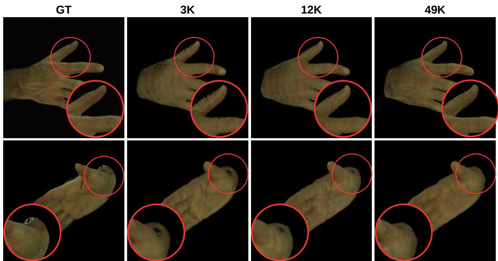  
Figure S2: Qualitative effect of the number of Gaussians. Columns: ground truth (GT) and the 3K, 12K, and 49K settings of Table S6. Red circles mark regions magnified in the corner insets.

Table S6: Ablation on the number of Gaussians (MANO subdivision level). All variants are full models differing only in the subdivision level.
<table><tr><td>k</td><td>#Gaussians</td><td>PSNR↑</td><td>SSIM↑</td><td>LPIPS↓</td></tr><tr><td>1</td><td>3,093</td><td>26.11</td><td>0.859</td><td>0.168</td></tr><tr><td>2</td><td>12,337</td><td>25.92</td><td>0.860</td><td>0.147</td></tr><tr><td>3</td><td>49,281</td><td>26.21</td><td>0.866</td><td>0.133</td></tr></table>

## F.1 Effect of the Number of Gaussians

InstantHand anchors Gaussian primitives on a subdivided MANO surface $( S _ { k }$ in Eq. 2 of the main paper), so the subdivision level directly controls the density of query anchors and therefore the number of canonical Gaussians. Subdivision levels $k = 1 , k \stackrel { \cdot } { = } 2$ , and $\dot { k } = 3$ produce 3,093, 12,337, and 49,281 Gaussian anchors, respectively, and the main model uses $k = 3 .$ . A lower subdivision level provides a compact anchor set but may underrepresent thin fingers, hand boundaries, and local surface details, while a higher level provides denser surface coverage. Each variant is trained with the full two-stage pipeline and evaluated as a complete model under the novel-pose/novel-view protocol, and only the subdivision level differs.

Table S6 and Fig. S2 show the effect. The figure compares full-model reconstructions, rendered on the same black background, with ground truth. SSIM and LPIPS improve consistently with denser anchors (LPIPS $0 . 1 6 8  0 . 1 4 7  0 . 1 3 3 )$ , while PSNR stays within 0.29 dB. In the sparse 3K setting, the gaps between neighboring splats appear as serrated finger contours (red circles), and surface detail is coarser. Such local, high-frequency defects barely move pixel-averaged PSNR but are captured by LPIPS. With denser anchors the contours become smooth and continuous, and at 49K the finger silhouettes are sharp. Training at the next level, k = 4 (196,993 anchors), runs out of memory on our training GPUs (RTX A6000, 48 GB) and was therefore not feasible with our resources. Rendering the trained k = 3 prediction at k = 4 density without retraining is examined in Sec. I (Table S11).

## F.2 Gaussian Attribute Constraints

Our canonical parameterization deliberately fixes opacity and canonical rotation and constrains scales to be isotropic (Sec. A.1), as in prior monocular Gaussian-avatar designs [57, 58]. This subsection isolates the cost of relaxing each constraint in the hand setting.

Matched protocol. Boundary supervision is retained in every configuration of Table S7, with all other settings unchanged and per-axis scales initialized isotropically, so the differences isolate the attribute parameterization. The effect of boundary supervision under the constrained parameterization is reported separately in Table 4 of the main paper, where removing SAB lowers PSNR by 2.32 dB, to 23.89 dB.

GT  
Ours (isotropic)  
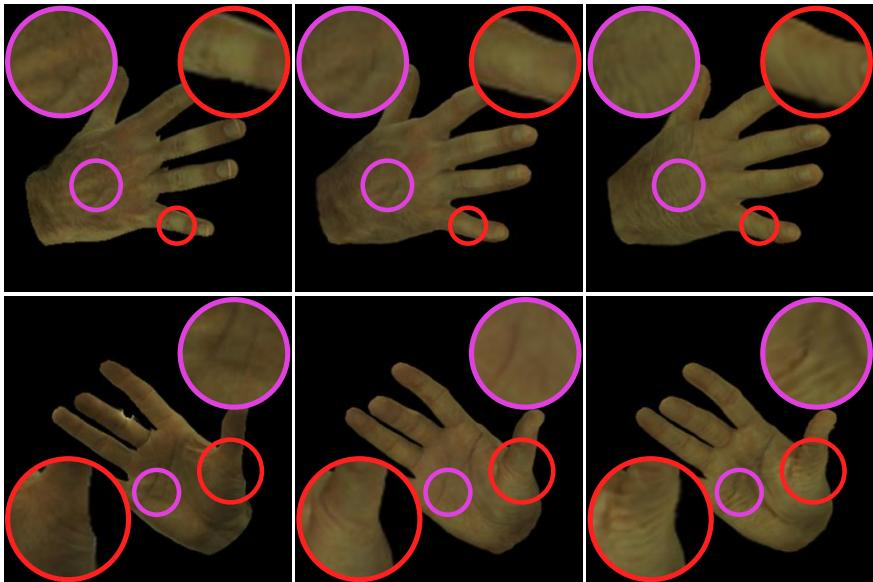  
Per-axis scale freed  
Figure S3: Artifacts under per-axis Gaussian scales. Ground truth, the isotropic model (ours), and the per-axis-scale-freed variant of Table S7 on identical frames. Magenta circles mark interior regions and red circles silhouette regions, each magnified in the matching corner inset.

Table S7: Effect of relaxing the Gaussian attribute constraints (InterHand2.6M). Boundary supervision is retained in every row.
<table><tr><td>Configuration</td><td>PSNR↑</td><td>SSIM↑</td><td>LPIPS↓</td></tr><tr><td>Ours (isotropic; rotation, opacity fixed)</td><td>26.21</td><td>0.866</td><td>0.133</td></tr><tr><td>Per-axis scale freed</td><td>25.58</td><td>0.856</td><td>0.142</td></tr><tr><td>Rotation and opacity freed</td><td>25.74</td><td>0.862</td><td>0.133</td></tr><tr><td>All three freed</td><td>25.50</td><td>0.856</td><td>0.148</td></tr></table>

Under matched supervision, freeing per-axis scale alone reduces PSNR by 0.63 dB. Freeing rotation and opacity reduces PSNR by 0.47 dB. Because rotation does not alter the covariance of an isotropic Gaussian, this row primarily measures the effect of learning opacity. Freeing all three produces the largest degradation, 0.71 dB, and worsens SSIM and LPIPS as well. Curved finger geometry is instead captured by increasing the density of small isotropic Gaussians (LPIPS 0.168 → 0.133 from 3K to 49K, Table S6). Rendering the trained 49K prediction at 197K density with scales 0.6 s , without retraining, lowers it further to 0.129 (Table S11).

Artifacts under per-axis scales. Because the metric gap alone does not identify how the anisotropic variant fails, we compare the variant with only per-axis scales freed and the isotropic model on identical frames, so that observed differences are attributable specifically to the scale parameterization. Figure S3 shows two artifact types, with boundary supervision retained in both models. The magenta circles fall on the dorsum (top) and the palm (bottom), and the red circles on a fingertip and the thumb. The isotropic model preserves the vein and crease structure of the ground truth, whereas the per-axis variant replaces it with parallel bands and widens the silhouette fringe. (i) Striated interiors. Broad, smooth regions such as the back of the hand exhibit quasi-parallel, regularly spaced bands, producing a corduroy-like ripple consistent with elongated splats becoming similarly aligned. These patterns are distinguishable from anatomical texture, since veins branch and follow the hand geometry whereas the artifacts remain approximately parallel and uniformly spaced. The distortions occur within the rendered surface rather than as holes or transparent regions, which is why opacity-based measures such as interior coverage barely register them, while LPIPS degrades from 0.133 to 0.142. (ii) Feathered silhouettes. The per-axis model produces a wider semi-transparent fringe around the hand boundary, consistent with elongated Gaussians extending across the true contour, so finger boundaries appear smeared while the matched isotropic renders remain substantially sharper.

Table S8: Sensitivity to source-side MANO and mask errors on InterHand2.6M. (a) Controlled perturbations around the ground-truth source cues. (b) Ground-truth source cues replaced by SAM 3 and WiLoR outputs. The last row also replaces the source camera.  
(a) Controlled perturbations around ground truth
<table><tr><td>Source perturbation</td><td>PSNR↑</td><td>SSIM↑</td><td>LPIPS↓</td><td>Bound. F↑</td><td>B-IoU↑</td><td>Leakage↓</td></tr><tr><td>Clean GT inputs</td><td>26.21</td><td>0.866</td><td>0.133</td><td>0.698</td><td>0.562</td><td>0.234</td></tr><tr><td>Pose noise  $( \bar { \sigma } _ { \mathrm { p o s e } } = 5 ^ { \circ } )$ </td><td>26.12</td><td>0.864</td><td>0.134</td><td>0.698</td><td>0.562</td><td>0.234</td></tr><tr><td>Pose noise  $( \sigma _ { \mathrm { p o s e } } = 1 0 ^ { \circ } )$ </td><td>26.05</td><td>0.863</td><td>0.134</td><td>0.698</td><td>0.562</td><td>0.234</td></tr><tr><td>Mask erosion  $( 2 \mathsf { p x } )$ </td><td>26.28</td><td>0.867</td><td>0.132</td><td>0.704</td><td>0.565</td><td>0.229</td></tr><tr><td>Mask dilation  $( 2 \mathrm { p x } )$ </td><td>26.24</td><td>0.864</td><td>0.134</td><td>0.697</td><td>0.561</td><td>0.237</td></tr></table>

<table><tr><td>Source mask</td><td>Source MANO</td><td>PSNR↑</td><td>SSIM↑</td><td>LPIPS↓</td><td>Bound. F↑</td><td>Leakage↓</td></tr><tr><td>GT</td><td>GT</td><td>26.21</td><td>0.866</td><td>0.133</td><td>0.698</td><td>0.234</td></tr><tr><td>SAM 3</td><td>GT</td><td>26.12</td><td>0.865</td><td>0.133</td><td>0.695</td><td>0.239</td></tr><tr><td>GT</td><td>WiLoR</td><td>26.07</td><td>0.863</td><td>0.134</td><td>0.689</td><td>0.235</td></tr><tr><td>SAM 3</td><td> $\mathrm { W i L o R }$ </td><td>25.99</td><td>0.862</td><td>0.135</td><td>0.686</td><td>0.239</td></tr><tr><td></td><td>SAM 3 + WiLoR + WiLoR camera</td><td>25.99</td><td>0.863</td><td>0.134</td><td>0.685</td><td>0.240</td></tr></table>

## F.3 Sensitivity to Source-side MANO and Mask Errors

We evaluate how errors in the source-side MANO parameters and hand mask affect novel-pose/novelview rendering on InterHand2.6M. All experiments use the protocol-designated source frame of Sec. C.1, fixed network weights, and the same evaluation protocol and metrics as the main paper. Only the specified source cue is changed: the source RGB image and crop, target MANO parameters and cameras, and ground-truth target evaluation masks remain fixed. Results are averaged over the same target frames. The estimated-cue substitution rows appear in Table 3 (bottom) of the main paper, and Table S8 reports the complete study with boundary-level metrics.

Controlled perturbations. For pose perturbations we add independent zero-mean Gaussian noise directly to the 45 articulated MANO axis–angle components of the source frame,

$$
\pmb { \theta } ^ { \prime } = \pmb { \theta } + \pmb { \xi } , \qquad \pmb { \xi } \sim \mathcal { N } ( 0 , \sigma _ { \mathrm { p o s e } } ^ { 2 } ) ,\tag{S7}
$$

where $\sigma _ { \mathrm { p o s e } } \in \{ 5 ^ { \circ } , 1 0 ^ { \circ } \}$ is the component-wise standard deviation. The global wrist orientation, translation, shape, and camera remain unchanged, and each pose-noise condition is averaged over three random draws. For mask perturbations we apply two iterations of binary erosion or dilation to the source mask before the otherwise identical source preprocessing, and the source image and crop remain unchanged.

Estimated source-cue substitution. We separately replace the ground-truth source cues with outputs from practical upstream estimators. SAM 3 [54] replaces the source hand mask, and WiLoR [37] replaces the source MANO pose and shape fields. The mask–MANO combinations form $\mathbf { a \ 2 \times 2 }$ substitution study that separates the individual and combined effects of the estimated cues. We additionally report thefully estimated configuration, in which the jointly regressed WiLoR camera also replaces the ground-truth source camera, so that every source-side input originates from a single RGB image. This camera differs from the calibrated ground truth in both intrinsics and extrinsics. Unlike the controlled perturbations, these estimator outputs contain structured and spatially correlated errors.

Table S8(a) shows that controlled pose perturbations produce gradual but small appearance changes: relative to clean ground-truth inputs, $\sigma _ { \mathrm { p o s e } } = 5 ^ { \circ }$ and $1 0 ^ { \circ }$ reduce PSNR by 0.09 and 0.16 dB and SSIM by 0.002 and 0.003, while boundary F-score, boundary IoU, and leakage are unchanged at the reported precision, as expected since the source pose enters only the appearance pathway. Two-pixel mask erosion and dilation change PSNR by at most 0.07 dB and the boundary F-score by at most 0.006, so the model is insensitive to uniform mask morphology at this scale.

Table S9: Inference-time sensitivity to observation-reliability hyperparameters. One parameter is varied at a time with all weights fixed, and bold marks the default.
<table><tr><td rowspan=1 colspan=1>K    $\tau _ { m }$     $\zeta$   PSNR↑     LPIPS↓</td></tr><tr><td rowspan=1 colspan=1>(a) InterHand2.6M (novel-pose/novel-view)</td></tr><tr><td rowspan=1 colspan=1>0.25  0.5  95   26.21       0.133</td></tr><tr><td rowspan=1 colspan=1>0.5  0.5  95   26.21       0.133</td></tr><tr><td rowspan=1 colspan=1>1.0  0.5  95   26.20       0.133</td></tr><tr><td rowspan=1 colspan=1>0.5  0.3  95   26.22       0.133</td></tr><tr><td rowspan=1 colspan=1>0.5  0.7  95   26.19       0.133</td></tr><tr><td rowspan=1 colspan=1>0.5  0.5  90   26.22       0.134</td></tr><tr><td rowspan=1 colspan=1>0.5  0.5  99   26.19       0.132</td></tr><tr><td rowspan=1 colspan=1>(b) HanCo (zero-shot, sequence 0191)0.25  0.5  95   20.16       0.187</td></tr><tr><td rowspan=1 colspan=1>0.5  0.5  95   20.18       0.188</td></tr><tr><td rowspan=1 colspan=1>1.0  0.5  95   20.21       0.188</td></tr><tr><td rowspan=1 colspan=1>0.5  0.3  95   20.18       0.188</td></tr><tr><td rowspan=1 colspan=1>0.5  0.7  95   20.18       0.188</td></tr><tr><td rowspan=1 colspan=1>0.5  0.5  90   20.17       0.188</td></tr><tr><td rowspan=1 colspan=1>0.5  0.5  99   20.20       0.187</td></tr></table>

Structured estimator errors produce a somewhat larger but still limited gap. With ground-truth MANO fixed, replacing the source mask with SAM 3 decreases PSNR by 0.09 dB and boundary F by 0.003. With the ground-truth mask fixed, replacing the source MANO with WiLoR decreases PSNR by 0.14 dB and boundary F by 0.009. Unlike pose noise, which leaves the boundary metrics unchanged, WiLoR also replaces the shape $\beta$ that places the canonical anchors (Eq. 2 of the main paper), which is consistent with its change in boundary F. Using both estimated cues decreases PSNR by 0.22 dB and boundary F by 0.012. At the reported precision, the combined degradation is close to the sum of the individual changes, which suggests limited interaction between the two source-cue errors. Replacing the source camera as well, which changes the source intrinsics and extrinsics, leaves PSNR unchanged at the reported precision and moves each boundary metric by only 0.001. The fully estimated configuration thus sits 0.22 dB below clean ground-truth inputs.

Qualitative results under fully estimated inputs on unseen images are shown in Figs. S8 and S9.

## F.4 Inference-time Sensitivity of Observation Reliability

We keep the trained checkpoint fixed and vary the reliability hyperparameters of $\operatorname { E q } .$ 8 of the main paper one at a time around the default $( \kappa , \tau _ { m } , \bar { \zeta } ) = ( 0 . 5 , 0 . 5 , 9 \bar { 5 } )$ . For each setting, γ is recomputed once from the Stage-1 source-view render and the complete appearance-composition forward pass is rerun, while no network weights or canonical Gaussian attributes are updated. This is therefore a local inference-time sensitivity analysis rather than a comparison of separately retrained models. We run the sweep under two protocols, the InterHand2.6M protocol used for the other ablations and the held-out HanCo protocol of Sec. C.2, so that the analysis covers both subject-level and dataset-level generalization.

Table S9 shows a plateau rather than a peak. Across the seven settings, PSNR spans 0.03 dB (26.19– 26.22) and LPIPS 0.002, even though κ varies by a factor of four and $\tau _ { m }$ by more than a factor of two. For scale, removing reliability gating entirely costs 3.03 dB (Table 3 of the main paper), roughly two orders of magnitude more than any hyperparameter change here. The behavior of reliability gating is therefore governed by its structure, namely square-root compression, median-relative thresholding, and percentile normalization (Sec. A.4), rather than by the exact constants. The same insensitivity holds under dataset-level transfer: on the held-out HanCo sequence the same seven settings span 0.05 dB PSNR (20.16–20.21) and 0.001 LPIPS. In practice, reliability gating requires no per-dataset tuning.

## F.5 Rationale for Two-stage Training

The two-stage schedule enforces a structural separation between canonical representation learning and source-conditioned appearance adaptation. Stage 1 learns the canonical predictor, and Stage 2 freezes it in full, including the base-color head $f _ { \mathrm { r g b } }$ , while optimizing only the source-conditioned appearance module of Sec. 3.3 of the main paper (training details in Sec. A.1). By construction, source-view appearance supervision in Stage 2 cannot alter the canonical geometry or base colors, so novel-pose rendering starts from exactly the Stage-1 representation.

The frozen canonical branch also gives the appearance module a well-defined prior to fall back on: wherever source evidence is missing or unreliable, the composed color reverts to the Stage-1 base color plus the source-level shift $\Delta _ { s } ^ { a i { \bar { d } } }$ shared by all Gaussians. The full model improves source-view fidelity (Table S2), and observation reliability controls what reaches novel views. A color taken from the source is only as trustworthy as the evidence behind it. When transfer is not weighted by γ, novel-pose PSNR falls from 26.21 to 23.18 dB (Table 3 of the main paper), which is consistent with colors of weakly observed Gaussians being carried to novel views. The two stages thus keep the two roles separate: Stage 1 provides a stable prior for every Gaussian, and Stage 2 learns only where, and how strongly, source evidence should replace it, together with a source-level shift that propagates global appearance cues to every Gaussian.

## G Discussion

## G.1 Relation to Boundary Losses

Boundary-focused objectives and metrics are established in segmentation, where regional losses are complemented by contour-based losses [59] and by boundary-aware evaluation [56]. Rendered alpha, however, differs from the pixel-labeling setting those losses assume, and each element of SAB (Eq. 16 of the main paper and Sec. A.3) addresses one of the resulting differences. Per-pixel alpha is not an independent prediction but a composite of many projected 3D primitives, so band supervision acts through the rasterizer on primitive centers and scales rather than relabeling pixels. A one-sided outer penalty admits a degenerate optimum with no segmentation analogue, namely shrinking the hand until nothing crosses the contour. The paired interior coverage term closes this loophole, so leakage cannot be “fixed” by shrinking the hand. Soft alpha at boundaries is correct anti-aliased rendering rather than an error, and the tolerances and the robust penalty leave it unpenalized. Finally, the schedule η(n) reflects the 3D setting by activating the penalty only once the bands are geometrically meaningful for the evolving primitives. All SAB ablations keep the constrained parameterization of Sec. A.1 fixed, so the boundary-aware silhouette evaluation (Sec. C.4 and Table 4 of the main paper) measures the effect of SAB under identical constraints.

## G.2 View-dependent Appearance, Illumination, and Multi-frame Extension

Our appearance model predicts view-independent Gaussian colors and does not employ viewdependent representations such as spherical harmonics (SH). The two address different problems. The ambiguity we target is observational. A single source image observes essentially one side of the hand, so the core difficulty is deciding where source evidence is reliable and how to complete unobserved regions, which is what reliability-gated transfer and the global source identity address. A similar observational problem arises for human avatars built from monocular video, where FlexiAvatar [45] optimizes only the visible body regions and completes entirely unseen regions with diffusion-generated texture. View-dependent appearance modeling instead captures viewpointand illumination-dependent reflectance after the underlying appearance has been recovered, and it typically requires multi-view observations to be constrained. Under single-image supervision, per-Gaussian SH coefficients would be severely underdetermined. The two mechanisms are therefore complementary rather than alternatives: view-dependent terms could be attached to our composed colors without changing the geometry stabilization or the reliability-gated transfer.

A related limitation is that shading baked into the source image is transferred as albedo and thu carried to novel poses. This is as much a property of the setting as of the model: a single image does not determine illumination and albedo separately. Explicit albedo–shading decompositions such as those of HandAvatar [20] and OHTA [23] model self-occlusion shading learned from video or multi-identity data, but the scene illumination of a single source image, such as its exposure or colo cast, is not identifiable from that image alone. The per-subject baselines, which are fitted to the same source frame, are not exempt. In Part 4 of the supplementary video (Sec. K), they also depart from the ground truth in tone and shading, with dark discoloration for OHTA and a uniform tone without shading for HandAvatar. Disentangling illumination from intrinsic appearance is therefore likewise future work, and the corresponding failures are documented in Sec. I. Finally, the formulation already extends to multiple source frames at inference time, without retraining or additional parameters. Since γ is computed per source frame from the same rasterizer by-products, each additional frame is mapped onto the shared canonical Gaussians, the most reliable observation is selected for each Gaussian, and the colors are composed with Eq. 13 of the main paper. Related work similarly registers observations from disjoint viewpoints into a shared 3D space for multi-person mesh tracking across video shots [60]. Frames beyond the first are selected to maximize the union coverage, the fraction of canonical Gaussians with nonzero reliability $( \gamma _ { i } > 0 )$ in at least one source frame, and they span cameras $1 2 ^ { \circ } - 1 7 8 ^ { \circ }$ apart as well as different poses and time steps. Table S10 reports the results under the InterHand2.6M protocol of Sec. C.1.

Table S10: Multi-frame evidence integration at inference time (InterHand2.6M). The same trained model is used without retraining or additional parameters, and frames beyond the first are selected to maximize the union coverage of observed Gaussians $( \gamma _ { i } > 0 )$
<table><tr><td>Source frames</td><td>Coverage</td><td>PSNR↑</td><td>SSIM↑</td><td>LPIPS↓</td></tr><tr><td>1</td><td>0.45</td><td>26.21</td><td>0.866</td><td>0.133</td></tr><tr><td>2</td><td>0.68</td><td>26.53</td><td>0.867</td><td>0.131</td></tr><tr><td>4</td><td>0.71</td><td>26.52</td><td>0.867</td><td>0.132</td></tr><tr><td>8</td><td>0.96</td><td>26.57</td><td>0.868</td><td>0.130</td></tr></table>

A single complementary view that covers the unseen palm or dorsum improves all three metrics (+0.32 dB PSNR). The gain follows newly observed surface rather than the number of frames. From two to four frames, coverage grows by only 0.03 and PSNR is effectively unchanged (−0.01 dB), whereas from four to eight frames coverage grows by 0.25 and all three metrics improve again. The gain per unit of coverage nevertheless diminishes near full coverage, from +0.32 dB for the first 0.23 of added coverage to +0.05 dB for the last 0.25, for two reasons. First, overlapping observations of an already covered region are handled by reliability-gated selection rather than learned fusion. The reliability separates observed from unobserved Gaussians within a single view but is not designed to rank several valid observations of the same region, so near-ties are resolved in favor of the base view. Second, the last uncovered regions are visible only at grazing angles, where they receive low reliability and occupy little area in the evaluation views. Learned multi-view fusion, trained with explicit multi-view or temporal conditioning, could combine overlapping observations instead of selecting among them and is a natural direction for future work.

## G.3 Ethical Considerations

Hand imagery can act as a soft biometric: skin texture, vein-like patterns, and nail features may be identifying, and a reconstructed avatar could in principle support impersonation in hand-centric interfaces. All training and evaluation data come from published research datasets used under their licenses, and our model neither identifies individuals nor is trained for recognition. Feed-forward hand avatar reconstruction may benefit virtual reality, telepresence, digital human animation, and human–computer interaction by enabling efficient avatar creation from minimal input. At the same time, as with other avatar and generative modeling technologies, reconstructed avatars could be misused for identity impersonation or deceptive synthetic media. Deployments that capture user hands should obtain informed consent and safeguard reconstructed avatars as biometric-adjacent data.

## H Additional Qualitative Results

## H.1 Qualitative Effect of the Soft Alpha Band

GT  
w/o SAB  
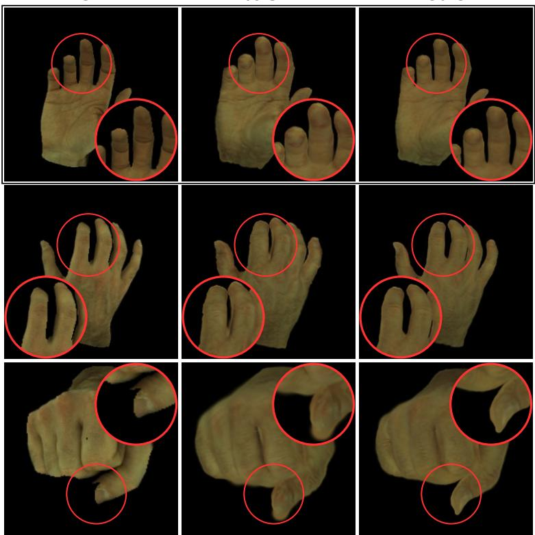  
Ours  
Figure S4: Qualitative effect of the Soft Alpha Band (SAB). Columns: ground truth (GT), without SAB (w/o SAB), and with SAB (Ours). The black box marks the input frame, and the remaining rows are novel poses. Red circles mark boundary regions magnified in the corner insets.

Figure S4 visualizes the boundary-level failure mode diagnosed in the main paper. Since the “w/o SAB” model retains the same constrained parameterization, the comparison isolates the effect of the regularizer. Without SAB, residual leakage concentrates in the thin band around finger boundaries and appears as blurred, apparently thickened contours, most visibly where adjacent fingers meet (red circles), whereas the full model keeps these silhouettes sharp. This qualitative gap is consistent with Table 4 of the main paper, where SAB raises the boundary F-score from 0.366 to 0.698 and more than halves alpha leakage (0.555 → 0.234), while interior coverage remains essentially unchanged (1.000 vs. 0.999). SAB therefore suppresses leakage without eroding valid hand regions, rather than improving the metrics by shrinking the silhouette.

GT  
Head-recipe port  
Body-recipe port  
Ours  
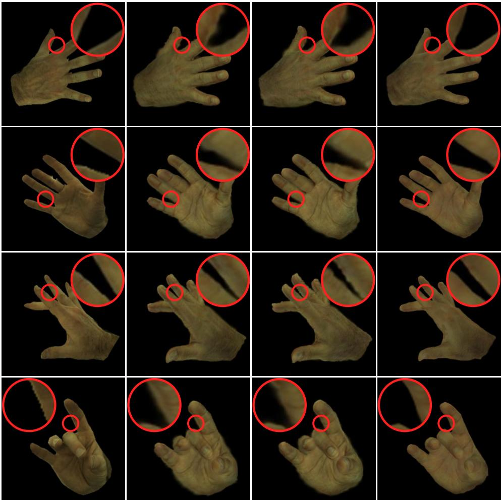  
Figure S5: Qualitative comparison with the recipe ports of Table 4 of the main paper. InterHand2.6M novel-pose/novel-view frames, with the source camera in the top row. Red circles mark inter-finger gaps and contours magnified in the corner insets.

Figure S5 shows matched renderings of the two recipe ports (Sec. E.2) alongside ours, on four frames chosen to expose inter-finger gaps and finger contours from the dorsal, palmar, and lateral sides. Each red circle marks the same location in every column. Both ports render the hand interior well, consistent with their interior coverage of 1.000, but blur the silhouette into a translucent fringe: the gaps between adjacent fingers partially fill with alpha, and finger and thumb contours widen, most visibly between the ring and little fingers (second row) and at the thumb–index junction (top row). The two ports look alike, in line with their close boundary F-scores of 0.299 and 0.267. Ours keeps the gaps open and the contours sharp on the same frames. The constrained model without SAB, which lies between the ports and ours in boundary F-score and leakage, is compared separately in Fig. S4.

## H.3 Qualitative Self-reconstruction Diagnostics

Source  
w/o transfer  
Ours  
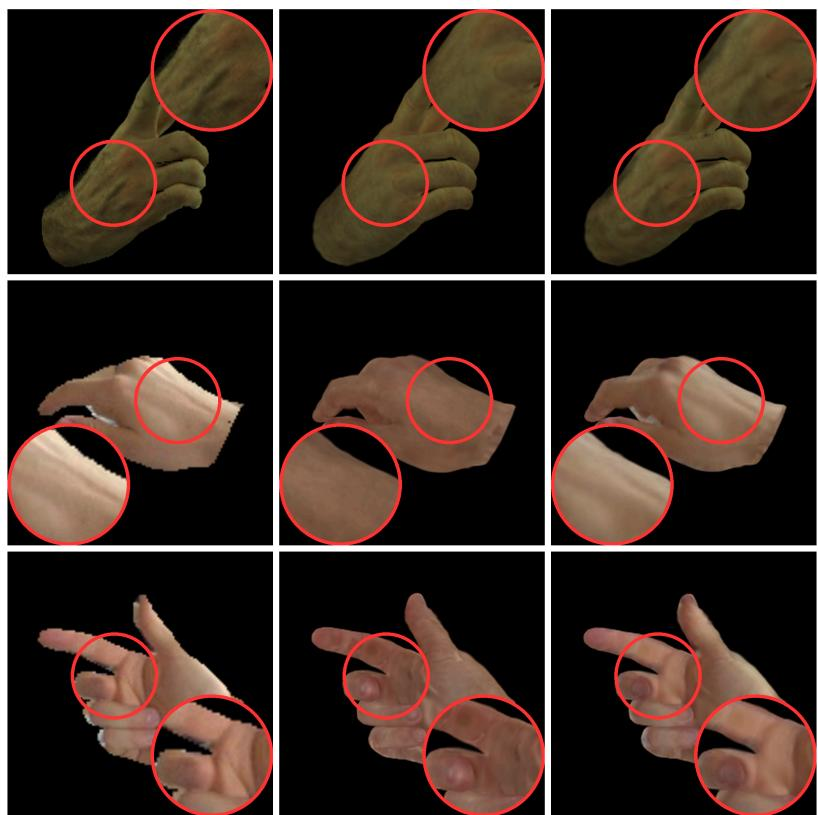  
Figure S6: Qualitative source-view appearance diagnostic with geometry fixed (protocol in Sec. C.5). Columns: source observation (Source), Stage-1 base colors (w/o transfer), and composed colors (Ours). Red circles mark regions magnified in the insets.

Figure S6 shows the diagnostic of Table S2 on representative frames. Because all non-color attributes are identical between w/o transfer and Ours, every visible difference is attributable to the sourceconditioned appearance module: relative to the Stage-1 base colors, the full model recovers the observed skin tone and source-observed local texture (circled regions), in line with the source-view gains of Table S2.

H.4 Branch-level Diagnostics of the Appearance Module  
Source  
w/o transfer  
Local-only  
Ours  
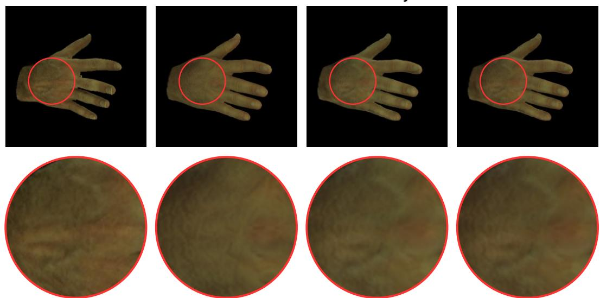  
Figure S7: Branch-level analysis of source-conditioned local detail transfer. Columns: source observation (Source), Stage-1 base colors (w/o transfer), the local-only variant (Local-only), and the full model (Ours) under the same source pose and view. The red circle marks the region magnified below.

Complementing the module-level evaluation above, we dissect the source-conditioned appearance module into branch-isolated variants. These are diagnostic probes of the appearance composition, not separate model configurations for the main comparison. The w/o transfer variant uses the Stage-1 base colors without source-conditioned refinement. The local-only variant uses Gaussian footprint-aligned local evidence and is designed to transfer source-observed local details such as skin wrinkles and vein-like texture. The full model combines footprint-aligned local observations, rendering-contribution-based reliability, the global source identity, and the Stage-1 base colors.

Figure S7 compares the variants under the same source pose and view, so that source-observed details can be traced from the input to each branch. The circled region on the dorsum contains subject-specific texture, such as vein-like patterns and skin creases, that the w/o transfer variant attenuates. The local-only branch and the full model both recover it from the source observation and are nearly indistinguishable in this view, consistent with the local-evidence pathway carrying source-observed detail in the full model. The contribution of the global source identity cannot be seen from the source view, since it matters most for Gaussians that the source does not observe. It appears instead on the prior-completed sides in the palm-facing renderings of Fig. S9 and the 360<sup>◦</sup> rotations of the supplementary video (Sec. K). This branch analysis is qualitative, and its quantitative counterparts are Table 3 of the main paper and Table S2.

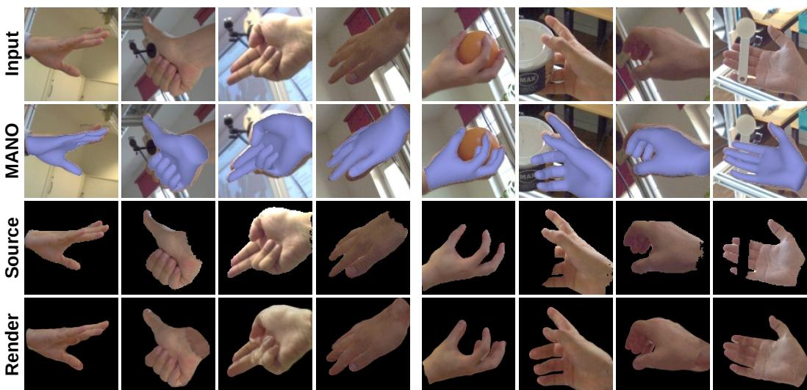  
Figure S8: Qualitative generalization to unseen FreiHAND [61] test images under fully estimated inputs. Rows: input frame (Input), WiLoR [37] pose overlay (MANO), SAM 3 [54] source crop (Source), and our render (Render). No ground-truth annotations or test-time optimization are used.

We show source-view reconstructions of unseen FreiHAND [61] test images to evaluate generalization beyond the benchmark datasets of the main paper. Unlike in the diagnostic of Sec. C.5, every input here is estimated. Given only a single input image, our method reconstructs plausible canonical Gaussian hand avatars in a fully feed-forward manner without subject-specific optimization or test-time fitting.

For these results, MANO parameters and camera estimates are obtained using WiLoR [37], and hand masks using SAM 3 [54]. The reconstructed avatars are rendered with the estimated camera parameters. Figure S8 shows eight representative examples. Each column documents every estimated input alongside the output, and FreiHAND’s ground-truth MANO annotations are not used. Failure cases are shown in the same format in Fig. S10 (Sec. I). The left four columns show unoccluded hands, and the right four involve hand–object interaction. The examples cover side views, thin finger structures, articulated and near-closed poses, and diverse skin tones. The overlays also reveal that the estimated poses are imperfect, as fingertips visibly deviate from the mesh in several columns. Nevertheless, the reconstructed avatars remain faithful to the observed appearance. In the rightmost column, the held object crosses the fingers near their bases and splits the estimated mask into disjoint pieces. The avatar still completes the masked-out finger segments with coherent appearance, because appearance is anchored on the canonical MANO surface and reliability gating falls back to the source-conditioned appearance prior where source evidence is missing. Unlike the benchmark evaluations, these results use estimated rather than ground-truth pose, camera, and mask inputs, so they illustrate the behavior of the full pipeline under real, uncontrolled upstream estimation errors. The corresponding quantitative comparison is Table 3 of the main paper and Table S8(b). Novelpose animation of avatars reconstructed under the same fully estimated inputs is shown in Fig. S9 (Sec. H.6).

H.6 Novel-pose Animation from a Single Image

#

Source

Animation results

Figure S9: Novel-pose animation from a single image. In each block, the top row shows the driving MANO poses and each subject row the source image followed by our renderings in those poses. All inputs are fully estimated. Best viewed zoomed in.

Figure S8 shows how faithfully an avatar reproduces its own source view, whereas Fig. S9 shows whether avatars reconstructed in the same way remain consistent once they are driven away from it. Eight subjects are reconstructed with the fully estimated pipeline of Sec. H.5, using WiLoR [37] pose and camera and a SAM 3 [54] mask, with no ground truth and no test-time optimization. From top to bottom, their sources are an in-the-wild image released with OHTA [23], FreiHAND [61], FreiHAND, a HARP [22] subject excluded from the training split, FreiHAND, ARCTIC [62] (not part of the training data), FreiHAND, and ARCTIC. The subjects are split into two blocks of four, and each block is driven by its own six poses, rendered from a camera fixed in the MANO frame. The two blocks share no poses. Within a block, every column therefore shows all four subjects in the same pose and from the same viewpoint. The top row of each block renders the driving MANO mesh from the same camera, and the second block includes palm-facing views.

Subject-specific texture is carried across poses without drifting toward a generic hand. The vitiligo pattern (row 1), the tattoo (row 4), and, more faintly, the motion-capture markers (row 8) stay attached to their anatomical locations under finger articulation and global rotation, including on the wrist and on fingers that are foreshortened or partially hidden in the source view. Fine detail is preserved only coarsely, as the line work of the tattoo is blurred and the markers appear as small light dots that are best seen in the supplementary video (Sec. K). Surfaces that are unobserved in the source are completed by the source-conditioned prior and remain coherent across views, as the palm-facing columns of the second block show for dorsal-side inputs. The second row deliberately uses the palm-facing input of the rightmost column of Fig. S8, whose SAM 3 mask is corrupted with missing finger segments. We use the mask as is, so the dorsal appearance of this avatar is entirely completed from the prior. The avatar nevertheless remains animatable and coherent, which complements the mask-failure analysis of Sec. I. No per-frame refinement is involved, since all Gaussian attributes are fixed after the single feed-forward pass. The identity consistency across columns is therefore a property of the canonical representation rather than of per-pose fitting. The same eight avatars are shown under continuous driving in the supplementary video, and four of them are also shown in full 360<sup>◦</sup> rotation (Sec. K).

## I Failure Cases and Limitations

Representative failure cases are shown in Fig. S10, in the input-documentation format of Fig. S8: the input frame (Input), the WiLoR [37] pose overlay (MANO), the SAM 3 [54] source crop (Source), and our reconstruction (Render).

First, our method inherits the inherent ambiguity of single-image hand reconstruction. Under severe self-occlusion the occluded surface is never observed, so its appearance is completed from the source-conditioned prior rather than transferred from evidence, and thin local structures that are only weakly observed are reconstructed with reduced fidelity. The upstream pose estimate on which the avatar is anchored also becomes less reliable in such views. Where the boundary of the observed set crosses a thin or strongly foreshortened part, such as the thumb in a dorsal view, source-driven and prior-completed colors meet on the same structure. If the observed tone differs from the prior, as when shading is baked into the source (the third point below), the transition appears as a visible seam rather than a gradual blend. Sec. A.4 discusses this boundary, and Sec. J.3 measures where such seams can occur (Fig. S12).

Second, all Gaussian attributes are fixed after the single forward pass. This keeps the identity consistent across poses, but the avatar does not model pose-dependent appearance. Wrinkles that form and shading that changes under strong articulation are not synthesized, whereas wrinkles visible in the source are transferred as texture. The representation also ends where the MANO template ends, and the avatar has no forearm. When the hand is viewed along the forearm, as in the 360<sup>◦</sup> rotations of the supplementary video, the open wrist boundary is visible, including the inner side of the template surface on which the Gaussians lie. The MANO-based baselines likewise end at the wrist. The anchor set is fixed as well, and the isotropic scales are predicted once in the canonical pose. Under strong flexion, skinning stretches the surface on the convex side of a joint and spreads neighboring anchors apart, but the splats are not enlarged to follow this stretch. Where the spacing exceeds the splat footprint, neighboring rows of splats separate, and the lattice becomes visible as fine striations at the knuckles. Enlarging the splats relative to the anchor spacing would close these gaps, but the same splats also form the silhouette. Rendering the prediction on the next subdivision level, which halves the anchor spacing, without shrinking the scales (row $^ { \ast } k = 4 , s _ { i } ^ { , \ast }$ of Table S11) doubles the footprint-to-spacing ratio. This raises alpha leakage from 0.234 to 0.293 and lowers the boundary F-score from 0.698 to 0.661, which is exactly the leakage that the scale ceiling and SAB are designed to suppress. The striations are a local effect, and since curvature is handled by density rather than by anisotropy (Sec. F.2), a finer subdivision level reduces them. Training at $k = 4$ , however, runs out of memory on our training GPUs (RTX A6000, 48 GB) and was not feasible with our resources.

Input  
MANO  
Source  
Render  
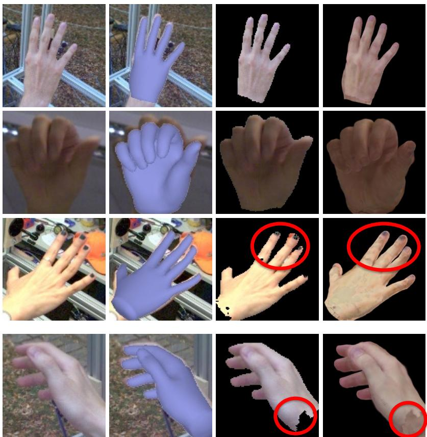  
Figure S10: Representative appearance failure cases. Columns: Input, MANO, Source, and Render (the row labels of Fig. S8). Red circles mark the affected regions in the third and bottom rows.

These striations can nevertheless be largely removed at inference without retraining. We keep the trained $k = 3$ network and its $^ { 4 9 , 2 8 1 }$ predicted Gaussians and place Gaussians on all 196,993 anchors of the next subdivision level $( k = 4 ,$ , continuing Table S6). The 49,281 anchors shared with $k = 3$ keep their predicted attribut ${ \mathrm { ^ { 3 } S } } ,$ and each of the 147,712 new anchors lies at the midpoint of a $k = 3$ edge and takes the average of all predicted attributes of the two endpoints, including the composed colors $\mathbf { c } _ { i } ^ { * }$ . Since the anchor spacing halves, every scale $s _ { i }$ is then multiplied by a single fixed factor, and the $k = 4$ Gaussians are skinned with the $k = 4$ weights and rendered as usual. This densification is a fixed post-processing step on the predicted Gaussians. It involves no per-subject or per-image optimization and uses neither the source image nor ground truth. Table S11 reports the sweep over the factor. Each of $0 . 5 s _ { i } , 0 . 6 s _ { i } .$ , and $0 . 7 s _ { i }$ improves LPIPS, boundary F, and alpha leakage on both benchmark ${ \bf \delta S , }$ while PSNR changes by $- 0 . 0 4 \mathrm { t o } - 0 . 0 6 \mathrm { d B }$ on InterHand2.6M and by +0.12 to +0.30 dB on HanCo, so the conclusion does not depend on the exact factor within this range. We use $0 . 6 s _ { i } ,$ chosen from the InterHand2.6M results without using HanCo, for Fig. S11 and the supplementary video (Part 4, Sec. K). Figure S11 shows three HanCo evaluation frames spanning the fist at the start of the sequence, selected by pose rather than by any metric. The jagged ground-truth boundary comes from the HanCo mask. In the $k = 3$ rendering, the anchor lattice appears as striations at the knuckles and near the wrist, where the avatar ends at the MANO template boundary, and the densified rendering removes most of them. Feeding the $k = 4$ anchors to the network directly instead worsens all five metrics of Table S11 on both benchmarks, so the gain comes from the rendering density rather than from the network. The overhead is small. Measured in the same run as the $k = 3$ avatar, the rendering speed stays within 1%, the Gaussian parameters grow from 3.4 MB to 13.4 MB, and the GPU memory added by rendering a frame grows from 13 MB to 38 MB. For comparison, the rendering peak of Sec. C.6, which also includes the CUDA context and the network, is 1.79 GB. Faint striations can remain at the most strongly flexed knuckles (bottom row of Fig. S11), and the factor is a single global constant rather than adapted to the local anchor spacing. All other results in this paper use the $k = 3$ avatar.

Table S11: Inference-time densification (Sec. I). The same trained $k = 3$ network is used throughout. $ { { } ^ { 6 } } k = 4$ input” feeds the $k = 4$ anchors to the network. The other $k = 4$ rows interpolate the $\bar { k } = 3$ prediction onto the $k = 4$ anchors and multiply every scale $s _ { i }$ by the stated factor, and $^ { \ast } k = 4 , s _ { i } ^ { , \ast }$ keeps the scales unchanged. Boundary metrics follow Sec. C.4. Bold marks the setting used for Fig. S11 and the supplementary video.
<table><tr><td></td><td colspan="5">InterHand2.6M</td><td colspan="5">HanCo (zero-shot)</td></tr><tr><td>Setting</td><td>PSNR↑</td><td>SSIM↑</td><td>LPIPS↓</td><td>Bnd. F↑</td><td>Leak.↓</td><td>PSNR↑</td><td>SSIM↑</td><td>LPIPS↓</td><td>Bnd. F↑</td><td>Leak.↓</td></tr><tr><td> $k = 3 ( \mathrm { T a b l e s } 1 , 2 )$ </td><td>26.21</td><td>0.866</td><td>0.133</td><td>0.698</td><td>0.234</td><td>20.18</td><td>0.836</td><td>0.188</td><td>0.617</td><td>0.314</td></tr><tr><td> $k = 4 \mathrm { i n p u t }$ </td><td>25.98</td><td>0.862</td><td>0.137</td><td>0.671</td><td>0.247</td><td>19.75</td><td>0.829</td><td>0.190</td><td>0.559</td><td>0.373</td></tr><tr><td> $k = 4 , s _ { i }$ </td><td>25.86</td><td>0.862</td><td>0.136</td><td>0.661</td><td>0.293</td><td>19.68</td><td>0.831</td><td>0.189</td><td>0.542</td><td>0.381</td></tr><tr><td> $k = 4 , 0 . 8 5 s _ { i }$ </td><td>26.06</td><td>0.864</td><td>0.132</td><td>0.697</td><td>0.244</td><td>20.04</td><td>0.837</td><td>0.184</td><td>0.613</td><td>0.321</td></tr><tr><td> $k = 4 , 0 . 7 s _ { i }$ </td><td>26.15</td><td>0.865</td><td>0.130</td><td>0.711</td><td>0.205</td><td>20.30</td><td>0.840</td><td>0.181</td><td>0.668</td><td>0.269</td></tr><tr><td> $k = 4 , 0 . 6 s _ { i }$ </td><td>26.17</td><td>0.865</td><td>0.129</td><td>0.708</td><td>0.185</td><td>20.41</td><td>0.842</td><td>0.179</td><td>0.693</td><td>0.239</td></tr><tr><td> $k = 4 , 0 . 5 s _ { i }$ </td><td>26.15</td><td>0.863</td><td>0.129</td><td>0.701</td><td>0.168</td><td>20.48</td><td>0.842</td><td>0.178</td><td>0.708</td><td>0.215</td></tr></table>

GT  
Ours (49K)  
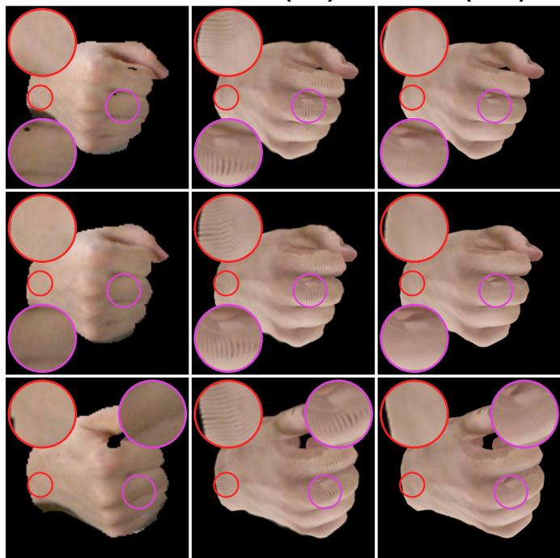  
Ours (197K)  
Figure S11: Inference-time densification. Columns: ground truth, the $k = 3$ avatar used throughout the paper (49K Gaussians), and the same prediction densified onto the $k = 4$ anchors (197K, scales $0 . 6 s _ { i } ,$ Table S11). Rows: three HanCo evaluation frames. Magenta circles mark knuckles and red circles the wrist, each magnified in the matching corner inset.

Third, Fig. S10 collects appearance failures that arise while the hand itself is fully observed. These failures fall into two regimes, which the input columns separate explicitly. In the first regime (top three rows), the Source crop retains the evidence that the failure concerns, so the failure lies in the appearance composition itself. The top two rows share one cause. Illumination and intrinsic appearance are entangled in the composed colors, because shading baked into the source is carried as albedo rather than separated from it (Sec. G.2). This entanglement has two signatures. A strongly overexposed, washed-out source is rendered with a more saturated skin tone than observed, and an underexposed tone is absorbed into the albedo and, since all attributes are fixed after the forward pass, carried to every novel pose. These two rows are left unmarked because the illumination shift affects the whole hand. The third row concerns a rare cosmetic attribute that the transfer does not carry. Dark nail pigment inside the source crop is composed as diffuse skin discoloration around the fingertips and nails rather than reproduced as painted nails. The nails in the source crop and the fingertip blotches they become are circled at the same image location in the Source and Render columns.

Table S12: Pose-stratified evaluation of our method. Terciles follow Sec. C.8, and ranges are in degrees.
<table><tr><td></td><td colspan="4">InterHand2.6M</td><td colspan="4">HanCo (zero-shot)</td></tr><tr><td>Tercile</td><td>Range</td><td>PSNR↑</td><td>SSIM↑</td><td>LPIPS↓</td><td>Range</td><td></td><td>PSNR↑ SSIM↑</td><td>LPIPS↓</td></tr><tr><td colspan="9">Palm-orientation change</td></tr><tr><td>Easy</td><td>0-79</td><td>26.37</td><td>0.863</td><td>0.133</td><td>0-82</td><td>20.67</td><td>0.842</td><td>0.169</td></tr><tr><td>Medium</td><td>80-115</td><td>25.67</td><td>0.858</td><td>0.140</td><td>82-128</td><td>19.70</td><td>0.826</td><td>0.212</td></tr><tr><td>Extreme</td><td>116-179</td><td>26.61</td><td>0.876</td><td>0.126</td><td>129-180</td><td>20.15</td><td>0.840</td><td>0.183</td></tr><tr><td colspan="9">Finger-articulation change</td></tr><tr><td>Easy</td><td>0-11</td><td>27.37</td><td>0.888</td><td>0.106</td><td>0-22</td><td>20.89</td><td>0.851</td><td>0.177</td></tr><tr><td>Medium</td><td>11-17</td><td>26.56</td><td>0.875</td><td>0.119</td><td>22-43</td><td>20.67</td><td>0.845</td><td>0.174</td></tr><tr><td>Extreme</td><td>17-56</td><td>24.68</td><td>0.834</td><td>0.175</td><td>43-56</td><td>18.96</td><td>0.812</td><td>0.213</td></tr><tr><td>All</td><td></td><td>26.21</td><td>0.866</td><td>0.133</td><td></td><td>20.18</td><td>0.836</td><td>0.188</td></tr></table>

Table S13: Articulation-stratified comparison on the finger-articulation terciles of Table S12.
<table><tr><td></td><td colspan="4">PSNR↑</td><td colspan="4">LPIPS↓</td></tr><tr><td>Tercile</td><td>Ours</td><td>OHTA</td><td>HandAvatar</td><td>BIGS*</td><td>Ours</td><td>OHTA</td><td>HandAvatar</td><td>BIGS*</td></tr><tr><td colspan="9">InterHand2.6M</td></tr><tr><td>Easy</td><td>27.37</td><td>27.23</td><td>24.90</td><td>21.30</td><td>0.106</td><td>0.103</td><td>0.150</td><td>0.168</td></tr><tr><td>Medium</td><td>26.56</td><td>26.43</td><td>24.21</td><td>20.38</td><td>0.119</td><td>0.115</td><td>0.163</td><td>0.191</td></tr><tr><td>Extreme</td><td>24.68</td><td>24.66</td><td>22.24</td><td>19.67</td><td>0.175</td><td>0.169</td><td>0.223</td><td>0.277</td></tr><tr><td colspan="9">HanCo (ours zero-shot, baselines fitted to the source frame)</td></tr><tr><td>Easy</td><td>20.89</td><td>20.12</td><td>19.88</td><td>18.60</td><td>0.177</td><td>0.177</td><td>0.194</td><td>0.224</td></tr><tr><td>Medium</td><td>20.67</td><td>20.53</td><td>20.77</td><td>17.99</td><td>0.174</td><td>0.172</td><td>0.185</td><td>0.228</td></tr><tr><td>Extreme</td><td>18.96</td><td>19.53</td><td>20.32</td><td>16.51</td><td>0.213</td><td>0.209</td><td>0.216</td><td>0.287</td></tr></table>

In the second regime (bottom row), the failure is inherited from a corrupted mask input, consistent with our assumption of externally provided segmentation. The source crop is torn at the wrist, and evidence along the tear boundary leaks into the composed appearance (the circles mark the wrist tear and the resulting brown discoloration). The contrast with the rightmost column of Fig. S8 delimits where reliability gating operates. When fragmentation removes a region outright, reliability gating routes it to the source-conditioned appearance prior and the region is completed coherently, as the second row of Fig. S9 shows for one such fragmented input. Evidence that survives at a defect boundary, however, is locally indistinguishable from valid observation and is accepted as such. In all cases shown, the MANO-anchored geometry remains plausible, the torn wrist silhouette of the bottom row is itself completed by the anchors, and the failures are confined to the appearance branch.

Separating illumination from intrinsic appearance is left for future work (Sec. G.2). The cosmeticattribute failure reflects the limited coverage of such attributes in existing hand avatar datasets, and the mask-inherited failure diminishes as upstream segmentation improves. Extending feed-forward Gaussian hand avatars to more diverse real-world conditions and hand–object interaction scenario remains an important direction for future work.

## J Additional Analyses

This section analyzes the evaluation results along three axes that aggregate metrics do not separate, namely pose difficulty, temporal stability under continuous driving, and the reliability, opacity, and boundary continuity of the canonical avatar. The protocols are given in Sec. C.8, and the posestratified and temporal numbers use the same renders and ground truth as Tables 1 and 2 of the main paper.

## J.1 Pose-stratified Evaluation

Table S12 splits both benchmarks into equal-count terciles of the palm-orientation and fingerarticulation change from the source pose. On both benchmarks, the evaluation subject is unseen during training, and HanCo is also unseen as a dataset (Sec. B.1). The terciles therefore show how the quality of an avatar reconstructed from a single image of an unseen hand, without testtime optimization, changes as the pose and view move away from that image. The effect of palm orientation is non-monotonic. On both datasets, the middle tercile is the lowest, 0.70 and 0.97 dB below the easiest on InterHand2.6M and HanCo, respectively. In this tercile, the median viewing direction has turned by $8 4 ^ { \circ }$ relative to the hand on both datasets, so the hand is seen nearly edge-on. The extreme tercile is viewed mostly from the side that the dorsal source images do not observe, with a median viewing change of $1 0 6 ^ { \circ }$ on InterHand2.6M and $1 2 1 ^ { \circ }$ on HanCo. This tercile is 0.24 dB above the easiest on InterHand2.6M and 0.52 dB below it on HanCo. Finger articulation has a larger effect, concentrated in the extreme tercile. Relative to the easiest tercile, quality decreases by 0.81 and 0.22 dB in the middle tercile on InterHand2.6M and HanCo, respectively, and by 2.69 and 1.93 dB in the extreme tercile.

Table S14: Excess temporal variation on HanCo (Eq. S6, 75 consecutive-frame pairs per camera). Ours is zero-shot, and the baselines are fitted to the source frame. GT change: mean change between consecutive ground-truth frames. Method columns give $E _ { t }$ relative to $\mathbf { i t } ,$ where 0 means as much change as the footage and positive values mean additional variation. cam6 is the source view, and the last row is the mean of the absolute per-camera values.
<table><tr><td>Camera</td><td>GT change</td><td>Ours</td><td>OHTA</td><td>HandAvatar</td><td>BIGS*</td></tr><tr><td>cam3</td><td>0.0362</td><td>+1.1%</td><td>-5.1%</td><td>-17.6%</td><td>+37.8%</td></tr><tr><td>cam5</td><td>0.0319</td><td> $+ 7 . 3 \%$ </td><td>+5.0%</td><td>-8.7%</td><td>+50.5%</td></tr><tr><td>cam6 (source view)</td><td>0.0360</td><td>+2.6%</td><td>-2.2%</td><td>-23.3%</td><td>+30.7%</td></tr><tr><td>cam7</td><td>0.0412</td><td>+8.0%</td><td>+2.2%</td><td>-15.6%</td><td>+34.9%</td></tr><tr><td>Mean of |.|</td><td>0.0363</td><td>4.7%</td><td>3.6%</td><td>16.3%</td><td>38.5%</td></tr></table>

Table S13 scores all methods on the same articulation terciles of both datasets. On InterHand2.6M, the per-frame renders of the baselines average to their numbers in Table 1 of the main paper within 0.01 dB. On HanCo, our avatar is reconstructed zero-shot, whereas each baseline is optimized on the source frame of the subject (Table 2 of the main paper). In LPIPS, the extreme articulation tercile is the hardest for every method on both datasets, not only for ours. On InterHand2.6M, all four methods also lose PSNR from the easiest to the extreme tercile, by 1.63–2.69 dB, and ours remains the highest in PSNR in every tercile. On HanCo, BIGS<sup>∗</sup> and ours lose 2.09 and 1.93 dB, whereas OHTA and HandAvatar change by −0.59 and $+ 0 . 4 4 \mathrm { d B }$ . The PSNR gain of HandAvatar is not matched by LPIPS, which worsens from 0.194 to 0.216 over the same terciles. Its renderings have a uniform tone without shading (Sec. G.2) and change less than the footage over time (Sec. J.2). Such smooth renderings keep the squared pixel error low even when the appearance of the hand changes, so PSNR can rise while LPIPS worsens. In the extreme tercile, ours is below OHTA and HandAvatar in PSNR, at 18.96 dB against 19.53 and 20.32 dB. Our larger drop on HanCo is consistent with the limitation that our colors are fixed after the forward pass, so wrinkles and shading that appear under strong articulation are not synthesized (Sec. I). These data, however, do not isolate the cause, since on InterHand2.6M OHTA and HandAvatar, which model self-occlusion shading (Sec. G.2), lose about as much PSNR as ours (2.57 and 2.66 dB).

## J.2 Temporal Stability

Table S14 reports temporal stability on the continuous HanCo sequence. Our avatar is evaluated zero-shot, as neither the subject nor the dataset is seen during training and no test-time optimization is performed. Every time step except that of the source frame shows a novel pose, and three of the four cameras show a novel view. Under these conditions, our renderings remain within 8.0% of the ground-truth change on every camera, with a mean absolute excess of 4.7%. To calibrate this value, we add a per-frame brightness jitter of ±1% to our own renderings. The excess pooled over all pairs then increases from $+ \bar { 4 } . 8 \% \mathrm { t \bar { o } + 1 2 . 4 \% }$ , and further to +22.0% and +43.1% for ±2% and ±4%. A 1% flicker thus adds 7.6 points, which exceeds our mean absolute excess of 4.7%. By contrast, the per-subject 3DGS fit BIGS<sup>∗</sup> exceeds the ground-truth change by 30.7–50.5% across the four cameras, which is consistent with view-specific appearance noise from single-view optimization. OHTA, which optimizes its avatar on this subject for 3360 s (Table 2 of the main paper), is closest to zero, with a mean absolute excess of 3.6%, although its sign differs across cameras. Its stability is therefore comparable to that of our feed-forward avatar. HandAvatar changes less than the footage on every camera, by 8.7–23.3%, consistent with the uniform tone without shading noted in Sec. G.2.

Input

Source view

Orbit 90°

InterHand2.6M

Orbit 180°

Orbit 270°

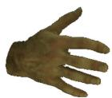

Color(c\*)

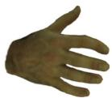

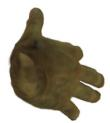


Reliabilityγ

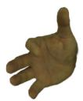

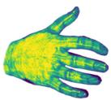

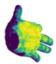

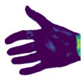

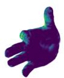

HanCo (zero-shot)

Color(c\*)

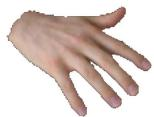


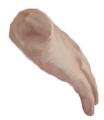


Reliabilityγ

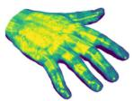

Reliability γ

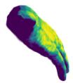


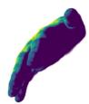

0.5

Figure S12: Canonical color and observation reliability. Final colors $\mathbf { c } ^ { * }$ (top) and reliability γ (bottom) of each canonical avatar, rendered from the source view and from an orbit of the source camera about the hand, with the same viewpoints and crops in both rows.

InterHand2.6M

Input

Source view

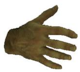

Orbit 270°

Orbit 90°

Orbit 180°

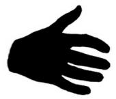


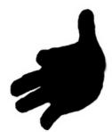

HanCo

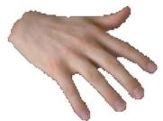

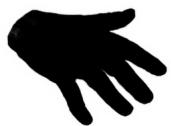

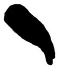

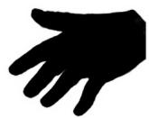

Rendered alpha A

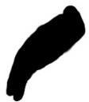  
0.5

Figure S13: Rendered opacity (accumulated alpha A) of the canonical avatars from the views of Fig. S12. The straight cut in the $1 8 0 ^ { \circ }$ view is the wrist opening of the MANO template.

Because the canonical Gaussians are fixed after the single forward pass, the representation itself cannot drift, and the remaining variation arises from the pose-driven deformation and the rendering.

## J.3 Reliability, Opacity, and Boundary Continuity on the Canonical Avatar

Figure S12 shows that γ is high on the dorsal surface visible in the input, decreases at grazing angles, and is exactly zero on the side that the input does not observe. Specifically, 55.1% of the Gaussians on InterHand2.6M and 61.6% on HanCo have $\gamma _ { i } = 0 ;$ , and these Gaussians are colored by the Stage-1 prior and the source-level shift alone. Because $\Delta _ { s } ^ { a i d }$ is shared by all Gaussians, the color update of these Gaussians is spatially uniform, with a standard deviation below $1 0 ^ { - 7 }$ across Gaussians. The module therefore cannot create a color boundary inside the unobserved region, and a seam between transferred and prior-completed colors can arise only where observed and unobserved Gaussians meet.

At the reliability threshold $\gamma _ { i } = 0 . 5 .$ , the color step is small. The median ∆E between neighbors on either side of the threshold is 1.75 on InterHand2.6M and 1.91 on HanCo, which is 1.05× and 1.32× the variation between neighbors inside the high-reliability set (1.67 and 1.45) and below the commonly cited just-noticeable difference of about 2.3. The step is larger where a high-reliability Gaussian directly neighbors a low-reliability one without a transition band. This occurs for 79 pairs on InterHand2.6M and 209 pairs on HanCo, or 0.9% and 3.1% of the straddling pairs, with a median $\Delta E$ of 8.8 and 10.0. These pairs mark where the seams discussed in Sec. I can appear. Both steps are larger on HanCo, at 1.32× against 1.05× the reference and 10.0 against 8.8 for the strict pairs. This is consistent with a larger local correction on HanCo, where the mean $\lVert \mathbf { c } _ { i } ^ { * } - \mathbf { c } _ { i } ^ { 0 } - \Delta _ { s } ^ { a i d } \rVert$ over the Gaussians with $g _ { i } \gamma _ { i } > 0$ is 0.163, against 0.056 on InterHand2.6M. The unobserved side, in contrast, receives only $\Delta _ { s } ^ { a i d }$ , which on HanCo reaches the bound of 0.1 per channel set by $\delta _ { i } = 0 . 1 \operatorname { t a n h } ( \cdot )$ (Sec. A.5) and amounts to a uniform brightening.

Figure S13 shows that the rendered opacity is equally high in every view. The mean of A over the opaque region $( A ~ \geq ~ 0 . 5 )$ is 0.99 in every view of both datasets. Semi-transparent pixels $( 0 . 0 5 \leq A < 0 . 5 )$ ) amount to 3.5–5.2% of the opaque area, and this fraction is similar on the observed and unobserved sides, for example 4.5% in the source view and 3.9% at 180<sup>◦</sup> on InterHand2.6M. The silhouettes show neither the translucent fringe of the recipe ports (Fig. S5) nor holes on the unobserved side.

## K Supplementary Video

We provide a single supplementary video (InstantHand\_Supplementary\_Video.mp4, 3 min 9 s) in four parts. In every part, all of our renderings are projections of one fixed set of canonical Gaussians per subject, with no view-dependent parameters, no image-space refinement, and no per-frame fitting or update. The avatar representation therefore cannot drift over time: frame-to-frame changes in the renderings come only from the driving pose and the rendering itself, and Sec. J.2 quantifies them on HanCo. Temporal stability and multi-view consistency are difficult to convey with still frames, so we encourage readers to view the video directly.

Parts 1–2: benchmark subjects. Part 1 follows the InterHand2.6M protocol of Sec. C.1 and Part 2 the zero-shot HanCo protocol of Sec. C.2, where the source subject is unseen and no test-time optimization is performed. In both parts the avatar is reconstructed from the protocol-designated source frame with its ground-truth MANO, camera, and mask. Each part shows (i) the single source input image together with the reconstructed canonical avatar, (ii) full $3 6 0 ^ { \circ }$ yaw and pitch rotations of the canonical 3D avatar, and (iii) continuous novel-pose driving. In the rotations, the prior-completed side comes into view as the hand turns away from the source view, so the transition between the source-observed and prior-completed sides can be inspected directly. Each driving pose is rendered synchronously from six fixed cameras: the source camera, the reference camera in which the driving sequence is defined, and four fixed novel cameras at azimuth offsets of $+ 6 0 ^ { \circ } , + 1 2 0 ^ { \circ } , + 1 5 0 ^ { \circ }$ , and $- 6 0 ^ { \circ }$ from that reference. Both parts are driven by the same 35.2 s MANO pose sequence, assembled from a diverse set of hand gestures with short holds and interpolation between them. The sequence is disjoint from the evaluation frames of either dataset, covers a wider range of poses than either evaluation sequence, and shows the InterHand2.6M and HanCo avatars in identical poses. No groundtruth images exist for these poses, so the driving segments are qualitative. All quantitative novel-pose results (Tables 1, 2, and 3 of the main paper) are computed on the evaluation sequences.

Part 3: unseen subjects under fully estimated inputs. Part 3 shows the eight unseen subjects of Fig. S9 (Sec. H.6), reconstructed from fully estimated inputs (SAM 3 mask and WiLoR MANO and camera, with no ground-truth annotations). It first shows 360<sup>◦</sup> yaw rotations, together with a small pitch sweep, of the canonical avatar for four subjects: a dorsal ARCTIC input, the palm-facing FreiHAND input whose fragmented SAM 3 mask is used as is (row 2 of Fig. S9), the dorsal in-thewild OHTA input with a vitiligo pattern, and a FreiHAND input with a darker skin tone. In each, the side not visible in the source is completed from the source-conditioned prior, so the rotations expose the transition between the observed and completed sides. Part 3 then drives all eight subjects, two at a time, with a shared MANO pose sequence of diverse hand gestures, rendered from three camera fixed in the MANO frame at azimuths of $0 ^ { \circ } , + 4 5 ^ { \circ }$ , and +90<sup>◦</sup>.

Part 4: comparison with ground truth and per-subject baselines. Part 4 replays the HanCo evaluation sequence of Table 2 of the main paper from the source camera, placing the ground-truth frames beside our zero-shot renderings and those of HandAvatar [20], OHTA [23], and BIGS<sup>∗</sup>, which are fitted to the same source frame, in the column order of Fig. 4 of the main paper. Each column header lists the avatar-acquisition time of the method from Table 2 of the main paper. Every frame of the sequence is shown in order, and all methods are driven by the same frames, so the four renderings differ only in the method that produced them. All panels are shown at the native 256 × 256 evaluation resolution without resampling. HanCo is recorded at 5 Hz [55], so consecutive evaluation frames are 0.2 s apart and the replay, which shows each frame for 0.1 s, advances in visible steps in every column, including the ground truth. Part 4 closes with the same frames rendered by the same trained avatar with its Gaussians densified at inference (Sec. I, 197K instead of 49K Gaussians, scales 0.6 s<sub>i</sub>), beside the ground truth and the k = 3 rendering used throughout the paper. Part 4 is the only part that can be checked against real footage, because the 360<sup>◦</sup> rotations and gesture sequences of Parts 1–3 were never recorded for these subjects.

## L Reproducibility Statement

The full model is specified in the main paper (Eqs. 1–17). All loss terms are defined in Sec. A.2, the Soft Alpha Band construction and schedule in Sec. A.3, the design rationale and thresholds of reliability gating (Eq. 8) in Sec. A.4, and the network architecture in Sec. A.5. Notation is consistent between the main paper and the appendix. All real training datasets and both evaluation datasets are publicly available (Sec. B), with preprocessing, annotation sources, subject and frame counts, and the complete sampling policy documented in Secs. A.1–B.3. The synthetic training data are generated following the published protocol of Zhao et al. [53]. All loss weights, learning rates, schedules, and batch sizes are reported with their final values in Sec. A.1. Evaluation sequences, designated source frames, crops, masks, metric computation, boundary-aware silhouette definitions, the scope of the self-reconstruction diagnostic, timing exclusions and the end-to-end runtime breakdown, per-baseline input protocols, and the provenance of all baseline numbers are specified in Secs. C–E. The protocols of the pose-stratified, temporal, and canonical analyses are given in Sec. C.8. The source-side MANO and mask sensitivity protocol and the inference-time reliability sensitivity settings are specified in Secs. F.3 and F.4, and the inference-time densification in Sec. I. All such variants keep the trained checkpoint fixed. Training uses four NVIDIA RTX A6000 GPUs (approximately 25 and 13 hours for the two stages), and all timing and efficiency measurements use a single NVIDIA A100 (80 GB) under the protocol of Sec. C.6. The reported 2.84 s is the avatar-network inference time once common MANO, camera, and mask inputs are available, and the corresponding end-to-end raw-image-to-avatar time, including SAM 3 and WiLoR estimation, is approximately 3.30 s (Table S3). Code, pretrained models, and the evaluation scripts are available at https: //github.com/coolho1129/InstantHand, and videos and further results are on the project page, https://coolho1129.github.io/InstantHand-page/.