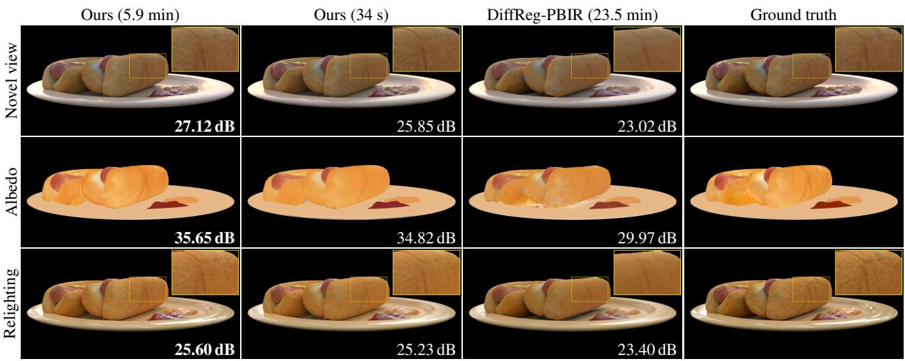
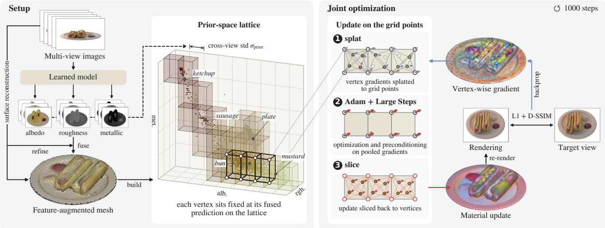
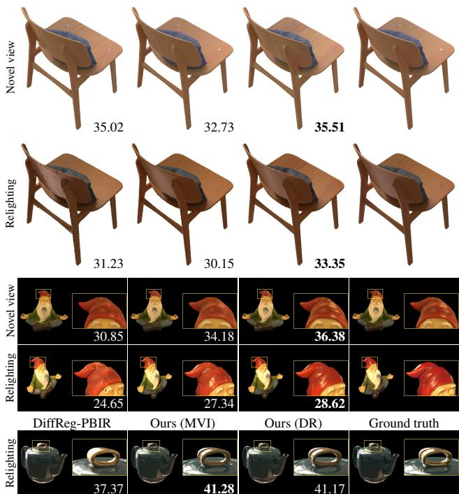
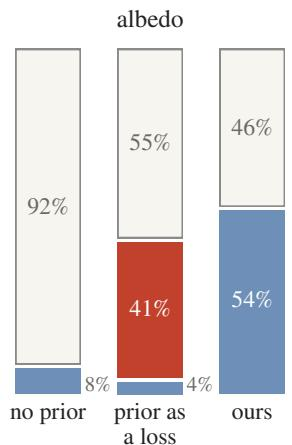
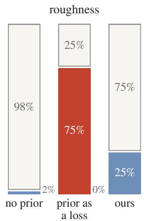
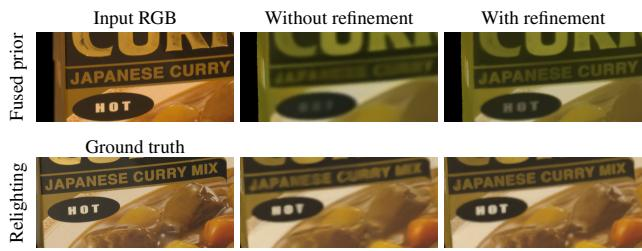
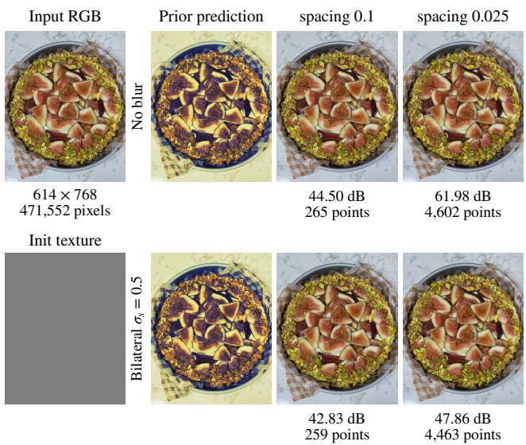
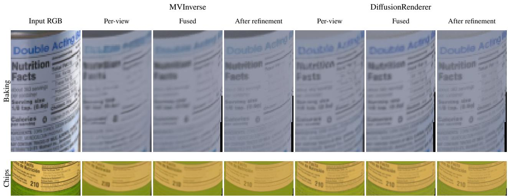

# Integrating Learned Priors through Prior-Space Reparameterization for Physically Based Inverse Rendering

Hun Hwangbo1 Minjun Park1 Yongsung Kim1 Wooseok Song2 Jungmin Ko2 Junghyun Hwang3 Sungroh Yoon1,2,3

1IPAI, 2ECE, 3FAM, Seoul National University https://github.com/hunhwb/PRep-IR

  
Figure 1. Learned priors as a material reparameterization. Novel view, albedo and relighting of TensoIR-Synthetic hotdog. All three use DiffusionRenderer as prior. Times are joint optimization stage time.

## Abstract

Physically based inverse rendering decomposes appearance into materials and illumination, an ambiguous problem for which learned material predictions provide useful prior information. Most existing methods incorporate these cues through auxiliary regularization losses, which alter the optimization objective and require balancing their influence against photometric fitting. We propose a priorguided material reparameterization that uses the predicted feature relationships to restrict the optimization space while leaving the objective unchanged. We fuse multi-view material predictions onto a mesh and construct a permutohedral lattice in the resulting prior feature space. Surface points with similar predictions share material variables, which are optimized jointly with geometry and illumination using a purely photometric objective. Experiments with

two learned predictors on three synthetic benchmarks and Stanford-ORB demonstrate improved material decomposition and relighting. Our method improves relighting PSNR by 1.5–2.5 dB over the strongest evaluated mesh-based baseline on Synthetic4Relight and TensoIR-Synthetic, and outperforms a regularization loss using the same prior in controlled comparisons. Wefurther show that our reparameterization pools noisy photometric gradients, producing updates that are more consistent across sampled views. This consistency enables a shortenedjoint optimization schedule that takes less than a minute while retaining relighting quality above all evaluated baselines on TensoIR-Synthetic.

## 1. Introduction

Physically based inverse rendering recovers the geometry, materials and illumination of a scene from photographs, enabling relighting, editing and novel-view rendering. The task is inherently ambiguous in that different combinations of materials and illumination can explain the same observations. When materials are optimized independently at each surface point, this ambiguity can cause shadows and highlights to be absorbed into the recovered reflectance.

Learned material predictors provide useful cues for resolving this ambiguity. Although their predictions may contain errors, they often reliably reveal which surfaces have similar materials [19, 25, 39, 41]. Recent inverse rendering methods incorporate these cues through auxiliary losses that anchor materials to predicted values [45], distill a material diffusion model [29], or encourage points with similar predictions to have similar materials [28]. Such regularization losses can help guide the decomposition, but they also alter the objective and shift the resulting solution. The strength of the regularization loss must therefore be balanced against the primary photometric loss, and choosing this balance is itself non-trivial. This motivates an alternative: using learned prior predictions to reduce the degrees of freedom and restrict the optimization space. Specifically, we use relationships between vertices inferred from these predictions to define how material variables are linked, leaving the optimization objective unchanged.

In this work, we propose a prior-guided material reparameterization for physically based inverse rendering. We fuse multi-view material predictions of learned models onto a mesh and construct a permutohedral lattice [1] in the resulting prior feature space. Surface materials are represented by shared lattice variables, coupling points with similar predictions even when they are spatially distant. We optimize the lattice values jointly with geometry and illumination using a purely photometric objective.

Experiments on Synthetic4Relight, TensoIR-Synthetic, DTC-Synthetic and Stanford-ORB demonstrate the effectiveness of this approach with two different learned predictors. With either predictor, our method improves relighting PSNR by 1.5–2.5 dB over the strongest evaluated meshbased baseline on Synthetic4Relight and TensoIR-Synthetic and achieves competitive results on real captures.

We also analyze individual vertex updates at a single optimization step across controlled baselines that only differ in how the prior is incorporated. Our novel reparameterization significantly removes noise in the individual gradients and produces updates that are more robust and consistent across sampled views. Exploiting this increased consistency, we also demonstrate that the optimization schedule can be greatly compacted. Relighting quality remains above all evaluated baselines on TensoIR-Synthetic, with less than a minute for the joint optimization stage.

Our contributions are:

• A material reparameterization that incorporates learned prior prediction through a prior-space lattice representation without changing the optimization objective.

• State-of-the-art relighting among mesh-based inverse rendering methods on synthetic benchmarks, with effective transfer to real captures.

• Substantially faster optimization for inverse rendering with little loss in quality, enabled by the more consistent material updates induced by our reparameterization.

## 2. Related Work

## 2.1. Inverse Rendering

Inverse rendering separates the intrinsic properties of an object from its illumination, with common approaches falling into two families. Optimization-based methods treat materials and lighting as free variables and fit them to the observations, on meshes [12, 28, 31, 36], on Gaussian primitives [8, 10, 11, 26, 37, 45], or on hybrids of the two [27, 40]. They explicitly fit the input images, but the many material degrees of freedom can allow shadows and highlights to be absorbed into the material. Learning-based methods train a network on large, mostly synthetic datasets to predict materials directly, usually either with image [14, 17, 19, 35, 41] or video diffusion models [9, 13, 25, 32, 42]. There are also approaches that use multi-view transformers such as MVInverse [39], MVID [7], LIRM [23] or LSRM [24]. They are fast and capture the overall structure, but are not guaranteed to be consistent across views or to faithfully reproduce the observed images.

## 2.2. Integrating Priors in Inverse Rendering

Hand-crafted priors, such as total variation, smoothness of the material maps, or a white-light assumption, have long been added to optimization-based inverse rendering pipelines as regularization losses [10–12, 26, 31, 36]. Recently, learned priors are increasingly injected the same way. DiffReg-PBIR [28] uses only the structure of the G-buffers predicted by DiffusionRenderer [25]: a jointbilateral regularizer on a permutohedral lattice encourages points with similar predicted materials to have similar optimized materials. PTIR-GS [45] regularizes the optimized material properties by anchoring the optimization to predictions from RGB↔X [41]. MaterialFusion [29] distills a material diffusion model into the optimized albedo and roughness through a score-distillation loss. All of these methods add an auxiliary term to the photometric objective. MaterialClusterGS [43] instead restricts the degrees of freedom, exploiting the fact that a real scene contains few distinct materials, and softly assigns primitives to a fixed-size material palette. Like DiffReg-PBIR, we use similarities in predicted materials. In our method, these similarities define shared variables rather than being incorporated as an auxiliary loss.

## 2.3. Preconditioning and Reparameterization

Poor conditioning of the loss landscape and noisy gradient estimates can slow the convergence of gradient-based optimization. Adaptive coordinate scaling, as in Adam [18], and spatial smoothing, as with Sobolev gradients [33], modify the updates to improve optimization. A linear change of variables can also couple updates without adding a loss [33, 34]. When the map spans the original variable space, it preserves the set of attainable solutions; a lowerrank map additionally constrains the representation.

In inverse rendering, Large Steps [34] uses a mesh-based change of variables to couple geometry updates and permit larger steps. Chang et al. [5] further improve this smoothing through a spatiotemporal bilateral filter, by combining cross-bilateral spatial filtering with Adam’s temporal averaging to suppress noise while preserving sharp features.

In computational photography, bilateral-space methods lift pixels into a grid indexed by position and color, operate on its few vertices, and slice the result back to the pixels. Grouping pixels by position and color supports edgeaware processing, while the compact grid makes filtering and global optimization efficient [1, 2, 6, 21]. For example, Barron et al. [3] optimize stereo for synthetic defocus using this idea: disparity maps are smooth within regions of similar color and sharp across their edges, and the optimization can run on a smaller subspace, with far fewer variables using bilateral grids than with pixels. Our method follows the same principle. We use learned material-prior features to define the optimization space, representing surface materials through shared lattice variables in this space.

## 3. Preliminaries

## 3.1. Linear Reparameterization

Let $\mathbf { x } \in \mathbb { R } ^ { n }$ be the variables of an objective $\mathcal { L } ( \mathbf { x } ) , e . g .$ per-vertex materials. Instead of x, one can optimize latent variables $\mathbf { w } \in \mathbb { R } ^ { k }$ through a fixed linear map,

$$
\begin{array} { r } { \mathbf { x } = \mathbf { x } _ { 0 } + \mathbf { P } \mathbf { w } , } \end{array}\tag{1}
$$

with $\mathbf { P } \in \mathbb { R } ^ { n \times k }$ and a constant $\mathbf { x } _ { \mathrm { 0 } }$ . The chain rule gives $\partial \mathcal { L } / \partial \mathbf { w } = \mathbf { P } ^ { \top } \partial \mathcal { L } / \partial \mathbf { x }$ , so a gradient descent step of size η on w moves x by

$$
\Delta \mathbf { x } = - \eta \mathbf { P P } ^ { \top } \frac { \partial \mathcal { L } } { \partial \mathbf { x } } .\tag{2}
$$

The map determines both the representable values, ${ \bf x } _ { 0 } + { }$ range(P), and their update coupling, $\mathbf { P P } ^ { \top }$ . A full-rowrank map preserves the attainable solutions, whereas a lower-rank map restricts optimization to this affine subspace. Thus a reparameterization can regularize the representation while also reshaping gradient steps, without introducing an auxiliary loss. Large Steps [34] uses $\begin{array} { r l } { \mathbf { P } } & { { } = } \end{array}$ $( \mathbf { I } + \lambda \mathbf { L } ) ^ { - 1 }$ on a mesh graph, where L is the graph Laplacian, to couple updates over the surface.

## 3.2. The Permutohedral Lattice

The permutohedral lattice [1] is a data structure designed for fast high-dimensional Gaussian filtering for images. It tessellates feature space $\mathbb { R } ^ { d }$ with simplices of d+1 vertices, instead of the $2 ^ { d }$ corners of a hypercubic bilateral grid. A point with feature $\mathbf { p } \in \mathbb { R } ^ { d }$ is assigned to a simplex and represented by barycentric weights on its $d { + 1 }$ vertices, which sum to one. Thus n points touch at most $( d { + } 1 )$ n lattice vertices. Collecting these weights for all n points gives a sparse matrix $\mathbf { S } \in \mathbb { R } ^ { \breve { M } \times n }$ over the M occupied lattice vertices.

Splatting a per-point signal $\textbf { g } \in \ \mathbb { R } ^ { n }$ onto the lattice is the product Sg, which accumulates the barycentrically weighted values of all points sharing a lattice vertex. Slicing a lattice signal $\mathbf { c } \in \mathbb { R } ^ { M }$ back to the points is done by ${ \bf S } ^ { \top } { \bf c } ,$ a barycentric interpolation.

Two lattice vertices are neighbors if they differ by one step along a lattice direction; these connections define the graph used in Sec. 4.3.

## 4. Method

Our pipeline (Fig. 2) recovers a triangle mesh with PBR materials and an environment map from multi-view images captured under fixed illumination. A setup stage builds the mesh and a fixed prior-space lattice (Secs. 4.2 and 4.3). A joint optimization stage then refines geometry, materials and illumination, with vertex materials reparameterized through the lattice (Secs. 4.4 and 4.5).

## 4.1. Scene Model and Objective

We represent the scene as a mesh with vertex positions $\textbf { V } \in \ \mathbb { R } ^ { N \times 3 }$ , per-vertex material logits $\mathbf { Q } \in \mathbb { R } ^ { \bar { N } \times 4 }$ , and an environment map E of $6 4 \times 1 2 8$ texels. The per-vertex material logits include albedo RGB and roughness, and are decoded to bounded physical values using sigmoid for rendering. Metallic is fixed to zero in our experiments, but its prediction is retained as a prior feature.

We render the scene at the training cameras using Mitsuba 3 with automatic differentiation [15]. Our photometric objective $\mathcal { L } ( \mathbf { V } , \mathbf { Q } , \mathbf { E } )$ uses $0 . 8 \mathcal { L } _ { \mathrm { L 1 } } + 0 . 2 \big ( 1 - \mathrm { S S I M } \big )$ on the object [38] and sRGB L1 on observed background pixels, which directly supervise environment radiance [28, 36]. No auxiliary prior loss is added.

## 4.2. Setup: Mesh and Material Prior

Mesh.

We initialize the mesh using the neural surface reconstruction stage of DiffReg-PBIR [28], guided by normals predicted by the prior. From the training-view images, a densegrid signed distance field (SDF) is optimized and a triangle mesh is extracted using marching cubes. Botsch remeshing [4] is then applied to improve the mesh quality.

  
Figure 2. Pipeline overview and prior-space material updates. Multi-view images supervise surface reconstruction and provide material predictions. Input RGB refines predicted albedo before fusion onto the initial mesh. The prior defines a fixed permutohedral lattice over albedo RGB, roughness and metallic, with spacing $\sigma _ { \mathrm { p r i o r } }$ . Per-vertex photometric gradients are splatted onto the lattice, and the resulting updates are sliced back onto the mesh vertices. For visualization, the lattice is drawn as a regular 3-D grid. In the 5-D permutohedral lattice, each vertex uses the six corners of its enclosing simplex.

## Material Prior and Refinement.

A learned prior model predicts sRGB albedo, roughness, and metallic values for all training views. These predictions are often blurry and not perfectly consistent with the input image. Fusing predictions from multiple views onto a single mesh can further smooth out fine details. Since our reparameterization couples vertices with similar prior predictions during optimization, inaccurate priors may couple vertices with different underlying materials, leading to suboptimal material estimates. Before mesh fusion, we therefore refine each albedo prediction to better align its details with the corresponding input image.

To this end, we apply joint trilateral refinement using input RGB, predicted albedo, and spatial proximity [20, 30]. The input RGB guides fine texture boundaries, while predicted-albedo affinity favors samples with similar predicted colors, reducing the mixing of distinct material colors. This produces albedo predictions that better preserve the fine details of the input images. Implementation details are provided in Sec. S8 of the supplement.

We then fuse the refined albedo, roughness and metallic predictions onto the mesh using viewing-angle weights, yielding the final per-vertex prior feature $\mathbf { p } _ { i } \in [ 0 , 1 ] ^ { 5 }$ for training-visible vertices. Vertices that have never been observed in any training view are optimized separately.

## 4.3. Building the Prior-Space Lattice

We embed the $N _ { s }$ training-visible vertices in a permutohedral lattice [1] using their prior features $\mathbf { p } _ { i }$ with lattice spacing $\sigma _ { \mathrm { p r i o r } }$ . We set $\sigma _ { \mathrm { p r i o r } }$ to the median cross-view standard deviation of the prior features over vertices observed in at least two training views. This gives the splat matrix $\mathbf { S } \in \mathbb { R } ^ { M \times N _ { s } }$ over the M occupied lattice vertices. This relationship between the mesh and lattice vertices remains fixed throughout the optimization process.

The features contain no position, so coupling depends on predicted material similarity rather than spatial proximity. Identical features share the same interpolation weights, while nearby features can share lattice vertices even if they lie far apart on the surface. On the occupied lattice vertices, we build an undirected graph with unit-weight edges between lattice neighbors. Its Laplacian is $\mathbf { L } = \mathbf { D } - \mathbf { A }$ , normalized by the mean degree ¯d as $\hat { \textbf { L } } = \mathbf { L } / \bar { d } .$ The lattice, graph and vertex assignments remain fixed throughout joint optimization, including when the mesh geometry changes.

## 4.4. Changing the Variable to Lattice Vertices

Instead of directly optimizing the per-vertex material-logit values, we can now optimize material-logit offsets stored at the occupied lattice vertices. The material logits $\mathbf { Q } _ { s }$ at training-visible mesh vertices can then be decoded as their initial logits $\mathbf { Q } _ { 0 }$ plus a weighted sum of these lattice offsets $\mathbf { C } \in \mathbb { R } ^ { \bar { M } \times 4 } ;$

$$
\mathbf { Q } _ { s } = \mathbf { Q } _ { 0 } + \mathbf { S } ^ { \top } \mathbf { C } ,\tag{3}
$$

Here, the initial material logits are identical across vertices, and C is initialized to zero. The slice operator $\mathbf { S } ^ { \top }$ interpolates the lattice offsets back to each mesh vertex using weights determined by its prior feature. This realizes the linear map in Eq. (1) with $\bar { \mathbf { P } } = \mathbf { S } ^ { \top }$ . Unobserved vertices use free per-vertex offsets, also initialized to zero.

The lattice representation regularizes materials by sharing variables across points with similar prior predictions. Compared to directly optimizing per-vertex materials, which results in a high-dimensional, ill-posed optimization problem with many degrees of freedom, changing the optimization variables to those at the lattice vertices restricts optimization to a much smaller subspace. Vertices with similar prior predictions must have similar optimized materials. Rather than relying on similar material estimates to emerge from independent per-vertex optimization, we couple vertices with similar prior predictions through shared lattice variables.

## 4.5. Material Updates through the Lattice

Automatic differentiation through the renderer gives the per-vertex gradient $\mathbf { G } = \partial \mathcal { L } / \partial \mathbf { Q } _ { s }$ . The splat operator pools these gradients across mesh vertices sharing lattice variables:

$$
\frac { \partial \mathcal { L } } { \partial \mathbf { C } } = \mathbf { S } \mathbf { G } .\tag{4}
$$

We optimize the lattice variables with Adam [18], whose first-moment averaging also attenuates temporal gradient noise. We additionally employ Large Steps preconditioning [34] to smooth updates over neighboring lattice vertices. With Lˆ denoting the normalized lattice graph Laplacian, the resulting material update is

$$
\Delta \mathbf { Q } _ { s } = - \eta \mathbf { S } ^ { \top } \mathrm { L S } ( \mathrm { A d a m } ( \mathrm { L S } ( \mathbf { S } \mathbf { G } ) ) ) .\tag{5}
$$

Here, LS applies the Large Steps preconditioner $( \mathbf { I } + \lambda \hat { \mathbf { L } } ) ^ { - 1 }$ on the lattice graph, and $\mathbf { S } ^ { \top }$ slices the update back to the mesh vertices. More details on the implementation and the effect of Large Steps are provided in Sec. S2 of the supplement.

Cost. Splatting and slicing are sparse matrix products with at most six non-zeros per supported vertex, shared by the optimized attributes. For Large Steps, I+λLˆ is fixed and shared by all material channels. Its factorization is reused where feasible, with sparse conjugate-gradient solves for larger lattices.

## 4.6. Geometry and Illumination

Vertex positions are optimized jointly with materials by Large Steps [34] on the mesh graph with UniformAdam, clipping nonzero per-vertex gradient norms at their 99th percentile. For illumination, we adopt Neural-PBIR’s parameterization [36]: spherical Gaussians followed by a Large Steps environment texture in log-radiance, optimized with Adam. Geometry and illumination are updated jointly with material at every step from the same renderings.

  
Figure 3. Qualitative comparison. Novel views and relighting on Synthetic4Relight chair and Stanford-ORB gnome, and relighting on DTC-Synthetic teapot. Numbers are full-image PSNR (PSNR-H on Stanford-ORB).

## 5. Experiments

## 5.1. Experimental Details

Datasets. We evaluate our method on three synthetic datasets, Synthetic4Relight [44], TensoIR-Synthetic [16] and DTC-Synthetic [28], and a real-world benchmark, Stanford-ORB [22].

Baselines. We primarily compare our approach with mesh-based inverse rendering baselines: Neural-PBIR [36], which does not employ learned priors; MaterialFusion [29], which incorporates learned priors via score distillation; and DiffReg-PBIR [28], which uses learned priors through a joint-bilateral regularization loss.

Metrics. We evaluate novel-view synthesis (NVS) under the captured illumination, relighting under novel illumination, and albedo, roughness and normals where ground truth is available. Synthetic4Relight and TensoIR-Synthetic score all 200 test views using one RGB albedo scale fitted over these views and shared between albedo evaluation and material rescaling for relighting. PSNR uses RGBmean squared error and is averaged over views.

Table 1. Synthetic benchmarks. Means over four scenes each. Opt. denotes joint optimization time. Total additionally includes setup, prior inference and mesh initialization.
<table><tr><td rowspan="2">Method</td><td colspan="2">Novel view synthesis</td><td colspan="2">Albedo</td><td>Roughness</td><td>Normal</td><td colspan="2">Relighting</td><td colspan="2">Time (min)</td></tr><tr><td>PSNR↑</td><td>SSIM↑</td><td>PSNR↑</td><td>SSIM↑</td><td>MAE↓</td><td>MAE (°)↓</td><td>PSNR↑</td><td>SSIM↑</td><td>Opt.↓</td><td>Total↓</td></tr><tr><td colspan="9">Synthetic4Relight [44]</td><td></td></tr><tr><td>Neural-PBIR [36]</td><td>32.06</td><td>.940</td><td>29.54</td><td>.933</td><td>.133</td><td></td><td>30.76</td><td>.958</td><td>7.2</td><td>18</td></tr><tr><td>MaterialFusion [29]</td><td>32.66</td><td>.958</td><td>28.31</td><td>.941</td><td>.110</td><td>一</td><td>29.83</td><td>.949</td><td>122.2</td><td>122</td></tr><tr><td>DiffReg-PBIR [28]</td><td>32.54</td><td>.949</td><td>31.31</td><td>.958</td><td>.098</td><td>一</td><td>29.94</td><td>.958</td><td>23.1</td><td>128</td></tr><tr><td>Ours (MVInverse)</td><td>34.26</td><td>.954</td><td>33.29</td><td>.968</td><td>.073</td><td>一</td><td>32.23</td><td>.966</td><td>6.4</td><td>29</td></tr><tr><td>Ours (DiffusionRenderer)</td><td>34.19</td><td>.953</td><td>33.08</td><td>.966</td><td>.074</td><td>1</td><td>32.26</td><td>.965</td><td>6.1</td><td>111</td></tr><tr><td colspan="9">TensoIR-Synthetic [16]</td><td></td></tr><tr><td>Neural-PBIR [36]</td><td>27.40</td><td>.920</td><td>24.21</td><td>.894</td><td>.229</td><td>5.05</td><td>24.72</td><td>.913</td><td>6.5</td><td>17</td></tr><tr><td>MaterialFusion [29]</td><td>28.72</td><td>.937</td><td>25.46</td><td>.928</td><td>.208</td><td>5.12</td><td>25.93</td><td>.920</td><td>123.5</td><td>124</td></tr><tr><td>DiffReg-PBIR [28]</td><td>26.28</td><td>.908</td><td>26.03</td><td>.921</td><td>.340</td><td>4.81</td><td>24.67</td><td>.911</td><td>23.5</td><td>125</td></tr><tr><td>Ours (MVInverse)</td><td>31.29</td><td>.946</td><td>28.51</td><td>.947</td><td>.233</td><td>3.52</td><td>28.21</td><td>.942</td><td>6.4</td><td>27</td></tr><tr><td>Ours (DiffusionRenderer)</td><td>31.40</td><td>.946</td><td>28.72</td><td>.950</td><td>.234</td><td>3.35</td><td>28.41</td><td>.944</td><td>5.9</td><td>107</td></tr></table>

Table 2. Stanford-ORB [22]. The seven scenes of the light scene split, scored by the official benchmark (PSNR-H on HDR images, PSNR-L on tone-mapped images). MVI: MVInverse; DR: DiffusionRenderer.
<table><tr><td></td><td colspan="3">Novel view synthesis</td><td colspan="3">Relighting</td></tr><tr><td>Method</td><td>PSNR-H</td><td>PSNR-L SSIM</td><td></td><td>PSNR-H PSNR-L SSIM</td><td></td><td></td></tr><tr><td>Neural-PBIR</td><td>30.45</td><td>37.49</td><td>.9882</td><td>26.61</td><td>34.07</td><td>.9822</td></tr><tr><td>MaterialFusion</td><td>28.42</td><td>36.07</td><td>.9820</td><td>25.76</td><td>33.45</td><td>.9761</td></tr><tr><td>DiffReg-PBIR</td><td>30.45</td><td>38.92</td><td>.9887</td><td>27.80</td><td>36.16</td><td>.9843</td></tr><tr><td>Ours (MVI)</td><td>30.72</td><td>38.63</td><td>.9902</td><td>27.82</td><td>35.85</td><td>.9849</td></tr><tr><td>Ours (DR)</td><td>30.79</td><td>38.70</td><td>.9903</td><td>27.93</td><td>35.86</td><td>.9851</td></tr></table>

Prior and initial mesh. For the learned model of Sec. 4.2 we use MVInverse [39] and DiffusionRenderer [25], though any per-pixel material predictor could be used. In each configuration the same model also provides the normal maps that guide the surface reconstruction. We run the neural surface reconstruction of DiffReg-PBIR’s second stage [28] for 25k iterations with a normal-loss weight of 10−6.

Detailed setup for the joint optimization stage is provided in Sec. S1 of the supplement. Unless stated otherwise, all quantitative results are means of three runs with random seeds. All experiments run on a single NVIDIA L40S GPU.

## 5.2. Results on Synthetic Datasets

Tab. 1 summarizes both synthetic benchmarks. Our two prior configurations improve relighting PSNR over the strongest evaluated baseline by 1.47–1.50 dB on Synthetic4Relight and 2.28–2.48 dB on TensoIR-Synthetic. The corresponding albedo PSNR gains are 1.77–1.98 dB and 2.48–2.69 dB, respectively. NVS improves over DiffReg-

Table 3. DTC-Synthetic. Relighting metrics using the released evaluation protocol: seven-scene means with three novel illuminations and 20 views per illumination.
<table><tr><td>Method</td><td>PSNR↑</td><td>SSIM↑</td><td>LPIPS↓</td></tr><tr><td>DiffReg-PBIR [28]</td><td>42.87</td><td>.9961</td><td>.0063</td></tr><tr><td>Ours (MVI)</td><td>44.27</td><td>.9962</td><td>.0060</td></tr><tr><td>Ours (DR)</td><td>44.49</td><td>.9969</td><td>.0054</td></tr></table>

PBIR by 1.65–1.72 and 5.01–5.12 dB on the two benchmarks, respectively. Fig. 3 qualitatively compares novelview synthesis and relighting.

Optimization takes 5.9–6.4 minutes per scene, compared with 6.5–7.2 for Neural-PBIR, about 23 for DiffReg-PBIR and two hours for MaterialFusion. Tab. 1 also reports total pipeline time; Sec. 6.2 evaluates a shortened joint schedule.

We additionally compare with DiffReg-PBIR on the released seven-scene DTC-Synthetic relighting benchmark, following its public evaluation protocol (Tab. 3). Our method improves mean relighting PSNR over DiffReg-PBIR with either prior.

## 5.3. Results on Real-World Datasets

Tab. 2 reports the seven scenes of Stanford-ORB’s official light scene split. The advantage in novel-view synthesis carries over to real captures: both configurations of our method achieve a higher HDR PSNR and SSIM than every baseline. Both prior configurations also exceed DiffReg-PBIR in relighting HDR PSNR and SSIM, with DiffusionRenderer giving the strongest results. DiffReg-PBIR retains a higher PSNR on tone-mapped images in both tasks. We examine refinement of the material prior on real data in Sec. 6.3.

Table 4. How the prior enters the material optimization. The variants share refined MVInverse predictions, scene initialization, illumi nation parameterization and the joint optimization schedule.
<table><tr><td></td><td colspan="4">Synthetic4Relight</td><td colspan="4">TensoIR-Synthetic</td><td colspan="2">ORB light</td></tr><tr><td>Variant</td><td>NVS↑</td><td>Relit↑</td><td>Albedo↑</td><td>Rough.↓</td><td>NVS↑</td><td>Relit↑</td><td>Albedo↑</td><td>Rough.↓</td><td>NV↑</td><td>NL↑</td></tr><tr><td>Per-vertex, no prior</td><td>34.10</td><td>31.35</td><td>29.73</td><td>.129</td><td>31.50</td><td>27.46</td><td>26.23</td><td>.276</td><td>30.85</td><td>26.87</td></tr><tr><td>Per-vertex, prior as a loss</td><td>33.84</td><td>31.95</td><td>31.48</td><td>.094</td><td>31.19</td><td>27.93</td><td>27.43</td><td>.288</td><td>30.28</td><td>27.80</td></tr><tr><td>Prior as a reparameterization (ours)</td><td>34.26</td><td>32.23</td><td>33.29</td><td>.073</td><td>31.29</td><td>28.21</td><td>28.51</td><td>.233</td><td>30.72</td><td>27.82</td></tr></table>

## 6. Analysis

## 6.1. Effect of Reparameterization

To isolate the use of the prior from other architectural choices that differ across baselines, we compare three variants with the same optimization setup (Tab. 4): free pervertex materials without a prior, per-vertex materials with DiffReg-PBIR [28]’s joint-bilateral loss, and our priorspace reparameterization. Compared to the prior-as-a-loss variant, our reparameterization shows better quality on every metric, including NVS, relight, albedo PSNR and roughness for all datasets. This can be attributed to the fact that our parameterization does not alter the overall objective of the optimization.

We additionally compare adaptations of Large Steps [34] and STAdam [5] in Sec. S3 of the supplement. Large Steps smooths material updates through mesh connectivity, while the STAdam adaptation filters Adam moments using both mesh connectivity and current material values. Although mesh Large Steps achieves higher novel-view PSNR, our prior-space reparameterization yields better relighting and albedo quality than both alternatives.

We next examine how our reparameterization affects update behavior. Per-vertex updates can vary substantially with the sampled training views and Monte Carlo rendering samples. To measure this variability, we fix the optimization state and compute the update for each of 16 randomly sampled pairs of training views. We separate the energy (squared magnitude) of these updates into a consistent component, which captures the direction that persists across samples, and noise, which captures the variation around that direction. For the prior-loss variant, we further distinguish the photometric and prior-loss contributions to the consistent component. Implementation details are provided in Sec. S1.1 of the supplement.

As Fig. 4 shows, noise accounts for more than 90% of the update energy without a prior. Our reparameterization increases the consistent share from 8% to 54% for albedo and from 2% to 25% for roughness. By sharing variables across vertices with similar prior predictions, it pools their photometric gradients and reduces variability across samples. The prior loss also increases consistency, but most of its consistent energy comes from the added prior term, which accounts for 41% and 75% of the total update energy for albedo and roughness, respectively. Its photometric contribution is smaller than that of the no-prior variant.

Table 5. Optimization in less than a minute. TensoIR-Synthetic, four-scene means. Speedup uses 100 steps. The three-arm comparison uses the MVInverse version. (DR) additionally reports our DiffusionRenderer version.
<table><tr><td>Method NVS↑ Relit↑ Albedo↑ Rough.↓ Opt. (min)↓</td></tr><tr><td>Reference</td></tr><tr><td>DiffReg-PBIR [28] 26.28 24.67 26.03 .340</td></tr><tr><td>23.51 Ours 31.29 28.21 28.51 .233 6.44 Ours (DR) 31.40 28.41 28.72 .234</td></tr><tr><td>5.91</td></tr><tr><td>Speedup No prior 30.19 26.90 26.02 .268 0.55</td></tr><tr><td>Prior as a loss 30.08 27.40 26.97 .263 0.57</td></tr><tr><td>Ours 30.60 27.50 27.51 .256 0.65</td></tr><tr><td>Ours (DR) 30.63 27.70 27.86 .262 0.57</td></tr><tr><td></td></tr></table>

The two uses of the prior therefore stabilize updates differently. The auxiliary loss encourages agreement with the prior’s similarity structure even when this competes with photometric fitting. The prior-space reparameterization instead couples the photometric updates through shared variables. This distinction is consistent with its edge on NVS quality in Tab. 4 and motivates the shorter schedule below.

## 6.2. Optimization Speedup

We test a 100-step schedule on TensoIR-Synthetic leveraging the improved update consistency. The albedo, geometry and illumination learning rates decay exponentially from 10× their defaults to 1× and illumination switches from SGs to the environment texture at step 50. We also render two farthest-point views per step with mesh Large Steps λ=5. We apply this schedule to all three MVInverse variants in Tab. 4 and to ours with DiffusionRenderer.

In Tab. 5, our update loop takes 34–39 seconds, compared with 5.9–6.4 minutes for the corresponding 1000- step runs and 23.5 minutes for DiffReg-PBIR’s optimization loop. Although relighting differs from the corresponding 1000-step configurations by about −0.70 dB, our 100- step versions still relight better than every evaluated baseline on TensoIR-Synthetic.

  
Figure 4. Update consistency across sampled views. Materiallogit update energy at step 100 for the three variants of Tab. 4. Their energy is split into noise ( ) and a consistent component attributed to photometric ( ) and the prior loss ( ), as defined in Sec. 6.1. Mean over 15 scenes.

  
Figure 5. Refining the prior prediction. Top: input RGB and fused MVInverse-predicted albedo on Stanford-ORB Curry before and after refinement. Bottom: ground truth and 1000-step relight render with and without refinement.

## 6.3. Effect of Prior Refinement

We now demonstrate how poor prior predictions, as discussed in Sec. 4.2, affect downstream optimization. This issue is particularly apparent in real-world captures containing lettering and fine patterns. Fig. 5 shows the effect of prior refinement on Stanford-ORB Curry. Prior refinement restores lettering contrast in the fused albedo, allowing the lattice to better distinguish lettering from the surrounding material. Although refinement enhances local contrast and fine detail, it cannot create contrast from locally constant predictions, and illumination or geometry edges can still misguide selection. Additional examples are provided in Sec. S8 of the supplement.

## 6.4. Effect of Subspace Restriction

Sharing lattice variables restricts the material fields that our method can represent. To quantify the potential loss of albedo detail due to this restriction, we first fuse groundtruth albedo onto the final mesh to obtain a per-vertex oracle. Using our reparameterization, we then solve for the coefficients at the fixed prior-space lattice vertices by leastsquares fitting to the oracle vertex albedos. We evaluate both the per-vertex oracle and its lattice approximation using the same albedo protocol as the optimized results. Details and results with both prior models are provided in Sec. S4 of the supplement.

Table 6. Representational capacity of the lattice reparameterization. Four-scene albedo PSNR means for Synthetic4Relight and TensoIR-Synthetic, with MVInverse or DiffusionRenderer prior. Optimized results are 1000-step runs. Oracle is from a single seed.
<table><tr><td rowspan="2"></td><td colspan="2">Point counts</td><td colspan="2">Per-vertex</td><td colspan="2">Prior lattice</td></tr><tr><td>Dataset/prior Mesh</td><td>Lattice</td><td>Oracle</td><td>Optim.</td><td>Oracle</td><td>Optim.</td></tr><tr><td>S4R/MVI</td><td>296.5K</td><td>26.4K</td><td>36.33</td><td>29.73</td><td>35.23</td><td>33.29</td></tr><tr><td>TIR/MVI</td><td>311.3K</td><td>40.7K</td><td>33.60</td><td>26.23</td><td>32.86</td><td>28.51</td></tr><tr><td>S4R/DR</td><td>287.5K</td><td>1.7K</td><td>36.38</td><td>29.91</td><td>35.12</td><td>33.08</td></tr><tr><td>TIR/DR</td><td>317.1K</td><td>1.8K</td><td>33.87</td><td>26.37</td><td>32.86</td><td>28.72</td></tr></table>

With MVInverse priors, Tab. 6 shows that the lattice oracle is only 1.10 and 0.74 dB below the per-vertex oracle on Synthetic4Relight and TensoIR-Synthetic, respectively. Despite this slight reduction in representational capacity, our optimized albedo PSNR is 3.56 and 2.28 dB higher than that of independent per-vertex optimization, despite the latter’s higher representational ceiling. With DiffusionRenderer priors, our optimized albedo PSNR is likewise 3.17 and 2.35 dB higher on the two datasets, respectively. Our result also comes closer to its own oracle ceiling. Across both prior models, our optimized results still fall 1.94–4.35 dB short of the lattice oracle, leaving substantial room for improvement within the existing representation. These results suggest that subspace restriction is not the dominant bottleneck in albedo recovery on these scenes. Sharing lattice variables instead helps optimization recover more detail than optimizing each vertex independently.

We also examine the effect of lattice resolution, controlled by spacing, in a controlled 2D texture reconstruction experiment with rapid target-color variation in prior feature space (Sec. S4.1 of the supplement). With sufficient lattice resolution, the restriction introduces little visible degradation in the reconstructed texture.

## 7. Conclusion

We have presented a material reparameterization method that effectively integrates learned priors into optimizationbased physically based inverse rendering. A fixed priorspace lattice defines shared material variables, optimized jointly with geometry and illumination from photometric observations. Our representation significantly improves relighting on three synthetic benchmarks and transfers well to real captures. Thanks to our reparameterization, updates are more consistent across sampled views and the joint optimization stage can be shortened to less than a minute while still outperforming all baselines on TensoIR-Synthetic. Our method connects learned material priors with photometric optimization to reconstruct scenes that better explain the input images. We view this as a step toward learned inverse rendering models that achieve such consistency directly in their predictions.

## Acknowledgements

This work was supported by Institute of Information & communications Technology Planning & Evaluation (IITP) grant funded by the Korea government (MSIT) [NO.RS-2021-II211343, Artificial Intelligence Graduate School Program (Seoul National University)], the National Research Foundation of Korea (NRF) grant funded by the Korea government (MSIT) (No. 2022R1A3B1077720) and the BK21 FOUR program of the Education and Research Program for Future ICT Pioneers, Seoul National University in 2026.

## LLM Usage Statement

In this work, we used generative AI, including Claude Code and OpenAI Codex, to assist with implementing the methods, executing experiments, and preparing figures and tables presenting the results, under continuous author supervision and interaction. Additionally, we used generative AI to refine the writing of the paper. We have reviewed all AIgenerated material and take responsibility for the final content of this work.

## References

[1] Andrew Adams, Jongmin Baek, and Myers Abraham Davis. Fast high-dimensional filtering using the permutohedral lattice. In Computer graphics forum, pages 753–762. Wiley Online Library, 2010. 2, 3, 4

[2] Jonathan T Barron and Ben Poole. The fast bilateral solver. In European conference on computer vision, pages 617–632. Springer, 2016. 3

[3] Jonathan T Barron, Andrew Adams, YiChang Shih, and Carlos Hernandez. Fast bilateral-space stereo for synthetic de-´ focus. In Proceedings of the IEEE conference on computer vision and pattern recognition, pages 4466–4474, 2015. 3

[4] Mario Botsch and Leif Kobbelt. A remeshing approach to multiresolution modeling. In Proceedings of the 2004 Eurographics/ACM SIGGRAPH symposium on Geometry processing, pages 185–192, 2004. 3

[5] Wesley Chang, Xuanda Yang, Yash Belhe, Ravi Ramamoorthi, and Tzu-Mao Li. Spatiotemporal bilateral gradient filtering for inverse rendering. In SIGGRAPH Asia 2024 Conference Papers, pages 1–11, 2024. 3, 7, S2

[6] Jiawen Chen, Sylvain Paris, and Fredo Durand. Real-time´ edge-aware image processing with the bilateral grid. ACM Transactions on Graphics (TOG), 26(3):103–es, 2007. 3

[7] Kang Du, Duotun Wang, Wanling Li, Yirui Guan, and Zeyu Wang. MVID: Feed-forward multi-view intrinsic image decomposition, 2026. 2

[8] Jiahui Fan, Fujun Luan, Jian Yang, Milos Hasan, and Beibei Wang. Rng: Relightable neural gaussians. In Proceedings of the IEEE/CVF Conference on Computer Vision and Pattern Recognition, pages 26525–26534, 2025. 2

[9] Ye Fang, Tong Wu, Valentin Deschaintre, Duygu Ceylan, Iliyan Georgiev, Chun-Hao Paul Huang, Yiwei Hu, Xuelin Chen, and Tuanfeng Yang Wang. V-RGBX: Video editing with accurate controls over intrinsic properties. In Proceedings of the IEEE/CVF Conference on Computer Vision and Pattern Recognition (CVPR), pages 23182–23192, 2026. 2

[10] Chun Gu, Xiaofei Wei, Zixuan Zeng, Yuxuan Yao, and Li Zhang. Irgs: Inter-reflective gaussian splatting with 2d gaussian ray tracing. In 2025 IEEE/CVF Conference on Computer Vision and Pattern Recognition (CVPR), pages 10943– 10952, 2025. 2

[11] Kyu Beom Han, Jaeyoon Kim, Woo Jae Kim, Jinhwan Seo, and Sung-eui Yoon. Radiometrically Consistent Gaussian Surfels for Inverse Rendering. In International Conference on Learning Representations, pages 54127–54159, 2026. 2

[12] Jon Hasselgren, Nikolai Hofmann, and Jacob Munkberg. Shape, Light, and Material Decomposition from Images using Monte Carlo Rendering and Denoising. In Advances in Neural Information Processing Systems, pages 22856– 22869. Curran Associates, Inc., 2022. 2

[13] Kai He, Ruofan Liang, Jacob Munkberg, Jon Hasselgren, Nandita Vijaykumar, Alexander Keller, Sanja Fidler, Igor Gilitschenski, Zan Gojcic, and Zian Wang. Unirelight: Learning joint decomposition and synthesis for video relight ing. In Advances in Neural Information Processing Systems, pages 108435–108459. Curran Associates, Inc., 2025. 2

[14] Zexin He, Tengfei Wang, Xin Huang, Xingang Pan, and Zi wei Liu. Neural LightRig: Unlocking accurate object normal and material estimation with multi-light diffusion. In 2025 IEEE/CVF Conference on Computer Vision and Pat tern Recognition (CVPR), pages 26514–26524, 2025. 2

[15] Wenzel Jakob, Sebastien Speierer, Nicolas Roussel, and De-´ lio Vicini. Dr. jit: A just-in-time compiler for differentiable rendering. ACM Transactions on Graphics (TOG), 41(4):1– 19, 2022. 3

[16] Haian Jin, Isabella Liu, Peijia Xu, Xiaoshuai Zhang, Song fang Han, Sai Bi, Xiaowei Zhou, Zexiang Xu, and Hao Su. Tensoir: Tensorial inverse rendering. In 2023 IEEE/CVF Conference on Computer Vision and Pattern Recognition (CVPR), pages 165–174, 2023. 5, 6, S6

[17] Bingxin Ke, Kevin Qu, Tianfu Wang, Nando Metzger, Shengyu Huang, Bo Li, Anton Obukhov, and Konrad Schindler. Marigold: Affordable adaptation of diffusion based image generators for image analysis, 2025. 2

[18] Diederik P. Kingma and Jimmy Ba. Adam: A method fo stochastic optimization. In ICLR (Poster), 2015. 3, 5

[19] Peter Kocsis, Vincent Sitzmann, and Matthias Nießner. Intrinsic image diffusion for indoor single-view material estimation. Conference on Computer Vision and Pattern Recognition (CVPR), 2024. 2

[20] Johannes Kopf, Michael F. Cohen, Dani Lischinski, and Matt Uyttendaele. Joint bilateral upsampling. Transactions on Graphics (Proceedings ofSIGGRAPH), 26(3):article no. 96, 2007. 4

[21] Philipp Krahenb¨ uhl and Vladlen Koltun. Efficient inference¨ in fully connected crfs with gaussian edge potentials. Advances in neural information processing systems, 24, 2011. 3

[22] Zhengfei Kuang, Yunzhi Zhang, Hong-Xing Yu, Samir Agarwala, Elliott / Shangzhe Wu, and Jiajun Wu. Stanford-orb: A real-world 3d object inverse rendering benchmark. In Advances in Neural Information Processing Systems, pages 46938–46957. Curran Associates, Inc., 2023. 5, 6

[23] Zhengqin Li, Dilin Wang, Ka Chen, Zhaoyang Lv, Thu Nguyen-Phuoc, Milim Lee, Jia-Bin Huang, Lei Xiao, Yufeng Zhu, Carl S. Marshall, Yuheng Ren, Richard Newcombe, and Zhao Dong. LIRM: Large inverse rendering model for progressive reconstruction of shape, materials and viewdependent radiance fields. In Proceedings of the IEEE/CVF Conference on Computer Vision and Pattern Recognition (CVPR), pages 505–517, 2025. 2

[24] Zhengqin Li, Cheng Zhang, Jakob Engel, and Zhao Dong. LSRM: High-Fidelity Object-Centric Reconstruction via Scaled Context Windows. In Computer Vision – ECCV 2026, pages 266–286, Cham, 2026. Springer Nature Switzerland. 2

[25] Ruofan Liang, Zan Gojcic, Huan Ling, Jacob Munkberg, Jon Hasselgren, Chih-Hao Lin, Jun Gao, Alexander Keller, Nandita Vijaykumar, Sanja Fidler, et al. Diffusionrenderer: Neural inverse and forward rendering with video diffusion models. In 2025 IEEE/CVF Conference on Computer Vision and Pattern Recognition (CVPR), pages 26069–26080. IEEE, 2025. 2, 6, S7

[26] Zhihao Liang, Qi Zhang, Ying Feng, Ying Shan, and Kui Jia. GS-IR: 3d gaussian splatting for inverse rendering. In 2024 IEEE/CVF Conference on Computer Vision and Pattern Recognition (CVPR), pages 21644–21653, 2024. 2

[27] Geng Lin and Matthias Zwicker. Rotated lights for consistent and efficient 2d gaussians inverse rendering, 2026. 2

[28] Jingwang Ling, Lifan Wu, Feng Xu, and Shuang Zhao. Diffusion-based material regularization for physics-based inverse rendering. In European Conference on Computer Vision (ECCV), 2026. 2, 3, 5, 6, 7, S6

[29] Yehonathan Litman, Or Patashnik, Kangle Deng, Aviral Agrawal, Rushikesh Zawar, Fernando De la Torre, and Shubham Tulsiani. Materialfusion: Enhancing inverse rendering with material diffusion priors. In 2025 International Conference on 3D Vision (3DV), pages 802–812. IEEE, 2025. 2, 5, 6

[30] Takuya Matsuo, Naoki Kodera, Norishige Fukushima, and Yutaka Ishibashi. Depth map refinement using reliability based joint trilateral filter. ECTI Transactions on Computer and Information Technology (ECTI-CIT), 7(2): 107–116, 2016. 4

[31] Jacob Munkberg, Jon Hasselgren, Tianchang Shen, Jun Gao, Wenzheng Chen, Alex Evans, Thomas Muller, and Sanja Fi-¨ dler. Extracting Triangular 3D Models, Materials, and Lighting From Images. In Proceedings of the IEEE/CVF Confer-

ence on Computer Vision and Pattern Recognition (CVPR), pages 8280–8290, 2022. 2

[32] Jacob Munkberg, Zian Wang, Ruofan Liang, Tianchang Shen, and Jon Hasselgren. VideoMat: Extracting PBR Ma terials from Video Diffusion Models. In Eurographics Symposium on Rendering - CGF Track, 2025. 2

[33] John W Neuberger. Sobolev gradients and differential equa tions. Springer Berlin, 1997. 3

[34] Baptiste Nicolet, Alec Jacobson, and Wenzel Jakob. Large steps in inverse rendering of geometry. ACM Transactions on Graphics (TOG), 40(6):1–13, 2021. 3, 5, 7, S1

[35] Igor Pavlovic, Thiemo Wandel, Anton Obukhov, Luca Bartolomei, Andrey Davydov, Fabio Tosi, Matteo Poggi, Sabine Susstrunk, and Dengxin Dai. Marigold v2: Revisiting dif-¨ fusion transformers for monocular depth estimation. arXiv preprint arXiv:2609.08084, 2026. 2

[36] Cheng Sun, Guangyan Cai, Zhengqin Li, Kai Yan, Cheng Zhang, Carl Marshall, Jia-Bin Huang, Shuang Zhao, and Zhao Dong. Neural-pbir reconstruction of shape, material, and illumination. In ICCV, 2023. 2, 3, 5, 6, S1

[37] Hanxiao Sun, Yupeng Gao, Jin Xie, Jian Yang, and Beibei Wang. SVG-IR: Spatially-varying gaussian splatting for inverse rendering. In 2025 IEEE/CVF Conference on Com puter Vision and Pattern Recognition (CVPR), pages 16143– 16152, 2025. 2

[38] Zhou Wang, Alan C Bovik, Hamid R Sheikh, and Eero P Simoncelli. Image quality assessment: from error visibility to structural similarity. IEEE transactions on image processing, 13(4):600–612, 2004. 3

[39] Xiangzuo Wu, Chengwei Ren, Jun Zhou, Xiu Li, and Yuan Liu. MVInverse: Feed-forward multiview inverse rendering in seconds. In Proceedings of the IEEE/CVF Conference on Computer Vision and Pattern Recognition, pages 37343– 37357, 2026. 2, 6, S7

[40] Kai Ye, Chong Gao, Guanbin Li, Wenzheng Chen, and Baoquan Chen. GeoSplatting: Towards geometry guided gaussian splatting for physically-based inverse rendering. In 2025 IEEE/CVF International Conference on Computer Vision (ICCV), pages 28991–29000, 2025. 2

[41] Zheng Zeng, Valentin Deschaintre, Iliyan Georgiev, Yannick Hold-Geoffroy, Yiwei Hu, Fujun Luan, Ling-Qi Yan, and Milos Ha ˇ san. Rgb ˇ ↔ x: Image decomposition and synthesis using material-and lighting-aware diffusion models. In ACM SIGGRAPH 2024 conference papers, pages 1–11, 2024. 2

[42] Zheng Zeng, Marco Salvi, Lifan Wu, Jan Novak, Daqi Lin,´ Saeed Hadadan, Yichen Sheng, Robert Pottorff, Shiqiu Liu, Ravi Ramamoorthi, Ling-Qi Yan, and Milos Haˇ san. RGBX-ˇ Next: Towards realistic generative rendering from g-buffers, 2026. 2

[43] Hao Zhang, Ang Li, Boyan Du, Junke Zhu, Fei Zhu, Meng Gai, Zhangjin Huang, Guoping Wang, and Sheng Li. Materialclustergs: Palette-based material decomposition and physically-based relighting with 2d gaussian splatting. arXiv preprint arXiv:2606.09018, 2026. 2

[44] Yuanqing Zhang, Jiaming Sun, Xingyi He, Huan Fu, Rongfei Jia, and Xiaowei Zhou. Modeling indirect illumination for inverse rendering. In 2022 IEEE/CVF Conference on Com-

[45] Junke Zhu, Hao Zhang, Yutian Zhu, Ang Li, Chenxiao Hu, Meng Gai, Fei Zhu, Zhangjin Huang, and Sheng Li. PTIR-GS: Path-traced inverse rendering with global illumination in 3d gaussian fields. arXiv preprint arXiv:2606.09606, 2026. 2

puter Vision and Pattern Recognition (CVPR), pages 18622– 18631. IEEE, 2022. 5, 6

# Integrating Learned Priors through Prior-Space Reparameterization for Physically Based Inverse Rendering

Supplementary Material

## S1. Optimization Setup

We run 1000 joint steps, each rendering two training views at $8 0 0 \times 8 0 0$ with 32 samples per pixel and a maximum path depth of 4. Materials start from constants (albedo 0.3, roughness 0.6); metallic is fixed to zero and enters only as a prior feature. Variants with learned metallic are evaluated in Sec. S6. The lattice variables and unobserved per-vertex offsets use Adam rates of 0.025 for albedo and 0.075 for roughness. The prior-space Large Steps strength is $\lambda = 2 0$ Vertex positions are optimized by Large Steps [34] with $\lambda \ : = \ : 1 9$ at a rate of $6 \times 1 0 ^ { - 4 }$ , and the environment parameters by Adam at a rate of 0.04 with a 10-step warmup, cosine decay to 2% and gradient-norm clipping at 0.1. Following Neural-PBIR [36], we use 128 spherical Gaussians for the first 250 steps, then switch to a Large Steps environment texture $( \lambda ~ = ~ 6 )$ . The Gaussians are initialized from the observed background on Synthetic4Relight, DTC-Synthetic and Stanford-ORB, or from a uniform initialization on TensoIR-Synthetic, where the background is unobserved.

## S1.1. Update Consistency Measurement

We evaluate each variant at its step-100 checkpoint, keeping geometry, materials, illumination and optimizer state fixed. We sample 16 independent pairs of training views, with independent Monte Carlo rendering seeds, and com pute the resulting material-logit updates on training-visible vertices. The updates use the checkpoint’s bias-corrected Adam second-moment normalization, without first-moment momentum, to isolate the current gradient variability. The lattice variant retains its material preconditioning and slicing operations. For updates ${ \mathbf { u } } _ { k } .$ , let u¯ be their sample mean and $\begin{array} { r } { \bar { s ^ { 2 } } = \sum _ { k } \| \mathbf { u } _ { k } - \bar { \mathbf { u } } \| ^ { 2 } / ( K - 1 ) } \end{array}$ with $K = 1 6$ . We report noise energy $s ^ { 2 }$ and consistent energy $\| \bar { \mathbf { u } } \| ^ { 2 } - s ^ { 2 } / K$ , normalized by the total mean update energy. For the prior-loss variant, we separate the photometric and prior-loss contributions through their inner products with the mean combined update, with the same finite-sample covariance correction.

## S2. Material Large Steps Preconditioning

## S2.1. Formulation

For the lattice values C in Eq. (3), we use the Large Steps change of variables [34]

$$
\begin{array} { r } { { \bf C } = { \bf B } ^ { - 1 } { \bf W } , \qquad { \bf B } = { \bf I } + \lambda \hat { \bf L } , } \end{array}\tag{S1}
$$

where $\hat { \mathbf { L } } = ( \mathbf { D } - \mathbf { A } ) / \bar { d }$ is the Laplacian of the unit-weight lattice-neighbor graph, normalized by its mean degree. We initialize W at zero and use $\lambda = 2 0$ . Since B is symmetric, the gradient in these coordinates is

$$
\frac { \partial \mathcal { L } } { \partial \mathbf { W } } = \mathbf { B } ^ { - 1 } \mathbf { S } \mathbf { G } .\tag{S2}
$$

Before pooling, we clip the per-vertex material gradient $\mathbf { G } = \partial \mathcal { L } / \partial \mathbf { Q } .$ to limit outliers. Let c be the 99th percentile of the nonzero row norms of G. We define $\widetilde { \mathbf G }$ by replacing each nonzero row g with $\widetilde { \bf g } _ { i } = { \bf g } _ { i } \operatorname* { m i n } ( 1 , c / \| { \bf g } _ { i } \| )$ , leaving zero rows unchanged. Using this clipped gradient, we update

$$
\mathbf { W } \gets \mathbf { W } - \eta \operatorname { A d a m } \left( \mathbf { B } ^ { - 1 } \mathbf { S } \widetilde { \mathbf { G } } \right) .\tag{S3}
$$

Slicing $\Delta \mathbf { C } = \mathbf { B } ^ { - 1 } \Delta \mathbf { W }$ back to vertices yields Eq. (5). The two solves smooth the pooled gradients and the resulting updates on the prior-space graph. The fixed matrix B is shared by all material channels; its factorization is reused where feasible, with sparse conjugate-gradient solves for larger lattices. Since B is invertible, this preconditioning changes the optimization trajectory without changing the material fields representable by the lattice.

## S2.2. Ablation

We isolate this preconditioning by comparing $\lambda = 0 ( \mathbf { B } = \mathbf { \lambda }$ I) and our default $\lambda = 2 0 .$ . Both variants use the same refined predictions and post-refinement spacing $\sigma _ { \mathrm { p r i o r } }$ , initial scene, optimizer settings and 1000-step joint schedule. We evaluate both MVI-MVI and DR-DR initializations over all 15 scenes, with one seed per scene.

Tab. S1 reports the effect at a fixed optimization budget. Across the two synthetic datasets and initializations, material Large Steps changes albedo PSNR by +0.19 to $+ 0 . 8 3 \mathrm { d B }$ , roughness MAE by −0.022 to −0.005, and novel-view PSNR by −0.22 to −0.05 dB. Relighting changes by $+ 0 . 0 3 / - 0 . 0 4 \mathrm { d B }$ with MVI/DR on Synthetic4Relight. Relighting changes by $+ 0 . 1 6 / - 0 . 0 7$ dB with MVI/DR on TensoIR-Synthetic. On Stanford-ORB the relighting changes are $+ 0 . 2 9 / + 0 . 0 7 { \mathrm { d B } }$ , respectively. We adopt the Large Steps preconditioner mainly for the consistent positive effect on albedo.

## S3. Alternative Material Smoothing

We compare our prior-space reparameterization with two controls that smooth per-vertex material updates without using a material prior: mesh Large Steps [34] and a mesh adaptation of STAdam [5]. Both controls start from the noprior variant and retain its uniform material initialization, learning rates, gradient clipping, geometry and illumination settings, and optimization schedule. All variants share the refined MVInverse inputs used to initialize the scene. We evaluate the 1000-step schedule on all 15 scenes and the 100-step schedule on the four TensoIR-Synthetic scenes.

Table S1. Effect of material Large Steps on a single lattice. Each pair shares the same refined predictions, initial scene, lattice spacing σprior, illumination and 1000-step schedule. One seed per scene, means over four Synthetic4Relight, four TensoIR-Synthetic and seven Stanford-ORB scenes. ORB uses official HDR PSNR. Geometry and illumination retain their Large Steps parameterizations in both variants. MVI-MVI and DR-DR use MVInverse and DiffusionRenderer predictions, respectively, for both normal guidance and material priors.
<table><tr><td></td><td></td><td colspan="4">Synthetic4Relight</td><td colspan="4">TensoIR-Synthetic</td><td colspan="2">Stanford-ORB</td></tr><tr><td>Initialization</td><td>Material LS</td><td>NVS</td><td>Relit</td><td>Albedo</td><td>Rough.↓</td><td>NVS</td><td>Relit</td><td>Albedo</td><td>Rough.↓</td><td>NV</td><td>NL</td></tr><tr><td>MVI-MVI</td><td>w/o (λ = 0)</td><td>34.33</td><td>32.22</td><td>32.75</td><td>.085</td><td>31.45</td><td>28.06</td><td>27.70</td><td>.255</td><td>30.99</td><td>27.57</td></tr><tr><td>MVI-MVI</td><td>with (λ = 20)</td><td>34.28</td><td>32.25</td><td>33.21</td><td>.076</td><td>31.23</td><td>28.22</td><td>28.53</td><td>.233</td><td>30.74</td><td>27.86</td></tr><tr><td>DR-DR</td><td>w/o (λ = 0)</td><td>34.27</td><td>32.32</td><td>32.87</td><td>.079</td><td>31.44</td><td>28.44</td><td>28.32</td><td>.250</td><td>30.98</td><td>27.88</td></tr><tr><td>DR-DR</td><td>with (λ = 20)</td><td>34.20</td><td>32.28</td><td>33.06</td><td>.074</td><td>31.31</td><td>28.37</td><td>28.70</td><td>.237</td><td>30.77</td><td>27.95</td></tr></table>

Large Steps. We parameterize the material logits as $\mathbf Q =$ ${ \bf Q } _ { 0 } + { \bf B } ^ { - 1 } { \bf U }$ , where ${ \bf B } = { \bf I } + 2 0 { \bf L } _ { \mathrm { m e s h } } / \bar { d }$ and ¯d is the mean mesh degree. Adam updates U, initialized at zero. This uses the mesh connectivity to smooth material updates, whereas ours pools and smooths updates on the fixed prior-space lattice.

STAdam. We adapt STAdam’s texture optimizer to pervertex materials by filtering the bias-corrected first and second Adam moments before forming the update. The filter follows mesh edges and is guided by the current albedo RGB or roughness values, with edge weights $w _ { i j } =$ $\mathrm { e x p } ( - \| \mathbf { m } _ { i } - \mathbf { m } _ { j } \| / 0 . 0 2 )$ . Since the original texture-grid filter does not directly apply to a mesh, we replace it with bilateral diffusion, ${ \bf W } { \bf \Sigma } = { \bf \Sigma } ( { \bf I } + 2 0 { \bf L } _ { w } / \bar { d } ) ^ { - 1 }$ , where $\mathbf { L } _ { w }$ is the weighted mesh Laplacian. The moments are stored unfiltered; the material update uses $\mathbf { W } \hat { \mathbf { m } } / ( \sqrt { \mathbf { W } \hat { \mathbf { v } } } + \epsilon )$ . The diffusion systems are solved by Jacobi-preconditioned conjugate gradients with relative tolerance $1 0 ^ { - 5 }$ . Thus this control evaluates our adaptation of STAdam.

Table S2. Material smoothing on the mesh and in prior space. All five variants use the same refined MVInverse inputs and 1000-step budget. Means over four Synthetic4Relight, four TensoIR-Synthetic and seven Stanford-ORB light scenes. ORB uses official HDR PSNR.
<table><tr><td rowspan="2">Variant</td><td colspan="4">Synthetic4Relight</td><td colspan="4">TensoIR-Synthetic</td><td colspan="2">ORB light</td></tr><tr><td>NVS</td><td>Relit</td><td>Albedo</td><td>Rough.↓</td><td>NVS</td><td>Relit</td><td>Albedo</td><td>Rough.↓</td><td>NV</td><td>NL</td></tr><tr><td>No prior</td><td>34.10</td><td>31.35</td><td>29.73</td><td>.129</td><td>31.50</td><td>27.46</td><td>26.23</td><td>.276</td><td>30.85</td><td>26.87</td></tr><tr><td>Prior as a loss</td><td>33.84</td><td>31.95</td><td>31.48</td><td>.094</td><td>31.19</td><td>27.93</td><td>27.43</td><td>.288</td><td>30.28</td><td>27.80</td></tr><tr><td>Mesh Large Steps</td><td>34.33</td><td>31.61</td><td>30.54</td><td>.099</td><td>31.72</td><td>27.71</td><td>26.90</td><td>.270</td><td>31.05</td><td>27.01</td></tr><tr><td>STAdam (adaptation)</td><td>34.18</td><td>31.37</td><td>29.76</td><td>.121</td><td>31.55</td><td>27.50</td><td>26.30</td><td>.279</td><td>30.89</td><td>26.93</td></tr><tr><td>Ours</td><td>34.26</td><td>32.23</td><td>33.29</td><td>.073</td><td>31.29</td><td>28.21</td><td>28.51</td><td>.233</td><td>30.72</td><td>27.82</td></tr></table>

Table S3. Material smoothing under the 100-step schedule. TensoIR-Synthetic means over four scenes.
<table><tr><td>Variant</td><td>NVS</td><td>Relit</td><td>Albedo</td><td>Rough.↓</td></tr><tr><td>No prior</td><td>30.19</td><td>26.90</td><td>26.02</td><td>.268</td></tr><tr><td>Prior as a loss</td><td>30.08</td><td>27.40</td><td>26.97</td><td>.263</td></tr><tr><td>Mesh Large Steps</td><td>30.63</td><td>27.15</td><td>26.53</td><td>.254</td></tr><tr><td>STAdam (adaptation)</td><td>30.30</td><td>26.99</td><td>26.23</td><td>.264</td></tr><tr><td>Ours</td><td>30.60</td><td>27.50</td><td>27.51</td><td>.256</td></tr></table>

Results. Mesh Large Steps improves on the no-prior variant in novel-view and relighting PSNR on all three datasets at 1000 steps, and achieves the highest novel-view PSNR among the five variants (Tab. S2). Our method nevertheless achieves higher relighting PSNR by 0.62, 0.50 and 0.81 dB on Synthetic4Relight, TensoIR-Synthetic and Stanford-ORB, respectively, along with higher synthetic albedo PSNR and lower roughness MAE. The STAdam adaptation remains close to the no-prior variant in image PSNR. At 100 steps, mesh Large Steps has slightly higher novel-view PSNR and lower roughness MAE than ours, while ours retains higher relighting and albedo PSNR (Tab. S3). These results show that smoothing through mesh connectivity helps optimization, but does not recover the relighting and albedo quality obtained by sharing updates through the material prior.

## S4. Albedo Oracle Fits

We assess the albedo capacity of the fixed learned-prior lattice used in Sec. 6.4. For each of the four Synthetic4Relight and four TensoIR-Synthetic scenes and both prior models, we use the final mesh and the lattice of the 1000-step run with a single seed. Both oracle variants use this same mesh. The lattice coordinates and assignments are built from the run’s learned prior features.

Ground-truth fusion. We replace the per-view predicted albedo with ground-truth albedo and apply the same visibility tests, mask erosion and viewing-angle weighting as in prior fusion. TensoIR-Synthetic supplies training-view albedo ground truth. Since Synthetic4Relight does not supply training-view albedo ground truth, its oracle uses all 200 test-view albedo maps. The fused per-vertex albedo defines the vertex oracle. Vertices without a GT observation retain the optimized albedo.

Lattice fitting. Let aGT denote the fused linear albedo and $\mathbf { Q } _ { 0 }$ the initial material logits. For each channel, we solve

$$
\mathbf { C } ^ { * } = \arg \operatorname* { m i n } _ { \mathbf { C } } \left\| \mathbf { S } ^ { \top } \mathbf { C } - \left( \log \mathrm { i t } ( \mathbf { a } _ { \mathrm { G T } } ) - \mathbf { Q } _ { 0 } \right) \right\| ^ { 2 } ,\tag{S4}
$$

using only lattice-supported vertices with a GT observation. Albedo is clamped to $[ 1 0 ^ { - 3 } , 1 - 1 0 ^ { - 3 } ]$ before taking logits. The resulting lattice oracle is sigmoid $( \mathbf { Q } _ { 0 } + \mathbf { S } ^ { \top } \mathbf { C } ^ { * } )$ . Vertices outside the lattice use the same GT values as the vertex oracle where available, matching the free offsets of our representation. We use LSQR with absolute and relative tolerances of $1 0 ^ { - 1 0 }$ and at most 20000 iterations per channel. We additionally fit in linear albedo space and clip the sliced values to [0, 1].

Evaluation and comparison. We render all 200 test views and use the paper’s scene-level RGB scale alignment and gamma-2.2 albedo PSNR. Tab. 6 compares both MV-Inverse and DiffusionRenderer runs using the same three optimization seeds for the per-vertex control and ours; each optimized result retains its own jointly optimized geometry. The DiffusionRenderer per-vertex control averages 29.91 and 26.37 dB on Synthetic4Relight and TensoIR-Synthetic, respectively, compared with 33.08 and 28.72 dB for ours. The two oracle fits are evaluated on the final mesh of ours to isolate the material representation, so the vertex oracle is a common representational reference rather than a separately fitted oracle on the control’s final mesh. Tab. S4 reports both predictors and both fitting spaces. The logit-space oracle loses 0.74–1.26 dB relative to the vertex oracle, while the optimized lattice albedo remains 1.94–4.35 dB below the logit-space oracle. Thus the remaining error is not exhausted by the lattice’s representational restriction in these experiments.

## S4.1. Controlled 2D Texture Reconstruction

We complement the learned-prior oracle experiment with a controlled texture reconstruction task. Rapid changes in target color over short distances in prior feature space can be difficult for a coarse lattice to represent. We construct a nonlinear synthetic prior to examine how lattice resolution affects this approximation error, using a 614 × 768 RGB photograph (471552 pixels) as the target.

Synthetic priors. We use either the original target or a bilaterally filtered target with spatial standard deviation 0.5 pixels and RGB range parameter 0.1. For filtered RGB values t, let $\mathbf { x } = 1 0 ^ { - 4 } + ( 1 - 2 \times 1 0 ^ { - 4 } ) \div$ t. We apply the fixed cross-channel color warp

$$
r = \sigma \left( \log \mathrm { i t } ( x _ { R } ) + s \operatorname { t a n h } { \frac { x _ { G } - 0 . 4 5 } { w } } \right) ,\tag{S5}
$$

$$
g = \sigma \bigg ( \mathrm { l o g i t } ( x _ { G } ) + 0 . 8 s \mathrm { t a n h } { \frac { x _ { B } - 0 . 3 5 } { w } } \bigg ) ,\tag{S6}
$$

$$
b = \sigma \bigg ( \mathrm { l o g i t } ( x _ { B } ) - 0 . 9 s \mathrm { t a n h } { \frac { r - 0 . 5 0 } { w } } \bigg ) ,\tag{S7}
$$

where σ is the sigmoid, $s = 0 . 9$ and $w = 0 . 0 8$ . We then reduce saturation by a factor of 0.8 and mix in 5% white. All warp parameters are fixed in advance. The localized transitions create a nonlinear mapping between prior features and target colors; a global affine correction achieves only about 27 dB.

Reconstruction. We build a fixed RGB-only permutohedral lattice from each synthetic prior. At spacings 0.1 and 0.025, we optimize its RGB values from a uniform gray initialization using full-batch Adam with learning rate 0.03 for 2000 steps. This toy updates texture by $\hat { \mathbf { t } } = 0 . \bar { 5 } + \mathbf { S } ^ { \top } \mathbf { C }$ and an RGB mean squared error loss in the image’s encoded color space. Each occupied lattice point carries three scalar color parameters.

Results. In Fig. S1, reducing the spacing from 0.1 to 0.025 improves reconstruction from 44.50 to 61.98 dB with the unfiltered prior and from 42.83 to 47.86 dB with the filtered prior. The finer lattices use 4602 and 4463 lattice points, respectively, over 100 times fewer than the 471552 target pixels. Thus finer lattice resolution recovers detailed variation under this nonlinear mapping while retaining a substantial reduction in parameter count. The lower score with the filtered prior also illustrates that improved lattice resolution cannot generally undo information lost in the prior.

Table S4. Albedo oracle fits with both prior models. Four-scene means of 200-view albedo PSNR (dB), using one retained seed for oracle fits and point counts, and three seeds for both optimized representations. Mesh vertex and lattice point counts are scene means; K denotes thousands. Vertex denotes fused GT on the final mesh of ours; linear and logit denote lattice fits in the respective spaces.
<table><tr><td>Dataset</td><td>Prior</td><td>Mesh vertices</td><td>Lattice points</td><td>Vertex</td><td>Linear</td><td>Logit</td><td>Per-vertex opt.</td><td>Lattice opt.</td></tr><tr><td>S4R</td><td>MVI</td><td>296.5K</td><td>26.4K</td><td>36.33</td><td>35.40</td><td>35.23</td><td>29.73</td><td>33.29</td></tr><tr><td>S4R</td><td>DR</td><td>287.5K</td><td>1.7K</td><td>36.38</td><td>35.26</td><td>35.12</td><td>29.91</td><td>33.08</td></tr><tr><td>TIR</td><td>MVI</td><td>311.3K</td><td>40.7K</td><td>33.60</td><td>32.92</td><td>32.86</td><td>26.23</td><td>28.51</td></tr><tr><td>TIR</td><td>DR</td><td>317.1K</td><td>1.8K</td><td>33.87</td><td>32.89</td><td>32.86</td><td>26.37</td><td>28.72</td></tr></table>

  
Figure S1. Reconstructing a fig tart. RGB texture reconstruction from gray using prior-space reparameterization. Numbers report full-image PSNR and occupied lattice vertices.

## S5. Baseline Settings

TensoIR baselines. For a fairer comparison, we run Neural-PBIR and DiffReg-PBIR with the environment hidden from camera rays on TensoIR-Synthetic, whose images have composited backgrounds. We also disable Neural-PBIR’s background-observation loss during distillation.

## S6. Learned Metallic Setting

We compare fixed-zero metallic with a variant that learns metallic from a uniform value of 0.2, using refined priors and the same scene initializations in both arms. Metallic uses the same fixed prior-space lattice, preconditioning and learning rate as roughness. The prior coordinates, lattice spacing and support, initial albedo and roughness, geometry and illumination settings, and 1000-step budget are unchanged within each pair. We evaluate both predictors on four Synthetic4Relight scenes, four TensoIR-Synthetic scenes, seven DTC-Synthetic scenes and the seven Stanford-ORB light scenes.

Table S5. Learning metallic on the synthetic benchmarks. PSNR (dB) for novel views, relighting and albedo, and roughness MAE. Each pair differs only in whether metallic is fixed to zero or learned from uniform 0.2.
<table><tr><td></td><td></td><td colspan="4">Synthetic4Relight (4)</td><td colspan="4">TensoIR-Synthetic (4)</td></tr><tr><td>Initialization</td><td>Metallic</td><td>NVS</td><td>Relit</td><td>Albedo</td><td>Rough.↓</td><td>NVS</td><td>Relit</td><td>Albedo</td><td>Rough.↓</td></tr><tr><td>Ours (MVI)</td><td>Fixed 0</td><td>34.26</td><td>32.23</td><td>33.29</td><td>.073</td><td>31.29</td><td>28.21</td><td>28.51</td><td>.233</td></tr><tr><td>Ours (MVI)</td><td>Learned</td><td>34.29</td><td>32.03</td><td>31.89</td><td>.067</td><td>31.27</td><td>28.56</td><td>28.20</td><td>.231</td></tr><tr><td>Ours (DR)</td><td>Fixed 0</td><td>34.19</td><td>32.26</td><td>33.08</td><td>.074</td><td>31.40</td><td>28.41</td><td>28.72</td><td>.234</td></tr><tr><td>Ours (DR)</td><td>Learned</td><td>34.14</td><td>32.04</td><td>32.44</td><td>.065</td><td>31.35</td><td>28.68</td><td>29.27</td><td>.221</td></tr></table>

Table S6. Learning metallic on Stanford-ORB. Official HDR PSNR (dB), using the same paired settings as Tab. S5. The light split uses refined priors and three optimization seeds.
<table><tr><td>Initialization</td><td>Metallic</td><td>NV</td><td>NL</td></tr><tr><td>Ours (MVI)</td><td>Fixed 0</td><td>30.72</td><td>27.82</td></tr><tr><td>Ours (MVI)</td><td>Learned</td><td>30.74</td><td>27.67</td></tr><tr><td>Ours (DR)</td><td>Fixed 0</td><td>30.79</td><td>27.93</td></tr><tr><td>Ours (DR)</td><td>Learned</td><td>30.69</td><td>27.86</td></tr></table>

Table S7. Learning metallic on DTC-Synthetic. Seven-scene means over three optimization seeds under the same released relighting protocol as Tab. 3. Each pair differs only in whether metallic is fixed to zero or learned from a uniform value of 0.2.
<table><tr><td>Initialization</td><td>Metallic</td><td>PSNR↑</td><td>SSIM↑</td><td>LPIPS↓</td></tr><tr><td>Ours (MVI)</td><td>Fixed 0</td><td>44.27</td><td>.9962</td><td>.0060</td></tr><tr><td>Ours (MVI)</td><td>Learned</td><td>44.88</td><td>.9964</td><td>.0057</td></tr><tr><td>Ours (DR)</td><td>Fixed 0</td><td>44.49</td><td>.9969</td><td>.0054</td></tr><tr><td>Ours (DR)</td><td>Learned</td><td>45.36</td><td>.9972</td><td>.0051</td></tr></table>

The effect depends on the dataset. On Synthetic4Relight, learning metallic changes relighting by −0.20/−0.22 dB and albedo PSNR by −1.40/−0.64 dB for MVI/DR. On TensoIR-Synthetic, learning metallic changes relighting by +0.35/+0.27 dB and albedo PSNR by −0.31/+0.55 dB for MVI/DR. On Stanford-ORB light, learning metallic reduces relighting HDR PSNR by 0.15/0.07 dB for MVI/DR. On DTC-Synthetic, mean relighting PSNR increases by 0.61/0.87 dB for MVI/DR, with lower LPIPS in both cases (Tab. S7). The added material freedom therefore helps some metrics, without consistently improving material recovery or relighting across benchmarks. The main-paper results and the following qualitative comparisons retain fixed-zero metallic.

## S7. Evaluation Protocol

We use a common evaluation protocol for Synthetic4Relight and TensoIR-Synthetic, adapted from the public TensoIR implementation [16]. The main benchmark, prior-use ablation, speedup and learned-metallic study score all 200 held-out views at 800 × 800 using each method’s native renderer, with the environment hidden from camera rays. Every synthetic study fits the albedo gauge over all 200 views.

Unless stated otherwise, scores average scenes within each of three optimization seeds, then average seeds. Novel-view images are rendered under the learned illumination; relighting uses envmap6 and envmap12 on Synthetic4Relight, and bridge, city, fireplace, forest and night on TensoIR-Synthetic. Stanford-ORB retains its official benchmark code and target lists throughout.

Shared albedo scale. For each reconstructed scene, we compute one RGB scale over the ground-truth foreground of al 200 test views,

$$
s _ { c } = \mathrm { m e d i a n } _ { ( i , p ) \in \mathscr { V } _ { c } } \frac { a _ { i , c } ^ { \mathrm { G T } } ( p ) } { \operatorname* { m a x } ( \widehat { a } _ { i , c } ( p ) , 1 0 ^ { - 6 } ) } , \qquad c \in \{ R , G , B \} .\tag{S8}
$$

Here $\mathcal { V } _ { c }$ contains foreground pixels from all test views with positive ground-truth and predicted channel values $( \widehat { a } _ { i , c } > 1 0 ^ { - 6 } )$ We apply the same scale to the albedo images and to the material before rendering under each novel illumination. The scale is fixed across views and lights. This follows TensoIR’s scene-level median-ratio alignment, extended from its 20 sampled views to all test views. Aligned albedo images are clipped to [0, 1] for scoring. Scaled materials enter each native BRDF without an additional clamp.

Image metrics. Novel-view and relit images are evaluated on white backgrounds, retaining each method’s predicted coverage. Aligned albedo is evaluated over the ground-truth foreground composited onto white. For every image-based PSNR, including albedo, we first compute $\begin{array} { r } { \mathrm { M S E } _ { i } \stackrel { - } { = } \sum _ { p , c } ( I _ { i , c } ( p ) - \widehat { I } _ { i , c } ( p ) ) ^ { 2 } / ( \bar { 3 } H W ) } \end{array}$ , then average $- 1 0 \log _ { 1 0 } \mathrm { M S E } _ { i }$ over views. Relighting also averages the novel illuminations; dataset results average scenes. Rendered RGB is scored in sRGB. Following the public TensoIR implementation, albedo PSNR uses a $1 / 2 . 2$ power transform of linear albedo, while albedo SSIM is computed in linear space. SSIM uses the public valid Gaussian filter of size 11 and standard deviation 1.5.

Other metrics and rendering. Roughness MAE averages foreground error per view, then views and scenes, over all four scenes of each synthetic dataset. TensoIR normal angular error uses the public whole-image convention with $\mathbf { a } + z$ background. Our renderer, Neural-PBIR and DiffReg-PBIR use 128 samples per pixel for novel views and 512 for relighting; MaterialFusion averages two passes with $3 2 ^ { 2 }$ light samples per pixel. Evaluation uses fixed random seeds and leaves optimized checkpoints unchanged. Opt. measures the recorded optimization loop, excluding initialization, final export and evaluation. DiffReg-PBIR’s logged loop includes periodic outputs. For ours, Total combines retained prior-inference and mesh-initialization costs with the refinement and joint-stage times.

DTC-Synthetic. We follow the released DiffReg-PBIR relighting protocol [28] for all seven scenes. Each reconstruction is rendered by the released Mitsuba evaluator at 1024 samples per pixel under envmap12, envmap3 and envmap6 from the same 20 orbit cameras. PSNR, SSIM and VGG-LPIPS are evaluated on ground-truth-masked sRGB images over the full 800×800 frame, averaged over views, illuminations and scenes. We report the unaligned relighting scores with no albedo-derived material rescaling applied, since the released benchmark has no material ground truth.

## S8. Fine Details in the Fused Prior

We inspect printed labels on the Baking and Chips objects from Stanford-ORB to examine the information available when constructing the prior-space lattice. Fig. S2 compares a captured training image with the original per-view albedo outputs o MVInverse [39] and DiffusionRenderer [25], their fused vertex priors, and their fused priors after refinement, projected onto the same camera. Each row uses the same image region across all seven panels.

Fine lettering visible in the input is already attenuated in the per-view predictions and remains weak or missing in the unrefined fused prior. The additional refined-fusion panels show how much of this contrast can be recovered by the inputguided refinement before joint optimization. In these examples, detail loss is visible even before fusion. The fused features determine the fixed lattice assignments: ink and surrounding regions with similar predicted features can share materialupdate variables. Recovering fine contrast then depends on whether these features retain enough distinction to assign differen updates. This inspection illustrates a limitation of the input prior.

  
Figure S2. Printed detail before joint optimization. Input RGB and, for each predictor, per-view albedo, unrefined fused albedo and refined fused albedo on two Stanford-ORB labels. Each row uses the same training camera and crop. Fused priors are interpolated on the same initial mesh.

Prior refinement implementation. For the refinement in Sec. 4.2, we use $\tau _ { c } = 0 . 0 3 , \tau _ { a } = 0 . 2 0$ in sRGB and $\tau _ { x } = 1 2$ prediction pixels for all scenes and both predictors. We process $6 4 \times 6 4$ prediction-pixel tiles with stride 32 and a 32-pixe context margin, uniformly subsampling at most 1024 valid candidates per tile. Queries use an input grid up to four times the prediction resolution; candidate input colors are averaged over the corresponding prediction-pixel footprints, while query priors are bilinearly interpolated. Albedo values are averaged in linear RGB, and overlapping tile outputs are blended with Hann windows. We retain bilinearly interpolated original albedo within two prediction pixels of mask boundaries and where no candidate is available. For Stanford-ORB HDR inputs, a per-view exposure maps the foreground’s 99th-percentile radiance to 0.8 before clamping to [0, 1] and sRGB encoding. Fusion uses the original mesh, cameras, visibility and viewing-angle weights. Roughness, metallic and visibility remain unchanged. Cross-view variance is computed from refined albedo and original roughness and metallic to set lattice spacing.

Matched refinement comparison. Tab. S8 compares the prior-refined runs with unrefined runs at the same initial inputs, configuration and seed. Refinement changes mean scores only modestly and does not improve every metric, despite sharpening local detail. The benefits of prior refinement are more evident in qualitative comparisons than in aggregate quantitative metrics.

Table S8. Matched refinement comparison. Unrefined- and refined-prior runs, with the same scene inputs, optimization configuration and seed. ORB reports official HDR PSNR.
<table><tr><td>Dataset / prior</td><td>Features</td><td>NVS</td><td>Relighting</td><td>Albedo</td></tr><tr><td>S4R / MVI</td><td>Unrefined</td><td>34.32</td><td>32.24</td><td>33.36</td></tr><tr><td>S4R /MVI</td><td>Refined</td><td>34.28</td><td>32.25</td><td>33.21</td></tr><tr><td>S4R / DR</td><td>Unrefined</td><td>34.32</td><td>32.37</td><td>33.28</td></tr><tr><td>S4R / DR</td><td>Refined</td><td>34.20</td><td>32.28</td><td>33.06</td></tr><tr><td>TIR / MVI</td><td>Unrefined</td><td>31.18</td><td>28.19</td><td>28.45</td></tr><tr><td>TIR / MVI</td><td>Refined</td><td>31.23</td><td>28.22</td><td>28.53</td></tr><tr><td>TIR / DR</td><td>Unrefined</td><td>31.31</td><td>28.38</td><td>28.73</td></tr><tr><td>TIR / DR</td><td>Refined</td><td>31.31</td><td>28.37</td><td>28.70</td></tr><tr><td>ORB light / MVI</td><td>Unrefined</td><td>30.65</td><td>27.80</td><td>一</td></tr><tr><td>ORB light / MVI</td><td>Refined</td><td>30.74</td><td>27.86</td><td>一</td></tr><tr><td>ORB light / DR</td><td>Unrefined</td><td>30.80</td><td>27.92</td><td>一</td></tr><tr><td>ORB light / DR</td><td>Refined</td><td>30.77</td><td>27.95</td><td>一</td></tr></table>