# Kinematic Hypothesis Context: Embodiment-Conditioned Learned Video Coding for Bandwidth-Limited Robot Policy Uplinks

Yuze Lu

Tsinghua University, Beijing, China

Abstract—Robots increasingly run large vision–language– action policies on remote servers, making the camera uplink the bottleneck. Existing video codecs spend bits on content the receiver could predict: the robot’s own motion. We introduce the kinematic hypothesis context, a zero-rate conditioning signal that both ends build from joint states, the robot model and the camera calibration. Ego-motion homographies, per-link robot reprojections, an end-effector plane and a background memory warp the previous reconstruction into hypotheses that condition a learned video codec. We prove that history-only and globalpose conditioning with a limited receptive field cannot access this information under large motion, and that coding gains become task gains at the policy’s success cliff. On LIBERO, the context saves 23.9% bit rate over a capacity-matched history-conditioned codec and 40–56% over x264, x265 and SVT-AV1, and needs 23.2% fewer bits than DCVC-RT at equal policy action deviation; trained to lower rates, it matches DCVC-RT in PSNR. In closed loop at equal rate, OpenVLA-OFT success nearly doubles from 22.8% to 43.1% at 6 kbps (72.6% with lower-rate training, 23.6 points above DCVC-RT), π0.5 success rises from 55.5% to 77.4%, and the gain grows under packet loss. The context transfers across three codec hosts and to real robot data.

Index Terms—Learned video compression, conditional coding, robot policy, task-oriented communication.

## I. INTRODUCTION

ENERALIST robot policies have moved to the server. G Vision–language–action (VLA) models such as RT-2 [1], OpenVLA [2], OpenVLA-OFT [3] and $\pi _ { 0 } / \pi _ { 0 . 5 }$ [4], [5] carry billions of parameters and are routinely executed on remote GPUs, while the robot streams camera observations and proprioception to the policy and receives action chunks in return [6], [7]. Field robots on cellular or satellite links, fleets sharing one access point and underwater platforms have uplinks of a few kilobits per second per robot. At such rates, task success is decided by what the uplink delivers.

Video coding has a long record of exploiting what the decoder already knows. Motion-compensated prediction reuses the past frame [8]–[10], and learned codecs condition on temporal contexts mined from decoded history [11]–[17]. A robot camera stream differs from generic video because much of its temporal change is caused by the robot itself. The wrist camera moves because the arm moves; in the thirdperson view the arm and the grasped object sweep across the scene along trajectories fixed by the joint angles. The receiver of a remote-policy uplink knows these joint angles, which are part of the policy input, as well as the robot model and the camera calibration. Source coding with side information [18]–[20] shows that knowledge available at the decoder need not be transmitted again. No existing codec turns robot kinematics into a coding context: history-conditioned codecs must rediscover the robot’s motion from pixels and pay bits whenever that rediscovery fails, and conditioning on a global pose vector cannot move pixel content to where it needs to be (Section III).

This paper introduces the kinematic hypothesis context (KHC), a zero-rate conditioning signal that both ends of the link derive from shared embodiment knowledge. Given the decoded previous frame and the joint states at the previous and current transmission, KHC builds a volume of warped references: plane-sweep homographies that explain the egomotion of a moving camera with a one-dimensional inversedepth search [21], a robot layer that moves every robot pixel with its own link, a plane attached to the end effector that carries grasped objects, and a decoder-side background memory that fills regions uncovered by the arm. A learned fusion network turns the volume into multi-scale contexts that condition the analysis transform, the entropy model and the synthesis transform of a conditional codec. The construction uses no bits, adds no learned parameters relative to a capacitymatched history-only counterpart, and is host-agnostic: it plugs into an implicit conditional codec, a flow-based codec and an entropy-only codec whose reconstruction stays bit-identical. Because the same hypotheses predict a whole frame without any residual, KHC also enables kinematic SKIP: under extreme budgets the sender may transmit only a slot index, and the receiver displays the robot at its current pose instead of a stale frame.

We evaluate KHC from bits to task success (Fig. 1). On the LIBERO benchmark [22] with real bitstreams and a fully pre-registered protocol, KHC saves 23.9% of the bit rate of a capacity-matched history-conditioned codec at equal PSNR and 49–56% relative to low-delay x264 and x265. At equal deviation of the predicted actions, KHC needs 23.2% fewer bits than the state-of-the-art DCVC-RT [17], and in the lowrate range where the closed loop operates it is on par with the offline VVC reference encoder VTM-23 in perceptual and action-level distortion, and the kinematic context lifts a 7 M-parameter host from 37.2% behind DCVC-RT in PSNR to within 7.5% (difference not significant). In 20,800 paired closed-loop episodes with OpenVLA-OFT, KHC nearly doubles task success at 6 kbps (43.1% vs. 22.8%) and adds 14.8 percentage points at 8.3 kbps; inside the same uplink it outperforms DCVC-RT by 19.5 points at 10.7 kbps, keeps its advantage under 10% packet loss (46.4% vs. 22.9%), and raises the success of a second policy, $\pi _ { 0 . 5 }$ , from 55.5% to 77.4%. Trained to lower rates with a recipe identical for both arms, KHC-LR reaches 72.6% at 6 kbps, 23.6 points above DCVC-RT and the equally trained history codec, and matches DCVC-RT in PSNR with 30.1% fewer bits at equal action deviation.

The main contributions are:

Embodiment as zero-rate side information. We formalize the embodiment information $I ( X _ { t } ; \mathcal { H } _ { t } \mid \hat { X } _ { < t } )$ of a robot camera stream, prove that history-only and globalvector conditioning with a limited receptive field cannot exploit it under large motion, show that kinematics reduce static-scene motion to a one-dimensional family, and derive when coding gains become task-success gains (Section III).

The kinematic hypothesis context. We design a zerorate hypothesis volume of plane-sweep, articulated robotlayer, end-effector-plane and background-memory hypotheses, together with its fusion into conditional, flowbased and entropy-only hosts and a kinematic SKIP mode (Section IV).

A deployable uplink. We provide a bit-exact packet protocol with lossless state coding, a leaky-bucket rate controller that tracks kilobit budgets with SKIP (x265 overshoots the same budgets by 47–64%), offline hand– eye self-calibration from recorded data, a batched implementation, and an end-to-end latency model showing that KHC shortens delivery time on the narrow links it targets.

Causal and closed-loop evidence. With capacitymatched, shuffled-kinematics, two-reference and globalvector controls, ablations, robustness tests, real DROID data [23], perceptual and action-level distortion measures, and 38,400 paired closed-loop episodes with two policies, neural and budget-compliant baselines, packet loss and a lower-rate extension, analyzed with exact tests and multiplicity control, we establish that KHC improves both compression and task success, and we decompose the closed-loop gain into a coding part and a kinematicsynthesis part.

## II. RELATED WORK

Remote execution of robot policies. Generalist manipulation policies have grown from task-specific visuomotor networks with action chunking [24] to vision–language–action models with billions of parameters [1], [2], [4], [5]. OpenVLA-OFT [3] predicts chunks of continuous actions in parallel, and real-time chunking [25] hides inference delay by overlapping execution and inference. Cloud and fog robotics [6], [7] provide the systems substrate for running such models off-board, and recent measurement and system studies of offloaded manipulation [26], [27] identify network bandwidth and latency as the limiting resources. These works treat the observation stream as a fixed payload. Our work makes the uplink itself embodiment-aware and measures its effect on task success.

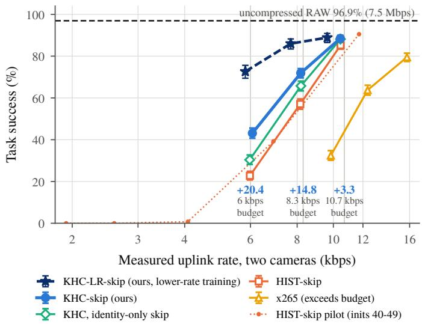  
Fig. 1. Task success of OpenVLA-OFT on LIBERO versus the measured uplink rate of two 256 256 cameras (1,600 paired episodes per point, Wilson 95% intervals). KHC shifts the success cliff to lower rates; blue numbers are the paired gains over HIST-skip in percentage points (+20.4, +14.8 and +3.3 at 6, 8.3 and 10.7 kbps), while x265 needs 47–64% more bits and still succeeds less often. Dark stars: KHC-LR-skip, the same context with lower-rate training (Section VI-G; 800 paired episodes per point).

Learned video compression. End-to-end video codecs replaced the hand-designed tools of H.264/AVC, HEVC, VVC and AV1 [8]–[10], [28] by learned motion estimation and residual coding [11], scale-space flow [12], feature-space alignment [29], flexible-rate low-delay designs [30] and transformer entropy models [31]. Conditional coding [13] replaced residual coding by temporal contexts; subsequent work mined multi-scale contexts [14], diversified them [15], modulated features over long sequences [16], and recently reached realtime operation by dropping explicit motion estimation altogether [17]. In all of these codecs the context is a function of the decoded history only. KHC adds a context that is a function of the embodiment, enters the same conditioning paths, and is orthogonal to architectural progress in the host.

Side information and geometry-aided coding. Slepian–Wolf and Wyner–Ziv theory [18], [19] quantifies the value of side information, and distributed video coding [20] and learned decoder-side-information codecs [32] exploit it when only the decoder has it. Geometry enters standard coding as depthbased view synthesis prediction in the multiview and 3D extensions of HEVC [33], which require transmitted depth maps, as global-motion initialization from inertial and positioning metadata for aerial video [34], and as background models for moving cameras built from estimated camera motion [35] or camera pose [36]. These methods describe a single rigid camera motion. Plane sweeping [21] is a standard tool for multi-view matching. KHC differs in three respects: its side information is available at both ends at zero rate, it describes an articulated body rather than one rigid motion, and it turns the unknown scene depth into a discrete hypothesis set that the network selects from per pixel.

Coding for machines and task-oriented communication. Video coding for machines [37] and task-oriented communication [38], [39] optimize transmission for a downstream model instead of a human viewer, typically measuring accuracy of an open-loop inference task. A remote robot policy closes the loop: decoded frames change actions, actions change future frames, and errors compound over hundreds of steps. We therefore evaluate in closed loop with paired episodes, connect the rate–distortion gain to the success gain analytically (Proposition 4), and keep the codec task-agnostic so that the same bitstream serves any policy.

## III. PROBLEM FORMULATION AND ANALYSIS

## A. System Model

A robot with cameras $c \in \{ 1 , \ldots , N _ { c } \}$ executes a remote policy π that returns an action chunk every k control steps (OpenVLA-OFT: $k = 8$ at 20 Hz, i.e., one query every $0 . 4 \mathrm { s } )$ At each query t the robot sends one packet containing its proprioceptive and joint state $q _ { t }$ (lossless) and one coded frame per camera; the previous query is $s = t - k$ . Before decoding the frames of query t, the receiver holds the shared embodiment context

$$
\mathcal { C } _ { t } = \{ \hat { X } _ { \leq s } ^ { ( c ) } , q _ { \leq t } , a _ { < t } , \mathcal { M } , \Theta \} ,\tag{1}
$$

where $\hat { X } _ { { < s } }$ are decoded frames, $a _ { < t }$ the actions it generated itself, $\mathcal { M }$ the robot model (kinematic chain and link meshes, shared once per session) and Θ the camera calibration (intrinsics K, static extrinsics and the hand–eye transform E). Forward kinematics yields every link pose $T _ { w \ell } ( q )$ , the end-effector pose $T _ { w , \mathrm { e e } } ( q )$ and the wrist-camera pose $T _ { w c } ( q ) = T _ { w , \mathrm { e e } } ( q ) E$ We denote by $\mathcal { H } _ { t }$ the kinematic context, i.e., everything determined by $( q _ { s } , q _ { t } , \mathcal { M } , \Theta )$ . The goal is to minimize the uplink rate at a target reconstruction quality, and ultimately to maximize task success under a rate budget.

## B. Embodiment Information

Let $\begin{array} { r } { R _ { X | Y } ( D ) = \operatorname* { m i n } _ { \scriptstyle { p ( \hat { x } | x , y ) } : \mathbb { E } d ( X , \hat { X } ) < D } I ( X ; \hat { X } \mid Y ) } \end{array}$ be the conditional rate–distortion function with side information Y available at both ends [40]. History-conditioned codecs approach $R _ { X _ { t } | \hat { X } < s } ( D )$ ; KHC targets $R _ { X _ { t } | \hat { X } < s , \mathcal { K } _ { t } } ( D )$

Proposition 1 (Embodiment information). For every D, $R _ { X _ { t } | \hat { X } _ { < s } , \mathcal { H } _ { t } } ( D ) \leq R _ { X _ { t } | \hat { X } _ { < s } } ( D )$ . For a fixed quantized representation $Z _ { t } ,$ the ideal saving in expected code length is

$$
\begin{array} { r l } & { \Delta R ^ { \star } = H ( Z _ { t } \mid \hat { X } _ { \leq s } ) - H ( Z _ { t } \mid \hat { X } _ { \leq s } , \mathcal { H } _ { t } ) } \\ & { \qquad = I ( Z _ { t } ; \mathcal { H } _ { t } \mid \hat { X } _ { \leq s } ) \geq 0 . } \end{array}\tag{2}
$$

Proof. Take the optimal test channel of $R _ { X | Y } ( D )$ with $\hat { X }$ depending on $( X , Y )$ only, so that ${ \hat { X } } - ( X , Y ) - { \overset { } { Z } }$ is a Markov chain with $Y = \hat { X } _ { < s } , Z = \mathcal { H }$ . It satisfies the distortion constraint given $( Y , Z )$ , and $I ( X ; \hat { X } \mid Y , Z ) = H ( \hat { X } \mid Y , Z ) - H ( \hat { X } \mid$ $X , Y ) \leq H ( \hat { X } \mid Y ) - H ( \hat { X } \mid X , Y ) = I ( X ; \hat { X } \mid Y )$ , since conditioning reduces entropy. Minimizing the left-hand side gives the claim; the lossless case is the definition of conditional mutual information. □

We call $I ( X _ { t } ; \mathcal { H } _ { t } \mid \hat { X } _ { \leq s } )$ the embodiment information of the stream. By Proposition 1 it never increases the rate; Section VI measures its size, and the next subsection explains why current codecs do not collect it. The only transmitted cost is seven joint angles beyond the proprioception the policy already receives, and our experiments bill every such byte.

## C. Why History and Global-Vector Conditioning Miss It

Model the previous frame (or its latent) as a stationary Gaussian field $X _ { s } ( u )$ on $\mathbb { Z } ^ { 2 }$ with variance $\sigma ^ { 2 }$ and a correlation that decays with distance, and let $X _ { t } ( u ) = X _ { s } ( u - \delta ) + N _ { t } ( u )$ with i.i.d. noise of variance $\sigma _ { N } ^ { 2 }$ , where the displacement $\delta = \delta ( \mathcal { H } _ { t } )$ is known to the receiver. Consider the class $\mathcal { F } _ { r }$ of co-located predictors that estimate $X _ { t } ( u )$ from $\{ X _ { s } ( u + \nu ) : \| \nu \| _ { \infty } \leq r \}$ and any global vector, including $\mathcal { H } _ { t }$ itself.

Proposition 2 (Transport blindness). The minimum meansquared error within $\mathcal { F } _ { r }$ is

$$
\begin{array} { r } { \displaystyle \boldsymbol { e } _ { r } ( \delta ) = \sigma _ { N } ^ { 2 } + \mathrm { V a r } \big [ X _ { s } ( u - \delta ) \big | X _ { s } ( u + \nu ) , \ \| \nu \| _ { \infty } \le r \big ] . } \end{array}\tag{3}
$$

It equals $\sigma _ { N } ^ { 2 }$ when $\| \delta \| _ { \infty } \leq r$ and tends to $\sigma _ { N } ^ { 2 } + \sigma ^ { 2 }$ when $\| \delta \| _ { \infty } - r$ exceeds the correlation length, whereas a transported context $X _ { s } ( u - \delta )$ attains $\sigma _ { N } ^ { 2 }$ for every $\delta .$ At high resolution the rate penalty is $\textstyle \frac { 1 } { 2 } \log _ { 2 } \left( e _ { r } ^ { \cdot } ( \delta ) / \sigma _ { N } ^ { 2 } \right)$ bits per sample.

Proof. Given $\mathcal { H } , \delta$ is deterministic, so a global vector conveys nothing about $X _ { s } ( u - \delta )$ beyond the value of δ. The optimal estimate is $\mathbb { E } [ X _ { s } ( u - \delta )$ neighborhood] and the noise is independent of the neighborhood; the Gaussian conditional variance is zero inside the window and $\sigma ^ { 2 } - \mathbf { c } ^ { \top } \Sigma ^ { - 1 } \mathbf { c }  \sigma ^ { 2 }$ as the cross-covariance c vanishes outside it. □

Proposition 2 has two consequences that we test in Section VI. First, appending robot poses as a global vector (the GVEC control) cannot help once motion exceeds the receptive field; kinematic knowledge must be turned into transport. Second, chunked policies transmit sparsely, and sparse transmission produces large displacements, the regime in which a learned codec’s limited receptive field, which recent real-time codecs shrink further by dropping explicit motion estimation [17], misses the motion.

## D. Kinematics Reduce Scene Motion to One Dimension

Let ${ \cal T } _ { s  t } = ( R , \mathbf { t } )$ map camera-t coordinates to camera-s coordinates. A static scene point imaged at homogeneous pixel x˜ with depth $Z = 1 / \rho$ in camera t maps to

$$
\tilde { x } ^ { \prime } \sim K _ { s } \bigl ( R K _ { t } ^ { - 1 } \tilde { x } + \rho \mathbf { t } \bigr ) .\tag{4}
$$

Proposition 3 (One-dimensional motion family). (i) Given (R, t), the motion of every static pixel lies on a curve parameterized by the inverse depth $\rho \in [ \rho _ { \operatorname* { m i n } } , \rho _ { \operatorname* { m a x } } ]$ . (ii) For pure rotation the motion is depth-independent. (iii) Points on the fronto-parallel plane $Z = 1 / \rho _ { d }$ of camera t move by the homography

$$
H _ { d } = K _ { s } \big ( R + \rho _ { d } { \bf t } e _ { 3 } ^ { \top } \big ) K _ { t } ^ { - 1 } .\tag{5}
$$

(iv) If the true ρ lies between two sampled planes spaced $b y$ $\Delta \rho ,$ , the sampling error obeys $\begin{array} { r } { \| \Delta u \| \leq \frac { \bar { \Delta } \rho } { 2 } \| \bar { \partial } u / \partial \rho \| } \end{array}$

Proof. Substitute $P = Z K _ { t } ^ { - 1 } \tilde { x }$ into $P ^ { \prime } = R P + \mathbf { t }$ and divide by Z; (ii) follows from $\mathbf { t } = 0 ;$ (iii) from $e _ { 3 } ^ { \top } K _ { t } ^ { - 1 } \tilde { x } = 1 ; \mathrm { ( i v ) }$ from a first-order expansion in $\rho$ □

A history codec must transmit two-dimensional motion explicitly (motion vectors, flow latents) or implicitly (residual bits where its prediction fails). With kinematics, the decoder only has to select among D plane hypotheses per pixel, a one-dimensional choice that is smooth in space and stable in time. Part (iv) yields a design rule: sub-pixel accuracy requires $D \gtrsim \left( \rho _ { \operatorname* { m a x } } - \rho _ { \operatorname* { m i n } } \right) \operatorname* { m a x } _ { u } \left\| \partial u / \partial \rho \right\|$

## E. When Rate Becomes Task Success

Let $S _ { A } ( R )$ be the success rate of a policy fed by codec A at rate $R ,$ and assume success depends on the rate only through reconstruction quality.

Proposition 4 (Success at the cliff). If codec B attains the quality of A with a fraction $1 + \gamma$ of its rate $( \gamma < 0$ is the BD-rate), then $S _ { B } ( R ) \approx S _ { A } \big ( R / ( 1 + \gamma ) \big )$ and

$$
S _ { B } ( R ) - S _ { A } ( R ) \approx - \frac { d S _ { A } } { d \log R } \log ( 1 + \gamma ) .\tag{6}
$$

Proof. At rate R, B delivers the quality that A reaches at $R / ( 1 + \gamma ) ;$ expand $S _ { A }$ to first order in log R. □

Equation (6) states that coding gains become task gains in proportion to the slope of the success curve. On the plateau where the policy is saturated, any codec suffices and no gain is observable; on the cliff the same BD-rate buys large success gains. Our closed-loop protocol therefore locates the cliff first and places the budgets on it (Section V).

## F. Calibration Errors

Proposition 5 (Second-order calibration error). Let the hand– eye transform used by both ends be $E ^ { \prime } = E \delta E$ with $\delta E = I + \varepsilon$ and let the end-effector move by $T _ { \Delta } = I + \tau .$ . The induced error of the relative camera motion $T _ { c } = E ^ { - 1 } T _ { \Delta } E$ is

$$
E ^ { \prime - 1 } T _ { \Delta } E ^ { \prime } - E ^ { - 1 } T _ { \Delta } E = \delta E ^ { - 1 } [ T _ { c } , \delta E ] = \delta E ^ { - 1 } [ \tau _ { c } , \varepsilon ] ,\tag{7}
$$

a commutator that is bilinear in the per-query motion $\tau _ { c }$ and the calibration error ε.

The proof expands the commutator. The error vanishes for small motion and grows with the product of motion and miscalibration; because both ends share the same (wrong) geometry, miscalibration can only weaken the hypotheses and never manufactures a gain, which makes all KHC-vs-HIST comparisons on imperfectly calibrated data conservative.

## IV. KINEMATIC HYPOTHESIS CONTEXT

Fig. 2 shows the uplink. Both ends run the same deterministic hypothesis generator on shared data, so the kinematic context costs zero bits; only $q _ { t }$ and the codec payload are transmitted.

## A. Hypothesis Volume

For each transmission $s \to t$ and camera, KHC produces $J = D + 5$ backward warps $\tilde { x } _ { j }$ of the decoded reference ${ \hat { x } } _ { s } ,$ each with a validity mask $\nu _ { j } ~ ( \mathrm { F i g . } ~ 3 \mathrm { a } )$

Identity $( j = 0 )$ : content that moves with the camera (the gripper in the wrist view) or the static scene of a static camera.

Plane sweep $( j = 1 . . D ) \colon$ the homographies $H _ { d }$ of (5) for inverse depths $\rho _ { d }$ uniformly spaced in $[ 1 / 3 , 1 2 . 5 ] \mathrm { m } ^ { - 1 }$ (3 m to 8 cm), which explain the ego-motion of a moving camera (Proposition 3).

Robot layer $( j = D \pm 1 )$ : both ends render only the robot from $( \mathcal { M } , q _ { t } , \Theta )$ , obtaining its depth $Z _ { t } ^ { r } ( u )$ and link labels ℓ(u). A robot pixel is back-projected and moved with its own link,

$$
u ^ { \prime } = \pi \Big ( { \cal K } T _ { w c _ { s } } ^ { - 1 } T _ { w \ell } ( q _ { s } ) T _ { w \ell } ( q _ { t } ) ^ { - 1 } T _ { w c _ { t } } Z _ { t } ^ { r } ( u ) { \cal K } ^ { - 1 } \tilde { u } \Big ) ,\tag{8}
$$

and marked invalid if the rendered robot depth at s disagrees by more than $5 \% + 1$ cm (self-occlusion). Nonrobot pixels take the background slot. The render reveals nothing about the scene and is exact up to shading.

End-effector plane $( j = D + 2 ) \colon$ : a homography of the plane through the end effector that moves with the end effector, which carries grasped objects.

Background memory $( j = D / + 3 )$ : for static cameras the decoder keeps $B _ { t } = m _ { t } \odot B _ { s } + \left( 1 - m _ { t } \right) \odot \hat { x } _ { t }$ , with $m _ { t }$ the dilated robot mask, so that background uncovered by the arm is available without retransmission.

Auxiliary slot $( j = D / + 4 ) \colon$ : an identity copy, used by controls (the second reference for HIST2, rendered scene depth for the oracle upper bound).

Together with the robot masks at s and t and a 24-dimensional global vector (non-zero only in the GVEC control), the slots form a (4J + 26)-channel volume. The slot order is fixed, so the network learns per-pixel selection, interpolation between planes, and occlusion handling.

## B. Fusion into a Conditional Codec

KinFusion maps the volume to contexts $K ^ { ( 1 ) } , K ^ { ( 2 ) } , K ^ { ( 3 ) }$ at resolutions H, $H / 2$ and $H / 4$ (two convolutions, a residual block and two stride-2 stages). The host is a DCVC-style implicit conditional codec [13], [14]: history features $c ^ { ( i ) }$ of $\hat { x } _ { s }$ form a three-scale temporal context, and KHC enters as

$$
\mathcal { C } ^ { ( i ) } = c ^ { ( i ) } + \phi _ { i } \bigl ( [ c ^ { ( i ) } , K ^ { ( i ) } ] \bigr ) , \qquad i = 1 , 2 , 3 ,\tag{9}
$$

where $\phi _ { i }$ are two-layer $1 \times 1$ mixers whose last layer is zeroinitialized. The contexts condition the analysis transform $g _ { a } ,$ the synthesis transform gs and the temporal prior of the entropy model, $\boldsymbol { p } ( \boldsymbol { \hat { y } } \mid \boldsymbol { \hat { z } } , \mathcal { C } ^ { ( 3 ) } )$ , with a scale hyperprior ˆz [41]. Variable rate is provided by gain units with a continuous rate parameter α interpolated between seven trained λ values, so one model covers all operating points. Every compared arm has the same network, parameter count and input shapes; the history-only arm (HIST) simply fills every slot with $\hat { x } _ { s }$

Other hosts. KHC is not tied to this host. In a Scale-Space-Flow codec [12] the decoded motion latent additionally predicts logits over the J hypotheses that are added to zero-rate prior logits, forming a weighted base prediction that the flow then refines. In an entropy-only host built on a frozen mbt2018 image codec [42], KHC predicts an integer shift and a scale for every latent symbol: the sender codes $r = \operatorname { r o u n d } ( y - \mu ) - k$ under $\mathcal { N } ( 0 , ( \sigma \varsigma ) ^ { 2 } )$ and the receiver adds k back, so the reconstruction is bit-identical to the frozen codec and only the bits change.

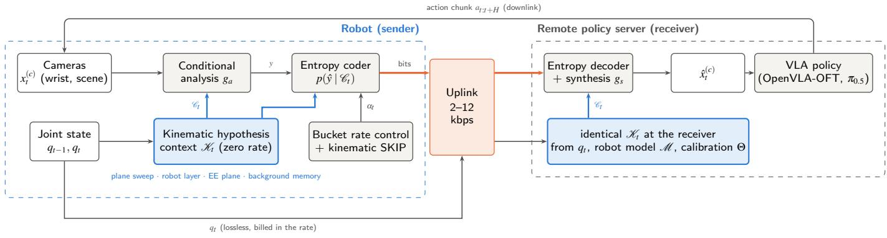  
Fig. 2. Remote-policy uplink with KHC. The robot sends its joint state losslessly and one coded frame per camera; sender and receiver construct the identical kinematic hypothesis context Kt from the decoded reference, the joint states, the robot model M and the calibration Θ, and use it to condition analysis entropy model and synthesis. A leaky-bucket controller sets the rate parameter αt and may replace a frame by a kinematic SKIP.

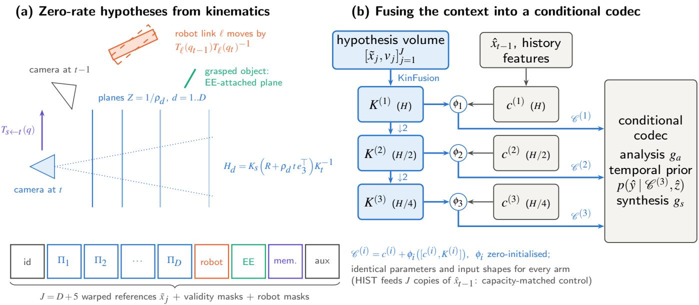  
Fig. 3. (a) Kinematics turn the robot’s motion into zero-rate hypotheses: fronto-parallel plane homographies for camera ego-motion, per-link rigid reprojectio for the robot, an end-effector-attached plane for grasped objects, and a background memory. (b) KinFusion maps the volume to three context scales that are added to the history contexts through zero-initialized mixers φi; the codec is otherwise unchanged and identical for every compared arm.

Training. Each P frame minimizes bits $/ ( H W ) + \lambda ( \alpha ) \cdot 2 5 5 ^ { 2 }$ MSE over clips of four frames sampled at strides 1, 2, 4, 8 , with the reference produced by the codec itself (cascaded training), α drawn continuously, and I frames coded by a frozen mbt2018 model [42] shared by all arms.

## C. Kinematic SKIP and Budget Control

For a P frame the sender compares

$$
J _ { \mathrm { s k i p } } = \frac { 1 6 } { H W } + \lambda _ { \mathrm { e f f } } 2 5 5 ^ { 2 } \operatorname* { m i n } _ { j } \mathrm { M S E } ( \tilde { x } _ { j } , x _ { t } ) ,\tag{10}
$$

$$
J _ { P } = \frac { 8 | \mathrm { p a y l o a d } | } { H W } + \lambda _ { \mathrm { e f f } } 2 5 5 ^ { 2 } \mathrm { M S E } ( \hat { x } _ { t } , x _ { t } ) ,\tag{11}
$$

and transmits only a two-byte slot index when $J _ { \mathrm { s k i p } } < J _ { P } ;$ the receiver then shows that hypothesis. For HIST, only the identity slot exists and SKIP reduces to frame repetition. Every arm thus has the same skipping ability, and with KHC a skipped frame shows the robot at its current pose.

Kilobit budgets lie below the lowest trained rate point, so we extend the rate parameter to $\alpha \in [ - 8 , R - 1 ]$ : for $\alpha < 0 ,$ P frames are coded at $\alpha = 0$ and $\lambda _ { \mathrm { e f f } } = \lambda ( 0 ) 4 ^ { \alpha }$ , which makes

SKIP progressively cheaper. A leaky-bucket proportional– integral controller drives α on arithmetic bytes,

$$
\alpha  \alpha - k _ { p } \mathrm { c l i p } \Big ( \frac { b - B ^ { \star } } { B ^ { \star } } , - 1 , 1 \Big ) - k _ { b } \frac { \beta } { B ^ { \star } W } ,\tag{12}
$$

with buffer $\beta ,$ per-frame target $B ^ { \star }$ (the budget minus the measured state and header bytes, so that KHC pays for its extra joint state), $k _ { p } = 0 . 3 , k _ { b } = 0 . 6$ and $W = 8 .$ A log-domain controller tracks the geometric mean of the byte sizes and overshoots two- to four-fold once 2-byte SKIPs alternate with P frames; the arithmetic form tracks budgets within a few percent.

## D. Protocol, Calibration and Implementation

Packets. Each packet holds a step counter, the state coded losslessly by XOR prediction of IEEE-754 words, and per camera a mode, a quantized α and length-prefixed entropycoded substreams. Session identity is exchanged once at connection time.

Bit exactness. The sender reconstructs through exactly the receiver’s decoding path, so references never drift; every evaluation passes the bytes through a separate receiver object and compares the reconstructions bit by bit, across GPUs as well. After a lost packet the receiver keeps its last frame and both ends resynchronize with an I frame.

Self-calibration. For data without accurate hand–eye calibration, the wrist-camera rotation is refined on training data by minimizing the soft-minimum photometric error of the plane hypotheses with robot pixels masked, after a coarse search over the 24 axis-aligned rotations; the final geometry is selected by its predictive error on validation data. Proposition 5 shows why sub-degree accuracy matters under sparse transmission.

Batched hypotheses. All D plane warps are generated by one batched homography and one batched bilinear sampling, without host–device synchronization; this cuts hypothesis generation from 18.0 to 3.8 ms per frame on an RTX 4090 and leaves the rate–distortion performance unchanged (BD-rate difference 0.000%, 95% CI [ 0.002,0.003]).

## V. EXPERIMENTAL SETUP

## A. Data

LIBERO. We re-render the LIBERO demonstrations [22] in MuJoCo [43] through robosuite [44] at 256 256 for the static third-person camera and the wrist camera, storing per-step joint states, link and end-effector poses, intrinsics, extrinsics and the robot-only depth and label maps (verified pixel-exact against the simulator observations). Training uses LIBERO-90 (all demonstrations but the last per task), validation the last LIBERO-90 demonstration of each task, and testing 200 episodes from the four held-out suites LIBERO-Spatial, - Object, -Goal and -Long (10 tasks 5 demonstrations each). Test tasks never enter training or any design decision.

DROID. To test real data we use 100 DROID episodes [23] (Franka arm, one wrist and two exterior cameras at 320 180, 15 Hz), split by laboratory into 63/7/30 episodes. Exterior cameras come without usable extrinsics, so KHC degenerates to HIST on them; the wrist camera uses the self-calibrated hand–eye rotation.

## B. Compared Methods

All learned arms share the host of Section IV (7.0 M parameters, 1.39 MFLOPs/pixel) and the same training budget (200k steps, AdamW, learning rate $1 0 ^ { - 4 }$ with warm-up and cosine decay, batch 8):

HIST: history-only context (every slot = xˆs), the capacity-matched baseline;

HIST2: HIST plus a second reference $\hat { x } _ { s - k }$ in the auxiliary slot;

SHUF: the KHC network fed with kinematics of a different episode at train and test time (null control);

GVEC: HIST plus the relative camera and end-effector motion as a broadcast 24-dimensional vector;

KHC: the proposed context (D = 32).

External anchors use the same frames, cadence and intra period (32): low-delay x264 and x265 (medium preset, zerolatency tuning, no B frames, 4:2:0 and 4:4:4) [8], [9], SVT-AV1 (preset 8, low-delay prediction structure) [28], the official DCVC-RT models [17], and the all-intra mbt2018 codec [42], and the VVC reference software VTM-23.0 (low-delay P configuration, 4:2:0 and 4:4:4) [10]; the rate points of SVT-AV1 and VTM were chosen on the validation split. The entropy-only and Scale-Space-Flow hosts are compared with their own history-only versions.

## C. Metrics

Rates are the actual payload bytes of each camera frame, including mode, rate index and length fields. Quality is RGB PSNR and MS-SSIM [45], LPIPS [46] (AlexNet, v0.1), and the policy action deviation: the mean L1 distance between the $8 \times 7$ action chunks that OpenVLA-OFT outputs for decoded and for original frames of the test demonstrations, with identical proprioception and instruction. BD-rates [47] use PCHIP interpolation over the overlapping quality range of curves pooled over both cameras (or per camera) and seven rate points; 95% confidence intervals come from 1,000 paired episode-level bootstrap resamples. Complexity is measured at $2 5 6 \times 2 5 6$ , batch 1, on an RTX 4090 with entropy coding included.

## D. Closed-Loop Protocol

The policy is the official OpenVLA-OFT checkpoint finetuned on the four LIBERO suites [3], executed unmodified; our uplink intercepts the observation at each policy query (every 8 control steps, 2.5 Hz) and replaces both camera images by their decoded versions, while the 8-D proprioception passes losslessly. Each configuration runs the 4 suites 10 tasks 40 initial states (1,600 episodes) with identical seeds, so all comparisons are paired by (suite, task, initial state). Rates are measured per episode from the packet bytes (state and headers included) over the episode’s logical duration.

Budgets are fixed by a rule written before the main experiment and computed on disjoint initial states (40–49). A first pilot showed that OFT is saturated over the codec’s entire native range: HIST at its lowest rate point (9.5 kbps) still succeeds in 88.5% of the episodes against 96.0% uncompressed (the native rate points span 9.5–45 kbps and stay within 7.5 points of the uncompressed policy). A second pilot therefore traced the HIST-skip curve from the SKIP floor (every P frame skipped; 1.9 kbps, 0% success) to 12 kbps, and the budgets were set where the isotonic HIST-skip curve reaches $S _ { \mathrm { f l o o r } } + f \left( S _ { \mathrm { R A W } } - S _ { \mathrm { f l o o r } } \right)$ for $f \in \{ 0 . 3 , 0 . 6 , 0 . 8 5 \}$ , giving 6.0, 8.3 and 10.7 kbps. HIST-skip, KHC-skip, KHC-skip with identity-only SKIP (KHC-id) and x265 (CBR) run at each budget. Success rates carry Wilson intervals [48]; paired differences are tested with the exact McNemar test [49], Holmadjusted [50] within the pre-registered primary family (KHCskip vs. HIST-skip at three budgets) and within the secondary family, and their confidence intervals come from 10,000 taskclustered bootstrap resamples. A significant McNemar test with a task-clustered interval that includes zero indicates a real but task-dependent difference. All 20,800 episodes passed sender–receiver bit-exactness, cadence and byte-accounting checks.

Extension and second policy. A second pre-registered experiment runs on initial states 0–19 (800 paired episodes per configuration) and compares KHC-skip with four alternatives at each budget: DCVC-RT inside the same SKIP and budget controller, x265 forced to comply with the budget by skipping frames, the HIST codec at reduced cadence (images on every m-th query, m fixed in advance from the pilot rates; $m = 2$ at 6 and 8.3 kbps, m = 1 without SKIP at 10.7 kbps), and the HIST codec at 128 128 with bicubic upsampling. A further pair compares KHC-skip and HIST-skip at 8.3 kbps with 10% random packet loss (the receiver holds its last frame until an intra frame resynchronizes both ends). These 13 tests form one Holm family. The second policy is π0.5 [5] (official LIBERO checkpoint), queried every five control steps (4 Hz); its budgets come from its own pilot under the same rule (10.0, 13.4 and 16.9 kbps), and the main comparison, KHC-skip vs. HIST-skip at the middle budget, is a family of its own.

Lower-rate extension. A third pre-registered experiment extends both CVC models to lower rates with one recipe: two lower rate points $( \lambda = 5 . 2 \cdot 1 0 ^ { - 5 } , 1 . 1 \cdot 1 0 ^ { - 4 } )$ are prepended to the seven original ones, and the KHC and HIST models are fine-tuned for 50k steps (final checkpoint only), giving KHC-LR and HIST-LR. A validation gate required the lowest rate to fall to at most 0.6 of the original; it narrowly failed on the total rate (0.63, 0.61) because the I frames of the frozen intra model cannot change, and was amended to the P-frame rate (0.49, 0.51) before any test or closed-loop data were seen. On initial states 0–19 (4,800 new episodes), KHC-LR-skip is compared with HIST-LR-skip, the original KHC-skip, DCVC-RT and the 128 128 stream; the four tests at 6 kbps form the primary family, the eight at 8.3 and 10.7 kbps a secondary one.

## VI. RESULTS

## A. Rate–Distortion Performance

Table I and Fig. 4 report the coding results on the 200 heldout test episodes. KHC reduces the bit rate of the capacitymatched HIST codec by 23.9% at equal PSNR (95% CI [ 25.0, 22.8]), by 18.2% at equal MS-SSIM, by 24.6% at equal LPIPS and by 26.2% at equal policy action deviation. The saving is largest on the third-person camera (37.9%), where the robot layer and the background memory predict the arm and the disoccluded table exactly, and it reaches 12.3% on the wrist camera, where the plane sweep explains the egomotion of the scene. The curves are separated at every rate, and the PSNR margin is largest at the lowest rates (1.3 dB for both cameras and 2.3 dB for the third-person camera at the low end of the common range), which is the operating regime of narrow links.

Against standard codecs in the same low-delay configuration, KHC saves 54.9–55.8% relative to x264, 49.0–49.1% relative to x265 and 39.7% relative to SVT-AV1, for every chroma format and every camera, and the savings carry over to LPIPS ( 40.1 to 44.5%). Our 7.0 M-parameter host without KHC needs 37.2% more bits than DCVC-RT [17], the strongest published real-time neural codec. The zero-rate kinematic context reduces this gap to +7.5% ([ 0.5,16.4]), and on the third-person camera the two codecs are on par ( 0.2%). Kinematic conditioning alone thus recovers about four fifths of the advantage that state-of-the-art architectures hold over a compact conditional codec, with a third of the video-model parameters of DCVC-RT and without its separate 45.7 M-parameter intra model, and it can be combined with those architectures. Over the full range, the VVC reference encoder VTM-23 [10] needs fewer bits (+29.0% in 4:2:0, +42.1% in 4:4:4); lower-rate training reduces this lead to +16.1% and +22.7% (Section VI-G). VTM-23 is an offline reference encoder, reported to encode about 0.01 frames per second in the low-delay configuration [17], and cannot serve a closed control loop; KHC encodes a frame in 26.7 ms. Its lead also shrinks from pixel to task measures (4:4:4: 42.1% in PSNR, 25.3% in LPIPS, 11.4% in action deviation) and from high to low rates (Fig. 4d–f). Over the three lowest KHC rate points ( 0.041 bpp), which contain the closed-loop operating range of 0.019–0.037 bpp, KHC is on par with VTM-23 in LPIPS ( 6.8% [ 13.9,1.2] against 4:2:0, +1.8% [ 5.5,10.0] against 4:4:4) and in action deviation ( 0.8% [ 5.1,4.2]), and at its lowest rate point it needs 7.4% fewer bits than VTM-23 (4:4:4) for the same action deviation (CI [ 12.3, 2.9]). In PSNR, VTM-23 keeps a lead in this range (+11.1%).

Beyond PSNR. The measures closest to the policy favor KHC more clearly than PSNR does (Fig. 4d–f). At equal LPIPS KHC needs 13.6% fewer bits than DCVC-RT, and at equal action deviation, i.e., the L1 distance between the action chunks that OpenVLA-OFT predicts from decoded and from original frames, it needs 23.2% fewer bits than DCVC-RT and 48.8% fewer than x265. The arm and the grasped object, which the robot layer and the end-effector plane reconstruct sharply, are the image regions that drive manipulation actions, and the PSNR tie with DCVC-RT becomes a clear lead at the level of actions.

Where the bits go. In the wrist view of Fig. 5 the best hypothesis is almost everywhere a plane-sweep slot whose depth follows the table and objects, and KHC spends 36% fewer bits at 0.57 dB higher PSNR. In the third-person view the selected slots switch to the robot layer on the arm, the end-effector plane at the gripper and the background memory where the arm uncovers the table, and the bits HIST spends on the moving arm disappear ( 52% at +0.83 dB). Over 20 exported frames the median saving is 25.9%.

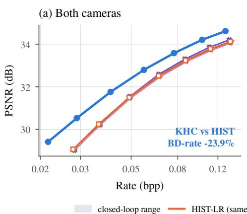

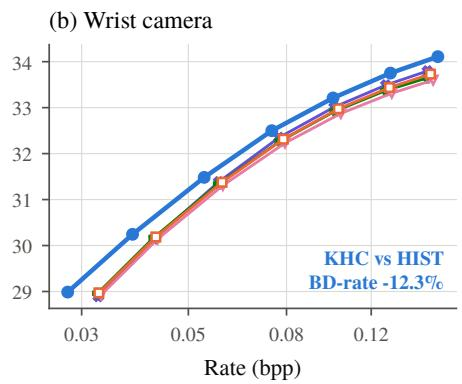

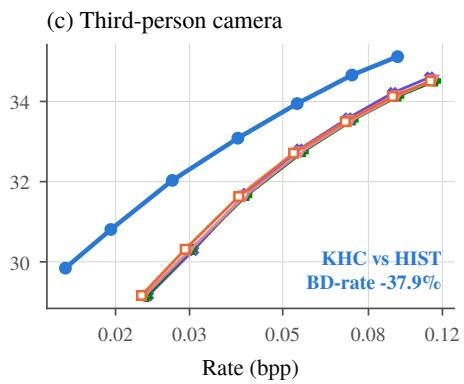

(d) At equal PSNR  
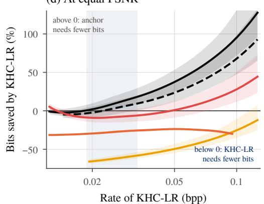

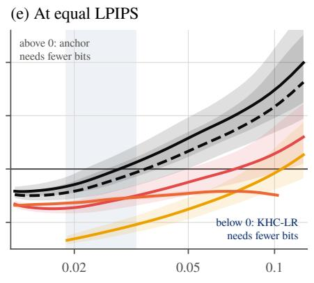  
Rate of KHC-LR (bpp)

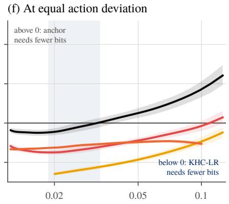  
Rate of KHC-LR (bpp)  
Fig. 4. Rate–distortion on the LIBERO test split (stride 8, real bitstreams). (a)–(c) KHC against the capacity-matched controls for both cameras, the wrist camera and the third-person camera; HIST2, SHUF and GVEC coincide with HIST, whereas KHC is separated at every rate. (d)–(f) Bits saved by the lower-rate model KHC-LR relative to each neural and standard codec at equal (d) PSNR, (e) LPIPS and (f) action deviation of the OpenVLA-OFT action chunk, as a function of rate (negative: KHC-LR needs fewer bits; bands: episode-bootstrap 95% intervals; shaded: closed-loop operating range of KHC-LR-skip). The closer the measure is to the policy, the lower the curves. BD-rates: Tables I and V; raw PSNR curves: supplementary material.

## B. The Gain Is Caused by Kinematics

The controls isolate the source of the gain (Table I, Fig. 4). Feeding the KHC network with the kinematics of another episode (SHUF) changes the rate by only +1.2% relative to HIST, which rules out capacity and regularization effects. A second reference frame (HIST2) does not help either (+2.9%), so the gain is not additional temporal context. Broadcasting the exact relative camera and end-effector motion as a global vector (GVEC) yields 0.6% (CI includes zero), as Proposition 2 predicts for co-located conditioning; KHC outperforms GVEC by 23.3%. Fig. 6b shows that this holds in every motion quartile: GVEC stays near zero on both cameras, while KHC saves 37.8–48.1% on the third-person and 11.1–18.5% on the wrist camera.

Transmission cadence. The saving holds at every cadence (Fig. 6a): 28.6% at 20 Hz, 29.3% at 10 Hz, 27.7% at 5 Hz, 23.9% at 2.5 Hz and 17.7% at 1.25 Hz.

## C. Transfer Across Hosts and to Real Data

Fig. 7a shows that KHC transfers across codec architectures. Inside a Scale-Space-Flow codec it saves 7.0%; in the entropyonly host, where the reconstruction is bit-identical to the frozen mbt2018 codec, it removes 7.8–12.2% of the bytes purely by sharpening the probability model. In skip-enabled operation the saving is 24.3%.

On real DROID data (Fig. 7b,c), KHC fine-tuned from the LIBERO model saves 11.2% on the self-calibrated wrist camera (CI [ 13.2, 9.0]) and 4.7% over all three cameras; the two exterior cameras, which lack extrinsics, code exactly as HIST. With real sensor noise and calibration from data alone, the wrist-camera gain stays close to the 12.3% of simulation.

## D. Ablation and Robustness

Removing any hypothesis family hurts (Table II, Fig. 8a): without the robot layer the rate grows by 26.4%, without plane sweep by 9.0%, without background memory by 5.8% and without the end-effector plane by 5.3%, each relative to the full model trained for the same 100k steps. The robot layer contributes most. Replacing the plane sweep by rendered scene depth (oracle) saves another 18.3%, which quantifies the remaining headroom for depth-aware hypotheses. A compact sweep is sufficient (Fig. 8b): D = 4 planes already achieve 12.6% over HIST at 100k steps, and the hypothesis count barely changes latency (41.2–41.8 ms per frame for D = 4 to 32). The plane count D = 32 was fixed before the ablation and is used in every reported experiment; the ablation identifies a four-plane sweep as an equally effective and cheaper choice for deployment.

TABLE I  
BD-RATE OF KHC AGAINST EVERY ANCHOR ON THE LIBERO TEST SPLIT (200 EPISODES, REAL BITSTREAMS, STRIDE 8). NEGATIVE VALUES ARE BIT SAVINGS OF KHC AT EQUAL QUALITY (BOLD); POSITIVE VALUES MEAN THAT THE ANCHOR NEEDS FEWER BITS. LPIPS AND ACTION DEVIATION (L1 DISTANCE BETWEEN THE OPENVLA-OFT ACTION CHUNKS PREDICTED FROM DECODED AND ORIGINAL FRAMES) ARE POOLED OVER BOTH CAMERAS. 95% EPISODE-BOOTSTRAP CONFIDENCE INTERVALS IN BRACKETS; –: NOT EVALUATED.
<table><tr><td>Type</td><td>Anchor</td><td colspan="4">PSNR BD-rate (%)</td><td colspan="2">MS-SSIM (%)</td><td colspan="2">LPIPS (%)</td></tr><tr><td></td><td></td><td>Both cameras</td><td>Wrist</td><td>Third-person</td><td></td><td>Both</td><td>Both</td><td>Both</td></tr><tr><td>Capacity-</td><td>HIST (history context)</td><td>-23.9 [−25.0, −22.8]</td><td>-12.3 [−12.9, −11.6]</td><td>-37.9 [–39.8,</td><td>-36.0] 18.2 [−19.5,</td><td>-16.8]</td><td>-24.6 [−25.5, −23.7]</td><td>-26.2 [−27.6, −24.9]</td></tr><tr><td>matched</td><td>HIST2 (two references)</td><td>-26.0 [−27.2, −25.0]</td><td>-15.1 [−15.8, −14.5]</td><td>-39.6 [−41.4, -37.7]</td><td>-17.6 [−19.2,</td><td></td><td></td><td></td></tr><tr><td></td><td>SHUF (shuffled kinematics)</td><td>-24.8 [–25.9, −23.6]</td><td>-12.1 [−12.8, −11.5]</td><td>40.0 [−41.6, -38.4]</td><td>-19.2 [−20.4, -17.9]</td><td></td><td></td><td></td></tr><tr><td></td><td>GVEC (global pose vector)</td><td>-23.3 [−24.7, −21.8]</td><td>-10.7 [−11.5, −9.8]</td><td>-38.5 [−40.5, -36.4]</td><td>-19.4 [−20.8, −17.9]</td><td></td><td></td><td></td></tr><tr><td>Neural</td><td>DCVC-RT [17]</td><td>+7.5 [−0.5, 16.4]</td><td>+7.2 [3.1, 11.7]</td><td>−0.2 [−11.5, 13.1]</td><td>+9.3 [2.0, 17.4]</td><td>-13.6 [−20.8, −5.1]</td><td>-23.2 [−26.5, −19.8]</td><td></td></tr><tr><td>All-intra mbt2018 [42]</td><td></td><td>-61.2 [–64.6, −57.5]</td><td>-32.1 [-36.2, −27.6]</td><td>−79.8 [−82.0, -77.2]</td><td>−61.5 [−65.2, −57.2]</td><td></td><td></td><td></td></tr><tr><td>Standard x264 (4:2:0, low-delay)</td><td></td><td>-55.8 [−58.8, −52.4]</td><td>-56.4 [−58.4, −54.1]</td><td></td><td>-50.8 [−54.2,</td><td></td><td></td><td></td></tr><tr><td></td><td>x264 (4:4:4, low-delay)</td><td>-54.9 [–57.5, −51.9]</td><td>-54.5 [−56.2, −52.4]</td><td>-58.0 [−61.7, −53.7] -57.9 [–61.3, −53.9]</td><td>-46.9] -51.4 [–54.6, -47.7]</td><td>-44.5 [−48.1, −40.5]</td><td></td><td></td></tr><tr><td>x265 (4:2:0, low-delay)</td><td></td><td>-49.0 [−52.7, −44.4]</td><td>-46.6 [−49.1, −44.0]</td><td>-55.0 [–59.9, -48.9]</td><td>-50.1 [−53.9, -44.6]</td><td></td><td></td><td></td></tr><tr><td>x265 (4:4:4, low-delay)</td><td></td><td>-49.1 [-52.3, -45.5]</td><td>-46.6 [−48.6, −44.3]</td><td>-55.7 [–59.7, -50.0]</td><td>-52.0 [−55.7, -47.7]</td><td>-40.1 [−44.1, −35.5]</td><td>-48.8 [−50.8, −46.6]</td><td></td></tr><tr><td>SVT-AV1 (4:2:0, low-delay)</td><td>-39.7 [–44.1, −34.8]</td><td></td><td>-40.5 [−43.4, −37.3]</td><td>-40.4 [−46.5, −33.1]</td><td>-40.8 [−45.7, −35.0]</td><td>-41.1 [−46.1, −35.4]</td><td></td><td></td></tr><tr><td>VTM-23 (4:2:0, low-delay P)</td><td>+29.0 [20.5, 38.5]</td><td></td><td>+38.5 [32.4, 45.2]</td><td>+12.5 [1.8, 25.2]</td><td>+16.7 [7.9, 27.0]</td><td>+14.1 [4.9, 24.2]</td><td></td><td></td></tr><tr><td>VTM-23 (4:4:4, low-delay P)</td><td></td><td>+42.1 [33.9, 51.3]</td><td>+53.4 [47.9, 59.7]</td><td>+23.5 [12.8, 36.1]</td><td>+25.3 [16.7, 35.3]</td><td>+25.3 [16.0, 36.1]</td><td>+11.4 [6.5, 16.8]</td><td></td></tr></table>

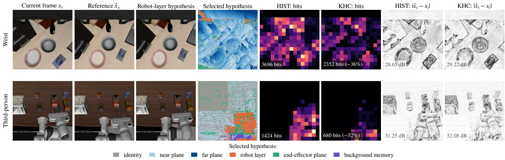  
Fig. 5. Inside the codec at equal rate parameter (LIBERO test episodes, stride 4). Columns: current frame, decoded reference, robot-layer hypothesis, per-pixel best of the J = 37 hypotheses, bits per latent position of HIST and KHC (same color scale), and absolute reconstruction error with PSNR.

TABLE II  
ABLATION OF THE HYPOTHESIS FAMILIES AND OF THE PLANE COUNT D (ALL VARIANTS TRAINED 100K STEPS; BD-RATE ON THE LIBERO TEST SPLIT, BOTH CAMERAS, 95% CI). LATENCY: ENCODER+DECODER P50 PER FRAME ON AN RTX 4090 (BATCHED IMPLEMENTATION).
<table><tr><td>Variant</td><td>vs. full KHC (%)</td><td>vs. HIST (%)</td><td>ms</td></tr><tr><td>Full KHC (D=32)</td><td></td><td>-9.99 [−10.8, −9.2]</td><td>41.3</td></tr><tr><td>w/o plane-sweep slots</td><td>+8.96 [8.2, 9.7]</td><td>-3.03 [−4.0, −2.0]</td><td></td></tr><tr><td>w/o robot-layer slot</td><td>+26.39 [24.5, 28.3]</td><td>+11.76 [10.1, 13.3]</td><td></td></tr><tr><td>w/o end-effector plane</td><td>+5.32 [4.5, 6.2]</td><td>−6.40 [−7.4, −5.2]</td><td></td></tr><tr><td>w/o background memory</td><td>+5.83 [5.2, 6.5]</td><td>-5.73 [-6.7, -4.7]</td><td></td></tr><tr><td>D = 4</td><td>-3.45 [-4.0, −2.8]</td><td>-12.62 [-13.6, −11.6]</td><td>41.3</td></tr><tr><td>D = 8</td><td>+2.88 [2.0, 3.9]</td><td>−7.84 [-9.1, −6.6]</td><td>41.2</td></tr><tr><td>D = 16</td><td>+3.50 [3.0, 4.0]</td><td>-7.66 [-8.6, −6.6]</td><td>41.8</td></tr><tr><td>Oracle scene depth (upper bound) -18.28 [−19.0, –17.5]</td><td></td><td>-25.44 [-26.5, -24.4]</td><td></td></tr></table>

Fig. 8c probes calibration and synchronization. Hand–eye errors of 1◦/5 mm, 2◦/10 mm and 5◦/20 mm, applied identically at both ends, keep 99%, 97% and 91% of the saving ( 23.7, 23.3, 21.8%), consistent with the second-order error of Proposition 5. The context requires the state to be synchronized with the image: unfiltered pose jitter removes the gain (+3.7%), and a one-frame offset between state and image makes the hypotheses misleading (+43.8%). Hardwaretriggered cameras and standard state estimators provide this synchronization.

## E. Closed-Loop Task Success

Table III, Figs. 1, 9 and 11 (full test tables in the supplementary material) report the 20,800 closed-loop episodes of the main experiment. Without compression OpenVLA-OFT succeeds in 96.9% of the episodes, matching the 97.1% reported in [3] and confirming that the uplink harness does not perturb the policy.

At the same measured rate, KHC-skip outperforms HISTskip at every budget: 43.1% vs. 22.8% at 6 kbps (+20.4 points), 71.9% vs. 57.1% at 8.3 kbps (+14.8) and 88.5% vs. 85.2% at 10.7 kbps (+3.3), all significant after Holm correction $( p = 3 . 1 \times 1 0 ^ { - 4 0 }$ $4 . 8 \times 1 0 ^ { - 2 \bar { 2 } }$ and $4 . 2 \times 1 0 ^ { - 4 } )$ . At 6 kbps, 474 episodes are solved only with KHC against 148 only with HIST. The advantage holds on all twelve suite– budget cells (Fig. 9b): at 6 kbps KHC more than doubles success on LIBERO-Spatial (51.2% vs. 24.5%) and LIBERO-Long (56.5% vs. 23.5%) and turns LIBERO-Object from 0.5% into 19.2%. Solved episodes also finish earlier (median 199 vs. 217 control steps at 6 kbps), and the consumed rate is equal (6.07 vs. 5.98 kbps), including KHC’s seven extra joint angles.

BD-rate vs. clean HIST (%)  
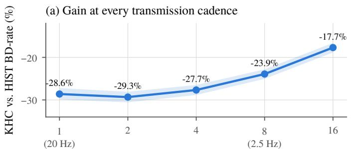  
Transmission stride (control steps between frames)

(b) Geometry, not a pose vector, carries the gain  
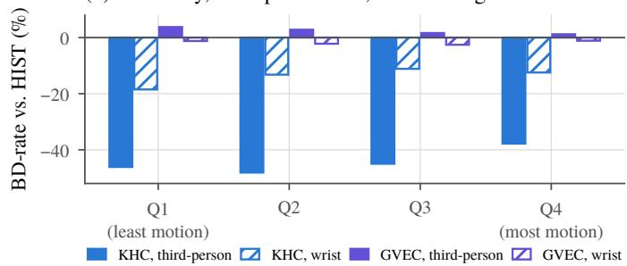  
Fig. 6. (a) KHC vs. HIST BD-rate for transmission strides from 1 (20 Hz) to 16 (1.25 Hz), with 95% CI. (b) BD-rate vs. HIST per quartile of camera motion: transported kinematic hypotheses (KHC) save bits at every motion level, a broadcast pose vector (GVEC) does not.

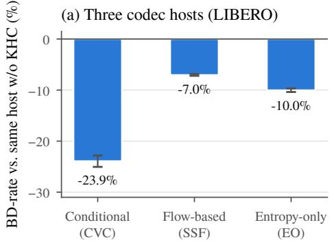

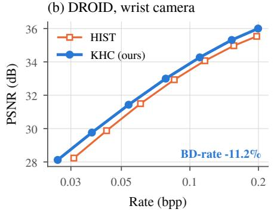

(c) DROID, all three cameras  
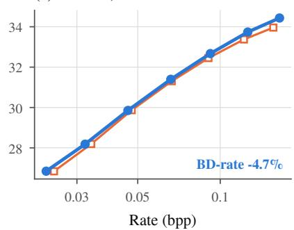  
Fig. 7. (a) BD-rate of KHC inside three codec hosts on LIBERO, each against the same host without kinematic context (95% CI). (b), (c) Real-robot DROID data (30 test episodes from held-out laboratories, stride 4): the self-calibrated wrist camera gains 11.2%; exterior cameras without extrinsics fall back to HIST as designed.

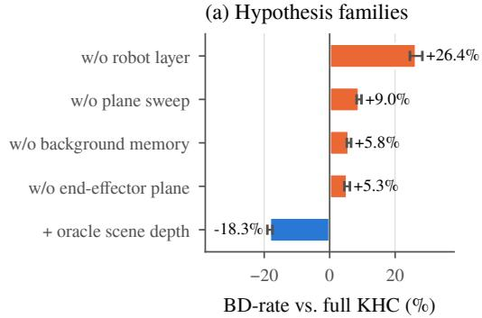

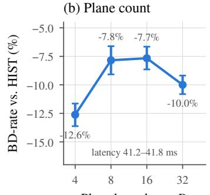

(c) Calibration and timing  
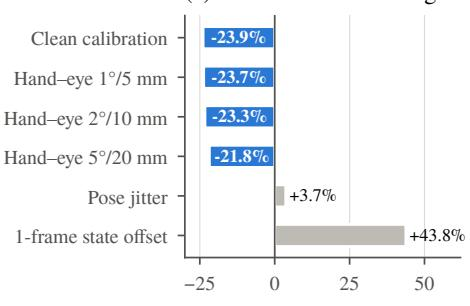  
Fig. 8. (a) Removing each hypothesis family of KHC (all models trained 100k steps), and the oracle-depth upper bound. (b) BD-rate vs. HIST as a function of the number of plane hypotheses D. (c) Hand–eye miscalibration applied at both ends, pose jitter and a one-frame state/image offset (BD-rate vs. clean HIST, both cameras).

x265’s rate control cannot reach these budgets and overshoots by 47–64%; even with 9.8, 12.4 and 15.7 kbps it succeeds less often than KHC at 6.1, 8.2 and 10.4 kbps (32.4%, 63.8% and 79.5% vs. 43.1%, 71.9% and 88.5%).

Where the gain comes from. The KHC-id configuration codes P frames with KHC but may only repeat the last frame when skipping. Against HIST-skip it adds 7.6, 8.7 and 2.9 points (all significant): the coding context alone already lifts success. Allowing SKIP to display the kinematic hypothesis adds another 12.8 and 6.1 points at 6 and 8.3 kbps (both $p < 2 \times 1 0 ^ { - 6 } )$ , and nothing at 10.7 kbps where little is skipped. At the lowest budget almost half of all camera frames are skipped (skip fraction 0.46); a HIST receiver then shows the arm where it was up to several queries ago, whereas a KHC receiver re-renders it at its current pose, which gives the policy the visual feedback it needs for grasping and placing.

Agreement with Proposition 4. The gains follow the slope of the HIST-skip success curve (39% to 91% between 6.9 and 11.7 kbps), as (6) predicts; the first-order prediction at 6 kbps, 55.2% against 43.1% measured, gives the location and sign of the gain, and the curvature of the cliff accounts for its

(a) Where the closed-loop gain comes from  
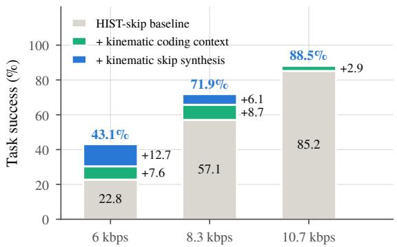

(b) Gains hold on every LIBERO suite (400 episodes per bar)  
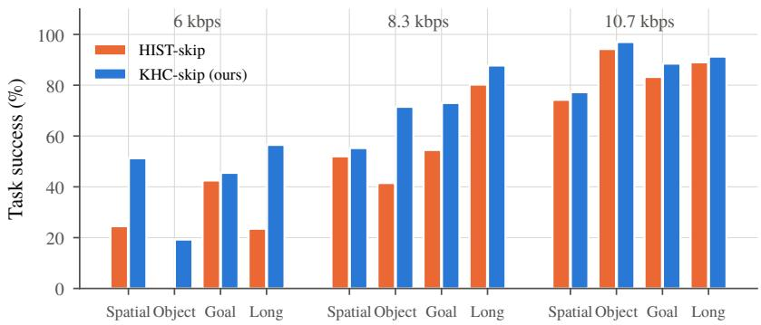  
Fig. 9. (a) Decomposition of the closed-loop gain: HIST-skip, plus the kinematic coding context with identity-only SKIP (KHC-id), plus kinematic SKIP synthesis (KHC-skip). (b) Success per LIBERO suite and budget (400 paired episodes per bar).

TABLE III  
CLOSED-LOOP RESULTS WITH OPENVLA-OFT ON LIBERO (4 SUITES 10 TASKS  40 INITIAL STATES = 1,600 PAIRED EPISODES PER ROW). SUCCESS WITH WILSON 95% INTERVAL; RATE IS THE MEASURED MEAN OVER EPISODES (PAYLOAD, STATE AND HEADERS).
<table><tr><td>Budget</td><td>Uplink</td><td>Success (%)</td><td>Rate (kbps)</td><td>SKIP</td></tr><tr><td></td><td>Uncompressed RAW</td><td>96.94 [96.0, 97.7]</td><td>7496</td><td>一</td></tr><tr><td rowspan="4">6 kbps</td><td>HIST-skip</td><td>22.75 [20.8, 24.9]</td><td>5.98</td><td>0.47</td></tr><tr><td>KHC-skip, identity-only</td><td>30.38 [28.2, 32.7]</td><td>5.97</td><td>0.42</td></tr><tr><td>KHC-skip (ours)</td><td>43.12 [40.7, 45.6]</td><td>6.07</td><td>0.46</td></tr><tr><td>x265 (CBR)</td><td>32.44 [30.2, 34.8]</td><td>9.85</td><td>一</td></tr><tr><td rowspan="4">8.3 kbps</td><td>HIST-skip</td><td>57.06 [54.6, 59.5]</td><td>8.15</td><td>0.24</td></tr><tr><td>KHC-skip, identity-only</td><td>65.75 [63.4, 68.0]</td><td>8.19</td><td>0.18</td></tr><tr><td>KHC-skip (ours)</td><td>71.88 [69.6, 74.0]</td><td>8.18</td><td>0.22</td></tr><tr><td>x265 (CBR)</td><td>63.75 [61.4, 66.1]</td><td>12.35</td><td>一</td></tr><tr><td rowspan="4">10.7 kbps</td><td>HIST-skip</td><td>85.19 [83.4, 86.8]</td><td>10.46</td><td>0.11</td></tr><tr><td>KHC-skip, identity-only</td><td>88.12 [86.4, 89.6]</td><td>10.45</td><td>0.07</td></tr><tr><td>KHC-skip (ours)</td><td>88.50 [86.8, 90.0]</td><td>10.44</td><td>0.09</td></tr><tr><td>x265 (CBR)</td><td>79.50 [77.5, 81.4]</td><td>15.74</td><td></td></tr></table>

TABLE IV

FUNCTIONAL COMPARISON. CONTEXT: ZERO-RATE EMBODIMENT CONTEXT; SKIP POSE: SKIPPED FRAMES SHOW THE CURRENT POSE; BUDGET: RATE WITHIN THE BUDGET; SUCCESS: OPENVLA-OFT, 8.3 KBPS, SAME 800 EPISODES; †REPORTED IN [17].
<table><tr><td>Uplink</td><td>Context SKIP pose Budget Enc. (ms)</td><td></td><td></td><td></td><td>Param. (M)</td><td>Succ. (%)</td></tr><tr><td>KHC-skip (ours)</td><td>√</td><td>√</td><td>√</td><td>26.7</td><td>7.0</td><td>72.4</td></tr><tr><td>KHC-LR-skip (ours)</td><td>√</td><td>√</td><td>√</td><td>26.7</td><td>7.0</td><td>86.0</td></tr><tr><td>HIST-skip</td><td></td><td>一</td><td>√</td><td>23.4</td><td>7.0</td><td>55.8</td></tr><tr><td>DCVC-RT</td><td></td><td>一</td><td>√</td><td>12.8</td><td>20.7+45.7</td><td>66.6</td></tr><tr><td>HIST, 1282</td><td></td><td></td><td>√</td><td></td><td>7.0</td><td>62.6</td></tr><tr><td>x265, CBR</td><td></td><td></td><td>+49%</td><td></td><td></td><td>64.8</td></tr><tr><td>VTM-23 (offline)</td><td></td><td></td><td></td><td>0.01 fps†</td><td></td><td></td></tr></table>

magnitude.

What the policy sees. Fig. 10 follows one paired episode at 6 kbps in which KHC-skip succeeds and both other arms fail. During a run of SKIPs, HIST-skip repeats a stale frame for eight queries while the arm reaches for the mug (14.5– 15.2 dB), and the episode times out. With kinematic SKIP the received frame shows the robot where it actually is (19– 27 dB), and the task finishes at query 37. The identity-only variant follows HIST into the stale regime, which isolates the kinematic synthesis as the cause.

## F. Stronger Baselines, Packet Loss and a Second Policy

Fig. 11 collects the pre-registered extension: 13 comparisons on 800 paired episodes each (initial states 0–19), Holmcorrected as one family, and a separate test with the $\pi _ { 0 . 5 }$ policy.

DCVC-RT in the same uplink. Running DCVC-RT inside the same SKIP and budget controller isolates the codec. KHCskip succeeds more often at 8.3 kbps (72.4% vs. 66.6%, with a task-dependent margin) and at 10.7 kbps (88.9% vs. 69.4%, +19.5 points); at 6 kbps DCVC-RT reaches 49.0% against 43.6% (not significant), a consequence of its trained rate range (down to 0.007 bpp against 0.022 bpp), which lets it skip 6% of the frames where our host skips 45%; with a lower rate range KHC-LR reverses this result (Section VI-G). At equal rate DCVC-RT also perturbs the policy output more (Table I), and its success levels off near 70%.

Budget-compliant x265. When x265 is forced to respect the budget by skipping frames, the policy almost never succeeds (0.0%, 0.3% and 4.0%), against 43.6%, 72.4% and 88.9% with KHC-skip at the same budgets.

Fewer frames or fewer pixels. Two engineering alternatives trade frames or pixels for bits with the HIST codec. KHCskip outperforms half-cadence transmission by 22.4 points at 8.3 kbps and 128 128 transmission with bicubic upsampling by 17.9 points at 10.7 kbps and by a task-dependent 9.8 points at 8.3 kbps. At 6 kbps the 128 128 stream (53.1%) and half cadence (47.9%, not significant) exceed 43.6%, and fullcadence HIST, 8% over the 10.7 kbps budget, reaches 90.9% against 88.9% (not significant). These alternatives change the operating point, not the codec, and can be applied on top of KHC as well; KHC-LR outperforms the 128  128 stream at every budget (Section VI-G). Table IV summarizes the functional differences.

Packet loss. With 10% of the packets dropped at 8.3 kbps, KHC-skip keeps 46.4% success against 22.9% for HIST-skip (+23.5 points); on the same episodes without loss the gap is 16.6 points, so the advantage of KHC grows under loss.

A second policy. $\pi _ { 0 . 5 }$ [5] is a flow-matching VLA that queries the uplink every five control steps (4 Hz). Its own pilot, analyzed with the same budget rule, places the budgets at 10.0, 13.4 and 16.9 kbps; at the pre-registered middle budget KHCskip raises its success from 55.5% to 77.4% (+21.9 points,

(a) Received vs. actual third-person view, 6 kbps (same task, initial state, seed; S: SKIP, P: coded, dB)  
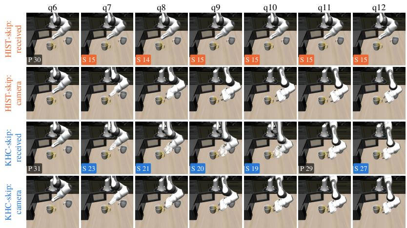

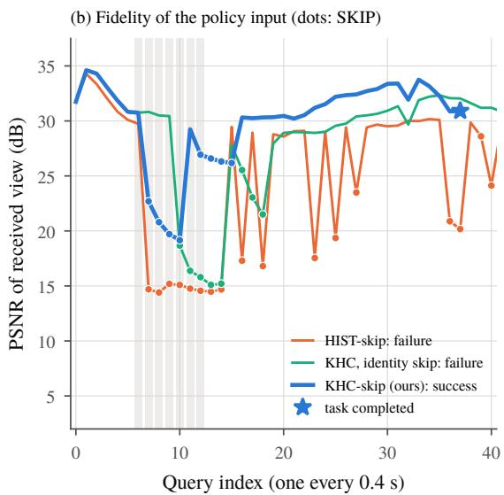  
Fig. 10. Closed loop at 6 kbps, LIBERO-Long task 10, same initial state and seed for all arms. (a) Third-person frame received by the policy and the actual camera frame for HIST-skip and KHC-skip; corner labels give the mode and the PSNR of the received frame. (b) PSNR of the received frame at every query for the three arms; dots mark SKIP queries, the shaded band the queries shown in (a).

CI $[ 1 2 . 0 , 3 2 . 6 ] , p = 9 . 8 \times 1 0 ^ { - 2 5 } )$ at equal measured rate (12.79 vs. 12.76 kbps). The closed-loop gain therefore carries over to a policy with a different architecture, action head and query rate.

## G. Extending the Rate Range

Lower-rate training extends KHC down to 0.012 bpp and improves it by 5.5% over the common range (Table V, Fig. 4); KHC-LR saves 27.6% against the identically trained HIST-LR. Against DCVC-RT the PSNR gap closes (+0.1%, CI [ 6.9,7.9]; 5.7% in the low-rate range), while KHC-LR needs 24.7% fewer bits at equal LPIPS and 30.1% fewer at equal action deviation. Against VTM-23 (4:4:4) it matches the action deviation over the full range ( 2.0%, CI includes zero), saves 8.7% in the low-rate range and 12.2% at equal LPIPS there; the PSNR lead of VTM-23 remains.

In closed loop (Table VI, Fig. 1), KHC-LR-skip reaches 72.6% at 6 kbps, a level the original model reaches only at 8.3 kbps, and exceeds every comparison by 19.5–29.0 points, all Holm-significant. At 8.3 and 10.7 kbps it reaches 86.0% and 88.9%, 17.9–23.4 points above DCVC-RT and the 128 128 stream, at the lowest measured rate of all arms (within 0.6% at 6 kbps). Lower-rate training also lifts the history codec, so there the kinematic margin over HIST-LR is 5.8 and 3.3 points, and at 10.7 kbps KHC-LR equals the original model. The context matters most where frames must be skipped: at 6 kbps KHC-LR skips 19% of the frames instead of 45% and still renders every skipped frame at the current pose.

## H. Complexity and Latency

KHC adds no learned parameters to its capacitymatched counterpart (both 7.0 M) and no network FLOPs (1.39 MFLOPs per pixel); its cost is the geometric hypothesis generation (full profile in the supplementary material). With

TABLE V

BD-RATE (%) OF KHC-LR AGAINST EACH ANCHOR (TEST SPLIT), FULL RANGE AND LOW-RATE RANGE ( 0.041 BPP). BOLD: KHC-LR NEEDS FEWER BITS; UNMARKED: THE ANCHOR NEEDS FEWER BITS (BOTH WITH THE 95% CI EXCLUDING ZERO); ◦: CI INCLUDES ZERO.

<table><tr><td rowspan="2">Anchor</td><td colspan="2">PSNR</td><td colspan="2">LPIPS</td><td colspan="2">Action dev.</td></tr><tr><td>Full</td><td>Low</td><td>Full</td><td>Low</td><td>Full</td><td>Low</td></tr><tr><td>HIST-LR (same recipe) KHC (E2 model)</td><td>-27.6 -5.5</td><td>-28.7 -5.1</td><td>-28.7 -1.5</td><td>-31.1 -1.9</td><td>-29.7 -2.5</td><td>-31.1 -2.4</td></tr><tr><td>DCVC-RT [17]</td><td>+0.1°</td><td>-5.7°</td><td>-24.7</td><td>-33.2</td><td>-30.1</td><td>-34.2</td></tr><tr><td>VTM-23 (4:2:0)</td><td>+16.1</td><td>+2.0°</td><td>-4.9°</td><td>-18.2</td><td></td><td></td></tr><tr><td>VTM-23 (4:4:4)</td><td>+22.7</td><td>+6.0</td><td>+2.9°</td><td>-12.2</td><td>-2.0°</td><td>-8.7</td></tr><tr><td>x265 (4:4:4)</td><td>-51.7</td><td>-60.9</td><td>-44.2</td><td>-57.9</td><td>-50.7</td><td>-59.0</td></tr></table>

TABLE VI

OPENVLA-OFT SUCCESS (%) ON THE SAME 800 PAIRED EPISODES PER BUDGET. IN BRACKETS: GAIN OF KHC-LR-SKIP IN POINTS; ∗: HOLM-SIGNIFICANT (EXACT MCNEMAR).
<table><tr><td>Uplink</td><td>6kbps</td><td>8.3 kbps</td><td>10.7 kbps</td></tr><tr><td>KHC-LR-skip (ours)</td><td>72.6</td><td>86.0</td><td>88.9</td></tr><tr><td>HIST-LR-skip (same recipe)</td><td>49.0 (+23.6*)</td><td>80.3 (+5.8*)</td><td>85.6 (+3.3*)</td></tr><tr><td>KHC-skip (E2 model)</td><td>43.6 (+29.0*)</td><td>72.4 (+13.6*)</td><td>88.9 (+0.0)</td></tr><tr><td>DCVC-RT, same controller</td><td>49.0 (+23.6*)</td><td>66.6 (+19.4*)</td><td>69.4 (+19.5*)</td></tr><tr><td>HIST-skip, 128 × 128</td><td>53.1 (+19.5*)</td><td>62.6 (+23.4*)</td><td>71.0 (+17.9*)</td></tr><tr><td>Measured rate of KHC-LR (kbps)</td><td>5.81</td><td>7.69</td><td>9.63</td></tr></table>

the batched implementation a P frame takes 26.7 ms to encode and 17.0 ms to decode (HIST: 23.4 and 13.2 ms), and the robot-only render costs 1.95 ms per camera at each end; peak memory is 277 MB. The official DCVC-RT models take 12.8 and 8.3 ms, in half precision and with three times as many parameters in the video model alone. Both codecs fit easily into the 400 ms query period of OpenVLA-OFT. Sender and receiver reconstructions are bit-identical across GPUs.

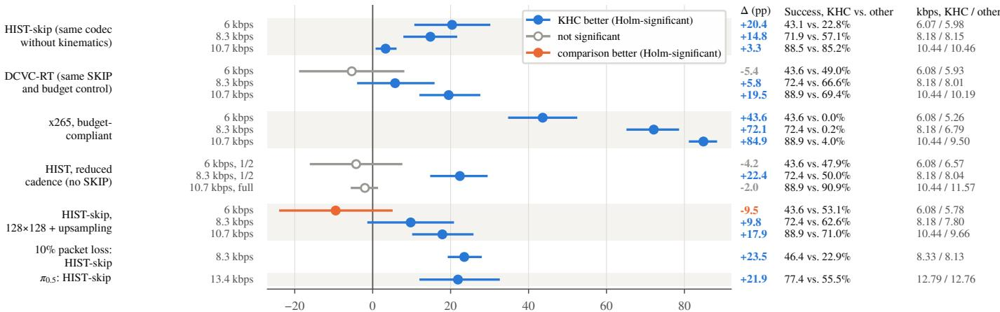  
Success diference, KHC-skip minus comparison (percentage points), task-clustered 95% CI  
Fig. 11. Closed-loop success differences between KHC-skip and each comparison on paired episodes. First group: main experiment (1,600 pairs per budget); other OpenVLA-OFT groups: extension (800 pairs each, one Holm family of 13 tests); last row: $\pi _ { 0 . 5 }$ (800 pairs). Filled: Holm-significant (exact McNemar); bars: task-clustered 95% intervals. Right: success and measured rates.

For a remote policy the relevant latency is computation plus transmission. With a quarter fewer bits, KHC delivers the observation sooner on every link slower than the break-even capacity $b ^ { \star } = \Delta \mathsf { b i t s } / \Delta t _ { \mathrm { c o m p u t e } }$ of 55–227 kbps. At the 6–11 kbps budgets of the closed-loop study, KHC delivers each query’s observation 90–400 ms sooner at equal PSNR (30–33 dB), including the hypothesis generation and robot rendering at both ends.

## VII. DISCUSSION

Why kinematics help so much. Much of the temporal change in a robot camera stream is self-generated and determined by quantities the receiver already holds. History codecs must rediscover it from pixels, and a pose vector does not help (Proposition 2); KHC turns the same knowledge into transported pixels, so the codec spends its bits on object motion, contacts and lighting.

From bits to task success. A strong VLA policy tolerates compression over a codec’s ordinary operating range (HIST at its lowest rate point still succeeds in 88.5% of the episodes); task-level differences appear at the cliff, where our preregistered rule places the budgets. The same rule located the $\pi _ { 0 . 5 }$ budget at which KHC adds 21.9 points, so the protocol transfers to a new policy without tuning.

## A. Limitations and Future Directions

Asynchrony and timing. KHC relies on the state being synchronized with the image; a one-frame offset turns the hypotheses against the codec. Estimating the offset online, or conditioning on a short window of states, would extend it to unsynchronized consumer cameras.

Calibration-free deployment. Self-calibration recovers the wrist-camera geometry on DROID, but exterior cameras without extrinsics currently fall back to HIST. Estimating their extrinsics from the robot layer, a free moving calibration target, would extend the gain to every camera.

Beyond rigid scenes. Deformable objects, liquids and humans in the workspace are not explained by any hypothesis.

Depth-aware hypotheses (18% oracle headroom) and learned object dynamics can cover these cases.

Stronger hosts. In PSNR, the offline VTM-23 still leads our compact host at medium and high rates (+16.1% for KHC-LR in 4:2:0). Lower-rate training already removed the 6 kbps deficit against DCVC-RT and the $1 2 8 \times 1 2 8$ stream (Section VI-G). KHC is orthogonal to the host, so integrating it into DCVC-RT-class architectures is the direct way to close the remaining gap.

Joint operating-point control. Resolution, cadence and SKIP are complementary levers. Choosing them per query with the kinematic context, and allocating bits between cameras by their value for the policy, are next steps toward uplinks for robot fleets that share one network.

## VIII. CONCLUSION

We introduced the kinematic hypothesis context, a zerorate coding context built from the embodiment knowledge that a robot and its remote policy already share, and showed why history and pose-vector conditioning cannot exploit this knowledge. It saves 23.9% of the bit rate of a capacity-matched codec and 40–56% of that of x264, x265 and SVT-AV1, needs 23.2% fewer bits than DCVC-RT at equal action deviation, and transfers across hosts and to real robot data. In closed loop it nearly doubles the task success of OpenVLA-OFT at 6 kbps and raises that of $\pi _ { 0 . 5 }$ by 21.9 points. Trained to lower rates, it reaches 72.6% at 6 kbps, 23.6 points above DCVC-RT. Robot uplinks can therefore treat the embodiment as side information held by both ends and spend their bits on the rest of the scene.

## SUPPLEMENTARY MATERIAL AND CODE AVAILABILITY

The supplementary material referred to in the text (full paired-test tables of the main closed-loop experiment, the complete complexity and latency profile, and additional results of the lower-rate extension) and the code are being finalized and will be made publicly available upon formal submission of this work.

## REFERENCES

[1] B. Zitkovich, T. Yu, S. Xu, P. Xu, T. Xiao, F. Xia, J. Wu et al., “RT-2: Vision-language-action models transfer web knowledge to robotic control,” in Proc. Conf. Robot Learn. (CoRL), ser. Proc. Mach. Learn. Res., vol. 229, 2023, pp. 2165–2183.

[2] M. J. Kim, K. Pertsch, S. Karamcheti, T. Xiao, A. Balakrishna, S. Nair, R. Rafailov et al., “OpenVLA: An open-source vision-language-action model,” in Proc. Conf. Robot Learn. (CoRL), ser. Proc. Mach. Learn. Res., vol. 270, 2025, pp. 2679–2713.

[3] M. J. Kim, C. Finn, and P. Liang, “Fine-tuning vision-language-action models: Optimizing speed and success,” in Proc. Robot.: Sci. Syst. (RSS), 2025.

[4] K. Black, N. Brown, D. Driess, A. Esmail, M. R. Equi, C. Finn, N. Fusai et al., “π0: A vision-language-action flow model for general robot control,” in Proc. Robot.: Sci. Syst. (RSS), 2025.

[5] K. Black, N. Brown, J. Darpinian, K. Dhabalia, D. Driess, A. Esmail et al., “π0 5: A vision-language-action model with open-world generalization,” in Proc. Conf. Robot Learn. (CoRL), ser. Proc. Mach. Learn. Res., vol. 305, 2025, pp. 17–40.

[6] B. Kehoe, S. Patil, P. Abbeel, and K. Goldberg, “A survey of research on cloud robotics and automation,” IEEE Trans. Autom. Sci. Eng., vol. 12, no. 2, pp. 398–409, 2015.

[7] J. Ichnowski, K. Chen, K. Dharmarajan, S. Adebola, M. Danielczuk, V. Mayoral-Vilches et al., “FogROS2: An adaptive platform for cloud and fog robotics using ROS 2,” in Proc. IEEE Int. Conf. Robot. Autom. (ICRA), 2023, pp. 5493–5500.

[8] T. Wiegand, G. J. Sullivan, G. Bjøntegaard, and A. Luthra, “Overview of the H.264/AVC video coding standard,” IEEE Trans. Circuits Syst Video Technol., vol. 13, no. 7, pp. 560–576, 2003.

[9] G. J. Sullivan, J.-R. Ohm, W.-J. Han, and T. Wiegand, “Overview of the high efficiency video coding (HEVC) standard,” IEEE Trans. Circuits Syst. Video Technol., vol. 22, no. 12, pp. 1649–1668, 2012.

[10] B. Bross, Y.-K. Wang, Y. Ye, S. Liu, J. Chen, G. J. Sullivan, and J.-R. Ohm, “Overview of the versatile video coding (VVC) standard and its applications,” IEEE Trans. Circuits Syst. Video Technol., vol. 31, no. 10, pp. 3736–3764, 2021.

[11] G. Lu, W. Ouyang, D. Xu, X. Zhang, C. Cai, and Z. Gao, “DVC: An end-to-end deep video compression framework,” in Proc. IEEE/CVF Conf. Comput. Vis. Pattern Recognit. (CVPR), 2019, pp. 10 998–11 007.

[12] E. Agustsson, D. Minnen, N. Johnston, J. Balle, S. J. Hwang, and´ G. Toderici, “Scale-space flow for end-to-end optimized video compression,” in Proc. IEEE/CVF Conf. Comput. Vis. Pattern Recognit. (CVPR), 2020, pp. 8500–8509.

[13] J. Li, B. Li, and Y. Lu, “Deep contextual video compression,” in Proc. Adv. Neural Inf. Process. Syst. (NeurIPS), vol. 34, 2021, pp. 18 114– 18 125.

[14] X. Sheng, J. Li, B. Li, L. Li, D. Liu, and Y. Lu, “Temporal context mining for learned video compression,” IEEE Trans. Multimedia, vol. 25, pp. 7311–7322, 2023.

[15] J. Li, B. Li, and Y. Lu, “Neural video compression with diverse contexts,” in Proc. IEEE/CVF Conf. Comput. Vis. Pattern Recognit. (CVPR), 2023, pp. 22 616–22 626.

[16] ——, “Neural video compression with feature modulation,” in Proc. IEEE/CVF Conf. Comput. Vis. Pattern Recognit. (CVPR), 2024, pp. 26 099–26 108.

[17] Z. Jia, B. Li, J. Li, W. Xie, L. Qi, H. Li, and Y. Lu, “Towards practical real-time neural video compression,” in Proc. IEEE/CVF Conf. Comput. Vis. Pattern Recognit. (CVPR), 2025, pp. 12 543–12 552.

[18] D. Slepian and J. K. Wolf, “Noiseless coding of correlated information sources,” IEEE Trans. Inf. Theory, vol. 19, no. 4, pp. 471–480, 1973.

[19] A. D. Wyner and J. Ziv, “The rate-distortion function for source coding with side information at the decoder,” IEEE Trans. Inf. Theory, vol. 22, no. 1, pp. 1–10, 1976.

[20] B. Girod, A. M. Aaron, S. Rane, and D. Rebollo-Monedero, “Distributed video coding,” Proc. IEEE, vol. 93, no. 1, pp. 71–83, 2005.

[21] R. T. Collins, “A space-sweep approach to true multi-image matching,” in Proc. IEEE Comput. Soc. Conf. Comput. Vis. Pattern Recognit. (CVPR), 1996, pp. 358–363.

[22] B. Liu, Y. Zhu, C. Gao, Y. Feng, Q. Liu, Y. Zhu, and P. Stone, “LIBERO: Benchmarking knowledge transfer for lifelong robot learning,” in Proc. Adv. Neural Inf. Process. Syst. (NeurIPS), Datasets Benchmarks Track, vol. 36, 2023, pp. 44 776–44 791.

[23] A. Khazatsky, K. Pertsch, S. Nair, A. Balakrishna, S. Dasari, S. Karamcheti et al., “DROID: A large-scale in-the-wild robot manipulation dataset,” in Proc. Robot.: Sci. Syst. (RSS), 2024.

[24] T. Z. Zhao, V. Kumar, S. Levine, and C. Finn, “Learning fine-grained bimanual manipulation with low-cost hardware,” in Proc. Robot.: Sci. Syst. (RSS), 2023.

[25] K. Black, M. Y. Galliker, and S. Levine, “Real-time execution of action chunking flow policies,” arXiv preprint arXiv:2506.07339, 2025.

[26] S. Pohland, X. Foukas, G. Ananthanarayanan, A. Kolobov, S. Mehrotra, B. Radunovic, and A. Verma, “Offload or overload: A platform measurement study of mobile robotic manipulation workloads,” arXiv preprint arXiv:2603.18284, 2026.

[27] C. Nguyen, S. Jin, F. T. Pokorny, and E. Elmroth, “Speculative policy orchestration: A latency-resilient framework for cloud-robotic manipulation,” arXiv preprint arXiv:2603.19418, 2026.

[28] J. Han, B. Li, D. Mukherjee, C.-H. Chiang, A. Grange, C. Chen et al., “A technical overview of AV1,” Proc. IEEE, vol. 109, no. 9, pp. 1435– 1462, 2021.

[29] Z. Hu, G. Lu, and D. Xu, “FVC: A new framework towards deep video compression in feature space,” in Proc. IEEE/CVF Conf. Comput. Vis. Pattern Recognit. (CVPR), 2021, pp. 1502–1511.

[30] O. Rippel, A. G. Anderson, K. Tatwawadi, S. Nair, C. Lytle, and L. Bourdev, “ELF-VC: Efficient learned flexible-rate video coding,” in Proc. IEEE/CVF Int. Conf. Comput. Vis. (ICCV), 2021, pp. 14 479– 14 488.

[31] F. Mentzer, G. D. Toderici, D. Minnen, S. Caelles, S. J. Hwang, M. Lucic, and E. Agustsson, “VCT: A video compression transformer,” in Proc. Adv. Neural Inf. Process. Syst. (NeurIPS), vol. 35, 2022.

[32] S. Ayzik and S. Avidan, “Deep image compression using decoder side information,” in Proc. Eur. Conf. Comput. Vis. (ECCV), 2020, pp. 699– 714.

[33] G. Tech, Y. Chen, K. Muller, J.-R. Ohm, A. Vetro, and Y.-K. Wang,¨ “Overview of the multiview and 3D extensions of high efficiency video coding,” IEEE Trans. Circuits Syst. Video Technol., vol. 26, no. 1, pp. 35–49, 2016.

[34] Y. Mi, C. Luo, G. Min, W. Miao, L. Wu, and T. Zhao, “Sensor-assisted global motion estimation for efficient UAV video coding,” in Proc. IEEE Int. Conf. Acoust., Speech Signal Process. (ICASSP), 2019, pp. 2237– 2241.

[35] G. Wang, B. Li, Y. Zhang, and J. Yang, “Background modeling and referencing for moving cameras-captured surveillance video coding in HEVC,” IEEE Trans. Multimedia, vol. 20, no. 11, pp. 2921–2934, 2018.

[36] Z. Fang, M. Zheng, P. Chen, Z. Chen, and D. O. Wu, “Camera posebased background modeling for video coding in moving cameras,” IEEE Trans. Circuits Syst. Video Technol., vol. 34, no. 5, pp. 4054–4069, 2024.

[37] L.-Y. Duan, J. Liu, W. Yang, T. Huang, and W. Gao, “Video coding for machines: A paradigm of collaborative compression and intelligent analytics,” IEEE Trans. Image Process., vol. 29, pp. 8680–8695, 2020.

[38] J. Shao, Y. Mao, and J. Zhang, “Learning task-oriented communication for edge inference: An information bottleneck approach,” IEEE J. Sel. Areas Commun., vol. 40, no. 1, pp. 197–211, 2022.

[39] D. Gund¨ uz, Z. Qin, I. E. Aguerri, H. S. Dhillon, Z. Yang, A. Yener, K.-¨ K. Wong, and C.-B. Chae, “Beyond transmitting bits: Context, semantics, and task-oriented communications,” IEEE J. Sel. Areas Commun., vol. 41, no. 1, pp. 5–41, 2023.

[40] T. M. Cover and J. A. Thomas, Elements ofInformation Theory, 2nd ed. Hoboken, NJ, USA: Wiley-Interscience, 2006.

[41] J. Balle, D. Minnen, S. Singh, S. J. Hwang, and N. Johnston, “Variational´ image compression with a scale hyperprior,” in Proc. Int. Conf. Learn. Represent. (ICLR), 2018.

[42] D. Minnen, J. Balle, and G. D. Toderici, “Joint autoregressive and´ hierarchical priors for learned image compression,” in Proc. Adv. Neural Inf. Process. Syst. (NeurIPS), vol. 31, 2018.

[43] E. Todorov, T. Erez, and Y. Tassa, “MuJoCo: A physics engine for model-based control,” in Proc. IEEE/RSJ Int. Conf. Intell. Robots Syst. (IROS), 2012, pp. 5026–5033.

[44] Y. Zhu, J. Wong, A. Mandlekar, R. Mart´ın-Mart´ın, A. Joshi, K. Lin, A. Maddukuri, S. Nasiriany, and Y. Zhu, “robosuite: A modular simulation framework and benchmark for robot learning,” arXiv preprint arXiv:2009.12293, 2020.

[45] Z. Wang, E. P. Simoncelli, and A. C. Bovik, “Multiscale structural similarity for image quality assessment,” in Proc. 37th Asilomar Conf. Signals, Syst. Comput., vol. 2, 2003, pp. 1398–1402.

[46] R. Zhang, P. Isola, A. A. Efros, E. Shechtman, and O. Wang, “The unreasonable effectiveness of deep features as a perceptual metric,” in Proc. IEEE/CVF Conf. Comput. Vis. Pattern Recognit. (CVPR), 2018, pp. 586–595.

[47] G. Bjøntegaard, “Calculation of average PSNR differences between RDcurves,” ITU-T SG16 Q.6 (VCEG), Austin, TX, USA, Doc. VCEG-M33, 2001.

[48] E. B. Wilson, “Probable inference, the law of succession, and statistical inference,” J. Amer. Statist. Assoc., vol. 22, no. 158, pp. 209–212, 1927.

[49] Q. McNemar, “Note on the sampling error of the difference between correlated proportions or percentages,” Psychometrika, vol. 12, no. 2, pp. 153–157, 1947.

[50] S. Holm, “A simple sequentially rejective multiple test procedure,” Scand. J. Statist., vol. 6, no. 2, pp. 65–70, 1979.