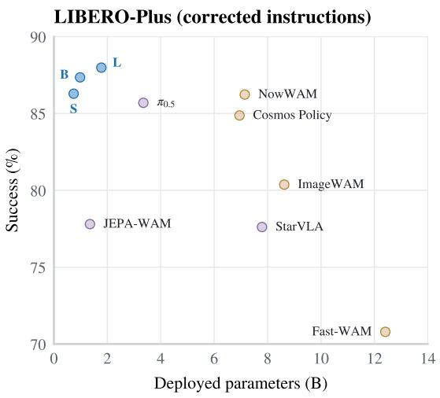
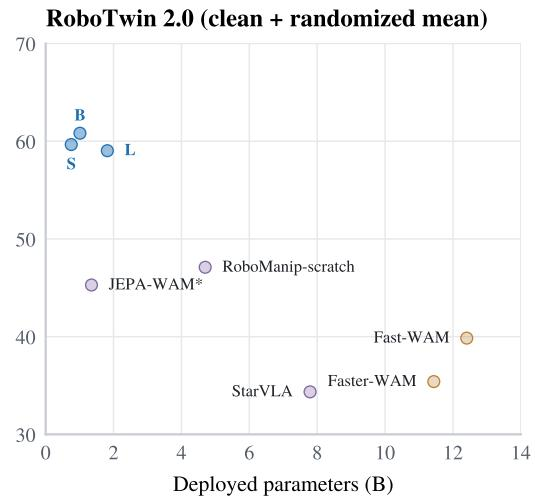
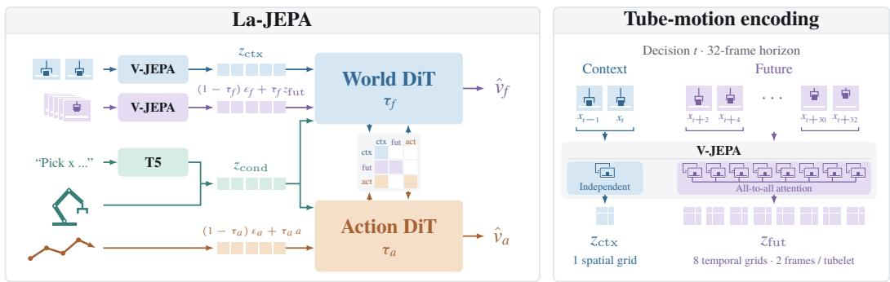
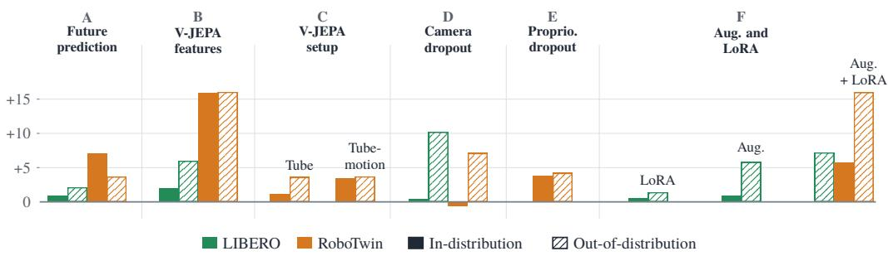
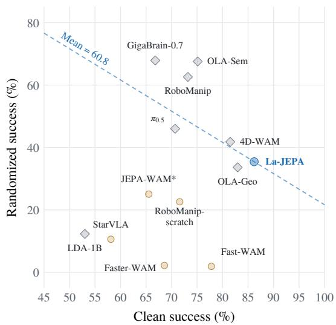
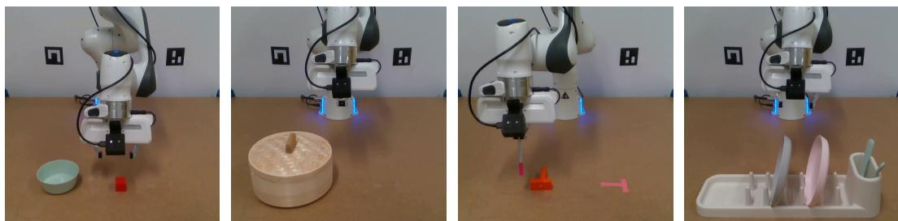
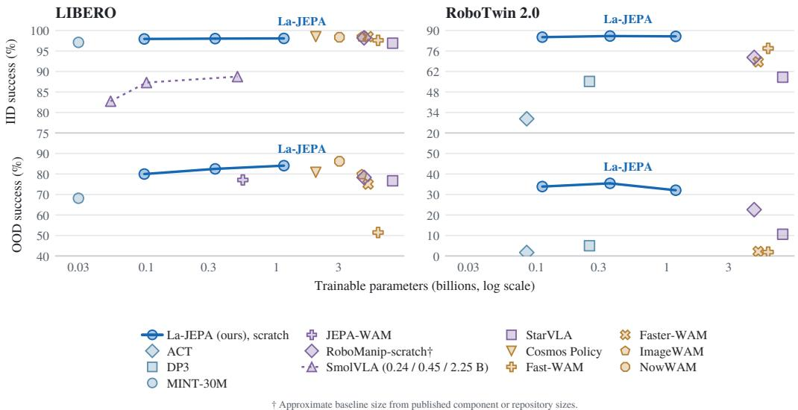

# LA-JEPA: COMPACT ROBOT POLICIES WITH LATENT WORLD MODELING

Mateo Clemente ´ 1,†, George Z. Xue2,∗, Amin Abyaneh3,∗, Liheng Ma4, Rui Heng Yang1, Tongtong Cao1, Zhanguang Zhang1, Yingxue Zhang1

1Huawei Technologies Ltd. 2University of Toronto 3McGill University

4Mila – Quebec Artificial Intelligence Institute

## ABSTRACT

World-action models commonly adapt pretrained video generators, and visionlanguage-action models build on pretrained vision-language backbones; both tie policy architecture and inference cost to large transformers designed for generation rather than control. While the knowledge accumulated through large-scale pretraining is certainly useful, it remains unclear how much generation-oriented architectural choices affect control performance, and whether the trade-off required to access this pretraining is worth it. In this work, we introduce Latent Action JEPA (La-JEPA), a compact world-action model whose policy transformer is trained from scratch in the feature space of a pretrained V-JEPA 2.1 encoder, so that its architecture and capacity can be chosen for control. Following Fast-WAM, La-JEPA learns to predict future features jointly with actions during training and generates only actions at inference. Among policies without embodied pretraining, La-JEPA achieves state-of-the-art performance in clean and randomized RoboTwin 2.0 scenes and on LIBERO-Plus with correct instructions, while using far fewer parameters than the strongest competing policies. It runs substantially faster than Fast-WAM at comparable performance and outperforms the closest JEPA-based methods, LeapBot-WA and JEPA-WAM, on LIBERO-Plus and RoboTwin 2.0 without their pretrained policy backbones. On four real-robot tasks, including contact-heavy pushing and long-horizon multistep manipulation, its average success is comparable to π0.5, outperforming non-embodied-pretrained baselines. Through a design study of the choices behind La-JEPA, we show that JEPA features outperform video VAE latents, most clearly out of distribution, and that training-time future prediction choices significantly impact the policy even when future prediction is skipped at inference. We also correct the LIBERO-Plus instructions, as the officially released evaluator corrupts them for most variants, and re-evaluate several strong open baselines. These results establish a compact, efficient foundation for JEPA-based world-action modeling: without a generative pretrained policy backbone, La-JEPA is better and faster than far larger policies built on video and language generation models, suggesting that robot foundation models may benefit from architectures designed specifically for control rather than inherited from generation.

## 1 INTRODUCTION

World-action models increasingly adapt pretrained video-generation transformers to robot control, inheriting useful visual and temporal priors along with the representation space, tokenization, and architecture of a model built for video synthesis (Yuan et al., 2026b; Ma et al., 2026; Kim et al., 2026). Vision-language-action policies take a similar route using language-generation transformers aligned with visual inputs (Kim et al., 2024; Black et al., 2024; Physical Intelligence et al., 2025). The success of these two types of architectures raises two practical questions: must robot policies necessarily inherit the architecture of a generative backbone to be competitive, and can a compact world-action transformer trained from scratch actually reach the performance of these policies?

  
O La-JEPA (scratch, ours) O VLM-initialized O Generator-initialized  
Figure 1: Success against deployed parameters, including frozen encoders, on LIBERO-Plus with corrected instructions (Section 5.2) and on RoboTwin 2.0, where the panel reports the equally weighted mean of clean and randomized success of clean-trained policies. S, B, and L denote the La-JEPA sizes. The LIBERO-Plus panel shows the policies without embodied pretraining that we re-evaluated with corrected instructions, and the embodied-pretrained $\pi _ { 0 . 5 } ;$ Table 1 lists all scores, including those with the released instructions. ∗: success estimated from JEPA-WAM’s 20-task results (Appendix B).

Most world-action models (WAMs) are VAE-based because they build on pretrained video generators, yet better-suited latent spaces are available. Video VAEs retain accurate information but spend much of their capacity on pixel-level fidelity that control does not require. JEPA representations, in contrast, are developed and evaluated for downstream tasks such as video understanding, depth estimation, and segmentation, which are closer to the needs of embodied agents (Assran et al., 2025; Mur-Labadia et al., 2026). Previous work aligns VLMs or video-generation models to the JEPA space (Lin et al., 2026; Liu et al., 2026) or learns a JEPA-style latent space jointly with the policy (Vujinovic & Kovacevic, 2025); to our knowledge, no prior work trains a compact world-action policy from scratch in a pretrained JEPA feature space.

We introduce Latent Action JEPA (La-JEPA), a world-action model that learns future-feature prediction and action generation directly in the dense spatial and temporal feature space of a pretrained V-JEPA 2.1 video encoder (Mur-Labadia et al., 2026). Its World DiT and Action DiT are initialized from scratch, allowing their architecture and capacity to be chosen independently of the visual encoder. Following Fast-WAM and Faster-WAM (Yuan et al., 2026b; Ma et al., 2026), actions attend to observed context but not to future tokens, so predictive supervision can shape the policy during training without the cost of generating the future at inference time.

Among policies without embodied pretraining, La-JEPA achieves the strongest clean and randomized RoboTwin 2.0 results and the strongest LIBERO-Plus results with corrected instructions (Section 5.2), with about four times fewer deployed parameters than the next-best policies, while running up to 5× faster than Fast-WAM, whose design we follow (Figure 1, Tables 1 and 2). With the released instructions, it is second only to NowWAM, which is insensitive to the corrupted text (Table 14). It also outperforms the closest JEPA-based methods, LeapBot-WA and JEPA-WAM, on LIBERO-Plus and RoboTwin 2.0 (Table 3). On real-robot tasks ranging from cube placement to contact-rich pushing and long-horizon manipulation, La-JEPA trained from scratch on the target demonstrations achieves the highest average success among the compared policies, comparable to the embodied-pretrained $\pi _ { 0 . 5 }$ (Table 5). Together, these results demonstrate leading benchmark performance, efficient inference, and competitive physical manipulation without requiring a generative backbone.

To understand which design choices enable this performance, we study the impact of the representation space, different targets for predictive supervision, and robustness mechanisms. We adopt a compactfirst approach, making the architecture viable even for a policy with 0.1B trainable parameters, before increasing policy capacity. Comparisons of JEPA features and VAE latents span both benchmarks and multiple model configurations, showing that JEPA features generally outperform VAE latents, with the clearest gains for out of distribution evaluations (Section 4.1, Appendix A.1). Action-only controls separately confirm the benefit of WAM-style future prediction, and studies of temporal encoding, dropout, augmentation, and encoder adaptation complete the recipe. These analyses support the central contribution: a compact, effective world-action policy, together with evidence to guide its design. As a secondary contribution, we show that the released LIBERO-Plus evaluator appends perturbation parameters to most instructions, so that most variants apply two perturbations at once. This corruption affects policies to very different degrees, from no change to 19 points, and obscures the robustness study that the benchmark is designed for; we therefore reevaluate the openly available baselines with corrected instructions under a single “clean” protocol that isolates each perturbation as intended (Section 5.2).

## 2 RELATED WORK

Vision-language-action policies. Vision-language-action (VLA) policies extend pretrained vision-language models with action outputs, predicting discretized action tokens (Kim et al., 2024) or attaching a flow-matching action expert (Black et al., 2024), and broaden their training data to generalize further (Physical Intelligence et al., 2025; Yuan et al., 2026a). All inherit the size and inference cost of a multi-billion-parameter vision-language backbone.

World-action models. World-action models (WAMs) instead build on pretrained video or image generators whose representations drive action generation (Kim et al., 2026; Zhang et al., 2026; Wang et al., 2026), reaching the strongest previously reported LIBERO-Plus results among policies without embodied pretraining. Because generating future frames slows inference, recent WAMs predict the future only during training (Yuan et al., 2026b) and reduce the action expert to a single layer that reads keys and values cached from all layers of the video backbone (Ma et al., 2026). All retain the generator backbone in the deployed policy.

Joint-embedding predictive architectures. Joint-embedding predictive architectures (JEPAs) learn representations by predicting the embeddings of masked inputs rather than reconstructing pixels (Assran et al., 2023). V-JEPA extends this objective to video (Bardes et al., 2024), V-JEPA 2 scales it (Assran et al., 2025), and V-JEPA 2.1 improves the dense features of V-JEPA 2 (Mur-Labadia et al., 2026), which makes it especially well suited to robotic policies. JEPA representations have since been used in robot policies: ACT-JEPA learns a JEPA-style latent space jointly with the policy (Vujinovic & Kovacevic, 2025), VLA-JEPA and JEPA-VLA bring V-JEPA targets or features into vision-language-action models (Sun et al., 2026; Miao et al., 2026), and JEPA-WAM and LeapBot-WA build world-action models on V-JEPA features (Lin et al., 2026; Liu et al., 2026). These two world-action models are the closest to La-JEPA, but both initialize their predictors from pretrained vision-language or video generation models.

Compact policies. Policies that are competitive without inheriting either a VLM or video backbone are scarce. While Diffusion Policy (Chi et al., 2023), DP3 (Ze et al., 2024) and ACT (Zhao et al., 2023) exist, their performance is rarely close to VLAs and World Models. MINT predicts coarse-to-fine action tokens with a separately trained action tokenizer (Huang et al., 2026) and reaches much better success rates, but remains below the strongest WAMs and VLAs. La-JEPA fits in this category as it trains its policy DiTs from scratch while adding WAM-style future prediction in a pretrained JEPA feature space.

  
Figure 2: La-JEPA. Left: general architecture. Right: context and future encoding with V-JEPA 2.1.

## 3 LA-JEPA

La-JEPA learns action generation jointly with future-feature prediction in a pretrained V-JEPA 2.1 ViT-L representation space, following the separation of training-time world modeling from inference-time action generation in Fast-WAM (Yuan et al., 2026b) and Faster-WAM (Ma et al., 2026). At decision time t, the policy maps multi-camera observations $o _ { t } .$ , proprioception $s _ { t } ,$ and a language instruction ℓ to an action chunk $A = \left( a _ { t } , \ldots , a _ { t + H - 1 } \right)$ . This section describes the fixed architecture and training procedure (Figure 2); Section 4 examines the choices within it.

## 3.1 ARCHITECTURE

Visual representations. The pretrained V-JEPA 2.1 ViT-L encoder (Mur-Labadia et al., 2026) processes each camera independently, producing observation features ${ \mathit { z } } _ { \mathrm { c t x } }$ from the most recent frames, and future targets ${ z } _ { \mathrm { f u t } }$ representing the 32 frames ahead. We normalize and spatially reduce these feature grids before projecting them into the World DiT’s embedding space. They are the model’s only visual input and prediction target, so the model gets no separate RGB pathway. Future predictions are matched to targets directly in V-JEPA space and require no pixel reconstruction.

Language and proprioception. A frozen FLAN-T5-large encoder (Chung et al., 2022) embeds the instruction ℓ, and learned projections map proprioception $s _ { t }$ to additional tokens; together they form the conditioning sequence $z _ { \mathrm { c o n d } }$ , which both DiTs read through cross-attention.

World–action architecture. The model is made of two diffusion transformers (DiTs) (Peebles & Xie, 2022): a World DiT over observation and future-feature tokens and an Action DiT over the action chunk. Both are initialized from scratch with separate attention projections and feed-forward layers, so pretrained knowledge enters only through the visual and language encoders. Rotary visual positional encodings (Su et al., 2021) preserve spatial and temporal information. The two DiTs interact at every layer, where action queries read the World DiT’s observation keys and values alongside its own. The attention mask keeps future information out of the action pathway: observation tokens attend only to observations, future tokens to observations and futures, and action tokens to observations and actions. Actions therefore never access future features directly, yet predictive supervision still shapes the observation representations they read through the shared World DiT parameters during training.

## 3.2 TRAINING AND INFERENCE

Joint flow matching. We train both DiTs with future and action-space flow matching (Lipman et al., 2022). For each training example, we independently sample timesteps $\tau _ { f } , \tau _ { a } \sim \mathcal { U } ( 0 , 1 )$ and Gaussian noise $\epsilon _ { f } , \epsilon _ { a }$ , forming the noisy inputs

$$
z _ { \mathrm { f u t } } ^ { \tau _ { f } } = ( 1 - \tau _ { f } ) \epsilon _ { f } + \tau _ { f } z _ { \mathrm { f u t } } , \qquad A ^ { \tau _ { a } } = ( 1 - \tau _ { a } ) \epsilon _ { a } + \tau _ { a } A .\tag{1}
$$

The model receives $( z _ { \mathrm { c t x } } , z _ { \mathrm { f u t } } ^ { \tau _ { f } } , A ^ { \tau _ { a } } , z _ { \mathrm { c o n d } } )$ and predicts velocities $\hat { v } _ { f }$ and $\hat { v } _ { a }$ under the attention mask as described above. The World DiT is conditioned on $\tau _ { f }$ and the Action DiT on $\tau _ { a }$ . The training

  
Figure 3: Gain in success (percentage points) from each design choice over its baseline: A, actiononly training; B, Wan2.2 VAE latents; C, static encoding; D, no camera dropout (LIBERO: wristonly dropout); E, no proprioception dropout; F, a plain policy without augmentation or encoder LoRA. Green: LIBERO; orange: RoboTwin 2.0; solid: in-distribution; hatched: out-of-distribution. Block A averages LIBERO-Plus gains over three training seeds. Values and evaluation budgets in Table 6.

objective is

$$
\mathcal { L } = \mathbb { E } \left[ \mathrm { M S E } ( \hat { v } _ { f } , z _ { \mathrm { f u t } } - \epsilon _ { f } ) + \mathrm { M S E } ( \hat { v } _ { a } , A - \epsilon _ { a } ) \right] ,\tag{2}
$$

where each mean squared error averages over its supervised elements.

Action inference. At inference, we drop the future-feature tokens, initialize the action chunk from Gaussian noise, and integrate the action velocity field from $\tau _ { a } = 0 \mathrm { t o } \tau _ { a } = 1$ with Euler steps, holding the World DiT’s timestep conditioning at a fixed value $\tau _ { \mathrm { c t x } } = 0$ (since we do not predict the futures anyway). Since observation tokens attend only to one another under fixed conditioning, their per-layer keys and values are computed once and cached, and only the Action DiT runs at each denoising step. Like most recent policies, we convert the predicted action tokens to the robot’s action space, execute the first k actions of the chunk (k = 10 on LIBERO and 24 on RoboTwin, as in Fast-WAM), and then predict a new chunk from the latest observations.

## 4 DESIGN ANALYSIS

Experimental setup. We test the design choices behind Section 5 with the small (S) policy unless stated otherwise. We ask, in turn, whether to predict future features, in which feature space, how to encode motion (Section 4.1), and then how to make the policy robust to observation changes (Section 4.2). The studies use LIBERO, LIBERO-Plus, and clean-trained RoboTwin 2.0 (Liu et al., 2023; Fei et al., 2025; Chen et al., 2025); in-distribution (IID) evaluation refers to LIBERO or clean RoboTwin scenes, and out-of-distribution (OOD) evaluation to LIBERO-Plus or randomized scenes. Figure 3 reports each choice’s gain in success in percentage points (hereafter, points), grouped into blocks A to F. Each block has its own reference recipe, so comparisons hold within a block; Table 6 lists baselines and evaluation budgets, and Appendix A documents the protocols.

## 4.1 PREDICTION TARGET AND FEATURE SPACE

Predictive supervision. We first test whether predicting future features benefits the policy, comparing joint action and future-feature prediction with action-only training (Figure 3A). Future prediction raises RoboTwin success by 7.0 points in clean and 3.7 in randomized scenes. On LIBERO-Plus, it improves success for each of three training seeds, by 2.1 points on average, with every paired comparison significant $( p < 0 . 0 1$ , McNemar; Appendix A.1).

Feature space. We next ask in which space prediction should be learned, comparing frozen V-JEPA 2.1 features with latents of the VAE of Wan2.2 (Team Wan et al., 2025), the video model underlying Fast-WAM, Faster-WAM, and LeapBot-WA (Figure 3B). Each policy learns action and future-feature prediction with the normalization and projections suited to its representation, so the comparison evaluates each representation together with its interface to the policy. V-JEPA improves success in all four evaluations of this pair: by 15.9 points in clean and 16.0 in randomized RoboTwin scenes, and by 6.0 on LIBERO-Plus and 2.0 on LIBERO. In randomized scenes, the Wan2.2 policy collapses and succeeds in only 1.0% of episodes, close to the video-generator WAMs in Table 2. In two additional RoboTwin comparisons (Appendix A.1), clean success is comparable in one and favors Wan2.2 in the other, whereas randomized success, reported for the second, again strongly favors V-JEPA. These results echo those of LDA-1B, which similarly reports a large gain from replacing VAE latents with DINO features (Lyu et al., 2026).

Table 1: LIBERO and LIBERO-Plus success (%) of policies without embodied pretraining (all use pretrained perception). Parameters in billions. LIBERO-Plus: episode-weighted success over all 10,030 variants with corrected or released instructions (Section 5.2); corrected-instruction scores exist only for the policies we re-evaluated. Best in bold, second best underlined unless the best is tied. La-JEPA values are means over three training seeds (Appendix B). §Scored at the upstream step limits used for all policies; with its own longer limits (400 steps, 700 for LIBERO-Long), NowWAM reports 87.7% on the released instructions.
<table><tr><td colspan="2"></td><td colspan="2">Params (B)</td><td></td><td colspan="2">LIBERO-Plus</td></tr><tr><td rowspan="2">Method</td><td rowspan="2">Transformer init.</td><td>Train.</td><td>Depl.</td><td rowspan="2">LIBERO</td><td>Corrected</td><td>Released</td></tr><tr><td></td><td></td><td></td><td></td></tr><tr><td>Qwen-RobotManip-scratch</td><td>VLM (supervised)</td><td>4.7</td><td>4.7</td><td>98.2</td><td></td><td>78.3</td></tr><tr><td>StarVLA</td><td>VLM (supervised)</td><td>7.8</td><td>7.8</td><td>96.9</td><td>77.6</td><td>76.7</td></tr><tr><td>JEPA-WAM</td><td>VLM (supervised)</td><td>0.55</td><td>1.35</td><td>96.7</td><td>77.8</td><td>77.1</td></tr><tr><td>Fast-WAM</td><td>video generator</td><td>6.0</td><td>12.4</td><td>97.6</td><td>70.8</td><td>51.5</td></tr><tr><td>Faster-WAM</td><td>video generator</td><td>5.1 2.0</td><td>11.4 7.0</td><td>98.5 98.5</td><td></td><td>75.1</td></tr><tr><td>Cosmos Policy</td><td>video generator</td><td>4.5</td><td>8.6</td><td>98.4</td><td>84.9 80.4</td><td>80.8</td></tr><tr><td>ImageWAM NowWAM$</td><td>image generator</td><td>3.0</td><td>7.1</td><td>98.4</td><td>86.2</td><td>79.7 86.2</td></tr><tr><td></td><td>image generator</td><td></td><td></td><td></td><td></td><td></td></tr><tr><td>La-JEPA S (ours)</td><td>scratch</td><td>0.10 0.34</td><td>0.74 0.98</td><td>97.9</td><td>86.3</td><td>80.0</td></tr><tr><td>La-JEPA B (ours)</td><td>scratch</td><td></td><td></td><td>98.0</td><td>87.3</td><td>82.5</td></tr><tr><td>La-JEPA L (ours)</td><td>scratch</td><td>1.14</td><td>1.78</td><td>98.1</td><td>88.0</td><td>84.1</td></tr></table>

Table 2: RoboTwin 2.0 success of clean-trained policies without embodied pretraining, in clean and randomized scenes. Parameters in billions, for the RoboTwin configurations. Mean: equally weighted mean of clean and randomized success. Best in bold, second best underlined. La-JEPA values are means over three training seeds, each evaluated on 5,000 episodes per condition (Appendix B).
<table><tr><td rowspan="2">Method</td><td rowspan="2">Transformer init.</td><td colspan="2">Params (B)</td><td colspan="3">RoboTwin 2.0 success (%)</td></tr><tr><td>Train.</td><td>Depl.</td><td>Clean</td><td>Randomized</td><td>Mean</td></tr><tr><td>Qwen-RobotManip-scratch</td><td>VLM (supervised)</td><td>4.7</td><td>4.7</td><td>71.6</td><td>22.6</td><td>47.1</td></tr><tr><td>StarVLA</td><td>VLM (supervised)</td><td>7.8</td><td>7.8</td><td>58.1</td><td>10.6</td><td>34.4</td></tr><tr><td>Fast-WAM</td><td>video generator</td><td>6.0</td><td>12.4</td><td>77.8</td><td>1.9</td><td>39.9</td></tr><tr><td>Faster-WAM</td><td>video generator</td><td>5.1</td><td>11.4</td><td>68.6</td><td>2.2</td><td>35.4</td></tr><tr><td>La-JEPA S (ours)</td><td>scratch</td><td>0.11</td><td>0.75</td><td>85.5</td><td>33.9</td><td>59.7</td></tr><tr><td>La-JEPA B (ours)</td><td>scratch</td><td>0.37</td><td>1.01</td><td>86.2</td><td>35.4</td><td>60.8</td></tr><tr><td>La-JEPA L (ours)</td><td>scratch</td><td>1.17</td><td>1.82</td><td>86.0</td><td>32.1</td><td>59.0</td></tr></table>

Temporal encoding. Unlike LDA-1B’s DINO, which only encodes images, V-JEPA 2.1 can process videos, which raises the question of how the observations and future targets should be encoded. We tested three configurations. Static encodings treat every frame as an image: the observation is the current frame, and eight future targets, spaced four frames apart up to 32 frames ahead, are encoded separately. Tube encoding instead processes two-frame clips aligned with the encoder’s tubelets, ending at the current frame for the observation and at each target frame for the futures; the observation clip thus gives the policy a motion cue without access to future observations. Tube-motion keeps the tube observation but jointly encodes the 16 future frames, spaced two frames apart, so each of the eight future feature grids attends over the whole predicted horizon (Figure 2, right). Relative to static encoding on RoboTwin (Figure 3C), tube encoding raises clean success by 1.1 points and randomized success by 3.6, and tube-motion preserves the randomized gain (+3.7) while raising the clean gain to 3.4; the final recipe therefore uses tube-motion.

Token reduction. Before entering the World DiT, the encoded feature grids are reduced spatially, either by averaging neighboring features (mean pooling) or by concatenating them into one token (patch grouping). We initially used mean pooling for its simplicity, since it can be applied once to the precomputed features. On RoboTwin, patch grouping improved randomized success, so the final RoboTwin recipe uses it; LIBERO did not benefit from it (89.35% against 94.05% with mean pooling), so we kept mean pooling there (Appendix A.1).

## 4.2 ROBUSTNESS AND ENCODER ADAPTATION

Camera dropout. To reduce reliance on any single view, we drop eligible cameras during training, always retaining at least one view and removing the dropped cameras’ future targets from the loss (Figure 3D). This is the condition dropout used to train classifier-free guidance (Ho & Salimans, 2022), although we sample without guidance. Dropping only the wrist cameras raises randomized RoboTwin success by 7.1 points, while clean success remains essentially unchanged. LIBERO benefits from this too: by allowing either camera to be dropped, we raise LIBERO-Plus success by 10.2 points, with large gains under camera-viewpoint and sensor-noise perturbations (Table 8), while in-distribution success slightly improves.

Proprioception dropout. Dropping the proprioceptive conditioning with probability 0.1 during training, with the configuration otherwise unchanged, raises RoboTwin success by 3.8 points in clean and 4.2 in randomized scenes (Figure 3E). The final recipe therefore uses both camera and proprioception dropout.

Data augmentation and encoder adaptation. Finally, we combine image augmentation of the observations with LoRA (Hu et al., 2021) adaptation of the observation encoder; future targets are still computed from unmodified frames by the original encoder for training efficiency purposes (Appendix B). Relative to a plain LIBERO policy (Figure 3F), LoRA alone adds 1.4 points on LIBERO-Plus, augmentation alone 5.8, and both together 7.2, while in-distribution success remains unchanged. The combined recipe also improves RoboTwin, raising clean success by 5.7 points and randomized success by 16.0 (Appendix A.2).

## 4.3 FINAL RECIPE

These studies define the final recipe: joint action and future prediction in V-JEPA 2.1 tube-motion features, camera and proprioception dropout, and image augmentation with encoder LoRA. We train it at three sizes, S, B, and L (Table 9), which correspond to 0.10, 0.34, and 1.14 B trainable parameters respectively. Appendix B documents the remaining benchmark-specific settings.

## 5 EXPERIMENTAL RESULTS

Setup. We evaluate the final recipe against WAM and VLA policies that, like La-JEPA, use no embodied pretraining on robot data beyond the target demonstrations (Figure 1, Tables 1 and 2), and against the closest latent world-action models (Table 3); we then compare computational cost and, on four physical tasks, real-robot success (Table 5). Model sizes distinguish the parameters updated on target demonstrations (trainable) from the full inventory including frozen encoders (deployed; Appendix C.2).

## 5.1 BENCHMARK PERFORMANCE AND GENERALIZATION

Both benchmarks test generalization beyond the training distribution. On RoboTwin, policies are trained on clean demonstrations only and evaluated in both clean scenes and randomized scenes, which add clutter, distractor objects, and new textures. On LIBERO, policies are trained on the four standard suites and evaluated both on them and on LIBERO-Plus, which perturbs them along seven axes such as camera viewpoint, lighting, and sensor noise. On RoboTwin, all three La-JEPA sizes outperform every baseline in both regimes, with the largest margin in randomized scenes (Table 2). On LIBERO-Plus, success increases with size. With the released instructions, L exceeds every baseline except NowWAM (Wang et al., 2026), which deploys four times more parameters; with corrected instructions (Section 5.2), all three sizes exceed or match every re-evaluated baseline, and L leads NowWAM by 1.8 points. On LIBERO, where most methods are close to saturation, all three sizes come within 0.6 points of the best baseline.

Table 3: Latent world-action models. Embodied PT: pretraining on robot data beyond the target demonstrations. ‡Reported by Yan et al. (2026b). La-JEPA LIBERO and LIBERO-Plus values are means over three training seeds (Appendix B).
<table><tr><td colspan="3"></td><td colspan="2">Params (B)</td><td colspan="2">LIBERO</td><td colspan="2">RoboTwin 2.0 (20 tasks)</td></tr><tr><td>Method</td><td>Transformer init.</td><td>Embodied PT</td><td>Train.</td><td>Depl.</td><td>IID</td><td>Plus</td><td>C2C</td><td>C2R</td></tr><tr><td>LDA-1B‡</td><td></td><td>yes</td><td></td><td></td><td>90.6</td><td>45.5</td><td></td><td></td></tr><tr><td>LeapBot-WA</td><td>video generator</td><td>yes</td><td>2.7</td><td>10.4</td><td>97.3</td><td>71.7</td><td></td><td></td></tr><tr><td>JEPA-WAM</td><td>VLM (supervised)</td><td>no</td><td>0.55</td><td>1.35</td><td>96.7</td><td>77.1</td><td>79.9</td><td>36.9</td></tr><tr><td>La-JEPA S (ours)</td><td>scratch</td><td>no</td><td>0.10</td><td>0.74</td><td>97.9</td><td>80.0</td><td>95.8</td><td>49.9</td></tr><tr><td>La-JEPA B (ours)</td><td>scratch</td><td>no</td><td>0.34</td><td>0.98</td><td>98.0</td><td>82.5</td><td>95.9</td><td>49.9</td></tr><tr><td>La-JEPA L (ours)</td><td>scratch</td><td>no</td><td>1.14</td><td>1.78</td><td>98.1</td><td>84.1</td><td>95.5</td><td>46.0</td></tr></table>

  
Figure 4: RoboTwin clean versus randomized success of clean-trained policies. Blue: La-JEPA B; brown: no embodied pretraining; gray: embodied pretraining; RoboManip: Qwen-RobotManip. Points above the dashed line through La-JEPA have a higher mean of the two regimes. ∗: JEPA-WAM estimate (Appendix B); LDA-1B as reported by Yan et al. (2026b).

RoboTwin success, in contrast, does not monotonically increase with size. We did not vary the relative size of the Action DiT, which matches the World DiT at every size, and we hypothesize that a larger action expert more easily overfits the action distribution, which is far simpler than the distribution of future features, even when regularized by the world loss. Faster-WAM, whose single-layer action expert generalizes well on LIBERO-Plus (Ma et al., 2026), is consistent with this hypothesis.

Figure 4 adds embodied-pretrained policies for reference. La-JEPA B’s mean over the two regimes exceeds that of all but four of them, OLA-Sem, GigaBrain-0.7 (GigaBrain Team et al., 2026), Qwen-RobotManip, and 4D-WAM (Yang et al., 2026), which all reach higher randomized but lower clean success, as expected when robot pretraining data already covers part of the randomized variation.

## 5.2 INSTRUCTION LEAKAGE IN LIBERO-PLUS

The released LIBERO-Plus evaluator corrupts the instructions of 8,493 of its 10,030 variants by appending the perturbation’s parameters (Table 4); Flex-π (Yan et al., 2026a) noted this issue but substitutes BDDL annotations that paraphrase the training instructions for most variants, so that the language remains perturbed. We therefore also evaluate all open policies with corrected indistribution instructions (Appendix B). The corruption affects video-generator-based WAMs most strongly, obscuring their true robustness to several perturbations: with corrected instructions, Fast-WAM gains 19.3 points, LeapBot-WA 8.1, and Cosmos Policy 4.1, whereas image-generator-based WAMs and VLM-based policies change by at most 1.4 points and La-JEPA gains 3.9 to 6.3. With corrected instructions, every La-JEPA size exceeds every re-evaluated policy without embodied pretraining (Table 1), and L leads NowWAM by 1.8 points with four times fewer deployed parameters; it also exceeds the embodied-pretrained $\pi _ { 0 . 5 }$ and π-JEPA-WAM (Table 14).

Table 4: Instruction received for two LIBERO-Plus variants. Bold: deviations from the training instruction.
<table><tr><td>Source</td><td>Camera viewpoint (LIBERO-Object)</td><td>Lighting (LIBERO-Spatial)</td></tr><tr><td>Training, corrected (ours)</td><td>pick up the alphabet soup and place it in the basket</td><td>pick up the black bowl between the plate and the ramekin and place it on the plate</td></tr><tr><td>Released</td><td>. .. in the basket view 0 0 100 2 4 initstate 0</td><td>. .. place it on the plate light 1</td></tr><tr><td>Flex-π</td><td>Pick the alphabet soup ...</td><td>Pick the akita black bowl . . .</td></tr></table>

## 5.3 COMPARISON WITH LATENT WORLD-ACTION MODELS

La-JEPA also outperforms the two closest JEPA-based world-action models on LIBERO-Plus and RoboTwin 2.0, although both retain pretrained predictors (Table 3). LeapBot-WA, which also pretrains on robot data and deploys 10.4B parameters, falls below all three La-JEPA sizes on LIBERO-Plus with both the released and the corrected instructions (Table 14 in Appendix B). JEPA-WAM, built on a pretrained Qwen2.5 model (Qwen et al., 2024), is exceeded on LIBERO and LIBERO-Plus by all three La-JEPA sizes, S and B deploying fewer parameters. On RoboTwin, JEPA-WAM trains and evaluates on 20 of the 50 tasks, and on these tasks every La-JEPA size, trained on all 50, leads it by more than 15 points in clean and 9 points in randomized scenes. This subset is easier than the full benchmark, since per-task DP3 and ACT policies score about 20 points higher on it in clean scenes (Appendix B); because it was chosen by JEPA-WAM and applies equally to both methods, we do not consider the comparison biased in our favor. Even when JEPA-WAM’s scores are extrapolated to all 50 tasks using this difficulty gap, every La-JEPA size remains ahead in both regimes. LDA-1B, pretrained on over 30k hours of human and robot data with a 4B vision-language model (Lyu et al., 2026), remains far below on both benchmarks (Yan et al., 2026b).

## 5.4 COMPUTATIONAL COST

La-JEPA updates 0.10 to 1.14 B parameters during training, far fewer than the video-generator and vision-language-action baselines (2.0 to 7.8 B; Tables 1 and 2) while showing lower replan latency at matched or better performance. We time complete policy calls, with ten denoising steps on one consumer GPU (Table 15, Appendix C). With optimized (compiled) builds, S and B run two to five times faster than Fast-WAM and Faster-WAM, and S with original-kernel CUDA graphs, which reproduce uncompiled actions bit-for-bit, remains 2.6× faster than optimized Fast-WAM. Compiled builds do not significantly change closed-loop LIBERO success (Appendix C), and the physicalrobot policy runs compiled. Reducing inference to three denoising steps lowers latency further while keeping success within about one point (Appendix E.2), consistent with evidence that diffusion policies do not require many denoising steps (Clemente et al., 2025).´

## 5.5 REAL-ROBOT EXPERIMENTS

We train a La-JEPA B policy from scratch, with encoder LoRA but without image augmentation, on demonstrations of four Franka tabletop tasks (Figure 5; Appendix D) and compare it with Fast-WAM, Faster-WAM, $\pi _ { 0 . 5 } ,$ and LingBot-VA (Li et al., 2026) in Table 5. We start with a simple cube placement as control, then test on fruit picking which requires lifting a lid, setting it down, and choosing the correct fruit; Push T tests contact-heavy interactions; and our dish task requires placing two plates from a rack onto the table, then a spoon on the gray plate and a fork on the pink plate in one uninterrupted rollout, with interchangeable utensil positions that require distinguishing the utensils.

  
Figure 5: Real-robot tasks: cube placement, fruit picking, Push T, and dish manipulation.

Table 5: Real-robot successes out of 20 and benchmark policy-call latency in ms, not control-loop timing (Appendix C); LingBot-VA’s is rounded to 10 ms. Position: full dish success with correct utensil placement; Average: mean over the four tasks. LingBot-VA dish: 10 trials. Bold: best.
<table><tr><td rowspan="2">Policy</td><td rowspan="2">Latency (ms) Fruit</td><td rowspan="2"></td><td rowspan="2">Cube Push T</td><td rowspan="2"></td><td colspan="4">Dish manipulation</td><td rowspan="2">Average</td></tr><tr><td>Plates</td><td>Utensil 1 Utensil 2 1</td><td></td><td>Position</td></tr><tr><td>With embodied pretraining</td><td></td><td></td><td></td><td></td><td></td><td></td><td></td><td></td><td></td></tr><tr><td>π0.5</td><td>71.89</td><td>20</td><td>20</td><td>11</td><td>20</td><td>19</td><td>19</td><td>18</td><td>17.25</td></tr><tr><td>LingBot-VA</td><td>≈4760</td><td>18</td><td>20</td><td>2</td><td>6/10</td><td>3/10</td><td>2/10</td><td>1/10</td><td></td></tr><tr><td>Without embodied pretraining</td><td></td><td></td><td></td><td></td><td></td><td></td><td></td><td></td><td></td></tr><tr><td>Fast-WAM</td><td>88.09</td><td>19</td><td>19</td><td>14</td><td>20</td><td>19</td><td>15</td><td>12</td><td>16.00</td></tr><tr><td>Faster-WAM</td><td>50.96</td><td>18</td><td>20</td><td>13</td><td>20</td><td>18</td><td>16</td><td>14</td><td>16.25</td></tr><tr><td>La-JEPA</td><td>25.16</td><td>19</td><td>20</td><td>15</td><td>20</td><td>18</td><td>17</td><td>16</td><td>17.50</td></tr></table>

La-JEPA achieves the highest average success among policies without embodied pretraining and is comparable to the embodied-pretrained $\pi _ { 0 . 5 } ,$ although its policy transformer is trained only on the target demonstrations. It is the most successful policy on Push T, whereas $\pi _ { 0 . 5 }$ leads on the long-horizon dish task. On successful trials, La-JEPA also completes every task faster than the other policies without embodied pretraining (Appendix D), and faster than $\pi _ { 0 . 5 }$ on fruit picking and Push T, though slower on the dish task. LingBot-VA rarely succeeds on Push T and dish manipulation and is several times slower than every other policy. LingBot-VA’s low success may reflect a need for more real-robot finetuning than the shared budget allowed (Appendix D).

## 6 LIMITATIONS AND FUTURE WORK

Scope of recipe optimization. We aim to show the potential of compact world-action policies rather than to optimize them exhaustively: beyond the targeted design studies, we did not systematically search learning rates, weight decay, dropout rates, LoRA configurations, or the relative capacity of the World and Action DiTs. This lack of scale-specific tuning, together with limited target data, may contribute to the non-monotonic RoboTwin scaling; our experiments do not isolate these effects. We also recognize that many high-performing baselines have external supervision objectives and robot-specific architectures that we do not: while this work does outline the performance of a policy with a simple setup, we cannot be certain that our improvements would stack with other work’s policy upgrades.

Large-scale pretraining. Our policies learn from target demonstrations alone, so how La-JEPA scales with embodied pretraining remains open. Adapting the policy and its visual representation across embodiments and environments would also test whether data, rather than capacity, limits the larger models. We consider this the principal future direction of research that should come out of this paper. La-JEPA remains below the strongest embodied-pretrained methods on randomized RoboTwin scenes, and its real-robot average, although comparable to that of $\pi _ { 0 . 5 }$ , comes from four tasks on one robot setup and does not establish parity across broader manipulation demands. The richer supervision, synthetic data, and additional objectives used by some stronger baselines are natural extensions of La-JEPA that we have not tested.

## 7 CONCLUSION

We asked whether world-action policies must inherit the architecture of a generative backbone, and whether a compact transformer trained from scratch can compete with those that do. Trained in a pretrained JEPA feature space, La-JEPA reaches the strongest RoboTwin 2.0 clean and randomized results among policies without embodied pretraining, and the strongest LIBERO-Plus results once the benchmark’s corrupted instructions are corrected, while running up to 5× faster than Fast-WAM. On four physical tasks, La-JEPA’s average success is comparable to that of the embodied-pretrained π . Through our study, we empirically validate the benefits of the V-JEPA latent space for control tasks, provide some guidance on the benefits of different robustness design improvements and find that heavy generative models are not a requirement for high-performing learned policies.

## AI USE STATEMENT

In this work, we used generative AI tools to implement methods, including the optimization of the training and dataloading pipeline which was particularly heavy, evaluation, and data-preprocessing code; to reformat datasets into precomputed feature stores (always through verifiable scripts); and to help design the infrastructure that enabled the interpretation of our large amount of results. We did not use generative AI tools to generate synthetic data, develop theoretical models, formulate or prove mathematical claims, or translate text; these uses are not applicable to this work. Additionally, we used generative AI tools to edit parts of the paper, to write the code that generates figures and tables from recorded results, to search for and summarize related literature, and to format references. We have reviewed all AI-assisted work: code was tested and validated against recorded outputs, reported numbers were traced to their evaluation records, figures and tables are generated by code from the underlying data directly, never by the AI tool itself, and references were checked against their arXiv entries. We take responsibility for the final content of this work, including text, claims, or artifacts produced with the aid of generative AI.

## ETHICS STATEMENT

This work uses public simulation benchmarks and robot demonstrations collected by the authors through teleoperation; it involves no human-subject studies and releases no new dataset. We do not foresee harms specific to this work beyond those of robot learning in general.

## REPRODUCIBILITY STATEMENT

Code for feature precomputation, training, and LIBERO, LIBERO-Plus, and RoboTwin 2.0 evaluation, with the configurations of the final S, B, and L policies, is available at https://github. com/mt-clemente/lajepa. Section 3 specifies the architecture and training objective. Appendix A details the design studies, Appendix B the training configurations, evaluation protocols, and baseline sources, Appendix C the latency and parameter accounting, Appendix D the real-robot setup, and Appendix E supplementary results, including per-task evaluations.

## REFERENCES

Mahmoud Assran, Quentin Duval, Ishan Misra, Piotr Bojanowski, Pascal Vincent, Michael Rabbat, Yann LeCun, and Nicolas Ballas. Self-Supervised Learning from Images with a Joint-Embedding Predictive Architecture, 2023. arXiv:2301.08243.

Mido Assran, Adrien Bardes, David Fan, Quentin Garrido, Russell Howes, Mojtaba Komeili, Matthew Muckley, Ammar Rizvi, Claire Roberts, Koustuv Sinha, Artem Zholus, Sergio Arnaud,

Abha Gejji, Ada Martin, Francois Robert Hogan, Daniel Dugas, Piotr Bojanowski, Vasil Khalidov, Patrick Labatut, Francisco Massa, Marc Szafraniec, Kapil Krishnakumar, Yong Li, Xiaodong Ma, Sarath Chandar, Franziska Meier, Yann LeCun, Michael Rabbat, and Nicolas Ballas. V-JEPA 2: Self-Supervised Video Models Enable Understanding, Prediction and Planning, 2025. arXiv:2506.09985.

Adrien Bardes, Quentin Garrido, Jean Ponce, Xinlei Chen, Michael Rabbat, Yann LeCun, Mahmoud Assran, and Nicolas Ballas. Revisiting Feature Prediction for Learning Visual Representations from Video, 2024. arXiv:2404.08471.

Kevin Black, Noah Brown, Danny Driess, Adnan Esmail, Michael Equi, Chelsea Finn, Niccolo Fusai, Lachy Groom, Karol Hausman, Brian Ichter, Szymon Jakubczak, Tim Jones, Liyiming Ke, Sergey Levine, Adrian Li-Bell, Mohith Mothukuri, Suraj Nair, Karl Pertsch, Lucy Xiaoyang Shi, James Tanner, Quan Vuong, Anna Walling, Haohuan Wang, and Ury Zhilinsky. π : A Vision-Language-Action Flow Model for General Robot Control, 2024. arXiv:2410.24164.

Tianxing Chen, Zanxin Chen, Baijun Chen, Zijian Cai, Yibin Liu, Zixuan Li, Qiwei Liang, Xianliang Lin, Yiheng Ge, Zhenyu Gu, Weiliang Deng, Yubin Guo, Tian Nian, Xuanbing Xie, Qiangyu Chen, Kailun Su, Tianling Xu, Guodong Liu, Mengkang Hu, Huan-ang Gao, Kaixuan Wang, Zhixuan Liang, Yusen Qin, Xiaokang Yang, Ping Luo, and Yao Mu. RoboTwin 2.0: A Scalable Data Generator and Benchmark with Strong Domain Randomization for Robust Bimanual Robotic Manipulation, 2025. arXiv:2506.18088.

Cheng Chi, Zhenjia Xu, Siyuan Feng, Eric Cousineau, Yilun Du, Benjamin Burchfiel, Russ Tedrake, and Shuran Song. Diffusion Policy: Visuomotor Policy Learning via Action Diffusion, 2023. arXiv:2303.04137.

Hyung Won Chung, Le Hou, Shayne Longpre, Barret Zoph, Yi Tay, William Fedus, Yunxuan Li, Xuezhi Wang, Mostafa Dehghani, Siddhartha Brahma, Albert Webson, Shixiang Shane Gu, Zhuyun Dai, Mirac Suzgun, Xinyun Chen, Aakanksha Chowdhery, Alex Castro-Ros, Marie Pellat, Kevin Robinson, Dasha Valter, Sharan Narang, Gaurav Mishra, Adams Yu, Vincent Zhao, Yanping Huang, Andrew Dai, Hongkun Yu, Slav Petrov, Ed H. Chi, Jeff Dean, Jacob Devlin, Adam Roberts, Denny Zhou, Quoc V. Le, and Jason Wei. Scaling Instruction-Finetuned Language Models, 2022. arXiv:2210.11416.

Hyung Won Chung, Noah Constant, Xavier Garcia, Adam Roberts, Yi Tay, Sharan Narang, and Orhan Firat. UniMax: Fairer and more Effective Language Sampling for Large-Scale Multilingual Pretraining, 2023. arXiv:2304.09151.

Mateo Clemente, L ´ eo Brunswic, Rui Heng Yang, Xuan Zhao, Yasser Khalil, Haoyu Lei, Amir Ra- ´ souli, and Yinchuan Li. Two-steps diffusion policy for robotic manipulation via genetic denoising. In Advances in Neural Information Processing Systems, 2025.

Senyu Fei, Siyin Wang, Junhao Shi, Zihao Dai, Jikun Cai, Pengfang Qian, Li Ji, Xinzhe He, Shiduo Zhang, Zhaoye Fei, Jinlan Fu, Jingjing Gong, and Xipeng Qiu. LIBERO-Plus: In-depth Robustness Analysis of Vision-Language-Action Models, 2025. arXiv:2510.13626.

Quentin Garrido, Randall Balestriero, Laurent Najman, and Yann Lecun. RankMe: Assessing the downstream performance of pretrained self-supervised representations by their rank, 2022. arXiv:2210.02885.

GigaBrain Team, Angen Ye, Axiang Sun, Can Jin, Chenxi Cheng, Chong Shi, Dengke Shang, Dingqian Zhang, Guan Huang, Guangqiang Wang, Guangqing Ding, Guo Li, Hangcong Li, Hengyu Zhong, Hongtao Lu, Jianbo Qin, Jiming Mao, Jing Zhu, Jindi Lv, Jingzhi Cui, Junjie Xie, Junyi Bao, Kai Liu, Lei Yuan, Limin Long, Lv Feng, Mingming Yu, Peng Li, Pengfei Yi, Qi Li, Qianli Zhang, Qingfang Li, Qitang Hu, Rui Zhang, Shaoyan Sun, Shibo Sun, Shiying Duan, Tenghui Chen, Tianze Liu, Weijie Ke, Wenyao Xue, Xiaofeng Wang, Xiaoyu Tian, Xinyu Liu, Xinze Chen, Yang Wang, Yankai Wang, Yejun Zeng, Yifan Li, Yifei Nie, Yilong Li, Yilong Liu, Yongchao Feng, Yumeng Wang, Yun Ye, Zhichao Liu, Ziheng He, Zonghai Yang, and Zheng Zhu. GigaBrain-0.7: Scaling Embodied Foundation Models to Emergent Capabilities with a Three-System Architecture, 2026. arXiv:2608.15875.

Jonathan Ho and Tim Salimans. Classifier-Free Diffusion Guidance, 2022. arXiv:2207.12598.

Edward J. Hu, Yelong Shen, Phillip Wallis, Zeyuan Allen-Zhu, Yuanzhi Li, Shean Wang, Lu Wang, and Weizhu Chen. LoRA: Low-Rank Adaptation of Large Language Models, 2021. arXiv:2106.09685.

Renming Huang, Chendong Zeng, Wenjing Tang, Jintian Cai, Cewu Lu, and Panpan Cai. Mimic Intent, Not Just Trajectories, 2026. arXiv:2602.08602.

Moo Jin Kim, Karl Pertsch, Siddharth Karamcheti, Ted Xiao, Ashwin Balakrishna, Suraj Nair, Rafael Rafailov, Ethan Foster, Grace Lam, Pannag Sanketi, Quan Vuong, Thomas Kollar, Benjamin Burchfiel, Russ Tedrake, Dorsa Sadigh, Sergey Levine, Percy Liang, and Chelsea Finn. OpenVLA: An Open-Source Vision-Language-Action Model, 2024. arXiv:2406.09246.

Moo Jin Kim, Chelsea Finn, and Percy Liang. Fine-tuning vision-language-action models: Opti mizing speed and success, 2025.

Moo Jin Kim, Yihuai Gao, Tsung-Yi Lin, Yen-Chen Lin, Yunhao Ge, Grace Lam, Percy Liang, Shuran Song, Ming-Yu Liu, Chelsea Finn, and Jinwei Gu. Cosmos Policy: Fine-Tuning Video Models for Visuomotor Control and Planning, 2026. arXiv:2601.16163.

Lin Li, Qihang Zhang, Yiming Luo, Shuai Yang, Ruilin Wang, Fei Han, Mingrui Yu, Zelin Gao, Nan Xue, Xing Zhu, Yujun Shen, and Yinghao Xu. Causal World Modeling for Robot Control, 2026. arXiv:2601.21998.

Yihan Lin, Jiawei He, Shifeng Bao, Chen Zhao, Yang Li, Xiaobo Wang, Yan Wang, Cheng Chi, and Jing Zhang. JEPA-WAM: Learning Vision-Language-Action Policies with Joint-Embedding World Modeling, 2026. arXiv:2608.09381.

Yaron Lipman, Ricky T. Q. Chen, Heli Ben-Hamu, Maximilian Nickel, and Matt Le. Flow Matching for Generative Modeling, 2022. arXiv:2210.02747.

Bo Liu, Yifeng Zhu, Chongkai Gao, Yihao Feng, Qiang Liu, Yuke Zhu, and Peter Stone. LIBERO: Benchmarking Knowledge Transfer for Lifelong Robot Learning, 2023. arXiv:2306.03310.

Pei Liu, Nan Zheng, Lang Zhang, Daojie Peng, Yanan Zhang, Feilong Kong, Mingyue Feng, Jiachao Liu, Yaonong Wang, Qifeng Chen, and Jun Ma. LeapBot-WA: World-Anchor Action Models via Predictive Latent Alignments, 2026. arXiv:2607.23969.

Songming Liu, Lingxuan Wu, Bangguo Li, Hengkai Tan, Huayu Chen, Zhengyi Wang, Ke Xu, Hang Su, and Jun Zhu. RDT-1B: a Diffusion Foundation Model for Bimanual Manipulation, 2024. arXiv:2410.07864.

Jiangran Lyu, Kai Liu, Xuheng Zhang, Haoran Liao, Yusen Feng, Wenxuan Zhu, Tingrui Shen, Jiayi Chen, Jiazhao Zhang, Yifei Dong, Wenbo Cui, Senmao Qi, Shuo Wang, Yixin Zheng, Mi Yan, Xuesong Shi, Haoran Li, Dongbin Zhao, Ming-Yu Liu, Zhizheng Zhang, Li Yi, Yizhou Wang, and He Wang. LDA-1B: Scaling Latent Dynamics Action Model via Universal Embodied Data Ingestion, 2026. arXiv:2602.12215.

Liheng Ma, Rui Heng Yang, Zhanguang Zhang, Mateo Clemente, Ziwen Hu, Tongtong Cao, and Yingxue Zhang. Faster-WAM: Do World Action Models Need Deep Action Modules?, 2026. arXiv:2608.02365.

Shangchen Miao, Ningya Feng, Jialong Wu, Ye Lin, Xu He, Dong Li, and Mingsheng Long. JEPA-VLA: Video Predictive Embedding is Needed for VLA Models, 2026. arXiv:2602.11832.

Lorenzo Mur-Labadia, Matthew Muckley, Amir Bar, Mido Assran, Koustuv Sinha, Mike Rabbat, Yann LeCun, Nicolas Ballas, and Adrien Bardes. V-JEPA 2.1: Unlocking Dense Features in Video Self-Supervised Learning, 2026. arXiv:2603.14482.

William Peebles and Saining Xie. Scalable Diffusion Models with Transformers, 2022. arXiv:2212.09748.

Physical Intelligence, Kevin Black, Noah Brown, James Darpinian, Karan Dhabalia, Danny Driess, Adnan Esmail, Michael Equi, Chelsea Finn, Niccolo Fusai, Manuel Y. Galliker, Dibya Ghosh, Lachy Groom, Karol Hausman, Brian Ichter, Szymon Jakubczak, Tim Jones, Liyiming Ke, Devin LeBlanc, Sergey Levine, Adrian Li-Bell, Mohith Mothukuri, Suraj Nair, Karl Pertsch, Allen Z. Ren, Lucy Xiaoyang Shi, Laura Smith, Jost Tobias Springenberg, Kyle Stachowicz, James Tanner, Quan Vuong, Homer Walke, Anna Walling, Haohuan Wang, Lili Yu, and Ury Zhilinsky. π0.5: a Vision-Language-Action Model with Open-World Generalization, 2025. arXiv:2504.16054.

Qwen, An Yang, Baosong Yang, Beichen Zhang, Binyuan Hui, Bo Zheng, Bowen Yu, Chengyuan Li, Dayiheng Liu, Fei Huang, Haoran Wei, Huan Lin, Jian Yang, Jianhong Tu, Jianwei Zhang, Jianxin Yang, Jiaxi Yang, Jingren Zhou, Junyang Lin, Kai Dang, Keming Lu, Keqin Bao, Kexin Yang, Le Yu, Mei Li, Mingfeng Xue, Pei Zhang, Qin Zhu, Rui Men, Runji Lin, Tianhao Li, Tianyi Tang, Tingyu Xia, Xingzhang Ren, Xuancheng Ren, Yang Fan, Yang Su, Yichang Zhang, Yu Wan, Yuqiong Liu, Zeyu Cui, Zhenru Zhang, and Zihan Qiu. Qwen2.5 Technical Report, 2024. arXiv:2412.15115.

Mustafa Shukor, Dana Aubakirova, Francesco Capuano, Pepijn Kooijmans, Steven Palma, Adil Zouitine, Michel Aractingi, Caroline Pascal, Martino Russi, Andres Marafioti, Simon Alibert, Matthieu Cord, Thomas Wolf, and Remi Cadene. SmolVLA: A Vision-Language-Action Model for Affordable and Efficient Robotics, 2025. arXiv:2506.01844.

StarVLA Community. StarVLA: A Lego-like Codebase for Vision-Language-Action Model Developing, 2026. arXiv:2604.05014.

Jianlin Su, Yu Lu, Shengfeng Pan, Ahmed Murtadha, Bo Wen, and Yunfeng Liu. RoFormer: Enhanced Transformer with Rotary Position Embedding, 2021. arXiv:2104.09864.

Jingwen Sun, Wenyao Zhang, Zekun Qi, Shaojie Ren, Zezhi Liu, Hanxin Zhu, Guangzhong Sun, Xin Jin, and Zhibo Chen. VLA-JEPA: Enhancing Vision-Language-Action Model with Latent World Model, 2026. arXiv:2602.10098.

Team Wan, Ang Wang, Baole Ai, Bin Wen, Chaojie Mao, Chen-Wei Xie, Di Chen, Feiwu Yu, Haiming Zhao, Jianxiao Yang, Jianyuan Zeng, Jiayu Wang, Jingfeng Zhang, Jingren Zhou, Jinkai Wang, Jixuan Chen, Kai Zhu, Kang Zhao, Keyu Yan, Lianghua Huang, Mengyang Feng, Ningyi Zhang, Pandeng Li, Pingyu Wu, Ruihang Chu, Ruili Feng, Shiwei Zhang, Siyang Sun, Tao Fang, Tianxing Wang, Tianyi Gui, Tingyu Weng, Tong Shen, Wei Lin, Wei Wang, Wei Wang, Wenmeng Zhou, Wente Wang, Wenting Shen, Wenyuan Yu, Xianzhong Shi, Xiaoming Huang, Xin Xu, Yan Kou, Yangyu Lv, Yifei Li, Yijing Liu, Yiming Wang, Yingya Zhang, Yitong Huang, Yong Li, You Wu, Yu Liu, Yulin Pan, Yun Zheng, Yuntao Hong, Yupeng Shi, Yutong Feng, Zeyinzi Jiang, Zhen Han, Zhi-Fan Wu, and Ziyu Liu. Wan: Open and Advanced Large-Scale Video Generative Models, 2025. arXiv:2503.20314.

Aleksandar Vujinovic and Aleksandar Kovacevic. ACT-JEPA: Novel Joint-Embedding Predictive Architecture for Efficient Policy Representation Learning, 2025. arXiv:2501.14622.

Zanyi Wang, Yuheng Lei, Dengyang Jiang, Ping Luo, Mengdi Wang, Zhixuan Liang, and Shilong Liu. Beyond future prediction: Denoising as generative adaptation for robot control. arXiv preprint arXiv:2609.28339, 2026.

Ge Yan, Jinghao Liu, Yuzhi Fan, Lei Cai, Minwen Liao, Jesse Zhang, and Dieter Fox. Flex-π: A multi-stream world-action model with compute flexibility. arXiv preprint arXiv:2608.10860, 2026a.

Haodong Yan, Junfeng Li, Junjie He, Zhide Zhong, MingMing Yu, Wenxuan Song, Jiaguan Zhu, Yangyang Zheng, Yuqiao Du, Jiadi You, Yingjie Cai, Xu Yan, Guanyi Zhao, Bingbing Liu, and Haoang Li. Robust-WAM: Bridging Generative Pretraining and Semantic Foresight in World-Action Models, 2026b. arXiv:2608.05903.

Lishan Yang, Wenxuan Song, Xi Wang, Pingyue Sheng, Zheng Fang, Ziyang Zhou, Junjie He, Haodong Yan, Jiayi Chen, Nan Sun, Qiao Sun, Pengwei Wang, Lingqiao Liu, Yan Wang, Yuxiang Gao, Feras Dayoub, and Haoang Li. 4D-WAM: Infusing Spatiotemporal Awareness into World Action Models through Trajectory Fields, 2026. arXiv:2608.08023.

Haoqi Yuan, Zhixuan Liang, Anzhe Chen, Ye Wang, Haoyang Li, Pei Lin, Yiyang Huang, Zixing Lei, Tong Zhang, Jiazhao Zhang, Jie Zhang, Jingyang Fan, Gengze Zhou, Qihang Peng, Chenxu Lv, Xiaoyue Chen, An Yang, Fei Huang, Junyang Lin, Dayiheng Liu, Jingren Zhou, Chenfei Wu, and Xiong-Hui Chen. Qwen-RobotManip Technical Report: Alignment Unlocks Scale for Robotic Manipulation Foundation Models, 2026a. arXiv:2606.17846.

Tianyuan Yuan, Zibin Dong, Yicheng Liu, and Hang Zhao. Fast-WAM: Do World Action Models Need Test-time Future Imagination?, 2026b. arXiv:2603.16666.

Yanjie Ze, Gu Zhang, Kangning Zhang, Chenyuan Hu, Muhan Wang, and Huazhe Xu. 3D Diffusion Policy: Generalizable Visuomotor Policy Learning via Simple 3D Representations, 2024. arXiv:2403.03954.

Yuyang Zhang, Wenyao Zhang, Zekun Qi, He Zhang, Haitao Lin, Jingbo Zhang, Yao Mu, Xiaokang Yang, Wenjun Zeng, and Xin Jin. ImageWAM: Do World Action Models Really Need Video Generation, or Just Image Editing?, 2026. arXiv:2606.19531.

Tony Z. Zhao, Vikash Kumar, Sergey Levine, and Chelsea Finn. Learning Fine-Grained Bimanual Manipulation with Low-Cost Hardware, 2023. arXiv:2304.13705.

Table 6: Gain in success (points) of each design choice over its baseline; comparisons hold within a block.
<table><tr><td>Choice</td><td>Baseline</td><td>Benchmark</td><td>IID</td><td>OOD</td><td>Evaluation</td></tr><tr><td colspan="6">A Future prediction</td></tr><tr><td>Action + future prediction</td><td>1 Action only</td><td>LIBERO</td><td>+0.9</td><td>+2.1</td><td>IID: seed 42; OOD: 3 seeds</td></tr><tr><td>Action + future prediction</td><td>Action only</td><td>RoboTwin</td><td>+7.0</td><td>+3.7</td><td>5,000/cond., 120–150k</td></tr><tr><td colspan="6">B V-JEPA features</td></tr><tr><td>V-JEPA 2.1 features</td><td>Wan2.2 VAE latents</td><td>LIBERO</td><td>+2.0</td><td>+6.0</td><td>2,000 / 10,030, 150k</td></tr><tr><td>V-JEPA 2.1 features</td><td>Wan2.2 VAE latents</td><td>RoboTwin</td><td>+15.9</td><td>+16.0</td><td>5,000/cond., 150k</td></tr><tr><td colspan="6">C V-JEPA setup</td></tr><tr><td>Tube</td><td>Static</td><td>RoboTwin</td><td>+1.1</td><td>+3.6</td><td>1,000/cond., 120–150k</td></tr><tr><td>Tube-motion</td><td>Static</td><td>RoboTwin</td><td>+3.4</td><td>+3.7</td><td>1,000/cond., 120–150k</td></tr><tr><td colspan="6">D Camera dropout</td></tr><tr><td>Camera dropout</td><td>Wrist-only camera dropout 1</td><td>LIBERO</td><td>+0.4</td><td>+10.2</td><td>n=2,000 / 10,030, 90k</td></tr><tr><td>Camera dropout</td><td>No camera dropout</td><td>RoboTwin</td><td>-0.6</td><td>+7.1</td><td>1,000/cond., 150k</td></tr><tr><td colspan="6">E Proprioception dropout</td></tr><tr><td>Proprioception dropout</td><td>No proprioception dropout </td><td>RoboTwin</td><td>+3.8</td><td>+4.2</td><td>1,000/cond., best step</td></tr><tr><td colspan="6">F Augmentation and encoder LoRA</td></tr><tr><td>Encoder LoRA</td><td>Plain</td><td>LIBERO</td><td>+0.5</td><td>+1.4</td><td>n=2,000 /10,030</td></tr><tr><td>Image augmentation</td><td>Plain</td><td>LIBERO</td><td>+0.9</td><td>+5.8</td><td>n=2,000 /10,030</td></tr><tr><td>Augmentation + LoRA</td><td>Plain</td><td>LIBERO</td><td>+0.1</td><td>+7.2</td><td>n=2,000 /10,030</td></tr><tr><td>Augmentation + LoRA</td><td>Plain</td><td>RoboTwin</td><td>+5.7</td><td>+16.0</td><td>5,000/cond., 150k</td></tr></table>

## A DESIGN STUDIES

This appendix documents the design studies of Section 4. It first lists the values behind Figure 3 and the setup shared by all studies, then gives the protocol of each comparison in the order of the main text.

Summary of gains. Table 6 lists the gains shown in Figure 3, together with each block’s baseline and evaluation budget. Values are percentage-point differences in success between La-JEPA’s choice and its baseline; IID and OOD denote LIBERO and LIBERO-Plus, or clean and randomized RoboTwin scenes. Each block has its own reference recipe and checkpoints, so comparisons hold only within a block.

Shared setup. All design studies use the original data and evaluation pipelines (Appendix B), so each comparison is made within that pipeline. All design-study transformers are trained from scratch and evaluated with EMA weights, including the corresponding EMA encoder weights for policies with encoder LoRA. Studies use the small (S) policy unless stated otherwise, and each result comes from a single training run, except for the three-seed LIBERO-Plus comparison of predictive supervision. Several studies train on a subset of the training demonstrations, nominally 95%, which on LIBERO retains 1,663 of the 1,743 episodes; we call it the 95% split and state the training data of each comparison below. LIBERO evaluations cover 2,000 episodes with a 700-step budget in every suite unless stated otherwise, and LIBERO-Plus evaluations all 10,030 episodes with the upstream suite-specific step limits; both redraw action noise at every replan. RoboTwin evaluation budgets are listed per block in Table 6; the 1,000-episode budgets are ablation evaluations, smaller than the 5,000-episode headline protocol (Appendix B).

## A.1 PREDICTION TARGET AND FEATURE SPACE

These studies determine whether the policy should predict future features, in which representation, and how motion and spatial resolution enter the tokens (Section 4.1).

Predictive supervision on LIBERO. Joint action and future-feature prediction improves LIBERO-Plus success over action-only training for each of three training seeds, raising mean success from 74.35% to 76.47%, a gain of 2.12 points (Table 7). Figure 3A shows this mean gain; its in-distribution bar uses the seed-42 pair at 150k updates, evaluated on 2,000 LIBERO episodes. Both objectives train on all 1,743 LIBERO episodes of the original pipeline for 150,000 updates with image augmentation and encoder LoRA, whereas the headline policies use the revised pipeline (Appendix B), so these controls are not directly comparable to Table 1. The action-only control omits future-feature supervision and computation while preserving the action pathway. For each objective and training seed, we select the checkpoint with the highest LIBERO success from the 30k, 60k, 90k, 120k, and 150k grid and evaluate it on all 10,030 LIBERO-Plus episodes with EMA weights, action-noise scale 1 redrawn at every replan, ten denoising steps, and ten-action execution chunks. Selection picks the same step for both objectives within each seed. Paired tests use identical task and evaluation-seed episodes for the two objectives.

Table 7: Predictive supervision across training seeds on LIBERO-Plus (success in %; per-seed exact McNemar tests).
<table><tr><td>Seed</td><td>Selected step</td><td>Joint</td><td>Action only</td><td>Gain (pp)</td><td>Paired p</td></tr><tr><td>42</td><td>150k</td><td>76.13</td><td>74.47</td><td>+1.67</td><td> $2 . 3 \times 1 0 ^ { - 4 }$ </td></tr><tr><td>1</td><td>90k</td><td>76.13</td><td>74.77</td><td>+1.37</td><td>0.002</td></tr><tr><td>2</td><td>120k</td><td>77.15</td><td>73.82</td><td>+3.33</td><td> $2 . 2 \times 1 0 ^ { - 1 2 }$ </td></tr><tr><td>Mean</td><td></td><td>76.47</td><td>74.35</td><td>+2.12</td><td></td></tr></table>

Predictive supervision on RoboTwin. On 5,000 episodes per regime, each policy on its own set of evaluation episodes, joint training achieves 80.16% clean and 39.02% randomized success, against 73.14% and 35.34% for action-only training. Both policies use the final augmentation recipe (Table 10), all 2,500 clean demonstrations, 150,000 training updates, and a global batch of 400, split into four data-parallel ranks of 100 for joint training and eight of 50 for action-only training; the action-only policy neither loads nor computes future targets. Selection on the 1,000-episode clean grid picks 150k for joint training and 120k for action-only training, with ties broken toward the later step.

Feature space. Block B compares frozen, static V-JEPA 2.1 features with Wan2.2 VAE latents at 150k updates, with action and future-feature prediction on the 95% split. Within each benchmark, feature dimensions, normalization, and input and output projections remain representation-specific, so the comparison concerns the two representation systems rather than their pretraining objectives in isolation. On RoboTwin, both policies use 384-dimensional, 12-layer transformers with patch grouping for observations and future targets and are evaluated on 5,000-episode clean and randomized manifests with 24-action execution chunks. On LIBERO, both use the 768-dimensional, 12- layer B transformer with 2× spatial mean pooling and 10-action execution chunks; LIBERO evaluation instead uses a 600-step budget per suite and 30 settling steps, and LIBERO-Plus evaluation uses action-noise scale 1. On LIBERO-Plus, V-JEPA succeeds in 5,773 episodes and Wan2.2 in 5,173. All evaluations use EMA weights, a single observation context, and 10 denoising steps.

Additional feature-space comparisons. Two further RoboTwin comparisons pool the future targets, each evaluated on 5,000 episodes per regime (clean only for the first). With full-data, staticfeature training and patch-grouped observations, V-JEPA and Wan2.2 achieve 61.50% and 61.44% clean success at 150k. In the second, with 768-dimensional transformers, Wan2.2 leads on clean success (63.90% versus 61.12%), whereas V-JEPA leads on randomized success (15.00% versus 1.28%). V-JEPA’s advantage therefore holds in randomized scenes but not consistently in clean ones.

Temporal encoding. Block C compares three frozen-encoder policies with patch grouping, trained on the 95% split, that differ only in the encoding: static, tube, or tube-motion. Each regime uses 1,000 episodes on the same scenes, and randomized success is read at the checkpoint selected on clean episodes: 150k for static and tube-motion, and 120k for tube.

Table 8: LIBERO-Plus success under camera-viewpoint and sensor-noise perturbations (%).
<table><tr><td>Training variant</td><td>Camera viewpoints</td><td>Sensor noise</td></tr><tr><td colspan="2">Frozen encoder, stored features</td><td></td></tr><tr><td colspan="2">Wrist-camera dropout only</td><td>11.4 42.0 43.8</td></tr><tr><td colspan="2">Either-camera dropout</td><td>67.1</td></tr><tr><td colspan="2">Online encoder, either-camera dropout</td><td></td></tr><tr><td colspan="2">Image augmentation only</td><td>81.4</td></tr><tr><td colspan="2">Encoder LoRA only</td><td>73.3</td></tr><tr><td colspan="2">Image augmentation + encoder LoRA</td><td>83.6</td></tr></table>

Token reduction. On RoboTwin, grouping neighboring features into one token by concatenation (patch grouping) instead of averaging them (mean pooling) changes clean success by +0.3 points and raises randomized success by 4.1 points. Both policies apply the reduction to two-frame observations and to motion-based future targets and are compared at 150k updates; each clean and randomized evaluation uses 1,000 episodes, 32 samples per pixel, rendering depth 8, OIDN denoising, and action noise fixed within each episode. The pooling policy uses the full training set and the patch-grouping policy the 95% split, and their target normalization and projections also differ, so the comparison does not isolate the reduction operator. By contrast, on LIBERO, in a one-variable comparison between stored-feature S policies with tube-motion encoding at 150k updates, evaluated identically on 2,000 episodes, mean pooling reaches 94.05% against 89.35% for patch grouping. The final recipe uses patch grouping on RoboTwin, reducing the head camera 2× and the wrist cameras 4×, and 2× mean pooling on LIBERO (Appendix B). Appendix E.3 reports a related sweep that pools only the future targets.

## A.2 ROBUSTNESS AND ENCODER ADAPTATION

These studies target robustness to changes in the observations through camera and proprioception dropout, image augmentation, and encoder adaptation (Section 4.2). All LIBERO variants in blocks D and F train on the 95% split and are selected on LIBERO success: stored-feature policies with a frozen encoder at 90k updates, and online-encoder variants at 120k.

Camera dropout on LIBERO. The LIBERO row of block D compares either-camera with wristonly dropout in stored-feature policies. Allowing either camera to be dropped changes both camera eligibility and the expected number of missing streams, from 0.10 to 0.19 per example; at least one stream is always retained. Table 8 reports the effect of this change, and of the adaptation variants below, on the camera-viewpoint and sensor-noise categories of LIBERO-Plus.

Camera and proprioception dropout on RoboTwin. The RoboTwin row of block D compares two frozen-encoder, static-feature policies at 150k updates that differ only in wrist-camera dropout with probability 0.1. The proprioception-dropout row of block E compares two policies of the same family that differ only in proprioception dropout with probability 0.1, read at each policy’s best checkpoint with an evaluation implementation different from that of the camera-dropout row. Both comparisons use 1,000 episodes per regime.

Augmentation and encoder adaptation. On LIBERO, block F compares encoder LoRA, image augmentation, and both combined against the plain, either-camera-dropout policy of block D; the variants run the encoder online and are selected at 120k updates, whereas the plain reference uses stored features and is selected at 90k. On RoboTwin, the frozen-encoder policy without augmentation is compared with the augmentation-and-LoRA policy trained with the final augmentation pipeline, both at 150k updates and evaluated on 5,000 episodes per regime; the plain policy uses 2,400 of the 2,500 demonstrations and the augmentation-and-LoRA policy all 2,500, and the evaluation implementations also differ. Because the policies also differ in training duration on LIBERO and in training data on RoboTwin, block F measures recipe-level gains rather than isolated effects.

Table 9: Architecture, training, and inference settings.
<table><tr><td>Policy size</td><td>S</td><td>L</td></tr><tr><td>Width / layers / heads LoRA blocks (LIBERO)</td><td>384 /  12 / 6  $7 6 8 / 1 2 / 1 2$  Last 8 Last 8</td><td>1024 / 24 / 16 All 24</td></tr><tr><td>LoRA blocks (RoboTwin)</td><td>Last 8 Last 8</td><td>Last 8</td></tr><tr><td>Transformer / losses</td><td colspan="2">Equal World/Action DiT widths and depths; MLP expansion 4; action and future loss weights 1 each</td></tr><tr><td>Optimizer</td><td colspan="2">AdamW; policy LR  $5 \times 1 0 ^ { - 4 }$  ; betas (0.9, 0.95); matrix weight decay 0.01;</td></tr><tr><td>Precision / EMA</td><td colspan="2">gradient clipping 1 BF16 mixed precision; EMA decay 0.9999</td></tr><tr><td>Schedule</td><td colspan="2">150,000 updates; 5% warmup, cosine decay, final 10% constant tail; LR floor 1% of peak</td></tr><tr><td>Global batch</td><td colspan="2">LIBERO: 128; RoboTwin: 400</td></tr><tr><td>LoRA</td><td colspan="2">Rank 16; α = 32; dropout  $0 . 0 5 ; \mathrm { L R } \ 1 0 ^ { - 4 }$  with cosine decay to 5% of peak and 1% in the final tail; weight decay 0</td></tr><tr><td>Adapter locations</td><td colspan="2">Fused Q/K/V, attention output, both MLP projections</td></tr><tr><td>Conditioning dropout</td><td colspan="2">Text and proprioception: 0.1 each; camera: 0.1, either view on LIBERO, wrists only on RoboTwin; retain at least one view</td></tr><tr><td>Action/state normalization</td><td colspan="2">Per-channel 1st/99th percentiles mapped  $^ { \mathrm { t o } } \ [ - 1 , 1 ] ;$  clamped RoboTwin</td></tr><tr><td>Feature normalization</td><td colspan="2">Training-set statistics; separate motion-target statistics; LIBERO pooled fu- tures use per-camera scalar variance correction from 64 training windows</td></tr><tr><td>Inference defaults</td><td colspan="2"> $\tau _ { \mathrm { c t x } } ~ = ~ 0 ;$  predict 32 actions; execute 10 per replan on LIBERO, 24 on RoboTwin</td></tr></table>

Table 10: Observation augmentation. Probabilities are conditional on not bypassing augmentation; fog is one of three corruption types.
<table><tr><td>Operation</td><td>Probability</td><td>Parameters and scope</td></tr><tr><td>Unmodified dow</td><td>win- 0.3</td><td>Bypass all observation augmentation</td></tr><tr><td>Photometric</td><td>0.6</td><td>All cameras share brightness/contrast/saturation strength 0.3, hue 0.03 turns, gamma [0.8, 1.25]</td></tr><tr><td>Corruption</td><td>0.5</td><td>Primary camera; uniform choice of Gaussian blur  $( \sigma _ { \mathbf { \theta } } \in$  [0.5, 6] pixels), motion blur (length [5, 20] pixels), or fog</td></tr><tr><td>Fog</td><td>Within corruption</td><td>Opacity [0.2, 0.6]; contrast multiplier [0.5, 0.9]; grid size 4– 8; gray fraction 0.5–1.0</td></tr><tr><td>Rotation</td><td>0.5</td><td>Primary camera; yaw/pitch  $[ - 4 , 4 ] ^ { \circ }$  , roll  $[ - 3 , 3 ] ^ { \circ }$  ho- mography  $K R K ^ { - \bar { 1 } } .$  , replicated borders; vertical FOV  $4 5 ^ { \circ }$  (LIBERO),  $3 7 ^ { \circ }$  (RoboTwin)</td></tr></table>

## B TRAINING AND EVALUATION PROTOCOLS

This appendix specifies the headline training recipe, the data and checkpoint selection behind the reported La-JEPA results, the benchmark protocols, and the sources of baseline results.

Architecture and optimization. Table 9 summarizes the architecture, optimization, conditioning, and inference settings of the headline recipe at the three policy sizes.

Observation augmentation. Table 10 lists the final augmentation recipe. After the gate that leaves a window unmodified, transformation gates are independent, and parameters are shared across frames. Only observations are augmented; future targets are computed from unmodified frames by the frozen encoder.

Precomputed features and token reduction. Before training, we encode every demonstration once with the frozen V-JEPA 2.1 encoder and store the resulting features. Stored-feature policies, used in most design studies, read both observations and future targets from these stores and never run the encoder during training. Encoder LoRA and image augmentation require encoding the observations at every training step, so the final policies encode their observation clips online but still read their future targets from the stores. Encoding the targets online as well would dominate the encoder cost of each step, since each camera’s targets span 16 frames, eight times as many encoder tokens as its two-frame observation clip. Targets from the adapting encoder also do not improve success (Appendix E.1), so the targets remain those of the frozen encoder.

The features are then reduced spatially before entering the World DiT. Mean pooling, the simplest reduction, averages each 2 × 2 neighborhood of a feature grid into one token. Because it can be applied once when the features are precomputed, it shrinks the stored features fourfold. Most of our development therefore used pre-pooled stores, which are much smaller and far easier to load during training than full-resolution V-JEPA features. Patch grouping instead concatenates neighboring features into one wider token, reducing the number of tokens without discarding any feature values, but the stored features keep their full size. Mean pooling suffices on LIBERO, whereas on RoboTwin the detail it averages away matters: patch grouping raises randomized success by 4.1 points (Appendix A.1), so the final RoboTwin recipe uses patch grouping.

Training data and checkpoint selection. On LIBERO, all three sizes train on all 1,777 demonstrations retained by the revised pipeline (Appendix B) for 150,000 updates, and we report the final checkpoints’ performances averaged over three training seeds; L additionally uses full-depth LoRA. The final RoboTwin S, B, and L policies train on the 2,438 clean demonstrations retained by the revised pipeline (Appendix B) with three training seeds each. For each seed, the checkpoint is selected among 90k, 120k, and 150k updates on a 1,000-episode clean grid disjoint from the evaluation episodes, which picks 150k for every seed except one L seed (120k); the selected policies are evaluated on 5,000 episodes per condition with action noise redrawn at every replan, and we report the mean over seeds.

Benchmark protocols. LIBERO scores are success rates over the four standard suites. LIBERO-Plus scores are success rates over all 10,030 evaluation episodes of the seven perturbation categories, including background textures, weighting every episode rather than every category equally. Literature aggregates are recomputed from reported per-category rates when needed. La-JEPA’s headline LIBERO and LIBERO-Plus evaluations use MuJoCo 3.3.2 and the upstream suite-specific step limits (220, 280, 300, and 520 steps, after 10 settling steps). The design studies, evaluation-setting sweeps, and compiled-build validation keep a flat budget in every suite, 700 steps except for the LIBERO pair of block B (600 steps after 30 settling steps; Appendix A.1), so each comparison is made within one protocol. RoboTwin policies are trained on clean demonstrations and evaluated in clean and randomized scenes, and the mean of the two regimes is the leaderboard aggregate. La-JEPA’s RoboTwin policies are conditioned on each episode’s own RoboTwin instruction in both training and evaluation. JEPA-WAM reports 20 RoboTwin tasks, so Table 3 restricts our evaluations to the same tasks, using 2,000 episodes per condition and training seed. JEPA-WAM trains only on these 20 tasks, whereas our policies train on all 50. The subset is easier than the full benchmark: per-task DP3 and ACT policies reach 73.9% and 51.8% clean success on it (Lin et al., 2026), against 55.2% and 29.7% over all 50 tasks (Chen et al., 2025). Projected to all 50 tasks, JEPA-WAM’s success is estimated at 65.5% clean and 25.0% randomized (see the full-suite estimate below), below every La-JEPA size in Table 2. Methods pretrained on robot trajectories beyond the target demonstrations are outside the main comparison and are explicitly identified in the latent world-action model comparison, the leaderboard figure, and the physical-robot comparison.

Baseline sources. Baseline scores come from the following sources.

• Re-evaluations of released checkpoints: All LIBERO-Plus scores of StarVLA (StarVLA Community, 2026), JEPA-WAM, Fast-WAM, Cosmos Policy, ImageWAM, NowWAM, LeapBot-WA, π , and π-JEPA-WAM, with both the released and the corrected instructions (Section 5.2 and Appendix B), and the LIBERO scores of StarVLA and NowWAM. For StarVLA, whose variant the Qwen-RobotManip report does not specify, we evaluate the released LIBERO checkpoint with a Qwen3-VL-4B backbone and a flow-matching action head; for LeapBot-WA, we evaluate its LIBERO-trained checkpoint, matching the zero-shot LIBERO-Plus transfer reported in its paper.

• Training: Faster-WAM reports RoboTwin results only for training on clean and randomized demonstrations, so we train it on the clean demonstrations ourselves, adapting the open-source Fast-WAM code as described in the Faster-WAM paper.

• Qwen-RobotManip report (Yuan et al., 2026a): All Qwen-RobotManip-scratch scores and the RoboTwin scores of StarVLA, as well as the embodied-pretrained Qwen-RobotManip model in Figure 4, taken from its clean-to-randomized comparison.

• RoboTwin 2.0 leaderboard and report (Chen et al., 2025): Fast-WAM’s clean-trained RoboTwin scores and the embodied-pretrained policies added in Figure 4 come from the official leaderboard1: 4D-WAM (Yang et al., 2026), GigaBrain-0.7 (GigaBrain Team et al., 2026), and OLA-Sem and OLA-Geo, which are leaderboard entries without an accompanying paper. The ACT and DP3 RoboTwin scores in Figure 6 come from the benchmark report.

• Method papers: All other LIBERO and LIBERO-Plus scores, and JEPA-WAM’s 20-task RoboTwin scores, come from each method’s paper; in Figure 6, SmolVLA’s LIBERO scores are those of its variants without robot pretraining (Shukor et al., 2025), and LDA-1B’s scores in Table 3 are those reported by Yan et al. (2026b). Where a paper prints a category-averaged LIBERO-Plus score (Faster-WAM and MINT), we recompute the episode-weighted score from its per-category rates, so our values can differ from the printed averages.

LeapBot-WA’s clean-plus-randomized training regime is excluded from the RoboTwin comparison of Table 3. In Figure 4, the La-JEPA point is B, and the dashed contour fixes the arithmetic mean of clean and randomized success.

Data and evaluation pipelines: The headline policies use the data and evaluation pipelines below, with three training seeds per size. The design studies, representation diagnostics, evaluation-setting sweeps, adapted-target comparison, and compiled-build validation use the original version of these pipelines, with the same architecture, objective, and augmentation strengths; Tables 11 and 12 compare the two.

## LIBERO:

1. Simulator version: Demonstrations are rendered and all policies are evaluated with Mu-JoCo 3.3.2, the version used by the compared baselines; under newer releases such as 3.9.0, the bowl in the task “pick up the black bowl on the ramekin” is unseated at reset.

2. Demonstration filtering: Each demonstration’s recorded actions are replayed from its recorded initial state, and only demonstrations that end in task success are kept: 1,777 of the 2,000.

3. Proprioception alignment: Each frame is paired with the proprioceptive state at its own time step, as at evaluation.

4. Normalization: States and actions use per-channel 1st/99th-percentile scaling to [−1, 1], as in OpenVLA-OFT (Kim et al., 2025) and $\pi _ { 0 . 5 }$ (Physical Intelligence et al., 2025).

5. End-of-episode windows: Training windows extend to the end of each demonstration, and missing future targets are masked from the loss.

6. Training schedule: All sizes train on all retained demonstrations for 150,000 updates, and we report the final checkpoint averaged over the three seeds.

7. Evaluation protocol: Each episode takes 10 settling steps before the policy acts and is scored at the upstream per-suite step limits (220, 280, 300, and 520 steps).

Table 11 compares these policies with the original-pipeline ones, which were evaluated under Mu-JoCo 3.9.0.

## RoboTwin 2.0:

1. Normalization: States and actions use the same per-channel percentile scaling as on LIBERO, clamped to ±5, with gripper commands mapped from [0, 1] to [−1, 1].

2. Joint-angle wrapping: In 62 of the 2,500 clean demonstrations, spread over 21 of the 50 tasks, the planned joint path crosses ±π, where the wrap-around makes the joint trajectory discontinuous. We exclude these demonstrations and train on the remaining 2,438 (538,662 frames, at least 41 per task).

Table 11: Revised versus original LIBERO policies (success in %). Revised: final 150k checkpoint, mean over three training seeds ± sample standard deviation across seeds; LIBERO-Plus categories are three-seed means. Original: one training run at 120k updates. Both use the upstream suitespecific step limits; the original LIBERO values are counted from recorded rollouts without settling steps, whereas the revised evaluations take 10 settling steps before the policy acts.
<table><tr><td rowspan="2">Size</td><td colspan="7">LIBERO-Plus categories (revised)</td><td colspan="2">LIBERO-Plus</td><td colspan="2">LIBERO</td></tr><tr><td>Camera</td><td></td><td>Robot Language Light Backgr. Noise</td><td></td><td></td><td></td><td>Layout</td><td>Revised Orig.</td><td></td><td>Revised Orig.</td><td></td></tr><tr><td>S</td><td>80.4</td><td>58.3</td><td>89.1</td><td>95.5</td><td>66.0</td><td>89.6</td><td>80.3</td><td> $8 0 . 0 \pm 0 . 4$ </td><td>75.2</td><td> $9 7 . 9 \pm 0 . 1$ </td><td>93.4</td></tr><tr><td>B</td><td>85.0</td><td>58.0</td><td>91.0</td><td>96.7</td><td>71.4</td><td>93.2</td><td>82.1</td><td> $8 2 . 5 \pm 0 . 4$ </td><td>78.9</td><td> $9 8 . 0 \pm 0 . 2 $ </td><td>96.4</td></tr><tr><td>L</td><td>86.4</td><td>61.4</td><td>92.1</td><td>97.4</td><td>74.9</td><td>94.6</td><td>82.1</td><td> $8 4 . 1 \pm 0 . 4$ </td><td>82.3</td><td> $9 8 . 1 \pm 0 . 2 $ </td><td>97.0</td></tr></table>

Table 12: Revised versus original RoboTwin 2.0 policies (clean-trained; success in %, 5,000 episodes per condition). Revised: mean over three training seeds ± sample standard deviation across seeds. Original: one training run.
<table><tr><td rowspan="2">Size</td><td colspan="2">Clean</td><td colspan="2">Randomized</td><td colspan="2">Mean</td></tr><tr><td>Revised</td><td>Orig.</td><td>Revised</td><td>Orig.</td><td>Revised</td><td>Orig.</td></tr><tr><td>S</td><td> $8 5 . 5 \pm 0 . 5$ </td><td>80.2</td><td> $3 3 . 9 \pm 2 . 2$ </td><td>39.0</td><td> $5 9 . 7 \pm 1 . 3$ </td><td>59.6</td></tr><tr><td>B</td><td> $8 6 . 2 \pm 0 . 5$ </td><td>78.8</td><td> $3 5 . 4 \pm 0 . 6$ </td><td>44.7</td><td> $6 0 . 8 \pm 0 . 5$ </td><td>61.8</td></tr><tr><td>L</td><td> $8 6 . 0 \pm 0 . 4$ </td><td>78.4</td><td> $3 2 . 1 \pm 2 . 8$ </td><td>39.1</td><td> $5 9 . 0 \pm 1 . 6$ </td><td>58.7</td></tr></table>

3. End-of-episode windows: Training windows extend to the end of each episode; padded steps and padded future-target rows are masked from the loss, as on LIBERO.

4. Instructions: Each episode is conditioned on its own official RoboTwin instruction.

5. Task isolation: Each task is evaluated in its own simulator process. In dump bin bigbin and put bottles dustbin, the upstream scene setup shifts the clutter region at every reset, so that it drifts across episodes; we keep this upstream behavior for comparability with leaderboard results, and the isolation prevents it from affecting other tasks, all of which pass a per-reset scene check.

Table 12 compares these policies with the original-pipeline ones: clean success rises by 5 to 8 points at every size, randomized success falls by 5 to 9 points, and the mean of the two regimes changes by at most one point.

LIBERO-Plus instruction texts. Table 13 compares the instruction a policy receives under four sources. The LIBERO training demonstrations store each task’s instruction in their metadata, identical to the instruction that standard LIBERO evaluation derives from the task’s file name. The released LIBERO-Plus evaluator derives the instruction from the variant’s file name instead, so every non-language variant receives the training instruction followed by the perturbation’s parameters. Flex-π (Yan et al., 2026a) replaces it with the :language annotation of the variant’s BDDL file, falling back to the base task’s file for camera, robot-initial-state, and sensor-noise variants. These annotations are written independently of the training instructions: across the 8,493 non-language variants, only 2,351 match the training instruction exactly and 3,148 up to capitalization, so most variants still receive a paraphrase that the policy never saw during training. Our corrected text gives every non-language variant its base task’s training instruction verbatim. For the 1,537 language variants, whose paraphrases are the intended perturbation, the released and corrected texts are identical, and Flex-π’s annotations contain the same words but differ in capitalization for 1,209 of them. All re-evaluations share one protocol; NowWAM, Fast-WAM, and ImageWAM, whose released evaluations use longer step limits, are scored at the upstream per-suite limits like every other policy. Table 14 reports both evaluations. Because the corruption affects policies to different degrees, released-instruction scores partly rank policies by their sensitivity to corrupted text rather than by their robustness to the intended perturbation: correcting the instructions reverses the order of NowWAM and La-JEPA B and L, and of Cosmos Policy and La-JEPA S. With corrected instructions, S is on par with NowWAM, and L’s 1.8-point lead exceeds both its seed-to-seed standard deviation (0.3 points) and the binomial standard error of a single 10,030-episode evaluation (about 0.35 points).

Table 13: Instruction sources for LIBERO-Plus. Example: the first LIBERO-Spatial task under the first lighting perturbation. Match: non-language variants whose instruction equals the training instruction, out of 8,493.
<table><tr><td>Source</td><td>Example instruction</td><td>Match</td></tr><tr><td></td><td>LIBERO training data pick up the black bowl between the plate and the ramekin and place it on the plate</td><td></td></tr><tr><td>Released</td><td>pick up the black bowl between the plate and the ramekin and</td><td>0</td></tr><tr><td>LIBERO-Plus Flex-π (BDDL</td><td>place it on the plate light 1 Pick the akita black bowl between the plate and the ramekin</td><td>2,351</td></tr><tr><td>annotation) Ours (corrected)</td><td>and place it on the plate pick up the black bowl between the plate and the ramekin and 8,493</td><td></td></tr><tr><td></td><td>place it on the plate</td><td></td></tr></table>

Table 14: LIBERO-Plus success (%) with the released and the corrected instructions, all evaluated in our harness on all 10,030 variants (MuJoCo 3.3.2, seed 0, first initial state, 10 settling steps, upstream per-suite step limits). ∆: corrected minus released. Best in bold, second best underlined. La-JEPA values are means over three training seeds. §One variant cannot be instantiated by LIBERO-Plus, so $n = 1 0 , 0 2 9$ ¶Run-to-run variation of about ±0.5 points. π-JEPA-WAM: $\pi _ { 0 . 5 }$ trained with the auxiliary JEPA objective of JEPA-WAM (Lin et al., 2026).
<table><tr><td>Policy</td><td>Embodied PT</td><td>Released</td><td>Corrected</td><td> $\Delta$ </td></tr><tr><td>La-JEPA S (ours)</td><td>no</td><td>80.0</td><td>86.3</td><td>+6.3</td></tr><tr><td>La-JEPA B (ours)</td><td>no</td><td>82.5</td><td>87.3</td><td>+4.9</td></tr><tr><td>La-JEPA L (ours)</td><td>no</td><td>84.1</td><td>88.0</td><td>+3.9</td></tr><tr><td>NowWAM</td><td>no</td><td>86.2</td><td>86.2</td><td>+0.0</td></tr><tr><td>Cosmos Policy§</td><td>no</td><td>80.8</td><td>84.9</td><td>+4.1</td></tr><tr><td>ImageWAM</td><td>no</td><td>79.7</td><td>80.4</td><td>+0.7</td></tr><tr><td>JEPA-WAM$</td><td>no</td><td>77.1</td><td>77.8</td><td>+0.7</td></tr><tr><td>StarVLA§</td><td>no</td><td>76.7</td><td>77.6</td><td>+0.9</td></tr><tr><td>Fast-WAM</td><td>no</td><td>51.5</td><td>70.8</td><td>+19.3</td></tr><tr><td> $\pi _ { 0 . 5 } { } ^ { \mathfrak { S } ^ { \bullet } }$ </td><td>yes</td><td>84.3</td><td>85.7</td><td>+1.4</td></tr><tr><td> $\pi { \mathrm { - } } \mathrm { J } \mathrm { E P A } { \mathrm { - } } \mathrm { W A M ^ { \ S } } ^ { \ P }$ </td><td>yes</td><td>84.5</td><td>85.2</td><td>+0.6</td></tr><tr><td> $\mathrm { L e a p B o t - W A ^ { \ S } }$ </td><td>yes</td><td>71.7</td><td>79.7</td><td>+8.1</td></tr></table>

Action-noise scale for L. All headline results use the default action-noise scale of 1, which multiplies the initial action noise at each replan; for the original-pipeline L policy (Appendix B), this gives 82.26% on LIBERO-Plus. Appendix E.2 reports a sweep over scales {0, 0.25, 0.5, 1} for that policy, in which scale 0.5 reaches 82.50%; no scale gives a statistically supported improvement, so we report the default. The scale does not change the trained model or its parameter count.

JEPA-WAM full-suite estimate. For the asterisk-marked points in Figures 1 and 4, we fit separate linear regressions from 20-task to 50-task RoboTwin success using seven policies with both scores: Diffusion Policy (Chi et al., 2023), ACT (Zhao et al., 2023), RDT (Liu et al., 2024), π (Black et al., 2024), and DP3 (Ze et al., 2024) from the official leaderboard’s clean-trained per-task results, and La-JEPA S and B. With success expressed in percent, the fits are $\hat { s } _ { \mathrm { c l e a n } } = - 3 \bar { 3 . } 0 9 + 1 . 2 3 4 s _ { 2 0 }$ and $\hat { s } _ { \mathrm { r a n d } } = - 1 . 1 4 + 0 . 7 1 0 s _ { 2 0 }$ , with leave-one-out mean absolute errors of 2.1 and 1.0 points, respectively. Applied to JEPA-WAM’s reported 79.9% clean and 36.9% randomized success (Lin et al., 2026), they give estimates of 65.5% and 25.0% (mean 45.3%). Figure 1 shows the mean estimate at 1.35 B deployed parameters; these cross-policy estimates are excluded from the result tables.

Table 15: Policy-call latency (ms): batch size one, median of 100 calls after 20 warm-ups on one consumer GPU. OOM: out of memory; dashes: not measured. The timed L uses last-eight-block rather than full-depth LoRA, which does not change latency.
<table><tr><td></td><td></td><td></td><td>Original-kernel</td><td>Eager</td></tr><tr><td>Policy La-JEPA S</td><td>Steps 10</td><td>Optimized 17.78</td><td>CUDA graphs 34.20</td><td>99.96</td></tr><tr><td>La-JEPA B</td><td>10</td><td>25.16</td><td>42.35</td><td>98.21</td></tr><tr><td>La-JEPA L</td><td>10</td><td>59.72</td><td>88.87</td><td>167.93</td></tr><tr><td>Fast-WAM</td><td>10</td><td>88.09</td><td>OOM</td><td>193.44</td></tr><tr><td>Faster-WAM</td><td>10</td><td>50.96</td><td>OOM</td><td>62.70</td></tr><tr><td>π0.5</td><td>10</td><td>71.89</td><td></td><td></td></tr><tr><td>La-JEPA S</td><td>3</td><td>11.04</td><td>19.59</td><td></td></tr><tr><td>La-JEPA B</td><td>3</td><td>13.40</td><td>22.54</td><td></td></tr><tr><td>La-JEPA L</td><td>3</td><td>26.30</td><td>39.37</td><td></td></tr></table>

## C INFERENCE COST AND MODEL SIZE

This appendix defines how we time policy calls and count parameters, the two cost measures of Section 5.4.

## C.1 LATENCY

Protocol. Tables 15 and 5 time complete benchmark policy calls, not executed actions or controlloop cycles. Each timed call includes fresh instruction tokenization and encoding, input preparation, transfer, and host-side action output; loading, compilation, simulation, and transport are excluded. Text and vision encoders run on parallel streams where supported. Eager execution is uncompiled; original-kernel CUDA graphs reduce launch overhead without changing kernels; optimized builds also compile the computation. The head-to-head WAM rows use ten denoising steps and 32 predicted actions, whereas the three-step rows and $\pi _ { 0 . 5 }$ (official JAX JIT, ten steps, native ten-action horizon) are separate operating points. Each method keeps its native inputs: La-JEPA uses two 256 × 256 cameras with two adjacent frames and FLAN-T5-large, timed in FP32 (our success evaluations use FP16), whereas in our setup Fast-WAM and Faster-WAM use two 224 × 224 singleframe cameras and BF16 UMT5-XXL (Chung et al., 2023). Action noise is pre-drawn and copied inside the timed call for La-JEPA, and drawn on the CPU inside the call for Fast-WAM. LingBot VA is timed on the same device under the same protocol with its native implementation and appears, rounded to 10 ms, only in Table 5.

Execution variants. For La-JEPA, original-kernel CUDA graphs reproduce eager actions bit-forbit across 36 replays per model on 12 inputs that vary observations, instructions, and noise. Compilation is not bit-exact: the maximum ten-step action differences are 0.010, 0.021, and 0.009 for S, B, and L. Our simulation success rates use uncompiled execution, which the CUDA graphs reproduce exactly, whereas the physical-robot La-JEPA policy runs compiled. For Fast-WAM and Faster-WAM, original-kernel graphs exceed the available GPU memory in our implementation.

Closed-loop validation. Using the original-pipeline checkpoints (Appendix B), we evaluate the exact timed builds on 2,000 LIBERO episodes with a 700-step budget in every suite (Appendix B), with action noise of scale 1 redrawn at every replan, and compare each with uncompiled execution of the same checkpoint using paired McNemar tests. Compiled ten-step builds reach 95.20%, 97.05%, and 96.25% for S, B, and L, against 94.30%, 97.35%, and 96.50% uncompiled $( p = 0 . 1 5 , 0 . 5 9$ , and 0.69). In separate evaluation runs, ten-step CUDA-graph builds reach 94.70%, 97.00%, and 96.35% $( p = 0 . 5 5 , 0 . 5 0 .$ , and 0.84), and the three-step B graph build 96.90% against 97.30% $( p = 0 . 4 5 )$ None of the seven paired comparisons differs significantly. The timed L build applies LoRA to the final eight encoder blocks and is selected at 150k updates.

  
Figure 6: Companion to Figure 1: in-distribution (top) and out-of-distribution (bottom) success against trainable parameters on a logarithmic axis, for LIBERO (left) and clean-trained RoboTwin 2.0 (right). Trainable counts every weight updated on the target demonstrations, adapters included. La-JEPA points are blue and connected in size order; purple denotes VLM-initialized and brown generator-initialized action transformers, while other scratch policies use muted blue. SmolVLA (Shukor et al., 2025) is shown at its three sizes joined by a dotted line. Unlike Figure 1, LIBERO-Plus uses the released instructions, for which scores of all baselines are available.

Serial encoding. With serial rather than parallel text and vision encoding, optimized ten-step calls take 19, 26, and 61 ms for S, B, and L, against 92 ms for Fast-WAM and 54 ms for Faster-WAM, leaving the speedups essentially unchanged.

## C.2 PARAMETER ACCOUNTING

Definitions. Table 16 lists the components behind the size columns. Trainable counts the weights updated on target demonstrations, including LoRA adapters. Deployed counts the policy and encoder parameter inventory, including frozen visual and language encoders; it is a size measure, not a measurement of memory use or operations per action. Deployed counts merge LoRA adapters into the encoder weights, adding no parameters, and count shared encoders once across cameras. Baseline counts use measured checkpoints or published inventories; where encoder-only counts are unavailable, we count full tokenizer inventories, including unused decoder weights, which conservatively overestimates executed parameters. Transformer initialization refers to the trained worldaction predictor or VLA backbone: video or image generation, vision-language pretraining, or random initialization.

RoboTwin configurations. Table 16 refers to LIBERO configurations. RoboTwin’s token projections change La-JEPA’s sizes to 0.11/0.75 B (trainable/deployed) for S, 0.37/1.01 B for B, and 1.17/1.82 B for L (Table 2). Figure 6 complements Figure 1 by plotting success against trainable rather than deployed parameters.

## D REAL-ROBOT SETUP

This appendix describes the physical platform, the four tasks, demonstration collection, and the training and evaluation protocol behind Table 5, and reports completion times.

Robot, cameras, and control. A tabletop Franka Panda with a parallel gripper uses a wristmounted RealSense D405 camera and a fixed external RealSense D435 camera. A GPU workstation runs Linux with a real-time kernel. Policies receive both camera views, proprioception, and a task instruction, and execute end-effector deltas and gripper commands through Polymetis2 and the Franka Control Interface.

Table 16: Parameter inventory (billions); La-JEPA rows for LIBERO. m: measured, r: reported, e: estimated.
<table><tr><td>Method</td><td>Trained components</td><td>Frozen components at inference</td><td>Trainable</td><td>Deployed</td></tr><tr><td>Qwen-RobotManip-scratch</td><td>Qwen3.5-4B, action head</td><td></td><td>4.7e</td><td>4.7e</td></tr><tr><td>StarVLA</td><td>Qwen3-VL-4B (4.44), cross-attention DiT action head (3.36)</td><td></td><td>7.79m</td><td>7.79m</td></tr><tr><td>Fast-WAM</td><td>Wan2.2 video DiT (5.00), action DiT (1.02)</td><td>UMT5-XXL encoder (5.68), Wan2.2 VAE (0.71)</td><td>6.02m</td><td>12.4m</td></tr><tr><td>Faster-WAM</td><td>Wan2.2 video DiT (5.00), action head (0.05)</td><td>UMT5-XXL encoder (5.68), Wan2.2 VAE (0.71)</td><td>5.05r</td><td>11.4e</td></tr><tr><td>Cosmos Policy</td><td>Cosmos-Predict2-2B DiT (1.96)</td><td>T5-11B encoder (4.87), Wan2.1 VAE (0.13)</td><td>1.96m</td><td>6.95m</td></tr><tr><td>ImageWAM</td><td>FLUX.2 4B image DiT (3.86), action DiT (0.64)</td><td>Qwen3-4B encoder (4.02), VAE (0.08)</td><td>4.52m</td><td>8.62m</td></tr><tr><td>NowWAM</td><td>FLUX.2-klein 4B-initialized DiT (3.04)</td><td>Qwen3-4B encoder (4.02), autoencoder (0.08)</td><td>3.04m</td><td>7.1m</td></tr><tr><td>JEPA-WAM</td><td>action DiT (0.53), Qwen2.5-0.5B LoRA (0.018), transition head (0.004, training only)</td><td>Qwen2.5-0.5B (0.49), V-JEPA 2.1 L (0.30), projector (0.002)</td><td>0.55m</td><td>1.35m</td></tr><tr><td>LeapBot-WA</td><td>mixture-of-transformers policy (2.75)</td><td>V-JEPA 2.1 encoder (1.85), adapter (0.11), UMT5-XXL encoder (5.68)</td><td>2.75m</td><td>10.4m</td></tr><tr><td>π0.5</td><td>PaliGemma (2.92), action expert (0.43)</td><td></td><td>3.35m</td><td>3.35m</td></tr><tr><td>La-JEPA S</td><td>world and action transformers (0.094), encoder LoRA (0.002)</td><td>V-JEPA 2.1 L (0.305), FLAN-T5-large encoder (0.341)</td><td>0.096m</td><td>0.74m</td></tr><tr><td>La-JEPA B</td><td>world and action transformers (0.335), encoder LoRA (0.002)</td><td>V-JEPA 2.1 L (0.305), FLAN-T5-large encoder (0.341)</td><td>0.337m</td><td>0.98m</td></tr><tr><td>La-JEPA L</td><td>world and action transformers (1.131), full-depth encoder LoRA (0.006)</td><td>V-JEPA 2.1 L (0.305), FLAN-T5-large encoder (0.341)</td><td>1.14m</td><td>1.78m</td></tr></table>

Tasks and objects. Cube placement uses a red wooden cube and a bowl. Fruit picking requires removing a bamboo steamer’s lid, setting it down, and then picking the correct fruit, a plum, from inside the steamer. Push T requires pushing a wooden T onto a T shape marked on the table. Dish manipulation requires placing both plates, then the spoon on the gray plate and the fork on the pink plate, in one uninterrupted rollout; plate locations are fixed, but the utensils’ starting positions are interchangeable. Every training demonstration and evaluation rollout contains the complete uninterrupted sequence of its task. Figure 5 shows the initial scene of each task from the external camera.

Demonstration collection. SpaceMouse teleoperation provides six-degree-of-freedom endeffector control through the same interface. We record camera observations, robot state, end-effector pose, and gripper state at $1 0 \mathrm { H z } ,$ , collecting 100 demonstrations per task (400 in total). Initial cube positions vary within $1 0 \mathrm { c m } \times 1 0 \mathrm { c m }$ , and plum positions vary within the steamer; Push T and dish manipulation use smaller placement variations, including utensil rearrangements.

Training and evaluation. Policies train jointly on the four language-conditioned tasks using their respective recipes. Fast-WAM and Faster-WAM train for 30 epochs; La-JEPA trains its B policy transformer from scratch with encoder LoRA but without image augmentation. Table 5 reports counts over 20 rollouts per task, with explicit ten-rollout denominators for LingBot-VA’s dish result. Utensil 1 and Utensil 2 denote successful placement of the first and second utensils on plates, irrespective of utensil identity or order. Position additionally requires the correct spoon–gray and fork–pink assignments and success at all preceding stages; the two plate stages share one table column because their counts are identical. Average weights the four tasks equally, using Position for dish, in mean successes out of 20; LingBot-VA’s average is omitted because its dish result uses 10 trials rather than 20.

Completion time. Table 17 reports the mean and standard deviation of completion time over successful trials. La-JEPA is the fastest policy without embodied pretraining on every task and the fastest overall on fruit picking and Push T, while $\pi _ { 0 . 5 }$ is fastest on cube placement and dish manipulation. Our main hypothesis for LingBot-VA’s low Push T and dish success is that it requires substantially more real-robot finetuning than the other policies; independently of success, its completion times, three to eleven times longer than those of the other policies, make it impractical for closed-loop control on this platform. Its dish entry comes from its single successful trial.

Table 17: Real-robot completion time over successful trials (s; standard deviation in small type). Bold: fastest; underlined: second. †Single successful trial.
<table><tr><td rowspan="2">Task</td><td colspan="2">With embodied pretraining</td><td colspan="3">Without embodied pretraining</td></tr><tr><td>π0.5</td><td></td><td></td><td>LingBot-VA Fast-WAM Faster-WAM La-JEPA</td><td></td></tr><tr><td>Fruit</td><td> $2 4 . 4 \pm 2 . 7$ </td><td> $1 7 5 . 3 \pm 4 1 . 0$ </td><td> $3 6 . 7 \pm 9 . 0$ </td><td> $3 5 . 1 \pm 9 . 5$ </td><td> $2 1 . 4 \pm 0 . 8$ </td></tr><tr><td>Cube</td><td> ${ \bf 1 0 . 8 \pm 0 . 5 }$ </td><td> $1 1 7 . 8 \pm 5 0 . 9$ </td><td> $2 1 . 9 \pm 7 . 6$ </td><td> $1 8 . 2 \pm 4 . 6$ </td><td> $1 1 . 5 \pm 3 . 2$ </td></tr><tr><td>Push T</td><td> $2 2 . 8 \pm 1 4 . 7$ </td><td> $1 1 2 . 5 \pm 9 . 1 $ </td><td> $2 4 . 6 \pm 6 . 6$ </td><td> $2 3 . 8 \pm 1 2 . 1$ </td><td> $2 1 . 1 \pm 4 . 1$ </td></tr><tr><td> $\mathrm { D i s h }$ </td><td> ${ \bf 3 9 . 0 \pm } 3 . 4 $ </td><td> $2 6 9 . 0 ^ { \dagger }$ </td><td> $8 5 . 0 \pm 1 5 . 3$ </td><td> $7 2 . 0 \pm 8 . 8$ </td><td> $5 8 . 1 \pm 8 . 7$ </td></tr></table>

## E SUPPLEMENTARY RESULTS

This appendix collects results that inform but do not define the final recipe: adapted future targets, evaluation-time settings, future-only pooling, representation diagnostics, and per-task RoboTwin success.

## E.1 ADAPTING FUTURE TARGETS

On LIBERO with L, we replace the frozen future targets with targets from an EMA of the adapting encoder, keeping the clips, observation processing, and normalization statistics of the frozen-target policy and passing no gradients through the target path. The adapted-target policy, selected at 90k updates, achieves 81.65% on LIBERO-Plus, against 82.26% for the frozen-target policy at 120k, both trained with the original pipeline (Appendix B) and at action-noise scale 1. Adapted targets do not improve success (paired McNemar $p = 0 . 0 9 6 )$ , so the final recipe retains frozen targets.

## E.2 EVALUATION SETTINGS

At the 120k checkpoints of the original-pipeline policies (Appendix B), we vary the execution chunk length, the number of denoising steps, and the action-noise scale for L and B, and test three-step inference for S (Table 19); the reference executes ten actions per replan with ten denoising steps and noise scale 1, and LIBERO runs use a 700-step budget in every suite (Appendix B). Executing only five actions reduces LIBERO-Plus success by 3.29 points for L and 3.45 for B, whereas the number of denoising steps matters less: with three steps, B and L stay within one point of their tenstep references on both benchmarks, and S obtains 94.50% against 94.30% on LIBERO (p = 0.81, paired McNemar). Three-step calls take 23 ms for B and 39 ms for L with original-kernel CUDA graphs (Table 15), an operating point separate from the ten-step latency comparison. No tested noise scale gives a statistically supported aggregate improvement in the paired comparisons; the original L policy reaches 82.26% at the default scale 1 (Appendix B), and the best single scale, 0.5, reaches 82.50%.

Table 18: Per-task RoboTwin 2.0 success of La-JEPA S, B, and L (%), mean over three training seeds with 100 episodes per task, condition, and seed.
<table><tr><td rowspan="2">Task</td><td colspan="2">S</td><td colspan="2">B</td><td colspan="2">L</td></tr><tr><td>Clean</td><td>Rand.</td><td>Clean</td><td>Rand.</td><td>Clean</td><td>Rand.</td></tr><tr><td>Adjust bottle</td><td>100.0</td><td>21.0</td><td>100.0</td><td>18.7</td><td>99.7</td><td>15.7</td></tr><tr><td>Beat block hammer</td><td>91.3</td><td>17.7</td><td>94.7</td><td>20.7</td><td>94.0</td><td>21.0</td></tr><tr><td>Blocks ranking rgb</td><td>95.7</td><td>35.7</td><td>95.0</td><td>43.7</td><td>97.0</td><td>43.3</td></tr><tr><td>Blocks ranking size</td><td>67.3</td><td>29.3</td><td>69.3</td><td>34.0</td><td>66.7</td><td>29.7</td></tr><tr><td>Click alarmclock</td><td>99.7</td><td>47.7</td><td>100.0</td><td>68.0</td><td>99.7</td><td>64.3</td></tr><tr><td>Click bell</td><td>100.0</td><td>63.7</td><td>100.0</td><td>64.3</td><td>100.0</td><td>64.0</td></tr><tr><td>Dump bin bigbin</td><td>93.0</td><td>79.7</td><td>94.7</td><td>81.7</td><td>94.3</td><td>79.0</td></tr><tr><td>Grab roller</td><td>100.0</td><td>45.7</td><td>100.0</td><td>46.3</td><td>99.7</td><td>44.3</td></tr><tr><td>Handover block</td><td>88.3</td><td>5.0</td><td>93.0</td><td>7.0</td><td>86.3</td><td>5.7</td></tr><tr><td>Handover mic</td><td>99.7</td><td>8.3</td><td>99.3</td><td>4.0</td><td>98.3</td><td>6.7</td></tr><tr><td>Hanging mug</td><td>47.7</td><td>3.7</td><td>49.3</td><td>7.3</td><td>54.0</td><td>5.0</td></tr><tr><td>Lift pot</td><td>99.7</td><td>0.0</td><td>99.7</td><td>0.3</td><td>97.3</td><td>0.7</td></tr><tr><td>Move can pot</td><td>84.7</td><td>4.3</td><td>83.3</td><td>4.7</td><td>81.3</td><td>4.0</td></tr><tr><td>Move pillbottle pad</td><td>90.0</td><td>10.3</td><td>94.3</td><td>10.3</td><td>91.0</td><td>10.3</td></tr><tr><td>Move playingcard away</td><td>96.0</td><td>8.0</td><td>96.3</td><td>21.0</td><td>96.7</td><td>23.0</td></tr><tr><td>Move stapler pad</td><td>50.0</td><td>4.7</td><td>48.3</td><td>5.0</td><td>32.3</td><td>2.3</td></tr><tr><td>Open laptop</td><td>95.0</td><td>6.3</td><td>95.7</td><td>6.7</td><td>96.0</td><td>5.7</td></tr><tr><td>Open microwave</td><td>91.0</td><td>14.0</td><td>87.7</td><td>13.0</td><td>89.3</td><td>16.7</td></tr><tr><td>Pick diverse bottles</td><td>80.3</td><td>30.7</td><td>84.7</td><td>39.7</td><td>82.3</td><td>37.7</td></tr><tr><td>Pick dual bottles</td><td>92.7</td><td>35.0</td><td>92.0</td><td>44.7</td><td>91.7</td><td>43.3</td></tr><tr><td>Place a2b left</td><td>68.3</td><td>32.3</td><td>74.3</td><td>27.7</td><td>81.3</td><td>24.0</td></tr><tr><td>Place a2b right</td><td>67.3</td><td>26.0</td><td>66.7</td><td>19.7</td><td>71.3</td><td>19.3</td></tr><tr><td>Place bread basket</td><td>88.0</td><td>56.3</td><td>90.0</td><td>58.0</td><td>93.3</td><td>53.7</td></tr><tr><td>Place bread skillet</td><td>91.7</td><td>30.3</td><td>93.3</td><td>29.3</td><td>91.0</td><td>31.0</td></tr><tr><td>Place burger fries</td><td>97.7</td><td>82.7</td><td>98.7</td><td>74.0</td><td>93.3</td><td>55.0</td></tr><tr><td>Place can basket</td><td>74.7</td><td>16.3</td><td>73.0</td><td>17.3</td><td>81.0</td><td>20.7</td></tr><tr><td>Place cans plasticbox</td><td>99.3</td><td>60.0</td><td>99.3</td><td>63.7</td><td>99.3</td><td>53.3</td></tr><tr><td>Place container plate</td><td>100.0</td><td>71.7</td><td>98.7</td><td>78.0</td><td>98.7</td><td>72.7</td></tr><tr><td>Place dual shoes</td><td>69.3</td><td>39.3</td><td>71.0</td><td>32.3</td><td>78.0</td><td>27.3</td></tr><tr><td>Place empty cup</td><td>100.0</td><td>56.7</td><td>100.0</td><td>50.7</td><td>100.0</td><td>55.3</td></tr><tr><td>Place fan</td><td>68.0</td><td>10.3</td><td>71.7</td><td>5.7</td><td>76.0</td><td>6.3</td></tr><tr><td>Place mouse pad</td><td>65.0</td><td>7.7</td><td>71.0</td><td>7.0</td><td>71.0</td><td>5.0</td></tr><tr><td>Place object basket</td><td>85.0</td><td>32.0</td><td>83.7</td><td>32.7</td><td>83.7</td><td>28.3</td></tr><tr><td>Place object scale</td><td>76.3</td><td>15.0</td><td>82.3</td><td>23.0</td><td>81.7</td><td>18.0</td></tr><tr><td>Place object stand</td><td>96.0</td><td>49.7</td><td>96.3</td><td>60.7</td><td>97.0</td><td>51.3</td></tr><tr><td>Place phone stand</td><td>85.7</td><td>26.0</td><td>83.3</td><td>30.0</td><td>77.7</td><td>21.0</td></tr><tr><td>Place shoe</td><td>94.3</td><td>57.3</td><td>92.0</td><td>54.3</td><td>95.3</td><td>39.3</td></tr><tr><td>Press stapler</td><td>95.7</td><td>68.3</td><td>92.3</td><td>58.7</td><td>90.7</td><td>44.3</td></tr><tr><td>Put bottles dustbin</td><td>82.0</td><td>72.7</td><td>81.0</td><td>78.0</td><td>69.7</td><td>60.3</td></tr><tr><td>Put object cabinet</td><td>37.7</td><td>37.0</td><td>39.7</td><td>26.7</td><td>41.3</td><td>22.3</td></tr><tr><td>Rotate qrcode</td><td>89.0</td><td>4.7</td><td>88.7</td><td>6.0</td><td>88.0</td><td>4.0</td></tr><tr><td>Scan object</td><td>84.0</td><td>32.3</td><td>86.3</td><td>32.7</td><td>86.7</td><td>32.3</td></tr><tr><td>Shake bottle</td><td>100.0</td><td>70.0</td><td>100.0</td><td>69.0</td><td>100.0</td><td>66.3</td></tr><tr><td>Shake bottle horizontally</td><td>100.0</td><td>68.7</td><td>100.0</td><td>70.7</td><td>100.0</td><td>68.7</td></tr><tr><td>Stack blocks three</td><td>97.0</td><td>10.7</td><td>97.0</td><td>19.7</td><td>99.0</td><td>19.3</td></tr><tr><td>Stack blocks two</td><td>99.7</td><td>35.3</td><td>100.0</td><td>55.0</td><td>100.0</td><td>41.7</td></tr><tr><td>Stack bowls three</td><td>84.0</td><td>58.0</td><td>83.3</td><td>57.7</td><td>85.0</td><td>58.3</td></tr><tr><td>Stack bowls two</td><td>97.3</td><td>73.7</td><td>97.0</td><td>75.3</td><td>95.3</td><td>70.0</td></tr><tr><td>Stamp seal</td><td>60.0</td><td>5.7</td><td>60.3</td><td>9.0</td><td>64.3</td><td>5.0</td></tr><tr><td>Turn switch</td><td>57.7</td><td>16.0</td><td>61.7</td><td>8.3</td><td>62.0</td><td>7.0</td></tr><tr><td>Mean over 50 tasks</td><td>85.5</td><td>33.9</td><td>86.2</td><td>35.4</td><td>86.0</td><td>32.1</td></tr></table>

Table 19: Evaluation-setting sweeps at fixed checkpoints (success in %). LIBERO values use the 700-step budget in every suite (Appendix B); B’s LIBERO reference is a re-evaluation of its default setting.  
LIBERO
<table><tr><td></td><td>Model Evaluation setting</td><td></td><td>Value Success (%)</td></tr><tr><td>S</td><td>Reference</td><td>Default</td><td>94.30</td></tr><tr><td>S</td><td>Denoising steps</td><td>3</td><td>94.50</td></tr><tr><td>L</td><td>Reference</td><td>Default</td><td>97.40</td></tr><tr><td>B</td><td>Reference</td><td>Default</td><td>97.60</td></tr><tr><td>L</td><td>Execution chunk</td><td>5</td><td>97.00</td></tr><tr><td>L</td><td>Execution chunk</td><td>8</td><td>96.30</td></tr><tr><td>B</td><td>Execution chunk</td><td>5</td><td>96.40</td></tr><tr><td>B</td><td>Execution chunk</td><td>8</td><td>97.30</td></tr><tr><td>L</td><td>Denoising steps</td><td>3</td><td>96.45</td></tr><tr><td>L</td><td>Denoising steps</td><td>5</td><td>97.05</td></tr><tr><td>L</td><td>Denoising steps</td><td>20</td><td>96.95</td></tr><tr><td>L</td><td>Denoising steps</td><td>50</td><td>96.60</td></tr><tr><td>B</td><td>Denoising steps</td><td>3</td><td>97.30</td></tr><tr><td>B</td><td>Denoising steps</td><td>5</td><td>97.25</td></tr><tr><td>B</td><td>Denoising steps</td><td>20</td><td>96.80</td></tr><tr><td>B</td><td>Denoising steps</td><td>50</td><td>96.80</td></tr><tr><td>L</td><td>Noise scale σ</td><td>0.25</td><td>96.65</td></tr></table>

LIBERO-Plus
<table><tr><td></td><td>Model Evaluation setting</td><td></td><td>Value Success (%)</td></tr><tr><td>L</td><td>Reference</td><td>Default</td><td>82.26</td></tr><tr><td>B</td><td>Reference</td><td>Default</td><td>78.89</td></tr><tr><td>L</td><td>Execution chunk</td><td>5</td><td>78.97</td></tr><tr><td>L</td><td>Execution chunk</td><td>6</td><td>80.19</td></tr><tr><td>L</td><td>Execution chunk</td><td>8</td><td>81.68</td></tr><tr><td>L</td><td>Execution chunk</td><td>16</td><td>81.53</td></tr><tr><td>L</td><td>Execution chunk</td><td>24</td><td>78.46</td></tr><tr><td>L</td><td>Execution chunk</td><td>32</td><td>74.92</td></tr><tr><td>B</td><td>Execution chunk</td><td>5</td><td>75.44</td></tr><tr><td>B</td><td>Execution chunk</td><td>8</td><td>78.46</td></tr><tr><td>L</td><td>Denoising steps</td><td>3</td><td>82.41</td></tr><tr><td>L</td><td>Denoising steps</td><td>5</td><td>82.12</td></tr><tr><td>L</td><td>Denoising steps</td><td>20</td><td>81.88</td></tr><tr><td>L</td><td>Denoising steps</td><td>50</td><td>81.66</td></tr><tr><td>B</td><td>Denoising steps</td><td>3</td><td>79.22</td></tr><tr><td>L</td><td>Noise scale σ</td><td>0</td><td>82.44</td></tr><tr><td>L</td><td>Noise scale σ</td><td>0.25</td><td>82.24</td></tr><tr><td>L</td><td>Noise scale σ</td><td>0.5</td><td>82.50</td></tr><tr><td>B</td><td>Noise scale σ</td><td>0.25</td><td>79.38</td></tr></table>

## E.3 FUTURE-ONLY POOLING

Complementing the token-reduction comparison (Appendix A.1), we keep patch-grouped observations and mean-pool only the future targets (Table 20). In-distribution success stays near 61–62%, whereas out-of-distribution success is non-monotonic in pooling granularity. Because the settings also differ in positional geometry, target normalization, camera weighting, and checkpoint step, these scores describe the tested recipes rather than an isolated effect of target resolution. The policies are small, frozen-encoder, static-feature policies trained on the 95% split. Observations keep patch grouping with spatial factors [2, 4, 4] for the head, left-wrist, and right-wrist cameras, and the future targets are pooled by [2, 4, 4], [4, 8, 8], or global averaging, giving [80, 20, 20], [20, 6, 6], or [1, 1, 1] spatial tokens per temporal position. The first setting has the patch-grouped reference’s token count but averages rather than concatenates features. The rows report 150k, 60k, and 90k checkpoints, each evaluated in both regimes on 5,000 episodes, under an evaluation implementation that differs from the other studies.

## E.4 REPRESENTATION DIAGNOSTICS

Table 21 analyzes frozen-encoder RoboTwin policies trained with and without future prediction at 150k updates, separate from the policies in Figure 3A. Centered RankMe (Garrido et al., 2022)

Table 20: Future-only pooling on RoboTwin (success in %).
<table><tr><td>Future pooling</td><td>IID</td><td>OOD</td></tr><tr><td>2× head, 4× wrists</td><td>61.24</td><td>15.68</td></tr><tr><td>4× head, 8× wrists</td><td>61.96</td><td>18.56</td></tr><tr><td>Global spatial pooling</td><td>61.14</td><td>15.04</td></tr></table>

Table 21: Representation diagnostics with and without future prediction on RoboTwin.
<table><tr><td>Training objective</td><td>Clean success (%)</td><td>Effective rank</td><td>Action readout  $\overline { { R ^ { 2 } } }$ </td></tr><tr><td>Action + future prediction</td><td>66.5</td><td>137.70</td><td>0.4315</td></tr><tr><td>Action only</td><td>62.8</td><td>48.41</td><td>0.7937</td></tr></table>

uses 2,000 sampled, mean-pooled final-layer value features, and a cosine 5-nearest-neighbor action readout reports $\mathbf { \dot { \bar { \rho } } } _ { R ^ { 2 } }$ over normalized action chunks. Features span 100 episodes held out from policy training, with an episode-disjoint 70/30 split for fitting and testing the readout and with language and proprioceptive conditioning retained. Future prediction raises effective rank together with clean success under the 1,000-episode protocol, but lowers action-readout $R ^ { 2 }$ , so nearest-neighbor action decodability does not explain the difference in control performance.

## E.5 PER-TASK ROBOTWIN RESULTS

Table 18 lists the per-task RoboTwin 2.0 success of La-JEPA S, B, and L, the policies reported in Table 2, trained on clean demonstrations and evaluated on 100 episodes per task in clean and randomized scenes. Success varies widely across tasks, and randomized scenes lower success on almost every task.