# MetricTrail: Revisiting the Power of Metric Depth and Local Optimization for Long-Sequence Streaming 3D Reconstruction

Jingnan Gao1,2, Jiahui Huang1, Sven Elflein1,3, Jianhao Zheng1,4, Bingxin Ke1, Xiaokang Yang2, Yichao Yan2, Laura Leal-Taixé1, Qunjie Zhou1, Jiawei Ren1,†, Shengyu Huang1,† 1NVIDIA 2Shanghai Jiao Tong University 3University of Toronto, Vector Institute 4Stanford University †Equal advising https://research.nvidia.com/labs/sil/projects/metrictrail/

## Abstract

We present MetricTrail, a streaming system for accurate camera motion estimation and dense reconstruction from long monocular videos. To keep inference eficient over long sequences, we revisit DPVO’s sparse local estimator. We find that single-image metric depth substantially improves its trajectory accuracy, without retraining the correspondence network or enlarging the optimization window. Metric predictions initialize patch depths and remain as soft constraints during optimization. We further improve correspondence estimation through learned adapters that augment matching features and recurrent context with frozen DINOv3 representations. The correspondence estimator and adapters are trained on diverse short clips without additional long-sequence training. This modular design also allows the depth provider to be independently upgraded and supports supplied camera intrinsics and calibrated stereo observations without retraining. Under the reported RGB-only protocols, MetricTrail achieves the lowest average trajectory error among evaluated methods on KITTI, Oxford Spires, and VBR. Pairing the estimated poses with single-image depth predictions also produces strong dense reconstruction on indoor and outdoor benchmarks and coherent reconstructions of in-the-wild videos. With supplied intrinsics, the system processes KITTI-02 at 12.70 FPS with 3.21 GB peak GPU memory.

Input Sequence  
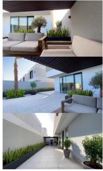

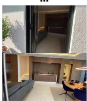

Reconstruction  
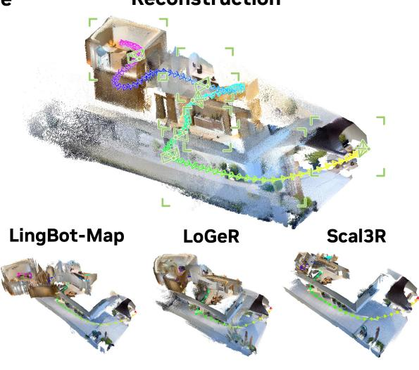  
(a)

Details  
Long Sequences Pose  
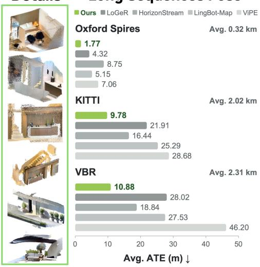  
(b)  
Figure 1: MetricTrail reconstructs long videos with coherent scene geometry and accurate camera trajectories. (a) Across an indoor–outdoor transition, our reconstruction preserves global layout and fine local structure, while prior methods show deformation and misalignment. (b) We achieve lower average trajectory error than the baselines on three long-sequence benchmarks.

## 1. Introduction

Streaming 3D reconstruction turns thousands of monocular observations into a coherent geometric model of the world. For robotic navigation and large-scale mapping, this model must remain consistent as the camera moves through new environments and revisits familiar places. Over long trajectories, camera-motion and scale errors can accumulate, misaligning observations of the same scene. Maintaining consistency with manageable computation and memory is a central challenge for long-video reconstruction.

Recent systems seek long-sequence consistency through learned temporal context and explicit geometric refinement. CUT3R [1] maintains a persistent recurrent state, but accumulated drift remains a challenge on very long sequences. LingBot-Map [2] structures attention memory to retain geometric information across time; for extremely long inputs, its windowed mode introduces alignment errors that can accumulate across window boundaries. Optimization-based camera estimation provides a complementary way to enforce multi-view consistency. ViPE [3] combines learned correspondences and metric-depth regularization with local tracking and global bundle adjustment (BA). However, its original pipeline performs global BA over all retained frames, including a final refinement after processing the full video, increasing memory and computation as the sequence grows.

These costs motivate strengthening local estimation with more accurate depth and metric scale cues, which modern single-image depth models can now provide. We therefore revisit DPVO [4], which alternates sparse atch matchin with local BA within a bounded active window. Althou h eficient, the ori inal estimator falls substantially behind recent reconstruction systems on our long-sequence benchmarks. This raises a question: How can we improve long-sequence reconstruction without enlarging the optimization window?

We introduce MetricTrail, a streaming reconstruction system that strengthens DPVO with single-image metric depth and further improves correspondence estimation with visual foundation representations. In the original estimator, new patch depths are initialized heuristically and subsequently refined through reprojection constraints alone. Building on metric-depth regularization in learned odometry [3, 5], we initialize patch depths with MoGe-2 [6] predictions and retain them as robust soft constraints during optimization. These predictions provide both geometry specific to each image location and a learned reference for physical scale, rather than simply propagating the estimator’s current scale as the camera advances. We find that these single-image metric priors alone substantially improve the long-sequence accuracy of the pretrained sparse estimator, without retraining its correspondence network or enlarging its optimization window.

Metric depth helps predict where a patch should appear, but repeated structures, weak texture, and appearance changes can still make its correspondence ambiguous. We therefore augment native matching features and recurrent context with frozen DINOv3 representations [7] through learned adapters. These representations provide complementary appearance and contextual cues for predicting correspondence targets and confidence weights. The correspondence estimator and adapters are trained on diverse public datasets using short clips, preserving the sparse patch graph and local solver without additional long-sequence training. Metric predictions and constraints are not used during training and enter only at inference.

MetricTrail achieves the lowest average full-sequence absolute trajectory error (ATE) among the evaluated methods on KITTI, Oxford Spires, and VBR under the reported RGB-only protocols, while retaining eficient local inference. Its dense reconstructions also achieve the lowest Chamfer distance on 7Scenes and Oxford Spires using single-image predictions without dense depth optimization. On challenging in-the-wild video (Fig. 1), it preserves coherent layout and fine local detail across large indoor–outdoor depth changes. Beyond monocular RGB, it supports supplied intrinsics and calibrated stereo without retraining, and allows independent upgrades to its depth provider.

Our contributions are threefold:

• Long-sequence streaming reconstruction system. We introduce MetricTrail, a streaming system that uses metric depth and pretrained visual representations to reconstruct long videos through eficient sparse geometric estimation.

• Sparse local estimator. Metric-depth initialization and persistent constraints improve long-sequence accuracy without correspondence-network retraining or a larger optimization window.

• Long-sequence accuracy and eficiency. We demonstrate leading trajectory accuracy under the evaluated protocols, strong dense reconstruction, and eficient local inference without additional long-sequence training.

## 2. Related Work

Optimization-based 3D Reconstruction. Optimization-based reconstruction optimizes explicit camera and scene variables for multi-view consistency. Classical systems solve ofline SfM [8, 9] or maintain online estimates [10, 11]. Local windows bound update costs; global refinement and loop closure address errors accumulated beyond them. Learning augments these solvers with geometric priors and feature-metric residu- als [12, 13]. DROID-SLAM [14] and DPVO learn recurrent correspondence updates within diferentiable BA; other approaches [15, 16, 17, 18] incorporate pretrained features, learned matches, or neural scene representations. DINO-VO [19] combines pretrained features and adaptive patch selection with sparse BA, initializing patch depths with Depth Anything V2 predictions rescaled to the odometry scale. Such initialization difers from retaining a metric reference during subsequent optimization. RoMeO [5] and ViPE retain metric-depth constraints in local BA; DROID-W [20] also regularizes depth and uses DINOv2 [21] features to estimate dynamic uncertainty.

Feed-Forward 3D Reconstruction. Feed-forward models [22, 23, 24, 25] learn to predict geometry directly. Subsequent work advances unified and metric prediction [26, 27, 28, 29, 30] and model architecture [31, 32, 33, 34]. MoGe [35] and MoGe-2 provide single-image priors; MoGe-2 recovers metric depth while preserving fine relative geometry. Long videos require consistent geometry without retaining the full observation history. Persistent or adapted neural states [1, 36, 37, 38, 39] and structured temporal aggregation [40, 41, 42, 43, 44, 45] preserve context across frames or chunks while managing memory. LingBot-Map combines anchor context for coordinate grounding, local pose references, and compact trajectory tokens. HorizonStream [46] couples local geometric attention to bounded recurrence and learned pose/scale readouts, with optional loop-closure optimization. Explicit geometric refinement complements retained temporal context by correcting accumulated pose and structure errors.

Hybrid 3D Reconstruction. Hybrid systems refine learned predictions through geometric backends. VG-GSfM [47] and MASt3R-SfM [48] optimize learned tracks or matches globally, while MASt3R-SLAM [49] builds an online estimator from point-map priors. VGGT-SLAM [50] and VGGT-Long [51] align local submaps or overlapping reconstructions; VGGT-SLAM 2.0 [52] additionally corrects keyframes within and across submaps. Mar inalized Bundle Adjustment [53] refines cameras and redicted de th ma s throu h er-frame scale and shift adjustments, while BLASt3R [54] combines learned matching and monocular depth regularization with BA and periodic global refinement. We focus on long-sequence accuracy within a fixed local window: persistent metric-depth constraints help stabilize scale across updates, while richer visual representations improve correspondences for joint pose and structure refinement.

## 3. Method

## 3.1. Problem Setup and System Overview

Given a long monocular RGB sequence $\{ I _ { i } \} _ { i = 1 } ^ { T }$ , our goal is to estimate world-to-camera transformations $\{ \mathbf { T } _ { i } \in \mathrm { S E } ( 3 ) \} _ { i = 1 } ^ { T }$ and a dense metric reconstruction in a shared world frame. The camera intrinsics K may be supplied or estimated from the RGB stream. We also support synchronized, rectified stereo; in this setting, $\mathbf { T } _ { i }$ denotes the left-camera pose and the right camera is related to it by a known, fixed rig transform.

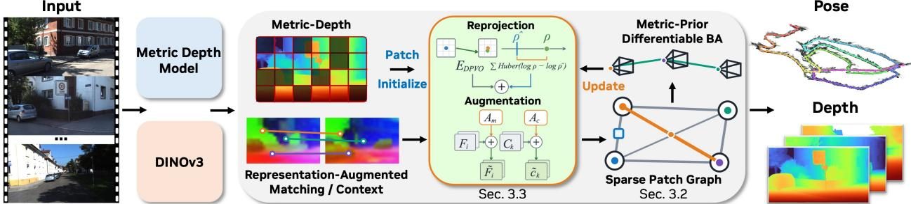  
Figure 2: System overview. For each input frame, single-image metric depth initializes patch depths and constrains BA, while frozen DINOv3 features augment matching and recurrent context through learned adapters. Within a bounded active window, patch correspondences drive joint pose and depth refinement, and the updated geometry guides the next matching step. The resulting poses align dense per-frame depth maps into a shared reconstruction.

At the center of MetricTrail is DPVO’s bounded sparse local estimator [4]. At each refinement step, the current geometric state determines where the matcher looks, while the image representation determines how that projection is corrected. We strengthen the former with a metric depth prior and the latter with visual foundation features, while retaining DPVO’s sparse state and alternating matching–optimization loop. The resulting metric-scale trajectory then places dense frame-level geometry in a common coordinate frame to form the final reconstruction.

## 3.2. DPVO Recap

Sparse patch graph. DPVO uses a sparse patch graph to organize the visual correspondences used for joint pose and depth estimation. The graph connects image patches to camera frames: each patch is anchored in a source frame and tracked across several nearby target frames. These observations provide geometric constraints on the camera poses and the patch’s depth.

Specifically, each patch � has a fixed center $\mathbf { u } _ { k }$ in its source frame $s ( k )$ and an optimizable inverse depth $\rho _ { k }$ It covers a $3 \times 3$ region on the downsampled feature grid, with all nine locations sharing the same depth. An edge $( k , j ) \in \mathcal { E } _ { \mathrm { a c t } }$ connects patch � to target frame $j .$ . Given the current poses and inverse depth, the projected patch center is

$$
\mathbf q _ { k j } ( \mathbf T _ { j } , \mathbf T _ { s ( k ) } , \rho _ { k } ) = \pi _ { \mathbf K } \Big ( \mathbf T _ { j } \mathbf T _ { s ( k ) } ^ { - 1 } \pi _ { \mathbf K } ^ { - 1 } ( \mathbf u _ { k } , \rho _ { k } ) \Big ) ,\tag{1}
$$

where $\pi _ { \mathbf { K } } ^ { - 1 }$ back-projects the source pixel at depth $1 / \rho _ { k }$ into 3D, and $\pi _ { \mathbf { K } }$ projects the transformed point into the target frame.

Matching and geometric refinement. DPVO alternates between learned patch matching and diferentiable BA. The matching step predicts where each patch should appear in its target frames, while BA jointly refines the camera poses and patch depths to agree with these predictions.

DPVO encodes each image $I _ { i }$ into a matching feature map $\mathbf { F } _ { i }$ and a context feature map $\mathbf { C } _ { i }$ . At iteration $t ,$ it correlates the source patch features with local neighborhoods in $\mathbf { F } _ { j }$ around the projected patch, measuring visual similarity near the current geometric estimate. A recurrent update operator combines these correlations with source context features and information retained from earlier iterations, while exchanging information across related graph edges. For each edge $( k , j )$ , it predicts a 2D correction $\Delta _ { k j } ^ { ( t ) }$ to the projected patch center and confidence weight $\mathbf { w } _ { k j } ^ { ( t ) } \in ( 0 , 1 ) ^ { 2 }$ . The correspondence target passed to BA is $\widehat { \mathbf { q } } _ { k j } ^ { ( t ) } = \mathbf { q } _ { k j } ^ { ( t ) } + \Delta _ { k j } ^ { ( t ) }$ , where $\mathbf { q } _ { k j } ^ { ( t ) }$ is the patch center projected using the current poses and inverse depth.

The BA step holds these correspondence targets and confidence weights fixed and jointly optimizes the active poses and patch inverse depths by minimizing the weighted reprojection error:

$$
E _ { \mathrm { D P V O } } ( \mathbf { T } , \rho ) = \sum _ { ( k , j ) \in \mathcal { E } _ { \mathrm { a c t } } } \left\| \mathbf { q } _ { k j } ( \mathbf { T } _ { j } , \mathbf { T } _ { s ( k ) } , \rho _ { k } ) - \widehat { \mathbf { q } } _ { k j } ^ { ( t ) } \right\| _ { \mathrm { d i a g } ( \mathbf { w } _ { k j } ^ { ( t ) } ) } ^ { 2 } .\tag{2}
$$

The two components of $\mathbf { w } _ { k j } ^ { ( t ) }$ weight the horizontal and vertical reprojection residuals, respectively. After BA, the updated poses and inverse depths determine new patch projections, which are used to compute the correlations for the next recurrent iteration. This loop operates within a bounded active window: new frames enter, redundant frames are removed, and older poses remain in the output trajectory after leaving the optimizer.

## 3.3. Foundation Priors for Geometry and Matching

## Metric Depth for Sparse Geometry.

During bootstrap, DPVO seeds patch inverse depths randomly; once initialized, it assigns new patches the median inverse depth of patches from the preceding three active frames. The median is a stable numerical seed, but it contains no geometry specific to the new patch and carries forward the current monocular scale rather than correcting it.

To provide a scene-specific starting point, we initialize each patch from a metric image-depth prediction. Given the camera intrinsics, frozen MoGe-2 independently predicts a metric �-depth map $\widehat { \bf D } _ { i }$ for each frame using the corresponding field of view. After aligning it with DPVO’s image coordinates, we initialize a valid patch with $\rho _ { k } ^ { ( 0 ) } \gets \widehat { \rho } _ { k } = 1 / \widehat { \mathbf { D } } _ { s ( k ) } ( \mathbf { u } _ { k } )$ . The first reprojection therefore starts from a depth tailored to that image location and expressed in metric units.

Initialization alone cannot prevent later BA updates from drifting away from the predicted metric scale. We therefore retain the same observation as a robust unary depth factor. For the set ℳ of active patches with valid metric predictions, we optimize

$$
E _ { \mathrm { o u r s } } ( { \bf T } , \rho ) = E _ { \mathrm { D P V O } } ( { \bf T } , \rho ) + \lambda _ { \mathrm { m } } \sum _ { k \in \mathcal { M } } \mathrm { H u b e r } _ { \delta } ( \log \rho _ { k } - \log \widehat { \rho } _ { k } ) .\tag{3}
$$

The optimized patch depth remains free to reconcile the monocular prediction with multi-view evidence. After an initial stabilization period, we activate this factor and disable DPVO’s scale normalization. The metric observations then define the reconstruction scale, while the log-domain Huber penalty lets multi-view evidence override unreliable predictions.

## Robust Semantic Priors for Matching.

The metric prior improves the geometry from which local search begins, but choosing among nearby candidates remains a visual matching problem. Changes in viewpoint and appearance can make these candidates dificult to distinguish, particularly outside the odometry network’s training distribution. We therefore supplement its task-specific features with representations learned from large-scale visual pretraining, using a frozen DINOv3- S/16 encoder. Let $\mathbf { Z } _ { i } = \mathcal { F } _ { \mathrm { D I N O } } ( I _ { i } )$ denote its spatial feature map. Learned residual adapters align these features with DPVO’s spatial grid and project them into its matching and context dimensions. The matching branch augments the full feature map, while the context branch conditions each source patch’s recurrent update:

$$
\widetilde { \mathbf { F } } _ { i } = \mathbf { F } _ { i } + \mathcal { A } _ { \mathrm { m } } ( \mathbf { Z } _ { i } ) , \qquad \widetilde { \mathbf { c } } _ { k } = \mathbf { C } _ { s ( k ) } ( \mathbf { u } _ { k } ) + \mathcal { A } _ { \mathrm { c } } ( \mathbf { Z } _ { s ( k ) } , \mathbf { u } _ { k } ) .\tag{4}
$$

We sample the source patch from $\widetilde { \mathbf { F } } _ { s \left( k \right) }$ and correlate it against $\widetilde { \mathbf { F } } _ { j }$ . The context adapter samples its aligned features at $\mathbf { u } _ { k }$ before the final projection and addition, producing the patch context $\widetilde { \mathbf { c } } _ { k }$ used by the same

updater. DINOv3 remains frozen, and zero-initializing the adapters’ output projections ensures that the fused model initially reproduces the pretrained DPVO predictions. The adapters then learn how to use the foundation features without changing the sparse graph or geometric solver.

## Training the Local Estimator.

The two priors play diferent roles during training and inference. MoGe-2 enters only through inference-time initialization and BA factors, so the correspondence network never sees metric predictions during training. DINOv3, by contrast, changes the matcher inputs during adaptation. Its encoder remains frozen; starting from the oficial DPVO checkpoint, we optimize the DPVO modules and residual adapters with the original pose and induced patch-motion supervision.

The network learns local correspondence corrections, while repeated geometric optimization composes these measurements over time. This division allows us to train on diverse short clips without requiring long-trajectory supervision. Each sample contains 15 frames drawn from TartanAir [55], TartanGround [56], CarlaOcc [57], LightwheelOcc [58], or OmniWorld-Game [59]. No evaluation sequence or dedicated long-trajectory pose corpus is used.

## 3.4. Complete Long-Video System

Compared with learned streaming reconstructors such as HorizonStream and LingBot-Map, our optimization- based estimator can directly incorporate additional observations and geometric constraints at inference time, without retraining.

Camera calibration. Camera intrinsics K are supplied or estimated once from an RGB prefix. Following ViPE [3], MoGe-2 initializes a shared camera model, and a DROID-style backend [14] jointly refines its focal correction, auxiliary poses, and depths under metric-depth constraints. We then fix K, discard the auxiliary state, and replay the prefix through the local estimator before continuing online. Revisit-based focal refinement remains an optional retrospective step.

Stereo input. For synchronized, rectified stereo, each left-image patch is additionally matched to the right image [14]. The known rig transform provides a same-time reprojection constraint on patch geometry, without introducing right-camera pose variables or requiring stereo-specific training.

Loop closure. Following VGGT-Long [51], Scal3R [39], and HorizonStream [46], we use similar loop closure based on retrieval and pose-graph optimization. The graph connects camera-pose nodes with sequential odometry edges. SALAD [60] retrieves distant near-duplicate frames; each pair adds a weak identity relative pose edge, softly encouraging the poses to coincide. Optimizing poses against both edge types corrects drift while retaining metric scale.

Dense reconstruction. We back-project per-frame metric depth maps into the world frame using $\mathbf { T } _ { i } ^ { - 1 }$ . BA refines camera poses and sparse patch depths, while the dense predictions remain fixed. We can therefore reassemble the dense reconstruction using updated poses, including those from optional pose-graph correction, without rerunning local estimation.

## 4. Experiments

## 4.1. Experimental Setup

Evaluation Datasets and Metrics. We evaluate long-sequence camera estimation on KITTI Odometry sequences 00–10 [61], ten Oxford Spires sequences [62], and all seven VBR sequences [63]. Following LingBot-MAP [2], we process all three datasets without temporal subsampling. The Oxford split contains 38,380 frames. We report full-sequence absolute trajectory error (ATE), measured as RMSE in meters after a single Sim(3) alignment per sequence. For dense reconstruction, we evaluate 7Scenes [64], TUM-Dynamic [65], and Oxford Spires. We report symmetric Chamfer distance (CD) and F1� after sequence-level Sim(3) alignment followed by point-to-point ICP, using $\tau = 0 . 2 5$ m for indoor scenes and � = 4 m on Oxford Spires. For video depth estimation, we follow $\pi ^ { 3 }$ [32] on 13 KITTI videos containing 1,269 frames, reporting Abs Rel and $\delta _ { 1 }$ accuracy (� < 1.25) after fitting one scale per video without a shift.

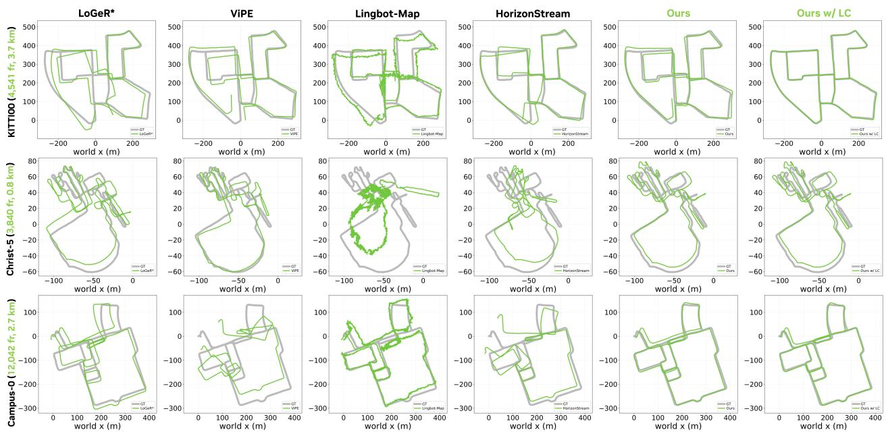  
Figure 3: Long-sequence camera trajectory estimation. Ground truth is gray and estimates are green. Our local estimator reduces deviations; loop closure further improves revisit alignment.

Settings and Baselines. Calibrated uses the provided camera intrinsics, whereas Uncalibrated estimates a shared camera model for each sequence from RGB alone. Our dense reconstruction results use the uncalibrated setting. Loo closure is disabled b default results with loo closure are marked w/ LC. On KITTI Stereo incor orates s nchronized, rectified left–ri ht cameras and the known stereo baseline into local BA. We com are with optimization-based and hybrid systems, ofline or chunk-based long-sequence methods, and streaming models including TTT3R [66], InfiniteVGGT [67], and LongStream [68]. Tables mark the best and second-best values among results; where used, underlining identifies the strongest average within each baseline family.

## 4.2. Long Sequence Camera Trajectory Estimation

KITTI Odometry. KITTI combines forward vehicle motion with moving trafic and urban revisits. We also include ofline and chunk-based methods to place our streaming estimator’s accuracy in a broader context. In Tab. 1, Scal3R and HorizonStream, both with loop closure, achieve the lowest average ATEs in their respective baseline groups: 14.55 m and 16.44 m. Our uncalibrated monocular estimator achieves 14.05 m without loop closure, outperforming all listed baselines. Providing camera intrinsics reduces its ATE to 9.10 m. Loop closure improves these two settings to 9.78 m and 7.39 m, respectively. With calibrated stereo, ATE falls to 3.66 m without loop closure and 3.00 m with it, confirming complementary gains from stereo and revisit correction.

Oxford Spires. Oxford Spires includes handheld motion with repeated architecture and viewpoint changes that challenge visual association. Our uncalibrated local estimator achieves 1.77 m average ATE (Tab. 2), reducing error by 65.6% over the strongest online baseline, LingBot-MAP (5.15 m), and by 58.6% over the strongest ofline baseline, LoGeR\* (4.28 m).

Table 1: Full-sequence ATE (m) on KITTI Odometry. LC denotes loop closure; LoGeR\* uses alignment optimization. Underlining marks the best average in each baseline group and our default RGB-only result, which outperforms all baseline averages.
<table><tr><td colspan="2">Method</td><td>00 4,541 fr. 3.7 km</td><td>01 : 1,101 fr. 4,661 fr. 801 fr. 2.5 km</td><td>02</td><td>03</td><td>04</td><td>05</td><td>06</td><td>07 : 271 fr. 2,761 fr. 1,101 fr. 1,101 fr. 4,071 fr. 1,591 fr. 1,201 fr. Avg. ↓</td><td>08</td><td>09</td><td>10</td><td></td></tr><tr><td rowspan="5">Oopiaton Ofini</td><td>DPVO (Calibrated)</td><td>113.11</td><td>16.60</td><td>113.01</td><td>2.46</td><td>0.98</td><td>59.34</td><td>55.91</td><td>19.30</td><td>110.63</td><td>74.55</td><td>13.71</td><td>52.69</td></tr><tr><td>ViPE</td><td>25.87</td><td>148.34</td><td>53.35</td><td>5.29</td><td>1.95</td><td>24.22</td><td>11.72</td><td>1.03</td><td>18.51</td><td>20.55</td><td>4.71</td><td>28.68</td></tr><tr><td>LoGeR</td><td>54.98</td><td>36.57</td><td>36.20</td><td>4.27</td><td>1.62</td><td>33.41</td><td>11.78</td><td>13.33</td><td>22.92</td><td>17.89</td><td>8.06</td><td>21.91</td></tr><tr><td>LoGeR*</td><td>26.19</td><td>41.26</td><td>32.21</td><td>5.02</td><td>1.62</td><td>22.65</td><td>5.49</td><td>5.04</td><td>21.96</td><td>9.03</td><td>9.44</td><td>16.35</td></tr><tr><td>Scal3R w/ LC</td><td>4.30</td><td>45.29</td><td>42.06</td><td>3.36</td><td>1.74</td><td>3.30</td><td>2.49</td><td>2.03</td><td>36.69</td><td>12.32</td><td>6.46</td><td>14.55</td></tr><tr><td rowspan="4">Onliine</td><td>LongStream</td><td>92.55</td><td>46.01</td><td>134.70</td><td>3.81</td><td>1.95</td><td>84.69</td><td>23.12</td><td>14.93</td><td>62.07</td><td>85.61</td><td>21.48</td><td>51.90</td></tr><tr><td>LingBot-MAP</td><td>30.80</td><td>64.74</td><td>82.29</td><td>2.49</td><td>0.85</td><td>16.55</td><td>6.27</td><td>8.92</td><td>39.32</td><td>17.99</td><td>7.96</td><td>25.29</td></tr><tr><td>HorizonStream</td><td>26.40</td><td>20.62</td><td>84.62</td><td>5.15</td><td>0.62</td><td>12.82</td><td>4.59</td><td>5.49</td><td>19.49</td><td>25.73</td><td>11.71</td><td>19.75</td></tr><tr><td>HorizonStream w/ LC</td><td>13.91</td><td>20.62</td><td>69.43</td><td>5.15</td><td>0.62</td><td>6.86</td><td>6.50</td><td>2.67</td><td>19.49</td><td>23.86</td><td>11.71</td><td>16.44</td></tr><tr><td rowspan="4">Ous</td><td>Ours (Uncalibrated)</td><td>15.29</td><td>35.94</td><td>24.69</td><td>1.48</td><td>0.69</td><td>18.43</td><td>9.14</td><td>3.81</td><td>22.32</td><td>14.50</td><td>8.21</td><td>14.05</td></tr><tr><td>Ours (Uncalibrated) w/ LC</td><td>2.75</td><td>35.94</td><td>18.36</td><td>1.48</td><td>0.69</td><td>4.44</td><td>5.61</td><td>2.10</td><td>22.32</td><td>5.64</td><td>8.21</td><td>9.78</td></tr><tr><td>Ours (Calibrated) w/ LC</td><td>2.92</td><td>33.21</td><td>6.02</td><td>2.71</td><td>0.59</td><td>3.32</td><td>9.49</td><td>2.48</td><td>11.94</td><td>4.69</td><td>3.95</td><td>7.39</td></tr><tr><td>Ours (Stereo) w/ LC</td><td>1.43</td><td>6.33</td><td>12.62</td><td>0.34</td><td>0.23</td><td>0.55</td><td>0.20</td><td>0.97</td><td>5.27</td><td>4.14</td><td>0.93</td><td>3.00</td></tr></table>

Table 2: Average full-sequence ATE (m ↓) on Oxford Spires and VBR.
<table><tr><td></td><td colspan="7">Offline/Chunk</td><td colspan="7">Online</td></tr><tr><td>Dataset</td><td>SLAM</td><td>VGGT- MASt3R- VGGT- SLAM</td><td>Long</td><td>ViPE</td><td>LoGeR LoGeR*</td><td></td><td>Infinite VGGT</td><td>Long Stream</td><td>CUT3R TTT3R</td><td></td><td>Horizon LingBot- Stream</td><td>Map</td><td>w/o LC w/ LC</td><td></td></tr><tr><td>Oxford Spires</td><td>23.42</td><td>12.12</td><td>7.41</td><td>7.06</td><td>4.32</td><td>4.28</td><td>31.76</td><td>15.92</td><td>14.74</td><td>9.40</td><td>8.75</td><td>5.15</td><td>1.77</td><td>1.77</td></tr><tr><td>VBR</td><td>78.20</td><td>92.64</td><td>91.23</td><td>46.20</td><td>28.02</td><td>25.24</td><td>102.90</td><td>77.93</td><td>66.25</td><td>64.99</td><td>25.30</td><td>27.53</td><td>16.36</td><td>10.88</td></tr></table>

VBR. VBR contains urban routes of 8,815–18,846 frames and up to 5.20 km, with varying revisit opportunities. Tab. 2 summarizes the results. LoGeR\* and HorizonStream achieve similar average ATEs of 25.24 m and 25.30 m, respectively. Our uncalibrated local estimator achieves 16.36 m with focal refinement, or 10.88 m with additional loop closure. Representative trajectories are shown in Fig. 3.

## 4.3. Dense Reconstruction and Depth

Tab. 3 summarizes reconstruction accuracy across indoor, dynamic, and large-scale outdoor environments. On 7Scenes, MetricTrail achieves the lowest CD of 0.04 m and the second-highest F1 score of 97.60%. On Oxford Spires, it improves over the strongest baseline, LingBot-MAP, reducing CD from 1.68 to 0.98 m and increasing F1 from 90.58% to 95.12%. Performance is weaker on TUM-Dynamic, where its 0.13 m CD and 89.58% F1 trail the leading methods. Thus, the gains on static indoor and large outdoor scenes do not extend uniformly to scenes with dynamic content.

In Fig. 4, MetricTrail preserves the courtyard and connecting routes on Christ-5, where baseline reconstructions show layout deformation. The highlighted indoor and in-the-wild regions also show finer point- cloud detail and more accurate local shape in the depth maps. These results illustrate the complementary roles of depth and camera motion: depth captures local geometry, while the optimized trajectory aligns observations into a coherent scene. Several long-sequence reconstruction methods exhibit larger depth errors in Tab. 4. We achieve the lowest Abs Rel of 0.057 and highest $\delta _ { 1 }$ of 97.8%. These results use single-image depth predictions conditioned on calibrated intrinsics shared across each video.

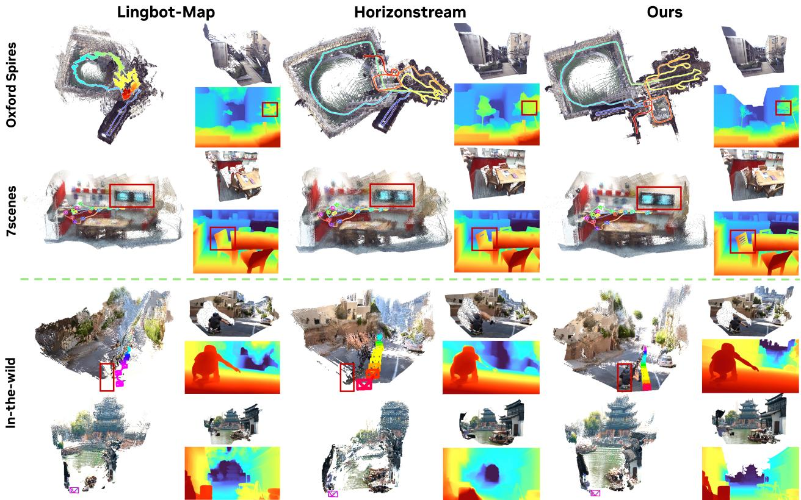  
Figure 4: Qualitative dense reconstruction comparison. Our method produces more accurate reconstructions with finer point-cloud detail. The highlighted regions show clearer structural boundaries and more faithful local geometry, alongside detailed depth predictions.

Table 3: Quantitative comparison on dense reconstruction. We report Chamfer distance (CD, m; ↓) and F1 (%; ↑). Our results use RGB-estimated intrinsics without loop closure.
<table><tr><td rowspan="2">Method</td><td colspan="2">7Scenes  $( \tau = 0 . 2 5 \ : \mathrm { m } )$ </td><td colspan="2"> $( \tau = 0 . 2 5 \ : \mathrm { m } )$ </td><td colspan="2">TUM-Dynamic Oxford Spires  $( \tau = 4 \ \mathrm { m } )$ </td></tr><tr><td>CD↓</td><td>F1↑</td><td>CD↓</td><td>F1↑</td><td>CD↓</td><td>F1↑</td></tr><tr><td>CUT3R</td><td>0.18</td><td>75.18</td><td>0.11</td><td>90.68</td><td>7.26</td><td>41.22</td></tr><tr><td rowspan="4">TTT3R Stream3R-w InfiniteVGGT</td><td>0.11</td><td>86.98</td><td>0.06</td><td>94.45</td><td>7.77</td><td>40.42</td></tr><tr><td>0.12</td><td>87.57</td><td>0.20</td><td>87.40</td><td>6.44</td><td>47.75</td></tr><tr><td>0.08 0.06</td><td>91.96 94.60</td><td>0.10 0.14</td><td>92.94 88.29</td><td>7.38 5.69</td><td>47.83 53.84</td></tr><tr><td>0.05</td><td>96.01</td><td>0.08</td><td>95.97</td><td>1.68</td><td>90.58</td></tr><tr><td>LingBot-MAP HorizonStream</td><td>0.23</td><td>98.22</td><td>0.12</td><td>90.97</td><td>2.00</td><td>84.69</td></tr><tr><td></td><td></td><td></td><td></td><td></td><td></td><td></td></tr><tr><td>Ours</td><td>0.04</td><td>97.60</td><td>0.13</td><td>89.58</td><td></td><td></td></tr><tr><td></td><td></td><td></td><td></td><td></td><td>0.98</td><td>95.12</td></tr></table>

Table 4: Video depth estimation on KITTI. We report Abs Rel and �1 (%) with per-video scale alignment.
<table><tr><td>Method</td><td colspan="2">Abs Rel ↓ δ &lt; 1.25 ↑</td></tr><tr><td>InfiniteVGGT</td><td>0.170</td><td>78.6</td></tr><tr><td>LoGeR</td><td>0.090</td><td>93.0</td></tr><tr><td>LongStream</td><td>0.120</td><td>87.0</td></tr><tr><td>LingBot-MAP</td><td>0.098</td><td>90.7</td></tr><tr><td>HorizonStream</td><td>0.058</td><td>94.8</td></tr><tr><td>Ours</td><td>0.057</td><td>97.8</td></tr></table>

## 4.4. Ablation Study

Tab. 5 shows that metric depth yields the largest improvement across all three datasets. Multi-dataset adaptation further improves KITTI and Oxford Spires but increases VBR error; adding DINOv3 improves all three and more than ofsets this regression. Broader training data and pretrained representations thus make complementary

DPVO Correspondence

contributions.

Fig. 5 shows that metric-depth initialization and con- straints reduce KITTI 00 ATE from 113.11 to 7.61 m and improve revisit alignment without frontend retraining. With the same prior, multi-dataset adaptation and DINOv3 fur- ther reduce ATE to 6.05 and 5.22 m. On the same reference patches, matches within 5 px rise from 77.8% to 97.2%, indicating fewer large correspondence errors and more reliable constraints for local optimization.

Choice of depth provider. We evaluate five alternative depth providers in addition to MoGe-2 [6]: Pi3X [32], Video Depth Anything (VDA) [69], DA3Metric [26], Metric3Dv2 [70], and UniDepthV2 [71]. Each provider supplies both the patchdepth initialization and the persistent metric-depth factors; VDA uses its metric checkpoint. On KITTI Odometry, Oxford

Table 5: Component ablation. We progressively add metric depth, multi-dataset training, and DINOv3 to DPVO and report mean calibrated ATE (m; ↓).
<table><tr><td colspan="2">Components</td><td colspan="2">ATE (m) ↓</td></tr><tr><td>Metric Multi- Depth dataset</td><td>DINOv3</td><td>KITTI Oxford</td><td>VBR</td></tr><tr><td></td><td>一</td><td>52.69</td><td>2.59</td><td>72.25</td></tr><tr><td></td><td></td><td>12.77</td><td>1.85</td><td>19.57</td></tr><tr><td></td><td></td><td>10.32</td><td>1.76</td><td>22.51</td></tr><tr><td></td><td></td><td>9.10</td><td>1.71</td><td>18.90</td></tr></table>

Spires, and VBR, we compare DPVO, the multi-dataset variant, and the full model with DINO augmentation, holding the provider fixed across the three variants. As shown in Tab. 6, the estimator enhancements improve trajectory accuracy across diferent depth providers, supporting the generality and robustness of our approach. Tab. 6 reports their average ATEs alongside the MoGe-2 results. For the five alternative providers, the full model improves over DPVO with the same prior in 14 of the 15 prior–dataset combinations, including all five providers on both KITTI and Oxford Spires. These results show that the estimator enhancements remain efective across diferent depth providers, although the gains depend on the provider and dataset.

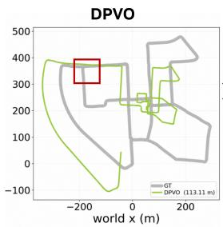

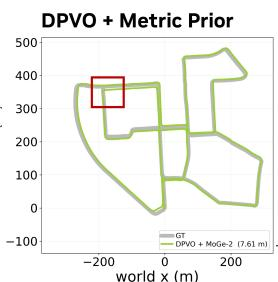

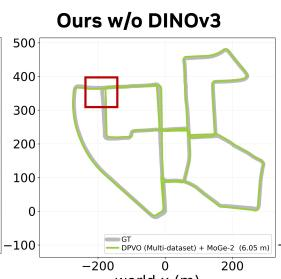

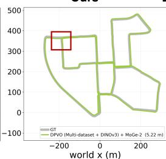

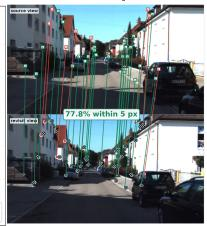

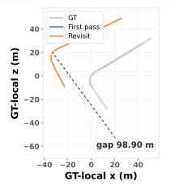

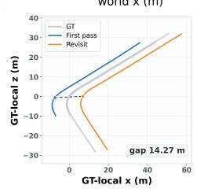

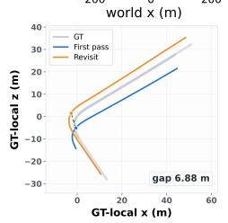

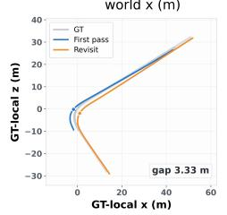

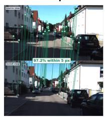  
Figure 5: Qualitative ablation on KITTI 00. Metric-depth priors substantially reduce accumulated trajectory drift, while multi-dataset adaptation and DINOv3 further improve agreement between first-pass and revisit trajectories. On the same set of reference patches, the full estimator increases the fraction of correspondence endpoints within 5 px from 77.8% to 97.2%, providing a local diagnostic of the stronger visual evidence used by BA.

We choose MoGe-2 as the default for two reasons. First, it predicts metric depth and intrinsics from RGB inputs alone [6], allowing one provider to initialize camera calibration and supply the depth prior. Although DA3Metric and Metric3Dv2 achieve lower ATE in our calibrated ablation, their standalone metric- depth inference requires focal-length information [26, 70]; using them with RGB-only input therefore requires a separate source of calibration. Second, depth providers are shaped by their training distributions, and their relative performance varies across domains. UniDepthV2, for example, achieves lower ATE than MoGe-2 on KITTI but higher errors on Oxford Spires and VBR. MoGe-2 combines broad indoor–outdoor training with competitive results across all three benchmarks, making it a practical default for a unified RGB-only system. Our estimator also supports alternative providers, allowing further gains with suitable calibration.

Table 6: Metric-prior ablation. We report average ATE RMSE (m; lower is better). Each column uses the named metric prior for all three variants; multi-dataset training and DINO augmentation are added cumulatively. Best and second-best variants are hi hli hted within each metric- rior column and dataset.
<table><tr><td rowspan="2">Dataset</td><td rowspan="2">Variant</td><td colspan="6">Metric Prior</td></tr><tr><td>Pi3X</td><td>VDA</td><td>DA3Metric</td><td>Metric3Dv2</td><td>UniDepthV2</td><td>MoGe-2</td></tr><tr><td rowspan="3">KITTI</td><td>DPVO</td><td>27.92</td><td>15.16</td><td>14.05</td><td>11.62</td><td>11.18</td><td>12.77</td></tr><tr><td>+ Multi-dataset</td><td>24.90</td><td>8.97</td><td>10.03</td><td>10.57</td><td>10.80</td><td>10.32</td></tr><tr><td>+ DINO (Ours)</td><td>22.35</td><td>8.88</td><td>7.97</td><td>8.21</td><td>7.69</td><td>9.10</td></tr><tr><td rowspan="3">Oxford Spires</td><td>DPVO</td><td>5.57</td><td>2.25</td><td>1.28</td><td>1.42</td><td>3.89</td><td>1.85</td></tr><tr><td>+ Multi-dataset</td><td>4.53</td><td>1.87</td><td>1.32</td><td>1.33</td><td>6.04</td><td>1.76</td></tr><tr><td>+ DINO (Ours)</td><td>4.78</td><td>1.92</td><td>1.14</td><td>1.15</td><td>3.81</td><td>1.71</td></tr><tr><td rowspan="3">VBR</td><td>DPVO</td><td>30.29</td><td>24.70</td><td>19.17</td><td>20.14</td><td>19.11</td><td>19.57</td></tr><tr><td>+ Multi-dataset</td><td>36.13</td><td>26.61</td><td>25.85</td><td>23.58</td><td>24.61</td><td>22.51</td></tr><tr><td>+ DINO (Ours)</td><td>30.04</td><td>23.07</td><td>18.39</td><td>18.79</td><td>19.56</td><td>18.90</td></tr></table>

Runtime analysis. On KITTI-02 with an NVIDIA A100 GPU, MetricTrail achieves a steady-state throughput of 12.70 FPS, compared with 11.37 FPS for LingBot-Map and 9.92 FPS for HorizonStream. With supplied intrinsics, time to first output is approximately 0.7 s and peak GPU memory is 3.21 GB. RGB-only calibration increases start-up latency to approximately 175 s and peak memory to 6.81 GB, while subsequent throughput remains 12.70 FPS.

## 5. Conclusion

We presented MetricTrail, a streaming reconstruction system centered on the finding that single-image metric depth substantially improves sparse local odometry over long sequences. These gains do not require retraining the correspondence network or enlarging the optimization window, while pretrained visual repre- sentations further improve correspondence estimation. The resulting system supports accurate trajectories and strong dense reconstruction across benchmark and in-the-wild videos without additional long-sequence training. Its modular design accommodates improved depth models, supplied camera intrinsics, and calibrated stereo observations. Together, these results demonstrate that strong image-level priors, coupled with sparse local optimization, ofer an accurate, eficient, and flexible approach to long-video reconstruction.

## References

[1] Qianqian Wang, Yifei Zhang, Aleksander Holynski, Alexei A. Efros, and Angjoo Kanazawa. Continuous 3D perception model with persistent state. In CVPR, 2025. 2, 3, 19

[2] Lin-Zhuo Chen, Jian Gao, Shangzhan Zhang, Yihang Chen, Ka Leong Cheng, Yipengjing Sun, Liangxiao Hu, Nan Xue, Xing Zhu, Yujun Shen, Yao Yao, and Yinghao Xu. LingBot-Map: Geometric context transformer for streaming 3D reconstruction. arXiv preprint arXiv:2604.14141, 2026. 2, 6, 16, 18, 19

[3] Jiahui Huan Qunjie Zhou Hesam Rabeti Aleksandr Korovko Huan Lin Xuanchi Ren Tianchan Shen Jun Gao Dmitry Slepichev, Chen-Hsuan Lin, Jiawei Ren, Kevin Xie, Joydeep Biswas, Laura Leal-Taixé, and Sanja Fidler. ViPE: Video pose engine for 3D geometric perception. In NVIDIA Research Whitepapers, 2025. 2, 6, 16, 19

[4] Zachary Teed, Lahav Lipson, and Jia Deng. Deep patch visual odometry. In NeurIPS, 2023. 2, 4, 19

[5] Junda Cheng, Zhipeng Cai, Zhaoxing Zhang, Wei Yin, Matthias Müller, Michael Paulitsch, and Xin Yang. RoMeO: Robust metric visual odometry. arXiv preprint arXiv:2412.11530, 2024. 2, 3

[6] Ruicheng Wang, Sicheng Xu, Yue Dong, Yu Deng, Jianfeng Xiang, Zelong Lv, Guangzhong Sun, Xin Tong, and Jiaolong Yang. Moge-2: Accurate monocular geometry with metric scale and sharp details. In NeurIPS, 2025. 2, 10, 16

[7] Oriane Siméoni, Huy V. Vo, Maximilian Seitzer, Federico Baldassarre, Maxime Oquab, Cijo Jose, Vasil Khalidov, Marc Szafraniec, Seungeun Yi, Michaël Ramamonjisoa, Francisco Massa, Daniel Haziza, Luca Wehrstedt, Jianyuan Wang, Timothée Darcet, Théo Moutakanni, Leonel Sentana, Claire Roberts, Andrea Vedaldi, Jamie Tolan, John Brandt, Camille Couprie, Julien Mairal, Hervé Jégou, Patrick Labatut, and Piotr Bojanowski. DINOv3. arXiv preprint arXiv:2508.10104, 2025. 2, 26

[8] Johannes L. Schönberger and Jan-Michael Frahm. Structure-from-Motion revisited. In CVPR, 2016. 3

[9] Linfei Pan Daniel Barath Marc Pollefe s and Johannes L. Schönber er. Global Structure-from-Motion revisited. In ECCV, 2024. 3

[10] Carlos Campos, Richard Elvira, Juan J. Gómez Rodríguez, José M. M. Montiel, and Juan D. Tardós. ORB-SLAM3: An accurate open-source library for visual, visual-inertial, and multi-map SLAM. IEEE Transactions on Robotics, 37(6): 1874–1890, 2021. 3

[11] Jakob Engel, Vladlen Koltun, and Daniel Cremers. Direct sparse odometry. IEEE Transactions on Pattern Analysis and Machine Intelligence, 40(3):611–625, 2018. 3

[12] Nan Yang, Lukas von Stumberg, Rui Wang, and Daniel Cremers. D3vo: Deep depth, deep pose and deep uncertainty for monocular visual odometry. In CVPR, 2020. 3

[13] Chengzhou Tang and Ping Tan. Ba-net: Dense bundle adjustment networks. In ICLR, 2019. 3

[14] Zachary Teed and Jia Deng. DROID-SLAM: Deep visual SLAM for monocular, stereo, and RGB-D cameras. In NeurIPS, 2021. 3, 6, 19

[15] Maulana Bisyir Azhari and David Hyunchul Shim. Dino-vo: A feature-based visual odometry leveraging a visual foundation model. IEEE Robotics and Automation Letters, 10(9):9152–9159, 2025. 3

[16] Cameron Smith, David Charatan, Ayush Tewari, and Vincent Sitzmann. FlowMap: High-quality camera poses, intrinsics, and depth via gradient descent. In 3DV, 2025. 3

[17] Hengyi Wang, Jingwen Wang, and Lourdes Agapito. Co-SLAM: Joint coordinate and sparse parametric encodings for neural real-time SLAM. In CVPR, 2023. 3

[18] Zador Pataki, Paul-Edouard Sarlin, and Marc Pollefeys. VidMap: Exploiting temporal structure for video-based Structure-from-Motion. arXiv preprint arXiv:2607.27194, 2026. 3

[19] Qi Chen, Guanghao Li, Sijia Hu, Xin Gao, Junpeng Ma, Xiangyang Xue, and Jian Pu. Dino-vo: Learning where to focus for enhanced state estimation. arXiv preprint arXiv:2604.04055, 2026. 3

[20] Moyang Li, Zihan Zhu, Marc Pollefeys, and Daniel Barath. DROID-SLAM in the wild. In CVPR, 2026. 3

[21] Maxime O uab, Timothée Darcet, Théo Moutakanni, Hu Vo, Marc Szafraniec, Vasil Khalidov, Pierre Fernandez, Daniel Haziza, Francisco Massa, Alaaeldin El-Nouby, et al. Dinov2: Learning robust visual features without supervision. Transactions on Machine Learning Research, 2024. 3

[22] Shuzhe Wang, Vincent Leroy, Yohann Cabon, Boris Chidlovskii, and Jerome Revaud. DUSt3R: Geometric 3D vision made easy. In CVPR, 2024. 3

[23] Vincent Leroy, Yohann Cabon, and Jerome Revaud. Grounding image matching in 3D with MASt3R. In ECCV, 2024. 3

[24] Jianyuan Wang, Minghao Chen, Nikita Karaev, Andrea Vedaldi, Christian Rupprecht, and David Novotny. VGGT: Visual geometry grounded transformer. In CVPR, 2025. 3

[25] Junyi Zhang, Charles Herrmann, Junhwa Hur, Varun Jampani, Trevor Darrell, Forrester Cole, Deqing Sun, and Ming-Hsuan Yang. MonST3R: A simple approach for estimating geometry in the presence of motion. In ICLR, 2025. 3

[26] Haotong Lin, Sili Chen, Junhao Liew, Donny Y. Chen, Zhenyu Li, Guang Shi, Jiashi Feng, and Bingyi Kang. Depth anything 3: Recovering the visual space from any views. arXiv preprint arXiv:2511.10647, 2025. 3, 10

[27] Nikhil Keetha, Norman Müller, Johannes L. Schönberger, Lorenzo Porzi, Yuchen Zhang, Tobias Fischer, Arno Knapitsch, Duncan Zauss, Ethan Weber, Nelson Antunes, Jonathon Luiten, Manuel Lopez-Antequera, Samuel Rota Bulò, Christian Richardt, Deva Ramanan, Sebastian Scherer, and Peter Kontschieder. MapAnything: Universal feed-forward metric 3D reconstruction. In 3DV, 2026. 3

[28] Xianze Fang, Jingnan Gao, Zhe Wang, Zhuo Chen, Xingyu Ren, Jiangjing Lyu, Qiaomu Ren, Zhonglei Yang, Xiaokang Yang, Yichao Yan, and Chengfei Lyu. Dens3R: A foundation model for 3D geometry prediction. In ICLR, 2026. 3

[29] Muxin Liu, Xiaoyang Lyu, Tianhe Ren, Peng Dai, Xiaoshan Wu, Zhiyue Zhang, Jiaqi Zhang, Jiehong Lin, Shaoshuai Shi, and Xiaojuan Qi. Foundationgeo: Learning spatial pixel-wise fields for monocular metric geometry. arXiv preprint arXiv:2607.11588 2026. 3

[30] Hengyi Wang and Lourdes Agapito. AMB3R: Accurate feed-forward metric-scale 3D reconstruction with backend. In CVPR, 2026. 3

[31] Jingnan Gao, Zhe Wang, Xianze Fang, Xingyu Ren, Zhuo Chen, Shengqi Liu, Yuhao Cheng, Jiangjing Lyu, Xiaokang Yang, and Yichao Yan. MoRE: 3D visual geometry reconstruction meets mixture-of-experts. In CVPR, 2026. 3

[32] Yifan Wang, Jianjun Zhou, Haoyi Zhu, Wenzheng Chang, Yang Zhou, Zizun Li, Junyi Chen, Jiangmiao Pang, Chunhua Shen, and Tong He. �3: Permutation-equivariant visual geometry learning. In ICLR, 2026. 3, 7, 10

[33] Alessandro Burzio, Tobias Fischer, Sven Elflein, Qunjie Zhou, Riccardo de Lutio, Jiawei Ren, Jiahui Huang, Shengyu Huang, Marc Pollefeys, Laura Leal-Taixé, Zan Gojcic, and Haithem Turki. Déjà view: Looping transformers for multi-view 3D reconstruction. arXiv preprint arXiv:2605.30215, 2026. 3

[34] You Shen, Zhipeng Zhang, Yansong Qu, Xiawu Zheng, Jiayi Ji, Shengchuan Zhang, and Liujuan Cao. FastVGGT: Training-free acceleration of visual geometry transformer. arXiv preprint arXiv:2509.02560, 2025. 3

[35] Ruicheng Wang, Sicheng Xu, Cassie Dai, Jianfeng Xiang, Yu Deng, Xin Tong, and Jiaolong Yang. Moge: Unlocking accurate monocular geometry estimation for open-domain images with optimal training supervision. In CVPR, 2025. 3

[36] Hengyi Wang and Lourdes Agapito. 3D reconstruction with spatial memory. In 3DV, 2025. 3

[37] Changkun Liu, Jiezhi Yang, Zeman Li, Yuan Deng, Jiancong Guo, and Luca Ballan. Mem3R: Streaming 3D reconstruction with hybrid memory via test-time training. arXiv preprint arXiv:2604.07279, 2026. 3

[38] Junyi Zhang, Charles Herrmann, Junhwa Hur, Chen Sun, Ming-Hsuan Yang, Forrester Cole, Trevor Darrell, and Deqing Sun. LoGeR: Long-context geometric reconstruction with hybrid memory. arXiv preprint arXiv:2603.03269, 2026. 3, 16, 19

[39] Tao Xie, Peishan Yang, Yudong Jin, Yingfeng Cai, Wei Yin, Weiqiang Ren, Qian Zhang, Wei Hua, Sida Peng, Xiaoyang Guo, and Xiaowei Zhou. Scal3R: Scalable test-time training for large-scale 3D reconstruction. In CVPR, 2026. 3, 6, 16

[40] Zhuoguang Chen, Minghui Qin, Tianyuan Yuan, Zhe Liu, and Hang Zhao. LONG3R: Long sequence streaming 3D reconstruction. In ICCV, 2025. 3

[41] Yushi Lan, Yihang Luo, Fangzhou Hong, Shangchen Zhou, Honghua Chen, Zhaoyang Lyu, Bo Dai, Shuai Yang, Chen Change Loy, and Xingang Pan. STream3R: Scalable sequential 3D reconstruction with causal transformer. In ICLR, 2026. 3

[42] Dong Zhuo, Wenzhao Zheng, Jiahe Guo, Yuqi Wu, Jie Zhou, and Jiwen Lu. Streaming 4D visual geometry transformer. arXiv preprint arXiv:2507.11539, 2025. 3

[43] Zhu Yu, Jingnan Gao, Runmin Zhang, Lingteng Qiu, Zhengyi Zhao, Rui Peng, Yichao Yan, Kejie Qiu, Siyu Zhu, Zilong Dong, Si-Yuan Cao, and Hui-Liang Shen. Towards consistent video geometry estimation. arXiv preprint arXiv:2605.30060 2026. 3

[44] Zipeng Wang and Dan Xu. FlashVGGT: Eficient and scalable visual geometry transformers with compressed descriptor attention. In CVPR, 2026. 3

[45] Congrong Xu, Huachen Gao, Xingyu Chen, Yuliang Xiu, Jun Gao, and Anpei Chen. �3: 3D reconstruction via relative regression. arXiv preprint arXiv:2605.26519, 2026. 3

[46] Chong Cheng, Peilin Tao, Nanjie Yao, Guanzhi Ding, Xianda Chen, Yuansen Du, Xiaoyang Guo, Wei Yin, Weiqiang Ren, Qian Zhang, Zhengqing Chen, and Hao Wang. Horizonstream: Long-horizon attention for streaming 3D reconstruction. arXiv preprint arXiv:2605.23889, 2026. 3, 6, 16, 19

[47] Jianyuan Wang, Nikita Karaev, Christian Rupprecht, and David Novotny. VGGSfM: Visual geometry grounded deep Structure-from-Motion. In CVPR, 2024. 3

[48] Bardienus Pieter Duisterhof, Lojze Zust, Philippe Weinzaepfel, Vincent Leroy, Yohann Cabon, and Jerome Revaud. MASt3R-SfM: A fully integrated solution for unconstrained Structure-from-Motion. In 3DV, 2025. 3

[49] Riku Murai, Eric Dexheimer, and Andrew J. Davison. MASt3R-SLAM: Real-time dense SLAM with 3D reconstruction priors. In CVPR, 2025. 3, 19

[50] Dominic Maggio, Hyungtae Lim, and Luca Carlone. VGGT-SLAM: Dense RGB SLAM optimized on the SL(4) manifold. In NeurIPS, 2025. 3, 19, 21

[51] Kai Deng, Zexin Ti, Jiawei Xu, Jian Yang, and Jin Xie. VGGT-Long: Chunk it, loop it, align it—pushing VGGT’s limits on kilometer-scale long RGB sequences. arXiv preprint arXiv:2507.16443, 2025. 3, 6, 16, 19, 21

[52] Dominic Maggio and Luca Carlone. VGGT-SLAM 2.0: Real-time dense feed-forward scene reconstruction. arXiv preprint arXiv:2601.19887, 2026. 3

[53] Shengjie Zhu, Ahmed Abdelkader, Mark J. Matthews, Xiaoming Liu, and Wen-Sheng Chu. Marginalized bundle adjustment: Multi-view camera pose from monocular depth estimates. arXiv preprint arXiv:2602.18906, 2026. 3

[54] Vincent Leroy, Philippe Weinzaepfel, Lojze Zust, Yohann Cabon, and Jérome Revaud. BLASt3R: Bundle adjustment of any image set with multi-view matching and monocular priors. arXiv preprint arXiv:2609.05210, 2026. 3

[55] Wenshan Wang, Delong Zhu, Xiangwei Wang, Yaoyu Hu, Yuheng Qiu, Chen Wang, Yafei Hu, Ashish Kapoor, and Sebastian Scherer. TartanAir: A dataset to push the limits of visual SLAM. In IROS, 2020. 6

[56] Manthan Patel, Fan Yang, Yuheng Qiu, Cesar Cadena, Sebastian Scherer, Marco Hutter, and Wenshan Wang. Tartan-Ground: A large-scale dataset for ground robot perception and navigation. arXiv preprint arXiv:2505.10696, 2025. 6

[57] Yi Feng, Junwu E, Zizhan Guo, Yu Ma, Hanli Wang, and Rui Fan. An instance-centric panoptic occupancy prediction benchmark for autonomous driving. In CVPR, 2026. 6

[58] LightwheelAI. LightwheelOcc: A 3D occupancy synthetic dataset in autonomous driving. https://github.com/ OpenDriveLab/LightwheelOcc, 2024. 6

[59] Yang Zhou, Yifan Wang, Jianjun Zhou, Wenzheng Chang, Haoyu Guo, Zizun Li, Kaijing Ma, Xinyue Li, Yating Wang, Haoyi Zhu, Mingyu Liu, Dingning Liu, Jiange Yang, Zhoujie Fu, Junyi Chen, Chunhua Shen, Jiangmiao Pang, Kaipeng Zhang, and Tong He. OmniWorld: A multi-domain and multi-modal dataset for 4D world modeling. In ICLR, 2026. 6

[60] Sergio Izquierdo and Javier Civera. Optimal transport aggregation for visual place recognition. In CVPR, 2024. 6

[61] Andreas Geiger, Philip Lenz, and Raquel Urtasun. Are we ready for autonomous driving? the KITTI vision benchmark suite. In CVPR, 2012. 6

[62] Yifu Tao, Miguel Ángel Muñoz-Bañón, Lintong Zhang, Jiahao Wang, Lanke Frank Tarimo Fu, and Maurice Fallon. The oxford spires dataset: Benchmarking large-scale LiDAR-visual localisation, reconstruction and radiance field methods. The International Journal of Robotics Research, 2025. 6

[63] Leonardo Brizi, Emanuele Giacomini, Luca Di Giammarino, Simone Ferrari, Omar Salem, Lorenzo De Rebotti, and Giorgio Grisetti. VBR: A vision benchmark in rome. In ICRA, 2024. 6

[64] Jamie Shotton, Ben Glocker, Christopher Zach, Shahram Izadi, Antonio Criminisi, and Andrew Fitzgibbon. Scene coordinate regression forests for camera relocalization in RGB-D images. In CVPR, 2013. 7

[65] Jürgen Sturm, Nikolas Engelhard, Felix Endres, Wolfram Burgard, and Daniel Cremers. A benchmark for the evaluation of RGB-D SLAM s stems. In IROS, 2012. 7, 19

[66] Xingyu Chen, Yue Chen, Yuliang Xiu, Andreas Geiger, and Anpei Chen. TTT3R: 3D reconstruction as test-time training. arXiv preprint arXiv:2509.26645, 2025. 7

[67] Shuai Yuan, Yantai Yang, Xiaotian Yang, Xupeng Zhang, Zhonghao Zhao, Lingming Zhang, and Zhipeng Zhang. InfiniteVGGT: Visual geometry grounded transformer for endless streams. arXiv preprint arXiv:2601.02281, 2026. 7

[68] Chong Cheng, Xianda Chen, Tao Xie, Wei Yin, Weiqiang Ren, Qian Zhang, Xiaoyang Guo, and Hao Wang. LongStream: Long-sequence streaming autoregressive visual geometry. In CVPR, 2026. 7

[69] Sili Chen, Hengkai Guo, Shengnan Zhu, Feihu Zhang, Zilong Huang, Jiashi Feng, and Bingyi Kang. Video depth anything: Consistent depth estimation for super-long videos. In CVPR, 2025. 10

[70] Mu Hu, Wei Yin, Chi Zhang, Zhipeng Cai, Xiaoxiao Long, Hao Chen, Kaixuan Wang, Gang Yu, Chunhua Shen, and Shaojie Shen. Metric3D v2: A versatile monocular geometric foundation model for zero-shot metric depth and surface normal estimation. IEEE Transactions on Pattern Analysis and Machine Intelligence 46(12):10579–10596 2024. 10

[71] Luigi Piccinelli, Christos Sakaridis, Yung-Hsu Yang, Mattia Segu, Siyuan Li, Wim Abbeloos, and Luc Van Gool. UniDepthV2: Universal monocular metric depth estimation made simpler. IEEE Transactions on Pattern Analysis and Machine Intelligence, 48(3):2354–2367, 2026. 10

[72] Jianyuan Wang, Minghao Chen, Shangzhan Zhang, Nikita Karaev, Johannes Schönberger, Patrick Labatut, Piotr Bojanowski, David Novotny, Andrea Vedaldi, and Christian Rupprecht. VGGT-Ω. In CVPR, 2026. 16

[73] Zizun Li, Jianjun Zhou, Yifan Wang, Haoyu Guo, Wenzheng Chang, Yang Zhou, Haoyi Zhu, Junyi Chen, Chunhua Shen, and Tong He. Wint3r: Window-based streaming reconstruction with camera token pool. In ICLR, 2026. 16

[74] Anusha Krishnan, Shaohui Liu, Paul-Edouard Sarlin, Oscar Gentilhomme, David Caruso, Maurizio Monge, Richard Newcombe, Jakob Engel, and Marc Pollefeys. Benchmarking egocentric visual-inertial SLAM at city scale. In ICCV, 2025. 20

[75] Jianhao Zheng, Zihan Zhu, Valentin Bieri, Marc Pollefeys, Songyou Peng, and Iro Armeni. WildGS-SLAM: Monocular gaussian splatting SLAM in dynamic environments. In CVPR, 2025. 21

[76] Jianhao Zheng, Liyuan Zhu, Zihan Zhu, and Iro Armeni. WildPose: A unified framework for robust pose estimation in the wild. In CVPR, 2026. 21

[77] Erik Sandström, Ganlin Zhang, Keisuke Tateno, Michael Oechsle, Michael Niemeyer, Youmin Zhang, Manthan Patel, Luc Van Gool, Martin R. Oswald, and Federico Tombari. Splat-SLAM: Globally optimized RGB-only SLAM with 3D gaussians. In CVPR Workshops, 2025. 21

[78] Johan Edstedt, Qiyu Sun, Georg Bökman, Mårten Wadenbäck, and Michael Felsberg. RoMa: Robust dense feature matching. In CVPR, 2024. 24

[79] Daniel Barath, Jana Noskova, Maksym Ivashechkin, and Jiri Matas. MAGSAC++, a fast, reliable and accurate robust estimator. In CVPR, 2020. 24

## A. Appendix

## Appendix overview.

A.1 Additional Reconstruction Results. In-the-wild and long-sequence reconstructions, comparisons with ViPE, and runtime analysis.

A.2 Additional Trajectory Evaluations. Results on additional benchmarks, including optional global refinement.

A.3 Per-Sequence Results. Per-sequence comparison results, Per-squence component ablations.

A.4 RGB-Only Camera Calibration. Intrinsic initialization, shared focal calibration, and prefix replay.

A.5 Focal Refinement from Revisit Geometry. Optional revisit-based focal refinement and its evaluation on VBR.

A.6 Implementation Details. Training and inference settings, feature alignment, loop closure, and stereo integration.

## A.1. Additional Reconstruction Results

## Reconstruction across scale changes.

Fig. 6 shows a handheld sequence that traverses indoor and outdoor spaces before returning indoors. The resulting changes in depth range and scene extent test whether local estimates can remain in a common scale and coordinate frame. Both ofline/chunk-based [39, 51, 72, 73] and streaming baselines [2, 38, 46] exhibit fragmentation, duplicated structure, or scale-dependent misalignment. MetricTrail instead maintains a coherent scene and camera trajectory throughout the sequence, demonstrating stable geometric composition beyond a fixed network context.

## In-the-wild comparison with ViPE.

ViPE may exhaust GPU memory on long sequences, whereas MetricTrail processes them with bounded active memory. We therefore complement the long-sequence results with a comparison on three shorter but challenging videos for which both systems can run end to end. To separate the contribution of the metric prior from that of the sequential estimator, we additionally replace ViPE’s original prior with the same MoGe-2 prior used by MetricTrail while leaving the remainder of its pipeline unchanged [3, 6]. Fig. 7 considers a strong scale transition, backward motion followed by a turn, and rapid forward motion. The two ViPE variants retain visible scene deformation and near–far misalignment even after sharing the metric prior. MetricTrail consistently preserves sharper structural boundaries and better aligned foreground and background geometry with substantially less drift. This comparison shows that reliable reconstruction depends not only on the feed-forward prior, but also on how its geometry is composed and refined over time.

## Additional long-sequence reconstructions.

Fig. 8 presents further qualitative results on KITTI and VBR. The full-sequence views show road networks reconstructed over extended trajectories, while the selected local views retain buildings, parked vehicles, and street furniture. Reconstructions of additional sequences show this behavior across diferent route layouts. Together, the global and local views illustrate how predicted metric depth and geometrically estimated camera motion contribute to reconstruction at both scene and object scales.

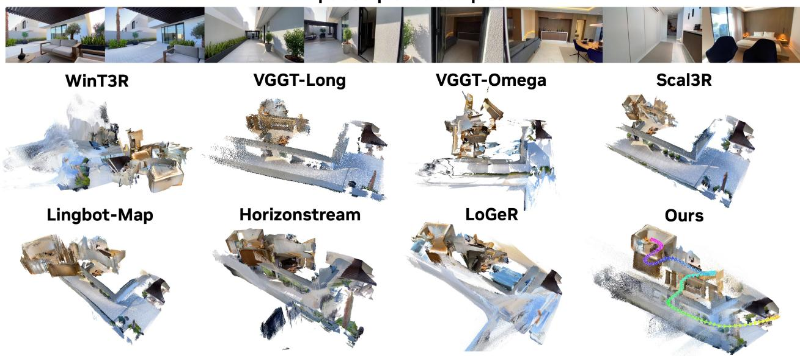  
Figure 6: In-the-wild reconstruction across scale changes. Representative inputs span an indoor–outdoor– indoor transition. The complete reconstructions show whether the indoor and outdoor regions remain connected in a common scene.

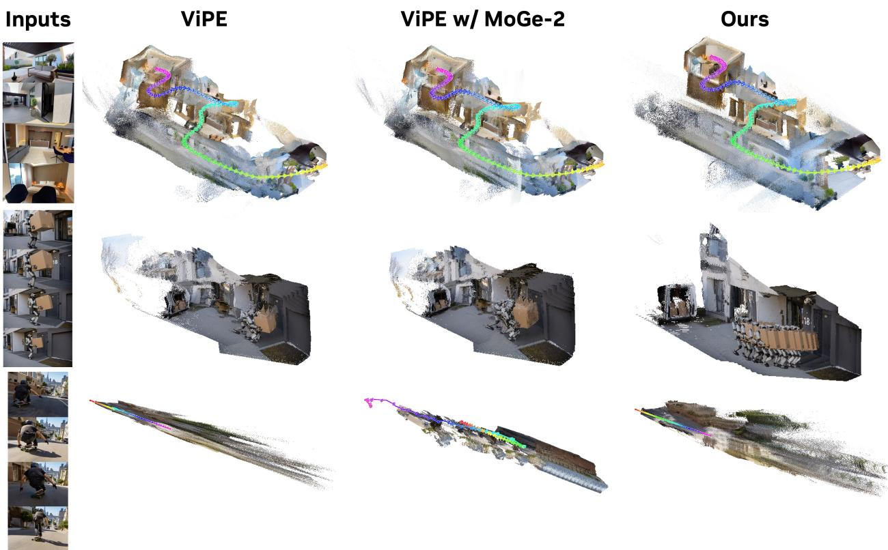  
Figure 7: Comparison with ViPE on in-the-wild sequences. Columns show the inputs, ViPE, ViPE with its metric prior replaced by MoGe-2, and MetricTrail. From top to bottom, the sequences contain a pronounced scale change, backward motion with a turn, and rapid forward motion. The shared-prior comparison tests whether re lacin ViPE’s de th rovider resolves the deformation.

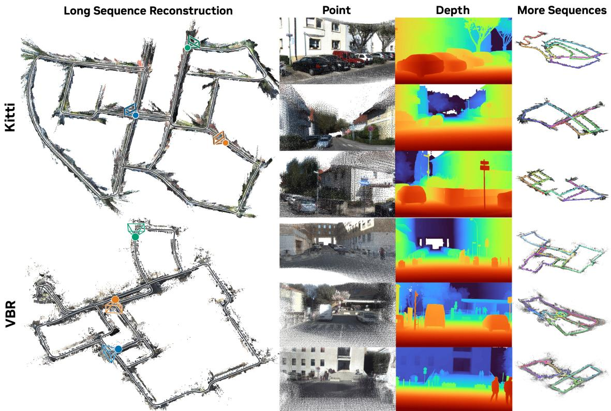  
Figure 8: Additional long-sequence reconstructions. KITTI examples appear above and VBR examples below. From left to right, we show a full-sequence reconstruction with selected camera locations, local point clouds, corresponding depth predictions, and additional reconstructions.

Table 7: Runtime on KITTI-02 using an NVIDIA A100 GPU. Latency is time to first output; FPS is steady-state throughput.
<table><tr><td rowspan=1 colspan=5>Method                ATE(m) ↓ Latency ↓ FPS ↑ Peak VRAM (GB) ↓</td></tr><tr><td rowspan=5 colspan=1>LingBot-MAPHorizonStreamOurs (Uncalibrated)</td><td rowspan=3 colspan=1>82.29</td><td></td><td></td><td></td></tr><tr><td rowspan=2 colspan=1>0.2s</td><td rowspan=2 colspan=1>11.37</td><td></td></tr><tr><td rowspan=1 colspan=1>15.07</td></tr><tr><td rowspan=1 colspan=1>84.62</td><td rowspan=1 colspan=1>1.2s</td><td rowspan=1 colspan=1>9.92</td><td rowspan=1 colspan=1>25.08</td></tr><tr><td rowspan=1 colspan=1>24.69</td><td rowspan=1 colspan=1>175s</td><td rowspan=1 colspan=1>12.70</td><td rowspan=1 colspan=1>6.81</td></tr><tr><td rowspan=1 colspan=1>Ours (Calibrated)</td><td rowspan=1 colspan=1>18.83</td><td rowspan=1 colspan=1>0.7s</td><td rowspan=1 colspan=1>12.70</td><td rowspan=1 colspan=1>3.21</td></tr></table>

## Runtime analysis.

Tab. 7 reports time to first output, steady-state throughput, and peak allocated GPU memory on KITTI-02 using an NVIDIA A100 GPU. With supplied intrinsics, MetricTrail starts after approximately 0.7 s, runs at 12.70 FPS, and has a peak GPU memory footprint of 3.21 GB. Estimating the camera model from RGB introduces a one-time start-up stage, increasing latency to approximately 175 s and peak memory to 6.81 GB, while subsequent throughput remains 12.70 FPS. This start-up latency includes the initial MoGe-2 prediction, geometric camera calibration, and replaying the prefix through the local estimator.

## A.2. Additional Trajectory Evaluations

## 7Scenes camera trajectory comparison.

Following the LingBot-MAP protocol [2], we evaluate all 18 oficial test sequences of 7Scenes at stride 5, using RGB frames processed at 434 × 574 resolution. We report ATE RMSE in centimeters after a proper per-sequence Sim(3) alignment and take the unweighted mean of the 18 sequence-level errors. Tab. 8 compares our method with LoGeR, Lin Bot-MAP, HorizonStream, and ViPE [2, 3, 38, 46]. Without rovided intrinsics, the local MetricTrail estimator obtains 6.7 cm. Optional global bundle adjustment reduces ATE to 6.3 cm, outperforming all listed baselines except LoGeR\*, which introduces further post-hoc alignment.

Table 8: Full-sequence camera trajectory estimation on 7Scenes. We report mean ATE (cm; lower is better) over the 18 oficial test sequences, sampled at stride 5, after a proper per-sequence Sim(3) alignment. Global BA denotes global bundle adjustment.
<table><tr><td>Metric</td><td></td><td>LoGeR LoGeR*</td><td>LingBot-MAP</td><td>HorizonStream</td><td>ViPE (w/ Global BA)</td><td>Ours (Uncalibrated)</td><td>Ours (Uncalibrated) w/ Global BA</td></tr><tr><td>ATE (cm) ↓</td><td>8.1</td><td>6.1</td><td>7.9</td><td>7.1</td><td>6.5</td><td>6.7</td><td>6.3</td></tr></table>

## Metric global bundle adjustment.

For the 7Scenes Global BA variant, we preserve the RGB-estimated shared camera model and the same metric local estimator. Every 15 retained keyframes, the estimator proposes long-range patch factors from predicted- flow proximity and retains factors that have left the active window. Whenever this search inserts long-range factors, MetricTrail invokes the global BA solver once. Within this single invocation, the solver performs two optimization iterations over camera poses and patch depths using the union of active and retained inactive factors. Poses preceding the earliest active source remain fixed as gauge anchors. Crucially, the global update preserves the robust metric inverse-depth prior instead of normalizing away the recovered scale. Enabling Global BA increases the measured inference time by only 1.6 seconds per sequence on average over the 18 test sequences of 7Scenes.

## TUM RGB-D camera trajectory comparison.

We next evaluate all nine Freiburg1 sequences of TUM RGB-D [65], retaining every associated frame at stride 1 for a total of 8,694 frames. We report full-trajectory ATE RMSE in centimeters after a proper per-sequence Sim(3) alignment and average the nine errors equally. We compare with DPVO, CUT3R, MASt3R-SLAM, VGGT-SLAM, VGGT-Long, LoGeR, LingBot-MAP, HorizonStream, and ViPE [1, 2, 3, 4, 38, 46, 49, 50, 51].

TUM is particularly challenging for the local DPVO backbone. Unlike the 7Scenes protocol, its input provides little translational baseline, while rapid rotations, rolling shutter, and motion blur create large but unreliable image motion. This combination weakens both triangulation and patch correspondence. By contrast, ViPE inherits DROID-SLAM’s dense-flow formulation and aggregates correspondence evidence over the full image rather than a sparse set of patches. This broader spatial support makes its pose updates more resilient when low parallax, rotation, or blur degrades part of the matching field [3, 14].

## Global refinement on TUM RGB-D.

For dense TUM streams, we optimize active and retained historical patch factors every eight keyframes, propagate revised keyframe poses to culled frames, and remeasure stored targets and confidences before two terminal solves. Camera oses and atch de ths are refined jointl while reservin the metric-de th prior and sequence scale. Our w/ Refine variant further introduces a temporally smooth, zero-mean log-scale correction to each keyframe’s depth prior, bidirectional long-range factors with connectivity-aware culling, and recurrent-state warm-starting during remeasurement. The base terminal passes add about 3.6 seconds per se uence. Relative to Global BA, w/ Refine increases the mean eometric-backend time b 5.3 seconds while leaving the local estimator and camera model unchanged. As shown in Tab. 9, our local estimator improves the calibrated DPVO backbone from 9.7 cm to 7.5 cm. Global BA reduces the error to 4.1 cm, and w/ Refine reaches 3.7 cm—a 62% reduction over DPVO. Without provided intrinsics, the same progression is 8.4 cm, 4.9 cm, and 4.4 cm, respectively, with the refined variant outperforming all RGB-only methods in the comparison. This result shows that revisiting both historical states and their measurements converts accurate local estimates into a globally consistent trajectory.

Table 9: Full-sequence camera trajectory estimation on TUM RGB-D. We report ATE RMSE (cm; lower is better) over nine sequences and 8,694 frames processed at stride 1. Each sequence is aligned independently by a proper Sim(3) transform, and sequence-level errors are averaged equally. DPVO uses supplied intrinsics. Best and second-best results across both blocks are highlighted.  
Prior methods
<table><tr><td>Metric</td><td>DPVO (Calibrated)</td><td>CUT3R</td><td>SLAM</td><td>MASt3R- VGGT- VGGT- SLAM</td><td>Long</td><td></td><td></td><td></td><td>LoGeR LoGeR* LingBot-MAP HorizonStream</td><td>ViPE (Uncalibrated)</td></tr><tr><td>ATE (cm)↓</td><td>9.7</td><td>48.6</td><td>6.0</td><td>6.1</td><td>8.3</td><td>7.5</td><td>6.0</td><td>4.5</td><td>5.3</td><td>4.9</td></tr><tr><td></td><td></td><td></td><td></td><td></td><td>METRICTRAIL variants</td><td></td><td></td><td></td><td></td><td></td></tr><tr><td rowspan="3"></td><td></td><td></td><td></td><td>Uncalibrated</td><td></td><td></td><td></td><td>Calibrated</td><td></td><td></td></tr><tr><td>Metric</td><td></td><td></td><td></td><td></td><td></td><td></td><td></td><td>Ours w/ Global BA w/ Global BA, Refine Ours w/ Global BA w/ Global BA, Refine</td><td></td></tr><tr><td>ATE (cm) ↓ 8.4</td><td></td><td>4.9</td><td></td><td>4.4</td><td></td><td>7.5</td><td>4.1</td><td>3.7</td><td></td></tr></table>

## LaMAria camera trajectory comparison.

We evaluate on five full-length sequences from LaMAria [74]: R\_01, R\_04, R\_06, R\_07, and R\_08, which span easy, medium, and hard trajectories. Unlike the RGB benchmarks in the main paper, LaMAria is evaluated from monocular grayscale input, creating a pronounced appearance-domain shift. We use no LaMAria-specific training or fine-tuning. We follow the same full-sequence protocol, reporting ATE RMSE in meters after a proper Sim(3) alignment and averaging the five sequence-level errors equally.

Table 10: Full-sequence ATE (m) on five sequences from LaMAria.
<table><tr><td>Method</td><td>R_01 2,898 fr.</td><td>R_04 5,253 fr.</td><td>R_06 7,808 fr.</td><td>R_07 8,010 fr.</td><td>R_08 12,328 fr.</td><td>Avg. ↓</td></tr><tr><td>LingBot-MAP</td><td>6.65</td><td>33.01</td><td>60.85</td><td>62.36</td><td>98.91</td><td>52.36</td></tr><tr><td>LingBot-MAP-Long</td><td>7.35</td><td>34.82</td><td>67.10</td><td>65.37</td><td>77.24</td><td>50.38</td></tr><tr><td>HorizonStream</td><td>7.19</td><td>35.63</td><td>54.55</td><td>42.70</td><td>90.63</td><td>46.14</td></tr><tr><td>LoGeR</td><td>4.23</td><td>10.87</td><td>22.44</td><td>23.01</td><td>91.11</td><td>30.33</td></tr><tr><td>LoGeR*</td><td>4.63</td><td>14.27</td><td>18.76</td><td>35.41</td><td>69.81</td><td>28.58</td></tr><tr><td>Ours (Uncalibrated)</td><td>3.09</td><td>4.85</td><td>15.97</td><td>10.14</td><td>9.57</td><td>8.73</td></tr><tr><td>Ours (Calibrated)</td><td>2.69</td><td>4.39</td><td>15.03</td><td>11.50</td><td>9.30</td><td>8.58</td></tr></table>

MetricTrail achieves average ATEs of 8.73 m and 8.58 m in the uncalibrated and calibrated settings, respectively, compared with 28.58 m for the strongest baseline. It obtains the best result on every sequence under at least one calibration setting. The large margin under grayscale input suggests that systems whose long-horizon state is formed entirely by learned prediction can be more sensitive to appearance-domain shift. In contrast, MetricTrail combines transferable feed-forward evidence with explicit optimization of the sequence-specific constraints. Without LaMAria adaptation, these results show out-of-domain generalization rather than benchmark-specific training.

Table 11: Full-trajectory camera pose estimation on the dynamic Wild-SLAM MoCap benchmark. We report ATE RMSE (cm; lower is better), averaged equally over ten sequences. Methods are separated by whether camera intrinsics are provided at inference. † marks evaluated configurations that explicitly mask dynamic content. Best and second-best results are highlighted separately within each calibration regime. Our two variants use neither dynamic masks nor a dynamics-specific objective and operate without loop closure or global bundle adjustment.
<table><tr><td></td><td colspan="4">Uncalibrated</td><td colspan="4">Calibrated</td></tr><tr><td>Metric</td><td>LingBot-MAP</td><td>ViPE†</td><td>HorizonStream</td><td>Ours</td><td>DROID-SLAM Splat-SLAM WildPose†</td><td></td><td></td><td>Ours</td></tr><tr><td>ATE (cm) ↓</td><td>3.48</td><td>2.59</td><td>21.58</td><td>2.70</td><td>16.17</td><td>8.71</td><td>0.39</td><td>1.65</td></tr></table>

## Wild-SLAM MoCap camera trajectory comparison.

We evaluate trajectories on all ten dynamic Wild-SLAM MoCap sequences [75]. Following the WildPose protocol [76], we process every associated RGB frame (stride 1; 9,039 frames in total), evaluate the complete per-frame trajectory, and report translational ATE RMSE in centimeters after a proper per-sequence Sim(3) Umeyama alignment. The ten sequence-level errors are averaged equally. We compare with LingBot-MAP, ViPE, HorizonStream, DROID-SLAM, Splat-SLAM [77], and WildPose.

Wild-SLAM MoCap contains substantial independently moving content and occlusion, making it particularly favorable to estimators designed to suppress dynamic observations. The evaluated ViPE configuration filters redefined movable semantics with instance masks while WildPose redicts learned motion masks. In contrast, the reported MetricTrail variants use the same estimator as on the static benchmarks, without an ex licit d namic-object mask or a d namics-s ecific objective. Nevertheless MetricTrail reaches 2.70 cm with RGB-only calibration, outperforming LingBot-MAP and HorizonStream and approaching the dynamic-aware ViPE result without a dynamics-specific component. With supplied intrinsics, its error decreases to 1.65 cm, outperforming DROID-SLAM and Splat-SLAM; only WildPose, with dedicated learned motion masking, remains ahead. These results demonstrate transfer to dynamic video without task-specific modifications.

## A.3. Per-Sequence Results

## Per-Sequence Comparison of KITTI, Oxford Spires, and VBR.

Tabs. 12 to 14 report full-sequence ATE on KITTI Odometry, Oxford Spires, and VBR, respectively, providing the per-sequence breakdown of the benchmark averages in the main paper. Baseline sources are VGGT-Long [51] for �3-Long and DA3-Long, and VGGT-SLAM [50] for DA3-SLAM.

## Per-Sequence Component Ablations.

Tab. 15 re orts calibrated monocular ATE on KITTI Odometr , Oxford S ires, and VBR with the same MoGe-2 prior and no loop closure. Multi-dataset adaptation broadens the range of camera motions and optical-flow patterns seen during training, reducing average ATE from 12.77 to 10.32 m on KITTI and from 1.85 to 1.76 m on Oxford Spires, but increasing VBR ATE from 19.57 to 22.51 m. Modeling correspondences across this more heterogeneous training mixture places greater demands on DPVO’s compact frontend. DINOv3 supplies complementary visual representations from large-scale pretraining, enriching both patch matching and recurrent context. With this augmentation, average ATE falls to 9.10, 1.71, and 18.90 m, respectively. The gains across all three datasets suggest that diverse motion supervision and richer visual representations work together to improve correspondence generalization.

Table 12: Full-sequence ATE (m) on KITTI Odometry. † marks method-native sparse output over keyframes. LoGeR\* requires alignment optimization. The strongest baseline average within each method group and our default RGB-only configuration are underlined.
<table><tr><td>Method</td><td></td><td>00 3.7 km</td><td>01 2.5 km</td><td>02 5.1 km</td><td>03 0.6 km 0.4 km</td><td>04</td><td>05 2.2 km</td><td>06 1.2 km</td><td>07 0.7 km</td><td>08 4,541 fr. 1,101 fr. 4,661 fr. 801 fr. 271 fr. 2,761 fr. 1,101 fr. 1,101 fr. 4,071 fr. 1,591 fr. 1,201 fr. 3.2 km</td><td>09 1.7 km</td><td>10 0.9 km</td><td>Avg. ↓</td></tr><tr><td rowspan="7">Ooptiton</td><td>VidMap† (Uncalibrated)</td><td>6.89</td><td>424.80</td><td>169.49</td><td>4.74</td><td>25.79</td><td>80.18</td><td>132.81</td><td>77.72</td><td>120.01</td><td>176.84</td><td>85.95</td><td>118.66</td></tr><tr><td>DROID-SLAM (Calibrated)</td><td>131.25</td><td>267.79</td><td>217.63</td><td>3.40</td><td>1.47</td><td>80.41</td><td>64.20</td><td>18.19</td><td>167.80</td><td>90.05</td><td>22.74</td><td>96.81</td></tr><tr><td>DPVO (Calibrated)</td><td>113.11</td><td>16.60</td><td>113.01</td><td>2.46</td><td>0.98</td><td>59.34</td><td>55.91</td><td>19.30</td><td>110.63</td><td>74.55</td><td>13.71</td><td>52.69</td></tr><tr><td>VidMap† (Calibrated)</td><td>7.50</td><td>234.88</td><td>35.74</td><td>2.00</td><td>14.66</td><td>1.66</td><td>49.00</td><td>13.50</td><td>123.27</td><td>8.97</td><td>2.87</td><td>44.91</td></tr><tr><td>DROID-W (Calibrated)</td><td>48.26</td><td>207.57</td><td>52.80</td><td>1.76</td><td>4.65</td><td>25.16</td><td>5.34</td><td>3.35</td><td>29.05</td><td>35.56</td><td>8.01</td><td>38.32</td></tr><tr><td>COLMAP</td><td>139.12</td><td>3.83</td><td>71.99</td><td>1.46</td><td>112.77</td><td>20.37</td><td>10.95</td><td>7.80</td><td>21.72</td><td>21.19</td><td>4.52</td><td>37.79</td></tr><tr><td>ViPE (Uncalibrated)</td><td>25.87</td><td>148.34</td><td>53.35</td><td>5.29</td><td>1.95 5.87</td><td>24.22</td><td>11.72</td><td>1.03</td><td>18.51</td><td>20.55</td><td>4.71</td><td>28.68</td></tr><tr><td>ViPE (Calibrated)</td><td>24.31</td><td>25.42</td><td>29.15</td><td>3.94</td><td></td><td>10.37</td><td>27.34</td><td>5.38</td><td>25.34</td><td>36.24</td><td>6.10</td><td>18.13</td></tr><tr><td rowspan="9">Oofin/cunk</td><td>MASt3R-SLAM</td><td>190.12</td><td>507.15</td><td>232.17</td><td>169.82</td><td>88.98</td><td>126.37</td><td>133.33</td><td>62.92</td><td>199.70</td><td>178.03</td><td>151.69</td><td>185.48</td></tr><tr><td>VGGT-SLAM</td><td>27.99</td><td>214.23</td><td>260.88</td><td>53.50</td><td>26.02</td><td>99.61</td><td>23.62</td><td>64.52</td><td>243.87</td><td>169.10</td><td>80.13</td><td>114.86</td></tr><tr><td>VGGT-Long</td><td>8.64</td><td>61.21</td><td>52.72</td><td>8.78</td><td>4.20</td><td>9.88</td><td>4.67</td><td>2.66</td><td>72.98</td><td>31.84</td><td>27.71</td><td>25.94</td></tr><tr><td>LoGeR</td><td>54.98</td><td>36.57</td><td>36.20</td><td>4.27</td><td>1.62</td><td>33.41</td><td>11.78</td><td>13.33</td><td>22.92</td><td>17.89</td><td>8.06</td><td>21.91</td></tr><tr><td>π³-Long</td><td>5.55</td><td>114.83</td><td>50.29</td><td>1.63</td><td>1.11</td><td>3.48</td><td>2.88</td><td>3.92</td><td>24.25</td><td>7.38</td><td>17.61</td><td>21.17</td></tr><tr><td>DA3-Long</td><td>5.13</td><td>78.76</td><td>35.64</td><td>5.38</td><td>3.18</td><td>3.04</td><td>2.83</td><td>2.32</td><td>26.55</td><td>8.86</td><td>13.42</td><td>16.83</td></tr><tr><td>LoGeR*</td><td>26.19</td><td>41.26</td><td>32.21</td><td>5.02</td><td>1.62</td><td>22.65</td><td>5.49</td><td>5.04</td><td>21.96</td><td>9.03</td><td>9.44</td><td>16.35</td></tr><tr><td>Scal3R w/ LC</td><td>4.30</td><td>45.29</td><td>42.06</td><td>3.36</td><td>1.74</td><td>3.30</td><td>2.49</td><td>2.03</td><td>36.69</td><td>12.32</td><td>6.46</td><td>14.55</td></tr><tr><td>STream3R StreamVGGT</td><td>190.98</td><td>681.95</td><td>301.40</td><td></td><td>158.25 102.73</td><td>159.85</td><td>135.03</td><td>90.37</td><td>261.15</td><td>216.31</td><td>207.49</td><td>227.77</td></tr><tr><td rowspan="9">Online</td><td></td><td>191.93</td><td>653.06</td><td>303.35</td><td>157.50108.24</td><td></td><td>160.46</td><td>133.71</td><td>89.00</td><td>263.95</td><td>216.69</td><td>209.80</td><td>226.15</td></tr><tr><td>InfiniteVGGT</td><td>167.17</td><td>533.36</td><td>272.99</td><td>149.18</td><td>58.86</td><td>127.50</td><td>100.54</td><td>78.77</td><td>196.66</td><td>199.25</td><td>138.04</td><td>183.85</td></tr><tr><td>LongStream</td><td>92.55</td><td>46.01</td><td>134.70</td><td>3.81</td><td>1.95</td><td>84.69</td><td>23.12</td><td>14.93</td><td>62.07</td><td>85.61</td><td>21.48</td><td>51.90</td></tr><tr><td>LingBot-MAP</td><td>30.80</td><td>64.74</td><td>82.29</td><td>2.49</td><td>0.85</td><td>16.55</td><td>6.27</td><td>8.92</td><td>39.32</td><td>17.99</td><td>7.96</td><td>25.29</td></tr><tr><td>HorizonStream</td><td>26.40</td><td>20.62</td><td>84.62</td><td>5.15</td><td>0.62</td><td>12.82</td><td>4.59</td><td>5.49</td><td>19.49</td><td>25.73</td><td>11.71</td><td>19.75</td></tr><tr><td>HorizonStream w/ LC</td><td>13.91</td><td>20.62</td><td>69.43</td><td>5.15</td><td>0.62</td><td>6.86</td><td>6.50</td><td>2.67</td><td>19.49</td><td>23.86</td><td>11.71</td><td>16.44</td></tr><tr><td></td><td></td><td></td><td></td><td></td><td></td><td></td><td></td><td></td><td></td><td></td><td></td><td></td></tr><tr><td>Ours (Uncalibrated) Ours (Uncalibrated) w/ LC</td><td>15.29 2.75</td><td>35.94 35.94</td><td>24.69 18.36</td><td>1.48 1.48</td><td>0.69 0.69</td><td>18.43 4.44</td><td>9.14 5.61</td><td>3.81 2.10</td><td>22.32 22.32</td><td>14.50 5.64</td><td>8.21 8.21</td><td>14.05 9.78</td></tr><tr><td>Ours (Calibrated)</td><td>5.22</td><td>33.21</td><td>18.83</td><td>2.71</td><td>0.59</td><td>5.90</td><td>6.18</td><td>3.13</td><td>11.94</td><td>8.39</td><td>3.95</td><td>9.10</td></tr><tr><td>Ours (Calibrated) w/ LC</td><td>2.92</td><td>33.21</td><td>6.02</td><td>2.71</td><td>0.59</td><td>3.32</td><td>9.49</td><td>2.48</td><td>11.94</td><td>4.69</td><td>3.95</td><td>7.39</td></tr><tr><td>Ours (Stereo) w/o LC</td><td>5.21</td><td>6.33</td><td>12.62</td><td>0.34</td><td>0.23</td><td>2.76</td><td>1.45</td><td>0.97</td><td>5.27</td><td>4.14</td><td>0.93</td><td>3.66</td></tr><tr><td></td><td>1.43</td><td>6.33</td><td>12.62</td><td>0.34</td><td>0.23</td><td>0.55</td><td>0.20</td><td>0.97</td><td>5.27</td><td>4.14</td><td>0.93</td><td>3.00</td></tr><tr><td>Ours (Stereo) w/ LC</td><td></td><td></td><td></td><td></td><td></td><td></td><td></td><td></td><td></td><td></td><td></td><td></td></tr></table>

## A.4. RGB-Only Camera Calibration

## Feed-forward initialization.

When intrinsics are unavailable, MoGe-2 estimates a camera matrix $\widehat { \mathbf { K } } _ { i }$ for each of the first $N _ { 0 } = 3 2$ RGB frames without field-of-view conditioning. We initialize $\mathbf { K } ^ { ( 0 ) }$ with the component-wise median of $\{ \widehat { \mathbf { K } } _ { i } \} _ { i = 1 } ^ { N _ { 0 } }$ , requiring no ground-truth calibration.

## Shared focal calibration.

The subsequent calibration-only estimator uses 128 keyframes selected from an initial prefix of � raw frames. The keyframe count is fixed, whereas � depends on keyframe selection in each sequence. Let $\chi _ { \mathrm { c a l } }$ denote its auxiliary pose-and-depth state and ${ \mathcal E } _ { \mathrm { c a l } }$ the objective combining learned-correspondence reprojection residuals with metric-depth constraints. Writing the entries of $\mathbf { K } ^ { ( 0 ) }$ as $( \overline { { f _ { x } ^ { ( 0 ) } } } , f _ { y } ^ { ( 0 ) } , c _ { x } ^ { ( 0 ) } , c _ { y } ^ { ( 0 ) } )$ ), we optimize

$$
\begin{array} { r } { { \bf K } ( \alpha ) = \left[ { \begin{array} { c c c } { f _ { x } ^ { ( 0 ) } + \alpha } & { 0 } & { c _ { x } ^ { ( 0 ) } } \\ { 0 } & { f _ { y } ^ { ( 0 ) } + \alpha } & { c _ { y } ^ { ( 0 ) } } \\ { 0 } & { 0 } & { 1 } \end{array} } \right] , } \end{array}\tag{5}
$$

$$
( \alpha ^ { \star } , \mathscr X _ { \mathrm { c a l } } ^ { \star } ) = \arg \operatorname* { m i n } _ { \alpha , \mathscr X _ { \mathrm { c a l } } } \mathscr E _ { \mathrm { c a l } } ( \mathscr X _ { \mathrm { c a l } } , { \bf K } ( \alpha ) , \mathscr T _ { 1 : B } ) .
$$

Table 13: Full-sequence ATE (m) on Oxford Spires at stride one.
<table><tr><td colspan="2">Method</td><td>Keble-2 0.20 km</td><td>Keble-3 0.18 km</td><td>Keble-4 0.23 km</td><td>Keble-5 0.21 km</td><td>Observ.-1 0.27 km</td><td>Observ.-2 0.28 km</td><td>Christ-2 0.25 km</td><td>Christ-3 0.18 km</td><td>Christ-5 0.80 km</td><td>Bodleian-2 0.55 km</td><td>Avg. ↓</td></tr><tr><td colspan="2">VGGT-SLAM</td><td>20.56</td><td>16.20</td><td>24.71</td><td>30.02</td><td>3.97</td><td>7.42</td><td>30.09</td><td>4.90</td><td>28.13</td><td>68.24</td><td>23.42</td></tr><tr><td rowspan="6">Oin/hunk</td><td>MASt3R-SLAM</td><td>7.06</td><td>18.03</td><td>11.27</td><td>14.64</td><td>10.26</td><td>10.30</td><td>2.90</td><td>6.95</td><td>19.85</td><td>19.99</td><td>12.12</td></tr><tr><td>DA3-SLAM</td><td>2.86</td><td>3.88</td><td>4.34</td><td>7.97</td><td>18.69</td><td>3.87</td><td>8.89</td><td>6.93</td><td>15.48</td><td>44.78</td><td>11.77</td></tr><tr><td>VGGT-Long</td><td>9.07</td><td>9.37</td><td>11.77</td><td>3.96</td><td>6.03</td><td>4.05</td><td>2.41</td><td>0.48</td><td>14.38</td><td>12.59</td><td>7.41</td></tr><tr><td>ViPE</td><td>14.39</td><td>13.88</td><td>0.57</td><td>12.18</td><td>0.55</td><td>0.23</td><td>15.44</td><td>0.18</td><td>9.31</td><td>3.89</td><td>7.06</td></tr><tr><td>LoGeR</td><td>2.74</td><td>2.33</td><td>2.92</td><td>3.21</td><td>4.83</td><td>5.29</td><td>2.14</td><td>1.84</td><td>11.61</td><td>6.31</td><td>4.32</td></tr><tr><td>LoGeR*</td><td>2.12</td><td>1.85</td><td>1.70</td><td>1.61</td><td>6.05</td><td>7.31</td><td>2.48</td><td>0.98</td><td>14.38</td><td>4.31</td><td>4.28</td></tr><tr><td rowspan="7">Ooniine</td><td>Stream3R-w</td><td>31.28</td><td>22.39</td><td>31.07</td><td>24.63</td><td>28.38</td><td>27.18</td><td>38.12</td><td>12.99</td><td>42.39</td><td>82.66</td><td>34.11</td></tr><tr><td>InfiniteVGGT</td><td>25.02</td><td>20.39</td><td>25.09</td><td>24.15</td><td>29.10</td><td>28.14</td><td>33.02</td><td>12.95</td><td>40.39</td><td>79.32</td><td>31.76</td></tr><tr><td>LongStream</td><td>11.57</td><td>9.44</td><td>16.88</td><td>10.67</td><td>12.43</td><td>14.34</td><td>17.93</td><td>6.42</td><td>35.49</td><td>24.02</td><td>15.92</td></tr><tr><td>CUT3R</td><td>13.10</td><td>11.55</td><td>15.76</td><td>8.98</td><td>13.58</td><td>15.60</td><td>12.36</td><td>5.71</td><td>31.31</td><td>19.42</td><td>14.74</td></tr><tr><td>TTT3R</td><td>8.27</td><td>7.26</td><td>8.77</td><td>7.55</td><td>9.43</td><td>10.30</td><td>4.56</td><td>2.11</td><td>21.75</td><td>14.00</td><td>9.40</td></tr><tr><td>HorizonStream</td><td>5.99</td><td>6.17</td><td>7.52</td><td>6.23</td><td>5.89</td><td>5.26</td><td>10.64</td><td>3.03</td><td>25.48</td><td>11.25</td><td>8.75</td></tr><tr><td>LingBot-MAP</td><td>2.66</td><td>2.25</td><td>1.56</td><td>2.45</td><td>3.23</td><td>2.61</td><td>2.89</td><td>0.70</td><td>27.27</td><td>5.87</td><td>5.15</td></tr><tr><td>Ours (Uncalibrated)</td><td></td><td>0.53</td><td>1.88</td><td>1.39</td><td>0.49</td><td>0.76</td><td>1.04</td><td>2.14</td><td>1.19</td><td>5.71</td><td>2.53</td><td>1.77</td></tr></table>

Table 14: Full-sequence ATE (m) on VBR. The header reports the number of frames and route length of each sequence.
<table><tr><td colspan="2">Method</td><td>colosseo_0 8,815 fr.</td><td>campus_0 12,042 fr. 2.73 km</td><td>campus_1 11,671 fr. 2.95 km</td><td>pincio_0 11,142 fr. 1.27 km</td><td>spagna_0 14,141 fr. 1.56 km</td><td>diag_0 10,021 fr. 1.02 km</td><td>ciampino_1 18,846 fr.</td><td>Avg. ↓</td></tr><tr><td colspan="2"></td><td>1.45 km</td><td>116.21</td><td>114.37</td><td>67.11</td><td>54.62</td><td>35.67</td><td>5.20 km 171.76</td><td>92.64</td></tr><tr><td rowspan="5">Ofi/unk</td><td>MASt3R-SLAM VGGT-Long</td><td>88.75 45.73</td><td>132.68</td><td>115.65</td><td>64.40</td><td>58.49</td><td>33.66</td><td>187.97</td><td>91.23</td></tr><tr><td>VGGT-SLAM</td><td>101.00</td><td>93.51</td><td>71.74</td><td>66.42</td><td>57.00</td><td>33.64</td><td>124.10</td><td>78.20</td></tr><tr><td>ViPE</td><td>79.22</td><td>46.07</td><td>63.10</td><td>15.42</td><td>20.33</td><td>35.75</td><td>63.48</td><td>46.20</td></tr><tr><td>LoGeR</td><td>31.77</td><td>27.90</td><td>30.80</td><td>17.96</td><td>21.33</td><td>32.25</td><td>34.16</td><td>28.02</td></tr><tr><td>LoGeR*</td><td>55.32</td><td>13.27</td><td>16.79</td><td>9.18</td><td>18.32</td><td>29.45</td><td>34.32</td><td>25.24</td></tr><tr><td rowspan="8">Onine</td><td>InfiniteVGGT</td><td>89.89</td><td>136.76</td><td>116.63</td><td>77.76</td><td>63.35</td><td>33.84</td><td>202.09</td><td>102.90</td></tr><tr><td>LongStream</td><td>72.52</td><td>100.57</td><td>105.55</td><td>43.47</td><td>59.31</td><td>32.35</td><td>131.78</td><td>77.93</td></tr><tr><td>CUT3R</td><td>82.63</td><td>42.25</td><td>43.16</td><td>46.65</td><td>44.62</td><td>28.62</td><td>175.83</td><td>66.25</td></tr><tr><td>TTT3R</td><td>75.52</td><td>59.44</td><td>56.55</td><td>33.87</td><td>37.33</td><td>18.49</td><td>173.71</td><td>64.99</td></tr><tr><td>LingBot-MAP</td><td>16.70</td><td>23.61</td><td>10.37</td><td>29.37</td><td>24.29</td><td>24.12</td><td>64.24</td><td>27.53</td></tr><tr><td>HorizonStream</td><td>37.42</td><td>22.46</td><td>22.49</td><td>22.63</td><td>23.52</td><td>22.46</td><td>26.10</td><td>25.30</td></tr><tr><td>HorizonStream w/ LC</td><td>12.76</td><td>28.54</td><td>8.49</td><td>17.24</td><td>23.06</td><td>24.05</td><td>17.76</td><td>18.84</td></tr><tr><td></td><td></td><td>9.26</td><td>15.07</td><td>7.43</td><td>13.94</td><td>20.97</td><td>17.75</td><td></td></tr><tr><td></td><td>Ours (Uncalibrated) Ours (Uncalibrated) w/ LC</td><td>30.08 26.83</td><td>6.80</td><td>9.99</td><td>6.94</td><td>10.18</td><td>5.84</td><td>9.60</td><td>16.36 10.88</td></tr></table>

The same scalar � updates both focal axes, while the principal point is held fixed. Because the metric predictor is conditioned on field of view, its depth measurements are recomputed whenever the focal estimate changes. The optimized poses and depths are used only to make the shared focal parameter observable under multi-view constraints and are not retained as reconstruction output.

We refer to the feed-forward initialization and shared-focal optimization above collectively as base calibration. We then discard the auxiliary poses and depths, fix K, and replay the complete prefix through the regular local estimator, so that all reported poses come from the same estimator. Latency is measured as time to first output and includes the initial MoGe-2 camera prediction, DROID-style geometric calibration, and prefix replay. In the KITTI-02 runtime evaluation, the uncalibrated system reaches its 6.81 GB peak during calibration; GPU memory usage drops to 3.21 GB during subsequent steady-state estimation. This estimate is suficient when the centered-principal-point model is consistent with the released imagery. Some sequences, however, require an additional RGB-only focal refinement, which we describe next.

Table 15: Per-sequence component ablations: calibrated ATE RMSE (m) on KITTI Odometry, Oxford Spires, and VBR. All variants use monocular input, the same MoGe-2 prior, and no loop closure; Oxford Spires uses stride one. Only the lowest average within each dataset is bold.
<table><tr><td colspan="10">KITTI Odometry</td></tr><tr><td>Variants</td><td>00</td><td>01</td><td>02</td><td>03</td><td>04</td><td>05</td><td>06</td><td>07</td><td></td><td>10</td><td>Avg. ↓</td></tr><tr><td>Ours w/o Multi-dataset, DINO</td><td>7.61</td><td>76.22</td><td>17.17</td><td>2.54</td><td>0.79 8.02</td><td>5.44</td><td>2.83</td><td>10.38</td><td>4.80</td><td>4.64</td><td>12.77</td></tr><tr><td>Ours w/o DINO</td><td>6.05</td><td>30.52</td><td>21.36</td><td>2.20</td><td>3.67 4.92</td><td>10.19</td><td>3.83</td><td>17.84</td><td>7.98</td><td>5.00</td><td>10.32</td></tr><tr><td>Ours</td><td>5.22</td><td>33.21</td><td>18.83</td><td>2.71</td><td>0.59</td><td>5.90 6.18</td><td>3.13</td><td>11.94</td><td>8.39</td><td>3.95</td><td>9.10</td></tr><tr><td colspan="10">Oxford Spires</td></tr><tr><td>Variants</td><td>keb.02</td><td>keb.03</td><td>keb.04</td><td>keb.05</td><td>obs.01</td><td>obs.02</td><td>chr.02</td><td>chr.03</td><td>chr.05</td><td>bod.02</td><td>Avg. ↓</td></tr><tr><td>Ours w/o Multi-dataset, DINO</td><td>0.44</td><td>2.17</td><td>0.86</td><td>0.85</td><td>0.81</td><td>0.87</td><td>2.38</td><td>1.27</td><td>5.98</td><td>2.85</td><td>1.85</td></tr><tr><td>Ours w/o DINO</td><td>0.93</td><td>1.47</td><td>0.86</td><td>0.82</td><td>1.37</td><td>0.91</td><td>1.78</td><td>1.49</td><td>5.46</td><td>2.47</td><td>1.76</td></tr><tr><td>Ours</td><td>0.48</td><td>1.73</td><td>0.78</td><td>0.92</td><td>0.73</td><td>0.73</td><td>2.19</td><td>1.20</td><td>5.80</td><td>2.52</td><td>1.71</td></tr><tr><td colspan="10">VBR</td></tr><tr><td>Variants</td><td>colosseo_0</td><td></td><td>campus_0</td><td>campus_1</td><td>pincio_0</td><td></td><td>spagna_0</td><td>diag_0</td><td>ciampino_1</td><td></td><td>Avg. ↓</td></tr><tr><td>Ours w/o Multi-dataset, DINO</td><td>19.88</td><td></td><td>16.59</td><td>15.51</td><td>7.91</td><td></td><td>15.69</td><td>21.08</td><td>40.36</td><td></td><td>19.57</td></tr><tr><td>Ours w/o DINO</td><td>10.36</td><td></td><td>22.95</td><td>22.49</td><td>6.51</td><td></td><td>18.28 13.83</td><td>24.19 22.52</td><td></td><td>52.81</td><td>22.51</td></tr><tr><td>Ours</td><td>14.26</td><td></td><td>17.32</td><td>15.18</td><td></td><td>6.32</td><td></td><td></td><td></td><td>42.83</td><td>18.90</td></tr></table>

## A.5. Focal Refinement from Revisit Geometry

## Motivation.

The base calibration fits a shared focal with the principal point fixed at the image center. This matches the processed Oxford Spires imagery but leaves a 17.3-pixel horizontal ofset (3.4% of image width) on VBR. Under predominantly forward motion, focal and principal-point ofsets can partially compensate in the bearing $( ( u - c _ { x } ) / f , ( v - c _ { y } ) / f , 1 )$ , allowing biased depth and translation to produce small reprojection errors. Retrospective evaluation shows a focal error of 0.1–0.5% on Oxford Spires but a 7–9% overestimate on six of the seven VBR sequences. We therefore refine the focal using revisits with more varied viewing directions. The refinement was motivated by our analysis of VBR, but can also benefit other sequences whose revisits provide suficiently diverse viewing geometry to constrain the focal length.

## RGB-only revisit refinement.

We use the base trajectory to select temporally distant revisit pairs, extract RGB correspondences with RoMa [78], and estimate fundamental matrices $\mathbf { F } _ { i j }$ using MAGSAC [79]. Let ℛ be the retained pair set and ${ \bf K } ( f , c _ { x } )$ the camera matrix with shared focal $f ,$ horizontal principal point $c _ { x } ,$ , and the vertical principal point at the image center. We project ${ \bf K } ^ { \top } { \bf F } _ { i j } { \bf K }$ onto the essential-matrix manifold and evaluate the mean Sampson cost $\mathcal { C } _ { i j } ( f , c _ { x } )$ The refined focal is

$$
f _ { \mathrm { r e f } } = \arg \operatorname* { m i n } _ { f \in \mathcal { F } } \operatorname* { m i n } _ { c _ { x } \in \mathcal { C } } \frac { 1 } { | \mathcal { R } | } \sum _ { ( i , j ) \in \mathcal { R } } \mathcal { C } _ { i j } ( f , c _ { x } ) ,\tag{6}
$$

where $\mathcal { F }$ and $\mathcal { C }$ are the focal and horizontal-center search ranges specified below. We profile over $c _ { x }$ as a nuisance parameter and update only the focal, retaining the centered downstream camera model. Diferent revisit headings supply complementary epipolar constraints from RGB correspondences.

## Routing and configuration.

Refinement requires suficient revisits and continued focal evolution late in base calibration. We sample every five frames, propose pairs within 15 m and at least 200 frames apart, and require at least 1,000 proposals, a density of at least 0.15 per frame, and a late focal change of 0.2–2.5%. At most 800 pairs with heading changes of $2 5 ^ { \circ } - 1 4 0 ^ { \circ }$ are retained. Given the base focal $f _ { 0 } ,$ we search 401 log-spaced focal values in [0.6�0, 1.3�0] and

Table 16: Efect of RGB-only focal refinement on VBR. We report full-sequence ATE (m; lower is better) with and without loop closure. The local estimator is held fixed.
<table><tr><td>Variant</td><td>colosseo_0</td><td>campus_0</td><td>campus_1</td><td>pincio_0</td><td>spagna_0</td><td>diag_0</td><td>ciampino_1</td><td>Avg. ↓</td></tr><tr><td>Ours w/o refinement</td><td>30.73</td><td>45.59</td><td>14.41</td><td>15.78</td><td>18.65</td><td>35.35</td><td>74.07</td><td>33.51</td></tr><tr><td>Ours</td><td>30.08</td><td>9.26</td><td>15.07</td><td>7.43</td><td>13.94</td><td>20.97</td><td>17.75</td><td>16.36</td></tr><tr><td>Ours w/o refinement w/ LC</td><td>23.44</td><td>37.27</td><td>9.49</td><td>14.46</td><td>13.36</td><td>34.80</td><td>62.85</td><td>27.95</td></tr><tr><td>Ours w/ LC</td><td>26.83</td><td>6.80</td><td>9.99</td><td>6.94</td><td>10.18</td><td>5.84</td><td>9.60</td><td>10.88</td></tr></table>

Table 17: Retrospective focal analysis on VBR across ten independent runs. Entries are signed relative focal errors against sensor calibration, used only for reporting, never for routing, refinement, or model selection. Macro averages report absolute errors.
<table><tr><td>Variant</td><td></td><td>colosseo_0 campus_0</td><td>campus_1</td><td>pincio_0</td><td>spagna_0</td><td>diag_0</td><td>ciampino_1</td><td>Macro abs. error</td></tr><tr><td>Ours w/o refinement</td><td>+7.68%</td><td>+8.26%</td><td>+1.25%</td><td>+8.04%</td><td>+7.18%</td><td>+8.78%</td><td>+8.37%</td><td>7.08%</td></tr><tr><td>Ours</td><td>+5.56%</td><td>+1.33%</td><td>+1.25%</td><td>-1.41%</td><td>+4.89%</td><td>-0.06%</td><td>+0.14%</td><td>2.09%</td></tr></table>

41 horizontal centers within ±40 pixels of the image midpoint, with 60 matches per pair and 400 bootstrap resamples.

We accept only interior, bootstrap-stable profile minima, allowing at most 10% boundary solutions, 15% disagreement between center-pinned and center-profiled fits, and 25% focal change from � . A rejected fit may be retried once with upsampled matching under the same checks; otherwise, the base calibration is retained. Pair construction is deterministic, and routing and acceptance use no sensor intrinsics, ground-truth poses, or ground-truth depths. Refinement averages 7.1 minutes per routed sequence, dominated by matching; the focal-profile fit takes 4–6 seconds.

## VBR results.

Under matched inference settings, refinement reduces mean ATE from 33.51 to 16.36 m without loop closure (51%) and from 27.95 to 10.88 m with loop closure (61%) (Tab. 16).

Across ten runs, macro absolute focal error decreases from 7.08% to 2.09% (Tab. 17); sensor values are used only for retrospective evaluation. Trajectory rows use independent runs, so small ATE diferences can occur even without a focal update.

Tab. 18 compares the RGB-estimated camera model with supplied sensor intrinsics. Average ATE decreases from 19.31 to 16.27 m without loop closure and from 12.25 to 10.38 m with loop closure. Sensor intrinsics provide the full of-center matrix to geometric optimization, while depth prediction uses only horizontal field of view. The RGB-only variant instead estimates an efective focal for a centered camera. Its lower ATE reflects compatibility within this composed camera-and-depth model, not a more accurate estimate of the physical camera matrix.

## A.6. Implementation Details

## Training configuration.

We initialize the local estimator from the oficial DPVO checkpoint and train on 16 NVIDIA A100 80GB GPUs with distributed data parallelism. Each GPU processes one 15-frame clip, giving a global batch size of 16. Training spans 15,000 optimizer steps, or 240,000 clips. We first warm up the zero-initialized representationfusion branches on 5,000 TartanAir clips while keeping the odometry network frozen. We then jointly fine-tune the odometry network and fusion branches using the remaining 235,000 clips from our multi-dataset training mixture of TartanAir, TartanGround, CarlaOcc, LightwheelOcc, and OmniWorld-Game. The resulting training exposure is $^ { 5 6 , 0 0 0 }$ TartanAir clips and 46,000 clips from each of the other four datasets. No training clip exceeds 15 frames, and no evaluation sequence or dedicated long-sequence pose corpus is used.

Table 18: Efect of camera-model choice on VBR. We report full-sequence ATE (m; lower is better) with and without loop closure. The local estimator is held fixed within each comparison.
<table><tr><td>Variant</td><td>colosseo_0</td><td>campus_0</td><td>campus_1</td><td>pincio_0</td><td>spagna_0</td><td>diag_0</td><td>ciampino_1</td><td>Avg.↓</td></tr><tr><td>Ours (Calibrated)</td><td>18.19</td><td>16.13</td><td>15.78</td><td>6.34</td><td>14.35</td><td>22.77</td><td>41.64</td><td>19.31</td></tr><tr><td>Ours (Uncalibrated)</td><td>28.38</td><td>8.46</td><td>15.42</td><td>7.73</td><td>13.42</td><td>21.70</td><td>18.77</td><td>16.27</td></tr><tr><td>Ours (Calibrated) w/ LC</td><td>12.92</td><td>13.06</td><td>7.46</td><td>5.50</td><td>12.68</td><td>8.34</td><td>25.82</td><td>12.25</td></tr><tr><td>Ours (Uncalibrated) w/ LC</td><td>21.54</td><td>6.02</td><td>9.75</td><td>7.18</td><td>9.55</td><td>5.53</td><td>13.06</td><td>10.38</td></tr></table>

## Optimization and precision.

We use a frozen DINOv3-S/16 encoder pretrained on LVD-1689M [7]. Its 384-dimensional features are projected to 64 channels and split into two 32-channel branches, which augment the 128-dimensional matching stream and the 384-dimensional recurrent context stream, respectively. The final residual projections are zero initialized. In joint training, the learning rates are $8 \times 1 0 ^ { - 6 }$ for the odometry network and $8 \times 1 0 ^ { - 5 }$ for the fusion branches. We use AdamW with weight decay $1 0 ^ { - 6 }$ , linear OneCycle annealing with a 1% warm-up, gradient clipping at 10, and seed 1234. For each clip, we sample 80 3 × 3 patches per frame and unroll 18 recurrent refinements. Images are resized while preserving aspect ratio and center-cropped to $4 8 0 \times 6 4 0$ . Only the frozen DINO forward pass uses BF16, evaluated in three-frame chunks; the adapters, odometry network, diferentiable bundle adjustment, and losses remain in FP32. MoGe-2 is not used during adaptation and is kept frozen when invoked at inference. End-to-end training takes approximately seven hours.

## Metric-prior inference.

DPVO and MoGe-2 receive the same cover-fitted and center-cropped image raster, and we transform the camera intrinsics by the same resize and crop. No additional warp is applied to the predicted depth. For the canonical KITTI input, an image is mapped to 280 × 504 pixels. Writing the full-resolution output as $\widehat { \mathbf { D } } _ { i } ^ { \mathrm { f u l l } }$ , the registered depth used in Sec. 3.3 is $\widehat { \mathbf { D } } _ { i } = \widehat { \mathbf { D } } _ { i } ^ { \mathrm { f u l l } } [ 1 : : 4 , 1 : : 4 ] ;$ ; a patch center $( x , y )$ thus maps to image pixel $( 4 x + 1 , 4 y + 1 )$ .

A predicted depth is valid when the provider mask is true, its value is finite, and $0 . 2 \mathrm { m } \leq z \leq 5 0 0 \mathrm { m }$ , including both endpoints. An invalid patch is initialized with the median valid inverse depth of the full registered frame and receives zero metric-factor weight. Metric inference samples 96 patch centers per frame, whereas training uses 80. If the full-resolution prediction, the stride-4 depth raster, or all sampled patch centers contain no valid depth, the current sequence is terminated and no partial trajectory is reported as a valid result.

We disable DPVO’s scale normalization in every metric run. The metric factor uses $\lambda _ { \mathrm { m } } = 1$ and Huber threshold � = 0.3. It is disabled for the first 12 accepted graph frames and latched thereafter, so the first regular BA update with this factor normally occurs on accepted frame 13.

## DINOv3 feature alignment.

Before DINOv3 inference, we undo DPVO’s input normalization, convert BGR to RGB, and replicate-pad the right and bottom boundaries to the next multiple of 16. This padding is confined to the DINOv3 branch and does not change DPVO image coordinates or camera intrinsics. Frozen DINOv3-S/16 produces a stride-16 raster of 384-dimensional tokens. A 1 × 1 convolution projects these tokens to 64 channels, split into 32-channel matching and context branches. We align the branch features with DPVO’s grid by bilinear upsampling to stride 4 in the padded coordinate system and then remove the padded rows and columns. For a 280 × 504 input, the alignment is $2 8 8 \times 5 1 2  1 8 \times 3 2  7 2 \times 1 2 8  7 0 \times 1 2 6$ . The matching branch projects to 128 channels and is added to both source and target full-frame matching maps before patch extraction and correlation. The context branch is sam led at source atch centers, rojected to 384 dimensions, and added to the corres ondin recurrent context vectors. The final residual projections are initialized to zero.

## Loop closure.

Following VGGT-Long, Scal3R, and HorizonStream, we use a similar loop-closure strategy that combines revisit retrieval with graph refinement. We use SALAD to retrieve temporally separated near-duplicate views and suppress redundant matches. Each selected pair contributes a weak identity relative-pose factor, treating the views as approximately coincident without pairwise geometric verification. These factors are combined with sequential odometry constraints in an SE(3) pose graph, which refines camera poses with the first pose fixed. This correction preserves metric scale and leaves patch depths unchanged; dense reconstructions can be reassembled from the corrected poses.

## Stereo inference.

For each newly created left-image patch, we add a same-time edge to the synchronized right image under the fixed left-to-right rig transform. The right image supplies only a target matching map, including its DINOv3 matching augmentation; no right-image patch, recurrent context, metric-depth variable, or camera-pose variable is created. The recurrent matcher predicts the right correspondence and confidence, and the resulting reprojection residual is added to the local BA objective. No stereo-specific data or loss is used during training.