# National-scale mapping of tree species composition in Switzerland from high-resolution aerial imagery and multimodal data

Yixin Zhoua,∗, Luca Ferrarib,d, Verena C. Griessb,c, Nataliia Rehushe, Konrad Schindlera and Mirela Beloiub,d

aPhotogrammetry and Remote Sensing Group, ETH Zurich, Zurich, 8093, Switzerland

bForest Resources Management Group, ETH Zurich, Zurich, 8093, Switzerland

cETH Swiss Geo Lab, D4 Business Village, Platz 1a, Root, 6039, Switzerland

dEcosystem Ecology Group, Swiss Federal Research Institute WSL, Zürcherstrasse 111, Birmensdorf, 8902, Switzerland

eForest Resources and Management, Swiss Federal Institutefor Forest, Snow and Landscape Research WSL, Birmensdorf, 8903, Switzerland

## A R T I C L E I N F O

tree-species composition multimodal remote sensing deep learning Swiss National Forest Inventory national forest mapping.

## A BS T RA C T

Tree-species composition shapes forest productivity and how forests respond to climate disturbances such as drought, windthrow and insect outbreaks. Yet most national forest maps assign each pixel a single dominant species and cannot show the share of accompanying species. We mapped the basal-area shares of ten main tree species and a residual Other class across Switzerland at 30 m resolution. A deep-learning model combining 0.1 m aerial RGB imagery, airborne laser scanning (ALS), annual AlphaEarth satellite embeddings, and climate variables was trained on basal-area observations from 3,992 Swiss National Forest Inventory (NFI) sites. In spatial cross-validation, the model reached a macro-�2 of 0.485 across the 11 classes. On an independent forest-reserve dataset, the map reached a macro-�2 of 0.552 for individual 30 m pixels and 0.733 for plots, and identified the dominant class in 73.2% of pixels and 81.1% of plots. The map shows maple and ash as widespread minor components that dominant-class maps omit. It also reproduces the elevational sequence from broadleaved lowland stands through spruce to larch and Arolla pine near the treeline. By resolving the species mixture within each 30 m pixel, the map complements field inventory statistics with spatially continuous information that can support forest monitoring, the management of mixed stands, and climate-adaptation planning across Switzerland.

## 1. Introduction

Accurate, spatially explicit information on tree-species composition is essential for understanding how forests function and respond to disturbances. Tree diversity is positively associated with forest productivity (Liang et al., 2016), and species difer in their susceptibility to drought, windthrow and insect outbreaks (Anderegg et al., 2020; Senf and Seidl, 2021). Forest services need composition information to assess current forest condition and to select species for climate-adapted regeneration (Fassnacht et al., 2016; Strauss and Fischer, 2025). In mixed forests, this information goes beyond the dominant species. In other words, stands with the same dominant species can difer widely in the number and proportions of accompanying species. Large-area composition maps therefore need to quantify the shares of all species in a stand, including the accompanying ones (Bolyn et al., 2022; Klehr et al., 2025).

Remote sensing (RS) has made large-area tree-species mapping increasingly feasible by combining wall-to-wall image coverage with forest-inventory observations. Satellite time series record seasonal diferences among species and provide repeated observations over large, environmentally diverse regions (Blickensdörfer et al., 2024; Breidenbach et al., 2021). Combined with national inventory data, they support products that distinguish multiple species or species groups, including a 10 m map of the dominant species in Switzerland (Koch et al., 2024). Most of these products, however, assign a single class to each pixel. At resolutions of 10–30 m, one pixel can cover several crowns and species, so a single class leaves the within-pixel composition unresolved (Fassnacht et al., 2016). More accurate classifiers make the dominant label more reliable, but they still do not quantify the shares of secondary species. Mixed stands also complicate the construction of reference data. Restricting training samples to homogeneous or nearly pure stands simplifies the link between image and label, but it underrepresents mixed conditions during model development. Evaluating on pure stands alone then gives an incomplete picture of performance where mixtures are common (Blickensdörfer et al., 2024).

Continuous composition targets avoid this simplification by describing each reference unit as a vector of species proportions. Such targets have been learned from inventory data of mixed stands with spectral–spatial deep learning (Bolyn et al., 2022), from synthetic mixtures of pure Sentinel-2 time series (Klehr et al., 2025), from airborne laser scanning (Murray et al., 2024), and from combinations of lidar, airborne spectral and satellite data (Candelas Bielza et al., 2024; Cao et al., 2026; Ørka et al., 2021). All of these studies cover a single region (Table 1), which spans a limited range of climate, elevation and species pools, so the relationship between imagery and composition is learned and tested under similar environmental conditions (Blickensdörfer et al., 2024). In contrast, Switzerland is a demanding test case: its forests extend from the lowlands of the Plateau to the treeline in the Alps, and their composition shifts from broadleaved and mixed stands at low elevations to coniferous stands at high elevations (Strauss and Fischer, 2025; Wüest et al., 2020).

Very-high-resolution aerial imagery provides evidence that freely available satellite pixels cannot. At 0.1 m resolution, individual crowns, their texture and their arrangement are visible, and such imagery has supported individual-tree detection and species identification in Swiss forests (Beloiu et al., 2023). Switzerland acquires such imagery for its entire territory on a roughly three-year cycle (Federal Ofice of Topography swisstopo, 2026b). Using it for composition mapping, however, poses a diferent learning problem. Inventory plots record the species and diameter of individual trees, but these records are not matched to crowns in the image, so a model must relate the appearance of a whole canopy patch to the plot-level composition. Self-supervised models pretrained on large unlabeled image collections provide features that transfer to forest imagery with few labels (Siméoni et al., 2025). Such features have supported canopy height mapping (Brandt et al., 2026), but they have not yet been tested for estimating species composition from inventory plots.

Other observations, such as satellite time series, airborne laser scanning, and climate data, may add what a single aerial acquisition misses. Species that look alike on one date can difer in their seasonal trajectories (Cloutier et al., 2024), and annual satellite embeddings summarize such trajectories from several sensors (Ball et al., 2026; Brown et al., 2025). Airborne laser scanning describes canopy structure (Murray et al., 2024), and climate variables describe where each species can grow (Blickensdörfer et al., 2024). Combining these sources with aerial imagery is not straightforward. They difer in spatial support, from 0.1 m image pixels to 10 m embeddings and 1 km climate grids, and in acquisition date. With few training plots, a model may also rely on covariates that mainly encode location, such as climate, instead of on what the imagery shows. Fusing satellite imagery and lidar has improved composition estimates (Candelas Bielza et al., 2024; Cao et al., 2026), but most of this work did not include very-high-resolution aerial imagery, so little is known about what these sources add to it.

Here, we aim to develop a national, spatially continuous map of tree-species composition for Switzerland, representing the basal-area shares of 10 main tree species and an Other class rather than assigning each location to a single dominant species. We specifically ask: i) Within an RGB-anchored multimodal framework, what predictive information does each remote-sensing and environmental data source contribute to tree-species composition mapping? ii) How accurately does the national map estimate tree-species composition across independent spatial scales and datasets? iii) What ecological patterns of tree-species composition emerge across Switzerland’s elevational gradient? We hypothesize that integrating multimodal data enables accurate mapping of tree-species composition beyond inventory sites while preserving ecologically meaningful spatial patterns. We address these questions by combining basal-area observations from 3,992 Swiss National Forest Inventory sites with high-resolution aerial imagery, airborne laser scanning, satellite embeddings, and climate data in a multimodal deep-learning framework. We evaluate the contribution of the diferent data sources using spatial cross-validation, generate a 30 m national composition map, and independently evaluate it using Swiss Forest Reserves and regional NFI4 statistics. Continuous composition mapping provides a new basis for monitoring forest diversity and change.

Large-area studies and products mapping tree species or leaf type. S-1/S-2 = Sentinel-1/2; ALS = airborne laser scanning; HSI = hyperspectral imagery; AEF = AlphaEarth Foundations satellite embeddings.
<table><tr><td>Study/product</td><td>Prediction target</td><td>Predictor modalities</td><td>Scale</td></tr><tr><td colspan="4">Categorical</td></tr><tr><td>Francini et al. (2024)</td><td>7 species groups</td><td>S-2</td><td>Netherlands</td></tr><tr><td>Mu et al. (2025a)</td><td>8 species/species groups</td><td>S-2</td><td>Germany</td></tr><tr><td>Waser et al. (2017)</td><td>2 leaf types; broadleaf probability</td><td>Aerial multispectral + terrain</td><td>Switzerland</td></tr><tr><td>Blickensdörfer et al. (2024)</td><td>11 species/species groups</td><td> $\mathsf { S } \mathrm { - } 1 + \mathsf { S } \mathrm { - } 2 + \mathsf { e n v i r o n m e n t }$ </td><td>Germany</td></tr><tr><td>Koch et al. (2024)</td><td>15 species</td><td> $\mathsf { S } { - } 2 + \mathsf { t e r r a i n }$ </td><td>Switzerland</td></tr><tr><td>Waser et al. (2025)</td><td>2 leaf types; broadleaf probability</td><td> $\mathsf { S } \mathrm { - } 1 + \mathsf { S } \mathrm { - } 2 + \mathsf { t e r r a i n }$ </td><td>Switzerland</td></tr><tr><td>Breidenbach et al. (2021)</td><td>3 species/species groups</td><td> $\mathsf { S } { - } 2 + \mathsf { t e r r a i n }$ </td><td>Norway</td></tr><tr><td>Abdi and Wang (2026)</td><td>8 (7 species, 1 Other)</td><td> $\mathsf { S } \mathrm { - } 1 + \mathsf { S } \mathrm { - } 2 + \mathsf { t e r r a i n } + \mathsf { c a n o p y }$  height</td><td>Regional</td></tr><tr><td colspan="4">Continuous</td></tr><tr><td>Bolyn et al. (2022)</td><td>9 (6 genera, 2 species, 1 Other) S-2</td><td></td><td>Regional</td></tr><tr><td>Murray et al. (2024)</td><td>9 (7 species, 2 genera)</td><td>ALS</td><td>Regional</td></tr><tr><td>Klehr et al. (2025)</td><td>10 (9 species, 1 Other)</td><td>S-2</td><td>Regional</td></tr><tr><td>Ørka et al. (2021)</td><td>3 groups</td><td> $\mathsf { A L S } + \mathsf { a i r b o r n e \ H S I }$ </td><td>Regional</td></tr><tr><td>Cao et al. (2026)</td><td>9 (7 species, 2 genera)</td><td> ${ \mathsf { S } } { - } 2 + { \mathsf { A L S } }$ </td><td>Regional</td></tr><tr><td>Candelas Bielza et al. (2024)</td><td>3 groups</td><td>ALS + aerial multispectral + S-2</td><td>Regional</td></tr><tr><td>Ours</td><td>11 (10 main tree species, 1 Other)</td><td> ${ \mathsf { R G B } } + { \mathsf { A L S } } + { \mathsf { A E F } } + { \mathsf { c l i m a t e } }$ </td><td>Switzerland</td></tr></table>

## 2. Data

## 2.1. Study area and Swiss National Forest Inventory

Switzerland (41,285 km2) spans pronounced elevational and climatic gradients, from the low-lying Plateau and Jura foothills to the high Alps (Fig. 1a). These gradients are important drivers of woody species distributions across the country (Wüest et al., 2020). Forests cover 1.3 million hectares, or 32% of the land. Nationally, 61% of the forested area is coniferous and 39% broadleaved (Strauss and Fischer, 2025). Forest composition, however, varies strongly among regions: coniferous, spruce-dominated stands predominate in parts of the Alps, whereas broadleaved and mixed forests occur more frequently at lower elevations and in the warmer southern regions (Strauss and Fischer, 2025; Wüest et al., 2020).

Reference data were derived from the Swiss National Forest Inventory (NFI), a systematic national survey on a 1.4 × 1.4 km sampling grid (Fischer and Traub, 2019; Strauss and Fischer, 2025; WSL, 2023). Field crews record species identity, diameter at breast height (DBH, measured at 1.3 m), and canopy stratum for individual trees. Stems with DBH 12–35.9 cm are sampled within 200 m2, and those with DBH ≥36 cm within 500 m2 (Düggelin et al., 2020; Fischer and Traub, 2019). The corresponding per-hectare expansion factors, 50 and 20, were applied when aggregating basal area to plots.

## 2.2. Reference label construction

The prediction taxonomy follows the Swiss NFI main-tree-species grouping (Fischer and Traub, 2019; Strauss and Fischer, 2025). Ten species or genera are mapped separately: spruce, fir, pine, larch, Arolla pine, beech, maple, ash, oak and chestnut. The remaining 48 retained taxa, both broadleaved and coniferous, are pooled into an Other class (Table S3); example sites of the ten species are shown in Fig. 5b. From 63,969 tree records at 5,998 NFI sites, we retained observations from 2017 onward, when SWISSIMAGE acquisitions become available for download (Federal Ofice of Topography swisstopo, 2026b). Upper- and middle-stratum trees were retained, and understory trees were excluded because they are largely hidden in nadir-viewing imagery. Canopy strata follow the NFI5 protocol (Düggelin et al., 2020). We also excluded sites afected by stand-replacing disturbance between the field survey and RS acquisitions, sites whose SWISSIMAGE imagery was degraded, mostly by terrain or cloud shadow, and sites with incomplete multimodal records. The resulting dataset contains 39,380 tree records at 3,992 sites surveyed in 2017–2022 (Fig. 1b,c).

(a)  
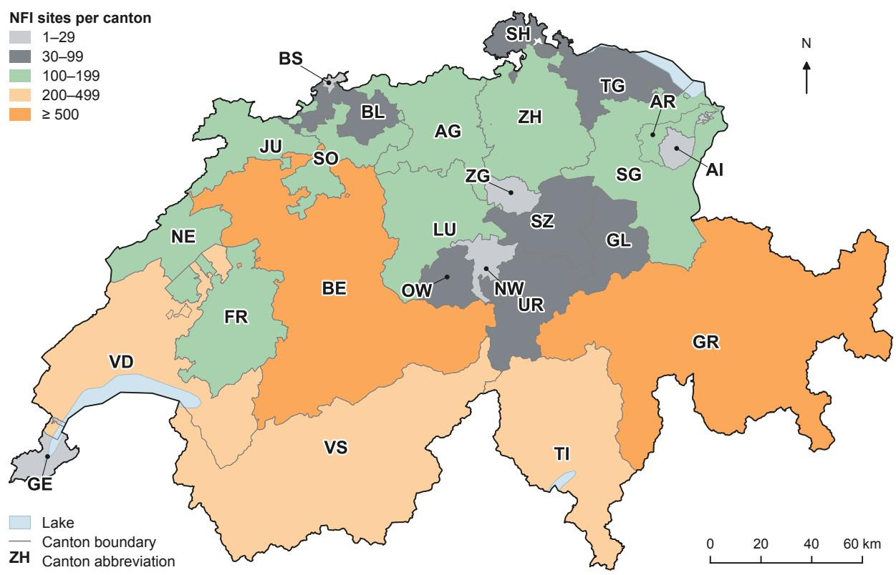

(b)  
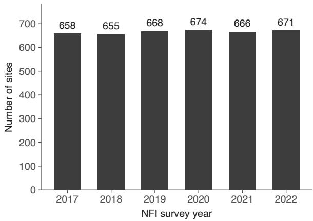

(c)  
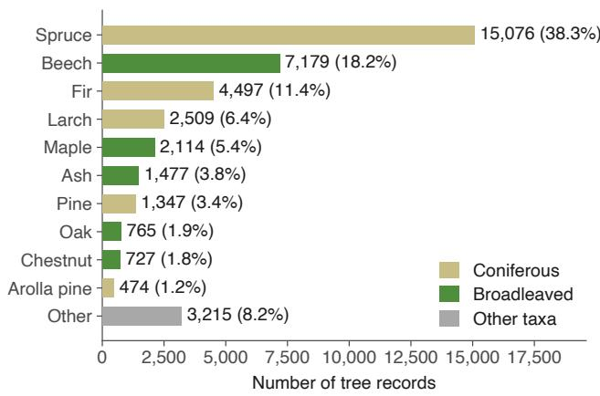  
Figure 1: Overview of the Swiss National Forest Inventory (NFI) sites used in our study. (a) Number of retained NFI sites in each of Switzerland’s 26 cantons, in five classes (3,992 sites in total); cantons are labeled with their oficial two-letter abbreviations. (b) Number of retained sites by NFI survey year (2017–2022). (c) Number of retained tree-level observations assigned to each of the 10 Swiss NFI main tree species and the residual Other class, colored by leaf type. Here and in all other maps of this article and its Supplementary Material, map lines delineate study areas and do not necessarily depict accepted national boundaries.

We express species composition as shares of basal area. Basal area weights each tree by its size and is derived from the DBH recorded for every measured tree. It is also reported in the published NFI statistics (Abegg et al., 2023), against which the map is compared in Section 4.3.2. For tree � at site �, the expanded basal area is $a _ { i j } = w _ { i j } \pi ( \mathrm { D B H } _ { i j } / 2 0 0 ) ^ { 2 }$ in $\mathrm { m } ^ { 2 } \mathrm { h a } ^ { - 1 }$ , where DBH is in centimeters and $w _ { i j }$ is the expansion factor defined in Section 2.1. If $z _ { i j }$ denotes the mapped class of the tree, the class-specific basal area and composition are

$$
A _ { i k } = \sum _ { j : z _ { i j } = k } a _ { i j } , \qquad y _ { i k } = \frac { A _ { i k } } { \sum _ { k ^ { \prime } = 1 } ^ { 1 1 } A _ { i k ^ { \prime } } } , \quad k = 1 , \ldots , 1 1 .\tag{1}
$$

The vector ${ \bf y } _ { i }$ sums to one. It gives the share of each class in the expanded basal area of the upper and middle strata. Two auxiliary targets summarize stand purity and the broadleaved–coniferous composition (Section 3.1.3).

## 2.3. Remote sensing and environmental data

Four inputs were extracted around each NFI site coordinate: aerial RGB imagery, airborne laser scanning (ALS) point clouds, annual satellite embeddings, and climate variables (Table 2). Aerial imagery was obtained from SWISSIMAGE, the 0.1 m RGB orthomosaic of the Swiss Federal Ofice of Topography (swisstopo) (Federal Ofice of Topography swisstopo, 2026b). For each site, we cropped a 28 m × 28 m square (280 × 280 pixels) centered on the site coordinate. This extent slightly exceeds the 25.2 m diameter of the outer NFI sample circle, so that the crop accommodates coordinate uncertainty and crowns extending beyond the plot boundary. SWISSIMAGE is renewed on a roughly three-year cycle, and acquisitions difer in season. Leaf-on acquisitions were selected following Ferrari et al. (2027). Canopy structure was represented by swissSURFACE3D, the nationwide ALS point cloud of swisstopo, with a mean density of about 15–20 points $\mathrm { m } ^ { - 2 }$ (Federal Ofice of Topography swisstopo, 2026c). Point clouds were cropped to a 14 m-radius circle centered on each site and inscribed in the RGB crop. Only the �, �, and $Z$ coordinates and the point classification were retained. Satellite information was represented by annual, 64-dimensional AlphaEarth embeddings at 10 m resolution (Brown et al., 2025), from which a 3 × 3-pixel patch centered on each site was extracted for the NFI survey year. Climate was represented by the 19 CHELSA BIOCLIM+ variables for the 1981–2010 climatology at approximately 1 km resolution (Brun et al., 2022), read at each site’s coordinate.

Input data modalities. ALS = airborne laser scanning.
<table><tr><td>Modality</td><td>Dataset</td><td>Spatial resolution</td><td>Acquisition time</td></tr><tr><td>Aerial RGB</td><td>SWISSIMAGE</td><td>0.1 m</td><td>Leaf-on acquisition nearest the NFI survey year</td></tr><tr><td>ALS</td><td>swissSURFACE3D</td><td>15-20 points  $\mathsf { m } ^ { - 2 }$ </td><td>Single available acquisition</td></tr><tr><td>Satellite embeddings</td><td>AlphaEarth Foundations</td><td>10 m</td><td>NFI survey year</td></tr><tr><td>Climate</td><td>CHELSA BIOCLIM+</td><td>~1 km</td><td>1981-2010 long-term mean</td></tr></table>

## 2.4. Forest reserve data

For independent validation, we used the Swiss Forest Reserves Monitoring network (Hobi et al., 2020), which was established to study the long-term dynamics of unmanaged forests. Each reserve plot is a permanent polygon in which every tree is recorded with its species, DBH, canopy stratum, and position. The plots range from 759 to $3 4 { , } 7 0 4 ~ \mathrm { m } ^ { 2 }$ with a median of about $\phantom { 0 } { 4 , 6 8 9 } \mathrm { m } ^ { \hat { 2 } }$ , so most of them span several 30 m pixels (Fig. 2). For each plot, we used the most recent census and retained living upper- and middle-stratum trees with $\mathrm { D B H } \geq 1 2 \mathrm { c m }$ , matching the label definition of Section 2.2. Species were assigned to the 11 classes with the same crosswalk as the NFI labels, and composition was computed as basal-area shares (Eq. 1). The validation dataset contains 132 plots in 35 reserves.

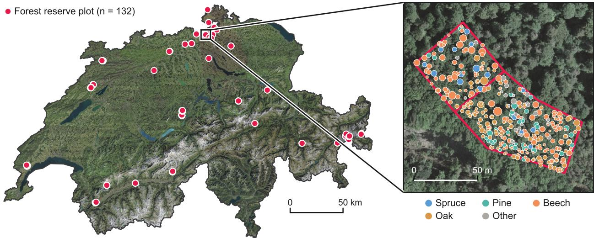  
Figure 2: Forest reserve validation data. Left: locations of the 132 plots of the Swiss Forest Reserves Monitoring network used for independent validation. Right: an example plot polygon (red outline), with circles marking the retained trees colored by mapped class and sized by DBH.

## 3. Methods

Figure 3 summarizes the workflow. (a) NFI tree records were converted into site-level basal-area compositions (Section 2.2). (b) The four input modalities were extracted at each site, and sites with degraded imagery or standreplacing disturbance were removed (Sections 2.2 and 2.3). (c) A multimodal network was trained and evaluated with five-fold spatial block cross-validation (Sections 3.1 and 3.2). (d) The selected model was refitted on all NFI sites and applied across the Swiss forest at 30 m, and the map was evaluated against forest-reserve plots, NFI4 regional statistics, and elevational patterns (Sections 3.3 and 3.4).

## 3.1. Model architecture

Supervision is provided at the site level. Each training sample pairs the 30 m × 30 m footprint with its observed composition, so the model learns to aggregate evidence over the whole footprint. The architecture has three stages (Fig. 4). Modality-specific encoders project each input into a shared �-dimensional embedding space; a gated fusion module combines these embeddings into a single site representation anchored on the aerial imagery; and three heads predict the species composition and two auxiliary targets, stand type and leaf type (Section 3.1.3).

## 3.1.1. Modality encoders

Aerial imagery is encoded by a frozen DINOv3 ViT-H+/16 (Siméoni et al., 2025), pretrained self-supervised on LVD-1689M. To combine local texture with higher-level features, we read out four evenly spaced blocks, {7, 15, 23, 31}, combine them with learned softmax weights, and keep the class token together with the patch tokens pooled to an 8 × 8 grid. The ALS point cloud is encoded with a randomly-initialized sparse 3D U-Net that follows the backbone architecture of ForestFormer3D (Xiang et al., 2025). Sixty-four learned queries then pool the voxel features by attention into a fixed-size token set, independent of the number of occupied voxels at a site. AlphaEarth embeddings (Brown et al., 2025) already summarize a year of multi-sensor satellite observations. A shared two-layer MLP with a positional embedding projects each of the 3 × 3 pixels into the embedding space. The 19 CHELSA variables are encoded by a second two-layer MLP into a single token, as in GlobalGeoTree (Mu et al., 2025b).

## 3.1.2. RGB-anchored gatedfusion

The modalities difer widely in spatial support, from 0.1 m aerial imagery to 1 km climate data, and in how directly they relate to the species within a site (Mu et al., 2025b; Qin and Zhao, 2025). Only the aerial imagery resolves individual crowns within the footprint, so we use it as an anchor and let each other modality contribute a gated

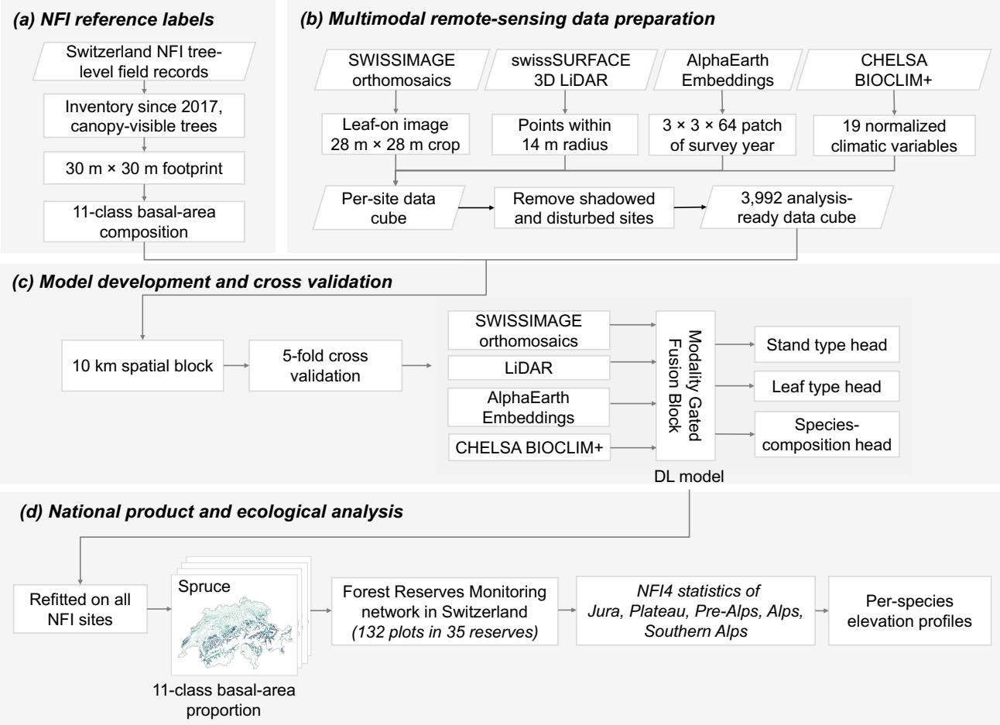  
Figure 3: Workflow of this study. (a) Construction of site-level basal-area compositions from NFI tree records. (b) Extraction and screening of the four input modalities. (c) Model training and five-fold spatial block cross-validation. (d) National mapping with the refitted model and independent evaluation.

correction. Let $\mathbf { T } _ { m }$ denote the token set produced by the encoder of modality �, and $\mathbf { M } _ { m }$ a binary mask that flags tokens derived from missing or quality-masked observations. A learned query � first pools the aerial tokens into the anchor,

$$
\mathbf { h } _ { 0 } = \mathrm { L N } \big ( \mathrm { A t t n } \big ( \mathbf { q } , \mathbf { T } _ { \mathrm { r g b } } , \mathbf { T } _ { \mathrm { r g b } } \big ) \big ) \ \in \ \mathbb { R } ^ { D } .\tag{2}
$$

Each auxiliary modality $m \in \{ { \mathrm { A L S } } $ , embedding, climate} then reads its own token set with $\mathbf { h } _ { 0 }$ as the query,

$$
\begin{array} { r } { \mathbf { c } _ { m } = \mathrm { A t t n } \big ( \mathbf { W } _ { q } \mathbf { h } _ { 0 } , \ \mathbf { T } _ { m } , \ \mathbf { T } _ { m } ; \ \mathbf { M } _ { m } \big ) , \qquad \Delta _ { m } = \mathbf { c } _ { m } + \mathrm { F F N } ( \mathbf { c } _ { m } ) , } \end{array}\tag{3}
$$

where Attn(⋅) is multi-head attention with an optional key mask, LN is layer normalization, FFN is a two-layer feed-forward network, and $\mathbf { W } _ { q }$ is a learned projection. Each auxiliary modality attends only to its own tokens, so the token sets can difer in size across modalities. Each correction is admitted through a gate predicted per site,

$$
g _ { m } = \sigma \big ( \phi _ { m } \big ( \big [ \mathbf { h } _ { 0 } ; \bar { \mathbf { t } } _ { m } \big ] \big ) \big ) \cdot \mathbf { 1 } \Big [ \sum _ { i } \big ( 1 - M _ { m } ^ { ( i ) } \big ) > 0 \Big ] , \qquad \mathbf { h } = \mathrm { L N } \Bigg ( \mathbf { h } _ { 0 } + \sum _ { m } g _ { m } \mathbf { \Delta } _ { m } \Bigg ) ,\tag{4}
$$

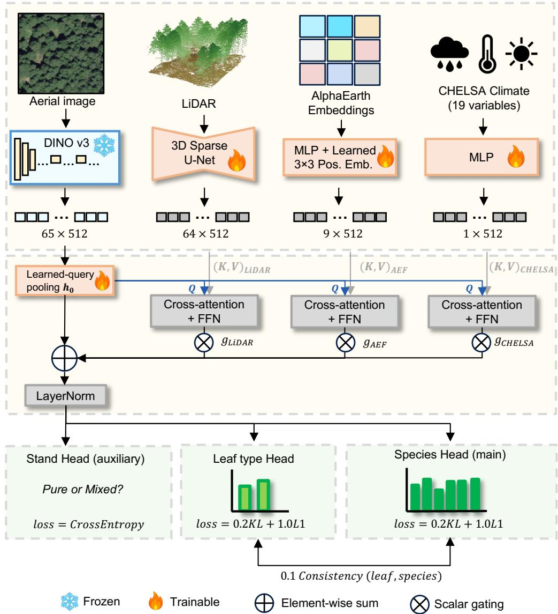  
Figure 4: Overview of the multimodal architecture. Modality-specific encoders project each input into a token set in a shared embedding space: a frozen DINOv3 ViT-H+/16 for the SWISSIMAGE crop, a sparse 3D U-Net with learned queries for the ALS point cloud, and multilayer perceptrons for the AlphaEarth patch and the CHELSA variables (Section 3.1.1). A learned query pools the aerial features into the anchor $\mathbf { h } _ { 0 } ;$ the other modalities enter as residual corrections $\Delta _ { m } ,$ each scaled by a learned gate $g _ { m }$ (Section 3.1.2). Three heads predict stand type, leaf type, and species composition, with the loss terms of Section 3.1.3.

where $\sigma$ is the logistic function, $\phi _ { m }$ a two-layer perceptron, and $\bar { \mathbf { t } } _ { m }$ the masked mean of $\mathbf { T } _ { m } ;$ the indicator closes the gate when a modality is missing. The last layer of each $\phi _ { m }$ is initialized with zero weights and bias −4, so that $g _ { m } \approx 0 . 0 1 8$ at the start and training begins close to an imagery-only model. During training, each auxiliary modality was dropped with probability 0.1 per site by forcing $g _ { m } = 0$ (Neverova et al., 2016), so that the model remains usable when an input is missing.

## 3.1.3. Prediction heads and loss

Besides the 11-part composition, the model predicts two coarser targets derived from the same basal-area observations. Stand type marks a site as pure when its largest class share reaches 0.80 and as mixed otherwise. Leaf type is the pair of broadleaved and coniferous shares of the expanded basal area. It is computed from the original NFI taxa rather than from the 11 mapped classes, so the broadleaved and coniferous taxa within Other are assigned to their own leaf type. Both targets are easier to recognize than individual species and give the shared representation additional supervision. The three targets are predicted in parallel rather than hierarchically, so that an error in a coarse target cannot propagate to the species predictions, as it can in hierarchical classification (Ball et al., 2026; Li et al., 2025; Luo et al., 2026; Turkoglu et al., 2021). Three heads read �: a linear layer for stand type, a linear layer for leaf type, and a two-layer perceptron $( D \to 2 5 6 \to 1 1 )$ for composition, each followed by a softmax.

Stand type is supervised with cross-entropy, $\mathcal { L } _ { \mathrm { s t a n d } }$ . The two compositional targets combine a Kullback–Leibler divergence, which matches the shape of the distribution, with an $L _ { 1 }$ term, which penalizes absolute proportion errors and is less dominated by abundant classes,

$$
\mathcal { L } _ { \mathrm { c o m p } } ( \hat { \mathbf { p } } , \mathbf { y } ) = \lambda _ { \mathrm { K L } } \sum _ { k } y _ { k } \log \frac { y _ { k } } { \hat { p } _ { k } } + \lambda _ { L _ { 1 } } \sum _ { k } \left| \hat { p } _ { k } - y _ { k } \right| ,\tag{5}
$$

with $\lambda _ { \mathrm { K L } } = 0 . 2$ and $\lambda _ { L _ { 1 } } = 1 . 0$ . We denote this loss for the leaf-type and composition targets by ${ \mathcal { L } } _ { \mathrm { l e a f } }$ and $\mathcal { L } _ { \mathrm { s p e c i e s } } . \mathrm { A }$ consistency term $\mathcal { L } _ { \mathrm { c o n s } }$ couples the leaf-type and composition heads. Summing the predicted shares of the broadleaved main classes gives a lower bound $B _ { \mathrm { k n o w n } }$ on the broadleaved share, and Other can add at most $\hat { p } _ { \mathrm { { O t h e r } } }$ to it. $\mathcal { L } _ { \mathrm { c o n s } }$ is a hinge penalty that is zero when the predicted broadleaved share $\hat { p } _ { \mathrm { l e a f } , B }$ lies within $[ B _ { \mathrm { k n o w n } } , B _ { \mathrm { k n o w n } } + \hat { p } _ { \mathrm { O t h e r } } ]$ and grows linearly outside this interval. The total loss is

$$
\mathcal { L } = \mathcal { L } _ { \mathrm { s t a n d } } + \mathcal { L } _ { \mathrm { l e a f } } + \mathcal { L } _ { \mathrm { s p e c i e s } } + \lambda _ { \mathrm { c o n s } } \mathcal { L } _ { \mathrm { c o n s } } , \qquad \lambda _ { \mathrm { c o n s } } = 0 . 1 .\tag{6}
$$

## 3.2. Spatial cross-validation and training

To evaluate prediction at unseen locations while accounting for spatial autocorrelation (Roberts et al., 2017), we grouped the 3,992 sites into 10 km spatial blocks and assigned entire blocks to five folds (Abdi and Wang, 2026). A greedy assignment balanced the fold sizes and the mean basal-area share of each of the 11 classes across folds, a form of spatially stratified block cross-validation (Valavi et al., 2019). The folds were rotated through training and evaluation (Fig. 5a), and each site was predicted by the model for which it was held out, so that all 3,992 sites enter the evaluation. Each model was trained for 80 epochs with AdamW (learning rate $1 \times 1 0 ^ { - 4 }$ , weight decay 0.05, cosine decay to $1 \times 1 0 ^ { - 6 } )$ and a batch size of 4, with an exponential moving average of the weights (decay 0.999). Sites containing rare classes were oversampled; further settings are given in Supplementary Section S11.

We compared the model with three baselines: a random forest, a ResNet-50 image model, and a multilayer perceptron on AlphaEarth features (Tong and Wang, 2025). We also replaced the ViT-H+/16 encoder with ViT-L/16 encoders pretrained on LVD-1689M and SAT-493M. Modality ablations removed one or more inputs and retrained the model under the same protocol. The configuration with the highest cross-validated macro- $R ^ { 2 }$ was selected.

## 3.3. National-scale mapping

After model selection, the selected configuration was refitted on all 3,992 sites to obtain the production model. It was applied on a 30 m grid within the forest mask of Ferrari et al. (2027). The 30 m cell matches the spatial support of the reference labels: at 99.0% of the sites, all retained tree positions fall within a centered 30 m cell, compared with

(a)  
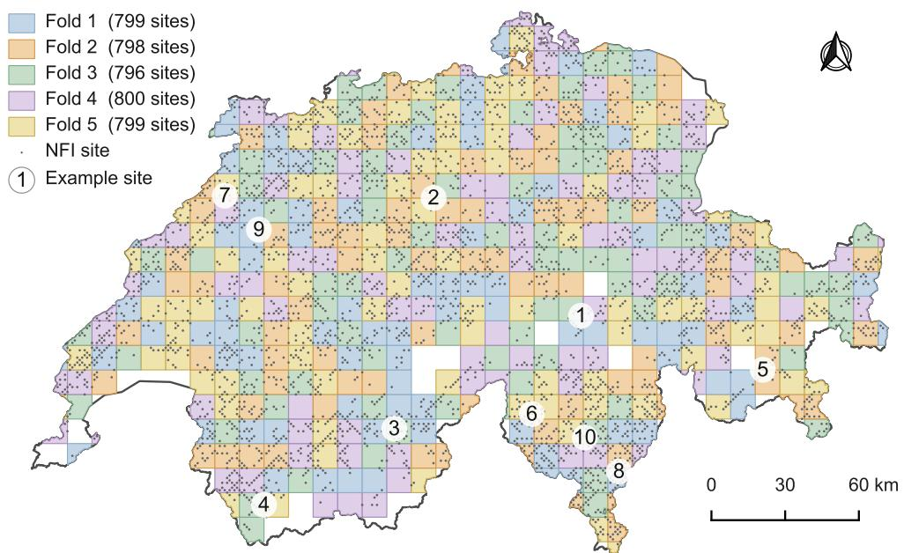

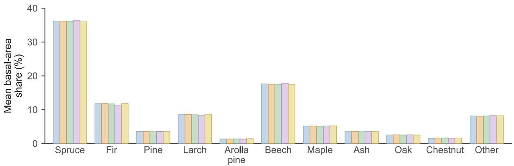

(b) Example NFI sites  
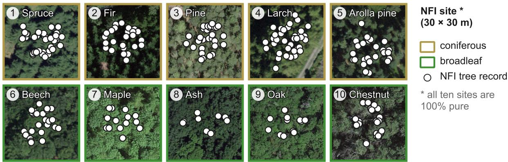  
Figure 5: Spatial cross-validation design and example reference sites. (a) The 3,992 retained NFI sites (gray dots) were grouped into 10 km spatial blocks, and each block was assigned to one of the five cross-validation folds; the bar chart gives the mean site-level basal-area share of each mapped class in the five folds. Numbered markers (1–10) locate the example sites in (b). (b) One pure 30 × 30 m site for each of the ten main tree species, with white circles marking the recorded NFI trees and the frame color indicating leaf type.

65.5% for a 20 m cell. At each grid cell, we used the most recent leaf-on SWISSIMAGE acquisition and the AlphaEarth embedding of the same year, together with swissSURFACE3D and the CHELSA climatology. The reference year of the map therefore varies between regions, from 2018 to 2025 (Fig. S3).

## 3.4. Accuracy assessment

Following Nelson et al. (2021), we assessed the product from three perspectives: site-specific accuracy, non-sitespecific accuracy, and spatial-distribution accuracy. For each class, we computed the mean absolute error (MAE), the root mean squared error (RMSE), and the coeficient of determination $( R ^ { \hat { 2 } } )$ between observed and predicted shares. We averaged them over the classes (macro-average), so that every class contributes equally regardless of its abundance. Each composition vector was also converted to its dominant class, for which we report overall accuracy and macro- $F _ { 1 }$ Cross-validation metrics are reported as the mean ± standard deviation over the five held-out folds.

Site-specific accuracy was assessed with the cross-validated predictions at the 3,992 NFI sites and with the forest reserve data (Section 2.4) at two supports. At plot level, the prediction was the intersection-area-weighted mean of all 30 m pixels overlapping the plot polygon. At pixel level, we retained pixels at least 80% covered by a plot and containing at least 10 trees, and compared each with its own prediction (414 pixels from 111 plots in 34 reserves). Chestnut occurs in only one reserve plot, so its $R ^ { 2 }$ cannot be evaluated, and reserve $R ^ { 2 }$ is averaged over the remaining ten classes. Non site-specific accuracy was assessed against the published NFI4 basal-area shares of the five production regions (Abegg et al., 2023), for which the predicted shares were averaged over the forest pixels of each region. Spatial-distribution accuracy was assessed along the elevation gradient. Terrain elevation from swisstopo swissALTIRegio (Federal Ofice of Topography swisstopo, 2026a), a 10 m model based on swissALTI3D within Switzerland, was area-averaged onto the 30 m product grid. Predicted shares were then averaged within 100 m elevation bands, and only bands containing at least 5,000 forest pixels $( 4 . 5 \mathrm { k m } ^ { 2 } )$ were analyzed.

## 4. Results

We first report cross-validated model performance (Section 4.1) and the national composition map (Section 4.2). We then compare the map with independent forest-reserve data and NFI4 regional statistics (Section 4.3) and describe its composition along the elevation gradient (Section 4.4)

## 4.1. Model evaluation

## 4.1.1. Comparison with baselines and visual backbones

For species-composition prediction, the ViT-H+/16 model performed best on all three metrics (Table 3). Its composition $R ^ { 2 }$ of 0.485 exceeded the strongest baseline, ResNet-50, by 0.105 and the random forest by 0.172, and its MAE was 17% and 42% lower (0.048 against 0.058 and 0.083). The baselines difered more in dominant-class $F _ { 1 }$ than in MAE. The random forest and the AlphaEarth MLP had almost the same MAE (0.083 and 0.084), but their $F _ { 1 }$ was only 0.342 and 0.194, against 0.515 for ResNet-50, so both identified the dominant class far less reliably. Among the DINOv3 backbones, the larger ViT-H+/16 exceeded both ViT-L/16 variants by about 0.04 in $R ^ { 2 }$ and 0.015–0.019 in $F _ { 1 }$ , whereas the two ViT-L/16 variants, pretrained on diferent corpora, difered by only 0.002 in $R ^ { 2 }$ and 0.004 in $F _ { 1 }$ . ViT-H+/16 also showed the smallest fold-to-fold variation in $F _ { 1 } \left( { \mathrm { S D } } = 0 . 0 1 4 \right)$ . Leaf-type performance varied less among models, with every configuration reaching $R ^ { 2 } > 0 . 6 6$

## 4.1.2. Contribution of the input modalities

Among the auxiliary modalities, AlphaEarth embeddings and CHELSA climate variables made the largest contributions to composition $R ^ { 2 }$ , whereas ALS provided little additional improvement (Table 4). Removing AlphaEarth embeddings reduced $R ^ { 2 }$ from 0.485 to 0.464, and removing CHELSA reduced it to 0.465; removing ALS reduced it only to 0.483. RGB imagery alone reached an $R ^ { 2 }$ of 0.452, so the three auxiliary modalities together added 0.033. MAE and $F _ { 1 }$ changed much less than $R ^ { 2 }$ : across all six configurations, species-level MAE stayed between 0.048 and 0.051 and $F _ { 1 }$ between 0.573 and 0.593. The RGB–AlphaEarth–CHELSA configuration reached the highest $F _ { 1 }$ (0.593) and leaf-type $R ^ { 2 }$ (0.814). At leaf level, all configurations without AlphaEarth had an MAE of 0.099, against 0.093–0.094 with it, suggesting that the satellite embeddings mainly sharpen the broadleaved–coniferous distinction. The $R ^ { 2 }$ diferences are smaller than the fold-to-fold standard deviation (0.04–0.07) and should be read as tendencies.

Table 3  
Comparison with reference baselines and across frozen DINOv3 backbones. Best value in bold, second best underlined.
<table><tr><td rowspan="2">Model</td><td rowspan="2">Backbone</td><td colspan="2">Leaf level</td><td colspan="3">Species level</td></tr><tr><td>MAE</td><td> $R ^ { 2 }$ </td><td>MAE</td><td> $R ^ { 2 }$ </td><td> $F _ { 1 }$ </td></tr><tr><td>ResNet-50</td><td>ResNet-50, ImageNet</td><td> $0 . 1 0 9 { \scriptstyle \pm 0 . 0 0 4 }$ </td><td> $0 . 7 5 7 { \scriptstyle \pm 0 . 0 2 0 }$ </td><td> $0 . 0 5 8 { \scriptstyle \pm 0 . 0 0 2 }$ </td><td> $0 . 3 8 0 { \scriptstyle \pm 0 . 0 4 3 }$ </td><td> $0 . 5 1 5 { \scriptstyle \pm 0 . 0 2 7 }$ </td></tr><tr><td>Random Forest</td><td>一</td><td> $0 . 1 6 7 { \scriptstyle \pm 0 . 0 0 4 }$ </td><td> $0 . 6 6 9 { \scriptstyle \pm 0 . 0 1 7 }$ </td><td> $0 . 0 8 3 { \scriptstyle \pm 0 . 0 0 1 }$ </td><td> $0 . 3 1 3 { \scriptstyle \pm 0 . 0 1 2 }$ </td><td> $0 . 3 4 2 { \scriptstyle \pm 0 . 0 3 1 }$ </td></tr><tr><td>AlphaEarth MLP</td><td>一</td><td> $0 . 1 4 9 { \scriptstyle \pm 0 . 0 0 8 }$ </td><td> $0 . 6 6 7 { \scriptstyle \pm 0 . 0 2 7 }$ </td><td> $0 . 0 8 4 { \scriptstyle \pm 0 . 0 0 2 }$ </td><td> $0 . 1 5 7 { \scriptstyle \pm 0 . 0 1 4 }$ </td><td> $0 . 1 9 4 { \scriptstyle \pm 0 . 0 1 2 }$ </td></tr><tr><td>Ours</td><td> $\mathsf { V i T - L } / 1 6 , \mathsf { S A T - } 4 9 3 \mathsf { M }$ </td><td> $0 . 1 0 3 { \scriptstyle \pm 0 . 0 0 6 }$ </td><td> $0 . 7 8 1 { \scriptstyle \pm 0 . 0 2 0 }$ </td><td> $0 . 0 5 2 { \scriptstyle \pm 0 . 0 0 2 }$ </td><td> $\underline { { 0 . 4 4 6 { \pm } 0 . 0 6 2 } }$ </td><td> $\underline { { 0 . 5 7 0 { \pm } 0 . 0 4 3 } }$ </td></tr><tr><td></td><td> $\mathsf { V i T - L } / 1 6 , \mathsf { L V D - 1 6 8 9 M }$ </td><td> $\underline { { 0 . 0 9 7 { \pm } 0 . 0 0 4 } }$ </td><td> $\underline { { 0 . 7 9 4 } } \pm 0 . 0 1 3$ </td><td> $\underline { { 0 . 0 5 1 { \pm } 0 . 0 0 2 } }$ </td><td> $0 . 4 4 4 { \scriptstyle \pm 0 . 0 6 3 }$ </td><td> $0 . 5 6 6 { \scriptstyle \pm 0 . 0 5 1 }$ </td></tr><tr><td></td><td> $\mathsf { V i T \mathrm { - } H \mathrm { + } / 1 6 , \mathsf { L V D \mathrm { - } 1 6 8 9 M } }$ </td><td> $\mathbf { 0 . 0 9 3 { \scriptstyle \pm 0 . 0 0 3 } }$ </td><td> $\mathbf { 0 . 8 0 3 { \scriptstyle \pm 0 . 0 1 7 } }$ </td><td> $\mathbf { 0 . 0 4 8 { \scriptstyle \pm 0 . 0 0 1 } }$ </td><td> $\pm \mathbf { 0 . 4 8 5 { \pm 0 . 0 3 8 } }$ </td><td> $\pm { \bf 0 . 5 8 5 } { \pm \bf 0 . 0 1 4 }$ </td></tr></table>

Table 4

Leave-one-modality-out and reduced-modality ablations. AEF = AlphaEarth annual embeddings. Best value in bold, second best underlined.
<table><tr><td colspan="4">Modality</td><td colspan="2">Leaf level</td><td colspan="3">Species level</td></tr><tr><td>RGB</td><td>ALS</td><td>AEF</td><td>CHELSA</td><td>MAE</td><td> $\overline { { R ^ { 2 } } }$ </td><td>MAE</td><td> $\overline { { R ^ { 2 } } }$ </td><td> $F _ { 1 }$ </td></tr><tr><td>√</td><td>√</td><td>√</td><td>√</td><td> $\underline { { 0 . 0 9 3 { \pm } 0 . 0 0 3 } }$ </td><td> $0 . 8 0 3 { \scriptstyle \pm 0 . 0 1 7 }$ </td><td> $\pm 0 . 0 4 8 { \scriptstyle \pm 0 . 0 0 1 }$ </td><td> $\pm \mathbf { 0 . 4 8 5 { \pm 0 . 0 3 8 } }$ </td><td> $\underline { { 0 . 5 8 5 { \pm } 0 . 0 1 4 } }$ </td></tr><tr><td>√</td><td>√</td><td>√</td><td></td><td> $0 . 0 9 4 { \scriptstyle \pm 0 . 0 0 2 }$ </td><td> $\underline { { 0 . 8 0 8 { \pm } 0 . 0 1 3 } }$ </td><td> $0 . 0 4 9 { \scriptstyle \pm 0 . 0 0 2 }$ </td><td> $0 . 4 6 5 { \scriptstyle \pm 0 . 0 5 6 }$ </td><td> $0 . 5 8 1 { \scriptstyle \pm 0 . 0 3 1 }$ </td></tr><tr><td>√</td><td></td><td>√</td><td>√</td><td> $\mathbf { 0 . 0 9 3 { \scriptstyle \pm 0 . 0 0 2 } }$ </td><td> $\mathbf { 0 . 8 1 4 { \scriptstyle \pm 0 . 0 1 3 } }$ </td><td> $\underline { { 0 . 0 4 8 { \pm } 0 . 0 0 1 } }$ </td><td> $0 . 4 8 3 { \scriptstyle \pm 0 . 0 5 2 }$ </td><td> $\pm 0 . 5 9 3 { \scriptstyle \pm 0 . 0 2 6 }$ </td></tr><tr><td>√</td><td>√</td><td></td><td>√</td><td> $0 . 0 9 9 { \scriptstyle \pm 0 . 0 0 4 }$ </td><td> $0 . 7 9 1 { \scriptstyle \pm 0 . 0 1 7 }$ </td><td> $0 . 0 5 0 { \scriptstyle \pm 0 . 0 0 2 }$ </td><td> $0 . 4 6 4 { \scriptstyle \pm 0 . 0 7 0 }$ </td><td> $0 . 5 8 0 { \scriptstyle \pm 0 . 0 2 9 }$ </td></tr><tr><td>√</td><td>√</td><td></td><td></td><td> $0 . 0 9 9 { \scriptstyle \pm 0 . 0 0 3 }$ </td><td> $0 . 7 9 3 { \scriptstyle \pm 0 . 0 1 8 }$ </td><td> $0 . 0 5 1 { \scriptstyle \pm 0 . 0 0 1 }$ </td><td> $0 . 4 6 1 { \scriptstyle \pm 0 . 0 4 4 }$ </td><td> $0 . 5 8 1 { \scriptstyle \pm 0 . 0 2 7 }$ </td></tr><tr><td>√</td><td></td><td></td><td></td><td> $0 . 0 9 9 { \scriptstyle \pm 0 . 0 0 2 }$ </td><td> $0 . 7 9 7 { \scriptstyle \pm 0 . 0 1 4 }$ </td><td> $0 . 0 5 1 { \scriptstyle \pm 0 . 0 0 1 }$ </td><td> $0 . 4 5 2 { \scriptstyle \pm 0 . 0 5 5 }$ </td><td> $0 . 5 7 3 { \scriptstyle \pm 0 . 0 3 2 }$ </td></tr></table>

## 4.2. National composition map

Continuous basal-area shares revealed widespread secondary species that were largely absent from the dominantclass map (Figs. 6 and 7). Maple and ash, for example, rarely formed the dominant class but occurred as minor components across extensive parts of the Swiss Plateau and Jura. By contrast, larch, Arolla pine, and chestnut showed more spatially concentrated distributions and reached high basal-area shares primarily where they also formed the dominant class. The 30 m product covered about $1 3 . 5 1 6 \mathrm { k m } ^ { 2 }$ of Swiss forest. At reserve scale, the product distinguished the fine-grained beech–spruce mosaic at Combe Biosse, the fir–spruce mixture at Leihubelwald, and the nearly monospecific pine stand at Pfynwald (Fig. 6).

## 4.3. Map evaluation

## 4.3.1. Validation against forest reserve plots

Macro- $R ^ { 2 }$ increased from 0.552 at pixel support to 0.733 at plot support. The pixel-level value was consistent with the spatial cross-validation result of 0.483 computed over the same ten classes. Dominant-class accuracy likewise increased from 0.732 at pixel support to 0.811 at plot support and was 0.734 in the spatial cross-validation (Table 5).

## Table 5

Accuracy across evaluation supports. $R ^ { 2 }$ is averaged over the ten classes other than chestnut, and MAE and RMSE over all 11 classes.
<table><tr><td>Metric</td><td>Spatial 5-fold CV NFI (n = 3,992)</td><td>Independent, plot-level Forest reserve (n = 132)</td><td>Independent, pixel-level Forest reserve  $\left( n = 4 1 4 \right)$ </td></tr><tr><td> $R ^ { 2 }$ </td><td>0.483</td><td>0.733</td><td>0.552</td></tr><tr><td>MAE</td><td>0.048</td><td>0.038</td><td>0.042</td></tr><tr><td>RMSE</td><td>0.125</td><td>0.088</td><td>0.109</td></tr><tr><td>Dominant-class accuracy</td><td>0.734</td><td>0.811</td><td>0.732</td></tr><tr><td>Dominant-class  $F _ { 1 }$ </td><td>0.585</td><td>0.704</td><td>0.596</td></tr></table>

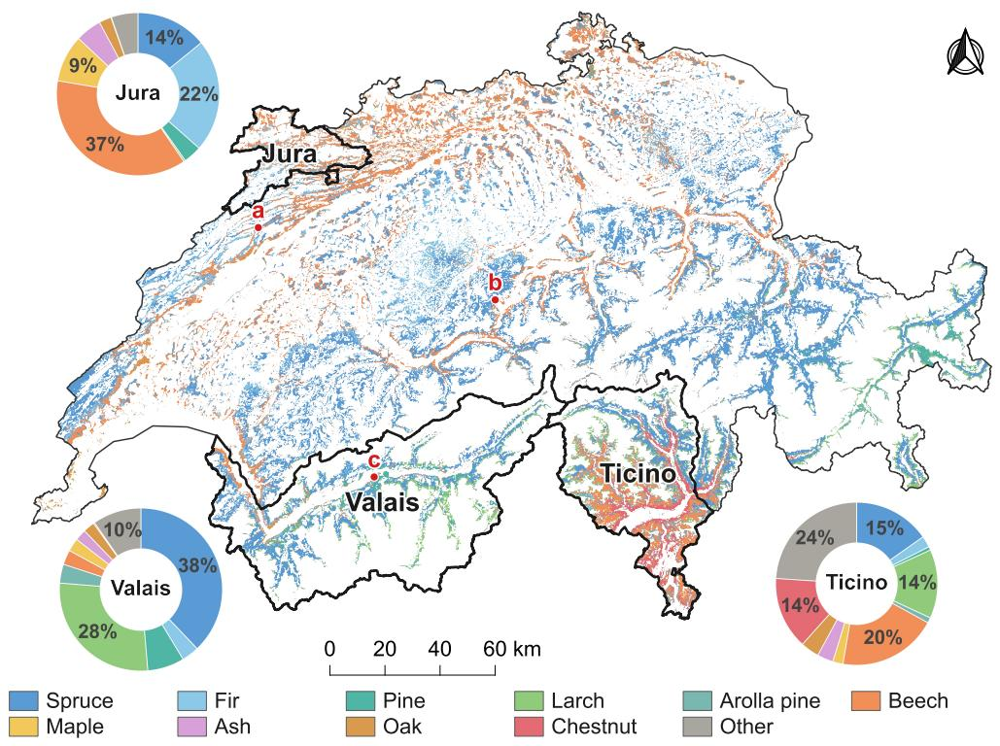

Case-study detail for sites a-c marked above  
Proportion of the dominant class  
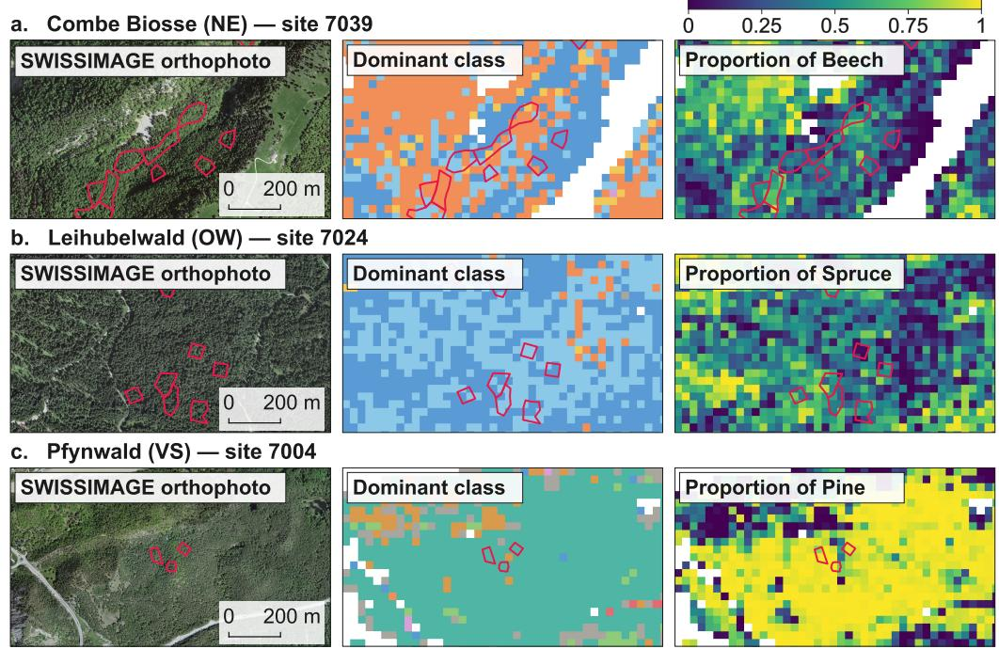  
Figure 6: Dominant mapped class of the national product. Top: the class with the largest predicted basal-area share. For display, the 30 m map was aggregated to 210 m by majority class, and cells with less than 50% forest cover are left blank; rings give the composition of three cantons. Minor classes are shown in Fig. 7. Bottom: three forest reserves of Section 4.3.1, marked a–c above, at the native 30 m resolution. Red outlines are the reserve plot polygons.

a. Spruce  
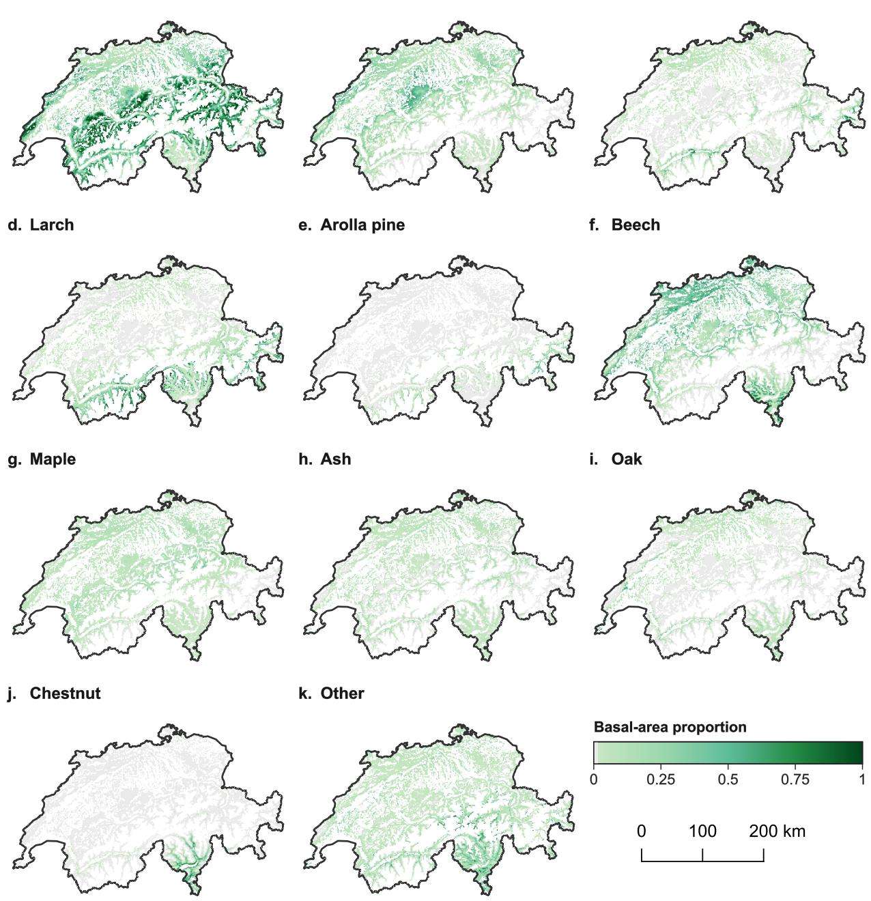

Figure 7: Predicted basal-area composition of each mapped class across Switzerland. Every panel gives the predicted basal-area proportion of one class on a common linear 0–1 scale: a–e the five coniferous groups, f–j the five broadleaved groups, and k the residual Other class. For display, the 30 m predictions were averaged over the forest pixels of 990 m cells, and only cells with at least 25% forest cover are shown. Gray marks forest in which the proportion of the class is below 0.005; areas without forest are white.

Composition performance varied across classes and spatial supports (Fig. 8). Beech and larch maintained high $R ^ { 2 }$ at both plot and pixel support, reaching 0.880 and 0.811 for beech and 0.869 and 0.728 for larch, respectively. Spruce had the largest absolute errors at both supports (MAE = 0.085 and 0.115). Other had the lowest plot-level $R ^ { 2 }$ (0.439), whereas maple had the lowest pixel-level $R ^ { 2 } \left( 0 . 0 2 1 \right)$ , despite its low pixel-level MAE of 0.025. Maple and pine showed the largest drops from plot to pixel support, from 0.633 to 0.021 and from 0.718 to 0.421 in $R ^ { 2 }$

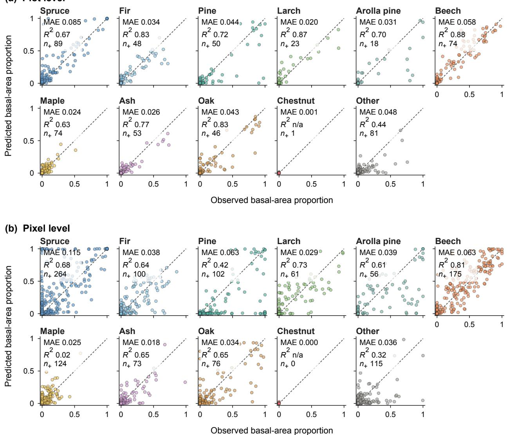  
Figure 8: Observed and predicted basal-area proportion of each mapped class. (a) At the 132 forest reserve plots (plot-level support). (b) At 414 forest-reserve pixels, reconstructed on the product’s native 30 m grid (pixel-level support). The dashed line is the 1:1 relationship. Panel annotations give the per-class MAE, $R ^ { 2 } { \mathrm { , } }$ , and the number of plots or pixels in which the class was observed $( n _ { + } ) _ { \cdot } \mathsf { n } / \mathsf { a } \colon R ^ { 2 }$ not evaluable.

The producer’s accuracy of the dominant class also depended on spatial support (Fig. 9). At plot support, it was highest for larch and ash (100% each) and beech (95%), whereas spruce ranked highest at pixel support (92%). It declined from plot to pixel support for several classes, including pine (79% to 54%) and fir (56% to 38%).

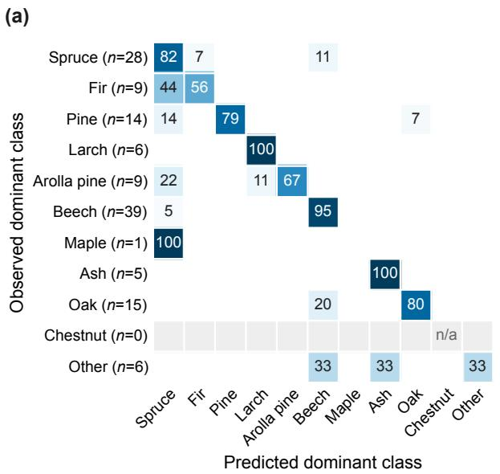

(b)  
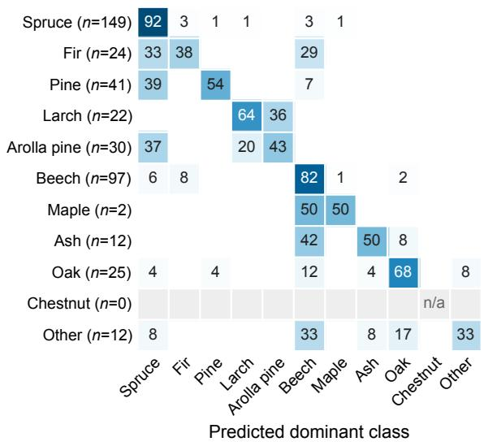  
Figure 9: Row-normalized confusion matrix of the dominant class at (a) the 132 forest reserve plots (plot-level support) and (b) the same 414 forest-reserve pixels (pixel-level support). Cell labels give the percentage of the observed row total; � in the row labels is the number of plots or pixels in which each class was the observed dominant one. Chestnut never dominated a plot or pixel and is therefore not evaluable as an observed class.

## 4.3.2. Consistency with NFI4 regional statistics

Regional species shares closely matched the NFI4 statistics $( R ^ { 2 } ~ = ~ 0 . 9 5 3 ;$ mean absolute diference = 1.71 percentage points; Fig. 10). Agreement was highest in the Pre-Alps and lowest in the Southern Alps, with regional mean absolute diferences ranging from 1.27 to 2.18 percentage points. Across the 55 region-by-class combinations, 70.9% agreed within 2 percentage points and 87.3% within 5, and the dominant class agreed in three of the five production regions.

Spruce showed the largest consistent negative bias across the production regions (−3.6 to −7.5 percentage points), whereas Other showed the largest positive bias (+0.9 to +8.7 percentage points); maple was also overestimated by 2.7 percentage points on average. Pine, larch, Arolla pine, and ash difered least, with mean absolute diferences below 0.4 percentage points. The regression slope of 0.885 indicated a moderate compression of the predicted composition range: shares below 5% were overestimated by 0.70 percentage points on average, whereas shares above 15% were underestimated by 2.52 points.

## 4.4. Composition along the elevation gradient

Dominance shifted from broadleaved species at low elevations to spruce at middle and high elevations and finally to larch and Arolla pine near the upper forest limit (Fig. 11). Beech peaked at 32% around 650 m, while oak, chestnut, ash, and maple were concentrated in the lowest bands. Spruce became the largest single component above about 950 m and reached 70% around 1,550 m, with fir forming a narrower montane band beneath it. Larch and Arolla pine together reached about 66% around 2,150 m. Pine remained a minor component but increased gradually toward higher elevations, whereas Other was prominent at both ends of the gradient.

## 5. Discussion

## 5.1. Value of continuous composition maps

Existing national products for Switzerland describe either the dominant tree species (Koch et al., 2024) or the leaf type (Waser et al., 2025, 2017). Our product adds the basal-area share of each mapped class, from which a dominantclass map can still be derived (Fig. 6). This diference matters most for species that are common but rarely dominant.

(a)  
(b)  
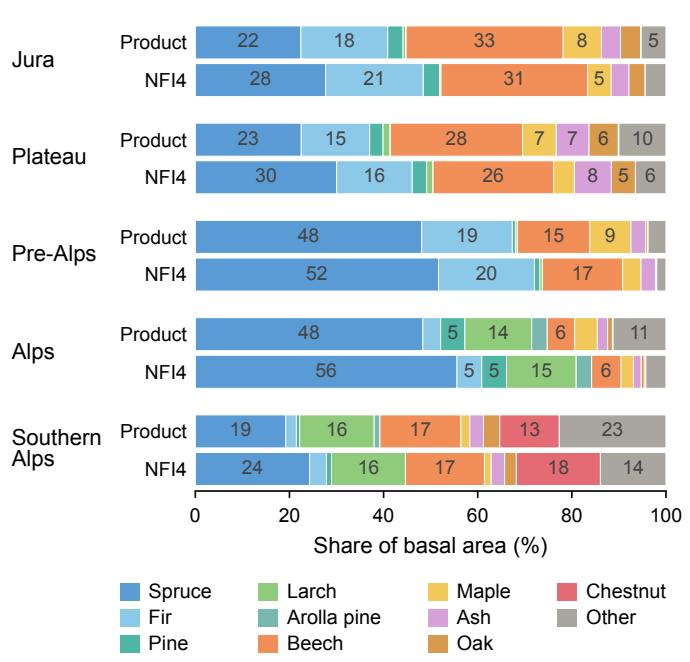

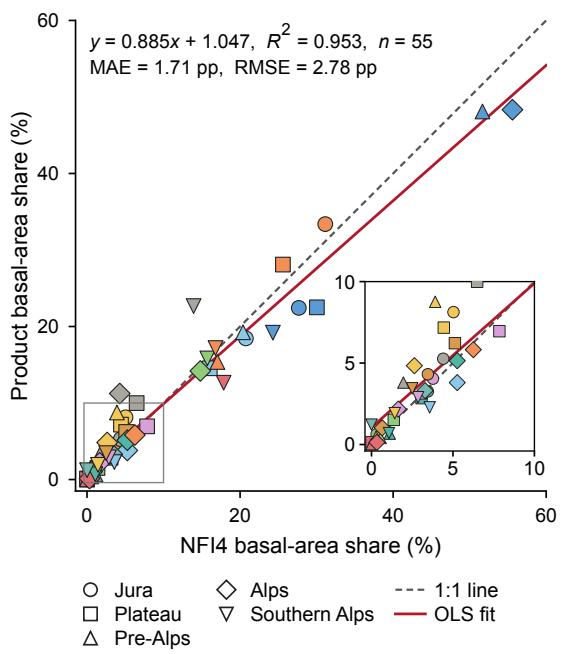  
Figure 10: Agreement between the national product and NFI4 (Abegg et al., 2023) across the five Swiss production regions (Fig. S5). (a) Basal-area composition of each region in the product and in NFI4; segments below 5% are left unlabeled. (b) The same 55 region-by-class pairs, with color denoting the mapped class and marker shape the production region. The inset enlarges the range below 10%, in which most pairs lie; the dashed line is the 1:1 relationship and the solid line the ordinary least-squares fit, and MAE and RMSE are taken about the 1:1 line in percentage points (pp).

Maple and ash, for example, occurred as minor components across much of the Plateau and Jura but seldom formed the dominant class, so they are largely invisible in a dominant-class map. These species contribute to the structural and functional diversity of mixed stands, and their presence can influence how a stand responds when its dominant species declines.

The product also complements the NFI. The inventory provides design-based statistics for regions from a sample of plots, whereas the map provides spatially continuous estimates for every 30 m forest cell. The close agreement with NFI4 regional shares indicates that the map preserves aggregate abundance. It can therefore be used where the NFI sample is too sparse, for example to describe composition within individual forest districts or along environmental gradients, and as auxiliary information for model-assisted estimation.

For management, continuous shares allow mixed stands to be characterized by their actual mixture rather than by a single label. In the montane belt, spruce, beech, and fir co-occurred in comparable proportions (Fig. 11), a situation that a dominant-class map reduces to whichever species is marginally largest. Such information can help to identify stands in which a vulnerable species dominates, or in which admixed species already provide options for climate-adaptive silviculture.

## 5.2. Independent generalization and scale-dependent accuracy

The map generalized to the independent forest-reserve inventory, which entered no stage of model development. At the native 30 m support, its accuracy was comparable to, and in $R ^ { 2 }$ slightly higher than, that of the spatial crossvalidation. Two diferences between the reference datasets may explain why the independent evaluation was not worse. The reserve inventories record every tree within a plot polygon, whereas NFI labels are derived from concentric sample circles in which trees below 36 cm DBH are recorded on only $2 0 0 \mathrm { m } ^ { 2 }$ and weighted by expansion factors, so the NFI labels carry more sampling noise. The reserve pixels also had to contain at least 10 trees, which excludes the sparsest cells. Accuracy increased further at plot support, consistent with the smoothing efect of averaging predictions over several pixels. Validation results should therefore be interpreted at the spatial support at which the product is used (Koma and Breidenbach, 2025; Ohmann et al., 2014): plot-level evidence for aggregated applications, and the pixel level or cross-validation estimates for individual pixels.

(a)  
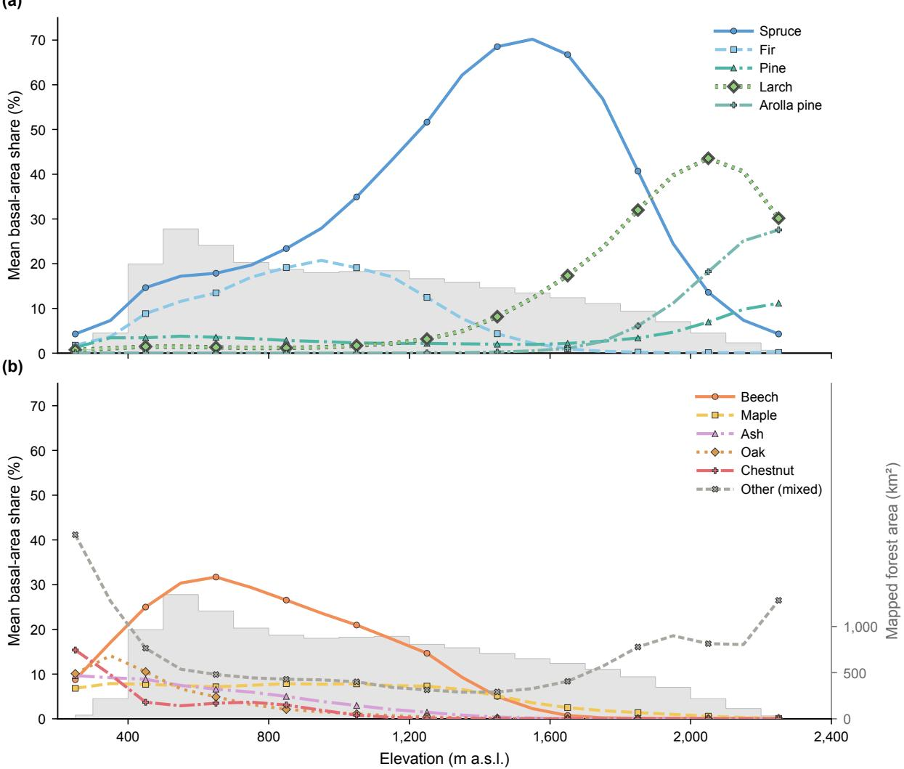  
Figure 11: Predicted tree-species composition along the Swiss elevation gradient. (a) The five coniferous groups. (b) The five broadleaved groups and the residual Other class, sharing the elevation axis with (a). Curves give the mean predicted basal-area share of each class in each elevation band, with elevation from swissALTIRegio. The gray backdrop, read against the right-hand axis in (b), gives the mapped forest area of each band. Only bands containing at least 5,000 forest pixels (4.5 km2) are shown.

The comparison with NFI4 complements this site-specific evidence by showing that the map also preserves regional species abundance. Similar agreement between remotely sensed species maps and NFI-based regional proportions has been reported elsewhere, with diferences depending on inventory sample size and the estimator (Francini et al., 2024). The remaining disagreement was systematic: spruce was underestimated, Other was overestimated, and the regression slope of 0.885 indicated moderate compression toward intermediate shares. Part of this pattern may arise from the estimands. NFI4 shares are ratios of regional mean basal-area densities and are therefore weighted toward stands with a high basal area, whereas map shares are unweighted means of pixel-level proportions. Spruce-dominated stands often carry a high basal area, so this weighting would raise the NFI4 share of spruce relative to the map. Heterogeneity within Other and regression toward the mean may also contribute.

## 5.3. Ecologically consistent elevational zonation

The mapped forest area is unevenly distributed across the compositional zones (Fig. 11): it peaks between 500 and 700 m, where the product places beech-dominated stands, and declines steadily above 1,200 m. The elevational sequence the product recovers matches the classical zonation of Central European mountain forests (Ellenberg and Leuschner, 2010), from oak-, chestnut-, and ash-rich lowland stands through beech and fir to spruce, and finally to larch and Arolla pine at the treeline. Between about 800 and 1,200 m, spruce, beech, and fir each held 17–43% of the basal area, so this montane belt is where the mixture information of a continuous product is most informative. The conifer-dominated belt above roughly 1,200 m coincides with the elevations at which nationwide standing deadwood peaks (Ferrari et al., 2027), so a map of where those conifers stand is directly relevant to locating forests exposed to drought-driven mortality. This agreement should be read as a check on ecological plausibility rather than as independent evidence of accuracy: the climate branch of the model carries information that is itself strongly correlated with elevation.

## 5.4. Contributions of the input modalities

The RGB-only model reached $R ^ { 2 } = 0 . 4 5 2$ , and the three auxiliary modalities together added 0.033. At 0.1 m, the imagery resolves crown shape, texture, and local stand arrangement, consistent with Beloiu et al. (2023), who distinguished major tree species in Swiss forests from aerial RGB imagery. A larger image encoder improved accuracy more than a diferent pretraining corpus, which suggests that encoder capacity limits how much of this information is extracted.

Among the auxiliary inputs, AlphaEarth embeddings and climate variables contributed most. The embeddings summarize a year of satellite observations and mainly improved the broadleaved–coniferous distinction (Section 4.1.2), in line with Ball et al. (2026), who found that foundation-model embeddings improved tree-species discrimination in temperate mountain forests. Climate likely adds information by constraining which species can occur at a site, given the strong climatic gradients across Switzerland. ALS added little in the present configuration. Murray et al. (2024) predicted composition from ALS alone, and Cao et al. (2026) improved composition estimates by fusing lidar with satellite imagery. Here, the ALS encoder was trained from random initialization on 3,992 sites, and the national point density is moderate (Section 5.5), so this result does not show that ALS lacks value for composition mapping.

## 5.5. Limitations and future research

The main limitation is that the structural information carried by ALS was not fully exploited. The ALS encoder was trained from random initialization on only 3,992 sites, and the swissSURFACE3D point clouds, with a mean density of about 15–20 points m−2, resolve fine vertical canopy structure only coarsely (Michałowska and Rapiński, 2021). The first nationwide campaign was also flown between 2017 and 2024, so the point cloud and the aerial image of a site can be several years apart. These factors may partly explain the confusion among spruce, fir, and Arolla pine (Fig. 9), three dark-foliage conifers that are dificult to separate by tone and texture in RGB imagery. Pretraining the ALS encoder on unlabeled point clouds, or retraining it on the second nationwide survey that swisstopo plans to complete by 2030 (Federal Ofice of Topography swisstopo, 2025), may recover more of this information.

The reference labels also limit the spatial detail of the product. NFI labels come from concentric sample circles of 200 and 500 $\mathrm { m } ^ { 2 }$ that cover only part of each 30 m cell, and plot size and positioning errors afect the agreement between field plots and remotely sensed data (Gobakken and Næsset, 2009). Several national products are delivered at 10 m (Blickensdörfer et al., 2024; Koch et al., 2024; Rüetschi et al., 2021; Waser et al., 2025), but a 10 m composition map would require reference labels that support this finer scale.

## 6. Conclusions

We mapped the basal-area shares of ten main tree species and a residual Other class across Switzerland at 30 m resolution by combining national forest-inventory observations with multimodal remote sensing and climate data. Aerial RGB imagery provided most of the predictive information, with satellite embeddings and climate data providing additional gains. Independent forest-reserve inventories and regional NFI4 statistics supported the map’s ability to represent composition across spatial scales, with higher accuracy when predictions were aggregated over plots. The continuous shares captured both the broad elevational zonation of Swiss forests and mixtures obscured by dominantclass maps, including widespread accompanying species and the co-occurrence of spruce, beech, and fir in the montane belt.

The map shows that much of the compositional variation in Swiss forests lies below the level of the dominant species. Maple and ash, for example, rarely dominate a pixel. Yet they occur as minor components across large parts of the Plateau and Jura. Such admixtures determine which species a stand can fall back on if its dominant species declines under drought or other disturbances. The map resolves the share of each main species at 30 m, making these admixtures visible at the national scale. Composition can thus be located and compared across the country, extending beyond regional inventory summaries. Repeated acquisitions could also allow changes in composition to be followed through time.

## CRediT authorship contribution statement

Yixin Zhou: Conceptualization, Methodology, Software, Validation, Formal analysis, Investigation, Data curation, Writing – original draft, Visualization. Luca Ferrari: Data curation, Writing – review & editing. Verena C. Griess: Writing – review & editing, Supervision, Funding acquisition. Nataliia Rehush: Resources, Writing – review & editing. Konrad Schindler: Conceptualization, Methodology, Writing – review & editing, Supervision. Mirela Beloiu: Conceptualization, Methodology, Writing – review & editing, Supervision, Project administration, Funding acquisition.

## Declaration of competing interest

The authors declare that they have no known competing financial interests or personal relationships that could have appeared to influence the work reported in this paper.

## Declaration of generative AI and AI-assisted technologies in the manuscript preparation process

During the preparation of this work, the authors used Claude (Anthropic), an AI-assisted tool, to correct and improve the clarity of sentences, as well as ChatGPT and Claude Code for programming assistance. After using these tools, the authors reviewed and edited the content as needed and take full responsibility for the content of the publication.

## Funding information

This research was supported by the UPSCALE project, funded by the Swiss National Science Foundation (SNSF; Sinergia grant CRSII5\_216562).

## Code and data availability

The national-scale tree species composition maps produced in this study can be explored interactively through the TreeAI web platform at https://www.treeai.earth/swiss-species-composition. The maps data are openly available on Zenodo at https://doi.org/10.5281/zenodo.23263490. The Swiss National Forest Inventory data used for model training are not publicly available; they were provided by the Swiss Federal Institute for Forest, Snow and Landscape Research WSL (WSL, 2023) and can be requested from WSL. SWISSIMAGE aerial orthophotos, swissSURFACE3D point clouds, and the swissALTIRegio elevation model are freely available from the Federal Ofice of Topography swisstopo (https://www.swisstopo.admin.ch). The code used for model training and evaluation is openly available on GitHub at https://github.com/yixin-zhou/swiss-tree-species-mapping.

## Acknowledgements

Yixin Zhou and Mirela Beloiu warmly thank the Forest Resources Management group at ETH Zurich for the insightful discussions, as well as Normand Overney for the support in developing the code to download and process the data. We also thank Ruoyi Chen for developing the interactive web platform for visualizing the tree species composition maps. The long-term forest reserve data of Switzerland were collected in a joint project of the Swiss Federal Institute for Forest, Snow and Landscape Research WSL and the Professorship of Forest Ecology of ETH Zurich, with financial support from the Swiss Federal Ofice for the Environment. We thank Martina Hobi for providing access to these data.

## References

Abdi, A.M., Wang, F., 2026. Mapping forest tree species and their uncertainty using Earth observation and National Forest Inventory data: towards operational monitoring in Sweden. International Journal of Remote Sensing doi:10.1080/01431161.2026.2625513.

Abegg, M., Ahles, P., Allgaier Leuch, B., Cioldi, F., Didion, M., Düggelin, C., Fischer, C., Herold, A., Meile, R., Rohner, B., Rösler, E., Speich, S., Temperli, C., Traub, B., 2023. Swiss national forest inventory NFI. Result tables and maps of the NFI surveys 1983–2022 (NFI1, NFI2, NFI3, NFI4, NFI5.1–5). https://www.lfi.ch/en/results. doi:10.21258/1769925. Swiss Federal Institute for Forest, Snow and Landscape Research WSL, Birmensdorf. Published online 30 May 2023.

Anderegg, W.R.L., Trugman, A.T., Badgley, G., Anderson, C.M., Bartuska, A., Ciais, P., Cullenward, D., Field, C.B., Freeman, J., Goetz, S.J., Hicke, J.A., Huntzinger, D., Jackson, R.B., Nickerson, J., Pacala, S., Randerson, J.T., 2020. Climate-driven risks to the climate mitigation potential of forests. Science 368, eaaz7005. doi:10.1126/science.aaz7005.

Ball, J.G.C., Wicklein, J.A., Feng, Z., Knezevic, J., Jafer, S., Madhavapeddy, A., Atzberger, C., Dalponte, M., Coomes, D.A., 2026. Geospatial foundation models enable data-eficient tree species mapping in temperate mountain forests. Science of Remote Sensing 14, 100466. doi:10.1016/j.srs.2026.100466.

Beloiu, M., Heinzmann, L., Rehush, N., Gessler, A., Griess, V.C., 2023. Individual tree-crown detection and species identification in heterogeneous forests using aerial RGB imagery and deep learning. Remote Sensing 15, 1463. doi:10.3390/rs15051463.

Blickensdörfer, L., Oehmichen, K., Pflugmacher, D., Kleinschmit, B., Hostert, P., 2024. National tree species mapping using Sentinel-1/2 time series and German National Forest Inventory data. Remote Sensing of Environment 304, 114069. doi:10.1016/j.rse.2024.114069.

Bolyn, C., Lejeune, P., Michez, A., Latte, N., 2022. Mapping tree species proportions from satellite imagery using spectral–spatial deep learning. Remote Sensing of Environment 280, 113205. doi:10.1016/j.rse.2022.113205.

Brandt, J., Yi, S., Tolan, J., Li, X., Potapov, P., Ertel, J., Spore, J., Vo, H.V., Ramamonjisoa, M., Labatut, P., Bojanowski, P., Couprie, C., 2026. CHMv2: improvements in global canopy height mapping using DINOv3. arXiv preprint arXiv:2603.06382 doi:10.48550/arXiv.2603.06382.

Breidenbach, J., Waser, L.T., Debella-Gilo, M., Schumacher, J., Rahlf, J., Hauglin, M., Puliti, S., Astrup, R., 2021. National mapping and estimation of forest area by dominant tree species using Sentinel-2 data. Canadian Journal of Forest Research 51, 365–379. doi:10.1139/cjfr-2020-0170.

Brown, C.F., Kazmierski, M.R., Pasquarella, V.J., et al., 2025. AlphaEarth Foundations: an embedding field model for accurate and eficient global mapping from sparse label data. arXiv preprint arXiv:2507.22291 doi:10.48550/arXiv.2507.22291.

Brun, P., Zimmermann, N.E., Hari, C., Pellissier, L., Karger, D.N., 2022. Global climate-related predictors at kilometer resolution for the past and future. Earth System Science Data 14, 5573–5603. doi:10.5194/essd-14-5573-2022.

Candelas Bielza, J., Noordermeer, L., Næsset, E., Gobakken, T., Breidenbach, J., Ørka, H.O., 2024. Predicting tree species composition using airborne laser scanning and multispectral data in boreal forests. Science of Remote Sensing 10, 100154. doi:10.1016/j.srs.2024.100154.

Cao, Y., Coops, N.C., Murray, B.A., Sinclair, I., Geordie, R.M., 2026. M3FNet: Multi-modal multi-temporal multi-scale data fusion network for tree species composition mapping. ISPRS Journal of Photogrammetry and Remote Sensing 231, 797–814. doi:10.1016/j.isprsjprs.2025 .11.026.

Cloutier, M., Germain, M., Laliberté, E., 2024. Influence of temperate forest autumn leaf phenology on segmentation of tree species from UAV imagery using deep learning. Remote Sensing of Environment 311, 114283. doi:10.1016/j.rse.2024.114283.

Düggelin, C., Abegg, M., Bischof, S., Brändli, U.B., Cioldi, F., Fischer, C., Meile, R., 2020. Schweizerisches Landesforstinventar. Anleitung für die Feldaufnahmen der fünften Erhebung 2018–2026. Technical Report 90. Swiss Federal Institute for Forest, Snow and Landscape Research WSL. Birmensdorf, Switzerland. URL: https://www.wsl.ch/en/publications/schweizerisches-landesforstinventar-anlei tung-fuer-die-feldaufnahmen-der-fuenften-erhebung-2018-2026/.

Ellenberg, H., Leuschner, C., 2010. Vegetation Mitteleuropas mit den Alpen in ökologischer, dynamischer und historischer Sicht. 6 ed., Ulmer, Stuttgart.

European Space Agency, 2015. Sentinel-2 User Handbook. https://sentinels.copernicus.eu/documents/247904/685211/Sentinel -2\_User\_Handbook. Paris. Accessed 7 August 2026.

Fassnacht, F.E., Latifi, H., Stereńczak, K., Modzelewska, A., Lefsky, M., Waser, L.T., Straub, C., Ghosh, A., 2016. Review of studies on tree species classification from remotely sensed data. Remote Sensing of Environment 186, 64–87. doi:10.1016/j.rse.2016.08.013.

Federal Ofice of Topography swisstopo, 2025. swissSURFACE3D: milestone achieved and course set for the future. https://www.swisstopo. admin.ch/en/swisssurface3d-milestone-achieved-and-course-set-for-the-future. Published 7 February 2025. Accessed 29 October 2026.

Federal Ofice of Topography swisstopo, 2026a. swissALTIRegio – the digital elevation model of Switzerland and neighbouring regions. https://www.swisstopo.admin.ch/en/height-model-swissaltiregio. Wabern. Accessed 29 October 2026.

Federal Ofice of Topography swisstopo, 2026b. SWISSIMAGE 10 cm – the digital colour orthophotomosaic of Switzerland. https://www.sw isstopo.admin.ch/en/orthoimage-swissimage-10. Wabern. Accessed 6 August 2026.

Federal Ofice of Topography swisstopo, 2026c. swissSURFACE3D – the classified point cloud of Switzerland. https://www.swisstopo.ad min.ch/en/height-model-swisssurface3d. Wabern. Accessed 7 August 2026.

Ferrari, L., Waser, L.T., Psomas, A., Mosig, C., Kattenborn, T., Ginzler, C., Griess, V.C., Beloiu, M., 2027. Nationwide deadwood mapping reveals rising mountain forests vulnerability. ISPRS Journal of Photogrammetry and Remote Sensing 243, 58–70. doi:10.1016/j.isprsjprs.2026 .09.041.

Fischer, C., Traub, B. (Eds.), 2019. Swiss National Forest Inventory – Methods and Models of the Fourth Assessment. volume 35 of Managing Forest Ecosystems. Springer, Cham. doi:10.1007/978-3-030-19293-8.

Francini, S., Schelhaas, M.J., Vangi, E., Lerink, B., Nabuurs, G.J., McRoberts, R.E., Chirici, G., 2024. Forest species mapping and area proportion estimation combining Sentinel-2 harmonic predictors and national forest inventory data. International Journal of Applied Earth Observation and Geoinformation 131, 103935. doi:10.1016/j.jag.2024.103935.

Frantz, D., 2019. FORCE—Landsat + Sentinel-2 analysis ready data and beyond. Remote Sensing 11, 1124. doi:10.3390/rs11091124.

Gobakken, T., Næsset, E., 2009. Assessing efects of positioning errors and sample plot size on biophysical stand properties derived from airborne laser scanner data. Canadian Journal of Forest Research 39, 1036–1052. doi:10.1139/X09-025.

Hobi, M., Stillhard, J., Projer, G., Mathys, A., Bugmann, H., Brang, P., 2020. Forest Reserves Monitoring in Switzerland. https://www.envida t.ch/dataset/forest-reserves-monitoring-in-switzerland. doi:10.16904/envidat.141. EnviDat.

Klehr, D., Stofels, J., Hill, A., Pham, V.D., van der Linden, S., Frantz, D., 2025. Mapping tree species fractions in temperate mixed forests using Sentinel-2 time series and synthetically mixed training data. Remote Sensing of Environment 323, 114740. doi:10.1016/j.rse.2025.114740.

Koch, T., Hobi, M., Morsdorf, F., Waser, L., 2024. Dominant tree species map of Switzerland. https://www.envidat.ch/dataset/tree-s pecies-map-of-switzerland. doi:10.16904/envidat.506. EnviDat.

Koma, Z., Breidenbach, J., 2025. Large-scale validation of forest attribute maps across diferent spatial resolutions. Silva Fennica 59. doi: 14/sf.24061.

Li, W., Liang, S., Zhang, Y., Liu, L., Chen, K., Chen, Y., Ma, H., Xu, J., Ma, Y., Guan, S., Shi, Z., 2025. Fine-grained hierarchical crop type classification from integrated hyperspectral EnMAP data and multispectral Sentinel-2 time series: a large-scale dataset and dual-stream transformer method. arXiv preprint arXiv:2506.06155 doi:10.48550/arXiv.2506.06155.

Liang, J., Crowther, T.W., Picard, N., Wiser, S., Zhou, M., Alberti, G., et al., 2016. Positive biodiversity-productivity relationship predominant in global forests. Science 354, aaf8957. doi:10.1126/science.aaf8957.

Luo, X., Tian, X., Liang, X., Mokros, M., Chai, G., Li, Z., Guo, Y., Yang, Y., Pang, Y., Wang, Y., Guo, K., Zhang, X., Chen, X., Chen, S., Wang, H., 2026. Cognition-inspired multimodal attention fusion of close-range laser scanning data for globally representative tree species classification. Remote Sensing of Environment 335, 115269. doi:10.1016/j.rse.2026.115269.

Michałowska, M., Rapiński, J., 2021. A review of tree species classification based on airborne LiDAR data and applied classifiers. Remote Sensing 13, 353. doi:10.3390/rs13030353.

Mu, Y., Guo, J., Shahzad, M., Zhu, X.X., 2025a. National-scale tree species mapping with deep learning reveals forest management insights in Germany. International Journal of Applied Earth Observation and Geoinformation 139, 104522. doi:10.1016/j.jag.2025.104522.

Mu, Y., Xiong, Z., Wang, Y., Shahzad, M., Essl, F., Kreft, H., van Kleunen, M., Zhu, X.X., 2025b. GlobalGeoTree: A multi-granular vision-language dataset for global tree species classification. arXiv preprint arXiv:2505.12513 doi:10.48550/arXiv.2505.12513.

Murray, B.A., Coops, N.C., Winiwarter, L., White, J.C., Dick, A., Barbeito, I., Ragab, A., 2024. Estimating tree species composition from airborne laser scanning data using point-based deep learning models. ISPRS Journal of Photogrammetry and Remote Sensing 207, 282–297. doi:10.1016/j.isprsjprs.2023.12.008.

Nelson, M.D., Garner, J.D., Tavernia, B.G., Stehman, S.V., Riemann, R.I., Lister, A.J., Perry, C.H., 2021. Assessing map accuracy from a suite of site-specific, non-site specific, and spatial distribution approaches. Remote Sensing of Environment 260, 112442. doi:10.1016/j.rse.2021 .112442.

Neverova, N., Wolf, C., Taylor, G., Nebout, F., 2016. ModDrop: Adaptive multi-modal gesture recognition. IEEE Transactions on Pattern Analysis and Machine Intelligence 38, 1692–1706. doi:10.1109/TPAMI.2015.2461544.

Ohmann, J.L., Gregory, M.J., Roberts, H.M., 2014. Scale considerations for integrating forest inventory plot data and satellite image data for regional forest mapping. Remote Sensing of Environment 151, 3–15. doi:10.1016/j.rse.2013.08.048.

Ørka, H.O., Hansen, E.H., Dalponte, M., Gobakken, T., Næsset, E., 2021. Large-area inventory of species composition using airborne laser scanning and hyperspectral data. Silva Fennica 55, 10244. doi:10.14214/sf.10244.

Qin, T., Zhao, Q., 2025. Multi-branch and multi-label tree species classification using deep learning for UAV aerial photography and Sentinel remote sensing images. Scientific Reports 15, 32710. doi:10.1038/s41598-025-19827-5.

Roberts, D.R., Bahn, V., Ciuti, S., Boyce, M.S., Elith, J., Guillera-Arroita, G., Hauenstein, S., Lahoz-Monfort, J.J., Schröder, B., Thuiller, W., Warton, D.I., Wintle, B.A., Hartig, F., Dormann, C.F., 2017. Cross-validation strategies for data with temporal, spatial, hierarchical, or phylogenetic structure. Ecography 40, 913–929. doi:10.1111/ecog.02881.

Rüetschi, M., Weber, D., Koch, T.L., Waser, L.T., Small, D., Ginzler, C., 2021. Countrywide mapping of shrub forest using multi-sensor data and bias correction techniques. International Journal of Applied Earth Observation and Geoinformation 105, 102613. doi:10.1016/j.jag.2021 .102613.

Senf, C., Seidl, R., 2021. Mapping the forest disturbance regimes of Europe. Nature Sustainability 4, 63–70. doi:10.1038/s41893-020-00609-y.

Siméoni, O., Vo, H.V., Seitzer, M., Baldassarre, F., Oquab, M., Jose, C., Khalidov, V., Szafraniec, M., Yi, S., Ramamonjisoa, M., Massa, F., Haziza, D., Wehrstedt, L., Wang, J., Darcet, T., Moutakanni, T., Sentana, L., Roberts, C., Vedaldi, A., Tolan, J., Brandt, J., Couprie, C., Mairal, J., Jégou, H., Labatut, P., Bojanowski, P., 2025. DINOv3. arXiv preprint doi:10.48550/arXiv.2508.10104.

Strauss, A., Fischer, C. (Eds.), 2025. Forest Report 2025. Development, Condition and Use of Swiss Forests. Federal Ofice for the Environment FOEN, Bern, and Swiss Federal Institute for Forest, Snow and Landscape Research WSL, Birmensdorf. doi:10.55419/wsl:37786.

Swiss National Forest Inventory, 2026. Inventory concept. https://www.lfi.ch/en/about-the-nfi/methods/inventory-concept. Accessed 30 August 2026.

Tong, X.Y., Wang, S., 2025. Invariant features for global crop type classification. arXiv preprint arXiv:2509.03497 doi:10.48550/arXiv.2509. 03497.

Turkoglu, M.O., D’Aronco, S., Perich, G., Liebisch, F., Streit, C., Schindler, K., Wegner, J.D., 2021. Crop mapping from image time series: Deep learning with multi-scale label hierarchies. Remote Sensing of Environment 264, 112603. doi:10.1016/j.rse.2021.112603.

Valavi, R., Elith, J., Lahoz-Monfort, J.J., Guillera-Arroita, G., 2019. blockcv: An R package for generating spatially or environmentally separated folds for �-fold cross-validation of species distribution models. Methods in Ecology and Evolution 10, 225–232. doi:10.1111/2041-210X.13 107.

Waser, L., Ginzler, C., Psomas, A., Rüetschi, M., Rehush, N., 2025. Forest Type NFI. https://www.envidat.ch/metadata/forest-type-nfi. doi:10.16904/1000001.7. National Forest Inventory (NFI).

Waser, L.T., Ginzler, C., Rehush, N., 2017. Wall-to-wall tree type mapping from countrywide airborne remote sensing surveys. Remote Sensing 9, 766. doi:10.3390/rs9080766.

WSL, 2023. Swiss National Forest Inventory LFI. Data extract from 12.12.2023. Natalia Rehush-DL1564. Swiss Federal Institute for Forest, Snow and Landscape Research WSL, Birmensdorf.

Wüest, R.O., Bergamini, A., Bollmann, K., Baltensweiler, A., 2020. LiDAR data as a proxy for light availability improve distribution modelling of woody species. Forest Ecology and Management 456, 117644. doi:10.1016/j.foreco.2019.117644.

Xiang, B., Wielgosz, M., Puliti, S., Kral, K., Kruček, M., Missarov, A., Astrup, R., 2025. ForestFormer3D: A unified framework for End-to-End segmentation of forest LiDAR 3D point clouds. arXiv preprint doi:10.48550/arXiv.2506.16991.

# Supplementary material

Section, figure, table, and equation numbers prefixed with S refer to this Supplementary material; all other numbers refer to the main text.

## S1. NFI field assessment protocol

Approximately one-ninth of the permanent NFI plots are assessed each year in annually rotating panels, allowing inventory statistics to be updated continuously (Fischer and Traub, 2019).

At each NFI sample point, field crews record trees within two concentric circular plots defined by DBH (measured 1.3 m above ground): all trees and shrubs with $\mathrm { D B H } \ge 1 2$ cm are recorded within an inner $2 0 0 ~ \mathrm { m } ^ { 2 }$ circle (7.98 m radius), and all trees and shrubs with $\mathrm { D B H } \ge 3 6$ cm are additionally recorded within an outer $5 0 0 \mathrm { m } ^ { 2 }$ circle (12.62 m radius) (Düggelin et al., 2020; Fischer and Traub, 2019). Species identity, DBH, canopy position, and coordinates are recorded for every measured tree; canopy-layer assignment follows relative height within the stand, stratified into an upper layer (Oberschicht, ≥2/3), a middle layer (Mittelschicht, 1/3–2/3), and an understory (Unterschicht, $\leq 1 / 3 )$ . The upper and middle strata are retained for the labels in Section 2.2. A detailed description of the NFI sampling design is available in the oficial inventory-concept documentation (Swiss National Forest Inventory, 2026).

The nested design gives diferent spatial support to diferent stem-size classes: stems with DBH 12–35.9 cm are sampled within $2 0 0 ~ \mathrm { m } ^ { 2 }$ , whereas stems with DBH ${ \ge } 3 6$ cm are observed over $5 0 0 ~ \mathrm { m } ^ { 2 }$ . The 28 m RS crop slightly exceeds the 25.2 m diameter of the outer circle and therefore contains the complete nominal field footprint while allowing for coordinate uncertainty and edge crowns. Composition targets account for the unequal sampling support by multiplying individual-tree basal area by the corresponding per-hectare expansion factor (50 or 20) before aggregation. They should therefore be interpreted as expanded basal-area composition rather than as an unweighted census of stems across 500 m2.

For tree $j$ at site �, unexpanded basal area is calculated from DBH in centimeters as

$$
b _ { i j } = \pi \left( \frac { \mathrm { D B H } _ { i j } } { 2 0 0 } \right) ^ { 2 } ,\tag{S1}
$$

in $\mathrm { m } ^ { 2 } \mathrm { t r e e } ^ { - 1 }$ . Multiplication by the expansion factor gives $a _ { i j } = w _ { i j } b _ { i j }$ in $\mathrm { m } ^ { 2 } \ \mathrm { h a } ^ { - 1 }$ , as used in Eq. 1.

## S2. NFI eligibility filtering

Sites with stand-replacing mortality or clearing between the NFI survey and RS acquisitions were excluded. SWISSIMAGE imagery at the remaining sites was inspected visually, and sites with degraded imagery, most often due to terrain or cloud shadow, were removed. All retained sites were required to have complete multimodal records.

Table S1 reports the number of tree-level observations and sites remaining after temporal screening, exclusion of the lowest canopy stratum, and disturbance and completeness screening. Counts are cumulative, with each row reflecting all rules applied up to that step.

The full sequence retained 66.6% of the original sites and 61.6% of the tree records. Temporal screening caused the largest reduction, removing 1,946 sites. Excluding the lowest stratum removed only nine additional sites but 2,968 tree records, because excluded stems commonly co-occurred with retained upper- and middle-stratum trees. Disturbance, image-quality, and completeness screening removed a further 51 sites and 483 tree records.

## S3. Examples of reference target construction

Figure S1 illustrates the species-composition label of Section 2.2 and the two auxiliary targets of Section 3.1.3. The examples show dominance by one mapped class, mixtures within one leaf type, and mixtures spanning both leaf types.

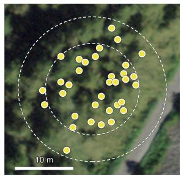

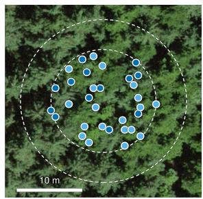

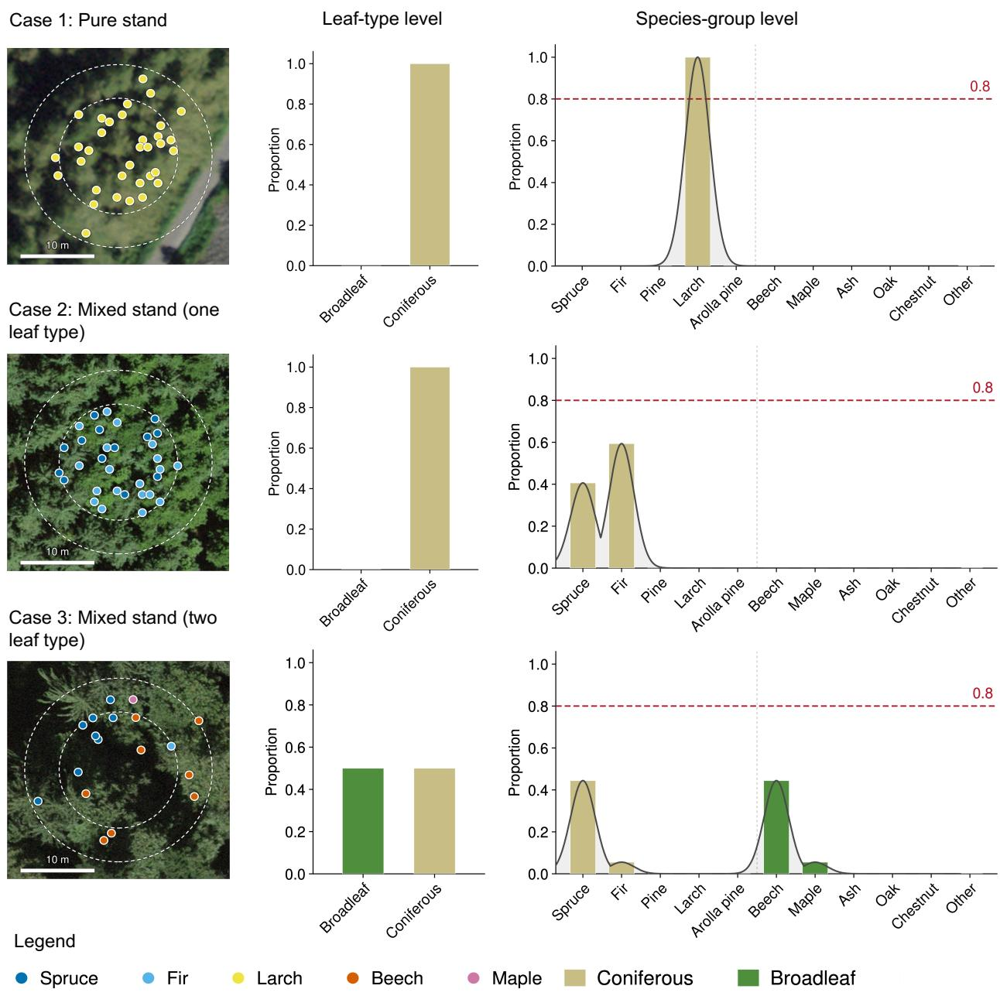

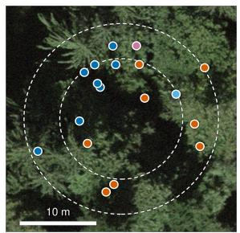  
Figure S1: Conceptual examples of the three principal site-level basal-area distribution forms and their complementary targets. The examples represent a pure stand, a mixed stand within one leaf type, and a mixed stand spanning both leaf types. Left: aerial imagery and NFI sample circles; center: schematic class composition and the 0.80 stand-type threshold; right: the corresponding broadleaved–coniferous composition.

Table S1  
Attrition of tree-level observations and sites through the eligibility filtering pipeline.
<table><tr><td rowspan="2">Step</td><td rowspan="2">Screening criterion</td><td rowspan="2">Description</td><td rowspan="2">Tree points</td><td rowspan="2">Sites 5,998</td></tr><tr><td></td></tr><tr><td>1</td><td>Raw NFl tree observations Recent inventory</td><td>All available tree records</td><td>63,969</td><td></td></tr><tr><td>2</td><td>observations</td><td>Recorded in 2017 or later</td><td>42,831</td><td>4,052</td></tr><tr><td>3</td><td>Canopy-layer screening Quality control and</td><td>Exclude the lowest stratum Exclude disturbed sites and sites with degraded imagery;</td><td>39,863</td><td>4,043</td></tr><tr><td>4</td><td>completeness</td><td>require complete multimodal records</td><td>39,380</td><td>3,992</td></tr></table>

## S4. GPS positional extent of NFI tree records

National tree-species products for neighboring countries are increasingly delivered at 10 m grid spacing (Blickensdörfer et al., 2024). We characterized the spatial extent represented by the retained tree positions at the 3,992 eligible sites (Table S1). Each site retained a median of 9 trees (interquartile range 5–13; range 1–46). Although each site has a reference coordinate, every retained tree carries its own field-recorded position rather than sharing that coordinate.

Figure S2 summarizes this extent in two complementary ways. The left panel gives the cumulative distribution of the minimum enclosing-circle radius, with dashed reference lines at 5 m and 10 m. The radius exceeds 5 m at 89.7% of sites and 10 m at 42.9% of sites. The right panel and Table S2 report containment within centered square grid cells. All retained tree positions are contained within a 10 m cell at 10.9% of sites, compared with 65.5% at 20 m and 99.0% at 30 m. The corresponding proportions of individual tree positions are 34.6%, 90.2%, and 99.9%, respectively.

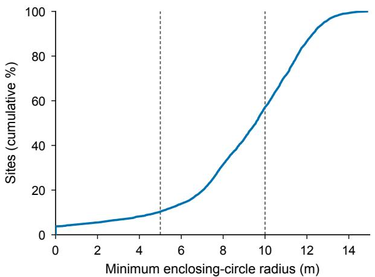

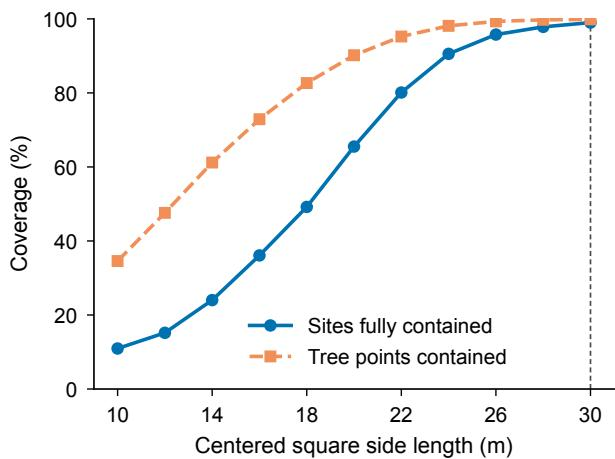  
Figure S2: GPS positional extent of the retained NFI tree records at 3,992 eligible sites. Left: cumulative distribution of the minimum enclosing-circle radius of retained tree positions; vertical dashed lines mark 5 m and 10 m. Right: containment within centered square pixels of increasing side length; the solid curve gives sites fully contained, the dashed curve individual tree points contained, and the vertical dashed line marks the 30 m national-product grid.

Table S2  
Containment of retained NFI tree positions within a square output pixel of the given side length, centered on the site coordinate, for the 3,992 eligible sites.
<table><tr><td>Pixel side length</td><td>10 m</td><td>14 m</td><td>18 m</td><td>20 m</td><td>24 m</td><td>30 m (used here)</td></tr><tr><td>Sites fully contained (%)</td><td>10.9</td><td>24.0</td><td>49.2</td><td>65.5</td><td>90.6</td><td>99.0</td></tr><tr><td>Tree points contained (%)</td><td>34.6</td><td>61.2</td><td>82.7</td><td>90.2</td><td>98.1</td><td>99.9</td></tr></table>

These summaries characterize the spatial support of the field-recorded tree positions, rather than independently validating a particular map resolution. They provide context for the 30 m grid used in this study and for future products at finer spatial resolution.

## S5. Reference year of the national inference

SWISSIMAGE is renewed region by region, so the national inference data described in Section 3.3 do not share a single acquisition date. Fig. S3 maps the reference year assigned to each forest pixel and the share of the mapped forest area falling in each year. Across the mapped forest area, 2021–2024 account for 84.0% of the area, while 2018 and 2025 account for 3.8% and 3.1%, respectively.

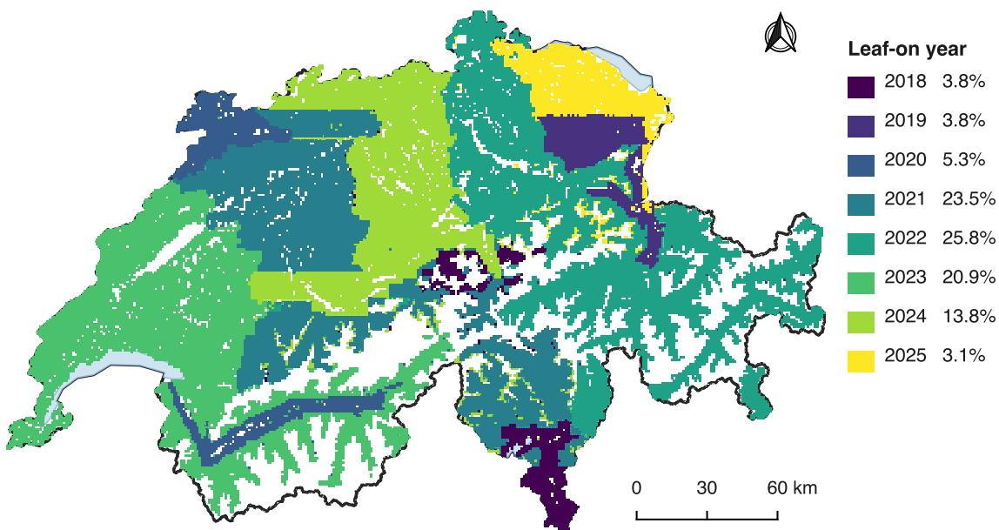  
Figure S3: Reference year of the national-scale inference. Each forest pixel was assigned the year of the most recent leaf-on SWISSIMAGE acquisition available for its area, and that year also determined which annual AlphaEarth embedding was used. Percentages give the share of the mapped forest area falling in each year.

## S6. Definition of the mapped classes

Table S3 lists the 11 mapped classes and the NFI taxa included in each.

## S7. Species-to-leaf-type mapping

Each of the 71 NFI taxa retained after site and canopy-layer screening was assigned to either broadleaved or coniferous (Table S4). The assignment was made at the original taxon level, before the taxa were aggregated into the 11 mapped classes. The mapping contains 57 broadleaved and 14 coniferous taxa. Importantly, the residual Other class contains 48 taxa, including 44 broadleaved and four coniferous taxa; leaf type therefore cannot be inferred from the model-class label alone.

Leaf-type proportions were calculated by summing the expanded basal area of all original taxa assigned to each leaf type. Because this aggregation precedes formation of the 11 mapped classes, the broadleaved–coniferous balance

Table S3  
Definition of the 11 mapped classes. The ten main tree species follow the Swiss NFI grouping; Other contains all retained taxa outside those ten. English and Latin give the common and scientific name of each class, respectively.
<table><tr><td>No.</td><td>English</td><td>Latin</td><td>Included species</td></tr><tr><td>1</td><td>Spruce</td><td>Picea spp.</td><td>Picea abies; Picea spec.</td></tr><tr><td>2</td><td>Fir</td><td>Abies alba</td><td>Abies alba</td></tr><tr><td>3</td><td>Pine</td><td>Pinus spp.</td><td>Pinus sylvestris; Pinus nigra; Pinus strobus; Pinus mugo arborea</td></tr><tr><td>4</td><td>Larch</td><td>Larix spp.</td><td>Larix decidua; Larix kaempferi</td></tr><tr><td>5</td><td>Arolla pine</td><td>Pinus cembra</td><td>Pinus cembra</td></tr><tr><td>6</td><td>Beech</td><td>Fagus sylvatica</td><td>Fagus sylvatica</td></tr><tr><td>7</td><td>Maple</td><td>Acer spp.</td><td>Acer campestre; Acer platanoides; Acer pseudoplatanus; Acer opalus</td></tr><tr><td>8</td><td>Ash</td><td>Fraxinus spp.</td><td>Fraxinus excelsior; Fraxinus ornus</td></tr><tr><td>9</td><td>Oak</td><td>Quercus spp.</td><td>Quercus robur; Quercus petraea; Quercus pubescens; Quercus cerris; Quercus rubra</td></tr><tr><td>10</td><td>Chestnut</td><td>Castanea sativa</td><td>Castanea sativa</td></tr><tr><td>11</td><td>Other</td><td></td><td>— (48 mixed broadleaf and coniferous taxa, not itemized)</td></tr></table>

remains fully defined even though Other combines taxa from both leaf types. The leaf-type target therefore provides a functional summary of the site composition independently of the species-composition target.

## S8. Sentinel-2 spectral phenology

Fig. S4 shows the seasonal NDVI trajectory of each mapped class, computed from the quality-screened Sentinel-2 time series described in Section S13.

The trajectories show a comparatively stable evergreen-conifer signal and a much stronger seasonal amplitude for deciduous canopies. Larch, the only deciduous conifer among the main tree species, separates from the evergreen conifers most clearly during leaf emergence and senescence, whereas the broadleaved groups share a broadly similar summer plateau. These are descriptive summaries: they indicate which temporal signals are available to the model, but they do not by themselves establish species-level separability, because geography, elevation, illumination, and sample size also vary among groups.

## S9. CHELSA climate variables

Before entering the climate encoder, each variable was standardized as $z _ { j } = ( x _ { j } - \mu _ { j } ) / \sigma _ { j }$ using its variable-wise mean and standard deviation. The variables and their units are listed in Table S5.

## S10. Spatial fold assignment

The five folds of the spatial cross-validation (Section 3.2) contained 799, 798, 796, 800, and 799 sites, respectively, and had comparable mean compositions (Fig. 5a).

## S11. Training implementation details

The inputs and encoders of the four modalities described in Section 3.1.1 are summarized in Table S6.

The aerial encoder reads out the class and patch tokens of the blocks $\mathcal { L } = \{ 7 , 1 5 , 2 3 , 3 1 \}$ of the frozen DINOv3 ViT-H+/16. The tokens of each block are projected to the common dimension � by the same linear layer, and the two token types are combined across layers using separate learnable weights,

Table S4  
Assignment of the 71 retained NFI taxa to broadleaved or coniferous leaf type.
<table><tr><td>Taxon</td><td>Leaf type</td><td>Taxon</td><td>Leaf type</td></tr><tr><td>Abies alba</td><td>Coniferous</td><td>Pinus sylvestris</td><td>Coniferous</td></tr><tr><td>Acer campestre</td><td>Broadleaved</td><td>Platanus spec.</td><td>Broadleaved</td></tr><tr><td>Acer opalus</td><td>Broadleaved</td><td>Populus alba</td><td>Broadleaved</td></tr><tr><td>Acer platanoides</td><td>Broadleaved</td><td>Populus nigra s.I.</td><td>Broadleaved</td></tr><tr><td>Acer pseudoplatanus</td><td>Broadleaved</td><td>Populus spec.</td><td>Broadleaved</td></tr><tr><td>Aesculus hippocastanum</td><td>Broadleaved</td><td>Populus tremula</td><td>Broadleaved</td></tr><tr><td>Ailanthus altissima</td><td>Broadleaved</td><td>Populus x canescens</td><td>Broadleaved</td></tr><tr><td>Alnus glutinosa</td><td>Broadleaved</td><td>Prunus avium</td><td>Broadleaved</td></tr><tr><td>Alnus incana</td><td>Broadleaved</td><td>Prunus domestica</td><td>Broadleaved</td></tr><tr><td>Alnus viridis</td><td>Broadleaved</td><td>Prunus padus</td><td>Broadleaved</td></tr><tr><td>Betula pendula</td><td>Broadleaved</td><td>Prunus serotina</td><td>Broadleaved</td></tr><tr><td>Betula pubescens</td><td>Broadleaved</td><td>Pseudotsuga menziesii</td><td>Coniferous</td></tr><tr><td>Carpinus betulus</td><td>Broadleaved</td><td>Pyrus communis / P. pyraster</td><td>Broadleaved</td></tr><tr><td>Castanea sativa</td><td>Broadleaved</td><td>Quercus cerris</td><td>Broadleaved</td></tr><tr><td>Celtis australis</td><td>Broadleaved</td><td>Quercus petraea</td><td>Broadleaved</td></tr><tr><td>Corylus avellana</td><td>Broadleaved</td><td>Quercus pubescens</td><td>Broadleaved</td></tr><tr><td>Crataegus monogyna</td><td>Broadleaved</td><td>Quercus robur</td><td>Broadleaved</td></tr><tr><td>Fagus sylvatica</td><td>Broadleaved</td><td>Quercus rubra</td><td>Broadleaved</td></tr><tr><td>Fraxinus excelsior</td><td>Broadleaved</td><td>Robinia pseudoacacia</td><td>Broadleaved</td></tr><tr><td>Fraxinus ornus</td><td>Broadleaved</td><td>Salix alba</td><td>Broadleaved</td></tr><tr><td>Ilex aquifolium</td><td>Broadleaved</td><td>Salix caprea</td><td>Broadleaved</td></tr><tr><td>Juglans regia</td><td>Broadleaved</td><td>Salix spec.</td><td>Broadleaved</td></tr><tr><td>Laburnum alpinum</td><td>Broadleaved</td><td>Sambucus nigra</td><td>Broadleaved</td></tr><tr><td>Laburnum anagyroides</td><td>Broadleaved</td><td>Sorbus aria</td><td>Broadleaved</td></tr><tr><td>Larix decidua</td><td>Coniferous</td><td>Sorbus aucuparia</td><td>Broadleaved</td></tr><tr><td>Larix kaempferi</td><td>Coniferous</td><td>Sorbus domestica</td><td>Broadleaved</td></tr><tr><td>Malus pumila</td><td>Broadleaved</td><td>Sorbus latifolia s.I.</td><td>Broadleaved</td></tr><tr><td>Malus sylvestris</td><td>Broadleaved</td><td>Sorbus mougeotii</td><td>Broadleaved</td></tr><tr><td>Ostrya carpinifolia</td><td>Broadleaved</td><td>Sorbus torminalis</td><td>Broadleaved</td></tr><tr><td>Picea abies</td><td>Coniferous</td><td>Taxus baccata</td><td>Coniferous</td></tr><tr><td>Picea spec.</td><td>Coniferous</td><td>Thuja spec.</td><td>Coniferous</td></tr><tr><td>Pinus cembra</td><td>Coniferous</td><td>Tilia cordata</td><td>Broadleaved</td></tr><tr><td>Pinus mugo arborea</td><td>Coniferous</td><td>Tilia platyphyllos</td><td>Broadleaved</td></tr><tr><td>Pinus mugo prostrata</td><td>Coniferous</td><td>Ulmus glabra</td><td>Broadleaved</td></tr><tr><td>Pinus nigra</td><td>Coniferous</td><td>Ulmus minor</td><td>Broadleaved</td></tr><tr><td>Pinus strobus</td><td>Coniferous</td><td></td><td></td></tr></table>

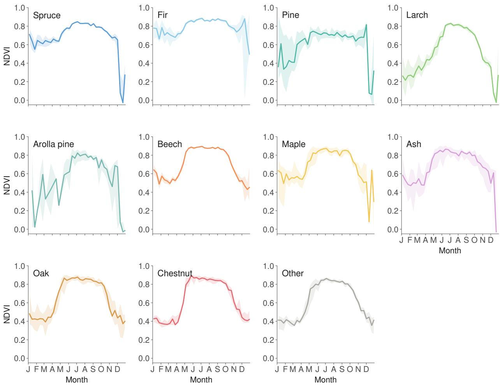  
Figure S4: Seasonal NDVI trajectories by mapped class, derived from the quality-screened Sentinel-2 time series. Lines show the class median across sites; shaded bands show the bootstrap confidence interval of the median.

$$
\begin{array} { r l r } { ( \mathbf { t } _ { \mathrm { c l s } } ^ { ( l ) } , \displaystyle \mathbf { T } _ { \mathrm { p a t c h } } ^ { ( l ) } ) = \mathrm { S p l i t } \left( \mathbf { W } \mathrm { L N } \big ( \mathbf { Z } ^ { ( l ) } \big ) \right) , } & { } & \\ { \mathbf { t } _ { \mathrm { c l s } } = \displaystyle \sum _ { l \in \mathcal { L } } \alpha _ { l } ^ { \mathrm { c l s } } \mathbf { t } _ { \mathrm { c l s } } ^ { ( l ) } , } & { } & { \displaystyle \mathbf { T } _ { \mathrm { p a t c h } } = \displaystyle \sum _ { l \in \mathcal { L } } \alpha _ { l } ^ { \mathrm { p a t c h } } \mathbf { T } _ { \mathrm { p a t c h } } ^ { ( l ) } , } \\ { \alpha ^ { \mathrm { c l s } } = \mathrm { s o f t m a x } ( \mathbf { a } _ { \mathrm { c l s } } ) , } & { } & { \displaystyle \alpha ^ { \mathrm { p a t c h } } = \mathrm { s o f t m a x } ( \mathbf { a } _ { \mathrm { p a t c h } } ) . } \end{array}\tag{S2}
$$

where $\mathbf { a } _ { \mathrm { c l s } }$ and $\mathbf { a } _ { \mathrm { p a t c h } }$ are independent learnable four-dimensional vectors. Both are initialized to zero, giving an initial weight of 0.25 to each block after the softmax. The patch weights are shared across all patch positions, while the projection � is shared by class and patch tokens.

This section gives the full preprocessing, class-balance sampling, and optimization settings underlying Section 3.2. Aerial imagery was cropped to $2 8 0 \times 2 8 0$ pixels at 0.1 m ground sampling distance (Table S6), resized to $2 5 6 \times 2 5 6$ and normalized with ImageNet channel-wise mean and standard deviation; for sites with more than one eligible SWISSIMAGE acquisition, training sampled a leaf-on year at random on each draw, whereas cross-validation evaluation used the eligible acquisition closest to the site’s NFI survey year. National inference instead used the most recent leaf-on acquisition available in each area, as described in Section 3.3. For training and cross-validation, the AlphaEarth patch was taken from the site’s NFI survey year; for national inference, it was taken from the year of the selected SWISSIMAGE acquisition. The ALS point cloud was cropped to a 14 m radius, voxelized at 0.1 m, and the

Table S5  
Definitions of the 19 CHELSA BIOCLIM+ variables used by the model.
<table><tr><td>Variable</td><td>Interpretation</td><td>Unit</td></tr><tr><td>bio01</td><td>Annual mean temperature</td><td>℃</td></tr><tr><td>bio02</td><td>Mean diurnal temperature range</td><td>C</td></tr><tr><td>bio03</td><td>Isothermality (bio02/bio07 × 100)</td><td>%</td></tr><tr><td>bio04</td><td>Temperature seasonality (standard deviation × 100)</td><td>°℃× 100</td></tr><tr><td>bio05</td><td>Maximum temperature of the warmest month</td><td>°C</td></tr><tr><td>bio06</td><td>Minimum temperature of the coldest month</td><td>C</td></tr><tr><td>bio07</td><td>Annual temperature range (bio05 – bio06)</td><td>C</td></tr><tr><td>bio08</td><td>Mean temperature of the wettest quarter</td><td>°C</td></tr><tr><td>bio09</td><td>Mean temperature of the driest quarter</td><td>C</td></tr><tr><td>bio10</td><td>Mean temperature of the warmest quarter</td><td>C</td></tr><tr><td>bio11</td><td>Mean temperature of the coldest quarter</td><td>C</td></tr><tr><td>bio12</td><td>Annual precipitation</td><td>mm</td></tr><tr><td>bio13</td><td>Precipitation of the wettest month</td><td>mm</td></tr><tr><td>bio14</td><td>Precipitation of the driest month</td><td>mm</td></tr><tr><td>bio15</td><td>Precipitation seasonality (coefficient of variation)</td><td>%</td></tr><tr><td>bio16</td><td>Precipitation of the wettest quarter</td><td>mm</td></tr><tr><td>bio17</td><td>Precipitation of the driest quarter</td><td>mm</td></tr><tr><td>bio18</td><td>Precipitation of the warmest quarter</td><td>mm</td></tr><tr><td>bio19</td><td>Precipitation of the coldest quarter</td><td>mm</td></tr></table>

Table S6  
Modality encoders. GSD = ground sampling distance; MLP = multilayer perceptron.
<table><tr><td>Modality</td><td>Model input</td><td>Encoder</td><td>Trainable</td></tr><tr><td>Aerial imagery</td><td>280×280×3 crop, resized to 256×256 (28 m, 0.1 m GSD)</td><td>DINOv3 ViT-H+/16, blocks {7, 15, 23, 31}, 8×8 patch pooling</td><td>No</td></tr><tr><td>ALS</td><td>Points within 14 m radius, 0.1 m voxels 3×3×64 AlphaEarth patch</td><td>Sparse 3D U-Net (channel widths 32–160) + 64 learned queries</td><td>Yes</td></tr><tr><td>Satellite embedding</td><td>(10 m pixels, 30 m footprint)</td><td>Shared 2-layer MLP + positional embedding</td><td>Yes</td></tr><tr><td>Climate</td><td>19 CHELSA BIOCLIM+ variables</td><td>2-layer MLP</td><td>Yes</td></tr></table>

LAS ground-return class (class 2) was removed before converting point elevations to height above the local terrain using the DEM. AlphaEarth patches comprised 3 × 3 pixels, giving nine 64-dimensional feature vectors per site (Table S6). RGB, the ALS ��-coordinates, and the AlphaEarth patch were augmented with a shared random rotation and flip per site, so that the three spatially registered inputs remained aligned.

Rare-species representation was addressed by a distributed rare-site weighted sampler. Pine, larch, Arolla pine, maple, ash, oak, and chestnut were designated as rare classes. A site received a sampling weight of 1.5 if any of these classes reached a 5% basal-area share, regardless of which class was dominant; all other sites received a weight of 1.0. Sampling was performed with replacement and afected how often a site was drawn rather than its contribution to the loss (Section 3.1.3). In the single-GPU experiments, each epoch contained as many draws as there were sites in the corresponding training fold, so individual sites could be repeated or omitted within an epoch. Whenever a site was sampled again, its leaf-on SWISSIMAGE acquisition was re-sampled independently.

Apart from the frozen DINOv3 aerial encoder, all components were trained from random initialization (Table S6). Optimization settings are listed in Table S7.

Table S7 Optimization settings.
<table><tr><td>Setting</td><td>Value</td></tr><tr><td>Optimizer</td><td>AdamW</td></tr><tr><td>Initial learning rate</td><td> $1 \times 1 0 ^ { - 4 }$ </td></tr><tr><td>Weight decay</td><td>0.05</td></tr><tr><td>Adam betas</td><td>(0.9, 0.999)</td></tr><tr><td>Scheduler</td><td>Cosine decay</td></tr><tr><td>Minimum learning rate</td><td> $1 \times 1 0 ^ { - 6 }$ </td></tr><tr><td>Warm-up</td><td>None</td></tr><tr><td>Epochs</td><td>80</td></tr><tr><td>Global batch size</td><td>4</td></tr><tr><td>Gradient clipping</td><td>Max norm 1.0</td></tr><tr><td>Mixed precision</td><td>Disabled (FP32)</td></tr><tr><td>EMA</td><td>Decay 0.999</td></tr><tr><td>Random seed</td><td>42</td></tr><tr><td>Loss weight, stand type</td><td>1.0</td></tr><tr><td>Loss weights, leaf type and composition (Eq. 5)</td><td> $\lambda _ { \mathrm { K L } } = 0 . 2 , \lambda _ { L _ { 1 } } = 1 . 0$ </td></tr><tr><td>Loss weight, consistency (Eq. 6)</td><td>0.1</td></tr></table>

## S12. Evaluation metrics

Let $y _ { i k }$ and $\hat { y } _ { i k }$ denote the observed and predicted proportions of class � at site � over the � evaluation sites. For each class, the mean absolute error (MAE), the root mean squared error (RMSE), and the coeficient of determination $( R ^ { 2 } )$ are

$$
\mathrm { M A E } _ { k } = \frac { 1 } { n } \sum _ { i = 1 } ^ { n } \left| y _ { i k } - \hat { y } _ { i k } \right| ,\tag{S3}
$$

$$
\mathrm { R M S E } _ { k } = \sqrt { \frac { 1 } { n } \sum _ { i = 1 } ^ { n } \left( y _ { i k } - \hat { y } _ { i k } \right) ^ { 2 } } ,\tag{S4}
$$

$$
R _ { k } ^ { 2 } = 1 - \frac { \sum _ { i = 1 } ^ { n } \left( y _ { i k } - \hat { y } _ { i k } \right) ^ { 2 } } { \sum _ { i = 1 } ^ { n } \left( y _ { i k } - \bar { y } _ { k } \right) ^ { 2 } } .\tag{S5}
$$

Unless otherwise stated, the metrics reported in Section 4 are macro-averages over the � = 11 mapped classes, so that every class contributes equally regardless of how abundant it is,

$$
M _ { \mathrm { m a c r o } } = \frac { 1 } { K } \sum _ { k = 1 } ^ { K } M _ { k } , \qquad M \in \left\{ \mathrm { M A E , ~ R M S E , ~ } R ^ { 2 } , ~ F _ { 1 } \right\} .\tag{S6}
$$

For the complementary classification-based evaluation, each observed and predicted composition vector was converted to its dominant class using

$$
\boldsymbol c _ { i } = \underset { k } { \arg \operatorname* { m a x } } \ y _ { i k } , \qquad \boldsymbol c _ { i } = \arg \operatorname* { m a x } _ { k } \hat { y } _ { i k } .\tag{S7}
$$

and the resulting labels were evaluated with overall accuracy and macro- $\cdot F _ { 1 }$ , the latter averaged across the classes represented in the evaluation dataset.

Figure S5 shows the five NFI production regions used for the comparison with NFI4 regional statistics.

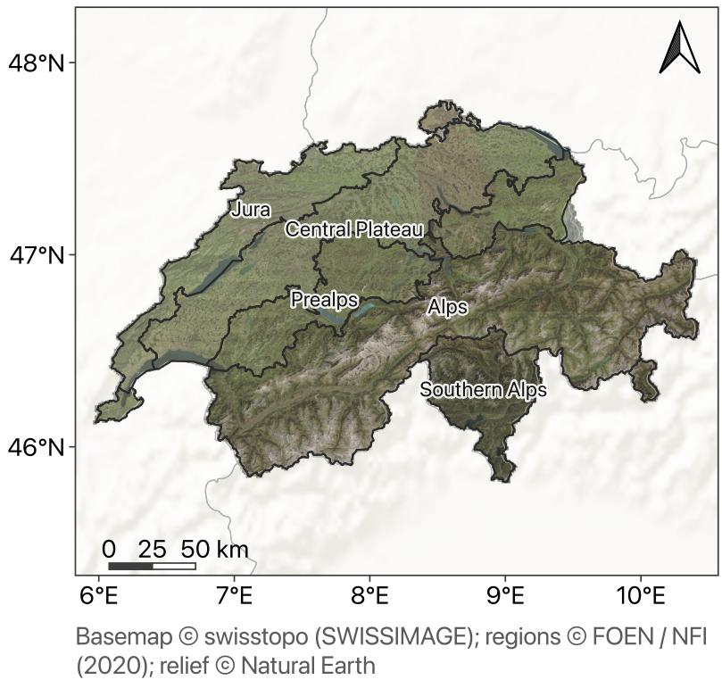  
Figure S5: The five Swiss NFI production regions used for the comparison with NFI4 regional statistics (Section 4.3.2).

## S13. Alternative design choices

Two further groups of experiments examined design choices that were made within the selected modality set: how satellite information is represented and how climate context is supplied. Each group replaced a single component of the reference configuration while leaving everything else unchanged.

The Sentinel-2 alternative used Level-1C imagery (European Space Agency, 2015) processed to bottom-ofatmosphere (BOA) surface reflectance with FORCE (Frantz, 2019) on a nominal 10–20 m grid. For each site, a 3 × 3-pixel patch was extracted from all acquisitions within the site’s NFI observation year, each providing the ten FORCE-derived spectral bands together with its quality mask; cloud, cloud shadow, snow, saturation, and no-data observations were masked during training. The resulting seasonal NDVI trajectories of the mapped classes are shown in Section S8 (Fig. S4).

Substituting the annual AlphaEarth embeddings with a directly encoded Sentinel-2 reflectance time series reduced composition $R ^ { \bar { 2 } }$ from 0.485 to between 0.458 and 0.480, depending on the temporal window (Table S8). Within the raw Sentinel-2 variants the ordering was interpretable: the full-year series performed best (0.480), ahead of the single July composite (0.464) and the growing-season series (0.458), which is consistent with the leaf-emergence and senescence periods carrying much of the phenological contrast between the mapped classes (Section S8) and therefore favoring the window that spans both. The margin over the best raw variant is only 0.005, however, so on this evidence the embeddings and a full-year Sentinel-2 series are close to interchangeable for composition; the full-year variant is in fact ahead on dominant-class $F _ { 1 }$ . Two properties of the AlphaEarth representation plausibly account for the diference. It is derived from Sentinel-1, Sentinel-2, and Landsat observations rather than from Sentinel-2 alone, and it is produced as a gap-free annual summary, whereas the FORCE series is restricted to the site’s inventory year and is thinned by cloud, snow, and shadow masking.

## Table S8

Satellite representation. Best in bold, second best underlined. The dagger marks the configuration retained in the reference model.
<table><tr><td rowspan="2">Variant</td><td colspan="2">Leaf level</td><td colspan="3">Species level</td></tr><tr><td>MAE</td><td> $R ^ { 2 }$ </td><td>MAE</td><td> $R ^ { 2 }$ </td><td> $F _ { 1 }$ </td></tr><tr><td>AlphaEarth embeddings†</td><td> $\mathbf { 0 . 0 9 3 { \scriptstyle \pm 0 . 0 0 3 } }$ </td><td> $\mathbf { 0 . 8 0 3 { \scriptstyle \pm 0 . 0 1 7 } }$ </td><td> $\mathbf { 0 . 0 4 8 { \scriptstyle \pm 0 . 0 0 1 } }$ </td><td> $\pm \mathbf { 0 . 4 8 5 { \pm 0 . 0 3 8 } }$ </td><td> $0 . 5 8 5 { \scriptstyle \pm 0 . 0 1 4 }$ </td></tr><tr><td>Sentinel-2, July composite</td><td> $0 . 0 9 8 { \scriptstyle \pm 0 . 0 0 4 }$ </td><td> $\underline { { 0 . 7 9 1 } } \pm 0 . 0 1 5$ </td><td> $0 . 0 5 0 { \scriptstyle \pm 0 . 0 0 1 }$ </td><td> $0 . 4 6 4 { \scriptstyle \pm 0 . 0 4 4 }$ </td><td> $\underline { { 0 . 5 8 8 \pm 0 . 0 2 9 } }$ </td></tr><tr><td>Sentinel-2, growing season</td><td> $0 . 0 9 9 { \scriptstyle \pm 0 . 0 0 3 }$ </td><td> $0 . 7 8 6 { \pm } 0 . 0 1 8$ </td><td> $0 . 0 5 0 { \scriptstyle \pm 0 . 0 0 1 }$ </td><td> $0 . 4 5 8 { \pm } 0 . 0 5 2$ </td><td> $0 . 5 7 9 { \scriptstyle \pm 0 . 0 4 1 }$ </td></tr><tr><td>Sentinel-2, all year</td><td> $\underline { { 0 . 0 9 8 { \pm } 0 . 0 0 3 } }$ </td><td> $0 . 7 9 0 { \scriptstyle \pm 0 . 0 1 1 }$ </td><td> $\underline { { 0 . 0 5 0 { \pm } 0 . 0 0 1 } }$ </td><td> $\underline { { 0 . 4 8 0 { \pm } 0 . 0 4 2 } }$ </td><td> $\pm 0 . 5 9 3 { \scriptstyle \pm 0 . 0 2 0 }$ </td></tr></table>

Two alternatives to the explicit CHELSA variables were tested (Table S9). Neither is separated from the CHELSA configuration by much. The frozen Climplicit embedding was marginally ahead on every metric except species-level MAE: composition $R ^ { 2 } ~ 0 . 4 8 7$ against 0.485, leaf-type $R ^ { 2 } \ 0 . 8 1 3$ against 0.803, and dominant-class $F _ { 1 } ~ 0 . 5 9 3$ against 0.585. The Location-MLP variant, in which the climate branch received only the site coordinates, was the best of the three on the leaf-type target (leaf-type $R ^ { 2 } 0 . 8 1 5 )$ but the weakest on the composition target $( R ^ { 2 } 0 . 4 7 3 )$ , which is the quantity the product is intended to deliver.

We nevertheless retained the explicit CHELSA variables, and on this evidence the choice cannot be defended on accuracy. The spread across the three climate representations is 0.014 in composition $R ^ { 2 }$ , and the gap between CHELSA and Climplicit is 0.002, against the 0.020 cost of removing the climate branch altogether (Section 4.1.2). The two are best regarded as equivalent. The argument for CHELSA is therefore one of interpretability and transferability rather than of measured accuracy: its 19 variables are physically defined and available on the same scale everywhere, so the fitted model can be applied and audited outside Switzerland, whereas Climplicit is itself a learned embedding whose behavior outside its training distribution is not directly inspectable. That a coordinate-only branch comes within 0.015 of both is separately informative: it indicates that much of what the climate branch contributes is large-scale spatial structure, which coordinates encode together with biogeographic region, management history, and species-pool composition. A coordinate branch, however, can only reproduce the spatial pattern it was trained on, which is why it was not carried forward.

## Table S9

Climate representation. Best in bold, second best underlined. The dagger marks the configuration retained in the reference model.
<table><tr><td rowspan="2">Variant</td><td colspan="2">Leaf level</td><td colspan="3">Species level</td></tr><tr><td>MAE</td><td> $R ^ { 2 }$ </td><td>MAE</td><td> $R ^ { 2 }$ </td><td> $F _ { 1 }$ </td></tr><tr><td>CHELSA BIOCLIM+</td><td> $0 . 0 9 3 { \scriptstyle \pm 0 . 0 0 3 }$ </td><td> $0 . 8 0 3 { \scriptstyle \pm 0 . 0 1 7 }$ </td><td> $\mathbf { 0 . 0 4 8 { \scriptstyle \pm 0 . 0 0 1 } }$ </td><td> $0 . 4 8 5 { \scriptstyle \pm 0 . 0 3 8 }$ </td><td> $0 . 5 8 5 { \scriptstyle \pm 0 . 0 1 4 }$ </td></tr><tr><td>Climplicit embedding</td><td> $\mathbf { 0 . 0 9 2 { \scriptstyle \pm 0 . 0 0 3 } }$ </td><td> $\underline { { 0 . 8 1 3 { \pm } 0 . 0 1 5 } }$ </td><td> $\underline { { 0 . 0 4 9 { \pm } 0 . 0 0 1 } }$ </td><td> $\pm { \bf 0 . 4 8 7 } \pm { \bf 0 . 0 4 2 }$ </td><td> $\pm 0 . 5 9 3 { \scriptstyle \pm 0 . 0 2 7 }$ </td></tr><tr><td>Location MLP</td><td> $\underline { { 0 . 0 9 3 { \pm } 0 . 0 0 3 } }$ </td><td> $\pm \mathbf { 0 . 8 1 5 { \pm 0 . 0 1 4 } }$ </td><td> $0 . 0 4 9 { \scriptstyle \pm 0 . 0 0 2 }$ </td><td> $0 . 4 7 3 { \scriptstyle \pm 0 . 0 4 4 }$ </td><td> $\underline { { 0 . 5 8 5 { \pm } 0 . 0 2 3 } }$ </td></tr></table>

A pattern recurs across these groups: several alternatives that lose composition accuracy nonetheless achieve a higher dominant-class $F _ { 1 }$ than the reference configuration. The full-year Sentinel-2 variant gives up 0.005 in composition $R ^ { 2 }$ but gains 0.008 in $F _ { 1 }$ , and the same 0.008 gain appears for the Climplicit climate branch and for the ALS-free modality combination of Section 4.1.2. The dissociation is therefore consistent in sign but small in size, well below the 0.070 diference in dominant-class $F _ { 1 }$ between the reference configuration (0.585) and the strongest non-multimodal baseline (0.515) in Table 3. Because $F _ { 1 }$ is evaluated after the argmax operation, a configuration can improve it by sharpening the leading component while distributing the remaining share less accurately. The reference configuration was identified on the continuous metrics, which are the quantities the product is intended to deliver.

## S14. Independent validation data and protocol

## Validation data

The Forest Reserves Monitoring network (Hobi et al., 2020) provides three linked components: a tree-level inventory table, a species lookup table, and permanent-plot polygons. The inventory table records, for each tree and each census, the reserve and plot identifiers, the census year, the species code, the coordinates, the tree status, the DBH, and the vertical stratum. The lookup table links species codes to taxon names, which were then mapped onto the 11 classes of Table S3 using the same crosswalk as the training labels; in particular, Pinus spp., P. sylvestris, and the two P. mugo subspecies were assigned to Pine, and P. cembra to Arolla pine.

The network was established to study the long-term dynamics of unmanaged forests and to contrast reserves with managed stands. It is not a probability sample of Swiss forest, and the assessment reported in Section 4.3.1 should accordingly be read as an independent plot-level evaluation across 35 reserves rather than as a design-unbiased estimate of national product accuracy. Plots within a reserve are also spatially clustered, so any uncertainty interval should be obtained by resampling whole reserves rather than individual plots.

## Field composition

For every plot, only the most recent census was retained, so that repeated measurements of the same plot are not treated as independent observations. Trees were then restricted to living individuals of the upper and middle storeys with $\mathrm { D B H } \ge 1 2$ cm, which aligns the validation target with the label definition of Section 2.2; 28,152 tree records remained. Applying the 12 cm threshold removed a large number of stems but only about 0.89% of the total basal area, and it changed the headline metrics only marginally. The stratum field of the reserve inventory and the NFI SCHICHT field originate from diferent inventory systems and are therefore closely harmonized rather than strictly identical.

Basal area was computed as $B A _ { i } = \pi ( d _ { i } / 2 0 0 0 ) ^ { 2 }$ with $d _ { i }$ the DBH in millimetres, which is Eq. S1 expressed in the units of this dataset, and the observed proportion of class � in plot � was taken as the class basal-area sum divided by the plot total. Unlike the NFI, the reserve inventories are complete enumerations within a fixed polygon and provide no tree-level expansion factors; all retained trees in a plot therefore share the same spatial support, and the common plot-area term cancels when within-plot proportions are formed.

## Extraction of the prediction

Predictions were not read from the pixel containing the plot center. Instead, each plot polygon was transformed to the coordinate system of the national product, all valid 30 m forest pixels intersecting the polygon were identified, and the plot-level prediction was formed as the intersection-area-weighted mean of their 11-part composition vectors,

$$
\hat { y } _ { p k } = \frac { \sum _ { j } A _ { p j } \hat { y } _ { j k } } { \sum _ { j } A _ { p j } } ,\tag{S8}
$$

where $A _ { p j }$ is the area of intersection between plot $p$ and pixel �. The result was renormalized to sum to one, correcting only numerical departures from closure. Of the 135 plots in the network, 132 had valid predictions; three were dropped because no valid product pixel overlapped their polygon. Across the retained plots the mean valid-pixel coverage was 99.92% and the minimum 96.19%.

The pixel-level evaluation of Section 4.3.1 uses the same intersecting pixels but does not average across them. Each intersecting pixel was instead treated as an independent observation if the plot polygon covered at least 80% of its area and at least 10 retained trees fell within it; eligible pixels received the prediction of their own raster cell directly, with no spatial averaging. Because a retained tree’s coordinates can fall just outside the plot polygon through small GPS or digitization error, a tree was still counted toward a pixel if it lay within 5 m of the polygon boundary; this tolerance retained 98.85% of trees (99.22% of basal area), against 94.41% (95.26% of basal area) with no tolerance. Under this specification, 414 pixels from 111 plots in 34 reserves were retained, with a median of 29 retained trees per eligible pixel.

## Threshold sensitivity

The 80% coverage and 10-tree thresholds were set by a sensitivity analysis rather than chosen post hoc to favor a particular result. Holding coverage at 80% and varying only the minimum tree count (Fig. S6), performance was stable from no explicit minimum up to 10 trees: macro $R ^ { 2 }$ fell by only 0.03 (from 0.582 to 0.552) and dominant-class accuracy was essentially unchanged. Stricter thresholds were markedly more costly: at 25 trees only 248 pixels from 85 plots and 28 reserves remained (56% of the 10-tree sample), and macro $R ^ { 2 }$ fell to 0.477. Across coverage thresholds of 80–95% with the 10-tree minimum held fixed, macro $R ^ { \hat { 2 } }$ stayed within a narrow band of approximately 0.53–0.55. The primary specification (80% coverage, 10 trees) was retained as a compromise between the stability of the pixel-level reference composition and the size of the validation sample, not as an empirically optimized choice.

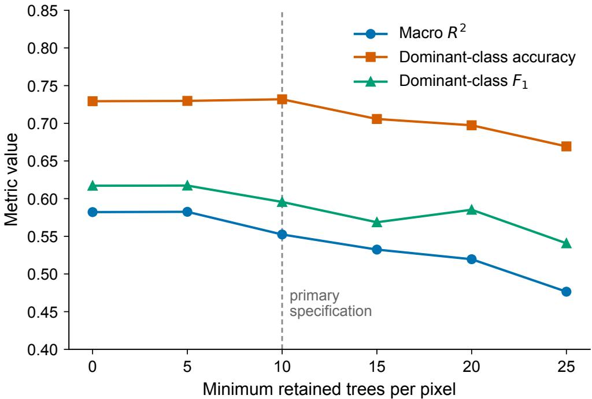  
Figure S6: Sensitivity of the pixel-level validation to the minimum-tree-count threshold, with pixel coverage fixed at 80%. The dashed line marks the primary specification (10 trees) used in Section 4.3.1.

## Metrics

MAE, RMSE, and $R ^ { 2 }$ follow Eqs. S3–S5, with the plot as the unit of observation for the plot-level evaluation and the pixel as the unit of observation for the pixel-level evaluation, and are aggregated as in Eq. S6. Because every class is observed at the same 132 plots, the macro-averaged and pooled MAE coincide; the macro-averaged and pooled RMSE do not, and the pooled value of 0.098 is retained only as a diagnostic. The per-class results are given in Table S11.

Macro-averaged MAE and RMSE retained all 11 mapped classes because neither metric depends on reference variance. The treatment of chestnut matters more for $R ^ { 2 }$ . Chestnut was suficiently represented in the spatial crossvalidation, and including it changed the macro- $R ^ { 2 }$ only slightly, from 0.483 to 0.485 (Table S10). In the independent data, however, chestnut occurred with a non-zero share at only one of the 132 plots and at none of the 414 eligible pixels.

At plot support, chestnut’s single non-zero observation (0.00397) yielded $\mathrm { S S T } ~ = ~ 1 . 5 6 6 \times 1 0 ^ { - 5 }$ and $\mathrm { { S S E } \ = }$ $7 . 4 3 6 \times 1 0 ^ { - 4 }$ , giving a diagnostic $R ^ { 2 }$ of approximately −46.5. Including it would reduce the plot-level macro- $R ^ { 2 }$ from 0.733 to −3.560. At pixel support, all reference chestnut shares were zero, so $R ^ { 2 }$ was undefined. We therefore used the same ten evaluable classes when comparing $R ^ { 2 }$ across the three supports.

Table S10  
Sensitivity of macro-averaged $R ^ { 2 }$ to the inclusion of chestnut across evaluation supports. Cross-validation values are means of the five fold-level macro- $R ^ { 2 }$ values. a At plot support, the value including chestnut is reported only as a diagnostic because chestnut has a single non-zero reference observation. $^ { \mathsf { b } } { \mathsf { A } } \mathbf { t }$ pixel support, chestnut has zero reference variance and $R ^ { 2 }$ is therefore not evaluable (n.e.). The second row uses the same ten evaluable classes at all three supports.
<table><tr><td>Class set</td><td>Spatial 5-fold CV NFI (n = 3,992)</td><td>Independent, plot Forest reserve (n = 132)</td><td>Independent, pixel Forest reserve (n = 414)</td></tr><tr><td>All 11 classes (including chestnut)</td><td>0.485</td><td>-3.560ª</td><td> $\mathsf { n . e . ^ { \mathsf { b } } }$ </td></tr><tr><td>Ten evaluable classes (excluding chestnut)</td><td>0.483</td><td>0.733</td><td>0.552</td></tr></table>

## Table S11

Per-class performance at the plot-level (132 forest reserve plots) and pixel-level (414 forest-reserve pixels) independent validations. $n _ { + }$ is the number of plots or pixels in which the class was observed with a non-zero share. Chestnut has a single non-zero plot-level observation and no positive pixel-level observation, so its $R ^ { 2 }$ is not evaluable (n.e.) at either support and it is excluded from the macro- $R ^ { 2 }$ ; the macro-MAE and macro-RMSE retain all 11 classes. Dominant-class support at each observation unit is given in the row labels of Fig. 9.
<table><tr><td rowspan="2">Class</td><td colspan="2">MAE</td><td colspan="2">RMSE</td><td colspan="2"> $R ^ { 2 }$ </td><td colspan="2"> $n _ { + }$ </td></tr><tr><td>Plot</td><td>Pixel</td><td>Plot</td><td>Pixel</td><td>Plot</td><td>Pixel</td><td>Plot</td><td>Pixel</td></tr><tr><td>Spruce</td><td>0.085</td><td>0.115</td><td>0.172</td><td>0.237</td><td>0.668</td><td>0.677</td><td>89</td><td>264</td></tr><tr><td>Fir</td><td>0.034</td><td>0.038</td><td>0.071</td><td>0.092</td><td>0.829</td><td>0.643</td><td>48</td><td>100</td></tr><tr><td>Pine</td><td>0.044</td><td>0.063</td><td>0.135</td><td>0.194</td><td>0.718</td><td>0.421</td><td>50</td><td>102</td></tr><tr><td>Larch</td><td>0.020</td><td>0.029</td><td>0.058</td><td>0.085</td><td>0.869</td><td>0.728</td><td>23</td><td>61</td></tr><tr><td>Arolla pine</td><td>0.031</td><td>0.039</td><td>0.118</td><td>0.138</td><td>0.700</td><td>0.610</td><td>18</td><td>56</td></tr><tr><td>Beech</td><td>0.058</td><td>0.063</td><td>0.099</td><td>0.125</td><td>0.880</td><td>0.811</td><td>74</td><td>175</td></tr><tr><td>Maple</td><td>0.024</td><td>0.025</td><td>0.042</td><td>0.062</td><td>0.633</td><td>0.021</td><td>74</td><td>124</td></tr><tr><td>Ash</td><td>0.026</td><td>0.018</td><td>0.066</td><td>0.059</td><td>0.766</td><td>0.647</td><td>53</td><td>73</td></tr><tr><td>Oak</td><td>0.043</td><td>0.034</td><td>0.098</td><td>0.108</td><td>0.830</td><td>0.649</td><td>46</td><td>76</td></tr><tr><td>Chestnut</td><td>0.001</td><td>0.000</td><td>0.002</td><td>0.002</td><td>n.e.</td><td>n.e.</td><td>1</td><td>0</td></tr><tr><td>Other</td><td>0.048</td><td>0.036</td><td>0.104</td><td>0.100</td><td>0.439</td><td>0.317</td><td>81</td><td>115</td></tr><tr><td>Macro</td><td>0.038</td><td>0.042</td><td>0.088</td><td>0.109</td><td>0.733</td><td>0.552</td><td></td><td></td></tr></table>

## Comparison with cross-validation

The cross-validation metrics reported in Table 5 follow the same per-fold, mean-across-folds procedure used for Tables 3 and 4, applied to the reference configuration. Within each fold, MAE and RMSE were macro-averaged over all 11 mapped classes, dominant-class accuracy was calculated over all observations, and macro- $F _ { 1 }$ retained all 11 represented dominant classes. For the support-level $R ^ { 2 }$ comparison in Section 4.3.1, chestnut was excluded so that the same ten evaluable classes were used at all three supports (Table S10). Each reported cross-validation value is the mean of the five resulting fold-level values.

Table S12 compares the per-class result of this cross-validation with the pixel-level independent validation. Agreement is not uniform across classes. Beech and larch have low MAE at both supports, and larch also has similar $R ^ { 2 }$ values, whereas beech’s $R ^ { 2 }$ increases from 0.673 in cross-validation to 0.811 in the pixel-level validation. Pine shows the clearest consistent deterioration: MAE, RMSE, and dominant-class recovery (Section 4.3.1) are all worse at the pixel level. Several other classes show large $R ^ { 2 }$ shifts driven by the reference composition rather than by prediction error: maple’s MAE and RMSE are both smaller at the pixel level (0.025 and 0.062, against 0.051 and 0.124 in the cross-validation) yet its $R ^ { 2 }$ falls from 0.258 to 0.021, because the standard deviation of the pixel-level reference share is much smaller than that of the cross-validation sites. This is the same mechanism documented for chestnut above: $R ^ { 2 }$ is one minus a residual sum of squares divided by the observed variance (Eq. S5), so a smaller observed variance can lower $R ^ { 2 }$ even when the absolute error improves.

Table S12  
Per-class MAE and $R ^ { 2 }$ in the spatial five-fold cross-validation and the pixel-level independent validation. Cross-validation values are the mean over the five folds, restricted to the reference configuration. Chestnut is omitted from this side-by-side table because its pixel-level $R ^ { 2 }$ is not evaluable.
<table><tr><td rowspan="2">Class</td><td colspan="2">MAE</td><td colspan="2"> $R ^ { 2 }$ </td></tr><tr><td>CV</td><td>Pixel-level</td><td>CV</td><td>Pixel-level</td></tr><tr><td>Spruce</td><td>0.111</td><td>0.115</td><td>0.746</td><td>0.677</td></tr><tr><td>Fir</td><td>0.061</td><td>0.038</td><td>0.668</td><td>0.643</td></tr><tr><td>Pine</td><td>0.024</td><td>0.063</td><td>0.599</td><td>0.421</td></tr><tr><td>Larch</td><td>0.039</td><td>0.029</td><td>0.742</td><td>0.728</td></tr><tr><td>Arolla pine</td><td>0.013</td><td>0.039</td><td>0.339</td><td>0.610</td></tr><tr><td>Beech</td><td>0.084</td><td>0.063</td><td>0.673</td><td>0.811</td></tr><tr><td>Maple</td><td>0.051</td><td>0.025</td><td>0.258</td><td>0.021</td></tr><tr><td>Ash</td><td>0.037</td><td>0.018</td><td>0.242</td><td>0.647</td></tr><tr><td>Oak</td><td>0.028</td><td>0.034</td><td>0.236</td><td>0.649</td></tr><tr><td>Other</td><td>0.073</td><td>0.036</td><td>0.331</td><td>0.317</td></tr></table>